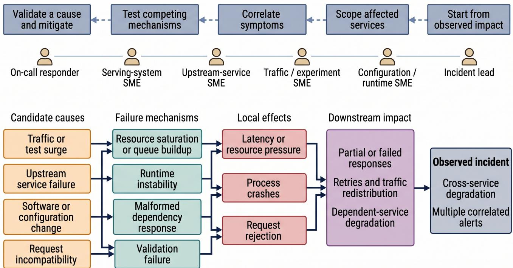
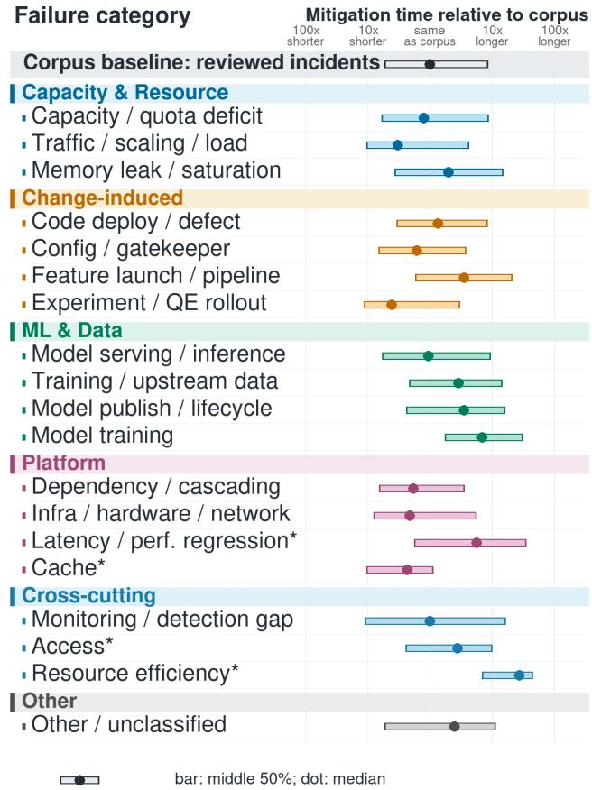
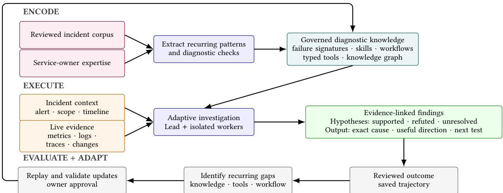
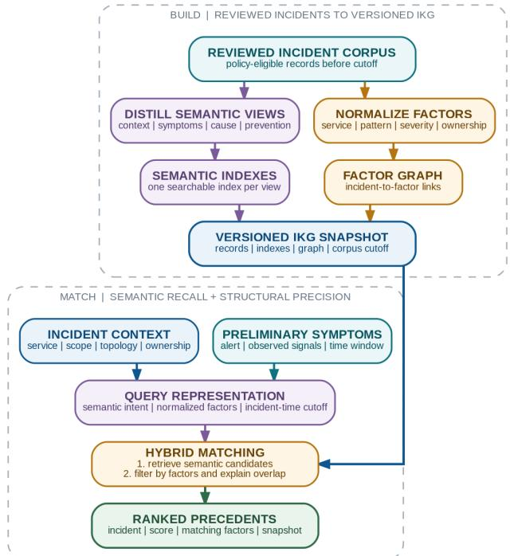
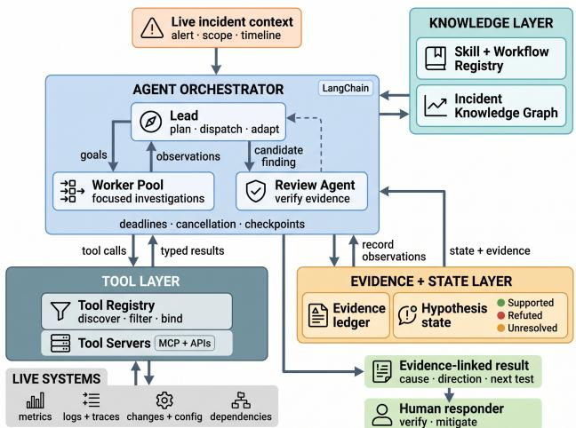
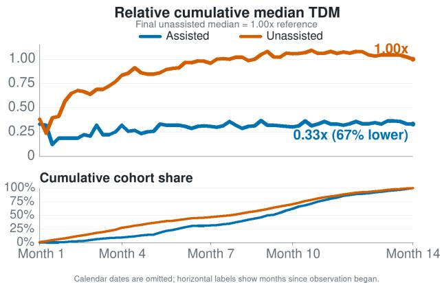
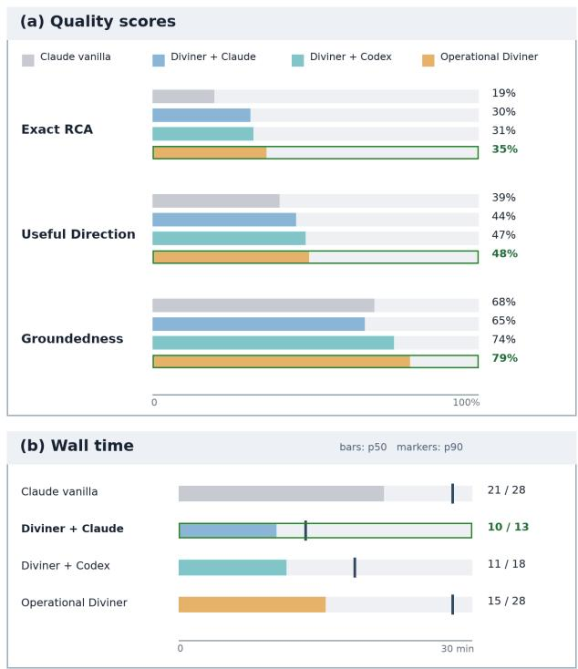

# Diviner: Agentic RCA with Human-Governed Adaptation for Large-Scale Infrastructure

Pradipta Ghosh   
Meta, Inc.   
USA   
iampradipta@meta.com   
Junyu Liu   
Meta, Inc.   
USA   
jyliu@meta.com   
Gaurav Mitra   
Meta, Inc.   
USA   
gmitra@meta.com   
Canturk Isci   
Meta, Inc.   
USA   
cisci@meta.com   
Onkar Deshpande   
Meta, Inc.   
USA   
odeshpande@meta.com

## Abstract

Root-cause analysis (RCA) in large-scale distributed systems is challenging because a single symptom can cross service, data, configuration, compute, and organizational boundaries. Responders must assemble incomplete evidence and coordinate experts who hold diferent parts of the causal path. Generic language-model agents do not solve this problem through tool access alone: they can use stale or mistimed context, interpret failed queries as absent symptoms, confidently report unsupported state, and overload observability services designed for human-paced use.

Anik Dasgupta   
Meta, Inc.   
USA   
anikdasgupta@meta.com

We present Diviner (Domain-Informed Verifiable Incident Navigation through Evidence and Review), an agentic RCA system operating at Meta and organized around a four-stage reliability lifecycle. Encode uses a large corpus of reviewed incidents as a governed operational curriculum, combining recurring failure patterns with service-owner expertise to produce scoped, versioned skills, workflows, typed tools, and an incident knowledge graph. Execute uses an adaptive Lead and context-isolated workers to apply relevant artifacts to point-in-time evidence and maintain evidence-linked hypotheses. Evaluate compares saved investigation trajectories with responder-reviewed outcomes to measure exact cause, useful direction, and Groundedness. Adapt is a human-gated process that uses recurring gaps and on-call feedback to derive focused operational-knowledge updates, admitting them only after replay, quality checks, and owner approval.

In observational cohort comparisons within Meta’s largescale recommendation and ranking infrastructure, Divinerassisted incidents were associated with approximately 52% lower detection-to-mitigation time and approximately 15%

Shripad Nadgowda   
Meta, Inc.   
USA   
shri.nadgowda@gmail.com   
Syamla Bandla   
Meta, Inc.   
USA   
shyamalab@gmail.com   
Akshil Shah   
Meta, Inc.   
USA   
akshilshah@meta.com   
Xinyao Hu   
Meta, Inc.   
USA   
xinyao.hu@meta.com

lower pre-mitigation operational efort. Across scored investigations, Diviner identifies the exact root cause in 45% of cases, provides a useful causal direction in 60%, and achieves 80% mean Groundedness.

## 1 Introduction

In large-scale distributed systems, the component exhibiting a failure is often far removed from the component that caused it. A request may traverse data pipelines, services, experimentation, configuration, shared compute, networking, and storage before a user-visible symptom appears. These components evolve independently, so a fault in one layer may surface later as a statistical shift or failure in another [3, 28]. Root-cause analysis (RCA) requires responders to form competing hypotheses, find discriminating evidence, and redirect the investigation as observations arrive. Even before the exact cause is known, localizing the right subsystem, refuting an alternative, or identifying the next test can accelerate mitigation. We call this evidence-backed progress useful direction. Figure 1 illustrates both how a fault propagates across service boundaries and how responders trace the resulting impact back toward candidate causes.

Large language model (LLM) agents create an opportunity to automate parts of this process. They can read procedures, call diagnostic tools, pursue several hypotheses, and synthesize evidence. RCA, however, is not an ordinary task-completion problem. Unlike a coding agent, an incident investigator does not receive a stable repository, a deterministic test suite, or a clean corpus of tasks paired with known answers. The necessary evidence changes while the incident unfolds, and several investigation paths may produce useful progress without reaching the same final explanation. Recent evaluations of RCA agents, IT operations, and on-call tasks show that strong benchmark or coding performance does not necessarily translate into reliable incident investi gation [4, 7, 12, 32]. The necessary expertise is distributed across service owners, and a plausible unsupported answer can redirect scarce responder attention. Reliable assistance therefore requires more than a capable model or a large tool catalog: it requires governed knowledge, explicit evidence semantics, bounded execution, and human-governed updates from reviewed outcomes.

  
Figure 1: Anatomy of a cross-service incident investigation. Solid arrows show representative paths from candidate causes through failure mechanisms and local efects to downstream impact. The dashed path above shows responders tracing the incident in the reverse direction, while service experts examine diferent parts of the system in parallel.

We present Diviner (Domain-Informed Verifiable Incident Navigation through Evidence and Review), an agentic RCA system operating at Meta in large-scale distributed infrastructure. Diviner treats each incident as one turn of a continuing operational process rather than an isolated agent run. We organize this process as a four-stage reliability lifecycle. Encode turns recurring corpus patterns and expert knowledge into governed artifacts; Execute applies them in adaptive, evidence-producing investigations using a custom multi-agent harness; Evaluate compares saved trajectories with reviewed outcomes to measure investigation quality; and Adapt uses reviewed gaps to derive human-gated updates for future operations. Our thesis is that reliable RCA agents require governed uncertainty reduction: reasoning may remain adaptive, but permitted knowledge, evidence admission, and durable knowledge changes must remain scoped and attributable.

This lifecycle structures Diviner’s design. The paper makes three contributions:

(1) Governed operational knowledge. Diviner combines a large reviewed incident corpus with service-owner expertise to produce scoped, versioned failure signatures, workflows, skills, typed tools, and knowledge-graph relationships. Applicability, provenance, evaluation, and owner approval govern what later investigations may use (Sections 3.2 and 4.1).

(2) A four-stage RCA-focused agent lifecycle. Diviner connects Encode, Execute, Evaluate, and Adapt through bounded orchestration, isolated workers, evidence-linked hypotheses, trajectory evaluation, and human-gated knowledge updates (Sections 4 and 5).

(3) Operational evaluation and experience. We report investigation quality and latency, incident outcomes, controlled configuration comparisons, early knowledgeupdate measurements, and lessons from sustained operational use (Sections 6 and 7).

At Meta, Diviner has supported several thousand incidents, including several hundred high-severity incidents, and runs several thousand alert-triggered investigations each month. It identified the exact root cause in 45% of scored cases, provided a useful causal direction in 60%, and achieved 80% mean Groundedness. Across onboarded cohorts, assisted incidents were associated with approximately 52% lower detection-tomitigation time and approximately 15% lower pre-mitigation operational efort. Diviner produced a first useful, mediumconfidence hypothesis after 7.0 minutes at p50 and 13.7 minutes at p95; completed investigations reached a final conclusion after approximately 15 minutes at p50 and 24.0 minutes at p95.

## 2 Anatomy of a Cross-Service Incident

This section synthesizes a class ofreal incidents involving the same model-serving symptom: sudden increases in rejected requests and recurrent process terminations. Although the investigations followed a common structure, the afected services and root causes varied. Figure 1 summarizes the recurring failure paths and the reverse investigation followed by responders.

## 2.1 One Symptom, Several Plausible Causes

Rejected requests and process terminations could result from upstream-service failures, test or trafic activity, software or configuration changes, or incompatible requests (Figure 1). Each possibility required diferent evidence and mitigation, so the symptom alone could not identify the cause.

To debug these incidents, the initial responder established the afected request paths, services, regions, and time windows. A serving-system expert aligned the symptom with recent binaries, configurations, resource behavior, and request characteristics. As evidence crossed a boundary, the relevant upstream, trafic, experimentation, or configuration experts joined. The investigation accumulated partial results, competing explanations, and evidence links, consistent with prior studies of incident response [3, 28].

## 2.2 Investigation as Distributed Causal Inference

Responders did not follow a fixed checklist to completion. They formed competing hypotheses and selected observations that could distinguish among them. A time-aligned software change strengthened one branch but did not prove it; a rollback that failed to restore service weakened the claim that the change was the only active mechanism. A query returning no matching records could be counter-evidence only when the target, time range, permissions, and result status were valid. A timeout or partial response established no such fact.

Responders therefore had to reconstruct a causal timeline across interdependent systems, coordinate experts across the request path, and preserve which hypotheses were supported, refuted, or unresolved. Mitigation remained a human decision, while evidence gathered during recovery continued to refine the diagnosis.

## 2.3 What Repeats and What Changes

Request paths, common upstream branches, useful comparisons, and discriminating checks carried across recurrences. The afected service, recent changes, trafic source, and request form did not. A later incident therefore required neither starting from scratch nor assuming that the previous cause had returned. What carried forward was the prior investigation path and its tests, not its conclusion.

This distinction motivates an RCA agent. Much of the evidence collection and hypothesis testing is systematic and can begin before every expert assembles, but the investigation path must remain adaptive and grounded in current state. The next section generalizes this observation using the incident corpus and derives the requirements for a reliable RCA agent.

## 3 The Case for RCA Agents

Section 2 illustrates one class of cross-service investigation. This section uses a broader incident corpus to show why RCA requires adaptive agents, why generic agents are insuficient, and which requirements follow.

## 3.1 Operational Diversity Defeats Fixed Procedures

We analyzed several thousand reviewed incidents from recommendation and ranking infrastructure. Figure 2 shows that median mitigation time varies by more than an order of magnitude across and within cause categories. Some incidents are mitigated by reverting a change or shifting trafic. Others require data repair, model retraining or republishing, and validation across multiple services. Mitigation time includes diagnosis, coordination, and these recovery steps.

The distribution motivates two coupled objectives: reduce time from detection to mitigation (TDM) and reduce premitigation operational efort. The latter measures estimated responder efort accumulated before mitigation. Table 5 in Section 6.1 defines the operational and evaluation measures used throughout the paper.

  
Values are normalized to the corpus median; no absolute mitigation times are shown Descriptive distributions; category composition may affect comparisons.  
Figure 2: Relative mitigation time by cause in reviewed ranking-infrastructure incidents. Values are normalized to the corpus-wide median; bars span Q1–Q3 and dots mark category medians on a logarithmic axis.

The variation also rules out a single diagnostic path. A reliable RCA agent must establish scope, maintain competing explanations, select checks that distinguish among them, and revise the investigation when evidence contradicts its current plan. When the exact cause remains unresolved, it should still return a useful causal direction or the next discriminating test.

## 3.2 Educating the Agent

Reviewed incidents reveal recurring failure patterns and the evidence that distinguishes similar symptoms with diferent causes. Automated processing structures these records into failure signatures and knowledge-graph relationships. Service owners provide the complementary procedural knowledge by encoding diagnostic checks as reusable skills, workflows, and typed tools.

This knowledge cannot be captured once and treated as complete. Topology, ownership, telemetry semantics, and diagnostic practice difer by service and change over time. A central platform team cannot maintain every procedure, so authoring must remain distributed among service owners. The resulting artifacts must remain owned, scoped, validated, versioned, measured, and retired when they become stale.

We call this process educating the agent: operational knowledge is updated through external artifacts rather than model retraining. Prior incidents provide hypotheses and diagnostic tests, but they do not establish the current system state. An RCA agent must verify each hypothesis using current evidence.

## 3.3 Conventional Triage Mechanisms

Conventional automation accelerates individual stages of an investigation, but each class assumes that part of the diagnostic path is known in advance. Operational studies identify configuration, operator action, and poorly tested recovery paths as recurring contributors [26, 34].

Monitoring and runbooks. Alerts detect known symptoms, dashboards align common signals, and runbooks automate repeatable checks. They work well when a team has anticipated the failure mode and encoded the right identifiers. They cannot choose a new cross-system query when evidence invalidates the expected path.

Cross-signal diagnosis. Tracing reconstructs request paths, while statistical and learned methods rank anomalous components. Mystery Machine, Eadro, and DiagFusion show the value of combining traces, logs, metrics, and dependency structure [8, 21, 35]. Their analyses depend on defined telemetry schemas and failure classes; gray failures can still make observers disagree about component health, while request fan-out amplifies rare local delays [9, 15].

Experience retrieval. Systems such as ESRO combine live alerts with graphs of prior outage reports to retrieve likely causes and mitigations [5]. This history can narrow the search, but a similar incident is a hypothesis source, not evidence about the current system.

Together, these mechanisms detect symptoms, automate known checks, combine selected signals, and retrieve past experience. They do not coordinate the full open-ended investigation. Responders must still choose among heterogeneous tools, redirect the plan, reconcile partial results, and preserve why they reached a conclusion [3, 28].

## 3.4 Why RCA Requires Adaptive Agents

An RCA agent can go beyond executing such a fixed path. It can read relevant procedures, choose among heterogeneous tools, pursue independent hypotheses, reconcile results across systems, and revise its next step as evidence changes. This adaptability matters because neither the cause nor the useful investigation path is known when an incident begins.

RCA is not a coding task. Coding agents commonly work in a stable workspace with a repeatable build or test signal. Operational RCA starts from an incomplete symptom in a changing environment and has neither a deterministic path nor verifier [12]. Reliable investigators may follow diferent evidence paths, while a lucky final answer can conceal an unreliable trajectory.

## 3.5 Why Generic Agents Are Not Enough

Adaptive investigation creates an asymmetric risk: an unresolved result leaves the responder investigating, whereas plausible but unsupported guidance can divert attention and delay mitigation. Prompting the model to be cautious does not solve this problem. In common model-training and benchmark evaluations, accuracy-based objectives can reward guessing rather than abstaining when evidence is insuficient [18]. Larger models can produce plausible false claims [23], and self-correction without new external evidence can reduce accuracy [14].

Operational tools amplify the risk because telemetry and change systems difer in clocks, permissions, retention, and failure semantics. A timeout, denial, partial response, or wrong time range is not evidence that a symptom is absent. RCA therefore needs explicit failure and abstention states plus deterministic controls over evidence admission, permissions, concurrency, and resource use.

A large incident corpus also does not automatically provide a reliable evaluation set. Postmortems often combine evidence available during response with conclusions learned later; telemetry may expire, tools and permissions may change, and some incidents never receive a definitive root-cause label. Evaluation must therefore reconstruct the information available at incident time and assess whether the agent found the exact cause, narrowed the investigation usefully, and supported its claims with valid evidence.

Prior systems provide incident context, executable guides, tool-augmented planning, evidence-grounded hypotheses, and evolving operational skills [2, 6, 13, 17, 24, 30, 31]. These capabilities advance individual investigations but do not jointly govern knowledge applicability, evidence-based hypothesis updates, trajectory evaluation, and the reuse of reviewed outcomes.

## 3.6 Requirements for Reliable RCA Agents

The responsibilities and risks above yield the six requirements in Table 1.

Together, these requirements define the objective: reach an actionable, evidence-supported causal hypothesis sooner

without weakening provenance, reliability, or human authority. They call for an RCA-specific lifecycle rather than relying on prompting and unrestricted tool access.

## 3.7 Closing the Loop

For the incident class in Section 2, experts encoded checks for upstream behavior, trafic, changes, and request compatibility. Later investigations applied them to current evidence, while post-mitigation review refined missing and servicespecific branches. After several cycles, Diviner isolated the upstream source within minutes in subsequent incidents and returned evidence-linked findings for responder validation. This loop makes expertise reusable without treating precedent as proof; Section 4 presents its design.

## 4 System Design: The Four-Stage Lifecycle

The incident anatomy in Section 2 exposed a cross-service search problem, and Section 3 showed why neither a static runbook nor a generic tool-using agent is suficient. Table 1 translates those risks into concrete constraints on Diviner’s knowledge, execution, evaluation, performance, and responder interfaces.

Diviner follows one four-stage lifecycle, shown in Figure 3. Encode turns reviewed incidents and service-owner expertise into governed diagnostic knowledge. Execute applies that knowledge to current evidence through a Lead and focused workers. After mitigation, Evaluate compares the saved trajectory with the reviewed outcome, and Adapt converts recurring gaps into replayed, owner-approved artifact updates.

Across the lifecycle, claims must cite retrievable evidence, agents may use only registered knowledge and tools, and humans retain authority over mitigation and shared knowledge.

## 4.1 Encode: From Incident Corpus to Governed Knowledge

Encode turns corpus patterns and service-owner expertise into governed, versioned diagnostic knowledge. Automated processing distills each reviewed incident into a failure signature (a compact summary of its context, symptoms, cause, distinguishing evidence, and mitigation) and adds it to an Incident Knowledge Graph (IKG). Service owners contribute procedural knowledge as skills, workflows, and typed tools. Registries record the scope, owner, version, provenance, validation, and enablement of these artifacts so the runtime can retrieve only those applicable to the current incident.

4.1.1 Skills and Workflows. A skill is the smallest reusable diagnostic unit: it specifies how to perform one check, interpret its observations, and handle expected failure conditions.

Table 1: Requirements for AI-assisted operational investigation.
<table><tr><td>Requirement</td><td>Why it is needed</td><td>Design obligation</td></tr><tr><td>Grounding</td><td>Plausible but absent, stale, or unsupported details Link findings to current, attributed evidence; distinguish can misdirect responders.</td><td>empty data from tool failure; abstain when support is in- sufficient.</td></tr><tr><td>Control load</td><td>and Adaptive planning and machine-speed queries can Keep the plan revisable while bounding capabilities, concur- amplify a wrong branch, retry loop, or backend rency, retries, context, deadlines, and resource use. load.</td><td></td></tr><tr><td>Knowledge</td><td>ship, and interfaces drift</td><td>Models lack local state, while procedures, owner- Encode owned, versioned artifacts and track their applicabil- ity and quality.</td></tr><tr><td>Evaluation</td><td>ported reasoning, or wasted work.</td><td>A fluent answer can hide a lucky guess, unsup- Evaluate outcome and trajectory, including direction, ground- ing, failed checks, and efficiency.</td></tr><tr><td>Performance</td><td>same evidence.</td><td>Assistance must arrive before responders find the Measure time to supported findings and final conclusions, including tail latency.</td></tr><tr><td>ary</td><td>Action bound- Tools access sensitive systems, but the model has no authority to change them.</td><td>Preserve service authorization and auditability; leave mitiga- tion to responders.</td></tr></table>

  
Figure 3: Diviner’s four-stage lifecycle. Encode builds governed diagnostic knowledge; Execute combines it with live evidence; Evaluate identifies gaps in the saved trajectory; and Adapt publishes replayed, owner-approved updates.

Diviner represents skills using the Agent Skills format [1], with instructions, metadata, and optional scripts.

A workflow is the full investigation strategy for an incident class. It connects skills in a directed acyclic graph. Nodes reference skills or decision points; edges encode prerequi sites, parallel branches, evidence-dependent next steps, and convergence. This structure captures where experts begin, which competing causes they test, and which observations justify continuing or pruning a branch (see Fig. 1). Skills remain independently reusable, while workflows provide the cross-service coordination that a collection of isolated procedures lacks.

The registries record the artifact versions selected for each investigation, supporting later evaluation and rollback. Section 4.2 explains how the Lead applies and adapts a workflow; Section 5.1 and Section 5.1.1 give registry details.

4.1.2 Tools for Evidence Collection. Diviner packages recurring analyses as purpose-built Model Context Protocol (MCP) tools [25]. Each declares ownership, scope, permissions, output bounds, and result types; the runtime records its version, parameters, target, time range, and status. Section 5.1 and Section 5.3.1 give details.

4.1.3 Historical and Live Context. The IKG supplies versioned historical precedents, while separate retrieval paths supply current dependencies, ownership, changes, configurations, experiments, and ongoing incidents. Historical matches can suggest a hypothesis or test, but only current evidence can support a finding. The following subsection describes how the IKG is constructed and queried.

4.1.4 IKG Construction and Retrieval. The Incident Knowledge Graph (IKG) converts reviewed incident history into retrievable diagnostic precedents. It is not a live servicetopology model and does not establish the current root cause. Instead, it represents what was observed in a prior incident, how responders distinguished competing causes, and which resolution was ultimately reviewed. Figure 4 summarizes its construction, serving, and verification boundaries.

Construction. An eligible incident is first distilled into a compact failure signature rather than indexed as one undiferentiated postmortem. The pipeline produces separate semantic views for the operational context, observed symptoms, reviewed causal mechanism, and mitigation or prevention guidance. The index encodes each view independently with DRAMA-1B as a 2,048-dimensional dense vector. The vectors are stored in four FAISS indexes, one for each semantic view, together with the incident identifier, view type, snapshot version, and corpus cutof. Separating the indexes allows a symptom query to retrieve incidents with similar observations without requiring their final causes to be textually similar, and prevents a long incident narrative from dominating the match.

In parallel, the pipeline normalizes structured factors such as service scope, failure family, severity class, region, and ownership. The graph links each incident record to these factors; it does not infer a live dependency graph. The incident record, semantic indexes, factor links, and corpus cutof are published together as a versioned IKG snapshot. An investigation remains pinned to its selected snapshot so later corpus additions or corrections do not silently change its context.

Retrieval and serving. At runtime, the retrieval interface combines the alert, preliminary symptoms, afected scope, and time window into semantic queries and normalized factors. DRAMA-1B encodes each semantic query in the same vector space, and FAISS nearest-neighbor search retrieves candidates from the corresponding indexes. The candidate lists are merged by incident identifier; factor overlap then fil ters or reranks them and explains the match through shared service, failure-family, or ownership attributes. Only a small ranked set is hydrated for the agent, together with the relevant failure signature, matched semantic view, matching factors, retrieval score, snapshot version, and cutof. This keeps the full corpus out of the prompt and makes the source of each precedent inspectable.

  
Figure 4: IKG construction and matching. Reviewed incidents are distilled into semantic views and normalized factors, which form a versioned dual index. At runtime, preliminary symptoms and incident context form a query; semantic retrieval supplies candidates and shared factors constrain and explain the matches. Returned precedents remain hypotheses until verified with live tools.

Corpus admission and result hydration apply separate access checks. Historical evaluation uses a snapshot preceding the target incident and excludes later revisions of that incident. Because semantic similarity and factor overlap can both be misleading, a returned precedent is only a hypothesis generator. The Lead must verify it against current metrics, changes, configuration, request properties, or dependency state before using it in a conclusion.

## 4.2 Execute: Evidence-Grounded Investigation

Diviner implements an event-driven Lead–worker architecture on LangChain [19]. When an incident triggers Diviner, the Lead first establishes the afected scope and time window. The runtime uses this context and the preliminary symptoms to search registry metadata for an applicable workflow and to retrieve relevant IKG precedents. The workflow and precedents seed the investigation, but only evidence from the current incident can support a finding.

Tool results, worker updates, and responder input return control to the Lead, allowing it to revise the plan as the investigation progresses.

4.2.1 Adapt the Plan as Evidence Arrives. The Lead begins by instantiating the registered workflow as the investigation plan. Each step states a question, target, time window, expected observation, and diagnostic skill. Independent steps run concurrently in isolated workers, each receiving only its question, relevant context, skill, and required tools. Workers return structured observations rather than sharing complete transcripts. As evidence arrives, the Lead may add new branches, reprioritize existing ones, or prune branches contradicted by the evidence. These adaptations apply only to the current investigation and do not rewrite the registered workflow. The runtime records the workflow and skill versions used by each plan step. Only post-incident review can turn a successful live-plan change into a new workflow version for later investigations.

4.2.2 Record Evidence and Uncertainty. Diviner records an explicit set of hypotheses rather than relying on the chat history as memory. Each hypothesis is marked as supported, refuted, or unresolved and links to the observations used to assess it. Every observation records its source, scope, time range, tool outcome, and the skill that requested it.

Tool outcomes distinguish data, valid empty results, partial results, and failures. This distinction prevents a failed query from being interpreted as an absent symptom. Only valid observations from the intended target and time range can support or refute a hypothesis. Conflicting evidence and unresolved tests remain visible in the final state.

4.2.3 Review the Result and Bound the Search. When the Lead proposes a conclusion, the runtime Review Agent checks its cited evidence, conflicts, and unresolved tests. It retains claims supported by the record and returns unsupported claims as concrete questions for another focused check. A limited number of review rounds prevents this process from continuing indefinitely.

If evidence remains incomplete, Diviner returns a partial assessment that may identify a useful direction, refute a branch, or recommend the next test. Deadlines, concurrency limits, cancellation, permissions, and checkpoints bound the investigation. Diviner remains advisory, and responders choose whether and how to mitigate the incident.

## 4.3 Evaluate: Trajectories and Outcomes

After mitigation, DivinerEval joins the checkpointed trajectory with a reference outcome assembled from responderreviewed records. A coverage gate excludes cases without a reliable reference or reviewable trajectory.

  
Figure 5: Executing an investigation. The Lead converts incident context and governed knowledge into focused worker goals. Workers gather live observations through registered tools; an evidence layer preserves their source and status, and the runtime Review Agent checks the result before it reaches a human responder.

Distinct from the runtime Review Agent, the postmitigation Agent Judge scores three dimensions. Exact RCA measures whether the result identifies the reviewed causal mechanism. Direction measures whether it usefully narrows the investigation toward the correct subsystem or failure mechanism, even when the exact cause is missing. Groundedness measures whether claims and hypothesis changes follow cited evidence with the correct source, scope, time, and tool outcome.

The Agent Judge emits scores, justifications, supporting or contradicting records, and artifact-linked failure tags. Experts audit these records and revise the versioned rubric when they find systematic errors. Section 6.2.1 defines the complete scoring and validation protocol.

## 4.4 Adapt: Updating Operational Knowledge

Adapt is a human-gated process for deriving, replaying, and publishing operational-knowledge updates. Diviner groups recurring reviewed failures and identifies the smallest artifact that can address them. Missing diagnostic logic maps to a skill; missing or poorly ordered checks to a workflow; inaccessible evidence to a tool; stale scope to a registry entry; and missing history to the IKG. Agent Judge errors instead update the evaluation rubric. Each proposal records its evidence, owner, scope, and expected efect.

Candidates pass structural validation and paired replay against their baseline using the same alert-time inputs and captured responses. Gates test the target repair and regressions in quality, latency, and tool behavior.

Passing creates a reviewable version, not an automatic update. The owner inspects the dif, evidence, replay results, and regressions before approving, revising, or rejecting it. Approved versions remain monitored and reversible; Section 6.5.1 gives the detailed checks.

Replay cannot reproduce live permissions, throttling, concurrency, or timing, so later investigations remain the test of durability. The registry records lineage from reviewed cases through the proposal to any approved artifact version.

## 5 Implementation

Diviner separates model-directed investigation from codeenforced operational boundaries. Registries resolve applicable knowledge and tools; the runtime coordinates the Lead, isolated workers, and runtime Review Agent; and the evidence layer records typed observations, hypotheses, and checkpoints. Model calls choose what to investigate and interpret returned data, while code enforces artifact versions, tool access, evidence admission, deadlines, and publication boundaries. The subsections follow this execution path in Figure 5.

## 5.1 Registry-Based Governance

Skills, workflows, and tools share one registry contract. Each descriptor contains a stable identifier, owner, version, namespace, applicability scope, provenance, enablement state, and a pointer to the full artifact. Agents search compact descriptors first and load the selected artifact only at dispatch. This progressive resolution avoids placing the complete catalog in every prompt and records the exact version used by each investigation.

For example, an investigation of rejected requests may retrieve a model-serving workflow, resolve a payload compatibility skill, and expose only the schema, request, and error-analysis tools required by that skill. The dispatch records each selected version; unrelated skills and tools remain outside the worker’s context.

Selection and validation. Workflow retrieval first filters by namespace and applicability, then ranks the remaining descriptors against the incident scope and preliminary symptoms. Skill retrieval uses semantic relevance with lexical matching as a fallback and applies quality and provenance only to break close matches. Each workflow stores expert guidance and a directed graph of skill identifiers. Load-time validation verifies that every referenced skill exists and is enabled. The Lead instantiates the selected workflow as the live plan and adapts that plan as evidence arrives. These checks prevent popularity from overriding applicability and detect stale references before an incident.

Tool views. The registry exposes a large catalog of diagnostic tools and workflow templates. An agent does not receive this entire surface. The runtime creates a task-specific view from the selected skill, a small common tool set, and any explicit step override. A worker may search for and bind another registered tool, but the new binding and its usage state remain local to that worker. The runtime records each tool’s invocations, successes, and failures. Ofline evaluation uses these records to update quality signals for later selection. Across artifact types, the registries follow one pattern: progressive context loading, just-in-time binding, per-agent resource isolation, ofline quality feedback, and governance through a shared versioned interface. Sections 5.1.1 and 5.3.1 give the complete registry and tool contracts.

5.1.1 Registry Lifecycle and Audit. Table 2 makes explicit which state is recorded as an artifact moves from discovery through binding, dispatch, and update.

Table 2: Registry lifecycle and recorded state.
<table><tr><td>Stage</td><td>Action</td><td>Recorded state</td></tr><tr><td>Discover</td><td>Search compact metadata; Query and candidate rank relevance first</td><td>identifiers</td></tr><tr><td>Bind</td><td>Resolve an enabled artifact Identifier and version version</td><td></td></tr><tr><td>Dispatch</td><td>Construct a scoped worker Worker, plan step, and ac- context and tool view</td><td>tual tool view</td></tr><tr><td>Update</td><td>lication</td><td>Replay and review before pub- Proposal lineage and new version</td></tr></table>

Registry membership establishes identity and review history, not correctness or authorization. Backing systems still authorize every operational query. A worker may bind another registered tool as evidence changes, but that binding remains local to the worker. Disable controls remove stale artifacts from future selection without rewriting prior trajectories.

## 5.2 Agent Runtime and Adaptive Orchestration

Diviner uses a Lead to orchestrate workers rather than delegating the investigation lifecycle to a model-platform-native agent. The surrounding runtime preserves consistent enforcement over tools, checkpoints, interruptions, and evidence attribution as model platforms change. It is built with LangChain [19]; Diviner implements the Lead orchestration, state, and evidence contracts. Backend adapters provide every model with the same execution context and require the same typed result format, so changing the model does not change the plan, evidence, or evaluation schemas. The controlled study in Section 6.4 exercises this boundary with multiple model backends.

Lead loop. A tool result, worker update, or responder message reactivates the Lead from the latest checkpoint. The

Lead may add, reorder, or retire a plan step; dispatch, steer, or cancel a worker; or propose a conclusion. Before scheduling work, the runtime validates requested dispatches and tool calls against the registry snapshot, permissions, and remain ing budget. The Lead can revise the investigation but cannot bypass these runtime boundaries.

Isolated dispatch. Each worker receives one question, one skill, the relevant incident context, and its resolved tool view. Independent workers run concurrently. They return structured observations rather than sharing raw transcripts, which isolates one worker’s instructions, tool failures, and temporary bindings from another worker’s context. The Lead merges their observations into the common hypothesis state.

5.2.1 Checkpointed Execution Algorithm. Diviner keeps the registered workflow, incident-specific plan, and observed evidence separate. The workflow is a reviewed prior and cannot change during a run. Each live-plan step states a testable question, target scope, and expected evidence. The Lead owns and revises the plan and dispatches workers. The runtime validates skill and tool bindings, records results, checkpoints state, and enforces deadlines. Algorithm 1 defines this boundary between Lead-directed investigation and enforced runtime constraints.

Algorithm 1 Checkpointed adaptive investigation   
Require: Incident alert and versioned registry snapshot   
1: Retrieve a relevant workflow and initialize the live plan   
2: while the investigation deadline has not expired do   
3: Lead proposes plan updates and registered-skill dispatches   
4: Runtime validates boundaries and runs independent work   
ers   
5: Admit valid tool observations and checkpoint the trajectory   
6: Lead updates hypotheses, priorities, and unresolved ques  
tions   
7: if the Lead proposes a conclusion then   
8: Runtime Review Agent checks the conclusion against   
recorded evidence   
9: if supported then   
10: return an evidence-linked result for responder re  
view   
11: Add material review gaps to the live plan   
12: return a bounded partial assessment with explicit gaps

## 5.3 Evidence, Checkpointing, and Replay

Evidence admission. Evidence is stored separately from generated prose. Each record contains the observation or retrievable source, query target and time range, backend service, worker, skill version, plan step, and typed outcome. A finding adds an interpretation and confidence while citing one or more evidence records. A valid empty result may count only within its recorded scope. A timeout, denial, malformed response, or backend failure remains part of the trace but cannot support or refute a hypothesis.

Table 3: Normalized tool outcomes and their evidentiary meaning.
<table><tr><td>Outcome</td><td>Interpretation</td></tr><tr><td>Data returned</td><td>Candidate observation after scope and prove- nance checks</td></tr><tr><td>Valid empty result</td><td>Potential counter-evidence only for the requested scope</td></tr><tr><td>Invalid or denied</td><td>No evidence; correct the request or report the authorization failure</td></tr><tr><td>backend failure</td><td>Timeout, throttle, or No evidence; retain the operational failure</td></tr></table>

5.3.1 Tool Invocation and Outcome Semantics. MCP [25] standardizes discovery and invocation, but does not make a tool result trustworthy. Diviner places MCP tools and native integrations behind one contract containing the tool’s identity, the backend service it calls, its intended use, typed inputs, and policy metadata. Here, a backend service is an operational system that supplies data or executes a query, such as a metrics, logs, or configuration service; it is not the model provider. If one backend service is unavailable, only the tools that depend on it are removed from the resolved catalog, while tools backed by other services remain available to the investigation.

Filtering and invocation. The orchestrator begins with a curated Lead view, adds tools declared by the selected skill, and removes mutation and publication capabilities. Search and late binding can add another registered tool without loading every schema initially. The backing service still enforces identity, authorization, and data access.

For each call, the runtime resolves the selected tool’s backend service, validates the request, attaches the incident and worker attribution and a deadline, invokes the service, and normalizes the response. Table 3 records the distinction that matters for reasoning: an empty, valid query may be informative, whereas a failed query is not negative evidence.

A validated read becomes an evidence record containing the observation or a retrievable source, query scope and time range, backend service, worker, skill, and plan step. Generated prose does not enter this path. The agent can still choose the wrong query or misinterpret a valid result; provenance makes those errors inspectable rather than claiming that tool use eliminates them.

Checkpointing. After each Lead turn, Diviner checkpoints the live plan, workers, directives, evidence, findings, attribution, and current assessment. The event loop serializes state through an ordered asynchronous writer and flushes it when a run pauses or ends. A run can resume on another host without reconstructing state from generated text. The same records later provide the trajectory consumed by DivinerEval.

Caching and replay. Embeddings and materialized skill bundles use bounded process-local caches. Tool-result caching is opt-in because stale telemetry can become false evidence. Historical replay instead uses explicit snapshots of requests and responses. Applying the baseline and candidate artifact versions to the same captured evidence makes their behavior directly comparable without querying a changed live system or introducing evidence that became available only after mitigation. Replay cannot reproduce live authorization, throttling, or cross-system timing.

## 5.4 Authorization and Failure Semantics

Diviner remains advisory. It does not execute mitigations, and an agent cannot publish a proposed artifact change. The runtime removes known mutation and publication tools from worker views. Each backing service still enforces user identity, authorization, and data classification. This second check remains necessary because registry membership is not an authorization grant and not every integrated tool is globally read-only.

The runtime bounds worker lifetime, retries, concurrent dispatch, and tool exposure. A deadline returns a partial assessment with explicit gaps rather than forcing completion. Backend failures remain visible in the trajectory and cannot become negative evidence. Rate limits remain enforced at backend-service boundaries, while backend load and tail latency are monitored separately.

## 6 Evaluation

We evaluate Diviner through four questions: (RQ1) Does it provide timely, evidence-grounded investigation at operational scale? (RQ2) Is Diviner use associated with better incident outcomes? (RQ3) What end-to-end benefit does Diviner provide over a generic tool-using agent, and how does performance change across agentic platforms? and (RQ4) Can reviewed experience produce governed operational-knowledge updates? Each analysis uses a distinct population and unit of measurement.

For the outcome analysis, TDM plots normalize values to the final unassisted median; relative efects and confidence intervals are computed from the underlying unrounded observations. Table 4 summarizes the evidence, and the following sections define the populations, denominators, and comparison protocols.

## 6.1 Evaluation Measures and Populations

Table 5 separates end-to-end incident outcomes from agent latency and distinguishes useful direction from exact diagnosis. Each research question then states its eligibility rules

Table 4: Operational summary
<table><tr><td>Measure</td><td>Result</td></tr><tr><td></td><td>Observed TDM difference Approximately 52% lower (95% CI: 45.7-57.9%)</td></tr><tr><td>fort</td><td>Observed pre-mitigation ef- Approximately 15% lower (95% CI: 11.0-18.1%)</td></tr><tr><td>Investigation quality</td><td>Full scored operational set; 45% Exact RCA, 60% useful Direction, and 80% mean Ground- edness</td></tr><tr><td></td><td>Operational agent latency Final conclusion: approximately 15 min p50 and 24.0 min p95; first useful, medium- confidence hypothesis: 7.0 min p50 and 13.7 min p95</td></tr><tr><td>Early-trigger advantage</td><td>Agent-specific alerts launch investigation be- fore responder-facing incident thresholds and provide roughly a half-hour head start</td></tr><tr><td></td><td>Knowledge-update activity &gt; 100 cycles; about 30 proposed new skills; all adopted changes passed replay and human approval</td></tr><tr><td>tion</td><td>Early post-update associa- 20-40% higher quality for updated skills; ap- proximately 5% higher aggregate Direction score</td></tr></table>

and unit of analysis; results from diferent populations are not treated as directly comparable.

Table 5: Evaluation measures, included records, and definitions.
<table><tr><td>Measure</td><td>Included records Definition</td><td></td></tr><tr><td>TDM</td><td></td><td>Incidents with valid Detection to mitigation, includ- detection and miti- ing investigation, coordination,</td></tr><tr><td>Final latency</td><td>gation times runs</td><td>and recovery Completed agent End-to-end agent runtime from trigger acceptance to the final conclusion</td></tr><tr><td>First direction</td><td></td><td>Runs with fine- Trigger acceptance to the first grained checkpoints useful, medium-confidence hy-</td></tr><tr><td>Exact RCA</td><td>reviewed outcomes tified</td><td>pothesis Investigations with Specific causal mechanism iden-</td></tr><tr><td>Direction</td><td></td><td>Investigations with Useful narrowing toward the reviewed outcomes correct subsystem or mechanism</td></tr><tr><td>Groundedness</td><td>reviewable evidence supported by cited evidence</td><td>Investigations with Degree to which claims remain</td></tr></table>

## 6.2 RQ1: Operational Scale, Quality, and Latency

Measurement scope. Reach counts include recorded incident and alert invocations. Quality results include only investigations with usable responder-reviewed outcomes, while latency results require the corresponding execution timestamps. Cases without suficient reviewed evidence remain uncovered rather than being counted as successes or failures.

Table 6: DivinerEval dimensions and principal scoring tests.
<table><tr><td>Dimension</td><td>Positive test</td><td>Does not receive credit</td></tr><tr><td>Exact RCA</td><td>causal mechanism.</td><td>Supported conclusion Restating symptoms, impact, matches the reviewed or only the affected compo- nent.</td></tr><tr><td>Direction</td><td>subsystem, failure family, dence.</td><td>Findings narrow the Broad guesses or elimination search toward the correct unsupported by current evi-</td></tr><tr><td></td><td>or mechanism. outcome.</td><td>Groundedness Claims and hypothesis Unsupported detail or transitions follow cited transitions, contradiction, evidence with valid failed-query misuse, unreli- source, scope, time, and able elimination, repeated work, or inconsistent time</td></tr></table>

Operational reach. Diviner has supported several thousand incidents, including several hundred high-severity incidents, and runs several thousand alert-triggered investigations per month across multiple teams. Trigger volume exceeds the unique-incident count because not every alert becomes an incident and one incident can generate multiple alerts.

6.2.1 DivinerEval Scoring andJudge Validation. DivinerEval first joins the recorded trajectory with a reference outcome assembled from responder-reviewed artifacts. The trajectory contains plan changes, tool requests and outcomes, admit ted evidence, hypotheses, findings, and the final report. The reference contains the reviewed causal mechanism, afected scope, contributing factors, timeline, and mitigation when available. The reference is withheld during execution and exposed only to evaluation. Unlike the runtime Review Agent, which verifies a candidate finding during an active investigation, the post-mitigation Agent Judge scores a completed trajectory against this reference.

Before scoring, a coverage gate verifies that the reference supports a causal comparison and that the trajectory contains enough evidence to inspect the agent’s claims. Cases that fail either condition remain uncovered. The Agent Judge then scores the dimensions in Table 6 independently and emits a structured justification with supporting and contradicting record identifiers.

Exact RCA, Direction, and Groundedness remain separate rather than being folded into one success label. The Agent Judge evaluates causal agreement and cited evidence, not lexical similarity between the report and reference. Operational Exact RCA and Direction rates count covered cases that reach the corresponding rubric’s success band; Groundedness is reported as a mean normalized score. Controlled comparisons report mean normalized scores within each dimension. Because Groundedness covers both final claims and the evidence-bearing trajectory, a correct final answer does not erase an unsupported path. To validate the Agent Judge, two domain experts independently scored Exact RCA, Direction, and Groundedness for a representative sample using the same rubric. They did not see the Agent Judge’s scores or agent configuration. Disagreements were resolved before the final human ratings were compared with the Agent Judge’s ratings. Systematic errors identified through this process inform revisions to the versioned rubric.

Investigation quality. Across all scored investigations, Diviner identifies the exact root cause in 45% of cases and a useful causal Direction in 60%; its mean Groundedness score is 80%. Direction credits useful narrowing without presenting it as a completed diagnosis. Groundedness is a mean rubric score over claims and trajectory steps, not the fraction of reports containing no unsupported statement.

Where Diviner succeeds and fails. To expose variation hidden by aggregate scores, we map each incident’s title and reviewed cause into the taxonomy in Figure 2. Table 7 groups the resulting scores into broad performance tiers.

Table 7: Category-level operational performance across all available Diviner evaluations. Scores are incident-weighted percentages. Green, amber, and red cells denote scores of at least 60%, 40–59%, and below 40%, respectively.
<table><tr><td>Root-cause category</td><td>RCA</td><td>Dir.</td><td>Ground</td></tr><tr><td>Stronger observed performance</td><td></td><td></td><td></td></tr><tr><td>Infrastructure, hardware, and network</td><td>55%</td><td>65%</td><td>80%</td></tr><tr><td>Traffic, scaling, and load management</td><td>42%</td><td>65%</td><td>74%</td></tr><tr><td>Moderate performance</td><td></td><td></td><td></td></tr><tr><td>Latency and performance regression</td><td>41%</td><td>55%</td><td>61%</td></tr><tr><td>Capacity and quota deficit</td><td>40%</td><td>55%</td><td>69%</td></tr><tr><td>Code deploy and code defect</td><td>40%</td><td>54%</td><td>67%</td></tr><tr><td>Needs improvement</td><td></td><td></td><td></td></tr><tr><td>Model publishing and lifecycle</td><td>38%</td><td>46%</td><td>72%</td></tr><tr><td>Memory leak and resource saturation</td><td>30%</td><td>45%</td><td>66%</td></tr><tr><td>Experiment and QE rollout</td><td>25%</td><td>36%</td><td>62%</td></tr></table>

The strongest observed Direction scores occur in infrastructure and network and in trafic-scaling investigations, where the causal chain is often visible in direct telemetry. Capacity, latency debugging, and code changes form a middle tier. The clearest gaps are experiment rollouts, memory leaks, and model-lifecycle investigations.

These gaps identify missing evidence rather than only model weaknesses. Experiment failures require time-aligned rollout and assignment histories, followed by checks that distinguish correlation from causation. Memory and latency investigations require resource timelines, profiles, and crosshost comparisons. Model-lifecycle failures require publishto-serve lineage that connects a specific artifact to observed impact. Improving these categories therefore begins with agent-readable datasets and typed diagnostic tools, then adds the skills and workflow priors that interpret their results.

Investigation latency. We report two distinct latency endpoints. Across completed investigations in the measurement window, Diviner reaches a final conclusion in approximately 15 minutes at p50 and 24.0 minutes at p95. Fine-grained checkpoints are available for a more recent subset of approximately 100 incidents. Diviner produces a first useful, medium-confidence hypothesis after 7.0 minutes at p50 and 13.7 minutes at p95. These measurements start when Diviner accepts the trigger and quantify agent-side latency. Finalconclusion latency covers completed investigations, whereas the first-direction measure uses only the more recent checkpointed subset.

Early-trigger advantage. To ofset agent execution latency, we recently introduced agent-specific alert triggers that launch Diviner before symptoms cross the threshold for opening a responder-facing incident. This head start matters most for complex investigations that require many cross-system checks. In matched incidents using the same agent configuration, alert-triggered output arrived before incident-triggered output in 95% of cases, with a median advantage of roughly half an hour; the middle half ranged from approximately a quarter hour to more than an hour. In 40% of cases, the alert-triggered output was available before the incident-triggered investigation began. This result measures output availability.

Takeaway. At operational scale, Diviner more often provides a useful causal direction than an exact diagnosis, and its conclusions remain strongly grounded in recorded evidence. It produces useful direction within minutes, while early triggering can make that output available substantially sooner to responders. Performance nevertheless varies by failure class and by the evidence exposed through operational tools.

## 6.3 RQ2: Impact on Incident Outcomes

Method. We select incidents with valid detection-tomitigation time (TDM) from a fixed operational population. An incident is classified as assisted only when its metadata records a Diviner invocation. TDM includes investigation, coordination, and mitigation; it is not agent runtime. Figure 6 recomputes the cumulative median at successive observation checkpoints. Separately defined adoption cohorts compare outcomes before and after domain-specific skills and workflows became available.

Mitigation time. The fixed population contains several thousand incidents. At the latest checkpoint, the assisted cumulative median is approximately one-third ofthe unassisted median. We separately analyze adoption cohorts defined around the availability of domain-expert-authored skills and workflows. Across onboarded cohorts, Diviner-assisted incidents record approximately 52% lower TDM (95% CI: 45.7– 57.9%). Cohorts without custom onboarding show an approximately 0–10% reduction. This diference is consistent with the value of structured knowledge for RCA agents.

  
Figure 6: Assisted and unassisted TDM in a fixed operational cohort. Calendar dates are omitted. The top panel recomputes cumulative p50 TDM and normalizes both series to the final unassisted median; the bottom panel shows cumulative cohort share.

Operational efort. Diviner-assisted incidents record approximately 15% lower pre-mitigation operational efort (95% CI: 11.0–18.1%). This metric estimates engineering efort before mitigation. The cohort comparison is observational and may also reflect diferences in adoption, incident mix, stafing, or observability.

Takeaway. Diviner assistance is associated with shorter mitigation time and lower pre-mitigation engineering effort. The larger reduction in cohorts with domain-specific skills and workflows is consistent with the value of encoded operational knowledge.

## 6.4 RQ3: End-to-End Benefit over a Generic Agent and Platform Efects

We first compare a generic agent with the Diviner harness while holding the underlying model fixed. We then compare the same harness across agentic platforms.

6.4.1 Controlled-Study Protocol. The study separates endto-end harness benefit from platform efects. Claude vanilla is compared with Diviner + Claude to measure the benefit of adding the Diviner harness while holding the underlying model fixed. Diviner + Claude and Diviner + Codex then show how the same harness performs across agentic platforms. The operational configuration provides additional context. Every configuration receives the same incident input and is scored against the same responder-reviewed outcome after execution.

Table 8: Controlled-study protocol.
<table><tr><td>Element</td><td>Design choice</td></tr><tr><td>Baseline</td><td>Claude vanilla with native capabilities and without the Diviner harness</td></tr><tr><td></td><td>Harness compari- Diviner + Claude adds the Diviner harness while retaining the baseline model</td></tr><tr><td>son Diviner harness</td><td>Governed skills and workflows, historical retrieval, Lead-worker orchestration, tool and evidence con- tracts, and checkpointing</td></tr><tr><td>son</td><td>Platform compari- Diviner + Codex applies the same harness through a different agentic platform</td></tr><tr><td>text</td><td>Operational con- An additional operational configuration is reported for context</td></tr><tr><td>Pairing</td><td>Every configuration receives the same alert-time input for each incident</td></tr><tr><td>Knowledge</td><td>Incident discussion, reviewed outcomes, and prior</td></tr><tr><td>boundary Replay</td><td>agent analyses are withheld Point-in-time tool responses are used where avail-</td></tr><tr><td>Measures</td><td>able Exact RCA, Direction, Groundedness, and wall time</td></tr></table>

The incident is the unit of pairing. For each Diviner configuration, we compute its within-incident score and runtime diferences from Claude vanilla, then bootstrap those paired diferences to form the reported 95% intervals. The harnessefect estimand is the diference between Diviner + Claude and Claude vanilla. Comparisons among the Diviner configurations describe performance variation across agentic platforms or runtime implementations. The study evaluates the harness as a bundle and does not identify the contribution of an individual component.

Controlled wall times use p50/p90 on this historical subset and are not directly comparable with the operational p50/p95 latency measurements in RQ1.

End-to-end harness benefit. Against Claude vanilla, Diviner + Claude improves Exact RCA by 11 percentage points (95% CI: 3–20) and reduces mean wall time by 52% (95% CI: 44–58). Direction was 5 percentage points higher and Groundedness was 3 points lower, but neither diference was statistically distinguishable from no change. Because the harness combines governed knowledge, adaptive planning, evidence controls, and checkpointing, the result does not isolate any individual mechanism.

Platform efects. Across the two Diviner harness configurations, Exact RCA and Direction are similar for Claude and Codex (30% versus 31%, and 44% versus 47%), while Codex has higher Groundedness (74% versus 65%) and slightly longer p50/p90 wall time (11/18 versus 10/13 minutes). The operational configuration has point estimates of 35% Exact RCA, 48% Direction, and 79% Groundedness, with a 15/28-minute wall time; its Groundedness diference from baseline is 11 percentage points (95% CI: 7–13). The Claude–Codex comparison describes how the same harness performs across platforms, while the operational configuration provides additional context. Neither comparison isolates a single model or runtime component.2

  
Figure 7: Controlled results for the generic-agent baseline, the Diviner harness on two agentic platforms, and the operational configuration. Panel (a) reports mean Exact RCA, useful Direction, and Groundedness scores. Panel (b) reports wall time, with bars showing p50 and markers showing p90. Paired diferences and confidence intervals are reported in the text.

Takeaway. With the underlying model held fixed, adding the Diviner harness improves Exact RCA and runtime. The mean Direction score rises, but its interval includes no change; Groundedness also shows no clear change. With the harness held fixed, changing the agentic platform leaves Exact RCA and Direction broadly similar but changes Groundedness and runtime. The study therefore establishes an end-to-end harness benefit while exposing platform-specific tradeofs.

## 6.5 RQ4: Human-Gated Operational-Knowledge Updates

Diviner implements a human-gated process for deriving, replaying, and publishing operational-knowledge updates. The process uses reviewed corpus cases, saved trajectories, and on-call review to identify recurring, operationally important gaps.

Table 9: How DivinerEval findings route to adaptation targets.
<table><tr><td>Observed gap</td><td>Target</td><td>Candidate change</td></tr><tr><td>Missing or incorrect diag- Skill nostic procedure</td><td></td><td>Add checks, decision rules, or interpretation guidance</td></tr><tr><td>Wrong ordering, depen- Workflow dency, or coverage</td><td></td><td>Revise initial steps, branches, or skill bindings</td></tr><tr><td>Evidence unavailable, mal- Tool contract Add a tool or repair inputs, formed, or repeatedly mis- used</td><td></td><td>outputs, and failure seman- tics</td></tr><tr><td>Stale scope, ownership, or Registry eligibility</td><td></td><td>Correct metadata, filtering, enablement, or version se- lection</td></tr><tr><td>Missing or misleading his- IKG torical precedent</td><td></td><td>Add, relink, rescope, or re- tire a failure signature</td></tr><tr><td>Systematic judge disagree- Evaluation ment</td><td>rubric</td><td>Refine scoring criteria with- out changing agent behav- ior</td></tr></table>

Table 10: Checks applied before an adaptation can enter a registry.
<table><tr><td>Gate</td><td>Check</td></tr><tr><td></td><td>Artifact valida- Schema parses; referenced artifacts resolve; owner,</td></tr><tr><td>tion</td><td>scope, and version are present; requested capabilities remain allowed.</td></tr><tr><td>play</td><td>Point-in-time re- Baseline and candidate receive the same incident- time inputs, registry cutoff, and available tool snap- shots.</td></tr><tr><td>gression</td><td>Quality and re- Target cases improve without material regressions in Exact RCA, Direction, Groundedness, latency, or</td></tr><tr><td></td><td>tool behavior on relevant cases. Leakage control Runtime inputs exclude reviewed outcomes and later discussion; the candidate artifact is the only intended</td></tr><tr><td></td><td>post-incident change. Owner decision The owner reviews the artifact diff, motivating evi- dence, replay comparison, and recorded regressions</td></tr><tr><td>Release control</td><td>before approval. An approved change receives a new version and re- tains monitoring, disablement, rollback, and proposal lineage.</td></tr></table>

6.5.1 Update Validation Protocol. Adaptation starts from completed DivinerEval records. The pipeline groups recurring failure tags by domain and artifact version and creates a candidate change with explicit scope, ownership, motivating cases, and expected efect. Table 9 maps observed failures to candidate artifact changes. Automated analysis proposes the target; an artifact owner may revise or reject that classification.

Table 10 summarizes the subsequent admission gates.

Replay is a comparison under preserved evidence, not a reconstruction of live execution. It cannot reproduce authorization changes, throttling, concurrency, or cross-system timing. A passing replay therefore makes a proposal eligible for owner review; it never publishes the change by itself.

Observed update activity. The process has completed more than 100 cycles and proposed about 30 new skills. Among proposals that passed validation and replay and reached an artifact owner, 90% were accepted. This rate measures final-stage approval, not acceptance of raw model-generated proposals. Among skills that completed an update and reevaluation cycle, measured quality was 20–40% higher after the update. Across operational evaluations, aggregate Direction rose by approximately 5%.

Only replayed, owner-approved versions become available to later investigations.

These are early before-and-after measurements from a limited operating period; the number of post-change incidents remains small, and incident mix and evaluation coverage can change between versions. The results establish that the pipeline can derive, evaluate, and publish reviewed artifact updates. They do not establish that those updates improve future investigations. That stronger claim requires a temporally held-out evaluation comparing old and updated artifact versions on incidents excluded from proposal generation and replay.

Takeaway. Diviner can convert reviewed failures into replay-tested, owner-approved knowledge updates. These measurements demonstrate a governed update process, not autonomous self-improvement or durable causal gains.

## 7 Operational Lessons

This section summarizes four lessons from operating Diviner: how incident records should be prepared for reuse, why investigation latency matters, what historical replay must preserve, and how investigation quality should be evaluated.

Incident reports are not ready-to-use memory. Postmortems combine observations available during response with diagnoses and actions recorded later. Giving an agent the full report can reveal the answer, add irrelevant details, and bias it toward a previous cause. Diviner instead converts each reviewed incident into a compact failure signature containing its scope, symptoms, relevant change, causal mechanism, distinguishing evidence, and mitigation. Automated processing links the signature to normalized service and failure-family entities. During a new incident, retrieved cases suggest possible mechanisms and diagnostic checks, but current evidence must still confirm them. This turns a recurring pattern into a focused starting point without treating a past conclusion as evidence for the present incident.

A correct answer can arrive too late. For familiar failures, an experienced responder may follow a known diagnostic path faster than an agent. The agent must select tools, transfer data, retry failed calls, and complete several model turns. A correct diagnosis delivered after mitigation provides little value during the response, so latency is part of investigation quality. Diviner starts from earlier agent-specific alerts, runs independent checks concurrently, and uses typed tools that can answer several related queries in one call. It also saves checkpoints so responders can inspect partial progress. Because early alerts are more frequent and can be noisy, execution budgets and backend limits control the resulting load.

Replay must preserve what was known at the time. Replaying only the incident description is not enough. Telemetry may expire, and later changes to permissions, schemas, configurations, or topology can alter both the available evidence and its meaning. A valid replay therefore uses the original alert input, saved tool responses, and the skill, workflow, knowledge-graph, model, registry, configuration, and judge versions available at that time. Postmortems and reviewed root-cause fields are withheld because they contain conclusions reached later. Even with these controls, replay cannot recover evidence that was never saved or reproduce live authorization, throttling, latency, and consistency. We therefore use it to compare system versions, not to recreate an incident exactly.

Quality includes the investigation path. Final-answer accuracy misses useful progress, such as ruling out a subsystem or identifying the correct causal direction. It can also reward a lucky answer that relies on stale, failed, or unrelated evidence. Prompt injection or leaked conclusions can similarly produce a correct-looking answer that the saved trajectory does not support. Diviner therefore scores Exact RCA, Direction, and Groundedness separately over the saved trajectory. These measures help distinguish failures in hypothesis selection, evidence collection, and synthesis, so reviewers can update the relevant skill, workflow, tool, or evaluation rule. Domain experts audit the Agent Judge and revise its rubric when needed.

## 8 Related Work

Coding-agent harnesses and operational RCA. General agent frameworks provide reasoning-and-action loops, tool binding, and graph-based orchestration [19, 20, 33]. Unlike coding tasks with repeatable build or test signals, operational RCA begins from a partial symptom in a changing, permissioned environment without a deterministic verifier. On-call evaluation likewise finds that coding ability does not directly transfer [12]. Diviner adds governed operational knowledge, typed evidence, point-in-time replay, and trajectory evaluation.

Telemetry-based RCA. DeepLog models log sequences; Eadro and DiagFusion fuse telemetry; ESRO retrieves causes from outage reports; and KRCA combines causal-graph drilldown with multi-agent verification [5, 10, 16, 21, 35]. These systems primarily localize faults within a defined topology; Diviner investigates across models, configurations, shared infrastructure, and history.

LLM-based incident agents. RCACopilot combines incident context with operational handlers; Nissist executes troubleshooting guides; RCAgent performs tool-augmented diagnosis; and Xpert recommends diagnostic queries [2, 6, 17, 30]. AgentRCA maintains competing hypotheses and gathers statistical evidence [31]. Diviner additionally governs which local knowledge and observations are permitted, how trajectories are evaluated, and which reviewed experience may change later behavior.

Knowledge and adaptation. OpsHarness evolves operational knowledge through trajectory mining and staged verification, while SkillForge generates and repairs domaingrounded skills [13, 24]. RAG, GraphRAG, and Voyager provide retrieval, structured memory, and reusable skills [11, 22, 29]. Diviner separates procedures, precedent, live evidence, and runtime state by authority and update rate, turning reviewed experience into versioned proposals rather than silent prompt or model changes.

Agent control and interoperability. Diviner is built with LangChain but uses its own Lead-directed orchestration loop as evidence changes. Agent Skills and MCP standardize procedures and tools [1, 25]; Diviner combines them with scoped registries, authorization, typed outcomes, deadlines, evidence schemas, and checkpoints.

Evaluation. OpenRCA, AIOpsLab, and ITBench provide reproducible RCA and IT-agent environments [4, 7, 32]; a recent on-call benchmark adds live telemetry and expertcalibrated judging [12]. MT-Bench and Agent-as-a-Judge study model evaluation, while Reflexion uses feedback [27, 36, 37]. Diviner adds sustained operational evidence and scores exact cause, useful direction, and Groundedness over the complete trajectory.

## 9 Conclusion

Diviner is an agentic RCA system for large-scale distributed infrastructure. It combines operational knowledge derived from reviewed incidents and service-owner expertise with an adaptive Lead–worker runtime. During an incident, Diviner starts from an applicable workflow, adjusts its investigation as evidence arrives, and returns an evidence-linked cause, useful direction, or next test. Afterward, reviewed gaps can produce replay-tested knowledge updates, but artifact owners decide whether those updates become available to future investigations.

Across scored operational investigations, Diviner identi fies the exact root cause in 45% of cases, provides a useful causal direction in 60%, and achieves 80% mean Groundedness. In a controlled same-model comparison, adding the Diviner harness improves Exact RCA and reduces runtime. Mean Direction rises, but its interval includes no change; Groundedness shows no clear change. Observational cohort comparisons associate Diviner assistance with shorter mitigation time and lower pre-mitigation engineering efort, but do not isolate a causal efect.

The central lesson is that reliable RCA agents require more than model capability and tool access. They need governed operational knowledge, point-in-time evidence, bounded execution, evaluation of the investigation path, and human control over durable changes. Diviner’s experience shows how these elements can work together to provide useful incident assistance and to update operational knowledge through reviewed experience.

## References

[1] Agent Skills Contributors. 2026. Agent Skills Specification. Living specification, https://agentskills.io/specification. Accessed 2026-08-02.

[2] Kaikai An et al. 2024. Nissist: An Incident Mitigation Copilot Based on Troubleshooting Guides. arXiv:2402.17531 https://arxiv.org/abs/ 2402.17531

[3] Betsy Beyer, Chris Jones, Jennifer Petof, and Niall Richard Murphy (Eds.). 2016. Site Reliability Engineering: How Google Runs Production Systems. O’Reilly Media. https://sre.google/sre-book/table-ofcontents/

[4] Bhavya et al. 2025. ITBench: Evaluating AI Agents across Diverse Real-World IT Automation Tasks. In Proceedings ofthe 42nd International Conference on Machine Learning. https://arxiv.org/abs/2502.05352

[5] Sarthak Chakraborty, Shubham Agarwal, Shaddy Garg, Abhimanyu Sethia, Udit Narayan Pandey, Videh Aggarwal, and Shiv Saini. 2023. ESRO: Experience Assisted Service Reliability against Outages. In Proceedings ofthe 38th IEEE/ACM International Conference on Automated Software Engineering. https://arxiv.org/abs/2309.07230

[6] Yinfang Chen et al. 2024. RCACopilot: Automatic Root Cause Analysis via Large Language Models for Cloud Incidents. arXiv:2305.15778 https://arxiv.org/abs/2305.15778

[7] Yinfang Chen et al. 2025. AIOpsLab: A Holistic Framework to Evaluate AI Agents for Enabling Autonomous Clouds. arXiv:2501.06706 https: //arxiv.org/abs/2501.06706

[8] Michael Chow, David Meisner, Jason Flinn, Daniel Peek, and Thomas F. Wenisch. 2014. The Mystery Machine: End-to-End Performance Analysis of Large-Scale Internet Services. In 11th USENIX Symposium on Operating Systems Design and Implementation. USENIX Associ ation, 217–231. https://www.usenix.org/conference/osdi14/technicalsessions/presentation/chow

[9] Jefrey Dean and Luiz André Barroso. 2013. The Tail at Scale. Commun. ACM 56, 2 (2013), 74–80. doi:10.1145/2408776.2408794

[10] Min Du, Feifei Li, Guineng Zheng, and Vivek Srikumar. 2017. DeepLog: Anomaly Detection and Diagnosis from System Logs through Deep Learning. In Proceedings of the ACM SIGSAC Conference on Computer and Communications Security. doi:10.1145/3133956.3134015

[11] Darren Edge, Ha Trinh, Newman Cheng, Joshua Bradley, Alex Chao, Apurva Mody, Steven Truitt, and Jonathan Larson. 2024. From Local to Global: A Graph RAG Approach to Query-Focused Summarization. arXiv:2404.16130 https://arxiv.org/abs/2404.16130

[12] Albert Gong, Kyuseong Choi, Abhineet Agarwal, Jason Schechner, Ryan Huang, Raj Agrawal, Anish Agarwal, and Raaz Dwivedi. 2026. How Ready Are Language Model Agents for Oncall? arXiv:2607.28545 https://arxiv.org/abs/2607.28545

[13] Haiyu Huang, Jiewei Lyu, Zhihan Jiang, Jinyang Liu, Xiao He, Tieying Zhang, Wu Xiang, and Michael R. Lyu. 2026. From General Agents to RCA Experts: A Self-Evolving Harness for Root Cause Analysis. arXiv:2608.25661 https://arxiv.org/abs/2608.25661

[14] Jie Huang, Xinyun Chen, Swaroop Mishra, Huaixiu Steven Zheng, Adams Wei Yu, Xinying Song, and Denny Zhou. 2024. Large Language Models Cannot Self-Correct Reasoning Yet. In International Conference on Learning Representations. https://openreview.net/forum?id= IkmD3fKBPQ

[15] Peng Huang, Chuanxiong Guo, Lidong Zhou, Jacob R. Lorch, Yingnong Dang, Murali Chintalapati, and Randolph Yao. 2017. Gray Failure: The Achilles’ Heel of Cloud-Scale Systems. In Proceedings ofthe 16th Workshop on Hot Topics in Operating Systems. 150–155. doi:10.1145/ 3102980.3103005

[16] Jiamin Jiang, Jingfei Feng, Yu Luo, Qingliang Zhang, Yongqian Sun, Wenwei Gu, Shenglin Zhang, Tianyu Cui, Yao Wu, Jielong Huang, Nan Qi, and Dan Pei. 2026. KRCA: An Eficient Root Cause Analysis System in Hyper-Scale Microservice Systems via Agentic AI. arXiv:2607.01788 https://arxiv.org/abs/2607.01788

[17] Yuxuan Jiang et al. 2024. Xpert: Empowering Incident Management with Query Recommendations via Large Language Models. In Proceedings of the 46th International Conference on Software Engineering. https://arxiv.org/abs/2312.11988

[18] Adam Tauman Kalai, Ofir Nachum, Santosh S. Vempala, and Edwin Zhang. 2026. Evaluating Large Language Models for Accuracy Incentivizes Hallucinations. Nature (2026). doi:10.1038/s41586-026-10549-w

[19] LangChain, Inc. 2022. LangChain: Building Applications with Large Language Models. Open-source software and documentation. https: //github.com/langchain-ai/langchain Accessed 2026-08-23.

[20] LangChain, Inc. 2026. LangGraph v1.2.10 Source and Documentation. Software release. https://pypi.org/project/langgraph/1.2.10/ Accessed 2026-08-02.

[21] Cheryl Lee, Tianyi Yang, Zhuangbin Chen, Yuxin Su, and Michael R. Lyu. 2023. Eadro: An End-to-End Troubleshooting Framework for Microservices on Multi-source Data. In Proceedings ofthe 45th International Conference on Software Engineering. https://arxiv.org/abs/2302. 05092

[22] Patrick Lewis et al. 2020. Retrieval-Augmented Generation for Knowledge-Intensive NLP Tasks. In Advances in Neural Information Processing Systems. https://arxiv.org/abs/2005.11401

[23] Stephanie Lin, Jacob Hilton, and Owain Evans. 2022. TruthfulQA: Measuring How Models Mimic Human Falsehoods. In Proceedings of the 60th Annual Meeting of the Association for Computational Linguistics. 3214–3252. doi:10.18653/v1/2022.acl-long.229

[24] Xingyan Liu, Xiyue Luo, Linyu Li, Ganghong Huang, Jianfeng Liu, and Honglin Qiao. 2026. SkillForge: Forging Domain-Specific, Self-Evolving Agent Skills in Cloud Technical Support. arXiv:2604.08618 https://arxiv.org/abs/2604.08618

[25] Model Context Protocol Contributors. 2025. Model Context Protocol Specification, Protocol Revision 2025-11-25. https://

modelcontextprotocol.io/specification/2025-11-25. Accessed 2026- 08-02.

[26] David Oppenheimer, Archana Ganapathi, and David A. Patterson. 2003. Why Do Internet Services Fail, and What Can Be Done About It?. In 4th USENIX Symposium on Internet Technologies and Systems. USENIX Association. https://www.usenix.org/conference/usits-03/why-dointernet-services-fail-and-what-can-be-done-about-it

[27] Noah Shinn, Federico Cassano, Edward Berman, Ashwin Gopinath, Karthik Narasimhan, and Shunyu Yao. 2023. Reflexion: Language Agents with Verbal Reinforcement Learning. In Advances in Neural Information Processing Systems. https://arxiv.org/abs/2303.11366

[28] Jonathan Sillito and Esdras Kutomi. 2020. Failures and Fixes: A Study of Software System Incident Response. In 2020 IEEE International Conference on Software Maintenance and Evolution. https: //arxiv.org/abs/2008.11192

[29] Guanzhi Wang, Yuqi Xie, Yunfan Jiang, Ajay Mandlekar, Chaowei Xiao, Yuke Zhu, Linxi Fan, and Anima Anandkumar. 2024. Voyager: An Open-Ended Embodied Agent with Large Language Models. Transactions on Machine Learning Research (2024). https://arxiv.org/abs/2305.16291

[30] Zefan Wang et al. 2024. RCAgent: Cloud Root Cause Analysis by Autonomous Agents with Tool-Augmented Large Language Models. arXiv:2310.16340 https://arxiv.org/abs/2310.16340

[31] Amaury Wei and Olga Fink. 2026. Agentic Root Cause Analysis through Evidence-Grounded Reasoning. arXiv:2607.22385 https: //arxiv.org/abs/2607.22385

[32] Junjielong Xu et al. 2025. OpenRCA: Can Large Language Models Locate the Root Cause of Software Failures?. In International Conference on Learning Representations. https://openreview.net/forum?id=

M4qNIzQYpd

[33] Shunyu Yao, Jefrey Zhao, Dian Yu, Nan Du, Izhak Shafran, Karthik Narasimhan, and Yuan Cao. 2023. ReAct: Synergizing Reasoning and Acting in Language Models. In International Conference on Learning Representations. https://arxiv.org/abs/2210.03629

[34] Ding Yuan, Yu Luo, Xin Zhuang, Guilherme Renna Rodrigues, Xu Zhao, Yongle Zhang, Pranay U. Jain, and Michael Stumm. 2014. Simple Testing Can Prevent Most Critical Failures: An Analysis of Production Failures in Distributed Data-Intensive Systems. In 11th USENIX Symposium on Operating Systems Design and Implementation. USENIX Association. https://www.usenix.org/conference/osdi14/technicalsessions/presentation/yuan

[35] Shenglin Zhang, Pengxiang Jin, Zihan Lin, Yongqian Sun, Bicheng Zhang, Sibo Xia, Zhengdan Li, Zhenyu Zhong, Minghua Ma, Wa Jin, Dai Zhang, Zhenyu Zhu, and Dan Pei. 2023. Robust Failure Diagnosis of Microservice System through Multimodal Data. arXiv:2302.10512 https://arxiv.org/abs/2302.10512

[36] Lianmin Zheng, Wei-Lin Chiang, Ying Sheng, Siyuan Zhuang, Zhanghao Wu, Yonghao Zhuang, Zi Lin, Zhuohan Li, Dacheng Li, Eric P. Xing, Hao Zhang, Joseph E. Gonzalez, and Ion Stoica. 2023. Judging LLM as-a-Judge with MT-Bench and Chatbot Arena. In Advances in Neural Information Processing Systems. https://arxiv.org/abs/2306.05685

[37] Mingchen Zhuge, Changsheng Zhao, Dylan Ashley, Wenyi Wang, Dmitrii Khizbullin, Yunyang Xiong, Zechun Liu, Ernie Chang, Raghuraman Krishnamoorthi, Yuandong Tian, Yangyang Shi, Vikas Chandra, and Jürgen Schmidhuber. 2024. Agent-as-a-Judge: Evaluate Agents with Agents. arXiv:2410.10934 https://arxiv.org/abs/2410.10934