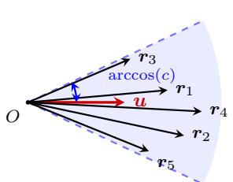
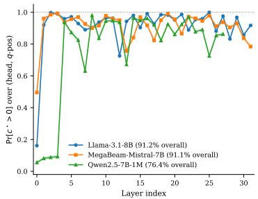
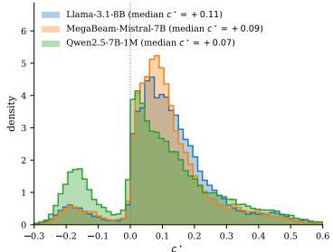
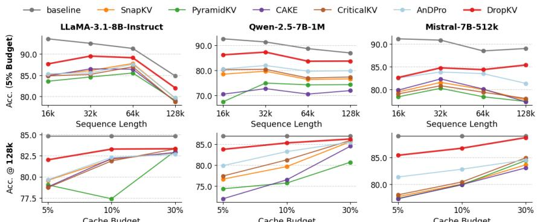
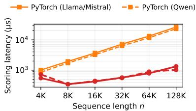
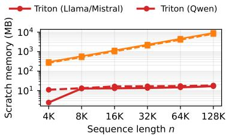
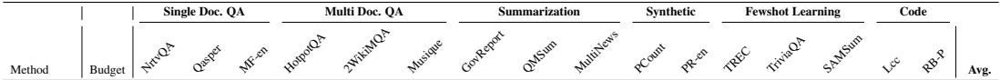
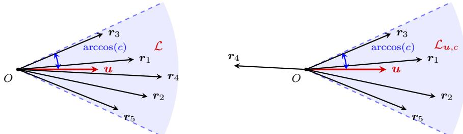

# DropKV: Decoupling Residual-Output Perturbation for Near-Optimal KV-Cache Eviction

Aozhong Zhang1 Selcuk Gurses1 Yanxia Deng3 Naigang Wang2 Chi-Chun Liu2 Davis Wertheimer2 Derrick Liu2 Xin Li1 Zi Yang1 Felix X.-F. Ye1∗ Penghang Yin1∗

1University at Albany, SUNY 2IBM T. J. Watson Research Center 3Northwestern University {azhang3, sgurses, xli48, zyang8, xye2, pyin}@albany.edu {nwang, cliu}@us.ibm.com {Davis.Wertheimer, dliu}@ibm.com yanxia.deng@kellogg.northwestern.edu https://github.com/AozhongZhang/DropKV

## Abstract

Key-value (KV) cache management has become a critical bottleneck for scaling Large Language Models (LLMs) to long-context scenarios due to linear memory growth. While recent eviction methods have moved beyond simple attention-score heuristics to incorporate value representations, they typically face a fundamental trade-off: the underlying optimization for minimizing output perturbation is an NP-hard combinatorial problem, leading to mathematically suboptimal heuristics or implementations that are difficult to kernelize. In this work, we propose DropKV, a simple principled eviction framework based on Decoupled Residual-Output Perturbation. By decoupling the joint eviction decision into independent per-token scoring, DropKV circumvents combinatorial intractability and admits a provable constant-factor approximation guarantee under a cone condition that we empirically verify on three long-context LLMs. To ensure practical viability, we provide a highperformance implementation using fused Triton kernels that avoid materializing the full attention matrix, delivering a 19.8× scoring-kernel speedup that translates to up to a 9.9% matched-batch end-to-end prefill speedup. Extensive evaluations on the RULER and LongBench benchmarks demonstrate that DropKV consistently outperforms state-of-the-art baselines at equivalent cache budgets, achieving the lowest inference latency among eviction methods while also remaining faster than the dynamic cache baseline.

## 1 Introduction

Large Language Models (LLMs) [2, 17, 25, 43, 52] are now deployed across code, scientific, and conversational tasks. As these models are increasingly used on long-form content such as entire codebases or lengthy transcripts, the underlying hardware efficiency becomes paramount. Autoregressive inference in transformer-based language models [46] relies heavily on key-value (KV) caching, which stores previously computed key and value projections to avoid redundant attention computation during the decoding phase. This mechanism effectively trades increased memory usage for significantly faster inference, making it a standard optimization in modern LLM inference systems. However, the KV cache memory requirement grows linearly with the sequence length and can become a prohibitive burden in long-context scenarios. For example, caching 128K tokens in a Phi-3-mini [1] model requires approximately 48 GB of memory in FP16 precision for the KV cache alone, which dwarfs the roughly 7 GB needed to store the whole model weights. This rapid expansion of the memory footprint leads to substantial GPU memory saturation and increased memory I/O overhead [54], making KV cache a critical bottleneck for scalable long-context inference.

To address this challenge, a growing body of work has been proposed to reduce the KV cache memory footprint, including quantization [22, 36], low-rank compression [7, 41], and eviction [5, 32, 37, 42, 54]. Among these methods, cache eviction has emerged as a practical solution that selectively retains only a small subset of tokens during inference. Existing eviction methods roughly fall into two categories. Query-agnostic methods evaluate importance based on intrinsic properties of the cache, independent of the current decoding state, such as token position [49], the $\ell _ { 2 } { \mathrm { - n o r m s } } \left[ 1 0 \right]$ or pairwise similarities [37] of the keys. These methods overlook the dynamic interaction between queries and cached keys. In contrast, query-aware methods leverage attention signals to identify critical KV pairs [32, 54]. While more adaptive, existing methods typically equate importance solely with attention weights. This perspective is incomplete, as it ignores the critical role of the associated values; even a token with a moderate attention score can significantly shift the final representation if its corresponding value vector has a large magnitude or unique direction.

More recent methods have sought to transcend attention-score-only criteria by incorporating value representations into their selection logic [13, 15] in a more principled manner. Specifically, they attempt to quantify the perturbation induced by cache eviction to the final attention output, in an effort to identify the optimal eviction set that minimizes the deviation from the original output. However, this underlying optimization is inherently an NP-hard combinatorial problem, forcing existing research to settle for mathematically suboptimal heuristics. Furthermore, as policy designs become increasingly intricate, it remains unclear whether these approaches can be efficiently kernelized, limiting their viability in production inference.

Contributions. In this work, we propose DropKV, a mathematically grounded and efficiently implemented KV-cache eviction framework. Specifically, our main contributions are as follows:

• Decoupled Perturbation Framework: We introduce a novel scoring mechanism that approximates the optimal eviction set by decoupling the NP-hard combinatorial search into a tractable per-token perturbation minimization with linear computational complexity.

• Theoretical Near-Optimality Guarantees: We prove that our decoupled proxy matches the optimal solution of the NP-hard problem up to a constant multiplicative factor under the cone condition, which we empirically verify on three long-context LLMs: Llama-3.1-8B, Mistral-7B-512K, and Qwen2.5-7B-1M.

• High-Performance Triton Implementation: We develop a suite of fused Triton kernels that compute eviction scores on-the-fly. By avoiding the materialization of the attention matrix, our implementation reduces the scoring-kernel scratch from ∼9 GB to ∼17 MB at n=128K, removing the prefill memory bottleneck and yielding end-to-end matched-batch prefill speedups.

• State-of-the-Art Performance: On RULER and LongBench at 5% and 10% cache budgets, DropKV achieves the highest accuracy and the lowest latency among query-aware and output-aware eviction baselines, while also remaining faster than the dynamic cache baseline.

## 2 Background and Related Work

## 2.1 Causal Attention and KV Cache

Transformer-based language models [46] rely on the self-attention mechanism to model long-range interactions among tokens in a sequence. Given an input matrix of hidden representations $\pmb { X } \in \mathbb { R } ^ { n \times d }$ the query, key, and value matrices are obtained via linear projections: $Q = \mathbf { \bar { \mathit { X } } } W _ { Q } \in \mathbb { R } ^ { n \times d } , \quad K =$ $\pmb { X } \pmb { W } _ { K } \in \mathbb { R } ^ { n \times d } , \quad \pmb { V } = \pmb { X } \pmb { W } _ { V } \in \mathbb { R } ^ { n \times d }$ , where $\ b { W _ { Q } , W _ { K } , W _ { V } } \in \mathbb { R } ^ { d \times d }$ are learnable projection matrices. The attention output is then computed as

$$
\pmb { A } : = \mathrm { s o f t m a x } \left( \frac { \pmb { Q K } ^ { \top } + \pmb { M } } { \sqrt { d } } \right) \pmb { V } \in \mathbb { R } ^ { n \times d } ,\tag{1}
$$

where $M \in \mathbb { R } ^ { n \times n }$ is a causal attention mask that prevents attending to future tokens. It is defined as $M _ { i j } = 0 { \mathrm { ~ i f ~ } } i \geq j$ , and −∞ otherwise. During autoregressive inference, the computation of self-attention proceeds in two phases: the prefill stage and the decoding stage.

In the prefill stage, the model processes the n-token prompt in a single forward pass via (1) and stores the resulting $\breve { K , } V \in \mathbb { R } ^ { n \times d }$ in the KV cache. In the decoding stage, given the cached $K _ { 1 : t } , V _ { 1 : t }$ each new token at step t+1 is generated from its query $\mathbf { \pmb { q } } _ { t + 1 }$ as

$$
\pmb { a } _ { t + 1 } ^ { \top } = \mathrm { s o f t m a x } \left( \pmb { q } _ { t + 1 } ^ { \top } \pmb { K } _ { 1 : t } ^ { \top } / \sqrt { d } \right) \pmb { V } _ { 1 : t } ,
$$

after which its key $k _ { t + 1 }$ and value ${ \mathbf { } } v _ { t + 1 }$ are appended to the cache.

## 2.2 KV-Cache Eviction

The challenge of efficient long-context inference has led to a variety of strategies for KV cache eviction. Early approaches relied on simple sliding windows [4] to maintain recent context, though these often risked losing critical historical information. To address this, StreamingLLM [49] introduced “attention sinks”, demonstrating that preserving a small set of initial tokens is helpful for maintaining the functionality of the attention mechanism. KNorm [10] retains tokens with smaller key norms, while KeyDiff [37] prefers tokens whose keys are more diverse in the representation space. KVzip [28] evaluates KV cache importance by prompting the model to reconstruct chunked contexts and aggregating the maximum attention weights received by the context keys. Methods like H2O [54] and Scissorhands [35] moved toward importance-based selection by utilizing accumulated attention scores to identify “heavy hitter” entries. This line of research culminated in state-of-the-art frameworks like SnapKV [32], which employs observation window-based accumulation and pooling operations to consolidate attention weights. More recently, the focus has expanded from token-level scoring to architectural optimization; for instance, AdaKV [12] and related budget-allocation methods [5, 38, 48, 51] dynamically redistribute cache capacity across different attention heads to better capture their unique characteristics. Despite these advancements, existing strategies remain largely empirical, relying almost exclusively on attention weights as a proxy for token importance.

Newer inquiries have begun to bridge this gap by incorporating value representations into the eviction logic [13, 15]. These methods can be viewed as output-aware eviction strategies that attempt to indirectly minimize the attention-output perturbation induced by token removal. For example, CriticalKV [13] seeks to minimize a loose upper-bound on the attention-output perturbation, while AnDPro [15] formulates the combinatorial perturbation minimization problem through a convex relaxation. DropKV instead scores tokens using the exact per-token output perturbation and further admits a constant-factor approximation guarantee for the original joint multi-token eviction problem under a cone condition (§4). See Appendix B for detailed comparisons with existing methods.

A separate line of work targets the same memory/bandwidth bottleneck without permanently removing tokens: dynamic sparse attention keeps the full KV cache and attends to only a subset per step (Quest [42], SparQ [39], Loki [40]), while SVD-based compression and offload methods retain all token positions but compress or stream the cache between GPU and CPU (ShadowKV [41], xKV [6], InfiniGen [30]). These approaches are orthogonal to the eviction track, in which DropKV operates: tokens are permanently removed and the resident cache footprint shrinks.

## 3 Method

## 3.1 Attention-Output Perturbation

Recall that in an autoregressive transformer with n input tokens, the attention output a for a query vector $\pmb q \in \mathbb { R } ^ { d }$ is computed as

$$
p = { \mathrm { s o f t m a x } } { \big ( } K q / { \sqrt { d } } { \big ) } \in \mathbb { R } ^ { n } , \quad a = V ^ { \top } p = \sum _ { i = 1 } ^ { n } p _ { i } { \boldsymbol { v } } _ { i } \in \mathbb { R } ^ { d } ,
$$

where K, $V \in \mathbb { R } ^ { n \times d }$ are the accumulated key and value projection matrices in the KV cache, $\pmb { v } _ { i } ^ { \top }$ is the i-th row vector of $V$ , and $p _ { i } \in ( 0 , 1 )$ is the i-th attention weight after softmax, satisfying $\textstyle \sum _ { i = 1 } ^ { n } p _ { i } \ = \ 1$ The following result quantifies the perturbation to the attention output, $\dot { \Delta ( J ) }$ associated with query $\pmb q$ induced by an index set $\mathcal { I }$ of evicted tokens. That is, the perturbation depends not only on the attention scores but also on the value residuals of the form ${ \mathbf { } } a - v _ { i }$

Lemma 1 (Perturbation). Suppose a set of tokens indexed by ${ \mathcal { I } } \subset [ n ]$ is evicted from the full KV cache, and let $\mathbf { \delta } _  \mathbf { \alpha } \mathbf { \delta } \mathbf { \alpha } \mathbf { \delta } \mathbf { \alpha } \mathbf { \delta } \mathbf { \alpha } \mathbf { \delta } \mathbf { \alpha } \mathbf { \delta } \mathbf { \alpha } \mathbf { \delta } \mathbf { \alpha } \mathbf { \delta } \mathbf { \alpha } \mathbf { \delta } \mathbf { \alpha } \mathbf { \delta } \mathbf { \alpha } \mathbf { \delta } \mathbf { \alpha } \mathbf { \delta } \mathbf { \alpha } \mathbf { \delta } \mathbf { \alpha } \mathbf { \delta } \mathbf { \alpha } \mathbf { \delta } \mathbf { \alpha } \mathbf { \delta } \mathbf { \alpha } \mathbf { \delta } \mathbf { \alpha } \mathbf { \delta } \mathbf { \alpha } \mathbf { \delta } \mathbf { \alpha } \mathbf { \delta } \mathbf { \alpha } \mathbf { \delta } \mathbf { \alpha } \mathbf { \delta } \mathbf { \alpha } \mathbf { \delta } \mathbf { \alpha } \mathbf { \delta } \mathbf { \alpha } \mathbf { \delta } \mathbf { \alpha } \mathbf { \delta } \mathbf { \alpha } \mathbf { \delta } \mathbf { \alpha } \delta \mathbf { \alpha } \delta \mathbf { \alpha } \delta \mathbf { \alpha } \delta \mathbf { \delta } \delta \mathbf { \alpha } \delta \delta \mathbf { \alpha } \delta \delta \mathbf { \delta } \delta \delta \mathbf \delta \mathbf { } \delta \delta \delta \mathbf \delta \delta \mathbf { } \delta \delta \delta \delta \delta \mathbf \delta \delta \delta \mathbf \delta \delta \delta \delta \delta \delta \mathbf \delta \delta \delta \delta \delta \delta \delta \delta \delta \delta \delta \delta \delta \delta \delta \delta \delta \delta \delta \delta \delta \delta \delta \delta \delta \delta \delta \delta \delta \delta \delta \delta \delta \delta \delta \delta \delta \delta \delta \delta \delta \delta \delta \delta \delta \delta \delta \delta \delta \delta \delta \delta \delta \delta \delta \delta \delta \delta \delta \delta \delta \delta \delta \delta \delta \delta \delta \delta \delta \delta \delta \delta \delta \delta \delta \delta \delta \delta \delta \delta \delta \delta \delta \delta \delta \delta \delta \delta \delta \delta \delta \delta \delta \delta \delta \delta \delta \delta \delta \delta \delta \delta \delta \delta \delta \delta \delta \delta \delta \delta \delta \delta \delta \delta \delta \delta \delta \delta \delta \delta \delta \delta \delta \delta \delta \delta \delta \delta \delta \delta \delta \delta \delta \delta \delta \delta \delta \delta $ denote the resulting attention output. Then the post-eviction shift $\Delta ( \mathcal { I } ) : = \pmb { a } _ { - \mathcal { I } } - \pmb { a }$

associated with the query q satisfies

$$
\Delta ( \mathcal { I } ) = \frac { \sum _ { i \in \mathcal { I } } p _ { i } ( \pmb { a } - \pmb { v } _ { i } ) } { 1 - P _ { \mathcal { I } } } ,
$$

where $\begin{array} { r } { P _ { \mathcal { T } } : = \sum _ { i \in \mathcal { I } } p _ { i } } \end{array}$ denotes the total attention weights associated with the evicted tokens. In particular,for $\mathcal { I } = \{ j \}$ , we have $\begin{array} { r } { \Delta ( \{ j \} ) = \frac { p _ { j } } { 1 - p _ { j } } \left( \pmb { a } - \pmb { v } _ { j } \right) } \end{array}$ for per-token eviction.

Crucially, all quantities necessary for evaluating $\Delta ( \mathcal { T } )$ can be precomputed prior to the execution of any eviction decision. Equivalent formulations of $\Delta ( \mathcal { I } )$ have appeared in recent studies [13, 15]. We include the full proof in Appendix C for self-containedness.

## 3.2 Combinatorial Objective and a Decoupled Proxy

To determine the optimal eviction set ${ \mathcal { T } } ^ { * }$ of k tokens, one seeks to solve the following combinatorial optimization problem:

$$
\mathcal { T } ^ { * } = \arg \operatorname* { m i n } _ { \mathcal { T } \subset [ n ] } \| \Delta ( \mathcal { I } ) \| _ { 2 } ,\tag{Exact}
$$

where $\begin{array} { r } { \| \Delta ( \mathcal { I } ) \| _ { 2 } = \frac { \| \sum _ { i \in \mathcal { I } } p _ { i } ( { \pmb a } - { \pmb v } _ { i } ) \| _ { 2 } } { 1 - P _ { \mathcal { I } } } } \end{array}$ . However, this optimization is NP-hard (Appendix C.1): bruteforce enumeration of the $\binom { n } { k }$ feasible subsets is infeasible even for moderate n and $k ,$ motivating a tractable proxy.

To circumvent this intractability, we propose a simple surrogate: select the k tokens that individually induce the smallest output perturbation. Formally, we perform a smallest topk selection, denoted by topk−, over the per-token perturbation loss:

$$
\begin{array} { r } { \hat { \mathcal { I } } = \arg \mathrm { t o p k } _ { j \in [ n ] } ^ { - } \left( \| \Delta ( \{ j \} ) \| _ { 2 } , k \right) , } \end{array}\tag{Proxy}
$$

where $\begin{array} { r } { \| \Delta ( \{ j \} ) \| _ { 2 } = \frac { p _ { j } } { 1 - p _ { j } } \big \| { \pmb a } - { \pmb v } _ { j } \big \| _ { 2 } } \end{array}$ is the perturbation norm from evicting only the j-th token. Since each per-token perturbation is independent, all n scores cost $O ( n d )$ in parallel, making (Proxy) dramatically more tractable than the combinatorial problem in (Exact).

Our proposed proxy decouples the joint eviction decision into independent per-token scoring by simply omitting the interactions among evicted tokens. While this independence assumption might seem crude, we prove theoretically in § 4 that it is surprisingly near-optimal under conditions commonly observed in practice. Specifically, when the attention weights $p _ { j }$ are small (Assumption 1) and the residual directions ${ \mathbf { } } a - v _ { j }$ are approximately aligned (Assumption 2), the proxy $\hat { \mathcal { I } }$ closely approximates the optimal eviction policy $\mathcal { T } ^ { * }$ in terms of perturbation loss (Theorem 1).

## 3.3 Multi-Query Aggregation

For each token $j ,$ , we define the importance score based on the cumulative eviction loss over an observation window of queries $\mathcal { Q } = \{ \pmb { q } ^ { ( t ) } \} _ { t = 1 } ^ { w }$ , similar to SnapKV [32]. Specifically, accounting for the dependence of the attention weight $p _ { j } ^ { ( t ) }$ and output $\mathbf { \pmb { a } } ^ { ( t ) }$ on the query $\pmb q ^ { ( t ) }$ , we score the $j \cdot$ -th token by total squared perturbation error across $\mathcal { Q } .$

$$
\mathrm { s c o r e } _ { j } : = \sum _ { t = 1 } ^ { w } \| \Delta ^ { ( t ) } ( \{ j \} ) \| _ { 2 } ^ { 2 } = \sum _ { t = 1 } ^ { w } \left( p _ { j } ^ { ( t ) } / ( 1 - p _ { j } ^ { ( t ) } ) \right) ^ { 2 } \| \pmb { a } ^ { ( t ) } - \pmb { v } _ { j } \| _ { 2 } ^ { 2 } .
$$

The squared form is a kernel-friendly surrogate: it enables the fused-tile implementation described in § 3.4, while at w=1 preserving the same topk− ranking as the unsquared proxy (Proxy). Theorem 1 establishes the constant-factor bound for the single-query proxy (Proxy); the multi-query case $( w > 1 )$ follows the standard observation-window practice [13, 32]. Proposition 1 (Appendix C) extends it to the multi-query score. Finally, tokens are ranked by their scores, and the k tokens with the smallest scores are selected for eviction:

$$
\mathrm { t o p k } _ { j \in [ n ] } ^ { - } \left( \mathrm { s c o r e } _ { j } , k \right) .\tag{DropKV}
$$

The pseudocode for DropKV is summarized in Algorithm 1.

## 3.4 Triton Kernel Implementation

A naïve PyTorch realization of Algorithm 1 materializes dense window-by-cache tensors per head: the attention weights have shape $w \times n ,$ and a direct broadcasted implementation of the valueresidual term forms w $\times n \times d$ intermediates. This memory and bandwidth pattern grows as $O ( w n d )$ and dominates the scoring path at long context. We replace it with three fused Triton kernels — a FlashAttention-2-style forward pass, the scoring kernel, and a split-K merge — that compute scorej in (DropKV) by streaming over key/value tiles without materializing the attention-weight or value-distance tensors.

The scoring kernel is the central contribution. Using the row-wise Log-Sum-Exp $\mathrm { L S E } ^ { ( t ) } : =$ log $\textstyle \sum _ { j = 1 } ^ { n } \exp ( { K \pmb q ^ { ( t ) } } / \sqrt { d } ) _ { j }$ produced by the forward pass [8], it streams over key tiles, recomputes logits $\mathrm { l o g i t } _ { j } = \pmb { k } _ { j } ^ { \top } \pmb { q } ^ { ( t ) } / \sqrt { d }$ on-the-fly, derives the attention weight $p _ { j } ^ { ( t ) } = \exp ( \log \mathrm { i t } _ { j } - \mathrm { L S E } ^ { ( t ) } )$ , and accumulates scorej $+ = \left( \boldsymbol { p } _ { j } ^ { ( t ) } / ( 1 - p _ { j } ^ { ( t ) } ) \right) ^ { 2 } \| \boldsymbol { a } ^ { ( t ) } - \boldsymbol { v } _ { j } \| _ { 2 } ^ { 2 }$ across query indices t. By precomputing $\| a ^ { ( t ) } \| _ { 2 } ^ { 2 }$ and $\| \pmb { v } _ { j } \| _ { 2 } ^ { 2 }$ once and using the identity $\| \pmb { a } - \pmb { v } \| _ { 2 } ^ { 2 } = \| \pmb { a } \| _ { 2 } ^ { 2 } + \| \pmb { v } \| _ { 2 } ^ { 2 } - 2 \langle \pmb { a } , \pmb { v } \rangle$ , each V tile is read only once per pass, substantially reducing I/O.

The auxiliary forward and split-K merge kernels follow standard FlashAttention-style online softmax; detailed pseudocode for the scoring kernel is in Appendix D. The fused path matches the PyTorch reference to within BF16 round-off, with a scoring-step speedup over the naïve PyTorch baseline that grows from 1.8× at $n = 4 \mathrm { K }$ to $1 9 . 8 \times$ at n = 128K (w = 8, A100-80GB; see Fig. 3 left).

Algorithm 1 DropKV: Decoupled Residual-Output Perturbation for KV-Cache Eviction.   
Require: keys $\ b { K } \in \mathbb { R } ^ { n \times d }$ , values $V \in \mathbb { R } ^ { n \times d }$ , query window $\mathcal { Q } = \{ \pmb { q } ^ { ( t ) } \} _ { t = 1 } ^ { w }$ , eviction size k,   
pooling kernel size κ   
Ensure: Eviction set ${ \widehat { \mathcal { I } } } \subseteq [ n ]$ with $| \widehat { \mathcal { I } } | = k$   
1: ∀ t ∈ [w] : $\mathbf { \boldsymbol { p } } ^ { ( t ) } \gets$ softmax $( K \dot { \pmb q } ^ { ( t ) } / \sqrt { d } ) , \pmb { a } ^ { ( t ) }  \pmb { V } ^ { \top } \pmb { p } ^ { ( t ) }$   
2: for $j = 1 , \dotsc , n$ do   
3: scorej $\textstyle  \sum _ { t = 1 } ^ { w } ( p _ { j } ^ { ( t ) } / ( 1 - p _ { j } ^ { ( t ) } ) ) ^ { 2 } \| \pmb { a } ^ { ( t ) } - \pmb { v } _ { j } \| _ { 2 } ^ { 2 }$   
4: end for   
5: score ← MaxPool1D(score, κ); scorej $ + \infty$ for $j \in \{ n { - } w { + } 1 , \ldots , n \}$   
6: $\hat { \mathcal { I } } \gets$ indices of the k smallest scorej   
7: return $\widehat { \mathcal { I } }$

## 4 Theoretical Guarantees

In this section, we establish formal guarantees for our proxy (Proxy). To make the analysis tractable and realistic, we restrict attention to eviction over a candidate pool ${ \mathcal { L } } \subseteq [ n ] ( \mathbf { e . g . }$ , the set of tokens with the lowest attention scores) and consider only subsets $\mathcal { I } \subseteq \mathcal { L }$ with exactly $| { \mathcal { I } } | = k$ . We begin with two assumptions and report their numerical verification in Appendix C.3.

Assumption 1 (Small Eviction Probabilities). There exists $\varepsilon \in ( 0 , 1 )$ with $k \varepsilon < 1$ such that $p _ { i } \leq \varepsilon$ $f o r a l l i \in \mathcal { L } .$

Under this condition, any set $\mathcal { I } \subseteq \mathcal { L }$ with $| { \mathcal { I } } | = k$ satisfies $\begin{array} { r } { P _ { \mathcal { T } } = \sum _ { i \in \mathcal { I } } p _ { i } \le k \varepsilon < 1 } \end{array}$ . When ε is small (as is typical for low-attention tokens selected for eviction), $P _ { \mathcal { I } }$ remains negligible. Next, we impose a directional alignment condition on the residual vectors $\pmb { r } _ { i } : = \pmb { a } - \pmb { v } _ { i } \in \bar { \mathbb { R } } ^ { d }$ for $i \in \mathcal { L }$

Assumption 2 (Cone Condition). There exist a unit vector u $\in \mathbb { R } ^ { d }$ with $\| \pmb { u } \| _ { 2 } = 1$ and a constant $c \in ( 0 , 1 ]$ such that u $^ { \top } { \pmb r } _ { i } \geq c \| { \pmb r } _ { i } \| _ { 2 }$ $\forall i \in { \mathcal { L } }$

Intuitively, the cone condition requires the perturbations induced by different token removals to be sufficiently aligned rather than adversarially canceling each other. Our main result, Theorem 1, shows that, under these assumptions, restricting the top-k selection in (Proxy) to the candidate pool L yields a near-optimal objective value in (Exact). It provides an approximation matching the optimal solution of the NP-hard problem (Exact) up to a constant multiplicative factor. The full proof is deferred to Appendix C.

Theorem 1 (Near-Optimality). Let ${ \mathcal { I } } ^ { * } = \mathrm { a r g }$ min $\{ F ( \mathcal { I } ) : = \| \Delta ( \mathcal { I } ) \| _ { 2 } : \mathcal { I } \subseteq \mathcal { L } , | \mathcal { I } | = k \}$ be the optimal eviction set and $\hat { \mathcal { I } } = \arg \mathrm { t o p k } _ { j \in \mathcal { L } } ^ { - } \left( \| \Delta ( \{ j \} ) \| _ { 2 } , k \right)$ the proxy. Under Assumptions 1 and 2, we have

$$
F ( \hat { \mathcal { I } } ) \leq \frac { 1 } { c ( 1 - \varepsilon ) ( 1 - k \varepsilon ) } F ( \mathcal { I } ^ { * } ) .
$$

Proposition 1 in Appendix C extends Theorem 1 to the multi-query score (DropKV), under the same assumptions imposed on each query.

Numerical Verification of the Assumptions. Appendix C.3 reports the small-weight statistics for Assumption 1. We verify Assumption 2 on real prefill passes at the RULER deployment length $n = 1 2 8 \mathrm { K }$ across our three target long-context models: Llama-3.1-8B-Instruct [17], MegaBeam-Mistral-7B-512K [47], and Qwen2.5-7B-Instruct-1M [50]. For each (layer, head, query-position) triple, we compute the cone constant:

$$
c ^ { \star } : = \operatorname* { m a x } _ { \| \boldsymbol { u } \| = 1 } \operatorname* { m i n } _ { i \in \mathcal { L } } \frac { \boldsymbol { u } ^ { \top } \boldsymbol { r } _ { i } } { \| \boldsymbol { r } _ { i } \| _ { 2 } } ,
$$

where L is the candidate eviction pool; Assumption 2 holds at a given triple iff $c ^ { \star } > 0 .$ . As shown in Fig. $1 \ ( \mathrm { b } ) \& ( \mathrm { c } ) , \ c ^ { \star } > 0$ on 91.2%, 91.1%, and 76.5% of triples for Llama, Mistral, and Qwen2.5, respectively, with median $c ^ { \star } = + 0 . 1 0 7$ , +0.094, +0.074. Imposing both preconditions of Theorem 1 simultaneously $( c ^ { \star } > 0$ and $1 - k \varepsilon > 0 )$ leaves a finite multiplicative factor on 89.1%, 87.5%, and 73.4% of triples (Table 18); conditional on these preconditions, the realized factor $1 / [ c ( 1 - \varepsilon ) ( 1 - k \varepsilon ) ]$ has median 10.4, 11.8, and 11.3 across the three models (full distribution in the same table). A direct brute-force study on small subsets of L shows the empirical approximation ratio is in fact much smaller than this worst-case bound (median $F ( \hat { \mathcal { I } } ) / F ( \mathcal { T } ^ { * } ) \leq 1$ .16 and 95th percentile $\leq 1$ .43 across all three models; Appendix C.3, Table 19). Per-layer prevalence stays high from Layer 1 onward on Llama and Mistral; Llama Layer $0 ( \approx 1 6 \% )$ and Qwen2.5 Layers 0–3 (below 10%) exhibit pronounced early-layer dips (Fig. 1 b).

  
(a) Cone holds: $\exists c > 0$ and ${ \mathbf { } } ^ { \mathbf { } } \mathbf { \Delta } ^ { \mathbf { } } \mathbf { u } .$

  
all $\mathbf { \nabla } _ { \mathbf { \boldsymbol { r } } _ { i } }$ stay within arccos(c) of u. (b) Per-layer prevalence $\mathrm { P r } [ c ^ { \star } > 0 ]$  
(c) Distribution of $c ^ { \star }$  
Figure 1: Cone condition: definition and empirical verification at $n { = } 1 2 8 \mathrm { K }$ on three long-context models. (a) Residuals $\pmb { r } _ { i } : = \pmb { a } - \pmb { v } _ { i }$ inside a cone of half-angle arccos(c) about a single direction $^  \mathbf { } \mathbf { } ^ { } \mathbf { } ^ { } \mathbf { } ^ { } \mathbf { } ^ { } \mathbf { } ^ { } \mathbf { } ^ { } \mathbf { } ^ { } \mathbf { } ^ { } \mathbf { } ^ { } \mathbf { } ^ { } \mathbf { } ^ { } \mathbf { } ^ { } \mathbf { } ^ { } \mathbf { } ^ { } \mathbf { } ^ { } \mathbf { } ^ { } \mathbf { } ^ { } \mathbf { } ^ { } \mathbf { } ^ { } \mathbf { } ^ { } \mathbf { } ^ { } \mathbf { } ^ { } \mathbf { } ^ { } \mathbf { } ^ { } \mathbf { } ^ { } \mathbf { } ^ { } \mathbf { } ^ { } \mathbf { } ^ { } \mathbf { } ^ { } \mathbf { } ^ { } \mathbf { } ^ { } \mathbf { } ^ { } \mathbf { } ^ { } \mathbf { } ^ { } \mathrm { } \mathbf { } ^ { } \mathbf { } ^ { } \mathrm { } \mathbf { } ^ { } \mathrm { } \mathbf { } ^ { } \mathrm { } \mathbf { } ^ { } \mathrm { } \mathbf { } ^ { } \mathrm { } \mathbf { } ^ { } \mathrm { } \mathbf { } ^ { } \mathrm { } \mathbf { } ^ { } \mathrm { } \mathbf { } ^ { } \mathrm { } \mathbf { } ^ { } \mathrm { } \mathrm \mathrm { } \mathbf { } ^ { } \mathrm { } \mathrm \mathrm { } \mathbf { } ^ { } \mathrm \mathrm { } \mathrm \mathrm { } \mathbf { } \mathrm { } \mathrm \mathrm { } \mathrm \mathrm { } \mathrm \mathbf { } \mathrm { } \mathrm \mathrm { } \mathrm \mathrm { } \mathrm \mathrm { } \mathrm \mathrm \mathrm { } \mathrm \mathrm { } \mathrm \mathrm \mathrm { } \mathrm \mathrm { } \mathrm \mathrm \mathrm { } \mathrm \mathrm \mathrm { } \mathrm \mathrm \mathrm { } \mathrm \mathrm \mathrm { } \mathrm \mathrm \mathrm \mathrm { } \mathrm \mathrm \mathrm \mathrm { } \mathrm \mathrm \mathrm \mathrm { } \mathrm \mathrm \mathrm \mathrm \mathrm { } \mathrm \mathrm \mathrm \mathrm { } \mathrm \mathrm \mathrm \mathrm \mathrm \mathrm { } \mathrm \mathrm \mathrm \mathrm \mathrm \mathrm { } \mathrm \mathrm \mathrm \mathrm \mathrm \mathrm \mathrm { }$ so no positive combination cancels to zero. (b) Layerwise prevalence of $c ^ { \star } > 0$ across (head, query-position) triples, with binomial standard-error bands. (c) Distribution of $c ^ { \star }$ per model; mass to the right of the dotted line at $c ^ { \star } { = } 0$ is the cone-holds region.

Robustness Analysis. When the cone condition does not strictly hold, a relaxed approximate cone condition (Assumption 3 in Appendix C.4) bounds the weighted mass of outlier residuals by some $\mu \geq 0$ . Under Assumption 1 and this relaxed condition, the proxy satisfies the additive bound

$$
F ( \hat { \mathcal { I } } ) \leq \frac { 1 } { c ( 1 - \varepsilon ) ( 1 - k \varepsilon ) } \Big ( F ( \mathcal { I } ^ { * } ) + ( 1 + c ) \mu \Big ) ,
$$

which recovers Theorem 1 when $\mu = 0$ . The full statement and proof are given in Appendix C.4.

## 5 Experiments

We evaluate our method on multiple long-context language models, benchmarks, and competitive baselines to examine its effectiveness across different architectures and context regimes.

Models and Baselines. We evaluate on three representative decoder-only LLMs: Llama-3.1- 8B-Instruct [17], MegaBeam-Mistral-7B-512K [47] (Mistral-7B-512K), and Qwen2.5-7B-Instruct-1M [50]. Mistral-7B-512K is a long-context extension of Mistral-7B-Instruct-v0.2 that supports context lengths up to 512K tokens, and Qwen2.5-7B-Instruct-1M is the long-context version of Qwen2.5 with a maximum context length of 1M tokens. We compare against a broad set of competitive baselines, including SnapKV [32], PyramidKV [5], StreamingLLM [49], KeyDiff [37], CAKE [38], CriticalKV [13], and AnDPro [15]. For each method, we follow the default settings in the original paper whenever possible and only adjust the cache budget to enable matched-budget comparison.2

Benchmarks. We use two widely adopted long-context benchmarks: RULER [23] and Long-Bench [3]. RULER is a synthetic benchmark with configurable sequence lengths and task complexity for evaluating long-context capabilities beyond simple in-context recall. LongBench is a multitask benchmark covering single-document QA, multi-document QA, summarization, few-shot learning, synthetic tasks, and code completion, with automatic evaluation for scalable assessment. We use the 16 English and code tasks from LongBench. The full task lists are provided in Appendix E.

Implementation details. We compare all methods and report results at 5%, 10% and 30% KV-cache budgets. Following SnapKV [32], we use the last 8 query tokens and set the pooling kernel size to 11 when computing the eviction scores. All experiments are conducted on an NVIDIA A100-80GB GPU and evaluated within a unified lm-evaluation-harness [14] pipeline to ensure a consistent and fair comparison across methods.

Table 1: RULER results at 128K sequence length and 5% KV-cache budget. On the Avg. column, the best result is bolded and the second-best is underlined; the DropKV row is shaded gray for emphasis.
<table><tr><td>Method</td><td>Budget</td><td>N-S1</td><td>N-S2</td><td>N-S3</td><td>N-MK1</td><td>N-MK2</td><td>N-MQ</td><td>N-MV</td><td>VT</td><td>FWE</td><td>QA-1</td><td>QA-2</td><td>Avg.</td></tr><tr><td colspan="10">LLaMA-3.1-8B-Instruct</td><td></td><td></td><td></td><td></td></tr><tr><td>Full KV</td><td>100%</td><td>100</td><td>99.2</td><td>99.6</td><td>97.6</td><td>88.2</td><td>98.7</td><td>95.85</td><td>84</td><td>61.93</td><td>64.17</td><td>44</td><td>84.84</td></tr><tr><td>SnapKV</td><td></td><td>100</td><td>99</td><td>71.4</td><td>97.6</td><td>76.2</td><td>98.6</td><td>95.75</td><td>76.92</td><td>52.53</td><td>64.03</td><td>43.2</td><td>79.57</td></tr><tr><td>PyramidKV</td><td></td><td>100</td><td>99.4</td><td>62.4 4.8</td><td>97.4</td><td>74.2 5</td><td>98.6</td><td>94.7</td><td>78.36</td><td>54.86</td><td>63.9</td><td>45.6</td><td>79.04</td></tr><tr><td>StreamingLLM</td><td></td><td>4.4</td><td>4.2</td><td></td><td>5.6</td><td>0</td><td>5.05</td><td>5</td><td>4.9</td><td>73.4</td><td>37.48</td><td>37.4</td><td>17.02</td></tr><tr><td>KeyDiff</td><td>5%</td><td>100</td><td>98.4</td><td>16.6</td><td>81.6</td><td></td><td>78.3</td><td>75.55</td><td>80.2</td><td>26.6</td><td>42.58</td><td>36.8</td><td>57.88</td></tr><tr><td>CAKE</td><td></td><td>100 100</td><td>99</td><td>78.4</td><td>97.4</td><td>74.2</td><td>98.05</td><td>92.95</td><td>75.28</td><td>44.73</td><td>63.63</td><td>43.2</td><td>78.80</td></tr><tr><td>CriticalKV</td><td></td><td>100</td><td>99 99</td><td>69.2 68.4</td><td>97.6</td><td>75.6</td><td>98.55</td><td>95.2</td><td>77.4</td><td>46.67</td><td>63.9</td><td>42.8</td><td>78.72</td></tr><tr><td>AnDPro</td><td></td><td></td><td></td><td></td><td>97.4</td><td>78.4</td><td>98.75</td><td>96</td><td>76.52</td><td>54.53</td><td>63.76</td><td>43.4</td><td>79.65</td></tr><tr><td>DropKV</td><td></td><td>100</td><td>98.8</td><td>89.6</td><td>97.6</td><td>86.2</td><td>98.25</td><td>96.9</td><td>77.32</td><td>49.73</td><td>64.17</td><td>43.4</td><td>82.00</td></tr><tr><td colspan="10">Qwen2.5-7B-Instruct-1M</td><td colspan="3"></td><td></td></tr><tr><td>Full KV</td><td colspan="3">100% 100</td><td>99.6</td><td>99.8</td><td>98.2</td><td>99.9</td><td>78.9</td><td>95.6</td><td>81.13</td><td>57</td><td>47</td><td>87.01</td></tr><tr><td>SnapKV</td><td rowspan="7"></td><td>100</td><td>100</td><td>16.4 4</td><td>99.6</td><td>86.2</td><td>99.55</td><td>77.1</td><td>96.2</td><td>66.4</td><td>56.05</td><td>46</td><td>76.68</td></tr><tr><td>PyramidKV</td><td></td><td>100 100 4.6</td><td>4.8</td><td>99.6 5.2</td><td>78.6</td><td>99.55</td><td>77.25</td><td>96.16</td><td>62.87</td><td>55.78</td><td>44.4</td><td>74.38</td></tr><tr><td>StreamingLLM</td><td>5%</td><td>4.8 100</td><td></td><td></td><td>4.8</td><td>4.65</td><td>4.8</td><td>7.35</td><td>81.6</td><td>28.1</td><td>35.6</td><td>16.94</td></tr><tr><td>KeyDiff</td><td></td><td>98.2</td><td>63.8</td><td></td><td>0.4</td><td>53.8</td><td>51.7</td><td>94.64</td><td>55.93</td><td>25.88</td><td>22.6</td><td>57.36</td></tr><tr><td>CAKE</td><td>100</td><td>100</td><td>25.6</td><td>99.6</td><td>25.8</td><td>99.6</td><td>76.45</td><td>96.2</td><td>65.67</td><td>56.47</td><td>46.6</td><td>72.00</td></tr><tr><td>CriticalKV</td><td>100 99.8</td><td>100 99.8</td><td>22.6</td><td>99.8</td><td>88.2</td><td>99.55</td><td>77.15</td><td>96.48</td><td>64.93</td><td>56.38</td><td>46.6</td><td>77.43</td></tr><tr><td>AnDPro DropKV</td><td>100</td><td></td><td>45.8 81.6</td><td>99.6</td><td>90</td><td>99.6 99.7</td><td>77.25</td><td>96.4</td><td>66.93</td><td>57.73</td><td>46</td><td>79.90</td></tr><tr><td></td><td></td><td></td><td>99.6</td><td>99.2</td><td colspan="3">97.4</td><td>77.15</td><td>96.64</td><td>67.33</td><td>57.07</td><td>45.8</td><td>83.77</td></tr><tr><td colspan="10">Mistral-7B-512K 100 99.6 99.2</td><td></td><td></td><td></td><td></td></tr><tr><td>Full KV</td><td colspan="3">100%</td><td>100</td><td colspan="3">100</td><td>75.4</td><td>96.48</td><td>90.8</td><td>68.78</td><td>49</td><td>89.02</td></tr><tr><td>SnapKV</td><td rowspan="7"></td><td>100 100</td><td>95.6</td><td>42.2 36</td><td>98</td><td>47.8</td><td>97.5</td><td>77.3</td><td>93.64</td><td>87.33</td><td>68.18</td><td>47.4</td><td>77.72</td></tr><tr><td>PyramidKV</td><td></td><td>95.8</td><td></td><td>98.4</td><td>46.2</td><td>98.1</td><td>78.6</td><td>94.56</td><td>87.93</td><td>68.25</td><td>47.4</td><td>77.39</td></tr><tr><td>StreamingLLM</td><td></td><td>6.4</td><td>7.8</td><td>7.2</td><td>6</td><td>6.05</td><td>6.2</td><td>7.68</td><td>91.2</td><td>33.23</td><td>32.2</td><td>19.05</td></tr><tr><td>KeyDiff</td><td>5.6 100</td><td>64.8</td><td>20</td><td>46.6</td><td>1.2</td><td>27.35</td><td>31.95</td><td>93.36</td><td>73</td><td>34.8</td><td>19.6</td><td>46.61</td></tr><tr><td>CAKE</td><td>100</td><td>97.2</td><td>56.8</td><td>97.6</td><td>29</td><td>97.85</td><td>78</td><td>93.24</td><td>84.93</td><td>68.12</td><td>47.8</td><td>77.32</td></tr><tr><td>CriticalKV</td><td>100</td><td>98</td><td>42.2</td><td>99.4</td><td>47.4</td><td>97.55</td><td>78.05</td><td>93.48</td><td>86.87</td><td>68.32</td><td>47.4</td><td>78.06</td></tr><tr><td>AnDPro</td><td>100</td><td>98.4</td><td>56.2</td><td>99.2</td><td>62.2</td><td>98.35</td><td>80.2</td><td>94.12</td><td>90.06</td><td>68.97</td><td>47.4</td><td>81.37</td></tr><tr><td>DropKV</td><td></td><td>100</td><td>96.4</td><td>76.4</td><td>99</td><td>92.2</td><td>97.05</td><td>79.95</td><td>93.48</td><td>88.93</td><td>68.63 47.4</td><td>85.40</td></tr></table>

## 5.1 RULER

We evaluate all methods on the RULER across sequence lengths from 16K to 128K. Fig. 2 shows accuracy across sequence lengths at 5% budget (top) and across cache budgets at 128K (bottom). Table 1 reports the detailed 128K results at 5% budget. Overall, our method consistently achieves the best performance across all three model families and remains the closest to the Full-KV baseline.

At as low as 5% budget, our method achieves the highest average accuracy on all models: 82.00 on Llama-3.1-8B-Instruct, 83.77 on Qwen2.5-7B-1M, and 85.40 on Mistral-7B-512K. Compared with the best competing baseline, this corresponds to gains of 2.35, 3.87, and 4.03 points, respectively.

  
Figure 2: Average accuracy on RULER. Top: 5% budget at varying sequence lengths. Bottom: varying cache budgets at 128K sequence length. Our method consistently outperforms baselines and shows more graceful degradation at longer contexts.

Fig. 2 further shows that the advantage of our method is consistent across context lengths. In particular, under high compression, competing methods exhibit a much sharper degradation as the sequence length increases, whereas our method degrades more gracefully and consistently outperforms prior approaches. This trend is especially clear at 128K, where our method preserves accuracy significantly better across all three models. For brevity, Table 1 presents the representative 128K results at 5% budget. Additional RULER results are provided in Appendix A, including full per-task breakdowns as well as evaluations across different cache budget and sequence lengths; See Table 5–8.

## 5.2 LongBench

Table 2 reports the LongBench results at 5% KV-cache budget. Our method achieves the highest average score on all three model families, reaching 45.51 on Llama-3.1-8B-Instruct, 42.66 on Qwen2.5-7B-1M, and 36.22 on Mistral-7B-512K. Compared with the strongest baseline, this gives improvements of 0.87, 0.94, and 0.68 points, respectively.

These results show that our method remains effective across a diverse set of LongBench tasks under aggressive compression ratio. In addition to the gains in the overall average, our method also performs competitively on multiple task categories. In the main paper, we only report the results at 5% budget in Table 2; additional results are provided in Appendix A (Table 9 & 10).

Table 2: LongBench results at 5% KV-cache budget.
<table><tr><td rowspan="2"></td><td colspan="3">Single Doc. QA</td><td colspan="3">Multi Doc. QA</td><td colspan="3">Summarization</td><td colspan="2">Synthetic</td><td colspan="3">Fewshot Learning</td><td colspan="3">Code</td></tr><tr><td>NrtvQA</td><td>Qasper</td><td>MF-en</td><td>HotpotQA</td><td>2WikiMQA</td><td>Musique</td><td>GovReport</td><td>QMSum</td><td>MultiNews</td><td>PCount</td><td>PR-en</td><td>TREC</td><td>TriviaQA</td><td>SAMSum</td><td>Lcc</td><td>RB-P</td><td></td></tr><tr><td colspan="10"></td><td colspan="10"></td></tr><tr><td>FullKV</td><td>30.51</td><td>45.59</td><td>56.34</td><td>58.22</td><td>50.02</td><td>31.75</td><td>34.3</td><td>LLaMA-3.1-8B-Instruct 25.33</td><td>26.76</td><td>9.5</td><td>100</td><td>73.5</td><td>92.29</td><td>43.96</td><td></td><td>64.77</td><td></td><td>49.91</td></tr><tr><td>SnapKV</td><td>30.34</td><td>31.51</td><td>54.45</td><td>56.95</td><td>47.34</td><td>29.8</td><td>22.64</td><td>24.62</td><td>16.03</td><td>9.5</td><td>100</td><td>39</td><td>92.03</td><td></td><td>42.18</td><td>58.82</td><td>55.7 54.97</td><td>44.39</td></tr><tr><td>PyramidKV</td><td>31.08</td><td>31.42</td><td>54.37</td><td>56.92</td><td>47.34</td><td>30.62</td><td>22.4</td><td>24.27</td><td>16.33</td><td>9.5</td><td>100</td><td>39.5</td><td>91.92</td><td></td><td>42.46</td><td>59.44</td><td>54.27</td><td>44.49</td></tr><tr><td>StreamingLLM</td><td>25.91</td><td>21.94</td><td>33.16</td><td>49.06</td><td>41.35</td><td>23.91</td><td>21.67</td><td>21.5</td><td>16.86</td><td></td><td>97</td><td>26.5</td><td>84.55</td><td></td><td>41.9</td><td>58.02</td><td>49.83</td><td>38.92</td></tr><tr><td>KeyDiff</td><td>27.93</td><td>27.17</td><td>38.52</td><td>51.92</td><td>36.8</td><td>26.54</td><td>23.02</td><td>22.91</td><td>18.31</td><td>95</td><td>63.5</td><td>30.5</td><td>78.52</td><td></td><td>22.36</td><td>32.21</td><td>31.65</td><td>33.84</td></tr><tr><td>CAKE</td><td>30.41</td><td>33.54</td><td>54.79</td><td>57.09</td><td>48.29</td><td>31.07</td><td>23.54</td><td>24.36</td><td>17.33</td><td></td><td>100</td><td>37</td><td>91.05</td><td></td><td>42.54</td><td>58.58</td><td>53.7</td><td>44.55</td></tr><tr><td>CriticalKV</td><td>30.03</td><td>31.07</td><td>54.55</td><td>57.33</td><td>47.15</td><td>30.09</td><td>23.16</td><td>23.92</td><td>18.46</td><td>95</td><td>100</td><td>41</td><td>92.03</td><td></td><td>42.14</td><td>59.25</td><td>54.54</td><td>44.64</td></tr><tr><td>AnDPro DropKV</td><td>30.97 30.48</td><td>32.06 32.49</td><td>54.44</td><td>57.62</td><td>46.44</td><td>31.53</td><td>22.92</td><td>24.25</td><td>17.98</td><td>9.25</td><td>100</td><td>38</td><td>91.65</td><td></td><td>41.86</td><td>58.58</td><td>54.9</td><td>44.53</td></tr><tr><td></td><td></td><td></td><td>55.34</td><td>57.29</td><td>46.84</td><td>31.25</td><td>23.71 Qwen2.5-7B-Instruct-1M</td><td>24.94</td><td>18.7</td><td>9.5</td><td>100</td><td>48.5</td><td>92.27</td><td></td><td>43.06</td><td>60.29</td><td>53.47</td><td>45.51</td></tr><tr><td colspan="10"></td><td colspan="10"></td></tr><tr><td>FullKV</td><td>28.88</td><td>48.39</td><td>51.57</td><td>60.27</td><td>53.19</td><td>35.63</td><td>33.33</td><td>23.22</td><td>24.53</td><td>6.5</td><td>100</td><td>66.5</td><td></td><td>85.28</td><td>45.29</td><td>45.61</td><td>35.31</td><td>46.47</td></tr><tr><td>SnapKV</td><td>27.76</td><td>35.9</td><td>48.74</td><td>59.15</td><td>51.51</td><td>34.19</td><td>23.42</td><td>22.32</td><td>13.13</td><td>6.5</td><td>100</td><td>33</td><td></td><td>84.66</td><td>44.2</td><td>38.75</td><td>34.47</td><td>41.11</td></tr><tr><td>PyramidKV</td><td>27.19</td><td>34.45</td><td>48.49</td><td>57.01</td><td>51.57</td><td>32.37</td><td>22.67</td><td>21.5</td><td>13.09</td><td>5.5</td><td>99</td><td>33.5</td><td>84.93</td><td></td><td>43.55</td><td>38.46</td><td>33.07</td><td>40.40</td></tr><tr><td>StreamingLLM</td><td>21.48</td><td>28.86</td><td>27.5</td><td>47.08</td><td>42.58</td><td>22.99</td><td>21.86</td><td>18.51</td><td>13.97</td><td>6.5</td><td>16.5</td><td>27</td><td>80.62</td><td></td><td>42.26</td><td>37.84</td><td>32.34</td><td>30.49</td></tr><tr><td>KeyDiff</td><td>20.48</td><td>24.5</td><td>21.94</td><td>38.44 59.59</td><td>25.67 52.14</td><td>17.35</td><td>21.19</td><td>17.17</td><td>12.11</td><td>6.5</td><td>13</td><td>19.5</td><td>42.65</td><td></td><td>13.11</td><td>20.75</td><td>18.96</td><td>20.83</td></tr><tr><td>CAKE</td><td>28.75 28.31</td><td>38.51 38.22</td><td>49.22 48.83</td><td>57.63</td><td>51.99</td><td>33.85 34.11</td><td>24.12 24.4</td><td>22.59 22.35</td><td>14.08 14.83</td><td>77</td><td>100 100</td><td>36 36.5</td><td>84.71</td><td></td><td>44.35</td><td>37.53</td><td>35.06</td><td>41.72</td></tr><tr><td>CriticalKV</td><td>28.61</td><td>36.11</td><td>49.88</td><td>59.44</td><td>50.87</td><td>34.56</td><td>23.61</td><td>22.24</td><td>14.22</td><td></td><td>100</td><td>37.5</td><td>84.61 84.71</td><td></td><td>43.83</td><td>38.59</td><td>34.73</td><td>41.52</td></tr><tr><td>AnDPro DropKV</td><td>28.28</td><td>39.09</td><td>50.54</td><td>58.87</td><td>51.6</td><td>33.93</td><td>25.25</td><td></td><td></td><td>6.5</td><td></td><td>48.5</td><td></td><td></td><td>44.21</td><td>38.08</td><td>34.76</td><td>41.58</td></tr><tr><td></td><td></td><td></td><td></td><td></td><td></td><td></td><td></td><td>21.42</td><td>15.36</td><td>7</td><td>100</td><td></td><td>85.06</td><td></td><td>44.85</td><td>38.95</td><td>33.88</td><td>42.66</td></tr><tr><td colspan="10">Mistral-7B-512K</td><td colspan="10"></td></tr><tr><td>FullKV</td><td>22.04</td><td>16.47</td><td>42.75</td><td>24.06</td><td>20.72</td><td>13.04</td><td>33.35</td><td>25.25</td><td>26.97</td><td>0</td><td>100</td><td>74.5</td><td>89.55</td><td></td><td>41.69</td><td>55.54</td><td>56.39</td><td>40.15</td></tr><tr><td>SnapKV PyramidKV</td><td>21.39 20.4</td><td>10.98 11.25</td><td>41.92 42.22</td><td>18.68 19.62</td><td>16.25 15.67</td><td>9.21 8.3</td><td>23.38 23.34</td><td>24.53 24.74</td><td>17.4 17.18</td><td>0 0</td><td>100 100</td><td>38.5 38.5</td><td>90.3 90.13</td><td></td><td>39.23 39.09</td><td>50.64 50.67</td><td>53.6 52.81</td><td>34.75 34.62</td></table>

## 5.3 Extended Results with Adaptive Head Budget

To evaluate Dropkv under adaptive compression constraints, Table 3 presents results on RULER (at 64K sequence length) and LongBench across different KV-cache budgets (5%, 10%, and 30%). We implement AdaDropKV, which adopts the head budget allocation strategy of AdaKV while utilizing DropKV’s token-scoring mechanism. AdaDropKV consistently outperforms competing adaptive baselines (such as CAKE, AdaKV, and AnDPro) across both model architectures. Additional result are provided in Appendix A, including full per-task breakdowns as well as evaluations across different cache budget and sequence lengths; See Table 11 & 12.

Table 3: Average scores on RULER (64K sequence length) and LongBench across different KV-cache budgets (5%, 10%, and 30%). The best result is highlighted in bold.
<table><tr><td rowspan="2">Method</td><td colspan="3">RULER</td><td colspan="3">LongBench</td></tr><tr><td>5%</td><td>10%</td><td>30%</td><td>5%</td><td>10%</td><td>30%</td></tr><tr><td colspan="7">LLaMA-3.1-8B-Instruct</td></tr><tr><td>Full KV</td><td>91.35</td><td>91.35</td><td>91.35</td><td>49.91</td><td>49.91</td><td>49.91</td></tr><tr><td>CAKE AdaKV</td><td>86.43 88.19</td><td>89.67 90.03</td><td>90.93 91.03</td><td>44.55 44.76</td><td>46.74 46.95</td><td>48.82 49.05</td></tr><tr><td>AnDPro AdaDropKV</td><td>87.57 90.08</td><td>90.01 90.54</td><td>91.17 91.30</td><td>44.53 46.45</td><td>46.95 48.43</td><td>49.06 49.47</td></tr><tr><td>Qwen2.5-7B-Instruct-1M</td><td></td><td></td><td></td><td></td><td></td><td></td></tr><tr><td></td><td></td><td></td><td></td><td></td><td></td><td></td></tr><tr><td>FullKV</td><td>88.73</td><td>88.73</td><td>88.73</td><td>46.47</td><td>46.47</td><td>46.47</td></tr><tr><td>CAKE</td><td>70.61</td><td>75.91</td><td>84.21</td><td>41.72</td><td>43.69</td><td>45.79</td></tr><tr><td>AdaKV</td><td>76.45</td><td>79.60</td><td>85.40</td><td>41.38</td><td>43.38</td><td>45.62</td></tr><tr><td>AnDPro</td><td>79.73</td><td>82.99</td><td>86.29</td><td>41.58</td><td>43.94</td><td>45.85</td></tr><tr><td></td><td></td><td>85.79</td><td>87.76</td><td>43.02</td><td></td><td></td></tr><tr><td>AdaDropKV</td><td>84.25</td><td></td><td></td><td></td><td>44.80</td><td>46.00</td></tr></table>

## 5.4 Memory and Latency

We evaluate the Triton path against a matched PyTorch reference on the three long-context LLMs on an A100-80GB.

Isolated scoring (Fig. 3 left). At n=128K, B=1, w=8, and 5% budget the fused Triton kernel is 19.8× faster than the PyTorch reference while holding scoring-kernel scratch flat at ∼17 MB vs. ∼9 GB (a ∼540× scratch reduction; total peak allocation drops from 10.6 GB to 1.6 GB on the heaviest of the three target models).

End-to-end prefill at matched batch size (Fig. 3 right). At the lower of the two methods’ max batch per cell, matched-batch prefill speedup $\delta : = ( t _ { \mathrm { p y } } - t _ { \mathrm { t r i } } ) / t _ { \mathrm { t r i } }$ is positive in eight of nine (n, model) cells of n∈{4K, 32K, 128K}, ranging +1.9% to +9.9%; the lone exception is Qwen at n=32K $( \delta \mathrm { = } \mathrm { - } 0 . 1 \% )$ . The dynamic cache (no eviction) admits a strictly smaller batch than DropKV at every n and model, so a matched-batch comparison with dynamic is not defined; we instead compare each method at its own capacity ceiling below.

Serving throughput vs. dynamic cache. Decoding throughput at each method’s maximum feasible batch is 1.75–8.22× higher than the dynamic cache at 5% budget (Table 13 in Appendix A). This gain comes from the KV-bandwidth reduction shared by any eviction method at this budget: per-step decode latency is bandwidth-bound by the (post-eviction) KV size and is therefore comparable across eviction methods. Triton’s contribution is concentrated in prefill (the 19.8× scoring speedup and ∼540× scratch reduction reported above), not per-step decode; Triton vs. PyTorch differences in B within Table 13 reflect the ∼9 GB prefill-scratch reduction crossing the batch-fit boundary in some cells (e.g., Mistral n=32K: B=12 vs. 11).

End-to-end full generation latency. Table 4 reports full-generation latency and time-to-first-token (TTFT) on Mistral-7B-512K with 32K seq. length, 500 decoding steps, 5% budget. DropKV achieves the lowest full-generation latency across all batch sizes; the dynamic cache runs out of memory beyond B=4, while all eviction methods scale to B=12. Among eviction methods, DropKV consistently delivers the lowest total generation time and the lowest TTFT at every batch size; its

<table><tr><td>4K</td><td>32K</td><td>128K</td></tr><tr><td>Llama +7.2</td><td>+9.9</td><td>+2.5</td></tr><tr><td>Mistral</td><td>+7.0 +4.9</td><td>+2.7</td></tr><tr><td>Qwen</td><td>+1.9 -0.1</td><td>+3.3</td></tr></table>

Figure 3: DropKV scoring at $ B { = } 1 , w { = } 8 .$ , and 5% budget. Left: Triton vs. PyTorch on scoring latency and peak scratch memory. At n=128K Triton is ∼20× faster with scratch flat at ∼17 MB vs. ∼9 GB. Right: Matched-batch prefill relative speedup percentage is positive in 8 of 9 cells; Qwen at $n { = } 3 2 \mathrm { K }$ is essentially neutral (−0.1%).

TTFT also matches the dynamic baseline within 0.6% where Dynamic is feasible, indicating that the prefill eviction overhead remains minimal while the compressed cache improves decoding efficiency.

Table 4: End-to-End and Time to First Token latencies (in seconds) across batch sizes $B \in$ {1, 2, 4, 8, 12}. All evaluations were conducted using the Mistral-7B-512K model with 32K sequence length. ↓ indicates lower values are better. “OOM” denotes Out-of-Memory.
<table><tr><td rowspan="2">Method</td><td colspan="5">End-to-End Latency (s) ↓</td><td colspan="5">Time to First Token (s) ↓</td></tr><tr><td>1</td><td>2</td><td>4</td><td>8</td><td>12</td><td>1</td><td>2</td><td>4</td><td>8</td><td>12</td></tr><tr><td>Dynamic</td><td>19.08</td><td>30.91</td><td>54.72</td><td>OOM</td><td>OOM</td><td>3.69</td><td>7.36</td><td>14.83</td><td>OOM</td><td>OOM</td></tr><tr><td>SnapKV</td><td>16.44</td><td>20.22</td><td>27.71</td><td>43.08</td><td>59.10</td><td>3.95</td><td>7.47</td><td>14.92</td><td>30.36</td><td>46.38</td></tr><tr><td>CriticalKV</td><td>16.72</td><td>21.10</td><td>29.55</td><td>46.36</td><td>64.75</td><td>4.24</td><td>8.27</td><td>16.68</td><td>33.62</td><td>51.96</td></tr><tr><td>AnDPro</td><td>17.79</td><td>23.06</td><td>33.22</td><td>53.91</td><td>76.25</td><td>5.31</td><td>10.30</td><td>20.45</td><td>41.00</td><td>63.43</td></tr><tr><td>DropKV</td><td>16.21</td><td>20.13</td><td>27.50</td><td>42.71</td><td>59.01</td><td>3.68</td><td>7.40</td><td>14.75</td><td>29.94</td><td>46.29</td></tr></table>

## 6 Discussion and Limitation

In this work, we introduced DropKV, a framework that bridges the gap between theoretical optimality and practical scalability in KV cache eviction. By decoupling the joint perturbation problem, we demonstrated that near-optimal cache eviction can be achieved with minimal computational overhead. Our empirical results suggest that the cone condition, defined as the alignment of value residuals, holds at the majority of (layer, head, query-position) triples in our three target longcontext LLMs, providing a mathematical justification for why independent per-token scoring remains effective. In future work, we plan to extend DropKV to a Triton decode-time kernel, since our current implementation accelerates prefill scoring only.

## Acknowledgments and Disclosure of Funding

This work was in part supported by NSF grant DMS-2208126, two UAlbany-IBM CEAIS seed grants, and an IBM PhD Fellowship Award.

## References

[1] Marah Abdin, Jyoti Aneja, Hany Awadalla, Ahmed Awadallah, Ammar Ahmad Awan, Nguyen Bach, Amit Bahree, Arash Bakhtiari, Jianmin Bao, Harkirat Behl, Alon Benhaim, Misha Bilenko, Johan Bjorck, Sébastien Bubeck, Martin Cai, Qin Cai, Vishrav Chaudhary, Dong Chen, Dongdong Chen, Weizhu Chen, Yen-Chun Chen, Yi-Ling Chen, Hao Cheng, Parul Chopra, Xiyang Dai, Matthew Dixon, Ronen Eldan, Victor Fragoso, Jianfeng Gao, Mei Gao, Min Gao, Amit Garg, Allie Del Giorno, Abhishek Goswami, Suriya Gunasekar, Emman Haider, Junheng Hao, Russell J. Hewett, Wenxiang Hu, Jamie Huynh, Dan Iter, Sam Ade Jacobs, Mojan Javaheripi, Xin Jin, Nikos Karampatziakis, Piero Kauffmann, Mahoud Khademi, Dongwoo Kim, Young Jin Kim, Lev Kurilenko, James R. Lee, Yin Tat Lee, Yuanzhi Li, Yunsheng Li, Chen Liang, Lars Liden, Xihui Lin, Zeqi Lin, Ce Liu, Liyuan Liu, Mengchen Liu, Weishung Liu,

Xiaodong Liu, Chong Luo, Piyush Madan, Ali Mahmoudzadeh, David Majercak, Matt Mazzola, Caio César Teodoro Mendes, Arindam Mitra, Hardik Modi, Anh Nguyen, Brandon Norick, Barun Patra, Daniel Perez-Becker, Thomas Portet, Reid Pryzant, Heyang Qin, Marko Radmilac, Liliang Ren, Gustavo de Rosa, Corby Rosset, Sambudha Roy, Olatunji Ruwase, Olli Saarikivi, Amin Saied, Adil Salim, Michael Santacroce, Shital Shah, Ning Shang, Hiteshi Sharma, Yelong Shen, Swadheen Shukla, Xia Song, Masahiro Tanaka, Andrea Tupini, Praneetha Vaddamanu, Chunyu Wang, Guanhua Wang, Lijuan Wang, Shuohang Wang, Xin Wang, Yu Wang, Rachel Ward, Wen Wen, Philipp Witte, Haiping Wu, Xiaoxia Wu, Michael Wyatt, Bin Xiao, Can Xu, Jiahang Xu, Weijian Xu, Jilong Xue, Sonali Yadav, Fan Yang, Jianwei Yang, Yifan Yang, Ziyi Yang, Donghan Yu, Lu Yuan, Chenruidong Zhang, Cyril Zhang, Jianwen Zhang, Li Lyna Zhang, Yi Zhang, Yue Zhang, Yunan Zhang, and Xiren Zhou. Phi-3 technical report: A highly capable language model locally on your phone, 2024.

[2] Josh Achiam, Steven Adler, Sandhini Agarwal, Lama Ahmad, Ilge Akkaya, Florencia Leoni Aleman, Diogo Almeida, Janko Altenschmidt, Sam Altman, Shyamal Anadkat, et al. Gpt-4 technical report. arXiv preprint arXiv:2303.08774, 2023.

[3] Yushi Bai, Xin Lv, Jiajie Zhang, Hongchang Lyu, Jiankai Tang, Zhidian Huang, Zhengxiao Du, Xiao Liu, Aohan Zeng, Lei Hou, et al. Longbench: A bilingual, multitask benchmark for long context understanding. In Proceedings ofthe 62nd annual meeting ofthe associationfor computational linguistics (volume 1: Long papers), pages 3119–3137, 2024.

[4] Iz Beltagy, Matthew E Peters, and Arman Cohan. Longformer: The long-document transformer. arXiv preprint arXiv:2004.05150, 2020.

[5] Zefan Cai, Yichi Zhang, Bofei Gao, Yuliang Liu, Yucheng Li, Tianyu Liu, Keming Lu, Wayne Xiong, Yue Dong, Junjie Hu, et al. Pyramidkv: Dynamic kv cache compression based on pyramidal information funneling. arXiv preprint arXiv:2406.02069, 2024.

[6] Chi-Chih Chang, Chien-Yu Lin, Yash Akhauri, Wei-Cheng Lin, Kai-Chiang Wu, Luis Ceze, and Mohamed S Abdelfattah. xkv: Cross-layer svd for kv-cache compression. arXiv preprint arXiv:2503.18893, 2025.

[7] Chi-Chih Chang, Wei-Cheng Lin, Chien-Yu Lin, Chong-Yan Chen, Yu-Fang Hu, Pei-Shuo Wang, Ning-Chi Huang, Luis Ceze, Mohamed S Abdelfattah, and Kai-Chiang Wu. Palu: Compressing kv-cache with low-rank projection. arXiv preprint arXiv:2407.21118, 2024.

[8] Tri Dao. FlashAttention-2: Faster attention with better parallelism and work partitioning, 2023.

[9] Pradeep Dasigi, Kyle Lo, Iz Beltagy, Arman Cohan, Noah A Smith, and Matt Gardner. A dataset of information-seeking questions and answers anchored in research papers. arXiv preprint arXiv:2105.03011, 2021.

[10] Alessio Devoto, Yu Zhao, Simone Scardapane, and Pasquale Minervini. A simple and effective l\_2 norm-based strategy for kv cache compression. In Proceedings of the 2024 Conference on Empirical Methods in Natural Language Processing, pages 18476–18499, 2024.

[11] Alexander R Fabbri, Irene Li, Tianwei She, Suyi Li, and Dragomir R Radev. Multi-news: A large-scale multi-document summarization dataset and abstractive hierarchical model. arXiv preprint arXiv:1906.01749, 2019.

[12] Yuan Feng, Junlin Lv, Yukun Cao, Xike Xie, and S Kevin Zhou. Ada-kv: Optimizing kv cache eviction by adaptive budget allocation for efficient llm inference. arXiv preprint arXiv:2407.11550, 2024.

[13] Yuan Feng, Junlin Lv, Yukun Cao, Xike Xie, and S Kevin Zhou. Identify critical kv cache in llm inference from an output perturbation perspective. arXiv preprint arXiv:2502.03805, 2025.

[14] Leo Gao, Jonathan Tow, Baber Abbasi, Stella Biderman, Sid Black, Anthony DiPofi, Charles Foster, Laurence Golding, Jeffrey Hsu, Alain Le Noac’h, Haonan Li, Kyle McDonell, Niklas Muennighoff, Chris Ociepa, Jason Phang, Laria Reynolds, Hailey Schoelkopf, Aviya Skowron, Lintang Sutawika, Eric Tang, Anish Thite, Ben Wang, Kevin Wang, and Andy Zou. The language model evaluation harness, 07 2024.

[15] Zijie Geng, Jie Wang, Ziqi Liu, Feng Ju, Yiming Li, Xing Li, Mingxuan Yuan, Jianye Hao, Defu Lian, Enhong Chen, et al. Accurate kv cache eviction via anchor direction projection for efficient llm inference. In The Thirty-ninth Annual Conference on Neural Information Processing Systems, 2025.

[16] Bogdan Gliwa, Iwona Mochol, Maciej Biesek, and Aleksander Wawer. Samsum corpus: A human-annotated dialogue dataset for abstractive summarization. arXiv preprint arXiv:1911.12237, 2019.

[17] Aaron Grattafiori, Abhimanyu Dubey, Abhinav Jauhri, Abhinav Pandey, Abhishek Kadian, Ahmad Al-Dahle, Aiesha Letman, Akhil Mathur, Alan Schelten, Alex Vaughan, et al. The llama 3 herd of models. arXiv preprint arXiv:2407.21783, 2024.

[18] Daya Guo, Canwen Xu, Nan Duan, Jian Yin, and Julian McAuley. Longcoder: A long-range pre-trained language model for code completion, 2023.

[19] Juris Hartmanis. Computers and intractability: a guide to the theory of np-completeness (michael r. garey and david s. johnson). Siam Review, 24(1):90, 1982.

[20] Xanh Ho, Anh-Khoa Duong Nguyen, Saku Sugawara, and Akiko Aizawa. Constructing a multi-hop QA dataset for comprehensive evaluation of reasoning steps. In Donia Scott, Nuria Bel, and Chengqing Zong, editors, Proceedings of the 28th International Conference on Computational Linguistics, pages 6609–6625, Barcelona, Spain (Online), December 2020. International Committee on Computational Linguistics.

[21] Xanh Ho, Anh-Khoa Duong Nguyen, Saku Sugawara, and Akiko Aizawa. Constructing a multi-hop qa dataset for comprehensive evaluation of reasoning steps. In Proceedings of the 28th International Conference on Computational Linguistics, pages 6609–6625, 2020.

[22] Coleman Hooper, Sehoon Kim, Hiva Mohammadzadeh, Michael W Mahoney, Yakun S Shao, Kurt Keutzer, and Amir Gholami. Kvquant: Towards 10 million context length llm inference with kv cache quantization. Advances in Neural Information Processing Systems, 37:1270–1303, 2024.

[23] Cheng-Ping Hsieh, Simeng Sun, Samuel Kriman, Shantanu Acharya, Dima Rekesh, Fei Jia, Yang Zhang, and Boris Ginsburg. Ruler: What’s the real context size of your long-context language models? arXiv preprint arXiv:2404.06654, 2024.

[24] Luyang Huang, Shuyang Cao, Nikolaus Parulian, Heng Ji, and Lu Wang. Efficient attentions for long document summarization. arXiv preprint arXiv:2104.02112, 2021.

[25] Albert Q. Jiang, Alexandre Sablayrolles, Arthur Mensch, Chris Bamford, Devendra Singh Chaplot, Diego de las Casas, Florian Bressand, Gianna Lengyel, Guillaume Lample, Lucile Saulnier, Lélio Renard Lavaud, Marie-Anne Lachaux, Pierre Stock, Teven Le Scao, Thibaut Lavril, Thomas Wang, Timothée Lacroix, and William El Sayed. Mistral 7b, 2023.

[26] Mandar Joshi, Eunsol Choi, Daniel S. Weld, and Luke Zettlemoyer. Triviaqa: A large scale distantly supervised challenge dataset for reading comprehension, 2017.

[27] G. Kamradt. Needle in a haystack - pressure testing llms. https://github.com/gkamradt/ LLMTest\_NeedleInAHaystack, 2023.

[28] Jang-Hyun Kim, Jinuk Kim, Sangwoo Kwon, Jae W Lee, Sangdoo Yun, and Hyun Oh Song. Kvzip: Query-agnostic kv cache compression with context reconstruction. arXiv preprint arXiv:2505.23416, 2025.

[29] Tomáš Kociskˇ y, Jonathan Schwarz, Phil Blunsom, Chris Dyer, Karl Moritz Hermann, Gábor\` Melis, and Edward Grefenstette. The narrativeqa reading comprehension challenge. Transactions ofthe Associationfor Computational Linguistics, 6:317–328, 2018.

[30] Wonbeom Lee, Jungi Lee, Junghwan Seo, and Jaewoong Sim. {InfiniGen}: Efficient generative inference of large language models with dynamic {KV} cache management. In 18th USENIX Symposium on Operating Systems Design and Implementation (OSDI 24), pages 155–172, 2024.

[31] Xin Li and Dan Roth. Learning question classifiers. In COLING 2002: The 19th International Conference on Computational Linguistics, 2002.

[32] Yuhong Li, Yingbing Huang, Bowen Yang, Bharat Venkitesh, Acyr Locatelli, Hanchen Ye, Tianle Cai, Patrick Lewis, and Deming Chen. Snapkv: Llm knows what you are looking for before generation. Advances in Neural Information Processing Systems, 37:22947–22970, 2024.

[33] Nelson F Liu, Kevin Lin, John Hewitt, Ashwin Paranjape, Michele Bevilacqua, Fabio Petroni, and Percy Liang. Lost in the middle: How language models use long contexts. arXiv preprint arXiv:2307.03172, 2023.

[34] Tianyang Liu, Canwen Xu, and Julian McAuley. Repobench: Benchmarking repository-level code auto-completion systems, 2023.

[35] Zichang Liu, Aditya Desai, Fangshuo Liao, Weitao Wang, Victor Xie, Zhaozhuo Xu, Anastasios Kyrillidis, and Anshumali Shrivastava. Scissorhands: Exploiting the persistence of importance hypothesis for llm kv cache compression at test time. Advances in Neural Information Processing Systems, 36:52342–52364, 2023.

[36] Zirui Liu, Jiayi Yuan, Hongye Jin, Shaochen Zhong, Zhaozhuo Xu, Vladimir Braverman, Beidi Chen, and Xia Hu. Kivi: A tuning-free asymmetric 2bit quantization for kv cache. arXiv preprint arXiv:2402.02750, 2024.

[37] Junyoung Park, Dalton Jones, Matthew J Morse, Raghavv Goel, Mingu Lee, and Chris Lott. Keydiff: Key similarity-based kv cache eviction for long-context llm inference in resourceconstrained environments. arXiv preprint arXiv:2504.15364, 2025.

[38] Ziran Qin, Yuchen Cao, Mingbao Lin, Wen Hu, Shixuan Fan, Ke Cheng, Weiyao Lin, and Jianguo Li. Cake: Cascading and adaptive kv cache eviction with layer preferences. arXiv preprint arXiv:2503.12491, 2025.

[39] Luka Ribar, Ivan Chelombiev, Luke Hudlass-Galley, Charlie Blake, Carlo Luschi, and Douglas Orr. Sparq attention: Bandwidth-efficient llm inference. arXiv preprint arXiv:2312.04985, 2023.

[40] Prajwal Singhania, Siddharth Singh, Shwai He, Soheil Feizi, and Abhinav Bhatele. Loki: Lowrank keys for efficient sparse attention. Advances in Neural Information Processing Systems, 37:16692–16723, 2024.

[41] Hanshi Sun, Li-Wen Chang, Wenlei Bao, Size Zheng, Ningxin Zheng, Xin Liu, Harry Dong, Yuejie Chi, and Beidi Chen. Shadowkv: Kv cache in shadows for high-throughput long-context llm inference. arXiv preprint arXiv:2410.21465, 2024.

[42] Jiaming Tang, Yilong Zhao, Kan Zhu, Guangxuan Xiao, Baris Kasikci, and Song Han. Quest: Query-aware sparsity for efficient long-context llm inference. arXiv preprint arXiv:2406.10774, 2024.

[43] Gemma Team, Aishwarya Kamath, Johan Ferret, Shreya Pathak, Nino Vieillard, Ramona Merhej, Sarah Perrin, Tatiana Matejovicova, Alexandre Ramé, Morgane Rivière, Louis Rouillard, Thomas Mesnard, Geoffrey Cideron, Jean bastien Grill, Sabela Ramos, Edouard Yvinec, Michelle Casbon, Etienne Pot, Ivo Penchev, Gaël Liu, Francesco Visin, Kathleen Kenealy, Lucas Beyer, Xiaohai Zhai, Anton Tsitsulin, Robert Busa-Fekete, Alex Feng, Noveen Sachdeva, Benjamin Coleman, Yi Gao, Basil Mustafa, Iain Barr, Emilio Parisotto, David Tian, Matan Eyal, Colin Cherry, Jan-Thorsten Peter, Danila Sinopalnikov, Surya Bhupatiraju, Rishabh Agarwal, Mehran Kazemi, Dan Malkin, Ravin Kumar, David Vilar, Idan Brusilovsky, Jiaming Luo, Andreas Steiner, Abe Friesen, Abhanshu Sharma, Abheesht Sharma, Adi Mayrav Gilady, Adrian Goedeckemeyer, Alaa Saade, Alex Feng, Alexander Kolesnikov, Alexei Bendebury, Alvin Abdagic, Amit Vadi, András György, André Susano Pinto, Anil Das, Ankur Bapna, Antoine Miech, Antoine Yang, Antonia Paterson, Ashish Shenoy, Ayan Chakrabarti, Bilal Piot, Bo Wu, Bobak Shahriari, Bryce Petrini, Charlie Chen, Charline Le Lan, Christopher A. Choquette-Choo, CJ Carey, Cormac Brick, Daniel Deutsch, Danielle Eisenbud, Dee Cattle, Derek Cheng, Dimitris Paparas, Divyashree Shivakumar Sreepathihalli, Doug Reid, Dustin Tran, Dustin Zelle, Eric Noland, Erwin Huizenga, Eugene Kharitonov, Frederick Liu, Gagik

Amirkhanyan, Glenn Cameron, Hadi Hashemi, Hanna Klimczak-Plucinska, Harman Singh,´ Harsh Mehta, Harshal Tushar Lehri, Hussein Hazimeh, Ian Ballantyne, Idan Szpektor, Ivan Nardini, Jean Pouget-Abadie, Jetha Chan, Joe Stanton, John Wieting, Jonathan Lai, Jordi Orbay, Joseph Fernandez, Josh Newlan, Ju yeong Ji, Jyotinder Singh, Kat Black, Kathy Yu, Kevin Hui, Kiran Vodrahalli, Klaus Greff, Linhai Qiu, Marcella Valentine, Marina Coelho, Marvin Ritter, Matt Hoffman, Matthew Watson, Mayank Chaturvedi, Michael Moynihan, Min Ma, Nabila Babar, Natasha Noy, Nathan Byrd, Nick Roy, Nikola Momchev, Nilay Chauhan, Noveen Sachdeva, Oskar Bunyan, Pankil Botarda, Paul Caron, Paul Kishan Rubenstein, Phil Culliton, Philipp Schmid, Pier Giuseppe Sessa, Pingmei Xu, Piotr Stanczyk, Pouya Tafti, Rakesh Shivanna, Renjie Wu, Renke Pan, Reza Rokni, Rob Willoughby, Rohith Vallu, Ryan Mullins, Sammy Jerome, Sara Smoot, Sertan Girgin, Shariq Iqbal, Shashir Reddy, Shruti Sheth, Siim Põder, Sijal Bhatnagar, Sindhu Raghuram Panyam, Sivan Eiger, Susan Zhang, Tianqi Liu, Trevor Yacovone, Tyler Liechty, Uday Kalra, Utku Evci, Vedant Misra, Vincent Roseberry, Vlad Feinberg, Vlad Kolesnikov, Woohyun Han, Woosuk Kwon, Xi Chen, Yinlam Chow, Yuvein Zhu, Zichuan Wei, Zoltan Egyed, Victor Cotruta, Minh Giang, Phoebe Kirk, Anand Rao, Kat Black, Nabila Babar, Jessica Lo, Erica Moreira, Luiz Gustavo Martins, Omar Sanseviero, Lucas Gonzalez, Zach Gleicher, Tris Warkentin, Vahab Mirrokni, Evan Senter, Eli Collins, Joelle Barral, Zoubin Ghahramani, Raia Hadsell, Yossi Matias, D. Sculley, Slav Petrov, Noah Fiedel, Noam Shazeer, Oriol Vinyals, Jeff Dean, Demis Hassabis, Koray Kavukcuoglu, Clement Farabet, Elena Buchatskaya, Jean-Baptiste Alayrac, Rohan Anil, Dmitry, Lepikhin, Sebastian Borgeaud, Olivier Bachem, Armand Joulin, Alek Andreev, Cassidy Hardin, Robert Dadashi, and Léonard Hussenot. Gemma 3 technical report, 2025.

[44] Robert Tibshirani. Regression shrinkage and selection via the lasso. Journal of the Royal Statistical Society Series B: Statistical Methodology, 58(1):267–288, 1996.

[45] Harsh Trivedi, Niranjan Balasubramanian, Tushar Khot, and Ashish Sabharwal. Musique: Multihop questions via single-hop question composition. Transactions ofthe Associationfor Computational Linguistics, 10:539–554, 2022.

[46] Ashish Vaswani, Noam Shazeer, Niki Parmar, Jakob Uszkoreit, Llion Jones, Aidan N Gomez, Lukasz Kaiser, and Illia Polosukhin. Attention is all you need. Advances in neural information processing systems, 30, 2017.

[47] Chen Wu and Yin Song. Scaling context, not parameters: Training a compact 7b language model for efficient long-context processing. arXiv preprint arXiv:2505.08651, 2025.

[48] Guangxuan Xiao, Jiaming Tang, Jingwei Zuo, Junxian Guo, Shang Yang, Haotian Tang, Yao Fu, and Song Han. Duoattention: Efficient long-context llm inference with retrieval and streaming heads. arXiv preprint arXiv:2410.10819, 2024.

[49] Guangxuan Xiao, Yuandong Tian, Beidi Chen, Song Han, and Mike Lewis. Efficient streaming language models with attention sinks. arXiv preprint arXiv:2309.17453, 2023.

[50] An Yang, Bowen Yu, Chengyuan Li, Dayiheng Liu, Fei Huang, Haoyan Huang, Jiandong Jiang, Jianhong Tu, Jianwei Zhang, Jingren Zhou, Junyang Lin, Kai Dang, Kexin Yang, Le Yu, Mei Li, Minmin Sun, Qin Zhu, Rui Men, Tao He, Weijia Xu, Wenbiao Yin, Wenyuan Yu, Xiafei Qiu, Xingzhang Ren, Xinlong Yang, Yong Li, Zhiying Xu, and Zipeng Zhang. Qwen2.5-1m technical report. arXiv preprint arXiv:2501.15383, 2025.

[51] Dongjie Yang, XiaoDong Han, Yan Gao, Yao Hu, Shilin Zhang, and Hai Zhao. Pyramidinfer: Pyramid kv cache compression for high-throughput llm inference. In Findings ofthe Association for Computational Linguistics: ACL 2024, pages 3258–3270, 2024.

[52] Qwen: An Yang, Baosong Yang, Beichen Zhang, Binyuan Hui, Bo Zheng, Bowen Yu, Chengyuan Li, Dayiheng Liu, Fei Huang, Haoran Wei, Huan Lin, Jian Yang, Jianhong Tu, Jianwei Zhang, Jianxin Yang, Jiaxi Yang, Jingren Zhou, Junyang Lin, Kai Dang, Keming Lu, Keqin Bao, Kexin Yang, Le Yu, Mei Li, Mingfeng Xue, Pei Zhang, Qin Zhu, Rui Men, Runji Lin, Tianhao Li, Tianyi Tang, Tingyu Xia, Xingzhang Ren, Xuancheng Ren, Yang Fan, Yang Su, Yichang Zhang, Yu Wan, Yuqiong Liu, Zeyu Cui, Zhenru Zhang, and Zihan Qiu. Qwen2.5 technical report, 2025.

[53] Zhilin Yang, Peng Qi, Saizheng Zhang, Yoshua Bengio, William W Cohen, Ruslan Salakhutdinov, and Christopher D Manning. Hotpotqa: A dataset for diverse, explainable multi-hop question answering. arXiv preprint arXiv:1809.09600, 2018.

[54] Zhenyu Zhang, Ying Sheng, Tianyi Zhou, Tianlong Chen, Lianmin Zheng, Ruisi Cai, Zhao Song, Yuandong Tian, Christopher Ré, Clark Barrett, et al. H2o: Heavy-hitter oracle for efficient generative inference of large language models. Advances in Neural Information Processing Systems, 36:34661–34710, 2023.

[55] Ming Zhong, Da Yin, Tao Yu, Ahmad Zaidi, Mutethia Mutuma, Rahul Jha, Ahmed Hassan Awadallah, Asli Celikyilmaz, Yang Liu, Xipeng Qiu, et al. Qmsum: A new benchmark for query-based multi-domain meeting summarization. arXiv preprint arXiv:2104.05938, 2021.

## Appendix

## A Additional Experimental Results

## A.1 Extended RULER Results

Tables 5–8 extend the RULER evaluation in §5 to additional sequence lengths (n ∈ {16K, 32K, 64K} at 5%, 10%, and 30% budgets) and to looser cache budgets at n=128K (10% and 30%), complementing the headline 5% result in Table 1.

Table 5: RULER results at 128K sequence length, 10% and 30% KV-cache budgets. The best result is highlighted in gray, and the second-best is underlined.
<table><tr><td rowspan=1 colspan=2>Method       Budget</td><td rowspan=1 colspan=6>N-S1 N-S2 N-S3 N-MK1 N-MK2 N-MQ N-MV   VT FWEQA-1QA-2 Avg.</td></tr><tr><td rowspan=1 colspan=1></td><td rowspan=1 colspan=1></td><td rowspan=1 colspan=6>LLaMA-3.1-8B-Instruct</td></tr><tr><td rowspan=1 colspan=1>FullKV</td><td rowspan=1 colspan=1>100%</td><td rowspan=1 colspan=5>100 99.2 99.6   97.6   88.2  98.7 95.85   8461.93 64.17   44</td><td rowspan=1 colspan=1>84.84</td></tr><tr><td rowspan=2 colspan=1>SnapKVPyramidKV</td><td rowspan=1 colspan=1></td><td rowspan=1 colspan=5>100   99 90.8   97.4   78.2 98.45  96.4 78.9256.47 63.23  43.8</td><td rowspan=1 colspan=1>82.06</td></tr><tr><td rowspan=1 colspan=1></td><td rowspan=1 colspan=5>100  100 55.47   97.66   71.88 98.83 93.75 76.09 53.91 60.81 42.97</td><td rowspan=1 colspan=1>77.40</td></tr><tr><td rowspan=1 colspan=1>StreamingLLM</td><td rowspan=1 colspan=1></td><td rowspan=1 colspan=5>11.72  8.59 14.84   11.72   12.50  10.55  8.79 10.94 75.78 34.83 32.82</td><td rowspan=1 colspan=1>21.19</td></tr><tr><td rowspan=2 colspan=1>KeyDiffCAKE</td><td rowspan=2 colspan=1>10%</td><td rowspan=1 colspan=5>100  100 57.03  94.53   1.56 95.51  94.92 78.44 45.31 43.68 35.16</td><td rowspan=1 colspan=1>67.83</td></tr><tr><td rowspan=1 colspan=5>100   99  94.2   97.6    80  98.7 95.35 77.08 54.4 63.57  43.6</td><td rowspan=1 colspan=1>82.14</td></tr><tr><td rowspan=2 colspan=1>CriticalKVAnDPro</td><td rowspan=1 colspan=1></td><td rowspan=1 colspan=5>100 98.8 90.4   97.4   81.8  98.5 95.55 78.64 52.73 63.3  43.4</td><td rowspan=1 colspan=1>81.87</td></tr><tr><td rowspan=1 colspan=1></td><td rowspan=1 colspan=5>100   99  89.2   97.4   82.6   99  95.6 78.96 56.27  63.3 43.8</td><td rowspan=1 colspan=1>82.28</td></tr><tr><td rowspan=1 colspan=1>DropKV</td><td rowspan=1 colspan=1></td><td rowspan=1 colspan=5>100 98.6 97.6   97.6   87.6  98.8  97.1 79.24 51.87 64.16 43.4</td><td rowspan=1 colspan=1>83.27</td></tr><tr><td rowspan=1 colspan=1>SnapKV</td><td rowspan=1 colspan=1></td><td rowspan=1 colspan=5>100  10099.22  97.66  84.38 99.22 94.09 78.44 57.9 59.24 41.41</td><td rowspan=1 colspan=1>82.87</td></tr><tr><td rowspan=1 colspan=1>PyramidKV</td><td rowspan=1 colspan=1></td><td rowspan=1 colspan=2>100  100 99.22  97.66  85.94 99.22 94.34</td><td rowspan=1 colspan=1>79.22</td><td rowspan=1 colspan=1>56.25</td><td rowspan=1 colspan=1>59.51 42.19</td><td rowspan=1 colspan=1>83.05</td></tr><tr><td rowspan=1 colspan=1>StreamingLLM</td><td rowspan=1 colspan=1></td><td rowspan=1 colspan=2>32.0328.1334.38  35.16  26.56 31.84  29.1</td><td rowspan=1 colspan=1>32.81</td><td rowspan=1 colspan=1>80.73</td><td rowspan=1 colspan=1>67.32 36.72</td><td rowspan=1 colspan=1>39.53</td></tr><tr><td rowspan=1 colspan=1>KeyDiff</td><td rowspan=1 colspan=1>30%</td><td rowspan=1 colspan=2>100  100 99.22  98.44   17.19 99.22   100</td><td rowspan=1 colspan=1>77.97</td><td rowspan=1 colspan=1>58.59</td><td rowspan=1 colspan=1>50 37.5</td><td rowspan=1 colspan=1>76.19</td></tr><tr><td rowspan=1 colspan=1>CÁKE</td><td rowspan=1 colspan=1></td><td rowspan=1 colspan=2>100  100 99.22  97.66  85.16 99.22 94.92</td><td rowspan=1 colspan=1>78.44</td><td rowspan=1 colspan=1>60.24</td><td rowspan=1 colspan=1>59.24 41.41</td><td rowspan=1 colspan=1>83.23</td></tr><tr><td rowspan=1 colspan=1>CriticalKV</td><td rowspan=1 colspan=1></td><td rowspan=1 colspan=2>100  10099.22  97.66  85.94 99.22  95.51</td><td rowspan=1 colspan=1>77.26</td><td rowspan=1 colspan=1>60.68</td><td rowspan=1 colspan=1>59.25 41.41</td><td rowspan=1 colspan=1>83.29</td></tr><tr><td rowspan=1 colspan=1>AnDPro</td><td rowspan=1 colspan=1></td><td rowspan=1 colspan=2>100  100 97.66  97.66  84.38 99.02 93.55</td><td rowspan=1 colspan=1>76.56</td><td rowspan=1 colspan=1>58.33</td><td rowspan=1 colspan=1>60.55 41.41</td><td rowspan=1 colspan=1>82.65</td></tr><tr><td rowspan=1 colspan=1>DropKV</td><td rowspan=1 colspan=1></td><td rowspan=1 colspan=5>100  10099.22  97.66  85.94 99.22 96.09 77.559.38 60.03 41.41</td><td rowspan=1 colspan=1>83.31</td></tr><tr><td rowspan=1 colspan=1></td><td rowspan=1 colspan=1></td><td rowspan=1 colspan=5>Qwen2.5-7B-Instruct-1M</td><td rowspan=1 colspan=1></td></tr><tr><td rowspan=1 colspan=1>FullKV</td><td rowspan=1 colspan=1>100%</td><td rowspan=1 colspan=2>100  100 99.6   99.8   98.2  99.9  78.9</td><td rowspan=1 colspan=3>95.681.13   57   47</td><td rowspan=1 colspan=1>87.01</td></tr><tr><td rowspan=3 colspan=1>SnapKVPyramidKVStreamingLLM</td><td rowspan=2 colspan=1></td><td rowspan=1 colspan=2>100  100 42.6   99.8   87.8  99.6 76.55</td><td rowspan=1 colspan=1>96.32</td><td rowspan=1 colspan=2>70.53 56.67 46.6</td><td rowspan=1 colspan=1>79.68</td></tr><tr><td rowspan=1 colspan=2>100  100   11   99.8   82.8  99.7 76.95</td><td rowspan=1 colspan=1>96.24</td><td rowspan=1 colspan=1>66.13</td><td rowspan=1 colspan=1>55.58   45</td><td rowspan=1 colspan=1>75.75</td></tr><tr><td rowspan=1 colspan=1></td><td rowspan=1 colspan=2>7.81  8.59 12.50   8.59  13.28  9.96  8.98</td><td rowspan=1 colspan=1>15.16</td><td rowspan=1 colspan=1>84.11</td><td rowspan=1 colspan=1>23.5037.50</td><td rowspan=1 colspan=1>20.91</td></tr><tr><td rowspan=2 colspan=1>KeyDiffCAKE</td><td rowspan=1 colspan=1>10%</td><td rowspan=1 colspan=2>10099.2292.97  85.16   2.34 81.84 73.24</td><td rowspan=1 colspan=1>95.47</td><td rowspan=1 colspan=1>58.85</td><td rowspan=1 colspan=1>25.59 31.25</td><td rowspan=1 colspan=1>67.81</td></tr><tr><td rowspan=1 colspan=1></td><td rowspan=1 colspan=2>100  100 60.4   99.6   37.2 99.75 76.95</td><td rowspan=1 colspan=1>95.88</td><td rowspan=1 colspan=1>69.8</td><td rowspan=1 colspan=1>56.2 45.8</td><td rowspan=1 colspan=1>76.51</td></tr><tr><td rowspan=1 colspan=1>CriticalKV</td><td rowspan=1 colspan=1></td><td rowspan=1 colspan=2>100  100  58.2   99.6    92  99.6 76.65</td><td rowspan=1 colspan=1>96.12</td><td rowspan=1 colspan=1>69.13</td><td rowspan=1 colspan=1>56.73 45.8</td><td rowspan=1 colspan=1>81.26</td></tr><tr><td rowspan=1 colspan=1>AnDPro</td><td rowspan=1 colspan=1></td><td rowspan=1 colspan=2>99.8  100   74   99.8   94.6 99.75  76.9</td><td rowspan=1 colspan=1>96.48</td><td rowspan=1 colspan=1>71.4</td><td rowspan=1 colspan=1>57.4 45.6</td><td rowspan=1 colspan=1>83.25</td></tr><tr><td rowspan=1 colspan=1>DropKV</td><td rowspan=1 colspan=1></td><td rowspan=1 colspan=2>100 99.4   97   99.2   97.8  99.7  77.1</td><td rowspan=1 colspan=2>96.48 69.6</td><td rowspan=1 colspan=1>56.13   46</td><td rowspan=1 colspan=1>85.31</td></tr><tr><td rowspan=2 colspan=1>SnapKVPyramidKV</td><td rowspan=1 colspan=1></td><td rowspan=1 colspan=2>100  10092.97    100  96.09 99.81 75.98</td><td rowspan=1 colspan=2>96.0976.82</td><td rowspan=1 colspan=1>56.38 47.66</td><td rowspan=1 colspan=1>85.62</td></tr><tr><td rowspan=1 colspan=1></td><td rowspan=1 colspan=1>100  100   50    100  89.84   100</td><td rowspan=1 colspan=1>76.56</td><td rowspan=1 colspan=1>95.31</td><td rowspan=1 colspan=1>72.14</td><td rowspan=1 colspan=1>56.38 47.66</td><td rowspan=1 colspan=1>80.72</td></tr><tr><td rowspan=1 colspan=1>StreamingLLM</td><td rowspan=1 colspan=1></td><td rowspan=1 colspan=1>30.4732.81 35.16  30.47   32.03 30.66</td><td rowspan=1 colspan=1>28.52</td><td rowspan=1 colspan=1>47.66</td><td rowspan=1 colspan=1>84.9</td><td rowspan=1 colspan=1>59.44 38.28</td><td rowspan=1 colspan=1>40.95</td></tr><tr><td rowspan=2 colspan=1>KeyDiffCAKE</td><td rowspan=2 colspan=1>30%</td><td rowspan=1 colspan=1>100  100  100  98.44  16.41   100</td><td rowspan=1 colspan=1>81.45</td><td rowspan=1 colspan=1>95.16</td><td rowspan=1 colspan=1>67.97</td><td rowspan=1 colspan=1>35.48 36.72</td><td rowspan=1 colspan=1>75.60</td></tr><tr><td rowspan=1 colspan=1>100  100 99.22    100   79.69 99.81</td><td rowspan=1 colspan=1>75.98</td><td rowspan=1 colspan=1>95.94</td><td rowspan=1 colspan=1>77.34</td><td rowspan=1 colspan=1>56.64 45.31</td><td rowspan=1 colspan=1>84.54</td></tr><tr><td rowspan=1 colspan=1>CriticalKV</td><td rowspan=1 colspan=1></td><td rowspan=1 colspan=1>100  100 98.44    100   97.66  99.8</td><td rowspan=1 colspan=1>75.39</td><td rowspan=1 colspan=1>96.41</td><td rowspan=1 colspan=1>74.74</td><td rowspan=1 colspan=1>54.82 47.66</td><td rowspan=1 colspan=1>85.90</td></tr><tr><td rowspan=1 colspan=1>AnDPro</td><td rowspan=1 colspan=1></td><td rowspan=1 colspan=1>100  100 89.06    100  97.66 99.61</td><td rowspan=1 colspan=1>75.97</td><td rowspan=1 colspan=1>95.78</td><td rowspan=1 colspan=1>78.39</td><td rowspan=1 colspan=1>55.6 48.44</td><td rowspan=1 colspan=1>85.50</td></tr><tr><td rowspan=1 colspan=1>DropKV</td><td rowspan=1 colspan=1></td><td rowspan=1 colspan=1>100  100 99.22    100  99.22 99.61</td><td rowspan=1 colspan=3>75.7896.09 73.96</td><td rowspan=1 colspan=1>57.16 47.66</td><td rowspan=1 colspan=1>86.25</td></tr><tr><td rowspan=1 colspan=1></td><td rowspan=1 colspan=1></td><td rowspan=1 colspan=5>Mistral-7B-512K</td><td rowspan=1 colspan=1></td></tr><tr><td rowspan=1 colspan=1>FullKV</td><td rowspan=1 colspan=1>100%</td><td rowspan=1 colspan=4>100  100  100    100   99.6  99.2  75.496.48 90.8</td><td rowspan=1 colspan=1>68.78   49</td><td rowspan=1 colspan=1>89.02</td></tr><tr><td rowspan=2 colspan=1>SnapKVPyramidKV</td><td rowspan=1 colspan=1></td><td rowspan=1 colspan=4>100   96  72.8   98.6   38.8  98.5  79.7 94.8 86.27</td><td rowspan=1 colspan=1>68.12   47</td><td rowspan=1 colspan=1>80.05</td></tr><tr><td rowspan=1 colspan=1></td><td rowspan=1 colspan=3>100 97.4  66.4   99.2   40.2  98.9  78.7 95.16</td><td rowspan=1 colspan=1>87.53</td><td rowspan=1 colspan=1>68.12  47.4</td><td rowspan=1 colspan=1>79.91</td></tr><tr><td rowspan=1 colspan=1>StreamingLLM</td><td rowspan=1 colspan=1></td><td rowspan=1 colspan=1>7.03 14.84 14.06   11.72   10.16 11.13</td><td rowspan=1 colspan=2>12.31 12.50</td><td rowspan=1 colspan=1>90.89</td><td rowspan=1 colspan=1>28.71 28.91</td><td rowspan=1 colspan=1>22.02</td></tr><tr><td rowspan=4 colspan=1>KeyDiffCÁKECriticalKVAnDPro</td><td rowspan=2 colspan=1>10%</td><td rowspan=1 colspan=1>100 89.84 64.84   75.78   3.91  73.44</td><td rowspan=1 colspan=2>57.42 94.06</td><td rowspan=1 colspan=1>78.13</td><td rowspan=1 colspan=1>41.02 24.22</td><td rowspan=1 colspan=1>63.88</td></tr><tr><td rowspan=1 colspan=1>100 97.2 84.2   98.8    29 98.85</td><td rowspan=1 colspan=2>78.5 93.88</td><td rowspan=1 colspan=1>83.8</td><td rowspan=1 colspan=1>67.78  47.6</td><td rowspan=1 colspan=1>79.96</td></tr><tr><td rowspan=1 colspan=1></td><td rowspan=1 colspan=3>100   98   73   99.2   41.4 98.45 78.55 94.16</td><td rowspan=1 colspan=1>87.4</td><td rowspan=1 colspan=1>67.73   47</td><td rowspan=1 colspan=1>80.44</td></tr><tr><td rowspan=1 colspan=1></td><td rowspan=1 colspan=5>100   98 85.4   99.6   48.4  99.1 79.95 94.4490.4767.78  47.8</td><td rowspan=1 colspan=1>82.81</td></tr><tr><td rowspan=1 colspan=1>DropKV</td><td rowspan=1 colspan=1></td><td rowspan=1 colspan=5>100   97  88.4   100   93.2  98.2 79.0594.24 88.267.77  47.8</td><td rowspan=1 colspan=1>86.71</td></tr><tr><td rowspan=2 colspan=1>SnapKVPyramidKV</td><td rowspan=1 colspan=1></td><td rowspan=1 colspan=5>100  10098.44    100  42.19 99.41 75.9895.6287.24 71.7449.22</td><td rowspan=1 colspan=1>83.62</td></tr><tr><td rowspan=1 colspan=1></td><td rowspan=1 colspan=1>100  10096.88    100  55.47 99.61</td><td rowspan=1 colspan=1>75.78</td><td rowspan=1 colspan=1>95.78</td><td rowspan=1 colspan=1>86.46</td><td rowspan=1 colspan=1>70.18 48.44</td><td rowspan=1 colspan=1>84.42</td></tr><tr><td rowspan=1 colspan=1>StreamingLLM</td><td rowspan=1 colspan=1></td><td rowspan=1 colspan=1>30.4727.34 31.25  26.56  31.25 27.34</td><td rowspan=1 colspan=1>31.05</td><td rowspan=1 colspan=1>40.78</td><td rowspan=1 colspan=1>90.63</td><td rowspan=1 colspan=1>73.83 36.72</td><td rowspan=1 colspan=1>40.66</td></tr><tr><td rowspan=1 colspan=1>KeyDiff</td><td rowspan=1 colspan=1></td><td rowspan=1 colspan=2>10098.44 98.44  94.53  21.88 98.24 72.85</td><td rowspan=1 colspan=1>95.62</td><td rowspan=1 colspan=1>80.99</td><td rowspan=1 colspan=1>56.12 37.5</td><td rowspan=1 colspan=1>77.69</td></tr><tr><td rowspan=1 colspan=1>CAKE</td><td rowspan=1 colspan=1>30%</td><td rowspan=1 colspan=2>10099.22  100    100  36.72 99.61 76.17</td><td rowspan=1 colspan=1>95.62</td><td rowspan=1 colspan=1>85.16</td><td rowspan=1 colspan=1>71.22 49.22</td><td rowspan=1 colspan=1>82.99</td></tr><tr><td rowspan=1 colspan=1>CriticalKV</td><td rowspan=1 colspan=1></td><td rowspan=1 colspan=3>100  100  100    100  56.25 99.41 75.78 94.53</td><td rowspan=1 colspan=2>88.870.96 48.44</td><td rowspan=1 colspan=1>84.92</td></tr><tr><td rowspan=1 colspan=1>AnDPro</td><td rowspan=1 colspan=1></td><td rowspan=1 colspan=3>10099.2299.22    100  48.44 99.41 76.95 95.62</td><td rowspan=1 colspan=2>90.89 70.96 49.22</td><td rowspan=1 colspan=1>84.54</td></tr><tr><td rowspan=1 colspan=1>DropKV</td><td rowspan=1 colspan=1></td><td rowspan=1 colspan=5>100 97.66  100  99.22   97.65 99.02  78.32 95.62 87.76 70.96 49.22</td><td rowspan=1 colspan=1>88.68</td></tr></table>

Table 6: RULER results at 64K sequence length and 5%, 10% and 30% KV-cache budget. The best result is highlighted in gray, and the second-best is underlined.
<table><tr><td rowspan=1 colspan=1>Method</td><td rowspan=1 colspan=17>Budget N-S1  N-S2       N-MK1 N-MK2 N-MQ N-MV   VT FWE QA-1 QA-2  Avg.</td></tr><tr><td rowspan=1 colspan=1></td><td rowspan=1 colspan=17>LLaMA-3.1-8B-Instruct</td></tr><tr><td rowspan=1 colspan=1>FullKV</td><td rowspan=1 colspan=1>100%</td><td rowspan=1 colspan=15>100   100  100    100    100   100  99.02 98.91 85.68 71.22   50</td><td rowspan=1 colspan=1>91.35</td></tr><tr><td rowspan=7 colspan=1>SnapKVPyramidKVStreamingLLMKeyDiffCAKECriticalKVAnDPro</td><td rowspan=7 colspan=1>5%</td><td rowspan=2 colspan=15>100  99.40 84.6    99   94.4  99.5  98.7 96.24 74.87  69.9  49.2100 100.00 57.8   99.6   94.8  99.5  99.1  97.24 73.13  69.9  49.85.80  7.40  4.80</td><td rowspan=2 colspan=1>87.8085.5320.08</td></tr><tr><td rowspan=1 colspan=9>7.60 5.48 4.25 5.05 97.22 94.17 35.80 40.77</td></tr><tr><td rowspan=3 colspan=4>100  99.40100  99.00100 100.00</td><td></td><td></td><td></td><td></td><td></td><td></td><td></td><td></td><td></td><td></td><td></td><td></td></tr><tr><td rowspan=2 colspan=11>82.4   98.6   90.6 98.45  96.4  96.4 71.27 68.57   49</td><td></td></tr><tr><td rowspan=1 colspan=1>67.6886.43</td></tr><tr><td rowspan=2 colspan=15>100 100.00  76.8   99.8   97.6  99.85  98.7 96.92 74.53 69.67  49.4</td><td></td></tr><tr><td rowspan=1 colspan=1>87.0087.57</td></tr><tr><td rowspan=1 colspan=1>DropKV</td><td rowspan=1 colspan=1></td><td rowspan=1 colspan=15>100 100.00  96.8   99.6     99  99.45  98.35  96.2  71.67  69.2  50.4</td><td rowspan=1 colspan=1>89.15</td></tr><tr><td rowspan=6 colspan=1>SnapKVPyramidKVStreamingLLMKeyDiffCAKECriticalKVAnDPro</td><td rowspan=3 colspan=1>10%</td><td rowspan=3 colspan=15>100   100 99.22   99.22   98.44 99.61  99.22 97.03 80.02 70.44 46.09100   100 91.41    100  96.88  99.61  99.81  97.5 78.91 72.79 50.7813.28   12.5 7.81   10.16   17.19  8.98  10.55 15.16 96.35 44.08  37.5100   100100  99.22 99.22   99.22   96.09  99.81  98.05 97.03  77.6 70.96 49.22</td><td rowspan=1 colspan=1>89.94</td></tr><tr><td rowspan=1 colspan=8></td><td rowspan=1 colspan=4>.578.9172.7950.78</td><td rowspan=1 colspan=1>.79</td></tr><tr><td rowspan=1 colspan=11></td><td rowspan=1 colspan=1>24.8777.19</td></tr><tr><td rowspan=3 colspan=1></td><td></td><td></td><td></td><td></td><td></td><td></td><td></td><td></td><td></td><td></td><td></td><td></td><td></td><td></td><td></td><td></td></tr><tr><td></td><td></td><td></td><td></td><td></td><td></td><td></td><td></td><td></td><td></td><td></td><td></td><td></td><td></td><td></td><td rowspan=2 colspan=1>89.6789.9990.01</td></tr><tr><td rowspan=1 colspan=4>100   100</td><td rowspan=1 colspan=11>96.09    100  98.44   100  99.41 97.18 78.85 71.74 48.44</td></tr><tr><td rowspan=1 colspan=1>DropKV</td><td rowspan=1 colspan=1></td><td rowspan=1 colspan=4>100   100</td><td rowspan=1 colspan=6>100    100    100   100  99.22</td><td rowspan=1 colspan=5>97.19 77.87  72.01  46.88</td><td rowspan=1 colspan=1>90.29</td></tr><tr><td rowspan=6 colspan=1>SnapKVPyramidKVStreamingLLMKeyDiffCAKECriticalKVAnDPro</td><td rowspan=3 colspan=1></td><td rowspan=3 colspan=4>100   100100   10034.38  35.17</td><td rowspan=1 colspan=6>100    100    100   100  99.41</td><td rowspan=1 colspan=5>98.13 85.94 70.44 48.44</td><td rowspan=1 colspan=1>91.12</td></tr><tr><td rowspan=2 colspan=6>100    100   99.22   100  98.8331.25   33.59   34.38  30.47  31.45</td><td></td><td></td><td></td><td></td><td></td><td></td></tr><tr><td rowspan=1 colspan=5>36.72 95.05 39.13 38.28</td><td rowspan=1 colspan=1>39.99</td></tr><tr><td rowspan=3 colspan=1>30%</td><td rowspan=1 colspan=4>100   100100</td><td></td><td></td><td></td><td></td><td></td><td></td><td></td><td></td><td></td><td></td><td></td><td></td></tr><tr><td></td><td rowspan=1 colspan=2></td><td rowspan=1 colspan=2>100</td><td rowspan=1 colspan=3>99.22    100</td><td rowspan=1 colspan=2>99.22</td><td rowspan=1 colspan=1>99.81  99.61</td><td rowspan=1 colspan=2>98.12</td><td rowspan=1 colspan=3>86.2 70.44 47.66</td><td rowspan=1 colspan=1>90.9390.92</td></tr><tr><td rowspan=1 colspan=4>100   100</td><td rowspan=1 colspan=3>100    100</td><td rowspan=1 colspan=2>100</td><td rowspan=1 colspan=3>100  99.81 98.12</td><td rowspan=1 colspan=3>86.58  70.7 47.66</td><td rowspan=1 colspan=1>91.17</td></tr><tr><td rowspan=1 colspan=1>DropKV</td><td rowspan=1 colspan=1></td><td rowspan=1 colspan=4>100   100</td><td rowspan=1 colspan=3>100    100</td><td rowspan=1 colspan=2>100</td><td rowspan=1 colspan=3>100  99.02 98.28</td><td rowspan=1 colspan=3>86.46  71.75 48.09</td><td rowspan=1 colspan=1>91.24</td></tr><tr><td rowspan=1 colspan=1></td><td rowspan=1 colspan=1></td><td rowspan=1 colspan=4></td><td rowspan=1 colspan=11>Qwen2.5-7B-Instruct-1M</td><td rowspan=1 colspan=1></td></tr><tr><td rowspan=1 colspan=1>FullKV</td><td rowspan=1 colspan=1>100%</td><td rowspan=1 colspan=4>100   100</td><td rowspan=1 colspan=11>100    100  99.22   100  80.86 94.53 83.33 60.29 57.81</td><td rowspan=1 colspan=1>88.73</td></tr><tr><td rowspan=5 colspan=1>SnapKVPyramidKVStreamingLLMKeyDiffCAKECriticalKVAnDPro</td><td rowspan=1 colspan=1></td><td rowspan=1 colspan=4>100   100100   100</td><td rowspan=1 colspan=3>10.2    1001    99.8</td><td rowspan=1 colspan=3>83.4  99.9</td><td rowspan=1 colspan=2>94.84</td><td rowspan=1 colspan=3>66.87 55.38 52.266.6755.57</td><td rowspan=1 colspan=1>76.4274.30</td></tr><tr><td rowspan=1 colspan=1>5%</td><td rowspan=1 colspan=4>5.80  5.60</td><td rowspan=1 colspan=3>4.40   3.80</td><td rowspan=1 colspan=3>4.80  4.85  4.75</td><td rowspan=1 colspan=2>9.32</td><td rowspan=1 colspan=2>81.13 32.40</td><td rowspan=1 colspan=1>29.35</td><td rowspan=1 colspan=1>16.93</td></tr><tr><td rowspan=3 colspan=1></td><td></td><td></td><td></td><td></td><td></td><td></td><td></td><td></td><td></td><td></td><td></td><td></td><td></td><td></td><td></td><td></td></tr><tr><td rowspan=2 colspan=4>100   99.8</td><td rowspan=2 colspan=3>39.2    100</td><td rowspan=2 colspan=3>89.4  99.8  78.7</td><td rowspan=2 colspan=2>95.36</td><td rowspan=2 colspan=3>67  55.33  52.4</td><td></td></tr><tr><td rowspan=1 colspan=1>77.0279.73</td></tr><tr><td rowspan=1 colspan=1>DropKV</td><td rowspan=1 colspan=1></td><td rowspan=1 colspan=4>100   99.6</td><td rowspan=1 colspan=3>74.4   99.6</td><td rowspan=1 colspan=3>98.4 99.85  78.95</td><td rowspan=1 colspan=2>95.36</td><td rowspan=1 colspan=3>67.13 55.73  51.8</td><td rowspan=1 colspan=1>83.71</td></tr><tr><td rowspan=7 colspan=1>SnapKVPyramidKVStreamingLLMKeyDiffCAKECriticalKVAnDPro</td><td rowspan=3 colspan=1></td><td rowspan=2 colspan=10>100   100 28.13    100  88.28   100   79.1100   100 3.91    100   80.47   100  79.1</td><td rowspan=1 colspan=5>93.75 67.19  58.2 57.03</td><td rowspan=2 colspan=1>79.2476.24</td></tr><tr><td rowspan=1 colspan=3>3.91100</td><td rowspan=1 colspan=3>80.4710079.1</td><td rowspan=1 colspan=5>94.06 66.67  58.14 56.25</td></tr><tr><td rowspan=1 colspan=4>9.38   7.81</td><td rowspan=1 colspan=1>5.47</td><td rowspan=1 colspan=2>7.03</td><td rowspan=1 colspan=1></td><td rowspan=1 colspan=1>9.38</td><td rowspan=1 colspan=1>8.4  10.55</td><td rowspan=1 colspan=2>19.37</td><td></td><td></td><td></td><td></td></tr><tr><td rowspan=2 colspan=1>10%</td><td rowspan=2 colspan=4>100   100100   100</td><td></td><td></td><td></td><td></td><td></td><td></td><td rowspan=1 colspan=2>95.47</td><td rowspan=1 colspan=3>66.67 23.76 31.25</td><td rowspan=1 colspan=1>71.09</td></tr><tr><td rowspan=1 colspan=1>48.4</td><td rowspan=1 colspan=2>4    100</td><td rowspan=1 colspan=1></td><td rowspan=1 colspan=1>32.81</td><td rowspan=1 colspan=1>100  77.92</td><td rowspan=1 colspan=2>94.69</td><td rowspan=1 colspan=3>67.19 57.68 56.25</td><td rowspan=1 colspan=1>75.91</td></tr><tr><td rowspan=2 colspan=1></td><td rowspan=2 colspan=4>100   100100  99.22</td><td rowspan=1 colspan=1>42.97</td><td rowspan=1 colspan=2>100</td><td rowspan=1 colspan=1></td><td rowspan=1 colspan=1>91.41</td><td rowspan=1 colspan=1>100  77.93</td><td rowspan=1 colspan=2>94.06</td><td rowspan=1 colspan=3>67.19 56.84 58.59</td><td rowspan=1 colspan=1>80.82</td></tr><tr><td rowspan=1 colspan=1>64.8</td><td rowspan=1 colspan=2>4    100</td><td rowspan=1 colspan=1></td><td rowspan=1 colspan=1>94.53</td><td rowspan=1 colspan=1>99.81  78.52</td><td></td><td></td><td></td><td></td><td></td><td></td></tr><tr><td rowspan=1 colspan=1>DropKV</td><td rowspan=1 colspan=1></td><td rowspan=1 colspan=4>100  99.22</td><td rowspan=1 colspan=11>85.94    100   98.44   100   79.1 94.69 68.49 58.72 56.25</td><td rowspan=1 colspan=1>85.53</td></tr><tr><td rowspan=8 colspan=1>SnapKVPyramidKVStreamingLLMKeyDiffCAKECriticalKVAnDPro</td><td rowspan=4 colspan=1></td><td rowspan=4 colspan=4>100  99.22100    100</td><td rowspan=4 colspan=6>83.59    100   96.09   100  78.3239.84    100  92.97  99.81  80.27</td><td rowspan=4 colspan=5>94.06 72.14  58.2 57.0394.69 69.79 58.46 55.47</td><td></td></tr><tr><td rowspan=3 colspan=2>94.69</td><td></td></tr><tr><td rowspan=2 colspan=1>85.3381.03</td></tr><tr><td rowspan=1 colspan=1>69.79</td></tr><tr><td></td><td></td><td></td><td></td><td></td><td rowspan=1 colspan=6>24.22   30.47   30.47  25.78  34.77</td><td rowspan=1 colspan=2>47.03</td><td rowspan=1 colspan=1>85.68</td><td rowspan=1 colspan=2>26.3 35.16</td><td rowspan=1 colspan=1>35.87</td></tr><tr><td rowspan=1 colspan=1>30%</td><td rowspan=1 colspan=1>100</td><td rowspan=1 colspan=2>99.22</td><td></td><td rowspan=1 colspan=3>100    100</td><td rowspan=1 colspan=3>16.41   100  82.62</td><td rowspan=1 colspan=2>94.84</td><td rowspan=1 colspan=1>69.53</td><td rowspan=1 colspan=2>34.96 46.09</td><td rowspan=1 colspan=1>76.70</td></tr><tr><td rowspan=2 colspan=1></td><td rowspan=1 colspan=1>100</td><td rowspan=1 colspan=2>100</td><td></td><td rowspan=1 colspan=3>96.09    100</td><td rowspan=1 colspan=3>97.66  99.81  78.91</td><td rowspan=1 colspan=2>94.69</td><td rowspan=1 colspan=1>74.48</td><td rowspan=1 colspan=1>57.88</td><td rowspan=1 colspan=1>57.03</td><td rowspan=1 colspan=1>86.96</td></tr><tr><td rowspan=1 colspan=1>100</td><td rowspan=1 colspan=2>100</td><td></td><td rowspan=1 colspan=3>91.41    100</td><td rowspan=1 colspan=3>96.09  99.61  79.69</td><td rowspan=1 colspan=2>94.53</td><td rowspan=1 colspan=1>73.44</td><td rowspan=1 colspan=1>58.2</td><td rowspan=1 colspan=1>56.25</td><td rowspan=1 colspan=1>86.29</td></tr><tr><td rowspan=1 colspan=1>DropKV</td><td rowspan=1 colspan=1></td><td rowspan=1 colspan=4>100   100</td><td rowspan=1 colspan=3>100    100</td><td rowspan=1 colspan=5>100  99.41   79.1 94.69</td><td rowspan=1 colspan=2>75.26 58.72</td><td rowspan=1 colspan=1>57.03</td><td rowspan=1 colspan=1>87.66</td></tr><tr><td rowspan=1 colspan=1></td><td rowspan=1 colspan=1></td><td rowspan=1 colspan=15>Mistral-7B-512K</td><td rowspan=1 colspan=1></td></tr><tr><td rowspan=1 colspan=1>FullKV</td><td rowspan=1 colspan=1>100%</td><td rowspan=1 colspan=12>100   100  100  99.22  99.22 99.81    75 96.41</td><td rowspan=1 colspan=3>79.43 70.44 53.91</td><td rowspan=1 colspan=1>88.49</td></tr><tr><td rowspan=4 colspan=1>SnapKVPyramidKVStreamingLLM</td><td rowspan=3 colspan=1></td><td rowspan=3 colspan=4>100  99.4100  99.6</td><td rowspan=1 colspan=3>48   99.2</td><td rowspan=1 colspan=3>67.2 98.45  75.1</td><td rowspan=1 colspan=2>96.56</td><td rowspan=1 colspan=3>74.67 70.97  50.8</td><td></td></tr><tr><td rowspan=2 colspan=3>30.4   99.6</td><td rowspan=2 colspan=1></td><td></td><td></td><td></td><td></td><td></td><td></td><td></td><td></td></tr><tr><td></td><td></td><td></td><td></td><td></td><td></td><td></td><td rowspan=1 colspan=1>80.0378.42</td></tr><tr><td rowspan=1 colspan=1></td><td rowspan=1 colspan=1>6.60</td><td rowspan=1 colspan=3>4.40</td><td rowspan=1 colspan=3>6.80   7.20</td><td rowspan=1 colspan=1></td><td rowspan=1 colspan=2>5.80  8.75  6.15</td><td rowspan=1 colspan=2>7.60</td><td rowspan=1 colspan=3>92.60  29.80 35.83</td><td rowspan=1 colspan=1>19.23</td></tr><tr><td rowspan=3 colspan=1>KeyDiffCAKECriticalKVAnDPro</td><td rowspan=1 colspan=1>5%</td><td rowspan=1 colspan=1>100</td><td rowspan=1 colspan=3>78.80</td><td rowspan=1 colspan=3>23.40   58.80</td><td rowspan=1 colspan=1></td><td rowspan=1 colspan=2>0.60  34.35  35.10</td><td rowspan=1 colspan=2>95.76</td><td rowspan=1 colspan=3>69.93 22.40 33.20</td><td rowspan=1 colspan=1>50.21</td></tr><tr><td rowspan=1 colspan=1></td><td rowspan=1 colspan=1>100</td><td rowspan=1 colspan=3>99.6</td><td rowspan=1 colspan=3>44   98.8</td><td rowspan=1 colspan=1></td><td rowspan=1 colspan=2>65.6  98.45  75.9</td><td rowspan=1 colspan=2>95.6</td><td rowspan=1 colspan=3>73.67 70.63  51.4</td><td rowspan=1 colspan=1>79.42</td></tr><tr><td rowspan=1 colspan=1></td><td rowspan=1 colspan=4>100  99.4</td><td rowspan=1 colspan=3>64.2   99.8</td><td rowspan=1 colspan=1></td><td rowspan=1 colspan=2>82.4  99.2  78.15</td><td rowspan=1 colspan=2>96.16</td><td rowspan=1 colspan=3>74.73 71.23  53.2</td><td rowspan=1 colspan=1>83.50</td></tr><tr><td rowspan=1 colspan=1>DropKV</td><td rowspan=1 colspan=1></td><td rowspan=1 colspan=15>100   99.2  69.2   99.4    93.8  97.75   77.4 96.28 73.93 69.77  51.4</td><td rowspan=1 colspan=1>84.38</td></tr><tr><td rowspan=7 colspan=1>SnapKVPyramidKVStreamingLLMKeyDiffCAKECriticalKVAnDPro</td><td rowspan=3 colspan=1></td><td rowspan=1 colspan=10>100   100 77.34   99.22   63.28 99.02  77.15</td><td rowspan=1 colspan=5>96.41  74.48 71.22    50</td><td rowspan=1 colspan=1>82.56</td></tr><tr><td rowspan=2 colspan=4>100   1006.25  11.72</td><td rowspan=1 colspan=6>71.09    100   64.84  99.81  77.15</td><td></td><td></td><td></td><td></td><td></td><td></td></tr><tr><td rowspan=1 colspan=6>11.72   9.38   10.16  13.28  12.31</td><td rowspan=1 colspan=5>12.81 94.27 31.71 32.03</td><td rowspan=1 colspan=1>22.33</td></tr><tr><td rowspan=4 colspan=1>10%</td><td rowspan=3 colspan=4>100  91.41100   100100  98.44</td><td rowspan=1 colspan=4>75   82.81</td><td rowspan=1 colspan=2>4.69  73.83  58.59</td><td rowspan=1 colspan=2>96.09</td><td rowspan=1 colspan=3>70.05 38.02 31.25</td><td rowspan=1 colspan=1>65.61</td></tr><tr><td></td><td></td><td></td><td></td><td rowspan=1 colspan=2>57.03  99.61  76.38</td><td rowspan=1 colspan=2>96.56</td><td rowspan=1 colspan=3>75  71.48 50.78</td><td rowspan=1 colspan=1>83.69</td></tr><tr><td rowspan=1 colspan=4>78.91   98.44</td><td rowspan=1 colspan=2>63.28  99.41  77.54</td><td></td><td></td><td></td><td></td><td></td><td></td></tr><tr><td rowspan=1 colspan=4>100   100</td><td rowspan=1 colspan=4>91.41   99.22</td><td rowspan=1 colspan=2>76.56  99.81  76.17</td><td rowspan=1 colspan=2>96.25</td><td rowspan=1 colspan=3>74.22   72 52.34</td><td rowspan=1 colspan=1>85.27</td></tr><tr><td rowspan=1 colspan=1>DropKV</td><td rowspan=1 colspan=1></td><td rowspan=1 colspan=4>100  99.22</td><td rowspan=1 colspan=6>89.94   99.22   92.97  98.83 78.13</td><td rowspan=1 colspan=2>96.88</td><td rowspan=1 colspan=3>73.7 72.01 53.13</td><td rowspan=1 colspan=1>86.73</td></tr><tr><td rowspan=2 colspan=1>SnapKVPyramidKVStreamingLLM</td><td rowspan=2 colspan=1></td><td rowspan=1 colspan=12>100   100  100   99.22  63.91   100    75 96.09100   100 98.44   99.22   66.41   100  74.81 96.25</td><td rowspan=1 colspan=3>76.04 71.22 53.13</td><td rowspan=2 colspan=1>84.9685.0435.89</td></tr><tr><td></td><td></td><td></td><td></td><td rowspan=1 colspan=8></td><td rowspan=1 colspan=3>74.22  72.2 53.91</td></tr><tr><td rowspan=3 colspan=1>KeyDiffCAKECriticalKVAnDPro</td><td rowspan=3 colspan=1>30%</td><td rowspan=1 colspan=4>100   100100   100</td><td rowspan=1 colspan=1>100</td><td rowspan=1 colspan=7>96.09   21.09  96.48  72.07 96.56</td><td rowspan=1 colspan=3>73.18 53.39 38.28</td><td rowspan=1 colspan=1>77.0183.45</td></tr><tr><td rowspan=1 colspan=1>100</td><td rowspan=1 colspan=2>100</td><td></td><td rowspan=1 colspan=1>100</td><td rowspan=1 colspan=7>99.22   64.06  99.81         94.53</td><td rowspan=1 colspan=3>77.08 71.48 53.13</td><td rowspan=1 colspan=1>84.94</td></tr><tr><td rowspan=1 colspan=1>100</td><td rowspan=1 colspan=2>100</td><td></td><td rowspan=1 colspan=1>100</td><td rowspan=1 colspan=7>99.22   61.72  99.61  75.78 96.41</td><td rowspan=1 colspan=3>76.04 71.22 53.91</td><td rowspan=1 colspan=1>84.90</td></tr><tr><td rowspan=1 colspan=1>DropKV</td><td rowspan=1 colspan=1></td><td rowspan=1 colspan=15>100   100   100   99.22   95.31    100  75.39 96.09  76.3 71.22 53.13</td><td rowspan=1 colspan=1>87.88</td></tr></table>

Table 7: RULER results at 32K sequence length and 5%, 10% and 30% KV-cache budget. The best result is highlighted in gray, and the second-best is underlined.
<table><tr><td rowspan=1 colspan=15>Budget               N-S3 N-MK1 N-MK2 N-MQ N-MV   VTFWE QA-1 QA-2</td><td rowspan=1 colspan=1>Avg.</td></tr><tr><td rowspan=1 colspan=15>LLaMA-3.1-8B-Instruct</td><td rowspan=1 colspan=1></td></tr><tr><td rowspan=1 colspan=3>Full KV</td><td rowspan=1 colspan=3>100%</td><td rowspan=1 colspan=9>100   100  100    100    100 99.61 98.24 99.84 95.57 71.03 53.91</td><td rowspan=1 colspan=1>92.56</td></tr><tr><td rowspan=1 colspan=3>SnapKVPyramidKVStreamingLLM</td><td rowspan=1 colspan=3></td><td rowspan=2 colspan=9>100 99.80 48.6   99.4   97.4 99.75 98.35 98.84 81.2768.15 55.4100 99.80   29    100   97.4 99.75  98.2 99.24 82.6 68.85  55.65     6  4.40   5.40   6.20  5.15  5.15 8.96 92.80 43.20 42.68100   10061.60    95   2.80 91.25 91.95 98.96 65.33   42 45.50100  99.60   53   99.4   97.2  99.6  98.15 99.2 80.2 69.88  55.4100  99.80   43    100   97.4 99.75 97.75 99.04 76.93 68.68   55100 100.00  44.4    100   99.4  99.9  98.2 99.04  76.6 68.82  54.8</td><td rowspan=3 colspan=1>86.0984.5920.4572.2286.5185.2185.5689.54</td></tr><tr><td rowspan=1 colspan=3>KeyDiffCAKECriticalKVAnDPro</td><td rowspan=1 colspan=3>5%</td><td rowspan=1 colspan=1>5%</td></tr><tr><td rowspan=1 colspan=3>DropKV</td><td rowspan=1 colspan=3></td><td rowspan=1 colspan=9>100 100.00  84.8    100   99.6  99.6  96.8 98.72 79.33 69.25  56.8</td></tr><tr><td rowspan=4 colspan=3>SnapKVPyramidKVStreamingLLMKeyDiffCAKECriticalKVAnDPro</td><td rowspan=4 colspan=3>10%</td><td rowspan=1 colspan=9>100   100 91.75    100    100  99.61  97.83 99.38 86.98 70.68 53.13100   100 71.88    100    100  99.81  99.02 99.53 86.72 71.29 52.3414.84  10.16 13.28   13.28   9.38  10.35  10.16 17.66 95.83  44.6 42.97100   100 94.53    100   8.59  99.61  96.29 99.53 72.92 47.59   50100  99.22 92.18   98.44    100 99.81  98.61 99.53 84.38  69.6 54.68</td><td rowspan=5 colspan=1>90.8589.1425.6879.0190.5990.0090.6091.08</td></tr><tr><td rowspan=2 colspan=6>100   100 89.06    100    100 99.61  98.24 99.38</td><td rowspan=2 colspan=3>81.77</td></tr><tr><td rowspan=1 colspan=2>70.38 51.56</td></tr><tr><td rowspan=1 colspan=6>100   100 89.84    100    100 99.81  98.61 99.68</td><td rowspan=1 colspan=1>85.15</td><td rowspan=2 colspan=2>69.6 53.9169.6 53.91</td></tr><tr><td rowspan=1 colspan=3>DropKV</td><td rowspan=1 colspan=3></td><td rowspan=1 colspan=6>100   100 99.22    100    100 99.81  97.66 99.38</td><td rowspan=1 colspan=1>82.29</td></tr><tr><td rowspan=2 colspan=3>SnapKVPyramidKVStreamingLLMKeyDiffCAKECriticalKVAnDPro</td><td rowspan=1 colspan=3></td><td rowspan=1 colspan=7>100   100  100    100    100  99.61  98.44 99.53 91.41100   100  100    100    100  99.61  98.44 99.53 90.6330.47   37.5 35.16   35.16   34.38  31.64  33.59 41.72 96.09</td><td rowspan=1 colspan=2>70.64 53.1370.51 53.1341.99 45.31</td><td rowspan=1 colspan=1>92.0791.9942.09</td></tr><tr><td rowspan=1 colspan=3>30%</td><td rowspan=1 colspan=7>100   100  100    100   38.28  99.22  98.05 99.53 87.76100 99.22  100  98.44    100  99.81  99.22 99.53 91.67100   100  100    100    100 99.41  98.44 99.53 90.63100   100  100    100    100  99.61  98.05 99.53 90.67</td><td rowspan=1 colspan=2>61.85 54.6969.2 52.3469.88 53.9170 53.91</td><td rowspan=2 colspan=1>85.0491.7791.9891.9892.09</td></tr><tr><td rowspan=1 colspan=3>DropKV</td><td rowspan=1 colspan=3></td><td rowspan=1 colspan=6>100   100  100    100    100  99.41  98.63 99.53</td><td rowspan=1 colspan=1>90.76</td><td rowspan=1 colspan=2>70 54.69</td></tr><tr><td rowspan=1 colspan=3></td><td rowspan=1 colspan=3></td><td rowspan=1 colspan=6>Qwen2.5-7B-Instruct-1M</td><td rowspan=1 colspan=1></td><td rowspan=1 colspan=2></td><td rowspan=1 colspan=1></td></tr><tr><td rowspan=1 colspan=3>Full KV</td><td rowspan=1 colspan=3>100%</td><td rowspan=1 colspan=6>100   100  100    100    100   100 94.34 97.34</td><td rowspan=1 colspan=1>95.57</td><td rowspan=1 colspan=2>62.63 55.47</td><td rowspan=1 colspan=1>91.40</td></tr><tr><td rowspan=7 colspan=3>SnapKVPyramidKVStreamingLLMKeyDiffCAKECriticalKVAnDPro</td><td rowspan=7 colspan=3>5%</td><td rowspan=3 colspan=3>100   100  2.8    100     82  99.9 86.45100   100  0.6    100   62.2 98.85  83.15   4.80   5   5.40</td><td rowspan=1 colspan=3>97.92</td><td rowspan=2 colspan=1>89.3376.67</td><td rowspan=2 colspan=2>62.85  55.861.65  54.2</td><td rowspan=7 colspan=1>79.7375.0018.3169.2372.7880.4982.00</td></tr><tr><td rowspan=2 colspan=2>62.34.555.65</td><td rowspan=2 colspan=1></td><td rowspan=2 colspan=2>87.768.96</td><td></td></tr><tr><td rowspan=1 colspan=1>96</td><td rowspan=1 colspan=1>87.80</td><td rowspan=1 colspan=2>38.60 32.67</td></tr><tr><td rowspan=3 colspan=3>100  99.80 98.40  86.40          73.15 68.40100  99.8  3.6   99.4   15.2 97.65  79.3</td><td></td><td></td><td></td><td></td><td></td><td></td></tr><tr><td rowspan=2 colspan=1></td><td></td><td></td><td></td><td></td><td></td></tr><tr><td rowspan=1 colspan=2>94.6098</td><td rowspan=1 colspan=1>86.0789.13</td><td rowspan=1 colspan=2>24 30.5362.73 55.8</td></tr><tr><td rowspan=1 colspan=6>100   100    4    100   88.6  99.9  86.6 97.9299.8   99.8  20.4    100     87 99.95  89.6 98.44</td><td rowspan=1 colspan=3>90 62.78  55.688.2 63.05  55.8</td></tr><tr><td rowspan=1 colspan=3>DropKV</td><td rowspan=1 colspan=3></td><td rowspan=1 colspan=6>100  99.6  63.8    100     99   99.8    90 98.2</td><td rowspan=1 colspan=3>90.8 62.95  56.6</td><td rowspan=1 colspan=1>87.34</td></tr><tr><td rowspan=7 colspan=3>SnapKVPyramidKvStreamingLLMKeyDiffCAKECriticalKVAnDPro</td><td rowspan=7 colspan=3>10%</td><td rowspan=4 colspan=6>100   100 14.06    100  92.19   100 87.11 97.81100   100 1.56    100   82.03   100 88.09 94.8414.06  14.06 10.94   9.38   9.38  10.55  12.31 15.58</td><td rowspan=4 colspan=3>91.93 62.89 53.9188.8 62.63 55.4790.63 31.58 38.28</td><td rowspan=8 colspan=1>81.8179.4023.3470.0076.7983.1887.3489.92</td></tr><tr><td rowspan=3 colspan=3>97.81</td><td rowspan=3 colspan=1>90.63 </td></tr><tr><td rowspan=2 colspan=5>100   100 20.31    100  28.91   100  87.5 97.97</td></tr><tr><td rowspan=3 colspan=2>62.37 55.4762.83 54.69</td></tr><tr><td rowspan=2 colspan=6>100   100 23.44    100   95.31   100 87.11 98.13</td><td></td></tr><tr><td rowspan=1 colspan=1>92.1993.49</td></tr><tr><td rowspan=1 colspan=6>100   100 64.84    100   96.88   100 89.84 98.59</td><td rowspan=1 colspan=1>90.89</td><td rowspan=1 colspan=2>64.97 54.68</td></tr><tr><td rowspan=1 colspan=3>DropKV</td><td rowspan=1 colspan=3></td><td rowspan=1 colspan=6>100   100 85.94    100     100   100  90.82 98.44</td><td rowspan=1 colspan=1>93.75</td><td rowspan=1 colspan=2>63.93 56.25</td></tr><tr><td rowspan=5 colspan=3>SnapKVPyramidKVStreamingLLMKeyDiffCAKE</td><td rowspan=2 colspan=3></td><td rowspan=2 colspan=6>100   100 71.09    100  97.66   100 88.09 97.5100   100 15.63    100   92.19   100 91.99 97.8125  35.94 31.25   39.06   36.72  38.09  35.35 43.13</td><td rowspan=1 colspan=1>95.5793.75</td><td rowspan=2 colspan=2>62.37 55.4762.63 56.2527.6 42.19</td><td rowspan=9 colspan=1>87.9882.7540.5083.1687.1389.9390.3091.13</td></tr><tr><td rowspan=1 colspan=3>35.3543.1</td><td rowspan=1 colspan=1>13</td><td rowspan=1 colspan=1>91.15</td></tr><tr><td rowspan=3 colspan=2>30%</td><td rowspan=1 colspan=2>30%</td><td rowspan=1 colspan=2>100   100  100    100   26.56  99.81</td><td rowspan=1 colspan=1>92.38</td><td rowspan=1 colspan=1>96</td><td></td><td></td><td></td><td></td><td></td></tr><tr><td></td><td rowspan=2 colspan=2>100   100 89.84    100   67.97   100</td><td rowspan=2 colspan=1>90.82</td><td></td><td></td><td></td><td></td><td></td><td></td></tr><tr><td></td><td rowspan=1 colspan=3>96.8897.19</td><td rowspan=1 colspan=1>96.3594.79</td><td rowspan=4 colspan=2>53.52 49.2262.37 55.4764.19 55.4762.13 55.25</td></tr><tr><td rowspan=3 colspan=3>CriticalKVAnDPro</td><td rowspan=3 colspan=3></td><td rowspan=3 colspan=2>100   100  87.5    100  97.66   100100    100 95.31    100    100   100</td><td></td><td></td><td></td><td></td><td></td></tr><tr><td rowspan=2 colspan=1>89.45</td><td></td><td></td><td></td><td></td></tr><tr><td rowspan=1 colspan=3>97.9797.97</td><td rowspan=1 colspan=1>95.5793.23</td></tr><tr><td rowspan=1 colspan=3>DropKV</td><td rowspan=1 colspan=3></td><td rowspan=1 colspan=2>100   100  100    100    100   100</td><td rowspan=1 colspan=4>91.21 97.81</td><td rowspan=1 colspan=1>95.31</td><td rowspan=1 colspan=2>62.63 55.47</td></tr><tr><td rowspan=1 colspan=3></td><td rowspan=1 colspan=3></td><td rowspan=1 colspan=9>Mistral-7B-512K</td><td rowspan=1 colspan=1></td></tr><tr><td rowspan=1 colspan=3>Full KV</td><td rowspan=1 colspan=3>100%</td><td rowspan=1 colspan=6>100   100  100    100    100 99.81  78.32 98.44</td><td rowspan=1 colspan=1>96.09</td><td rowspan=1 colspan=2>77.54 49.22</td><td rowspan=1 colspan=1>90.86</td></tr><tr><td rowspan=1 colspan=3>SnapKVPyramidKV</td><td rowspan=1 colspan=3></td><td rowspan=1 colspan=2>100   100   25   99.6    87.6 99.05100   100  13.2   99.4   86.4 99.15</td><td rowspan=1 colspan=4>77.05 97.6878.05 96.72</td><td rowspan=1 colspan=1>86.486.87</td><td rowspan=1 colspan=2>72.9   5272.3   51</td><td rowspan=1 colspan=1>81.5780.28</td></tr><tr><td rowspan=5 colspan=3>CAKECriticalKVAnDPro</td><td rowspan=3 colspan=3></td><td rowspan=1 colspan=1></td><td rowspan=1 colspan=8>4.60  6.60  5.60   6.40   5.40  5.80</td><td rowspan=1 colspan=1>7  6.56</td></tr><tr><td rowspan=1 colspan=2>100  75.40   10  49.60   0.80  28.50</td><td></td><td></td><td></td><td></td><td></td><td></td><td></td><td></td></tr><tr><td rowspan=1 colspan=2>100   100  47.7   99.4   72.8  99.1</td><td rowspan=1 colspan=4>76.8 97.2</td><td rowspan=1 colspan=1>87.27</td><td rowspan=1 colspan=2>73.43   52</td><td rowspan=1 colspan=1>82.34</td></tr><tr><td rowspan=1 colspan=3></td><td rowspan=1 colspan=2>100   100  20.6   99.4    86 99.05</td><td rowspan=1 colspan=4>77.3 97.44</td><td rowspan=1 colspan=1>85.4</td><td rowspan=1 colspan=2>72.9  51.2</td><td rowspan=2 colspan=1>80.8483.86</td></tr><tr><td rowspan=1 colspan=3></td><td rowspan=1 colspan=6>100  99.6  36.6   99.6   95.4 98.45  81.05 97.48</td><td rowspan=1 colspan=1>86.88</td><td rowspan=1 colspan=2>73.77  51.4</td></tr><tr><td rowspan=1 colspan=3>DropKV</td><td rowspan=1 colspan=3></td><td rowspan=1 colspan=6>100  99.8 46.8   99.6   99.4  97.68  79.45 97.72</td><td rowspan=1 colspan=1>87.6</td><td rowspan=1 colspan=2>74.17  50.2</td><td rowspan=1 colspan=1>84.77</td></tr><tr><td rowspan=1 colspan=3>SnapKVPyramidKVStreamingLLM</td><td rowspan=1 colspan=3></td><td rowspan=1 colspan=6>100   100 57.81    100   89.84  99.61   79.3 98.13100   100   50    100   87.5  99.61  80.08 98.286.25  15.63 14.84   14.84   11.72  13.28  14.06 14.22</td><td rowspan=1 colspan=1>89.0687.7692.19</td><td rowspan=1 colspan=2>75.13 47.6676.38 47.6629.82 32.81</td><td rowspan=2 colspan=1>85.1484.3023.6164.1787.33</td></tr><tr><td rowspan=4 colspan=3>KeyDiffCAKECriticalKVAnDPro</td><td rowspan=1 colspan=3>10%</td><td rowspan=1 colspan=6>100  92.97 55.47   78.91   3.13  72.66  55.47 97.66100   100 90.63    100   77.34  99.81  78.91 97.66</td><td rowspan=1 colspan=1>80.7391.15</td><td rowspan=1 colspan=2>43.1 25.7876.69 48.44</td></tr><tr><td rowspan=3 colspan=3></td><td rowspan=3 colspan=6>100   100 65.63    100   87.5  99.61  80.27 97.66100   100 73.44    100  92.18 99.61  81.05 97.66</td><td rowspan=1 colspan=1>88.8</td><td></td><td></td><td></td></tr><tr><td rowspan=2 colspan=1>91.41</td><td></td><td></td><td></td></tr><tr><td rowspan=1 colspan=2>76.17 47.6674.61 47.66</td><td rowspan=1 colspan=1>85.7587.03</td></tr><tr><td rowspan=1 colspan=3>DropKV</td><td rowspan=1 colspan=3></td><td rowspan=1 colspan=6>100   100 79.69    100   99.22  98.83  81.25 97.81</td><td rowspan=1 colspan=1>91.41</td><td rowspan=1 colspan=2>76.43 46.88</td><td rowspan=1 colspan=1>88.32</td></tr><tr><td rowspan=2 colspan=3>SnapKVPyramidKVStreamingLLM</td><td rowspan=2 colspan=3></td><td rowspan=1 colspan=6>100   100 98.44    100  85.94  99.81  79.88 98.44100   100 97.66    100  90.63 99.81  79.88 98.91</td><td rowspan=1 colspan=1>92.4591.15</td><td rowspan=1 colspan=2>76.95 48.4477.47 49.22</td><td rowspan=5 colspan=1>89.1289.5238.3079.2789.1389.7789.73</td></tr><tr><td rowspan=1 colspan=6>23.44  35.16 33.59   35.16   33.59  30.67  33.01 40.78</td><td rowspan=1 colspan=1>89.06</td><td rowspan=1 colspan=2>30.86 35.94</td></tr><tr><td rowspan=3 colspan=3>KeyDiffCAKECriticalKVAnDPro</td><td rowspan=1 colspan=1></td><td rowspan=1 colspan=2>30%</td><td></td><td></td><td></td><td></td><td></td><td></td><td></td><td></td><td></td></tr><tr><td rowspan=2 colspan=3></td><td rowspan=1 colspan=2>100   100 99.22    100   89.6 99.81</td><td rowspan=1 colspan=1>80.27</td><td rowspan=1 colspan=3>98.13</td><td rowspan=1 colspan=1>94.27</td><td rowspan=1 colspan=2>76.95 49.22</td></tr><tr><td rowspan=1 colspan=6>100   100 99.22    100   89.06  99.81  80.27 98.44</td><td rowspan=1 colspan=1>94.01</td><td rowspan=1 colspan=2>76.95 49.22</td></tr><tr><td rowspan=1 colspan=3>DropKV</td><td rowspan=1 colspan=3></td><td rowspan=1 colspan=6>100    100   100    100     100  99.61  79.88 98.44</td><td rowspan=1 colspan=1>94.27</td><td rowspan=1 colspan=2>77.28 48.44</td><td rowspan=1 colspan=1>90.72</td></tr></table>

Table 8: RULER results at 16K sequence length and 5%, 10% and 30% KV-cache budget. The best result is highlighted in gray, and the second-best is underlined.
<table><tr><td rowspan=1 colspan=5>Budget</td><td rowspan=1 colspan=9>N-S2 N-S3 N-MK1 N-MK2 N-MQ N-MV   VTFWE QA-1 QA-2</td><td rowspan=1 colspan=1>Avg.</td></tr><tr><td rowspan=1 colspan=5></td><td rowspan=1 colspan=9>LLaMA-3.1-8B-Instruct</td><td rowspan=1 colspan=1></td></tr><tr><td rowspan=1 colspan=4>Full KV</td><td rowspan=1 colspan=1>100%</td><td rowspan=1 colspan=9>100   100  100    100    100   100 98.05 99.84 96.35  76.3 59.38</td><td rowspan=1 colspan=1>93.63</td></tr><tr><td rowspan=1 colspan=4>SnapKVPyramidKVStreamingLLM</td><td rowspan=1 colspan=1></td><td rowspan=3 colspan=9>100 100.00 19.92    100  98.44   99.9 97.56 99.06 91.28 71.62 58.59100 100.00 7.81    100  96.88 99.61  98.63 99.14 91.67 67.45 58.23.80  6.20     5     4.80   5.40     4  5.95 8.04 91.73 43.40 44.12100   100 49.60  93.60          89.15  89.20 98.88 83.67 44.80 45.25100 100.00 21.88   99.61          99.71  97.66 99.22 91.15 67.77 58.98100 100.00 19.53    100    100  99.81  97.36 99.38 90.1 68.88 57.81100 100.00 24.61    100   98.82   100  98.44 98.98 91.28 68.95 57.81100 100.00 49.61    100   99.61  99.02  97.36 98.83  93.1 69.14 57.81</td><td rowspan=3 colspan=1>85.1283.5820.2272.4784.8484.8185.3587.68</td></tr><tr><td rowspan=1 colspan=4>KeyDiffCAKECriticalKVAnDPro</td><td rowspan=1 colspan=1>5%</td></tr><tr><td rowspan=1 colspan=4>DropKV</td><td rowspan=1 colspan=1></td></tr><tr><td rowspan=1 colspan=4>SnapKVPyramidKVStreamingLLMKeyDiffCAKECriticalKVAnDPro</td><td rowspan=1 colspan=1>10%</td><td rowspan=2 colspan=9>100   100 71.09    100   99.22   100 98.44 99.53 94.53 76.04 59.38100   100 38.28    100    100   100  99.02 99.84 95.05 74.74 59.386.25  11.72 14.87    6.25   11.72  8.39  9.77 14.49 92.19 45.64 43.75100   100 96.09    100   10.94   100  96.88 99.53 85.16 51.37 49.22100   100 71.09    100   99.22  99.81  99.02 99.69 92.71 75.26 59.38100   100 61.72    100    100   100  98.24 99.69 94.53 75.26 60.15100   100 71.88    100    100   100  98.63 99.69 94.53 75.85 59.38100   100 81.25    100    100 99.61  98.05 99.69 94.27 75.26 59.38</td><td rowspan=2 colspan=1>90.7587.8524.0980.8490.5689.9690.9191.59</td></tr><tr><td rowspan=1 colspan=4>DropKV</td><td rowspan=1 colspan=1></td></tr><tr><td rowspan=2 colspan=4>SnapKVPyramidKVStreamingLLMKeyDiffCAKECriticalKVAnDPro</td><td rowspan=2 colspan=1>30%</td><td rowspan=3 colspan=7>100   100  100    100    100   100 98.41 99.84 96.41100   100 98.44    100    100   100 98.63 98.44 96.3522.66  32.03 39.84   30.47   33.59  30.27  33.79 40.78 91.93100   100  100    100   46.09   100  98.05 99.84 94.1100 99.22  100    100   99.22   100 99.22 99.84 96.35100   100  100    100    100   100 98.02 99.84 96.88100   100  100    100    100    100  97.74 99.84 96.03100   100  100    100    100   100  97.85 99.84 96.09</td><td rowspan=1 colspan=2>74.48 60.1473.11 60.1674.74 40.78</td><td rowspan=3 colspan=1>93.5793.1942.8186.7593.319355303:5393.59</td></tr><tr><td rowspan=2 colspan=2>59.11 57.0373.96 58.5974.74 59.3875 60.2375.59 60.16</td></tr><tr><td rowspan=1 colspan=4>DropKV</td><td rowspan=1 colspan=1></td></tr><tr><td rowspan=1 colspan=4></td><td rowspan=1 colspan=1></td><td rowspan=1 colspan=7>Qwen2.5-7B-Instruct-1M</td><td rowspan=1 colspan=2></td><td rowspan=1 colspan=1></td></tr><tr><td rowspan=1 colspan=4>Full KV</td><td rowspan=1 colspan=1>100%</td><td rowspan=1 colspan=6>100   100  100    100  99.22   100 92.38 99.53</td><td rowspan=1 colspan=1>95.31</td><td rowspan=1 colspan=2>66.34 66.41</td><td rowspan=1 colspan=1>92.65</td></tr><tr><td rowspan=4 colspan=4>SnapKVPyramidKVStreamingLLMKeyDiffCAKECriticalKVAnDPro</td><td rowspan=4 colspan=1>5%</td><td rowspan=2 colspan=6>100 99.61  1.17    100   70.31  99.71  84.08 99.53100  99.61    04    100   36.72  87.99  59.77 68.525.605.4014.205.204.907.84</td><td rowspan=2 colspan=1>91.9379.9585.53</td><td rowspan=1 colspan=2>60.55 57.0358.59 50.78</td><td rowspan=5 colspan=1>78.5467.5418.5263.9070.5680.3580.6186.26</td></tr><tr><td rowspan=3 colspan=2>40.80 33.2818.80 24.3259.9 57.4260.55 57.4261.78 57.03</td></tr><tr><td rowspan=1 colspan=2>100  99.6093.40  70.60100  99.61   1.5  97.66</td><td rowspan=1 colspan=4>58.7094.04</td><td rowspan=1 colspan=3>96.6099.3</td><td rowspan=1 colspan=1>83.4092.58</td></tr><tr><td rowspan=1 colspan=6>100  99.61  2.34    100   87.5  99.51  85.45 99.45100  99.61 11.72    100   76.18  99.9  88.67 99.22</td><td rowspan=1 colspan=1>92.0692.58</td></tr><tr><td rowspan=1 colspan=4>DropKV</td><td rowspan=1 colspan=1></td><td rowspan=1 colspan=6>100  99.22 51.17    100    100 99.81  88.28 99.45</td><td rowspan=1 colspan=1>91.41</td><td rowspan=1 colspan=2>62.89 56.64</td></tr><tr><td rowspan=6 colspan=4>SnapKVPyramidKVStreamingLLMKeyDiffCAKECriticalKVAnDPro</td><td rowspan=1 colspan=1></td><td rowspan=2 colspan=7>100   100  7.8    100  85.94 99.41  87.7 99.69 92.45100   100 1.56    100   62.5 98.05  83.2 92.5 88.0210.94  17.97  9.38    12.5   7.03  10.35  11.13 14.69 88.2897.97  84.9</td><td rowspan=2 colspan=2>66.41  62.568.23 63.2830.66  37.526.63 31.25</td><td rowspan=6 colspan=1>81.9977.9422.7773.5476.2383.9385.47</td></tr><tr><td rowspan=2 colspan=1>10%</td><td rowspan=2 colspan=5>100 100 1200 95.31 21.91 88.48 80.47 </td></tr><tr><td rowspan=3 colspan=6>99.84100   100 14.06    100   91.41   100  88.87  100</td><td rowspan=3 colspan=1>91.9394.01</td><td></td><td></td></tr><tr><td rowspan=3 colspan=1></td><td></td><td></td></tr><tr><td rowspan=2 colspan=2>66.67 64.0668.49 66.4167.19 65.63</td></tr><tr><td rowspan=1 colspan=6>100   100 38.28    100   85.16   100  90.04 99.84</td><td rowspan=1 colspan=1>94.01</td></tr><tr><td rowspan=1 colspan=4>DropKV</td><td rowspan=1 colspan=1></td><td rowspan=1 colspan=6>100   100 88.28    100    100   100  89.26 99.84</td><td rowspan=1 colspan=1>93.75</td><td rowspan=1 colspan=2>68.75 64.84</td><td rowspan=1 colspan=1>91.34</td></tr><tr><td rowspan=7 colspan=4>SnapKVPyramidKVStreamingLLMKeyDiffCAKECriticalKVAnDPro</td><td rowspan=4 colspan=1>30%</td><td rowspan=1 colspan=6>100   100 52.34    100   96.88   100 88.09 99.53100   100 10.16    100   85.16 99.81  89.65 99.6927.34  35.94 34.38   35.16   22.66 33.98  32.81 40.94</td><td rowspan=1 colspan=1>96.3594.2790.89</td><td rowspan=1 colspan=2>66.67 65.6366.15 66.4167.45 42.19</td><td rowspan=1 colspan=1>87.7782.8542.16</td></tr><tr><td rowspan=1 colspan=4>100   100   100    100   21.09   100</td><td rowspan=1 colspan=1>92.19</td><td rowspan=1 colspan=1>99.38</td><td rowspan=1 colspan=1>90.89</td><td rowspan=1 colspan=2>46.75 50.78</td><td></td></tr><tr><td rowspan=2 colspan=4>100   100 67.19    100   55.47   100</td><td rowspan=2 colspan=1>88.87</td><td rowspan=2 colspan=1>99.84</td><td rowspan=2 colspan=1>96.09</td><td rowspan=2 colspan=2>64.78 66.41</td><td></td></tr><tr><td rowspan=5 colspan=1>81.9285.3390.2090.6792.31</td></tr><tr><td rowspan=3 colspan=1></td><td rowspan=3 colspan=4>100   100   75    100   98.44   100100    100 83.59    100   96.09   100</td><td></td><td></td><td></td><td></td><td></td></tr><tr><td rowspan=2 colspan=1>88.28</td><td></td><td></td><td></td><td></td></tr><tr><td rowspan=1 colspan=1>99.69100</td><td rowspan=1 colspan=1>96.6296.88</td><td rowspan=1 colspan=2>66.15 67.1966.12 66.41</td></tr><tr><td rowspan=1 colspan=4>DropKV</td><td rowspan=1 colspan=1></td><td rowspan=1 colspan=4>100   100  100    100    100    100</td><td rowspan=1 colspan=1>89.06</td><td rowspan=1 colspan=1>100</td><td rowspan=1 colspan=1>96.09</td><td rowspan=1 colspan=2>66.15 64.06</td></tr><tr><td rowspan=1 colspan=4></td><td rowspan=1 colspan=1></td><td rowspan=1 colspan=7>Mistral-7B-512K</td><td rowspan=1 colspan=2></td><td rowspan=1 colspan=1></td></tr><tr><td rowspan=1 colspan=4>Full KV</td><td rowspan=1 colspan=1>100%</td><td rowspan=1 colspan=6>100   100  100    100    100 99.61  85.35 98.28</td><td rowspan=1 colspan=1>87.24</td><td rowspan=1 colspan=2>75.13 57.03</td><td rowspan=1 colspan=1>91.15</td></tr><tr><td rowspan=1 colspan=4>SnapKVPyramidKV</td><td rowspan=1 colspan=1></td><td rowspan=1 colspan=4>100   100 14.45   99.22  87.11  98.14100   100  6.64   99.22  87.89  97.95</td><td rowspan=1 colspan=2>72.27 95.9474.9 93.91</td><td rowspan=1 colspan=1>84.5183.59</td><td rowspan=1 colspan=2>69.6 53.1368 50.39</td><td rowspan=1 colspan=1>79.4978.41</td></tr><tr><td rowspan=6 colspan=4>CAKECriticalKVAnDPro</td><td rowspan=2 colspan=1>teamingLl</td><td rowspan=1 colspan=1>LM</td><td rowspan=3 colspan=1>M</td><td rowspan=3 colspan=2>5%</td><td rowspan=1 colspan=6>4.20  5.20  5.80   4.20   4.60  4.65</td></tr><tr><td rowspan=1 colspan=2></td><td rowspan=1 colspan=4>100  75.80  2.60   43.60   0.20  24.80</td><td rowspan=1 colspan=2>25.95 96.16</td><td rowspan=1 colspan=1>70.80</td><td rowspan=1 colspan=1>21.20</td><td rowspan=1 colspan=1>31.63</td><td></td></tr><tr><td></td><td rowspan=1 colspan=4>99.61  99.61 26.95   98.44  80.08  98.54</td><td rowspan=1 colspan=2>74.61 95.55</td><td rowspan=1 colspan=1>84.38</td><td rowspan=1 colspan=1>68.16</td><td rowspan=1 colspan=1>52.73</td><td></td></tr><tr><td rowspan=2 colspan=1></td><td rowspan=2 colspan=4>100  99.61 12.89   99.22   85.55  97.75</td><td rowspan=2 colspan=2>75.29 95.78</td><td rowspan=2 colspan=1>82.81</td><td rowspan=2 colspan=1>67.87</td><td rowspan=3 colspan=1>52.7352.34</td><td></td></tr><tr><td rowspan=3 colspan=1>79.8879.0582.5482.65</td></tr><tr><td rowspan=1 colspan=1></td><td rowspan=1 colspan=4>100   100 24.61   99.61   96.88  98.61</td><td rowspan=1 colspan=2>85.06 95.08</td><td rowspan=1 colspan=1>86.46</td><td rowspan=1 colspan=1>69.25</td></tr><tr><td rowspan=1 colspan=4>DropKV</td><td rowspan=1 colspan=1></td><td rowspan=1 colspan=6>100  99.61 31.64   98.83   99.61  95.51  83.69 95.86</td><td rowspan=1 colspan=1>84.25</td><td rowspan=1 colspan=2>67.38 52.73</td></tr><tr><td rowspan=2 colspan=4>SnapKVPyramidKVStreamingLLM</td><td rowspan=2 colspan=1></td><td rowspan=1 colspan=6>100   100 48.44    100   90.63  99.61   83.4 98.13100   100 36.72    100   89.84  99.41  83.79 95.78</td><td rowspan=2 colspan=1>84.3883.8587.76</td><td rowspan=2 colspan=2>75.13 53.1375.07 53.1337.31 35.16</td><td rowspan=3 colspan=1>84.8083.4224.1758.0986.22</td></tr><tr><td rowspan=1 colspan=6>12.5  16.41 13.28   13.28   11.72  12.89  8.01  17.5</td><td rowspan=1 colspan=1>35.16</td></tr><tr><td rowspan=4 colspan=4>KeyDiffCAKECriticalKVAnDPro</td><td rowspan=1 colspan=1>10%</td><td rowspan=1 colspan=6>100  85.94 34.38   71.09   0.78  60.35  45.12 98.44100   100 72.66  98.44  82.03  99.81  83.98 98.12</td><td rowspan=1 colspan=1>73.784.64</td><td rowspan=1 colspan=1>42.5874.09</td><td rowspan=1 colspan=1>26.5654.69</td></tr><tr><td rowspan=3 colspan=1></td><td rowspan=3 colspan=6>100   100 43.75    100  92.19  99.02  85.35 97.66100   100 62.5    100   97.66 99.61  87.11  97.5</td><td></td><td></td><td></td><td></td></tr><tr><td rowspan=2 colspan=1>86.2</td><td rowspan=2 colspan=1>73.56</td><td rowspan=2 colspan=1>53.12</td><td></td></tr><tr><td rowspan=1 colspan=1>84.4887.02</td></tr><tr><td rowspan=1 colspan=4>DropKV</td><td rowspan=1 colspan=1></td><td rowspan=1 colspan=6>100   100 64.84    100    100  99.22  86.13 98.28</td><td rowspan=1 colspan=1>84.12</td><td rowspan=1 colspan=1>75.46</td><td rowspan=1 colspan=1>53.91</td><td rowspan=1 colspan=1>87.45</td></tr><tr><td rowspan=2 colspan=4>SnapKVPyramidKVStreamingLLM</td><td rowspan=1 colspan=1></td><td rowspan=2 colspan=6>100   100 95.31    100  91.41   100 85.55 98.13100   100 91.41    100  92.19   100 85.16 98.2831.25    25 31.25   32.81   34.38   33.2  25.2 44.06</td><td rowspan=2 colspan=1>84.6483.8586.98</td><td rowspan=2 colspan=1>74.3575.3931.84</td><td rowspan=2 colspan=1>55.4756.2540.63</td><td rowspan=6 colspan=1>89.5389.3237.8778.6589.6589.8190.21</td></tr><tr><td rowspan=1 colspan=1>M</td><td rowspan=1 colspan=1></td><td rowspan=1 colspan=4></td></tr><tr><td rowspan=4 colspan=4>KeyDiffCAKECriticalKVAnDPro</td><td rowspan=1 colspan=1></td><td rowspan=2 colspan=1>30%</td><td rowspan=1 colspan=7>100   100 97.66   92.97   21.09  94.53</td><td rowspan=1 colspan=2>76.56 97.97</td></tr><tr><td></td><td></td><td></td><td></td><td></td><td></td><td rowspan=2 colspan=1>85.1685.16</td><td rowspan=2 colspan=1>74.3574.35</td><td rowspan=2 colspan=1>56.2556.25</td></tr><tr><td rowspan=2 colspan=1></td><td rowspan=1 colspan=4>100   100 95.31    100   93.75   100</td><td rowspan=1 colspan=2>85.74 97.34</td></tr><tr><td rowspan=1 colspan=4>100   100 97.22    100   96.09  99.61</td><td rowspan=1 colspan=2>85.55 97.34</td><td rowspan=1 colspan=1>85.94</td><td rowspan=1 colspan=1>74.34</td><td rowspan=1 colspan=1>56.25</td></tr><tr><td rowspan=1 colspan=4>DropKV</td><td rowspan=1 colspan=1></td><td rowspan=1 colspan=4>100    100 96.88    100     100   100</td><td rowspan=1 colspan=2>87.11 98.28</td><td rowspan=1 colspan=1>85.16</td><td rowspan=1 colspan=2>75.72 55.47</td><td rowspan=1 colspan=1>90.78</td></tr></table>

## A.2 Extended LongBench Results

Tables 9 and 10 extend the LongBench evaluation in §5 to 10% and 30% cache budgets.

Table 9: LongBench results at 10% cache budget.
<table><tr><td rowspan="2"></td><td colspan="3">Single Doc. QA</td><td colspan="3">Multi Doc. QA</td><td colspan="3">Summarization</td><td colspan="2">Synthetic</td><td colspan="3">Fewshot Learning</td><td colspan="3">Code</td></tr><tr><td>NrtvQA</td><td>Qasper</td><td>MF-en</td><td>HotpotQA</td><td>2WikiMQA</td><td>Musique</td><td>GovReport</td><td>QMSum</td><td>MultiNews</td><td>PCount</td><td>PR-en</td><td>TREC</td><td>TriviaQA</td><td>SAMSum</td><td>Lee</td><td>RB-P</td><td></td></tr><tr><td colspan="10"></td><td></td><td></td><td></td><td></td><td></td><td></td><td></td><td>Avg.</td></tr><tr><td>FullKV</td><td>30.51</td><td>45.59</td><td>56.34</td><td>58.22</td><td>50.02</td><td>31.75</td><td>LLaMA-3.1-8B-Instruct 34.3</td><td>25.33</td><td>26.76</td><td>100</td><td></td><td>73.5</td><td>92.29</td><td>43.96</td><td>64.77</td><td>55.7</td><td>49.91</td></tr><tr><td>SnapKV</td><td>30.11</td><td>37.66</td><td>55.52</td><td>57.27</td><td>48.37</td><td>31.51</td><td>25.77</td><td>24.24</td><td>19.55</td><td>9.5</td><td></td><td>49.5</td><td>91.54</td><td>41.68</td><td>62.02</td><td>54.64</td><td>46.18</td></tr><tr><td>PyramidKV</td><td>30.33</td><td>38.03</td><td>55.11</td><td>57.17</td><td>48.65</td><td>31.26</td><td>25.28</td><td>24.73</td><td>19.79</td><td>9.5 9.25</td><td>100 100</td><td>43</td><td>91.68</td><td>42.04</td><td>61.98</td><td>54.61</td><td>45.81</td></tr><tr><td>StreamingLLM</td><td>27.82</td><td>24.8</td><td>33.13</td><td>50.57</td><td>42.3</td><td>24.17</td><td>24.06</td><td>21.69</td><td>19.06</td><td>9.5</td><td>92.5</td><td>42.5</td><td>87</td><td>41.32</td><td>61.45</td><td>51.98</td><td>40.87</td></tr><tr><td>KeyDiff</td><td>30.41</td><td>33.2</td><td>44.1</td><td>53.59</td><td>41.45</td><td>28.98</td><td>25.33</td><td>23.22</td><td>20.94</td><td>9.5</td><td>74.5</td><td>44</td><td>88.38</td><td>30.44</td><td>36.82</td><td>35.82</td><td>38.79</td></tr><tr><td>CAKE</td><td>29.6</td><td>40.32</td><td>56.08</td><td>57.69</td><td>49.45</td><td>31.18</td><td>26.11</td><td>24.56</td><td>20.03</td><td>9.5</td><td>100</td><td>50</td><td>92.53</td><td>43.72</td><td>62.05</td><td>54.98</td><td>46.74</td></tr><tr><td>CriticalKV</td><td>30.39</td><td>38.44</td><td>55.87</td><td>57.22</td><td>48.46</td><td>31.85</td><td>26.29</td><td>24.9</td><td>20.96</td><td>9.25</td><td>100</td><td>55</td><td>91.6</td><td>42.94</td><td>63.15</td><td>54.42</td><td>46.92</td></tr><tr><td>AnDPro</td><td>30.9</td><td>37.39</td><td>56.18</td><td>57.9</td><td>48.13</td><td>32.07</td><td>25.46</td><td>24.38</td><td>20.48</td><td>9.25</td><td>100</td><td>56</td><td>91.97</td><td>43.77</td><td>61.74</td><td>55.64</td><td>46.95</td></tr><tr><td>DropKV</td><td>31.34</td><td>40.66</td><td>57.3</td><td>57.9</td><td>48.49</td><td>31.65</td><td>26.77</td><td>24.37</td><td>21</td><td>9.5</td><td>100</td><td>59</td><td>91.75</td><td>43.61</td><td>62.29</td><td>54.38</td><td>47.50</td></tr><tr><td colspan="10">Qwen2.5-7B-Instruct-1M</td><td colspan="8"></td></tr><tr><td>FullKV</td><td>28.88</td><td>48.39</td><td>51.57</td><td>60.27</td><td>53.19</td><td>35.63</td><td>33.33</td><td>23.22</td><td>24.53</td><td>6.5</td><td>100</td><td>66.5</td><td>85.28</td><td>45.29</td><td>45.61</td><td>35.31</td><td>46.47</td></tr><tr><td>SnapKV</td><td>28.02</td><td>42.45</td><td>50.51</td><td>60.51</td><td>52.39</td><td>35.34</td><td>26.94</td><td>22.9</td><td>16.65</td><td>6.5</td><td>100</td><td>44.67</td><td>85.91</td><td></td><td>42.28</td><td></td><td>43.44</td></tr><tr><td>PyramidKV</td><td>27.25</td><td>40.68</td><td>49.42</td><td>57.89</td><td>51.61</td><td>34.66</td><td>24.32</td><td>21.95</td><td>16.57</td><td>7</td><td>100</td><td>35.67</td><td>84.73</td><td>44.39 44.38</td><td>41.51</td><td>35.6 32.58</td><td>41.89</td></tr><tr><td>StreamingLLM</td><td>23.09</td><td>32.37 28.91</td><td></td><td>46.45</td><td>45.03</td><td>24.28</td><td>24.61</td><td>19.19</td><td>16.52</td><td></td><td>24.5</td><td>38.5</td><td>82.74</td><td>43.18</td><td>39.9</td><td>34.78</td><td>33.13</td></tr><tr><td>KeyDiff</td><td>24.73</td><td>27.54 31.99</td><td></td><td>44.68</td><td>34</td><td>23.41</td><td>23.55</td><td>20.23</td><td>14.54</td><td></td><td>53.5</td><td>32.54</td><td>67.15</td><td>23.45</td><td>23.63</td><td>20.36</td><td>29.46</td></tr><tr><td>CAKE</td><td>28.85</td><td>41.88 50.94</td><td></td><td>60.09</td><td>52.09</td><td>34.75</td><td>27.41</td><td>22.97</td><td>17.23</td><td></td><td>100</td><td>48</td><td>85.03</td><td>44.31</td><td>43.09</td><td>35.35</td><td>43.69</td></tr><tr><td>CriticalKV</td><td>27.93</td><td>42.81 50.71</td><td></td><td>60.55</td><td>52.34</td><td>35.1 27.67</td><td></td><td>22.69</td><td>17.52</td><td>100</td><td></td><td>48.5</td><td>85.39</td><td>44.22</td><td>42.46</td><td>35.64</td><td>43.78</td></tr><tr><td>AnDPro DropKV</td><td>27.98</td><td>42.07 50.68</td><td>59.84</td><td></td><td>51.75</td><td>36.02 26.97</td><td>22.86</td><td>16.56</td><td></td><td>100</td><td></td><td>53</td><td>85.34</td><td>45.1</td><td>42.65</td><td>35.23</td><td>43.94</td></tr><tr><td>28.48</td><td>43.43</td><td>51</td><td></td><td>60.08</td><td>52.84 34.46</td><td>28.23</td><td>22.15</td><td></td><td>18.14 6.5</td><td></td><td>100</td><td>59.5</td><td>85.15</td><td>44.62</td><td>43.01</td><td>35.73</td><td>44.58</td></tr><tr><td colspan="10">Mistral-7B-512k</td><td colspan="8"></td></tr><tr><td>FullKV</td><td>22.04</td><td>16.47</td><td>42.75</td><td>24.06</td><td>20.72</td><td>13.04</td><td>33.35</td><td>25.25</td><td></td><td>100</td><td></td><td>74.5</td><td>89.55</td><td>41.69</td><td>55.54</td><td>56.39</td><td>40.15</td></tr><tr><td></td><td>21.18</td><td>12.48</td><td>40.73</td><td>19.75</td><td>16.58</td><td>10.24</td><td></td><td></td><td>26.97</td><td></td><td></td><td></td><td>90.3</td><td>40.4</td><td>53.55</td><td>54.6</td><td>36.98</td></tr><tr><td>SnapKV PyramidKV</td><td>21.44</td><td>13.73</td><td>40.92</td><td>17.38</td><td>16.41</td><td>9.38</td><td>26.92 25.8</td><td>24.97 24.77</td><td>21.49 21.44</td><td>100 100</td><td></td><td>58.5 55</td><td>90.3 40.71</td></table>

Table 10: Additional LongBench results at 30% budget. The best average result is highlighted in gray, and the second-best is underlined.
<table><tr><td rowspan="2"></td><td colspan="3">Single Doc. QA</td><td colspan="3">Multi Doc. QA</td><td colspan="3">Summarization</td><td colspan="2">Synthetic</td><td colspan="3">Fewshot Learning</td><td colspan="3">Code</td></tr><tr><td>NrtvQA</td><td>Qasper</td><td>MF-en</td><td>HotpotQA</td><td>2WikiMQA</td><td>Musique</td><td>GovReport</td><td>QMSum</td><td>MultiNews</td><td>PCount</td><td>PR-en</td><td>TREC</td><td>TriviaQA</td><td>SAMSum</td><td>Lcc</td><td>RB-P</td><td></td></tr><tr><td colspan="10"></td><td></td><td></td><td></td><td></td><td></td><td></td><td></td><td>Avg.</td></tr><tr><td>FullKV</td><td>30.51</td><td>45.59</td><td>56.34</td><td>58.22</td><td>50.02</td><td>31.75</td><td>LLaMA-3.1-8B-Instruct 34.3 25.33</td><td>26.76</td><td></td><td>100</td><td>73.5</td><td></td><td>92.29</td><td>43.96</td><td>64.77</td><td>55.7</td><td>49.91</td></tr><tr><td>SnapKV</td><td>30.28</td><td>45.93</td><td>56.13</td><td>58.05</td><td>50.38</td><td>32.07</td><td>30.58</td><td>24.96</td><td>23.74</td><td>9.5</td><td></td><td>65.5</td><td>91.87</td><td>42.71</td><td>64.83</td><td>55.95</td><td>48.91</td></tr><tr><td>PyramidKV</td><td>30.58</td><td>44.36</td><td>55.8</td><td>57.98</td><td>49.83</td><td>31.7</td><td>30.06</td><td>24.99</td><td>23.53</td><td>9.5 9.5</td><td>100 100</td><td>62.5</td><td>91.88</td><td>43.42</td><td>64.37</td><td>55.68</td><td>48.51</td></tr><tr><td>StreamingLLM</td><td>28.33</td><td>31.55</td><td>37.18</td><td>54.34</td><td>48.13</td><td>26.98</td><td>28.64</td><td>22.44</td><td>23.25</td><td>9.5</td><td>83.5</td><td>59.5</td><td>91.54</td><td>43.42</td><td>63.18</td><td>54.13</td><td>44.10</td></tr><tr><td>KeyDiff</td><td>30.23</td><td>40.88</td><td>54.35</td><td>57.59</td><td>48.15</td><td>30.29</td><td>29.87</td><td>24.58</td><td>24.14</td><td>9.17</td><td>99.5</td><td>61.5</td><td>90.74</td><td>41.1</td><td>49.15</td><td>48.17</td><td>46.21</td></tr><tr><td>CAKE</td><td>29.65</td><td>44.72</td><td>56.87</td><td>57.98</td><td>49.5</td><td>32.1</td><td>30.29</td><td>24.99</td><td>23.69</td><td>9.5</td><td>100</td><td>66.5</td><td>92.26</td><td>43.44</td><td>64.4</td><td>55.21</td><td>48.82</td></tr><tr><td>CriticalKV</td><td>30.61</td><td>45.54</td><td>56.57</td><td>57.93</td><td>49.89</td><td>32.04</td><td>30.92</td><td>24.95</td><td>24.12</td><td>9.5</td><td>100</td><td>68.5</td><td>91.87</td><td>42.83</td><td>64.63</td><td>55.12</td><td>49.06</td></tr><tr><td>AnDPro DropKV</td><td>30.78</td><td>44.93</td><td>56.67</td><td>57.95</td><td>49.58</td><td>31.95</td><td>30.56</td><td>25.39</td><td>23.72</td><td>9.5</td><td>100</td><td>67.5</td><td>92.33</td><td>43.51</td><td>64.62</td><td>55.95</td><td>49.06</td></tr><tr><td>30.29</td><td></td><td>45.22</td><td>57.22</td><td>58.02</td><td>50.06</td><td>31.42</td><td>31.07</td><td>24.93</td><td>24.13</td><td>9.5</td><td>100</td><td>68.5</td><td>91.73</td><td>44.18</td><td>64.46</td><td>55.57</td><td>49.14</td></tr><tr><td colspan="10">Qwen2.5-7B-Instruct-1M</td><td colspan="8"></td></tr><tr><td>FullKV</td><td>28.88</td><td>48.39</td><td>51.57</td><td>60.27</td><td>53.19</td><td>35.63</td><td>33.33</td><td>23.22</td><td>24.53</td><td>6.5</td><td>100</td><td>66.5</td><td>85.28</td><td>45.29</td><td>45.61</td><td>35.31</td><td>46.47</td></tr><tr><td>SnapKV</td><td>28.44</td><td>46.63</td><td>51.16</td><td>59.98</td><td>53.11</td><td>36.02</td><td>31.17</td><td>23.35</td><td>20.53</td><td>7.5</td><td>100</td><td>61.5</td><td>85.03</td><td>45.04</td><td>45.77</td><td>35.74</td><td></td></tr><tr><td>PyramidKV</td><td>29.12</td><td>42.89</td><td>51.19</td><td>59.8</td><td>52.79</td><td>35.42</td><td>27.35</td><td>22.43</td><td>19.05</td><td>7</td><td>100</td><td>48</td><td>84.67</td><td>44.74</td><td>43.81</td><td>34.52</td><td>45.69 43.92</td></tr><tr><td>StreamingLLM</td><td>25.91</td><td>37.66</td><td>32.18</td><td>50.75</td><td>48.04</td><td>27.35</td><td>29.46</td><td>19.84</td><td>20.97</td><td>5.5</td><td>46</td><td>54.5</td><td>85.29</td><td>44.41</td><td>44.31</td><td>36.62</td><td>38.05</td></tr><tr><td>KeyDiff</td><td>27.13</td><td>37.4</td><td>44.17</td><td>55.13</td><td>46.07</td><td>30.67</td><td>29.02</td><td>21.94</td><td>19.79</td><td>5</td><td>100</td><td>61</td><td>82.8</td><td>40.72</td><td>31.11</td><td>25.05</td><td>41.06</td></tr><tr><td>CAKE</td><td>28.81</td><td>46.36</td><td>51.38</td><td>59.78</td><td>53.34</td><td>35.62</td><td>31.22</td><td>23.18</td><td>20.95</td><td>7.5</td><td>100</td><td>63</td><td>84.85</td><td>45.48</td><td>45.74</td><td>35.49</td><td>45.79</td></tr><tr><td>CriticalKV</td><td>28.52</td><td>46.75 46.58</td><td>51.72</td><td>59.95</td><td>52.9 53.41</td><td>35.65</td><td>31.37</td><td>22.84</td><td>20.94</td><td>6.5</td><td>100</td><td>64.5</td><td>84.99</td><td>45.26</td><td>45.32</td><td>35.9</td><td>45.82</td></tr><tr><td>AnDPro DropKV</td><td>27.77 28.28</td><td>50.75</td><td></td><td>60.3</td><td></td><td>35.55 31.37</td><td></td><td>23.14</td><td>20.6</td><td></td><td></td><td></td><td>84.99</td><td>44.92 45.13</td><td>45.4</td><td>35.84</td><td>45.85 45.91</td></tr><tr><td colspan="10">51.18 60.13 52.84 35.12 31.55 22.86</td><td colspan="8">100 66 100 65</td></tr><tr><td></td><td></td><td></td><td></td><td></td><td></td><td></td><td>Mistral-7B-512k</td><td></td><td></td><td></td><td></td><td></td><td></td><td></td><td></td><td></td><td></td></tr><tr><td>FullKV</td><td>22.04</td><td>16.47</td><td>42.75</td><td>24.06</td><td>20.72</td><td>13.04</td><td>33.35</td><td>25.25</td><td>26.97</td><td>0 0</td><td>100</td><td>74.5</td><td>89.55</td><td>41.69</td><td>55.54</td><td>56.39</td><td>40.15</td></tr><tr><td>SnapKV</td><td>21.88</td><td>16.3</td><td>42.1</td><td>21.77</td><td>19.02</td><td>11.4</td><td>30.74</td><td>25.33</td><td>24.5</td><td></td><td>100</td><td>69</td><td>89.71</td><td>40.78 41.1</td><td>54.93 54</td><td>56.14 54.5</td><td>38.98 38.19</td></tr><tr><td>PyramidKV StreamingLLM</td><td>21.92 21.53</td><td>17.28 12.1</td><td>41.48 27.22</td><td>18.51 18.28</td><td>15.3 16.83</td><td>10.68 8.58</td><td>30.05 27.68</td><td>25.63 22.44</td><td>24.08 23.4</td><td>100 63</td><td></td><td>66.5 60.5</td><td>90.05 89.38 39.97</td></table>

## A.3 Extended Results with adaptive head budget

Tables 11 and 12 extend the evaluation of AdaDropKV to broader sequence lengths and expanded KV-cache budgets (5%, 10%, and 30%) on RULER and LongBench, respectively. These extended results further demonstrate the versatility and robustness of combining DropKV’s output-perturbation scoring with adaptive head budget allocation under diverse long-context workloads.

Table 11: RULER results at 128K and 64K sequence length (S. L.) and 5%, 10% and 30% KV-cache budget. The best result is highlighted in gray, and the second-best is underlined.
<table><tr><td colspan="2">S.L. Method</td><td rowspan="2">Budget</td><td rowspan="2">N-S1 N-S2</td><td colspan="2">N-S3</td><td colspan="2">N-MK1 N-MK2</td><td colspan="2">N-MQ N-MV</td><td colspan="2">VT</td><td>FWE QA-1</td><td>QA-2</td><td>Avg.</td></tr><tr><td colspan="2"></td><td colspan="2"></td><td colspan="2">LLaMA-3.1-8B-Instruct</td><td colspan="2"></td><td colspan="2"></td><td colspan="2"></td></tr><tr><td rowspan="6">128k</td><td>Full KV CriticalKV</td><td>100%</td><td>100 100 100</td><td>99.2 99.6 99 69.2 99</td><td>97.6 97.6 68.4 97.4</td><td></td><td>88.2 75.6 78.4</td><td>98.7 98.55 98.75</td><td>95.85 95.2 96</td><td>84 77.4 76.52</td><td>61.93 64.17 46.67 63.9 54.53 63.76</td><td>44 42.8 43.4</td><td>84.84 78.72 79.65</td></tr><tr><td>AnDPro DropKV AdaDropKV</td><td>5%</td><td>100 100 100</td><td>98.8 89.6 100 93.75 98.8</td><td>97.6 97.66 97.4</td><td>86.2 86.8 81.8</td><td>98.25 99.02 98.5</td><td>96.9 95.7 95.55</td><td>77.32 77.66 78.64</td><td>49.73 54.34 52.73</td><td>64.17 64.32</td><td>43.4 43.4</td><td>82.00 82.97</td></tr><tr><td>CriticalKV AnDPro DropKV</td><td>10%</td><td>100 100 100 99.22</td><td>90.4 99 89.2 98.6 97.6 98.44</td><td>97.4 97.6 97.66</td><td>82.6 87.6 84.59</td><td>98.8 99.41</td><td>99 95.6 97.1 95.7</td><td>78.96 79.24 78.97</td><td>56.27 51.87 56.73</td><td>63.3 63.3 64.16 63.94</td><td>43.4 43.8 43.4 43.4</td><td>81.87 82.28 83.27 83.46</td></tr><tr><td>AdaDropkv CriticalKV AnDPro</td><td>100 30%</td><td>100 100 100 100</td><td>99.22 97.66</td><td>97.66 97.66</td><td>85.94 84.38</td><td>99.22 99.02</td><td>95.51 93.55</td><td>77.26 76.56</td><td>60.68 58.33</td><td>59.25 60.55</td><td>41.41 41.41</td><td>83.29 82.65</td></tr><tr><td>DropKV AdaDropkv FullKV</td><td>100 100% 100</td><td>100 100 100</td><td>99.22 99.22 100</td><td>97.66 97.66 100</td><td>85.94 85.94 100</td><td>99.22 99.22 100</td><td>96.09 95.53 99.02</td><td>77.5 82.03 98.91</td><td>59.38 60.11 85.68</td><td>60.03 60.81 71.22</td><td>41.41 41.41 50</td><td>83.31 83.81 91.35</td></tr><tr><td rowspan="6"></td><td>AdaKV CriticalKV AnDPro</td><td>100 100 5% 100</td><td>100 100 100 100</td><td>90.63 76.2 76.8</td><td>100 99.2 99.8</td><td>90.63 95.4 97.6</td><td>99.61 99.55 99.85</td><td>98.44 99.15 98.7</td><td>97.18 96.24 96.92</td><td>74.74 72.73 74.53</td><td>71.22 69.3 69.67</td><td>47.66 49.2 49.4</td><td>88.19 87.00 87.57</td></tr><tr><td>DropKV AdaDropKV AdaKV</td><td></td><td>100 100 100 100</td><td>96.8 100 98.44 100</td><td>99.6 100 100</td><td>99 100 97.66</td><td>99.45 99.41 99.81</td><td>98.35 99.22 99.22</td><td>96.2 97.66 97.29</td><td>71.67 75.52 78.25</td><td>69.2 72.01 70.44</td><td>50.4 48.66 47.66</td><td>89.15 90.08 90.03</td></tr><tr><td>CriticalKV AnDPro DropKV</td><td>10%</td><td>100 100 100 100</td><td>100 96.09 100 96.09 100</td><td>100</td><td>100 99.22 100 98.44 100 100</td><td>99.81 100</td><td>99.61 99.41 100 99.22</td><td>96.88 97.18 97.19</td><td>80.21 78.85 77.87</td><td>70.44 71.74 72.01</td><td>47.66 48.44 46.88</td><td>89.99 90.01 90.29</td></tr><tr><td>AdaDropKV AdaKV</td><td></td><td>100 100</td><td>100 100 100 100 100 100</td><td>100 100 100</td><td>100 100</td><td></td><td>100 99.22 100 98.83 100 98.63</td><td></td><td>97.66 79.17 98.75 86.42 97.97</td><td>72.27 70.44</td><td>47.66 46.88</td><td>90.54 91.03</td></tr><tr><td>CriticalKV AnDPro DropKV AdaDropKV</td><td>30% 100 100</td><td>100</td><td>100 100 100 100 100 100</td><td>100</td><td>100 100</td><td>100 100 100 100</td><td>100 99.81 100 99.02 100 98.83</td><td>98.12 98.28 98.91</td><td>85.42 86.58 86.46 86.46</td><td>71.22 70.7 71.75 71.7</td><td>46.88 47.66 48.09 48.44</td><td>90.92 91.17 91.24 91.30</td></tr><tr><td colspan="9"></td><td></td></tr><tr><td rowspan="6">128k</td><td>FullKV</td><td>100% 100</td><td>100</td><td>99.6 22.6</td><td>99.8</td><td>Qwen2.5-7B-Instruct-1M 98.2</td><td>99.9</td><td>78.9</td><td>95.6</td><td>81.13</td><td>57</td><td>47</td><td>87.01</td></tr><tr><td>CriticalKV AnDPro DropKV</td><td>5%</td><td>100 99.8 100</td><td>100 99.8 99.6</td><td>45.8 81.6</td><td>99.8 99.6 99.2</td><td>88.2 99.55 90 99.6 97.4 99.7</td><td>77.15 77.25 77.15</td><td>96.48 96.64</td><td>64.93 96.4 66.93 67.33</td><td>56.38 57.73 57.07</td><td>46.6 46 45.8</td><td>77.43 79.90 83.77</td></tr><tr><td>AdaDropKV CriticalKV AnDPro</td><td></td><td>100 100 99.8</td><td>100 81.56 100 58.2 100 74</td><td>100 99.6 99.8</td><td>98.44 92 94.6</td><td>100 99.6 99.75</td><td>77.76 76.65 76.9</td><td>96.25 96.12 96.48</td><td>67.89 69.13 71.4</td><td>57.34 56.73 57.4</td><td>49.22 45.8 45.6</td><td>84.41 81.26 83.25</td></tr><tr><td>DropKV AdaDropKV CriticalKV</td><td>10%</td><td>100 100 100</td><td>99.4 100 97.38 100 98.44</td><td>97 99.2 100 100</td><td>97.8 97.66</td><td>99.7 99.81 99.8</td><td>77.1 77.78 75.39</td><td>96.48 96.94 96.41</td><td>69.23 74.74</td><td>69.6 56.13 56.12 54.82</td><td>46 47.66 47.66</td><td>85.31 85.69 85.90</td></tr><tr><td>AnDPro DropKV AdaDropKV</td><td>30% 100 100</td><td>100 100 100 100</td><td>89.06 99.22 99.22</td><td>100 100 100</td><td>97.66 97.66 99.22 99.22</td><td>99.61 99.61 99.81</td><td>75.97 75.78 75.78</td><td>95.78 96.09 96.94</td><td>78.39 73.96 74.23</td><td>55.6 57.16 57.12</td><td>48.44 47.66 47.66</td><td>85.50 86.25 86.36</td></tr><tr><td>FullKV AdaKV CriticalKV</td><td>100%</td><td>100 100 100</td><td>100 100 100 7.03 12.6</td><td>100 100</td><td>99.22 80.47 88.2</td><td>100 100</td><td>80.86 78.32 77.55</td><td>94.53 94.9</td><td>83.33 66.93</td><td>60.29 57.88</td><td>57.81 55.47</td><td>88.73 76.45</td></tr><tr><td rowspan="8">64k</td><td>AnDPro DropKV</td><td>5% 100</td><td>99.8</td><td>100 99.6</td><td>39.2</td><td>100 100</td><td>89.4</td><td>99.9 99.8 99.85</td><td>78.7 78.95</td><td>94.84 95.36 95.36</td><td>66.73 67 67.13</td><td>55.38 55.33 55.73</td><td>52 52.4 51.8</td><td>77.02 79.73 83.71</td></tr><tr><td>AdaDropKV AdaKV</td><td></td><td>100 100 100</td><td>100 100</td><td>74.4 75.34</td><td>99.6 100 100</td><td>98.4 95.31 89.84</td><td>100 100</td><td>77.93 78.52</td><td>93.75 94.37</td><td>68.23 67.19</td><td>58.4 58.2</td><td>57.81 57.03</td><td>84.25 79.60</td></tr><tr><td>CriticalKV AnDPro DropKV</td><td>10%</td><td>100 100</td><td>100 99.22</td><td>30.47 42.97 64.84</td><td>100 100</td><td>91.41 94.53</td><td>100 99.81</td><td>77.93 78.52</td><td>94.06 95.16</td><td>67.19 67.19</td><td>56.84 57.42</td><td>58.59 56.25</td><td>80.82 82.99</td></tr><tr><td>AdaDropKV</td><td></td><td>100 100</td><td>99.22 100</td><td>85.94 88.16</td><td>100 100</td><td>98.44 97.66</td><td>100 100</td><td>79.1 76.95</td><td>94.69 94.9</td><td>68.49 69.27</td><td>58.72 58.2</td><td>56.25 58.59</td><td>85.53 85.79</td></tr><tr><td>AdaKV CriticalKV</td><td></td><td>100 100</td><td>100 100</td><td>88.28 96.09</td><td>100</td><td>92.19 97.66</td><td>100 99.81</td><td>77.93 78.91</td><td>94.9 94.69</td><td>69.27 74.48</td><td>58.98</td><td>57.81</td><td>85.40</td></tr><tr><td></td><td></td><td></td><td></td><td>91.41</td><td>100</td><td></td><td></td><td>79.69</td><td></td><td>73.44</td><td>57.88 58.2</td><td>57.03 56.25</td><td>86.96</td></tr><tr><td>AnDPro DropKV AdaDropKV</td><td>30%</td><td>100 100 100</td><td>100 100 100</td><td>100 99.22</td><td>100 100 100</td><td>96.09 100 99.22</td><td>99.61 99.41 100</td><td>79.1 79.1</td><td>94.53 94.69 94.53</td><td>75.26 75.48</td><td>58.72 58.83</td><td>57.03 58.98</td><td>86.29 87.66 87.76</td></tr></table>

## A.4 Serving Throughput vs. Dynamic Cache

Serving throughput vs. dynamic cache. As shown in Table 13, with DropKV the maximum batch ranges from 1.75× (Qwen, n=128K) to 6.87× (Mistral, n=128K) of the dynamic baseline, with Triton and PyTorch DropKV realizing comparable capacity on Llama, a clear Triton lead on Mistral at every n (peaking at B=3 vs. B=2 and 70.8→86.5 tok/s at $n { = } 1 2 8 \mathrm { K } )$ , and Triton matched-batchneutral on Qwen only at $n { = } 3 2 \mathrm { K } \left( \delta { = } { - } 0 . 1 \% \right)$ and positive at n=4K (+1.9%) and n=128K (+3.3%); Qwen’s smaller $\scriptstyle H _ { \mathrm { k v } } = 4$ halves the kernel grid $B { \cdot } H _ { \mathrm { k v } }$ , dominant at intermediate n.

Table 12: LongBench results at 5%, 10% and 30% cache budget. The best result is highlighted in gray, and the second-best is underlined.
<table><tr><td rowspan="2"></td><td rowspan="2"></td><td colspan="3"></td><td colspan="3"></td><td colspan="3"></td><td colspan="2"></td><td colspan="3"></td><td colspan="3"></td></tr><tr><td></td><td></td><td></td><td></td><td></td><td></td><td></td><td></td><td></td><td></td><td></td><td></td><td></td><td></td><td></td><td></td><td></td></tr><tr><td></td><td colspan="10"></td><td></td><td></td><td></td><td></td><td></td><td></td><td></td><td></td></tr><tr><td>FullKV</td><td rowspan="2">100%</td><td rowspan="2">30.51</td><td>45.59</td><td>56.34</td><td>58.22</td><td>50.02</td><td>31.75</td><td>34.3</td><td>25.33</td><td>26.76</td><td>9.5</td><td>100</td><td>73.5</td><td>92.29</td><td>43.96</td><td>64.77</td><td>55.7</td><td>49.91</td></tr><tr><td>CAKE</td><td>30.41</td><td></td><td>54.79</td><td>48.29</td><td>31.07</td><td>23.54</td><td>24.36</td><td>17.33</td><td>9.5</td><td>100</td><td>37</td><td>91.05</td><td>42.54</td><td>58.58</td><td>53.7</td><td>44.55</td></tr><tr><td>AdaKV</td><td rowspan="3">5%</td><td>29.88</td><td>33.54 32.53</td><td>54.38</td><td>57.09 57.25</td><td>46.79</td><td>30.55</td><td>23.33 24.21</td><td>17.08</td><td>9.5</td><td>100</td><td>42</td><td>91.8</td><td>40.99</td><td>60.62</td><td>55.28</td><td>44.76</td></tr><tr><td>CriticalKV</td><td>30.03</td><td>31.07</td><td>54.55</td><td>57.33 47.15 57.62</td><td>30.09</td><td>23.16</td><td>23.92</td><td>18.46</td><td>9.5</td><td>100</td><td>41</td><td>92.03</td><td>42.14</td><td>59.25</td><td>54.54</td><td>44.64</td></tr><tr><td>AnDPro</td><td>30.97 30.48</td><td>32.06</td><td>54.44</td><td>46.44</td><td>31.53</td><td>22.92</td><td>24.25</td><td>17.98</td><td>9.25</td><td>100</td><td>38</td><td>91.65</td><td>41.86</td><td>58.58</td><td>54.9 53.47</td><td>44.53</td></tr><tr><td>DropKV AdaDropKV</td><td>30.57</td><td>32.49 38.4</td><td>55.34 55.64</td><td>57.29 57.84</td><td>46.84 48.03</td><td>31.25 30.71</td><td>23.71 24.73</td><td>24.94 24.67</td><td>18.7 19.05</td><td>9.5 9.5</td><td>100 100</td><td>48.5 52.5</td><td>92.27 92.21</td><td>43.06 43.01</td><td>60.29 62.02</td><td>54.35</td><td>45.51 46.45</td></tr><tr><td>CAKE</td><td rowspan="3">10%</td><td>29.6</td><td>40.32</td><td>56.08</td><td>57.69</td><td>49.45</td><td>31.18</td><td></td><td></td><td></td><td></td><td>50</td><td>92.53</td><td>43.72</td><td>62.05</td><td>54.98</td><td>46.74</td></tr><tr><td>AdaKV</td><td>30.63</td><td>38.26</td><td>55.15</td><td>57.21 57.22</td><td>48.11 48.46</td><td>26.11 25.73</td><td>24.56 24.42</td><td>20.03 20.34</td><td>9.5 9.2</td><td>100 100</td><td>58</td><td>91.57</td><td>42.33</td><td>63.03</td><td>55.08</td><td>46.95</td></tr><tr><td>CriticalKV AnDPro</td><td>30.39 30.9</td><td>38.44 37.39</td><td>55.87 56.18</td><td></td><td>32.06 31.85</td><td>26.29</td><td>24.9</td><td>20.96</td><td>9.25</td><td>100 100</td><td>55 56</td><td>91.6 91.97</td><td>42.94 43.77</td><td>63.15 61.74</td><td>54.42 55.64</td><td>46.92 46.95</td></tr><tr><td>DropKV AdaDropKV</td><td>31.34 31.25</td><td>40.66 43.24</td><td>57.3 56.75</td><td>58.03</td><td>48.13 48.49 49.63</td><td>32.07 31.65 32.28</td><td>25.46 26.77 27.39</td><td>24.38 24.37 24.95</td><td>20.48 21 21.75</td><td>9.25 9.5 9.5</td><td>100 100</td><td>59 66</td><td>91.75 91.72</td><td>43.61 43.69</td><td>62.29 63.49</td><td>54.38 55.23</td><td>47.50 48.43</td></tr><tr><td>CAKE AdaKV</td><td rowspan="3">30%</td><td>29.65 30.16</td><td>44.72</td><td>56.87</td><td>57.98</td><td>49.5</td><td>32.1</td><td>30.29</td><td>24.99 23.69 24.92</td><td></td><td>100</td><td>66.5</td><td>92.26</td><td>43.44</td><td>64.4</td><td>55.21</td><td>48.82</td></tr><tr><td>CriticalKV</td><td>30.61</td><td>45.14 45.54</td><td>56.91 56.57</td><td>58.09 57.93</td><td>50.18 49.89</td><td>31.34 32.04</td><td>30.34 30.92</td><td>24.06</td><td>9.5 9.5</td><td>100</td><td>68.5</td><td>91.58 91.87</td><td>43.79</td><td>64.65</td><td>55.63</td><td>49.05 49.06</td></tr><tr><td>AnDPro</td><td>30.78</td><td>44.93</td><td>56.67</td><td>57.95 58.02</td><td>49.58</td><td></td><td>24.95 25.39</td><td>24.12</td><td>9.5 9.5</td><td>100 100</td><td>68.5 67.5</td><td>92.33</td><td>42.83 43.51</td><td>64.63 64.62</td><td>55.12</td><td>49.06</td></tr><tr><td>DropKV</td><td>30.29</td><td>45.22</td><td></td><td>57.22</td><td>50.06</td><td>31.95 31.42</td><td>30.56 31.07</td><td>24.93</td><td>23.72 24.13</td><td></td><td>100</td><td>68.5</td><td>91.73</td><td>44.18</td><td>64.46</td><td>55.95 55.57</td><td>49.14</td></tr><tr><td>AdaDropKV 30.59 46.1</td><td></td><td></td><td></td><td>56.82</td><td>58.17 50.39</td><td>31.83</td><td>31.08</td><td>25.34</td><td>24.39</td><td>9.4</td><td>100</td><td>71.5</td><td>91.85</td><td>44.05</td><td>64.09</td><td>55.86</td><td>49.47</td></tr><tr><td></td><td>28.88</td><td></td><td></td><td></td><td></td><td></td><td>Qwen2.5-7B-Instruct-1M</td><td></td><td></td><td></td><td></td><td></td><td></td><td></td><td></td><td></td><td></td></tr><tr><td>FullKV 100%</td><td></td><td>28.75</td><td>48.39</td><td>51.57</td><td>53.19 52.14</td><td>35.63</td><td>33.33</td><td>23.22</td><td>24.53</td><td>6.5</td><td>100</td><td>66.5</td><td>85.28</td><td>45.29</td><td>45.61</td><td>35.31 35.06</td><td>46.47 41.72</td></tr><tr><td>CAKE AdaKV CriticalKV</td><td>5%</td><td>28.29 28.31</td><td>38.51 36.09</td><td>49.22 47.33</td><td>59.59 58.78 51.62</td><td>33.85 34.09</td><td>24.12 23.55</td><td>22.59 21.72</td><td>14.08 13.89</td><td>7 6.5</td><td>100 100</td><td>36 36.5</td><td>84.71 85.18</td><td>44.35 44.07</td><td>37.53 39.21</td><td>35.22</td><td>41.38</td></tr><tr><td>AnDPro DropKV</td><td></td><td>38.22 28.61 36.11</td><td>48.83 49.88</td><td>57.63 59.44</td><td>51.99 50.87</td><td>34.11 34.56</td><td>24.4 23.61</td><td>22.35 22.24</td><td>14.83 14.22</td><td>7 6.5</td><td>100 100</td><td>36.5 37.5</td><td>84.61 84.71</td><td>43.83 44.21</td><td>38.59 38.08</td><td>34.73 34.76</td><td>41.52 41.58</td></tr><tr><td>AdaDropKV</td><td>28.28 28.09</td><td>39.09 42.39</td><td>50.54 49.41</td><td>58.87</td><td>51.6</td><td>33.93</td><td>25.25</td><td>21.42</td><td>15.36</td><td>7</td><td>100 100</td><td>48.5 48</td><td>85.06 84.25</td><td>44.85 44.14</td><td>38.95 39.85</td><td>33.88 34.78</td><td>42.66 43.02</td></tr><tr><td>CAKE AdaKV</td><td>28.85 27.55</td><td>41.88</td><td>50.94</td><td>59.4 60.09</td><td>52.52 52.09</td><td>35.04 34.75</td><td>26.12 27.41</td><td>22.18 22.97</td><td>15.71 17.23</td><td>6.5 7</td><td>100</td><td>48</td><td>85.03</td><td>44.31</td><td>43.09</td><td>35.35</td><td>43.69 43.38</td></tr><tr></table>

Table 13: Serving throughput at each method’s maximum batch at 5% budget on A100-80GB GPU. B is the largest batch that fits for the given $( n ,$ method); aggregate decode throughput is in tokens/s. $\times _ { \mathrm { d y n } }$ is Triton’s decode throughput divided by dynamic’s.
<table><tr><td rowspan="2">1 Model 1</td><td rowspan="2"></td><td colspan="2">Dynamic</td><td colspan="2">DropKV-PyTorch</td><td colspan="2">DropKV-Triton</td><td rowspan="2"> $\times _ { \mathrm { d y n } }$ </td></tr><tr><td>n B</td><td>tok/s</td><td>B</td><td>tok/s</td><td>B</td><td>tok/s</td></tr><tr><td rowspan="3">Llama-3.1-8B</td><td>4k</td><td>38</td><td>395</td><td>56</td><td>2111</td><td>56</td><td>2066</td><td>5.23</td></tr><tr><td>32k</td><td>4</td><td>50</td><td>7</td><td>260</td><td>6</td><td>223</td><td>4.46</td></tr><tr><td>128k</td><td>1</td><td>12</td><td>1</td><td>38</td><td>1</td><td>38</td><td>3.02</td></tr><tr><td rowspan="3">Mistral-7B-512k</td><td>4k</td><td>56</td><td>411</td><td>88</td><td>2805</td><td>99</td><td>2938</td><td>7.15</td></tr><tr><td>32k</td><td>7</td><td>55</td><td>11</td><td>413</td><td>12</td><td>452</td><td>8.22</td></tr><tr><td>128k</td><td>1</td><td>13</td><td>2</td><td>71</td><td>3</td><td>86</td><td>6.87</td></tr><tr><td rowspan="3">Qwen2.5-7B-1M</td><td>4k</td><td>42</td><td>793</td><td>52</td><td>2169</td><td>51</td><td>2141</td><td>2.70</td></tr><tr><td>32k</td><td>5</td><td>100</td><td>6</td><td>246</td><td>6</td><td>246</td><td>2.46</td></tr><tr><td>128k</td><td>1</td><td>23</td><td>1</td><td>41</td><td>1</td><td>41</td><td>1.75</td></tr></table>

## B Scoring Functions of Prior Eviction Methods

The eviction baselines compared in Table 1 can all be cast as surrogates of the same NP-hard problem min $\operatorname { 1 } _ { \mathcal { T } } \| \Delta ( \mathcal { T } ) \| _ { 2 }$ , but they differ in what surrogate they construct: (a) heuristic retention scores that depend only on cache-side proxies (position, key vectors, or attention magnitudes) and do not model the value-space output perturbation, and (b) output-perturbation surrogates that explicitly target $\| \Delta ( \mathcal { I } ) \| _ { 2 }$ via different relaxations of the combinatorial objective. Throughout this section, Q denotes the SnapKV-style observation window of w recent queries, $p _ { j } ^ { ( t ) }$ the softmax attention weight from query $\pmb q ^ { ( t ) } \in \mathcal { Q }$ to token $j , \pmb { a } ^ { ( t ) } = \pmb { V } ^ { \top } \pmb { p } ^ { ( t ) }$ the corresponding pre-eviction attention output, $W _ { O }$ the per-head output projection, and $\begin{array} { r } { \bar { p } _ { j } = \frac { 1 } { | \mathcal { Q } | } \sum _ { t \in \mathcal { Q } } p _ { j } ^ { ( t ) } } \end{array}$ . All baseline scores below are retention scores (large = keep); DropKV’s score is an eviction cost (small = evict). Table 14 summarises the per-token expressions in one line per method.

Table 14: Per-token scoring expressions of the baselines in Table 1. “Type” classifies the surrogate strategy: H: heuristic retention (no value-space modelling), B: explicit upper bound on $\| \Delta ( \mathcal { I } ) \| _ { 1 } ^ { - }$ , R: convex (LASSO-style [44]) relaxation of the combinatorial perturbation objective, E: exact singleton perturbation followed by per-token decoupling. “Direction” indicates whether the score is read as “keep large” (retention score) or “evict small” (eviction cost). Notation: $\begin{array} { r } { \bar { p } _ { j } = \frac { 1 } { | \mathcal { Q } | } \sum _ { t \in \mathcal { Q } } p _ { j } ^ { ( t ) } } \end{array}$ $\begin{array} { r } { \mu ( K ) = \frac { 1 } { n } \sum _ { i } k _ { i } ; s . } \end{array}$ , w are the StreamingLLM sink and recent-window sizes; κ is the SnapKV pooling kernel size; γ is CAKE’s variance weight; and $k ^ { l }$ is PyramidKV’s per-layer budget.
<table><tr><td>Method</td><td>Type</td><td>Per-token score</td><td>Direction</td><td>Reference</td></tr><tr><td>StreamingLLM [49]</td><td>H</td><td> $\mathbb { 1 } [ j \leq s ] + \mathbb { 1 } [ j > n - w ]$ </td><td>keep large (mask)</td><td>§3.2</td></tr><tr><td>KeyDiff [37]</td><td>H</td><td> $- \mathrm { C o s S i m } ( { k _ { j } , \mu ( K ) } )$ </td><td>keep large</td><td>Eq.8</td></tr><tr><td>SnapKV [32]</td><td>H</td><td> $\begin{array} { r } { \mathrm { M a x P o o l 1 d } _ { \kappa } \big ( \sum _ { t \in \mathcal { Q } } p _ { j } ^ { ( t ) } \big ) } \end{array}$ </td><td>keep large</td><td>Eq. 2-3</td></tr><tr><td>PyramidKV [5]</td><td>H</td><td>SnapKV per-token; layer-asym. budget  $k ^ { l }$ </td><td>keep large</td><td>Eq. 1, 3</td></tr><tr><td>CAKE [38]</td><td>H</td><td> $\operatorname { M e a n } ( A [ - w : , j ] ) + \gamma \operatorname { V a r } ( A [ - w : , j ] )$ </td><td>keep large</td><td>Eq. 11</td></tr><tr><td>CriticalKV [13]</td><td>B</td><td> $( \bar { p } _ { j } + \epsilon ) \| ( V W _ { O } ) _ { j , : } \| _ { 1 }$ </td><td>keep large</td><td>Alg. 1; Thm. 3.5</td></tr><tr><td>AnDPro [15]</td><td>R</td><td> $\begin{array} { r } { \sum _ { t \in \mathcal { Q } } p _ { j } ^ { ( t ) } \left. \pmb { a } ^ { ( t ) } , \pmb { v } _ { j } \right. } \end{array}$ </td><td>keep large</td><td>Eq. 15</td></tr><tr><td>DropKV (ours)</td><td>E</td><td> $\begin{array} { r } { \sum _ { t \in \mathcal { Q } } \big ( \bar { p } _ { j } ^ { ( t ) } / ( 1 - p _ { j } ^ { ( t ) } ) \big ) ^ { 2 } \| \pmb { a } ^ { ( t ) } - \pmb { v } _ { j } \| _ { 2 } ^ { 2 } } \end{array}$ </td><td>evict small</td><td>Lem.1</td></tr></table>

Value-aware surrogates. CriticalKV minimizes an explicit upper bound $\widehat { \theta }$ on the $\ell _ { 1 }$ analog of $\| \Delta ( \mathcal { I } ) \| _ { 2 }$ after the per-head output projection $W _ { O }$ ([13], Theorems 3.3 and 3.5); the listed score is the stage-2 criterion of a two-stage selection in which a fraction α of the cache is filled by raw ${ \bar { p } } _ { j }$ first and the remainder by the composite score, with $\alpha = 0 . 5$ in the paper’s experiments (the listed default in Algorithm 1 is $\alpha = 0 . 2 5 )$ . AnDPro starts from the value-space reconstruction problem min $\begin{array} { r } { \mathsf { l } _ { \pmb { z } \in \{ 0 , 1 \} ^ { n } } \frac { 1 } { 2 } \| \pmb { y } - \frac { \sum _ { i } z _ { i } a _ { i } \pmb { v } _ { i } } { \sum _ { i } z _ { i } a _ { i } } \| _ { 2 } ^ { 2 } } \end{array}$ , relaxes the binary mask to $\beta _ { i } \in [ 0 , 1 / s ]$ with a LASSO penalty (Problem P1 of [15], §3.2), and uses the KKT screening condition with anchor $\scriptstyle \theta = \mathbf { \boldsymbol { y } } ^ { ( t ) }$ to derive the per-token retention score $p _ { j } ^ { ( t ) } \left. a ^ { ( t ) } , v _ { j } \right.$ (Eq. 13–15). DropKV instead uses the exact pertoken eviction perturbation $\begin{array} { r } { \| \Delta ( \{ j \} ) \| _ { 2 } = \frac { p _ { j } } { 1 - p _ { j } } \| \pmb { a } - \pmb { v } _ { j } \| _ { 2 } } \end{array}$ from Lemma 1 as the per-token cost and decouples the multi-token objective into a window-summed sum of squared tokens; the decoupling is justified by the cone condition (Theorem 1), which we verify empirically at deployment scale (Appendix C.3).

SnapKV as the attention-only baseline. Since all methods use the same observation window w=8 and pooling kernel $\kappa { = } 1 1 \ ( \ S 5 )$ , the SnapKV vs. DropKV gap in Table 1 directly isolates the contribution of the value-residual factor $\| \pmb { a } ^ { ( t ) } - \pmb { v } _ { j } \| _ { 2 }$ over attention-weighted scoring: $+ 2 . 4 3 , + 7 . 6 8$ and +7.09 average RULER points on Llama-3.1-8B, Mistral-7B-512K, and Qwen2.5-7B-1M at $n { = } 1 2 8 \mathrm { K }$ , 5% budget. The two scores differ only in pool order (SnapKV pools after summing attention; DropKV pools after summing the squared score), which is negligible at the small attention weights typical of the eviction pool.

Pre- vs. $\mathbf { p o s t - } W _ { O }$ scoring. DropKV scores tokens by the pre-projection perturbation $\| \pmb { a } ^ { ( t ) } - \pmb { v } _ { j }$ ∥2 rather than the residual-stream perturbation $\| \mathbf { W } _ { O } ^ { ( h ) } ( \pmb { a } ^ { ( t ) } - \pmb { v } _ { j } ) \| _ { 2 }$ that the rest of the network actually receives. By submultiplicativity, $\lVert \mathbf { W } _ { O } ^ { ( h ) } \delta \rVert _ { 2 } \leq \lVert \mathbf { W } _ { O } ^ { ( h ) } \rVert _ { \mathrm { o p } } \lVert \delta \rVert _ { 2 } ;$ when the head projection is wellconditioned on the perturbation directions, the pre- and post-projection objectives differ by at most the corresponding conditioning factor, leaving the form of Theorem 1 unchanged while changing only this constant. Empirically, the closest baseline that explicitly uses $W _ { O }$ -projected value representations is CriticalKV [13], whose stage-2 score ranks tokens by attention weight times the $L _ { 1 }$ norm of $W _ { O } \mathrm { . }$ projected values; while this comparison also changes the norm, attention weighting, and selection procedure, DropKV — which omits the projection — outperforms CriticalKV at $n { = } 1 2 8 \mathrm { K }$ and 5% budget by +3.28, +7.34, and +6.34 average RULER points on Llama-3.1-8B, Mistral-7B-512K, and Qwen2.5-7B-1M, respectively (Table 1), suggesting explicit output projection is not necessary at the score level.

DropKV vs. AnDPro at ${ \pmb v } _ { j } \approx { \pmb a } .$ DropKV and AnDPro target the same value-space output but their per-token surrogates disagree in sign within a structurally important regime. By Lemma 1, removing a single token $j$ shifts the output by $\begin{array} { r } { \Delta ( \{ j \} ) = \frac { p _ { j } } { 1 - p _ { i } } ( \dot { \bf a } - \dot { \bf v } _ { j } ) } \end{array}$ , so a token with $v _ { j }$ ≈ a produces a near-zero shift and is therefore safely evictable. DropKV correctly assigns it a near-zero eviction cost. AnDPro’s KKT-derived score $p _ { j } \ \langle \pmb { a } , \pmb { v } _ { j } \rangle$ , in contrast, is large precisely when ${ \boldsymbol { v } } _ { j }$ aligns with a, so AnDPro retains the same token. The two surrogates approximate the same combinatorial objective $\| \Delta ( \mathcal { I } ) \| _ { 2 }$ but disagree pointwise at strong ${ \pmb v } _ { j } { \bf - } { \pmb a }$ alignment, which is the regime projection-based scoring is designed to reward. On RULER at the $5 \%$ budget, DropKV improves average accuracy over AnDPro by +2.35, +3.87, and +4.03 points on Llama-3.1-8B-Instruct, Qwen2.5-7B-1M, and MegaBeam-Mistral-7B-512K respectively (Table 1), consistent with the per-token perturbation surrogate being the more faithful one.

Linear vs. quadratic attention weighting. CriticalKV and AnDPro weight scores by $p _ { j }$ linearly; DropKV uses $( p _ { j } / ( 1 - p _ { j } ) ) ^ { 2 }$ . At deployment-scale eviction-pool weights $p _ { j } \sim 7 . 6 \times 1 0 ^ { - 6 }$ (uniform $1 / n$ at $n = 1 2 8 \mathrm { { K } ) }$ , the $1 / ( 1 - p _ { j } )$ correction contributes at most $\approx 1 . 5 \times 1 0 ^ { - 5 }$ relative deviation; the substantive gap between DropKV and the prior value-aware surrogates is therefore between linear and quadratic in $p _ { j }$ , which polarizes $\mathrm { D r o p K V ` s }$ eviction cost toward the few less-tiny attention weights when they are present in the candidate pool ${ \mathcal { L } } .$

## C Theoretical Analysis

## C.1 NP-hardness of Exact Eviction Minimization

Even under the small-weights regime in Assumption 1, exact minimization of $F ( \mathcal { I } ) = \| \Delta ( \mathcal { I } ) \| _ { 2 }$ is NP-hard. The obstacle is the numerator $\| \sum _ { j \in \mathcal { I } } p _ { j } \pmb { r } _ { j } \| _ { 2 }$ , which is the norm of a sum couples all elements of $\mathcal { T } _ { \mathrm { { : } } }$ , so the objective is not decomposable over individual tokens.

To see this, consider the scalar case $d = 1$ . Given an instance of Balanced Partition [19], namely 2m positive integers $a _ { 1 } , \ldots , a _ { 2 m }$ with total sum $A ,$ , decide whether they can be split into two equal-size groups of equal sum. Set $n = 2 m , k = m , p _ { j } = 1 / n$ for all $j \in [ n ]$ , and ${ \pmb v } _ { j } = a _ { j } , { \pmb a } = A / n$ , so that $\pmb { r } _ { j } = \pmb { a } - \pmb { v } _ { j } = \pmb { A } / n - a _ { j }$ . Then, for any feasible $| { \mathcal { I } } | = k$

$$
\sum _ { j \in \mathcal { I } } p _ { j } r _ { j } = \frac { 1 } { n } \sum _ { j \in \mathcal { I } } ( A / n - a _ { j } ) = \frac { 1 } { n } \left( \frac { k A } { n } - \sum _ { j \in \mathcal { I } } a _ { j } \right) = \frac { 1 } { n } \left( \frac { A } { 2 } - \sum _ { j \in \mathcal { I } } a _ { j } \right) .
$$

This term vanishes if and only $\begin{array} { r } { \mathrm { i f } \sum _ { j \in \mathcal { I } } a _ { j } = A / 2 , } \end{array}$ i.e., if and only if the balanced partition exists. Moreover, $P _ { \mathcal { T } } = k / n = 1 / 2$ is constant over all feasible $\mathcal { T } ,$ , so the denominator $1 - P _ { \mathcal { I } }$ does not change the decision. Thus deciding whether min $\vert \mathcal { I } \vert = k  ^ { F } ( \mathcal { I } ) = 0$ is at least as hard as Balanced Partition, which is NP-complete [19]. The construction also satisfies Assumption 1: taking $\varepsilon = 1 / n$ gives $k \varepsilon = 1 / 2 < 1$

## C.2 Main Proofs

Lemma 1 (Perturbation). Suppose a set of tokens indexed by ${ \mathcal { I } } \subset [ n ]$ is evictedfrom the full KV cache, then the perturbation to the original attention output a associated with the query q is

$$
\Delta ( \mathcal { I } ) = \frac { \sum _ { i \in \mathcal { I } } p _ { i } ( \pmb { a } - \pmb { v } _ { i } ) } { 1 - P _ { \mathcal { I } } } ,
$$

where $\begin{array} { r } { P _ { \mathcal { T } } : = \sum _ { i \in \mathcal { I } } p _ { i } } \end{array}$ denotes the total attention weights associated with the evicted tokens. In particular, $f o r \mathcal { I } = \{ j \}$ , we have the perturbation $\begin{array} { r } { \Delta ( \{ j \} ) = \frac { p _ { j } } { 1 - p _ { j } } \left( \pmb { a } - \pmb { v } _ { j } \right) } \end{array}$ for per-token eviction.

ProofofLemma 1. Let $\mathbf { \delta } _ { \mathbf { \alpha } \mathbf { \delta } \mathbf { \alpha } \mathbf { \mathcal { I } } }$ be the attention output computed after removing the tokens in $\mathcal { I }$ from the KV cache. Because the softmax probabilities must be re-normalized over the remaining tokens. Specifically, $\forall i \notin \mathcal { I }$ , it is easy to show that the associated re-normalized probability is given by $\begin{array} { r } { p _ { i } ^ { \prime } = \frac { p _ { i } ^ { \prime } } { \sum _ { j \notin \mathcal { I } } p _ { j } } . } \end{array}$

Therefore, this updated attention output is given by

$$
a _ { - \mathcal { I } } = \sum _ { i \notin \mathcal { I } } p _ { i } ^ { \prime } v _ { i } = \frac { \sum _ { i \notin \mathcal { I } } p _ { i } v _ { i } } { \sum _ { j \notin \mathcal { I } } p _ { j } } = \frac { a - \sum _ { i \in \mathcal { I } } p _ { i } v _ { i } } { 1 - \sum _ { i \in \mathcal { I } } p _ { i } } = \frac { a - \sum _ { i \in \mathcal { I } } p _ { i } v _ { i } } { 1 - P _ { \mathcal { I } } } ,
$$

where we used $\textstyle \sum _ { i = 1 } ^ { n } p _ { i } = 1$ and $\begin{array} { r } { \pmb { a } = \sum _ { i = 1 } ^ { n } p _ { i } \pmb { v } _ { i } } \end{array}$ . Thus,

$$
\Delta ( \mathcal { I } ) = a _ { - \mathcal { I } } - a = \frac { a - \sum _ { i \in \mathcal { I } } p _ { i } v _ { i } } { 1 - P _ { \mathcal { I } } } - a = \frac { P _ { \mathcal { I } } a - \sum _ { i \in \mathcal { I } } p _ { i } v _ { i } } { 1 - P _ { \mathcal { I } } } = \frac { \sum _ { i \in \mathcal { I } } p _ { i } ( a - v _ { i } ) } { 1 - P _ { \mathcal { I } } } .
$$

Theorem 1 (Near-Optimality). Let ${ \mathcal { I } } ^ { * } = \mathrm { a r g }$ min $\{ F ( \mathcal { I } ) : = \| \Delta ( \mathcal { I } ) \| _ { 2 } : \mathcal { I } \subseteq \mathcal { L } , | \mathcal { I } | = k \}$ be the optimal eviction set and $\hat { \mathcal { I } } = \arg \mathrm { t o p k } _ { i \in \mathcal { L } } ^ { - } \left( \| \Delta ( \{ j \} ) \| _ { 2 } , k \right)$ the proxy. Under Assumptions 1 and 2, we have

$$
F ( \hat { \mathcal { I } } ) \leq \frac { 1 } { c ( 1 - \varepsilon ) ( 1 - k \varepsilon ) } F ( \mathcal { I } ^ { * } ) .
$$

Proof of Theorem 1. For any ${ \mathcal { I } } \subseteq { \mathcal { L } }$ with $| { \mathcal { I } } | = k$ , we first define an auxiliary objective function:

$$
G ( \mathcal { I } ) : = \sum _ { j \in \mathcal { I } } \| \Delta ( \{ j \} ) \| _ { 2 } = \sum _ { j \in \mathcal { I } } \frac { p _ { j } } { 1 - p _ { j } } \| \pmb { r } _ { j } \| _ { 2 } .
$$

Then, by the definition of $\hat { \mathcal { I } } : = \mathrm { a r g } \mathrm { t o p k } _ { j \in \mathcal { L } } ^ { - } ( \| \Delta ( \{ j \} ) \| _ { 2 } , k )$ , it is easy to see that $G ( \mathcal { I } ) \geq G ( \hat { \mathcal { I } } )$ ∀ ${ \mathbf { \mathscr { I } } } \subseteq { \mathcal { L } }$ with $| { \mathcal { I } } | = k$ . That is, $\hat { \mathcal { I } }$ minimizes G. Moreover, using the triangle inequality, we have

$$
G ( \mathcal { I } ) = \sum _ { j \in \mathcal { I } } \frac { p _ { j } } { 1 - p _ { j } } \| \pmb { r } _ { j } \| _ { 2 } \geq \sum _ { j \in \mathcal { I } } p _ { j } \| \pmb { r } _ { j } \| _ { 2 } \geq \Big \| \sum _ { j \in \mathcal { I } } p _ { j } \pmb { r } _ { j } \Big \| _ { 2 } .
$$

Hence, by Assumption 1, $P _ { \mathcal { I } } \leq k \varepsilon$ , we have

$$
F ( \mathcal { T } ) = \frac { \left\| \sum _ { j \in \mathcal { I } } p _ { j } \pmb { r } _ { j } \right\| _ { 2 } } { 1 - P _ { \mathcal { I } } } \leq \frac { G ( \mathcal { I } ) } { 1 - P _ { \mathcal { I } } } \leq \frac { G ( \mathcal { I } ) } { 1 - k \varepsilon } .\tag{2}
$$

On the other hand, since $\pmb { u } ^ { \top } \pmb { z } \leq \| \pmb { u } \| _ { 2 } \| \pmb { z } \| _ { 2 } = \| \pmb { z } \| _ { 2 }$ for all $z ~ \in ~ \mathbb { R } ^ { d }$ , and by Assumption 2, $u ^ { \top } r _ { j } \ \geq \ c \| r _ { j } \| _ { 2 }$ for all $j \in \mathcal { I } .$ , we have

$$
\Big \| \sum _ { j \in \mathcal { I } } p _ { j } \pmb { r } _ { j } \Big \| _ { 2 } \geq \pmb { u } ^ { \top } \sum _ { j \in \mathcal { I } } p _ { j } \pmb { r } _ { j } \geq c \sum _ { j \in \mathcal { I } } p _ { j } \| \pmb { r } _ { j } \| _ { 2 } .
$$

Then, since $p _ { j } \leq \varepsilon ,$ , we have

$$
G ( \mathcal { I } ) = \sum _ { j \in \mathcal { I } } \frac { p _ { j } } { 1 - p _ { j } } \| \pmb { r } _ { j } \| _ { 2 } \le \frac { 1 } { 1 - \varepsilon } \sum _ { j \in \mathcal { I } } p _ { j } \| \pmb { r } _ { j } \| _ { 2 } \le \frac { 1 } { c ( 1 - \varepsilon ) } \Big \| \sum _ { j \in \mathcal { I } } p _ { j } \pmb { r } _ { j } \Big \| _ { 2 } .
$$

Therefore,

$$
F ( \mathcal { T } ) = \frac { \big \| \sum _ { j \in \mathcal { T } } p _ { j } \pmb { r _ { j } } \big \| _ { 2 } } { 1 - P _ { \mathcal { T } } } \geq \Big \| \sum _ { j \in \mathcal { T } } p _ { j } \pmb { r _ { j } } \Big \| _ { 2 } \geq c ( 1 - \varepsilon ) G ( \mathcal { I } ) .\tag{3}
$$

Note that $G ( { \hat { \mathcal { I } } } ) \leq G ( { \mathcal { I } } ^ { * } )$ , we have

$$
F ( \mathcal { T } ^ { * } ) \geq c ( 1 - \varepsilon ) G ( \mathcal { T } ^ { * } ) \geq c ( 1 - \varepsilon ) G ( \hat { \mathcal { T } } ) \geq c ( 1 - \varepsilon ) ( 1 - k \varepsilon ) F ( \hat { \mathcal { T } } ) ,
$$

where we used (3) in the first inequality and (2) in the last one. This completes the proof. □

Extension to the multi-query score. Theorem 1 concerns a single query, whereas DropKV sums squared perturbations over the observation window $\mathcal { Q } = \{ \pmb { q } ^ { ( t ) } \} _ { t = 1 } ^ { w }$ in (DropKV). For each $t \in [ w ]$ let $p _ { j } ^ { ( t ) } , \pmb { a } ^ { ( t ) } , \pmb { r } _ { j } ^ { ( t ) } : = \pmb { a } ^ { ( t ) } - \pmb { v } _ { j }$ , and $\Delta ^ { ( t ) } ( \mathcal { I } )$ denote the quantities of Lemma 1 for query $\pmb q ^ { ( t ) }$ . Let L be a candidate pool visible to every query in Q. Define

$$
F _ { \Sigma } ( \mathcal { I } ) : = \sum _ { t = 1 } ^ { w } \left. \Delta ^ { ( t ) } ( \mathcal { I } ) \right. _ { 2 } , \qquad \hat { \mathcal { I } } _ { w } : = \arg \mathrm { t o p k } _ { j \in \mathcal { L } } ^ { - } \left( \mathrm { s c o r e } _ { j } , k \right) .
$$

Proposition 1 (Multi-Query Near-Optimality). Suppose Assumptions 1 and 2 hold for every query $\mathbf { \Delta } q ^ { ( t ) } , t \in [ w ]$ , with common constants ε and c satisfying $k \varepsilon < 1 .$ . The cone directions $\mathbf { \Delta } \mathbf { u } _ { t }$ may differ across queries. Then

$$
F _ { \Sigma } ( \hat { \mathcal { I } } _ { w } ) \ \leq \ \frac { \sqrt { w } } { c ( 1 - \varepsilon ) ( 1 - k \varepsilon ) } \operatorname* { m i n } _ { \substack { \mathcal { I } \subseteq \mathcal { L } , | \mathcal { I } | = k } } F _ { \Sigma } ( \mathcal { I } ) .
$$

ProofofProposition 1. Let $g _ { j } ^ { ( t ) } : = \| \Delta ^ { ( t ) } ( \{ j \} ) \| _ { 2 } , \gamma _ { j } : = ( g _ { j } ^ { ( 1 ) } , \ldots , g _ { j } ^ { ( w ) } ) \in \mathbb { R } ^ { w }$ , and $G _ { \Sigma } ( { \mathcal { I } } ) : = $ $\begin{array} { r } { \sum _ { j \in \mathcal { I } } \| \gamma _ { j } \| _ { 1 } = \sum _ { t = 1 } ^ { w } \sum _ { j \in \mathcal { I } } \| \Delta ^ { ( t ) } ( \{ j \} ) \| _ { 2 } } \end{array}$ with $\left| \mathcal { I } \right| = k . \mathrm { A p p l y } \left( 2 \right)$ and (3) to each query t, using direction ${ \mathbf { } } \mathbf { \mathbf { } } u _ { t } .$ , and sum over t. This gives, for every $\mathcal { I } \subseteq \mathcal { L }$ with $| { \mathcal { I } } | = k .$

$$
c ( 1 - \varepsilon ) G _ { \Sigma } ( \mathcal { I } ) \ \leq \ F _ { \Sigma } ( \mathcal { I } ) \ \leq \ \frac { G _ { \Sigma } ( \mathcal { I } ) } { 1 - k \varepsilon } .\tag{4}
$$

Since scor $\begin{array} { r } { \mathsf { \Omega } _ { j } ^ { } = \| \gamma _ { j } \| _ { 2 } ^ { 2 } = \sum _ { t = 1 } ^ { w } \| \Delta ^ { ( t ) } ( \{ j \} ) \| _ { 2 } ^ { 2 } , } \end{array}$ , the set $\hat { \mathcal { I } } _ { w }$ minimizes $\textstyle \sum _ { j \in { \mathcal { I } } } { \| \gamma _ { j } \| _ { 2 } }$ over all k-subsets of ${ \mathcal { L } } .$ Combining this with $\| \gamma \| _ { 2 } \leq \| \gamma \| _ { 1 } \leq \sqrt { w } \| \gamma \| _ { 2 }$ gives

$$
G _ { \Sigma } ( \hat { \mathcal { T } } _ { w } ) \leq \sqrt { w } \sum _ { j \in \hat { \mathcal { I } } _ { w } } \| \gamma _ { j } \| _ { 2 } \leq \sqrt { w } \sum _ { j \in \mathcal { I } } \| \gamma _ { j } \| _ { 2 } \leq \sqrt { w } G _ { \Sigma } ( \mathcal { I } ) .
$$

Take $\mathcal { I } = \mathcal { I } _ { \Sigma } ^ { * } \in$ arg min $\mathcal { I } \subseteq \mathcal { L } , | \mathcal { I } | = k  \ F _ { \Sigma } ( \mathcal { I } )$ and combine with (4):

$$
F _ { \Sigma } ( \hat { \mathcal { I } } _ { w } ) \leq \frac { G _ { \Sigma } ( \hat { \mathcal { I } } _ { w } ) } { 1 - k \varepsilon } \leq \frac { \sqrt { w } G _ { \Sigma } ( \mathcal { I } _ { \Sigma } ^ { * } ) } { 1 - k \varepsilon } \leq \frac { \sqrt { w } } { c ( 1 - \varepsilon ) ( 1 - k \varepsilon ) } F _ { \Sigma } ( \mathcal { I } _ { \Sigma } ^ { * } ) .
$$

For $w = 1$ , Proposition 1 reduces to Theorem 1. Under GQA, scores are averaged over the g query heads that share a KV head. The same argument applies to the resulting gw (query head, window position) pairs and gives the factor $\sqrt { \mathfrak { g } w } .$ . Replacing Assumption 2 by Assumption 3 for each query adds $\begin{array} { r } { ( 1 + c ) \sum _ { t } \mu ^ { ( t ) } } \end{array}$ to $F _ { \Sigma } ( \mathcal { T } _ { \Sigma } ^ { * } )$ inside the bound, as in Theorem 2. The analysis concerns scorej before the max-pooling step of Algorithm 1.

## C.3 Numerical Verification of Theorem Assumptions

This appendix reports two complementary empirical analyses of Theorem 1: (i) verification of the two assumptions and the resulting worst-case bound factor on real $n { = } 1 2 8 \mathrm { K }$ prefills, and (ii) the proxy’s realized approximation ratio measured by brute-force enumeration on smaller-scale (n=2K) prefills, where the full per-query attention vector fits in memory under the eager backend. Both analyses cover Llama-3.1-8B-Instruct, MegaBeam-Mistral-7B-512K, and Qwen2.5-7B-Instruct-1M; for each model, we sample (layer, head, query-position) triples and extract the attention weights p and residuals $\pmb { r } _ { j } : = \pmb { a } - \pmb { v } _ { j }$ . The candidate pool L is the low-attention eviction pool, excluding the final observation-window tokens.

Assumption 1: small eviction probabilities. For each triple, let $\varepsilon = \operatorname* { m a x } _ { j \in \mathcal { L } } p _ { j }$ . Table 15 shows that the typical low-attention candidate pool is in the small-weight regime: the median ε is 2.6– $4 . 3 \times 1 0 ^ { - 6 }$ and the 95th percentile is at most ${ \approx } 1 . 2 \times 1 0 ^ { - 4 }$ across all three models. The maximum values are larger because a small number of early-layer/head triples contain isolated high-probability tokens; therefore we also report the finite-bound coverage below instead of claiming the union-bound denominator 1 − kε is positive uniformly over all triples.

Table 15: Verification of Assumption 1 at $n = 1 2 8 \mathrm { { K } } \colon$ distribution of $\varepsilon = \operatorname* { m a x } _ { j \in \mathcal { L } } p _ { j }$ across sampled triples.
<table><tr><td>Model</td><td>triples</td><td>median ε</td><td> $\overline { { { \mathsf { p } } 9 5 \varepsilon } }$ </td><td>max ε</td><td> $\overline { { \varepsilon \le 0 . 0 0 5 } }$ </td></tr><tr><td>Llama-3.1-8B-Instruct</td><td>32K</td><td> $\overline { { 3 . 1 \times 1 0 ^ { - 6 } } }$ </td><td> $\overline { { 1 . 1 \times 1 0 ^ { - 4 } } }$ </td><td>0.146</td><td>97.89%</td></tr><tr><td>MegaBeam-Mistral-7B-512K</td><td>32K</td><td> $2 . 6 \times 1 0 ^ { - 6 }$ </td><td> $9 . 7 \times 1 0 ^ { - 5 }$ </td><td>0.222</td><td>97.19%</td></tr><tr><td>Qwen2.5-7B-Instruct-1M</td><td>25,088</td><td> $4 . 3 \times 1 0 ^ { - 6 }$ </td><td> $1 . 2 \times 1 0 ^ { - 4 }$ </td><td>0.176</td><td>97.52%</td></tr></table>

Assumption 2: cone condition. For each triple, we compute

$$
c ^ { \star } = \operatorname* { m a x } _ { \| \boldsymbol { u } \| = 1 } \operatorname* { m i n } _ { i \in \mathcal { L } } \frac { \boldsymbol { u } ^ { \top } \boldsymbol { r } _ { i } } { \| \boldsymbol { r } _ { i } \| _ { 2 } } ,
$$

so Assumption 2 holds exactly when $c ^ { \star } > 0$ . Table 16 reports the distribution of $c ^ { \star }$ , and Table 17 reports the fraction of triples exceeding several positive thresholds. The strict cone condition holds on 91.21%, 91.12%, and 76.45% of triples for Llama, Mistral, and Qwen2.5, respectively.

Table 16: Cone constant $c ^ { \star }$ distribution across sampled triples at $n = 1 2 8 \mathrm { K }$
<table><tr><td>Model</td><td>min</td><td>p05</td><td>p50</td><td>mean</td><td>p95</td><td>max</td></tr><tr><td>Llama-3.1-8B-Instruct</td><td>-0.325</td><td>-0.148</td><td>+0.107</td><td>+0.120</td><td> $\overline { { + 0 . 3 8 9 } }$ </td><td>+0.882</td></tr><tr><td>MegaBeam-Mistral-7B-512K</td><td>-0.334</td><td>-0.131</td><td>+0.094</td><td>+0.110</td><td>+0.368</td><td>+0.849</td></tr><tr><td>Qwen2.5-7B-Instruct-1M</td><td>-0.567</td><td>-0.196</td><td>+0.074</td><td>+0.088</td><td> $+ 0 . 4 2 3$ </td><td>+0.845</td></tr></table>

Table 17: Fraction of sampled triples satisfying $c ^ { \star } > \tau .$
<table><tr><td>Model</td><td> $\overline { { \tau = 0 . 0 0 } }$ </td><td>0.05</td><td>0.10</td><td>0.20</td><td>0.30</td><td>0.50</td></tr><tr><td>Llama-3.1-8B-Instruct</td><td>91.21%</td><td>74.16%</td><td>53.01%</td><td>21.43%</td><td>8.93%</td><td>1.29%</td></tr><tr><td>MegaBeam-Mistral-7B-512K</td><td>91.12%</td><td>72.37%</td><td>46.85%</td><td>17.64%</td><td>8.49%</td><td>0.99%</td></tr><tr><td>Qwen2.5-7B-Instruct-1M</td><td>76.45%</td><td>57.29%</td><td>42.99%</td><td>22.50%</td><td>12.33%</td><td>2.14%</td></tr></table>

Worst-case bound factor. Combining the measured $( c ^ { \star } , \varepsilon )$ values with the union-bound denominator 1 − kε from Theorem 1 yields the conservative multiplicative factor in Table 18. The factor is finite only when $c ^ { \star } > 0$ and $1 - k \varepsilon > 0 ;$ over this finite subset, the median is 10.4, 11.8, and 11.3 across the three models, with heavy right tails (p95 between 115 and 198).

Table 18: Empirical distribution of the conservative multiplicative factor in Theorem 1, computed as $1 / [ c ^ { \star } ( 1 - \varepsilon ) ( \dot { 1 } - k \varepsilon ) ]$ from the measured assumption constants. “finite” is the fraction of sampled triples with $c ^ { \star } > 0$ and $1 - k \varepsilon >$ 0; p50/p95/max are computed over this finite subset.
<table><tr><td>Model</td><td>finite</td><td>p50</td><td>p95</td><td>max</td></tr><tr><td>Llama-3.1-8B-Instruct</td><td>89.13%</td><td>10.42</td><td>122</td><td> $\overline { { 8 . 2 \times 1 0 ^ { 4 } } }$ </td></tr><tr><td>MegaBeam-Mistral-7B-512K</td><td>87.53%</td><td>11.83</td><td>115</td><td> $\overline { { 1 . 5 \times 1 0 ^ { 6 } } }$ </td></tr><tr><td>Qwen2.5-7B-Instruct-1M</td><td>73.43%</td><td>11.32</td><td>198</td><td> $\overline { { 2 . 2 \times 1 0 ^ { 5 } } }$ </td></tr></table>

Realized approximation ratio. Beyond the worst-case bound characterized above, we directly measure the proxy’s actual approximation ratio. For each sampled (layer, head, query-position) triple, we draw $n _ { \mathrm { s m a l l } } { = } 2 0$ keys from the candidate pool L and brute-force enumerate all $\binom { \mathbf { \bar { 2 0 } } } { k }$ subsets $( k \in \{ 1 0 , 1 8 \} )$ to find the joint optimum $\begin{array} { r } { F ( \mathcal { T } ^ { * } ) : = \operatorname* { m i n } _ { \mathcal { I } , | \mathcal { I } | = k } \| \sum _ { i \in \mathcal { I } } p _ { i } ( \pmb { a } - \pmb { v } _ { i } ) \| _ { 2 } / ( 1 - P _ { \mathcal { I } } ) } \end{array}$ Four stratifications target progressively harder regimes: (i) uniform random sampling from L; (ii) the low-attention tail, the bottom- $- n _ { \mathrm { s m a l l } }$ entries by $p _ { j } \colon ( \mathrm { i i i } )$ the near-proxy-threshold band, entries closest to the median DropKV score within L, where the proxy is most likely to misrank; and (iv) the rank-disagreement band, entries where the attention-only and DropKV rankings diverge most, the regime where the value-residual factor matters most.

Across 1,200 records per model on Llama-3.1-8B-Instruct, MegaBeam-Mistral-7B-512K, and Qwen2.5-7B-Instruct-1M, the DropKV proxy ratio $F ( \hat { \mathcal { I } } ) / F ( \mathcal { I } ^ { * } )$ has median $\leq 1 . 1 6$ and 95th percentile $\leq 1 . 4 3$ in every (model × stratification × k) cell, with the worst single record at 1.82 (Table 19). Compared with the median bound factor of 10–12 in Table 18, the empirical realized ratio is roughly an order of magnitude tighter; the looseness of Theorem 1’s constant therefore reflects worst-case mathematical conservatism rather than slack in the algorithm itself. DropKV and raw-attention selection behave nearly identically on uniform-random and low-attention-tail strata (medians within 0.02), but diverge on the rank-disagreement stratification (DropKV median 1.03 vs. attention-only median 1.09–1.15; 95th-percentile 1.17–1.26 vs. 1.49–1.58 across the three models), confirming that the value-residual factor $\| { \pmb { a } } - { \pmb { v } } _ { j } \| _ { 2 }$ is decisive precisely where attention rank alone is ambiguous. Random selection is consistently dominated, with median 1.16–2.93 at k=10.

The verification above is limited to Assumptions 1 and 2, which are the two assumptions used by Theorem 1. Assumption 3 below is a relaxed condition for the additive robustness result; verifying it directly would require estimating the out-of-cone weighted mass parameter $\mu$ for each triple, which we leave outside this numerical check.

Table 19: Empirical approximation gap: DropKV proxy ratio $F ( \hat { \mathcal { I } } ) / F ( \mathcal { I } ^ { * } )$ at $n _ { \mathrm { s m a l l } } { = } 2 0$ , broken down by stratification and k. Median (p50) and 95th percentile (p95) computed over 150 triples per (model, stratification, k) cell. Compare against the worst-case bound (median 10–12) in Table 18.
<table><tr><td>Stratification</td><td>Llama-3.1-8B p50</td><td>p95</td><td>Mistral-7B-512K  $\mathsf { p 5 0 }$ </td><td>p95</td><td>Qwen2.5-7B-1M  $\mathsf { p 5 0 }$ </td><td>p95</td></tr><tr><td colspan="7">k = 10 (50% budget)</td></tr><tr><td>random</td><td>1.000</td><td>1.095</td><td>1.000</td><td>1.107</td><td>1.000</td><td>1.107</td></tr><tr><td>low-attention tail</td><td>1.036</td><td>1.164</td><td>1.029</td><td>1.130</td><td>1.035</td><td>1.136</td></tr><tr><td>near-threshold</td><td>1.140</td><td>1.278</td><td>1.151</td><td>1.344</td><td>1.160</td><td>1.430</td></tr><tr><td>rank-disagreement</td><td>1.034</td><td>1.169</td><td>1.029</td><td>1.185</td><td>1.034</td><td>1.262</td></tr><tr><td colspan="7">k = 18 (10% budget, matches the deployment budget in §5)</td></tr><tr><td>random</td><td>1.000</td><td>1.099</td><td>1.000</td><td>1.093</td><td>1.000</td><td>1.081</td></tr><tr><td>low-attention tail</td><td>1.012</td><td>1.066</td><td>1.012</td><td>1.079</td><td>1.011</td><td>1.073</td></tr><tr><td>near-threshold</td><td>1.032</td><td>1.084</td><td>1.032</td><td>1.109</td><td>1.038</td><td>1.109</td></tr><tr><td>rank-disagreement</td><td>1.007</td><td>1.104</td><td>1.000</td><td>1.085</td><td>1.003</td><td>1.094</td></tr></table>

## C.4 Further Robustness Analysis

When the candidate pool L does not strictly satisfy the cone condition as in Assumption 2, we establish near-optimality bound up to an additive error to account for the outlier value residuals $\pmb { r } _ { i } : = \pmb { a } - \pmb { v } _ { i }$ . Specifically, we make the following relaxed assumption instead:

Assumption 3 (Approximate Cone Condition). There exist constants $\mu \geq 0 , c \in ( 0 , 1 ]$ , and a unit vector $\pmb { u } \in \mathbb { R } ^ { d }$ , such that

$$
\sum _ { j \in \mathcal { L } \setminus \mathcal { L } _ { \boldsymbol { u } , c } } p _ { j } \| \boldsymbol { r } _ { j } \| _ { 2 } \leq \mu ,
$$

where $\mathcal { L } _ { \boldsymbol { u } , c } : = \{ l \in \mathcal { L } : \boldsymbol { u } ^ { \top } \boldsymbol { r } _ { l } \geq c \| \boldsymbol { r } _ { l } \| _ { 2 } \}$ denotes the set ofindices whose residuals $\mathbf { \nabla } _ { \mathbf { \boldsymbol { r } } _ { l } }$ reside within a primary alignment cone centered at u.

This relaxed assumption imposes that the weighted mass of outlier residuals is upper-bounded by $\mu .$ Therefore, the strict cone condition, Assumption 2, is a special case of Assumption 3 with $\mathcal { L } _ { u , c } = \mathcal { L }$ and $\mu = 0 ;$ See Fig. 4 for an illustration.

  
Figure 4: Left: Strict Cone Condition (Assumption 2). Right: Approximate Cone Condition (Assumption 3): $\mathcal { L } _ { u , c } = \{ 1 , 2 , 3 , 5 \}$ and $p _ { 4 } \| r _ { 4 } \| _ { 2 } \leq \mu$

Theorem 2 (Robust Near-Optimality). Let $\mathcal { T } ^ { * } =$ arg min $\{ F ( \mathcal { I } ) : = \| \Delta ( \mathcal { I } ) \| _ { 2 } : \mathcal { I } \subseteq \mathcal { L } , | \mathcal { I } | = k \}$ be the optimal eviction set and Jˆ = arg topk $_ { j \in \mathcal { L } } ^ { - } \left( \| \Delta ( \{ j \} ) \| _ { 2 } , k \right)$ the proxy. Under Assumptions 1 and 3, we have

$$
F ( \widehat { \mathcal { I } } ) \leq \frac { 1 } { c ( 1 - \varepsilon ) ( 1 - k \varepsilon ) } \Big ( F ( \mathcal { I } ^ { \star } ) + ( 1 + c ) \mu \Big ) .
$$

Proof. For any $\mathcal { I } \subseteq \mathcal { L }$ with $| { \mathcal { I } } | = k$ , following the proof of Theorem 1, we define

$$
G ( \mathcal { I } ) : = \sum _ { j \in \mathcal { I } } \| \Delta ( \{ j \} ) \| _ { 2 } = \sum _ { j \in \mathcal { I } } \frac { p _ { j } } { 1 - p _ { j } } \| \pmb { r } _ { j } \| _ { 2 } .
$$

Then, $G ( \mathcal { I } ) \geq G ( \hat { \mathcal { I } } )$ , ∀ $\mathcal { I } \subseteq \mathcal { L }$ with $| { \mathcal { I } } | = k$ . Moreover, we have $\begin{array} { r } { F ( \mathcal { I } ) \ \leq \ \frac { G ( \mathcal { I } ) } { 1 - k \varepsilon } } \end{array}$ On the other hand, we have

$$
\begin{array} { r l } { \displaystyle \| \sum _ { j \in \mathcal { I } } p _ { j } { \pmb r } _ { j } \| _ { 2 } \ge { \pmb u } ^ { \top } \sum _ { j \in \mathcal { I } } p _ { j } { \pmb r } _ { j } = { \pmb u } ^ { \top } \sum _ { j \in \mathcal { I } \cap \mathcal { L } _ { { \pmb u } , c } } p _ { j } { \pmb r } _ { j } + { \pmb u } ^ { \top } \sum _ { j \in \mathcal { I } \backslash \mathcal { L } _ { { \pmb u } , c } } p _ { j } { \pmb r } _ { j } } & { } \\ { \ge c \sum _ { j \in \mathcal { I } \cap \mathcal { L } _ { { \pmb u } , c } } p _ { j } \| { \pmb r } _ { j } \| _ { 2 } - \displaystyle \sum _ { j \in \mathcal { I } \backslash \mathcal { L } _ { { \pmb u } , c } } p _ { j } \| { \pmb r } _ { j } \| _ { 2 } , } & { } \end{array}
$$

using $\pmb { u } ^ { \top } \pmb { r } _ { j } \geq c \Vert \pmb { r } _ { j } \Vert _ { 2 }$ on $\mathcal { L } _ { u , c }$ and $\| z \| _ { 2 } \geq \pmb { u } ^ { \top } z \geq - \| z \| _ { 2 }$ for all $z \in \mathbb { R } ^ { d }$

Rearranging and adding the term $\begin{array} { r } { \mathsf { \mathcal { \tau } } = \sum _ { j \in \mathcal { I } \backslash \mathcal { L } _ { \pmb { u } , c } } p _ { j } \| \pmb { r } _ { j } \| _ { 2 } } \end{array}$ on both sides gives

$$
c \sum _ { j \in \mathcal { I } } p _ { j } \| \pmb { r } _ { j } \| _ { 2 } \leq \Big \| \sum _ { j \in \mathcal { I } } p _ { j } \pmb { r } _ { j } \Big \| _ { 2 } + \big ( 1 + c \big ) \sum _ { j \in \mathcal { I } \backslash \mathcal { L } _ { \pmb { u } , c } } p _ { j } \| \pmb { r } _ { j } \| _ { 2 } .
$$

Since $p _ { j } \leq \varepsilon$ implies $\begin{array} { r } { G ( \mathcal { I } ) \leq \frac { 1 } { 1 - \varepsilon } \sum _ { j \in \mathcal { I } } p _ { j } \| \pmb { r } _ { j } \| _ { 2 } } \end{array}$ , we obtain

$$
\begin{array} { l } { \displaystyle { G ( \mathcal I ) \leq \frac { 1 } { c ( 1 - \varepsilon ) } \Big ( \Big \| \displaystyle \sum _ { j \in \mathcal I } p _ { j } r _ { j } \Big \| _ { 2 } + ( 1 + c ) \displaystyle \sum _ { j \in \mathcal T \backslash \mathcal L _ { u , c } } p _ { j } \| r _ { j } \| _ { 2 } \Big ) } } \\ { \displaystyle { \quad \leq \frac { 1 } { c ( 1 - \varepsilon ) } \Big ( F ( \mathcal I ) + ( 1 + c ) \displaystyle \sum _ { j \in \mathcal T \backslash \mathcal L _ { u , c } } p _ { j } \| r _ { j } \| _ { 2 } \Big ) } } \\ { \displaystyle { \quad \leq \frac { 1 } { c ( 1 - \varepsilon ) } \Big ( F ( \mathcal I ) + ( 1 + c ) \mu \Big ) } } \end{array}\tag{5}
$$

where we used $\begin{array} { r } { F ( \mathcal { I } ) = \| \sum _ { j \in \mathcal { I } } p _ { j } \pmb { r } _ { j } \| _ { 2 } / ( 1 - P _ { \mathcal { I } } ) \geq \| \sum _ { j \in \mathcal { I } } p _ { j } \pmb { r } _ { j } \| _ { 2 } } \end{array}$ and Assumption 3:

$$
\sum _ { j \in \mathcal { I } \setminus \mathcal { L } _ { u , c } } p _ { j } \| \pmb { r } _ { j } \| _ { 2 } \le \sum _ { j \in \mathcal { L } \setminus \mathcal { L } _ { u , c } } p _ { j } \| \pmb { r } _ { j } \| _ { 2 } \le \mu .
$$

Applying (5) to $\mathcal { I } = \mathcal { I } ^ { \star }$ , we have

$$
G ( \mathcal T ^ { * } ) \leq \frac { 1 } { c ( 1 - \varepsilon ) } \Big ( F ( \mathcal T ^ { * } ) + ( 1 + c ) \mu \Big )
$$

Finally, the facts $G ( { \widehat { \mathcal { I } } } ) \leq G ( { \mathcal { I } } ^ { \star } )$ and $\begin{array} { r } { F ( \widehat { \mathcal { I } } ) \leq \frac { G ( \widehat { \mathcal { I } } ) } { 1 - k \varepsilon } } \end{array}$ yield the claim.

## D Triton Implementation Details

This section describes the Triton implementation sketched in §3.4. For clarity, the notation is written for one attention head; the actual kernels are launched independently over the batch-head axis. The notation is head-local; model-specific head layout is handled before this scoring interface. Queries have shape $\pmb { Q } \in \mathbb { R } ^ { B \times \tilde { H } \times W \times D }$ , keys and values have shape K, $V \in \mathbb { R } ^ { B \times H \times L \times D }$ , and the output score tensor has shape score $\in \mathbb { R } ^ { B \times H \times L }$ . Let $s : = 1 / \sqrt { D }$ , let $B _ { n }$ denote the key/value tile size, and let $B _ { k }$ denote the inner dimension tile used for dot products.

Auxiliary forward and split-K merge. Kernel A is a standard FlashAttention-style forward pass over the W window queries. For each query $\pmb q ^ { ( t ) }$ , it computes the attention output $\mathbf { \pmb { a } } ^ { ( t ) }$ and retains the row-wise log-sum-exp

$$
L ^ { ( t ) } = \log \sum _ { j = 1 } ^ { L } \exp \Bigl ( s \pmb { k } _ { j } ^ { \top } \pmb { q } ^ { ( t ) } \Bigr ) ,
$$

which allows Kernel B to recover $p _ { j } ^ { ( t ) }$ without materializing the attention matrix. When split-K is enabled, Kernel A writes partial online-softmax states $( m _ { r } , \ell _ { r } , \mathrm { a c c } _ { y , r } )$ for split $r ,$ and the standard merge Kernel C computes

$$
m ^ { \star } = \operatorname* { m a x } _ { r } m _ { r } , \qquad \ell ^ { \star } = \sum _ { r } e ^ { m _ { r } - m ^ { \star } } \ell _ { r } , \qquad \operatorname { a c c } _ { y } ^ { \star } = \sum _ { r } e ^ { m _ { r } - m ^ { \star } } { \operatorname { a c c } _ { y , r } } ,
$$

then returns $\pmb { a } = \operatorname { a c c } _ { y } ^ { \star } / \ell ^ { \star }$ and $L = m ^ { \star } + \log \ell ^ { \star }$ . These two auxiliary kernels are unchanged from the usual online-softmax computation except that $L ^ { ( t ) }$ is kept for the scoring pass.

Algorithm 2 Kernel B: DropKV score accumulation   
Require: $\pmb { q } ^ { ( 1 : W ) } \in \mathbb { R } ^ { W \times D } , \pmb { K } , \pmb { V } \in \mathbb { R } ^ { L \times D } .$ outputs $\pmb { a } ^ { ( 1 : W ) }$ , Log-Sum-Exp $L ^ { ( 1 : W ) }$   
Require: key tile $\mathcal { T } = \{ j _ { 0 } , \dots , j _ { 0 } + B _ { n } - 1 \}$ , scale s   
Ensure: score for $j \in \mathcal T$   
1: Load $k _ { j } , v _ { j }$ for $j \in \mathcal T ;$ precompute $\| \pmb { v } _ { j } \| _ { 2 } ^ { 2 }$   
2: score $\dot {  } 0 ^ { \bar { B } _ { n } }$   
3: for $t = 1 , \ldots , W$ do   
4: logits ${ \bf \Phi } _ { j } \gets s { \bf k } _ { j } ^ { \top } { \bf q } ^ { ( t ) }$ for all $j \in \mathcal T ;$ apply causal and padding masks   
5: $p _ { j } \gets \mathrm { e x p } ( \mathrm { l o g i t s } _ { j } - L ^ { ( t ) } )$   
6: $\tilde { p } _ { j }  \mathrm { c a s t } _ { \mathtt { B F 1 6 } } ( p _ { j } )$ {matches the BF16 reference path}   
7: $\dot { \omega _ { j } }  ( \tilde { p } _ { j } / ( 1 - \tilde { p } _ { j } + \epsilon ) ) ^ { 2 }$   
8: $d _ { j } ^ { 2 } \gets \| \pmb { a } ^ { ( t ) } \| _ { 2 } ^ { 2 } + \| \pmb { v } _ { j } \| _ { 2 } ^ { 2 } - 2 \langle \pmb { a } ^ { ( t ) } , \pmb { v } _ { j } \rangle$   
9: scorej ← scorej + ωjd2 for all $j \in \mathcal T$   
10: end for   
11: Write scorej for $j \in \mathcal T$

Launch and numerical guards. Kernel B is launched over $( B \cdot H , \lceil L / B _ { n } \rceil )$ , so each program owns one contiguous key tile for one batch-head pair. Causal and padding masks are applied to logits before either the log-sum-exp or the score is formed; padded query rows may be zero-filled only after being excluded by the mask. The ϵ in $( 1 - p + \epsilon )$ avoids division near $p  1$ . The BF16 cast of p before squaring is used to match the BF16 PyTorch reference path; without it, precision loss in $( 1 - p )$ can saturate the denominator differently and flip top-k decisions on peak-attention tokens. We verify the Triton and PyTorch paths with a precision-matching test suite.

## D.1 GPU Profiling of the Triton Scoring Kernels

We further profile the scoring path with Nsight Compute (ncu, –set full) on an A100-80GB GPU using the Llama-3.1-8B shape $( B = 1 , \bar { H _ { q } } = 3 2 , \bar { H _ { k v } } = 8 , D = 1 2 8 , W = 8 )$ in BF16. The goal of this profiling is to explain the implementation advantage behind Fig. 3: DropKV’s Triton scorer is not merely a faster implementation of the same dense computation, but removes the dominant materialized attention and repeated-KV traffic from the scoring path.

Full-call advantage over PyTorch. Table 20 compares the matched PyTorch scoring reference with the Triton scoring pipeline at $n { = } 1 6 \mathrm { K }$ . Triton is 15.7× faster in this isolated ncu run, launches fewer kernels, executes 41× fewer instructions, and moves 26× less HBM traffic. The PyTorch reference has higher aggregate SM throughput and active-warps only because it creates far more work by materializing dense $W { \times } L$ attention tensors and repeated K/V tensors. In contrast, the Triton path streams K/V tiles and accumulates scores directly, which is the desired behavior for long-context KV scoring.

Per-kernel behavior. The Triton scoring call consists of three named kernels: Kernel A computes the auxiliary FlashAttention-style forward/log-sum-exp, Kernel B accumulates DropKV scores, and Kernel C merges split-K partial states. The named A/B/C launches in Table 21 sum to 212.0 µs, while the aggregate Triton row in Table 20 is $2 3 1 . 5 \mu \mathrm { s }$ over all eight launches; the remaining auxiliary launches therefore add only 19.5 µs. This confirms that the two ncu views are internally consistent.

At long context, Kernels A and B are memory-throughput limited: at $n { = } 1 6 \mathrm { K }$ , Kernel A reaches 49.0% of peak HBM bandwidth versus 22.7% SM throughput, while Kernel B reaches 54.0% peak HBM bandwidth versus 39.6% SM throughput. Kernel B alone therefore sustains roughly 1.10 TB/s on A100 HBM, despite the low aggregate active-warps in Table 20. The low active-warps are not evidence of wasted dense computation; they reflect resource ceilings from registers and shared memory, while the useful long-context kernels are already limited primarily by streaming K/V traffic.

Why this supports the three-kernel design. The profiling identifies the remaining bottleneck as structural rather than an avoidable PyTorch-style materialization overhead. Kernel A uses 154 registers per thread and is capped at 12 resident warps/SM; Kernel B uses 37.9 KB shared memory per block and is capped at 16 resident warps/SM. A persistent fused A+B kernel would collapse Kernel B’s parallel grid from $( B \cdot H _ { k v } , \lceil L / \bar { B } _ { n } \rceil )$ to $\left( \boldsymbol { B } \cdot \boldsymbol { H _ { k v } } , \right)$ after the forward phase, leaving only eight CTAs for Llama-3.1-8B at $B { = } 1$ and substantially reducing memory-level parallelism. Thus the current split keeps enough tile-level parallelism for the memory-bound scoring kernel, while still avoiding the PyTorch reference’s dense attention matrix and repeated-KV tensors. This is the central implementation advantage of DropKV: it turns an otherwise materialization-heavy scoring formula into a compact, streaming, bandwidth-efficient Triton pipeline.

Table 20: Nsight Compute full-call profiling at $n { = } 1 6 \mathrm { K }$ . Both columns aggregate all launches inside the scoring call: time/bytes/ instructions are summed, percentage metrics are time-weighted, and register or shared-memory footprints are maxima over launches.
<table><tr><td>Metric</td><td>PyTorch scorer</td><td>Triton scorer</td></tr><tr><td>Runtime (ms)</td><td>3.63</td><td>0.23</td></tr><tr><td>Speedup</td><td>1.0×</td><td>15.7×</td></tr><tr><td>Kernels launched</td><td>34</td><td>8</td></tr><tr><td>HBM read (MB)</td><td>2,175</td><td>138</td></tr><tr><td>HBM write (MB)</td><td>1,545</td><td>5</td></tr><tr><td>Mem% of peak HBM</td><td>50.3</td><td>30.4</td></tr><tr><td>SM throughput (%) Active warps (%)</td><td>48.4</td><td>18.1</td></tr><tr><td>HMMA pipe (%)</td><td>77.3</td><td>12.8</td></tr><tr><td></td><td>4.6</td><td>10.1</td></tr><tr><td>FMA pipe (%)</td><td>27.4</td><td>15.3</td></tr><tr><td>Instructions (M)</td><td>851</td><td>20.5</td></tr><tr><td>Regs/thread (max)</td><td>150</td><td>154</td></tr><tr><td>SMEM/block, KB (max)</td><td>99.3</td><td>37.9</td></tr></table>

Table 21: Per-kernel ncu measurements for the Triton scoring pipeline at n=16K. SM% and Mem% are fractions of peak sustained SM issue and peak HBM bandwidth. Active warps is measured achieved occupancy; Ceiling is the resource-limited occupancy ceiling.
<table><tr><td>Kernel</td><td>Time  $( \mu \mathrm { s } )$ </td><td>SM%</td><td>Mem%</td><td>Active warps</td><td>Ceiling</td><td>Main limiter</td></tr><tr><td>A: forward/LSE</td><td>69.82</td><td>22.7</td><td>49.0</td><td>11.6%</td><td>18.75%</td><td>Registers</td></tr><tr><td>B: score accumulation</td><td>63.52</td><td>39.6</td><td>54.0</td><td>22.6%</td><td>25.00%</td><td>SMEM</td></tr><tr><td>C: split-K merge</td><td>78.66</td><td>0.5</td><td>2.3</td><td>6.3%</td><td>43.75%</td><td>Reduction overhead</td></tr></table>

## E Details of RULER and LongBench Benchmarks

RULER: Below is a brief overview of the different tasks in RULER.

• Single NIAH (S-NIAH): A basic information retrieval task. In this scenario, a keyword sentence, referred to as the “needle”, is embedded within a lengthy text, called the “haystack”. The goal is to retrieve the “needle” from the context. The “haystack” may consist of repetitive, noisy sentences or essays by Paul Graham [27].

• Multi-keys NIAH (MK-NIAH): Multiple “needles” are inserted into the “haystack”, but the task requires retrieving only one of them.

• Multi-values NIAH (MV-NIAH): Multiple “needles” in the form of key-value pairs are placed within the “haystack”. The task is to retrieve all values associated with a given key.

• Multi-queries NIAH (MQ-NIAH): Multiple “needle” in the form of key-value pairs are inserted into the “haystack”. All “needles” corresponding to the keys specified in the queries need to be retrieved.

• Variable Tracking (VT): A series of variable binding statements $( \mathbf { e } . \mathbf { g } . , X 2 = X 1 , X 3 =$ $X 2 , \ldots )$ are inserted at various positions within a long text to simulate the recognition of entities and relationships. The task objective is to return all variable names that point to the same value V.

• Common words extraction task (CWE): The input sequence is constructed by sampling words from a discrete uniform distribution within a pre-defined (synthetic) word list. Words that appear most frequently are termed “common words”. The model is required to identify all common words. The number of common words remains constant while the number of uncommon words increases with the length of the sequence.

• Frequent words extraction task (FWE): The input sequence is constructed by sampling words from a Zeta distribution within a pre-defined (synthetic) word list. The model need to return the top-K frequent words in the context.

• Single-Hop QA (S-QA) Answer questions based on passages. The context is extended to simulate long-context input by adding distracting information(golden paragraphs). And answers come from a single piece of evidence.

• Multi-Hop QA (M-QA) Answer questions based on passages. For Multi-hop QA, which requires integrating information from multiple sources.

LongBench spans multiple task domains with an average length of 6711, including single-document QA [9, 29], multi-document QA [20, 45, 53], summarization [11, 24, 55], few-shot learning [16, 26, 31], synthetic tasks [3], and code generation [18, 34].

• Single-Doc QA: Single-document QA requires models to obtain the answer from a single piece of source. The test samples are derived from diverse datasets including NarrativeQA [29], qasper [9], and MultiFieldQA [33], encompassing a range of documents such as legal files, governmental reports, encyclopedia, and academic papers.

• Multi-Doc QA: Multi-document QA requires models to extract and combine information from several documents to obtain the answer. The test samples are built from three Wikipediabased multi-hop QA datasets: HotpotQA [53], 2WikiMultihopQA [21] and MuSiQue [45].

• Summarization: Summarization task requires a comprehensive understanding of the context. The test samples are drawn from the GovReport dataset [24], and QMSum [55]. Additionally, the MultiNews dataset originates from a multi-document summarization corpus detailed in [11]

• Few-shot Learning: Few-shot Learning task have integrated classification, summarization, and reading comprehension tasks to maintain task diversity. For classification, the TREC dataset [31] is included. The SAMSum dataset [16], which comprises messenger-style conversations with human-annotated summaries, has been incorporated for summarization tasks. Additionally, TriviaQA [26], a dataset of question-answer pairs, is utilized for reading comprehension tasks.

• Synthetic Task: Synthetic Tasks are designed to assess the model’s ability in handling specific scenarios and patterns. Two synthetic tasks, PassageRetrieval-en and PassageCount, are included in LongBench. PassageRetrieval-en is derived from English Wikipedia. 30 passages is randomly selected and use GPT-3.5-Turbo to summarize one of them. The task challenges the model to identify the original paragraph that matches the generated summary. PassageCount is designed to be more challenging, this task requires the model to leverage the entire context to solve it. Several passages are randomly pickedfrom English Wikipedia, randomly duplicate each paragraph multiple times, and then shuffle the paragraphs. The task is to determine the number of unique passages within the provided set.

• Code Completion: Code Completion task is to assist users by completing code based on previous code input and context. The LCC dataset, derived from the original Long Code Completion dataset [18]. The RepoBench-P dataset [34] is designed to aggregating information from code across files. Model is required to predict the next line of code.

## F Broader Impact

By significantly reducing the memory footprint and HBM traffic during inference, DropKV reduces the total energy consumption required to serve long-context models. This contributes to the “Green AI” initiative by lowering the carbon footprint of large-scale AI deployments. While efficiency is a technical merit, making long-context LLMs cheaper and faster to run also lowers the barrier for malicious actors to generate high-volume, contextually dense disinformation or to conduct automated surveillance on large corpora of private communications.

## NeurIPS Paper Checklist

## 1. Claims

Question: Do the main claims made in the abstract and introduction accurately reflect the paper’s contributions and scope?

Answer: [Yes]

Justification: Our main contribution is to propose DropKV with theoretical Near-Optimality guarantees and the high-performance Triton implementation which is clearly described in the abstract and introduction.

Guidelines:

• The answer [N/A] means that the abstract and introduction do not include the claims made in the paper.

• The abstract and/or introduction should clearly state the claims made, including the contributions made in the paper and important assumptions and limitations. A [No] or [N/A] answer to this question will not be perceived well by the reviewers.

• The claims made should match theoretical and experimental results, and reflect how much the results can be expected to generalize to other settings.

• It is fine to include aspirational goals as motivation as long as it is clear that these goals are not attained by the paper.

## 2. Limitations

Question: Does the paper discuss the limitations of the work performed by the authors?

Answer: [Yes]

Justification: We discuss the limitations of the work in Section 6.

Guidelines:

• The answer [N/A] means that the paper has no limitation while the answer [No] means that the paper has limitations, but those are not discussed in the paper.

• The authors are encouraged to create a separate “Limitations” section in their paper.

• The paper should point out any strong assumptions and how robust the results are to violations of these assumptions (e.g., independence assumptions, noiseless settings, model well-specification, asymptotic approximations only holding locally). The authors should reflect on how these assumptions might be violated in practice and what the implications would be.

• The authors should reflect on the scope of the claims made, e.g., if the approach was only tested on a few datasets or with a few runs. In general, empirical results often depend on implicit assumptions, which should be articulated.

• The authors should reflect on the factors that influence the performance of the approach. For example, a facial recognition algorithm may perform poorly when image resolution is low or images are taken in low lighting. Or a speech-to-text system might not be used reliably to provide closed captions for online lectures because it fails to handle technical jargon.

• The authors should discuss the computational efficiency of the proposed algorithms and how they scale with dataset size.

• If applicable, the authors should discuss possible limitations of their approach to address problems of privacy and fairness.

• While the authors might fear that complete honesty about limitations might be used by reviewers as grounds for rejection, a worse outcome might be that reviewers discover limitations that aren’t acknowledged in the paper. The authors should use their best judgment and recognize that individual actions in favor of transparency play an important role in developing norms that preserve the integrity of the community. Reviewers will be specifically instructed to not penalize honesty concerning limitations.

## 3. Theory assumptions and proofs

Question: For each theoretical result, does the paper provide the full set of assumptions and a complete (and correct) proof?

## Answer: [Yes]

Justification: The proofs of all theorems can be found in Appendix C.

Guidelines:

• The answer [N/A] means that the paper does not include theoretical results.

• All the theorems, formulas, and proofs in the paper should be numbered and crossreferenced.

• All assumptions should be clearly stated or referenced in the statement of any theorems.

• The proofs can either appear in the main paper or the supplemental material, but if they appear in the supplemental material, the authors are encouraged to provide a short proof sketch to provide intuition.

• Inversely, any informal proof provided in the core of the paper should be complemented by formal proofs provided in appendix or supplemental material.

• Theorems and Lemmas that the proof relies upon should be properly referenced.

## 4. Experimental result reproducibility

Question: Does the paper fully disclose all the information needed to reproduce the main experimental results of the paper to the extent that it affects the main claims and/or conclusions of the paper (regardless of whether the code and data are provided or not)?

Answer: [Yes]

Justification: We provide sufficient details to reproduce the main experimental results in Section 5. Specifically, we describe the model architectures, datasets (RULER, LongBench), evaluation pipeline (lm-evaluation-harness), and all key hyperparameters, including KVcache budget, query window size, and pooling kernel size. We also detail the implementation of our method, including the scoring procedure and the Triton-based optimization. These descriptions enable independent reproduction of our results.

## Guidelines:

• The answer [N/A] means that the paper does not include experiments.

• If the paper includes experiments, a [No] answer to this question will not be perceived well by the reviewers: Making the paper reproducible is important, regardless of whether the code and data are provided or not.

• If the contribution is a dataset and/or model, the authors should describe the steps taken to make their results reproducible or verifiable.

• Depending on the contribution, reproducibility can be accomplished in various ways. For example, if the contribution is a novel architecture, describing the architecture fully might suffice, or if the contribution is a specific model and empirical evaluation, it may be necessary to either make it possible for others to replicate the model with the same dataset, or provide access to the model. In general. releasing code and data is often one good way to accomplish this, but reproducibility can also be provided via detailed instructions for how to replicate the results, access to a hosted model (e.g., in the case of a large language model), releasing of a model checkpoint, or other means that are appropriate to the research performed.

• While NeurIPS does not require releasing code, the conference does require all submissions to provide some reasonable avenue for reproducibility, which may depend on the nature of the contribution. For example

(a) If the contribution is primarily a new algorithm, the paper should make it clear how to reproduce that algorithm.

(b) If the contribution is primarily a new model architecture, the paper should describe the architecture clearly and fully.

(c) If the contribution is a new model (e.g., a large language model), then there should either be a way to access this model for reproducing the results or a way to reproduce the model (e.g., with an open-source dataset or instructions for how to construct the dataset).

(d) We recognize that reproducibility may be tricky in some cases, in which case authors are welcome to describe the particular way they provide for reproducibility. In the case of closed-source models, it may be that access to the model is limited in some way (e.g., to registered users), but it should be possible for other researchers to have some path to reproducing or verifying the results.

## 5. Open access to data and code

Question: Does the paper provide open access to the data and code, with sufficient instructions to faithfully reproduce the main experimental results, as described in supplemental material?

Answer: [Yes]

Justification: We use open-sources datasets and will release our code once the paper is accepted for publication.

Guidelines:

• The answer [N/A] means that paper does not include experiments requiring code.

• Please see the NeurIPS code and data submission guidelines (https://neurips.cc/ public/guides/CodeSubmissionPolicy) for more details.

• While we encourage the release of code and data, we understand that this might not be possible, so [No] is an acceptable answer. Papers cannot be rejected simply for not including code, unless this is central to the contribution (e.g., for a new open-source benchmark).

• The instructions should contain the exact command and environment needed to run to reproduce the results. See the NeurIPS code and data submission guidelines (https: //neurips.cc/public/guides/CodeSubmissionPolicy) for more details.

• The authors should provide instructions on data access and preparation, including how to access the raw data, preprocessed data, intermediate data, and generated data, etc.

• The authors should provide scripts to reproduce all experimental results for the new proposed method and baselines. If only a subset of experiments are reproducible, they should state which ones are omitted from the script and why.

• At submission time, to preserve anonymity, the authors should release anonymized versions (if applicable).

• Providing as much information as possible in supplemental material (appended to the paper) is recommended, but including URLs to data and code is permitted.

## 6. Experimental setting/details

Question: Does the paper specify all the training and test details (e.g., data splits, hyperparameters, how they were chosen, type of optimizer) necessary to understand the results?

Answer: [Yes]

Justification: We follow the standard benchmarks and provide necessary details for all experiments in Section 5.

Guidelines:

• The answer [N/A] means that the paper does not include experiments.

• The experimental setting should be presented in the core of the paper to a level of detail that is necessary to appreciate the results and make sense of them.

• The full details can be provided either with the code, in appendix, or as supplemental material.

## 7. Experiment statistical significance

Question: Does the paper report error bars suitably and correctly defined or other appropriate information about the statistical significance of the experiments?

Answer: [Yes]

Justification: We follow previous relevant works in the field to report experimental statistical information.

Guidelines:

• The answer [N/A] means that the paper does not include experiments.

• The authors should answer [Yes] if the results are accompanied by error bars, confidence intervals, or statistical significance tests, at least for the experiments that support the main claims of the paper.

• The factors of variability that the error bars are capturing should be clearly stated (for example, train/test split, initialization, random drawing of some parameter, or overall run with given experimental conditions).

• The method for calculating the error bars should be explained (closed form formula, call to a library function, bootstrap, etc.)

• The assumptions made should be given (e.g., Normally distributed errors).

• It should be clear whether the error bar is the standard deviation or the standard error of the mean.

• It is OK to report 1-sigma error bars, but one should state it. The authors should preferably report a 2-sigma error bar than state that they have a 96% CI, if the hypothesis of Normality of errors is not verified.

• For asymmetric distributions, the authors should be careful not to show in tables or figures symmetric error bars that would yield results that are out of range (e.g., negative error rates).

• If error bars are reported in tables or plots, the authors should explain in the text how they were calculated and reference the corresponding figures or tables in the text.

## 8. Experiments compute resources

Question: For each experiment, does the paper provide sufficient information on the computer resources (type of compute workers, memory, time of execution) needed to reproduce the experiments?

Answer: [Yes]

Justification: We have provided the information in Section 5

Guidelines:

• The answer [N/A] means that the paper does not include experiments.

• The paper should indicate the type of compute workers CPU or GPU, internal cluster, or cloud provider, including relevant memory and storage.

• The paper should provide the amount of compute required for each of the individual experimental runs as well as estimate the total compute.

• The paper should disclose whether the full research project required more compute than the experiments reported in the paper (e.g., preliminary or failed experiments that didn’t make it into the paper).

## 9. Code of ethics

Question: Does the research conducted in the paper conform, in every respect, with the NeurIPS Code of Ethics https://neurips.cc/public/EthicsGuidelines?

Answer: [Yes]

Justification: The research conducted in this paper conform, in every respect, with the NeurIPS Code of Ethics.

Guidelines:

• The answer [N/A] means that the authors have not reviewed the NeurIPS Code of Ethics.

• If the authors answer [No], they should explain the special circumstances that require a deviation from the Code of Ethics.

• The authors should make sure to preserve anonymity (e.g., if there is a special consideration due to laws or regulations in their jurisdiction).

## 10. Broader impacts

Question: Does the paper discuss both potential positive societal impacts and negative societal impacts of the work performed?

Answer: [Yes]

Justification: We have included broader impacts in Appendix F.

Guidelines:

• The answer [N/A] means that there is no societal impact of the work performed.

• If the authors answer [N/A] or [No], they should explain why their work has no societal impact or why the paper does not address societal impact.

• Examples of negative societal impacts include potential malicious or unintended uses (e.g., disinformation, generating fake profiles, surveillance), fairness considerations (e.g., deployment of technologies that could make decisions that unfairly impact specific groups), privacy considerations, and security considerations.

• The conference expects that many papers will be foundational research and not tied to particular applications, let alone deployments. However, if there is a direct path to any negative applications, the authors should point it out. For example, it is legitimate to point out that an improvement in the quality of generative models could be used to generate Deepfakes for disinformation. On the other hand, it is not needed to point out that a generic algorithm for optimizing neural networks could enable people to train models that generate Deepfakes faster.

• The authors should consider possible harms that could arise when the technology is being used as intended and functioning correctly, harms that could arise when the technology is being used as intended but gives incorrect results, and harms following from (intentional or unintentional) misuse of the technology.

• If there are negative societal impacts, the authors could also discuss possible mitigation strategies (e.g., gated release of models, providing defenses in addition to attacks, mechanisms for monitoring misuse, mechanisms to monitor how a system learns from feedback over time, improving the efficiency and accessibility of ML).

## 11. Safeguards

Question: Does the paper describe safeguards that have been put in place for responsible release of data or models that have a high risk for misuse (e.g., pre-trained language models, image generators, or scraped datasets)?

Answer: [N/A]

Justification: This paper poses no such risks.

Guidelines:

• The answer [N/A] means that the paper poses no such risks.

• Released models that have a high risk for misuse or dual-use should be released with necessary safeguards to allow for controlled use of the model, for example by requiring that users adhere to usage guidelines or restrictions to access the model or implementing safety filters.

• Datasets that have been scraped from the Internet could pose safety risks. The authors should describe how they avoided releasing unsafe images.

• We recognize that providing effective safeguards is challenging, and many papers do not require this, but we encourage authors to take this into account and make a best faith effort.

## 12. Licenses for existing assets

Question: Are the creators or original owners of assets (e.g., code, data, models), used in the paper, properly credited and are the license and terms of use explicitly mentioned and properly respected?

Answer: [Yes]

Justification: The creators or original owners of assets used in the paper are properly credited.   
The license and terms of use are properly respected.

Guidelines:

• The answer [N/A] means that the paper does not use existing assets.

• The authors should cite the original paper that produced the code package or dataset.

• The authors should state which version of the asset is used and, if possible, include a URL.

• The name of the license (e.g., CC-BY 4.0) should be included for each asset.

• For scraped data from a particular source (e.g., website), the copyright and terms of service of that source should be provided.

• If assets are released, the license, copyright information, and terms of use in the package should be provided. For popular datasets, paperswithcode.com/datasets has curated licenses for some datasets. Their licensing guide can help determine the license of a dataset.

• For existing datasets that are re-packaged, both the original license and the license of the derived asset (if it has changed) should be provided.

• If this information is not available online, the authors are encouraged to reach out to the asset’s creators.

## 13. New assets

Question: Are new assets introduced in the paper well documented and is the documentation provided alongside the assets?

Answer: [N/A]

Justification: This paper does not release new assets.

Guidelines:

• The answer [N/A] means that the paper does not release new assets.

• Researchers should communicate the details of the dataset/code/model as part of their submissions via structured templates. This includes details about training, license, limitations, etc.

• The paper should discuss whether and how consent was obtained from people whose asset is used.

• At submission time, remember to anonymize your assets (if applicable). You can either create an anonymized URL or include an anonymized zip file.

## 14. Crowdsourcing and research with human subjects

Question: For crowdsourcing experiments and research with human subjects, does the paper include the full text of instructions given to participants and screenshots, if applicable, as well as details about compensation (if any)?

Answer: [N/A]

Justification: The paper does not involve crowdsourcing nor research with human subjects. Guidelines:

• The answer [N/A] means that the paper does not involve crowdsourcing nor research with human subjects.

• Including this information in the supplemental material is fine, but if the main contribution of the paper involves human subjects, then as much detail as possible should be included in the main paper.

• According to the NeurIPS Code of Ethics, workers involved in data collection, curation, or other labor should be paid at least the minimum wage in the country of the data collector.

## 15. Institutional review board (IRB) approvals or equivalent for research with human subjects

Question: Does the paper describe potential risks incurred by study participants, whether such risks were disclosed to the subjects, and whether Institutional Review Board (IRB) approvals (or an equivalent approval/review based on the requirements of your country or institution) were obtained?

Answer: [N/A]

Justification: The paper does not involve crowdsourcing nor research with human subjects. Guidelines:

• The answer [N/A] means that the paper does not involve crowdsourcing nor research with human subjects.

• Depending on the country in which research is conducted, IRB approval (or equivalent) may be required for any human subjects research. If you obtained IRB approval, you should clearly state this in the paper.

• We recognize that the procedures for this may vary significantly between institutions and locations, and we expect authors to adhere to the NeurIPS Code of Ethics and the guidelines for their institution.

• For initial submissions, do not include any information that would break anonymity (if applicable), such as the institution conducting the review.

## 16. Declaration of LLM usage

Question: Does the paper describe the usage of LLMs if it is an important, original, or non-standard component of the core methods in this research? Note that if the LLM is used only for writing, editing, or formatting purposes and does not impact the core methodology, scientific rigor, or originality of the research, declaration is not required.

## Answer: [N/A]

Justification: The use of large language models (LLMs) in this work is limited to writing assistance, including grammar correction and language polishing. LLMs are not involved in the development of the core methodology, experimental design, or scientific contributions of this research.

Guidelines:

• The answer [N/A] means that the core method development in this research does not involve LLMs as any important, original, or non-standard components.

• Please refer to our LLM policy in the NeurIPS handbook for what should or should not be described.