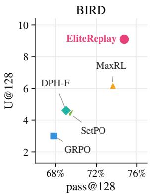
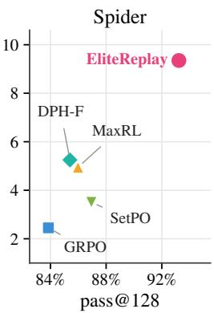
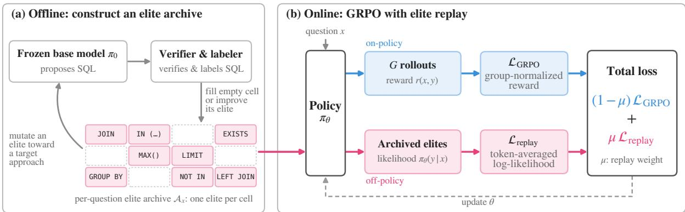
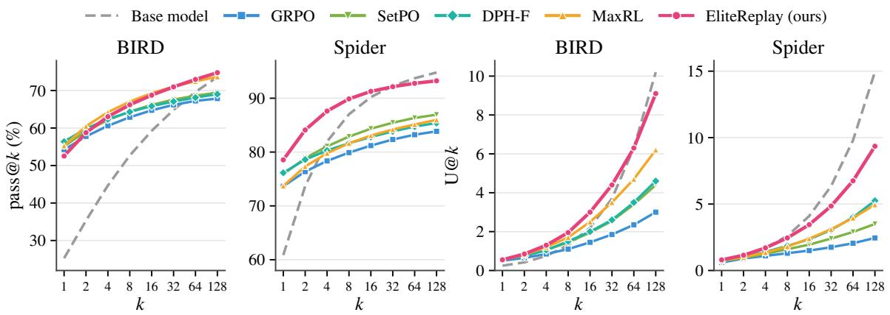
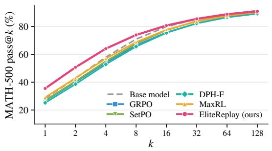
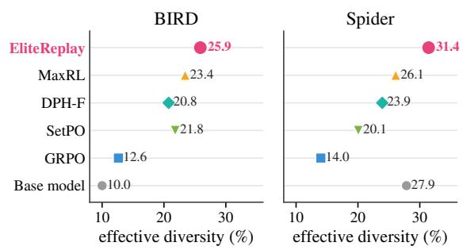
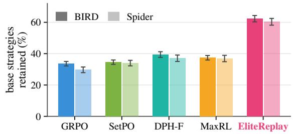
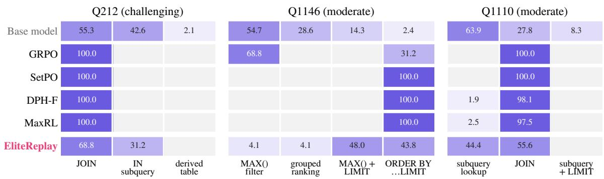
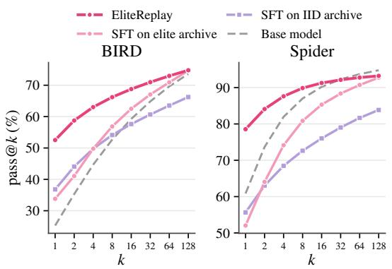
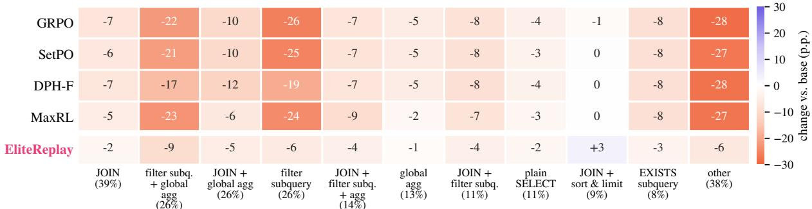

# ELITEREPLAY: Preserving Diverse Solutions in RL Post-Training via Quality-Diversity Search

Hanane Nour Moussa Doeun Lee Sachin Kumar

The Ohio State University

{moussa.45, lee.11501, kumar.1145}@osu.edu

## Abstract

Reinforcement learning has become a common post-training technique to improve the accuracy of LLMs on verifiable tasks. However, such training can narrow the set of solutions the model can produce. Several approaches have attempted to address this behavior-sharpening effect, but they often optimize metrics that do not reflect the diversity of correct solutions. Ideally, we want a model that can produce multiple good solutions, not only a single reliable one. We propose ELITEREPLAY, a posttraining recipe that pairs GRPO with an “elite” archive built by quality-diversity search. Before training, we use the frozen base model to collect solutions that span distinct approaches; during training, GRPO is combined with a replay loss on this archive. The result is a posttrained model that improves accuracy while preserving more of the base model’s solution diversity. On multiple text-to-SQL tasks, ELITERE-PLAY achieves the highest pass@128 than all baselines, producing up to 77% more distinct correct strategies than the strongest baselines. It preserves most of the base model’s correct strategies, outperforming existing methods in strategy retention. This diversity translates into practical benefits on ambiguous questions, where ELITEREPLAY covers both interpretations nearly twice as often as the strongest baseline on AmbiQT<sup>1</sup>.

## 1 Introduction

Reinforcement learning with verifiable rewards (RLVR) has become a standard post-training technique for large language model (LLM) reasoning (Shao et al., 2024; Guo et al., 2025). However, studies show that common RLVR methods such as Group Relative Policy Optimization (GRPO) improve performance via sharpening, i.e. concentrating probability on a few behaviors the base model already had (Yue et al., 2025; Zhao et al., 2025; Huang et al., 2025). RL post-training therefore improves reliability (pass@1), but often by reducing reach (pass@k) (Oh et al., 2026).



  
Figure 1: Accuracy versus strategy diversity at k = 128. Each point is a post-trained model on BIRD (indistribution) and Spider (out-of-distribution). ELITERE-PLAY reaches the highest pass@128 while producing far more distinct correct strategies.

Several works seek to recover this lost reach by improving pass@k relative to the base model (Tajwar et al., 2026; Li et al., 2026b,a; Walder and Karkhanis, 2025). Since recovering reach may require retaining alternative ways of solving problems, pass@k has also become a common proxy for diversity (Dang et al., 2025; Song et al., 2025; Chen et al., 2025; Yu, 2025; Jiang et al., 2026). Yet pass@k only asks whether some sample is correct, not whether the correct samples differ. A model can therefore achieve high pass@k by reliably producing a single strategy for each question while losing the alternatives the base model once exhibited.

Retaining these alternative ways of solving a problem, its solution diversity, is important whenever the approach matters alongside the final answer. Different correct solutions may follow distinct reasoning paths, differ in computational efficiency, or encode different interpretations of an ambiguous request. Systems that rely on repeated sampling and selection also benefit from having meaningful variety (Li et al., 2022; Pourreza et al., 2025). As Figure 1 shows, methods with nearly identical pass@128 can differ substantially in the number of distinct correct strategies they produce.

Preserving a diverse set of good solutions is the central concern of quality-diversity (QD) optimization. Rather than seeking a single optimum, QD algorithms such as novelty search (Lehman and Stanley, 2011) and MAP-Elites (Mouret and Clune, 2015) maintain an archive of high-performing solutions spread across a space of behavior descriptors. In the deep RL literature, such archives have been coupled with policy-gradient learners to broaden exploration, enabling the discovery of new behaviors in policies trained from scratch (Khadka and Tumer, 2018; Pourchot and Sigaud, 2019; Ecoffet et al., 2021). Post-training a language model, however, presents a different challenge, since the base model already exhibits a variety of correct strategies that RL can suppress. At the same time, language models offer a natural advantage for QD search, as the base model itself can propose meaningful variations through repeated sampling (Lehman et al., 2023; Romera-Paredes et al., 2024; Bradley et al., 2024; Samvelyan et al., 2024).

We study whether quality-diversity archives can preserve solution diversity during GRPO training. Our method, ELITEREPLAY, first runs MAP-Elites with the frozen base model to build an elite archive: a set of verified solutions, with at most one solution per cell of a grid indexed by a behavior descriptor. It then trains with GRPO while adding a small replay loss on this archive.

Measuring diversity requires distinguishing how solutions are obtained, not just whether they are correct. We therefore evaluate diversity at the level of solution strategies, using a structural description of how each solution solves the question, computed deterministically from the solution itself. This allows us to measure U@k, the number of unique correct strategies among k samples, alongside effective diversity (Shypula et al., 2025), the probability that two random samples are both correct and different, which captures improvements in reliability without sacrificing diversity.

We evaluate ELITEREPLAY on text-to-SQL, a natural testbed where questions can admit multiple correct queries and natural-language ambiguity is common. As shown in Figure 1, ELITERE-PLAY achieves 74.8% pass@128 on BIRD (Li et al., 2023), comparable to MaxRL’s 73.7%, while producing 9.1 distinct correct strategies per question compared to just 6.2. On the out-ofdistribution Spider (Yu et al., 2018), it achieves 93.2% pass@128, outperforming the strongest baseline by 6.3 percentage points while producing up to 77% more distinct correct strategies. ELITEREPLAY also retains 62% and 60% of the base model’s correct strategies on BIRD and Spider, respectively, at least 23 percentage points more than any baseline. This preserved diversity also benefits ambiguous questions, with ELITEREPLAY covering both interpretations on 27.0% of AmbiQT (Bhaskar et al., 2023) questions, compared to 14.2% for the strongest baseline.

Our contributions are:

• We propose ELITEREPLAY, which anchors RL to an elite archive constructed through quality-diversity search using the base model (§2).

• We evaluate RL post-training through strategylevel diversity, measuring unique correct strategies (U@k), effective diversity, and retention of the base model’s strategies (§3).

• We show that ELITEREPLAY preserves more diverse correct strategies while maintaining strong pass@k, retains most base-model strategies, and better covers ambiguous questions (§5).

## 2 ELITEREPLAY

Our proposed approach improves accuracy with RL while preserving the base model’s distinct correct solutions in two stages (Figure 2). Before training, QD search with the frozen base model builds an elite archive of verified solutions that span distinct approaches (§2.1). During training, GRPO is combined with a replay loss on this archive (§2.2). Appendix A details both stages.

## 2.1 Constructing the elite archive

RL post-training tends to concentrate probability on a narrower set of approaches (Yue et al., 2025; Huang et al., 2025), putting alternative correct approaches at risk of disappearing. Simply replaying solutions sampled from the base model may not prevent this collapse, since such samples are dominated by the base model’s more frequent approaches and underrepresent rarer ones. We therefore build the replay set using quality-diversity search (Pugh et al., 2016), instantiating MAP-Elites (Mouret and Clune, 2015), a QD algorithm that partitions a space of behavior descriptors into cells and retains the best solution found in each, on a subset $\mathcal { D } _ { A }$ of the training questions, using the frozen base model $\pi _ { 0 }$ to generate candidate solutions. For each question $x \in { \mathcal { D } } _ { A }$ , we maintain an archive $\mathcal { A } _ { x }$ of verified solutions, organized into cells by solution approach. Each cell stores at most one solution, or elite, allowing the archive to represent multiple correct approaches to the same question.

  
Figure 2: Overview of ELITEREPLAY. (a) Before training, MAP-Elites with the frozen base model builds a per-question elite archive, keeping one verified solution per behavior cell. (b) During training, GRPO is combined with a replay loss on the fixed archive. The figure illustrates the method on text-to-SQL.

Defining the behavior space. Classical MAP-Elites relies on behavior descriptors designed by hand for each domain. Instead, we first collect a set of verified seed solutions from the base model and provide them to a separate LLM, the labeler, as representative examples of how the task can be solved. Using these examples, the labeler induces a broader vocabulary of possible approaches, including ones not observed in the seeds, to guide subsequent exploration. The labeler assigns each solution an approach label, capturing its general method of solving the question. To distinguish solutions that follow the same broad approach but differ in their structure, we combine this label with structural features extracted deterministically from the solution (e.g., joins or subqueries in SQL, loops or recursion in code). The resulting behavior descriptor $b ( y )$ determines the solution’s archive cell. This descriptor is used only to guide search; we evaluate diversity with a separate, deterministic notion of strategy (§3). Appendix A.2 details the behavior space, and Appendices B.1 and B.2 give the features and labeler prompts used in our text-to-SQL experiments.

Constructing the archive. Given this behavior space, we populate and expand the per-question archives through four steps.

(1) Initialization. We insert the verified seed solutions into their corresponding archive cells, establishing the initial set of elites for each question.

(2) Selection. We choose a target approach among those the labeler judges applicable to the question, prioritizing approaches not yet represented in the archive while balancing attempts across targets (Appendix A.3). We then select a parent elite, preferably one following a different approach.

(3) Variation. We prompt π<sub>0</sub> with the original question, target approach, and parent elite, asking it to generate a new solution following the target approach.

(4) Evaluation and insertion. We verify the candidate and, if correct, assign it to the cell corresponding to its actual approach, which may differ from the requested one. The candidate fills an empty cell or replaces an existing elite if it is shorter.

We repeat selection, variation, and evaluation for a fixed search budget. Because selection favors untried approaches, search is directed toward approaches that may be correct but rarely sampled by the base model, while candidates repeating an existing approach only compete for an occupied cell. Search more than doubles the cells occupied by seed sampling and yields more distinct elites than direct sampling (Appendices C.1 and C.2). The surviving elites, paired with their original task prompts, form the replay set.

## 2.2 Training with elite replay

Starting from the base model $\pi _ { 0 } ,$ we train the policy $\pi \theta$ with GRPO (Shao et al., 2024), while encouraging it to reproduce solutions from the archive. GRPO improves correctness, and archive replay helps preserve alternative approaches.

Replaying archived solutions. At each training step, we sample a batch E of verified solutions from the archive, balancing sampling across questions and their occupied cells so that questions with more elites do not dominate. To retain these solutions, we define the replay loss as the negative log-likelihood of the archived solutions, normalized by solution length so that longer solutions do not receive more weight,

$$
\mathcal { L } _ { \mathrm { r e p l a y } } ( \theta ) = - \frac { 1 } { | \mathcal { E } | } \sum _ { ( x , y ) \in \mathcal { E } } \frac { 1 } { | y | } \log \pi _ { \theta } ( y \mid x ) .\tag{1}
$$

Combining replay with GRPO. Inspired by CHORD (Zhang et al., 2026), we combine the onpolicy GRPO objective with the supervised replay loss using a simplified formulation with a fixed mixing weight $\mu$

$$
\begin{array} { r } { \mathcal { L } ( \theta ) = ( 1 - \mu ) \mathcal { L } _ { \mathrm { G R P O } } ( \theta ) + \mu \mathcal { L } _ { \mathrm { r e p l a y } } ( \theta ) . } \end{array}\tag{2}
$$

The archive remains fixed, and the replay loss provides a consistent signal for preserving alternative solutions alongside GRPO updates (Appendix A.4). At inference, the trained policy is sampled directly, without archive lookup or search.

## 3 Evaluating Strategy Diversity

We measure how well RL post-training preserves the range of correct solutions at the level of solution strategies, using three complementary metrics that capture the number of distinct correct strategies, the structural diversity of correct samples, and the retention of strategies from the base model.

Strategies. We represent each solution $y$ by a strategy $s ( y )$ , a deterministic description of how the solution is constructed that abstracts away surface details. For solutions with formal structure, such as code, abstract syntax trees (ASTs) provide a natural basis for distinguishing programs by their structure rather than their surface form (Ren et al., 2020; Song et al., 2024; Shypula et al., 2025). We therefore derive $s ( y )$ from the AST of each SQL query, distinguishing, for example, a query that joins two tables from one that filters through a nested subquery (Appendix B.5).

Unique correct strategies (U@k). Let $r ( x , y ) \in$ {0, 1} indicate whether solution $y$ to question x is correct, and let $y _ { 1 } , \ldots , y _ { n }$ be n samples for x. U@k is the expected number of distinct strategies among the correct samples in a random subset of k samples. If $c _ { s }$ of the n samples are correct with strategy s, then, analogous to the unbiased pass@k estimator (Chen et al., 2021),

$$
\mathrm { U @ } k ( x ) = \sum _ { s } \Big [ 1 - \binom { n - c _ { s } } { k } \Big / \binom { n } { k } \Big ] ,\tag{3}
$$

averaged over questions. Unlike pass@k, which counts whether at least one correct solution is found, U@k counts how many different correct strategies are represented. The two coincide when all correct samples for a question share a single strategy, while U@k increases as additional correct strategies are found.

Effective diversity. Effective diversity (Shypula et al., 2025) captures how structurally different correct samples are from one another, measuring the expected dissimilarity between two random samples while counting only pairs in which both are correct,

$$
\operatorname { E D } ( x ) = { \frac { 2 } { n ( n - 1 ) } } \sum _ { i < j } r _ { i } r _ { j } { \big ( } 1 - \sin ( y _ { i } , y _ { j } ) { \big ) } ,\tag{4}
$$

averaged over questions, where $r _ { i } = r ( x , y _ { i } )$ and sim $\in \ [ 0 , 1 ]$ is an AST-based similarity. By accounting for both correctness and structural differences, effective diversity rewards models that produce correct solutions reliably without collapsing onto similar outputs.

Strategy retention. Let $s _ { m } ( x )$ be the set of strategies that model m produces correctly among its n samples for $x ,$ and let $\mathcal { Q }$ be the questions on which the base model $\pi _ { 0 }$ produces at least two distinct correct strategies. Retention measures the fraction of these base-model strategies that remain accessible after post-training,

$$
\mathrm { R e t } ( m ) = \frac { 1 } { | \mathcal { Q } | } \sum _ { x \in \mathcal { Q } } \frac { | \mathcal { S } _ { m } ( x ) \cap \mathcal { S } _ { \pi _ { 0 } } ( x ) | } { | \mathcal { S } _ { \pi _ { 0 } } ( x ) | } .\tag{5}
$$

## 4 Experimental Setup

Model and data. We use Qwen3.5-4B-Base (Qwen Team, 2026) as our base model and train on 5,000 questions from BIRD (Li et al., 2023), a textto-SQL dataset built from real-world databases. We construct the elite archive using a subset of 1,000 of these questions, which remain part of the RL training pool (Appendix B.1). For evaluation, we use BIRD dev to measure in-distribution performance and Spider 1.0 dev (Yu et al., 2018) to assess out-of-distribution generalization on databases disjoint from those used in training. On both benchmarks, correctness is measured by execution accuracy, comparing the results of generated SQL queries with those of the gold queries on their respective databases (Appendix B.4).

  
Figure 3: Pass@k and U@k as the sampling budget grows on BIRD and Spider. ELITEREPLAY improves accuracy relative to the base model while producing far more distinct correct strategies than any baseline.

To examine the post-training effects in an unrelated domain, we also evaluate on MATH-500 (Hendrycks et al., 2021). Finally, to assess the practical value of preserving diverse solutions, we evaluate on AmbiQT (Bhaskar et al., 2023), a benchmark derived from Spider where each question admits two valid interpretations due to ambiguity (e.g. in column or table names, join paths, etc). We draw n = 128 samples per question.

Baselines. We compare ELITEREPLAY against standard GRPO (Shao et al., 2024) and three methods aimed at preserving diversity or improving pass@k. MaxRL (Tajwar et al., 2026) upweights hard questions through a maximum-likelihood objective, while DPH-F (Li et al., 2026b) uses forward-KL regularization to preserve the base model’s behavior on questions it already solves reliably. SetPO (Li et al., 2026a) encourages diversity by adding to each rollout’s advantage a bonus for how much it increases the semantic diversity of its sampled group. All methods are trained on the same data for 100 steps, with ELITEREPLAY using a replay weight of $\mu = 0 . 0 5$ (Appendix C.3). Appendix B.3 gives further implementation and compute details.

  
Figure 4: MATH-500 pass@k of BIRD-trained models. Baselines barely improve or degrade relative to the base model, whereas ELITEREPLAY substantially improves it, despite not being trained on math.

  
Figure 5: Effective diversity, the probability (%) that two samples are both correct and structurally different. ELITEREPLAY scores highest on both benchmarks.

## 5 Results and Analysis

## 5.1 Accuracy and strategy diversity

ELITEREPLAY improves reliability while substantially preserving diversity. All post-trained methods improve pass@1 on BIRD, raising it from 25.3% for the base model to 52–56%. However, most lose reach as the sampling budget increases (Figure 3), as observed for RLVR on math (Yue et al., 2025). GRPO, SetPO, and DPH-F attain only 68–69% pass@128, below the base model’s 73.6%, whereas MaxRL and ELITERE-PLAY maintain comparable coverage at 73.7% and 74.8%, respectively. On out-of-distribution Spider, ELITEREPLAY achieves the highest pass@k among post-trained methods at every budget, reaching 78.6% pass@1 and 93.2% pass@128, versus at most 76.2% and 86.9% for the baselines.

  
Figure 6: Share of the base model’s correct strategies retained by each method, over questions on which the base model uses at least two strategies. ELITEREPLAY has the highest retention rate.

ELITEREPLAY also maintains performance outside the training domain. On MATH-500 (Figure 4) three baselines perform worse than the base model across all sampling budgets, with pass@1 falling to 25–27% from 28.3%. In contrast, ELITEREPLAY improves pass@1 to 35.5% while remaining within one point of the base model at large sampling budgets. These results suggest that replay may act as a rehearsal mechanism that mitigates out-of-domain forgetting, which is an interesting area of analysis for future work.

Similar pass@k can conceal substantial differences in strategy diversity. Despite achieving nearly identical pass@128 on BIRD, ELITERE-PLAY produces almost 50% more distinct correct strategies than MaxRL, with U@128 of 9.1 versus 6.2 (Figure 3, right). Thus, MaxRL recovers coverage while relying on fewer ways of solving each question, a distinction that pass@k does not capture. The diversity gap is even larger on Spider, where ELITEREPLAY produces nearly 80% more distinct correct strategies than the strongest baseline (9.4 versus 5.3). On BIRD, ELITEREPLAY also matches or exceeds the base model’s U@k up to k = 64, despite substantially higher pass@1, while all baselines fall increasingly behind it at larger budgets.

Effective diversity provides complementary evidence (Figure 5). ELITEREPLAY achieves the highest scores on both benchmarks, reaching 25.9% on

BIRD versus 23.4% for the strongest baseline. On Spider, it is the only post-training method to exceed the base model (31.4% versus 27.9%).

## 5.2 Preserving base-model strategies

ELITEREPLAY retains substantially more of the base model’s correct strategies. U@k counts distinct strategies, whereas strategy retention tracks which of the base model’s strategies survive posttraining. As shown in Figure 6, the baselines retain only 34–39% of these strategies on BIRD and 30– 37% on Spider, whereas ELITEREPLAY retains 62% and 60%, respectively.

ELITEREPLAY preserves broader coverage across individual strategies. To examine whether the lost strategies are concentrated in a few approaches or spread across many, we measure how often each of the base model’s most common correct strategies are still produced across questions, relative to its original coverage (Appendix Figure 9; details in Appendix B.6). The baselines lose coverage on nearly every strategy, with reductions of up to 28 percentage points on BIRD. In contrast, ELITEREPLAY shows smaller reductions on every strategy, never exceeding 9 percentage points. The same pattern holds on Spider (Appendix C.4).

The baselines often collapse onto a single strategy, while ELITEREPLAY preserves alternatives. To examine how strategy loss manifests at the question level, we compare the distribution of correct samples across strategies for three representative BIRD questions (Figure 7; details in Appendix B.8). While the baselines often concentrate nearly all correct samples on a single approach, ELITEREPLAY maintains multiple strategies closer to the base model’s original distribution. Notably, the baselines sometimes converge on an approach that the base model rarely used, showing that strategy collapse does not necessarily preserve the base model’s preferred behavior, as Zhao et al. (2025) also observe for RL on math. Spider examples and representative queries for each strategy are provided in Appendices C.5 and C.6.

## 5.3 Diversity under ambiguity

Preserved diversity improves coverage of ambiguous questions. Ambiguous questions provide a practical test of solution diversity, since covering multiple interpretations requires producing distinct correct solutions. For example, “employees of a department” could mean current employees or everyone ever assigned to it. A model that produces only one interpretation cannot cover both, however reliably it generates that answer. On AmbiQT, we report Both@k, the fraction of questions for which k samples match the gold execution result of each interpretation (Table 1; Appendix B.7).

  
Figure 7: How correct samples split across strategies on three BIRD questions. Each row shows the percentage of a method’s correct samples (out of 128 rollouts) that use each strategy. The baselines concentrate on one strategy, while ELITEREPLAY keeps several.

<table><tr><td>k</td><td>2</td><td>4</td><td>8</td><td>16</td><td>32</td><td>64</td><td>128</td></tr><tr><td>Base model</td><td>2.3</td><td>5.5</td><td>10.3</td><td>16.3</td><td>23.0</td><td>30.1</td><td>37.0</td></tr><tr><td>GRPO</td><td>1.6</td><td>2.0</td><td>2.4</td><td>3.0</td><td>3.5</td><td>3.9</td><td>4.2</td></tr><tr><td>SetPO</td><td>2.5</td><td>5.0</td><td>5.5</td><td>6.7</td><td>7.8</td><td>8.8</td><td>10.0</td></tr><tr><td>DPH-F</td><td>2.4</td><td>4.1</td><td>5.9</td><td>7.6</td><td>9.3</td><td>10.8</td><td>12.0</td></tr><tr><td>MaxRL</td><td>1.9</td><td>3.7</td><td>6.0</td><td>8.5</td><td>10.8</td><td>12.7</td><td>14.2</td></tr><tr><td>ELITEREPLAY</td><td>3.0</td><td>5.9</td><td>9.5</td><td>13.5</td><td>17.9</td><td>22.5</td><td>27.0</td></tr></table>

Table 1: Both@k on AmbiQT (%), the share of questions for which k samples include correct queries for both valid readings. ELITEREPLAY covers both readings most often among post-trained models.

At k = 128, GRPO covers both interpretations on only 4.2% of questions, while the strongest diversity-preserving baseline reaches 14.2%. ELITEREPLAY nearly doubles this coverage, achieving 27.0%, with its advantage growing as the sampling budget increases. This improvement closes more than half the gap between the strongest baseline and the base model, which achieves 37.0%.

## 5.4 Ablating archive construction and replay

We isolate the contributions of archive construction and replay through three comparisons, using as a control an independently and identically distributed (IID) archive of verified base-model samples at equal generation budget (Appendix C.2).

Quality-diversity search produces a more effective training archive than IID sampling. To isolate the effect of archive composition, we first apply supervised fine-tuning (SFT) to the base model on each archive without RL. SFT on the elite archive achieves 74.6% pass@128 on BIRD and 92.8% on Spider, outperforming SFT on the IID archive by 8–9 percentage points, with larger gains at higher sampling budgets (Figure 8). However, neither archive alone matches the reliability of ELITERE-PLAY, reaching at most 37% pass@1 on BIRD compared to 52.5% for ELITEREPLAY. This shows that the archive improves coverage, while RL provides the substantial gains in low-sample accuracy.

  
Figure 8: SFT on the archive alone. SFT on the elite archive beats the IID archive at large k, but neither reaches ELITEREPLAY’s pass@1.

## Preserving diversity requires replay throughout

RL. To test whether an SFT warm-up is sufficient, we train with GRPO after fine-tuning on the elite archive, without further replay (Elite SFT→GRPO). As shown in Table 2, both pass@128 and U@128 fall to levels comparable to standard GRPO (68.5% and 3.0 versus 67.9% and 3.0). In contrast, ELITEREPLAY maintains high coverage and diversity by continuing to replay the archive during RL. Thus, exposure to diverse solutions before training is insufficient to prevent their subsequent collapse, consistent with findings that integrating off-policy data into RL is more effective than a separate SFT stage (Yan et al., 2025; Zhang et al., 2026).

<table><tr><td rowspan="2">Variant</td><td colspan="2">pass@k (%)</td><td colspan="2">U@k</td></tr><tr><td></td><td>k = 1 k = 128</td><td>k = 16</td><td>6 k = 128</td></tr><tr><td>ELITEREPLAY</td><td>52.5</td><td>74.8</td><td>3.0</td><td>9.1</td></tr><tr><td>IID replay</td><td>51.7</td><td>75.6</td><td>2.4</td><td>7.4</td></tr><tr><td>Elite ŚFT→GRPO</td><td>56.9</td><td>68.5</td><td>1.7</td><td>3.0</td></tr></table>

Table 2: Ablations of the archive and of replay during RL on BIRD. IID replay replaces the elite archive with verified samples from the base model, and Elite SFT→GRPO fine-tunes on the elite archive before GRPO, without replay. ELITEREPLAY produces the most distinct correct strategies.

Archive composition matters even when replay is used. Finally, we replace the elite archive with IID samples while keeping the replay objective unchanged (IID replay). Although IID replay achieves comparable pass@k, it produces fewer distinct correct strategies at every sampling budget, reaching U@128 of 7.4 compared to 9.1 for ELITEREPLAY (Table 2). Because IID samples overrepresent the base model’s frequent approaches, replaying them offers less retention of the rarer strategies that RL suppresses. These ablations show that preserving diversity depends on both constructing an archive with broad strategy coverage and continuing to replay it throughout RL.

## 6 Related Work

Diversity in RL post-training. RL post-training is widely observed to reduce output diversity, with studies showing that it lowers diversity relative to supervised fine-tuning (Kirk et al., 2024), collapses policy entropy (Cui et al., 2025), and concentrates probability on behaviors already present in the base model (Zhao et al., 2025), so that base models often solve more problems at large sampling budgets (Yue et al., 2025; Oh et al., 2026); supervised finetuning shows a similar collapse (Dang et al., 2025). Mitigations optimize objectives tied to pass@k (Walder and Karkhanis, 2025; Chen et al., 2025; Tajwar et al., 2026), reward novel or diverse outputs (Song et al., 2025; Li et al., 2025, 2026a; Jiang et al., 2026), regularize toward the base model (Li et al., 2026b), or control entropy and sampling temperature (Cui et al., 2025; Yu et al., 2025; Oh et al.,

2026), and are typically evaluated by pass@k (Yu, 2025). ELITEREPLAY instead replays an archive built for coverage, and we measure diversity at the more meaningful level of solution strategies.

Mixing demonstrations and replay into RL. RL has long been combined with supervised learning from demonstrations or past experience (Lin, 1992; Hester et al., 2018; Oh et al., 2018). In LLM post-training, the off-policy data range from pretraining text and expert solutions (Ouyang et al., 2022; Zhang et al., 2026; Yan et al., 2025) to replayed verified trajectories (Zhang et al., 2025; Wang et al., 2025) and base-model samples (Li et al., 2026b). These works use replay to learn efficiently from good solutions or to stay close to a reference model. ELITEREPLAY uses a replay set built by quality-diversity search to keep distinct correct solutions available throughout RL.

Quality diversity and evolutionary RL. QD algorithms such as novelty search and MAP-Elites seek collections of solutions that are both highperforming and diverse (Lehman and Stanley, 2011; Mouret and Clune, 2015; Pugh et al., 2016; Cully and Demiris, 2018). In deep RL, they have been combined with policy gradients through shared replay buffers (Khadka and Tumer, 2018; Pourchot and Sigaud, 2019), gradient-based variation (Nilsson and Cully, 2021; Pierrot et al., 2022), and archive-driven exploration (Ecoffet et al., 2021). In these works, QD discovers new behaviors, and archived solutions come from a separate search process. ELITEREPLAY instead builds its archive once from the base model’s own solutions and replays it to preserve its diversity of behavior.

## 7 Conclusion

We introduced ELITEREPLAY, which preserves solution diversity during RL post-training by replaying an archive of distinct correct solutions found by quality-diversity search. ELITEREPLAY raises accuracy both in and out of distribution while retaining most of the base model’s correct strategies. We also introduced a strategy-level evaluation of diversity, which reveals differences between methods that pass@k conceals. Our results show that post-training need not trade diversity for reliability.

## Acknowledgments

We are grateful to Amazon Research Award, Ohio Supercomputing Center (OSC), and NAIRR Pilot Program (NAIRR250264) for providing the compute resources for this work. HNM is partially supported by the Center on Responsible AI and Governance (CRAIG) at OSU.

## Limitations

We recognize the following limitations and directions of future work.

Base model. Our experiments use Qwen3.5-4B-Base, whose moderate size makes it feasible to conduct multiple training runs across our method and baselines within our available compute budget. This model size is also relevant to practical RL posttraining settings, making it a meaningful model for studying strategy preservation. Nevertheless, evaluating ELITEREPLAY on larger models (e.g. 8B), and across different model families is a natural direction for future work.

Domain. Our experiments focus on text-to-SQL, which provides a suitable testbed for studying solution diversity because questions can admit multiple correct queries, correctness can be verified through execution, and SQL’s formal structure allows strategies to be distinguished using abstract syntax trees. Extending this evaluation to other domains where solution strategies lack a clear structural representation, as in many mathematical reasoning tasks, might be challenging. Nevertheless, we expect the approach to be applicable to other domains with verifiable solutions and meaningful behavioral distinctions, such as program optimization or algorithmic coding and we view this as an important direction for future work.

## AI Use Statement

AI tools were used to assist with editing the manuscript and with writing the code used to run the experiments. All text, code, results, and claims were reviewed by the authors, who take full responsibility for the content of this work.

## References

Adithya Bhaskar, Tushar Tomar, Ashutosh Sathe, and Sunita Sarawagi. 2023. Benchmarking and improving text-to-SQL generation under ambiguity. In Proceedings ofthe 2023 Conference on Empirical Meth-

ods in Natural Language Processing, pages 7053– 7074, Singapore. Association for Computational Linguistics.

Herbie Bradley, Andrew Dai, Hannah Teufel, Jenny Zhang, Koen Oostermeijer, Marco Bellagente, Jeff Clune, Kenneth Stanley, Grégory Schott, and Joel Lehman. 2024. Quality-diversity through AI feedback. In International Conference on Learning Representations, volume 2024, pages 21036–21147.

Mark Chen, Jerry Tworek, Heewoo Jun, Qiming Yuan, Henrique Ponde de Oliveira Pinto, Jared Kaplan, Harri Edwards, Yuri Burda, Nicholas Joseph, Greg Brockman, et al. 2021. Evaluating large language models trained on code. arXiv preprint arXiv:2107.03374.

Zhipeng Chen, Xiaobo Qin, Youbin Wu, Yue Ling, Qinghao Ye, Wayne Xin Zhao, and Guang Shi. 2025. Pass@k training for adaptively balancing exploration and exploitation of large reasoning models. arXiv preprint arXiv:2508.10751.

Ganqu Cui, Yuchen Zhang, Jiacheng Chen, Lifan Yuan, Zhi Wang, Yuxin Zuo, Haozhan Li, Yuchen Fan, Huayu Chen, Weize Chen, Zhiyuan Liu, Hao Peng, Lei Bai, Wanli Ouyang, Yu Cheng, Bowen Zhou, and Ning Ding. 2025. The entropy mechanism of reinforcement learning for reasoning language models. arXiv preprint arXiv:2505.22617.

Antoine Cully and Yiannis Demiris. 2018. Quality and diversity optimization: A unifying modular framework. IEEE Transactions on Evolutionary Computation, 22(2):245–259.

Xingyu Dang, Christina Baek, Kaiyue Wen, Zico Kolter, and Aditi Raghunathan. 2025. Weight ensembling improves reasoning in language models. arXiv preprint arXiv:2504.10478.

Adrien Ecoffet, Joost Huizinga, Joel Lehman, Kenneth O. Stanley, and Jeff Clune. 2021. First return, then explore. Nature, 590:580–586.

Daya Guo, Dejian Yang, Haowei Zhang, et al. 2025. DeepSeek-R1 incentivizes reasoning in LLMs through reinforcement learning. Nature, 645:633– 638.

Dan Hendrycks, Collin Burns, Saurav Kadavath, Akul Arora, Steven Basart, Eric Tang, Dawn Song, and Jacob Steinhardt. 2021. Measuring mathematical problem solving with the MATH dataset. In Proceedings of the Neural Information Processing Systems Track on Datasets and Benchmarks.

Todd Hester, Matej Vecerik, Olivier Pietquin, Marc Lanctot, Tom Schaul, Bilal Piot, Dan Horgan, John Quan, Andrew Sendonaris, Ian Osband, Gabriel Dulac-Arnold, John Agapiou, Joel Z. Leibo, and Audrunas Gruslys. 2018. Deep Q-learning from demonstrations. In Proceedings ofthe AAAI Conference on Artificial Intelligence, volume 32.

Audrey Huang, Adam Block, Dylan Foster, Dhruv Rohatgi, Cyril Zhang, Max Simchowitz, Jordan Ash, and Akshay Krishnamurthy. 2025. Self-improvement in language models: The sharpening mechanism. In International Conference on Learning Representations, volume 2025, pages 76687–76739.

Zishang Jiang, Jinyi Han, Tingyun Li, Xinyi Wang, Sihang Jiang, Zhaoqian Dai, Shuguang Ma, Fei Yu, Jiaqing Liang, and Yanghua Xiao. 2026. Selective expert guidance for effective and diverse exploration in reinforcement learning of LLMs. In International Conference on Learning Representations, volume 2026, pages 62980–63006.

Shauharda Khadka and Kagan Tumer. 2018. Evolutionguided policy gradient in reinforcement learning. In Advances in Neural Information Processing Systems, volume 31, pages 1188–1200. Curran Associates, Inc.

Robert Kirk, Ishita Mediratta, Christoforos Nalmpantis, Jelena Luketina, Eric Hambro, Edward Grefenstette, and Roberta Raileanu. 2024. Understanding the effects of RLHF on LLM generalisation and diversity. In International Conference on Learning Representations, volume 2024, pages 20620–20653.

Woosuk Kwon, Zhuohan Li, Siyuan Zhuang, Ying Sheng, Lianmin Zheng, Cody Hao Yu, Joseph E. Gonzalez, Hao Zhang, and Ion Stoica. 2023. Efficient memory management for large language model serving with PagedAttention. In Proceedings ofthe 29th Symposium on Operating Systems Principles, SOSP ’23, pages 611–626. Association for Computing Machinery.

Joel Lehman, Jonathan Gordon, Shawn Jain, Kamal Ndousse, Cathy Yeh, and Kenneth O. Stanley. 2023. Evolution through large models. In Wolfgang Banzhaf, Penousal Machado, and Mengjie Zhang, editors, Handbook ofEvolutionary Machine Learning, Genetic and Evolutionary Computation, pages 331–366. Springer Nature Singapore.

Joel Lehman and Kenneth O. Stanley. 2011. Abandoning objectives: Evolution through the search for novelty alone. Evolutionary Computation, 19(2):189– 223.

Chenyi Li, Yuan Zhang, Bo Wang, Guoqing Ma, Wei Tang, Haoyang Huang, and Nan Duan. 2026a. SetPO: Set-level policy optimization for diversity-preserving LLM reasoning. In Proceedings ofthe 43rd International Conference on Machine Learning.

Jinyang Li, Binyuan Hui, Ge Qu, Jiaxi Yang, Binhua Li, Bowen Li, Bailin Wang, Bowen Qin, Ruiying Geng, Nan Huo, Xuanhe Zhou, Chenhao Ma, Guoliang Li, Kevin Chang, Fei Huang, Reynold Cheng, and Yongbin Li. 2023. Can LLM already serve as a database interface? a BIg bench for large-scale database grounded text-to-SQLs. In Advances in Neural Information Processing Systems, volume 36, pages 42330–42357. Curran Associates, Inc.

Long Li, Zhijian Zhou, Jiaran Hao, Jason Klein Liu, Yanting Miao, Wei Pang, Xiaoyu Tan, Wei Chu, Zhe Wang, Shirui Pan, Chao Qu, and Yuan Qi. 2026b. The choice of divergence: A neglected key to mitigating diversity collapse in reinforcement learning with verifiable reward. In International Conference on Learning Representations, volume 2026, pages 64742–64768.

Tianjian Li, Yiming Zhang, Ping Yu, Swarnadeep Saha, Daniel Khashabi, Jason Weston, Jack Lanchantin, and Tianlu Wang. 2025. Jointly reinforcing diversity and quality in language model generations. arXiv preprint arXiv:2509.02534.

Yujia Li, David Choi, Junyoung Chung, Nate Kushman, Julian Schrittwieser, Rémi Leblond, Tom Eccles, James Keeling, Felix Gimeno, Agustin Dal Lago, et al. 2022. Competition-level code generation with AlphaCode. Science, 378:1092–1097.

Long-Ji Lin. 1992. Self-improving reactive agents based on reinforcement learning, planning and teaching. Machine Learning, 8(3–4):293–321.

Jean-Baptiste Mouret and Jeff Clune. 2015. Illuminating search spaces by mapping elites. arXiv preprint arXiv:1504.04909.

Olle Nilsson and Antoine Cully. 2021. Policy gradient assisted MAP-Elites. In Proceedings ofthe Genetic and Evolutionary Computation Conference, GECCO ’21, pages 866–875. Association for Computing Machinery.

Changdae Oh, Qi Zeng, Qi Qi, Andrey Zhmoginov, Deren Lei, Yun He, Hoang Phan, Hangoo Kang, Azalia Mirhoseini, and Sharon Li. 2026. Sharpening tax in post-training. arXiv preprint arXiv:2610.01509.

Junhyuk Oh, Yijie Guo, Satinder Singh, and Honglak Lee. 2018. Self-imitation learning. In Proceedings of the 35th International Conference on Machine Learning, volume 80 of Proceedings ofMachine Learning Research, pages 3878–3887. PMLR.

Long Ouyang, Jeffrey Wu, Xu Jiang, Diogo Almeida, Carroll Wainwright, Pamela Mishkin, Chong Zhang, Sandhini Agarwal, Katarina Slama, Alex Ray, John Schulman, Jacob Hilton, Fraser Kelton, Luke Miller, Maddie Simens, Amanda Askell, Peter Welinder, Paul F Christiano, Jan Leike, and Ryan Lowe. 2022. Training language models to follow instructions with human feedback. In Advances in Neural Information Processing Systems, volume 35, pages 27730–27744. Curran Associates, Inc.

Xuchen Pan, Yanxi Chen, Yushuo Chen, Yuchang Sun, Daoyuan Chen, Wenhao Zhang, Yuexiang Xie, Yilun Huang, Yilei Zhang, Dawei Gao, Weijie Shi, Yaliang Li, Bolin Ding, and Jingren Zhou. 2025. Trinity-RFT: A general-purpose and unified framework for reinforcement fine-tuning of large language models. arXiv preprint arXiv:2505.17826.

Thomas Pierrot, Valentin Macé, Felix Chalumeau, Arthur Flajolet, Geoffrey Cideron, Karim Beguir, Antoine Cully, Olivier Sigaud, and Nicolas Perrin-Gilbert. 2022. Diversity policy gradient for sample efficient quality-diversity optimization. In Proceedings of the Genetic and Evolutionary Computation Conference, GECCO ’22, pages 1075–1083. Association for Computing Machinery.

Aloïs Pourchot and Olivier Sigaud. 2019. CEM-RL: Combining evolutionary and gradient-based methods for policy search. In International Conference on Learning Representations.

Mohammadreza Pourreza, Hailong Li, Ruoxi Sun, Yeounoh Chung, Shayan Talaei, Gaurav Tarlok Kakkar, Yu Gan, Amin Saberi, Fatma Ozcan, and Sercan Arik. 2025. CHASE-SQL: Multi-path reasoning and preference optimized candidate selection in textto-SQL. In International Conference on Learning Representations, volume 2025, pages 60385–60415.

Justin K. Pugh, Lisa B. Soros, and Kenneth O. Stanley. 2016. Quality diversity: A new frontier for evolutionary computation. Frontiers in Robotics and AI, 3:40.

Qwen Team. 2026. Qwen3.5: Towards native multimodal agents.

Shuo Ren, Daya Guo, Shuai Lu, Long Zhou, Shujie Liu, Duyu Tang, Neel Sundaresan, Ming Zhou, Ambrosio Blanco, and Shuai Ma. 2020. CodeBLEU: a method for automatic evaluation of code synthesis. arXiv preprint arXiv:2009.10297.

Bernardino Romera-Paredes, Mohammadamin Barekatain, Alexander Novikov, Matej Balog, M. Pawan Kumar, Emilien Dupont, Francisco J. R. Ruiz, Jordan S. Ellenberg, Pengming Wang, Omar Fawzi, Pushmeet Kohli, and Alhussein Fawzi. 2024. Mathematical discoveries from program search with large language models. Nature, 625(7995):468–475.

Mikayel Samvelyan, Sharath Chandra Raparthy, Andrei Lupu, Eric Hambro, Aram H. Markosyan, Manish Bhatt, Yuning Mao, Minqi Jiang, Jack Parker-Holder, Jakob Foerster, Tim Rocktäschel, and Roberta Raileanu. 2024. Rainbow teaming: Openended generation of diverse adversarial prompts. In Advances in Neural Information Processing Systems, volume 37, pages 69747–69786. Curran Associates, Inc.

Zhihong Shao, Peiyi Wang, Qihao Zhu, Runxin Xu, Junxiao Song, Xiao Bi, Haowei Zhang, Mingchuan Zhang, Y. K. Li, Y. Wu, and Daya Guo. 2024. DeepSeekMath: Pushing the limits of mathematical reasoning in open language models. arXiv preprint arXiv:2402.03300.

Guangming Sheng, Chi Zhang, Zilingfeng Ye, Xibin Wu, Wang Zhang, Ru Zhang, Yanghua Peng, Haibin Lin, and Chuan Wu. 2025. HybridFlow: A flexible and efficient RLHF framework. In Proceedings of the Twentieth European Conference on Computer

Systems, EuroSys ’25. Association for Computing Machinery.

Alexander Shypula, Shuo Li, Botong Zhang, Vishakh Padmakumar, Kayo Yin, and Osbert Bastani. 2025. Evaluating the diversity and quality of LLM generated content. In Second Conference on Language Modeling.

Yewei Song, Cedric Lothritz, Daniel Tang, Tegawendé Bissyandé, and Jacques Klein. 2024. Revisiting code similarity evaluation with abstract syntax tree edit distance. In Proceedings of the 62nd Annual Meeting of the Association for Computational Linguistics (Volume 2: Short Papers), pages 38–46, Bangkok, Thailand. Association for Computational Linguistics.

Yuda Song, Julia Kempe, and Remi Munos. 2025. Outcome-based exploration for LLM reasoning. arXiv preprint arXiv:2509.06941.

Fahim Tajwar, Guanning Zeng, Yueer Zhou, Yuda Song, Daman Arora, Yiding Jiang, Jeff Schneider, Ruslan Salakhutdinov, Haiwen Feng, and Andrea Zanette. 2026. Maximum likelihood reinforcement learning. In Proceedings ofthe 43rd International Conference on Machine Learning.

Christian Walder and Deep Tejas Karkhanis. 2025. Pass@K policy optimization: Solving harder reinforcement learning problems. In Advances in Neural Information Processing Systems, volume 38, pages 152416–152445.

Chen Wang, Lai Wei, Yanzhi Zhang, Chenyang Shao, Zedong Dan, Weiran Huang, Yue Wang, and Yuzhi Zhang. 2025. EFRame: Deeper reasoning via exploration-filter-replay reinforcement learning framework. arXiv preprint arXiv:2506.22200.

Jianhao Yan, Yafu Li, Zican Hu, Zhi Wang, Ganqu Cui, Xiaoye Qu, Yu Cheng, and Yue Zhang. 2025. Learning to reason under off-policy guidance. In Advances in Neural Information Processing Systems, volume 38.

Qiying Yu, Zheng Zhang, Ruofei Zhu, Yufeng Yuan, Xiaochen Zuo, Yu Yue, Weinan Dai, Tiantian Fan, Gaohong Liu, Juncai Liu, LingJun Liu, Xin Liu, Haibin Lin, Zhiqi Lin, Bole Ma, Guangming Sheng, Yuxuan Tong, Chi Zhang, Mofan Zhang, and 17 others. 2025. DAPO: An open-source LLM reinforcement learning system at scale. In Advances in Neural Information Processing Systems, volume 38, pages 113222–113244.

Tao Yu, Rui Zhang, Kai Yang, Michihiro Yasunaga, Dongxu Wang, Zifan Li, James Ma, Irene Li, Qingning Yao, Shanelle Roman, Zilin Zhang, and Dragomir Radev. 2018. Spider: A large-scale human-labeled dataset for complex and cross-domain semantic parsing and text-to-SQL task. In Proceedings ofthe 2018 Conference on Empirical Methods in Natural Language Processing, pages 3911–3921, Brussels, Belgium. Association for Computational Linguistics.

Yang Yu. 2025. Pass@k metric for RLVR: A diagnostic tool of exploration, but not an objective. arXiv preprint arXiv:2511.16231.

Yang Yue, Zhiqi Chen, Rui Lu, Andrew Zhao, Zhaokai Wang, Yang Yue, Shiji Song, and Gao Huang. 2025. Does reinforcement learning really incentivize reasoning capacity in LLMs beyond the base model? In Advances in Neural Information Processing Systems, volume 38, pages 57654–57689.

Hongzhi Zhang, Jia Fu, Jingyuan Zhang, Kai Fu, Qi Wang, Fuzheng Zhang, and Guorui Zhou. 2025. RLEP: Reinforcement learning with experience replay for LLM reasoning. arXiv preprint arXiv:2507.07451.

Wenhao Zhang, Yuexiang Xie, Yuchang Sun, Yanxi Chen, Guoyin Wang, Yaliang Li, Bolin Ding, and Jingren Zhou. 2026. On-policy RL meets off-policy experts: Harmonizing supervised fine-tuning and reinforcement learning via dynamic weighting. In International Conference on Learning Representations.

Rosie Zhao, Alexandru Meterez, Sham Kakade, Cengiz Pehlevan, Samy Jelassi, and Eran Malach. 2025. Echo chamber: RL post-training amplifies behaviors learned in pretraining. In Second Conference on Language Modeling.

```tcl
Algorithm 1 ELITEREPLAY
Require: base model π ; training questions $\mathcal { D } ;$
archive questions ${ \mathcal { D } } _ { A } \subseteq { \mathcal { D } } ;$ verifier $r ;$ descrip
tor $b ;$ replay weight $\mu$
Stage 1: construct the elite archive
1: collect verified seed solutions from $\pi _ { 0 }$ and in
duce an approach vocabulary
2: for each $x \in { \mathcal { D } } _ { A }$ do
3: initialize $\mathcal { A } _ { x }$ from verified seeds, one elite
per cell $b ( y )$
4: repeat
5: choose an applicable target approach
and a parent elite
6: generate a candidate $y ^ { \prime }$ with $\pi _ { 0 }$ condi
tioned on the target and parent
7: $\mathbf { i f } r ( x , y ^ { \prime } ) = 1$ then
8: assign $y ^ { \prime }$ to its realized cell, replac
ing the elite if shorter
9: end if
10: until search budget exhausted
11: end for
12: select verified elites across questions to form
the replay set
Stage 2: train with elite replay
13: $\pi _ { \theta }  \pi _ { 0 }$
14: repeat
15: compute $\mathcal { L } _ { \mathrm { G R P O } }$ from verifier-scored on
policy responses
16: sample a batch E from the replay set
17: $\begin{array} { r } { \mathcal { L } _ { \mathrm { r e p l a y } }  - \frac { 1 } { | \mathcal { E } | } \sum _ { ( x , y ) \in \mathcal { E } } \frac { 1 } { | y | } \log \pi _ { \theta } ( y \mid x ) } \end{array}$
18: update $\theta$ to minimize $( 1 - \mu ) \mathcal { L } _ { \mathrm { G R P O } }$ +
$\mu \mathcal { L } _ { \mathrm { r e p l a y } }$
19: until training budget exhausted
20: return $\pi _ { \theta }$
```

## Appendix

We provide details of ELITEREPLAY method, $( \mathsf { A p - }$ pendix A), our text-to-SQL instantiation together with experimental and evaluation settings $( \mathsf { A p - }$ pendix B), and additional analyses and examples (Appendix C).

## A Method Details

## A.1 Algorithm

Algorithm 1 summarizes the two stages of ELITEREPLAY. We first construct an archive with the frozen base model, then use the archived solutions to guide GRPO post-training.

## A.2 Behavior space

We first sample verified seed solutions from the frozen base model and present representative examples to a separate LLM, the labeler. Rather than restricting search to the approaches observed in the seeds, the labeler uses these examples to induce a broader vocabulary of possible approaches. It then assigns each verified solution a primary approach label. Because solutions with the same approach label can still differ in structure, we refine each label with structural features computed deterministically from the solution, such as which constructs appear in its parse tree. The resulting descriptor $b ( y )$ identifies the solution’s cell in its question-specific archive $\mathcal { A } _ { x }$ . Each cell contains at most one verified solution, or elite. The descriptor only guides search; diversity is evaluated with a separate representation that involves no labeler (Appendix B.5).

## A.3 Archive search

Search runs on a subset $\mathcal { D } _ { A }$ of the training questions; no evaluation questions are used. All candidates come from the frozen base model $\pi _ { 0 } ,$ prompted with the original task, and only candidates accepted by the verifier enter the archive. Each question receives a number of initial samples, followed by several rounds of mutations.

Target selection. For each question, the labeler proposes a set of applicable approaches. For each mutation, we first restrict target selection to applicable approaches not yet represented by any elite for the current question; if all are represented, we consider all applicable approaches. Within this pool, we prioritize approaches with the fewest previous targeting attempts for that question, then those represented by the fewest questions across the archive.

Variation and insertion. For each attempt, the frozen base model receives the original task, the target approach, and a verified parent solution, preferably using a different approach. The generated candidate is verified and assigned to the cell corresponding to the approach it actually uses, which might not be the requested one. A candidate fills an empty cell or replaces its current elite if shorter. After search, we select verified elites across questions to form the replay set, each paired with its original task prompt. Targeting unrepresented approaches first steers the base model toward approaches it rarely produces on its own, and counting previous attempts prevents search from repeatedly targeting an approach the base model fails to realize. A candidate that repeats an already occupied approach can at most replace that cell’s elite, so nearduplicate samples consume search budget but do not add coverage. Appendices C.1 and C.2 show that this procedure finds substantially more distinct approaches than direct sampling.

## A.4 Training with elite replay

Each training step pairs a batch of on-policy GRPO rollouts with a separate batch of verified elites for the replay loss. We sample the latter across questions and occupied cells so that questions with more archived solutions do not dominate. The replay loss averages each solution’s negative loglikelihood over its tokens, then averages over solutions. Inspired by CHORD (Zhang et al., 2026), we combine this term with GRPO using a fixed weight $\mu$ rather than a scheduled weight or additional per-token reweighting. The archive remains fixed throughout training.

## B Experimental Details

This section describes our instantiation of ELITEREPLAY for text-to-SQL, followed by the training and evaluation settings used in all experiments.

## B.1 Archive construction for text-to-SQL

Questions and verification. We train on 5,000 BIRD questions and construct the archive using 1,000 of them, sampled proportionally across databases and difficulty levels. These questions remain in the RL training pool. All candidates come from the frozen Qwen3.5-4B-Base model, prompted with the question, database schema, and BIRD evidence. We retain only SQL queries that execute successfully and match the gold query’s result on the corresponding database.

Behavior space. We present up to 1,000 representative verified seed queries to Qwen3-Coder-30B-A3B-Instruct, which serves as the labeler. The structural features combined with the approach label are extracted from the SQL parse, including joins, subqueries, aggregation, and the use of set operations or ordering with a limit. Table 3 illustrates examples from the vocabulary.

Search and replay-set selection. Each question receives eight initial samples, followed by eight rounds of eight mutations, for 72 candidates per question. The labeler proposes up to eight applicable approaches per question. After search, we select verified elites across questions to form a replay set of 1,500 examples. Table 4 summarizes the resulting archive.

<table><tr><td>Approach label</td><td>Typical construction</td></tr><tr><td>Join with filter</td><td>Join relations, then restrict rows</td></tr><tr><td>Nested query struc- ture</td><td>Solve through multiple subqueries</td></tr><tr><td>Conditional aggrega- tion</td><td>Aggregate only selected records</td></tr><tr><td>Existence check</td><td>Test whether related records exist</td></tr><tr><td>Group-by aggregate</td><td>Aggregate separately within</td></tr><tr><td>Sort and limit</td><td>groups Rank results and retain a subset</td></tr></table>

Table 3: Examples from the induced approach vocabulary. The full vocabulary contains 24 approaches. Archive cells additionally distinguish structural features within these broad labels.

<table><tr><td>Questions searched Candidates generated Verified candidates</td><td>1,000 72,000 38,139</td></tr><tr><td>Occupied cells after search</td><td>2,708</td></tr><tr><td>Replay examples Questions represented</td><td>1,500 780</td></tr></table>

Table 4: Elite archive statistics on BIRD. Questions without a verified solution are not represented in the replay set.

## B.2 Prompts for behavior-space construction and search

We use a separate labeler to describe verified seed solutions, construct the approach vocabulary, and assign approaches to candidates. The following are the prompt templates. The labeler receives the system instruction below.

Common labeler system instruction   
You are a strategy taxonomy annotator. Never   
solve the task or emit a replacement   
answer. Return only the requested JSON   
metadata. Describe computational/query   
structure, never wording or formatting.

For seed description and solution classification, the input includes the original task and its candidate query:

## Labeler input for describing and classifying a query

Original task:   
{Question, database schema, and supporting   
information}   
Candidate SQL:   
{SQL query to describe or classify}

## Describing a verified seed solution

Describe the strategy used by this verified   
solution in one concise sentence. Return   
JSON as {"strategy\_description": "..."}.   
Problem id: {problem\_id}   
{labeler\_input}

## Consolidating the approach taxonomy

Given the following descriptions of verified SQL   
solutions from BIRD, consolidate them into a set   
of reusable labels representing distinct   
approaches   
to solving SQL questions.   
For each label, provide:   
- A unique identifier and a descriptive name.   
- A definition of the approach.   
- Positive cues: features indicating that a   
query   
follows this approach.   
- Negative cues: features distinguishing this   
approach from other, similar approaches.   
Return a JSON object with the following   
structure:   
{   
"labels": [   
{   
"id": "stable\_snake\_case",   
"name": "...",   
"definition": "...",   
"positive\_cues": ["..."],   
"negative\_cues": ["..."]   
}   
]   
}   
Strategy descriptions:   
- {description\_1}   
- {description\_2}

## Classifying a verified solution

Given a verified SQL query and a set of   
predefined   
solution approaches, identify the approach that   
best   
describes how the query solves the question.   
Assign one primary approach label, and   
optionally a   
secondary label if another approach is also   
relevant.   
Use only labels from the provided taxonomy.   
Briefly   
justify your choice and indicate your   
confidence.   
Available approaches:   
{approach labels and their definitions}   
Original task:   
{question, database schema, and supporting   
information}

Verified SQL query:   
{SQL query}   
Return:   
{   
"primary\_strategy": "id",   
"secondary\_strategy": null,   
"confidence": 0.0,   
"justification": "..."   
}

## Selecting applicable approaches

Given a question and the available approach   
labels,   
identify up to eight distinct approaches that   
could   
plausibly produce a correct SQL solution.   
Consider approaches beyond those already   
observed   
in the archive to encourage exploration of   
alternative   
ways to solve the question. Select only   
approaches   
from the provided taxonomy, and return their   
labels   
without generating any SQL queries.   
Available approaches:   
{approach labels and their definitions}   
Original task:   
{question, database schema, and supporting   
information}   
Approaches already observed:   
{labels of existing solutions}   
Return:   
{"strategy\_ids": ["id", "..."]}

During search, the following instruction is appended to the original task prompt supplied to the frozen base model.

Generating a candidate using a target approach   
Solve the original question using the target   
approach   
described below. The solution must be correct   
and   
substantially different in structure from the   
verified   
parent solution, if provided.   
You may use the parent as a starting point, but   
aim   
to produce a distinct solution following the   
target   
approach. Return only one executable SQL query,   
without explanations or alternative solutions.   
Target approach:   
{approach name and definition}   
Verified parent solution (if available):   
{parent SQL query}

The labeler proposes applicable approaches, while the search procedure chooses the next target (Appendix A.3). The parent block in the mutation prompt is omitted when no verified parent is

available.

## B.3 Implementation and training configuration

We implement training using veRL (Sheng et al., 2025) as the distributed RL framework, integrated with Trinity-RFT (Pan et al., 2025) to support the combination of on-policy GRPO updates with the supervised replay loss. We use vLLM (Kwon et al., 2023) for rollout generation. All model parameters are trained on four NVIDIA A100 80 GB GPUs, with two allocated to policy optimization and two to rollout generation. For a consistent comparison, all methods use the same BIRD training data and are trained for 100 steps, with the principal shared settings summarized in Table 5. Each baseline follows its respective training objective, specifically:

MaxRL. MaxRL uses the same rollout groups and clipped policy objective but replaces GRPO’s standard-deviation normalization with meanreward normalization:

$$
A _ { i } ^ { \mathrm { M a x R L } } = \frac { r _ { i } - \bar { r } } { \bar { r } + \epsilon } , \qquad \epsilon = 1 0 ^ { - 6 } .
$$

These advantages are used directly, without a subsequent GRPO standardization. MaxRL uses no replay or additional reference-model KL penalty.

SetPO. We combine GRPO advantages with the authors’ set-level diversity marginals:

$$
A _ { i } ^ { \mathrm { S e t P O } } = A _ { i } ^ { \mathrm { G R P O } } + \lambda _ { \mathrm { s e t } } m _ { i } ,
$$

where $\lambda _ { \mathrm { s e t } } = 0 . 0 5$ and the marginal-scoring parameter is $\tau = 1 . 0$ . Marginals are computed within each eight-response group using embeddings from the frozen Qwen3-Embedding-0.6B model.

DPH-F. We first sample eight responses from the frozen base model for each training question. Questions for which all eight responses are correct are eligible for preservation. We then draw an independent reference response for each eligible question; questions whose reference response is incorrect return to the exploration partition. This procedure yields 301 preservation questions and 4,699 exploration questions. Reference response tokens and base-model token log probabilities are cached.

Training combines GRPO on the exploration partition with forward-KL preservation on 128 cached reference responses per iteration, using coefficient $\beta = 0 . 0 1$ . We retain the released low-variance token-level KL estimator rather than replacing it with supervised cross-entropy.

<table><tr><td>Setting</td><td>Value</td></tr><tr><td>Base model</td><td>Qwen3.5-4B-</td></tr><tr><td>Training steps</td><td>Base 100</td></tr><tr><td>Questions / step</td><td>128</td></tr><tr><td>On-policy responses / question</td><td></td></tr><tr><td>Optimizer</td><td>8 AdamW</td></tr><tr><td>Learning rate</td><td>10⁻⁶</td></tr><tr><td>Policy clip interval</td><td></td></tr><tr><td>Generation temperature / top-p</td><td>[0.8, 1.28] 1.0 / 0.95</td></tr><tr><td>Prompt / response limit</td><td>16,384 / 4,096 to-</td></tr><tr><td></td><td>kens</td></tr><tr><td>Replay examples / step</td><td>128</td></tr><tr><td>Replay mixing weight</td><td> $\mu = 0 . 0 5$ </td></tr></table>

Table 5: Principal training settings. All methods use the same training questions and sampling budget; objective-specific parameters vary by baseline.

EliteReplay and IID replay. Both replay methods use 128 verified archive responses per iteration, alongside 128 questions with eight on-policy responses each for GRPO, and optimize

$$
\mathcal { L } = ( 1 - \mu ) \mathcal { L } _ { \mathrm { G R P O } } + \mu \mathcal { L } _ { \mathrm { r e p l a y } } , \qquad \mu = 0 . 0 5
$$

(Appendix C.3). The supervised term averages token negative log likelihood within each response and then averages across replay responses. Replay cycles across questions and their occupied archive modes. The IID control uses the same replay objective and sampling procedure, but its archive is constructed from independent base-model samples rather than directed quality-diversity search. Both archives contain 1,500 verified responses.

## B.4 Evaluation datasets and correctness checks

Text-to-SQL. We evaluate on BIRD dev (1,534 questions) and Spider 1.0 dev (1,034 questions). For each model and question, we draw $n = 1 2 8$ samples using temperature 1.0 and top-p 0.95. SQL correctness is determined by executing the generated and gold queries on the benchmark database and comparing their results. Invalid or non-executable queries are counted as incorrect. Execution accuracy establishes correctness on the given database, not equivalence on all possible databases.

MATH-500 and AmbiQT. MATH-500 tests generalization beyond SQL using 128 samples per problem and the same answer-checking procedure for all models. AmbiQT evaluates whether the sampled SQL queries cover both valid readings of an ambiguous question. Both@k is the fraction of questions for which k samples contain a correct query for each reading. We evaluate on a reproducible, proportionally stratified sample of 500 AmbiQT questions. Appendix B.7 gives an example of a task from this benchmark.

## B.5 Strategy descriptors and evaluation diversity metrics

The search descriptor $b ( y )$ combines an LLMassigned approach label with structural SQL features, while evaluation relies on a separate, deterministic AST-based representation. This separation avoids evaluating diversity using the same labels that guide the search. The evaluation representation captures features such as joins, subqueries, aggregation, window functions, set operations, and ordering with a limit, distinguishing different solution structures while ignoring superficial differences such as table aliases.

## B.6 Retention and coverage change

Retention. For each question, we identify the strategies among the base model’s correct samples and compute the fraction also represented among a post-trained model’s correct samples. Each strategy counts once regardless of its frequency, and the fractions are averaged equally over questions. We report retention on 825 BIRD and 562 Spider questions where the base model produces at least two correct strategies.

Coverage change. For each common strategy, we compare the percentage of questions on which the post-trained model produces at least one correct query of that type with the corresponding percentage for the base model. BIRD coverage is computed over the 1,131 questions on which the base model produces a correct query. A decrease of 22 percentage points therefore means that the strategy appears on 22 points fewer questions. Less common strategies are grouped as “other.”

## B.7 AmbiQT example

The question “Return the average earnings across all poker players” admits two readings because the schema provides individual earnings and a precomputed average. Both of the following queries are valid interpretations.

<table><tr><td>Stage</td><td>Candidates</td><td>Occupied cells</td></tr><tr><td>Seeds</td><td>8,000</td><td>1,132</td></tr><tr><td>After round 2</td><td>24,000</td><td>1,744</td></tr><tr><td>After round 4</td><td>40,000</td><td>2,125</td></tr><tr><td>After round 8</td><td>72,000</td><td>2,708</td></tr></table>

Table 6: Growth of verified behavior coverage during archive search.

```sql
Two valid readings of an AmbiQT question
-- Compute the mean from individual earnings
SELECT AVG(earnings) FROM poker_player;
-- Retrieve the precomputed mean
SELECT avg_earnings FROM poker_player_earnings;
```

Both@k checks whether the sampled set covers both readings, rather than only one.

## B.8 Case study selection

The BIRD and Spider case studies are drawn from questions on which the base model produced several correct strategies and every method produced at least one correct sample. Among these, we chose examples spanning difficulty levels and approach types. They are meant to illustrate the per-question behavior behind the aggregate retention and coverage results (Figure 6; Appendix C.4), which are computed over all eligible questions. Representative queries appear in Appendix C.6.

## C Additional Results

## C.1 Archive growth during quality-diversity search

MAP-Elites increases the number of occupied behavior cells from 1,132 after seed sampling to 2,708 after eight mutation rounds (Table 6). Thus, targeted search finds verified approaches beyond those obtained by initial sampling alone.

## C.2 Comparing elite and IID archives

The IID comparison archive is generated by sampling directly from the same 1,000 questions, without targeted mutations. Both archives use 72,000 generation attempts and supply 1,500 verified replay examples. This isolates the benefit of targeted search from simply increasing the number of sampled candidates. Among 547 questions represented by at least two solutions in both archives, pairs sampled from the elite archive exhibit different strategies (based on AST similarity) more often than those from the IID archive (66.2% versus 45.5%).

## C.3 Replay weight

Table 7 varies the replay weight µ on BIRD. Larger weights modestly reduce pass@1, whereas pass@128 for all settings remains in a similar range.

<table><tr><td></td><td>p@1</td><td>p@8</td><td>p@32</td><td>p@128</td></tr><tr><td>µ = 0.02</td><td>53.4</td><td>66.2</td><td>70.2</td><td>73.1</td></tr><tr><td>µ = 0.05*</td><td>52.5</td><td>66.2</td><td>71.0</td><td>74.8</td></tr><tr><td>µ = 0.10</td><td>51.0</td><td>65.8</td><td>71.0</td><td>74.3</td></tr><tr><td>µ = 0.15</td><td>50.3</td><td>65.7</td><td>70.8</td><td>74.0</td></tr></table>

Table 7: Effect of the replay weight µ on BIRD (pass@k, %). <sup>∗</sup>Default used in all other experiments.

## C.4 Coverage change on BIRD and Spider

Figure 9 shows the change in per-strategy coverage on BIRD discussed in §5.2, and Figure 10 repeats the strategy-coverage analysis on Spider. As on BIRD, ELITEREPLAY loses less coverage than the baselines across the base model’s common strategies.

## C.5 Case studies on Spider

Figure 11 shows three Spider questions in the same format as Figure 7. On Q929, for example, ELITEREPLAY preserves both the NOT IN and LEFT JOIN ... IS NULL approaches, whereas several baselines concentrate on only one.

## C.6 Representative queries

We provide one representative SQL query for each strategy shown in the BIRD and Spider case studies (Figures 7 and 11).

BIRD Q212 (challenging). “Which element is the least numerous in non-carcinogenic molecules?”

```sql
Join, membership-subquery, and derived-table ap
proaches
-- JOIN
SELECT atom.element
FROM atom
JOIN molecule
ON atom.molecule_id = molecule.molecule_id
WHERE molecule.label = ’-’
GROUP BY atom.element
ORDER BY COUNT( ) ASC LIMIT 1;
-- IN subquery
SELECT element
FROM atom
WHERE molecule_id IN (
SELECT molecule_id FROM molecule
WHERE label = ’-’
)
GROUP BY element
ORDER BY COUNT( ) ASC LIMIT 1;
```

```sql
-- Derived table
SELECT element
FROM atom
JOIN connected
ON atom.atom_id = connected.atom_id
JOIN molecule
ON atom.molecule_id = molecule.molecule_id
WHERE molecule.label = ’-
GROUP BY element
HAVING COUNT(element) = (
SELECT MIN(element_count)
FROM (
SELECT COUNT(element) AS element_count
FROM atom
JOIN connected
ON atom.atom_id = connected.atom_id
JOIN molecule
ON atom.molecule_id = molecule.molecule_id
WHERE molecule.label = ’-’
GROUP BY element
)
);
```

BIRD Q1146 (moderate). “Please provide the full name of the away team that scored the most goals.”

```sql
Alternative ways to identify the maximum
-- MAX() filter
SELECT Team.team_long_name
FROM Team
JOIN "Match"
ON Team.team_api_id = "Match".away_team_api_id
WHERE "Match".away_team_goal = (
SELECT MAX(away_team_goal) FROM "Match"
);
-- Grouped ranking
SELECT team_long_name
FROM Team
WHERE team_api_id = (
SELECT away_team_api_id
FROM Match
GROUP BY away_team_api_id
ORDER BY MAX(away_team_goal) DESC
LIMIT 1
);
-- MAX() + LIMIT
SELECT t.team_long_name
FROM Team t
JOIN Match m
ON t.team_api_id = m.away_team_api_id
WHERE m.away_team_goal = (
SELECT MAX(m2.away_team_goal) FROM Match m2
)
ORDER BY m.away_team_goal DESC LIMIT 1;
-- ORDER BY ... LIMIT
SELECT t.team_long_name
FROM "Team" t
JOIN "Match" m
ON m.away_team_api_id = t.team_api_id
ORDER BY m.away_team_goal DESC LIMIT 1;
```

BIRD Q1110 (moderate). “Tell the build Up play passing class for "FC Lorient" on 2010/2/22.”

```sql
Subquery and join approaches
-- Subquery lookup
SELECT buildUpPlayPassingClass
FROM Team_Attributes
WHERE team_fifa_api_id = (
SELECT team_fifa_api_id FROM Team
```

  
Figure 9: Change in strategy coverage relative to the base model on BIRD, in percentage points of questions; column labels give the base model’s coverage. ELITEREPLAY loses less than every baseline on every strategy.

<table><tr><td rowspan=1 colspan=1>GRPO</td><td rowspan=1 colspan=1>-4</td><td rowspan=1 colspan=1>-7</td><td rowspan=1 colspan=1>-16</td><td rowspan=1 colspan=1>-7</td><td rowspan=1 colspan=1>-6</td><td rowspan=1 colspan=1>-12</td><td rowspan=1 colspan=1>-5</td><td rowspan=1 colspan=1>-10</td><td rowspan=1 colspan=1>-3</td><td rowspan=1 colspan=1>-2</td><td rowspan=1 colspan=1>-25</td></tr><tr><td rowspan=2 colspan=1>SetPODPH-F</td><td rowspan=1 colspan=1>-3</td><td rowspan=1 colspan=1>-6</td><td rowspan=1 colspan=1>-16</td><td rowspan=1 colspan=1>-6</td><td rowspan=1 colspan=1>-4</td><td rowspan=1 colspan=1>-11</td><td rowspan=1 colspan=1>-5</td><td rowspan=1 colspan=1>-10</td><td rowspan=1 colspan=1>-4</td><td rowspan=1 colspan=1>-1</td><td rowspan=1 colspan=1>-21</td></tr><tr><td rowspan=1 colspan=1>-4</td><td rowspan=1 colspan=1>-5</td><td rowspan=1 colspan=1>-15</td><td rowspan=1 colspan=1>-7</td><td rowspan=1 colspan=1>-4</td><td rowspan=1 colspan=1>-8</td><td rowspan=1 colspan=1>-4</td><td rowspan=1 colspan=1>-9</td><td rowspan=1 colspan=1>-5</td><td rowspan=1 colspan=1>-1</td><td rowspan=1 colspan=1>-23</td></tr><tr><td rowspan=1 colspan=1>MaxRL</td><td rowspan=1 colspan=1>-3</td><td rowspan=1 colspan=1>-5</td><td rowspan=1 colspan=1>-14</td><td rowspan=1 colspan=1>-8</td><td rowspan=1 colspan=1>-4</td><td rowspan=1 colspan=1>-9</td><td rowspan=1 colspan=1>-4</td><td rowspan=1 colspan=1>-9</td><td rowspan=1 colspan=1>-4</td><td rowspan=1 colspan=1>-1</td><td rowspan=1 colspan=1>-22</td></tr><tr><td rowspan=1 colspan=1>EliteReplay</td><td rowspan=1 colspan=1>-2</td><td rowspan=1 colspan=1>-3</td><td rowspan=1 colspan=1>-8</td><td rowspan=1 colspan=1>-1</td><td rowspan=1 colspan=1>0</td><td rowspan=1 colspan=1>-4</td><td rowspan=1 colspan=1>-1</td><td rowspan=1 colspan=1>-3</td><td rowspan=1 colspan=1>-2</td><td rowspan=1 colspan=1>0</td><td rowspan=1 colspan=1>-12</td></tr></table>

Figure 10: Change in strategy coverage relative to the base model on Spider. ELITEREPLAY’s losses are again the smallest on every strategy.

```sql
WHERE team_long_name = ’FC Lorient’
)
AND date LIKE ’2010-02-22%’;
-- JOIN
SELECT
‘Team_Attributes‘.‘buildUpPlayPassingClass‘
FROM ‘Team_Attributes‘
JOIN ‘Team‘
ON ‘Team_Attributes‘.‘team_fifa_api_id‘
= ‘Team‘.‘team_fifa_api_id‘
WHERE ‘Team‘.‘team_long_name‘ = ’FC Lorient
AND ‘Team_Attributes‘.‘date‘ LIKE ’2010-02-22%’;
-- Subquery + LIMIT
SELECT "buildUpPlayPassingClass"
FROM Team_Attributes
WHERE "team_api_id" = (
SELECT "team_api_id" FROM Team
WHERE "team_long_name" = ’FC Lorient
)
AND "date" LIKE ’2010-02-22%’
ORDER BY "date" DESC LIMIT 1;
```

Spider Q929 (extra hard). “Give me the id, role and email of the professionals who did not perform any treatment on dogs.”

```sql
Anti-join approaches and structural variants
-- NOT IN
SELECT Professionals.professional_id,
Professionals.role_code,
Professionals.email_address
FROM Professionals
WHERE Professionals.professional_id NOT IN (
SELECT Treatments.professional_id
FROM Treatments
);
```

```sql
-- LEFT JOIN ... IS NULL
SELECT Professionals.professional_id,
Professionals.role_code,
Professionals.email_address
FROM Professionals
LEFT JOIN Treatments
ON Professionals.professional_id
= Treatments.professional_id
WHERE Treatments.treatment_id IS NULL;
-- NOT EXISTS
SELECT P.professional_id, P.role_code,
P.email_address
FROM Professionals P
WHERE NOT EXISTS (
SELECT 1 FROM Treatments T
WHERE T.professional_id = P.professional_id
);
-- JOIN + NOT IN
SELECT Professionals.professional_id,
Professionals.role_code,
Professionals.email_address
FROM Professionals
LEFT JOIN Treatments
ON Professionals.professional_id
= Treatments.professional_id
WHERE Professionals.professional_id NOT IN (
SELECT Treatments.professional_id FROM
Treatments
);
-- JOIN + NOT IN + GROUP BY
SELECT Professionals.professional_id,
Professionals.role_code,
Professionals.email_address
FROM Professionals
LEFT JOIN Treatments
ON Professionals.professional_id
= Treatments.professional_id
WHERE Professionals.professional_id NOT IN (
SELECT Treatments.professional_id
FROM Treatments
```

Q929 (extra hard)   
Base model 70.4 26.9 1.8 0.9   
GRPO 10.2 89.8   
SetPO 100.0   
DPH-F 100.0   
MaxRL 39.2 56.0 4.8   
EliteReplay 48.7 49.6 1.7   
NOT IN LEFT JOIN NOT JOIN + JOIN +   
IS NULL EXISTS NOT IN NOT IN +   
GROUP BY  
Figure 11: Distribution of correct samples over strategies on three Spider questions, in the format of Figure 7.

```sql
GROUP BY Treatments.professional_id
HAVING COUNT( ) > 0
);
```

The final two forms add structural elements around NOT IN, rather than representing entirely different anti-join operations.

Spider Q891 (hard). “Return the names of friends of the high school student Kyle.”

```sql
Nested subqueries, join with subquery, and joins
-- Nested subqueries
SELECT name
FROM Highschooler
WHERE ID IN (
SELECT friend_id FROM Friend
WHERE student_id = (
SELECT ID FROM Highschooler
WHERE name = ’Kyle
)
);
-- JOIN + subquery
SELECT Highschooler.name
FROM Highschooler
JOIN Friend
ON Highschooler.ID = Friend.friend_id
WHERE Friend.student_id = (
SELECT ID FROM Highschooler
WHERE name = ’Kyle’
);
-- JOINs only
SELECT DISTINCT h2.name
FROM Highschooler h1
JOIN Friend f ON h1.ID = f.student_id
JOIN Highschooler h2 ON f.friend_id = h2.ID
WHERE h1.name = ’Kyle’;
```

Spider Q615 (medium). “List top 3 highest Rating TV series. List the TV series’s Episode and Rating.”

```sql
Ranking, membership, set operation, and filtering
-- ORDER BY ... LIMIT
SELECT Episode, Rating
FROM TV_series
ORDER BY Rating DESC LIMIT 3;
-- IN (top-3)
```

```sql
SELECT Episode, Rating
FROM TV_series
WHERE Rating IN (
SELECT Rating FROM TV_series
ORDER BY Rating DESC LIMIT 3
);
-- UNION
SELECT Episode, Rating FROM TV_series
WHERE Rating = (
SELECT Rating FROM TV_series
ORDER BY Rating DESC LIMIT 1
)
UNION
SELECT Episode, Rating FROM TV_series
WHERE Rating = (
SELECT Rating FROM TV_series
ORDER BY Rating DESC LIMIT 1 OFFSET 1
)
UNION
SELECT Episode, Rating FROM TV_series
WHERE Rating = (
SELECT Rating FROM TV_series
ORDER BY Rating DESC LIMIT 1 OFFSET 2
)
LIMIT 3;
-- Above-average filter
SELECT Episode, Rating
FROM TV_series
WHERE Rating > (
SELECT AVG(Rating) FROM TV_series
)
ORDER BY Rating DESC LIMIT 3;
```