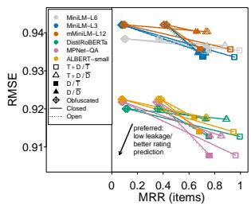
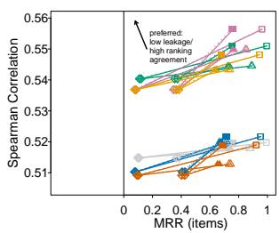
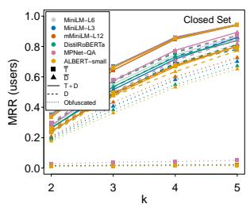
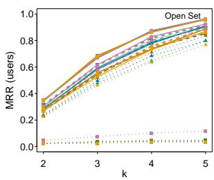

# Encoded but Exposed: Language Embeddings can Reveal More Than They Should in Recommender Systems

Linda Beková Rodrigo Alves

Czech Technical University in Prague

Prague, Czech Republic

bekovlin@fit.cvut.cz rodrigo.alves@fit.cvut.cz

Accepted for presentation at the 3rd Workshop on Evaluating and Applying Recommender Systems with Large Language Models (EARL 2026), co-located with the 35th ACM International Conference on Information and Knowledge Management (CIKM 2026), November 8, 2026, Rome, Italy.

## Abstract

Language embeddings are increasingly used in recommenders to represent item content, but their privacy risks remain poorly understood. We study whether item embeddings can reveal item identities when an adversary has access to auxiliary item text from external sources. We show that a simple cosine-similarity attack can recover item identities with high mean reciprocal rank across language models and candidate-set settings on two real-world datasets. Leakage is strongest when the adversary’s partial information overlaps with the victim representation, but it also persists through semantic alignment between independently sourced descriptions. We further show that item leakage can propagate to user re-identification from sparse ratings. Finally, we evaluate obfuscated descriptions as a mitigation and find a clear leakage–utility tradeof.

Keywords: Recommender Systems, Language Embeddings, Privacy Leakage

## 1 Introduction

Motivation Recommender Systems (RSs) rely on efective representations of users and items to capture preferences [13], intent [19], and contextual signals [2, 22]. Recent advances in language models have made it possible to derive richer representations from natural language data, such as item descriptions, reviews, and queries [39]. Consequently, natural language embeddings are increasingly used in both research [16, 32] and industrial settings [6, 15, 26] to support more accurate and context-aware recommendations.

Besides improving downstream recommendation tasks, language embeddings are often perceived as privacy-preserving because they are high-dimensional and not directly interpretable by humans. For instance, embedding representations of users and items are frequently shared with third-party service providers [8, 11, 36]. However, this assumption can be particularly fragile in recommendation system scenarios [3, 4]. Although a potential adversary may not have access to the original corpus used to generate the embeddings, domain knowledge and the abundance of publicly available item data [9, 10, 35] can make attacks more feasible than in settings where the underlying information is entirely internal or dificult to obtain. Therefore, even if an attacker does not have access to the exact movie plots used by a streaming provider to generate such embeddings, publicly available movie datasets [27, 28] can be used to construct a similar corpus, enabling efective inference attacks. Our work focuses on studying the robustness of item embeddings generated by diferent language models in recommender settings by examining whether it is possible to identify which items correspond to a given set of embeddings.

Related Literature Song and Raghunathan [29] provide a taxonomy of privacy attacks against embeddings, showing that the typical goals are to infer private attributes from embeddings (e.g., the title or genre of a movie) [12, 18, 30], determine whether specific data or contexts were used during training [21, 23], or reconstruct the original input text from its representation [12, 24]. Our work is more closely related to the first category. In this setting, the adversary is assumed to have access to the embedding function and to an auxiliary labeled dataset that contains labels of a discrete sensitive attribute. The attacker then learns a classifier over the embedding space in order to infer sensitive attributes directly from the embedding representations.

Attribute inference from embedding-based models has been studied as a privacy risk across domains. Prior work shows that text embeddings can encode sensitive attributes even when the original text is unavailable [41], and similar leakage has been observed in computer vision embeddings designed for utility tasks [1]. More broadly, [30] show that models can encode information beyond the training objective, a phenomenon they call overlearning. In RSs, this risk has mainly been studied for user representations: transferred [11] or graph-based [38] recommender embeddings can leak private user attributes, motivating recent attribute-unlearning and in-training defenses [7, 20, 36]. In contrast, our work shifts the focus to item-level privacy, treating item identity as a discrete sensitive attribute inferred from item embeddings.

Another line of work in RS privacy and security studies whether users or user-item interactions can be de-anonymized from recommendation data. Early work showed that sparse rating patterns are often distinctive enough to re-identify users in anonymized datasets [25]. Subsequent studies demonstrated that even without explicit demographics, rating behavior can reveal sensitive user attributes: for example, [34] infers user gender from ratings using only a small set of users with disclosed demographic labels. More recent work extends this perspective to membership inference, asking whether a user or a specific user–item interaction was part of a recommender’s training data [37, 40], and to cross-domain record linkage, where rating patterns are used to link user identities across datasets from diferent domains [31]. Our work connects to this direction by showing that item-level identity leakage can propagate to user-level privacy risks.

Contributions. Our contributions are as follows: we (i) formulate item-identity inference from exposed language embeddings in RSs; (ii) show substantial leakage across datasets, candidate settings, and models; (iii) study obfuscation and its leakage–utility tradeof; and (iv) show that item leakage can propagate to user re-identification.

## 2 Method

Problem Definition We consider a recommender in which users interact with items, such as movies, books, or products. Let U denote the set of users and I denote the set of items. Each item $i \in \mathcal { Z }$ is associated with textual information $x _ { i } \ ( \mathrm { e . g . }$ , movie description) and a discrete sensitive attribute $y _ { i }$ (resp., movie title). We denote the underlying victim’s corpus by $\mathcal { D } = \{ ( x _ { i } , y _ { i } ) : i \in \mathcal { I } \}$ which is not directly observed by the adversary. Instead, the recommendation provider may expose the semantic information only through embeddings $z _ { i } = \phi ( x _ { i } ) \in \mathbb { R } ^ { d }$ , where $\phi$ is an embedding function. In our setting, we assume that $\phi$ is a pretrained language model.

Aligned with prior work [29], we assume that the adversary has access to $\phi$ and to an auxiliary labeled dataset $\overline { { \mathcal { D } } } = \{ ( \overline { { x } } _ { j } , \overline { { y } } _ { j } ) \} _ { j = 1 } ^ { n }$ . This is particularly realistic in RSs settings, where the item domain is often known and large amounts of publicly available item information can be used to construct $\overline { { \mathcal { D } } } .$ The adversary embeds auxiliary data using $\phi$ and builds a classifier over the embedding space to infer the sensitive attribute from exposed embeddings. More formally, let $f _ { \overline { { \mathcal { D } } } }$ be the adversary classifier built using D, such that

$$
\hat { y } _ { i } = f _ { \overline { { \mathcal { D } } } } ( \phi ( x _ { i } ) ) ,\tag{1}
$$

where $\hat { y } _ { i }$ denotes the inferred item identity associated with the embedding of item i. We aim to quantify identity leakage as the adversary’s ability to recover $y _ { i }$ from the exposed embedding $\phi ( x _ { i } )$ , considering embeddings produced by diferent language models.

Adversary Scenarios In many RS domains, item text data is available outside the victim platform through, for instance, public catalogues, aggregators, or even AI-generated descriptions. For instance, movies can often be linked to resources such as IMDb or TMDb, which openly provide titles, plots, descriptions, and more. Such sources may allow an adversary to build an auxiliary catalogue I without access to the victim’s internal corpus. We distinguish two cases according to the overlap with the victim item set $\mathcal { T } \mathrm { i }$

• Closed candidate set: $\mathcal { T } = \overline { { \mathcal { T } } } ;$ the adversary matches exposed embeddings to known item identities.

• Open candidate set: $\mathcal { T } \subsetneq \overline { { \mathcal { T } } }$ ; the adversary retrieves victim items from a larger catalogue with distractors.

The open setting is strictly more challenging, as it adds candidate selection to the matching problem. Both cases are realistic: in some domains the relevant catalogue is nearly complete, while in others the attacker may only have access to a broader external catalogue whose overlap with the victim platform is unknown.

Item Identification Pipeline Given access to the auxiliary dataset ${ \overline { { \mathcal { D } } } } ,$ the adversary can construct embeddings that are directly comparable to the leaked victim embeddings. This allows the item-identification problem to be formulated as a candidate-ranking problem in the embedding space. In particular, for each candidate item $( \overline { { x } } _ { j } , \overline { { y } } _ { j } ) \in \overline { { D } }$ , we assume an adversary computes

$$
\overline { { z } } _ { j } = \phi ( \overline { { x } } _ { j } ) ,\tag{2}
$$

using the same model $\phi$ that generates the victim’s embeddings $z _ { i }$ . The adversary then defines a scoring function $g : \mathbb { R } ^ { d } \times \mathbb { R } ^ { d }  \mathbb { R }$ , which assigns a compatibility score between a leaked victim embedding and a candidate embedding. This function may be a fixed similarity measure, such as cosine similarity, or a learned model trained on the auxiliary dataset. For each victim embedding $z _ { i }$ , the adversary computes

$$
\pi _ { i } ( j ) = g ( z _ { i } , \overline { { z } } _ { j } ) , \qquad j \in \overline { { \mathcal { I } } } ,\tag{3}
$$

which induces a ranking over the candidate catalogue. Candidates with higher scores are considered more likely to correspond to the leaked embedding $z _ { i }$ . The resulting ranking can then be used to recover the victim item identity or to narrow the search space to a small set of plausible candidates. In this view, the scoring function $g$ provides a ranking-based formulation of $f _ { \overline { { \mathcal { D } } } }$ . Specifically, $f _ { \overline { { \mathcal { D } } } }$ returns the highest-scoring candidate identity,

$$
f _ { \overline { { \mathcal { D } } } } ( z _ { i } ) = \overline { { y } } _ { j ^ { * } } , \qquad j ^ { * } = \arg \operatorname* { m a x } _ { j \in \overline { { \mathcal { T } } } } g ( z _ { i } , \overline { { z } } _ { j } ) .\tag{4}
$$

Remark on the Known Embedding Function. We assume that the adversary knows and can use the embedding function ϕ, a common assumption in embedding privacy attacks [29]. This allows us to isolate item-identity leakage given a shared embedding space. We also conducted preliminary autoencoder experiments to identify an unknown encoder: for each candidate model with the same output dimensionality as the leaked embeddings, we trained an autoencoder on embeddings of auxiliary texts and compared its reconstruction error on the victim embeddings. Across the evaluated movie and book settings, the autoencoder trained on embeddings from the victim’s encoder consistently achieved the lowest reconstruction error. These results suggest that the encoder can be identified within the tested candidate set; they do not establish identification of arbitrary models or transformed embeddings.

## 3 Experiments

Experimental Setup and Reproducibility Details We instantiate the embedding function ϕ using six sentence-transformer models that are popular on Hugging Face and commonly used as of-the-shelf text encoders in the RS community:

• MiniLM-L6: all-MiniLM-L6-v2;

• MiniLM-L3: paraphrase-MiniLM-L3-v2;

• mMiniLM-L12: paraphrase-multilingual-MiniLM-L12-v2;

• DistilRoBERTa: all-distilroberta-v1;

• MPNet-QA: multi-qa-mpnet-base-dot-v1;

• ALBERT-small: paraphrase-albert-small-v2;

Thus, for the first three models, $z _ { i } \in \mathbb { R } ^ { 3 8 4 }$ ; for the last three, $z _ { i } \in \mathbb { R } ^ { 7 6 8 }$ . We use two established benchmark datasets from diferent domains (movies and books, respectively): MovieLens 32M [9] and GoodReads [33]. For each dataset, we retain the top 10K most popular items. For MovieLens, we use the victim corpus $x _ { i }$ collected in [14], while, for GoodReads, we use the metadata provided by the original dataset. We consider two victim-corpus settings: (D) item descriptions, corresponding to movie plots or book synopses, and (T + D) titles combined with descriptions. For the adversarial corpus $\bar { x } _ { i } ,$ , we consider two settings: (D) descriptions generated using gpt-oss-20b, and (T) titles only. Importantly, note that D and $\overline { { D } }$ come from diferent sources, so description-based identification reflects semantic similarity rather than text reuse.

To emulate the closed candidate set, we vary the number of items of the victim dataset, considering $| \mathcal { T } | ~ = ~ | \bar { \mathcal { T } } | ~ \in ~ \{ 1 0 0 0 , 3 0 0 0 , 5 0 0 0 \}$ . In contrast, for the open candidate set, we fix $| \bar { \mathcal { I } } | = 1 0 0 0$ and vary $| \mathcal { Z } | \in \{ 2 0 0 0 , 3 0 0 0 , 4 0 0 0 \}$ to capture diferent proportions between the leaked list and the full item set. For each combination of victim corpus, adversarial corpus, |I|, and |I|, we sample from the original dataset items uniformly at random according to the corresponding candidate-set setting. We instantiate the scoring function as cosine similarity, $g ( z _ { i } , \overline { { z } } _ { j } ) = z _ { i } ^ { \top } \overline { { z } } _ { j } / ( \| z _ { i } \| \| \overline { { z } } _ { j } \| )$ . This non-parametric choice allows us to measure identity leakage directly from the embedding space, without adding capacity through a learned attacker. As evaluation metric, we report mean reciprocal rank (MRR), a widely used retrieval measure defined as the average inverse rank of the correct item: higher values indicate better ranking, with 1 corresponding to rank 1 and 0.5 roughly to rank 2 on average.

Table 1: Item-identification MRR across datasets, candidate settings, embedding models, victim corpora, and adversarial corpora.
<table><tr><td rowspan=1 colspan=20>MiniLM-L6    MiniLM-L3  mMiniLM-L12DistilRoBERTa  MPNet-QA  ALBERT-smallA/V T + DD DT + DD D T + DD D T + DD D T + DD D T + DD D</td></tr><tr><td rowspan=12 colspan=2>T1000DClo set      T3000DMoovens         TD5000TD2000Open et      T3000D</td><td rowspan=1 colspan=2>1.000.91</td><td rowspan=1 colspan=1>0.15</td><td rowspan=1 colspan=2>0.970.78</td><td rowspan=1 colspan=1>0.12</td><td rowspan=1 colspan=2>0.950.79</td><td rowspan=1 colspan=1>0.14</td><td rowspan=1 colspan=2>1.000.92</td><td rowspan=1 colspan=1>0.17</td><td rowspan=1 colspan=2>0.980.89</td><td rowspan=1 colspan=1>0.12</td><td rowspan=1 colspan=2>0.960.78</td><td rowspan=1 colspan=1>0.12</td></tr><tr><td rowspan=1 colspan=2>0.800.79</td><td rowspan=1 colspan=1>0.46</td><td rowspan=1 colspan=2>0.770.730</td><td rowspan=1 colspan=1>.51</td><td rowspan=1 colspan=2>0.750.72</td><td rowspan=1 colspan=1>0.51</td><td rowspan=1 colspan=2>0.800.78</td><td rowspan=1 colspan=1>0.45</td><td rowspan=1 colspan=2>0.810.82</td><td rowspan=1 colspan=1>0.43</td><td rowspan=1 colspan=2>0.730.70</td><td rowspan=1 colspan=1>0.47</td></tr><tr><td rowspan=1 colspan=2>0.990.88</td><td rowspan=1 colspan=1>0.10</td><td rowspan=1 colspan=1>0.95</td><td rowspan=1 colspan=1>0.720</td><td rowspan=1 colspan=1>.08</td><td rowspan=1 colspan=2>0.920.740</td><td rowspan=1 colspan=1>.09</td><td rowspan=1 colspan=2>0.990.89</td><td rowspan=1 colspan=1>0.11</td><td rowspan=1 colspan=2>0.960.85</td><td rowspan=1 colspan=1>0.08</td><td rowspan=1 colspan=2>0.950.73</td><td rowspan=1 colspan=1>0.08</td></tr><tr><td rowspan=1 colspan=2>0.750.740</td><td rowspan=1 colspan=1>.37</td><td rowspan=1 colspan=1>0.71</td><td rowspan=1 colspan=1>0.67</td><td rowspan=1 colspan=1>0.41</td><td rowspan=1 colspan=2>0.690.66</td><td rowspan=1 colspan=1>0.41</td><td rowspan=1 colspan=2>0.750.73</td><td rowspan=1 colspan=1>0.36</td><td rowspan=1 colspan=2>0.760.76</td><td rowspan=1 colspan=1>0.35</td><td rowspan=1 colspan=2>0.680.64</td><td rowspan=1 colspan=1>0.37</td></tr><tr><td rowspan=1 colspan=2>0.990.86</td><td rowspan=1 colspan=1>0.08</td><td rowspan=1 colspan=1>0.94</td><td rowspan=1 colspan=1>0.69</td><td rowspan=1 colspan=1>0.06</td><td rowspan=1 colspan=1>0.91</td><td rowspan=1 colspan=1>0.71</td><td rowspan=1 colspan=1>0.08</td><td rowspan=1 colspan=2>0.990.88</td><td rowspan=1 colspan=1>0.09</td><td rowspan=1 colspan=2>0.950.83</td><td rowspan=1 colspan=1>0.06</td><td rowspan=1 colspan=1>0.93</td><td rowspan=1 colspan=1>0.71</td><td rowspan=1 colspan=1>0.06</td></tr><tr><td rowspan=1 colspan=2>0.730.71</td><td rowspan=1 colspan=1>0.33</td><td rowspan=1 colspan=1>0.68</td><td rowspan=1 colspan=1>0.640</td><td rowspan=1 colspan=1>.37</td><td rowspan=1 colspan=1>0.66</td><td rowspan=1 colspan=1>0.63</td><td rowspan=1 colspan=1>0.37</td><td rowspan=1 colspan=2>0.730.70</td><td rowspan=1 colspan=1>0.32</td><td rowspan=1 colspan=2>0.730.73</td><td rowspan=1 colspan=1>0.32</td><td rowspan=1 colspan=1>0.65</td><td rowspan=1 colspan=1>0.61</td><td rowspan=1 colspan=1>0.33</td></tr><tr><td rowspan=1 colspan=2>0.990.89</td><td rowspan=1 colspan=1>0.12</td><td rowspan=1 colspan=1>0.96</td><td rowspan=1 colspan=1>0.740</td><td rowspan=1 colspan=1>.09</td><td rowspan=1 colspan=1>0.93</td><td rowspan=1 colspan=1>0.760</td><td rowspan=1 colspan=1>.11</td><td rowspan=1 colspan=2>1.000.90</td><td rowspan=1 colspan=1>0.13</td><td rowspan=1 colspan=2>0.970.87</td><td rowspan=1 colspan=1>0.09</td><td rowspan=1 colspan=1>0.95</td><td rowspan=1 colspan=1>0.75</td><td rowspan=1 colspan=1>0.09</td></tr><tr><td rowspan=1 colspan=2>0.770.76</td><td rowspan=1 colspan=1>0.41</td><td rowspan=1 colspan=1>0.73</td><td rowspan=1 colspan=1>0.69</td><td rowspan=1 colspan=1>0.45</td><td rowspan=1 colspan=1>0.71</td><td rowspan=1 colspan=1>0.68</td><td rowspan=1 colspan=1>0.44</td><td rowspan=1 colspan=2>0.770.75</td><td rowspan=1 colspan=1>0.39</td><td rowspan=1 colspan=2>0.770.79</td><td rowspan=1 colspan=1>0.38</td><td rowspan=1 colspan=1>0.70</td><td rowspan=1 colspan=1>0.66</td><td rowspan=1 colspan=1>0.40</td></tr><tr><td rowspan=1 colspan=2>0.990.880</td><td rowspan=1 colspan=1>.10</td><td rowspan=1 colspan=1>0.95</td><td rowspan=1 colspan=1>0.720</td><td rowspan=1 colspan=1>.08</td><td rowspan=1 colspan=1>0.92</td><td rowspan=1 colspan=1>0.740</td><td rowspan=1 colspan=1>.10</td><td rowspan=1 colspan=2>1.000.89</td><td rowspan=1 colspan=1>0.11</td><td rowspan=1 colspan=2>0.960.85</td><td rowspan=1 colspan=1>0.08</td><td rowspan=1 colspan=1>0.95</td><td rowspan=1 colspan=1>0.73</td><td rowspan=1 colspan=1>0.08</td></tr><tr><td rowspan=1 colspan=2>0.750.74</td><td rowspan=1 colspan=1>0.37</td><td rowspan=1 colspan=1>0.71</td><td rowspan=1 colspan=1>0.67</td><td rowspan=1 colspan=1>0.41</td><td rowspan=1 colspan=1>0.69</td><td rowspan=1 colspan=1>0.66</td><td rowspan=1 colspan=1>0.41</td><td rowspan=1 colspan=2>0.750.73</td><td rowspan=1 colspan=1>0.36</td><td rowspan=1 colspan=2>0.760.76</td><td rowspan=1 colspan=1>0.35</td><td rowspan=1 colspan=1>0.68</td><td rowspan=1 colspan=1>0.64</td><td rowspan=1 colspan=1>0.37</td></tr><tr><td rowspan=2 colspan=1>4000 τD</td><td rowspan=1 colspan=2>0.990.87</td><td rowspan=1 colspan=1>0.09</td><td rowspan=1 colspan=1>0.95</td><td rowspan=1 colspan=1>0.71</td><td rowspan=1 colspan=1>0.07</td><td rowspan=1 colspan=1>0.91</td><td rowspan=1 colspan=1>0.72</td><td rowspan=1 colspan=1>0.08</td><td rowspan=1 colspan=2>0.990.88</td><td rowspan=1 colspan=1>0.10</td><td rowspan=1 colspan=2>0.960.84</td><td rowspan=1 colspan=1>0.07</td><td rowspan=1 colspan=1>0.94</td><td rowspan=1 colspan=1>0.72</td><td rowspan=1 colspan=1>0.07</td></tr><tr><td rowspan=1 colspan=2>0.740.72</td><td rowspan=1 colspan=1>0.35</td><td rowspan=1 colspan=1>0.69</td><td rowspan=1 colspan=1>0.65</td><td rowspan=1 colspan=1>0.39</td><td rowspan=1 colspan=1>0.67</td><td rowspan=1 colspan=1>0.64</td><td rowspan=1 colspan=1>0.39</td><td rowspan=1 colspan=2>0.740.71</td><td rowspan=1 colspan=1>0.34</td><td rowspan=1 colspan=2>0.740.75</td><td rowspan=1 colspan=1>0.33</td><td rowspan=1 colspan=1>0.67</td><td rowspan=1 colspan=1>0.62</td><td rowspan=1 colspan=1>0.35</td></tr><tr><td rowspan=12 colspan=1>Cloe setGoeadsOpen et</td><td rowspan=2 colspan=1>T1000D</td><td rowspan=1 colspan=1>0.95</td><td rowspan=1 colspan=1>0.683</td><td rowspan=1 colspan=1>0.37</td><td rowspan=1 colspan=1>0.87</td><td rowspan=1 colspan=1>0.54</td><td rowspan=1 colspan=1>0.28</td><td rowspan=1 colspan=1>0.73</td><td rowspan=1 colspan=1>0.45</td><td rowspan=1 colspan=1>0.34</td><td rowspan=1 colspan=1>0.95</td><td rowspan=1 colspan=1>0.69</td><td rowspan=1 colspan=1>0.41</td><td rowspan=1 colspan=2>0.910.66</td><td rowspan=1 colspan=1>0.34</td><td rowspan=1 colspan=1>0.90</td><td rowspan=1 colspan=1>0.59</td><td rowspan=1 colspan=1>0.31</td></tr><tr><td rowspan=1 colspan=1>0.92</td><td rowspan=1 colspan=1>0.710</td><td rowspan=1 colspan=1>.48</td><td rowspan=1 colspan=1>0.77</td><td rowspan=1 colspan=1>0.550</td><td rowspan=1 colspan=1>.44</td><td rowspan=1 colspan=1>0.60</td><td rowspan=1 colspan=2>0.44 0.46</td><td rowspan=1 colspan=1>0.93</td><td rowspan=1 colspan=1>0.71</td><td rowspan=1 colspan=1>0.51</td><td rowspan=1 colspan=2>0.870.67</td><td rowspan=1 colspan=1>0.44</td><td rowspan=1 colspan=1>0.84</td><td rowspan=1 colspan=1>0.61</td><td rowspan=1 colspan=1>0.43</td></tr><tr><td rowspan=2 colspan=1>TD3000</td><td rowspan=1 colspan=1>0.92</td><td rowspan=1 colspan=1>0.61</td><td rowspan=1 colspan=1>0.31</td><td rowspan=1 colspan=1>0.83</td><td rowspan=1 colspan=1>0.47</td><td rowspan=1 colspan=1>0.21</td><td rowspan=1 colspan=1>0.67</td><td rowspan=1 colspan=1>0.380</td><td rowspan=1 colspan=1>.27</td><td rowspan=1 colspan=1>0.92</td><td rowspan=1 colspan=1>0.63</td><td rowspan=1 colspan=1>0.34</td><td rowspan=1 colspan=1>0.87</td><td rowspan=1 colspan=1>0.60</td><td rowspan=1 colspan=1>0.28</td><td rowspan=1 colspan=1>0.87</td><td rowspan=1 colspan=1>0.52</td><td rowspan=1 colspan=1>0.25</td></tr><tr><td rowspan=1 colspan=1>0.88</td><td rowspan=1 colspan=1>0.63</td><td rowspan=1 colspan=1>0.40</td><td rowspan=1 colspan=1>0.71</td><td rowspan=1 colspan=1>0.470</td><td rowspan=1 colspan=1>.35</td><td rowspan=1 colspan=1>0.52</td><td rowspan=1 colspan=1>0.360</td><td rowspan=1 colspan=1>.38</td><td rowspan=1 colspan=1>0.89</td><td rowspan=1 colspan=1>0.64</td><td rowspan=1 colspan=1>0.43</td><td rowspan=1 colspan=1>0.82</td><td rowspan=1 colspan=1>0.60</td><td rowspan=1 colspan=1>0.36</td><td rowspan=1 colspan=1>0.79</td><td rowspan=1 colspan=1>0.53</td><td rowspan=1 colspan=1>0.35</td></tr><tr><td rowspan=2 colspan=1>T5000D</td><td rowspan=1 colspan=1>0.90</td><td rowspan=1 colspan=1>0.580</td><td rowspan=1 colspan=1>.28</td><td rowspan=1 colspan=1>0.81</td><td rowspan=1 colspan=1>0.44</td><td rowspan=1 colspan=1>0.19</td><td rowspan=1 colspan=1>0.64</td><td rowspan=1 colspan=1>0.34</td><td rowspan=1 colspan=1>0.25</td><td rowspan=1 colspan=1>0.90</td><td rowspan=1 colspan=1>0.59</td><td rowspan=1 colspan=1>0.31</td><td rowspan=1 colspan=1>0.85</td><td rowspan=1 colspan=1>0.56</td><td rowspan=1 colspan=1>0.25</td><td rowspan=1 colspan=1>0.86</td><td rowspan=1 colspan=1>0.49</td><td rowspan=1 colspan=1>0.23</td></tr><tr><td rowspan=1 colspan=1>0.86</td><td rowspan=1 colspan=1>0.60</td><td rowspan=1 colspan=1>0.36</td><td rowspan=1 colspan=1>0.67</td><td rowspan=1 colspan=1>0.430</td><td rowspan=1 colspan=1>.32</td><td rowspan=1 colspan=1>0.49</td><td rowspan=1 colspan=2>0.330.34</td><td rowspan=1 colspan=1>0.86</td><td rowspan=1 colspan=1>0.61</td><td rowspan=1 colspan=1>0.39</td><td rowspan=1 colspan=1>0.79</td><td rowspan=1 colspan=1>0.56</td><td rowspan=1 colspan=1>0.33</td><td rowspan=1 colspan=1>0.76</td><td rowspan=1 colspan=1>0.50</td><td rowspan=1 colspan=1>0.32</td></tr><tr><td rowspan=2 colspan=1>T2000D</td><td rowspan=1 colspan=1>0.93</td><td rowspan=1 colspan=1>0.64</td><td rowspan=1 colspan=1>0.64 0.33</td><td rowspan=1 colspan=1>0.84</td><td rowspan=1 colspan=1>0.500</td><td rowspan=1 colspan=1>.24</td><td rowspan=1 colspan=1>0.69</td><td rowspan=1 colspan=2>0.400.30</td><td rowspan=1 colspan=1>0.93</td><td rowspan=1 colspan=1>0.65</td><td rowspan=1 colspan=1>0.36</td><td rowspan=1 colspan=1>0.88</td><td rowspan=1 colspan=1>0.62</td><td rowspan=1 colspan=1>0.30</td><td rowspan=1 colspan=1>0.89</td><td rowspan=1 colspan=1>0.55</td><td rowspan=1 colspan=1>0.27</td></tr><tr><td rowspan=1 colspan=1>0.90</td><td rowspan=1 colspan=1>0.66</td><td rowspan=1 colspan=1>0.43</td><td rowspan=1 colspan=1>0.73</td><td rowspan=1 colspan=1>0.500</td><td rowspan=1 colspan=1>.38</td><td rowspan=1 colspan=1>0.55</td><td rowspan=1 colspan=2>0.390.41</td><td rowspan=1 colspan=1>0.90</td><td rowspan=1 colspan=1>0.67</td><td rowspan=1 colspan=1>0.46</td><td rowspan=1 colspan=1>0.84</td><td rowspan=1 colspan=1>0.62</td><td rowspan=1 colspan=1>0.39</td><td rowspan=1 colspan=1>0.81</td><td rowspan=1 colspan=1>0.56</td><td rowspan=1 colspan=1>0.38</td></tr><tr><td rowspan=2 colspan=1>T3000D</td><td rowspan=1 colspan=1>0.92</td><td rowspan=1 colspan=1>0.62</td><td rowspan=1 colspan=1>0.62 0.31</td><td rowspan=1 colspan=1>0.83</td><td rowspan=1 colspan=1>0.47</td><td rowspan=1 colspan=1>0.21</td><td rowspan=1 colspan=1>0.67</td><td rowspan=1 colspan=2>0.38 0.27</td><td rowspan=1 colspan=1>0.92</td><td rowspan=1 colspan=1>0.62</td><td rowspan=1 colspan=1>0.34</td><td rowspan=1 colspan=1>0.87</td><td rowspan=1 colspan=1>0.60</td><td rowspan=1 colspan=1>0.28</td><td rowspan=1 colspan=1>0.87</td><td rowspan=1 colspan=1>0.52</td><td rowspan=1 colspan=1>0.25</td></tr><tr><td rowspan=1 colspan=1>0.88</td><td rowspan=1 colspan=1>0.633</td><td rowspan=1 colspan=1>0.40</td><td rowspan=1 colspan=1>0.71</td><td rowspan=1 colspan=1>0.470</td><td rowspan=1 colspan=1>.35</td><td rowspan=1 colspan=1>0.53</td><td rowspan=1 colspan=2>0.36 0.38</td><td rowspan=1 colspan=1>0.89</td><td rowspan=1 colspan=1>0.64</td><td rowspan=1 colspan=1>0.42</td><td rowspan=1 colspan=1>0.82</td><td rowspan=1 colspan=1>0.60</td><td rowspan=1 colspan=1>0.36</td><td rowspan=1 colspan=1>0.79</td><td rowspan=1 colspan=1>0.54</td><td rowspan=1 colspan=1>0.35</td></tr><tr><td rowspan=2 colspan=1>TD4000</td><td rowspan=1 colspan=1>0.91</td><td rowspan=1 colspan=1>0.600</td><td rowspan=1 colspan=1>.29</td><td rowspan=1 colspan=1>0.82</td><td rowspan=1 colspan=1>0.45</td><td rowspan=1 colspan=1>0.20</td><td rowspan=1 colspan=1>0.66</td><td rowspan=1 colspan=2>0.36 0.26</td><td rowspan=1 colspan=1>0.91</td><td rowspan=1 colspan=1>0.61</td><td rowspan=1 colspan=1>0.32</td><td rowspan=1 colspan=1>0.86</td><td rowspan=1 colspan=1>0.58</td><td rowspan=1 colspan=1>0.27</td><td rowspan=1 colspan=1>0.87</td><td rowspan=1 colspan=1>0.50</td><td rowspan=1 colspan=1>0.24</td></tr><tr><td rowspan=1 colspan=1>0.87</td><td rowspan=1 colspan=1>0.62</td><td rowspan=1 colspan=1>0.38</td><td rowspan=1 colspan=1>0.69</td><td rowspan=1 colspan=1>0.44</td><td rowspan=1 colspan=1>0.33</td><td rowspan=1 colspan=1>0.51</td><td rowspan=1 colspan=2>0.340.36</td><td rowspan=1 colspan=1>0.87</td><td rowspan=1 colspan=1>0.62</td><td rowspan=1 colspan=1>0.41</td><td rowspan=1 colspan=1>0.80</td><td rowspan=1 colspan=1>0.58</td><td rowspan=1 colspan=1>0.34</td><td rowspan=1 colspan=1>0.77</td><td rowspan=1 colspan=2>0.510.33</td></tr></table>

Results. Table 1 shows that item embeddings exposed to the proposed attack can reveal substantial identity information across both datasets, candidate-set settings, and embedding models. Each entry is averaged over 100 random samples of I and I. Leakage is strongest when the victim corpus contains both title and description (T + D). In this setting, title-only auxiliary information (T) often yields high MRR, indicating that partial textual information available to the adversary can be suficient for accurate item identification in the evaluated candidate-set settings. The attack remains efective even when victim embeddings are computed from descriptions only (D). This indicates that item identity can be recovered not only from explicit information overlap, but also from semantic alignment. Moreover, MRR decreases only modestly as the candidate set grows in both the closed-set and open-set settings, showing that leakage is not limited to small catalogues. The same pattern holds across all six embedding models. Thus, increasing dimensionality alone does not remove item-identity information.

The two domains difer in the type of auxiliary information that is most efective. In MovieLens, title-based attacks are particularly strong, even when the victim embedding is built only from descriptions. This suggests strong lexical or semantic overlap between movie titles and plot summaries (e.g., title mentions or named entities). In GoodReads, title-based attacks remain efective when the victim representation includes titles, but description-based auxiliary information is often competitive, especially against description-only victim embeddings. This suggests that book identity relies more on semantic alignment than exact textual cues.

Leakage–Utility Tradeof. As a simple mitigation, the victim could replace the original item text (T + D or D) with obfuscated descriptions that preserve general semantics while removing explicit identifiers such as titles, actors, directors, producers, or franchise-specific names. To evaluate this strategy, we construct an obfuscated corpus $\tilde { D }$ for a random sample of 5000 movies using gpt-oss-20b. Each description is generated with a prompt that explicitly instructs the model to preserve the general plot semantics while excluding direct identifiers. The results are shown in the $\tilde { D }$ columns of Table 1. These results show that obfuscation substantially reduces identity leakage, especially for title-only attacks. In MovieLens, $\overline { { T } } .$ -based MRR drops from very high values under $T + D$ or D to roughly 0.06–0.17 across models and candidate settings, indicating that removing explicit identifiers largely breaks the title-driven matching efect. However, leakage remains non-negligible when the adversary uses auxiliary descriptions $( \overline { { D } } )$ with MRR typically around 0.32–0.51. Thus, obfuscated plots still preserve semantic information that can support partial item identification. Across candidate settings and embedding models, obfuscation consistently lowers MRR for all six encoders, but no model eliminates leakage.

  
Figure 1: Leakage–utility tradeof and user re-identification results on MovieLens. Left: obfuscation reduces item-identification MRR but degrades rating prediction and ranking agreement; right: sparse ratings enable user re-identification as k increases.

However, reducing identity leakage may also reduce the semantic expressiveness of the item embeddings. We therefore evaluate, on MovieLens, how obfuscated embeddings afect downstream recommendation quality, a typical task for which such embeddings are designed. To do so, we use an inductive matrix factorization [5, 17] model in which the rating matrix is approximated as

$$
R \approx M H ,\tag{5}
$$

where M is a learned low-rank user matrix that captures collaborative-filtering structure, and $H \in \{ T , D , \tilde { D } \}$ denotes the item embedding representation. For each combination of candidate setting, embedding model $\phi ,$ victim corpus ${ \mathcal { D } } ,$ and adversarial corpus ${ \overline { { \mathcal { D } } } } ,$ we evaluate the resulting representation along two dimensions: privacy leakage, measured by MRR, and downstream recommendation quality. We report RMSE to measure rating-prediction error and Spearman correlation to measure ranking agreement. In Figure 1, each point reports the average metric value over the candidate-set sizes $| \mathcal { T } |$ and $| \overline { { \mathcal { T } } } |$ , while the trajectories show the efect of replacing the original victim representation with the obfuscated corpus $\tilde { D }$ across the remaining experimental parameters. Across parameter combinations, obfuscation consistently reduces MRR, making item identities harder to recover. However, this privacy gain comes with a clear utility cost: $\tilde { D }$ increases RMSE and reduces Spearman correlation, indicating worse rating prediction and weaker preservation of recommendation ranking quality.

User Re-identification. Prior work has shown that sparse interaction data can be suficient to re-identify users under diferent contexts [25, 34, 40]. A common re-identification scenario assumes that the adversary observes a few interactions from a target user and attempts to locate the corresponding user in the rating matrix, thereby recovering their full interaction history. We adapt this setting to our item-identification scenario. Consider a target user $u ^ { \star }$ for whom the adversary observes a small set of k rated items, $A _ { u ^ { \star } } = \{ ( j , r _ { u ^ { \star } , j } ) \} _ { j = 1 } ^ { k }$ , where $j$ is an observed item and $r _ { u ^ { \star } , j }$ is the corresponding rating. Let $S$ be a matrix, with $\check { S } _ { i , j } = g ( \phi ( x _ { i } ) , \phi ( \overline { { x } } _ { j } ) )$ measuring the cosine similarity between a candidate item i from the victim catalogue D and an auxiliary item $j$ from ${ \overline { { \cal { D } } } } .$ . For each candidate user $u \in \mathcal { U }$ , we compute a matching score

$$
\mathrm { s c o r e } ( u ; A _ { u ^ { \star } } ) = \sum _ { ( j , y ) \in A _ { u ^ { \star } } } \operatorname* { m a x } _ { i \in \mathcal { L } : r _ { u , i } = y } S _ { i , j } ,\tag{6}
$$

with the corresponding term set to zero when user u has no item rated as $y .$ Candidate users are ranked by this score, and the true user $u ^ { \star }$ is evaluated by its rank. Similarly, we report MRR over target users, so higher values indicate that the target user is more easily re-identified.

The two right panels of Figure 1 show user-level re-identification performance on MovieLens as the number of observed items k increases (we consider the case $| \overline { { \mathcal { I } } } | = 3 0 0 0 )$ . In both the closed- and open-set settings, MRR increases rapidly with $k ,$ indicating that a small number of rated items is often suficient to identify the target user. Substantial reductions in user-level MRR occur only for obfuscated item representations under a title-only adversary. When the adversary uses auxiliary descriptions, however, re-identification remains efective, suggesting that semantic item similarity can link sparse user profiles even under obfuscation.

## 4 Conclusion

This work shows that natural-language item embeddings can expose substantial item-identity information in RSs settings. Even under a simple cosine-similarity attack, item identities can often be recovered with high MRR across datasets, candidate-set regimes, and embedding models. Leakage is strongest when the information available to the adversary (partially) overlaps with the victim representation, but it also persists for non-overlapping data, suggesting that identity can be encoded by semantic alignment rather than only by explicit identifiers. We further show that this leakage can propagate to user privacy, as sparse user interactions combined with item-similarity information can support user re-identification. Our results also highlight a leakage-utility tradeof: obfuscating item descriptions substantially reduces leakage, but also increases rating-prediction error and reduces ranking agreement, indicating a cost to downstream recommendation quality. These findings open several directions for future work, including stronger attack models, broader domains and catalogues, and defenses that reduce identity leakage while preserving the semantic information needed for accurate recommendation.

## GenAI Usage Disclosure

Generative AI was used in the research to generate auxiliary item descriptions and obfuscated item descriptions using gpt-oss-20b, as described in the experimental setup. Generative AI was also used during writing only to polish grammar.

## References

[1] Hossein Abedi Khorasgani, Noman Mohammed, and Yang Wang. Attribute inference privacy protection for pre-trained models. International Journal of Information Security, 23(3):2269–2285, 2024.

[2] Rodrigo Alves, Antoine Ledent, and Marius Kloft. Burst-induced multi-armed bandit for learning recommendation. In Proceedings of the 15th ACM Conference on Recommender Systems, pages 292–301, 2021.

[3] Joseph A Calandrino, Ann Kilzer, Arvind Narayanan, Edward W Felten, and Vitaly Shmatikov. " you might also like:" privacy risks of collaborative filtering. In 2011 IEEE symposium on security and privacy, pages 231–246. IEEE, 2011.

[4] Chih-Cheng Chang, Brian Thompson, Hui Wang, and Danfeng Yao. Towards publishing recommendation data with predictive anonymization. In Proceedings of the 5th ACM Symposium on Information, Computer and Communications Security, pages 24–35, 2010.

[5] Kai-Yang Chiang, Inderjit S Dhillon, and Cho-Jui Hsieh. Using side information to reliably learn low-rank matrices from missing and corrupted observations. Journal of Machine Learning Research, 19(76):1–35, 2018.

[6] Zeyu Cui, Jianxin Ma, Chang Zhou, Jingren Zhou, and Hongxia Yang. M6-rec: Generative pretrained language models are open-ended recommender systems. arXiv preprint arXiv:2205.08084, 2022.

[7] Xiaohua Feng, Yuyuan Li, Fengyuan Yu, Ke Xiong, Junjie Fang, Li Zhang, Tianyu Du, and Chaochao Chen. Raid: An in-training defense against attribute inference attacks in recommender systems. arXiv preprint arXiv:2504.11510, 2025.

[8] Chen Gao, Yong Li, Fuli Feng, Xiangning Chen, Kai Zhao, Xiangnan He, and Depeng Jin. Crossdomain recommendation with bridge-item embeddings. ACM Transactions on Knowledge Discovery from Data (TKDD), 16(1):1–23, 2021.

[9] F Maxwell Harper and Joseph A Konstan. The movielens datasets: History and context. Acm transactions on interactive intelligent systems (tiis), 5(4):1–19, 2015.

[10] Yupeng Hou, Jiacheng Li, Zhankui He, An Yan, Xiusi Chen, and Julian McAuley. Bridging language and items for retrieval and recommendation. arXiv preprint arXiv:2403.03952, 2024.

[11] Guangneng Hu and Qiang Yang. Privnet: Safeguarding private attributes in transfer learning for recommendation. In Findings of the Association for Computational Linguistics: EMNLP 2020, pages 4506–4516, 2020.

[12] Yu-Hsiang Huang, Yuche Tsai, Hsiang Hsiao, Hong-Yi Lin, and Shou-De Lin. Transferable embedding inversion attack: Uncovering privacy risks in text embeddings without model queries. In Proceedings of the 62nd Annual Meeting of the Association for Computational Linguistics (Volume 1: Long Papers), pages 4193–4205, 2024.

[13] Olivier Jeunen, Jan Van Balen, and Bart Goethals. Embarrassingly shallow auto-encoders for dynamic collaborative filtering. User Modeling and User-Adapted Interaction, 32(4):509–541, 2022.

[14] Krishna Kamath. MovieLens-32M Movies Enriched with SIDs. https://huggingface.co/datas ets/krishnakamath/movielens-32m-movies-enriched-with-SIDs, 2024. Hugging Face dataset. Accessed: 2026-05-26.

[15] Petr Kasalick\`y, Martin Spišák, Vojtěch Vančura, Daniel Bohuněk, Rodrigo Alves, and Pavel Kordík. The future is sparse: Embedding compression for scalable retrieval in recommender systems. In Proceedings of the Nineteenth ACM Conference on Recommender Systems, pages 1099–1103, 2025.

[16] Ngoc Luyen Le and Marie-Hélène Abel. Enhancing recommender systems using textual embeddings from pre-trained language models. In International Conference on Information Technology & Systems, pages 93–103. Springer, 2025.

[17] Antoine Ledent, Rodrigo Alves, and Marius Kloft. Orthogonal inductive matrix completion. IEEE Transactions on Neural Networks and Learning Systems, 34(5):2259–2270, 2021.

[18] Haoran Li, Mingshi Xu, and Yangqiu Song. Sentence embedding leaks more information than you expect: Generative embedding inversion attack to recover the whole sentence. In Findings of the Association for Computational Linguistics: ACL 2023, pages 14022–14040, 2023.

[19] Haoyang Li, Xin Wang, Ziwei Zhang, Jianxin Ma, Peng Cui, and Wenwu Zhu. Intention-aware sequential recommendation with structured intent transition. IEEE Transactions on Knowledge and Data Engineering, 34(11):5403–5414, 2021.

[20] Yuyuan Li, Junjie Fang, Fengyuan Yu, Xichun Sheng, Tianyu Du, Xuyang Teng, Shaowei Jiang, Linbo Jiang, Jianan Lin, and Chaochao Chen. Fedau2: Attribute unlearning for user-level federated recommender systems with adaptive and robust adversarial training. In Proceedings of the AAAI Conference on Artificial Intelligence, volume 40, pages 23310–23318, 2026.

[21] Saeed Mahloujifar, Huseyin A Inan, Melissa Chase, Esha Ghosh, and Marcello Hasegawa. Membership inference on word embedding and beyond (2021). arXiv preprint arXiv:2106.11384, 2021.

[22] Pablo Mateos and Alejandro Bellogín. A systematic literature review of recent advances on contextaware recommender systems. Artificial Intelligence Review, 58(1):20, 2024.

[23] Justus Mattern, Fatemehsadat Mireshghallah, Zhijing Jin, Bernhard Schölkopf, Mrinmaya Sachan, and Taylor Berg-Kirkpatrick. Membership inference attacks against language models via neighbourhood comparison. In Findings of the Association for Computational Linguistics: ACL 2023, pages 11330– 11343, 2023.

[24] John Morris, Volodymyr Kuleshov, Vitaly Shmatikov, and Alexander M Rush. Text embeddings reveal (almost) as much as text. In Proceedings of the 2023 Conference on Empirical Methods in Natural Language Processing, pages 12448–12460, 2023.

[25] Arvind Narayanan and Vitaly Shmatikov. Robust de-anonymization of large sparse datasets. In 2008 IEEE Symposium on Security and Privacy (sp 2008), pages 111–125. IEEE, 2008.

[26] Yabo Ni, Cao Yuanpeng, Wenhang Zhou, Bangyang Hong, Zhongyi Zhang, Enlei Cai, Kangle Wu, Anxiang Zeng, Han Yu, and Xiaoxiao Li. Treebridge: Aligning llm embeddings in industrial recommender systems. In Proceedings of the AAAI Conference on Artificial Intelligence, volume 40, pages 40370–40377, 2026.

[27] Andrei Oghina, Mathias Breuss, Manos Tsagkias, and Maarten De Rijke. Predicting imdb movie ratings using social media. In European conference on information retrieval, pages 503–507. Springer, 2012.

[28] M Fauzan Sayifullah, Ulfatun Nadifa, Wahab Musa, Rahmat Hidayat Dongka, Ade irawaty Tolango, and Zainudin Bonok. Exploratory data analysis on tmdb top rated movies dataset using winsorization approach. International Journal of Embedded Computer Engineering, 1(1):18–25, 2026.

[29] Congzheng Song and Ananth Raghunathan. Information leakage in embedding models. In Proceedings of the 2020 ACM SIGSAC conference on computer and communications security, pages 377–390, 2020.

[30] Congzheng Song and Vitaly Shmatikov. Overlearning reveals sensitive attributes. arXiv preprint arXiv:1905.11742, 2019.

[31] Nicolás Torres and Patricio Olivares. De-anonymizing users across rating datasets via record linkage and quasi-identifier attacks. Data, 9(6):75, 2024.

[32] Arpita Vats, Rahul Raja, Vinija Jain, and Aman Chadha. Exploring the impact of large language models on recommender systems: An extensive review. In 2025 IEEE International Conference on Big Data (BigData), pages 3081–3090. IEEE, 2025.

[33] Mengting Wan and Julian McAuley. Item recommendation on monotonic behavior chains. In Proceedings of the 12th ACM conference on recommender systems, pages 86–94, 2018.

[34] Udi Weinsberg, Smriti Bhagat, Stratis Ioannidis, and Nina Taft. Blurme: Inferring and obfuscating user gender based on ratings. In Proceedings of the sixth ACM conference on Recommender systems, pages 195–202, 2012.

[35] Fangzhao Wu, Ying Qiao, Jiun-Hung Chen, Chuhan Wu, Tao Qi, Jianxun Lian, Danyang Liu, Xing Xie, Jianfeng Gao, Winnie Wu, and Ming Zhou. Mind: A large-scale dataset for news recommendation. In Proceedings of the 58th Annual Meeting of the Association for Computational Linguistics, pages 3597–3606, 2020.

[36] Wenhan Wu, Jiawei Jiang, and Chuang Hu. Aegis: Post-training attribute unlearning in federated recommender systems against attribute inference attacks. In Proceedings of the ACM on Web Conference 2025, pages 3783–3793, 2025.

[37] Minxing Zhang, Zhaochun Ren, Zihan Wang, Pengjie Ren, Zhunmin Chen, Pengfei Hu, and Yang Zhang. Membership inference attacks against recommender systems. In Proceedings of the 2021 ACM SIGSAC Conference on Computer and Communications Security, pages 864–879, 2021.

[38] Shijie Zhang, Hongzhi Yin, Tong Chen, Zi Huang, Lizhen Cui, and Xiangliang Zhang. Graph embedding for recommendation against attribute inference attacks. In Proceedings of the Web Conference 2021, pages 3002–3014, 2021.

[39] Zihuai Zhao, Wenqi Fan, Jiatong Li, Yunqing Liu, Xiaowei Mei, Yiqi Wang, Zhen Wen, Fei Wang, Xiangyu Zhao, Jiliang Tang, et al. Recommender systems in the era of large language models (llms). IEEE Transactions on Knowledge and Data Engineering, 36(11):6889–6907, 2024.

[40] Da Zhong, Xiuling Wang, Zhichao Xu, Jun Xu, and Wendy Hui Wang. Interaction-level membership inference attack against recommender systems with long-tailed distribution. In Proceedings of the 33rd ACM International Conference on Information and Knowledge Management, pages 3433–3442, 2024.

[41] Zhihao Zhu, Ninglu Shao, Defu Lian, Chenwang Wu, Zheng Liu, Yi Yang, and Enhong Chen. Understanding privacy risks of embeddings induced by large language models. arXiv preprint arXiv:2404.16587, 2024.