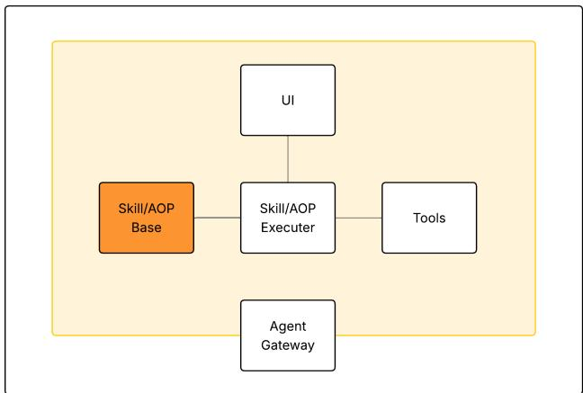
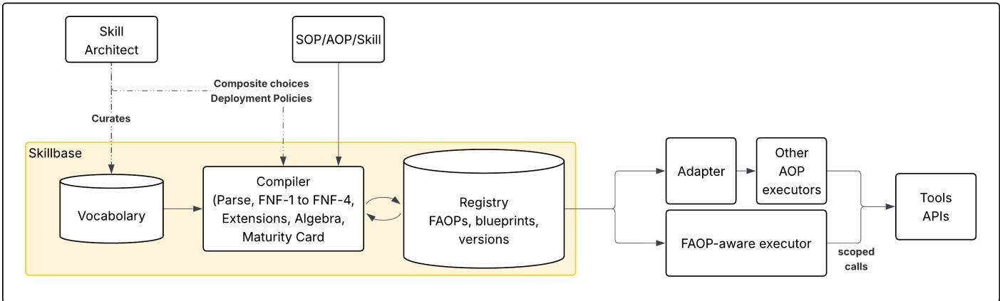

# FAOPs: Normal Forms and an Algebra for AI Agent Workflows

Ali M. Shanghooshabad

JPMorgan Chase & Co.

shanghoosh@gmail.com ali.shanghooshabad@jpmorgan.com

## Abstract

Organizations increasingly encode operational procedures as multi-step agent skills, here called Agent Operating Procedures (AOPs), that must be traceable, auditable, reproducible, access-controlled, and bounded in time and cost, requirements that regulated sectors make mandatory. Yet AOPs are typically kept as coarse-grained files, in which steps bundle actions, copied procedures drift apart, any step may reach any tool, and refactoring goes unchecked. We present Functional Agent Operating Procedures (FAOP), a formal theory that brings database-grade discipline to AI agent workflows. FAOP recasts each workflow as a typed function over scoped state and subjects an entire library to four progressive normal forms: Decomposed (FNF-1) splits a workflow into atomic steps, Typed (FNF-2) makes its data flow explicit and type-checked, Factored (FNF-3) gives each shared procedure a single canonical definition so a change propagates instead of drifting, and Scoped (FNF-4) confines every step to least-privilege tool access. Once normalized, every atomic step is a separate entity with a declared contract and can be type-checked, scope-confined, bounded, tested, traced, and audited on its own. A FAOP algebra of provably sound equalities turns refactoring and parallelization into compiler rewrites; orthogonal extensions add verified termination (+V), optimization (+O), and time and cost bounds (+B); and an architectural-level classifier (0–3) determines whether a workflow needs AI at all. Together, these make integrity, isolation, typing, termination, cost, and optimization compile-time concerns across the whole library, not runtime hopes. We implement the theory in SkillBase, an AOP management system (what PostgreSQL is to data, SkillBase is to AOPs), together with a separate executor that enforces these guarantees at run time. A worked financial workflow illustrates the approach end to end.

## 1 Introduction

AI agents are entering the operational core of organizations, most visibly in regulated industries. A bank runs an agent to onboard a client through KYC, an insurer to investigate a claim for fraud, a hospital to secure prior authorization for a procedure, a law firm to review a contract for non-standard clauses, and so on. In each case a decision is acceptable only when the institution can show exactly how it was reached: which steps ran, in what order, on which data, under which permissions, and with what result, reproducibly and open to audit by a regulator. Any production agent workflow must therefore be traceable, auditable, reproducible, access-controlled, and bounded in time and cost; in regulated industries these are not optional qualities but conditions of deployment. None of them is supplied by the language model itself; each is a property of the multi-step workflow built around it.

The reusable unit of agent behavior is the skill: an artifact stored outside the model’s weights that tells an agent how to perform a task, and that can be versioned, retrieved, and executed without retraining [1, 2]. Skills range from a single wrapped tool call to a composite procedure with its own control flow [1]. This paper concerns the composite, operational kind: the multi-step procedure an institution would otherwise write as a Standard

Operating Procedure (SOP) for a person to follow. We call its agent-executable form an Agent Operating Procedure (AOP).<sup>1</sup> An AOP is thus a workflow-shaped skill, and its steps are themselves skills: primitive actions, or calls to other AOPs.

Every AOP has the same shape:

$$
\begin{array} { c } { { \mathrm { A O P = \langle n a m e , d e s c r i p t i o n , i n p u t s , } } } \\ { { \mathrm { o u t p u t s , b o d y \rangle . } } } \end{array}
$$

The name and description make it discoverable; the inputs and outputs type its interface; the body holds the ordered steps.

Because an AOP lives outside the model’s weights, proprietary procedures stay confidential rather than baked into external weights, a procedure survives model upgrades and provider changes, and shared sub-procedures are reused across workflows rather than reimplemented. These properties are why organizations build libraries of reusable AOPs that agents draw on at runtime, increasingly populated not only by hand but by generators that emit many from natural-language descriptions or existing operational knowledge (Section 6.2). How an AOP is discovered, retrieved, or activated over such a library is a separate lifecycle concern we do not address [3]; ou subject is the body: its structure, its composition, and the guarantees a compiler can establish over it before the workflow runs.

  
Figure 1: The AOP executor pattern. A single generic agent executes any workflow; only the AOP body and the tool list change per use case. Separating what the workflow does from how it runs makes the executor a single point at which typing and tool access can be enforced.

The high-level architecture is simple (Figure 1). A single generic agent executor (commonly a loop of reason, act, and observe [4], though the exact implementation varies by team) takes two inputs that change per workflow: an AOP describing the steps, and a list of tools the agent may call. A deployed system usually adds a user or agent interface and a gateway that mediates access to external agents and tools. The executor itself does not change: to deploy a new workflow, one writes a new AOP and configures a new tool list, and the same agent code runs onboarding, compliance checks, payment processing, and more. This separation of what from how is also what makes development fast: because the executor is fixed and runs any AOP, shipping a new agent collapses to authoring one AOP, with no bespoke orchestration code to write, test, or deploy.

This design works in the small but strains at scale. A bank may run thousands of AOPs that share subprocedures (client lookup, compliance checks, document validation) copy-pasted as text, so a single change such as a new compliance rule must be re-applied by hand in many places while the copies drift silently and nothing records which AOP depends on which. Access control is often equally unstructured: tools are commonly granted to the AOP as a whole rather than to individual steps, so a single prompt injection can reach any of them, and the only “boundary” is a comment the model may or may not honor.

## 1.1 The Problem: AOPs at Scale

These failures are symptoms of one structural fault: an AOP is treated as an opaque monolith (authored, tested, deployed, observed, and governed as one indivisible unit), so nothing below the whole workflow can be reused, typechecked, tested, scoped, or traced on its own. From this fault follow the defects an AOP library accrues as it grows from a handful of workflows into a governed catalog of thousands, the problem this paper addresses:

• Integrity across the library. Shared subprocedures are copy-pasted and drift out of sync; inter-AOP dependencies are invisible, so a change breaks dependents without warning; agent-to-agent calls can form unbounded cycles; and with no shared vocabulary (client\_id versus id\_client) nothing composes.

• Correctness within a workflow. State is often untyped, so a step can read a field no earlier step produced; loops may run unbounded and branches may be dead (unreachable); and no time or cost bound is declared or checked.

• Isolation. Steps are rarely confined to the tools and data they need, so the blast radius of a single compromised step can be the entire AOP.

• Composition and governance. Existing algebras for composing LLM steps establish only identity and associativity [5, 6], so none has a law that reorders a sequence of independent steps or runs them in parallel; and the choice between no AI, an LLM as a tool, and a planner is made with no formal basis.

These failures are already documented at scale: a data-driven study of 40,285 published skills reports widespread intent-level redundancy and skills that take unscoped state-changing or system-level actions [7], a recent survey reports that 26.1% of communitycontributed skills contain vulnerabilities [8], and loading skills is itself shown to induce hundreds of task failures and eficiency regressions [9]. Normalization breaks the monolith into typed, independently checkable steps (each reused, tested, bounded, scoped, and observed in isolation), which is what turns every defect above into an enforceable guarantee.

This paper gives AOPs that discipline. We introduce FAOPs: each workflow recast as a typed function over scoped state, normalized through four progressive normal forms and a companion algebra of provably sound equalities, so that integrity, isolation, typing, termination, cost, and optimization become compile-time concerns across the whole library, not runtime hopes.

## 1.2 A Relational Analogy

AOP libraries are not the first to fail this way. Before Codd [10], data lived in flat files in which every row repeated everything (Table 1). Such files had four structural defects: redundancy (Alice’s address and branch manager repeat on every row), broken integrity (update one row, miss another, and the file contradicts itself), uncontrolled access (anyone who reads the file reads everything), and no optimization (every query scans every row). The answer, begun by Codd, was not a better file but a theory: normal forms, a relational algebra, and schemas that enforce integrity and access by construction.

Table 1: A flat, pre-normalization loan file.
<table><tr><td>LoanID</td><td>Customer</td><td>Address</td><td>Phone</td><td>Branch</td><td>BranchMgr</td><td>Amount</td></tr><tr><td>L001</td><td>Alice</td><td>10 Main St</td><td>555-1234</td><td>Downtown</td><td>Diana</td><td>50,000</td></tr><tr><td>L002</td><td>Alice</td><td>10 Main St</td><td>555-1234</td><td>Downtown</td><td>Diana</td><td>25,000</td></tr><tr><td>L003</td><td>Carol</td><td>7 Oak Ave</td><td>555-5678</td><td>Uptown</td><td>Dave</td><td>80,000</td></tr></table>

An AOP library is typically prone to the same four defects: procedures are copied, copies drift apart, any step may reach any tool, and refactoring goes unchecked. FAOP gives it the same three answers (normal forms, an algebra, and typed, scoped contracts in place of schemas) and the same new role: the Skill Architect, who designs, normalizes, and governs an organization’s AOP library, the DBA of the agentic era.

## 1.3 Contributions

Our contributions are as follows:

1. A formal definition of FAOPs as typed, composable functions over scoped state, with explicit scope boundaries per step (Section 2).

2. A FAOP algebra with equational laws (commutativity of independent steps, associativity of sequential composition, branch distribution, and fold/unfold) that enable meaning-preserving refactoring and automatic parallelization of independent steps (Section 3.5).

3. Four progressive normal forms (FNF-1 through FNF-4) that incrementally guarantee atomicity, type safety, composition without duplication over an acyclic call graph that removes the recursion anomaly (a workflow that silently calls itself and never terminates), and compile-time scope confinement, whereby each step declares the tools it may use and the compiler rejects any step that exceeds its parent’s permissions, so privilege escalation through composition is caught before deployment; the SOP/AOP/skill-to-FAOP translation is realized as FNF-1’s first activity (Section 3). Additional behavioral properties, namely verified termination and reachability (+V), semantics-preserving optimization such as parallelization (+O), and time and cost bounds (+B), are formalized as orthogonal extensions on top of the four normal forms.

4. A compilation pipeline and registry: the compiler checks structural errors (dead states, type mismatches, scope violations, unreachable branches, and cyclic dependencies) before any runtime artifact is generated, and the registry’s impact analysis names every dependent workflow when a shared AOP changes, eliminating silent breakage (Section 4).

5. SkillBase, a reference implementation of an AOP management system (a vocabulary, compiler, and registry) that compiles a normalized AOP into an executable blueprint for the FAOP executor (Section 4).

6. An architectural-level classification (Level 0–3) computed from the normalized body, distinguishing a deterministic workflow, an LLM-as-tool agent, and selector/generator planners, giving organizations a formal basis for deciding whether a use case needs AI and how it must be governed (Section 3.7).

FAOP is to AOPs what relational theory is to data, and SkillBase is to an AOP library what PostgreSQL is to spreadsheets: the theory stands alone and can be applied by hand, but the tooling makes it practical at scale.

## 2 The FAOP Formalism

This section gives the formal definition of FAOPs, the primitive operators they are built from, and how those primitives combine into composite FAOPs.

## 2.1 Definition

Let V be a fixed vocabulary of typed field names. A state S is a finite map from a subset of V to typed values; we write $S \subseteq S ^ { \prime }$ when every field of S occurs in $S ^ { \prime }$ with the same type.

Definition 1 (FAOP). A Functional Agent Operating Procedure is a 5-tuple

$$
F = ( i d , \ n , \ d , \ b , \ \Sigma ) ,
$$

where id is a unique versioned registry key; n and d are a human-readable name and a semantic description used for discovery; b is the body, a term in the grammar of Section 2.3 from which the typed function $f : S _ { i n } ( F ) $ $S _ { o u t } ( F )$ is derived by Convention 1; and Σ is the scope, the tools F may use and the guardrails it must enforce (Section 3.4).

Convention 1 (State threading and scope). The workflow carries a state: a record mapping field names to values, threaded through the steps as in a functional program: each step reads the fields it needs and adds the fields it produces, then passes the updated record on. Crucially, every FAOP runs in its own scope, like a function call: it sees only the fields its caller passes in $( S _ { i n } )$ together with the local fields it computes itself, never another FAOP’s internals, and it returns to the caller only its declared outputs $( S _ { o u t } )$ . If two steps in the same body write the same field, the later one wins; we write $S \uplus S ^ { \prime }$ for this update.

Each step reads its inputs from the running record, with FNF-2 (Section 3.2) checking those fields are present; a faithful executor realizes each invocation as a functioncall scope (a fresh frame per call, its locals discarded on return), so the later-write-wins update of ⊎ occurs only between steps of the same body, never across a call boundary or between concurrent siblings.

## 2.2 Primitive Operators

FAOP fixes six primitives, together with a call form that references a registered FAOP by identity. Let f, g range over FAOPs and $p : S  \{ \mathrm { t r u e , f a l s e } \}$ over typed predicates.

Table 2: Primitive FAOP operators.
<table><tr><td>Primitive</td><td>Notation</td><td>Reading</td></tr><tr><td>Action</td><td> $a : S \to S ^ { \prime }$ </td><td>any single unit of work (for exam- ple, a tool call)</td></tr><tr><td>Sequence</td><td> $s e q ( f , g )$ </td><td>apply f, then g</td></tr><tr><td>Branch</td><td> $i f ( p , f , g )$ </td><td>apply f if p(S), else g</td></tr><tr><td>Loop</td><td> $l o o p ( f , p )$ </td><td>apply f until p(S)</td></tr><tr><td>Interrupt</td><td> $\iota ( q , k )$ </td><td>suspend with query q; resume by passing the response to continua-</td></tr><tr><td>Checkpoint X</td><td></td><td>tion k persist the running state to inter- nal storage</td></tr><tr><td>Call</td><td>call(id)</td><td>call the registered FAOP id in its own scope (a function call)</td></tr></table>

## 2.3 Composite FAOPs

A body is a term in the grammar

$$
\begin{array} { r } { b \mathrel { : } \mathrel { : } = a \mid s e q ( b _ { 1 } , \ldots , b _ { n } ) \mid i f ( p , b _ { 1 } , b _ { 2 } ) \qquad } \\ { \mid l o o p ( b , p ) \mid \iota ( q , k ) \mid \chi \mid c a l l ( \mathrm { i d } ) . } \end{array}
$$

A FAOP is a leaf when its body has no sub-bodies (an action a, interrupt $\iota ,$ checkpoint χ, or call call(id)), and a composite when its body is a seq, if , or loop combining sub-bodies. Each call(id) resolves, in the ambient registry R, to the body of $\mathcal { R } [ \mathrm { i d } ]$

Structural graphs. The grammar and registry give rise to four graphs the paper keeps strictly separate. Three are structural: the body tree is one $\mathrm { F A O P \mathrm { { _ { S } } } }$ abstract syntax tree (internal nodes seq, if , loop; leaves a, ι, χ, or call(id)), finite and acyclic by construction; the execution graph is a single runtime trace, in which cycles arise only from loop and termination is governed by the loop predicate; and the call graph below is the one later sections depend on. A fourth, the data-dependence graph, is not given by the grammar but derived from the FNF-2 schemas, and is introduced with the algebra for optimization analysis (Convention 3, Section 3.5).

Convention 2 (Call graph). Nodes are registered FAOPs, not AST nodes. An edge $F  F ^ { \prime }$ exists whenever b(F) contains $c a l l ( i d ( F ^ { \prime } ) )$ at any depth; a shared sub-FAOP has several in-edges. Cycles are forbidden, so the call graph is a directed acyclic graph: a cyclic registry would block topological compilation, type-checking, and impact analysis (Section 4). Why this acyclicity also rules out silently non-terminating recursion is taken up in FNF-3 (Section 3.3) and +V (Section 3.6.2).

Inlining a call(id) (substituting the callee’s body, which the acyclic call graph makes possible) is a semantic rewrite that preserves the callee’s scope (Convention 1): each call site gets its own copy with its own locals, and a fully inlined body is a finite tree of primitives equal in meaning to the original.

Referential transparency. Because R resolves each identifier to exactly one body, call(id) and $\mathcal { R } [ \mathrm { i d } ]$ are interchangeable at any position without changing $S _ { i n } , S _ { o u t } ,$ or behavior. We rely on this throughout to justify inlining, extraction, and the algebraic rewrites of Section 3.5. The grammar is expressive enough to encode any workflow: by the structured program theorem of Böhm and Jacopini [11], sequence, selection, and iteration over atomic actions (which FAOP provides as seq, if , loop, and the action a) express any control flow drawable as a flowchart. The remaining primitives extend this core rather than narrow it: ι adds external suspension and resumption for human or agent input, χ adds state persistence, and each call(id) abbreviates a registered body. None of these restricts the class of expressible workflows, so completeness still holds.

## 3 Normal Forms and Extensions

Normalization reshapes a workflow library without changing the work it denotes. By normalization we mean transforming a workflow from one form into an equivalent one that resolves a specific class of anomaly. Its input is the firm’s whole library of source artifacts (Standard Operating Procedures, Agent Operating Procedures, or framework skills), typically many interconnected workflows that share steps, call one another, and evolve independently. Each is usually written as prose or thin pseudo-code for an LLM to follow, and the output is a registry of typed, composable FAOPs that a compiler can check. The four normal forms apply in order, and each is named for the anomaly it removes, just as each relational normal form is named for an update, insertion, or deletion anomaly it rules out:

• FNF-1 removes the compound-step anomaly (a leaf that bundles several efects, so it cannot be tested, traced, retried, or priced on its own) by splitting it into atomic steps.

• FNF-2 removes the missing-field anomaly (a step that reads a field no earlier step produced) by typing the data flow.

• FNF-3 removes the duplication anomaly (a shared sub-procedure copied across workflows and drifting out of sync, the workflow form of the update anomaly) by factoring it into one canonical FAOP the others call.

• FNF-4 removes the escalation anomaly (a step that reaches a tool, or sheds a guardrail, its parent never granted) by confining each child’s scope to its parent’s.

The forms are progressive: each takes the previous as given.

Running example. Examples in this section are drawn from one synthetic finance workflow, issue\_statement.v1, which issues a monthly account statement; Appendix A works it end to end, one normal form at a time. Every example in this paper is synthetic and is used only to illustrate the formalism; it does not describe the internal workflow of any institution and is not intended to mirror how such a task is built in practice.

## 3.1 FNF-1 Decomposed

FNF-1 is the decomposition normal form, the analog of first normal form. Just as 1NF requires every cell of a relation to hold one atomic value, FNF-1 requires every leaf of a workflow to perform one atomic unit of work. The grammar of Section 2.3 permits a leaf to do several things at once; FNF-1 is the constraint that removes this freedom and, in doing so, turns a source artifact into a registry of atomic FAOPs.

The input is prose: a single AOP sentence may hide a database read, an external call, and a model call at once. Reaching FNF-1 therefore proceeds in two coupled activities.

Making steps explicit. The workflow is first expressed in the grammar of Section $2 . 3 ,$ so that every step becomes an explicit FAOP rather than a clause inside a sentence. Sequential text becomes seq; alternatives become $i f ;$ repetition becomes loop; an explicit human question becomes ι; a persistence point becomes $\chi ;$ and a call to a known registered procedure becomes call(id). The Skill Architect may write this body directly, or a translator model may propose it for architect review; either way the result is an initial registry $\mathcal { R } _ { 0 }$ whose steps are visible but whose individual leaves may still be coarse. Workflow generators such as AutoFlow [12], AFlow [13], and Flow-of-Action [14] provide such source artifacts: their output (a natural-language or code-shaped workflow) becomes the input to the “making steps explicit” pass, which lifts it into the FAOP grammar so the remaining FNF-1–FNF-4 passes can typecheck, scope-check, and register it.

Enforcing atomicity. Each explicit leaf is then examined, and a leaf that performs several boundary-crossing efects is split into a sequence of single-efect leaves. The resting point is leaf atomicity: every leaf performs at most one efect, while composites remain the glue that reproduces the original multi-step behavior. FNF-1 is thus a local property, checked on one FAOP at a time. In the running example, a coarse step that reads both transactions and interest splits into two single-efect leaves (Appendix A.5).

Throughout this section we use the notation of Section 2: R is the ambient registry, $b ( F )$ the body of $F \in \mathcal { R }$ , and leaves(F) the set of single-primitive leaves of that body. We also use $\Sigma _ { E }$ for the efect signature introduced in this section, which is a distinct object from the scope Σ(F) of Definition 1.

Definition 2 (Atomic leaf). A leaf FAOP ℓ (carrying declared identity, name, description, and schemas $i d ( \ell )$ $n ( \ell ) , d ( \ell ) , S _ { i n } ( \ell )$ , and $S _ { o u t } ( \ell ) )$ is atomic if it performs at most one mutating efect, | efect $\operatorname { s } _ { \mathrm { m u t } } ( \ell ) | \leq 1$ , where e $\mathrm { f e c t s } _ { \mathrm { m u t } } ( \ell )$ is the set of mutating efect symbols carried by ℓ. If ℓ performs exactly one efect we call it an action leaf; if it performs none, a value leaf.

A composite FAOP carries declared identity and schemas like any FAOP. It satisfies FNF-1 when every leaf of its body is atomic.

Atomicity candidates. A mutating efect is one externally observable unit of business work that crosses the leaf’s boundary: the line between its internal computation and anything external. The following recurring kinds of leaf each carry at most one such efect and are admissible as atomic; this is a working catalog, not an exhaustive definition:

• one HTTP request to an external API, such as POST, PUT, PATCH, DELETE, or a recorded GET;

• one database call, whether a read, an insert, an update, or a delete;

• one LLM completion or embedding call;

• one file read or write;

• one message published to or consumed from a queue;

• one invocation of a registered tool $t \in \Sigma ( F )$ ;

• one combination of values already in scope, such as arithmetic, a boolean predicate, classification, format conversion, or projection of fields from $S _ { i n }$ , with no boundary crossing.

The first six are action leaves, with one efect each; the seventh is a value leaf, with no efect; in the implemented toolchain it carries the dedicated value-computation symbol $\mathrm { o p } _ { \mathrm { c o m p u t e } } .$ Both are atomic under Definition 2 and receive identical treatment from the formalism.

Efect signature $\Sigma _ { E } .$ . To make the catalog precise, every leaf is labeled with one efect symbol drawn from a finite signature. The baseline signature used in this paper is

$$
\begin{array} { r l } & { \Sigma _ { E } = \{ \mathrm { o p } _ { \mathrm { H T T P } } , \mathrm { o p } _ { \mathrm { D B } } , \mathrm { o p } _ { \mathrm { L L M } } , \mathrm { o p } _ { \mathrm { t o o l } } , } \\ & { \qquad \mathrm { o p } _ { \mathrm { f i l e } } , \mathrm { o p } _ { \mathrm { q u e u e } } , \mathrm { o p } _ { \mathrm { p l a n } } , \mathrm { o p } _ { \mathrm { c o m p u t e } } , \mathrm { n o p } \} , } \end{array}
$$

where $\mathrm { o p _ { c o m p u t e } }$ marks a value computation (a statically validated pure function of the fields already in scope, with no $\mathrm { I } / \mathrm { O }$ , model call, or import) and nop the empty no-op identity (Section 3.5). The condition $| \mathrm { e f f e c t s } _ { \mathrm { m u t } } ( \ell ) | \le 1$ is precisely “invokes at most one operation of $\Sigma _ { E } \ \backslash \ \{ \mathrm { n o p } \} ^ { \mathfrak { N } } ;$ ; this is the generic-efect form of Plotkin and Power [15], the standard programminglanguages characterization we adopt without further machinery (Section 6.4).

Extending the signature. The signature is engineered: a domain adds an operation symbol whenever it introduces a new unit of business work. One may add $\mathrm { \Gamma _ { o p } } _ { \mathrm { e m a i l } }$ for sending an email, say, so the compiler and executor treat it as its own efect (one that must not fire twice) rather than a generic HTTP call. The signature also includes $\mathrm { { o p } _ { p l a n } , }$ the efect of a planning leaf : a step that produces a FAOP by selecting and composing existing registered FAOPs or by generating a new body. A planning leaf is an ordinary atomic leaf here; it is what distinguishes the agentic architectural levels of Section 3.7.

Definition 3 (FNF-1). FNF-1(R) if

$$
\forall F \in { \mathcal { R } } : \ \forall \ell \in { \mathrm { l e a v e s } } ( F ) : \ \ell \ i s \ a t o m i c .
$$

Lemma 1 (Lossless leaf split). A multi-efect leaf ℓ that performs $k \ > \ 1$ efects $e _ { 1 } , \ldots , e _ { k }$ may be replaced by $s e q ( \ell _ { 1 } , \ldots , \ell _ { k } )$ , where each $\ell _ { i }$ is a single-efect leaf carrying $e _ { i } ,$ preserving $S _ { i n } , S _ { o u t } ,$ , and observational behavior. The equivalence holds by the meaning of sequencing (a leaf running its efects in order denotes the same state transformer as those efects as separate steps of a seq) and, the semantics being compositional, it may be substituted in any context; where ℓ is a shared registered FAOP, referential transparency of R (Section 2) carries the single edit to every call site. The rewrite is reversible up to associativity of seq (Section 3.5).

The replacement primitive is seq because a multi-efect leaf, by definition, performs its k efects unconditionally and in order as a single indivisible unit; if the underlying step instead performed one of two efects based on a condition, or one efect repeatedly until some predicate held, that step was already an if or loop and not a single leaf. Splitting inside those non-sequential composites is straightforward: the same lemma applies to each multi-efect leaf appearing under $i f$ or loop, so a body such as $i f ( p , \ell , g )$ with a multi-efect ℓ splits to $i f ( p , s e q ( \ell _ { 1 } , \ldots , \ell _ { k } ) , g )$ by structural recursion.

Algorithm. The first activity has already expressed each source artifact (an SOP, AOP, or framework skill) as an FAOP in the grammar of Section 2.3, giving the registry $\mathcal { R } _ { 0 } ;$ at this point a leaf may still bundle several efects. FNF-1 is then reached by one pass over every registered FAOP that splits each multi-efect leaf into atomic ones.

- R = R0   
- for each registered FAOP F in R:   
replace each multi-effect leaf in F with   
a sequence of single-effect leaves   
- return R

The algorithm terminates because each replacement strictly reduces the number of multi-efect leaves. By Lemma 1 each split preserves observational behavior, so the output is observationally equal to $\mathcal { R } _ { 0 }$ and satisfies FNF-1.

Decision procedure. FNF-1 is checked against the declaration, not the implementation, in one $O ( | F | )$ pass per FAOP.

FNF1Check(F):   
- for each leaf L in the body of F:   
verify L declares exactly one effect   
symbol from Sigma\_E   
- accept iff every leaf passes

Soundness of declared efect symbols with respect to the underlying code (whether a leaf labeled $\mathrm { \Gamma _ { o p _ { H T T P } } }$ in fact issues only one external request) is a separate matter, addressed by the type-and-efect literature (Section 6.4) as an architect aid.

FNF-1 converts an opaque prose body into a structured, typed layer of atomic steps the compiler and executor can act on. Most of the benefits reported in Table 5 trace back to this decomposition: it is the precondition on which the later normal forms and their guarantees rest, and without it they are not achievable.

The later normal forms build on this structured layer: FNF-2 reasons over schemas, FNF-3 over canonical composites, and FNF-4 over scope.

## 3.2 FNF-2 Typed

FNF-2 is the no missing ingredients condition. Once FNF-1 has made the workflow’s leaves explicit, FNF-2 checks that every leaf is called only after the fields it needs are already present in the running state. It prevents a workflow from saying, for example, “compute the balance” before any earlier step has produced statement\_transactions. Appendix A.6 shows the compiler rejecting a step order in the running example that reads a field before it is produced.

The rule is stated over the running state (Convention 1). For a sequence $b = s e q ( f _ { 1 } , \dots , f _ { n } )$ inside a composite $F _ { \mathrm { { ; } } }$ write $S _ { 0 } = S _ { i n } ( F )$ and

$$
S _ { i } = S _ { i - 1 } \not \Psi S _ { o u t } ( f _ { i } ) .
$$

Here $S _ { 0 }$ is the schema available before the first step, and $S _ { i }$ is the schema available after the first i steps. The notation $S _ { i n } ( x )$ means the fields read by a step or predicate x; $S _ { o u t } ( x )$ means the fields produced by a step or body $x ,$ and for a composite child this is the fields it is guaranteed to produce (a branch yields only fields common to both arms, a call its declared outputs, a loop only iteration-independent fields); and ⊎ is the right-biased merge from Convention 1. Step $f _ { i }$ is well-typed only if $S _ { i n } ( f _ { i } ) \subseteq S _ { i - 1 }$

Branches and loops use the same idea. For a branch $i f ( p , f , g )$ , where $p$ is the branch predicate and $f , g$ are the two branch bodies, let A be the schema available before the branch. The predicate must be readable from $A ,$ so $S _ { i n } ( p ) \subseteq A$ , and both arms are checked under the same incoming schema A. The two possible post-states are

$$
A _ { f } = A \uplus S _ { o u t } ( f ) , \qquad A _ { g } = A \uplus S _ { o u t } ( g ) .
$$

The unguarded join schema after the branch is

$$
{ \cal A } _ { \mathrm { j o i n } } = { \cal A } _ { f } \cap { \cal A } _ { g } ,
$$

where the intersection keeps fields present with compatible types in both post-states. This does not mean that fields produced by only one arm are invalid or erased. It means only that an unguarded continuation may read only $A _ { \mathrm { j o i n } }$ The compiler also records path-sensitive schemas for the two arms: under predicate p the state refines to $A _ { f } ,$ and under $\neg p$ it refines to $A _ { g } .$ This is the standard control-flow join problem in static type systems: unguarded continuations see a join of branch poststates, while path-sensitive or union-typed analyzes preserve arm-specific fields under their guards [16, 17]. If later logic must use fields that appear on only one arm, it must either remain under the corresponding guard or insert an explicit normalization step that maps both arms to a shared output contract.

For a loop loop(f, p), where $f$ is the loop body and $p$ is the loop predicate, let A be the schema available when the loop is entered. The body must be readable from $A ,$ so $S _ { i n } ( f ) \subseteq A$ . After one body execution the available schema is $A ^ { \prime } = A \uplus S _ { o u t } ( f )$ , and the predicate must be readable from $A ^ { \prime } { \mathrm { . } }$ so $S _ { i n } ( p ) \subseteq A ^ { \prime }$ . Because the record only grows, the next iteration has at least the fields in $A ,$ so the body remains well-typed across re-entries.

Definition 4 (FNF-2). FNF-2(F) holds if every sequence step satisfies $S _ { i n } ( f _ { i } ) \subseteq S _ { i - 1 }$ , every branch and loop predicate reads only fields available at its program point, branch continuations respect the unguarded join or a valid path-sensitive refinement, and the branch and loop rules above hold recursively for nested constructors.

Decision procedure. The compiler checks FNF-2 by walking the body while carrying the schema available at each feasible control-flow path.

FNF2Check(F):   
start with the caller-provided schema S\_in(F)   
walk the body in execution order   
before each step or predicate, check that all   
fields it reads are available   
- after each step, add the fields it produces to   
the active path schemas

at a branch, check both arms separately; unguarded code keeps only fields guaranteed by both arms

\- at a loop, check the body and exit predicate under the running schema

\- accept only if every read is justified on every feasible path

The active path schemas can be implemented as a small path environment whose entries pair a guard, such as p or $\neg p ,$ with the schema available under that guard. For an unguarded continuation after a branch, the read must succeed for both branch schemas, which is equivalent to reading only $A _ { \mathrm { j o i n } }$ . For a guarded continuation, infeasible paths are filtered out, so arm-specific fields remain available under their corresponding guard. The loop case follows the repeat-until reading of Section 2.2: the body runs, the predicate is checked on the body output, and a false predicate re-enters with the running schema. With constant-time guard feasibility checks, the pass is O(|F| · |V|).

FNF-2 eliminates runtime missing-field errors, the workflow analog of a compiler rejecting the use of an undeclared variable. Just as a C or Java compiler refuses to build code that reads a name not yet in scope, FNF-2 refuses a workflow in which a step reads a field no earlier step has produced. Every field a step or predicate reads is therefore statically guaranteed to be present on the path where it runs.

Proposition 1 (Type safety). If FNF2Check accepts $F ,$ then in every run of F each step and predicate uses only fields that are already in the state when it runs.

Proof. Step $f _ { i }$ is allowed to read a field only when that field already sits in the running schema $S _ { i - 1 }$ (the fields available just before $f _ { i } )$ on every path that can reach it, which is the FNF-2 condition $S _ { i n } ( f _ { i } ) \subseteq S _ { i - 1 }$ . Because ⊎ only adds fields and never drops them, once a field is produced it stays in the state until $f _ { i }$ runs. A read the checker accepts at compile time is therefore present at run time, and the branch and loop rules carry the same argument into every nested constructor. □

This proposition and the later ones hold relative to truthful declarations (honest efect labels, schemas, and scopes) and, for the runtime claims, a conforming FAOP executor. The compiler certifies the structural condition, not the honesty of the declarations.

Later use in the algebra. The schemas computed by FNF-2 also tell Section 3.5 when two steps are independent: neither step reads a field produced only by the other, and they do not write the same field. That condition justifies commutativity and safe parallel execution. The shared-write restriction is necessary because ⊎ is right-biased (Convention 1): if two steps write the same field, swapping their order changes which write wins.

## 3.3 FNF-3 Factored

FNF-1 makes the inside of each FAOP explicit, one workflow at a time. It does not yet say whether a step or sub-procedure that recurs across the firm’s library should have one canonical identity. A registry can satisfy FNF-1 and FNF-2 while still carrying the same business logic in many places, both as a single repeated atomic leaf, such as FetchAccount.v1 inlined in twenty AOPs, and as a repeated multi-step procedure. For example, many workflows may inline the same sequence of GetTransactions.v1, GetInterest.v1, and ComputeBalance.v1 even though the organization means the same procedure each time: gather the period’s transactions and interest and compute the balance. FNF-3 says that such a step or procedure should be a registered FAOP (a leaf such as FetchAccount.v1 or a composite such as build\_statement\_facts.v1) and other workflows should call it rather than reconstructing its body. Appendix A.7 extracts this composite from three statement workflows.

The benefit is registry integrity and discipline. A canonical composite has one name, owner, version, description, test boundary, observability boundary, and impactanalysis target. Without that canonical entry, copies can drift: one workflow adds a validation step, another changes a saved field, and a third forgets an audit event, while all still appear to implement the same business procedure.

A second anomaly: recursion. Factoring also removes a subtler anomaly. Representing every reusable step as a call(id) edge turns the registry into an explicit call graph, which Convention 2 keeps acyclic. The anomaly this rules out is a procedure that, through its chain of calls, transitively re-invokes itself. In an unstructured library such a cycle is invisible (no one follows the transitive closure of “and then run the onboarding flow”), yet at runtime it recurses without bound and the agent hangs. Just as a relational normal form turns an update anomaly into a schema-level impossibility, factoring turns this recursion anomaly into a compile-time rejection: a topological sort of R. Acyclicity is the composition-level half of termination, ruling out recursion, while +V (Section 3.6.2) rules out unbounded looping; together they let the compiler inline the workflow into a finite tree with a computable worst-case bound (+B).

Factoring is not decided by reuse count alone. Repeated structure is a strong compiler signal, but even if a body never repeats, the Skill Architect may still elect to make it a canonical FAOP because it has domain meaning, governance value, testing value, observability value, lifecycle ownership, or expected future reuse.

Let ⊑ denote the syntactic sub-tree relation on bodies; a sub-workflow $s \subseteq b ( F )$ ranges from a single atomic leaf up to a full multi-step sub-procedure. Let $\Pi _ { \mathrm { { c o m p } } } ( s , \mathcal { R } )$

be the architect policy that decides whether a subworkflow s should have a canonical registered FAOP. The compiler can list all repeated sub-trees and tagged sub-workflows as candidates, but candidate detection is not the same as extraction. The Skill Architect applies $\Pi _ { \mathrm { c o m p } }$ to decide which candidates become canonical FAOPs. The policy may inspect reuse count, metadata, tags, ownership rules, and compiler-suggested duplicate sub-trees.

Definition 5 (FNF-3). A registry R satisfies FNF-3 if for every sub-workflow $s \subseteq b ( F )$ in any registered FAOP F, if $\Pi _ { \mathrm { { c o m p } } } ( s , { \mathcal { R } } )$ holds, then there exists a canonical registered FAOP $C _ { s } \in \mathcal { R }$ such that every occurrence of s outside the definition $o f C _ { s }$ is represented as call(id(C<sub>s</sub>)) rather than as an inline reconstruction of s.

By default, $\Pi _ { \mathrm { { c o m p } } } ( s , \mathcal { R } )$ holds when s occurs at least twice or carries a governance tag. The architect policy $\Pi _ { \mathrm { c o m p } }$ is otherwise deliberately left as a parameter of the definition rather than fixed here: refining it into a richer catalog of triggers (reuse count thresholds, domain tags, ownership rules, cross-team boundaries) is ongoing work, and an architect may extend or replace $\Pi _ { \mathrm { c o m p } }$ for their own registry without breaking the normal-form condition.

Decision procedure. FNF-3 is checked by candidate discovery followed by architect selection.

FNF3Check(R):   
- discover candidates: structural hashing finds   
repeated sub-trees; the architect may also tag   
non-repeated sub-workflows   
- for each candidate s, apply the architect policy   
Pi\_comp   
- require a canonical FAOP for every selected s,   
called via call(id) rather than inlined

Candidate discovery is near-linear in $| \mathcal { R } | \cdot | F _ { \mathrm { m a x } } |$ by structural hashing, with worst-case $O ( | \mathcal { R } | ^ { 2 } { \cdot } | \dot { F } _ { \mathrm { m a x } } | )$ under pairwise sub-tree comparison, where $F _ { \mathrm { m a x } }$ is the largest registered body; the policy check adds cost $\left( \Pi _ { \mathrm { c o m p } } \right)$ . FNF-3 eliminates bypassed canonical procedures and drift across reconstructed composites. It unlocks registrylevel impact analysis (Section 4), governed versioning of shared procedures, and the extract/inline laws of Section 3.5.

## 3.4 FNF-4 Scoped

FNF-4 is the least-privilege condition: each step gets only the permissions it needs, and no more. It ensures that as control moves from parent to child in the workflow, permissions can only stay the same or shrink, and restrictions can only stay the same or grow. A child step cannot gain capabilities its parent never declared, and it cannot escape constraints its parent imposed.

A single step restricted to permitted tools, $\mathcal { T } _ { s } \subseteq C $ $\tau _ { \mathrm { { p e r m i t t e d } : } }$ , is the standard capability model, enforced at runtime [1]. FNF-4 makes it compositional and static:

the tool ceiling can only shrink from parent to child, so privilege escalation assembled through composition is caught at compile time, not call by call.

Scope as a two-dimensional vector. Scope is not just a set of tools. Each FAOP declares a scope with two dimensions, summarized in Table 3:

$$
\Sigma ( F ) = \langle { \mathcal T } ( F ) , { \mathcal G } ( F ) \rangle .
$$

Two propagation rules. The two dimensions propagate in opposite directions. The ceiling dimension $\tau$ is a permission that can only shrink going from parent to child:

$$
\mathcal { T } ( \mathrm { c h i l d } ) \subseteq \mathcal { T } ( \mathrm { p a r e n t } ) .
$$

The floor dimension, G, is a set of restrictions that can only grow going from parent to child:

$$
\mathcal { G } ( \mathrm { p a r e n t } ) \subseteq \mathcal { G } ( \mathrm { c h i l d } ) .
$$

In simple terms: a child cannot use a tool its parent did not grant. At the same time, a child must obey every guardrail its parent declared and may add stricter ones of its own.

Example. If issue\_statement.v1 declares

```latex
T = {core_banking, ledger_svc, statement_store,
delivery_svc, summarizer}
G = {no_sensitive_data_in_summary}
then FetchAccount.v1 may use T
{core_banking}, must obey at least $\begin{array} { r l } { \mathcal { G } } & { { } = } \end{array}$
{no_sensitive_data_in_summary} and may add more
guardrails, and cannot suddenly use {payments_svc},
because that tool is not in the parent’s ceiling. Ap
pendix A.8 checks the full scope tree of the running
example.
```

Vocabulary. All names used in any scope dimension (tool names, guardrail names, field names) must exist in a controlled name catalog $\nu _ { \mathrm { n { a m e s } } }$ maintained per registry (the concrete implementation, discussed in Section 4, is called SkillBase). If a FAOP references a tool or guardrail that is not in the catalog, the compiler rejects it before any scope check begins. This prevents semantic drift, such as client\_id versus id\_client, from silently breaking scope verification.

Definition 6 (FNF-4). A FAOP F satisfies FNF-4 if for every descendant F<sup>′</sup> reachable from F by walking the body tree and following call(id) edges into called FAOPs,

$$
\begin{array} { c } { { \mathcal { T } ( F ^ { \prime } ) \subseteq \mathcal { T } ( \mathrm { p a r e n t } ( F ^ { \prime } ) ) , } } \\ { { \mathcal { G } ( \mathrm { p a r e n t } ( F ^ { \prime } ) ) \subseteq \mathcal { G } ( F ^ { \prime } ) . } } \end{array}
$$

The ceiling dimension is monotone non-increasing along every parent-child edge, and the floor dimension is monotone non-decreasing.

Decision procedure. FNF-4 is checked by a single root-to-leaf traversal.

FNF4Check(F):   
- traverse from the root into every called sub-  
FAOP   
- at each parent-child boundary, check the ceiling   
subset (T may only shrink) and the floor   
superset (G may only grow)   
- if any check fails, report the dimension and the   
extra or missing name

The traversal is $O ( | F | \cdot | \Sigma _ { \mathrm { m a x } } | )$ , where $\Sigma _ { \mathrm { m a x } }$ is the largest scope size encountered. FNF-4 eliminates privilege escalation and guardrail evasion through composition: no descendant can reach a tool its ancestors did not grant, or shed a guardrail they imposed.

Proposition 2 (Scope confinement). If FNF4Check accepts $F _ { \mathrm { : } }$ , then on every trace each descendant $F ^ { \prime }$ invokes only tools in $\mathcal { T } ( F )$ and obeys every guardrail in $\mathcal G ( F )$

Proof. Along any root-to-F<sup>′</sup> path the check gives T(child) ⊆ T(parent) and $\mathcal { G } ( \mathrm { p a r e n t } ) \subseteq \mathcal { G } ( \mathrm { c h i l d } )$ at each edge; composing the inclusions yields ${ \mathcal { T } } ( F ^ { \prime } ) ~ \subseteq ~ { \mathcal { T } } ( F )$ and ${ \mathcal { G } } ( F ) \subseteq { \mathcal { G } } ( F ^ { \prime } )$ . A leaf invokes only tools in its own $\tau _ { \cdot }$ , and loops re-enter the same body with the same scope. □

Even if a step is hijacked (say, by prompt injection), FNF-4 caps what it can touch: it can use only the tools and data its own scope grants, so it cannot call the payments tool unless that tool is in its scope. FNF-4 does not stop the step from being hijacked in the first place; preventing that (prompt injection, or a malicious skill [18]) is a separate problem FAOP does not address.

## 3.5 FAOP Algebra

An algebra is three things: a carrier of objects, operations that combine them, and laws that equate combinations with the same meaning. For FAOP the carrier is the set of well-typed (FNF-2) bodies, the operations are the primitives of Section 2.2, and the laws are five equations (L1–L5) a compiler applies as directed rewrites. We fix each in turn, then prove the laws sound against a denotational semantics.

Signature. Every body f denotes a typed state transformer $[ f ] : S _ { i n } \to S _ { o u t }$ (Definition 1, Convention 1). Sequential composition seq is the product and the empty step id its unit; branch if, loop loop, and call call are the control constructors. Parallel par is not a primitive but a derived operator, equal to seq on independent steps (L3). The algebra is therefore the classical algebra of pure functions under composition, specialized to FAOP by construction.

Semantics. A state σ is a finite map from field names to values, and ⊎ merges two states, the right one winning on any shared field (Convention 1). Each leaf ℓ computes an output record $\delta _ { \ell } ( \sigma )$ : the fields it produces (its declared $S _ { o u t } ( \ell ) )$ , computed from the fields it reads (its declared $S _ { i n } ( \ell ) )$ . Running ℓ merges that record into the state, so every body f denotes a state transformer $[ [ f ] ] : S \to S ;$

Table 3: The two dimensions of FAOP scope.
<table><tr><td>Dimension</td><td>Symbol</td><td>What it constrains</td><td>Example</td></tr><tr><td>Tools</td><td>T</td><td>Which tools, APIs, or functions the step may in- {account_db, ledger_api} voke</td><td></td></tr><tr><td>Guardrails</td><td>g</td><td>Constraints the step must obey</td><td>{no_pii, on_topic, requires_confirmation}</td></tr></table>

$$
\begin{array} { r l } & { \quad [ \ell ] ( \sigma ) = \sigma \updownarrow 0 \delta _ { \ell } ( \sigma ) } \\ & { \quad [ \mathrm { i d } ] ( \sigma ) = \sigma } \\ & { \quad [ s e q ( a , b ) ] ( \sigma ) = [ b ] ( [ a ] ( \sigma ) ) } \\ & { \quad [ i f ( p , a , b ) ] ( \sigma ) = [ a ] ( \sigma ) \ \mathrm { i f } \ p ( \sigma ) , \ \mathrm { e l s e } \ [ [ b ] ( \sigma ) } \\ & { \quad [ \mathrm { l } c a l l ( \mathrm { i d } ) ] ( \sigma ) = [ \mathcal { R } [ \mathrm { i d } ] ] ( \sigma ) } \\ & { \quad [ p a r ( a , b ) ] ( \sigma ) = \sigma \updownarrow 0 \delta _ { a } ( \sigma ) \ \updownarrow 0 \delta _ { b } ( \sigma ) \quad ( a \downarrow b ) . } \end{array}
$$

Two bodies are equal when they denote the same transformer; this is the equality every law asserts. The loop $l o o p ( f , p )$ denotes the repeat-until unfolding of Section 2.2 (run f, stop once p holds). It is omitted above because no law in L1–L5 rewrites a loop: the algebra carries loops unchanged, and loop-level reasoning is deferred to +V (Section 3.6.2).

## Independence.

Definition 7 (Independence). Steps a, b conflict only through a shared field, in three ways (read-after-write, write-after-read, write-after-write), and are independent, $a \perp b _ { : }$ , when none holds:

$$
\begin{array} { c } { { a \perp b \iff S _ { o u t } ( a ) \cap \left( S _ { i n } ( b ) \cup S _ { o u t } ( b ) \right) = \emptyset } } \\ { { \wedge \quad S _ { o u t } ( b ) \cap S _ { i n } ( a ) = \emptyset . } } \end{array}
$$

Independent steps touch disjoint data, so they commute $[ 1 9 ]$

The independence test compares two steps at a time. To decide whether a step can move past several others, we gather all pairwise conflicts into one graph and read the answer of its reachability.

Convention 3 (Data-dependence graph). For a sequence $s e q ( s _ { 1 } , \ldots , s _ { n } )$ , put one node per step and add a directed edge $s _ { i }  s _ { j } ( i < j )$ whenever the two steps are not independent $( s _ { i } \neq s _ { j } ) ;$ the edge means $^ { \ast } s _ { j }$ must run after $s _ { i } . { } ^ { \mathit { \Pi } ^ { \prime \prime } }$ The edges are read of the FNF-2 schemas, not the program text, so the graph exists only after typing. It is the FAOP form of the classical program-dependence graph [20].

Reachability then settles every scheduling question: two steps may be reordered exactly when neither can reach the other, any set of mutually unreachable steps (an antichain) can run in parallel, and every topological order preserves the workflow’s meaning. Building the graph costs $O ( n ^ { 2 } s )$ for n siblings of schema size $s \leq | \nu |$ (the pairwise test over all pairs), after which a maximally parallel schedule is the antichain layering by longest path, $O ( n + e )$ in the edge count e. Soundness needs honest schemas (an under-declared footprint or two names aliasing one resource can hide a conflict), which is why FNF-3’s vocabulary and FNF-4’s scope are prerequisites. Per-FAOP scoping (Convention 1) is the runtime counterpart: because a callee’s locals stay in its own frame and only its declared $S _ { o u t }$ escapes, two steps interact only through declared fields, so the dependence graph captures every possible interaction. Parallel execution is then sound not just as a reordering (the L3 equation) but as genuine simultaneity: two siblings running at the same time cannot see or overwrite each other’s intermediate fields, since each runs in its own scope and exposes only its declared $S _ { o u t }$

Laws. For all bodies $a , b ,$ c and predicate p, where = means both sides map every input state to the same output state:

(L1) Identity. $s e q ( \mathrm { i d } , f ) = f = s e q ( f , \mathrm { i d } )$ , with id the empty do-nothing step.

$$
\begin{array} { r } { \left( \mathbf { L 2 } \right) \mathbf { A s s o c i a t i v i t y . } s e q ( s e q ( a , b ) , c ) } \\ { s e q ( a , s e q ( b , c ) ) . \qquad } \end{array}
$$

(L3) Commutativity. a ⊥ b =⇒ seq(a, b) = seq(b, a) = par(a, b).

$$
\begin{array} { c } { { ( { \bf L 4 } ) ~ { \bf B r a n c h ~ d i s t r i b u t i o n . } s e q ( i f ( p , a , b ) , c ) } } \\ { { i f ( p , s e q ( a , c ) , s e q ( b , c ) ) . } } \end{array}
$$

(L5) Fold/unfold. call(id) = R[id], since R is a singlevalued lookup (referential transparency, Section 2).

Soundness. Three honesty conditions (each just restating a rule the normal forms already enforce) make the model exact. (A1) Honest footprint: a leaf’s output record $\delta _ { \ell } ( \sigma )$ is fixed by the fields it declares to read plus its own efect outcome, and it never reads an undeclared field: this is what a truthful FNF-2 schema means. (A2) Outcomes follow the leaf: the result of a nondeterministic efect (say, an LLM call) is fixed once as a value (a single draw from its distribution) that belongs to the leaf’s identity, not to its position in the running order; reordering the leaf does not change its value. With every such outcome fixed, each body [[f]] is an ordinary deterministic function, so the laws hold for the fixed outcomes and therefore also in distribution. (A3) Pure predicates: a branch test reads only stored fields (Comp(p), Section 3.7); a decision that needs the model is first computed by an atomic leaf (FNF-1) and stored, then read purely.

Lemma 2 (Framing). $S _ { o u t } ( a ) \cap S _ { i n } ( b ) = \emptyset \quad \Longrightarrow$ $\delta _ { b } ( [ a ] ( \sigma ) ) = { \delta } _ { b } ( \sigma ) \mathrm { : }$ [[a]] alters only $S _ { o u t } ( a )$ , so $\sigma | _ { S _ { i n } ( b ) }$ is unchanged and $( A I )$ returns the same write map.

Theorem 1 (Soundness). Under $\ ( A 1 ) - ( A { \it 3 } )$ , with the leaves’ outcomes fixed, each of L1–L5 preserves both the denotation (the output state on every input) and FNF-2.

Both halves matter because the laws are the algebra’s operations, applied by the compiler as rewrites. Equal denotations fix the behavior; preserving FNF-2 keeps the result inside the carrier, the well-typed bodies, so every rewrite lands on another valid, missing-field-free workflow. FNF-2 is the only normal form a law need protect: FNF-3 is exactly what extract and inline add or remove, and FNF-4 scopes are never touched, so soundness here is simply closure of the operations on their carrier.

Proof. Each law is checked by unfolding the semantics on an arbitrary state σ, using two facts from the definitions: a sequence composes its steps, $[ [ s e q ( a , b ) ] ] = [ [ b ] ] \circ [ [ a ] ]$ , and running any body merges its output record into the state, $[ [ x ] ] ( \tau ) = \tau \not \in \mathcal { \ O } \delta _ { x } ( \tau )$

L1 (identity). $[ s e q ( \mathrm { i d } , f ) ] ( \sigma ) = [ f ] ( [ \mathrm { i d } ] ( \sigma ) ) = [ f ] ( \sigma )$ since [[id]] is the identity, and symmetrically for $s e q ( f , \mathrm { i d } )$ L2 (associativity). Both sides unfold to $[ [ c ] ( [ b ] ( [ a ] ( \sigma ) ) )$ , as function composition is associative.

L5 (fold/unfold). $[ [ c a l l ( \mathrm { i d } ) ] ] = [ [ \mathcal { R } [ \mathrm { i d } ] ]$ because R resolves each identifier to a single body; combined with L2 this is the FNF-3 extract/inline rewrite.

L3 (commutativity). Let $a \perp b .$ Unfolding the sequence step by step,

$$
\begin{array} { c } { { [ { s e q ( a , b ) } ] [ ( \sigma ) = [ [ a ] ( \sigma ) \uplus \delta _ { b } ( [ [ a ] ( \sigma ) ) } } \\ { { = \sigma \uplus \delta _ { a } ( \sigma ) \uplus \delta _ { b } ( [ [ a ] ( \sigma ) ) . } } \end{array}
$$

By the Framing Lemma b reads none of a’s writes, so $\delta _ { b } ( [ a ] ( \sigma ) ) ~ = ~ \delta _ { b } ( \sigma )$ ; symmetrically $\delta _ { a } ( [ [ b ] [ ( \sigma ) ) ~ = ~ \delta _ { a } ( \sigma )$ Hence

$$
\begin{array} { l } { { [ s e q ( a , b ) ] [ ( \sigma ) = \sigma \uplus \delta _ { a } ( \sigma ) \uplus \delta _ { b } ( \sigma ) , } } \\ { { { [ s e q ( b , a ) ] [ ( \sigma ) = \sigma \uplus \delta _ { b } ( \sigma ) \uplus \delta _ { a } ( \sigma ) . } } } \end{array}
$$

Independence also gives $S _ { o u t } ( a ) \cap S _ { o u t } ( b ) = \emptyset$ , so the two records write disjoint fields and ⊎ merges them to the same state in either order, which is exactly $[ [ p a r ( a , b ) ] ] ( \sigma )$

L4 (branch distribution). The predicate p is state-pure $( \mathrm { A 3 } )$ , so it takes the same value on both sides at σ: when $p ( \sigma )$ holds both reduce to $[ c ] ( [ a ] ( \sigma ) )$ , otherwise both reduce to $[ [ c ] ( [ b ] ( \sigma ) )$ .

FNF-2. The check depends only on each leaf’s $( S _ { i n } , S _ { o u t } )$ and the order of steps. L1, L2, L4, and L5 change neither, so the schemas $S _ { i }$ are identical; L3 reorders $a \perp b ,$ but neither reads the other’s output $( S _ { o u t } ( a ) \cap S _ { i n } ( b ) =$ $S _ { o u t } ( b ) \cap S _ { i n } ( a ) = \emptyset )$ and their writes are disjoint, so both stay readable and the state after them is unchanged. Any parallel schedule of an antichain (Convention 3) follows by repeated such swaps. □

Applications. As directed rewrites the laws are the compiler’s optimizations (Table 4), and they ground FNF-3: L2 groups a contiguous sub-sequence and L5 names it $c a l l ( \mathrm { i d } )$ (extract/inline), while L4 factors a shared post-branch step through a branch. FNF-3 is thus normalization driven by the laws: it only decides when to apply these always-sound moves and fixes the one canonical identity. L3 is the compiler’s parallelization rule: independent steps, read of the dependence graph, run concurrently to cut wall-clock latency. This and further schema-driven rewrites (interrupt fusion, dead-step elimination, loop unrolling) are cataloged with +O (Section 3.6). Appendix A.10 applies each law to the running example.

## 3.6 Extensions

A FAOP that satisfies all four normal forms is structurally well-formed: its leaves are explicit (FNF-1), its data flows are sound (FNF-2), its reusable composites are canonical (FNF-3), and its ceiling scope only narrows downward while its guardrails accumulate (FNF-4). Structural well-formedness is necessary for safe composition, but it is not suficient for all engineering concerns. Extensions are denoted by a + prefix and are recorded in the FAOP’s signature (Section 3.8) alongside the normalform level. The set of extensions presented here is not closed; defining additional extensions for domain-specific concerns is ongoing work. Appendix A.9 applies all three to the running example: a capped delivery loop (+V), parallel ledger reads (+O), and declared latency and cost bounds (+B).

## 3.6.1 +O Optimized

Even a structurally well-formed workflow may run steps in a strictly sequential order that no data dependency requires, or force a user through several round-trips that could have been asked at once. Extension +O certifies that the compiler has applied all safe, semanticspreserving rewrites that reduce execution cost without changing the workflow’s logical outcome. Two instances are given below; the full catalog of +O rewrites is ongoing research.

Parallelization. For adjacent siblings a, b in a seq node, if $a \perp b$ (Definition $7 )$ , then $s e q ( a , b )$ is rewritten to $p a r ( a , b )$ so the two run concurrently, reducing wall-clock latency.

Interrupt fusion. If adjacent interrupts $\{ \iota ( q _ { 1 } , k _ { 1 } ) , \dots , \iota ( q _ { m } , k _ { m } ) \}$ in a seq node have pairwise disjoint query keys, they are fused into a single compound interrupt $\iota ( \{ q _ { 1 } , \ldots , q _ { m } \} , k )$ , reducing m user round-trips to one.

Prerequisite: FNF-2. Both rewrites rely on the independence predicate, which requires the schemas computed by the FNF-2 pass. The consequence is lower wall-clock latency and fewer user round-trips, with no change to the workflow’s logical outcome.

Table 4: Algebraic laws and compiler optimizations.
<table><tr><td>Law</td><td>Optimization</td><td>Effect</td></tr><tr><td>L1</td><td>Safe instrumentation</td><td>Insert or remove a pure value step (logging, a metric) without changing the surrounding function.</td></tr><tr><td>L2</td><td>Sub-workflow extraction</td><td>Regroup a sub-sequence and register it as a FAOP under FNF-3.</td></tr><tr><td>L3</td><td>Auto-parallelization</td><td>Schedule independent steps with par, reducing wall-clock time.</td></tr><tr><td>L4</td><td>Branch-specific optimization</td><td>Push the shared post-branch step c into each arm so each copy is optimized for that arm.</td></tr><tr><td>L5</td><td>Canonical reuse</td><td>Replace an inlined sub-sequence by call(id) to its registered body (FNF-3).</td></tr></table>

## 3.6.2 +V Verified

A structurally sound workflow can still loop forever, or contain a branch arm that no input can ever reach. Extension +V rules out both.

Definition (+V). A FAOP F satisfies +V if (i) every loop(f, p) in $b ( F )$ declares a maximum iteration count $N _ { \mathrm { m a x } }$ , which is mandatory and bounds the loop unconditionally; and (ii) every $i f ( p , f , g )$ in $b ( F )$ has both arms reachable, meaning some valid input $s \in S _ { i n } ( F )$ makes p(s) = true and some other makes it false. Where a loop also admits a well-founded measure $\mu : S \to \mathbb { N }$ that strictly decreases each iteration, the architect declares it, and +V additionally verifies that the loop makes real progress rather than merely being capped.

How it is checked. A measure $\mu ,$ when present, is a typed expression over the loop’s running state, for example the length of the unprocessed-items list. Its decrease, and each branch’s reachability, are ordinary satisfiability queries in the same decidable typed-predicate class used by if conditions. Termination and rankingfunction analysis is a mature, extensively studied area [21], so +V reuses it directly rather than adding any new prover technology.

Why the cap is mandatory. The one place FAOP goes beyond this classical analysis is non-determinism. A loop’s stopping condition may depend on the result of a tool or an AI call rather than on the typed state: a loop that runs until an LLM judges the result good enough, or until an external service signals completion (iterative refinement, multi-agent dialogue, generate-andcheck). Then no measure can be synthesized, because progress is not a function of the state. The mandatory $N _ { \mathrm { m a x } }$ is what preserves the termination guarantee in these cases: the loop stops after at most $N _ { \mathrm { m a x } }$ passes regardless. A measure, where one exists, adds the further assurance that the loop also finishes for the right reason.

Proposition 3 (Termination and reachability). If F satisfies +V, every loop in F halts after at most $N _ { \mathrm { m a x } }$ iterations and every $i f$ arm is reachable; together with the acyclic call graph (FNF-3), F itself terminates.

Proof. The mandatory cap bounds each loop unconditionally, and each arm’s reachability is the discharged satisfiability obligation. Acyclicity inlines F to a finite tree of bounded loops, so its worst-case step count is finite. □

## 3.6.3 +B Bounded

Even a terminating, parallelized workflow may have no declared upper bound on how long or how much each action costs. Extension +B certifies that every action leaf declares explicit time and cost bounds, enabling SLA enforcement and resource planning.

Definition (+B). A FAOP F satisfies +B if every action leaf $a \in$ leaves(F) declares a pair $( \tau _ { \operatorname* { m a x } } ( a ) , c _ { \operatorname* { m a x } } ( a ) )$ ， where $\tau _ { \operatorname* { m a x } } ( a )$ is the maximum wall-clock latency of a single invocation and $c _ { \operatorname* { m a x } } ( a )$ is its maximum cost: monetary cost, or token count for an $\mathrm { \Gamma _ { o p _ { L L L M } } }$ leaf. The composite bound of a seq is the sum of its children’s bounds; the composite bound of an $i f$ is the maximum across its arms; and the composite bound of a loop is $N _ { \mathrm { m a x } }$ · bound(f), using the maximum iteration count $N _ { \mathrm { m a x } }$ supplied by $+ \mathrm { V }$

Prerequisite: +V, because bounding a loop requires its maximum iteration count. The executor can enforce perstep timeouts and token caps, the compiler can compute a worst-case latency and cost for the whole workflow, and deployment policy can reject workflows that exceed budget.

Proposition 4 (Resource bound). If F satisfies +B (hence +V), the bottom-up bound bound(F) is an upper bound on the latency and cost of every run of F.

Proof. Each action leaf declares $( \tau _ { \operatorname* { m a x } } , c _ { \operatorname* { m a x } } ) ;$ by induction on the body tree, seq sums its children’s bounds, if takes their maximum, and loop multiplies by the finite $N _ { \mathrm { m a x } }$ supplied by +V, so the composite bound dominates every run. □

The extension set is open. New extensions can be defined for domain-specific guarantees without altering the core or the four normal forms. Two important examples are transactional atomicity (+T), where an agent that moves money, sends messages, or writes to external systems needs an all-or-nothing commit so that a partial failure never leaves the outside world half-updated, and compile-time state contracts (+C), which check that the values passing between steps satisfy declared pre/- post conditions and invariants before deployment. Both matter for real-world AI agents, and we plan to develop them in the near future (Section 7).

## 3.7 AI Architectural Levels

The normal forms certify that a workflow is structurally correct, and the extensions add behavioral guarantees. Neither answers a question organizations must settle before building anything: does this use case need AI at all, and if so, what kind? Today this is decided by intuition or vendor framing, at two costs: paying for a model where a deterministic procedure would do, and, conversely, subjecting a deterministic tool to the heavyweight governance reserved for autonomous systems: for example, weeks of model-risk committee review, mandatory human-in-the-loop checkpoints, and quarterly recertification, when the artifact in question is in fact a fixed pipeline of typed database and API calls that a single line of test would cover. The decision is hard to make on an unstructured AOP because the model requirement is hidden inside opaque prose. Normalization removes this obstacle: FNF-1 exposes every step as a separate, efect-labeled leaf and FNF-2 gives each a typed contract, so the need for a model can be assessed at the granularity of individual leaves and routing predicates rather than for the workflow as a whole. FAOP therefore turns the decision into a classification computed from the normalized body.

The classification rests on two tests, both decided by static inspection of the typed body. A leaf is deterministic, written Det(ℓ), when its efect label is neither op<sub>LLM</sub> nor $\mathrm { { } ^ { o p } \mathrm { { p l a n } } } \mathbf { \dot { \mathbf { \cdot } } }$ the step is a tool, DB, API, file, queue, or value computation $\left( \mathrm { o p } _ { \mathrm { c o m p u t e } } \right)$ rather than a model call or a planning step. A predicate is computable, written Comp(p), when the branch or loop condition is an ordinary typed boolean over fields already in the state, for example balance < 0, rather than a judgment delegated to the model.

Planning is itself a valid FAOP action: a planning leaf carries the efect label $\mathrm { { ^ { o p } p l a n } }$ from the efect signature (Section 3.1) and produces a FAOP either by selecting and composing existing registered FAOPs, or by generating a new body. A planner is therefore an ordinary FAOP whose body contains a planning leaf.

Definition 8 (Architectural level). Writing preds(F) for the if and loop predicates of F, the level λ(F) is defined as follows.

• Level 0 (no AI): ∀ℓ ∈ leaves(F) : Det(ℓ) and $\forall p \in$ preds(F) : Comp(p). No model is invoked anywhere.

• Level 1 (AI agent): some leaf is non-deterministic $\left( \mathrm { O p } _ { \mathrm { L L M } } \right)$ , but every branch and loop condition is still a computable boolean (Comp); the model may produce a value a condition later tests, but it does not select or generate which FAOPs run.

• Level 2 (agentic AI, selector planner): F contains a planning leaf that selects and composes only existing registered FAOPs; no unverified logic enters the system.

• Level 3 (agentic AI, generator planner): F contains a planning leaf that generates a new body; the produced FAOP may execute only after it passes FNF-1 through FNF-4.

A planner emits FAOPs that must themselves be normalized, so λ describes a tower: a Level-2 or Level-3 FAOP produces Level-0 or Level-1 bodies. This paper treats the planning leaf as atomic and assumes every selected or generated FAOP is normalized statically, before execution. The reflective case (FAOPs as first-class runtime values, a runtime body-evaluation primitive, and normalization performed on the fly with the compiler as the runtime guardrail) is left to future work (Section 7). The running example is Level 1: one leaf calls a model to summarize account activity, while every other leaf and predicate is deterministic (Appendix A.12).

Proving a lower level is a benefit in itself: every leaf shown deterministic bypasses the model, so a body with only a few $\mathrm { \Gamma _ { o p _ { L L L M } } }$ leaves runs mostly with no token cost, no model latency, and full reproducibility (Section 3.1). The level also drives governance: recorded in the FAOP’s signature (Section 3.8), it tells a modelrisk review whether a system is a deterministic tool, an LLM-assisted tool with human oversight, or a runtime planner requiring the strongest controls.

Practical distribution of levels. We expect the vast majority of production workflows, particularly in regulated domains such as finance, to lie at Levels 0 and 1, where the body is fixed and auditable and execution must follow the specification exactly. Level 2 selectors are plausible but uncommon (at most a single organization-wide planner that assembles workflows from the verified registry), and Level 3 generators, which synthesize new bodies at runtime, are rare to nonexistent in settings where no execution error is tolerated.

## 3.8 Signature and Maturity Card

Every compiled FAOP carries a signature: a compact, compiler-computed summary of what that FAOP has been shown to satisfy, written as the triple (k, E, λ):

$k \in \{ 0 , 1 , 2 , 3 , 4 \}$ is the highest normal form the FAOP satisfies; $k = 3$ , for instance, means it meets FNF-1 through FNF-3 but not FNF-4.

• E is the set of extensions it satisfies, for example $\{ + V , + O , + B \}$ (Section 3.6).

$\lambda ~ \in ~ \{ 0 , 1 , 2 , 3 \}$ is its AI architectural level (Section 3.7): whether the FAOP uses no model, a model as a tool, or a runtime planner.

The running example compiles to $( 4 , \{ + V , + O , + B \} , 1 )$ (Appendix A.11).

The signature makes per-FAOP governance a check on the triple: an organization writes its deployment policy as a rule over $( k , E , \lambda )$ : development might allow any $k \geq 2 .$ , while production might require $k = 4 , + B \in E$ and $\lambda \leq 1$ , reserving the strongest model-risk controls for planners $( \lambda \in \{ 2 , 3 \} ,$ ).

The registry aggregates the signatures of all its FAOPs into a single Maturity Card: a portfolio view of the whole library (the distribution of normal-form levels k, which extensions are satisfied where, and the spread of architectural levels λ) that turns library-wide compliance into a schema-level, checkable property.

## 3.9 Summary of Benefits

Table 5 collects the consequences of the four normal forms and their extensions for a workflow library. Each row names a benefit, the behavior under FAOP that delivers it, and the responsible FAOP mechanism.

## 4 Toolchain: SkillBase and the Executor

A theory is only useful if its checks can be enforced on the artifacts an organization ships. The FAOP toolchain does this in two top-level pieces, shown in Figure 2: SkillBase, the design-and-store side that checks and keeps FAOPs, and a separate executor that runs them. SkillBase is to an ad-hoc skill library what PostgreSQL is to a shared spreadsheet: it supplies the schema, constraints, and queryable metadata that turn a folder of files into a governed asset. In one line, SkillBase is an AOP management system. SkillBase has three components; the executor is the fourth part of the toolchain.

• Vocabulary: the controlled catalog of canonical field, tool, and guardrail names. Every name in a FAOP must resolve here, so one workflow cannot call a field account\_id while another calls the same field acct\_no.

• Compiler: turns a source artifact into a checked, normalized FAOP. It parses the body, resolves names against the vocabulary, and runs the FNF-1– FNF-4 passes and the algebra and extension checks of Section 3 against the architect’s declarations (effect labels, scopes, and loop measures), flagging violations rather than inferring intent. It then computes the signature $( k , E , \lambda )$ and emits the optimal, normalized blueprint consumed along either path below.

• Registry: the index of record over the FAOP source files, which live in git: versioned FAOP bodies, the call DAG, a reverse-dependency index that answers impact queries when a shared FAOP changes, and the per-FAOP signatures the Maturity Card aggregates. The git files are the source of truth; the registry is a queryable index over them.

• FAOP executor: a separate runtime that runs a blueprint; it is the component that turns the compiled normal-form and extension guarantees into enforced runtime behavior. It dispatches each leaf by its efect symbol to the concrete tool, API, database, or model the leaf names, admits that call only when the scope Σ permits it, handles interrupts and checkpoints, runs each FAOP invocation in its own state scope so that only its declared $S _ { o u t }$ crosses back to the caller, and runs proven-independent steps in parallel. Because it consumes only the blueprint, the executor can be built on an existing workflow engine rather than reimplementing one. The tools, APIs, databases, and models themselves lie outside the toolchain; the executor is the boundary that gates every call against Σ.

A spectrum of executors. The theory fixes what a FAOP means, not how a runtime executes it, so the executor admits a range of implementations. At the simplest end, a single generic agent such as a ReAct loop [4] can be handed the whole FAOP and its tool list and left to carry out the workflow as free-form reasoning; this is trivial to build but recovers none of the guarantees, because the model, not the declared structure, decides control flow and tool access. To enforce the normal-form and extension guarantees at runtime, our executor instead interprets the body structurally.

Execution model. The executor runs a FAOP by realizing the denotational semantics of Section 3.5 directly: it walks the body, threading the state record σ through each construct. A seq runs its steps in order; an if evaluates its predicate and takes the matching arm; a loop repeats its body until the predicate holds or the +V cap $N _ { \mathrm { m a x } }$ fires the exhaust handler; and a call(id) opens a fresh frame for R[id], passing in only $S _ { i n }$ and merging back only its declared $S _ { o u t }$ . Each leaf is dispatched by its efect label to the bound tool, model, database, or in-process function, and admitted only if the scope Σ permits it; proven-independent siblings run concurrently, with their disjoint output records merged by ⊎. An ι interrupt suspends the run with its query and resumes the continuation when the answer arrives, and a χ checkpoint persists the running state so the workflow can resume from that point.

Two execution paths. Compilation produces a single optimal, self-contained blueprint: the full FAOP (typed schemas, efect labels, scope, extensions, the normalized call DAG, every FAOP it transitively calls, and the vocabulary) stored in the registry alongside the discovery metadata $( n , d , S _ { i n } , S _ { o u t } )$ and the signature, so a consumer needs nothing else to run it. The same blueprint feeds both paths. A FAOP-aware executor consumes it directly, materializing it into a runnable graph and enforcing every normal-form guarantee and declared extension at runtime. For any other executor (a runtime that is not FAOP-aware), an adapter converts the same blueprint into an AOP in that executor’s own format, so an existing runtime can run the normalized workflow unchanged. The adapted AOP keeps the designtime benefits (explicit typed steps, canonical composites, and a clean description for discovery) and keeps the runtime guarantees, chiefly scope confinement (FNF-4) and efect-based LLM bypass, to the extent that the target executor can enforce them. The blueprint is thus the single compiled artifact: the FAOP-aware path runs it with full guarantees, while the adapter path may trade some of them for backward compatibility. Appendix A.14 exports the running example both ways.

Table 5: Benefits delivered by FAOP normalization. Source identifies the FNF level or extension responsible.
<table><tr><td>#</td><td>Benefit</td><td>Effect under FAOP</td><td>Source</td></tr><tr><td>1</td><td>Integrity across workflows</td><td>Compiler rejects dependents that become inconsistent when a shared step changes.</td><td>Registry</td></tr><tr><td>2</td><td>Scope isolation</td><td>Each step sees only its declared tools; depth cannot add tools absent from an ancestor.</td><td>FNF-4</td></tr><tr><td>3</td><td>Type safety</td><td>Compiler verifies  ${ \bar { S } } _ { i n } ( f _ { i } ) \subseteq S _ { i - 1 }$  before deployment.</td><td>FNF-2</td></tr><tr><td>4</td><td>Auto-parallelization</td><td>Independence proves disjoint dependencies; siblings are scheduled concurrently.</td><td>FNF-2, +O</td></tr><tr><td>5</td><td>Dead-step elimination</td><td>Every leaf with no downstream consumer is removed.</td><td>Algebra, +O</td></tr><tr><td>6</td><td>Interrupt batching</td><td>Independent interrupts with disjoint keys merge into one form.</td><td>+0</td></tr><tr><td>7</td><td>LLM bypass</td><td>Effect-labeled non-LLM leaves dispatch directly; only opLLM leaves invoke the model.</td><td>FNF-1</td></tr><tr><td>8</td><td>Reuse without duplication</td><td>Sub-tree extracted into one registered FAOP, called everywhere.</td><td>FNF-3</td></tr><tr><td>9</td><td>Verified termination</td><td>Every loop carries a mandatory iteration bound (and optionally a decreasing measure), verified at compile time.</td><td>+V</td></tr><tr><td>10</td><td>Reachability proof</td><td>Every branch is admissible under the declared input domain.</td><td>+V</td></tr><tr><td>11</td><td>Observability</td><td>Each leaf carries identity, typed schemas, and an effect label.</td><td>FNF-1</td></tr><tr><td>12</td><td>Partial retry</td><td>χ checkpoints permit resumption from  $f _ { i } .$ </td><td>Checkpoint</td></tr><tr><td>13</td><td>Isolated testing</td><td>Each leaf is testable in isolation against  $S _ { i n } , S _ { o u t }$ </td><td>FNF-1</td></tr><tr><td>14</td><td>Safe refactoring</td><td>Algebraic laws guarantee semantic preservation.</td><td>Algebra</td></tr><tr><td>15</td><td>Impact analysis</td><td>The registry returns dependents directly.</td><td>FNF-3</td></tr><tr><td>16</td><td>Progressive adoption</td><td>Four normal forms admit incremental migration.</td><td>FNF-1-4</td></tr><tr><td>17</td><td>Architectural-level classification</td><td>λ ∈ {0, 1, 2, 3} is computed from the typed body and drives governance.</td><td>Section 3.7</td></tr><tr><td>18</td><td>No hidden recursion</td><td>The call graph is required acyclic (Convention 2); any recursive cycle is rejected at</td><td>FNF-3</td></tr></table>

FAOP as a language. FAOP defines a small domainspecific language, playing the role for agent workflows that SQL plays for relational data: a deliberately restricted language that a system can check and optimize. The grammar of Section 2.3 is its syntax; the efect, type, and scope checks of FNF-1, FNF-2, and FNF-4 (with +V and +B) are its static semantics; the algebra of Section 3.5 is its equational theory; SkillBase’s compiler checks and normalizes its programs; and the FAOP executor is its reference runtime.

The Skill Architect. The compiler does not do everything on its own. The Skill Architect (the DBA of the agentic era, Section 2) supplies the declarations the compiler checks and makes the judgments the rules leave open: authoring or reviewing the source artifact; declaring each leaf’s efect label (FNF-1) and scope (FNF-4) and any loop measure (+V), which the compiler verifies but does not infer; choosing which sub-workflows become canonical FAOPs under $\Pi _ { \mathrm { c o m p } }$ (FNF-3); curating vocabulary terms; and setting the deployment policy over FAOP signatures. The compiler enforces the mechanical rules; the architect makes the decisions the rules cannot. We describe the Skill Architect as a person, but the role is not intrinsically human: the same steps (drafting a source artifact, lifting it into the grammar, and proposing efect labels, scopes, and loop measures for the compiler to check) can be carried out by an AI agent, the generator case of Level 3 (Section 3.7) and the direction the auto-authoring skill literature already points to [12, 13, 22, 23]. This paper keeps the process deterministic and architect-reviewed; automating more of it is future work (Section 7).

## 5 Evaluation

This paper is intentionally theory-first: it establishes the formalism, the four normal forms, the FAOP algebra, and the toolchain, and defers a full empirical study. The worked normalization of Appendix A serves as the endto-end demonstration.

## 6 Related Work

## 6.1 Skill and Tool Frameworks

ReAct [4] established the pattern of LLM agents interleaving reasoning with tool calls, and HuggingGPT [24] extended it by selecting tools from a registry via semantic description matching. More recent systems standardize the skill and tool interface itself: OctoTools [2] formalizes tool cards (name, description, I/O schema, and constraints) with a planner–executor architecture that outperforms AutoGen, GPT-Functions, and LangChain by up to 10.6% on tool-use benchmarks, while orchestration frameworks such as Semantic Kernel [25], LangChain [26], AutoGen [27], CrewAI [28], Google A2A [29], and Anthropic MCP [30] converge on a common {name, description, inputSchema, outputSchema} contract. Around these frameworks the skill abstraction has grown into a studied infrastructure layer in its own right, surveyed across its lifecycle (representation, acquisition, retrieval, and evolution [31]) and extended beyond text to

  
Figure 2: The FAOP toolchain. A Skill Architect, human or AI agent, authors the source artifact and makes the design decisions that the compiler then verifies. SkillBase (vocabulary, compiler, registry) checks the artifact and stores each compiled blueprint with its description and signature. The FAOP executor runs the blueprint and enforces scope Σ on every call; for other executors, an adapter converts the blueprint into their own AOP format, keeping the structural benefits and the runtime guarantees to the extent that executor can enforce them.

## multimodal visual skills [32].

Yet most of this work defines, standardizes, and measures the atoms of agent systems, not a theory for reshaping the library they form. FAOP supplies that theory: it treats each skill as a typed function within a formal algebra, applies progressive normal forms for incremental guarantees, and provides a compiler that catches composition errors before deployment. It is also modalityagnostic, since it normalizes a workflow’s body regardless of what each leaf computes.

A close neighbor is GraSP [33], which inserts a compilation layer between skill retrieval and execution: it compiles the skills retrieved for a task into a typed DAG with precondition–efect edges, verifies nodes at runtime, and repairs failures through a five-operator local-repair algebra. GraSP and FAOP address diferent problems: GraSP compiles a single task’s retrieved skills for runtime orchestration performance, its algebra patching a failing execution graph in place; FAOP normalizes the whole library at design time: progressive normal forms, an equational algebra of semantics-preserving rewrites, compile-time scope isolation, and registry-level impact analysis, none of which GraSP provides. Their typing is where they meet: GraSP’s precondition–efect edges are the runtime counterpart of FNF-2, so a GraSP-style executor could run a workflow FAOP has already normalized and scoped.

Another close neighbor is Agentics 2.0 [5], which models each LLM call as a typed function over records, composes such functions under identity, associative composition, and Map-Reduce, and validates their outputs at run time. FAOP shares this typed-function view, but its algebra adds commutativity, branch distribution, and fold/unfold, and it normalizes, scopes, and checks a whole library before deployment rather than one program at run time.

## 6.2 Prompt Engineering and Structured Reasoning

The foundation of modern agent workflows rests on prompt engineering advances. Wei et al. [34] showed that decomposing reasoning into intermediate steps dramatically improves LLM performance. Yao et al. [4] extended this by interleaving reasoning with tool-calling actions, creating the reason-act-observe loop that underlies most agent executors today. Schulhof et al. [35] catalog 58 distinct prompting techniques, and Zhang et al. [36] trace the evolution from single-prompt reasoning to multi-step agentic systems.

A skill or AOP is, at its core, a prompt: a step-by-step operational prompt that guides an agent through a workflow. Prompt engineering techniques such as chain-ofthought [34] and few-shot prompting [37] improve the quality of each individual step. FAOP still uses prompt engineering at the step level; it does not replace it. What FAOP adds is the theory for managing large skill libraries, the problem that arises when an organization has hundreds of skills sharing common sub-procedures. Specifically, FAOP provides integrity across skills, scope isolation, and compile-time optimizations.

Workflow generation and extraction. A separate line of work produces source workflows from naturallanguage inputs. AutoFlow [12] generates agent workflows as natural-language programs from task descriptions, refined by fine-tuning or in-context optimization. AFlow [13] searches the space of code-represented agentic workflows via Monte-Carlo Tree Search with execution feedback, achieving a 5.7% average improvement over strong baselines on six benchmarks and enabling smaller models to match or outperform GPT-4o on specific tasks at a fraction of the inference cost. Flow-of-Action [14] structures Site-Reliability-Engineering expertise as explicit SOPs, and synthesizes new ones when none exist, then constrains a multi-agent system to follow them, lifting Root-Cause-Analysis accuracy from 35.5% under ReAct to 64.0%. These pipelines produce the initial artifact (the natural-language or code-shaped workflow) but stop there: they do not typecheck ${ \mathrm { i t } } ,$ do not deduplicate it against a shared registry, and do not confine its scope. $\mathrm { F A O P }$ consumes such an artifact as $\mathcal { R } _ { 0 }$ (Section 3.1) and then runs the FNF-1–FNF-4 passes over it, so the generator supplies the raw material and FAOP supplies the normalization.

## 6.3 Formal Verification and Safety

To our knowledge, no prior work directly addresses the problem FAOP solves: normalizing skill libraries with progressive normal forms and a FAOP algebra. Recent systematizations of the skill layer in fact call for exactly this (verifiable and certifiable skills [1, 18]), naming the gap FAOP fills. Several recent works, grouped below, tackle adjacent problems.

Scope and permission enforcement. Odersky et al. [38] show that capability tracking in the type system can enforce tool-access restrictions at compile time rather than runtime, directly validating $\mathrm { F A O P \mathrm { _ { S } } }$ scope-isolation design. Progent [39] enforces per-step tool permissions through a runtime policy engine, MiniScope [40] reconstructs least-privilege permission hierarchies over tool calls (arguing that LLM-in-the-loop confinement lacks rigorous guarantees), Prompt Flow Integrity [41] adds agent isolation and guardrails against privilege escalation, and a policy algebra for agentic execution [42] composes security profiles, tool sets, and budgets so that authority can only narrow across delegation. These enforce scope at runtime; $\mathrm { F A O P \mathrm { { _ { S } } } }$ scope monotonicity, under which no step can exceed its parent’s scope, moves the same guarantee to compile time. A recent skill-security survey likewise calls for capability-based permission governance of skills [8], exactly the control FNF-4 provides at compile time.

Workflow verification. $\lambda _ { A }$ [6] defines a typed lambda calculus for agent composition, whose pipeline composition satisfies identity and associativity, with Coq-mechanized type-safety and termination proofs; its audit of 835 real GitHub agent configurations found 94.1% structurally incomplete, confirming that these defects are endemic rather than rare. Agentproof [43] extracts graph models from framework code and statically checks reachability and dead-end absence, and Lean4Agent [44] uses Lean 4 dependent types for full workflow verification, reporting about 12% higher task success for verified workflows. GraphFlow [45] requires the pre- and postcondition contracts of acyclic, sequential workflow diagrams to be proof-checked before admission to a shared library, a verification layer its authors describe as specified and in active development. FAOP shares these goals but trades heavyweight theorem proving for a lightweight compiler that runs on the specification before code exists, adding normal forms for progressive adoption and rewrite laws beyond identity and associativity for safe refactoring.

Policy and contract compilation. Declarative Policy Compilation [46] compiles one DSL specification into multiple deployment artifacts with compile-time verification: close to $\mathrm { F A O P \mathrm { { _ { S } } } }$ pipeline, but without normal forms or algebraic optimization. AgentSpec [47] enforces runtime safety constraints structured as triggers, predicates, and enforcement mechanisms, and Agent Behavioral Contracts [48] give four-tuple contracts $( P , I , G , R )$ with suficient conditions for safe composition. FAOP formalizes the same compositionality question as equational laws over workflow bodies and, unlike these, stores the result in a normalized registry whose reverse-dependency index makes change-impact a compile-time query.

## 6.4 Type-and-Efect Systems and Algebraic Efects

FNF-1’s “at most one mutating efect per leaf” condition (Section 3.1) draws on a long programming-languages tradition. Type-and-efect systems, from Lucassen and Giford [49] to Marino and Millstein’s generic account [50], extend a function’s type with a summary of the effects it performs (reads, writes, allocations) over typed regions; Wadler’s monadic style [51] obtains the same pure/impure separation by threading efects through a monad. These systems are descriptive: given a program, they report the efects it already has, but they do not dictate how the program should be decomposed into effectful steps.

FAOP inverts that relationship. It does not infer efects from code; the architect structures the workflow so that each leaf carries exactly one efect symbol from a finite signature $\Sigma _ { E } .$ formalized as the generic-efect operations of Plotkin and Power [15, 52]. The one-efect-per-leaf rule is therefore a design constraint on the workflow, checked against the architect’s declaration rather than inferred from source. The classical efect analyzes still help: they can flag leaves that likely carry more than one efect and so tighten the declared counts, serving as architect aids rather than as the checker itself.

FAOP also does more than validate declared structure: it normalizes that structure with the algebra of Section 3.5 to remove redundancy and expose parallelism, and stores the result in a registry with reverse-dependency indexing, so the impact of changing a shared step is a compiletime query: the organization-scale concern that the declarative-compilation and contract proposals above leave unaddressed.

## 7 Limitations and Future Work

Reflective planning. Levels 2 and 3 (Section 3.7) treat the planning leaf as atomic and assume any selected or generated FAOP is normalized statically, before execution. Lifting this to a reflective calculus (FAOPs as firstclass runtime values, a runtime body-evaluation primitive, and normal-form checking performed on the fly with the compiler as the runtime guardrail) is the main open problem; it interacts with the completeness result (Section 2) and with termination (+V).

Tooling and evaluation. The compiler, registry, executor, and SkillBase (Section 4) and the empirical study (Section 5) are described but not yet reported. A corpus analysis of real skill libraries (violation rates per normal form, the distribution of architectural levels, and measured optimization gains) remains to be carried out.

Transactional atomicity. Agents that move money, send messages, or write to external systems need an allor-nothing commit guarantee, so that a partial failure never leaves external systems half-updated. A transactional extension (+T) that confines external writes to a terminal commit and bufers internal state until then is important for production agents and is planned as nearterm work.

Runtime decomposition. A FAOP’s typed call graph makes a previously intractable question answerable: which parts of a workflow should run in which runtime, when a large agent is split across runtimes for latency, cost, data residency, or autonomy level? A cut is cheap only where the dataflow crossing it is thin, so where to cut couples directly to the independence analysis (Definition 7): choosing these partitions is a promising new research area that the FAOP structure makes tractable.

## 8 Conclusion

At scale, as workflow libraries grow to thousands, three classes of defect emerge that current agent frameworks cannot answer: failures of integrity across a shared library, failures of isolation between steps and the tools and data they touch, and the absence of an algebra to safely refactor, optimize, bound, and govern whole workflow libraries. These are structurally the problems relational data faced before Codd, and prose-and-code skills have no theory to prevent them; that is what motivates FAOP.

We presented FAOP, a theory that applies the databasenormalization paradigm to agent skills and AOPs: a typed functional core (Section 2), four progressive normal forms that eliminate opacity, missing-data errors, drift and silently non-terminating recursion, and privilege escalation (Section 3.1–Section 3.4), a FAOP algebra of meaning-preserving rewrites (Section 3.5), orthogonal extensions for verification, optimization, and resource bounds (Section 3.6), and an architectural-level classification that tells an organization whether a use case needs AI and how it must be governed (Section 3.7). Together these turn an unstructured skill library into a registry a compiler can check, summarized per FAOP by its signature (k, E, λ). Realized as SkillBase and a separate executor, FAOP is to AOPs what PostgreSQL is to data: a governed, queryable store with schemas, constraints, and integrity where there was only a folder of files. And because every FAOP is an AOP that one fixed executor runs, a new agent is authored rather than engineered: in our own deployment we observed new-agent development fall from weeks to hours.

## Disclaimer

This paper was prepared in part for information purposes by the Artificial Intelligence Research group of JPMorgan Chase & Co. and its afiliates (“JP Morgan”), and is not a product of the Research Department of JP Morgan. JP Morgan makes no representation and warranty whatsoever and disclaims all liability, for the completeness, accuracy or reliability of the information contained herein. This document is not intended as investment research or investment advice, or a recommendation, ofer or solicitation for the purchase or sale of any security, financial instrument, financial product or service, or to be used in any way for evaluating the merits of participating in any transaction, and shall not constitute a solicitation under any jurisdiction or to any person, if such solicitation under such jurisdiction or to such person would be unlawful. © 2026 JPMorgan Chase & Co. All rights reserved.

## References

[1] Sanket Badhe, Deep Shah, Priyanka Tiwari, and Nehal Kathrotia. A systematic survey of agentic skills: Architecture, lifecycle, and security. arXiv preprint arXiv:2608.29596, 2026.

[2] Pan Lu, Bowen Chen, Sheng Liu, Rahul Thapa, Joseph Boen, and James Zou. OctoTools: An agentic framework with extensible tools for complex reasoning. arXiv preprint arXiv:2502.11271, 2025.

[3] YanZhao Zheng, ZhenTao Zhang, Chao Ma, Yuan-Qiang Yu, JiHuai Zhu, Yong Wu, Tianze Xu, Baohua Dong, Hangcheng Zhu, Ruohui Huang, and Gang Yu. SkillRouter: Skill routing for LLM agents at scale. arXiv preprint arXiv:2603.22455, 2026.

[4] Shunyu Yao et al. ReAct: Synergizing reasoning and acting in language models. In International Conference on Learning Representations (ICLR), 2023. arXiv:2210.03629.

[5] Alfio Massimiliano Gliozzo, Junkyu Lee, and Nahuel Defosse. Agentics 2.0: Logical transduction algebra for agentic data workflows. arXiv preprint arXiv:2603.04241, 2026.

[6] Qin Liu. λ<sub>a</sub>: A typed lambda calculus for llm agent composition. arXiv preprint arXiv:2604.11767, 2026.

[7] George Ling, Shanshan Zhong, and Richard Huang. Agent skills: A data-driven analysis of claude skills for extending large language model functionality. arXiv preprint arXiv:2602.08004, 2026.

[8] Renjun Xu and Yang Yan. Agent skills for large language models: Architecture, acquisition, se-

curity, and the path forward. arXiv preprint arXiv:2602.12430, 2026.

[9] Gen Dong, Yanjie Gao, Liqun Li, Tianyin Xu, Yu Hua, and Fan Yang. Agent skills can be harmful: An empirical study of skill-induced failures in llm agents. arXiv preprint arXiv:2608.11888, 2026.

[10] E. F. Codd. A relational model of data for large shared data banks. Communications of the ACM, 13(6):377–387, 1970.

[11] Corrado Böhm and Giuseppe Jacopini. Flow diagrams, Turing machines and languages with only two formation rules. Communications of the ACM, 9(5):366–371, 1966.

[12] Zelong Li et al. AutoFlow: Automated workflow generation for large language model agents. arXiv preprint arXiv:2407.12821, 2024.

[13] Jiayi Zhang et al. AFlow: Automating agentic workflow generation. In International Conference on Learning Representations (ICLR), 2025. arXiv:2410.10762.

[14] Changhua Pei et al. Flow-of-action: Sop enhanced llm-based multi-agent system for root cause analysis. In Companion Proceedings of the ACM Web Conference (WWW), 2025. arXiv:2502.08224.

[15] Gordon Plotkin and John Power. Algebraic operations and generic efects. In Foundations of Software Science and Computation Structures (FOSSACS), 2003.

[16] Patrick Cousot and Radhia Cousot. Abstract interpretation: A unified lattice model for static analysis of programs by construction or approximation of fixpoints. In Proceedings of the ACM Symposium on Principles of Programming Languages (POPL), 1977.

[17] Sam Tobin-Hochstadt and Matthias Felleisen. Logical types for untyped languages. In Proceedings of the ACM International Conference on Functional Programming (ICFP), 2010.

[18] Yanna Jiang, Delong Li, Haiyu Deng, Baihe Ma, Xu Wang, Qin Wang, and Guangsheng Yu. SoK: Agentic skills — beyond tool use in LLM agents. arXiv preprint arXiv:2602.20867, 2026.

[19] A. J. Bernstein. Analysis of programs for parallel processing. IEEE Transactions on Electronic Computers, EC-15(5):757–763, 1966.

[20] Jeanne Ferrante, Karl J. Ottenstein, and Joe D. Warren. The program dependence graph and its use in optimization. ACM Transactions on Programming Languages and Systems, 9(3):319–349, 1987.

[21] Byron Cook, Andreas Podelski, and Andrey Rybalchenko. Proving program termination. Communications of the ACM, 54(5):88–98, 2011.

[22] Guanzhi Wang et al. Voyager: An open-ended embodied agent with large language models. In Ad-

vances in Neural Information Processing Systems (NeurIPS), 2023.

[23] Huichi Zhou, Siyuan Guo, Anjie Liu, et al. Memento-Skills: Let agents design agents. arXiv preprint arXiv:2603.18743, 2026.

[24] Yongliang Shen et al. HuggingGPT: Solving ai tasks with ChatGPT and its friends in hugging face. In Advances in Neural Information Processing Systems (NeurIPS), 2023.

[25] Microsoft. Semantic kernel: Integrate cuttingedge LLM technology quickly and easily into your apps. https://github.com/microsoft/ semantic-kernel, 2023.

[26] Harrison Chase. LangChain: Building applications with LLMs through composability. https: //github.com/langchain-ai/langchain, 2023.

[27] Qingyun Wu et al. AutoGen: Enabling next-gen llm applications via multi-agent conversation. In International Conference on Learning Representations (ICLR), 2024.

[28] João Moura. CrewAI: Framework for orchestrating role-playing autonomous AI agents. https: //github.com/crewAIInc/crewAI, 2024.

[29] Google. Agent-to-agent (A2A) protocol. https:// a2aprotocol.org, 2024.

[30] Anthropic. Model context protocol specification. https://modelcontextprotocol.io/ specification, 2024.

[31] Yingli Zhou, Wang Shu, Yaodong Su, Wenchuan Du, Yixiang Fang, and Xuemin Lin. A comprehensive survey on agent skills: Taxonomy, techniques, and applications. arXiv preprint arXiv:2605.07358, 2026.

[32] Binxiao Xu, Ruichuan An, Bocheng Zou, and Hang Hua. Agent skills should go beyond text: The case for visual skills. arXiv preprint arXiv:2606.01414, 2026.

[33] Tianle Xia, Lingxiang Hu, Yiding Sun, Ming Xu, Lan Xu, Siying Wang, Wei Xu, and Jie Jiang. GraSP: Graph-structured skill compositions for LLM agents. arXiv preprint arXiv:2604.17870, 2026.

[34] Jason Wei et al. Chain-of-thought prompting elicits reasoning in large language models. In Advances in Neural Information Processing Systems (NeurIPS), 2022.

[35] Sander Schulhof et al. The prompt report: A systematic survey of prompt engineering techniques. arXiv preprint arXiv:2406.06608, 2024.

[36] Zhuosheng Zhang, Yao Yao, Aston Zhang, Xiangru Tang, Xinbei Ma, Zhiwei He, Yiming Wang, Mark Gerstein, Rui Wang, Gongshen Liu, and Hai Zhao. Igniting language intelligence: The hitchhiker’s guide from chain-of-thought reasoning to

language agents. arXiv preprint arXiv:2311.11797, 2023.

[37] Tom B. Brown et al. Language models are few-shot learners. In Advances in Neural Information Processing Systems (NeurIPS), 2020.

[38] Martin Odersky, Yaoyu Zhao, Yichen Xu, Oliver Bračevac, and Cao Nguyen Pham. Tracking capabilities for safer agents. arXiv preprint arXiv:2603.00991, 2026.

[39] Tianneng Shi, Jingxuan He, and Zhun Wang. Progent: Securing ai agents with privilege control. arXiv preprint arXiv:2504.11703, 2025.

[40] Jinhao Zhu, Xiao Huang, Kevin Tseng, and Gil Vernik. MiniScope: Authorizing agents with least-privilege permissions. arXiv preprint arXiv:2512.11147, 2025.

[41] Juhee Kim, Woohyuk Choi, and Byoungyoung Lee. Prompt flow integrity to prevent privilege escalation in llm agents. arXiv preprint arXiv:2503.15547, 2025.

[42] Bhaskar Tripathi, Anurag Kumar, Ramendra Kumar, and Bhavesh Gadhe. A policy algebra for trustpreserving agentic AI execution. arXiv preprint arXiv:2608.16402, 2026.

[43] Melwin Xavier, M. A. Vaisakh, and Melveena Jolly. Agentproof: Static verification of agent workflow graphs. arXiv preprint arXiv:2603.20356, 2026.

[44] Ruida Wang, Jerry Huang, and Pengcheng Wang. Lean4Agent: Formal modeling and verification for agent workflow and trajectory. arXiv preprint arXiv:2606.06523, 2026.

[45] Drewry H. Morris, Luis Valles, and Reza Hosseini Ghomi. GraphFlow: An architecture for formally verifiable visual workflows enabling reliable agentic AI automation. arXiv preprint arXiv:2605.14968, 2026.

[46] Huamin Chen, Xunzhuo Liu, and Bowei He. From inference routing to agent orchestration: Declarative policy compilation with cross-layer verification. arXiv preprint arXiv:2603.27299, 2026.

[47] Haoyu Wang, Christopher M. Poskitt, and Jun Sun. AgentSpec: Customizable runtime enforcement for safe and reliable llm agents. arXiv preprint arXiv:2503.18666, 2025.

[48] Varun Pratap Bhardwaj. Agent behavioral contracts: Formal specification and runtime enforcement for reliable autonomous ai agents. arXiv preprint arXiv:2602.22302, 2026.

[49] John M. Lucassen and David K. Giford. Polymorphic efect systems. In Proceedings of the ACM Symposium on Principles of Programming Languages (POPL), 1988.

[50] Daniel Marino and Todd Millstein. A generic typeand-efect system. In Proceedings of the ACM Work-

shop on Types in Language Design and Implementation (TLDI), 2009.

[51] Philip Wadler. The essence of functional programming. In Proceedings of the ACM Symposium on Principles of Programming Languages (POPL), 1992.

[52] Andrej Bauer and Matija Pretnar. Programming with algebraic efects and handlers. Journal of Logical and Algebraic Methods in Programming, 2015.

## A Normalization Examples

Disclaimer. Every example in this appendix is synthetic. It is constructed solely to show how normalization works and does not describe the internal procedure of any institution. The steps, tools, guardrails, and data are deliberately simplified, and in places chosen to exercise a particular FAOP feature rather than to mirror how the task would be built in practice; any resemblance to a real workflow is incidental.

This appendix works one running example end to end: a monthly account-statement workflow. We use AOP terminology throughout, but the same procedure applies to any source artifact whose steps are defined to accomplish a task: an SOP, an AOP, or a framework skill.

The source artifact lists the steps needed to finish the task. The Skill Architect extracts those steps (by hand or with tool assistance) into two stores: a vocabulary of canonical names and a registry of FAOP tuples. Extraction rewrites each unit of prose as one of the constructors of the FAOP body language (the grammar of Section 2.3); this is the making steps explicit activity of FNF-1 (Section 3.1). A plain step becomes an action, ordered steps become a sequence seq, a conditional becomes a branch if , a repeated step becomes a loop loop, a question put to a person becomes an interrupt ι, a save point becomes a checkpoint χ, and a reference to an already-registered procedure becomes a call call. Each step of the source thus yields one FAOP. The leaves are then checked for atomicity (FNF-1), after which the compiler checks typing (FNF-2), canonical reuse (FNF-3), and scope confinement (FNF-4). Extensions (+V, +O, +B) and the signature close the example.

Each registry entry is a FAOP tuple of Definition 1: the identity id, the name n and description d used for discovery, the body b that performs the work (a primitive without sub-bodies for a leaf, or a composite body of sub-FAOPs for a composite), and the scope $\Sigma = \langle \mathcal { T } , \mathcal { G } \rangle$ In each tuple S\_in names the fields the FAOP reads and S\_out the fields it produces. Because the record only grows along a sequence (Convention 1), S\_out lists only the new fields the FAOP adds; the record seen by the next step is the incoming state extended with them.

## A.1 The Source AOP

The example artifact is a monthly account-statement workflow. It lists the steps needed to finish the task, the tools the agent may use, and the guardrails it must

respect. statement\_period\_start : date   
- first day of the statement period   
AOP: monthly account statement statement\_period\_end : date   
Goal: produce and deliver a customer’s - last day of the statement period   
monthly account statement. account\_record : Account   
- account object read from core\_banking   
Inputs: account\_status : {active, closed}   
account\_id, customer\_id, - lifecycle status of the account   
statement\_period\_start, statement\_transactions : Transaction[]   
statement\_period\_end - transactions posted in the period   
accrued\_interest : Money   
Tools the agent may use: - interest accrued in the period   
core\_banking (MCP) - read account, status ending\_balance : Money   
ledger\_svc (MCP) - read transactions, - closing balance for the period   
accrued interest overdraft\_notice : Notice   
statement\_store (MCP) - store the statement - overdraft notice (empty if not overdrawn)   
delivery\_svc (MCP) - send to the customer delivery\_preference : DeliveryPreference   
summarizer (LLM) - write the summary - customer delivery channel and address   
activity\_summary : string   
Steps: - customer-facing activity summary   
1. Read the account and confirm it is active. statement\_id : string   
2. Read the period’s transactions and the - identifier of the stored statement   
accrued interest. delivery\_confirmed : bool   
3. Compute the ending balance. - whether delivery succeeded   
4. If the balance is negative, attach an delivery\_reference : string   
overdraft notice; otherwise attach none. - reference returned by delivery\_svc   
5. Ask the customer for a delivery channel   
and address.   
6. Write a short customer-facing summary of tools (op\_tool unless noted):   
the period’s activity. core\_banking - read account and status   
7. Store the statement, then deliver it; if ledger\_svc - read transactions, interest   
the delivery service fails transiently, statement\_store - store the statement   
retry a bounded number of times before delivery\_svc - deliver the statement   
recording the delivery as failed. summarizer - write summary (op\_LLM)   
Guardrails: guardrails:   
- The summary must not reveal sensitive no\_sensitive\_data\_in\_summary   
account data. - omit sensitive account data   
- It must stay on topic, keep a neutral on\_topic   
professional tone, and state only facts - stay on the statement topic   
supported by the account data; it must neutral\_tone   
not fabricate figures or advice. - keep a neutral, professional tone   
- Use only the tools listed above. no\_fabrication   
- assert only facts the data supports

The steps are prose, the data each step needs is implicit, and nothing here is machine-checkable. The architect extracts this into a vocabulary and a registry (by hand, or with a model proposing a draft that the architect reviews and corrects).

## A.2 The Vocabulary

The architect first resolves every name the AOP uses into a canonical vocabulary. Each entry carries a short description, so that two teams cannot register the same concept under diferent names (the client\_id versus id\_client drift of Section 2). Fields also carry a type.

fields:   
account\_id : string   
- unique account identifier   
customer\_id : string   
unique customer identifier

Every external step here goes through a tool; the executor never opens a database or a socket itself. So core\_banking, ledger\_svc, statement\_store, and delivery\_svc all carry the efect label $\mathrm { \Gamma _ { o p _ { t o o l } } , }$ and summarizer carries op . Where each tool actually runs (an in-process function, a local MCP server, or a remote MCP endpoint) is a runtime binding chosen by the executor, not part of a FAOP’s type or scope.

## A.3 The Registry: from AOP to FAOPs

Following the grammar mapping of Section 3.1, the architect (writing the body directly or reviewing a translator model’s proposal) assigns each step a FAOP with its own id, and adds the root workflow issue\_statement.v1 that sequences them; the branch of step 4 becomes an if and the delivery of step 7 becomes a loop. Every FAOP declares its own scope, so the tool set T difers from one entry to the next: FetchAccount.v1 lists only core\_banking, while the root lists the union of the tools its children use. Guardrails propagate downward as a floor, so every FAOP carries no\_sensitive\_data\_in\_summary. Display convention: every reference to a registered FAOP is written as call(id), whether the target is an atomic leaf or a composite sub-workflow: a call is a call. The checkpoint primitive is written inline and is not a call; the delivery-preference interrupt is registered as AskDeliveryPreference.v1 and invoked like any other FAOP, so its prompt has one governed definition.

```prolog
id: issue_statement.v1
n: Issue Statement
d: Produce and deliver a monthly statement.
body:
seq(call(FetchAccount.v1),
call(PullTransactionsAndInterest.v1),
call(ComputeBalance.v1),
call(OverdraftCheck.v1),
call(AskDeliveryPreference.v1),
call(SummarizeActivity.v1),
checkpoint,
loop(call(SaveAndDeliverStatement.v1),
until: delivery_confirmed))
S_in: {account_id, customer_id,
statement_period_start,
statement_period_end}
S_out: {account_record, account_status,
statement_transactions,
accrued_interest, ending_balance,
overdraft_notice, delivery_preference,
activity_summary, statement_id,
delivery_confirmed, delivery_reference}
T = {core_banking, ledger_svc, statement_store,
delivery_svc, summarizer}
G = {no_sensitive_data_in_summary}
```

id: FetchAccount.v1   
n: Fetch Account   
d: Read account and verify status.   
body: op\_tool(core\_banking)   
S\_in: {account\_id}   
S\_out: {account\_record, account\_status}   
T = {core\_banking}   
G = {no\_sensitive\_data\_in\_summary}

```prolog
id: PullTransactionsAndInterest.v1
n: Pull Transactions And Interest
d: Read transactions and accrued interest.
body:
op_tool(ledger_svc) # transactions
+ op_tool(ledger_svc) # accrued interest
S_in: {account_id, statement_period_start,
statement_period_end}
S_out: {statement_transactions,
accrued_interest}
T = {ledger_svc}
```

G = {no\_sensitive\_data\_in\_summary}

id: ComputeBalance.v1   
n: Compute Balance   
d: Calculate the ending balance.   
body: op\_Compute(compute balance)   
S\_in: {statement\_transactions,   
accrued\_interest}   
S\_out: {ending\_balance}   
T = {}   
G = {no\_sensitive\_data\_in\_summary}

```python
id: OverdraftCheck.v1
n: Overdraft Check
d: Attach an overdraft notice if needed.
body:
if(ending_balance < 0,
call(AddOverdraftNotice.v1),
call(NoNotice.v1))
S_in: {ending_balance}
S_out: {overdraft_notice}
T = {}
G = {no_sensitive_data_in_summary}
```

id: AddOverdraftNotice.v1   
n: Add Overdraft Notice   
d: Emit a customer overdraft notice.   
body: op\_Compute(make notice)   
S\_in: {ending\_balance}   
S\_out: {overdraft\_notice}   
T = {}   
G = {no\_sensitive\_data\_in\_summary}

id: NoNotice.v1   
n: No Notice   
d: Emit an empty notice.   
body: op\_Compute(empty notice)   
S\_in: {}   
S\_out: {overdraft\_notice}   
T = {}   
G = {no\_sensitive\_data\_in\_summary}

id: AskDeliveryPreference.v1   
n: Ask Delivery Preference   
d: Suspend for the customer’s delivery choice.   
body: interrupt(customer)   
"Ask how to receive the statement (email,   
postal mail, or in-app); return it as   
delivery\_preference."   
S\_in: {customer\_id}   
S\_out: {delivery\_preference}   
T = {}   
G = {no\_sensitive\_data\_in\_summary}

id: SummarizeActivity.v1   
n: Summarize Activity   
d: Write a customer-facing summary.   
body: op\_LLM(summarizer)   
"Write a short, customer-facing summary

of the period’s activity."   
S\_in: {account\_record, statement\_transactions,   
ending\_balance}   
S\_out: {activity\_summary}   
T = {summarizer}   
G = {no\_sensitive\_data\_in\_summary}

```python
id: SaveAndDeliverStatement.v1
n: Save And Deliver Statement
d: Store the statement and deliver it.
body:
op_tool(statement_store) # store
+ op_tool(delivery_svc) # deliver
S_in: {account_id, ending_balance,
overdraft_notice, activity_summary,
delivery_preference}
S_out: {statement_id, delivery_confirmed,
delivery_reference}
T = {statement_store, delivery_svc}
G = {no_sensitive_data_in_summary}
```

Once the artifact is a vocabulary plus a registry of typed FAOP tuples, its structure is fixed before any code runs: name, meaning, body, dataflow contract, and per-FAOP scope are all declared.

Benefits. The gain of this first transformation is integrity across the firm’s library, the first benefit of Table 5:

• From the vocabulary V: every field, tool, and guardrail resolves to one canonical, described name shared by the whole library, so the same concept cannot drift into client\_id in one workflow and id\_client in another. This shared naming is the foundation of firm-wide consistency and integrity: workflows that mean the same thing now say it the same way.

• From the registry R: each step now has one place of record (an identity, typed S\_in/S\_out, and a declared scope), so a shared step is defined once, and a later change to it can be traced to every dependent workflow instead of silently breaking them.

## A.4 Six Primitives in One Workflow

The six primitives of Section 2.2 all appear in the body of issue\_statement.v1. At this point the body still contains coarse FAOPs; FNF-1 splits those next.

seq( # Sequence   
call(FetchAccount.v1), # Action   
call(PullTransactionsAndInterest.v1), # Coarse   
action   
call(ComputeBalance.v1), # Value   
leaf   
if(ending\_balance < 0,   
call(AddOverdraftNotice.v1),   
call(NoNotice.v1)), # Branch   
call(AskDeliveryPreference.v1), #   
Interrupt

call(SummarizeActivity.v1), # LLM   
action   
checkpoint, # Checkpoint   
loop(call(SaveAndDeliverStatement.v1),   
until: delivery\_confirmed) # Loop

Here the sequence fixes the ordinary order; the branch is controlled by the computable predicate ending\_balance < 0; the interrupt suspends execution until the customer supplies delivery details; the checkpoint persists the running state; and the loop repeats delivery until it is confirmed. The bound on that loop is added later by +V.

## A.5 Making Each FAOP Atomic (FNF-1)

Before. FNF-1 examines each FAOP one at a time. Its decision procedure (Section 3.1) makes one O(|F|) pass and flags any leaf whose efect names more than one operation of Σ<sub>E</sub>. Here it flags two leaves, each crossing two boundaries; the + in a body denotes a single leaf that performs both efects:

PullTransactionsAndInterest.v1   
f: op\_tool(ledger\_svc) # transactions   
+ op\_tool(ledger\_svc) # accrued interest   
SaveAndDeliverStatement.v1   
f: op\_tool(statement\_store) # store   
+ op\_tool(delivery\_svc) # deliver

After. The SplitLeaves procedure (Section 3.1), justified by the lossless-leaf-split lemma, replaces each flagged leaf with a sequence of single-efect leaves. Every new leaf gets its own scope, so its tool set T names exactly the one tool it calls. The four atomic FAOPs are:

```python
id: GetTransactions.v1
n: Get Transactions
d: Read the period’s transactions.
body: op_tool(ledger_svc)
S_in: {account_id, statement_period_start,
statement_period_end}
S_out: {statement_transactions}
T = {ledger_svc}
G = {no_sensitive_data_in_summary}
```

id: GetInterest.v1   
n: Get Interest   
d: Read the period’s accrued interest.   
body: op\_tool(ledger\_svc)   
S\_in: {account\_id, statement\_period\_start,   
statement\_period\_end}   
S\_out: {accrued\_interest}   
T = {ledger\_svc}   
G = {no\_sensitive\_data\_in\_summary}

id: SaveStatement.v1   
n: Save Statement

d: Store the rendered statement.   
body: op\_tool(statement\_store)   
S\_in: {account\_id, ending\_balance,   
overdraft\_notice, activity\_summary}   
S\_out: {statement\_id}   
T = {statement\_store}   
G = {no\_sensitive\_data\_in\_summary}

```ruby
id: SendStatement.v1
n: Send Statement
d: Deliver the saved statement.
body: op_tool(delivery_svc)
S_in: {statement_id, delivery_preference}
S_out: {delivery_confirmed, delivery_reference}
T = {delivery_svc}
G = {no_sensitive_data_in_summary}
```

The two coarse FAOPs are kept as composites so callers that referenced them still resolve, but they no longer perform efects directly:

```julia
id: PullTransactionsAndInterest.v1
body: seq(call(GetTransactions.v1), call(
GetInterest.v1))
T = {ledger_svc}
id: SaveAndDeliverStatement.v1
body: seq(call(SaveStatement.v1), call(
SendStatement.v1))
T = {statement_store, delivery_svc}
```

The root body is rewritten so the atomic leaves are visible at the call site:

issue\_statement.v1 f:   
seq(call(FetchAccount.v1),   
call(GetTransactions.v1),   
call(GetInterest.v1),   
call(ComputeBalance.v1),   
call(OverdraftCheck.v1),   
call(AskDeliveryPreference.v1),   
call(SummarizeActivity.v1),   
checkpoint,   
call(SaveStatement.v1),   
loop(call(SendStatement.v1),   
until: delivery\_confirmed))

The split is all that FNF-1 contributes here. Because the source AOP stores the statement once and then retries only its delivery, the one-time SaveStatement.v1 is additionally lifted out of the retry loop by a semanticspreserving reordering, leaving SendStatement.v1 as the loop body; the atomicity guarantee itself comes from the split.

ComputeBalance.v1 needs no split: it reads statement\_transactions and accrued\_interest, writes ending\_balance, and carries the efect label op , a statically validated pure function of its

inputs.

Some of the benefits are as follows:

• Observability (from R): each leaf carries an id, schema, and efect label, so a trace identifies exactly which unit ran.

• Isolated testing (intrinsic): an atomic leaf is tested against its declared S\_in/S\_out without replaying the workflow.

• Failure localization and retry (intrinsic): a failure attaches to one named leaf rather than to an opaque paragraph.

• LLM bypass (from the efect label): non-op<sub>LLM</sub> leaves such as the two ledger\_svc reads dispatch directly and deterministically, so only SummarizeActivity.v1 calls the model.

• Enabling: atomic, efect-labeled leaves are the precondition for FNF-2 to FNF-4 and for +O parallelization.

## A.6 Checking Dataflow (FNF-2)

FNF-2 creates no FAOPs. It checks that each FAOP is called only after the fields in its S\_in are already present in the running record. This is where the ordering of the body matters.

Before. Suppose the architect had ordered the body so that SaveStatement.v1 runs before SummarizeActivity.v1:

issue\_statement.v1 f (rejected order):   
seq(call(FetchAccount.v1),   
call(GetTransactions.v1),   
call(GetInterest.v1),   
call(ComputeBalance.v1),   
call(OverdraftCheck.v1),   
call(AskDeliveryPreference.v1),   
call(SaveStatement.v1), # too early   
call(SummarizeActivity.v1),   
loop(call(SendStatement.v1),   
until: delivery\_confirmed))

SaveStatement.v1 declares S\_in = {account\_id, ending\_balance, overdraft\_notice, activity\_summary}, but activity\_summary is produced only by SummarizeActivity.v1, which runs later. The compiler rejects the order:

COMPILE ERROR in SaveStatement.v1:   
missing field activity\_summary   
required S\_in: {account\_id, ending\_balance,   
overdraft\_notice,   
activity\_summary}   
available so far: account\_id, customer\_id,   
statement\_period\_start,   
statement\_period\_end, account\_record,   
account\_status, statement\_transactions,   
accrued\_interest, ending\_balance,   
overdraft\_notice, delivery\_preference

After. Moving SummarizeActivity.v1 before SaveStatement.v1 makes every read available before use, and the body passes. The same rule applies to predicates: the branch condition ending\_balance < 0 may be evaluated only after ComputeBalance.v1 has produced ending\_balance.

Some of the benefits are as follows:

• Type safety (from the compiler): the missing-field defect is caught before deployment instead of surfacing at runtime, where an agent would improvise the absent activity\_summary.

• Auto-parallelization (enabling, from the schemas in R): the same typed S\_in/S\_out contracts feed the independence test that +O later uses to run leaves concurrently.

## A.7 Removing Duplication (FNF-3)

The firm’s library holds more than one statement workflow.

Before. Three workflows (issue\_statement.v1, monthly\_report.v1, and on\_demand\_statement.v1) inline the same three-step sub-procedure that builds the statement’s financial facts:

```r
seq(call(GetTransactions.v1), call(GetInterest.v1),
call(ComputeBalance.v1))
```

After. The FNF-3 decision procedure (Section 3.3) finds the repeated sub-tree by structural hashing and lists it as a candidate. Extraction is not automatic: the architect (optionally advised by a model, but making the final call) applies the composite policy Π<sub>comp</sub>, which weighs reuse count, domain meaning, ownership, and expected future reuse, and must not merge occurrences that only look alike. The sub-tree here is genuinely one procedure, so it is registered once, with its own scope, the union of the tools its three leaves use:

```python
id: build_statement_facts.v1
n: Build Statement Facts
d: Read transactions and interest,
then compute the balance.
body:
seq(call(GetTransactions.v1),
call(GetInterest.v1),
call(ComputeBalance.v1))
S_in: {account_id, statement_period_start,
statement_period_end}
S_out: {statement_transactions,
accrued_interest, ending_balance}
T = {ledger_svc}
G = {no_sensitive_data_in_summary}
```

Each caller now invokes it instead of reconstructing the sub-tree:

issue\_statement.v1 f:   
seq(call(FetchAccount.v1),   
call(build\_statement\_facts.v1),   
call(OverdraftCheck.v1),   
call(AskDeliveryPreference.v1),   
call(SummarizeActivity.v1),   
checkpoint,   
call(SaveStatement.v1),   
loop(call(SendStatement.v1),   
until: delivery\_confirmed))   
monthly\_report.v1:   
seq(call(build\_statement\_facts.v1), ...)   
on\_demand\_statement.v1:   
seq(call(build\_statement\_facts.v1), ...)

Some of the benefits are as follows:

• Reuse without duplication (from R): the subprocedure is defined once and called everywhere, so the copies can no longer drift apart.

• Single test and observability boundary (from R): the canonical composite has one identity, so it is tested and versioned in a single place, and its tracing and logging are configured once and standardized across the registry, so every invocation is observed the same way and every caller reuses the same governed unit.

• Integrity across workflows (from R): a change to the balance logic is made in one place, and the compiler rejects any dependent that becomes inconsistent with it.

• Impact analysis (from R): the reverse-dependency index returns every workflow that calls the canonical FAOP.

## A.8 Checking Scope Confinement (FNF-4)

Because each FAOP already declares its own scope, FNF-4 is a check, not a rewrite.

Before. Each FAOP carries a declared scope, but nothing yet guarantees that the scopes are consistent along the call tree: a child could name a tool its parent never granted, or a leaf could reach for a tool it did not declare. Until the check runs, the confinement is only an intention.

After. Walking from the root into every called FAOP, the compiler verifies at each parent–child edge that the ceiling dimension only shrinks (T of the child is a subset of the parent’s) and the floor dimension only grows (G of the parent is a subset of the child’s). For the tool dimension the check reads:

issue\_statement.v1   
T = {core\_banking, ledger\_svc,   
statement\_store, delivery\_svc,   
summarizer}   
|- FetchAccount.v1 T = {core\_banking}

```lua
|- build_statement_facts.v1
T = {ledger_svc}
| |- GetTransactions.v1 T = {ledger_svc}
| |- GetInterest.v1 T = {ledger_svc}
| |- ComputeBalance.v1 T = {}
|- SummarizeActivity.v1 T = {summarizer}
|- SaveStatement.v1 T = {statement_store}
|- SendStatement.v1 T = {delivery_svc}
```

Every child tool set is a subset of its parent’s, so the check passes (OverdraftCheck.v1, AskDeliveryPreference.v1, and the checkpoint are omitted from the tree for brevity; each is tool-free and trivially satisfies the check). The architect may also tighten a child, since guardrails are a floor that can grow; the summary leaf, being the only one that generates text, adopts the generated-text guardrails:

id: SummarizeActivity.v1   
G = {no\_sensitive\_data\_in\_summary, on\_topic,   
neutral\_tone, no\_fabrication}

A violation is any child that reaches outside its declaration. If SummarizeActivity.v1 were edited to call delivery\_svc, the compiler would reject it before deployment:

SCOPE VIOLATION in SummarizeActivity.v1:   
tool delivery\_svc used but not in   
child T = {summarizer}

Some of the benefits are as follows:

• Scope isolation (from FNF-4): each leaf sees only its declared tools; because SummarizeActivity.v1 declares T = {summarizer}, a prompt injection inside it cannot deliver the statement, since delivery\_svc is not in that leaf.

• From the compiler: privilege escalation and guardrail evasion through composition are rejected before deployment rather than left to a runtime guard.

• From the guardrail floor: every leaf provably inherits no\_sensitive\_data\_in\_summary, and a child may add stricter guardrails such as on\_topic.

## A.9 Extensions on the Same Example

Extensions annotate existing FAOPs; +V also adds one exhaust-handler FAOP.

+V Verified. The delivery loop is given a maximum iteration count and an exhaust handler: the FAOP that runs if the loop reaches its iteration cap without the exit predicate becoming true. The loop body is the atomic SendStatement.v1; the exhaust handler is a new FAOP with its own scope:

id: MarkDeliveryFailed.v1   
n: Mark Delivery Failed   
d: Record exhausted delivery attempts.   
body: op\_Compute(mark failed)

S\_in: {statement\_id}   
S\_out: {delivery\_confirmed, delivery\_reference}   
T = {}   
G = {no\_sensitive\_data\_in\_summary}   
loop(call(SendStatement.v1),   
until: delivery\_confirmed,   
max\_iterations: 3,   
on\_exhaust: call(MarkDeliveryFailed.v1))

The compiler certifies that the loop halts after at most three attempts, and the executor has a declared failure continuation instead of an implicit fall-through.

+O Optimized. The body of build\_statement\_facts.v1 sequences GetTransactions.v1, GetInterest.v1, and ComputeBalance.v1. Its first two leaves are independent (GetTransactions.v1 writes only statement\_transactions, GetInterest.v1 writes only accrued\_interest, and neither reads a field the other writes), so +O runs them in parallel by the commutativity law (L3):

build\_statement\_facts.v1 f:   
seq(par(call(GetTransactions.v1),   
call(GetInterest.v1)),   
call(ComputeBalance.v1))

Independence is decided from the FNF-2 schemas alone (disjoint reads and writes), not by inspecting what the two reads compute, so the executor may run the two ledger\_svc reads concurrently while ComputeBalance.v1 still receives both statement\_transactions and accrued\_interest before it runs.

+O also fuses independent interrupts. The example asks the customer only once, so nothing fuses here; but if AskDeliveryPreference.v1 were split into two questions (one for the channel, one for the postal address) with disjoint answer keys, +O would merge them into a single customer prompt (Section 3.6), turning two roundtrips into one.

+B Bounded. +B adds time and cost bounds to existing action leaves:

GetTransactions.v1:   
tau\_max = 2s, c\_max = 0 tokens   
GetInterest.v1:   
tau\_max = 2s, c\_max = 0 tokens   
SummarizeActivity.v1:   
tau\_max = 4s, c\_max = 800 tokens   
SendStatement.v1:   
tau\_max = 5s, c\_max = 0 tokens

Because +V supplies max\_iterations: 3, the delivery loop contributes at most 15s to the latency bound, and the compiler can compute a conservative worst-case latency and cost before deployment.

## A.10 Algebraic Laws as Tutorial Rewrites

The algebra of Section 3.5 explains why these rewrites are not merely engineering heuristics. Every FAOP named below is already in the registry built above.

L1 Identity: safe instrumentation. The identity law is $s e q ( \mathrm { i d } , f ) = f ,$ where id is the empty do-nothing step that performs no efect and leaves the state unchanged (Section 3.5). Any leaf that is both efect-free (nop) and schema-preserving (empty S\_out), such as a pure logging or metric step, can be inserted or removed as this identity without changing the function the surrounding body computes.

L2 Associativity: safe extraction. Let $T , I ,$ and B abbreviate GetTransactions.v1, GetInterest.v1, and ComputeBalance.v1. Associativity makes the grouping of a sequential composition irrelevant:

$$
s e q ( s e q ( T , I ) , B ) = s e q ( T , s e q ( I , B ) ) ,
$$

so the three-step sub-sequence $s e q ( T , I , B )$ is welldefined independently of how it is bracketed. This is what licenses treating the whole sub-sequence as a single unit and registering it as the composite build\_statement\_facts.v1 under FNF-3, after which it is invoked as one call step.

L3 Commutativity: auto-parallelization. Since GetTransactions.v1 writes statement\_transactions, GetInterest.v1 writes accrued\_interest, and neither reads the other’s output,

$$
s e q ( T , I ) = p a r ( T , I ) .
$$

The executor may run them concurrently without changing the logical result.

L4 Branch distribution: branch-specific optimization. A shared continuation can sit after the branch or be distributed into both arms:

$$
s e q ( i f ( p , A , B ) , R ) = i f ( p , s e q ( A , R ) , s e q ( B , R ) ) .
$$

For the example, p is ending\_balance $< 0 .$ A is AddOverdraftNotice.v1, B is NoNotice.v1, and R can be SaveStatement.v1 in a surrounding state where the other inputs of SaveStatement.v1 are already available. The two forms save a statement whose overdraft\_notice comes from the chosen branch; the second form can be useful when each branch is tested or deployed as a self-contained sub-procedure.

L5 Fold/unfold: canonical reuse. The fold/unfold law equates a call with the body it names, $c a l l ( \mathrm { i d } ) =$ R[id]. This licenses the FNF-3 step above: once L2 groups seq(T, I, B), folding replaces that sub-sequence with call(build\_statement\_facts.v1) and unfolding inlines it back, each without changing the function computed. Extraction and inlining are thus the two directions of one law, so FNF-3’s canonical reuse is a meaningpreserving rewrite rather than a separate transformation.

## A.11 The Signature of the Example

For the normalized workflow above, including SummarizeActivity.v1, the signature is

$$
( k , E , \lambda ) = ( 4 , \{ + V , + O , + B \} , 1 ) .
$$

Here $k \_ \mathrm { ~ \scriptsize ~ = ~ \ ~ 4 ~ }$ because the workflow satisfies FNF-1 through FNF-4: leaves are atomic, dataflow is typed, reusable sub-procedures are canonical, and child scopes only narrow. The extension set records verified termination/reachability, optimizations such as parallel execution, and declared latency/cost bounds. The architectural level is $\lambda \ = \ 1$ because the graph and routing are fixed and computable, while one leaf, SummarizeActivity.v1, invokes an LLM as a tool. If that leaf is removed, the same workflow becomes Level 0.

## A.12 Does This Workflow Need AI?

Read as prose, the source AOP looks like an AI task: it is handed to an agent, and the reflex is to run the whole thing through a language model. Normalization shows that reflex to be wrong. Exactly one leaf carries the efect label $\mathrm { { o p } _ { L L M } \mathrm { { : } } }$ SummarizeActivity.v1. Every other leaf is a tool call, a value computation, an interrupt, or a checkpoint, and the only routing predicate, ending\_balance < 0, is an ordinary boolean over the state. This is why the level is $\lambda = 1$ rather than something higher: the graph and routing are fixed and computable, and the model is used as a tool at a single point.

The lesson runs against the habit of putting a language model in charge of everything. The statement is fetched, computed, stored, and delivered by deterministic steps that need no model, cost no tokens, and are fully reproducible; only the customer-facing prose genuinely calls for generation. Making that boundary explicit lets a firm reserve model spend, latency, and model-risk review for the one leaf that needs them and run the rest as a plain, auditable program. Replace that leaf with a templated summary and the workflow drops to $\lambda = 0 \colon$ no AI at all.

## A.13 Adding the Next AOP

One normalized workflow is only the start. Suppose a second artifact arrives, an account\_closure

AOP that closes an account and issues a final statement. It is normalized against the same two stores: its steps resolve to the existing vocabulary, so it reads account\_id and ending\_balance rather than inventing acct\_no or closing\_bal, and FNF-3 makes it a caller of the registered FetchAccount.v1 and build\_statement\_facts.v1 rather than a fresh copy:

```cmake
account_closure.v1 f:
seq(call(FetchAccount.v1),
call(build_statement_facts.v1),
call(IssueFinalStatement.v1),
call(CloseAccount.v1))
```

Repeating this for every AOP in the firm (a large bank or insurer may run hundreds or even thousands of such workflows) turns a pile of independent workflows into one connected registry over one vocabulary. This is where the headline benefits of Table 5 appear at scale: one canonical definition per shared step (no drift), a reversedependency index that names every afected workflow (impact analysis), and a compiler that rejects any dependent a change would break (integrity across the whole library).

## A.14 Exporting

A normalized FAOP is exported in either of the two forms of Section 4:

• Blueprint: the full form. A FAOP-aware executor materializes issue\_statement.v1 into a runnable graph, binding core\_banking, ledger\_svc, statement\_store, and delivery\_svc, registering the interrupt and checkpoint handlers, and enforcing each leaf’s scope at run time. This form carries every guarantee, including runtime scope confinement and efect-based LLM bypass.

• Adapted AOP: the degraded form. An adapter converts the same blueprint into an AOP in a target executor’s own format, so an existing framework can run it directly. It keeps the design-time structure (atomic typed steps, canonical reuse, and a clean description for discovery) and keeps the runtime guarantees, chiefly scope confinement and LLM bypass, to the extent that the target executor can enforce them.

Crucially, the adapted AOP is generated from the registry, not hand-maintained, so it inherits the library’s integrity: when a shared FAOP such as build\_statement\_facts.v1 changes, every adapted export that depends on it is regenerated from the same canonical source and stays consistent, instead of drifting the way a copy-pasted prompt would. The adapter path is therefore still useful because most agent frameworks today consume only their own AOP format: it is the backward-compatible path that runs a normalized workflow on an existing runtime without a rewrite, trading some runtime guarantees for immediate adoption while retaining design-time integrity.