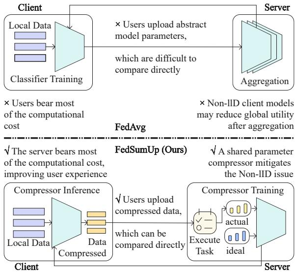
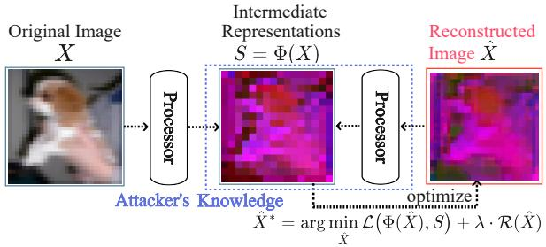
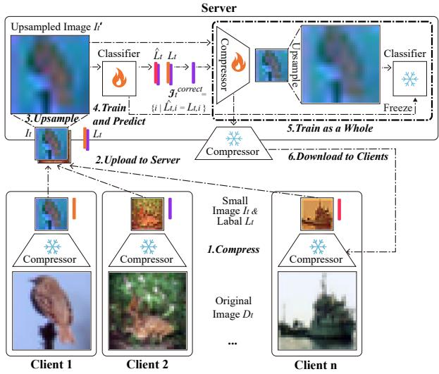
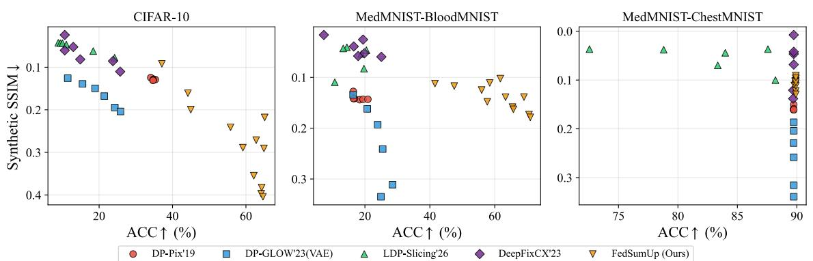
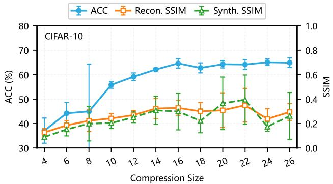
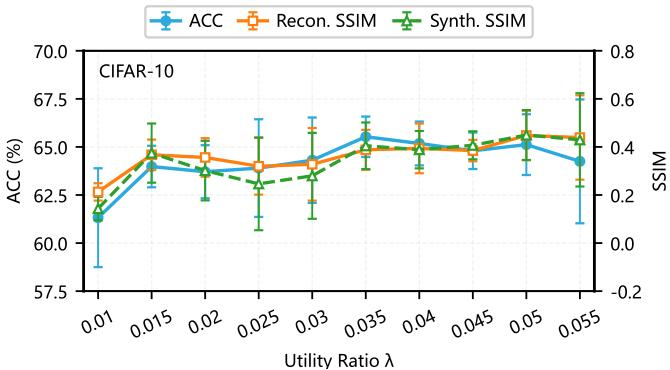
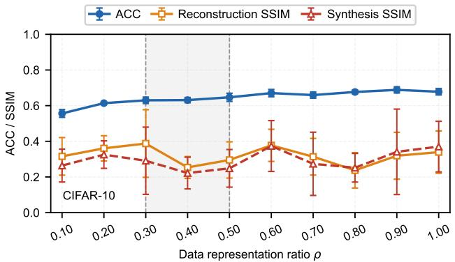
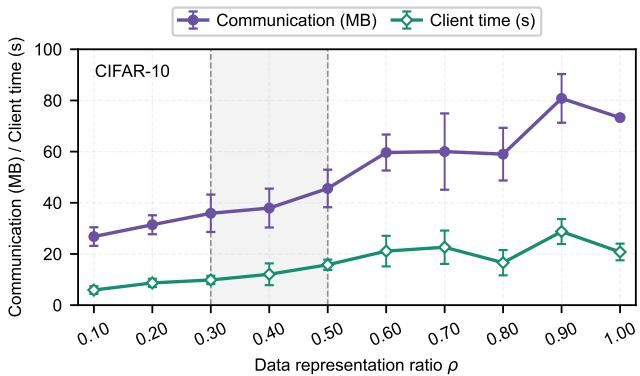
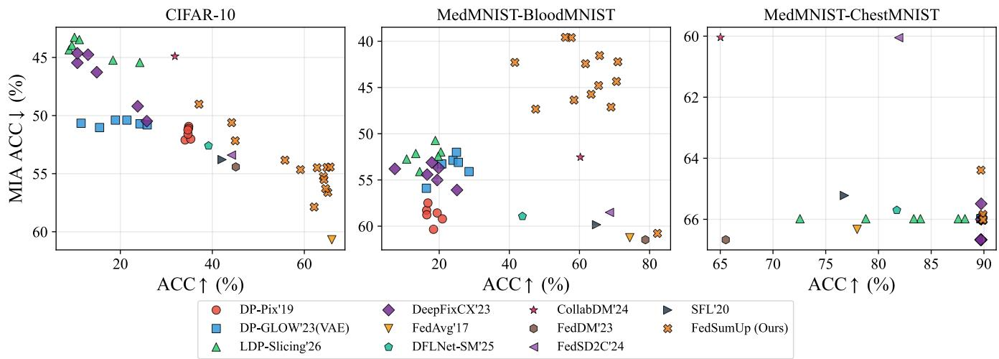

# FedSumUp: User-Auditable Privacy-Aware Representation Sharing for Resource-Constrained Federated Intelligence

Jingwei Zhao1,†, Tiantong Sun2,†, Yuanyuan Song1, Jinhuan Guo1, Wei Zishuo1, Shengyu Huang1, Ziyuan Ren1, Wei Chen1, Xiaojin Zhang1,\*

1Huazhong University of Science and Technology, Wuhan, China 2George Mason University, Fairfax, VA, USA

## Abstract

Existing federated data condensation methods face privacy risks, as uploaded synthetic data may preserve sensitive information and remain vulnerable to reconstruction attacks. Moreover, their generation often incurs considerable client-side computational overhead, limiting deployment on resourceconstrained devices. To address these issues, we propose FedSumUp, which employs a learnable lossy compressor on clients to generate compact and visually interpretable representations. By controlling information capacity, FedSumUp reduces privacy leakage while allowing users to directly assess the privacy–utility tradeof. We further introduce a dualobjective optimization mechanism to preserve task-relevant semantics while suppressing reconstruction risks. The compressor is trained on the server and only performs lightweight inference on clients. Since the server cannot access raw data, we develop a data-free closed-loop optimization strategy that optimizes the compressor by minimizing the discrepancy between original and twice-compressed representations after structure-preserving upsampling. Experiments on BloodM-NIST, CIFAR-10, and ChestMNIST demonstrate reconstruction PSNR as low as 8.56 dB (with synthetic PSNR as low as 5.45 dB), client runtime reductions up to 96.5% (from 778s to 27s on ChestMNIST), and competitive classification accuracy (89.72% ChestMNIST, 82.24% BloodMNIST, 65.63% CIFAR-10), while remaining inherently robust to non-IID data distributions.

## Introduction

Personalized services increasingly rely on users’ local data, such as photos, medical images, and interaction histories, to support downstream prediction tasks (Ojokoh et al. 2025). Directly uploading such data, however, may expose visually recognizable or reconstructable private information. The central problem is therefore not only how to train a model without centralizing raw data, but more fundamentally: what representation should leave the client in thefirst place?

Existing federated paradigms provide only partial answers to this question. Federated learning (FL) keeps raw data local, but requires clients to perform iterative optimization and exchange large, opaque model updates (McMahan et al.

2017a). Under heterogeneous client data, local optimization may also introduce client drift before aggregation. Federated data condensation (FDC) communicates more interpretable synthetic samples, but generating them can be expensive on edge devices, and the resulting images may still retain recognizable content (Xiong et al. 2023; Holland et al. 2024; Zhang, Liu, and Wang 2024). Split federated learning reduces some client-side computation, yet transmits intermediate features that are dificult for users to inspect or compare with their original data (Thapa et al. 2022; Yu et al. 2025). Datalevel diferential privacy ofers formal protection through randomized perturbation, often with a substantial loss of downstream utility (Fan 2018; Shibata et al. 2023; Cao, Li, and He 2026). Conventional and learned compression, meanwhile, are primarily designed to preserve visual fidelity rather than suppress reconstructable information (Wallace 1992; Sullivan et al. 2012; Ball’e et al. 2018; Ball’e, Laparra, and Simoncelli 2017).

These limitations suggest that a practical federated data interface should satisfy three requirements:

R1: User auditability. The transmitted representation should remain image-like and directly inspectable by the user.

R2: Edge-device friendliness. The client should perform lightweight inference rather than local training or iterative data optimization.

R3: Reconstruction privacy with task utility. The representation should remove information useful for reconstructing the original input while retaining the information required by the downstream task.

Requirement R3 exposes the central trade-of studied in this work. Reconstructing an image requires preserving broad pixel-level and structural information, whereas classification may depend only on a smaller task-relevant subset. A capacity-constrained representation can therefore discard reconstruction-relevant detail without immediately destroying classification utility. However, compression cannot be made arbitrarily strong: once the representation becomes too small, it also removes task-relevant information and classification performance degrades. The upload capacity consequently induces a privacy–utility frontier rather than a monotone “more compression is always better” rule.

We propose FedSumUp, a Federated Data Interface that operates at this representation-sharing layer. Each client applies a shared lossy compressor $C _ { \phi }$ once and uploads a compact, human-readable image representation together with its label. The server upsamples the transmitted representation, trains a classifier on the resulting images, improves the compressor, and redistributes the updated compressor to participating clients. Clients therefore perform no backpropagation or iterative local optimization. FedSumUp provides an auditable transmitted object (R1), substantially reduces clientside computation (R2), and explicitly optimizes the balance between reconstruction similarity and classification utility (R3). Figure 1 contrasts this representation-sharing interface with conventional parameter-sharing FL.

  
Compressor output smaller than input, total information reduced. Optimize compressor: retain utility info,filter privacy info.  
Figure 1: FedAvg requires client-side training and communicates opaque model updates. FedSumUp instead performs a single client-side compression pass and uploads compact, auditable image representations, while classifier and compressor optimization are performed on the server.

FedSumUp must improve the compressor without observing raw client inputs. It does so through an upsample– recompress closed loop: the server upsamples an upload, applies the compressor again, and compares the twicecompressed output with the once-compressed proxy. This server-side signal suppresses structural and pixel-level similarity, while a frozen classifier and correctness filter preserve task-relevant information.

We formulate this procedure as reconstruction-similarityconstrained utility optimization. Its Lagrangian relaxation yields, up to an additive constant and positive rescaling, the practical compressor loss combining filtered cross-entropy, SSIM, and PSNR. Thus, the loss used in training is a scalarization of the same privacy–utility objectives evaluated in our experiments, rather than an unrelated collection of regularizers. Varying the upload size and objective weights produces diferent operating points on the resulting empirical frontier.

Our theory explains two mechanisms underlying this empirical privacy–utility frontier rather than the convergence of the alternating optimizer. First, a classifier-sensitivity bound shows that visually large distortion can induce only a small change in classification loss when it lies primarily in locally insensitive directions. Second, under a canonical multiclass task-subspace model, we derive a critical bottleneck rank: when the upload rank satisfies $r \geq d _ { \mathrm { t a s k } }$ , nuisance directions can be discarded without increasing the Bayes cross-entropy; when $r < d _ { \mathrm { t a s k } }$ , no rank-r linear encoder can preserve the baseline Bayes cross-entropy. Together, these results characterize a task-preserving compression region and explain the transition observed in the empirical frontier.

Experiments on BloodMNIST, CIFAR-10, and ChestM-NIST evaluate classification utility, reconstruction resistance, client computation, communication cost, non-IID robustness, and membership inference. FedSumUp reduces client runtime by up to 96.5% while maintaining competitive classification accuracy. More importantly, the ACC–Synthetic-SSIM analysis explicitly evaluates the central privacy– utility question: across the tested configurations, FedSumUp lies on the empirical nondominated frontier on CIFAR-10 and BloodMNIST, while the relative advantage is datasetdependent on ChestMNIST. These results support the intended mechanism: a learned capacity bottleneck can remove visually reconstructable information while retaining suficient information for the downstream task.

## Contributions

The contributions of this work are:

• An auditable federated data interface. We introduce a representation-sharing paradigm in which clients upload compact, human-readable images through a single compressor forward pass, while all iterative optimization is performed on the server.

• Raw-data-free privacy–utility optimization. We develop an upsample–recompress closed loop with correctness-filtered utility preservation, enabling the server to train a privacy-aware compressor without observing raw client inputs.

• A mechanism-level privacy–utility analysis. We establish a classifier-sensitive distortion bound and derive a task-preserving capacity threshold, identifying a freecompression region in which reconstruction distortion can increase without increasing the Bayes cross-entropy.

• Comprehensive empirical evaluation. We evaluate utility, reconstruction resistance, auditability, client cost, communication, non-IID behavior, and membership inference across three datasets, including a direct ACC– Synthetic-SSIM frontier analysis over multiple compression levels.

## Preliminaries

## Threat Model

We consider an honest-but-curious server that follows the protocol but may infer private information from uploaded data (Shi et al. 2024; Hu et al. 2023; Shi, Ouyang, and Wang 2025). Clients share an intermediate representation

$S = \Phi ( X )$ and its label rather than raw input $X ; S$ may be synthetic data, a feature map, or a latent code (Xiong et al. 2023; Holland et al. 2024; Erdoğan, Küpçü, and Çiçek 2022; Zhang, Liu, and Wang 2024). The server observes S and has black-box access to Φ, as is common when it maintains, receives, or can query the representation generator.

We evaluate reconstructable leakage through the model inversion attack of He et al. (He, Zhang, and Lee 2019):

$$
\hat { X } ^ { \ast } = \arg \operatorname* { m i n } _ { \hat { X } } \mathcal { L } ( \Phi ( \hat { X } ) , S ) + \lambda \mathcal { R } _ { X } ( \hat { X } ) ,\tag{1}
$$

where $\mathcal { R } _ { X }$ imposes an image prior. The attack is an evaluation tool rather than our contribution: FedSumUp aims to reduce the private information available to any such reconstruction procedure.

  
Figure 2: Encoding and decoding process based on intermediate representations for image reconstruction optimization.

## Privacy Evaluation Metrics

We quantify representation leakage from two complementary perspectives. First, Synthetic–to–Original measures the direct similarity between transmitted synthetic or compressed representations and the original data. Second, Reconstructed–to–Original measures the similarity between model-inversion-reconstructed samples and the original data. Following prior reconstruction and perceptual similarity studies (Sun et al. 2023a; Zhang et al. 2018), we use PSNR, SSIM, and LPIPS as evaluation metrics. Higher PSNR/SSIM and lower LPIPS indicate greater similarity to the original data and thus higher privacy exposure.

These metrics require access to original data and are therefore used only from the researcher’s evaluation perspective. The HbC server in the actual protocol does not directly access raw data; it only observes uploaded intermediate representations.

## Method

## Notation

To facilitate the description of the complete iterative process, Table 1 lists the core symbols used in this section.

## Complete Iterative Process

Figure 3 illustrates the complete iterative process of the Fed-SumUp framework.

Given the original data pair $( D _ { t } , L _ { t } )$ where $D _ { t }$ has size $S \times$ $S \left( \mathrm { e . g . , 3 2 \times 3 2 } \right)$ , the client first applies the lossy compressor

Table 1: Core Notation Description
<table><tr><td>Symbol</td><td>Meaning</td></tr><tr><td> $D _ { t }$ </td><td>Original image data at round  $t ,$  size  $S \times S$   $( \mathrm { e . g . , 3 2 \times 3 2 } )$ </td></tr><tr><td> $L _ { t }$   $V _ { t }$ </td><td>Labels at round t</td></tr><tr><td></td><td>Lossy compressor at round  $t ,$  input  $S \times S ,$  output  $y \times y ( y < S )$ </td></tr><tr><td> $C _ { t }$   $I _ { t }$ </td><td>Classifier at round t Compressed small image uploaded by</td></tr><tr><td> $y$ </td><td>client at round t,  $I _ { t } = V _ { t } ( D _ { t } )$  , size  $y \times y$  Compression output size,  $y < S ,$  controls</td></tr><tr><td> $\lambda$ </td><td>physical capacity Utility-preservation weight in the joint loss</td></tr><tr><td> $\beta$ </td><td>PSNR loss weight (reconstruction</td></tr><tr><td> $\mathcal { L } _ { \mathrm { c e } }$ </td><td>suppression) Utility consistency loss (cross-entropy on</td></tr><tr><td> $\mathcal { L } _ { \mathrm { s s i m } }$ </td><td>consistent samples) Structural dissimilarity loss (SSIM,</td></tr><tr><td> $\mathcal { L } _ { \mathrm { p s n r } }$ </td><td>minimized to suppress reconstruction) Quality dissimilarity loss (PSNR,</td></tr><tr><td></td><td>minimized to suppress reconstruction)</td></tr><tr><td> $\mathcal { T } _ { t } ^ { \mathrm { c o r r e c t } }$ </td><td>Set of sample indices where classifier hard label matches original label</td></tr></table>

  
Figure 3: Complete iterative process ofthe FedSumUp framework. Downside shows client operations: the original image $D _ { t }$ is compressed by the lossy compressor $V _ { t }$ into a smallsized image $I _ { t }$ and then uploaded to the server. Upside shows server operations: Stage 1 updates the classifier $C _ { t + 1 }$ using $( I _ { t } , L _ { t } ) ;$ Stage $2$ freezes the classifier and updates the lossy compressor $V _ { t + 1 }$ through an "upsample-recompress-utility verification" closed loop, then sends the updated compressor back to the client.

$V _ { t }$ to obtain a compressed representation $I _ { t } = V _ { t } ( D _ { t } )$ . The resulting $I _ { t }$ has a substantially smaller physical size of $y \times y$ with $y \ < \ S$ , thereby occupying much less capacity than the original image. The client then uploads this compressed image along with its label $\left( { { I _ { t } } , { L _ { t } } } \right)$ to the server.

Upon receiving the uploaded data, the server performs two sequential stages of updates: it first updates the classifier and then updates the lossy compressor itself. In the first stage, the server trains the classifier $C _ { t }$ using the received compressed images and their labels $( I _ { t } , \bar { L _ { t } } )$ to produce an updated classifier $C _ { t + 1 }$ . Before feeding into the classifier, each compressed image $I _ { t }$ is first upsampled back to the original spatial size $S \times S$ . The training objective is simply to minimize the cross-entropy loss minC CrossEntropy $\bar { ( } \bar { C } ( \mathrm { U p S a m p l e } ( I _ { t } ) ) , L _ { t } )$ , where the loss is computed using all available labels $L _ { t } .$ . This allows the classifier to first learn basic classification capabilities from the compressed representations.

The update of the lossy compressor then proceeds in five carefully designed steps. In Step 1, the server freezes all parameters of the newly updated classifier $C _ { t + 1 }$ , thereby fixing its decision boundary. This ensures that, during subsequent optimization, the utility consistency loss $\mathcal { L } _ { \mathrm { c e } }$ reflects only the compressor $V ^ { \dagger } \mathrm { s }$ ability to preserve taskrelevant information, rather than the classifier’s ability to adapt to the compressed data. In Step 2, the frozen classifier $C _ { t + 1 }$ is used to make predictions on the upsampled compressed images UpSample(It), producing hard labels $\hat { L } _ { t } = C _ { t + 1 } ( \mathrm { U p S a m p l e } ( I _ { t } ) )$ . The server then records the set of sample indices that are correctly classified: $\mathcal { T } _ { t } ^ { \mathrm { c o r r e c t } } = \{ i$ $\hat { L } _ { t , i } = L _ { t , i } \}$ . The rationale is that only correctly classified samples contain valid utility information; the information carried by incorrectly predicted samples should not participate in the compressor’s utility preservation training.

In Step 3, the server constructs an “upsample-recompress” closed loop. It first upsamples $I _ { t }$ to $\mathbf { \bar { \mathit { I } } } _ { t } ^ { \prime } = \mathbf { \bar { \ u p s a m p l e } } ( I _ { t } )$ restoring the size to $\dot { S } \times \dot { S }$ . Importantly, this upsampling operation does not increase statistical information in the information-theoretic sense—it merely changes the representation dimension without introducing new information. The server then recompresses $I _ { t } ^ { \prime }$ using the current compressor $V _ { t }$ to obtain $I _ { t } ^ { \prime \prime } = \mathbf { \bar { \Gamma } } V _ { t } ( I _ { t } ^ { \prime } )$ , compressing the size back to $y \times y .$ . This closed loop allows the server to simulate the client-side compression process without ever accessing the original data $D _ { t } ,$ , thereby constructing the necessary computational graph for optimization. In Step 4, the server computes the joint loss. For utility preservation, only samples where the classifier’s hard prediction matches the original label (consistent samples, indexed by $\underline { { \mathcal { T } } } _ { t } ^ { \mathrm { c o r r e c t } } )$ contribute to the cross-entropy loss: $\begin{array} { r } { \mathcal { L } _ { \mathrm { c e } } = - \frac { 1 } { | \mathcal { T } _ { t } ^ { \mathrm { c o r r e c t } } | } \dot { \sum } _ { i \in \mathcal { T } _ { t } ^ { \mathrm { c o r r e c t } } } \log p ( \hat { y } _ { i } = } \end{array}$ $L _ { t , i } ~ | ~ I _ { t } ^ { \prime \prime \prime } )$ where $I _ { t } ^ { \prime \prime \prime } = \mathrm { U p S a m p l e } ( I _ { t } ^ { \prime \prime } )$ . For reconstruction suppression, the server directly minimizes the structural similarity (SSIM) and peak signal-to-noise ratio (PSNR) between the re-compressed upsampled images and their inputs: $\mathcal { L } _ { \mathrm { s s i m } } ~ = ~ \mathrm { S S I M ( }$ (UpSample $\dot { ( } I _ { t } ^ { \prime \prime } ) , I _ { t } ^ { \prime } )$ and $\begin{array} { r l } { \mathcal { L } _ { \mathrm { p s n r } } } & { { } = } \end{array}$ $\mathrm { P S N R } ( \mathrm { U p S a m p l e } ( I _ { t } ^ { \prime \prime } ) , I _ { t } ^ { \prime } )$ . Minimizing SSIM and PSNR directly drives the compressed output away from the upsampled input, suppressing visual reconstructability. These three components are combined additively into the joint optimization objective ${ \mathcal { L } } _ { \mathrm { t o t a l } } = \lambda \cdot { \mathcal { L } } _ { \mathrm { c e } } + { \mathcal { L } } _ { \mathrm { s s i m } } ^ { \mathrm { ~ \bar { ~ } } } + \beta \cdot { \dot { \mathcal { L } } } _ { \mathrm { p s n r } } ,$ , where λ controls the utility-preservation weight and $\beta ^ { \mathrm { { \dot { \prime } } } }$ controls the reconstruction-suppression strength, while the SSIM term is assigned a fixed unit weight. Finally, in Step 5, the server performs gradient backpropagation and updates the compressor parameters according to $\bar { V _ { t + 1 } } = V _ { t } - \dot { \eta } \cdot \nabla _ { V _ { t } } \mathcal { L } _ { \mathrm { t o t a l } }$

After completing the server-side updates, the updated compressor $V _ { t + 1 }$ is sent back to the client for the next communication round $t + 1$ . For ease of understanding, Algorithm 1 summarizes this complete iterative process in pseudocode.

Algorithm 1: Iterative Representation Optimization via   
Server-Side Closed-Loop Training   
Require: Original data $\big \{ ( D _ { 0 } , L _ { 0 } ) \big \}$ , initial lossy compressor   
$V _ { 0 } ,$ initial classifier $C _ { 0 } ,$ , number of rounds $T ,$ , learning   
rate η   
Ensure: Optimized lossy compressor $V _ { T }$   
1: for $t = 0$ to $T - 1$ do   
2: // Client   
3: $I _ { t } = V _ { t } ( D _ { t } )$ {V inputs $S \times S ,$ outputs $y \times y \}$   
4: Upload $( I _ { t } , L _ { t } )$ to server   
5: // Server Stage 1: Classifier Learning   
6: $I _ { t } ^ { \mathrm { u p } }$ = UpSample $\left( I _ { t } \right)$ {Upsample to $S \stackrel { \smile } { \times } S \}$   
7: $\bar { C } _ { t + 1 } = \mathrm { \bar { t r a i n } } ( \bar { C } _ { t } , \bar { I } _ { t } ^ { \mathrm { u p } } , L _ { t } )$ {Use all labels}   
8: // Server Stage 2: Lossy Compressor Self-Evolution   
9: Freeze $C _ { t + 1 }$   
10: $\hat { L } _ { t } = C _ { t + 1 } ( I _ { t } ^ { \mathrm { u p } } )$ {Compute hard labels}   
11: $\mathcal { T } _ { t } ^ { \mathrm { c o r r e c t } } = \{ i \ | \ \hat { L } _ { t , i } = L _ { t , i } \}$ {Correctly classified in  
dices}   
12: $I _ { t } ^ { \prime } = \mathrm { U p S } \mathrm { : }$ ample $\left( I _ { t } \right)$ {Upsample to $S \times S \}$   
13: $\begin{array} { r } { \dot { I _ { t } ^ { \prime \prime } } = \dot { V _ { t } } ( I _ { t } ^ { \prime } ) \dot { \{ V } }  \end{array}$ recompresses to $y \times y \}$   
14: $I _ { t } ^ { \prime \prime \prime } = \mathrm { U p S a m p l e } ( I _ { t } ^ { \prime \prime } )$ {Upsample to $S \times S$ for C}   
15: $\bar { \mathcal { L } } _ { \mathrm { c e } } = \mathrm { C } \mathrm { \bar { E } } _ { \mathcal { Z } _ { t } ^ { \mathrm { c o r r e c t } } } \big ( \bar { C } _ { t + 1 } \big ( I _ { t } ^ { \prime \prime \prime } \big ) , L _ { t } \big )$   
16: $\mathcal { L } _ { \mathrm { s s i m } } = \mathrm { S S I M } ( \mathrm { U p S a m p l e } ( I _ { t } ^ { \prime \prime } ) , I _ { t } ^ { \prime } )$   
17: $\mathcal { L } _ { \mathrm { p s n r } } = \mathrm { P S N R } ( \mathrm { U p S a m p l e } ( I _ { t } ^ { \prime \prime } ) , \bar { I _ { t } ^ { \prime } } )$   
18: $\mathcal { L } _ { \mathrm { t o t a l } } = \lambda \cdot \mathcal { L } _ { \mathrm { c e } } + \mathcal { L } _ { \mathrm { s s i m } } + \beta \cdot \mathcal { L } _ { \mathrm { p s n r } }$   
19: $V _ { t + 1 } = V _ { t } - \eta \cdot \nabla \mathcal { L } _ { \mathrm { t o t a l } }$   
20: Send $V _ { t + 1 }$ back to client   
21: end for   
22: return $V _ { T - 1 } , C _ { T }$ {Used jointly for inference: new sam  
ples first compressed by $\bar { V } _ { T - 1 }$ , then classified by $C _ { T } \}$

## Inference Phase

After T training rounds, the paradigm yields a lossy compressor $V _ { T - 1 }$ and a classifier $C _ { T }$ . For a new sample $D _ { \mathrm { n e w } } .$ inference compresses it to $I _ { \mathrm { n e w } } = V _ { T - 1 } ( D _ { \mathrm { n e w } } )$ , then upsamples and passes it to $C _ { T }$ for prediction $\hat { y } _ { \mathrm { n e w } } .$ . The advantage: $V _ { T - 1 }$ suppresses visually recoverable information, so even if an attacker obtains $I _ { \mathrm { n e w } }$ and attempts a model inversion attack (MoIA), reconstruction of the original input is dificult. At the same time, $C _ { T }$ learns to make accurate classifications from such compressed images, thereby unifying MoIA defense and classification utility. We emphasize that this inference pipeline does not involve any model aggregation across clients; it is a direct application of the shared representation function $V _ { T - 1 }$ and the centrally trained classifier $C _ { T }$

## Theoretical Analysis

Our analysis explains two empirical patterns of FedSumUp. First, the utility-ratio and ablation experiments show that reconstruction similarity can vary substantially while classification accuracy remains nearly unchanged. Proposition 2 explains this decoupling through classifier-sensitive distortion. Second, the compression-size experiment shows rapid accuracy gains at small sizes followed by diminishing gains. Theorem 4 explains this transition through a task-preserving capacity region. These results explain attainable compressed representations rather than optimization convergence or formal privacy guarantees. Proofs are provided in the Appendix.

In this section, $C _ { t + 1 }$ denotes the pre-softmax logit map of the classifier trained on the server. For a logit vector z and label l, let $\ell _ { \mathrm { c l s } } ( z , l ) = - \log [ \mathrm { s o f t m a x } ( z ) ] _ { i }$ . For the original image $D _ { t }$ and its upsampled compressed representation $\overline { { I _ { t } ^ { \mathrm { u p } } } }$ define $\Delta _ { t } = I _ { t } ^ { \mathrm { u p } } \dot { - } D _ { t }$

Assumption 1 (Classifier smoothness). There exists $\kappa > 0$ such that, for any u, v on the line segment between $D _ { t }$ and $I _ { t } ^ { \mathrm { u p } } , \| \nabla _ { D } C _ { t + 1 } ( \dot { \boldsymbol { u } } ) - \nabla _ { D } C _ { t + 1 } ( \boldsymbol { v } ) \| _ { \mathrm { o p } } ^ { \sim } \leq \kappa \| \boldsymbol { u } - \boldsymbol { v } \| _ { 2 }$ , where $\nabla _ { D } C _ { t + 1 }$ is the Jacobian of the classifier logits with respect to the input image.

Proposition 2 (Classifier-sensitive distortion). Under ${ \mathrm { A s } } -$ sumption 1, for a sample $( D _ { t } , L _ { t } )$ ,

$$
\begin{array} { r l } & { | \ell _ { \mathrm { c l s } } \left( C _ { t + 1 } ( I _ { t } ^ { \mathrm { u p } } ) , L _ { t } \right) - \ell _ { \mathrm { c l s } } \left( C _ { t + 1 } ( D _ { t } ) , L _ { t } \right) | } \\ & { \quad \leq \sqrt { 2 } \left( \| \nabla _ { D } C _ { t + 1 } ( D _ { t } ) \Delta _ { t } \| _ { 2 } + \frac { \kappa } { 2 } \| \Delta _ { t } \| _ { 2 } ^ { 2 } \right) . } \end{array}\tag{2}
$$

Proposition 2 separates visual distortion from classifiersensitive distortion. It explains the utility-ratio and ablation results, where reconstruction SSIM changes noticeably across configurations whose classification accuracies are already close to a plateau. Such decoupling is possible when the induced distortion has a limited efect on the classifier logits; the proposition does not imply that arbitrary visual distortion preserves utility.

We next isolate the role of upload size using a canonical linear model. After vectorization, let $x _ { t } = \mathsf { \bar { v e c } } ( D _ { t } ) \in$ $\mathbb { R } ^ { d } , d \ : = \ : C S ^ { 2 }$ , and let $r _ { y } = C y ^ { 2 }$ denote the dimension of an uploaded image of size $C \times y \times y$ . For any representation $Z , \ H ( L _ { t } \ { \mathsf { \bar { \Gamma } } } | \ Z )$ denotes the minimum expected cross-entropy attainable by a probabilistic classifier using Z: $\begin{array} { r } { H ( L _ { t } \mid \dot { Z } ) = \operatorname* { i n f } _ { q } \mathbb { E } [ - \log \dot { q } ( L _ { t } \mid Z ) ] } \end{array}$

Assumption 3 (Canonical task–nuisance model). The vectorized image admits the orthogonal decomposition

$$
x _ { t } = U _ { \mathrm { t a s k } } a _ { t } + U _ { \mathrm { n u i } } b _ { t } ,\tag{3}
$$

where $U _ { \mathrm { t a s k } } \in \mathbb { R } ^ { d \times d _ { \mathrm { t a s k } } }$ and $U _ { \mathrm { n u i } } \in \mathbb { R } ^ { d \times ( d - d _ { \mathrm { t a s k } } ) }$ have orthonormal and mutually orthogonal columns. The task component $a _ { t }$ is a minimal linear representation preserving all label-relevant information: $p ( L _ { t } ^ { - } \mid x _ { t } ) = p ( \bar { L } _ { t } \mid a _ { t } )$ , and no linear representation of dimension smaller than $d _ { \mathrm { t a s k } }$ has this property. Moreover, $a _ { t } \sim \mathcal { N } ( 0 , I _ { d _ { \mathrm { t a s k } } } )$ bt ∼ $\mathcal { N } ( 0 , I _ { d - d _ { \mathrm { t a s k } } } )$ , with $b _ { t }$ independent of $( a _ { t } , L _ { t } )$

The task component contains information needed for classification, whereas the nuisance component is labelindependent but may still aid image reconstruction. We model compression and upsampling by a rank- $r _ { y }$ orthogonal projection $P _ { y }$ and define the normalized Bayes reconstruction error

$$
\mathcal { D } _ { \mathrm { r e c } } ( P _ { y } ) = \frac { 1 } { d } \mathbb { E } \left[ \| x _ { t } - \mathbb { E } [ x _ { t } \mid P _ { y } x _ { t } , L _ { t } ] \| _ { 2 } ^ { 2 } \right] .\tag{4}
$$

The estimator conditions on $L _ { t }$ because the label is uploaded together with the compressed representation.

Theorem 4 (Task-preserving capacity threshold). Under ${ \mathrm { A s } } -$ sumption 3, if $r _ { y } \ge d _ { \mathrm { t a s k } }$ , there exists a rank- $\cdot r _ { y }$ orthogonal projection $P _ { y }$ that preserves the complete task subspace and satisfies $H ( { \bar { L } } _ { t } \mid { \bar { P } } _ { y } x _ { t } ) = H ( L _ { t } { \bar { \mid x _ { t } ) } }$ . If its remaining $r _ { y } \mathrm { ~ - ~ } d _ { \mathrm { t a s k } }$ dimensions retain arbitrary nuisance directions, then $\begin{array} { r } { \mathcal { D } _ { \mathrm { r e c } } ( P _ { y } ) = 1 - \frac { r _ { y } } { d } } \end{array}$ . When $r _ { y } < d _ { \mathrm { t a s k } }$ , no linear representation of dimension $r _ { y }$ can preserve all label-relevant information.

Theorem 4 explains the two regimes observed in the compression-size experiment. At small sizes, increasing capacity substantially improves accuracy because task-relevant information is still capacity-limited. At moderate and large sizes, accuracy exhibits diminishing gains because additional dimensions may mainly retain nuisance information useful for reconstruction. The canonical model idealizes this gradual empirical transition as a task-preserving capacity threshold.

## Experiments

## Experimental Setup

Datasets and Baseline Methods We evaluate FedSumUp on three standard datasets: BloodMNIST, ChestMNIST, and CIFAR-10. Two additional datasets (FashionMNIST and MNIST) are used for the extended evaluation in the Appendix.

Experiments use 10 clients with full participation (join ratio = 1.0). Non-IID data distributions are simulated via a Dirichlet distribution $( \alpha = 0 . 5 )$ . Unless stated otherwise, early stopping is applied: training halts when accuracy improvement is below 1% compared to the previous round. This reduces computational load on edge devices and avoids excessive communication rounds that degrade user experience. Experiment 1 (baseline comparison) is repeated 10 times and averaged; others are repeated 5 times and averaged.

Evaluation metrics include classification accuracy (ACC, measuring model utility), MoIA metrics (PSNR↓, SSIM↓, LPIPS↑, measuring privacy protection strength), client runtime (measuring computational eficiency), and total communication volume (measuring communication overhead).

PSNR, SSIM, and LPIPS are computed using the IQA-PyTorch toolbox (Chen and Mo 2022). Before computing PSNR and SSIM, all images are normalized to the range [0,1].

MoIA Attack Settings The MoIA uses an encoder to reverse-reconstruct original images from synthetic data via gradient descent. The reconstruction process uses the Adam optimizer, a learning rate of 0.1, 500 iterations, and a total variation regularization weight of 0.001. After reconstruction, PSNR, SSIM, and LPIPS metrics are computed between the reconstructed images and the original images. Lower PSNR, lower SSIM, and higher LPIPS indicate that it is more dificult for an attacker to recover original information from synthetic data, meaning stronger reconstruction resistance.

Table 2: Comparison of classification accuracy and MoIA privacy protection across methods on three datasets (Non-IID $\alpha = 0 . 5 ) .  \quad \cdot ^ { , \cdot }$ indicates data that cannot be reconstructed or the transmitted data is not an image.
<table><tr><td rowspan="2">Method</td><td rowspan="2"> $\mathbf { A C C } \left( \% \right) \uparrow$ </td><td colspan="3">Reconstructed Data Quality</td><td colspan="3">Synthetic Data Quality</td></tr><tr><td> $\mathrm { P S N R } ( \mathrm { d B } ) \downarrow |$ </td><td>SSIM↓</td><td>LPIPS ↑</td><td>|PSNR(dB) ↓|</td><td> ${ \bf S S I M \downarrow }$ </td><td>LPIPS ↑</td></tr><tr><td colspan="8">MedMNIST-BloodMNIST</td></tr><tr><td>CollabDM (2024)</td><td> $6 0 . 2 5 { \scriptstyle \pm 2 . 9 4 }$ </td><td></td><td></td><td></td><td> $2 0 . 4 9 { \pm } 0 . 2 3$ </td><td> $0 . 7 8 { \pm } 0 . 0 1$ </td><td> $0 . 0 3 { \pm } 0 . 0 0$ </td></tr><tr><td>FedDM (2023)</td><td> $7 8 . 7 9 { \scriptstyle \pm 2 . 4 0 }$ </td><td></td><td></td><td></td><td> $3 3 . 9 9 { \scriptstyle \pm 0 . 9 2 }$ </td><td> $0 . 9 8 { \pm } 0 . 0 0$ </td><td> $0 . 0 0 { \scriptstyle \pm 0 . 0 0 }$ </td></tr><tr><td>FedSD2C (2024)</td><td> $6 8 . 5 6 { \pm } 2 . 8 1 $ </td><td> $1 0 . 3 6 { \pm } 0 . 1 0$ </td><td></td><td> $0 . 1 9 { \pm } 0 . 0 0 \big | 0 . 2 1 { \pm } 0 . 0 0$ </td><td> $1 3 . 9 4 { \pm } 0 . 1 6$ </td><td> $0 . 4 5 { \pm } 0 . 0 2$ </td><td> $0 . 1 4 \pm 0 . 0 1$ </td></tr><tr><td>SFL (2020)</td><td> $6 4 . 8 6 { \pm } 1 1 . 6 8 $ </td><td> $3 7 . 4 3 { \pm } 1 . 5 6 $ </td><td></td><td> $0 . 9 9 { \pm } 0 . 0 0 \mathopen { } \left| 0 . 0 0 { \pm } 0 . 0 0 \right.$ </td><td></td><td></td><td></td></tr><tr><td>FedSumUp (Ours)</td><td> ${ \pm 2 . 2 4 \pm 4 . 4 4 }$ </td><td> ${ \bf 1 0 . 2 0 { \pm } 1 . 0 2 }$ </td><td> $\underline { { 0 . 3 4 \pm 0 . 0 8 } }$ </td><td> $\mathbf { 0 . 2 6 { \pm } 0 . 0 3 }$ </td><td> ${ \bf 8 . 8 4 \pm 1 . 3 4 }$ </td><td> $\mathbf { \left| 0 . 3 2 \pm 0 . 1 0 \right. }$ </td><td> $\mathbf { 0 . 2 6 { \overset { . } { = } } 0 . 0 2 }$ </td></tr><tr><td colspan="8">CIFAR10</td></tr><tr><td>CollabDM (2024)</td><td> $3 1 . 8 6 { \pm } 1 . 1 9$ </td><td></td><td></td><td></td><td> $1 8 . 1 2 { \pm } 0 . 1 7 $ </td><td> $0 . 7 6 { \pm } 0 . 0 1$ </td><td> $0 . 0 3 { \pm } 0 . 0 0$ </td></tr><tr><td>FedDM (2023)</td><td> $4 5 . 1 0 { \pm } 1 . 5 9 $ </td><td></td><td></td><td></td><td> $3 0 . 1 4 { \pm } 0 . 5 4$ </td><td> $0 . 9 6 { \pm } 0 . 0 0$ </td><td> $0 . 0 1 { \pm } 0 . 0 0$ </td></tr><tr><td>FedSD2C (2024)</td><td> $4 4 . 1 5 { \pm } 0 . 7 9 $ </td><td> $8 . 8 3 { \pm } 0 . 1 0$ </td><td></td><td> $0 . 1 2 { \pm } 0 . 0 0 \left| 0 . 2 2 { \pm } 0 . 0 0 \right.$ </td><td> $1 2 . 2 7 { \pm } 0 . 1 0$ </td><td> $0 . 3 0 { \pm } 0 . 0 1$ </td><td> $0 . 2 2 { \pm } 0 . 0 1$ </td></tr><tr><td>SFL (2020)</td><td> $4 2 . 1 2 { \pm } 8 . 7 6$ </td><td> $3 8 . 8 1 { \scriptstyle \pm 0 . 4 3 }$ </td><td></td><td> $1 . 0 0 { \pm } 0 . 0 0 \mathrm { \ : } 0 . 0 0 { \pm } 0 . 0 0$ </td><td></td><td></td><td></td></tr><tr><td>FedSumUp (Ours)</td><td> ${ \bf 6 5 . 6 3 } \pm 2 . { \bf 0 8 }$ </td><td> $1 0 . 9 4 { \pm } 1 . 1 2 $ </td><td></td><td> $\mathbf { \Big | } 0 . 3 3 { \pm } 0 . 0 8 \mathbf { \Big | }   0 . 3 0 { \pm } 0 . 0 8$ </td><td> ${ \bf 8 . 4 7 \pm 1 . 4 4 }$ </td><td> $\mathbf { \left| 0 . 2 4 \pm 0 . 0 7 \right. }$ </td><td> ${ \bf 0 . 3 9 } \pm { \bf 0 . 0 5 }$ </td></tr><tr><td colspan="8">MedMNIST-ChestMNIST</td></tr><tr><td>CollabDM (2024)</td><td> $6 5 . 0 2 { \pm } 5 . 7 2$ </td><td></td><td></td><td></td><td> $2 1 . 6 8 { \pm } 0 . 4 8$ </td><td> $0 . 8 6 { \pm } 0 . 0 1$ </td><td> $0 . 0 4 { \pm } 0 . 0 0$ </td></tr><tr><td>FedDM (2023)</td><td> $6 5 . 5 2 { \pm } 1 3 . 0 3$ </td><td></td><td></td><td></td><td> $3 0 . 2 9 { \scriptstyle \pm 2 . 0 7 }$ </td><td> $0 . 9 7 { \scriptstyle \pm 0 . 0 1 }$ </td><td> $0 . 0 1 { \pm } 0 . 0 0$ </td></tr><tr><td>FedSD2C (2024)</td><td> $8 1 . 9 2 { \pm } 5 . 7 2 $ </td><td> $1 0 . 0 6 { \pm } 0 . 2 1$ </td><td> $0 . 1 6 { \pm } 0 . 0 1$ </td><td> $0 . 4 8 { \pm } 0 . 0 1$ </td><td> $1 6 . 2 0 { \pm } 0 . 3 1 $ </td><td> $0 . 7 0 { \scriptstyle \pm 0 . 0 2 }$ </td><td> $0 . 1 3 { \pm } 0 . 0 1$ </td></tr><tr><td>SFL (2020)</td><td> $7 6 . 7 7 { \scriptstyle \pm 2 1 . 0 8 }$ </td><td> $3 6 . 5 0 { \pm } 2 . 3 1 $ </td><td> $1 . 0 0 { \pm } 0 . 0 0 \ $ </td><td> $0 . 0 0 { \scriptstyle \pm 0 . 0 0 }$ </td><td></td><td></td><td></td></tr><tr><td>FedSumUp (Ours)</td><td> ${ \bf 8 9 . 7 2 { \pm 0 . 1 1 } }$ </td><td> $\mathbf { 8 . 5 6 { \pm 0 . 6 9 } }$ </td><td> $\mathbf { 0 . 1 } 2 \pm \mathbf { 0 . 0 } 2$ </td><td> $\mathbf { 0 . 5 3 \pm 0 . 0 5 }$ </td><td> ${ \pm } \mathbf { 5 . 4 5 { \pm } 0 . 3 1 }$ </td><td> $\mathbf { 0 . 1 0 { \overset { . } { = } } 0 . 0 2 }$ </td><td> $\mathbf { 0 . 5 5 \pm 0 . 0 5 }$ </td></tr></table>

The reconstruction attack evaluation procedure is as follows: obtain the aggregated synthetic data and their corresponding original data indices from the server side, uniformly select samples by category (10 per category), and compute the metrics between the reconstructed data and the original data.

FedSumUp Implementation Details The lossy compressor uses a convolutional encoder with an enhanced ConvPoolBlock. By default, it has five $3 \times 3$ convolutional layers, each followed by GroupNorm and ReLU, ending with AdaptiveAvgPool2d to downsample to the target spatial size. The hidden layers have 128 channels, and the output is a 3-channel RGB image produced by a 1×1 convolution with tanh activation (pixel range [−1, 1]). A Squeeze-and-Excitation channel attention mechanism recalibrates feature maps via global average pooling and a two-layer fully connected network. For CIFAR-10, the encoder compresses a $3 \times 3 2 \times 3 2$ input to $3 \times 8 \times 8 ( 1 9 2$ values), achieving a 16× compression ratio (from 3072 values). When the compressed image size is set to 24, the output is $3 \times 2 4 \times 2 4$ , giving a 1.78× compression ratio. The classifier follows the ConvNet architecture used in FedAvg.

## Method Efectiveness Validation

Comprehensive Baseline Comparison This experiment answers a core question: Can FedSumUp simultaneously satisfy user auditability (R1), edge-device friendliness (R2), and the privacy-utility trade-of (R3)? Results under the Non-IID setting $( \alpha = 0 . 5 )$ are shown in Table 2 and Table 3.

For R2 (utility-eficiency), FedSumUp achieves the best or second-best ACC across all datasets while requiring the lowest client runtime by a wide margin. On BloodMNIST and ChestMNIST, FedSumUp attains the highest ACC (82.24% and 89.72%) with runtimes of only 13s and 27s—reductions of 94.6% and 96.5% versus FedAvg. On CIFAR10, Fed-SumUp’s ACC (65.63%) is on par with FedAvg (65.98%) yet its runtime is merely 49s against FedAvg’s 1223s (a 96.0% reduction). Across all datasets, FedSumUp consistently ranks first in client eficiency while maintaining competitive or best accuracy.

For R3 (utility-privacy), FedSumUp attains best or secondbest reconstructed data quality and ranks first across all synthetic data metrics (as presented in Table 2)—confirming strong MoIA resistance. Notably, SFL (2020) achieves nearperfect reconstruction (PSNR > 36 dB), revealing the privacy risk of uncompressed feature transmission.

For R1, FedSumUp transmits compressed, humanreadable image-like data supporting intuitive inspection—a capability absent in SFL and FedAvg which transmit opaque feature vectors or model updates. In contrast, existing baselines each sacrifice at least one requirement: CollabDM and

Table 3: Comparison of classification accuracy and client-side computational overhead across methods on three datasets (Non-IID α = 0.5).
<table><tr><td rowspan="2">Method</td><td colspan="2">BloodMNIST</td><td colspan="2">CIFAR10</td><td colspan="2">ChestMNIST</td></tr><tr><td>ACC(%)↑</td><td>Time(s)↓</td><td>ACC(%)↑</td><td>Time(s)↓</td><td>ACC(%)↑</td><td>Time(s)↓</td></tr><tr><td>FedAvg (2017)</td><td> $7 4 . 3 5 { \pm } 1 1 . 3 9$ </td><td> $2 4 1 { \pm } 1 0 8 $ </td><td> $6 5 . 9 8 { \pm } 3 . 0 2$ </td><td> $1 2 2 3 { \pm } 3 7 0$ </td><td> $7 7 . 9 8 \pm 2 6 . 3 4$ </td><td> $7 7 8 { \pm } 1 4 5$ </td></tr><tr><td>DFLNet-SM (2025)</td><td> $4 3 . 7 4 \pm 1 0 . 4 3$ </td><td> $3 2 5 { \pm } 1 3 0 $ </td><td> $3 9 . 1 7 { \pm } 1 2 . 9 9$ </td><td> $2 4 4 7 { \pm } 1 2 8 4$ </td><td> $8 1 . 7 4 { \pm } 2 5 . 1 8$ </td><td> $1 0 7 9 { \pm } 6 5 2$ </td></tr><tr><td>CollabDM (2024)</td><td> $6 0 . 2 5 { \scriptstyle \pm 2 . 9 4 }$ </td><td> $1 8 3 0 { \pm } 1 7 0 $ </td><td> $3 1 . 8 6 { \pm } 1 . 1 9$ </td><td> $2 5 7 0 { \pm } 1 6 4$ </td><td> $6 5 . 0 2 { \pm } 5 . 7 2$ </td><td> $5 9 8 \pm 3 4$ </td></tr><tr><td>FedDM (2023)</td><td> $7 8 . 7 9 { \scriptstyle \pm 2 . 4 0 }$ </td><td> $7 5 4 \pm 3 0 8$ </td><td> $4 5 . 1 0 { \pm } 1 . 5 9 $ </td><td> $2 4 7 9 \pm 3 1 8$ </td><td> $6 5 . 5 2 { \pm } 1 3 . 0 3$ </td><td> $3 5 7 { \pm } 9 9$ </td></tr><tr><td>FedSD2C (2024)</td><td> $6 8 . 5 6 { \pm } 2 . 8 1 $ </td><td> $2 4 5 { \pm } 9$ </td><td> $4 4 . 1 5 { \pm } 0 . 7 9 $ </td><td> $4 9 3 { \pm } 1 6$ </td><td> $8 1 . 9 2 { \pm } 5 . 7 2 $ </td><td> $3 9 6 \pm 1 4$ </td></tr><tr><td>SFL (2020)</td><td> $6 4 . 8 6 { \pm } 1 1 . 6 8 $ </td><td> $1 0 3 { \pm } 4 3$ </td><td> $4 2 . 1 2 { \pm } 8 . 7 6$ </td><td> $4 1 2 { \pm } 1 8 0$ </td><td> $7 6 . 7 7 { \scriptstyle \pm 2 1 . 0 8 }$ </td><td> $1 8 9 \pm 2 9$ </td></tr><tr><td>FedSumUp (Ours)</td><td> ${ \pm 2 . 2 4 \pm 4 . 4 4 }$ </td><td> ${ \bf 1 3 \pm 5 }$ </td><td> $6 5 . 6 3 { \pm } 2 . 0 8$ </td><td> ${ \bf 4 9 2 1 1 }$ </td><td> ${ \bf 8 9 . 7 2 \pm 0 . 1 1 }$ </td><td>27±2</td></tr></table>

  
Figure 4: Utility–privacy Pareto analysis via Synthetic SSIM across three datasets. ACC↑ (x-axis) versus Synthetic SSIM↓ (y-axis, inverted). The upper-left region corresponds to simultaneously high utility and strong privacy protection.

FedDM incur heavy client-side computation, with runtimes up to over 140× that of FedSumUp (e.g., CollabDM on BloodMNIST takes 1830s vs. 13s); FedSD2C compromises utility for privacy; SFL lacks auditability and exposes raw information to reconstruction. In summary, FedSumUp satisfies R1–R3 simultaneously not by improving model aggregation, but by redesigning the data interface through which clients share information.

## Comparison with Diferential Privacy and Lossy Compression Methods

We compare FedSumUp with DP-Pix’19, DP-GLOW’23, LDP-Slicing’26, and DeepFixCX’23 on the ACC vs. Synthetic SSIM trade-of across three datasets, sweeping 6 noise levels for DP methods and 12 compressed image sizes for FedSumUp.

As shown in Figure 4, FedSumUp occupies the Paretooptimal region on CIFAR-10 and BloodMNIST: methods with comparable SSIM achieve substantially lower accuracy, while methods with comparable accuracy exhibit markedly higher (worse) SSIM. On ChestMNIST, DeepFixCX’23 achieves a notably strong profile (SSIM < 0.01 at ≈89.7% ACC), likely because multi-pixel averaging already provides suficient privacy filtering on this highly homogeneous X-ray dataset—a phenomenon warranting further investigation. A detailed analysis is provided in the Appendix.

## Conclusion and Future Work

Summary. We propose FedSumUp, a Federated Data Interface that shifts the focus from model coordination to representation design: clients perform lightweight compressor inference and upload human-readable, capacity-constrained images; the server optimizes both classifier and compressor via an upsample-recompress closed loop without raw data access. FedSumUp achieves user auditability, edge-device friendliness (client runtime reduced up to 96.7%), and reconstruction resistance (PSNR as low as 5.45 dB) with competitive accuracy, while remaining inherently robust to non-IID data. FedSumUp is orthogonal and complementary to existing FL aggregation methods.

Limitations. Validated only on image data with static capacity constraints; evaluated solely against reconstruction attacks (MoIA) using PSNR/SSIM/LPIPS.

Future Work. Extending to text and time-series modalities, adaptive capacity mechanisms, evaluation against broader attack families, and combining FedSumUp’s data interface with downstream FL aggregation to unify representation-level privacy with model-level decentralization.

## References

Akpinar, E.; Taskiran, M.; and Bolat, B. 2026. PARS: Performance-driven adam-based resilient scafold for fed-

erated learning. Information Sciences, 123374.

Ball’e, J.; Laparra, V.; and Simoncelli, E. P. 2017. End-to-end Optimized Image Compression. In International Conference on Learning Representations.

Ball’e, J.; Minnen, D.; Singh, S.; Hwang, S. J.; and Johnston, N. 2018. Variational image compression with a scale hyperprior. arXiv preprint arXiv:1802.01436.

Blau, Y.; and Michaeli, T. 2018. The perception-distortion tradeof. In Proceedings of the IEEE conference on computer vision and pattern recognition, 6228–6237.

Blau, Y.; and Michaeli, T. 2019. Rethinking lossy compression: The rate-distortion-perception tradeof. In International Conference on Machine Learning, 675–685. PMLR.

Cao, Y.; Li, C.; and He, W. 2026. LDP-Slicing: Local Diferential Privacy for Images via Randomized Bit-Plane Slicing. 92–101.

Chen, C.; and Mo, J. 2022. IQA-PyTorch: PyTorch Toolbox for Image Quality Assessment. [Online]. Available: https: //github.com/chaofengc/IQA-PyTorch.

Erdoğan, E.; Küpçü, A.; and Çiçek, A. E. 2022. Unsplit: Data-oblivious model inversion, model stealing, and label inference attacks against split learning. In Proceedings of the 21st Workshop on Privacy in the Electronic Society, 115– 124.

Fan, L. 2018. Image pixelization with diferential privacy. In IFIP Annual Conference on Data and Applications Security and Privacy, 148–162. Springer.

Gao, X.; and Zhang, L. 2023. {PCAT}: Functionality and data stealing from split learning by {Pseudo-Client} attack. In 32nd USENIX security symposium (USENIX Security 23), 5271–5288.

Gaudio, A.; Smailagic, A.; Faloutsos, C.; Mohan, S.; Johnson, E.; Liu, Y.; Costa, P.; and Campilho, A. 2023. Deep-FixCX: Explainable privacy-preserving image compression for medical image analysis. Wiley interdisciplinary reviews: Data mining and knowledge discovery, 13(4): e1495.

He, Z.; Zhang, T.; and Lee, R. B. 2019. Model inversion attacks against collaborative inference. In Proceedings of the 35th annual computer security applications conference, 148–162.

Holland, W.; Thapa, C.; Shao, W.; Camtepe, S.; and Ali Siddiqui, S. 2024. One-shot collaborative data distillation. In ECAI 2024: 27th European Conference on Artificial Intelligence, 19–24 October 2024, Santiago de Compostela, Spain– Including 13th Conference on Prestigious Applications of Intelligent Systems (PAIS 2024), 2597–2604. SAGE Publications Pvt. Ltd 1 Oliver’s Yard, 55 City Road, London, EC1Y 1SP.

Hu, H.; Zhang, X.; Salcic, Z.; Sun, L.; Choo, K.-K. R.; and Dobbie, G. 2023. Source inference attacks: Beyond membership inference attacks in federated learning. IEEE Transactions on Dependable and Secure Computing, 21(4): 3012–3029.

Karimireddy, S. P.; Kale, S.; Mohri, M.; Reddi, S.; Stich, S.; and Suresh, A. T. 2020. Scafold: Stochastic controlled averaging for federated learning. In International conference on machine learning, 5132–5143. PMLR.

Khan, M. A.; Shejwalkar, V.; Houmansadr, A.; and Anwar, F. M. 2022. Security analysis of splitfed learning. In Proceedings of the 20th ACM Conference on Embedded Networked Sensor Systems, 987–993.

Li, T.; Sahu, A. K.; Talwalkar, A.; and Smith, V. 2020a. Federated learning: Challenges, methods, and future directions. IEEE signal processing magazine, 37(3): 50–60.

Li, T.; Sahu, A. K.; Zaheer, M.; Sanjabi, M.; Talwalkar, A.; and Smith, V. 2020b. Federated optimization in heterogeneous networks. volume 2, 429–450.

Liu, D.; Zhang, H.; and Xiong, Z. 2019. On the classificationdistortion-perception tradeof. Advances in Neural Information Processing Systems, 32.

Liu, J.; Lyu, X.; Zheng, L.; Ren, C.; and Cui, Q. 2026. PPoison: A Pluggable Poisoning attack against distributed training of split learning. Future Generation Computer Systems, 175: 108045.

Ma, J.; Kang, Q.; Wang, K.; Sun, R.; and Zhou, M. 2025. Communication-Eficient Federated Learning With Dataset Condensation for Vision Tasks. IEEE Internet of Things Journal.

McMahan, B.; Moore, E.; Ramage, D.; Hampson, S.; and y Arcas, B. A. 2017a. Communication-eficient learning of deep networks from decentralized data. In Artificial intelligence and statistics, 1273–1282. Pmlr.

McMahan, H. B.; Ramage, D.; Talwar, K.; and Zhang, L. 2017b. Learning diferentially private recurrent language models. arXiv preprint arXiv:1710.06963.

Minnen, D.; Ball’e, J.; and Toderici, G. D. 2018. Joint autoregressive and hierarchical priors for learned image compression. Advances in neural information processing systems, 31.

Ojokoh, B. A.; Isinkaye, F. O.; Zhang, M.; Tom, J. J.; Gabriel, A. J.; Afolabi, O.; and Afolabi, B. 2025. Privacy and security in recommenders: an analytical review. Artificial Intelligence Review, 58(11): 351.

Pillutla, K.; Laguel, Y.; Malick, J.; and Harchaoui, Z. 2024. Federated learning with superquantile aggregation for heterogeneous data. Machine Learning, 113(5): 2955–3022.

Reddi, S.; Charles, Z.; Zaheer, M.; Garrett, Z.; Rush, K.; Konečny, J.; Kumar, S.; and McMahan, H. B. 2020. Adaptive \` federated optimization. arXiv preprint arXiv:2003.00295.

Shi, H.; Ouyang, T.; and Wang, A. 2025. Unveiling client privacy leakage from public dataset usage in federated distillation. arXiv preprint arXiv:2502.08001.

Shi, Y.; Kotevska, O.; Reshniak, V.; Singh, A.; and Raskar, R. 2024. Dealing doubt: Unveiling threat models in gradient inversion attacks under federated learning, a survey and taxonomy. arXiv preprint arXiv:2405.10376.

Shibata, H.; Hanaoka, S.; Cao, Y.; Yoshikawa, M.; Takenaga, T.; Nomura, Y.; Hayashi, N.; and Abe, O. 2023. Local diferential privacy image generation using flow-based deep generative models. Applied Sciences, 13(18): 10132.

Shokri, R.; Stronati, M.; Song, C.; and Shmatikov, V. 2017. Membership inference attacks against machine learning models. In 2017 IEEE symposium on security and privacy (SP), 3–18. IEEE.

Soufleri, E. ???? PRISM-FL: Privacy-preserving Image Synthesis Mechanism for Federated Learning. In Women in Machine Learning Workshop@ NeurIPS 2025.

Sullivan, G. J.; Ohm, J.-R.; Han, W.-J.; and Wiegand, T. 2012. Overview of the high eficiency video coding (HEVC) standard. IEEE Transactions on circuits and systems for video technology, 22(12): 1649–1668.

Sun, X.; Gazagnadou, N.; Sharma, V.; Lyu, L.; Li, H.; and Zheng, L. 2023a. Privacy assessment on reconstructed images: are existing evaluation metrics faithful to human perception? Advances in Neural Information Processing Systems, 36: 10223–10237.

Sun, Y.; Shen, L.; Sun, H.; Ding, L.; and Tao, D. 2023b. Eficient federated learning via local adaptive amended optimizer with linear speedup. IEEE Transactions on Pattern Analysis and Machine Intelligence, 45(12): 14453–14464.

Thapa, C.; Arachchige, P. C. M.; Camtepe, S.; and Sun, L. 2022. Splitfed: When federated learning meets split learning. In Proceedings of the AAAI conference on artificial intelligence, volume 36, 8485–8493.

Turina, V.; Zhang, Z.; Esposito, F.; and Matta, I. 2020. Combining split and federated architectures for eficiency and privacy in deep learning. In Proceedings of the 16th International Conference on emerging Networking EXperiments and Technologies, 562–563.

Wallace, G. K. 1992. The JPEG still picture compression standard. IEEE transactions on consumer electronics, 38(1): xviii–xxxiv.

Wang, Y.; Wu, Y.; Ma, S.; and Zhang, Y.-J. A. 2025. Taskoriented lossy compression with data, perception, and classification constraints. IEEE Journal on Selected Areas in Communications.

Xiong, Y.; Wang, R.; Cheng, M.; Yu, F.; and Hsieh, C.-J. 2023. Feddm: Iterative distribution matching for communication-eficient federated learning. In Proceedings of the IEEE/CVF Conference on Computer Vision and Pattern Recognition, 16323–16332.

Yu, H.; Fan, J.; Dong, H.; Jin, Y.; Xi, E.; and Sun, Y. 2025. FLEX-SFL: A Flexible and Eficient Split Federated Learning Framework for Edge Heterogeneity. Sensors, 25(20): 6355.

Zhang, D.; Le, J.; Mu, N.; Liu, G.; and Xiang, T. 2024. Privacy-preserving federated learning based on dataset condensation. IEEE Transactions on Consumer Electronics, 71(1): 748–760.

Zhang, J.; Liu, S.; and Wang, X. 2024. One-shot federated learning via synthetic distiller-distillate communication. Advances in Neural Information Processing Systems, 37: 102611–102633.

Zhang, L.; Gao, X.; Zhao, B.; Guan, Z.; and Bian, S. 2025. GRAMSSAT: An eficient label inference attack against twoparty split learning based on gradient matching and semisupervised learning. Journal of Information Security and Applications, 93: 104159.

Zhang, R.; Isola, P.; Efros, A. A.; Shechtman, E.; and Wang, O. 2018. The unreasonable efectiveness of deep features as

a perceptual metric. In Proceedings of the IEEE conference on computer vision and pattern recognition, 586–595.

Zhao, Y.; Li, M.; Lai, L.; Suda, N.; Civin, D.; and Chandra, V. 2018. Federated learning with non-iid data. arXivpreprint arXiv:1806.00582.

Zhong, T.; Zhao, K.; Drew, S.; and Niu, X. 2025. FedPAD: Aggregation-Free Federated Learning with Prototype-Based Adaptive Distillation. Knowledge-Based Systems, 114951.

# FedSumUp: User-Auditable Privacy-Aware Representation Sharing for Resource-Constrained Federated Intelligence

## Appendix

The appendix is organized as follows. We first survey related work and provide a structured comparison with existing methods, followed by a detailed design rationale for each component of FedSumUp. Subsequent sections analyze key hyperparameters, present ablation studies, examine sensitivity to non-IID data heterogeneity, report system scalability results, and extend the baseline comparison to two additional datasets with a membership-inference-based Pareto analysis. The final section ofers a formal problem formulation and theoretical analysis of the FedSumUp framework.

## Related Work

## Traditional Federated Learning

Federated learning enables collaborative training without sharing raw data and has become a foundational paradigm for privacysensitive services (McMahan et al. 2017a). FedAvg (McMahan et al. 2017a), as the earliest and most widely adopted aggregation algorithm, constructs a global model by weighted averaging of client updates but sufers from severe client drift under non-IID data distributions. FedProx (Li et al. 2020b) introduces a proximal term to constrain local updates, SCAFFOLD (Karimireddy et al. 2020) corrects update biases via control variates, FedAdam (Reddi et al. 2020) brings adaptive optimization to federated learning, and PARS (Akpinar, Taskiran, and Bolat 2026) designs pseudo-labeling with adaptive sampling strategies for semisupervised scenarios. FedLADA (Sun et al. 2023b) incorporates a locally amended technique into adaptive optimizers to mitigate client drift, while ∆-FL (Pillutla et al. 2024) employs superquantile aggregation to improve performance across heterogeneous clients.

A common thread across these methods is the model parameter exchange paradigm: each client locally optimizes on its own data distribution $\mathcal { D } _ { k }$ , yielding a local model $w _ { k }$ . When $\mathcal { D } _ { k } \neq \mathcal { D } _ { j }$ , local objectives diverge, causing client drift and aggregation bias. Existing approaches are corrective, primarily mitigating the optimization consequences of non-IID data without changing the underlying communication interface.

Limitations and our distinction. FedSumUp does not compete with these FL aggregation algorithms. Rather, it operates at a diferent layer of the federated system stack. Traditional FL addresses the question “how should models be coordinated across clients?”; FedSumUp addresses the prior question “what information should leave the client?” The two layers are orthogonal and complementary: one could deploy a FedSumUp compressor at the data interface of any FL system, upload compressed representations instead of raw data, and still apply FedAvg, SCAFFOLD, or any other aggregation protocol downstream. FedSumUp’s centralized training on a shared compressor’s outputs naturally avoids the non-IID aggregation problem, but this is a consequence of its data-interface design, not a claim to replace FL aggregation.

## Federated Data Condensation

Federated Data Condensation (FDC) reduces communication overhead by compressing raw data into small synthetic datasets. FedDM is the first to introduce data condensation into federated learning, achieving communication-eficient model updates through iterative distribution matching (Xiong et al. 2023). To address the multi-round communication bottleneck, FedSD2C adopts a one-round synthetic distiller-distillate communication framework (Zhang, Liu, and Wang 2024), while CollabDM captures global data distribution through collaborative data distillation (Holland et al. 2024). Zhang et al. further integrated diferential privacy into condensation to provide quantifiable privacy guarantees (Zhang et al. 2024). FedDC proposes discrepancy distribution matching and collaborative knowledge distillation for IoT scenarios (Ma et al. 2025), and FedPAD adopts an aggregation-free prototype-based adaptive distillation paradigm (Zhong et al. 2025).

Limitations and our distinction. While data condensation reduces communication by compressing the number of samples, it places substantial optimization burden on the client side and targets high-fidelity reconstruction of the original data distribution— both of which are misaligned with edge-device deployment and privacy preservation. FedSumUp takes a fundamentally diferent path: it compresses the per-sample information content $( | z _ { i } | \ \ll | x _ { i } | )$ rather than the sample count, ofloads all compressor training to the server, and explicitly optimizes for task utility with a reconstruction-suppression objective. Moreover, FedSumUp addresses the data-interface layer (what clients upload) rather than the communication-eficiency layer (how much is uploaded). The two approaches are complementary: one could apply FedSumUp’s per-sample compression and then condense the resulting compressed dataset, or vice versa.

## Split Federated Learning

Split Federated Learning (SFL) reduces client computation by transmitting only intermediate features instead of raw data (Thapa et al. 2022). Turina et al. highlighted its eficiency-privacy balance (Turina et al. 2020). FLEX-SFL further improved training eficiency in heterogeneous edge environments through adaptive splitting and client selection mechanisms (Yu et al. 2025). However, SFL remains vulnerable to various attacks: security analysis revealed multiple attack surfaces (Khan et al. 2022); Unsplit demonstrated feature inversion, model stealing, and label inference (Erdoğan, Küpçü, and Çiçek 2022); subsequent attacks include GRAMSSAT (label inference) (Zhang et al. 2025), PCAT (pseudo-client attack) (Gao and Zhang 2023), and PPoison (poisoning attack) (Liu et al. 2026). These studies collectively expose the fragility of intermediate representation management in existing SFL methods and underscore the need for stronger privacy protections.

Limitations and our distinction. A critical vulnerability of SFL is that the transmitted intermediate features are not interpretable by end users, making direct human inspection of uploaded information dificult. Moreover, as prior attacks (Unsplit (Erdoğan, Küpçü, and Çiçek 2022), GRAMSSAT (Zhang et al. 2025), PCAT (Gao and Zhang 2023), PPoison (Liu et al. 2026)) have shown, these features carry enough structural information to enable feature inversion, model stealing, and label inference. FedSumUp addresses this gap by transmitting upsampled compressed images that preserve a visual correspondence to the original input, allowing users to inspect what is being uploaded. At the same time, our task-directed compression actively suppresses reconstructability, providing stronger reconstruction resistance than the passive feature exposure in SFL.

## Diferential Privacy Mechanisms

Diferential Privacy (DP) provides quantifiable privacy guarantees by injecting calibrated noise into data or model parameters, and has been widely adopted in federated learning frameworks to defend against privacy attacks. DP-Pix first combined diferential privacy with image pixelization, achieving provable privacy guarantees by injecting noise into the pixelization process (Fan 2018); DP-GLOW, based on invertible generative models, adds noise in the latent space to achieve privacy protection for generated images (Shibata et al. 2023). LDP-Slicing proposed a local diferential privacy perturbation mechanism based on randomized bit-plane slicing, which reduces noise variance by processing data plane by plane, thereby improving data utility while preserving privacy (Cao, Li, and He 2026). Furthermore, DP-FedAvg combines diferential privacy with the federated averaging algorithm, enabling privacy budget composition across multiple training rounds through privacy accounting (McMahan et al. 2017b); PRISM-FL proposes an obfuscated image synthesis framework under client-level diferential privacy, balancing privacy and utility by generating datasets that resemble the private data distribution yet exhibit substantial visual diferences from the origina data (Soufleri).

Limitations and our distinction. The fundamental drawback of DP-based data perturbation is its indiscriminate nature: noise is added to all information dimensions regardless of their relevance to the downstream task, leading to a severe utility-privacy trade-of that worsens with data dimensionality. FedSumUp overcomes this by replacing blind noise with a learnable, taskdirected utility-privacy filter. The compressor is trained on the server to selectively preserve task-relevant cues while suppressing those that enable reconstruction, all without accessing raw client data. This yields a favorable utility-privacy frontier that DP methods cannot achieve under the same budget, especially in high-dimensional image tasks.

## Lossy Compression and Learned Compression

Lossy compression has long been studied as a means to reduce storage and transmission costs. Traditional codecs such as JPEG (Wallace 1992), JPEG2000, and HEVC (Sullivan et al. 2012) rely on hand-crafted transforms (e.g., DCT, wavelet) and quantization to achieve compression. While these methods are computationally eficient on edge devices and produce human readable images, they are non-learnable and optimize for reconstruction fidelity rather than task utility or privacy. Consequently, they cannot adapt to downstream tasks and provide no formal protection against reconstruction attacks.

More recently, learned image compression (LIC) has emerged as a powerful alternative, employing neural autoencoders to optimize the rate-distortion trade-of end-to-end (Ball’e et al. 2018; Ball’e, Laparra, and Simoncelli 2017; Minnen, Ball’e, and Toderici 2018). These methods typically encode images into compact latent representations that are entropy-coded into bitstreams. While they achieve superior compression ratios, they sufer from two key limitations in the context of privacy-aware federated learning: (1) the transmitted latent representations or bitstreams are not human-readable, violating user auditability (R1); and (2) the encoder often requires significant computation or even task-specific fine-tuning on the client side, conflicting with edge-device friendliness (R2). Furthermore, like traditional codecs, LIC methods optimize for reconstruction quality, which inherently conflicts with the privacy goal of non-reconstructability (R3) (Blau and Michaeli 2018, 2019). The seminal work of Blau and Michaeli (Blau and Michaeli 2019) formalized the rate-distortion-perception trade-of, showing that perfect perceptual quality (i.e., indistinguishability from the original) is fundamentally at odds with low distortion—a tension that directly translates to the privacy domain, where high reconstruction fidelity implies high privacy leakage.

A few recent works have explored privacy-oriented compression with fixed (non-learned) transformations. DeepFixCX (Gaudio et al. 2023) proposes an explainable and privacy-oriented medical image compression framework based on wavelet packet transforms and spatial pooling. By removing local spatial information and suppressing edge direction via ℓ pooling, Deep FixCX generates human-readable compressed images that mitigate patient re-identification while maintaining diagnostic utility. However, DeepFixCX is non-learnable: its wavelet filters and pooling operations have fixed weights, meaning the compression strategy cannot adapt to new tasks or data distributions beyond the medical imaging scenarios for which it was designed. Moreover, while the compression is fast (650–1700 images per second on a laptop CPU/GPU), the client still bears the full computational burden of the transform and pooling, and the method does not explicitly optimize against reconstruction attacks such as model inversion. These limitations highlight the need for a learnable privacy-aware compression framework that shifts training overhead to the server while keeping client-side inference minimal.

Other works have explored task-oriented or semantic compression (Liu, Zhang, and Xiong 2019; Wang et al. 2025), which prioritizes task utility over pixel-level fidelity. However, these approaches still typically require client-side training or transmit non-auditable features. For instance, Liu et al. (Liu, Zhang, and Xiong 2019) analyzed the classification-distortion-perception trade-of, showing that optimizing for classification accuracy does not automatically guarantee privacy against reconstruction. Similarly, Wang et al. (Wang et al. 2025) proposed task-oriented lossy compression frameworks under data, perception, and classification constraints, but the training burden remains on the client side.

Limitations and our distinction. To the best of our knowledge, FedSumUp is the first framework that repurposes lossy compression for privacy protection while simultaneously satisfying all three requirements: it transmits human-readable compressed images, shifts all training overhead to the server, and explicitly optimizes for dissimilarity and non-reconstructability.

## Positioning of Our Work

FedSumUp occupies a distinct position in the federated ecosystem. It is not a model-aggregation FL algorithm, a datacondensation method, a split-learning variant, or a DP mechanism—though it shares motivations with each. FedSumUp i best understood as a Federated Data Interface: a principled mechanism for clients to share task-useful yet privacy-limited representations with a server. It simultaneously ensures user auditability (human-readable compressed images), edge-device friendliness (single forward pass on client), and a balanced trade-of between dissimilarity, non-reconstructability, and task utility. By decoupling compressor training from client-side inference and leveraging upsampled compressed data as optimization proxies, FedSumUp satisfies all three requirements without client-side optimization or parameter aggregation. The shared compressor, trained centrally and distributed periodically, naturally circumvents the client drift issue common under non-IID data distributions. We emphasize that FedSumUp is orthogonal and complementary to existing FL methods: it addresses the data interface layer (what leaves the client), while traditional FL addresses the model coordination layer (how models are aggregated).

To complement the narrative survey above, Table 4 provides a structured comparison of representative methods along the key dimensions identified in the Introduction of the main paper: privacy protection capability, underlying mechanism, limitations of existing approaches, our innovations, and edge-device friendliness.

Having positioned FedSumUp within the broader landscape, we now provide a detailed rationale for each design choice, explaining how it concretely addresses the three requirements R1–R3.

## Detailed Design Rationale of FedSumUp

This section provides a detailed discussion of each design choice in FedSumUp and how it addresses the three requirements identified in Introduction: R1 (User Auditability), R2 (Edge-device Friendliness), and R3 (Balancing Dissimilarity, Non-Reconstructability, and Utility).

## Why Train a Unified Compressor on the Server? (Addressing R2 and R3)

A naive approach that trains compressors locally on each client faces two fundamental limitations. Incompatible non-IID compressors learned by separate clients cannot be reasonably aggregated, and running training procedures on edge hardware introduces substantial computational overhead. FedSumUp adopts a single unified compressor trained centrally on the server and distributed every communication round, which fully removes client-side optimization workload. Clients only exe cute a single forward pass, so local objective divergence, client drift, and extra corrective stabilization mechanisms become unnecessary. Regardless of data heterogeneity, the server’s classifier receives inputs within a homogeneous compression do main. This circumvents the pervasive non-IID challenge in conventional parameter-aggregation federated learning. This design supports R2 (Edge-device Friendliness) by limiting client computation, and addresses R3 (Balancing Dissimilarity, Non-Reconstructability, and Utility). Consistent compression stabilizes decision boundaries and prevents utility loss caused by mismatched client-specific compressors. We stress that this centralized design is intentional: FedSumUp targets the data-interface layer (what information leaves the client), instead of the model-coordination layer for local model aggregation.

## Why the “Upsample-Recompress” Closed Loop? (Addressing R2)

The server cannot access raw client data, which prevents end-to-end compressor training using paired original and compressed samples. FedSumUp exploits the property that upsampling introduces no new statistical information. The server upsamples uploaded compressed representation It to I′, then recompresses it via Vt to obtain $I _ { t } ^ { \prime \prime } = V _ { t } ( I _ { t } ^ { \prime } )$ . This closed-loop construction simulates client-side compression without raw inputs and enables gradient-based optimization hosted entirely on the server. All training procedures run server-side, and clients only perform one forward pass for compression, with no backpropagation or iterative local optimization required. This design directly supports R2 (Edge-device Friendliness), shifting all optimization burden away from resource-limited edge devices.

## Why Minimize SSIM and PSNR for Reconstruction Suppression? (Addressing R3)

Model inversion attacks (MoIA) take compressed images as initialization to reconstruct original inputs. Reconstruction dificulty rises when compressed outputs exhibit larger structural and pixel-level diferences relative to raw data. FedSumUp directly minimizes SSIM and PSNR measured between the upsampled re-compressed output UpSample(I′′) and the upsampled input $I _ { t } ^ { \prime } .$ . SSIM and PSNR are both higher-is-better metrics; minimizing these loss terms pushes the compressor to produce outputs with lower similarity to inputs, enlarging overall divergence. SSIM captures structural discrepancies in luminance, contrast and spatial layout, while PSNR reflects pixel-level intensity deviations. The two metrics deliver complementary signals to obstruct visual reconstruction. By actively maximizing divergence between compressed representations and upsampled data, FedSumUp suppresses visually recoverable information and mitigates inversion risks, which directly addresses R3 (Balancing Dissimilarity, Non-Reconstructability, and Utility).

Table 4: Comparison of representative methods in terms of privacy protection capability, underlying mechanism, limitations of existing approaches, our innovations, and edge-device friendliness.
<table><tr><td rowspan=1 colspan=1>Method</td><td rowspan=1 colspan=1>PrivacyProtection?</td><td rowspan=1 colspan=1>Protection Mechanism</td><td rowspan=1 colspan=1>Limitations</td><td rowspan=1 colspan=1>Our Innovation</td><td rowspan=1 colspan=1>Edge-friendly?</td></tr><tr><td rowspan=1 colspan=6>Traditional FL</td></tr><tr><td rowspan=1 colspan=1>FedAvg &#x27;17SCAFFOLD &#x27;20FedProx &#x27;20PARS ’26DFLNet-SM’25</td><td rowspan=1 colspan=1>&gt;&gt;&gt;&gt;√</td><td rowspan=1 colspan=1>Uploads model parameters insteadof raw data</td><td rowspan=1 colspan=1>Uploaded data is notuser-auditable</td><td rowspan=1 colspan=1>Uploads human-interpretablecompressed images instead of modelparameters</td><td rowspan=1 colspan=1>× × × × &gt;</td></tr><tr><td rowspan=1 colspan=6>Federated Data Condensation</td></tr><tr><td rowspan=1 colspan=1>FedDM &#x27;23CollabDM &#x27;24FedSD2C ’24</td><td rowspan=1 colspan=1>√√√</td><td rowspan=1 colspan=1>Uploads synthetic data (or itsencoding) templated on real datainstead of raw data</td><td rowspan=1 colspan=1>Optimizes for highfidelity; synthetic dataresembles original data</td><td rowspan=1 colspan=1>Optimizes for privacy-utility           ×information filtering rather than highfidelity</td><td rowspan=1 colspan=1>&gt; ×</td></tr><tr><td rowspan=1 colspan=6>Split Federated Learning</td></tr><tr><td rowspan=1 colspan=1>SFL&#x27;20FLEX-SFL ’25</td><td rowspan=1 colspan=1>√√</td><td rowspan=1 colspan=1>Uploads intermediate featuresinstead of raw data</td><td rowspan=1 colspan=1>Uploaded data is notuser-auditable</td><td rowspan=1 colspan=1>Uploads user-auditable compressedimages instead of intermediate features</td><td rowspan=1 colspan=1>√√</td></tr><tr><td rowspan=1 colspan=6>Differential Privacy for Data Rather Than for the Model</td></tr><tr><td rowspan=1 colspan=1>DP-Pix &#x27;19DP-GLOW &#x27;23LDP-Slicing &#x27;26</td><td rowspan=1 colspan=1>√√√</td><td rowspan=1 colspan=1>Uploads noise-perturbed data (or itsencoding) instead of raw data</td><td rowspan=1 colspan=1>Blind noise additionsacrifices utility forprivacy</td><td rowspan=1 colspan=1>Optimizes for privacy-utilityinformation filtering rather than blindlyerasing both with equal noise</td><td rowspan=1 colspan=1>√√√</td></tr><tr><td rowspan=1 colspan=6>Lossy Compression</td></tr><tr><td rowspan=1 colspan=1>JPEG&#x27;92DeepFixCX&#x27;23</td><td rowspan=1 colspan=1>X√</td><td rowspan=1 colspan=1>1. Multiple privacy operators;2. Multi-pixel averaging(equivalent to downscaling)</td><td rowspan=1 colspan=1>Blind noise additionsacrifices utility forprivacy</td><td rowspan=1 colspan=1>Optimizes for privacy-utility filteringrather than high fidelityOptimizes for privacy-utilityinformation filtering rather than blindlyerasing both with equal noise</td><td rowspan=1 colspan=1></td></tr><tr><td rowspan=1 colspan=1>FedSumUp(Ours)</td><td rowspan=1 colspan=1>V</td><td rowspan=1 colspan=1>1. Federated Data Interface:learns a privacy-awarerepresentation function shared byall clients;2. Server-side closed-loopoptimization viaupsample-recompress;3. Hard capacity constraint viaspatial downsampling boundsinformation leakage</td><td rowspan=1 colspan=1></td><td rowspan=1 colspan=1></td><td rowspan=1 colspan=1></td></tr></table>

## Why Use Classifier Correctness as a Utility Filter? (Addressing R3)

Pure minimization of SSIM and PSNR will indiscriminately erase all signal, including task-relevant information critical for classification. FedSumUp introduces an auxiliary classifier C trained and frozen on the server. The classifier generates hard-labe predictions on upsampled compressed data; only samples whose predictions match ground-truth labels (Icorrect) contribute to the utility consistency loss $\dot { \mathcal { L } _ { \mathrm { c e } } }$ . This constraint guides the compressor to preserve information shaping decision boundaries while suppressing visually recoverable content under bandwidth limits. The loss $\mathcal { L } _ { \mathrm { c e } }$ sustains task utility, while SSIM and PSNR minimization enforces dissimilarity and non-reconstructability. Their combination achieves a favorable privacy–utility trade-of and fulfills the demands of R3.

## Why Compressed Representations Preserve the Original Data Format? (Addressing R1)

Split learning transmits abstract feature vectors that lack intuitive interpretability for end users. Diferent from such paradigms, FedSumUp’s compressor $V _ { t }$ outputs a downsampled image $I _ { t }$ that retains the original visual format (e.g., RGB channels, spatial layout) at reduced resolution $y \times y .$ . The compressed representation maintains an intuitive correspondence with raw data. Users can compare uploaded content against original samples to audit privacy risks: one can identify coarse semantic categories yet cannot recover fine-grained personal details. This transparency satisfies R1 (User Auditability), enabling non-expert users to understand, audit, and consent to shared information — a benefit unavailable for opaque feature vectors or encrypted model parameters.

  
(a) Trends of ACC, Reconstruction SSIM, and Synthetic SSIM for FedSumUp on CIFAR-10 under diferent compression sizes.

  
(b) Performance comparison of FedSumUp on CIFAR-10 under different utility ratios λ.  
Figure 5: Hyperparameter analysis of FedSumUp on CIFAR-10.

## Why Use an Additive Loss with SSIM and PSNR? (Addressing R3)

Single dissimilarity metrics struggle tojointly control structural and pixel-level divergence, motivating an additive composite loss formulation. FedSumUp adopts $\bar { \lambda \mathcal { L } } _ { \mathrm { c e } } + \bar { \mathcal { L } } _ { \mathrm { s s i m } } + \beta \mathcal { L } _ { \mathrm { p s n r } }$ . SSIM carries a fixed unit weight due to its bounded range [−1, 1], while tunable λ and β separately regulate classification utility and pixel-level reconstruction suppression. The additive form decouples structural and pixel-wise suppression. SSIM and PSNR provide complementary gradients, yielding stable optimization and stronger reconstruction resistance than any isolated metric. This loss construction delivers balanced, interpretable adjustment over the privacy–utility frontier and directly addresses R3 (Balancing Dissimilarity, Non-Reconstructability, and Utility).

The design choices above are governed by several key hyperparameters. We next analyze how the compression output size and the utility-preservation weight jointly shape the privacy–utility frontier.

## Hyperparameter Analysis

This experiment answers the question—— How does the compressed output size, as a direct control parameter of capacity constraints, afect FedSumUp’s privacy-utility trade-of? The experiment was conducted by scanning diferent compressed output sizes under the FedSumUp framework. Results (Figure 5a) show that increasing the output size from 4 to 24 improves ACC from 37.10% to 65.10%, while further increases yield diminishing utility gains. Privacy protection, indicated by lower Reconstruction SSIM and Synthetic SSIM, is strongest at the minimum size of 4 (0.127 and 0.090, respectively) but weakest at medium sizes around 22. Notably, size 24 ofers a favorable compromise: ACC reaches 65.10% (near the optimum of all tested settings), while both SSIM values (0.238 and 0.175) remain lower than those at sizes 20 and 22. These findings confirm that capacity constraints serve as a key lever for controlling the privacy-utility trade-of.

## Impact of Utility Ratio λ on the Privacy–Utility Trade-of

This experiment answers one question — how does the utility ratio λ efectively control the preference direction of the privacyutility trade-of as a trade-of coeficient in the joint optimization objective. The experiment was conducted by scanning diferent values of λ under the same federated learning setup. The results (Fig. 5b) show that when λ is too small (e.g., 0.01), the compressor prioritizes privacy over utility, leading to the lowest classification accuracy (61.32%) but the strongest privacy protection, with the reconstruction SSIM and synthetic SSIM reaching their minima of 0.2129 and 0.1435, respectively. As λ increases, accuracy rises rapidly to around 64%, yet the SSIM values also climb noticeably, indicating that the attacker recover images structurally closer to the originals and privacy protection weakens. Notably, the SSIM curves exhibit a local dip around λ = 0.025–0.03: at λ = 0.025 the synthetic SSIM falls back to 0.2464, and at λ = 0.03 the reconstruction SSIM and synthetic SSIM stay at relatively low levels (0.3278 and 0.2798), while accuracy already approaches its plateau at 64.31%. Accuracy peaks at 65.53% when λ = 0.035 and then plateaus (64%–65%), but both SSIM metrics keep rising to about 0.44–0.45 for larger λ, meaning privacy protection deteriorates without further utility gain. Therefore, λ = 0.03 achieves the optimal privacy-utility balance on CIFAR-10, confirming that λ efectively steers the trade-of preference.

  
(a) Utility and privacy

  
(b) System cost  
Figure 6: Performance of FedSumUp on CIFAR-10 under diferent data representation ratios $\rho .$ (a) Classification accuracy (ACC) together with reconstruction SSIM and synthesis SSIM, all sharing a single left axis in the range [0, 1]; higher ACC means better utility, while lower SSIM means stronger privacy. (b) Total communication volume and per-client training time. Gray dashed lines and the shaded band mark the recommended range $\rho \in [ 0 . 3 0 , 0 . 5 0 ]$ . Error bars denote the standard deviation over repeated runs.

Impact of Data Representation Ratio $\rho$ on the Privacy–Utility Trade-of and System Cost This experiment answers one question — how does the data representation ratio $\rho$ afect the privacy–utility trade-of and system cost? Experiments were conducted by scanning $\rho$ values from 0.10 to 1.00, where $\rho$ controls the proportion of data per category retained for training. The results (Figure 6) show that as $\rho$ increases, accuracy (ACC) improves from 55.63% at $\rho = 0 . 1 0$ to a peak of 68.85% at $\rho = 0 . 9 0 ( 6 7 . 8 1 \% \mathrm { a t } \rho = 1 . 0 0 )$ , with rapid gains up to $\rho = 0 . 3 0 \ ( 6 3 . 0 0 \% )$ and slow, fluctuating growth thereafter. In contrast, privacy protection, measured by the SSIM between the private images and the images recovered through reconstruction and synthesis attacks, remains consistently strong across all $\rho$ values, with reconstruction SSIM staying within [0.24, 0.39] and synthesis SSIM within [0.22, 0.37] and neither showing an upward trend, indicating that FedSumUp’s directional information discarding mechanism works efectively regardless of data volume. Total communication volume scales nearly linearly with $\rho ,$ from 26.81 MB at $\rho = 0 . 1 0$ to 80.80 MB at $\rho = 0 . 9 0$ , while per-client training time increases from 5.90 seconds to as much as 28.77 seconds. Considering all three dimensions, the optimal balance is achieved at $\rho \in [ 0 . 3 0 , 0 . 5 0 ]$ : for example, at $\rho = 0 . 3 0$ ACC reaches 63.00% (93% of the full-data accuracy), communication volume drops to 35.91 MB (∼ 49% of $\rho = 1 . 0 0 )$ , and client runtime reduces to 9.84 seconds (∼ 47% of $\rho = 1 . 0 0 \mathrm { _ { \ell } }$ ), validating that the efectiveness of capacity constraints does not depend on the amount of data.

Having examined how individual hyperparameters steer the trade-of, we now isolate the contribution of each component through ablation.

## Ablation Study

Ablation Study Analysis This experiment answers one question—What are the respective contributions of the learnable compressor and the anti-reconstruction loss to FedSumUp’s privacy protection? We compare three variants across five datasets: (1) Direct downsampling: the learnable compressor is replaced with fixed bicubic downsampling to the same target resolution, removing all learned privacy filtering; (2) W/o anti-recon. loss: the SSIM+PSNR divergence minimization terms are removed from the joint objective, retaining only the utility-preserving cross-entropy loss; (3) Complete FedSumUp: the full framework with both learnable compression and anti-reconstruction optimization.

As shown in Table 5, direct downsampling consistently yields high synthetic SSIM (0.80–0.97), confirming that naive spatial reduction alone provides negligible privacy protection. The comparison between the complete FedSumUp and the variant without anti-reconstruction loss reveals a dataset-dependent efect that warrants careful analysis.

On MNIST and ChestMNIST, the anti-reconstruction loss behaves as intended: the complete FedSumUp achieves lower (better) SSIM than the variant without it. On MNIST, reconstruction SSIM drops from 0.21 to 0.09, and on ChestMNIST, synthetic SSIM decreases from 0.14 to 0.10, while accuracy remains essentially unchanged (<0.3% diference). This confirms that on these datasets, explicitly minimizing structural similarity efectively suppresses visually recoverable information without harming utility.

On BloodMNIST, the complete FedSumUp achieves substantially higher accuracy than the variant without anti-reconstruction loss (74.64% vs. 64.48%), albeit with higher SSIM. This indicates that on this dataset, optimizing solely with $\mathcal { L } _ { \mathrm { c e } }$ drives the compressor into a degenerate regime that discards task-relevant structure; the anti-reconstruction loss acts as a necessary regularizer that prevents this collapse, yielding a favorable accuracy gain at a moderate privacy cost.

On FashionMNIST and CIFAR-10, however, a diferent trend emerges: the complete FedSumUp exhibits higher SSIM than the “W/o” variant (e.g., CIFAR-10 reconstruction SSIM 0.39 vs. 0.32), yet the accuracy improvements are marginal (+0.39% and +0.20%, respectively). This suggests that on these datasets, the anti-reconstruction loss does not serve as a collapse-preventing regularizer; rather, it imposes a structural prior that preserves visual similarity without significantly harming or improving utility. The near-tied accuracy indicates that the compressor trained with $\mathcal { L } _ { \mathrm { c e } }$ alone already retains suficient task-relevant information, and adding the anti-reconstruction loss primarily trades of privacy (higher SSIM) for negligible utility change.

Table 5: Ablation study: contribution of the learnable compressor and the anti-reconstruction loss. “—” indicates that the metric is not applicable (direct downsampling performs no learned compression, so there is no basis for reconstruction-based evaluation).
<table><tr><td rowspan=1 colspan=1>Dataset</td><td rowspan=1 colspan=4>Variant          ACC (%) ↑ | Synthetic SSIM ↓ | Reconstruction SSIM ↓</td></tr><tr><td rowspan=2 colspan=1>BloodMNIST</td><td rowspan=1 colspan=1>Direct downsamplingW/o anti-recon. loss</td><td rowspan=1 colspan=1> $\mathbf { 8 6 . 5 8 } { \pm } 3 . 0 9$  $6 4 . 4 8 { \pm } 1 3 . 1 7$ </td><td rowspan=1 colspan=1> $0 . 8 9 5 9 { \scriptstyle \pm 0 . 0 0 2 3 }$  $\mathbf { 0 . 1 2 0 5 { \scriptstyle \pm 0 . 1 1 5 6 } }$ </td><td rowspan=1 colspan=1> $\mathbf { 0 . 1 4 7 3 { \scriptstyle \pm 0 . 0 9 4 5 } }$ </td></tr><tr><td rowspan=1 colspan=1>Complete FedSumUp</td><td rowspan=1 colspan=1> $7 4 . 6 4 { \pm } 5 . 1 8$ </td><td rowspan=1 colspan=1> $\mathbf { 0 . 2 4 4 4 { \scriptstyle \pm 0 . 0 9 4 7 } }$ </td><td rowspan=1 colspan=1> $\mathbf { 0 . 2 4 5 2 } \pm \mathbf { 0 . 0 9 0 3 }$ </td></tr><tr><td rowspan=2 colspan=1>FashionMNIST</td><td rowspan=1 colspan=1>Direct downsamplingW/o anti-recon. loss</td><td rowspan=1 colspan=1> $8 8 . 9 2 { \pm } 0 . 3 5 $  $8 9 . 4 9 { \pm } 0 . 2 6 $ </td><td rowspan=1 colspan=1> $0 . 7 9 8 6 { \scriptstyle \pm 0 . 0 0 6 6 }$  $\mathbf { 0 . 2 3 4 1 { \pm } 0 . 1 1 5 1 }$ </td><td rowspan=1 colspan=1> $\mathbf { 0 . 2 3 6 0 { \overset { . } { \bot } } 0 . 1 0 6 0 }$ </td></tr><tr><td rowspan=1 colspan=1>Complete FedSumUp</td><td rowspan=1 colspan=1> $\mathbf { 8 9 . 8 8 } \pm \mathbf { 0 . 2 7 }$ </td><td rowspan=1 colspan=1> $0 . 2 6 9 9 { \pm } 0 . 0 8 4 6$ </td><td rowspan=1 colspan=1> $0 . 2 5 2 8 { \scriptstyle \pm 0 . 0 5 8 0 }$ </td></tr><tr><td rowspan=2 colspan=1>CIFAR-10</td><td rowspan=1 colspan=1>Direct downsamplingW/o anti-recon. loss</td><td rowspan=1 colspan=1> ${ \bf 6 8 . 6 6 { \pm 1 . 4 8 } }$  $6 4 . 4 3 { \pm } 1 . 4 8 $ </td><td rowspan=1 colspan=1> $0 . 8 2 7 3 { \scriptstyle \pm 0 . 0 0 4 3 }$  $\mathbf { 0 . 2 7 3 1 { \pm } 0 . 0 9 5 5 }$ </td><td rowspan=1 colspan=1> $\mathbf { 0 . 3 1 9 9 } \pm \mathbf { 0 . 0 9 8 } 7$ </td></tr><tr><td rowspan=1 colspan=1>Complete FedSumUp</td><td rowspan=1 colspan=1> $6 4 . 6 3 { \pm } 1 . 9 0 $ </td><td rowspan=1 colspan=1> $0 . 4 0 4 3 { \pm } 0 . 1 2 1 9$ </td><td rowspan=1 colspan=1> $0 . 3 9 3 7 { \scriptstyle \pm 0 . 0 5 5 4 }$ </td></tr><tr><td rowspan=2 colspan=1>MNIST</td><td rowspan=1 colspan=1>Direct downsamplingW/o anti-recon. loss</td><td rowspan=1 colspan=1> $\mathbf { 9 9 . 1 5 { \pm 0 . 1 0 } }$  $9 8 . 9 9 { \pm } 0 . 1 3 $ </td><td rowspan=1 colspan=1> $0 . 8 4 8 1 { \scriptstyle \pm 0 . 0 0 1 7 }$  $0 . 2 2 5 1 { \scriptstyle \pm 0 . 0 5 2 5 }$ </td><td rowspan=1 colspan=1> $0 . 2 0 6 1 { \scriptstyle \pm 0 . 0 5 2 9 }$ </td></tr><tr><td rowspan=1 colspan=1>Complete FedSumUp</td><td rowspan=1 colspan=1> $9 8 . 9 2 { \pm } 0 . 1 6 $ </td><td rowspan=1 colspan=1> $\mathbf { 0 . 1 6 7 3 { \scriptstyle \pm 0 . 0 7 5 4 } }$ </td><td rowspan=1 colspan=1> $\mathbf { 0 . 0 8 9 1 { \scriptstyle \pm 0 . 0 1 9 6 } }$ </td></tr><tr><td rowspan=2 colspan=1>ChestMNIST</td><td rowspan=1 colspan=1>Direct downsamplingW/o anti-recon. loss</td><td rowspan=1 colspan=1> $8 9 . 7 2 { \pm } 0 . 1 5 $  $8 9 . 6 9 { \pm } 0 . 2 2 $ </td><td rowspan=1 colspan=1> $0 . 9 7 0 5 { \scriptstyle \pm 0 . 0 0 1 7 }$  $0 . 1 4 0 9 { \pm } 0 . 0 2 0 9$ </td><td rowspan=1 colspan=1> $0 . 1 3 9 7 { \scriptstyle \pm 0 . 0 1 7 6 }$ </td></tr><tr><td rowspan=1 colspan=1> $\mathrm { C o m p l e t e \ F e d S u m U p }$ </td><td rowspan=1 colspan=1> $\mathbf { 8 9 . 7 3 { \pm } 0 . 1 5 }$ </td><td rowspan=1 colspan=1> $\mathbf { 0 . 0 9 6 4 } \pm \mathbf { 0 . 0 2 3 2 }$ </td><td rowspan=1 colspan=1> $\mathbf { 0 . 1 2 5 3 { \scriptstyle \pm 0 . 0 1 7 1 } }$ </td></tr></table>

Table 6: Performance comparison under diferent Non-IID degrees on CIFAR-10.
<table><tr><td rowspan="2">Method</td><td colspan="4">ACC (%) ↑</td></tr><tr><td> $\alpha = 0 . 0 1$ </td><td> $\alpha = 0 . 1$ </td><td> $\alpha = 0 . 3$ </td><td> $\alpha = 1 . 0$ </td></tr><tr><td>FedAvg</td><td> $1 1 . 0 9 { \pm } 1 . 7 4 $ </td><td> $2 2 . 8 7 { \pm } 9 . 5 8 $ </td><td> $6 0 . 7 4 \pm 9 . 5 7$ </td><td> $7 1 . 2 8 { \pm } 0 . 6 1 $ </td></tr><tr><td>FedProx</td><td> $1 1 . 3 9 { \pm } 2 . 4 6 $ </td><td> $2 4 . 0 2 { \pm } 1 0 . 2 2$ </td><td> $6 0 . 8 9 { \pm } 8 . 2 0 $ </td><td> $7 1 . 2 3 { \pm } 0 . 7 3 $ </td></tr><tr><td>SCAFFOLD</td><td> $1 0 . 2 2 { \pm } 0 . 3 5 $ </td><td> $1 8 . 9 3 { \pm } 1 9 . 6 2$ </td><td> $5 4 . 0 2 { \pm } 2 2 . 8 5$ </td><td> ${ \bf 7 3 . 2 8 { \scriptstyle \pm 0 . 7 7 } }$ </td></tr><tr><td>PARS</td><td> $9 . 9 4 \pm 0 . 2 0 $ </td><td> $2 1 . 4 9 { \pm } 1 4 . 0 1$ </td><td> $4 8 . 6 2 { \pm } 2 3 . 3 7$ </td><td> $5 8 . 1 5 { \pm } 2 6 . 9 9$ </td></tr><tr><td>FedSD2C</td><td> $2 9 . 8 8 { \pm } 1 . 8 6 $ </td><td> $3 6 . 6 9 { \pm } 1 . 1 2 $ </td><td> $4 1 . 9 5 { \pm } 2 . 1 2 $ </td><td> $4 7 . 8 1 { \pm } 1 . 4 0 $ </td></tr><tr><td>SFL</td><td> $1 1 . 5 2 { \pm } 3 . 3 2$ </td><td> $2 6 . 5 8 { \pm } 7 . 8 9$ </td><td> $4 3 . 2 9 2 5 . 9 1 $ </td><td> $5 3 . 2 2 { \pm } 8 . 5 2 $ </td></tr><tr><td>FedSumUp (Ours)</td><td> $\mathbf { 6 4 . 7 2 { \pm } 1 . 7 9 }$  </td><td> ${ \bf 6 3 . 4 2 \pm 4 . 1 8 }$ </td><td> ${ \bf 6 4 . 6 5 { \pm 0 . 4 8 } }$ </td><td> $6 5 . 3 4 { \pm } 1 . 0 0$  </td></tr></table>

In summary, the interaction between the learnable compressor and the anti-reconstruction loss is dataset-dependent. The loss serves a dual role: on structurally simpler or highly class-discriminative datasets (MNIST, ChestMNIST, and partially FashionMNIST/CIFAR-10), it acts as a privacy filter with little utility loss; on datasets where the compressor is prone to over-aggressive information discarding (BloodMNIST), it functions as a crucial regularizer against representational collapse. This duality justifies the inclusion of both components for robust performance across heterogeneous data.

The preceding experiments were all conducted under a fixed non-IID setting $( \alpha = 0 . 5 )$ . We now examine whether FedSumUp’s robustness persists under varying degrees of data heterogeneity.

## Non-IID Sensitivity Analysis

Sensitivity to Heterogeneous Client Distributions This experiment answers one question: How does FedSumUp’s performance compare with baselines under varying degrees of data heterogeneity? We evaluate classification accuracy on CIFAR-10 under four Dirichlet concentration parameters $( \alpha \in \{ 0 . 0 1 , 0 . 1 , 0 . 3 , 1 . 0 \} )$ , where smaller α indicates more severe label skew across clients (Zhao et al. 2018; Li et al. 2020a).

Table 6 reveals a sharp dichotomy between model-aggregation and data-transmission paradigms. Traditional FL methods (FedAvg, FedProx, SCAFFOLD, PARS) sufer from severe performance collapse under extreme heterogeneity: at $\alpha = 0 . 0 1$ all four fall to 9.9–11.4% accuracy—near the random-guessing baseline for CIFAR-10 (10%). Their accuracy recovers as α increases, with SCAFFOLD reaching 73.28% at α = 1.0, surpassing FedSumUp in the near-IID regime. This degradation is a well-known consequence of client drift: under aggressive label skew, local SGD steps pull client models toward divergent minima, and their aggregation produces a global model that fits none of the distributions well.

Table 7: Performance comparison under diferent numbers of clients on CIFAR-10.
<table><tr><td rowspan="2">Method</td><td colspan="4">ACC (%) ↑</td></tr><tr><td>1 Client</td><td>5 Clients</td><td>20 Clients</td><td>100 Clients</td></tr><tr><td>FedAvg</td><td>78.13±0.99</td><td>70.36±1.92</td><td>55.47±10.93</td><td>42.19±8.96</td></tr><tr><td>FedProx</td><td>76.39±0.53</td><td>69.25±2.66</td><td>56.49±11.07</td><td>34.11±3.21</td></tr><tr><td>SCAFFOLD</td><td>70.56±4.07</td><td>31.91±19.80</td><td>60.65±4.22</td><td>59.89±2.00</td></tr><tr><td>PARS</td><td>65.58±5.17</td><td>20.09±14.80</td><td>41.71±19.74</td><td>56.91±12.22</td></tr><tr><td>DFLNet-SM</td><td>60.50±6.93</td><td>57.20±3.66</td><td>29.60±13.14</td><td>24.66±7.24</td></tr><tr><td>FedSD2C</td><td>28.72±1.36</td><td>39.69±2.96</td><td>45.54±0.72</td><td>44.22±0.84</td></tr><tr><td>SFL</td><td>72.01±1.84</td><td>44.79±5.77</td><td>57.41±3.55</td><td>51.27±8.24</td></tr><tr><td>FedSumUp (Ours)</td><td>65.79±0.97</td><td>65.84±1.23</td><td>65.44±1.26</td><td>65.14±1.95</td></tr></table>

In contrast, FedSumUp maintains remarkably stable accuracy across the entire heterogeneity spectrum (63.42–65.34%), with only a 0.62 percentage point drop from $\alpha = 1 . 0 \ : \mathrm { t o } \ : \alpha = 0 . 0 1$ . This stability is not unique to FedSumUp—other data-transmission methods (FedSD2C, SFL) also avoid the catastrophic collapse seen in model-aggregation methods, because the server trains a single centralized classifier on pooled representations rather than aggregating locally-trained models. However, FedSumUp substantially outperforms both FedSD2C and SFL at every α level (e.g., at α = 0.01: 64.72% vs. 29.88% and 11.52%, respectively). This gap reflects the quality of the transmitted representations: FedSD2C’s latent codes and SFL’s intermediate features lose task-relevant information under severe distribution shift, whereas FedSumUp’s compressed images—produced by a compressor trained to preserve classification-critical structure—retain suficient utility even when client data distributions diverge sharply.

Takeaway: Data-transmission paradigms inherently decouple client data heterogeneity from server-side training, shifting the challenge from handling distribution shift to maximizing the utility of transmitted representations. FedSumUp’s learnable compressor addresses this new challenge more efectively than existing data-level methods, yielding both strong Non-IID robustness and competitive near-IID accuracy.

Having validated FedSumUp across non-IID regimes, we now examine its performance under varying system scales.

## System Scalability

System Scalability This experiment answers one question: Can FedSumUp maintain stable performance as the number of clients scales up? We evaluate on CIFAR-10 under four client counts (1, 5, 20, 100), comparing FedSumUp with five FL baselines (FedAvg, FedProx, SCAFFOLD, PARS, DFLNet-SM) and two representation-learning based methods (FedSD2C, SFL).

Table 7 reveals a clear scalability pattern. FL baselines (FedAvg, FedProx, SCAFFOLD, PARS, DFLNet-SM) uniformly exhibit steep accuracy declines as the client pool grows: FedAvg drops from 78.13% (1 client) to 42.19% (100 clients), FedProx collapses from 76.39% to 34.11%, and DFLNet-SM degrades from 60.50% to 24.66%—all driven by the increasing dificulty of aggregating divergent local models under diminishing per-client data. SFL shows the strongest single-client performance (72.01%), benefiting from the full dataset being available to one split-learning instance, but degrades to 51.27% at 100 clients as feature-space alignment across many split paths becomes challenging. FedSD2C remains consistently low across all scales (28.72–45.54%), reflecting the limited utility of its latent codes under data fragmentation.

In stark contrast, FedSumUp maintains nearly constant accuracy across all client scales: 65.79% (1 client) to 65.14% (100 clients), a drop of only 0.65 percentage points with uniformly tight standard deviations (±0.97–1.95%). At 20 and 100 clients, FedSumUp outperforms the strongest baseline by 4.8 and 5.3 percentage points, respectively. This stability arises from the same architectural property that confers Non-IID robustness (Section ): the server trains a single centralized classifier on pooled compressed representations, so adding more clients simply increases the diversity and volume of the training pool and crucially, does not aggravate the challenge of aggregating divergent models. This is because the server’s classifier operates on a unified, fixed-dimensional representation space, efectively decoupling the final performance from the number of participating clients.The unified compressor design thus provides inherent scalability—performance depends on the total data available to the server, not on how that data is partitioned across clients.

We next extend the main-text baseline comparison to two additional datasets (FashionMNIST and MNIST), confirming the generality of our findings.

Table 8: Extended baseline comparison on FashionMNIST and MNIST (Non-IID α = 0.5). “—-” indicates data that cannot be reconstructed or the transmitted data is not an image.
<table><tr><td rowspan="2">Method</td><td rowspan="2">ACC (%) ↑</td><td colspan="3">Reconstructed Data Quality</td><td colspan="3">Synthetic Data Quality</td></tr><tr><td>PSNR(dB)↓ SSIM↓</td><td>LPIPS ↑</td><td></td><td>PSNR(dB) ↓</td><td>SSIM↓</td><td>LPIPS ↑</td></tr><tr><td colspan="8">FashionMNIST</td></tr><tr><td>CollabDM (2024)</td><td>69.22±5.04</td><td></td><td></td><td></td><td>17.2403±0.1576</td><td>0.6855±0.0091</td><td>0.0256±0.0007</td></tr><tr><td>FedDM (2023)</td><td>81.06±0.91</td><td></td><td></td><td></td><td>24.1615±0.4773</td><td>0.8095±0.0097</td><td>0.0149±0.0022</td></tr><tr><td>FedSD2C (2024)</td><td>78.54±1.01</td><td>7.3796±0.1357</td><td>0.1646±0.0073</td><td>0.3418±0.0056</td><td>12.2315±0.2490</td><td>0.4277±0.0176</td><td>0.1454±0.0127</td></tr><tr><td>SFL (2020)</td><td>76.36±5.30</td><td>32.1268±1.3350</td><td>0.9172±0.0069</td><td>0.0023±0.0010</td><td></td><td></td><td></td></tr><tr><td>FedSumUp (Ours)</td><td>89.97±0.65</td><td>8.1916±0.9785</td><td>0.2568±0.0488</td><td>0.4057±0.0477</td><td>8.2681±2.3441</td><td>0.2949±0.0851</td><td>0.3894±0.0878</td></tr><tr><td colspan="8">MNIST</td></tr><tr><td>CollabDM (2024)</td><td>83.53±1.76</td><td></td><td></td><td></td><td>14.0486±0.1173</td><td>0.5279±0.0059</td><td>0.0456±0.0014</td></tr><tr><td>FedDM (2023)</td><td>95.11±0.28</td><td></td><td></td><td></td><td>25.9366±0.5837</td><td>0.7320±0.0085</td><td>0.0034±0.0006</td></tr><tr><td>FedSD2C (2024)</td><td>95.31±0.73</td><td>5.8221±0.0569</td><td></td><td>0.1763±0.0054|0.3634±0.0039</td><td>14.3301±0.1829</td><td>0.4680±0.0126</td><td>0.0575±0.0056</td></tr><tr><td>SFL (2020)</td><td>96.09±2.14</td><td>37.8992±0.9361</td><td>0.8827±0.0177</td><td>|0.0004±0.0001</td><td></td><td></td><td></td></tr><tr><td>FedSumUp (Ours)</td><td>99.18±0.21</td><td>6.8675±1.4645</td><td></td><td>0.1119±0.03310.4325±0.0653</td><td>6.7446±2.3168</td><td>0.1883±0.0760 0.4245±0.0826</td><td></td></tr></table>

## Extended Baseline Comparison on Additional Datasets

To further validate the generality of our findings, we extend the baseline comparison to two additional datasets: FashionMNIST and MNIST. The experimental setup mirrors the main text (Non-IID α = 0.5). Results are shown in Table 8 (privacy-utility) and Table 9 (utility-eficiency).

Privacy–utility. On MNIST, FedSumUp achieves the highest classification accuracy (99.18%), surpassing SFL (96.09%) and FedSD2C (95.31%). On the privacy side, FedSumUp attains the best reconstructed SSIM (0.1119) and LPIPS (0.4325), and its reconstructed PSNR (6.87 dB) is second only to FedSD2C. For synthetic data, FedSumUp again ranks first across all metrics. On FashionMNIST, FedSumUp similarly achieves the highest ACC (89.97%) and best synthetic data quality. Notably, SFL reconstructs both datasets with near-perfect fidelity (PSNR 32–38 dB, LPIPS < 0.003), confirming that uncompressed feature vectors ofer virtually no privacy protection.

Utility–eficiency. As shown in Table 9, FedSumUp achieves the best ACC and the lowest client runtime on both datasets: 89.97% with 63s on FashionMNIST, and 99.18% with 48s on MNIST. Compared to FedAvg, FedSumUp reduces runtime by 95.6% on FashionMNIST and 95.7% on MNIST. Difusion-based methods (CollabDM, FedDM) incur runtimes up to 70× that of FedSumUp due to local training costs, while DFLNet-SM requires over 2,000s per client. These results mirror the main-text findings: FedSumUp’s server-side training and client-side forward-only design consistently deliver superior utility and eficiency across diverse datasets, modalities, and scales.

The reconstruction-based evaluation above focuses on data similarity. We now complement it with a membership-inferencebased Pareto analysis that directly visualizes the utility–privacy frontier across methods and datasets.

## Utility–Privacy Pareto Analysis via MIA

Membership Inference Attack (MIA) Setup. Following the framework of Shokri et al. (Shokri et al. 2017), membership inference attacks aim to determine whether a specific data sample was included in the training set. We adopt the standard shadow-model-based MIA protocol: the adversary (the honest-but-curious server as defined in the threat model section) trains multiple shadow models on auxiliary data drawn from a distribution similar to the original training data, then trains a binary attack classifier on the shadow models’ outputs (correct/incorrect prediction, confidence scores) to distinguish member from non-member samples. The attack accuracy (MIA ACC) serves as the privacy metric, with lower values indicating stronger resistance to membership inference—an MIA ACC close to 50% corresponds to the adversary performing no better than random guessing in the binary setting.

To complement the reconstruction-based privacy evaluation in the main text, we further assess the utility–privacy trade-of from a membership inference perspective. Figure 7 presents scatter plots of classification accuracy (ACC, higher is better) versus membership inference attack accuracy (MIA ACC, lower is better) across three datasets, comparing FedSumUp with four diferential privacy methods (DP-Pix’19, DP-GLOW’23(VAE), LDP-Slicing’26, DeepFixCX’23) and six representative federated learning and data-sharing baselines (FedAvg’17, DFLNet-SM’25, CollabDM’24, FedDM’23, FedSD2C’24, SFL’20).

Several observations emerge from this comparison. First, on CIFAR-10 and MedMNIST-BloodMNIST, FedSumUp consistently occupies the Pareto-optimal region—achieving the highest classification accuracy while maintaining MIA ACC among the best-protected methods. On CIFAR-10, FedSumUp’s best configuration attains 65.10% ACC with 56.61% MIA ACC, and its 12 compressed-size configurations span a frontier from 37.10% to 65.10% ACC with MIA ACC ranging from 49.02% to

Table 9: Extended comparison of classification accuracy and client-side computational overhead on FashionMNIST and MNIST (Non-IID α = 0.5).
<table><tr><td>Method</td><td>ACC (%) ↑</td><td>Client Runtime (s) ↓</td></tr><tr><td colspan="3">FashionMNIST</td></tr><tr><td>FedAvg (2017) DFLNet-SM (2025)</td><td>87.12±4.52 43.75±31.83</td><td>1438±261 2378±1624</td></tr><tr><td>CollabDM (2024) FedDM (2023)</td><td>69.22±5.04 81.06±0.91</td><td>3326±227 3263±584</td></tr><tr><td>FedSD2C (2024)</td><td>78.54±1.01</td><td>712±30</td></tr><tr><td>SFL (2020)</td><td></td><td></td></tr><tr><td></td><td>76.36±5.30</td><td>398±172</td></tr><tr><td>FedSumUp (Ours)</td><td>89.97±0.65</td><td>63±16</td></tr><tr><td colspan="3">MNIST</td></tr><tr><td>FedAvg (2017) DFLNet-SM (2025)</td><td>97.78±0.39</td><td>1107±320</td></tr><tr><td>CollabDM (2024)</td><td>83.45±26.53 83.53±1.76</td><td>3706±1609</td></tr><tr><td>FedDM (2023)</td><td>95.11±0.28</td><td>3471±231</td></tr><tr><td></td><td></td><td>2674±237</td></tr><tr><td>FedSD2C (2024)</td><td>95.31±0.73</td><td>814±61</td></tr><tr><td>SFL (2020)</td><td>96.09±2.14</td><td>423±104</td></tr><tr><td>FedSumUp (Ours)</td><td>99.18±0.21</td><td>48±3</td></tr></table>

57.87%, substantially outperforming DP-based methods (e.g., DP-Pix’19 peaks at 35.31% ACC). On BloodMNIST, FedSumUp achieves up to 71.53% ACC with MIA ACC as low as 39.69%, surpassing FL-based methods such as FedAvg’17 (74.35% ACC but 61.25% MIA ACC) and FedDM’23 (78.79% ACC but 61.47% MIA ACC) in the privacy dimension while remaining competitive in accuracy. On MedMNIST-ChestMNIST, the utility spread is narrow for all methods (ACC concentrated in 65–90%), and FedSumUp achieves 89.91% ACC with MIA ACC at 66.02%. DeepFixCX’23 also performs competitively on this dataset, consistent with the SSIM-based findings in the main text—the high visual homogeneity of Chest X-ray images may reduce the relative advantage of capacity-constrained filtering over spatial averaging. The reason for this dataset-specific behavior warrants further investigation.

Second, traditional DP mechanisms exhibit a steep utility sacrifice for marginal privacy gains. DP-Pix’19 and DP-GLOW’23(VAE), which inject noise to achieve diferential privacy guarantees, see their accuracy drop drastically (below 36% on CIFAR-10 and below 30% on BloodMNIST) while their MIA ACC remains above 50%—close to random guessing in the binary MIA setting. This suggests that noise injection degrades task-relevant information at a rate disproportionate to its pri vacy benefit. LDP-Slicing’26 and DeepFixCX’23 similarly cluster in the low-accuracy, moderate-privacy region on CIFAR-10 and BloodMNIST.

Third, the Pareto frontier formed by FedSumUp across its 12 compressed image size configurations demonstrates a more favorable slope than the noise-injection frontier: each unit of privacy improvement (lower MIA ACC) costs less utility than under DP mechanisms. This is consistent with the theoretical interpretation described earlier—capacity-constrained compression removes information at the physical level (bit budget), whereas DP noise injection degrades but does not eliminate leakage, resulting in a less eficient trade-of.

In summary, the MIA-based evaluation corroborates the reconstruction-based findings: FedSumUp achieves a Pareto-superior utility–privacy trade-of by physically constraining the representational capacity rather than relying on noise injection, and this advantage generalizes across datasets of varying complexity.

The experimental results above demonstrate a consistent pattern—capacity-constrained compression achieves strong reconstruction resistance while preserving classification accuracy. The next section provides a formal theoretical framework that explains this phenomenon through the lens of constrained optimization.

## Proofs for the Theoretical Analysis

## Proof of Proposition sensitive-distortion

For a logit vector $z \in \mathbb { R } ^ { Q }$ and label l, the softmax cross-entropy is

$$
\ell _ { \mathrm { c l s } } ( z , l ) = - z _ { l } + \log \sum _ { c = 1 } ^ { Q } \exp ( z _ { c } ) .\tag{5}
$$

Its gradient with respect to the logits is

$$
\nabla _ { z } \ell _ { \mathrm { c l s } } ( z , l ) = \mathrm { s o f t m a x } ( z ) - e _ { l } ,\tag{6}
$$

  
Figure 7: Utility–privacy Pareto analysis across three datasets. Each point represents one configuration of a method: ACC (x-axis, higher is better) versus MIA ACC (y-axis, lower is better, axis inverted). The upper-left region corresponds to simultaneously high utility and strong privacy protection.

where $e _ { l }$ is the one-hot vector for class l. Since both softmax(z) and $e _ { l }$ are probability vectors,

$$
\| \nabla _ { z } \ell _ { \mathrm { c l s } } ( z , l ) \| _ { 2 } \leq \sqrt { 2 } .\tag{7}
$$

The mean-value inequality therefore gives, for arbitrary logits $z , z ^ { \prime } ,$

$$
| \ell _ { \mathrm { c l s } } ( z ^ { \prime } , l ) - \ell _ { \mathrm { c l s } } ( z , l ) | \leq \sqrt { 2 } \| z ^ { \prime } - z \| _ { 2 } .\tag{8}
$$

Recall that $I _ { t } ^ { \mathrm { u p } } = D _ { t } + \Delta _ { t }$ . By the fundamental theorem of calculus,

$$
\begin{array} { r l } {  { C _ { t + 1 } ( I _ { t } ^ { \mathrm { u p } } ) - C _ { t + 1 } ( D _ { t } ) } } \\ & { = \int _ { 0 } ^ { 1 } \nabla _ { D } C _ { t + 1 } ( D _ { t } + s \Delta _ { t } ) \Delta _ { t } d s } \\ & { = \nabla _ { D } C _ { t + 1 } ( D _ { t } ) \Delta _ { t } + R _ { t } , } \end{array}\tag{9}
$$

where

$$
R _ { t } = \int _ { 0 } ^ { 1 } \left[ \nabla _ { D } C _ { t + 1 } ( D _ { t } + s \Delta _ { t } ) - \nabla _ { D } C _ { t + 1 } ( D _ { t } ) \right] \Delta _ { t } d s .\tag{10}
$$

Assumption local-classifier-smoothness implies

$$
\begin{array} { c } { \displaystyle \| R _ { t } \| _ { 2 } \leq \int _ { 0 } ^ { 1 } \kappa s \| \Delta _ { t } \| _ { 2 } ^ { 2 } d s } \\ { \displaystyle = \frac { \kappa } { 2 } \| \Delta _ { t } \| _ { 2 } ^ { 2 } . } \end{array}\tag{11}
$$

Applying Eq. (8) to the two classifier outputs and then using Eqs. (9) and (11) yields

$$
\begin{array} { r l } & { | \ell _ { \mathrm { c l s } } \left( C _ { t + 1 } ( I _ { t } ^ { \mathrm { u p } } ) , L _ { t } \right) - \ell _ { \mathrm { c l s } } \left( C _ { t + 1 } ( D _ { t } ) , L _ { t } \right) | } \\ & { \quad \leq \sqrt { 2 } \left( \| \nabla _ { D } C _ { t + 1 } ( D _ { t } ) \Delta _ { t } \| _ { 2 } + \frac { \kappa } { 2 } \| \Delta _ { t } \| _ { 2 } ^ { 2 } \right) , } \end{array}\tag{12}
$$

which proves Proposition sensitive-distortion.

## Proof of Theorem capacity-threshold

Suppose first that $r _ { y } \ge d _ { \mathrm { t a s k } }$ , and let $k = r _ { y } - d _ { \mathrm { t a s k } }$ . Choose any matrix $U _ { \mathrm { k e e p } } \in \mathbb { R } ^ { d \times k }$ whose columns are orthonormal nuisance directions in span $( U _ { \mathrm { n u i } } )$ , and define

$$
P _ { y } = U _ { \mathrm { t a s k } } U _ { \mathrm { t a s k } } ^ { \top } + U _ { \mathrm { k e e p } } U _ { \mathrm { k e e p } } ^ { \top } .\tag{13}
$$

Then $P _ { y }$ is an orthogonal projection of rank $d _ { \mathrm { t a s k } } + k = r _ { y }$ . Moreover,

$$
U _ { \mathrm { t a s k } } ^ { \top } P _ { y } x _ { t } = U _ { \mathrm { t a s k } } ^ { \top } x _ { t } = a _ { t } ,\tag{14}
$$

so the complete task component can be recovered from $P _ { y } x _ { t }$ . Because $P _ { y } x _ { t }$ is a function of $x _ { t } ,$ while $a _ { t }$ is a function of $P _ { y } x _ { t }$ conditioning reduces entropy in both directions:

$$
H ( L _ { t } \mid x _ { t } ) \leq H ( L _ { t } \mid P _ { y } x _ { t } ) \leq H ( L _ { t } \mid a _ { t } ) .\tag{15}
$$

Assumption canonical-task-subspace gives $H ( L _ { t } \mid a _ { t } ) = H ( L _ { t } \mid x _ { t } )$ , and hence

$$
H ( L _ { t } \mid P _ { y } x _ { t } ) = H ( L _ { t } \mid x _ { t } ) .\tag{16}
$$

To compute the reconstruction error, complete $U _ { \mathrm { k e e p } }$ with a matrix $U _ { \mathrm { d r o p } }$ so that $[ U _ { \mathrm { k e e p } } , U _ { \mathrm { d r o p } } ]$ is an orthonormal basis of the nuisance subspace. The decomposition in Assumption canonical-task-subspace can then be written as

$$
\begin{array} { r } { x _ { t } = P _ { y } x _ { t } + U _ { \mathrm { d r o p } } b _ { t } ^ { \mathrm { d r o p } } , } \end{array}\tag{17}
$$

where $b _ { t } ^ { \mathrm { d r o p } }$ is a standard Gaussian vector of dimension $d - r _ { y }$ . By the independence and isotropy assumptions, $U _ { \mathrm { d r o p } } b _ { t } ^ { \mathrm { d r o p } }$ is zero mean and independent of $( P _ { y } x _ { t } , L _ { t } )$ . Consequently,

$$
\mathbb { E } [ x _ { t } \mid P _ { y } x _ { t } , L _ { t } ] = P _ { y } x _ { t } .\tag{18}
$$

Using the orthonormality of $U _ { \mathrm { d r o p } }$ gives

$$
\begin{array} { r } { \mathcal { D } _ { \mathrm { r e c } } ( P _ { y } ) = \displaystyle \frac { 1 } { d } \mathbb { E } \left\| \boldsymbol { U } _ { \mathrm { d r o p } } b _ { t } ^ { \mathrm { d r o p } } \right\| _ { 2 } ^ { 2 } } \\ { = \displaystyle \frac { d - r _ { y } } { d } = 1 - \frac { r _ { y } } { d } . } \end{array}\tag{19}
$$

Now suppose that $r _ { y } < d _ { \mathrm { t a s k } }$ and consider any linear representation $Z = B x _ { t }$ with rank $. ( B ) \leq r _ { y }$ . Since Z is a deterministic function of $x _ { t } .$

$$
H ( L _ { t } \mid Z ) - H ( L _ { t } \mid x _ { t } ) = I ( L _ { t } ; x _ { t } \mid Z ) \geq 0 .\tag{20}
$$

Equality would mean that $Z$ preserves all label-relevant information in $x _ { t }$ . However, its rank is strictly smaller than $d _ { \mathrm { t a s k } }$ contradicting the minimality condition in Assumption canonical-task-subspace. Therefore,

$$
H ( L _ { t } \mid B x _ { t } ) > H ( L _ { t } \mid x _ { t } ) .\tag{21}
$$

By the conditional-entropy characterization, every such representation has strictly larger Bayes-optimal cross-entropy. This completes the proof. □