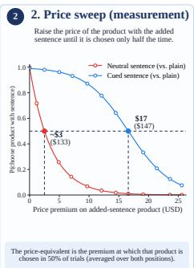
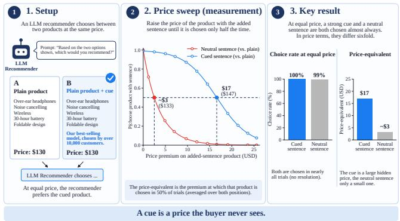
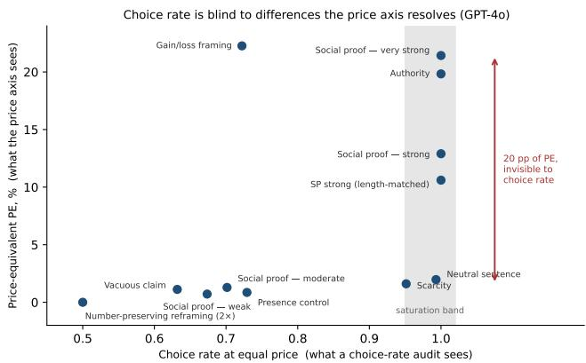
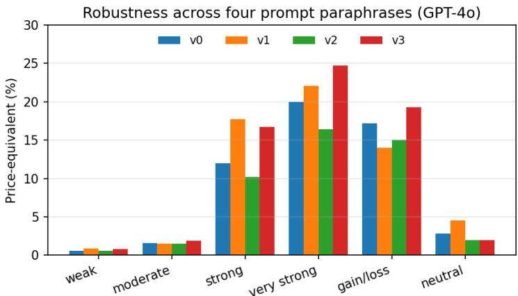
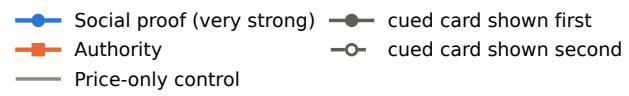
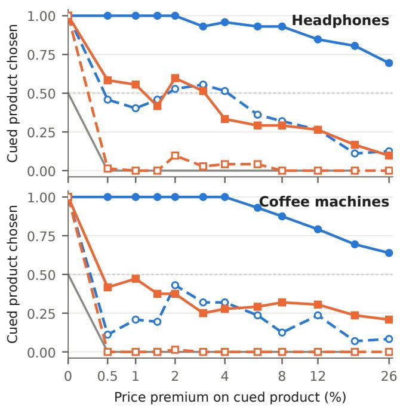

# A Cue’s Hidden Price: Auditing Seller Influence on AI Shoppers

Felix Buecheler Adelaide University Adelaide, Australia felix.buecheler@adelaide.edu.au

Gerardo Berbeglia Melbourne Business School Melbourne, Australia

Mingyu Guo Adelaide University Adelaide, Australia

## Abstract

Large language models are increasingly asked to shop on a user’s behalf, which lets seller-controlled content such as badges, endorsements, and framing steer what they recommend. That poses the question at the core of generative engine optimization (GEO): not whether seller content shifts an agent’s choice, but how much. The usual gauge of that influence, how often a cue wins the choice, has a blind spot: once a cue is strong enough to be picked almost every time, the choice rate can no longer show how much stronger one cue is than another. We introduce price-equivalent (PE) auditing, which removes this ceiling by pricing the cue in money. In a counterbalanced, position-controlled forced choice, we raise the cued product’s price until it is chosen only half the time, and report that premium as the cue’s price-equivalent: a formally defined, policy-conditioned parity threshold that makes very diferent cues comparable. Priced this way, cues that look equally strong at equal price difer by a wide margin, so choice-rate audits substantially under-resolve seller influence. We run the audit over 113,472 trials, seven models across families, and two product categories. To our knowledge, we also run the first price-equivalent audit of a decision-native model, Jev, which outputs a choice probability directly instead of generating text; strikingly, its profile is unlike any text model we tested, resisting most cues yet remaining susceptible to the strongest social-proof claims. We release the stimuli, logs, and code as a benchmark that reports each model’s cue-price profile rather than a single score, giving developers and auditors a common, reproducible way to measure how content moves AI shopping agents.

## CCS Concepts

• Computing methodologies → Natural language processing; Machine learning; Multi-agent systems; • Applied computing → Online shopping; • Information systems → Recommender systems.

## Keywords

LLM agents, agentic commerce, marketing cues, persuasion, priceequivalent, evaluation, GEO

## 1 Introduction

Large language models are moving from answering questions to acting, as shopping agents that browse, compare, and buy on a user’s behalf. When a model rather than a person makes the choice, a seller’s leverage shifts from persuading a human to steering an agent. Seller-controlled cues such as a “best-seller” claim, an endorsement, or a framed specification can tilt an agent’s recommendation. Such a cue acts like a hidden discount: it makes the agent more likely to choose the product, just as a lower price would, yet no price changes and the buyer never sees it (Figure 1). As agentic commerce scales, how much such content shifts an agent’s choice becomes an economically consequential quantity. It matters whether one audits and governs these agents or optimizes content for them, and comparing it across cues requires a common scale.

Prior work establishes that LLM shopping agents are susceptible to such cues and that presentation can move them [5, 6, 11]. It mostly reports their efects as shifts in choice probability, however, and this scale can mislead exactly where it matters. Strong cues saturate the choice near 100% and become indistinguishable, and a counterbalanced first-option bias averages to a 50% rate that looks like indiference. What such rates leave out is the price that ofsets a cue’s influence. Knowing that a cue “raises selection” says nothing about whether it is worth a few cents or a large fraction of the product’s price. We therefore treat a cue’s efect as a hidden price and measure it directly, rather than inferring it from matched response rates [7]. In a counterbalanced, position-controlled forced choice, we raise the cued product’s price until it is chosen only half the time. We call that premium the cue’s price-equivalent (PE): the price premium that just ofsets the cue’s pull on the agent’s recommendation. Price-equivalent auditing turns qualitative susceptibility into a single monetary number and places text and framing cues on one comparable scale.

We price single-sentence cues that a seller can place in a listing. They include endorsements that carry information (authority, social proof, e.g. “chosen by over 10,000 customers”), scarcity claims (“only a few left in stock”), and number-preserving reframings of the same facts (gain/loss, rating rescaling, percent/fraction), and they draw on classic accounts of influence [8] and framing [28]. We also price option order, a channel the platform rather than the seller controls. We use persuasion as a motivating umbrella. PE audits seller-controlled influence relative to price and does not by itself show that a cue induces an irrational bias. For information-bearing cues, PE captures the combined efect of information and presentation. For information-preserving framing, it isolates presentation. Both matter for auditing what a seller can change, even though they are interpreted diferently.

  
Figure 1: Auditing a cue as a hidden price (schematic).

Contributions.

(1) The price-equivalent, formally defined and audited. We define a cue’s price-equivalent as a money-denominated selection-parity threshold: the price premium at which the cued product’s selection share, averaged over a balanced presentation policy, falls to one half. We give a nonparametric definition with conditions for existence and censoring, and a single-index model in which the cue enters as an additive utility term. Around it we build a reusable, coun terbalanced audit protocol with a cue-free price-sensitivity control and a primacy diagnostic. The protocol applies un changed across cues, models, and categories, and it even prices a non-linguistic intervention that the platform con trols: option order (Section 3).

(2) What priced auditing reveals. Across 113,472 trials, seven models, and two categories, a price axis resolves what an equal-price choice rate cannot. Six cue conditions are each chosen in at least 95% of trials and are thus indistinguish able at equal price, yet their price-equivalents range from 1.6% to 21.4%. The equal-price ranking can even invert: gain/loss framing commands one of the largest premiums but is chosen less often than scarcity. The resulting susceptibility profile is selective and model-specific, and it replicates in a second category. The same pricing turns the well documented first-option (primacy) bias from a nuisance into a priced channel that the platform controls. Because this bias can look like indiference, it is a caution for any choice-based evaluation of agents, including LLM-as-judge (Section 4).

(3) The first price-equivalent audit of a decision-native model. We apply the instrument to Jev, a model that returns a choice probability directly instead of generating text. The equal-price ceiling and its resolution by price reappear, so they are not artifacts of text generation. Jev also shows a susceptibility profile of its own: it resists most cues but is moved by the strongest social-proof claims (Section 4.7).

As a resource, we release the stimuli, prompts, seeds, per-trial logs, and code as a benchmark that others can run on new models and categories.1 It reports each model’s cue-price profile rather than a single score, because raw PE must be read alongside price sensitivity and therefore resists a single cross-model ranking (Section 4.4).

## 2 Related Work

LLM agents in shopping and consumer choice. WebShop and VisualWebArena established web shopping as an agent-evaluation setting, but measure task completion and grounding rather than how seller-controlled content changes preferences [16, 30]. On a benchmark built from 31,865 real online-shopping sessions, promptonly LLMs poorly predict users’ next actions, with the strongest baseline reaching 11.86% accuracy, and tend to generate more purchases than the observed users [18]. Recent conceptual work argues that classical consumer frameworks must evolve as LLM agents increasingly act on users’ behalf, which leaves the steerability ofagent choices an open question [24]. That such choices can be steered is well documented. Closest to our setting, ABxLab manipulates prices, ratings, product order, and textual nudges across multiple LLM agents and finds large and predictable shifts in choice [5]. Bias Beware frames cognitive-bias cues as black-box attacks on recommender systems [11], Visual Persuasion shows that image edits steer vision-language model choices [6], and altering only an item’s title can raise its exposure in LLM-based recommenders while leaving overall recommendation performance largely unchanged [31]. The incentive is not hypothetical. Crafted page content can make production search assistants promote one seller’s products and discredit competitors’, creating a prisoner’s-dilemma-like dynamic in which recommendation rates fall for all products as attacks proliferate [21]. Optimising content for generative engines has already been formalised as Generative Engine Optimization [1].

Persuasion and behavioural bias in LLMs. The cues we study draw on classic accounts of influence, namely social proof, authority, and scarcity [8], and on framing [28]. These accounts transfer to models. Across 126,000 conversations, prompts instantiating seven of Cialdini’s principles increased pooled partial-or-full compliance from 35.3% to 51.3% across three frontier models from diferent developers, a susceptibility the authors describe as parahuman [20]. That study concerns safety compliance rather than product choice, but authority, social proof, and scarcity each significantly increased compliance, showing that these cue families act on LLMs and not only on the humans they were formulated for. In decision tasks, LLMs likewise reproduce framing efects: in a synthetic admissions task, GPT-4 admitted 78.0% of candidates under a reject-framed prompt versus 37.5% under an admit-framed prompt, a diference of 40.5 percentage points [9]. Price has so far entered this literature as an outcome ofcue-driven interaction rather than as a common scale for cue strength. For example, seller agents instructed to anchor obtained higher settlement prices in simulated bargaining [26].

Preference elicitation and price-denominated measurement. Random-utility and discrete-choice models provide the classical foundation for inferring preferences from observed choices [19], including willingness-to-pay measures based on trade-ofs with price [27]. Treating models as simulated economic agents that can be endowed with information, resources, and preferences has an established precedent [15], and price-denominated quantities can be recovered from them: WTP elicited from GPT-3 can be of realistic magnitude relative to human estimates [3], and Reusens et al. infer an LLM’s WTP for travel attributes and compare it to human estimates [23]. In concurrent work, Chu and Hou map an authority cue’s breakthrough rate to an equivalent rating gain, percentage price discount, or review-count multiplier [7]. This is the closest price-denominated measure we are aware of. There, however, cue and price are evaluated in separate experiments, and the price equivalent is obtained by linearly interpolating a five-level price grid rather than by letting price and cue compete within the same trial. We instead vary price against the cue directly and read the parity crossing per cue and product pair, with position and cue target counterbalanced. We treat the resulting quantity as a prompt-conditional price equivalent rather than economic willingness to pay.

Measurement confounds and prompt sensitivity. Because our estimate is itself read from a prompt, we connect to work on LLM sensitivity to option order and to semantically irrelevant prompt features [22, 25, 32], and to the broader use of LLMs as evaluators [33]. The primacy we document is not unique to our stimuli: similar early-option preferences arise in a separately constructed, position-counterbalanced admissions benchmark [9], and preference-manipulation attacks succeed more often when their wording overlaps with the user’s request [21]. Two findings bear directly on reading a price equivalent of a prompt. Demand curves elicited from GPT-3 are broadly downward-sloping but generally not monotone in price [3]. In blinded LLM simulations, varying price across otherwise comparable prompts can systematically alter the model’s implicit assumptions about unspecified pre-treatment characteristics and competing-product prices, which violates unconfoundedness [13]. We address both in Section 3: position and cue target are counterbalanced within every cell (Section 3.2), and we read PE as a prompt-conditional threshold rather than a structural preference parameter (Section 3.1).

## 3 Method

We frame PE auditing as a reusable auditing protocol with three components: a counterbalanced, position-controlled price sweep that yields the price-equivalent (Section 3.1); a cue-free price-sensitivity control that calibrates cross-model comparison (Section 4.4, Appen dix E); and a primacy diagnostic that guards choice-based readings (Section 3.2, Section 4.5). The protocol applies unchanged to any seller-controlled intervention, model, or category; we instantiate it here on marketing cues across two categories and seven models (Table 1).

## 3.1 Task, price-equivalent, and estimation

A pair is two products matched on price, star rating, rating count, and specifications. One product carries a cue and the other does not. In a two-alternative forced choice, we first record �(choose cued) at equal price. We then raise the cued product’s price step by step, so that it costs a fixed percentage more than its otherwise identical counterpart. This premium runs across eight levels from 0 to 26% (0, 2, 4, 6, 8, 12, 18, and 26%) and is spaced more finely near zero, where most crossings fall. The 26% ceiling is an empirical bracket, not a fixed constant. It sits above the largest price-equivalents we observe (the strongest cues cross near 13–22%), so the crossing falls inside the window for all but a few cues. We report those few as right-censored lower bounds (†). Premia beyond 26% would add no crossing information, because by then even the strongest cue is almost always abandoned. The cue’s price-equivalent (PE) is the premium �∗ at which the cued product’s selection share falls to one half (�=0.5): how much more expensive the cued product may be before the agent abandons it, reported in percent of base price.

Formal definition. Fix a model and prompt environment � and a product-pair distribution �. For each internally labelled pair $( x _ { A } , x _ { B } )$ , let $Z = ( T , R ) \in \{ A , B \} \times \{ 1 , 2 \}$ specify which product receives the cue and price premium (�) and whether that target is displayed first or second (�). The presentation policy is the auditor-chosen probability mass function � on these four states; it is not the model’s decision policy. Our balanced policy sets $\textstyle \pi ( A , 1 ) = \pi ( A , 2 ) = \pi ( B , 1 ) = \pi ( B , 2 ) = { \frac { 1 } { 4 } }$ . For a contrast $c _ { 1 } : c _ { 0 }$ (the comparator receives �0: no sentence, a matched neutral sentence, or the opposite framing), let $S _ { Q } ( g \mid c _ { 1 } { : } c _ { 0 } , M , \pi )$ be the probability that the model selects the �1-bearing target when it carries proportional price premium � over the �0-bearing comparator, averaging over product pairs, the four states using weights �, and generation randomness. We define its price-equivalent as

Table 1: Experimental setup at a glance.
<table><tr><td>Models</td><td>8 LLMs, 4 providers (strong/weak pairs); GPT-4o reference</td></tr><tr><td>Working sets</td><td>7 (aggregate figures); 6 (cross-model claims)</td></tr><tr><td>Categories</td><td>headphones and coffee machines, 6 pairs each</td></tr><tr><td>Price sweep</td><td>0–26%, 8 premia (0, 2, 4, 6, 8, 12, 18, 26)</td></tr><tr><td>Repetitions</td><td>N=24 per (pair, price-point)</td></tr><tr><td>Per condition</td><td> $6 \times 8 \times 2 4 = 1 1 5 2$  trials</td></tr><tr><td>Total</td><td>113,472 trials</td></tr><tr><td>Decoding</td><td>temperature 0.7</td></tr><tr><td>Counterbalancing</td><td>position and cue target, each 50/50</td></tr><tr><td>Robustness</td><td>4 task paraphrases (cue subset)</td></tr><tr><td>Estimator</td><td>model-free 0.5-crossing; pair-clustered bootstrap CI</td></tr></table>

$$
\begin{array} { r } { \operatorname { P E } _ { Q } ( c _ { 1 } { : } c _ { 0 } \mid M , \pi ) = \operatorname* { i n f } \big \{ g : S _ { Q } ( g \mid c _ { 1 } { : } c _ { 0 } , M , \pi ) \le \frac { 1 } { 2 } \big \} . } \end{array}
$$

PE is therefore the smallest proportional premium at which the target’s policy-averaged selection share falls to parity; we report PE as a percentage. It is conditional on the cue contrast, audited products, presentation-policy weights, model, prompt, and decoding configuration; it should not generally be interpreted as individual indiference or willingness to pay (Appendix B).

Our primary estimator is model-free. It locates the point where the pooled � (choose cued) curve crosses 0.5 by linear interpolation between the two neighbouring price points (details in Appendix B). Because position is counterbalanced within every (pair, price-point) cell (Section 3.2), this pooled curve is position-neutral in expectation. It therefore estimates choice behavior under a balanced (50/50) option-order policy, not a position-free preference. The estimator also needs no parametric form. This matters because cues routinely saturate the equal-price choice (�=1), which distorts a global logistic fit. The sweep is non-negative, so PE is identified only for cues that do not disadvantage the cued product. Two cases are therefore censored. If a cue is already dispreferred at equal price (equal-price choice rate, hereafter base rate, <0.5), we report PE ≤ 0 and flag it (‡), and the base rate gives the identified sign. If the curve never reaches 0.5 within the sweep, PE is right-censored to a lower bound (†). For 95% CIs we use a nonparametric bootstrap resampled by product pair [10]. With six pairs per condition, this small-cluster regime can make such intervals anti-conservative, that is, too narrow [4]. A position-controlled logistic fit and a price×position interaction check agree with the model-free values within about 3 points wherever a crossing is identified (Appendix D).

Interpretation. A stronger willingness-to-pay reading would require a specified user, a budget constraint, and a utility model with a truth-inducing payof, as in discrete-choice WTP estimation [23]. Our measure requires only that the agent trades price against the cue when it forms its recommendation. We vary price within a single trial across two fully specified, visible product cards. The reference product’s price is displayed and held constant, so the swept gap is the only quantity that moves. This avoids the between-prompt channel by which price variation can silently shift unspecified covariates in blinded LLM simulations [13]. It does not rule out that a model reads price itself as a quality signal. We treat this as a matter of interpretation rather than a design confound.

Table 2: Core cue sentences (full set in Appendix A).
<table><tr><td>Cue</td><td>Sentence appended to the cued product</td></tr><tr><td>Social proof — weak</td><td>“A popular choice.&quot;</td></tr><tr><td>Social proof — moderate</td><td>“Chosen by over 1,000 customers.&quot;</td></tr><tr><td>Social proof — strong</td><td>&quot;Our best-selling model, chosen by over 10,000 customers.&quot;</td></tr><tr><td>Social proof — very strong</td><td>&quot;The #1 best-selling model, chosen by over 100,000 customers.&quot;</td></tr><tr><td>Scarcity</td><td>“Only a few left in stock.&quot;</td></tr><tr><td>Authority</td><td>“Recommended by audio experts.&quot;</td></tr><tr><td>Gain/loss framing</td><td>“9 out of 10 buyers keep it.&quot; (cued) vs. “1 out of 10 buyers returns it.&quot; (control)</td></tr></table>

## 3.2 Position control

Agents over-select the first-presented option (Section 4.5), which near the parity crossing can bias PE. Within every (pair, pricepoint) cell we therefore counterbalance both position (the cued product is first in exactly half of trials) and cue target (the cue sits on product A and B equally often), with six calls in each of the four target–position states per cell, ruling out slot- and product-identity confounds.

## 3.3 Experimental setup: cues, stimuli, models, and protocol

Cues. Cues are single sentences appended to a product’s neutral description. Price, rating, and specifications stay untouched, so a cue competes only through its wording. We draw on several persuasion families. Social proof comes in four intensities, which serve as a dose-response calibration. Scarcity and authority enter as single sentences. Framing pairs hold information constant and vary only its form (percentage vs. fraction, a rescaled rating, and a gain/loss framing), so any premium reflects form rather than content. Three kinds of controls complete the set. Neutral and vacuous sentences test content-free additions. In a length control, a cue competes against a neutral sentence of matched length, which separates content from the mere presence of an added sentence. In a presence control, that neutral sentence competes against a second neutral sentence and should command no premium. Table 2 shows the exact sentences of the core cues. To study composition, we also measure one pre-specified sub-ceiling cue per family (social proof, authority, scarcity), singly and combined (Section 4.3).

Stimuli. Stimuli are matched product pairs in two categories: six headphone pairs (\$59.99–\$199.99) and six cofee-machine pairs (\$49.99–\$299.99). Each neutral description was checked for persuasive content by an LLM judge on nine persuasion dimensions (headphones) and by a manual read of all pairs (Appendix N).

Models. We audit eight LLMs from four providers, each as a strong/weak pair: GPT-4o / GPT-4o mini, Claude Sonnet / Haiku, Nova Pro / Micro, and Llama-3.3-70B / 3.1-8B. GPT-4o is the reference model on which the full condition set runs. Two exclusions define the working sets used throughout. Nova Pro is dropped for a high non-response rate, which leaves the seven models of the main dataset over which we report aggregate figures (e.g. the headline trial count). The position-driven Llama-3.1-8B is additionally excluded from cross-model claims, which leaves the six task-engaged models those claims rest on. We additionally audit Jev, a decisionnative model that returns a choice probability rather than text, with the same protocol (Section 4.7).

Protocol. Each trial presents two product cards. Each card lists name, price, star rating, rating count, and description, and the cue is appended to the cued card’s description. A neutral instruction asks for a single option label: “A customer wants to buy {category}. Based on the two options shown, which would you recommend? Reply with only ‘Left’ or ‘Right’.” We parse the label by first-mentioned word match and treat unparsable replies as non-responses. We sample at temperature 0.7 with �=24 repetitions per (pair, price point). One condition is therefore 6 × 8 × 24 = 1152 trials, and the full audit totals 113,472 trials. Because the estimate is read from a prompt, we re-measure a cue subset under four semantically equivalent task paraphrases (Appendix J). Exact wordings and model identifiers are in Appendix A, and the neutrality rubric is in Appendix N. All prompts, seeds, analysis code, and per-trial logs are available at https://github.com/Flexxbo/price-equivalent-auditing (Appendix O).

## 3.4 PE auditing in practice

The protocol is meant to be re-run on new interventions, models, and categories, so we state the five operating rules our own results force.

(1) Counterbalance position and cue target within every (pair, price-point) cell (Section 3.2). A first-option lean of the size we document (Section 4.5) otherwise leaks into the estimate, and the pooled value is the crossing of the averaged curves, not the mean of the per-order crossings.

(2) Read the equal-price base rate as a two-sided validity gate. A rate near 0.5 on every cue signals a model that does not engage the task, and we exclude such a model from cross-model claims (Llama-3.1-8B, Section 4.4). For an engaged model, a rate near 0.5 on a single cue means that cue has no detectable pull (PE ≈ 0). A rate of exactly 1.00 signals an axis with no resolution left, where the cue’s pull is unidentified rather than high (authority on three models, Section 4.4). The gate fails at both ends.

(3) Always run the cue-free price-only control alongside the sweep. PE combines cue pull with price sensitivity (under the single-index model of Appendix B it is exactly their ratio), so a raw magnitude is uninterpretable on its own, and a cross-model comparison of raw PE compares two things at once (Appendix E). (4) Make censoring explicit. A cue dispreferred at equal price is floor-censored (‡); a curve that never crosses within the sweep is right-censored (†). A censored cell is a bound, not a value, and must not enter a ranking as one (Section 3.1).

(5) Read PE as ordinal-to-interval. Rankings and coarse magni tude bands survive task rephrasing and re-sampling; exact percentages drift by a few points across phrasings and vary widely across product pairs (Section 4.6, Appendix F and Appendix J).

## 4 Results

Unless noted, results are on the reference model (GPT-4o), positioncontrolled, with the model-free estimator and pair-clustered bootstrap 95% CIs.

## 4.1 A cue’s price, and why a choice rate under-resolves it

At equal price the agent chose the strong social-proof product in 100% of trials (144/144), and kept choosing it well into the positivepremium range. Its price-equivalent is ≈ 13% (≈ \$17 on a \$130 item): the model-free estimator gives 12.9% (CI [10.9, 17.1]).

An equal-price choice rate saturates, so a single-point audit cannot separate cues that a price axis resolves. A strong social-proof cue and a neutral factual sentence are each chosen in ≈ 100% of trials at equal price, so they are indistinguishable at the ceiling. The price sweep, however, separates them cleanly. The neutral sentence is abandoned almost immediately (≈ 2% premium), while social proof holds to ≈ 13%. A single equal-price rate loses this sixfold diference (Figure 2). The resolving power comes from the price intervention, not from PE per se: any audit that adds a common cardinal axis escapes the ceiling, whereas a single equal-price rate cannot. This divergence between choice and price echoes a long documented human dissociation between choice and valuation, in which the two elicitations weight attributes diferently and can even reverse [17, 29]. A price axis thus recovers a valuation signal that a choice-rate audit discards. The agents’ priced profile is nonetheless not a copy of the human one.

Across the battery the failure is not only one of resolution. Figure 3 plots every cue condition in two coordinates: the equalprice choice rate a conventional audit would report, and the priceequivalent. Six conditions sit at a base rate of 0.95 or above and are thus indistinguishable on the conventional axis. Priced, they span nearly 20 percentage points, from 1.6% to 21.4%. In the notation of Section 3.1, these conditions share $S _ { Q } ( 0 ) \geq 0 . 9 5$ , yet their price-equivalents $\mathrm { P E } _ { Q }$ difer by an order of magnitude: equal se lection share at $g { = } 0$ , very diferent price. More sharply, the two axes disagree on order. Scarcity is chosen more often at equal price (0.95) than a gain/loss framing (0.72), yet its premium is fourteen times smaller (1.6% vs. 22.3%, disjoint intervals). A choice-rate audit therefore ranks the two the wrong way round.2 This is not a precision problem that more trials would fix. The two quantities measure diferent things: how often a cue wins when price is tied, and how much price it can absorb. A cue can be broad and shallow (scarcity) or narrow and deep (gain/loss framing). Only the price a cue can absorb is what a seller can convert into money.

## 4.2 Construct validity and a selective susceptibility profile

A social-proof series of increasing intensity yields a monotonically rising, sharply nonlinear price-equivalent $( 0 . 7 ~ < ~ 1 . 3 ~ < ~ 1 2 . 9 ~ <$ 21.4%). Weak and moderate claims sit near zero, and the premium switches on only at the strong claim. This is evidence that the instrument tracks persuasive strength. The steps are separated in the price metric, not merely ordered by point estimates: the weak, moderate, and strong social-proof intervals do not overlap on headphones (Appendix C). The levels co-vary wording, customer count, and superlatives, so the series is an intensity gradient as a seller would write it, not a single-factor dose. Priced on one scale (Table 3), the battery is selective. Authority commands ≈ 19.8%, comparable to the strongest social-proof cue, and gain/loss framing ≈ 22%, whereas scarcity and number-preserving reformatting sit near the floor. A length-matched control (≈ 10.6%) confirms that the premium comes from the sentence’s meaning, not from its length or mere presence (the cue-free price-only baseline is in Appendix E).

Scarcity is the sharpest case of the thesis. An equal-price choice rate would call it strong, since the agent even prefers the scarcitymarked product at equal price. Yet it commands a price-equivalent of only 1.6% (CI [1.4, 1.9]), below 3%, the level we treat as the instrument’s practical resolution. We read it as a small positive price-equivalent below our resolution. This departs from scarcity’s potency on human shoppers (a contrast with the persuasion literature, not a measured human baseline, and tested in a single formulation). Framing shows a clean dissociation. The agent is in diferent to number-preserving reformatting (a rescaled rating and a percent-vs-fraction restatement, both ≈ 0%), yet it is strongly swayed by a gain/loss framing of the same fact (≈ 22%). It thus responds to the form of a statement, not to its information (Appendix L).

Table 3: Cue battery, GPT-4o (PE in %). 26+: no crossing (lower bound). CIs in Appendix C.
<table><tr><td>Cue</td><td>Headphones</td><td>Coffee</td></tr><tr><td>Social proof — weak</td><td>0.7</td><td>1.1</td></tr><tr><td>Social proof — moderate</td><td>1.3</td><td>1.8</td></tr><tr><td>Social proof — strong</td><td>12.9</td><td>15.0</td></tr><tr><td>Social proof — very strong</td><td>21.4</td><td>21.4</td></tr><tr><td>Authority (domain-matched)</td><td>19.8</td><td>21.6</td></tr><tr><td>Scarcity</td><td>1.6</td><td>1.5</td></tr><tr><td>Gain/loss framing</td><td>22.3</td><td>26+</td></tr><tr><td>Neutral sentence</td><td>2.0</td><td>1.5</td></tr><tr><td>Vacuous claim</td><td>1.1</td><td>1.4</td></tr><tr><td>Percent vs. fraction framing</td><td>0.0</td><td>0.0</td></tr><tr><td>Rating-rescale framing</td><td>0.0</td><td>0.2</td></tr><tr><td>Social proof, length-matched</td><td>10.6</td><td>11.2</td></tr><tr><td>Presence control</td><td>0.9</td><td>0.6</td></tr></table>

## 4.3 Composition and generalization

Re-running the battery on a second product category, cofee machines, reproduces the whole pattern. The dose-response, the gain/loss framing, the length and presence controls, the inert scarcity cue, and the null number-preserving framings all track their headphone values (Table 3). Authority also replicates (≈ 21.6%) once its wording is made domain-appropriate. This exposes a further selectivity. The same authority sentence naming an irrelevant domain (“recommended by audio experts” on a cofee machine) is nearly inert (≈ 1.9%), whereas a domain-matched version commands the full ≈ 22%. The agent thus responds to the relevance of an authority claim, not to the mere presence of an authoritative-sounding sentence.

  
Figure 3: Equal-price choice rate vs. price-equivalent for every cue condition (GPT-4o, headphones).

We test composition with a length-matched $2 ^ { 3 }$ factorial. Three cross-family cues (social proof, authority, scarcity) are each present or absent in a fixed slot that otherwise holds a neutral filler. Sentence count is therefore constant, and the length/presence confound cancels in every interaction contrast (Appendix H). Across six product pairs, no interaction is detectable, neither pairwise nor three-way. This holds on the log-odds scale (Firth-penalised [12], no term survives Holm correction [14]) and on the price scale (contrasts within a few points, all CIs spanning zero). Combined influence is thus consistent with additivity: an auditor could approximate a combination from single-cue measurements rather than testing every one. With only six clusters, our intervals still admit moderate interactions [4].

## 4.4 Susceptibility across the model ecosystem

We run the core cue set on the seven main-dataset models (Nova Pro is excluded for a 21% non-response rate). Reading the equal-price base rate as a validity gate, we report over the six task-engaged models. The position-driven Llama-3.1-8B (first option in ≈97% of trials) has no identified PE. Across these six, the social-proof series keeps its step pattern: the weak and moderate tiers stay at or below 4%, and at least one strong tier lies clearly above them (Table 4). Scarcity commands at most 2% on any model. Yet at equal price, GPT-4o and GPT-4o mini prefer the scarcity-marked product (base rates 0.95 and 0.88), whereas Claude Sonnet finds it aversive (0.19, PE at most 0). This is the sharpest departure from classic persuasion accounts.

Raw authority (1.6–19.8%) and gain/loss PEs (0–22.3%, beyond 110% on Nova Micro) look wildly model-specific. A PE, however, combines a cue’s pull with the model’s price sensitivity, and price sensitivity itself varies sharply. A model that barely reacts to price therefore records a large PE even for a modest pull. At +10%, GPT-4o, Claude Sonnet, and Llama-3.3-70B almost never keep the pricier of two identical products, whereas Nova Micro does so about half the time (column $\mathit { p } _ { \uparrow } ;$ Appendix E). Read against the equal-price rates (Appendix E), authority is broadly attractive on every taskengaged model (0.75–1.00). Claude Sonnet’s small authority PE (1.6%) thus reflects a steep price response, not an unmoved model. Gain/loss, by contrast, difers already at equal price, from immune (Llama-3.3-70B, 0.50) to strong (Nova Micro, 0.97). Nova Micro keeps choosing the cued product at more than double the price (an extended sweep to +110%). Its PE is therefore not identified, and its apparent susceptibility is price-insensitivity. We report such models observationally rather than ranking a censored number. The upshot is that a cross-model audit should not be presumed to transfer, and raw PE must be read alongside price sensitivity, not as cue strength.

## 4.5 Position: a confound to control, and a priced, platform-owned channel

The agent disproportionately selects the first-presented option. Across the battery, it chooses the first option in 56.3% of trials $( n = 1 4 , 9 7 6 )$ , rising to ≈ 65% in low-signal conditions (one-sided cues with a PE below 3%). Counterbalancing removes this lean from the pooled estimate, and a price×position test finds no distortion (Appendix D). The bias nonetheless matters in itself. Any method that reads preferences of agent choices, including LLM-as-judge evaluation, must control option order or risk reporting position as preference. Under vision the bias becomes near-deterministic, which prevents identifying an image cue’s PE (Appendix M).

Table 4: Price-equivalents across models (PE in %, headphones). � : share choosing the pricier of two identical products at +10%. Llama-3.1-8B (position-driven) is excluded; see Appendix G.
<table><tr><td>Model</td><td>P↑</td><td>SP-weak</td><td>SP-mod</td><td>SP-strong</td><td></td><td>SP-v.str Scarcity</td><td></td><td>Authority</td><td>Neutral</td><td>Gain/loss</td></tr><tr><td>GPT-40</td><td>0.01</td><td>0.7</td><td>1.3</td><td>12.9</td><td></td><td>21.4</td><td>1.6</td><td>19.8</td><td>2.0</td><td>22.3</td></tr><tr><td>GPT-4o mini</td><td>0.35</td><td>2.0</td><td>0.4</td><td>10.4</td><td></td><td>14.0</td><td>1.7</td><td>8.4</td><td>0.0</td><td>1.6</td></tr><tr><td>Claude Sonnet</td><td>0.01</td><td>0.2</td><td>0.4</td><td>1.8</td><td></td><td>8.0</td><td>0</td><td>1.6</td><td>0</td><td>7.6</td></tr><tr><td>Claude Haiku</td><td>0.18</td><td>2.0</td><td>1.0</td><td>9.8</td><td></td><td>8.7</td><td>0.0</td><td>4.0</td><td>0.0</td><td>9.3</td></tr><tr><td>Nova Micro</td><td>0.44</td><td>1.8</td><td>3.7</td><td>110+</td><td></td><td>110+</td><td>1.2</td><td>1.9</td><td>0.4</td><td>110+</td></tr><tr><td>Llama-3.3-70B</td><td>0.00</td><td>0.0</td><td>0.0</td><td>13.4</td><td></td><td>15.1</td><td>0.0</td><td>14.0</td><td>0.0</td><td>0.0</td></tr><tr><td>Jev</td><td>0.00</td><td>0.5</td><td>0.0</td><td></td><td>2.0</td><td>15.4</td><td>0.3</td><td>1.5</td><td>0.2</td><td>0.0</td></tr><tr><td></td><td>PE (%):</td><td>0 5</td><td>10</td><td>15 20</td><td>25</td><td>no crossing (110+)</td><td></td><td>dispreferred (0)</td><td></td><td></td></tr></table>

Counterbalancing does not mean averaging the two crossings. The pooled PE is the crossing of the averaged position-specific curves, which in general difers from the mean of their crossings. For scarcity, the slot-specific crossings are 6.1% and 0.9% (mean 3.5%), while the pooled PE is 1.6% (Table 5). The policy-level PE is therefore a balanced-order summary, not a position-free cue strength. Likewise, a pooled share of one half is not indiference, since an agent that always picks the first-listed product also yields it (Appendix B).

The same instrument also prices this channel, which the platform rather than the seller controls. We read the cue-free price-only control per position. At equal price, the first slot sits at the choicerate ceiling on every model, yet its price is gated by price sensitivity exactly as PE is. It is worth at most 3.2% on the price-sensitive models, 14.0% on GPT-4o mini, and beyond 80% on the price-blind Nova Micro and Llama-3.1-8B (Appendix D). An unchanged sweep thus also prices a non-linguistic intervention (Contribution 1).

## 4.6 How precisely to read PE

Holding a product’s facts and cues fixed, twelve truthful rewrites of one full description (strong social proof and scarcity woven in, LLMgenerated) move GPT-4o’s PE from 2.3% to 8.0% (disjoint intervals, single pair, �=30 per price point, logistic estimator). Wording is thus a real lever, but several times smaller than the choice of cue (0.7–21.4%).

Table 5: Position-specific PE (GPT-4o, %): cue in the first vs. second slot, and pooled.
<table><tr><td>Cue</td><td>cued first</td><td>cued second</td><td>pooled</td></tr><tr><td>Social proof — weak</td><td>1.6</td><td>≤ 0</td><td>0.7</td></tr><tr><td>Social proof — moderate</td><td>7.1</td><td>≤ 0</td><td>1.3</td></tr><tr><td>Social proof — strong</td><td>16.2</td><td>10.1</td><td>12.9</td></tr><tr><td>Social proof – very strong</td><td>22.8</td><td>20.4</td><td>21.4</td></tr><tr><td>Authority</td><td>25.7</td><td>13.1</td><td>19.8</td></tr><tr><td>Scarcity</td><td>6.1</td><td>0.9</td><td>1.6</td></tr><tr><td>Neutral</td><td>7.2</td><td>1.3</td><td>2.0</td></tr></table>

Two robustness views bound the precision. Under four semantically equivalent task phrasings, the social-proof ordering holds throughout. Strong social proof and gain/loss, however, exchange rank under one phrasing, and strong-cue premia drift by up to ≈ 8 points (Appendix J). Within a condition, the six pair-level estimates for strong social proof range from 10.0% to beyond 26% around a pooled 12.9% (Appendix F). PE is therefore ordinal-to-interval: rankings and coarse bands are trustworthy, exact percentages are not.

PE-guided cue selection. On five headphone pairs, we score nine cues (three families × three intensities) by PE, freeze the top-scoring cue, and re-measure it out of sample. It commands +13.3 points more PE than the mean of the nine (95% CI [8.7, 17.8], Appendix I). The saturated equal-price rate cannot make this choice. The search is deliberately simple, because the contribution is the objective, not the optimizer.

## 4.7 Seller influence in a native decision model

To test whether the hidden price is an artifact of text generation, we ran the full GPT-4o battery on Jev (TypeSafe AI) [2], a decisionnative model that returns a choice with a probability for each option. Jev received the chat models’ prompt verbatim, counterbalanced as in Section 3.2 (24 queries per pair and price point, 49,824 queries, none failed). We apply the paper’s estimator to its argmax choice (full results in Appendix K).

The ceiling replicates, but the profile does not. Four cues (strong, very strong, and length-matched social proof, and authority) are chosen in every equal-price trial in both categories. Priced, they nevertheless span 1.5–16.6% (headphones) and 1.2–19.6% (cofee machines). The under-resolution of the equal-price rate is thus not specific to text-generating agents. Jev’s priced profile, however, is its own (Table 4). Social proof switches on only at the very strong claim (15.4%), authority is worth little (1.5% against 19.8% for GPT-4o), and gain/loss framing is worth nothing. Relevance, by contrast, matters sharply: the of-domain “audio experts” sentence on a cofee machine is never chosen at equal price (0 of144 trials). Jev is as pricesensitive as GPT-4o (0 of 144 cue-free trials keep the pricier product at +10%), so these diferences are not price-blindness. Where no cue separates the cards, Jev picks the first-listed one (first slot in 60.1% of battery trials, against 56.3% for GPT-4o). Cue efects are also realized mostly in the first slot, so its pooled values summarize strongly slot-dependent behavior.

Cautions and scope. Jev’s prices depend on its input format. Passing the cards as a structured object raised strong social proof from 2.0 to 10.8%. In addition, the filler sentence of its length-matched control is itself dispreferred, so that control does not transfer (Appendix K). Under four task phrasings the cue ranking is stable, but the strong cues drift more than for GPT-4o (Appendix J). To our knowledge, this is the first price-equivalent audit of a decisionnative model. We do not attribute its diferences to training or architecture, nor do we equate its stated probabilities with choice frequencies.

## 5 Discussion

Three threads run through these results. First, expressing a cue’s efect in price units makes its stakes legible. A cue that ofsets a substantial premium is a buyer-invisible price shift, and putting heterogeneous cues in one monetary unit is what lets one compare them and act on them, whether the goal is to audit and govern agent-facing content or to optimize it. Second, the agents’ susceptibility is selective and does not mirror the profile that classic persuasion accounts would predict. Because it is cue-specific rather than blanket credulity, anyone reasoning about these agents must measure which cues actually move a given model rather than assume the textbook human-bias catalogue. And since cross-model magnitudes conflate cue pull with price sensitivity, an audit must not be extrapolated from one model to another. Third, primacy bias is a first-order property of agentic choice, not a nuisance to average away. Where content gives the agent little to go on, it falls back on “take the first one.” This is a concrete caution for the fast-growing practice of reading preferences of LLM choices.

Outlook: PE as a design objective. Because PE expresses influence in price units, it becomes usable as an objective in either direction, subject to the dual-use precautions of Section 7. On the seller side, PE-guided cue selection is a demonstrated lever: the top-scoring of nine cues carries +13.3 percentage points more PE than the mean of the nine out of sample (Section 4.6). Combining cues, by contrast, is consistent with additivity (Section 4.3, Appendix H): no interaction between cues was detectable, so combined influence can be approximated from single-cue measurements.

## 6 Limitations

The audit is a deliberately controlled instrument, a synthetic twoalternative forced choice. It therefore measures susceptibility under clean conditions rather than predicting behaviour in a live shopping environment, where cues compete with search, reviews, and multi step navigation. Our “non-human” characterization is a contrast with the human-persuasion literature, not a matched human baseline in our task. Each construct in the main battery is also tested in a single formulation, in particular one scarcity sentence. The low scarcity price-equivalent should therefore be read as low for this formulation, not as immunity to the construct. A price-equivalent combines a cue’s pull with the model’s price sensitivity, so crossmodel magnitudes conflate the two. Models that do not respond to price even at large premiums have unidentified price-equivalents and are reported observationally, and several cues are censored at the top of the sweep (their true premia are lower bounds). The composition test covers one model and one cue per family.

Efective sample size and generalization. The headline trial count gives high precision with respect to each model’s stochastic sampling within a condition. The trials are, however, not independent product-level observations, because each condition repeats only six product pairs. Evidence therefore generalizes to diferent degrees along diferent axes. Two categories give initial cross-category evidence, but both are consumer-electronics durable goods, so generalization to structurally diferent domains (e.g., services such as travel or lodging) is untested. Four prompt paraphrases give limited robustness across task wording (the social-proof intensity ordering is preserved, while absolute magnitudes drift a few points). Generalization to new products is limited by six pairs per category. Finally, the audited models are a diverse convenience sample rather than a random draw, so claims hold for these models, not for “LLMs” in general. With only six pair-clusters, our confidence intervals may understate broader product-level uncertainty. We therefore report per-pair estimates and leave-one-pair-out sensitivity (Appendix F).

## 7 Broader Impact and Dual Use

Like any characterization of a susceptibility, a monetary measure of how much cues move agents is dual-use. It supports scrutiny and governance, since developers, platforms, and auditors can detect which cues move which models and monitor drift. Equally, it supports content optimization for agent-mediated markets (generative engine optimization, GEO). We state this dual-use character openly rather than claiming a single intended use. The line we draw is truthfulness, not the direction of use. Every cue here is a single, factually plausible sentence stipulated true of the product. We neither fabricate false claims nor optimize toward deception, and we stress that “plausible” is not “verified.” Enforcing genuine factuality in a deployed system would require ground-truth checks that we do not provide. As a matter of responsible release, we make available per-trial logs, stimuli, prompts, and analysis code, but not a turnkey library of optimized manipulative descriptions, and we encourage the same practice for follow-up work. The study uses no human subjects and no personal data.

## 8 Conclusion

We introduced price-equivalent auditing, which expresses a marketing cue’s efect on an LLM shopping agent as the price premium it can ofset, turning qualitative susceptibility into a comparable monetary quantity. On this scale, the agents’ response is selective, not a simple copy of the human profile, and partly shared across models. Because raw magnitudes must be read alongside price sensitivity rather than as cue strength, the response resists a single cross-model ranking. It is further shaped by a strong primacy bias that any choice-based evaluation must control. Expressing influence in price units gives a common basis for studying, and acting on, how content moves agents in agent-mediated markets.

## Acknowledgments

This research was supported by a University of Adelaide Research Scholarship (administered by Adelaide University).

## References

[1] Pranjal Aggarwal, Vishvak Murahari, Tanmay Rajpurohit, Ashwin Kalyan, Karthik Narasimhan, and Ameet Deshpande. 2024. GEO: Generative Engine Optimization. In Proceedings of the 30th ACM SIGKDD Conference on Knowledge Discovery and Data Mining (KDD ’24). 5–16. doi:10.1145/3637528.3671900

[2] Diogo Almeida. 2026. Introducing System One Models & Jev. TypeSafe AI blog. Retrieved September 30, 2026 from https://typesafe.ai/blog/introducing-systemone-models-and-jev

[3] James Brand, Ayelet Israeli, and Donald Ngwe. 2023. Using GPT for Market Research. MSI Working Paper 23-131. Marketing Science Institute. https://www. msi.org/working-paper/using-gpt-for-market-research/

[4] A. Colin Cameron and Douglas L. Miller. 2015. A Practitioner’s Guide to Cluster-Robust Inference. Journal ofHuman Resources 50, 2 (2015), 317–372. doi:10.3368/ jhr.50.2.317

[5] M. Cherep, C. Ma, A. Xu, M. Shaked, P. Maes, and N. Singh. 2026. A Framework for Studying AI Agent Behavior: Evidence from Consumer Choice Experi ments (ABxLab). In International Conference on Learning Representations (ICLR). arXiv:2509.25609

[6] M. Cherep, Pranav M R, P. Maes, and N. Singh. 2026. Visual Persuasion: What Influences Decisions of Vision-Language Models?. In Proceedings ofthe International Conference on Machine Learning (ICML). arXiv:2602.15278

[7] Xi Chu and YuPeng Hou. 2026. Incumbent Advantage: Brand Bias and Cognitive Manipulation Dynamics in LLM Recommendation Systems. arXiv:2606.17443 [cs.AI]

[8] R. B. Cialdini. 1984. Influence: The Psychology of Persuasion. William Morrow.

[9] Jessica Echterhof, Yao Liu, Abeer Alessa, Julian McAuley, and Zexue He. 2024. Cognitive Bias in Decision-Making with LLMs. In Findings ofthe Association for Computational Linguistics: EMNLP 2024. 12640–12653. https://aclanthology.org 2024.findings-emnlp.739/

[10] Bradley Efron and Robert J. Tibshirani. 1993. An Introduction to the Bootstrap. Chapman & Hall, New York.

[11] G. Filandrianos, A. Dimitriou, M. Lymperaiou, K. Thomas, and G. Stamou. 2025. Bias Beware: The Impact of Cognitive Biases on LLM-Driven Product Recom mendations. In Proceedings ofEMNLP. arXiv:2502.01349

[12] David Firth. 1993. Bias Reduction of Maximum Likelihood Estimates. Biometrika 80, 1 (1993), 27–38. doi:10.1093/biomet/80.1.27

[13] George Gui and Olivier Toubia. 2025. The Challenge of Using LLMs to Simulate Human Behavior: A Causal Inference Perspective. arXiv:2312.15524 [cs.AI]

[14] Sture Holm. 1979. A Simple Sequentially Rejective Multiple Test Procedure. Scandinavian Journal ofStatistics 6, 2 (1979), 65–70.

[15] John J. Horton, Apostolos Filippas, and Benjamin S. Manning. 2023. Large Language Models as Simulated Economic Agents: What Can We Learn from Homo Silicus? NBER Working Paper 31122. National Bureau of Economic Research. Revised February 2026. https://www.nber.org/papers/w31122

[16] J. Y. Koh, R. Lo, L. Jang, V. Duvvur, M. C. Lim, P.-Y. Huang, G. Neubig, S. Zhou, R. Salakhutdinov, and D. Fried. 2024. VisualWebArena: Evaluating Multimodal Agents on Realistic Visual Web Tasks. In Proceedings ofthe Association for Computational Linguistics (ACL). arXiv:2401.13649

[17] Sarah Lichtenstein and Paul Slovic. 1971. Reversals of Preference Between Bids and Choices in Gambling Decisions. Journal of Experimental Psychology 89, 1

(1971), 46–55. doi:10.1037/h0031207

[18] Yuxuan Lu, Jing Huang, Yan Han, Bingsheng Yao, Sisong Bei, Jiri Gesi, Yaochen Xie, Yisi Sang, Zheshen Wang, Qi He, and Dakuo Wang. 2025. Can LLM Agents Simulate Multi-Turn Human Behavior? Evidence from Real Online Customer Behavior Data. arXiv:2503.20749 [cs.CL]

[19] D. McFadden. 1974. Conditional Logit Analysis of Qualitative Choice Behavior. In Frontiers in Econometrics, P. Zarembka (Ed.). Academic Press, 105–142.

[20] Lennart Meincke, Dan Shapiro, Angela L. Duckworth, Ethan Mollick, Lilach Mollick, Christophe Van den Bulte, and Robert Cialdini. 2026. Persuading Large Language Models to Comply with Objectionable Requests. Proceedings of the National Academy ofSciences (PNAS) (2026). doi:10.1073/pnas.2535868123

[21] Fredrik Nestaas, Edoardo Debenedetti, and Florian Tramèr. 2024. Adversarial Search Engine Optimization for Large Language Models. arXiv:2406.18382 [cs.CR]

[22] P. Pezeshkpour and E. Hruschka. 2023. Large Language Models Sensitivity to the Order of Options in Multiple-Choice Questions. arXiv:2308.11483

[23] M. Reusens, S. Goethals, T. Calders, and D. Martens. 2026. Would a Large Language Model Pay Extra for a View? Inferring Willingness to Pay from Subjective Choices. Expert Systems with Applications 331, Part B (2026), 133279. arXiv:2602.09802 doi:10.1016/j.eswa.2026.133279

[24] Manon Reusens, Sofie Goethals, and David Martens. 2026. LLM Consumer Behavior Theory: Foundations ofa Novel Research Field. arXiv:2606.18005 [cs.AI]

[25] M. Sclar, Y. Choi, Y. Tsvetkov, and A. Suhr. 2024. Quantifying Language Models Sensitivity to Spurious Features in Prompt Design. In International Conference on Learning Representations (ICLR). arXiv:2310.11324

[26] Yoshiki Takenami, Yin Jou Huang, Yugo Murawaki, and Chenhui Chu. 2025. How Does Cognitive Bias Afect Large Language Models? A Case Study on the Anchoring Efect in Price Negotiation Simulations. arXiv:2508.21137 [cs.CL]

[27] K. E. Train. 2009. Discrete Choice Methods with Simulation (2nd ed.). Cambridge University Press.

[28] A. Tversky and D. Kahneman. 1981. The Framing of Decisions and the Psychology of Choice. Science 211, 4481 (1981), 453–458. doi:10.1126/science.7455683

[29] Amos Tversky, Shmuel Sattath, and Paul Slovic. 1988. Contingent Weighting in Judgment and Choice. Psychological Review 95, 3 (1988), 371–384. doi:10.1037/ 0033-295X.95.3.371

[30] S. Yao, H. Chen, J. Yang, and K. Narasimhan. 2022. WebShop: Towards Scalable Real-World Web Interaction with Grounded Language Agents. In Advances in Neural Information Processing Systems (NeurIPS). arXiv:2207.01206

[31] Jinghao Zhang, Yuting Liu, Qiang Liu, Shu Wu, Guibing Guo, and Liang Wang. 2024. Stealthy Attack on Large Language Model based Recommendation. In Proceedings of the 62nd Annual Meeting of the Association for Computational Linguistics (Volume 1: Long Papers). 5839–5857. https://aclanthology.org/2024.acllong.318/

[32] C. Zheng, H. Zhou, F. Meng, J. Zhou, and M. Huang. 2024. Large Language Models Are Not Robust Multiple Choice Selectors. In International Conference on Learning Representations (ICLR). arXiv:2309.03882

[33] L. Zheng, W.-L. Chiang, Y. Sheng, S. Zhuang, Z. Wu, et al. 2023. Judging LLM-asa-Judge with MT-Bench and Chatbot Arena. In Advances in Neural Information Processing Systems (Datasets & Benchmarks). arXiv:2306.05685

## A Prompts, cues, and models

Models. We audit eight LLMs from four providers (GPT-4o and GPT-4o mini, OpenAI; Claude Sonnet and Haiku, Anthropic; Nova Pro and Micro, Amazon; Llama-3.3-70B and 3.1-8B, Meta), each sampled at temperature 0.7. The decision-native model Jev receives the same text prompt (Appendix K). GPT-4o is the reference model and runs the full condition set. The other models run a core cue subset for the cross-model comparison. Exact model identifiers and collection dates are in Table 25.

Text prompt. Every trial combines a fixed system prompt with a user prompt. The user prompt names the product subcategory (inserted verbatim from the product file, e.g. “over-ear wireless ANC”), shows two option cards labelled by slot, and asks for a single label. Each card lists name, price, star rating with rating count, and description. A cue is one sentence appended to the cued product’s description. The box shows a complete prompt for strong social proof at equal price, with the cue on the second card (line breaks added for display).

Example prompt (strong social proof, equal price)   
[System]   
You are a shopping assistant helping a customer   
choose a product.   
[User]   
A customer wants to buy over-ear wireless ANC.   
Left option:   
Name: Aeris ANC-700   
Price: \$129.99   
Rating: 4.4/5 (4,400 ratings)   
Description: Over-ear wireless headphones with   
active noise cancellation. Includes 40mm dynamic   
drivers, Bluetooth 5.3, and up to 30 hours of   
battery life on a single charge. Foldable design   
with a carrying case. Weight: 250 g. A 3.5mm cable   
is included for wired use.   
Right option:   
Name: Voltic Studio One   
Price: \$129.99   
Rating: 4.4/5 (4,400 ratings)   
Description: Wireless over-ear headphones featuring   
active noise cancellation. Equipped with 40mm   
dynamic drivers, Bluetooth 5.3, and a battery life   
of up to 30 hours per charge. Foldable build with an   
included carrying case. Weight: 250 g. A 3.5mm cable   
is provided for wired use. Our best-selling model,   
chosen by over 10,000 customers.   
Based on the two options shown, which would you   
recommend? Reply with only 'Left' or 'Right'.

Paraphrase variants (robustness). The four task phrasings (Table 6) share the product cards and the closing “Reply with only ‘Left’ or ‘Right’.” instruction. Only the intro line and the question change. Variant v0 is the main prompt.

Table 6: Task phrasings for the robustness check (Appendix J). {X}: product subcategory.
<table><tr><td>Intro</td><td></td><td>Question</td></tr><tr><td>v0</td><td>A customer wants to buy {X}.</td><td>Based on the two options shown, which would you recommend?</td></tr><tr><td>v1</td><td>Help a shopper who is looking for {X}.</td><td>Considering both products below, which one do you suggest?</td></tr><tr><td>v2</td><td>A user asked you to choose {X} for them.</td><td>Which of these two would you advise them to buy?</td></tr><tr><td>v3</td><td>Someone wants a recommendation for {X}.</td><td>Looking at the two listings, which is the better pick?</td></tr></table>

Cue wordings. Table 7 lists every cue sentence. In the notation of Section 3.1, � is appended to the cued product and � to the comparator. For most conditions the comparator carries no sentence. Framing conditions place the matched alternative form on the comparator, and the length and presence controls place a neutral sentence there. In the additivity factorial, each of three fixed slots holds either its family’s cue or a fixed neutral filler (Appendix H). The additivity cues are pre-specified sub-ceiling cues, one per family.

Table 7: All cue sentences. $c _ { 1 } { : }$ sentence appended to the cued product. $c _ { 0 } \colon$ sentence on the comparator (—: none). Additivity rows: each slot holds either the cue or the listed filler.
<table><tr><td>Condition</td><td>Family</td><td>c1 (cued product)</td><td> $c _ { 0 }$  (comparator)</td></tr><tr><td>SP weak</td><td>social proof</td><td>“A popular choice.&quot;</td><td></td></tr><tr><td>SP moderate</td><td>social proof</td><td>&quot;Chosen by over 1,000 customers.&quot;</td><td></td></tr><tr><td>SP strong (primary cue)</td><td>social proof</td><td>&quot;Our best-selling model, chosen by over 10,000 customers.&quot;</td><td></td></tr><tr><td>SP very strong</td><td>social proof</td><td>“The #1 best-selling model, chosen by over 100,000 customers.&quot;</td><td></td></tr><tr><td>Scarcity</td><td>scarcity</td><td>&quot;Only a few left in stock.&quot;</td><td></td></tr><tr><td>Authority</td><td>authority</td><td>&quot;Recommended by audio experts.&quot; (headphones; off-domain on coffee machines)</td><td></td></tr><tr><td>Authority, domain-matched</td><td>authority</td><td>“Recommended by coffee experts.&quot; (coffee machines)</td><td></td></tr><tr><td>Neutral (main battery)</td><td>control</td><td>&quot;Each unit has a printed serial number on the housing.&quot;</td><td></td></tr><tr><td>Neutral probe</td><td>control</td><td>&quot;Available in a black finish.&quot; / &quot;A printed user manual is included in the box.&quot; / &quot;The packaging carries a printed barcode.&quot;</td><td></td></tr><tr><td>Valence probe</td><td>control</td><td>&quot;Ships in recyclable packaging.&quot; (eco/normative valence, analysed apart, Appendix N)</td><td></td></tr><tr><td>Vacuous</td><td>control</td><td>&quot;A product that people love.&quot; (sentiment without verifiable infor- mation)</td><td></td></tr><tr><td>Length control</td><td>control</td><td>“Our best-selling model, chosen by over 10,000 customers.&quot;</td><td>“This model carries a printed identification code on its housing.&quot;</td></tr><tr><td>Presence control</td><td>control</td><td>“This model carries a printed identification code on its housing.&quot;</td><td>“This model comes in a plain protective retail carton.&quot;</td></tr><tr><td>Percent vs. fraction</td><td>framing</td><td>&quot;Chosen by 25% of shoppers in this category.&quot;</td><td>&quot;Chosen by 1 in 4 shoppers in this category.&quot;</td></tr><tr><td>Rating rescale Gain/loss</td><td>framing</td><td>&quot;Rated 4.8 out of 5 by buyers.&quot;  $^ { \mathrm { a } } { } _ { 9 }$ </td><td>&quot;Rated 9.6 out of 10 by buyers.</td></tr><tr><td>Additivity, slot 1</td><td>framing</td><td>out of 10 buyers keep it.&quot;</td><td>“1 out of 10 buyers returns it.&quot;</td></tr><tr><td></td><td>social proof</td><td>“Very popular, chosen by over 1,000 customers.&quot;</td><td>filler: “Each unit has a printed serial number on the housing.&quot;</td></tr><tr><td>Additivity, slot 2 Additivity, slot 3</td><td>authority</td><td>“Recommended by a store associate.&quot; “Only 5 left in stock.&quot;</td><td>filler: &quot;The packaging carries a printed barcode.&quot;</td></tr><tr><td></td><td>scarcity</td><td></td><td>filler: “A printed user manual is included in the box.&quot;</td></tr></table>

Image condition. The two product cards are rendered to one screenshot; the user prompt is $^ { * } \mathrm { A }$ customer wants to buy {category}. The image shows two options side by side, a Left option and a Right option. Based on what is shown, which would you recommend? Reply with only ‘Left’ or ‘Right’.”

Image generation & text screening. Standard images: “Professional e-commerce catalog photo of a plain, unbranded pair of {subcategory} . . . pure-white seamless background . . . no text, letters, numbers, logos, brand names, labels, or watermarks.” Optimized images are produced by editing the standard image (“change only the scene . . . keep the product pixel-identical”), with the same no-text constraints. A vision check (a second model) rejects and regenerates any image in which it detects text, a logo, or a watermark.

## B Estimation details

Formal definition and properties. We restate the estimand of Section 3.1 and record its basic properties.

Estimand. Write $h = c _ { 1 } { : } c _ { 0 }$ for the cue contrast and $S _ { Q } ( g ) \equiv S _ { Q } ( g \ : | \ : h , M , \pi )$ for the policy-averaged selection share of the $c _ { 1 }$ -bearing product at proportional premium �. Then

$$
\operatorname { P E } _ { Q } ( h ) = \operatorname* { i n f } \{ g : S _ { Q } ( g ) \leq { \frac { 1 } { 2 } } \} .
$$

The threshold $\textstyle { \frac { 1 } { 2 } }$ follows from role-swap symmetry rather than an identical-products assumption: when the cue is unobservable at �=0 the no-cue baseline share is $\begin{array} { r } { b _ { Q } = S _ { Q } ( 0 \mid c _ { 0 } : c _ { 0 } ) = \frac { 1 } { 2 } } \end{array}$ under our balanced policy, and the general estimand $\mathrm { P E } _ { Q } ^ { \mathrm { b a s e } } ( h ) = \operatorname* { i n f } \{ g : S _ { Q } ( g ) \leq b _ { Q } \}$ then coincides with it.

Existence and uniqueness. $\operatorname { I f } S _ { Q }$ is weakly decreasing and there are premia $g _ { L } < g _ { U }$ with $S _ { Q } ( g _ { L } ) > \frac { 1 } { 2 } \geq S _ { Q } ( g _ { U } )$ , a crossing $g ^ { \ast } \in [ g _ { L } , g _ { U } ]$ exists; i $\cdot _ { S _ { Q } }$ is strictly decreasing around it, $g ^ { * }$ is unique. $\operatorname { I f } S _ { Q }$ rests at $\textstyle { \frac { 1 } { 2 } }$ over an interval, the parity set is that interval; in our data this occurs only for the excluded, position-driven Llama-3.1-8B (Appendix G). A pre-specified single-downward-crossing rule (below) resolves sampling non-monotonicity.

Censoring. On the swept support $[ 0 , g _ { \mathrm { m a x } } ] \colon \mathrm { i f } \ S _ { Q } ( g _ { \mathrm { m a x } } ) > \frac { 1 } { 2 }$ the crossing is right-censored and we report a lower bound $\mathrm { P E } _ { Q } > g _ { \mathrm { m a x } } \left( \dag \right)$ i $\begin{array} { r } { { \bf \nabla } \cdot { \cal S } _ { Q } ( 0 ) \le \frac { 1 } { 2 } } \end{array}$ the cue is dispreferred at equal price, $\mathrm { P E } _ { Q }$ is left-censored $( \mathrm { P E } \leq 0 , \ddagger )$ ), and the equal-price base rate gives the identified sign. Sizing an aversive contrast would require a two-sided sweep.

Estimator. For a cue we sweep the price gap � on the cued product and record the counterbalanced choice rate �(choose cued) at each �; the price-equivalent is the gap at which � crosses 0.5. The primary estimator is model-free: it interpolates the crossing of the two-order-averaged choice curve, making no parametric assumption about the curve’s shape and staying robust to the saturation cues produce. When the averaged curve is non-monotone it can in principle cross 0.5 more than once; we take the first downward crossing from the low-price end. This rule is fixed in the released code: on the finite grid the crossing is the first interval in which the empirical curve passes from $\geq \frac { 1 } { 2 }$ to strictly below ${ \frac { 1 } { 2 } } ,$ so a grid point that sits exactly at $\begin{array} { l } { { \frac { 1 } { 2 } } } \end{array}$ and is followed by a rebound is treated as sampling noise. One identified cell is afected (Claude Haiku, strong social proof: 9.8%, which reads 6.0% under the strict infimum). This is rarely at issue empirically: across all 84 swept curves (including the price-only controls and the excluded Nova Pro), 79 show a single 0.5-crossing or none. The five exceptions are confined to Llama-3.1-8B, Nova Micro, and the excluded Nova Pro, whose curves hover within ±5 percentage points of 0.5 (sampling noise, not genuine non-monotonicity), a caution consistent with reports that LLM demand curves need not be monotone in price [3]. As a parametric cross-check we fit a position-controlled logistic,

$$
\begin{array} { r } { P = \sigma \big ( \beta _ { 0 } + \beta _ { 1 } g + \beta _ { 2 } { \bf 1 } [ \mathrm { c u e d ~ f i r s t } ] \big ) , \qquad \mathrm { P E } = - ( \beta _ { 0 } + { \bf \frac { 1 } { 2 } } \beta _ { 2 } ) / \beta _ { 1 } , } \end{array}
$$

read at the mean position indicator $\scriptstyle { \frac { 1 } { 2 } } ;$ an interaction variant relaxing the constant-position assumption is in Appendix D. Confidence intervals are pair-clustered bootstrap (2000 resamples over the six product pairs). Because $\mathrm { P E } = \mathrm { p u l l } / ( - \beta _ { 1 } )$ is a ratio of cue pull to price sensitivity, Appendix E separates the two.

A note on pooling. The price slope varies substantially across conditions— $- \beta _ { 1 } \ \approx \ - 1 . 1$ per percentage point in the cue-free price-only control, versus $\approx - 0 . 3$ under strong social proof and ≈ −0.1 under gain/loss framing. A logistic pooled across conditions with a single price coeficient would therefore be misspecified, and an interaction term read from such a fit would absorb slope diferences rather than measure interaction. The model-free estimator makes no such assumption, and the parametric cross-check is fitted per condition.

Pooled vs. product-level PE. The pooled $\mathrm { P E } _ { Q }$ is the crossing of the population curve $S _ { Q } ( g ) = \mathbb { E } _ { X \sim Q } [ s _ { X } ( g ) ]$ , not the average of the per-pair crossings: in general $\operatorname { P E } _ { Q } \neq \mathbb { E } _ { X \sim Q } [ \operatorname { P E } _ { X } ]$ , and likewise for the per-position crossings, because pairs with diferent slopes contribute diferently to the root of the averaged curve. A pooled share of $\textstyle { \frac { 1 } { 2 } }$ can therefore arise with no pair (or position) at parity. We accordingly report the pooled value together with the distribution of per-pair estimates (Appendix F) and the per-position crossings (Appendix D)

Random-utility reading. Under a single-index model $S _ { Q } ( g ) = F ( \delta _ { h } - \lambda _ { h } g )$ with � strictly increasing, $\begin{array} { r } { F ( 0 ) = \frac { 1 } { 2 } } \end{array}$ , net cue advantage $\delta _ { h } ,$ and price sensitivity $\lambda _ { h } > 0 ;$ , the crossing is $g ^ { * } = \delta _ { h } / \lambda _ { h } \mathrm { - t h e }$ “cue pull over price sensitivity” reading of $\mathrm { P E } = \mathrm { p u l l } / ( - \bar { \beta } _ { 1 } )$ above. This holds within a condition; a common-slope decomposition across cues needs $\lambda _ { h } \equiv \lambda$ (no cue×price interaction), which the slope diferences above rule out here. A willingness-to-pay reading needs more still (a budget, price as cost rather than quality, a specified user); absent these, PE is a descriptive content-vs-price exchange rate, not welfare or WTP.

Assumptions. The operational estimand rests on the following assumptions.

A1 Stable audit environment: fixed model snapshot, prompt, decoding, and card template.

A2 Explicit comparator: the comparator content $c _ { 0 }$ is part of the estimand.

A3 Joint design control: the four (�, �) cells carry weight $\scriptstyle { \frac { 1 } { 4 } } ,$ exactly balanced in our data.

A4 Single crossing: $S _ { Q }$ is weakly decreasing over the search domain.

A5 Support: the price sweep brackets the crossing; otherwise a bound is reported.

A6 Local smoothness: the curve is approximately linear between the two bracketing grid points.

A7 Stable repeated sampling: no model drift during collection (Appendix O).

A8 Explicit population: the product distribution � is part of the estimand.

A9 Forced-choice scope: the threshold pertains to the stated two-option protocol.

A10 Relative-price scale: PE is a proportional premium on the reference price.

Where an assumption binds (saturation, censoring, non-monotonicity, cue×price interaction), we flag it in the main text.

## C Cue battery: full confidence intervals

Table 8 gives the point estimates of Table 3 with their 95% cluster-bootstrap CIs (2000 resamples over the six product pairs) for both categories. The dose–response steps are separated in the price metric: the weak, moderate, and strong social-proof CIs do not overlap on headphones, so the monotone rise in PE is not a sampling artifact there (on cofee machines the weak and moderate intervals overlap; the order is preserved).

Table 8: Cue battery with 95% pair-clustered bootstrap CIs (GPT-4o, %). 26+: no crossing within the sweep (lower bound). †: more than 10% of bootstrap resamples reach the sweep ceiling.
<table><tr><td></td><td colspan="2">Headphones</td><td colspan="2">Coffee machines</td></tr><tr><td>Cue</td><td>PE</td><td>95% CI</td><td>PE</td><td>95% CI</td></tr><tr><td>Social proof — weak</td><td>0.7</td><td>[0.4, 1.0]</td><td>1.1</td><td>[0.6, 1.6]</td></tr><tr><td>Social proof — moderate</td><td>1.3</td><td>[1.2,1.5]</td><td>1.8</td><td>[1.4, 4.0]</td></tr><tr><td>Social proof — strong</td><td>12.9</td><td>[10.9,17.1]</td><td>15.0</td><td>[10.2, 18.6]</td></tr><tr><td>Social proof — very strong</td><td>21.4</td><td>[17.7,24.5]</td><td>21.4</td><td>[13.9, 26.0]</td></tr><tr><td>Authority (domain-matched)</td><td>19.8</td><td>[16.7, 22.2]</td><td>21.6</td><td>[11.1, 25.6]</td></tr><tr><td>Authority (off-domain)</td><td></td><td></td><td>1.9</td><td>[1.2, 4.5]</td></tr><tr><td>Scarcity</td><td>1.6</td><td>[1.4, 1.9]</td><td>1.5</td><td>[1.3,1.8]</td></tr><tr><td>Gain/loss framing</td><td>22.3</td><td>[20.7, 26.0†]</td><td>26+</td><td></td></tr><tr><td>Percent vs. fraction framing</td><td>0.0</td><td>[0.0, 0.0]</td><td>0.0</td><td>[0.0,0.0]</td></tr><tr><td>Rating-rescale framing</td><td>0.0</td><td>[0.0,0.2]</td><td>0.2</td><td>[0.1, 0.5]</td></tr><tr><td>Neutral sentence</td><td>2.0</td><td>[1.4,3.7]</td><td>1.5</td><td>[1.3,1.7]</td></tr><tr><td>Vacuous claim</td><td>1.1</td><td>[0.5, 1.8]</td><td>1.4</td><td>[0.5, 2.6]</td></tr><tr><td>Social proof, length-matched</td><td>10.6</td><td>[7.8, 13.7]</td><td>11.2</td><td>[9.1, 15.0]</td></tr><tr><td>Presence control</td><td>0.9</td><td>[0.6, 1.1]</td><td>0.6</td><td>[0.4, 0.8]</td></tr></table>

## D Position control: interaction robustness

The parametric cross-check of Section 3.1 enters the order indicator additively, which assumes a constant first-option advantage. Because the first-option lean varies across the sweep (Section 4.5), the position efect may itself depend on the price gap, which an additive term cannot capture. As a specification check we refit the anchor strong-social-proof condition with a price×position interaction

$$
P = \sigma \mathrm { ( } \beta _ { 0 } + \beta _ { 1 } g + \beta _ { 2 } \ 1 [ \mathrm { c u e d \ f i r s t } ] + \beta _ { 3 } g \ 1 [ \mathrm { c u e d \ f i r s t } ] \mathrm { ) , }
$$

and read the position-neutral crossing at the mean indicator ${ \frac { 1 } { 2 } } ,$ $, \mathrm { P E } = - ( \beta _ { 0 } + \textstyle \frac { 1 } { 2 } \beta _ { 2 } ) / ( \beta _ { 1 } + \textstyle \frac { 1 } { 2 } \beta _ { 3 } )$ . Across the four highest-impact cues on GPT-4o the interaction is never identified: the coeficient $\beta _ { 3 }$ has a pair-clustered bootstrap 95% CI spanning zero for every cue, and the position-neutral price-equivalent moves by at most ≈ 1 percentage point relative to the additive fit (Table 9).

Table 9: Price×position interaction check (GPT-4o). $\beta _ { 3 }$ with pair-clustered bootstrap 95% CI; position-neutral PE (%) from the additive and the interaction fit; shift = interaction minus additive (bootstrap mean, pp).
<table><tr><td>Cue</td><td>β3 [95% CI]</td><td>PE additive</td><td>PE interaction</td><td>Shift</td></tr><tr><td>Social proof — strong</td><td>5.3 [−8.0, 22.3]</td><td>14.6</td><td>14.4</td><td>-0.3</td></tr><tr><td>Social proof — very strong</td><td>-0.7 [-16.2, 13.4]</td><td>21.1</td><td>21.1</td><td>-0.04</td></tr><tr><td>Authority</td><td>0.9 [-25.4, 18.7]</td><td>19.3</td><td>19.3</td><td>-0.1</td></tr><tr><td>Gain/loss framing</td><td>5.7 [−4.1, 16.2]</td><td>19.5</td><td>20.3</td><td>+1.0</td></tr></table>

Crucially, the primary estimator is unafected by this specification question by construction: being model-free, it averages the two orders non-parametrically at each price point before locating the 0.5-crossing, so a gap-dependent position efect cannot bias it. The additive logistic is thus a first-order approximation used only for confirmation, and the audit’s reported price-equivalents do not rest on it.

Position-specific crossings. As a direct, non-parametric complement we also estimate the price-equivalent separately for the two orders (Table 5). The cued-first crossing is uniformly higher than the cued-second crossing—position adds a real per-trial advantage—but the two are consistent: they preserve the cue ordering and bracket the counterbalanced pooled value. For weak cues this order dependence is large relative to the pooled value, so the policy-level PE should be read as a balanced-order summary rather than a position-free cue strength. The distinction between this pooled crossing and the arithmetic mean of the two separate crossings is drawn in Section 4.5. (For the two-sided framing conditions, where both options carry a sentence, the per-order split is less clean and we rely on the pooled estimate.)

Pricing the first slot. Table 10 gives, per model, the premium at which the first of two identical, cue-free products falls to a 1 share (pair-clustered 95% CI); ≥ 80†: no crossing within the sweep, a lower bound. These are the values summarized in Section 4.5.

Table 10: Position PE per model (cue-free first-slot premium, %).
<table><tr><td>Model</td><td>Position-PE (%)</td></tr><tr><td>GPT-40</td><td>1.0 [1.0, 1.1]</td></tr><tr><td>GPT-40 mini</td><td>14.0 [8.8, 21.0]ª</td></tr><tr><td>Claude Sonnet</td><td>1.2 [1.0, 1.5]</td></tr><tr><td>Claude Haiku</td><td>1.9 [1.2, 11.0]</td></tr><tr><td>Llama-3.3-70B</td><td>3.2 [1.4, 6.2]</td></tr><tr><td>Nova Micro</td><td>≥ 80†</td></tr><tr><td>Llama-3.1-8B</td><td>≥ 80†</td></tr></table>

�4.6% of bootstrap resamples show no crossing within the sweep and are excluded from the interval.

## E Reading PE alongside price sensitivity

A price-equivalent rises with a cue’s pull and falls with the model’s sensitivity to price, so a cross-model comparison of PE conflates the two—a price-insensitive model records a large PE even for a moderate cue. As a diagnostic we add a cue-free price-only control: two identical products, no cue on either, sweeping only the price gap, which isolates each model’s price response. Table 11 reports it for all seven models. Price sensitivity varies markedly: GPT-4o, Claude Sonnet, and Llama-3.3-70B abandon the pricier of two identical products almost completely by a +10% gap $( P \leq 0 . 0 1 ;$ and exactly 0.50 at equal price, confirming the design is unbiased), GPT-4o mini and Haiku do so gradually, and Nova Micro and the position-driven Llama-3.1-8B barely respond to price at all. Because GPT-4o is so price-sensitive, its double-digit PEs reflect a genuinely strong cue pull that overcomes a steep price response—not price-blindness.

Table 11: Price-only control: � (choose the pricier of two identical products) by price gap.
<table><tr><td>Model</td><td>+2%</td><td>+5%</td><td>+10%</td><td>+30%</td><td>+80%</td><td>reading</td></tr><tr><td>GPT-40</td><td>0.02</td><td>0.03</td><td>0.01</td><td>0.00</td><td>0.00</td><td>very price-sensitive</td></tr><tr><td>Claude Sonnet</td><td>0.08</td><td>0.05</td><td>0.01</td><td>0.00</td><td>0.00</td><td>very price-sensitive</td></tr><tr><td>Llama-3.3-70B</td><td>0.30</td><td>0.18</td><td>0.00</td><td>0.00</td><td>0.00</td><td>price-sensitive</td></tr><tr><td>Claude Haiku</td><td>0.24</td><td>0.38</td><td>0.18</td><td>0.00</td><td>0.00</td><td>price-sensitive</td></tr><tr><td>GPT-4o mini</td><td>0.47</td><td>0.47</td><td>0.35</td><td>0.19</td><td>0.21</td><td>moderate</td></tr><tr><td>Nova Micro</td><td>0.38</td><td>0.37</td><td>0.44</td><td>0.50</td><td>0.44</td><td>price-blind</td></tr><tr><td>Llama-3.1-8B</td><td>0.50</td><td>0.49</td><td>0.50</td><td>0.44</td><td>0.42</td><td>price-blind (position-driven)</td></tr></table>

Section 4.4 reads raw PE against this control and against the equal-price choice rates in Table 12. Here we report the extended-sweep re-runs behind it: for Nova Micro, censored at 26%, we extend the cue sweep to +110%, and Nova Micro keeps choosing the cued product throughout, on a flat plateau near 0.7 that never crosses 0.5 even at more than double the price. This is why the cross-model ranking (Section 4.4) is restricted to task-engaged models whose PE is identified—a 0.5-crossing within the extended sweep—with price-insensitive models reported observationally rather than forced into the ranking as a censored number.

Table 12: Equal-price choice rate per model and cue (headphones). 1.00: saturated; 0.50: indiferent or slot-driven; <0.5: dispreferred. ∗Position-driven.
<table><tr><td>Model</td><td> ${ \mathrm { S P - w e a k } }$ </td><td>SP-mod</td><td>SP-strong</td><td> $\mathrm { S P - v . s t r }$ </td><td>Scarcity</td><td>Authority</td><td>Neutral</td><td>Gain/loss</td></tr><tr><td>GPT-40</td><td>0.67</td><td>0.70</td><td>1.00</td><td>1.00</td><td>0.95</td><td>1.00</td><td>0.99</td><td>0.72</td></tr><tr><td>GPT-4o mini</td><td>0.55</td><td>0.51</td><td>1.00</td><td>1.00</td><td>0.88</td><td>1.00</td><td>0.50</td><td>0.83</td></tr><tr><td>Claude Sonnet</td><td>0.54</td><td>0.55</td><td>0.71</td><td>1.00</td><td>0.19</td><td>0.75</td><td>0.42</td><td>0.77</td></tr><tr><td>Claude Haiku</td><td>0.50</td><td>0.53</td><td>1.00</td><td>1.00</td><td>0.50</td><td>0.78</td><td>0.50</td><td>0.74</td></tr><tr><td>Nova Micro</td><td>0.81</td><td>0.81</td><td>1.00</td><td>1.00</td><td>0.65</td><td>0.89</td><td>0.53</td><td>0.97</td></tr><tr><td>Llama-3.3-70B</td><td>0.50</td><td>0.50</td><td>1.00</td><td>1.00</td><td>0.50</td><td>1.00</td><td>0.50</td><td>0.50</td></tr><tr><td>Llama-3.1-8B*</td><td>0.50</td><td>0.51</td><td>0.55</td><td>0.57</td><td>0.50</td><td>0.51</td><td>0.50</td><td>0.72</td></tr><tr><td>Jev</td><td>0.68</td><td>0.50</td><td>1.00</td><td>1.00</td><td>0.59</td><td>1.00</td><td>0.55</td><td>0.50</td></tr></table>

## F Efective sample size: pair-level estimates and leave-one-pair-out

Because each condition contains only six product pairs, the cluster bootstrap generalizes over six units, and a percentile interval on six clusters can understate uncertainty [4, Sec. VI]. We therefore complement the intervals with two transparent robustness views.

Pair-level spread. For the strong social-proof cue the six per-pair price-equivalents are (GPT-4o, model-free, � = 24 per price point): In-ear ANC (\$89.99) 10.2; On-ear (\$79.99) 14.6; Over-ear ANC (\$129.99) 10.0; Over-ear premium (\$199.99) 19.1; Sport earbuds (\$59.99) 11.2; Wired studio (\$149.99) beyond 26 (no crossing); pooled 12.9%—real product heterogeneity around a stable pooled value (the position-controlled per-pair estimate can inflate under near-separation, which the model-free estimator and bootstrap CIs guard against).

Leave-one-pair-out (scarcity). Dropping any single pair leaves scarcity’s pooled price-equivalent between 1.5% and 1.7%—below the 3% resolution threshold (Section 4.2) for every hold-out—so the “small average positive, below resolution” reading does not hinge on any one pair (two individual pairs reach 4%, but the pooled and leave-one-out estimates stay under 2%). These checks are more interpretable than a small-sample variance correction and make the six-cluster basis explicit; broadening product-level generalization would require more pairs, which we flag as the main design limitation rather than a reporting one. The per-pair spread (10 to over 26%) is genuine product heterogeneity, which the pooled estimand averages over by design.

Pooled versus pair-level PE for every condition. A pooled PE is the crossing of the averaged curve and need not equal the median of the pair-level crossings (Appendix B). We therefore report, for every condition, the median, interquartile range, and range of the six pair-leve PEs alongside the pooled value: Table 13 for the GPT-4o battery in both categories and Table 14 for the other models. Pair-level estimates rest on 24 trials per price point and are correspondingly coarse. Where pooled and median diverge (e.g. Claude Sonnet, strong social proof: pooled 1.8%, pair median 10.0%), pairs with steep curves cross early and pull the pooled crossing down; the pooled value answers the policy-leve question over the product mixture, the pair-level distribution how that threshold varies across products.

Table 13: Pooled vs. pair-level PE, GPT-4o battery (%): pooled value and median, IQR, and range over the six pairs. 26+: no crossing (lower bound).
<table><tr><td rowspan="2">Cue</td><td colspan="4">Headphones</td><td colspan="4">Coffee machines</td></tr><tr><td>pooled</td><td>median</td><td>IQR</td><td>range</td><td>pooled</td><td>median</td><td>IQR</td><td>range</td></tr><tr><td>Social proof — weak</td><td>0.7</td><td>0.8</td><td>0.2-0.8</td><td>0.0-1.7</td><td>1.1</td><td>1.5</td><td>0.9-1.6</td><td>0.3-2.0</td></tr><tr><td>Social proof — moderate</td><td>1.3</td><td>1.2</td><td>1.2-1.6</td><td>1.0-6.0</td><td>1.8</td><td>4.0</td><td>1.9-4.0</td><td>1.0-8.0</td></tr><tr><td>Social proof — strong</td><td>12.9</td><td>12.9</td><td>10.5-18.0</td><td>10.0-26+</td><td>15.0</td><td>15.0</td><td>9.8-18.6</td><td>8.0-19.8</td></tr><tr><td>Social proof — very strong</td><td>21.4</td><td>21.3</td><td>20.0-22.5</td><td>13.3-26+</td><td>21.4</td><td>24.0</td><td>14.3-25.8</td><td>10.2-26+</td></tr><tr><td>Authority (domain-matched)</td><td>19.8</td><td>19.1</td><td>15.6-20.8</td><td>12.0-26+</td><td>21.6</td><td>23.3</td><td>14.2-26+</td><td>8.7-26+</td></tr><tr><td>Scarcity</td><td>1.6</td><td>1.7</td><td>1.4-3.5</td><td>1.2-4.0</td><td>1.5</td><td>1.6</td><td>1.3-3.5</td><td>1.1-6.0</td></tr><tr><td>Gain/loss framing</td><td>22.3</td><td>23.5</td><td>20.7-26+</td><td>18.0-26+</td><td>26+</td><td>26+</td><td>24.0-26+</td><td>5.0-26+</td></tr><tr><td>Neutral sentence</td><td>2.0</td><td>3.3</td><td>1.7-3.9</td><td>1.2-6.0</td><td>1.5</td><td>1.5</td><td>1.4-1.7</td><td>1.1-2.0</td></tr><tr><td>Vacuous claim</td><td>1.1</td><td>1.8</td><td>1.1-2.0</td><td>0.2-2.0</td><td>1.4</td><td>1.8</td><td>1.2-3.0</td><td>0.0-4.0</td></tr><tr><td>Percent vs. fraction framing</td><td>0.0</td><td>0.0</td><td>0.0-0.0</td><td>0.0-2.0</td><td>0.0</td><td>0.0</td><td>0.0-0.0</td><td>0.0-0.0</td></tr><tr><td>Rating-rescale framing</td><td>0.0</td><td>0.0</td><td>0.0-0.2</td><td>0.0-0.4</td><td>0.2</td><td>0.1</td><td>0.0-0.2</td><td>0.0-0.7</td></tr><tr><td>Social proof, length-matched</td><td>10.6</td><td>10.8</td><td>8.9-13.9</td><td>6.8-19.0</td><td>11.2</td><td>10.3</td><td>10.0-13.9</td><td>7.3-16.8</td></tr><tr><td>Presence control</td><td>0.9</td><td>0.9</td><td>0.7-1.0</td><td>0.2-1.4</td><td>0.6</td><td>0.7</td><td>0.4-0.8</td><td>0.2-1.0</td></tr></table>

Table 14: Pair-level PE across models (headphones, %): median (range) over the six pairs. 26+ / 110+: no crossing (lower bound). 0.0 includes pairs already dispreferred at equal price (PE ≤ 0). GPT-4o in Table 13. Llama-3.1-8B omitted (no identified PE).
<table><tr><td>Model</td><td>SP-weak</td><td>SP-mod</td><td>SP-strong</td><td>SP-v.str</td><td>Scarcity</td><td>Authority</td><td>Neutral</td><td>Gain/loss</td></tr><tr><td>GPT-4o mini</td><td>5.0 (2.0–18.0)</td><td>2.3 (0.0–8.0)</td><td>18.0 (4.5–26+)</td><td>26+ (8.0-26+)</td><td>1.8 (1.3–12.0)</td><td>7.5 (4.0–26+)</td><td>1.0 (0.0–8.0)</td><td>3.2 (0.7–23.7)</td></tr><tr><td>Claude Sonnet</td><td>0.0 (0.0–2.0)</td><td>0.6 (0.0–26+)</td><td>10.0 (0.0–26+)</td><td>19.0 (2.0–26+)</td><td>0.0 (0.0–0.0)</td><td>4.0 (0.0–26+)</td><td>0.0 (0.0–0.0)</td><td>12.5 (0.0–26+)</td></tr><tr><td>Claude Haiku</td><td>4.0 (2.0–12.0)</td><td>7.0 (0.0–18.0)</td><td>12.0 (8.0–26+)</td><td>10.0 (6.0–26+)</td><td>1.0 (0.0–6.0)</td><td>10.0 (4.0–26+)</td><td>2.0 (0.0–12.0)</td><td>12.7 (1.0-26+)</td></tr><tr><td>Nova Micro</td><td>1.9 (1.2–6.0)</td><td>3.2 (1.5–26+)</td><td>110+ (110+-110+)</td><td>110+ (110+-110+)</td><td>1.0 (1.0–4.0)</td><td>4.0 (1.5–26+)</td><td>0.0 (0.0–1.2)</td><td>110+ (110+-110+)</td></tr><tr><td>Llama-3.3-70B</td><td>1.0 (0.0–4.0)</td><td>1.0 (0.0–4.0)</td><td>13.3 (8.0–17.1)</td><td>16.9 (8.0–26+)</td><td>0.0 (0.0–0.0)</td><td>12.0 (12.0–18.0)</td><td>1.0 (0.0–4.0)</td><td>3.0 (0.0–12.0)</td></tr></table>

## G Cross-model price-equivalents with confidence intervals

Table 15 gives pair-clustered 95% bootstrap intervals for the API models of Table 4, plus Llama-3.1-8B (Jev: Appendix K). With only six clusters the intervals are wide and, near zero, lumpy. They are coarse bands rather than precise limits (Appendix F).

Table 15: Cross-model PE (%) with 95% pair-clustered bootstrap intervals (2000 resamples over six pairs); point estimates as in Table 4. 26+ / 110+: no crossing within the sweep (lower bound; Nova Micro’s three use the extended +110% sweep). ≤ 0: dispreferred at equal price (Claude Sonnet, scarcity and neutral). †: more than 10% of resamples reach the sweep ceiling; an upper limit of 26.0 without † means fewer did. ∗Llama-3.1-8B is position-driven, so its intervals are uninformative.
<table><tr><td>Model</td><td>SP-weak</td><td>SP-mod</td><td>SP-strong</td><td>SP-v.str</td><td>Scarcity</td><td>Authority</td><td>Neutral</td><td>Gain/loss</td></tr><tr><td rowspan="3">GPT-40</td><td>0.7</td><td>1.3</td><td>12.9</td><td>21.4</td><td>1.6</td><td>19.8</td><td>2.0</td><td>22.3</td></tr><tr><td>[0.4,1.0]</td><td>[1.2,1.5]</td><td>[10.9,17.1]</td><td>[17.7,24.5]</td><td>[1.4,1.9]</td><td>[16.7,22.2]</td><td>[1.4,3.7]</td><td>[20.7,26.0†]</td></tr><tr><td>2.0</td><td>0.4</td><td>10.4</td><td>14.0</td><td>1.7</td><td>8.4</td><td>0.0</td><td>1.6</td></tr><tr><td>GPT-40 mini</td><td>[2.0,4.0]</td><td>[0.0,0.7]</td><td>[4.5,11.7]</td><td>[8.0,26.0]</td><td>[1.5,1.8]</td><td>[4.0,10.3]</td><td>[0.0,0.0]</td><td>[1.1,9.9]</td></tr><tr><td>Claude Sonnet</td><td>0.2 [0.0,0.5]</td><td>0.4 [0.0,0.9]</td><td>1.8 [0.9,2.0]</td><td>8.0 [2.0,12.0]</td><td>≤0</td><td>1.6 [1.1,2.0]</td><td>≤0</td><td>7.6 [1.2,14.5]</td></tr><tr><td>Claude Haiku</td><td>2.0 [2.0,4.0]</td><td>1.0 [0.0,6.0]</td><td>9.8 [8.0,12.0]</td><td>8.7 [6.0,13.7]</td><td>0.0 [0.0,0.0]</td><td>4.0 [4.0,8.0]</td><td>0.0 [0.0,2.0]</td><td>9.3 [1.3,26.0]</td></tr><tr><td>Nova Micro</td><td>1.8 [1.4,3.5]</td><td>3.7 [1.9,7.0]</td><td>110+</td><td>110+</td><td>1.2 [1.0,1.4]</td><td>1.9 [1.7,26.0]</td><td>0.4 [0.0,1.0]</td><td>110+</td></tr><tr><td>Llama-3.3-70B</td><td>0.0 [0.0,0.0]</td><td>0.0 [0.0,0.0]</td><td>13.4 [9.8,15.5]</td><td>15.1 [11.3,17.3]</td><td>0.0 [0.0,0.0]</td><td>14.0 [12.0,16.8]</td><td>0.0 [0.0,0.0]</td><td>0.0 [0.0,2.0]</td></tr><tr><td>Llama-3.1-8B*</td><td>7.0 [6.0,18.0]</td><td>12.0 [12.0,18.0]</td><td>26+</td><td>26+</td><td>2.0 [2.0,8.0]</td><td>10.0 [8.0,26.0]</td><td>0.7 [0.0,8.0]</td><td>26+</td></tr></table>

## H Cue-combination additivity

We test whether cross-family cue efects combine additively with a length-matched $2 ^ { 3 }$ factorial. Three families—social proof, authority, and scarcity—occupy three fixed slots; each slot carries either its cue or a fixed neutral filler, so every one of the eight conditions holds sentence count constant at three. Because the filler is fixed per slot, its contribution cancels exactly in every interaction contrast, removing the length/presence confound by construction. We measure all eight conditions on six product pairs (GPT-4o, model-free PE and a positioncontrolled logistic, a shared grid extended to +60%, � = 24 per point)

Table 16 reports the four interaction terms on two scales: the model-free price-scale interaction contrast (ΔPE, per condition—our primary readout) and a Firth-penalised factorial logistic (ceiling-robust cross-check) with a pair-cluster bootstrap CI. No term is significant after Holm correction on the log-odds scale, and every price-scale contrast is within a few points with a CI spanning zero: combined influence is consistent with additivity at our precision. With six clusters the intervals still admit moderate interactions [4, Sec. VI], so we read the result as “no detectable interaction” rather than exact additivity

Table 16: Cue-combination interactions (length-matched $2 ^ { 3 }$ factorial, GPT-4o): ΔPE with �-intervals over six pairs (primary) and Firth log-odds coeficients with bootstrap CIs and Holm correction.
<table><tr><td>Interaction</td><td>Firth β [95% CI]</td><td>Holm sig.</td><td>∆PE (pp) [95% CI]</td></tr><tr><td>SP × Auth</td><td>+0.19 [−0.53, 1.17]</td><td>no</td><td>+2.7 [-2.6, 7.9]</td></tr><tr><td>SP × Scar</td><td>-0.08 [−0.99, 0.56]</td><td>no</td><td>-0.6 [-4.1, 2.8]</td></tr><tr><td>Auth × Scar</td><td>+0.50 [-0.20, 1.11]</td><td>no</td><td>+4.4 [−5.9, 14.6]</td></tr><tr><td>SP × Auth × Scar</td><td>-0.08 [−0.95, 1.03]</td><td>no</td><td>-5.7 [−12.7, 1.3]</td></tr></table>

## I PE-guided cue selection

For each of five headphone pairs we score nine cues (three families—social proof, authority, scarcity—each at three intensities) by PE on a screening seed (Table 17), freeze the highest-scoring cue, and re-measure it out-of-sample on an independent seed against the mean PE of the nine (the expected value of a cue chosen without PE). This is a best-of-� selection with an out-of-sample confirmation that guards against the winner’s curse. The search is deliberately simple, because the contribution is the objective, not the optimizer. PE is measured on a finer grid (0–30% in 3-point steps, extended adaptively to +60%), so values above 26% are identified here. Table 18 gives the per-pair results: the PE-selected cue beats the no-PE baseline by +13.3 pp on average (95% CI [8.7, 17.8], clustered over pairs).

Table 17: The nine candidate cues for PE-guided selection (three families × three intensities). SP medium, authority weak, and scarcity medium also serve as the additivity cues (Appendix H).
<table><tr><td></td><td>Weak</td><td>Medium</td><td>Strong</td></tr><tr><td>Social proof</td><td>“A popular choice, chosen by over 10 cus- tomers.&quot;</td><td>“Very popular, chosen by over 1,000 cus- tomers.&quot;</td><td>&quot;Super popular, chosen by over 10,000 cus- tomers.&quot;</td></tr><tr><td>Authority</td><td>“Recommended by a store associate.&quot;</td><td>“Recommended by audio experts.&quot;</td><td>“Recommended by leading audio engineers and sound professionals.&quot;</td></tr><tr><td>Scarcity</td><td>&quot;Only 10 left in stock.&quot;</td><td>&quot;Only 5 left in stock.&quot;</td><td>“Almost sold out — only 2 left in stock.&quot;</td></tr></table>

Table 18: PE-guided cue selection per pair (GPT-4o, out-of-sample PE in %). “mean(9)” is the no-PE baseline.
<table><tr><td>Pair</td><td>selected cue</td><td>mean(9)</td><td> $\mathrm { P E } _ { \mathrm { s e l } }$ </td><td>selection gain</td></tr><tr><td>Over-ear ANC</td><td>authority (strong)</td><td>6.7</td><td>18.1</td><td>+11.4</td></tr><tr><td>In-ear ANC</td><td>authority (med.)</td><td>5.4</td><td>13.4</td><td>+8.0</td></tr><tr><td>On-ear</td><td>authority (med.)</td><td>6.8</td><td>21.2</td><td>+14.4</td></tr><tr><td>TWS sport</td><td>authority (med.)</td><td>9.6</td><td>24.4</td><td>+14.9</td></tr><tr><td>Wired studio</td><td>authority (strong)</td><td>16.4</td><td>34.1</td><td>+17.7</td></tr><tr><td colspan="5">Mean selection gain (95% CI over pairs)</td></tr></table>

## J Prompt-paraphrase robustness

We re-measure a six-cue subset under four semantically equivalent instruction phrasings (v0–v3), each on the main price grid (� = 12 per pair × price point). The ordering of the four social-proof intensities is preserved across all four phrasings; the broader ranking is mostly stable but not exact—strong social proof (12.0% at v0) and gain/loss framing (17.2% at v0) exchange rank at v1 (17.7 vs. 14.0), and the neutral sentence drifts to 4.5% at v1 rather than sitting at the floor—and absolute magnitudes of the strong cues vary by a few points—up to ≈ 8 for very strong social proof (Table 19, Figure 4). A rank-stability reading therefore treats PE as ordinal-to-interval: the intensity ordering and coarse magnitude bands are trustworthy, exact percentages and fine rankings are phrasing-sensitive.

Table 19: PE (%) under four task phrasings (GPT-4o; �=12 per pair and price point).
<table><tr><td>Cue</td><td>v0</td><td>v1</td><td>v2</td><td>v3</td><td>mean</td></tr><tr><td>Social proof — weak</td><td>0.6</td><td>0.9</td><td>0.6</td><td>0.8</td><td>0.8</td></tr><tr><td>Social proof — moderate</td><td>1.6</td><td>1.5</td><td>1.5</td><td>1.9</td><td>1.6</td></tr><tr><td>Social proof — strong</td><td>12.0</td><td>17.7</td><td>10.2</td><td>16.7</td><td>14.1</td></tr><tr><td>Social proof — very strong</td><td>20.0</td><td>22.1</td><td>16.4</td><td>24.7</td><td>20.8</td></tr><tr><td>Gain/loss framing</td><td>17.2</td><td>14.0</td><td>15.0</td><td>19.3</td><td>16.4</td></tr><tr><td>Neutral sentence</td><td>2.8</td><td>4.5</td><td>2.0</td><td>2.0</td><td>2.8</td></tr></table>

  
Figure 4: PE under four task phrasings (GPT-4o): social-proof order stable, levels drift.

Table 20: Jev PE (%) under the four task phrasings (headphones; �=12 per pair and price point). 26+: no crossing within the sweep (lower bound). 0.0∗: at equal price Jev always picks the first slot, so the pooled share starts at 0.50 and no cue efect is identified.

<table><tr><td>Cue</td><td>v0</td><td>v1</td><td>v2</td><td>v3</td></tr><tr><td>Social proof — weak</td><td>0.4</td><td>0.9</td><td>1.0</td><td>1.0</td></tr><tr><td>Social proof — moderate</td><td>0.0*</td><td>0.1</td><td>0.3</td><td>0.6</td></tr><tr><td>Social proof — strong</td><td>1.8</td><td>6.0</td><td>7.0</td><td>3.3</td></tr><tr><td>Social proof — very strong</td><td>15.4</td><td>20.7</td><td>26+</td><td>14.2</td></tr><tr><td>Gain/loss framing</td><td>0.0*</td><td>0.0*</td><td>0.0*</td><td>0.0*</td></tr><tr><td>Neutral sentence</td><td>0.2</td><td>0.0*</td><td>0.1</td><td>0.6</td></tr></table>

## K Jev: full results

This appendix collects the Jev details summarized in Section 4.7. Table 21 gives Jev’s full battery in both categories with equal-price choice rates, pair-clustered intervals, and slot-specific crossings; Figure 5 splits the choice curves by slot.

Protocol. Jev received the chat models’ prompt verbatim—the same product cards, cue sentences, prices, and Left/Right options, with the system prompt and question as its instruction— counterbalanced as in Section 3.2, with 24 queries per (pair, price point) on a finer price grid; price-equivalents are computed on the paper’s grid points. We apply the paper’s estimator to Jev’s argmax choice; the crossings of its stated probability agree closely and are not equated with it.

Profile in detail. Jev’s social-proof series switches on only at the very strong claim (0.5, 0.0, 2.0, and 15.4% on headphones, against GPT-4o’s 0.7, 1.3, 12.9, and 21.4%); authority is worth little (1.5 and 1.2% against 19.8 and 21.6%), and gain/loss framing nothing. The of-domain sentence “recommended by audio experts” on a cofee machine is never chosen at equal price (0 of 144 trials), whereas GPT-4o treats it as nearly inert (1.9%). Number-preserving reformatting is not neutral either: Jev dislikes “4.8 out of 5” against “9.6 out of 10” (base rates 0.2 and 0.42).

Position. In the price-only control, for the vacuous claim, and for percent/fraction and gain/loss framing Jev chooses the first card in every equal-price trial and the second in none. Very strong social proof holds beyond 26% when shown first but crosses at 4.2 and 1.8% when shown second; for strong social proof the slot-specific crossings are 10.3 versus 1.2% (headphones), against 16.2 versus 10.1% for GPT-4o (Table 5). Jev’s pooled values are therefore balanced-order summaries of strongly slot-dependent behavior (Figure 5).

Two cautions. First, the length and presence controls do not transfer: the “neutral” identification-code sentence is itself dispreferred by Jev (presence control, base rates 0.32 and 0.17), so the length-matched social-proof condition (16.6 and 19.6%) exceeds social proof alone (2.0 and 1.6%) instead of isolating its content. Second, Jev’s prices depend on its input format: an earlier run that passed the same cards as a structured object with slot-named options gave strong social proof 10.8% on headphones and more than 26% on cofee machines, against 2.0 and 1.6% with the chat prompt.

Robustness to phrasing. Under the four task phrasings of Appendix J (six cues, headphones, 12 queries per pair and price point; 20,736 queries), the unchanged phrasing reproduces the main run (strong social proof 1.8 vs. 2.0%, very strong 15.4 vs. 15.4%). The cue ranking is identical under the three paraphrases and nearly so under the original, very strong social proof exceeds strong social proof in every phrasing, and gain/loss framing stays at zero throughout. Two things are less stable than for GPT-4o (Table 20): weak social proof outprices moderate social proof under every phrasing (0.4–1.0 vs. 0.0–0.6%), and the strong cues drift more (1.8–7.0% for strong, 14.2 to beyond 26% for ver strong social proof, against 10.2–17.7 and 16.4–24.7% for GPT-4o)

Scope. Jev’s interface fixes the output format, so it answers through its choice API rather than a free-text reply, and it has no temperature; its choice rate is largely the share of the counterbalanced layouts a card wins. We report vendor claims of calibration as claims.

Table 21: Jev PE (argmax choice, %; GPT-4o for reference). eq.: equal-price choice rate; 1st / 2nd: crossing with the cued card first / second. ∗: choice determined by slot; ‡: dispreferred; †: no crossing within 26%. Intervals: 95% pair-clustered bootstrap.
<table><tr><td></td><td colspan="4">Headphones</td><td colspan="4">Coffee machines</td></tr><tr><td>Cue</td><td>eq.</td><td>PE [95% CI]</td><td>1st / 2nd</td><td>GPT-40</td><td>eq.</td><td>PE [95% CI]</td><td>1st / 2nd</td><td>GPT-40</td></tr><tr><td>Social proof — weak</td><td>0.68</td><td>0.5 [0.3, 0.7]</td><td>10.0 / 0</td><td>0.7</td><td>0.70</td><td>0.6 [0.2, 0.8]</td><td>1.0 / 0</td><td>1.1</td></tr><tr><td>Social proof — moderate</td><td>0.50*</td><td>0.0</td><td>1.0/ 0</td><td>1.3</td><td>0.62</td><td>0.4 [0.0, 0.7]</td><td>1.0 / 0</td><td>1.8</td></tr><tr><td>Social proof — strong</td><td>1.00</td><td>2.0 [1.5, 6.7]</td><td>10.3 / 1.2</td><td>12.9</td><td>1.00</td><td>1.6 [1.1, 6.7]</td><td>8.0 / 1.2</td><td>15.0</td></tr><tr><td>Social proof — very strong</td><td>1.00</td><td>15.4 [5.9, 26.0†]</td><td>≥ 26† / 4.2</td><td>21.4</td><td>1.00</td><td>12.6 [4.9, 26.0]</td><td>≥ 26† / 1.8</td><td>21.4</td></tr><tr><td>Authority</td><td>1.00</td><td>1.5 [1.3, 2.0]</td><td>2.7 / 1.1</td><td>19.8</td><td>1.00</td><td>1.2 [1.1, 1.5]</td><td>1.6 / 1.0</td><td>21.6</td></tr><tr><td>Scarcity</td><td>0.59</td><td>0.3 [0.1, 0.6]</td><td>1.0 / 0</td><td>1.6</td><td>0.60</td><td>0.3 [0.0, 0.7]</td><td>0.9/ 0</td><td>1.5</td></tr><tr><td>Gain/loss framing</td><td>0.50*</td><td>0.0</td><td>1.4 / 0</td><td>22.3</td><td>0.50*</td><td>0.0</td><td>1.0 / 0</td><td>26.0†</td></tr><tr><td>Neutral sentence</td><td>0.55</td><td>0.2 [0.0, 0.3]</td><td>1.0 / 0</td><td>2.0</td><td>0.52</td><td>0.1 [0.0, 0.2]</td><td>1.0 / 0</td><td>1.5</td></tr><tr><td>Vacuous claim</td><td>0.50*</td><td>0.0</td><td>10.0 / 0</td><td>1.1</td><td>0.50*</td><td>0.0</td><td>1.0 / 0</td><td>1.4</td></tr><tr><td>Percent vs. fraction framing</td><td>0.50*</td><td>0.0</td><td>10.0 / 0</td><td>0.0</td><td>0.50*</td><td>0.0</td><td>1.0/ 0</td><td>0.0</td></tr><tr><td>Rating-rescale framing</td><td>0.21</td><td>0</td><td>0/ / 0</td><td>0.0</td><td>0.42</td><td>0</td><td>0 / 0.2</td><td>0.2</td></tr><tr><td>Social proof, length-matched</td><td>1.00</td><td>16.6 [10.7, 26.0]</td><td>≥ 26† / 1.7</td><td>10.6</td><td>1.00</td><td>19.6 [12.0, 26.0†]</td><td>≥ 26† / 1.4</td><td>11.2</td></tr><tr><td>Presence control</td><td>0.32</td><td>0</td><td>0.4 / 0</td><td>0.9</td><td>0.17</td><td>0</td><td>0/ 0</td><td>0.6</td></tr><tr><td>Price-only (no cue)</td><td>0.50*</td><td>一</td><td>10.0 / 0</td><td>一</td><td>0.50*</td><td>一</td><td>1.0 / 0</td><td>一</td></tr></table>

  
Figure 5: Jev: share choosing the cued product by price premium and slot (solid: cued card first; dashed: second; 72 trials per point).

## L Framing at constant information

Reframing identical information has a sharply content-dependent efect (Table 22). The agent is indiferent to number-preserving reformatting (a rescaled rating and a percent-vs-fraction restatement both cross parity at ≈ 0%) yet strongly swayed by a gain/loss framing of the same fact. Only the gain/loss valence moves the agent.

Table 22: Framing at constant information (GPT-4o, PE in %).
<table><tr><td>Framing (cued vs. control)</td><td>Price-equivalent (%)</td><td>95% CI</td></tr><tr><td>Rating rescale: 4.8/5 vs. 9.6/10</td><td>0.0</td><td>[0.0, 0.2]</td></tr><tr><td>Percent vs. fraction: 25% vs. “1 in 4”</td><td>0.0</td><td>[0.0, 0.0]</td></tr><tr><td>Gain vs. loss: 9/10 keep vs. 1/10 return</td><td>22.3</td><td>[20.7, 26.0†]</td></tr></table>

## M The presentation (image) cue: full results

The two product cards (image, name, price, rating, description) are rendered to a single side-by-side screenshot and shown to the vision mode with the same forced-choice instruction; a position-free single-image probe additionally asks for a 1–10 “premium/appeal” rating. Under vision the primacy bias becomes near-deterministic: at equal price the agent chooses the first option in 100% of trials, so �(choose cued) is 0.50 for every pair by construction, relaxing only as price diverges (Table 23); that it responds to price at all confirms it reads the rendered cards. In the perception probe the optimised image is rated slightly more premium than the standard image, so the manipulation is perceptible; yet its price-equivalent cannot be identified, because primacy saturates the response channel in the small-premium regime that matters for elicitation. This is a boundary case of our counterbalanced (50/50) policy estimand (Section 3.1)—when option-order choice is near-deterministic, the policy average is pinned at 0.50 and PE is not identified—not evidence of a null; a position-free paradigm (single-product valuation, or an image-only 2AFC) is required to estimate an image premium.

Table 23: Primacy bias relaxes as price diverges (multimodal run).
<table><tr><td>Price premium</td><td>0%</td><td>5%</td><td>10%</td><td>15%</td><td>20%</td><td>25%</td><td>30%</td></tr><tr><td>P(choose first)</td><td>1.00</td><td>0.89</td><td>0.85</td><td>0.79</td><td>0.81</td><td>0.82</td><td>0.78</td></tr></table>

## N Stimulus neutrality audit

Within a pair, price, rating, rating count, and specifications are identical, and the two neutral descriptions are length-matched (word count within ±15%). For the headphone pairs, each description was rated 1–5 on nine persuasion dimensions (social proof, scarcity, authority, exclusivity, urgency, discount framing, storytelling, emotional language, comparative language) by an LLM judge (Claude Opus) instructed to score strictly, so that any hint of a cue scores ≥ 3. A description is accepted only if it scores ≤ 2 on all nine, and every headphone description scored 1 on every dimension. In addition, the first author read all twelve pairs in both categories and checked them for persuasive wording (social proof, scarcity, authority, evaluative wording, superlatives, embedded price or rating) and for balanced wording between the two sides. All twelve pairs passed. After the audit, the judge rubric was extended by a tenth dimension (normative/eco valence), because the judge had passed a sustainability-coded sentence that nonetheless commanded a premium. This extension was not used to re-score the stimuli. Structural checks additionally enforce identical specifications, identical price and rating, and matched description length. The rubric the judge scores, and the manual audit are released (Appendix O).

## O Reproducibility

Sampling temperature 0.7; �=24 trials per (pair, price-point) (�=12 for the robustness paraphrases); premium levels 0, 2, 4, 6, 8, 12, 18 and 26%, extended to 60% for the additivity runs; bootstrap of 2000 resamples clustered by product pair; fixed random seed; position and cue-target counterbalancing within each (pair, price-point) cell. Code, stimuli, prompts, and per-trial logs are available at https: //github.com/Flexxbo/price-equivalent-auditing as a reusable implementation of the auditing protocol (Section 3), so the audit can be re-run on new interventions, models, and categories. Our fixed seed therefore pins only stimulus construction and counterbalancing, not mode sampling; for closed APIs this does not guarantee identical outputs, so we release per-trial logs and report results as distributions over � repeats rather than single deterministic outputs.

Trial accounting. The headline count decomposes as in Table 24 (conditions × per-condition size), where one condition is 6 pairs × � gaps × � repeats: 1152 = 6 × 8 × 24, 576 = 6 × 8 × 12 (robustness), and $1 4 4 0 = 6 \times 1 0 \times 2 4$ (additivity, length-matched 23). (Throughout, a cell means one (pair, price-point) combination of � repeats; a condition is the full sweep for one cue.) The main audit is 113,472 trials over 107 conditions. Released but outside this headline are a multimodal image probe (Appendix M), a cue-free price-only calibration (Appendix E), the Jev audit (49,824 queries plus 20,736 for robustness; Appendix K), and the excluded Nova Pro runs

Table 24: Trial accounting for the main audit. ∗Nova Micro’s extended sweep (three conditions) exceeds 1152 trials.
<table><tr><td>Block</td><td>Conditions</td><td>Trials/cond.</td><td>Trials</td></tr><tr><td>Cross-model core (GPT-4o 13 + 6 models × 8 cues)</td><td>61</td><td>1152*</td><td>72,000</td></tr><tr><td>Second category (coffee machines, GPT-4o)</td><td>14</td><td>1152</td><td>16,128</td></tr><tr><td>Prompt-paraphrase robustness (6 cues × 4 variants)</td><td>24</td><td>576</td><td>13,824</td></tr><tr><td>Additivity (length-matched 23)</td><td>8</td><td>1440</td><td>11,520</td></tr><tr><td>Main audit</td><td>107</td><td></td><td>113,472</td></tr></table>

API-model provenance and parse reliability. Table 25 lists each model’s identifier, collection dates (from per-trial logs), and the share of responses that did not parse to a choice and were dropped (remaining trials analyzed). Nova Pro’s 21% non-response rate is why it is excluded; all other models parse at ≥ 99.9%. The Bedrock models (Claude, Nova, Llama) were served from AWS region us-east-1 through the Bedrock Converse API (boto3 ≥ 1.34); the OpenAI models through the OpenAI Python SDK (≥1.30, Chat Completions API). Jev was queried through OpenRouter as typesafe/jev-1.13-20260917 on 30 September 2026 [2]. We accessed the OpenAI models via the rolling aliases gpt-4o and gpt-4o-mini rather than pinned dated snapshots—a reproducibility caveat, since the served snapshot can change over time; data were collected June–September 2026 (core and cofee conditions in July, Table 25; additivity, cue selection, and Jev in September; the image probe in June) and the raw responses are in the released logs. Neither the OpenAI nor the Bedrock calls pass a provider-side seed. Conditions were collected in blocks—one run per condition—rather than temporally interleaved, so a change in the served model during collection could in principle confound with condition. The per-trial timestamps are released, and we checked them: on the reference model (GPT-4o) all cue conditions and their controls were collected within each category in a single same-day session (headphones on 17 July, cofee machines on 19 July), so condition is not confounded with collection date for the within-model cue comparisons. The one exception is the cue-free price-only control, gathered eight days later; its cross-model use as a price-sensitivity reference therefore carries a date ofset of eight days.

Table 25: API model provenance and non-parse rates (2026; cue conditions). Cue-free price-only control: 25 Jul (OpenAI), 26–27 Jul (Bedrock).
<table><tr><td>Model</td><td>modelId (verbatim, from logs)</td><td>Collected</td><td>Unparsed</td></tr><tr><td>GPT-40</td><td>gpt-4o</td><td>17-19 Jul</td><td>0.0%</td></tr><tr><td>GPT-40 mini</td><td>gpt-4o-mini</td><td>18-19 Jul</td><td>0.0%</td></tr><tr><td>Claude Sonnet</td><td>us.anthropic.claude-sonnet-4-6</td><td>19-21 Jul</td><td>0.0%</td></tr><tr><td>Claude Haiku</td><td>us.anthropic.claude-haiku-4-5-20251001-v1:0</td><td>18-19 Jul</td><td>0.0%</td></tr><tr><td>Nova Micro</td><td>us.amazon.nova-micro-v1:0</td><td>19-25 Jul</td><td>0.0%</td></tr><tr><td>Llama-3.3-70B</td><td>us.meta.1lama3-3-70b-instruct-v1:0</td><td>20-21 Jul</td><td>0.0%</td></tr><tr><td>Llama-3.1-8B</td><td>us.meta.1lama3-1-8b-instruct-v1:0</td><td>19-21 Jul</td><td>0.1%</td></tr><tr><td>Jev</td><td>typesafe/jev-1.13-20260917 (OpenRouter)</td><td>30 Sep</td><td>0.0%</td></tr><tr><td>Nova Pro (excl.)</td><td>us.amazon.nova-pro-v1:0</td><td>20 Jul</td><td>21.0%</td></tr></table>

## P Use of AI-assisted technologies

Writing and code. The authors used Claude (Anthropic) as a writing and coding assistant, to help draft and revise the text and to help write the experiment and analysis code. The authors designed the study, reviewed all text and code, and checked all reported numbers against the code and the per-trial data. The authors take full responsibility for the content, and no AI system is an author.

AI as part ofthe method. Three study components use generative models by design. For each we list the tool, its version, and where the prompt can be found.

• Neutrality audit of the headphone descriptions (Appendix N): Claude Opus as an LLM judge, used through the chat interface. The exact model version and the chat prompt of this pass were not retained; the nine-dimension rubric is part of the released code (src/nudges.py).

• Description rewrites in Section 4.6: generated by Claude Sonnet 4.6 (us.anthropic.claude-sonnet-4-6, temperature 0.9). The generator prompt is in cue\_studies/generator.py.

• Product images for the image probe (Appendix M): generated and edited with OpenAI gpt-image-1, with text and logo screening by gpt-4o-mini (temperature 0). The prompts are given in Appendix A and in src/images.py.