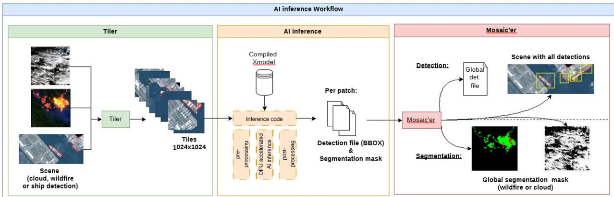
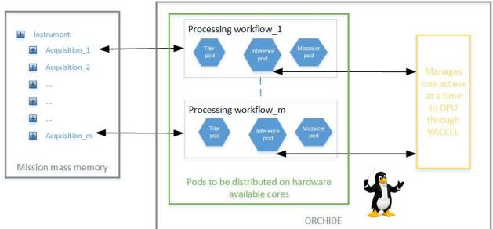
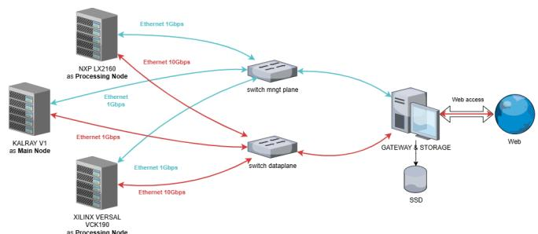
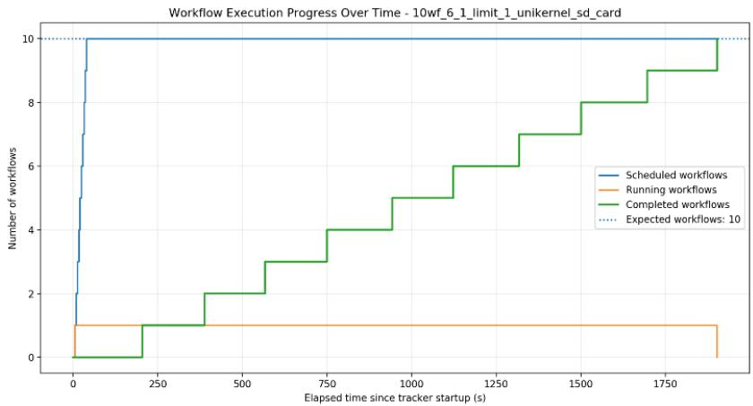
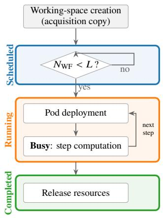
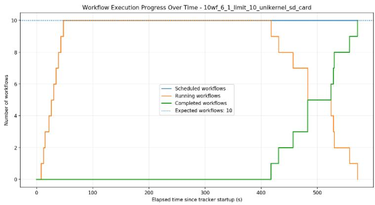
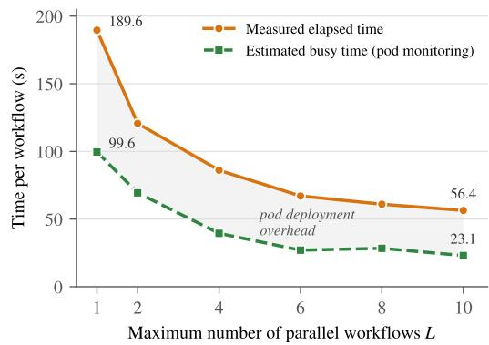

# A GENERIC ON-BOARD AI PROCESSING CHAIN FOR EARTH OBSERVATION: FROM APPLICATION DEVELOPMENT TO EMBEDDED DEPLOYMENT AND MISSION-LEVEL ORCHESTRATION∗

Michel-François Foulon(1), Liz Ramos Medina(1), Thomas Goudemant(1,2), Clotilde Szywala(2), Virgile Robles(3), Clément Petitjean(1), Adèle Hankache(1), Omar Hlimi(2)

(1)Thales Alenia Space, France (2)IRT Saint Exupéry, France (3)Tarides, France

Emails: michel-francois.foulon@thalesaleniaspace.com,

thomas.goudemant@irt-saintexupery.com, virgile@tarides.com

## ABSTRACT

Earth observation satellites acquire more data than they can downlink. Extracting information on board with artificial intelligence (AI) turns the satellite into a data-reduction stage that downlinks compact products, such as masks or detections, instead of full scenes; deploying it in a mission, however, involves the whole processing chain and not only the neural network. We present a generic on-board AI processing chain along three axes, with wildfire segmentation as the worked example among ship detection and cloud segmentation. (i) The AI model is tuned (spectral-band selection, input normalization), quantized to 8-bit integers (int8) and ported to an AMD Versal VCK190, with its excellent segmentation performance preserved on the board. (ii) A modular tiler–inference–mosaicer workflow, reused unchanged across applications, brings the tile-level model to scene level, turning a full acquisition into a scene-level mask or detection list. (iii) Each step is packaged as a unikernel and orchestrated on board by ORCHIDE, a cloud-native orchestrator. The chain is characterized end to end, from the standalone execution on the target to its execution under orchestration with parallel workflows on a representative test bench. Beyond AI inference on individual tiles, this approach aims at increasing the maturity of on-board AI deployment by addressing a complete processing chain, from the acquired scene to the mission-level execution.

## 1. INTRODUCTION

Earth Observation (EO) satellites acquire ever-growing data volumes, while downlink capacity, on-board mass memory and ground-processing latency remain limiting factors [1]. Moving part of the processing on board turns the satellite into a data-reduction stage: instead of downlinking complete scenes with uniform priority, it extracts and transmits only the actionable information (detections, masks, selected regions), which reduces the data according to its conten and complements conventional compression [2]. Advances in embedded Artificial Intelligence (AI) and heterogeneous computing have enabled the deployment of onboard processing chains capable of executing complex algorithms directly on satellite hardware. However, the integration of such AI-driven workflows introduces new complexities, including resource management, task orchestration, and hardware acceleration, which must be eficiently coordinated to ensure optimal performance.

Recent advancements in onboard satellite processing have demonstrated the feasibility of deploying AI-driven applications for real-time environmental monitoring: onboard anomaly detection for marine protection and ship detection leveraged embedded AI to reduce reliance on ground stations [3, 4]. Similarly, in-orbit AI-based cloud segmentation has been validated on OPS-SAT, showcasing eficient image processing via System-on-Module (SoM) architectures [5, 6]. Extending these eforts, multi-spectral wildfire detection models further emphasized the role of onboard AI in disaster monitoring [7]. In orbit, Φsat-1 discards cloudy images on board [8] and Φsat-2 embeds a complete image processing chain [9]; cloud screening ahead of on-board compression likewise avoids transmitting cloudy pixels [10]. Object detection has been studied on board high-resolution imagery [11], including a YOLOX detector [12] on an on-orbit FPGA [13], and the Versal architecture targeted here has been evaluated for edge computing in space [14]; a companion paper of this workshop discusses the data reduction that on-board vessel detection brings to the downlink [15].

In a real mission, such processing chains must be executed on the hardware for each acquisition of sensor data. Orchestrators have proven necessary to match these increasingly demanding in-orbit applications with the constrained resources (CPU, RAM, storage) of satellites while enforcing the tight schedule of a mission. ORCHIDE (Orchestration of Reliable Computing on Heterogeneous Infrastructures Deployed at the Edge) [16] is such an orchestrator aiming to adapt a cloud-native orchestrator (Argo/k3s) to a spatial context while making no assumptions about the safety of the orchestrated programs, by using unikernels, i.e. applications packaged with only the operating-system services they need into small isolated virtual machines [17–19]. Our team also develops a ground/on-board demonstrator of a reactive loop for EO missions, going from the detection of an event to the triggering of an action [20]; the work presented here provides an orchestration solution for its on-board AI part.

These works mostly assess individual models on tiles, or the orchestrator alone; the generic chain around the model, from the acquired scene to its execution under mission-level orchestration, is rarely characterized as a whole. In this paper, we present a generic onboard AI processing chain designed for EO missions, covering the entire pipeline from application development to embedded deployment and mission-level orchestration. Our approach leverages modular workflows (i.e. chains of processing steps) and hardware-aware characterization to enable seamless execution of AI models—such as ship detection, wildfire segmentation and cloud segmentation—on resource-constrained satellite platforms; other on-board use cases, such as marine anomaly detection [3], with first in-orbit results [21], or the assessment of destroyed buildings from bi-temporal images [22], fit the same chain. Each step of the processing chain (tiling, inference and aggregation of results) is designed to be a reusable and composable standalone program.

The paper is organized as follows. Section 2 describes the chain along its three axes: the AI model, from data and model tuning to its quantization and porting to the Versal VCK190, with wildfire segmentation as the worked example (Section 2.1); the generic tiler–inference–mosaicer workflow that brings it to scene level (Section 2.2); and its integration in the ORCHIDE on-board orchestrator, together with the test bench used for characterization (Section 2.3). Section 3 reports results at two levels: for the standalone chain on the VCK190, the impact of band selection, input normalization and 8-bit integer (int8) quantization on segmentation quality, and the latency and power of each stage (Section 3.1); at workflow level, the overhead of executing the same chain as unikernels within ORCHIDE and the gains brought by running several workflows in parallel (Section 3.2). Section 4 summarizes the results, their limitations and the perspectives for mission-level operation.

## 2. METHOD

The processing chain is organized along three axes: (i) the on-board AI core, which runs a per-tile detection or segmentation model on the Versal VCK190; (ii) the workflow that surrounds it, turning a full satellite scene into tiles and re-assembling per-tile products into a scene-level result; and (iii) the mission layer, which schedules and orchestrates these workflows on board. This section describes the data, the models and the target for each axis; quantitative results are reported in Section 3. Among the three supported applications—ship detection, wildfire segmentation and cloud segmentation—we use wildfire segmentation as the worked example throughout; ship detection (a YOLOX detector [12]) and cloud segmentation (a U-Net model) share the same chain and the same pre-processing and quantization strategy, and are only referred to where relevant.

## 2.1 On-Board AI Model: The Wildfire Segmentation Use Case

## 2.1.1 Data: Acquisition and Annotation

The wildfire dataset is built from Sentinel-2 L1C products downloaded from the Copernicus ecosystem. We select 90 scenes covering active-fire events over varied backgrounds, with the 13 spectral bands resampled to a common 20 m/pixel grid and stored as multi-band TIFF images. Fire-front annotations are produced following the multispectral wildfire-detection methodology of Farhat et al. [7], which exploits the strong short-wave infrared (SWIR) response of active fires; each scene is paired with a binary TIFF mask (fire = 1 / non-fire = 0).

Each scene is cut into 1,024 × 1,024 tiles with a 512-pixel stride, matching the fixed tile size processed by the on-board AI core. The dataset is split into training, validation and test sets at scene level: all tiles of a given scene are assigned to a single set, so that no scene contributes tiles to more than one set. This prevents spatial leakage between training and evaluation and yields a realistic estimate of generalization to unseen scenes. The resulting split contains 2,748 training tiles (∼53 %), 1,214 validation tiles (∼24 %) and 1,174 test tiles (∼23 %).

## 2.1.2 Model and Spectral-Band Selection

We use a U-Net [23] for the segmentation task. Its architecture is deliberately classical: a five-level convolutional encoder that extracts increasingly abstract features, a symmetric decoder that restores full resolution, skip connections that recover the spatial detail lost to pooling, and a final 1 × 1 convolution producing a per-pixel score in [0, 1], thresholded (e.g. at 0.5) to obtain a binary fire mask. This model is a good fit for the target for three reasons: it is efective on the segmentation task, it is lightweight (0.15 M trainable parameters, ≈9.4 GFLOPs per 1,024 × 1,024 inference), and it is portable—its layers map cleanly onto the operators supported by the embedded toolchain, which keeps porting and debugging simple.

A Sentinel-2 tile carries 13 bands, but feeding all of them to the model is neither necessary nor optimal. We therefore study which bands are actually required to detect fire fronts, comparing three input configurations: all 13 bands (baseline), the three visible bands (B02, B03, B04), and a three-band SWIR-oriented set (B02, B11, B12, i.e. blue, SWIR1, SWIR2). Based on the ablation results reported in Section 3.1.2, we retain the B02, B11, B12 configuration.

  
Fig. 1. End-to-end inference workflow: the tiler cuts a full scene into 1,024 × 1,024 tiles, the AI inference stage includes per-tile pre-processing, DPU-accelerated inference and post-processing on the VCK190, and the mosaicer re-assembles the per-tile products. Maxar Products Standard (2A) Imagery ©2017–2024 Maxar Technologies.

## 2.1.3 Porting to the VCK190: Quantization and Input Normalization

The AI core is deployed on the AMD Versal VCK190, whose Deep-learning Processing Unit (DPU) executes the model in 8-bit integer (int8) arithmetic. Quantization is performed with the Vitis AI Post-Training Quantization (PTQ) flow [24], which calibrates per-tensor scale factors so that activations and weights are represented in int8; the model is then compiled to an xmodel for the DPU. Since the accuracy preserved by PTQ turns out to be more than adequate (see Section 3.1.2), we did not pursue Quantization-Aware Training (QAT), which would have added a training cost for a marginal expected gain. The DPU input tensor is likewise expected in int8, which raises the question of how to map the 16-bit unsigned integer (uint16) Sentinel-2 pixels onto that range. The pre-processing must satisfy a hard embedded constraint: it should avoid per-image, data-dependent computations, which are costly and make the on-board processing time scene-dependent. We considered three families of input normalization: (i) percentile normalization, which clips each band to its 1st/99th percentiles before scaling—accurate but requiring a per-band histogram on every tile, i.e. a costly, scene-dependent computation on board; (ii) per-band standardization (centering and reducing each band), which likewise depends on scene statistics; and (iii) fixed scaling by a constant. As explained in Section 3.1.2, we adopt the last option: uint16 pixels are divided by the constant 65,535, which the PTQ input scale then maps to int8. This is a single elementwise operation with no histogram and no scene statistics, and it is compatible with all three applications, enabling a single, common, efective and computationally eficient pre-processing strategy.

## 2.2 From Tiles to Scenes: The Inference Workflow

The AI core does not operate on full scenes but on fixed-size tiles, so it is inserted between two lightweight stages: a tiler that feeds it and a mosaicer that collects its outputs (Fig. 1). This generic, modular chain is reused unchanged across the three applications; only the embedded model and its band selection difer. Each stage is packaged as a standalone application, i.e. a minimal, composable and reusable execution unit.

## 2.2.1 Tiler

The tiler turns a large satellite scene (a stacked multi-band Sentinel-2 scene for wildfire and cloud; a pansharpened scene for ships) into a set of square 1,024 × 1,024 tiles. Two elementary pre-processing steps—the band selection and the input rescaling (i.e. the division by 65,535 of Section 2.1.3)—can be placed either here, in the tiler, or in the AI inference core. Keeping the tiler agnostic (tiling only, raw uint16 tiles) produces tiles that any downstream model can exploit while selecting its own bands, which keeps the chain generic. Conversely, when several models share the same bands, performing the selection and rescaling once in the tiler avoids repeating a common pre-processing per model. The chain supports both placements; the choice is a mission-integration decision rather than an algorithmic one.

## 2.2.2 Mosaicer

The mosaicer aggregates per-tile products into a single scene-level result. For segmentation (wildfire, cloud) it concatenates the per-tile masks back into one full-scene mask. For detection (ships) it merges the per-tile bounding-box files into a single scene-level file, shifting each tile’s local coordinates by the pixel ofset of the tile’s top-left corner so that all detections are expressed in scene coordinates. These scene-level products are what is downlinked, and this is where the chain reduces the data: a binary wildfire or cloud mask can be encoded on 1 bit per pixel, against 16 bits per band and per pixel for the input scene (208 bits per pixel for the 13 Sentinel-2 bands), and a ship detection reduces to a few bytes per bounding box. How

  
Fig. 2. Pods association to end to end inference process.

  
Fig. 3. ORCHIDE test bench for workflow characterization.  
such products translate into downlink modes and volumes is studied for vessels in a companion paper [15].

## 2.3 Mission-Level Integration and On-Board Orchestration

## 2.3.1 Processing Workflows in ORCHIDE

Integration at mission level requires considering the whole processing chain from sensor acquisitions to inference outputs while managing on board resources. The ORCHIDE orchestrator is made responsible for both acquisition management (following a mission plan) and workflow scheduling taking into account hardware resources. In this paper, acquisitions are considered out of scope and the focus is put on the formalization of processing chains through dedicated “workflows” and their execution.

A workflow is a composition of elementary processing steps working on identified inputs and producing predictable outputs. Within a workflow, each elementary processing step must be fully executed before moving to the next one. Concretely in ORCHIDE, each elementary processing step is instantiated as a Kubernetes pod. The maximum number of workflows that can be orchestrated concurrently can be configured in the orchestrator. ORCHIDE then matches pods and their resource requirements (defined in the workflow specification) to available computation resources, as illustrated in Fig. 2. While the allocation of CPU time and memory behaves as expected, the DPU required by the AI core is indivisible, meaning that while multiple inference steps may be executing at the same time, the actual inference requests will be queued and treated sequentially. Section 3.2 explores the actual performance gains observed when executing multiple workflows in parallel. A a mission level, a mission plan provides instructions to ORCHIDE for (1) defining the start and end time of acquisitions and (2) specifying which workflows must run for each acquisition. For proper time and hardware resources allocation for workflow operations (2) on a given volume of acquisitions (1), an estimation of end-to-end inference workflow performances is necessary on representative hardware targets, which is the purpose of the experiments described in Section 3.2 that run on the test bench described below.

## 2.3.2 Test Bench for Hardware-Target Characterization

We set up a test bench with the topology illustrated in Fig. 3 to characterize the performance of an end-to-end use case across heterogeneous hardware using the orchestrator, replicating previous ORCHIDE experiments [19]. It consists of a management plane (blue links) performing pod loading and a data plane (red links) responsible for exchange of acquisition and intermediate results. The orchestrator function is carried out by a KALRAY node while a NXP LX2160 node and Xilinx Versal VCK190 nodes are used as processing nodes on which actual steps are executed.

## 3. EXPERIMENTS AND RESULTS

Section 3.1 measures the ideal performance of each individual processing step, while Section 3.2 explores the impact of embedding these applications in an end-to-end orchestrator such as ORCHIDE.

## 3.1 Standalone Performance on the VCK190: Algorithm and Hardware

## 3.1.1 Experimental Setup

All embedded measurements at algorithm level are taken on an AMD Versal VCK190 board. Models are trained in floating point on a server, quantized to int8 and compiled with Vitis AI 3.0 [24], then deployed on the board’s DPU. For wildfire we report results on the full test set of 1,174 1,024 × 1,024 tiles (Section 2.1.1). Algorithmic quality is measured with the F1-score of the fire class; hardware performance is measured as the latency of each processing stage for a batch of six tiles, from which we derive throughput in megapixels per second (Mpix/s).

Table 1. Wildfire: floating-point performance of the three input-band configurations (reduced dataset). The retained configuration is in bold. All values in %.
<table><tr><td>Bands</td><td>IoU</td><td>F1</td><td>Prec.</td><td>Recall</td></tr><tr><td>Baseline: 13 bands</td><td>77.87</td><td>88.13</td><td>89.14</td><td>87.15</td></tr><tr><td>B02, B03, B04 (B, G, R)</td><td>9.49</td><td>13.68</td><td>10.49</td><td>19.67</td></tr><tr><td colspan="5">B02, B11, B12 (B, SWIR1, SWIR2) 78.85 87.16 83.25</td></tr></table>

Table 2. Wildfire: F1-score of the floating-point and quantized models for representative input normalizations (full test set, bands B02/B11/B12). The retained scheme is in bold. All values in %.
<table><tr><td>Normalization</td><td>Float</td><td>Quant.</td><td>∆(Q-F)</td></tr><tr><td>No normalization</td><td>91.42</td><td>82.32</td><td>-9.09</td></tr><tr><td>Scaling ÷128</td><td>91.45</td><td>86.07</td><td>-5.38</td></tr><tr><td>Scaling ÷65,535</td><td>95.10</td><td>94.68</td><td>-0.42</td></tr><tr><td>Per-band centering</td><td>92.08</td><td>0.21</td><td>-91.87</td></tr><tr><td>[−1, 1] after clipping p1/p99</td><td>83.28</td><td>81.50</td><td>-1.78</td></tr><tr><td>[−1, 1] after clipping p5/p95</td><td>79.77</td><td>77.86</td><td>-1.91</td></tr></table>

Table 3. Wildfire: algorithmic performance of the three model variants on the full test set (bands B02/B11/B12, division by 65,535). All values in %.
<table><tr><td>Model</td><td>Precision</td><td>Recall</td><td>F1</td></tr><tr><td>Float (server)</td><td>92.27</td><td>98.11</td><td>95.10</td></tr><tr><td>Quantized (server)</td><td>92.50</td><td>96.96</td><td>94.68</td></tr><tr><td>Quantized (VCK190)</td><td>92.15</td><td>97.28</td><td>94.65</td></tr></table>

Table 4. Wildfire: per-stage latency on the VCK190 for a batch of six tiles, before and after optimization (mean values).
<table><tr><td>Stage</td><td></td><td>Baseline (ms) Optimized (ms) Speed-up</td><td></td></tr><tr><td>Pre-processing</td><td>132.6</td><td>31.3</td><td>×4.24</td></tr><tr><td>DPU inference</td><td>72.7</td><td>75.2</td><td>×0.967</td></tr><tr><td>Post-processing</td><td>255.9</td><td>2.4</td><td>×107</td></tr><tr><td>Batch total</td><td>461.2</td><td>108.9</td><td>×4.24</td></tr></table>

## 3.1.2 Algorithmic Performance

Spectral-band selection. Table 1 compares the three input configurations of Section 2.1.2 for the floating-point model. For this ablation, the three configurations are trained under identical training conditions on a reduced dataset of 183 patches extracted from 12 scenes. The resulting floating-point models are then evaluated and compared in terms of algorithmic performance. Results show that the visible-only set (B02, B03, B04) collapses, as visible bands do not carry enough information to localize fire fronts. In contrast, the SWIR-oriented set (B02, B11, B12) captures the thermal-emission signature of active fires highlighted by Farhat et al. [7]. It matches the 13-band baseline within a fraction of a point in F1 while reducing the input tensor from 13 to 3 channels and showing less overfitting. We therefore retain B02, B11, B12 for all subsequent experiments.

Input normalization and quantization. The pre-processing has a first-order efect on how well accuracy survives int8 quantization. We trained the model under identical conditions on the full training set with representatives of the three normalization families of Section 2.1.3 and measured the F1-score of both the floating-point and the quantized model on the full test set (Table 2). Percentile clipping and per-band centering are either fragile through quantization (the latter collapses to near-zero F1) or require scene-dependent computation on board. Fixed scaling by 65,535 provides the best trade-of between algorithmic performance and on-board computational cost: it reaches 95.10 % F1 in floating point and 94.68 % after quantization, a drop of only 0.42 percentage points, while requiring only a single elementwise division, with no per-image histogram or scene statistics. Experiments on the other two applications led to the same conclusion, supporting the use of a single common pre-processing strategy across all three use cases.

Deployment on the VCK190. Table 3 reports the three variants of the retained configuration: floating point on the server, quantized on the server, and quantized deployed on the VCK190. Quantization accounts for essentially all of the (small) accuracy loss, coming mostly from recall; deployment on the board adds almost no further degradation. The three variants stay within ∼0.5 % F1 of one another and their outputs are visually indistinguishable.

## 3.1.3 Hardware Performance on VCK190

Inference and end-to-end latency. On the board, a single DPU inference for a batch of six 1,024 × 1,024 tiles takes 73 ms (Table 4), i.e. a throughput of about 86.2 Mpix/s (6 × 1,0242 pixels in 73 ms). The DPU inference is therefore not the bottleneck: in the un-optimized chain, pre-processing (∼133 ms/batch) and, above all, post-processing (∼256 ms/batch) dominate the per-batch time.

Optimizing pre- and post-processing. Both bottlenecks are elementwise conversions that can be precomputed into Look-Up Tables (LUTs). On the input side, the division by 65,535 and the subsequent int8 quantization scale are folded into a single 65,535-entry LUT (64 KB) that maps every possible uint16 value directly to its int8 code. On the output side, post-processing consists of a single operation: the DPU output is dequantized with the output scale and passed through a sigmoid to obtain the per-pixel fire score; this too is replaced by a LUT. Tabulating these conversions, together with compiler optimization flags enabling SIMD vectorization, greatly accelerates both stages: as shown in Table 4, pre-processing drops to ∼31 ms and post-processing to ∼2 ms per batch, reducing the total per-batch latency from ∼461 ms to ∼109 ms (×4.2), with bit-exact predictions before and after optimization. The DPU inference stage is unchanged, as expected. The optimized chain thus processes ∼58 Mpix/s, i.e. a 1,024 × 6,144 test vector in about 0.11 s.

Table 5. Time measured or estimated for workflow or its calculation part operation and estimation of corresponding throughput, for ten 1,024 × 6,144 test vectors; � is the maximum number of concurrent workflows. Elapsed and busy times are those of Fig. 5b.
<table><tr><td></td><td colspan="2">Total time per WF (s)</td><td colspan="2">Throughput (Kpx/s)</td><td colspan="3">Share of busy time per step (%)</td></tr><tr><td>Configuration</td><td>Elapsed</td><td>Busy</td><td>Overall</td><td>Busy</td><td>Tiler</td><td>Inference</td><td>Mosaicer</td></tr><tr><td>No orch., sequential</td><td>78.0</td><td>71.3</td><td>80.7</td><td>88.3</td><td>22</td><td>5</td><td>73</td></tr><tr><td>Orch., L = 1</td><td>189.6</td><td>99.6</td><td>33.2</td><td>63.2</td><td>27</td><td>7</td><td>66</td></tr><tr><td>Orch.,  $L = 4$ </td><td>86.1</td><td>39.5</td><td>73.1</td><td>159.4</td><td>17</td><td>27</td><td>57</td></tr><tr><td>Orch., L = 10</td><td>56.4</td><td>23.1</td><td>111.6</td><td>272.8</td><td>23</td><td>31</td><td>46</td></tr></table>

Power consumption. The board draws about 30 W on average. Processing adds a modest overhead that concentrates on the DPU inference stage, which raises consumption by at most ∼6 W—peaking around 40 W during inference—while the preand post-processing stages contribute only a fraction of a watt each. On-board AI inference on the VCK190 is therefore inexpensive in power relative to the platform’s static budget.

## 3.2 Performance at Workflow Level within ORCHIDE

While the previous section describes performances in ideal conditions, with no sandboxing, concurrency or network latency, this section explores the performances of the processing chain in the setup described in Section 2.3 to measure orchestration overhead and its causes and multicore scalability. For reproducibility and due to technical constraints, these experiments use the LX2160 node as the processing node (accessing remotely the Versal’s DPU during inference). Running the ORCHIDE runtime itself uses 300m CPU and 4800 MiB of memory, leaving approximately 11 GiB and 15.5 cores available for workflows.

As ORCHIDE requires elementary processing steps to be unikernels [17], all processing steps have been ported to either MirageOS [17] or Unikraft [18]. The tiler and mosaicer, being written in Python which is not easily ported to Unikraft on arm64, have instead been rewritten (and not optimized) in OCaml as MirageOS unikernels. On the other hand, the C++ inference step has not been rewritten but ported to Unikraft, though the communication with the DPU has been decoupled from the application using a method based on the vAccel protocol. Compared to Section 3.1, all steps are executed as unikernels, i.e. virtualized on top of the Linux hypervisor, necessarily introducing further overhead. The overall time taken to execute ten full processing chains was measured in four diferent situations: (1) all chains sequentially without the orchestrator (i.e. running the unikernels directly with no delay), and (2–4) all chains submitted in parallel to the orchestrator with a varying limit � on the maximum number of workflows allowed to run simultaneously (� = 1, 4 and 10, with � = 1 equivalent to a fully sequential scheduling). This allows quantifying the overhead incurred by the orchestrator (by comparing the first two lines) as well as potential parallelization gains when increasing the concurrency limit close to the number of CPU cores. All experiments have been carried out on 10 input test vectors of 1,024 × 6,144 pixels (i.e. ∼6.3 million pixels). The results are presented in Table 5. Each line lists the averaged clock time elapsed per workflow (i.e. tota time for 10 input test vectors divided by 10) and the “busy” time spent actually running steps (as opposed to waiting for the orchestrator, initializing pods, waiting for disk or network, etc.), as reported by the orchestrator itself. That total busy time is then broken down into the share of each constitutive step of the workflow. For single workflow operation, we observe that relying on the orchestrator more than doubles the elapsed total time from input to result (189.6 s against 78.0 s) (due in part to arbitrary waits and pods creation), and still increases the busy time by about 30 % (99.6 s against 71.3 s), which suggests significant overheads due to Kubernetes pod initialization and runtime. In all cases, we also observe that the CPU-bound tiler and mosaicer represent the majority of time spent, which shall drive further optimizations.

This is illustrated in Fig. 4a, depicting a timeline of orchestrator events for one concurrent workflow authorized at a time: a first delay applies for the creation of a working space associated with the processed acquisition (steps in the blue curve), then a workflow is scheduled on this working space. If the maximum limit of authorized concurrent workflows is not reached, scheduled workflows automatically turn to running workflows (orange curve), where each step first deploys its pod and then computes, as summarized in Fig. 4b. From one acquisition processing to another, one workflow ends to let the next one run. These transitions cannot always be measured by the orchestrator’s built-in monitoring, which allows distinguishing scheduled, running or completed workflows with a per second resolution. In a mono-workflow scheme, workflow processing time can be estimated from one rising edge of one completed workflow to the next (green curve). Since part of these processing times is spent fetching test vectors from memory, three configurations have been tested to estimate the impact of the physical support with respectively test vectors on remote disk, on a local SD card or directly in a RAM file system. A gap of 9 seconds per workflow has been measured between best and worst cases, suggesting this is a contributor, but not the limiting factor. Hence all results are presented with test vectors on the SD card of the LX2160 board. Fig. 5a depicts the full timeline of operations when setting the limit of parallel pods to 10. Fig. 5b presents a synthesis of execution times over a larger range of varying concurrency limits than what is depicted in Table 5. End to end inference execution time from one workflow time (189.6 s on average, obtained from the timeline of Fig. 4a) is divided by a factor slightly greater than 3 with 56.4 s for 10 workflows operating in parallel. Nonlinear behavior of total time with respect to number of workflows in parallel suggests that resource contention (either CPU, RAM or disk access) quickly limits the gains of parallelization, though the gains are still significant despite the large overhead of the orchestrator.

  
(a)

  
(b)

Fig. 4. (a) Timeline of data processing for one end to end inference workflow at a time with test vector on SD card. (b) Workflow states monitored by the orchestrator and plotted in (a): scheduled (waiting for the concurrency limit �), running (deployment of the pod of each step, then busy computation) and completed.  
  
(a)

  
(b)  
Fig. 5. (a) Timelines for 10 workflows operation in parallel for end to end inference. (b) Synthesis of execution times depending on the number of workflows in parallel for end to end inference: measured elapsed time and busy time estimated from pod monitoring.

Monitoring at pods level (not detailed here) allows us to distinguish processing times in the delays from ‘running’ to ‘completed’ events. Fig. 5b details performed measurements for various numbers of workflows authorized at a time. The green curve corresponds to estimations of end-to-end processing times on the basis of pods monitoring. The same nonlinear behavior is observed, but the diference between measured end to end inference workflows operation time curve (orange) and estimated one from pods monitoring curve (green) suggests that pod deployment time may contribute from 90 s (� = 1, sequential) to 33 s (� = 10) as inertia in total elapsed times with respect to time efectively devoted to calculation.

Overall latency and throughput. Put together, the same 1,024 × 6,144 test vector that the optimized chain processes in about 0.11 s on the VCK190 alone (Section 3.1.3) takes 78 s as a sequence of unikernels without orchestrator, and between 190 s (� = 1) and 56 s (� = 10) per workflow under ORCHIDE, i.e. an efective throughput of 33 to 112 Kpx/s against ∼58 Mpix/s. The DPU itself is not the limiting factor: the gap comes from the un-optimized OCaml tiler and mosaicer, which take most of the busy time, from the virtualization of every step and the remote access to the DPU, and from pod deployment, which still accounts for more than half of the elapsed time at � = 10. Parallel workflows mitigate but do not remove these overheads, and the per-workflow latency remains at the minute scale.

Hence, ORCHIDE workflows instantiation logic shall be challenged in next developments to recover as much as possible the gap here measured between performances at algorithm level and the ones at orchestrator level when algorithm is associated to a workflow.

## 4. CONCLUSION

A Generic On-Board AI Processing Chain for Earth Observation has been proposed in this paper, providing a processing workflow embedding AI applications from algorithm preparation to mission-level orchestration. Focusing on wildfire segmentation as the main use case, AI model training and tuning have been investigated through spectral band selection, input normalization, and int8 quantization. Their impact on algorithmic performance has been evaluated by comparing floating-point, quantized, and VCK190-deployed models, showing that the selected configuration enables embedded deployment while preserving model performance. At hardware level, the execution of the AI processing chain has also been characterized in terms of latency, throughput, and power consumption, including the optimization of pre- and post-processing stages. Orchestrator operation of workflows is then detailed and characterized on an experimental setup not representative of final onboard operation but allowing us to understand the orchestration mechanism and its dependence on parallel workflow operation: executed as unikernels under ORCHIDE, the chain benefits from running several workflows in parallel, which divides the time per workflow by more than three.

These results also show the limits of the current set-up: the inference step accesses the DPU remotely, the tiler and mosaicer unikernels are not optimized, and pod deployment dominates the elapsed time, so that the latency per workflow under orchestration remains far from that of the standalone chain. These tests at orchestrator level are essential for future mission planning definition to leverage parallelization by determining the optimal number of concurrent workflows that can be executed without overloading the system, ensuring eficient use of available resources. They also identify limitations of ORCHIDE, such as bottlenecks in pod allocation or throughput degradations, and provide the performance data needed to optimize mission planning by fine-tuning parameters like acquisition dimensions, i.e. the size of the acquisition clusters processed by one workflow that maximizes throughput and minimizes processing time. Next steps are to reduce the instantiation overhead of workflows, to optimize the tiler and mosaicer, to run the whole chain on the Versal target, and to quantify the data reduction brought by the downlinked products at mission level.

## ACKNOWLEDGEMENTS

This work has been supported by French Banque Publique de l’Investissement in the framework of France 2030. The authors would like to thank Kééphann Kokolo (AKKODIS) for his contribution to these results of characterization, as wel as IRT Saint Exupéry and Tarides for their support to this work.

## REFERENCES

[1] Aidan Duggan, Bruno Andrade, and Haithem Afli. Advancing Earth observation: A survey on AI-powered image processing in satellites. European Journal of Remote Sensing, 2025. arXiv:2501.12030.

[2] Bing Zhang, Yuanfeng Wu, Boya Zhao, Jocelyn Chanussot, Danfeng Hong, Jing Yao, and Lianru Gao. Progress and challenges in intelligent remote sensing satellite systems. IEEE Journal of Selected Topics in Applied Earth Observations and Remote Sensing, 15:1814–1822, 2022.

[3] Thomas Goudemant, Benjamin Francesconi, Michelle Aubrun, Erwann Kervennic, Ingrid Grenet, Yves Bobichon, and Marjorie Bellizzi. Onboard anomal detection for marine environmental protection. IEEE Journal ofSelected Topics in Applied Earth Observations and Remote Sensing, 17:7918–7931, 2024.

[4] Thomas Goudemant, Benjamin Francesconi, Houssem Farhat, Lionel Daniel, Olivier Thiery, Erwann Kervennic, Adrien Girard, and Seif Mzoughi. Détection de navires embarquable à bord de satellites. In Actes de la 4ème Conference on Artificial Intelligencefor Defense (CAID 2022), 2022.

[5] Frédéric Férésin, Erwann Kervennic, Yves Bobichon, Edgar Lemaire, Nassim Abderrahmane, Gaétan Bahl, Ingrid Grenet, Matthieu Moretti, and Michael Benguigui. In space image processing using AI embedded on system on module: example of OPS-SAT cloud segmentation. In 2nd European Workshop on On-Board Data Processing (OBDP), 2021.

[6] Erwann Kervennic et al. Embedded cloud segmentation using AI: back on years of experiments in orbit on OPS-SAT. In European Data Handling & Data Processing Conference (EDHPC), 2023.

[7] Houssem Farhat, Lionel Daniel, Michael Benguigui, and Adrien Girard. Modèle et jeu de données pour la détection multi-spectrale de feux de forêt à bord de satellites. In Conférence Nationale en Intelligence Artificielle (CNIA), PFIA, 2022.

[8] Gianluca Giufrida, Luca Fanucci, Gabriele Meoni, Matej Bataš, Lorenzo Diana, Marco Esposito, et al. The Φ-Sat-1 mission: The first on-board deep neural network demonstrator for satellite Earth observation. IEEE Transactions on Geoscience and Remote Sensing, 60:1–14, 2022.

[9] N. Melega, Bernardo A. Carnicero, N. Longepe, A. Paskeviciute, V. Marchese, Oriol Aragon, Irina Babkina, Alessandro Marin, Jakub Nalepa, Leonie Buckley, et al. Implementation of the Φsat-2 on board image processing chain. In Sensors, Systems, and Next-Generation Satellites XXVII, volume 12729, pages 264–276. SPIE, 2023.

[10] Martina Cilia, Nicola Prette, Enrico Magli, Bernhard Sang, and Stefano Pieraccini. Onboard data reduction for multispectral and hyperspectral images via cloud screening. In IEEE International Geoscience and Remote Sensing Symposium (IGARSS), 2020.

[11] Yanyun Shen, Di Liu, Junyi Chen, Zhipan Wang, Zhe Wang, and Qingling Zhang. On-board multi-class geospatial object detection based on convolutional neural network for high resolution remote sensing images. Remote Sensing, 15, 2023.

[12] Zheng Ge, Songtao Liu, Feng Wang, Zeming Li, and Jian Sun. YOLOX: Exceeding YOLO series in 2021. arXiv preprint arXiv:2107.08430, 2021.

[13] Ling Wang, Hai Zhou, Chunjiang Bian, Kangning Jiang, and Xiaolei Cheng. Hardware acceleration and implementation of YOLOX-s for on-orbit FPGA. Electronics, 11, 2022.

[14] Noah Perryman, Christopher Wilson, and Alan George. Evaluation of Xilinx Versal architecture for next-gen edge computing in space. In IEEE Aerospace Conference, pages 1–11, 2023.

[15] Thomas Goudemant, Aurélien Bobey, Omar Hlimi, and Marjorie Bellizzi. AIbased on-board maritime object detection for Earth observation payload data reduction on Versal embedded hardware. In 10th On-Board Payload Data Compression Workshop (OBPDC), 2026. In press.

[16] Adèle Karam Hankache, Aurelien Castanie, Liz Ramos Medina, Virgile Robles, and Sergiu Weisz. On board data processing orchestrator. In 2025 European Data Handling & Data Processing Conference (EDHPC), pages 1–7, 2025.

[17] Anil Madhavapeddy, Richard Mortier, Charalampos Rotsos, David J. Scott, Balraj Singh, Thomas Gazagnaire, Steven Smith, Steven Hand, and Jon Crowcroft Unikernels: library operating systems for the cloud. In 18th International Conference on Architectural Support for Programming Languages and Operating Systems (ASPLOS), pages 461–472, 2013.

[18] Simon Kuenzer, Vlad-Andrei Bădoiu, Hugo Lefeuvre, Sharan Santhanam, Alexander Jung, Gaulthier Gain, Cyril Soldani, Costin Lupu, Ştefan Teodorescu, Costi Răducanu, Cristian Banu, Laurent Mathy, Răzvan Deaconescu, Costin Raiciu, and Felipe Huici. Unikraft: Fast, specialized unikernels the easy way. In 16th European Conference on Computer Systems (EuroSys), pages 376–394, 2021.

[19] S. Weisz, D. Petre, A.-C. Mazilu, Virgile Robles, M.-E. Mihăilescu, V.-I. Năstase, M. Carabaş, J. Andrzejewski, D. Lazaj, and A. Bartoszek. ORCHIDE: Bringing unikernels to an orchestrator near you. Future Internet, 18:299, 2026.

[20] Benjamin Francesconi, Luis Palluel, Thomas Goudemant, Hugo Meleiro, Benjamin Marchand, Olivier Thiery, and France Creil. From event to action: A reactive loop demonstrator for Earth observation based on modular AI-driven components. In Actes de la 7ème Conference on Artificial Intelligence for Defense (CAID 2025), 2025.

[21] Thomas Goudemant, Clotilde Szywala, and Adrien Girard. Onboard AI for environmental monitoring: Early in-orbit results from multi-mission demonstrations. In 9th International Conference on Advances in Artificial Intelligence (ICAAI), pages 252–260. ACM, 2025.

[22] Thomas Goudemant and Benjamin Francesconi. Optimizing latent representations for robust building damage assessment onboard Earth observation satellites. arXiv preprint arXiv:2605.29575, 2026.

[23] Olaf Ronneberger, Philipp Fischer, and Thomas Brox. U-Net: Convolutional networks for biomedical image segmentation. CoRR, abs/1505.04597, 2015.

[24] AMD. Vitis AI development environment. https://github.com/Xilinx/ Vitis-AI, 2023. Version 3.0.