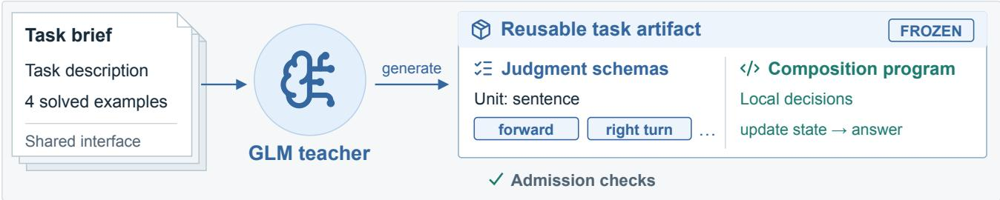
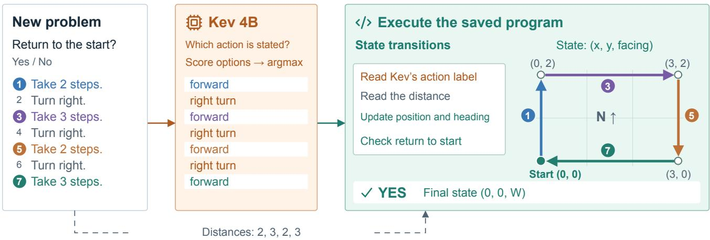
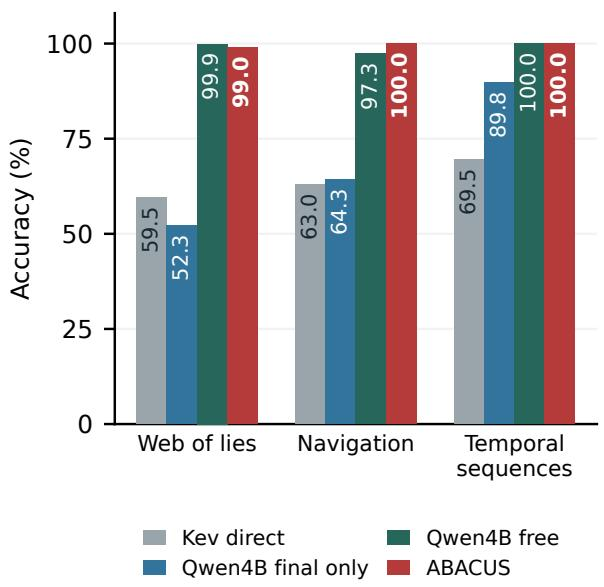
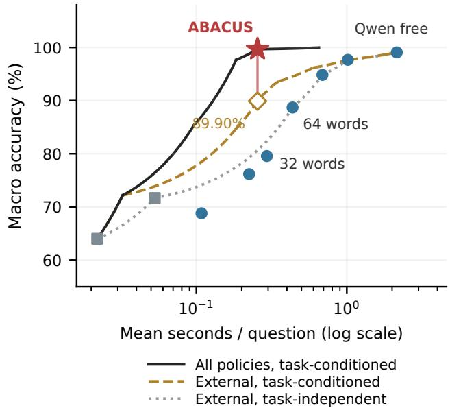

# ABACUS: Program-Guided Multistep Reasoning over Frozen Judgment Models

Yuhao Wang 1 Zelin Zang 1 2 3

## Abstract

Judgment models answer semantic questions by scoring a finite set of candidate outcomes. Can reusable programs turn these local decisions into powerful multistep reasoning? We introduce ABACUS, a framework that jointly constructs judgment schemas and composition programs for frozen judgment models. A generative teacher designs the procedure offline; the judgment model resolves local semantic questions online, and the saved program composes its decisions into an answer. We study three allocations of design effort between humans and the teacher, focusing on construction through a shared interface. We instantiate the framework with Kev. On three selected BIG-Bench Hard tasks, nine independently constructed programs solve all 450 executions of 150 development inputs. A separate deployment study freezes three programs after developmentset reference-agreement refinement and evaluates them on 600 held-out questions. These programs achieve near-perfect 99.67% macro accuracy, versus 64.00% for direct Kev and 68.80% for finalanswer-only Qwen3.5-4B. They attain comparable observed accuracy to Qwen’s unrestricted response policy (99.07%) with an 8.43-fold online speedup: 0.255 versus 2.150 seconds per question. These results show how reusable programs can substantially expand the reasoning capability of a compact judgment model while keeping its parameters fixed.

## 1. Introduction

Judgment models score finite candidate outcomes given evidence and a question. Their local decisions provide useful building blocks for reasoning: recognizing movements, identifying claims about truthfulness, or distinguishing observations from temporal boundaries. Complete solutions additionally require accumulating movements, propagating truth values, or combining interval constraints. These computations often share a reusable structure across instances.

This motivates a general research question: can offline program construction equip frozen judgment models with strong multistep reasoning? Keeping the judgment model fixed places the design effort in the reasoning procedure: which local questions to ask, what their answers represent, and how to compose those answers. A useful procedure connects the model’s semantic decisions to the state updates and constraints required by the task.

We introduce ABACUS, a framework for program-guided multistep reasoning over frozen judgment models. A generative teacher jointly designs reusable judgment schemas and a task-level composition program offline. For each new input, the judgment model scores the declared local outcomes, and the saved program computes the answer. The same procedure is reused with fixed model parameters.

The central design problem is to find an intermediate representation that the model can recognize and the program can use. In navigation, distinguishing turns from steps enables position and heading updates. In a truth chain, identifying the form of each claim enables Boolean propagation. Joint construction lets the teacher design this semantic vocabulary together with the computation that consumes it.

We instantiate ABACUS with Kev, which returns probabilities over declared outcomes for typed questions (Palmer, 2026), and GLM as the offline teacher. To our knowledge, ABACUS is the first framework to jointly construct reusable finite judgment schemas and composition programs specifically for Kev.

We study three allocations of procedure design. In humandesigned workflows, a designer specifies the local questions, state, and update rules. In task-specific interfaces, humans expose domain objects such as people, tasks, and pairs; the teacher designs semantic judgments and a scoring program. With a shared interface, humans provide common constructors and execution constraints; the teacher selects the units, designs the judgments, and writes the solver. Each allocation makes the human–teacher division of procedure design explicit. We evaluate each with frozen Kev on its corresponding tasks.

(a) Build once: jointly design judgments and computation  

(b) Reuse: local judgments become a multistep solution  
  
Figure 1. ABACUS composes local judgments into reusable multistep reasoning. (a) For each task, a teacher jointly designs judgment schemas and a composition program from a task description, four solved examples, and a shared interface. Admission selects a complete proposal. (b) A new navigation instance is decomposed into local action judgments; the saved program combines them with distances to update position and heading. The colored steps trace a return to the origin. The same schemas and update rules are reused for subsequent instances. Construction is offline. The judgment model is frozen throughout; this implementation uses Kev.

Our main construction procedure generates complete joint proposals from a task description, four solved examples, and the shared interface. Each proposal uses the same task specification; the first passing structural, read-sensitivity, and solved-example checks becomes the reusable artifact.

The shared-interface stage is our main empirical focus, with separate construction and deployment studies. The construction study evaluates three independently generated programs per task on the selected web-of-lies, navigation, and temporal-sequence tasks. All nine are admitted, with 100% accuracy over 450 executions of 150 development inputs. The deployment study uses three separately frozen programs selected with a reference-agreement refinement step and evaluates them on 600 held-out inputs. With the same online Kev model, ABACUS raises macro accuracy from 64.00% to 99.67%. It also achieves comparable observed accuracy to Qwen3.5-4B’s unrestricted response policy at substantially lower online latency: 0.255 versus 2.150 seconds per question.

Our contributions are:

• Program-guided reasoning over frozen judgment models. ABACUS combines finite-candidate semantic decisions with reusable computation, separating offline procedure design from online reasoning.

• Joint design of judgments and computation. A shared interface lets the teacher construct both the intermediate semantic vocabulary and its composition program, with explicit checks for admission and reuse.

• Strong reasoning with a compact, fixed model. Our Kev implementation connects three allocations of procedure design to their evaluations, culminating in near-perfect held-out accuracy and a strong accuracy– latency tradeoff against direct Kev and seven Qwen3.5- 4B answer budgets.

## 2. Related Work

Programs for language-model reasoning. Chain-ofthought prompting represents intermediate reasoning in text (Wei et al., 2022). PAL and Program of Thoughts generate programs that delegate computation to an interpreter (Gao et al., 2023; Chen et al., 2023). Binder incorporates model operations into symbolic execution (Cheng et al., 2023). These approaches establish the value of combining learned interpretation with explicit computation. ABACUS constructs reusable task-level programs whose semantic operations are supplied by a frozen model through finitecandidate judgments.

Reusable tools and structured composition. LATM separates tool creation from use and pairs capable tool makers with lighter users (Cai et al., 2024). Analytica combines grounded propositions through soft reasoning trees (Cheng et al., 2026); TACs learn typed probabilistic workflows (Lin et al., 2026); NePTune composes perceptual scores and program execution (Kamali & Kordjamshidi, 2026); Deep-ProbLog integrates neural predicates with probabilistic logic (Manhaeve et al., 2018). ABACUS develops reusable synthesis around a finite-candidate judgment interface: the artifact jointly defines semantic questions and their executable composition, and the frozen model supplies the declared judgments.

Compositional evaluation. BIG-Bench Hard (BBH) provides diverse language reasoning tasks (Suzgun et al., 2023), while MuSR provides narrative problems requiring multiple reasoning steps (Sprague et al., 2024). We study truth propagation, navigation, and temporal constraints through the shared interface, and use MuSR for supporting workflow and task-specific construction studies. The explicit intermediate decisions also make the computation inspectable, complementing research on the faithfulness of generated reasoning traces (Turpin et al., 2023).

## 3. Method

## 3.1. Frozen Judgment Models and Reusable Programs

An instance is $x = ( e , q , A )$ , comprising evidence, a question, and finite answer choices. A frozen judgment model $J _ { \theta }$ maps evidence and a local question to a distribution over declared candidate outcomes; its parameters θ remain fixed. Task identity τ selects a reusable artifact. Each local judgment takes the form

$$
p _ { i } = J _ { \theta } ( e _ { i } , q _ { i } , \mathcal { V } _ { i } ) \in \Delta ( \mathcal { V } _ { i } ) ,\tag{1}
$$

where $e _ { i }$ is the specified evidence view, $q _ { i }$ a local question, and $\mathcal { \mathrm { V } } _ { i }$ a finite set of named outcomes with descriptions. We instantiate $J _ { \theta }$ with Kev in our experiments. The reusable artifact is

$$
\mathcal { P } _ { \tau } = ( \mathcal { C } _ { \tau } , \mathcal { R } _ { \tau } , g _ { \tau } ) ,\tag{2}
$$

with input constructors $\mathcal { C } _ { \tau } ,$ judgment schemas $\mathcal { R } _ { \tau } .$ , and a composition program $g _ { \tau }$

Let $H _ { \tau } ( x )$ denote structural information exposed by the interface and $z ^ { * } ( x )$ the intended local facts. Construction seeks a sufficient decomposition,

$$
a ^ { * } ( x ) = g _ { \tau } \bigl ( H _ { \tau } ( x ) , z ^ { * } ( x ) \bigr ) .\tag{3}
$$

The local facts must also be recognizable by the judgment model from their assigned evidence. The teacher therefore designs the semantic representation and its composition program together.

## 3.2. Three Levels of Procedure Design

Table 1 describes three allocations of procedure design. Each combines local judgments with explicit computation, using an inference rule suited to its interface. The implementations below use GLM as the teacher and Kev as the judgment model.

Human-designed workflow. A designer specifies the local questions, state variables, and update rules. In object placement, judgments about movements and observations update object locations and actors’ beliefs. GLM has no construction role. This stage tests the capability of Kev within a carefully specified reasoning procedure.

Task-specific interface. Humans expose the task’s objects and query scopes, such as people, tasks, and unordered pairs in team allocation. GLM generates the semantic attributes, candidate labels, and scoring program. Kev evaluates the instantiated judgments, and the program combines them to rank candidate answers. This stage delegates the core judgment and scoring design to the teacher.

Shared interface. Humans supply common input constructors, execution tools, and admission checks. Given the task description and solved examples, GLM chooses the units, specifies the semantic questions, and generates their composition program. This stage is the main ABACUS construction procedure, detailed below and illustrated in Figure 1.

## 3.3. A Shared Interface for Judgment and Execution

Evidence and structural information. The shared interface provides constructors for sentences, enumeration items, capitalized-token candidates, dates, times, and answer choices. Each constructor yields an ordered list of occurrence handles. The program operates on these handles and a small set of lexical operations: extracting numbers, dates, and times; checking normalized literal equality; and locating literal mentions. The frozen model supplies semantic interpretation through declared judgments. Structural information and semantic decisions then provide distinct inputs to the composition program.

Table 1. Three allocations of procedure design. Each level is evaluated on its corresponding task and cohort. The final column makes the online inference rule explicit.
<table><tr><td>Design level</td><td>Human design</td><td>GLM design</td><td>Online inference</td></tr><tr><td>Human-designed workflow</td><td>Judgment questions, state, and update rules</td><td>None</td><td>Event and belief updates with local rereading and thresholds</td></tr><tr><td>Task-specific inter- face</td><td>Domain objects and judgment scopes</td><td>Semantic attributes, candidate la- bels, and scoring program</td><td>Candidate winning frequencies under factorized local judgments</td></tr><tr><td>Shared interface</td><td>Common constructors, tools, and admission checks</td><td>Unit selection, judgment schemas, and composition program</td><td>Local argmax followed by reusable program execution</td></tr></table>

Judgment schemas. Each schema defines a question, candidate outcomes and descriptions, an evidence view, and a scope over zero, one, or two unit lists. A local view supplies the referenced unit; a full view supplies the instance context. Instantiating a schema over its selected lists produces a finite query plan:

$$
{ \mathcal { T } } _ { \tau } ( x ) = \bigcup _ { r \in { \mathcal { R } } _ { \tau } } \{ r \} \times \prod _ { k \in \operatorname { s c o p e } ( r ) } U _ { k } ( x ) .\tag{4}
$$

Questions that share evidence are grouped into requests to the judgment model. The complete query plan is instantiated and evaluated before the program consumes the recorded judgments.

Composition. The main decoder selects the most likely local outcome and executes the saved program:

$$
\hat { z } _ { i } = \underset { z \in \mathcal { Y } _ { i } } { \arg \operatorname* { m a x } } p _ { i } ( z ) , \quad \quad \hat { a } = g _ { \tau } ( H _ { \tau } ( x ) , \hat { z } ) .\tag{5}
$$

The program can update state, branch on local outcomes, enumerate assignments, and apply numerical or combinatorial operations. It returns an answer from A. The same artifact is reused across instances of task τ.

## 3.4. Joint Construction and Admission

The teacher receives the task description, four solved examples, and the shared interface. It jointly proposes the selected input units, judgment schemas, and composition program. ABACUS uses independent complete proposals: every proposal receives the same base task specification, and the first passing proposal is retained.

Admission screens executability and observable candidate behavior through three components. Structural and runtime checks validate the schema, query plan, permitted operations, and returned answers on development inputs. Read-sensitivity checks evaluate each candidate on 20 development inputs with 64 randomized judgment assignments per input, measuring whether its answers respond to its semantic inputs. Solved-example checks obtain local annotations in separate teacher calls and require correct solutions to at least three of the four examples. The annotator receives evidence and local questions; the final target answers are used by the admission check.

Each trajectory permits up to four complete proposals within a 256,000-token teacher input-plus-output budget that includes annotation. The retained artifact is frozen for evaluation. Algorithm 1 in the appendix gives construction and online execution in a single procedure. The runtime configuration and quantitative admission thresholds are specified in Appendix B.

Deployment program selection. The separate deployment study adds reference-agreement refinement before freezing. For an admitted candidate, Kev and the teacher independently label local questions on ten development inputs. A judgment type with at least five observations and agreement below 0.8 triggers one proposed revision, which is retained if it passes admission. The deployed truth-chain program uses this revision; navigation and temporal sequences retain their initial admitted candidates. Both studies use the online decoder in Eq. (5).

## 3.5. A Concrete Reasoning Procedure

Consider the navigation instruction “Take 2 steps.” A constructed judgment asks which action the sentence describes, with candidates for forward or backward movement, lateral movement, turns, and other statements. Kev supplies the action label, while lexical extraction supplies the distance. The program maintains a state $( x , y , h )$ consisting of position and heading. If $v ( h )$ is the unit vector in heading h, a forward move of distance d gives

$$
( x , y )  ( x , y ) + d v ( h ) .\tag{6}
$$

A right turn updates the heading by a quarter turn. After the final instruction, the program checks whether the position equals the origin and selects the corresponding answer choice.

Figure 1 traces a rectangular route. The same procedure handles different step lengths, turn sequences, and numbers of instructions by instantiating the saved schemas on the new input. The local questions carry the semantics; the accumulated state carries the multistep computation. Table 2 summarizes the constructed interfaces for all three tasks.

Table 2. Interfaces generated by ABACUS. Representative task programs. All listed semantic judgments use local evidence. Counts are mean judgments per input on the task’s 50 development inputs.
<table><tr><td>Task</td><td>Semantic decisions supplied by Kev</td><td>Computation supplied by the program</td><td>Judgments</td></tr><tr><td>Web of lies</td><td>Truth or lie in each claim; affirmative or negative answer meaning</td><td>Propagate the current truth state and match the final query</td><td>8.0</td></tr><tr><td>Navigation</td><td>Forward, backward, lateral movement, or turn; answer meaning</td><td>Accumulate coordinates and heading; check return to the origin</td><td>8.8</td></tr><tr><td>Temporal quences</td><td>Waking time, observed activity, closing time, or other statement</td><td>Compare candidate intervals with event and boundary constraints</td><td>9.9</td></tr></table>

## 3.6. Online Execution and Reuse

For a fixed artifact, online work consists of query construction, grouped judgment requests, and program execution:

$$
C _ { \mathrm { o n l i n e } } ( x ) = \sum _ { b } C _ { J } ( e _ { b } , \mathcal { Q } _ { b } ) + C _ { g } ( x ) .\tag{7}
$$

The reported client latency measures this complete online procedure. Construction cost is accounted for separately; over N uses, average cost in a common additive unit is $C _ { \mathrm { b u i l d } } / N + \mathbb { E } [ C _ { \mathrm { o n l i n e } } ]$ . This makes reuse an explicit property of the deployment workload.

## 4. Experiments

We evaluate the framework with Kev as the frozen judgment model and GLM as the construction teacher. The experiments examine the three allocations of procedure design in Section 3.2. The first two study manual workflows and task-specific teacher construction on narrative problems. Our main study evaluates shared-interface construction on three selected BBH tasks and measures held-out deployment against direct Kev and Qwen3.5-4B. Each design regime uses its corresponding task and cohort.

## 4.1. Human-Designed Workflow

Explicit event and belief tracking. For object placement, a human designer specifies the questions, event ledger, object locations, and belief updates. Kev judges movements and observations, and the workflow propagates their effects through the story. Across 208 questions in 52 stories, the workflow reaches 162/208 (77.9%), compared with direct Kev’s 100/208 (48.1%). The 29.8-point gain demonstrates the value of placing Kev’s judgments inside an explicit stateful computation. Appendix E gives the workflow and evaluation details.

## 4.2. Task-Specific Teacher Construction

Teacher-designed semantic interfaces. On MuSR team allocation and murder mystery (Sprague et al., 2024), humans provide domain objects and query scopes. GLM supplies the semantic attributes, candidate values, and scoring program. Kev evaluates the resulting local judgments, and factorized local sampling selects the candidate with the greatest estimated winning frequency. Team allocation reaches 187/200 (93.5%) versus 130/200 (65.0%) for direct Kev. Murder mystery reaches 152/200 (76.0%) versus 111/200 (55.5%). These gains of 28.5 and 20.5 points show that useful reusable procedures can be constructed by the teacher within a task-specific interface. Each task uses its first registered build and 200 evaluation stories; Appendix E details the human inputs and generated artifacts.

## 4.3. Shared-Interface Construction

One interface for distinct reasoning procedures. The shared interface gives GLM responsibility for choosing in put units, semantic questions, and their composition. We study this regime through independently generated artifacts and a separate held-out deployment evaluation.

## 4.3.1. REUSABLE PROGRAM CONSTRUCTION

The construction study covers web of lies, navigation, and temporal sequences (Suzgun et al., 2023). Each task has 50 development inputs and four solved examples. For each task, we independently construct three programs using the joint-proposal procedure. The same development inputs are evaluated for each artifact.

All nine trajectories admit their first proposal. Each task obtains 150 correct executions from three programs evaluated on 50 distinct inputs, for 450/450 overall (Table 3). Removing the four shown examples per task yields 414/414 executions on 138 distinct development inputs. All executions complete through their constructed programs. The nine trajectories consume 322,117 teacher tokens in total, including annotations.

The generated interfaces encode compact task computations. Truth-chain programs identify assertions and propagate truth values. Navigation programs recognize actions and maintain position and heading. Temporal programs identify event roles and compare candidate intervals with the resulting constraints. These are distinct procedures constructed through the same shared interface.

(a) Held-out task accuracy  

(b) Accuracy and online latency  
  
Figure 2. ABACUS deployment on 600 held-out questions from three selected tasks. Programs are frozen after the deployment selection procedure. (a) Task accuracy for ABACUS, direct Kev, and Qwen4B final-only and free-response policies. (b) All seven Qwen policies and both Kev controls, with empirical envelopes computed in linear latency and displayed on a log axis. Task-conditioned mixtures use task identity to allocate answer policies; the task-independent envelope uses common mixture weights. All curves summarize the same five collection rounds. Qwen uses its non-thinking mode throughout; free response allows unrestricted explanation within the output capacity.

Table 3. ABACUS joint construction. Three independently constructed programs per task, each evaluated on the same 50 development inputs. Accuracy is measured on this development cohort.
<table><tr><td>Task</td><td>Admitted</td><td>Correct</td><td>Seconds</td></tr><tr><td>Web of lies</td><td>3/3</td><td>150/150</td><td>0.245</td></tr><tr><td>Navigation</td><td>3/3</td><td>150/150</td><td>0.265</td></tr><tr><td>Temporal sequences</td><td>3/3</td><td>150/150</td><td>0.252</td></tr><tr><td>All tasks</td><td>9/9</td><td>450/450</td><td>0.254</td></tr></table>

## 4.3.2. HELD-OUT DEPLOYMENT PROTOCOL

Programs and data. The deployment study uses a separate frozen artifact for each of the same three tasks. Program selection combines joint proposals and admission with a local reference-agreement refinement step on ten development inputs. Navigation and temporal sequences retain their initial admitted proposals; the truth-chain program retains an agreement-refined proposal. Appendix C specifies this selection protocol. The held-out cohort contains 200 distinct-context questions per task, 600 in total, after excluding development inputs and duplicate contexts. Programs are frozen before held-out inference.

Models and answer policies. The construction teacher is GLM-5.3-Flash (Z.ai, 2026). Online judgments use Kev-

4B, built on Qwen3.5-4B-Base (Palmer, 2026). Direct Kev selects the final answer from the full problem; a second Kev control uses a teacher-written task prompt. The generative comparison uses post-trained Qwen3.5-4B (Qwen Team, 2026), with the same four solved examples. Seven answer policies request a final answer only, concise reasoning targeting 16/32/64/128/256 words, or free reasoning. All seven policies use Qwen’s non-thinking mode and request a structured final answer. Here, free reasoning means an unrestricted explanation within the 8,192-token output capacity. Actual generated output and elapsed time are charged.

Measurement and statistics. Each request runs on an individual H20 GPU with BF16 weights and a local client. Cross-question prefixes are cold; shared evidence can be reused within a question. We repeat measurement five times, keeping programs fixed throughout. The full grid contains 30,000 predictions across ten policies. We report equaltask macro accuracy and mean online client latency. Paired crossed bootstrap resamples questions within tasks and collection rounds for 5,000 draws. Appendix D gives the serving, parsing, and accounting details.

Table 4. Held-out deployment performance. Macro averages over three tasks and five collection rounds. The appendix reports the complete seven-budget Qwen grid.
<table><tr><td>Policy</td><td>Accuracy (%)</td><td>Seconds</td></tr><tr><td>Kev direct</td><td>64.00</td><td>0.022</td></tr><tr><td>Kev teacher prompt</td><td>71.67</td><td>0.053</td></tr><tr><td>Qwen4B final only</td><td>68.80</td><td>0.108</td></tr><tr><td>Qwen4B brief 32</td><td>79.57</td><td>0.294</td></tr><tr><td>Qwen4B brief 64</td><td>88.70</td><td>0.436</td></tr><tr><td>ABACUS</td><td>99.67</td><td>0.255</td></tr><tr><td>Qwen4B brief 128</td><td>94.83</td><td>0.689</td></tr><tr><td>Qwen4B free</td><td>99.07</td><td>2.150</td></tr></table>

## 4.3.3. NEAR-PERFECT ACCURACY WITH COMPACT JUDGMENTS

ABACUS reaches 99.0% accuracy on web of lies, 100.0% on navigation, and 100.0% on temporal sequences (Figure 2). Direct Kev obtains 59.5%, 63.0%, and 69.5%, respectively. The gains are 39.5, 37.0, and 30.5 percentage points, achieved with fixed Kev weights and saved task programs.

Across tasks, ABACUS achieves 99.67% macro accuracy [99.17,100.00], compared with 64.00% for direct Kev and 68.80% for final-answer-only Qwen3.5-4B. A teacherwritten direct Kev prompt reaches 71.67%. The reusable program therefore yields large gains over both direct answer selection and the tested task prompt. All 3,000 ABACUS executions use the saved programs, and offline replay reproduces their recorded outputs. The local judgments also support a precise diagnosis of the two erroneous inputs (Appendix D.1).

## 4.3.4. NEAR-PERFECT ACCURACY AT LOW ONLINE LATENCY

ABACUS provides a strong operating point at 99.67% accuracy and 0.255 seconds per question. It exceeds Qwen’s 32-word policy at slightly lower latency and its 64-word policy at substantially lower latency. We additionally compute an empirical envelope that allows the external policies to use known task identity, as ABACUS does. At the ABACUS latency, this task-conditioned envelope reaches 89.90%; ABACUS leads by 9.77 percentage points, with a paired 95% interval of [7.50,11.73]. It is a vertex of the all-policy task-conditioned envelope in all 5,000 bootstrap draws. This post-hoc analysis uses the existing predictions and timing records; Appendix C.3 gives the mixture and the original task-independent comparison.

Free Qwen reasoning reaches 99.07% at 2.150 seconds per question. ABACUS combines comparable observed accuracy with 8.43 times faster online execution. Its observed accuracy difference is 0.60 points, with a paired interval of [−0.13,1.37]. The task-level results show complementary strengths: Qwen free reaches 99.9% on web of lies and 97.3% on navigation, while ABACUS reaches 99.0% and 100.0%; both obtain 100.0% on temporal sequences. Across the tested answer budgets, reusable computation delivers a strong accuracy–latency tradeoff. Appendix F accounts separately for online latency, token work, and offline construction.

## 5. Discussion

Structure as a capability multiplier. With fixed Kev weights, reusable programs lift direct-answer accuracy from 64.00% to 99.67% on the selected deployment tasks. Local decisions acquire precise computational roles: update a state, propagate a constraint, or evaluate a candidate. The teacher contributes a reusable procedure that connects these decisions across new instances.

An interface that matches the model. Jointly constructing judgments and the solver makes the intermediate representation a central design choice. The three BBH programs pair a compact semantic vocabulary with explicit state updates and constraints. Their saved judgments make that division inspectable: the reference-label diagnostic identifies the exact local decision that changes the two incorrect outputs.

Reuse and deployment. Online execution combines compact semantic judgments with saved computation. Separate construction and deployment studies characterize artifact generation and online performance. ABACUS retains a strong operating point when baseline policies also use task identity to allocate their budget, supporting reusable procedure design as a practical way to extend compact judgment models.

## 6. Conclusion

ABACUS equips frozen judgment models with multistep reasoning by jointly constructing local judgment schemas and reusable programs. Three design allocations specify the roles of humans and the teacher. With Kev, the main construction procedure yields nine admitted programs on three selected tasks. A separate study evaluates three programs frozen after reference-agreement refinement on held-out inputs: 99.67% accuracy and an 8.43-fold online speedup over free Qwen3.5-4B at comparable observed accuracy. Reusable programs thus offer a practical route to strong reasoning with compact, fixed judgment models.

## Impact Statement

Reusable reasoning programs can make compact models more useful and their computation easier to inspect. Explicit judgments and execution traces support auditing, error analysis, and task-specific validation. Applications should evaluate the accuracy, biases, and consequences of the local decisions and the resulting outputs in their intended setting.

## References

Cai, T., Wang, X., Ma, T., Chen, X., and Zhou, D. Large language models as tool makers. In International Conference on Learning Representations, 2024. URL https: //arxiv.org/abs/2305.17126.

Chen, W., Ma, X., Wang, X., and Cohen, W. W. Program of thoughts prompting: Disentangling computation from reasoning for numerical reasoning tasks. Transactions on Machine Learning Research, 2023. URL https: //arxiv.org/abs/2211.12588.

Cheng, J., Richardson, K., and Chin, P. Analytica: Soft propositional reasoning for robust and scalable LLMdriven analysis. In International Conference on Learning Representations, 2026. URL https://openreview. net/forum?id=9cFT6u82uh.

Cheng, Z., Xie, T., Shi, P., Li, C., Nadkarni, R., Hu, Y., Xiong, C., Radev, D., Ostendorf, M., Zettlemoyer, L., Smith, N. A., and Yu, T. Binding language models in symbolic languages. In International Conference on Learning Representations, 2023. URL https: //arxiv.org/abs/2210.02875.

Gao, L., Madaan, A., Zhou, S., Alon, U., Liu, P., Yang, Y., Callan, J., and Neubig, G. PAL: Program-aided language models. In Proceedings of the 40th International Conference on Machine Learning, volume 202, pp. 10764– 10799. PMLR, 2023. URL https://proceedings. mlr.press/v202/gao23f.html.

Kamali, D. and Kordjamshidi, P. NePTune: A neuropythonic framework for tunable compositional reasoning on vision-language. In International Conference on Learning Representations, 2026. URL https:// arxiv.org/abs/2509.25757.

Lin, C.-C., Peng, D., Lu, Y., Zhang, M., and Ie, E. Typecompliant adaptation cascades: Adapting programmatic LM workflows to data. In International Conference on Learning Representations, 2026. URL https:// openreview.net/forum?id=aJmXct3igl.

Manhaeve, R., Dumanciˇ c, S., Kimmig, A., Demeester,´ T., and De Raedt, L. DeepProbLog: Neural probabilistic logic programming. In Advances in Neural Information Processing Systems, 2018. URL https: //arxiv.org/abs/1805.10872.

Palmer, J. Kev-4B. Hugging Face model card, 2026. URL https://huggingface.co/jaredpalmer/ kev-4b. Checkpoint v1.0; accessed October 18, 2026.

Qwen Team. Qwen3.5-4B. Hugging Face model card, 2026. URL https://huggingface.co/Qwen/ Qwen3.5-4B. Accessed October 18, 2026.

Sprague, Z., Ye, X., Bostrom, K., Chaudhuri, S., and Durrett, G. MuSR: Testing the limits of chain-of-thought with multistep soft reasoning. In International Conference on Learning Representations, 2024. URL https:// arxiv.org/abs/2310.16049.

Suzgun, M., Scales, N., Schärli, N., Gehrmann, S., Tay, Y., Chung, H. W., Chowdhery, A., Le, Q. V., Chi, E. H., Zhou, D., and Wei, J. Challenging BIG-Bench tasks and whether chain-of-thought can solve them. In Findings of the Association for Computational Linguistics: ACL 2023, pp. 13003–13051. Association for Computational Linguistics, 2023. doi: 10.18653/v1/2023.findings-acl. 824. URL https://aclanthology.org/2023. findings-acl.824/.

Turpin, M., Michael, J., Perez, E., and Bowman, S. R. Language models don’t always say what they think: Unfaithful explanations in chain-of-thought prompting. In Advances in Neural Information Processing Systems, 2023. URL https://arxiv.org/abs/2305.04388.

Wei, J., Wang, X., Schuurmans, D., Bosma, M., Ichter, B., Xia, F., Chi, E. H., Le, Q. V., and Zhou, D. Chain-ofthought prompting elicits reasoning in large language models. In Advances in Neural Information Processing Systems, 2022. URL https://arxiv.org/abs/ 2201.11903.

Z.ai. GLM-5.3-Flash. Hugging Face model card, 2026. URL https://huggingface.co/zai-org/ GLM-5.3-Flash. Accessed October 18, 2026.

## A. Experimental Design

The experiments examine program-guided reasoning with a frozen Kev model through joint construction, held-out deployment, and supporting narrative workflows. Table 5 states the program-selection and evaluation protocol for each. The three-task deployment study evaluates the programs selected by the procedure in Appendix C.

## B. Joint Construction and Online Execution

## B.1. Algorithm

Algorithm 1 expresses the main joint-construction procedure and its online use. Each teacher proposal defines both the local questions and the computation that composes their answers. The four solved examples are available to the constructing teacher. Local-annotation requests contain the evidence, question, and candidate descriptions, and the admission evaluator compares the resulting program answers with the example targets.

Algorithm 1 ABACUS: joint program construction and   
online execution   
Require: Task description D, solved examples E, develop  
ment inputs V, shared interface U, proposal budget K,   
teacher budget B   
1: $\mathcal { P }  \emptyset ;$ initialize budget accounting   
2: for $k = 1 , \ldots , K$ while teacher budget remains do   
3: Generate $( \mathcal { C } _ { k } , \mathcal { R } _ { k } , g _ { k } )$ jointly from $( D , E , { \mathcal { U } } )$ with   
independent proposal randomness   
4: Validate structural and runtime compatibility on V;   
continue to the next proposal if it fails   
5: Evaluate read sensitivity with randomized local la  
bels; continue to the next proposal if it fails   
6: Obtain teacher annotations for the local judgments   
on E   
7: Execute $g _ { k }$ with those annotations and score example   
answers   
8: if all admission criteria are satisfied then   
9: Freeze $\mathcal { P }  ( \mathcal { C } _ { k } , \mathcal { R } _ { k } , g _ { k } )$ ; stop construction   
10: end if   
11: end for   
12: For each instance $x = ( e , q , { \mathcal { A } } ) ;$   
13: if P = ∅ then   
14: Obtain a direct Kev judgment over A   
15: else   
16: Construct units and instantiate all questions in I(x)   
17: Group shared evidence and obtain $p _ { i } = J _ { \theta } ( e _ { i } , q _ { i } , \mathcal { Y } _ { i } )$   
18: Select $\hat { z } _ { i } = \arg \operatorname* { m a x } _ { z \in \mathcal { Y } _ { i } } p _ { i } ( z )$ for each question   
19: Return $g ( H ( x ) , { \hat { z } } )$ ; use direct Kev if program com  
putation fails   
20: end if

## B.2. Admission and Resource Settings

The constructing teacher uses temperature 1 and top-p 0.95. Three independent runs generate complete proposals from the same task specification. The total budget includes input and output tokens for both generation and local annotation. Table 6 gives the shared configuration used for the reported construction study.

The read-sensitivity check measures answer variation under synthetic local judgments. Runtime checks exercise the selected constructors and operations on development inputs. The example check evaluates the complete composition using teacher-annotated local values. These checks select an executable artifact whose use of semantic decisions and example behavior are observable.

Randomness settings. Construction runs 1–3 use random seeds 17, 29, and 43; Table 2 illustrates the first run. Deployment measurement rounds use seeds 17, 29, 43, 71, and 101, with the programs fixed throughout.

## B.3. Independent Construction Results

Every task admits its first proposal in all three construction runs. Table 7 reports the complete construction-study results. All 450 executions return program-backed answers, with zero host-level direct-answer fallbacks. Excluding the four construction examples per task leaves 46 inputs per task and run, all answered correctly. These inputs belong to the development cohort used for construction checks.

## C. Held-Out Deployment Study

## C.1. Program Selection

The deployment study constructs one program per task using joint proposals, the admission checks, and a referenceagreement refinement step. It permits up to three initial proposals, retaining the first admitted candidate. The candidate is evaluated on ten additional development inputs using both Kev judgments and independently requested teacherreference annotations. A judgment type with at least five observations and reference agreement below 0.8 triggers one proposed revision. A revision passing structural, sensitivity, and example checks is retained; otherwise the admitted candidate remains selected. Each generation request has an output capacity of 262,144 tokens.

The three deployed artifacts consist of first-admitted navigation and temporal programs and a revised truth-chain program. In the truth-chain construction cohort, the answermeaning judgment’s reference agreement increases from 10/20 to 20/20 after refinement. All three programs are frozen before evaluation on the 600 held-out inputs. This study measures their deployment behavior; the independent joint-proposal construction study is specified in Appendix B.

Table 5. Program construction and evaluation cohorts. Each construction run generates an artifact; each measurement round evaluates a fixed artifact.
<table><tr><td>Study</td><td>Program selection</td><td>Evaluation</td></tr><tr><td>Joint construction</td><td>Independent complete proposals; structural, sen- sitivity, and example checks; first passing pro- posal retained</td><td>Three independent constructions per task, three tasks, 50 development inputs per task: 450 executions of 150 distinct inputs</td></tr><tr><td>Held-out deployment</td><td>Joint proposals and admission followed by reference-agreement refinement on ten develop- ment inputs</td><td>Three frozen programs, 200 held-out inputs per task, five collection rounds: 3,000 ABACUS predictions</td></tr><tr><td>Task-specific con- struction Manual workflow</td><td>Teacher-generated attributes and scoring pro- grams; first registered build Human-designed event and belief updates</td><td>MuSR team allocation and murder mystery, 200 sto- ries each 208 questions in 52 object-placement stories</td></tr></table>

Table 6. Joint-construction and runtime settings.
<table><tr><td>Setting</td><td>Value</td></tr><tr><td>Solved examples per task</td><td>4</td></tr><tr><td>Development inputs per task</td><td>50</td></tr><tr><td>Maximum complete proposals</td><td>4</td></tr><tr><td>Total teacher token budget</td><td>256,000</td></tr><tr><td>Sensitivity inputs / draws per input</td><td>20 / 64</td></tr><tr><td>Maximum constant-output fraction</td><td>0.5</td></tr><tr><td>Required solved examples</td><td>3 of 4</td></tr><tr><td>Retained units per ordinary list</td><td>First 40</td></tr><tr><td>Maximum judgments per input</td><td>60</td></tr><tr><td></td><td></td></tr><tr><td>Outcomes per judgment Solver time limit</td><td>2-12 10 seconds</td></tr></table>

The deployed programs use sentence-level semantic judgments and explicit computation. Web of lies uses eight judgments per held-out input, navigation averages 8.555, and temporal sequences averages 10.025. Their respective maximum counts are 8, 13, and 11. All retained ordinary unit lists in this cohort are shorter than the 40-unit limit.

## C.2. Complete Accuracy and Latency Results

Tables 8 and 9 report every task and answer policy. Table 10 reports macro averages and paired confidence intervals. Each task has 200 distinct held-out inputs, and each policy is evaluated in five collection rounds. Task averages receive equal weight.

## C.3. Accuracy–Latency Envelopes

For policy m, let $c _ { m }$ be mean client latency and $a _ { m }$ macro accuracy. A task-independent randomized mixture has

$$
( c , a ) = \sum _ { m } w _ { m } ( c _ { m } , a _ { m } ) , \qquad w _ { m } \geq 0 , \quad \sum _ { m } w _ { m } = 1 .\tag{8}
$$

We compute the upper concave envelope in linear latency and display the resulting segments on logarithmic axes. The external envelope contains the two Kev controls and seven Qwen policies. The full envelope additionally includes

## ABACUS.

Under this original task-independent protocol, the external envelope reaches 80.66% at the ABACUS latency. The difference is 19.01 percentage points [16.76,21.08]; ABACUS is an all-policy envelope vertex in every measurement round and bootstrap draw.

Task-conditioned empirical comparison. Known task identity also permits a separate policy mixture for each task. Using per-task accuracy $a _ { \tau m }$ and latency $c _ { \tau m } .$ , define

$$
\begin{array} { r l } { \boldsymbol { A } _ { \mathrm { t a s k } } ( \boldsymbol { b } ) = \displaystyle \operatorname* { m a x } _ { w _ { \tau m } \ge 0 } } & { \displaystyle \frac { 1 } { T } \sum _ { \tau , m } \boldsymbol { w } _ { \tau m } \boldsymbol { a } _ { \tau m } } \\ { \mathrm { s u b j e c t ~ t o } } & { \displaystyle \sum _ { m } \boldsymbol { w } _ { \tau m } = 1 \quad \mathrm { f o r } \mathrm { e a c h } \tau , } \\ & { \displaystyle \frac { 1 } { T } \sum _ { \tau , m } \boldsymbol { w } _ { \tau m } \boldsymbol { c } _ { \tau m } \le \boldsymbol { b } . } \end{array}\tag{9}
$$

We compute this post-hoc empirical reference from the unrounded records, keeping all nine external policies. At b = 0.255085 seconds, its optimum is 89.8978%: Qwen brief 128 for web of lies; Kev teacher prompt for temporal sequences; and a navigation mixture of 87.9424% Qwen brief 32 and 12.0576% direct Kev. The navigation mixture obtains 79.0935% at 0.239703 seconds. The three task costs average to the ABACUS budget.

Paired crossed bootstrap resamples collection rounds and questions within each task for 5,000 draws, retaining all policies and reoptimizing the envelope in each draw. The ABACUS advantage is 9.77 percentage points [7.50,11.73]. The all-policy task-conditioned envelope includes ABA-CUS as a vertex in all draws. The observed accuracy difference relative to free Qwen reasoning remains 0.60 points [−0.13,1.37], with a mean latency ratio of 8.43. The uncertainty estimates are conditional on the stated tasks and fixed artifacts.

Table 7. Independent construction results. Each task–run row evaluates 50 development inputs. Teacher tokens include generation and local annotations.
<table><tr><td>Run</td><td>Task</td><td>Correct</td><td>Mean seconds</td><td>Teacher tokens</td><td>Proposals</td></tr><tr><td>1</td><td>Web of lies</td><td>50/50</td><td>0.195</td><td>36,817</td><td>1</td></tr><tr><td>1</td><td>Navigation</td><td>50/50</td><td>0.246</td><td>37,403</td><td>1</td></tr><tr><td>1</td><td>Temporal sequences</td><td>50/50</td><td>0.225</td><td>25,932</td><td>1</td></tr><tr><td>2</td><td>Web of lies</td><td>50/50</td><td>0.332</td><td>55,101</td><td>1</td></tr><tr><td>2</td><td>Navigation</td><td>50/50</td><td>0.257</td><td>31,197</td><td>1</td></tr><tr><td>2</td><td>Temporal sequences</td><td>50/50</td><td>0.270</td><td>27,865</td><td>1</td></tr><tr><td>3</td><td>Web of lies</td><td>50/50</td><td>0.208</td><td>38,190</td><td>1</td></tr><tr><td>3</td><td>Navigation</td><td>50/50</td><td>0.293</td><td>45,272</td><td>1</td></tr><tr><td>3</td><td>Temporal sequences</td><td>50/50</td><td>0.262</td><td>24,340</td><td>1</td></tr></table>

Table 8. Deployment study: complete held-out accuracy (percent). All three tasks and all budgets; five collection rounds. The macro column weights tasks equally.
<table><tr><td>Policy</td><td>Lies</td><td>Temporal</td><td>Navigation</td><td>Macro</td></tr><tr><td>Kev direct</td><td>59.50</td><td>69.50</td><td>63.00</td><td>64.00</td></tr><tr><td>Kev teacher prompt</td><td>56.50</td><td>94.00</td><td>64.50</td><td>71.67</td></tr><tr><td>Qwen4B final only</td><td>52.30</td><td>89.80</td><td>64.30</td><td>68.80</td></tr><tr><td>Qwen4B brief 16</td><td>64.30</td><td>89.60</td><td>74.60</td><td>76.17</td></tr><tr><td>Qwen4B brief 32</td><td>68.40</td><td>89.00</td><td>81.30</td><td>79.57</td></tr><tr><td>Qwen4B brief 64</td><td>85.00</td><td>92.90</td><td>88.20</td><td>88.70</td></tr><tr><td>ABACUS</td><td>99.00</td><td>100.00</td><td>100.00</td><td>99.67</td></tr><tr><td>Qwen4B brief 128</td><td>96.60</td><td>96.10</td><td>91.80</td><td>94.83</td></tr><tr><td>Qwen4B brief 256</td><td>98.70</td><td>98.50</td><td>95.80</td><td>97.67</td></tr><tr><td>Qwen4B free</td><td>99.90</td><td>100.00</td><td>97.30</td><td>99.07</td></tr></table>

## D. Models, Measurement, and Execution

Models and serving. The teacher is the GLM-5.3-Flash service (Z.ai, 2026). Kev uses Qwen3.5-4B-Base as its backbone, and the generative comparator is post-trained Qwen3.5-4B. Both online services use BF16 weights on individual H20 GPUs with local clients. Kev’s probability temperature is 2.40605. Its serving implementation uses CUDA graphs and shared-state caching; Qwen uses vLLM with a 262,144-token context limit. Input truncation and date-fact augmentation are disabled for Kev. The two systems use their respective serving implementations on the same GPU class.

Qwen sampling uses temperature 0.7, top-p 0.8, top-k 20, presence penalty 1.5, and repetition penalty 1. The response capacity is 8,192 tokens. The word targets specify requested reasoning lengths, and accounting includes the complete realized response. Requests disable the optional thinking mode. Two responses nevertheless include a nonempty additional reasoning field, one under free reasoning and one under the 32-word policy; both remain in the analysis with their full generated output and elapsed time charged.

Timing and scoring. The client measures input preparation, requests, parsing, and solver execution. Measurementjournal writing is excluded from the timed procedure. Crossquestion caches are cleared before collection; setup work is recorded separately. Shared evidence can be reused within a question. Qwen replicas collect independent requests, with one active measurement stream per physical GPU. Final answers are parsed with a fixed rule; unparseable outputs are scored as incorrect, and all generated tokens and elapsed time remain charged.

Execution accounting. The three-task grid contains 30,000 predictions with complete question–policy–round coverage. All retained requests complete successfully with isolated service accounting. ABACUS has zero host-level direct-answer fallbacks in its 3,000 executions. Replaying the saved local judgments reproduces every program output. Two web-of-lies inputs invoke the program’s default truthstate initialization in each of the five rounds; all ten outputs are scored as incorrect and retained in the denominator. The 99.67% macro accuracy therefore includes these execution outcomes. Navigation and temporal sequences complete their audited computation paths on all measured inputs.

## D.1. A Local-Judgment Error and Its Computational Effect

The two incorrect truth-chain inputs share the initial sentence “Question: Conception lies.” The local question asks which description best fits that sentence. Its candidates are a direct truth statement, a direct lie statement, a report of another person’s truthfulness, a report of another person’s lying, a question, and other. Kev selects other in all five recorded rounds for both inputs. The intended category is direct lie statement.

Table 9. Deployment study: complete held-out mean client latency (seconds per question). All three tasks and all budgets; five collection rounds. The macro column weights tasks equally.
<table><tr><td>Policy</td><td>Lies</td><td>Temporal</td><td>Navigation</td><td>Macro</td></tr><tr><td>Kev direct</td><td>0.018</td><td>0.029</td><td>0.018</td><td>0.022</td></tr><tr><td>Kev teacher prompt</td><td>0.048</td><td>0.061</td><td>0.050</td><td>0.053</td></tr><tr><td>Qwen4B final only</td><td>0.097</td><td>0.131</td><td>0.097</td><td>0.108</td></tr><tr><td>Qwen4B brief 16</td><td>0.215</td><td>0.275</td><td>0.182</td><td>0.224</td></tr><tr><td>Qwen4B brief 32</td><td>0.269</td><td>0.344</td><td>0.270</td><td>0.294</td></tr><tr><td>Qwen4B brief 64</td><td>0.383</td><td>0.476</td><td>0.449</td><td>0.436</td></tr><tr><td>ABACUS</td><td>0.209</td><td>0.274</td><td>0.282</td><td>0.255</td></tr><tr><td>Qwen4B brief 128</td><td>0.465</td><td>0.773</td><td>0.829</td><td>0.689</td></tr><tr><td>Qwen4B brief 256</td><td>0.548</td><td>1.324</td><td>1.175</td><td>1.016</td></tr><tr><td>Qwen4B free</td><td>1.401</td><td>2.580</td><td>2.468</td><td>2.150</td></tr></table>

Table 10. Deployment study: full macro results and paired bootstrap intervals. The token proxy is an accounting statistic, not measured FLOPs.
<table><tr><td>Policy</td><td>Accuracy (%)</td><td>95% interval</td><td>Seconds [95% interval]</td><td>Token proxy</td></tr><tr><td>Kev direct</td><td>64.00</td><td>[60.33,67.83]</td><td>0.022 [0.022,0.022]</td><td>120.3</td></tr><tr><td>Kev teacher prompt</td><td>71.67</td><td>[68.33,74.83]</td><td>0.053 [0.053,0.053]</td><td>557.0</td></tr><tr><td>Qwen4B final only</td><td>68.80</td><td>[65.77,71.80]</td><td>0.108 [0.108,0.108]</td><td>693.0</td></tr><tr><td>Qwen4B brief 16</td><td>76.17</td><td>[73.47,78.80]</td><td>0.224 [0.219,0.234]</td><td>722.3</td></tr><tr><td>Qwen4B brief 32</td><td>79.57</td><td>[77.07,82.07]</td><td>0.294 [0.286,0.309]</td><td>738.8</td></tr><tr><td>Qwen4B brief 64</td><td>88.70</td><td>[86.70,90.77]</td><td>0.436 [0.415,0.463]</td><td>772.2</td></tr><tr><td>ABACUS</td><td>99.67</td><td>[99.17,100.00]</td><td>0.255 [0.252,0.258]</td><td>1831.3</td></tr><tr><td>Qwen4B brief 128</td><td>94.83</td><td>[93.50,96.17]</td><td>0.689 [0.660,0.722]</td><td>832.6</td></tr><tr><td>Qwen4B brief 256</td><td>97.67</td><td>[96.60,98.57]</td><td>1.016 [0.980,1.053]</td><td>909.1</td></tr><tr><td>Qwen4B free</td><td>99.07</td><td>[98.40,99.57]</td><td>2.150 [2.047,2.267]</td><td>1166.7</td></tr></table>

One complete input is: “Question: Conception lies. Rashida says Conception tells the truth. Alejandro says Rashida tells the truth. Sherrie says Alejandro lies. Amberly says Sherrie tells the truth. Does Amberly tell the truth?” The correct answer is Yes. The remaining statement labels correctly encode, in order, reports of truth, truth, lying, and truth; the final sentence is recognized as a question, and the Yes/No options are correctly identified.

The program normally initializes a Boolean truth state from the first statement. Receiving other leaves that state unset; the next report of truth activates its default initialization to true. Propagating the later labels then yields No. In an offline diagnostic, replacing only the first local label with direct lie statement, while holding the entire program and all other saved judgments fixed, yields Yes. The same singlelabel replacement corrects the second input, whose correct answer is No. This holds for all ten saved executions of the two inputs. The original ten errors remain in the reported scores. This intervention localizes these failures to the initial semantic judgment and its interaction with the default state update.

## E. Supporting Narrative Studies

## E.1. Task-Specific Teacher Construction

Team allocation and murder mystery each use 50 development stories and 200 evaluation stories, with four solved development examples supplied to the teacher. The first registered build is the evaluation artifact. These narrative cohorts are reused for supporting analyses.

For team allocation, the host supplies people, tasks, candidate assignments, and query scopes over a person, a task, a person–task combination, or an unordered pair. The teacher supplies semantic attributes, finite labels, numerical values, and their scoring function. The resulting program uses 14 judgments: six task-fit assessments, three pair relationships, three work-style preferences, and two staffing preferences. Kev sees the complete story with the instantiated questions and candidate descriptions.

For assignment A, the generated score is

$$
\begin{array} { l } { { S ( A , z ) = \displaystyle \sum _ { t } \sum _ { p \in A ( t ) } \left[ f _ { p t } + s _ { | A ( t ) | } w _ { p } \right] } } \\ { { \displaystyle ~ + \sum _ { t : | A ( t ) | = 2 } \left[ c _ { A ( t ) } + b _ { t } \right] } , } \end{array}\tag{10}
$$

where $f$ denotes task fit, w work style, c pair compatibility, b staffing preference, and $s _ { 1 } = - 1 , s _ { 2 } = 1$ . Task-fit values are 3, 1, −1, −4; pair-compatibility values are $2 , 0 , - 2 , - 5 ;$ work-style and staffing values are −1, 0, 1. The decoder uses a factorized distribution over local judgments and selects the assignment with the highest estimated winning frequency. It enumerates all assignments when their support has at most 200,000 combinations; otherwise it draws 20,000 independent samples. Ties within a sample split winning mass equally; final ties use the fixed answer order. This inference rule is also used for murder mystery.

For murder mystery, the host supplies suspect and story scopes. Six ratings per suspect describe motive m, material gain g, weapon connection w, opportunity o, concrete evidence e, and irrelevant suspicious traits r. Two shared ratings describe weapon commonness u and premeditation $p .$ The generated score for suspect c is

$$
\begin{array} { c } { S ( c , z ) = 3 m _ { c } + 2 g _ { c } + ( 3 - u ) w _ { c } } \\ { + ( 2 + 0 . 5 p ) o _ { c } + 2 e _ { c } - 1 . 5 r _ { c } . } \end{array}\tag{11}
$$

Weapon commonness ranges from specialist (0), through uncommon (1), to everyday (2); premeditation ranges from spontaneous (0), through ambiguous (1), to planned (2). Motive takes values 0/1/3 for none, grievance, or a life-changing stake. Gain takes 0/1/2 for none, minor, or major benefit. Weapon connection takes 0/1/2/3 for none, familiarity, possession or regular use, or recent preparation. Opportunity takes 0/1/2 for unplaced, loosely placed, or directly placed at the scene. Evidence takes 0/1/2 for none, circumstantial, or documentary evidence. Irrelevant suspicious traits take 0/1/2 for crime-linked, mixed, or predominantly irrelevant suspicion. The two-suspect instances require 14 judgments. The host evaluates the score using the factorized winningfrequency rule above. Table 11 reports task-specific and manual results separately.

Table 11. Supporting narrative studies, each with its corresponding direct Kev control.
<table><tr><td>Task</td><td>Direct Kev</td><td>Program + Kev</td></tr><tr><td>Team allocation</td><td>130/200</td><td>187/200</td></tr><tr><td>Murder mystery</td><td>111/200</td><td>152/200</td></tr><tr><td>Manual object placement</td><td>100/208</td><td>162/208</td></tr></table>

## E.2. Manual Event and Belief Updates

The object-placement workflow uses an event ledger, object locations, observations, and beliefs. Local judgments identify movements and observations; explicit updates track the resulting world state and each observer’s belief. The workflow includes local rereading, probability sharpening of 1.5, a decision threshold of 0.5, and a maximum move count of eight. Its 208 questions are grouped in 52 stories, and it is evaluated separately from teacher-constructed programs.

## F. Cost and Reuse

Let offline construction cost be $C _ { \mathrm { b u i l d } }$ and average online cost be $c _ { \mathrm { o n l i n e } } ,$ measured in the same additive unit. Across $N$ uses,

$$
\bar { C } ( N ) = C _ { \mathrm { b u i l d } } / N + c _ { \mathrm { o n l i n e } } .\tag{12}
$$

Relative to a policy costing $c _ { \mathrm { b a s e } } > c _ { \mathrm { o n l i n e } } ,$ the amortization threshold is

$$
N > C _ { \mathrm { b u i l d } } / ( c _ { \mathrm { b a s e } } - c _ { \mathrm { o n l i n e } } ) .\tag{13}
$$

The joint-construction study records 322,117 teacher tokens across nine admitted programs. The deployment results measure client latency for the fixed online procedure. The token count belongs to the nine-program construction study, while the latency measurements belong to the three frozen deployment programs. The amortization formula applies when construction and online costs are available in a common unit for the same artifacts.

The token-work statistic counts Kev input processing, including repeated evidence, and Qwen prompt plus generated tokens, scaled by nominal parameter count. ABACUS uses 1,831.32 units in the three-task deployment study, compared with 832.61 for Qwen’s 128-word policy and 1,166.66 for free reasoning. This accounting complements the measured latency advantage: reusable programs improve the online time to an answer through the combination of finite scoring and explicit execution, while total workload cost depends on the deployment volume and resource measure.

## G. Reproduction Materials

The release provides construction and annotation prompts, nine joint-construction programs, three deployment programs, two task-specific narrative scoring structures, judgment schemas, and split identifiers. Saved programs require Kev; generative comparisons additionally require Qwen. Upstream links identify the original data and pretrainedweight providers; deployment instructions support readers own inference services. Fresh construction uses a task description and four solved development examples to jointly specify units, finite questions and candidate descriptions, and a solver. Local annotation receives the evidence, instantiated questions, and candidates.

The released BBH split fixes development and example membership, excludes their inputs and duplicate contexts, and retains 200 held-out inputs per selected task. Teacher requests use development data; held-out targets are used for scoring. Frozen evaluation and fresh construction have separate entry points.

## H. Limitations

Task selection and scope. The three-task presentation was selected after inspection of the broader evaluation, including held-out results. The original six-task deployment plan covered 1,135 distinct inputs and an equal-task six-task average; the three-task study is a post-hoc subset analysis of 600 of those inputs. The programs were frozen before inference, so these are new instances for the frozen programs, but task selection is informed by observed performance. Accordingly, the three-task estimates describe selected task families and do not estimate benchmark-wide generalization. Table 12 records the completed original scope for transparency; the supporting narrative cohorts were also reused during development and analysis.

Table 12. Original six-task deployment scope. Accuracy (%) averages five collection rounds. Date understanding uses the declared direct-Kev fallback. These records provide the context for selecting the three tasks in the main study.
<table><tr><td>Task</td><td>Inputs</td><td>Direct Kev</td><td>Program policy</td></tr><tr><td>Web of lies</td><td>200</td><td>59.50</td><td>99.00</td></tr><tr><td>Navigation</td><td>200</td><td>63.00</td><td>100.00</td></tr><tr><td>Temporal sequences</td><td>200</td><td>69.50</td><td>100.00</td></tr><tr><td>Logical deduction</td><td>200</td><td>64.50</td><td>68.50</td></tr><tr><td>Causal judgment</td><td>135</td><td>54.81</td><td>54.81</td></tr><tr><td>Date understanding</td><td>200</td><td>77.50</td><td>77.50</td></tr><tr><td>Six-task macro</td><td>1,135</td><td>64.80</td><td>83.30</td></tr></table>

Construction and deployment. The nine independently constructed programs are evaluated on development inputs, including inputs used for admission checks. The 99.67% held-out result belongs to the three separately frozen deployment artifacts, selected with reference-agreement refinement. It does not establish that independent joint proposals alone consistently attain that held-out accuracy. The truthchain artifact changes after agreement feedback, making the distinction consequential. The full construction cost of the deployment artifacts is not measured in the same budget convention as the nine-program study.

Mechanism and comparison coverage. The direct-Kev and generative-Qwen comparisons establish benefits over the stated answer policies. They do not isolate joint interface construction from other reusable-program strategies. All nine reported construction trajectories pass on their first proposal, so their outcomes do not estimate the benefit of rejecting candidates. Admission checks establish permitted execution and observable candidate behavior, not semantic verification. The three human–teacher allocations use different tasks and cohorts, and therefore provide a design taxonomy rather than a controlled test of progressively reducing human involvement. The narrative decoders and the shared-interface decoder also differ, as stated in Table 1.

Empirical routing and uncertainty. Both envelopes are optimized from observed evaluation records. The taskconditioned envelope is a post-hoc empirical reference, not the independent test performance of a router frozen on development data. Its weights use task identity, not per-input target answers, but their selection uses aggregate test outcomes. The bootstrap quantifies question and measurement variation conditional on the fixed tasks and artifacts; it excludes task-selection and fresh-construction uncertainty. Repeated measurements do not increase the number of distinct inputs. The accuracy difference from free Qwen has an interval containing zero, supporting a claim about comparable observed accuracy rather than demonstrated superiority or statistical equivalence.

Representation and distribution. The reported programs are tested within the stated input formats and sizes. Their maximum judgment counts of 8, 13, and 11 are below the 60-judgment budget, and no retained unit list reaches the 40-unit cap. Longer chains, systematic paraphrases, entity substitutions, and option reorderings require separate validation. The two truth-chain errors expose sensitivity to an initial local classification; the offline reference-label intervention diagnoses this failure but is not a deployed correction. Replay consistency verifies execution reproducibility, not the correctness of every local interpretation. Factorized local sampling in the narrative studies does not model all dependencies between judgments, and its winning frequencies are not calibrated answer confidence.

Resources and model configurations. The latency advantage is measured for the specified H20 hardware and serving stacks. It excludes offline construction and does not imply lower total FLOPs, energy, or financial cost. The token-work proxy is higher for ABACUS than free Qwen in this deployment. A numerical amortization threshold requires corresponding costs for the same programs in a common unit. The Qwen comparison uses non-thinking mode throughout; free reasoning describes its response policy rather than its optional native thinking configuration. Kev and Qwen share nominal size but differ in post-training and serving implementation.