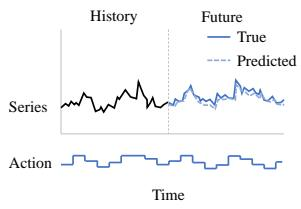
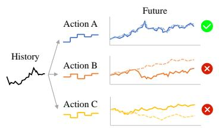
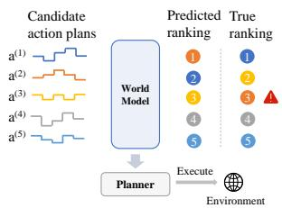
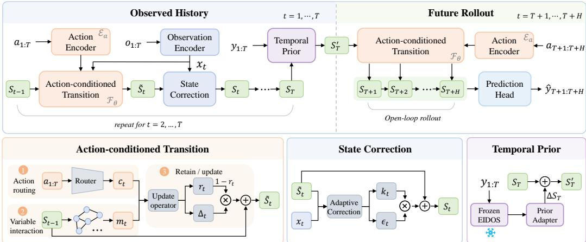
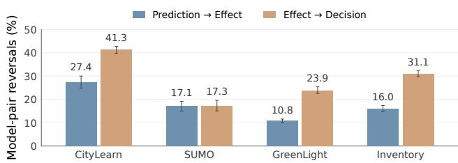
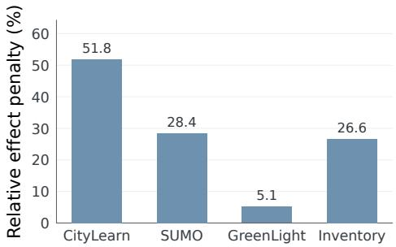
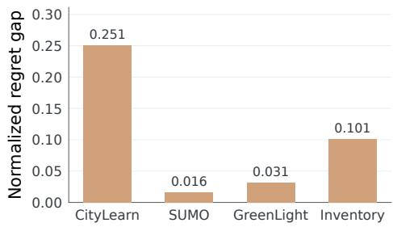

# ACTTIME: ACTION-CONDITIONED WORLD MODEL-ING FOR TIME SERIES

Xinxing Zhou1, Xiaojie Yuan1, Yanlong Wen1∗, Ming Jin2∗

1Nankai University

2Griffith University

zhouxinxing@dbis.nankai.edu.cn,

wenyl@nankai.edu.cn, mingjinedu@gmail.com

## ABSTRACT

Time-series models increasingly condition on known future inputs. In controlled systems, some of these inputs are actions that can be changed, compared, and optimized before execution. A model must therefore do more than predict the realized future: it must predict how outcomes change under different actions from the same observed history and support reliable comparison of candidate plans. We introduce ACTTIME, an action-conditioned world model for time series. Over the observed history, ACTTIME updates variable-specific latent states through an action-conditioned transition and corrects them using observations. It then rolls the same transition forward under candidate actions to generate future trajectories. Training uses only factual trajectories, without paired alternative-action outcomes or planning supervision. We construct a simulator-grounded evaluation suite across building energy, traffic, greenhouse climate, and inventory management, covering factual prediction, intervention-effect prediction, offline decision making, and closed-loop planning. ACTTIME ranks first in 12 of 16 domain-task settings. Across eight methods, the mean pairwise model-ranking reversal rate is 17.8% between factual prediction and intervention fidelity, and rises to 28.4% between intervention fidelity and decision ranking. These results show that factual accuracy, intervention fidelity, and decision quality are related but not interchangeable.

## 1 INTRODUCTION

Modern time-series forecasting increasingly incorporates information beyond the target history. Models use multivariate observations, static attributes, exogenous covariates, and known-future inputs (Lim et al., 2021; Das et al., 2023; Wang et al., 2024; Li et al., 2026; Han et al., 2026). These advances broaden forecasting from history-only extrapolation to conditional prediction with rich contextual information (Yamaguchi et al., 2026; Meyer et al., 2026). In controlled systems, however, some future inputs serve as decision variables rather than fixed context: they are actions selected by a decision maker and can be changed before execution, compared against alternatives, and optimized for downstream objectives. A forecasting model can in principle condition on an action sequence, but decision making requires more than predicting the future under one prescribed sequence. Given the same observed history, the model must predict how future outcomes vary across candidate action sequences, rather than only the outcome under the realized sequence, since these relative differences determine which actions should be preferred before execution.

Figure 1 makes the resulting evaluation gaps explicit. Factual evaluation assesses the future generated by the action sequence that was actually executed, as in Fig. 1a. Accurate prediction of this trajectory does not directly test whether changing the future actions produces the correct change in the resulting trajectory. This gives the first gap: factual accuracy does not guarantee intervention fidelity. A model can fit the realized future well while still misestimating the effect of an alternative action sequence, as illustrated in Fig. 1b. A similar failure mode has been observed in recent action-conditioned world models, where performance on demonstrated actions can mask incorrect responses to valid alternative actions (Wang, 2026; Chen et al., 2026). The second gap appears when these predictions are used to choose actions. A planner compares candidate action sequences according to their predicted outcomes, so the decision depends on their relative ordering, not only on the accuracy of each individual response. Prediction errors can therefore reverse the ordering of candidate actions even when their trajectory-level errors appear moderate (Donti et al., 2017; Elmachtoub & Grigas, 2022). Thus, intervention fidelity does not by itself guarantee decision quality, as illustrated in Fig. 1c. Related work on world-model evaluation has similarly moved beyond predic tive or visual fidelity toward direct assessment of policy rankings and closed-loop task performance (Quevedo et al., 2026; Zhang et al., 2026; Yu et al., 2026). Our experiments quantify both gaps across four controlled domains and eight methods: the average pairwise method-ordering reversal rate is 17.8% from factual prediction to intervention fidelity and rises to 28.4% from intervention fidelity to decision ranking.

  
(a) Factual prediction

  
(b) Intervention-effect prediction

  
(c) Decision ranking  
Figure 1: From factual prediction to decision making. Accurate prediction under observed actions (a) does not guarantee faithful responses under alternative actions (b). Errors in these responses can further distort candidate-action rankings and lead to suboptimal decisions (c).

These gaps call for a model that represents controlled dynamics and can be rolled forward under alternative actions. This is the central role of a world model: learning action-conditioned dynamics that can be queried under candidate actions before they are executed (Hafner et al., 2019; 2020; Hansen et al., 2024). While this view is well established in model-based control and embodied agents, related ideas have also been explored in action-conditioned numerical dynamics and, more recently, in controlled and interventional time-series modeling (Shaj et al., 2021; Shaj Kumar et al., 2023; Wang, 2026; Meng et al., 2026; Wu et al., 2026). Yet a factual trajectory reveals only the action sequence that was executed and the future that followed it; matched outcomes under alternative actions are not observed. This leaves a practical question: can a time-series model learn actionconditioned dynamics from factual trajectories that remain reliable under alternative actions for intervention-effect prediction and decision making?

We address this question with ACTTIME, an action-conditioned time-series world model built around a shared controlled transition. Over the observed history, variable-specific latent states are propagated under the executed actions and corrected using each new observation, allowing the transition to model action-conditioned evolution while the latent state remains grounded in the realized trajectory. At the history boundary, a lightweight residual prior from a frozen pretrained temporal backbone refines the terminal state. The same transition is then rolled forward under candidate future actions without access to future observations. Alternative-action predictions therefore arise directly from the action-conditioned dynamics learned on factual trajectories. To evaluate this capability, we construct simulator-grounded evaluation suites across four controlled systems. Training uses only factual trajectories, while same-history interventions, candidate-action comparisons, and closed-loop planning episodes are generated only for evaluation. This provides direct ground truth for the progression in Fig. 1 without paired alternative-action outcomes or planning supervision during training.

Our main contributions are threefold:

• Decision-oriented formulation and evaluation gaps. We distinguish factual accuracy, intervention fidelity, and decision quality as three distinct evaluation criteria for actionconditioned time-series models, and show that model performance does not reliably transfer across adjacent criteria.

• Action-conditioned time-series world model. We introduce ACTTIME, which learns variable-specific latent states with a shared action-conditioned transition and observationbased correction. The same transition is used for observed-history modeling and open-loop rollout under candidate future actions, using factual supervision only.

• Simulator-grounded evaluation suite. We construct evaluation suites across four heterogeneous domains that cover factual prediction, same-history intervention fidelity, offline decision making, and closed-loop planning. The underlying simulators provide reference action effects and decision outcomes, enabling direct evaluation of whether actionconditioned models remain reliable when used for decision making.

## 2 RELATED WORK

Time-Series Forecasting with Covariates Time-series forecasting has long incorporated information beyond target history, including static attributes, exogenous variables, and known-future inputs (Wen et al., 2017; Rangapuram et al., 2018; Salinas et al., 2020). NBEATSx, TFT, and TiDE integrate such covariates through dedicated components or feature selection (Olivares et al., 2023; Lim et al., 2021; Das et al., 2023). More recent models focus on interactions between endogenous and exogenous series, including TimeXer, ExoTST, CrossLinear, and GCGNet (Wang et al., 2024; Tayal et al., 2024; Zhou et al., 2025b; Li et al., 2026). Covariate-aware forecasting has also reached TSFMs (Yamaguchi et al., 2026). Chronos-2 supports multivariate and covariate-informed forecasting (Ansari et al., 2025), while UniCA adapts pretrained TSFMs to heterogeneous covariates (Han et al., 2026). These models show that contextual information can improve forecasting, but an action is not merely given context. It is changed, compared, and optimized. Factual accuracy therefore provides limited evidence about responses to alternative actions.

Action-Conditioned Time-Series Modeling Several recent studies explicitly model actions or interventions in temporal systems. ThermoForce separates passive dynamics from control-induced responses and combines a frozen TSFM prior with a structured intervention model for HVAC control (Wang, 2026). CEDAR learns action-conditioned demand dynamics for counterfactual simulation and budget planning (Meng et al., 2026). DRIFT and NormWear-2 model physiological trajectories under treatment interventions (Liu et al., 2026; Luo et al., 2026), while DoFlow unifies observational, interventional, and counterfactual time-series prediction in a causal generative framework (Wu et al., 2026). Related work in longitudinal causal inference estimates outcomes under alter native treatment sequences using recurrent, representation-learning, and Transformer-based models (Lim, 2018; Bica et al., 2020; Melnychuk et al., 2022; Xiong et al., 2024). These methods mainly target domain-specific intervention modeling or causal treatment-effect estimation. We instead study a common action-conditioned modeling framework across heterogeneous controlled systems and evaluate whether predictive accuracy translates into intervention fidelity and decision quality.

World Models for Decision Making World models learn dynamics that can be rolled forward under candidate actions for planning and policy learning (Ma et al., 2024; Zhou et al., 2025a). PlaNet and Dreamer use latent imagined trajectories for decision making (Hafner et al., 2019; 2020; 2025), while TD-MPC2 combines latent dynamics with trajectory optimization (Hansen et al., 2024). AcRKN and MTS3 model action-conditioned transitions in numerical dynamical systems, including long-horizon prediction under control inputs (Shaj et al., 2021; Shaj Kumar et al., 2023). Another line studies reusable dynamics priors. APV pretrains from action-free videos before learn ing action-conditioned dynamics for control (Seo et al., 2022), with related ideas explored in recent world-model pretraining (Gao et al., 2025; Wan et al., 2026). Evaluation has also moved beyond predictive fidelity. WorldGym tests whether simulated rollouts preserve policy performance and rankings (Quevedo et al., 2026), World-In-World evaluates closed-loop task success (Zhang et al., 2026), and recent work examines fidelity under alternative actions (Chen et al., 2026). We follow this decision-oriented view and evaluate factual prediction, intervention fidelity, offline decision making, and closed-loop planning.

  
Figure 2: Overview of ACTTIME. The model filters the observed history by alternating a shared action-conditioned transition with observation-based state correction. A frozen pretrained temporal backbone provides a history prior through a lightweight residual adapter, after which the same transition rolls the state forward under candidate future actions for prediction. The bottom panels detail the transition, correction, and prior modules.

## 3 METHODOLOGY

Problem Formulation. We consider multivariate time-series systems whose future evolution depends on control actions. Let ${ \mathbf o } _ { t } \in \mathbb { R } ^ { D }$ denote the observation at time step t and $\mathbf { a } _ { t } \in \mathcal { A } \subseteq \mathbb { R } ^ { A }$ the corresponding action. We denote the target variables by $\mathbf { y } _ { t } = \mathbf { o } _ { t } [ \mathcal { T } ] \in \mathbb { R } ^ { \mathbf { \hat { P } } }$ , where I indexes the $P$ variables of interest. We index each action with the observation obtained after its execution.

Given an observed history $\mathbf { o } _ { 1 : T }$ and $\mathbf { a } _ { 1 : T }$ , together with a candidate future action sequence $\mathbf { a } _ { T + 1 : T + H }$ , the model predicts

$$
\hat { \bf y } _ { T + 1 : T + H } = f _ { \boldsymbol \Theta } ( { \bf o } _ { 1 : T } , { \bf a } _ { 1 : T } , { \bf a } _ { T + 1 : T + H } ) .\tag{1}
$$

For a fixed observed history, the model can be queried with multiple candidate future action sequences $\{ \mathbf { a } _ { T + 1 : T + H } ^ { ( k ) } \} _ { k = 1 } ^ { K }$ to obtain their corresponding predicted trajectories $\{ \hat { \mathbf { y } } _ { T + 1 : T + H } ^ { ( k ) } \} _ { k = 1 } ^ { K } .$ Comparing a candidate trajectory with a designated reference trajectory characterizes its predicted intervention effect, while applying a downstream objective to these trajectories enables candidateaction ranking and planning.

Training uses only factual trajectories, where each history is paired with one realized future action sequence and its resulting target trajectory. No same-history alternative futures are used for training.

Overview. Figure 2 summarizes ACTTIME. Over the observed history, variable-specific latent states are propagated by an action-conditioned transition and corrected using each new observation. At the history boundary, a frozen pretrained temporal backbone provides a history prior through a lightweight residual adapter. The resulting terminal state is then rolled forward by the same transition under candidate future actions without access to future observations, and a prediction head decodes the simulated states into target quantiles.

## 3.1 ACTION-CONDITIONED STATE DYNAMICS

We represent the system at time t by $\mathbf { S } _ { t } \in \mathbb { R } ^ { D \times d _ { s } }$ , which maintains a latent state for each of the D observed variables, with state dimension $d _ { s }$ . Learned variable embeddings $\mathbf { V } \in \mathbb { R } ^ { D \times d _ { s } }$ provide persistent variable identity.

The observation encoder represents each current value together with its local change, while the action encoder maps the full action vector and its change to a control representation for each variable:

$$
\begin{array} { r } { \mathbf { x } _ { t } = \mathscr { E } _ { o } ( [ \mathbf { o } _ { t } , \Delta \mathbf { o } _ { t } ] ) , \qquad \mathbf { c } _ { t } = \mathscr { E } _ { a } ( [ \mathbf { a } _ { t } , \Delta \mathbf { a } _ { t } ] ) , } \end{array}\tag{2}
$$

where $[ \cdot , \cdot ]$ denotes concatenation, $\Delta \mathbf o _ { t } = \mathbf o _ { t } - \mathbf o _ { t - 1 } , \Delta \mathbf a _ { t } = \mathbf a _ { t } - \mathbf a _ { t - 1 }$ , and $\mathbf { x } _ { t } , \mathbf { c } _ { t } \in \mathbb { R } ^ { D \times d _ { s } }$ . The observation encoder is shared across variables, whereas ${ \mathcal { E } } _ { a }$ uses all action channels to produce a separate control representation for each variable state. The differences are set to zero at $t = 1$ , and the initial state is

$$
\mathbf S _ { 1 } = \mathcal E _ { \mathrm { i n i t } } \left( \mathbf { x } _ { 1 } + \mathbf { c } _ { 1 } + \mathbf { V } \right) ,\tag{3}
$$

where ${ \mathcal { E } } _ { \mathrm { i n i t } }$ is a learned normalization and projection.

Action-conditioned transition. The transition consists of a stack of blocks that share the same structure. For clarity, we describe one block below and omit the block index. Given the incoming state, we first exchange information across variables through self-attention:

$$
\begin{array} { r } { \bar { \mathbf { S } } _ { t - 1 } = \mathrm { L N } ( \mathbf { S } _ { t - 1 } ) , \qquad \mathbf { m } _ { t } = \sigma ( \alpha ) \mathrm { M H A } \left( \bar { \mathbf { S } } _ { t - 1 } , \bar { \mathbf { S } } _ { t - 1 } , \bar { \mathbf { S } } _ { t - 1 } \right) , } \end{array}\tag{4}
$$

where $\alpha$ is a learned scalar controlling the contribution of the cross-variable message. The normalized state, interaction message, and routed control are then concatenated as $\mathbf { h } _ { t } = [ \bar { \bar { \mathbf { S } } } _ { t - 1 } , \mathbf { m } _ { t } , \mathbf { c } _ { t } ] . \mathrm {  ~ A ~ }$ bounded retention gate and a candidate state update are computed from this joint representation:

$$
\mathbf { r } _ { t } = g _ { r } ( \mathbf { h } _ { t } ) , \qquad \Delta _ { t } = \mathrm { S w i G L U } \left( \mathrm { S i L U } ( W _ { \Delta } \mathbf { h } _ { t } + b _ { \Delta } ) \right) ,\tag{5}
$$

where $g _ { r }$ is a learned sigmoid-gated projection and $\mathbf { r } _ { t } \in ( 0 , 1 ) ^ { D \times d _ { s } }$ . Each block updates the state according to

$$
\begin{array} { r } { \mathcal { T } \big ( \mathbf { S } _ { t - 1 } , \mathbf { c } _ { t } \big ) = \mathrm { L N } \big ( \mathbf { S } _ { t - 1 } + \left( 1 - \mathbf { r } _ { t } \right) \odot \Delta _ { t } \big ) . } \end{array}\tag{6}
$$

Applying the transition blocks sequentially defines the shared action-conditioned transition $F _ { \theta }$ . The update therefore depends jointly on the previous state, interactions among variables, and the applied action, allowing action effects to propagate through the latent dynamics rather than entering only at the prediction stage.

State correction. The transition predicts how the latent state evolves under the applied action. During the observed history, this prediction is corrected using the current observation representation. With $\mathbf z _ { t } = [ \mathrm { L N } ( \tilde { \mathbf S } _ { t } ) , \mathbf x _ { t } ]$ , where $\tilde { \mathbf { S } } _ { t } = F _ { \theta } ( \mathbf { S } _ { t - 1 } , \mathbf { c } _ { t } )$ , the correction module computes

$$
\epsilon _ { t } = \mathrm { t a n h } ( W _ { \epsilon } { \bf z } _ { t } + b _ { \epsilon } ) , \qquad { \bf k } _ { t } = \sigma ( W _ { k } { \bf z } _ { t } + b _ { k } ) , \qquad { \bf S } _ { t } = \tilde { \bf S } _ { t } + { \bf k } _ { t } \odot \epsilon _ { t } .\tag{7}
$$

Here, $\epsilon _ { t }$ is the observation-dependent state update and $\mathbf k _ { t } \in ( 0 , 1 ) ^ { D \times d _ { s } }$ controls its contribution. The transition models action-conditioned evolution, while the correction incorporates the realized observations. Iterating these operations over the observed history produces the terminal state $\mathbf { S } _ { T }$

## 3.2 TEMPORAL PRIOR AND FUTURE ROLLOUT

Temporal prior. At the history boundary, ACTTIME augments ${ \bf S } _ { T }$ with temporal information from a frozen pretrained EIDOS (Zhou et al., 2026) backbone. Each target history in $\mathbf { y } _ { 1 : T }$ is standardized over time and encoded independently. The resulting features are passed through a frozen projection to $d _ { p }$ dimensions and averaged across targets, and the final-time representation $\mathbf { p } _ { T } \in \mathbb { R } ^ { d _ { p } }$ is used as the temporal prior. After broadcasting $\mathbf { p } _ { T }$ across the D variable states, a lightweight residual adapter computes

$$
\Delta { \bf S } _ { T } = \gamma \operatorname { t a n h } ( \mathrm { M L P } [ \mathrm { R M S N o r m } ( { \bf p } _ { T } ) , { \bf V } ] ) , \qquad { \bf S } _ { T } ^ { \prime } = { \bf S } _ { T } + \Delta { \bf S } _ { T } .\tag{8}
$$

The scalar gate $\gamma$ is initialized to zero. The prior is applied only at the history boundary, while the parameters of the action-conditioned transition remain unchanged.

Future rollout and prediction. Starting from $\mathbf { S } _ { T } ^ { \prime } .$ , the same transition $F _ { \theta }$ is used to simulate the future under the candidate action sequence. Future actions are encoded by ${ \mathcal { E } } _ { a }$ as in Eq. 2, with the first action difference computed relative to the last observed action $\mathbf { a } _ { T } \mathbf { : }$

$$
{ \bf S } _ { T + 1 } = F _ { \theta } ( { \bf S } _ { T } ^ { \prime } , { \bf c } _ { T + 1 } ) , \qquad { \bf S } _ { T + h } = F _ { \theta } ( { \bf S } _ { T + h - 1 } , { \bf c } _ { T + h } ) , \quad h = 2 , \dots , H .\tag{9}
$$

No observation correction is applied during rollout because future observations are unavailable. The future trajectory is therefore generated solely from the inferred history state, the candidate actions, and the learned controlled dynamics.

To decode each future state, we select the latent states corresponding to the target indices and summarize the full system state by

$$
\mathbf { Z } _ { T + h } = \mathbf { S } _ { T + h } [ \mathcal { T } ] \in \mathbb { R } ^ { P \times d _ { s } } , \qquad \bar { \mathbf { s } } _ { T + h } = \mathrm { M e a n } _ { D } ( \mathbf { S } _ { T + h } ) \in \mathbb { R } ^ { d _ { s } } .\tag{10}
$$

The prediction head combines each target state with the shared context $\bar { \bf s } _ { T + h }$ and outputs $\delta _ { T + h } .$ $\ell _ { T + h }$ , and $\pmb { u } _ { T + h } \in \mathbb { R } ^ { P }$ . Using the last observed target $\mathbf { y } _ { T }$ as an anchor, the prediction head produces ordered quantiles as

$$
\begin{array} { r l } & { \hat { \mathbf { y } } _ { T + h } ^ { 0 . 5 } = \mathbf { y } _ { T } + \delta _ { T + h } , } \\ & { \hat { \mathbf { y } } _ { T + h } ^ { 0 . 1 } = \hat { \mathbf { y } } _ { T + h } ^ { 0 . 5 } - \mathrm { s o f t p l u s } ( \ell _ { T + h } ) , \qquad \hat { \mathbf { y } } _ { T + h } ^ { 0 . 9 } = \hat { \mathbf { y } } _ { T + h } ^ { 0 . 5 } + \mathrm { s o f t p l u s } ( u _ { T + h } ) . } \end{array}\tag{11}
$$

This parameterization guarantees ordered quantiles, and $\hat { \mathbf { y } } _ { T + h } ^ { 0 . 5 }$ is used as the point prediction.

For a fixed observed history, all candidate future action sequences start from the same terminal state $\mathbf { S } _ { T } ^ { \prime }$ . Rolling this state forward under different candidates yields their corresponding future trajectories, enabling same-history comparison of alternative actions and candidate-plan evaluation.

## 3.3 MODEL TRAINING

We train ACTTIME using factual trajectories with a quantile prediction objective. Let ${ \mathcal { Q } } =$ $\{ 0 . 1 , 0 . 5 , 0 . 9 \}$ denote the predicted quantile levels. For a future target $\mathbf { y } _ { T + h }$ and its quantile prediction $\hat { \mathbf { y } } _ { T + h } ^ { q }$ , the prediction loss is

$$
\mathcal { L } _ { \mathrm { p r e d } } = \frac { 1 } { H P | Q | } \sum _ { h = 1 } ^ { H } \sum _ { j = 1 } ^ { P } \sum _ { q \in \mathcal { Q } } \rho _ { q } \left( y _ { T + h } ^ { ( j ) } - \hat { y } _ { T + h } ^ { q , ( j ) } \right) , \qquad \rho _ { q } ( u ) = \operatorname* { m a x } \{ q u , ( q - 1 ) u \} .\tag{12}
$$

We separate learning the controlled dynamics from adapting the pretrained temporal prior. First, the temporal-prior pathway is disabled and Eq. 12 is used to train the observation and action encoders, shared controlled dynamics, state correction, and prediction head. This yields the factual actionconditioned predictor used as the controlled dynamics core.

We then freeze the entire learned predictor and the EIDOS-based prior extractor, and optimize only the lightweight residual adapter in Eq. 8. Because its scalar gate is initialized at zero,

$$
\gamma = 0 \quad \Longrightarrow \quad \Delta \mathbf { S } _ { T } = \mathbf { 0 } , \qquad \mathbf { S } _ { T } ^ { \prime } = \mathbf { S } _ { T } ,\tag{13}
$$

the second optimization stage begins with exactly the same predictions as the first-stage model. Adaptation is therefore restricted to a residual modification of the terminal history state, while the learned controlled dynamics and prediction head remain fixed.

Both stages optimize the same factual prediction objective in Eq. 12. No same-history alternativeaction outcomes or planning objectives are used in either stage.

## 4 EXPERIMENTS

## 4.1 EXPERIMENTAL SETUP

Environments and data. We evaluate on four simulation environments: CityLearn for building energy management (Nweye et al., 2022), SUMO Cologne1 for traffic-signal control (Ault & Sharon, 2021; Lopez et al., 2018), GreenLight for greenhouse climate control (Van Laatum et al., 2025; Katzin et al., 2020), and gym-invmgmt for serial inventory management (Barati & Hu, 2026). We generate all training and evaluation trajectories directly from the corresponding simulators. Training contains one realized future per history. For intervention-effect and offline decision evaluation, each held-out history is paired with multiple future action plans whose outcomes are obtained from the simulator. Online evaluation executes selected actions in the simulator and replans from the resulting observations. Alternative-action outcomes are not used for training or final checkpoint selection. Table 1 summarizes the domain configurations.

Table 1: Simulation environments and task configurations. $D / A / P$ denote the observation, action, and target dimensions, and T/H the history/prediction horizons in simulator steps.
<table><tr><td>Domain</td><td> $D / A / P$ </td><td>Step</td><td> $T / H$ </td><td>Action</td><td>Targets</td></tr><tr><td>CityLearn</td><td>28/1/2</td><td>1h</td><td>24/12</td><td>Battery charge/discharge</td><td>SOC, net electricity consumption</td></tr><tr><td>SUMO</td><td>25/4/6</td><td>10 s</td><td>24/12</td><td>Traffic-signal phase</td><td>Queue, waiting time, traffic flow</td></tr><tr><td>GreenLight</td><td>36/6/3</td><td>15 min</td><td>96/16</td><td>Climate actuators</td><td>CO2, temperature, humidity</td></tr><tr><td>Inventory</td><td>15/3/4</td><td>1 period</td><td>24/12</td><td>Replenishment requests</td><td>Backlog, echelon inventories</td></tr></table>

Table 2: Main results across four controlled dynamical systems and four evaluation settings. Lower is better for all task metrics (↓). Macro Regret denotes the average normalized regret over the three predefined offline objectives. Best and second-best results are shown in bold and underlined, respectively. Ridge denotes Ridge-VARX, while DLinear, PatchTST, iTransformer, and TFT denote their action-conditioned variants.
<table><tr><td>Domain</td><td>Task / Metric</td><td>Ridge</td><td>DLinear</td><td>PatchTST</td><td>iTransformer</td><td>TFT</td><td>RSSM</td><td>MTS3</td><td>ACTTIME</td></tr><tr><td rowspan="4">CityLearn</td><td>Factual MAE</td><td>0.2875</td><td>0.3585</td><td>0.3410</td><td>0.3602</td><td>0.2583</td><td>0.2501</td><td>0.2512</td><td>0.2486</td></tr><tr><td>Effect NMAE</td><td>0.1495</td><td>0.3493</td><td>0.2700</td><td>0.3972</td><td>0.0498</td><td>0.0790</td><td>0.0716</td><td>0.0725</td></tr><tr><td>Macro Regret</td><td>0.4793</td><td>0.3869</td><td>0.4396</td><td>0.5050</td><td>0.2880</td><td>0.3739</td><td>0.3105</td><td>0.2798</td></tr><tr><td>Online Objective</td><td>0.8310</td><td>0.8541</td><td>0.8481</td><td>0.9099</td><td>0.8250</td><td>0.8196</td><td>0.8414</td><td>0.8317</td></tr><tr><td rowspan="4">SUMO</td><td>Factual MAE</td><td>0.3873</td><td>0.4358</td><td>0.4150</td><td>0.3730</td><td>0.1226</td><td>0.1730</td><td>0.2134</td><td>0.1076</td></tr><tr><td>Effect NMAE</td><td>1.0851</td><td>0.9201</td><td>0.9202</td><td>0.9060</td><td>0.4184</td><td>0.4914</td><td>0.5776</td><td>0.4825</td></tr><tr><td>Macro Regret</td><td>0.5255</td><td>0.5661</td><td>0.5662</td><td>0.5620</td><td>0.0296</td><td>0.0802</td><td>0.0759</td><td>0.0221</td></tr><tr><td>Online Objective</td><td>0.3940</td><td>0.3834</td><td>0.3836</td><td>0.3843</td><td>0.3147</td><td>0.3193</td><td>0.3430</td><td>0.3036</td></tr><tr><td rowspan="4">GreenLight</td><td>Factual MAE</td><td>0.3263</td><td>0.3699</td><td>0.3647</td><td>0.3398</td><td>0.0666</td><td>0.1008</td><td>0.1242</td><td>0.0498</td></tr><tr><td>Effect NMAE</td><td>0.8622</td><td>0.9384</td><td>0.9221</td><td>0.8860</td><td>0.2811</td><td>0.3761</td><td>0.5367</td><td>0.2091</td></tr><tr><td>Macro Regret</td><td>0.4352</td><td>0.7962</td><td>0.8965</td><td>0.7096</td><td>0.2367</td><td>0.1956</td><td>0.1870</td><td>0.1397</td></tr><tr><td>Online Objective</td><td>0.3105</td><td>0.3201</td><td>0.3232</td><td>0.3258</td><td>0.2946</td><td>0.3009</td><td>0.2961</td><td>0.2944</td></tr><tr><td rowspan="4">Inventory</td><td>Factual MAE</td><td>0.2210</td><td>0.3812</td><td>0.3938</td><td>0.3706</td><td>0.0992</td><td>0.1243</td><td>0.1279</td><td>0.0790</td></tr><tr><td>Effect NMAE</td><td>0.6538</td><td>0.9711</td><td>0.9774</td><td>0.9567</td><td>0.3077</td><td>0.3506</td><td>0.4008</td><td>0.2244</td></tr><tr><td>Macro Regret</td><td>0.1169</td><td>0.2929</td><td>0.3221</td><td>0.3133</td><td>0.1585</td><td>0.2130</td><td>0.1531</td><td>0.1563</td></tr><tr><td>Online Objective</td><td>4.1079</td><td>4.2951</td><td>4.3760</td><td>4.2875</td><td>3.8917</td><td>3.9583</td><td>4.0445</td><td>3.8739</td></tr><tr><td rowspan="2">Summary</td><td># Best ↑</td><td>1</td><td>0</td><td>0</td><td>0</td><td>2</td><td>1</td><td>0</td><td>12</td></tr><tr><td>Avg. Rank ↓</td><td>5.19</td><td>6.75</td><td>7.06</td><td>6.63</td><td>2.25</td><td>3.19</td><td>3.44</td><td>1.50</td></tr></table>

Evaluation. We evaluate factual prediction, intervention fidelity, offline decision making, and closed-loop planning. Factual prediction uses MAE in target-wise standardized space. Intervention fidelity uses Effect NMAE, which measures error in the predicted alternative-versus-reference trajectory effect relative to the magnitude of the true effect. Offline decision making reports the macro average of normalized regret over three predefined objectives, using the simulator oracle and uniform candidate selection as references. Closed-loop planning reports each domain’s primary control objective under receding-horizon model predictive control (MPC). Lower is better throughout. Exact metric and objective definitions are given in the Appendix A.2.

Baselines. We compare with five forecasting baselines: Ridge-VARX, DLinear (Zeng et al., 2023), PatchTST (Nie et al., 2023), iTransformer (Liu et al., 2024), and TFT (Lim et al., 2021), together with two latent world models, RSSM (Hafner et al., 2019) and MTS3 (Shaj Kumar et al., 2023). All methods receive historical actions and candidate future actions, with each prediction conditioned only on actions available up to that horizon. The same held-out histories and candidate action bank are used across methods. Baseline adaptations are provided in the Appendix A.4.

## 4.2 MAIN RESULTS

Table 2 summarizes performance across four domains and four evaluation settings. ACTTIME rank first in 12 of the 16 task-domain settings and achieves the best overall average rank of 1.50, compared with 2.25 for the strongest baseline. These results span continuous and discrete control settings, with action spaces ranging from scalar battery control and traffic-signal phases to multichannel climate actuation and replenishment decisions.

Factual prediction. ACTTIME achieves the lowest factual MAE in all four domains. Relative to the strongest baseline, MAE is reduced by 12.2% on SUMO, 25.2% on GreenLight, and 20.4% on Inventory. Thus, the gains under alternative actions do not come at the cost of accuracy on the realized trajectories used in conventional forecasting evaluation.

Intervention fidelity. The factual ordering does not carry over unchanged once future actions are varied. TFT performs best on CityLearn and SUMO, while ACTTIME leads on GreenLight and Inventory with 25.6% and 27.1% lower Effect NMAE than the strongest baseline. This shift indicates that factual accuracy alone does not determine how well a model captures the effects of alternative actions. Section 4.3 examines this mismatch directly.

Decision making. The most consistent gains appear when predictions are used to choose actions. ACTTIME achieves the lowest Offline Macro Regret on CityLearn, SUMO, and GreenLight, and the best closed-loop objective on SUMO, GreenLight, and Inventory. Its offline regret is about 25% lower than the strongest baseline on both SUMO and GreenLight. The decision-level ordering also differs from intervention fidelity. For example, ACTTIME ranks second on SUMO Effect NMAE but first in both offline and closed-loop decision evaluation. This provides an initial indication that accurate effect prediction and useful decision rankings, while related, are not equivalent.

## 4.3 ALIGNMENT ACROSS EVALUATION LEVELS

The rank changes in Table 2 motivate a direct test of cross-level alignment. We compare adjacent evaluation levels on matched held-out histories. Prediction measures reference-trajectory error, Effect measures the fidelity of action-induced trajectory changes, and Decision measures candidateaction ranking quality. For each method pair, we record whether its relative ordering reverses between adjacent levels. Using orderings rather than raw metric differences makes the comparison insensitive to the different scales of the three criteria. Detailed definitions and per-domain statistics are provided in the Appendix B.2.

  
Figure 3: Model-order reversals across evaluation levels. Bars report the fraction of method pairs whose ordering reverses between adjacent levels. Error bars denote 95% bootstrap confidence intervals over histories.

Figure 3 shows weaker alignment toward the decision level. The mean reversal rate increases from 17.8% for Prediction-to-Effect to 28.4% for Effect-to-Decision, while the corresponding macro Spearman correlation decreases from 0.763 to 0.514. The increase in reversals appears in all four domains, with the largest Effect-to-Decision gaps on CityLearn and Inventory.

Upstream and downstream performance remain positively associated

in aggregate, yet this association is not strong enough to preserve the ordering of individual methods. An upstream metric can therefore remain informative while still being an unreliable criterion for selecting the better model downstream. For Effect-to-Decision, reversal rates range from 17.3% on SUMO to 41.3% on CityLearn. Factual accuracy, intervention fidelity, and decision quality should therefore be treated as distinct but related evaluation levels.

## 4.4 CANDIDATE-ACTION RANKING FIDELITY

The preceding analysis shows that intervention fidelity does not fully characterize decision quality. A planner selects among candidate actions according to their relative predicted costs, so we next evaluate whether this ordering is preserved directly. For each held-out history, we compute the cost of every candidate plan from the model-predicted trajectory and compare it with the corresponding simulator cost under the domain’s predefined primary objective. We report the Spearman rank correlation averaged over histories, where higher values indicate more faithful candidate-action ordering.

Table 3 shows that ACTTIME achieves the highest candidate-ranking correlation in all four domains. Its macro-average correlation is 0.8661, compared with 0.8154 for TFT, the strongest baseline on this metric. The advantage is especially pronounced on GreenLight and remains consistent across

Table 3: Candidate-action ranking fidelity. Mean per-history Spearman correlation between predicted and simulator candidate costs under each domain’s predefined primary decision objective. Higher is better. Best and second-best results are shown in bold and underlined, respectively.
<table><tr><td>Domain</td><td>Ridge</td><td>DLinear</td><td>PatchTST</td><td>iTransformer</td><td>TFT</td><td>RSSM</td><td>MTS3</td><td>ACTTIME</td></tr><tr><td>CityLearn</td><td>0.8608</td><td>0.8213</td><td>0.8361</td><td>0.8053</td><td>0.8381</td><td>0.7627</td><td>0.8123</td><td>0.8810</td></tr><tr><td>SUMO</td><td>0.4745</td><td>0.4709</td><td>0.4639</td><td>0.4619</td><td>0.9008</td><td>0.8532</td><td>0.8451</td><td>0.9048</td></tr><tr><td>GreenLight</td><td>0.5164</td><td>0.2612</td><td>0.1970</td><td>0.2713</td><td>0.7527</td><td>0.7284</td><td>0.7334</td><td>0.8514</td></tr><tr><td>Inventory</td><td>0.7934</td><td>0.6064</td><td>0.5799</td><td>0.6026</td><td>0.7703</td><td>0.7757</td><td>0.8071</td><td>0.8271</td></tr><tr><td>Avg.</td><td>0.6613</td><td>0.5399</td><td>0.5192</td><td>0.5352</td><td>0.8154</td><td>0.7800</td><td>0.7995</td><td>0.8661</td></tr></table>

Table 4: Ablation study averaged across the four domains. Each entry is the ratio to the matched full-model metric within each domain, so 1.0 denotes parity and larger values indicate degradation.
<table><tr><td>Variant</td><td>Factual MAE</td><td>Effect NMAE</td><td>Macro Regret</td><td>Online Objective</td></tr><tr><td>Full</td><td>1.000</td><td>1.000</td><td>1.000</td><td>1.000</td></tr><tr><td>Simple Action Concatenation</td><td>1.059</td><td>1.035</td><td>1.137</td><td>1.021</td></tr><tr><td>w/o State Correction</td><td>2.137</td><td>2.132</td><td>2.215</td><td>1.031</td></tr><tr><td>Shared State Across Variables</td><td>5.787</td><td>5.367</td><td>4.360</td><td>1.146</td></tr><tr><td>w/o Action Conditioning</td><td>4.290</td><td>6.393</td><td>16.349</td><td>2.999</td></tr></table>

CityLearn, SUMO, and Inventory. Together with the offline regret results in Table 2, this shows that the decision performance of ACTTIME is accompanied by more faithful ordering of the full candidate set, rather than being limited to the ultimately selected plan.

We further test whether this result depends on the choice of decision objective or ranking metric. Across all 12 domain-objective combinations, ACTTIME achieves the best macro performance under Spearman correlation, Kendall’s $\tau _ { b }$ , and pairwise ordering accuracy. It ranks first on 11 of the 12 objectives under Spearman correlation and on 10 of 12 under both Kendall’s $\tau _ { b }$ and pairwise accuracy. Detailed results are reported in Appendix B.3.

## 4.5 ABLATION STUDY

We ablate the main components of the controlled dynamics. Because metric scales differ across domains, we normalize each ablation by the corresponding full-model metric within each domain and then macro-average the ratios. Table 4 reports the resulting values, where values above 1.0 indicate degradation.

The two action ablations separate the value of action information from the way it enters the dynamics. Removing action conditioning produces the largest degradation on intervention and decision metrics, increasing Effect NMAE by more than sixfold and Offline Macro Regret by more than sixteenfold. Replacing the structured action pathway with simple concatenation is less destructive, but still degrades every metric, with the clearest loss in offline decision making. Action information is therefore essential, while the structured pathway provides a better overall balance across evaluation criteria than simple action concatenation.

The state representation is similarly important. Collapsing the variable-specific latent states into a shared state severely degrades factual prediction, intervention fidelity, and offline decision making. Removing state correction roughly doubles these three errors. Together, these results support maintaining heterogeneous system states and re-grounding them with observations before open-loop rollout. The weaker degradation in the online objective is consistent with receding-horizon replanning repeatedly incorporating fresh simulator observations, which limits the accumulation of openloop model error. Per-domain structural ablations and an exactly paired analysis of the pretrained temporal prior are reported in Appendix B.4.

## 5 CONCLUSION

We study action-conditioned time-series modeling from the perspective of world modeling for decision making, where the goal is not only to predict the realized future but also to reason about outcomes under alternative actions. We introduce ACTTIME, which learns action-conditioned dynamics over variable-specific latent states from factual trajectories and rolls the same dynamics forward under candidate future actions. This formulation supports factual forecasting, interventioneffect prediction, and downstream planning without requiring paired alternative-action outcomes or planning supervision. Across four simulator-grounded controlled systems, ACTTIME performs strongly throughout this evaluation pipeline, while our analysis shows that factual accuracy, intervention fidelity, and decision quality are related but not interchangeable. These findings motivate treating alternative-action reasoning and downstream decision quality as first-class objectives when developing and evaluating action-conditioned time-series models.

## REFERENCES

Abdul Fatir Ansari, Oleksandr Shchur, Jaris Kuken, Andreas Auer, Boran Han, Pedro Mercado,¨ Syama Sundar Rangapuram, Huibin Shen, Lorenzo Stella, Xiyuan Zhang, et al. Chronos-2: From univariate to universal forecasting. arXiv preprint arXiv:2510.15821, 2025.

James Ault and Guni Sharon. Reinforcement learning benchmarks for traffic signal control. In Thirty-fifth Conference on Neural Information Processing Systems Datasets and Benchmarks Track (Round 1), 2021.

Reza Barati and Qinmin Vivian Hu. gym-invmgmt: An open benchmarking framework for inventory management methods. arXiv preprint arXiv:2605.11355, 2026.

Ioana Bica, Ahmed M Alaa, James Jordon, and Mihaela van der Schaar. Estimating counterfactual treatment outcomes over time through adversarially balanced representations. In International Conference on Learning Representations, 2020.

Sixiang Chen, Jiaming Liu, Jixian Wu, Yichen Guo, Tinghao Wang, Siyuan Qian, Hao Chen, Jiajun Cao, Jian Tang, and Shanghang Zhang. Do robotic world models really follow actions? diagnosing and aligning action-conditioned generation for policy learning. arXiv preprint arXiv:2608.24885, 2026.

Abhimanyu Das, Weihao Kong, Andrew Leach, Shaan K Mathur, Rajat Sen, and Rose Yu. Longterm forecasting with tiDE: Time-series dense encoder. Transactions on Machine Learning Research, 2023. ISSN 2835-8856.

Pieter-Tjerk De Boer, Dirk P Kroese, Shie Mannor, and Reuven Y Rubinstein. A tutorial on the cross-entropy method. Annals ofoperations research, 134(1):19–67, 2005.

Priya Donti, Brandon Amos, and J Zico Kolter. Task-based end-to-end model learning in stochastic optimization. Advances in neural information processing systems, 30, 2017.

Adam N Elmachtoub and Paul Grigas. Smart “predict, then optimize”. Management science, 68(1): 9–26, 2022.

Shenyuan Gao, Siyuan Zhou, Yilun Du, Jun Zhang, and Chuang Gan. AdaWorld: Learning adaptable world models with latent actions. In Proceedings of the 42nd International Conference on Machine Learning, volume 267 of Proceedings ofMachine Learning Research, pp. 18744–18771. PMLR, 13–19 Jul 2025.

Danijar Hafner, Timothy Lillicrap, Ian Fischer, Ruben Villegas, David Ha, Honglak Lee, and James Davidson. Learning latent dynamics for planning from pixels. In International conference on machine learning, pp. 2555–2565. PMLR, 2019.

Danijar Hafner, Timothy Lillicrap, Jimmy Ba, and Mohammad Norouzi. Dream to Control: Learning Behaviors by Latent Imagination. In International Conference on Learning Representations, 2020.

Danijar Hafner, Jurgis Pasukonis, Jimmy Ba, and Timothy Lillicrap. Mastering diverse control tasks through world models. Nature, 640(8059):647–653, 2025.

Lu Han, Yu Liu, Lan Li, Qiwen Deng, Jian Jiang, Yinbo Sun, Zhe Yu, Binfeng Wang, Xingyu Lu, Lintao Ma, Han-Jia Ye, and De-Chuan Zhan. Unica: Unified covariate adaptation for time series foundation model. In The Fourteenth International Conference on Learning Representations, ICLR 2026, Rio de Janeiro, Brazil, April 23-27, 2026. proceedings.iclr.cc, 2026.

Nick Hansen, Hao Su, and Xiaolong Wang. Td-mpc2: Scalable, robust world models for continuous control. In International Conference on Learning Representations, volume 2024, pp. 47376– 47405, 2024.

David Katzin, Simon Van Mourik, Frank Kempkes, and Eldert J Van Henten. Greenlight–an open source model for greenhouses with supplemental lighting: Evaluation of heat requirements under led and hps lamps. Biosystems Engineering, 194:61–81, 2020.

Roger Koenker and Gilbert Bassett Jr. Regression quantiles. Econometrica: journal of the Econometric Society, pp. 33–50, 1978.

Zhengyu Li, Xiangfei Qiu, Yuhan Zhu, Xingjian Wu, Jilin Hu, Chenjuan Guo, and Bin Yang. Gcgnet: Graph-consistent generative network for time series forecasting with exogenous variables. In International Conference on Learning Representations, volume 2026, pp. 27904–27926, 2026.

Bryan Lim. Forecasting treatment responses over time using recurrent marginal structural networks. Advances in neural information processing systems, 31, 2018.

Bryan Lim, Sercan O Arık, Nicolas Loeff, and Tomas Pfister. Temporal fusion transformers for¨ interpretable multi-horizon time series forecasting. International journal offorecasting, 37(4): 1748–1764, 2021.

Weixin Liu, Juming Xiong, Congning Ni, Yanfan Zhu, Xingtao Lin, Bradley A Malin, and Zhijun Yin. Drift: Direct-recursive intervention-conditioned forecasting of icu physiological trajectories. arXiv preprint arXiv:2607.25864, 2026.

Yong Liu, Tengge Hu, Haoran Zhang, Haixu Wu, Shiyu Wang, Lintao Ma, and Mingsheng Long. itransformer: Inverted transformers are effective for time series forecasting. In International conference on learning representations, volume 2024, pp. 11116–11140, 2024.

Pablo Alvarez Lopez, Michael Behrisch, Laura Bieker-Walz, Jakob Erdmann, Yun-Pang Flotter¨ od,¨ Robert Hilbrich, Leonhard Lucken, Johannes Rummel, Peter Wagner, and Evamarie Wießner.¨ Microscopic traffic simulation using sumo. In 2018 21st international conference on intelligent transportation systems (ITSC), pp. 2575–2582. Ieee, 2018.

Yunfei Luo, Xi Chen, Yuliang Chen, Lanshuang Zhang, Md Mofijul Islam, Siwei Zhao, Peter Kotanko, Subhasis Dasgupta, Andrew Campbell, Rakesh Malhotra, et al. Toward world modeling of physiological signals with chaos-theoretic balancing and latent dynamics. arXiv preprint arXiv:2605.15465, 2026.

Michel Ma, Tianwei Ni, Clement Gehring, Pierluca D’Oro, and Pierre-Luc Bacon. Do transformer world models give better policy gradients? In Proceedings of the 41st International Conference on Machine Learning, volume 235 of Proceedings of Machine Learning Research, pp. 33855– 33879. PMLR, 21–27 Jul 2024.

Valentyn Melnychuk, Dennis Frauen, and Stefan Feuerriegel. Causal transformer for estimating counterfactual outcomes. In International conference on machine learning, pp. 15293–15329. PMLR, 2022.

Junjie Meng, Ranxu Zhang, Zi-an Zhang, Shujun Liu, Xiaoning Qi, Xiaozhou Xu, Yanyong Zhang, Hui Xiong, and Chao Wang. Cedar: Controlled and event-driven demand forecasting via residual decomposition. In Proceedings of the 32nd ACM SIGKDD Conference on Knowledge Discovery and Data Mining V. 2, pp. 7797–7808, 2026.

Lucas Meyer, Claudio Sole, Huikan Xiang, Nicolas Li, Lucas Franceschino, Arnau Quera-Bofarull, Maarten P. Scholl, Joachim Fainberg, and Geoffrey Negiar.´ t : A Time-Series Foundation Model for Forecasting with Context. arXiv preprint arXiv:2609.24559, 2026.

Yuqi Nie, Nam H. Nguyen, Phanwadee Sinthong, and Jayant Kalagnanam. A time series is worth 64 words: Long-term forecasting with transformers. In The Eleventh International Conference on Learning Representations, ICLR 2023, Kigali, Rwanda, May 1-5, 2023. OpenReview.net, 2023.

Kingsley Nweye, Zoltan Nagy, Sharada Mohanty, Dipam Chakraborty, Siva Sankaranarayanan, Tianzhen Hong, Sourav Dey, Gregor Henze, Jan Drgona, Fangquan Lin, Wei Jiang, Hanwei Zhang, Zhongkai Yi, Jihai Zhang, Cheng Yang, Matthew Motoki, Sorapong Khongnawang, Michael Ibrahim, Abilmansur Zhumabekov, Daniel May, Zhihu Yang, Xiaozhuang Song, Han Zhang, Xiaoning Dong, Shun Zheng, and Jiang Bian. The citylearn challenge 2022: Overview, results, and lessons learned. In Proceedings of the NeurIPS 2022 Competitions Track, volume 220 of Proceedings ofMachine Learning Research, pp. 85–103. PMLR, 28 Nov–09 Dec 2022.

Kin G Olivares, Cristian Challu, Grzegorz Marcjasz, Rafał Weron, and Artur Dubrawski. Neural basis expansion analysis with exogenous variables: Forecasting electricity prices with nbeatsx. International Journal ofForecasting, 39(2):884–900, 2023.

Julian Quevedo, Ansh Kumar Sharma, Yixiang Sun, Varad Suryavanshi, Percy Liang, and Sherry Yang. Worldgym: World model as an environment for policy evaluation. In International Conference on Learning Representations, volume 2026, pp. 78932–78957, 2026.

Syama Sundar Rangapuram, Matthias W Seeger, Jan Gasthaus, Lorenzo Stella, Yuyang Wang, and Tim Januschowski. Deep state space models for time series forecasting. Advances in neural information processing systems, 31, 2018.

David Salinas, Valentin Flunkert, Jan Gasthaus, and Tim Januschowski. Deepar: Probabilistic forecasting with autoregressive recurrent networks. International journal offorecasting, 36(3):1181– 1191, 2020.

Younggyo Seo, Kimin Lee, Stephen L James, and Pieter Abbeel. Reinforcement learning with action-free pre-training from videos. In International Conference on Machine Learning, pp. 19561–19579. PMLR, 2022.

Vaisakh Shaj, Philipp Becker, Dieter Buchler, Harit Pandya, Niels van Duijkeren, C James Taylor,¨ Marc Hanheide, and Gerhard Neumann. Action-conditional recurrent kalman networks for forward and inverse dynamics learning. In Conference on Robot Learning, pp. 765–781. PMLR, 2021.

Vaisakh Shaj Kumar, Saleh Gholam Zadeh, Ozan Demir, Luiz Douat, and Gerhard Neumann. Multi time scale world models. Advances in Neural Information Processing Systems, 36:26764–26775, 2023.

Kshitij Tayal, Arvind Renganathan, Xiaowei Jia, Vipin Kumar, and Dan Lu. Exotst: exogenousaware temporal sequence transformer for time series prediction. In 2024 IEEE International Conference on Data Mining (ICDM), pp. 857–862. IEEE, 2024.

Bart Van Laatum, Eldert J Van Henten, and Sjoerd Boersma. Greenlight-gym: Reinforcement learning benchmark environment for control of greenhouse production systems. IFAC-PapersOnLine, 59(23):437–442, 2025.

Shenghua Wan, Le Gan, and De-Chuan Zhan. Learning to be uncertain: Pre-training world models with horizon-calibrated uncertainty. In International Conference on Learning Representations, volume 2026, pp. 106107–106127, 2026.

Yifan Wang. Thermoforce: A physics-structured interventional world model for building hvac control. arXiv preprint arXiv:2607.03942, 2026.

Yuxuan Wang, Haixu Wu, Jiaxiang Dong, Guo Qin, Haoran Zhang, Yong Liu, Yunzhong Qiu, Jianmin Wang, and Mingsheng Long. Timexer: Empowering transformers for time series forecasting with exogenous variables. Advances in neural information processing systems, 37:469–498, 2024.

Ruofeng Wen, Kari Torkkola, Balakrishnan Narayanaswamy, and Dhruv Madeka. A multi-horizon quantile recurrent forecaster. arXiv preprint arXiv:1711.11053, 2017.

Dongze Wu, Feng Qiu, and Yao Xie. Doflow: Flow-based generative models for interventional and counterfactual forecasting on time series. In International Conference on Learning Representations, volume 2026, pp. 149949–149980, 2026.

Hong Xiong, Feng Wu, Leon Deng, Megan Su, and Li-wei H. Lehman. G-transformer: Counterfactual outcome prediction under dynamic and time-varying treatment regimes. In Proceedings ofthe 9th Machine Learningfor Healthcare Conference, volume 252 of Proceedings ofMachine Learning Research. PMLR, 16–17 Aug 2024.

Yosuke Yamaguchi, Issei Suemitsu, Yuki Kajihara, and Wenpeng Wei. Citras-fm: Tiny time series foundation model for covariate-informed zero-shot forecasting. arXiv preprint arXiv:2606.10798, 2026.

Yang Yu, Shiyuan Zhang, Yifei Sheng, Haoxiang Ren, and Haoxin Lin. How should world models be evaluated for embodied decision-making? a decision-making-centric position. arXiv preprint arXiv:2606.15032, 2026.

Ailing Zeng, Muxi Chen, Lei Zhang, and Qiang Xu. Are transformers effective for time series forecasting? In Proceedings of the AAAI conference on artificial intelligence, volume 37, pp. 11121–11128, 2023.

Jiahan Zhang, Muqing Jiang, Nanru Dai, Taiming Lu, Arda Uzunoglu, Shunchi Zhang, Yana Wei, Jiahao Wang, Vishal Patel, Paul Liang, et al. World-in-world: World models in a closed-loop world. In International Conference on Learning Representations, volume 2026, pp. 55660–55699, 2026.

Gaoyue Zhou, Hengkai Pan, Yann Lecun, and Lerrel Pinto. DINO-WM: World models on pretrained visual features enable zero-shot planning. In Proceedings of the 42nd International Conference on Machine Learning, volume 267 of Proceedings of Machine Learning Research, pp. 79115–79135. PMLR, 13–19 Jul 2025a.

Pengfei Zhou, Yunlong Liu, Junli Liang, Qi Song, and Xiangyang Li. Crosslinear: Plug-and-play cross-correlation embedding for time series forecasting with exogenous variables. In Proceedings ofthe 31st ACM SIGKDD Conference on Knowledge Discovery and Data Mining V. 2, pp. 4120– 4131, 2025b.

Xinxing Zhou, Qingren Yao, Yiji Zhao, Chenghao Liu, Flora Salim, Xiaojie Yuan, Yanlong Wen, and Ming Jin. Eidos: Latent-space predictive learning for time series foundation models. arXiv preprint arXiv:2602.14024, 2026.

## A EXPERIMENTAL DETAILS

## A.1 ENVIRONMENTS AND DATA GENERATION

Shared protocol. All datasets are generated directly from their corresponding simulators. Supervised windows are constructed independently within sequence boundaries using stride one, so no window crosses an episode or snippet boundary. Each sample contains a history of length T and one realized H-step future action and target sequence. Training and validation combine continuous simulator trajectories with short factual snippets designed to broaden action coverage. No paired outcomes under alternative future actions are included in the factual training data, and the test splits contain continuous trajectories only.

We use variable-wise z-score normalization with statistics computed from the training observations only and apply the same statistics to validation and test data. Table 5 reports the resulting numbers of unique supervised windows.

Table 5: Factual data used for training and evaluation. Window counts refer to unique supervised windows.
<table><tr><td>Domain</td><td>Train</td><td>Validation</td><td>Test</td><td>Split construction</td></tr><tr><td>CityLearn</td><td>163,920</td><td>26,520</td><td>23,320</td><td>Disjoint calendar ranges</td></tr><tr><td>SUMO</td><td>88,000</td><td>19,400</td><td>13,000</td><td>Disjoint simulator seeds</td></tr><tr><td>GreenLight</td><td>74,444</td><td>23,428</td><td>22,596</td><td>Disjoint weather years</td></tr><tr><td>Inventory</td><td>35,368</td><td>8,748</td><td>7,808</td><td>Disjoint simulator seeds</td></tr></table>

CityLearn. We use the CityLearn challenge 2022 phase-1 environment (Nweye et al., 2022) with a single building and hourly control. The 28-dimensional observation includes calendar information, current weather and short-horizon weather forecasts, carbon intensity, non-shiftable load, solar generation, electricity price information, battery state of charge, and net electricity consumption. The scalar action controls battery charging and discharging. We predict battery state of charge and net electricity consumption.

Factual trajectories are generated using a mixture of smooth behavior control, randomized control, structured action perturbations, and near-zero control. The train, validation, and test splits occupy disjoint portions of the CityLearn time axis, using the first 70%, the following 15%, and the final 15%, respectively. Training and validation additionally contain 36-step snippets consisting of a 24-step history followed by one assigned 12-step future action sequence.

SUMO. We use the RESCO Cologne1 single-intersection scenario in SUMO (Ault & Sharon, 2021; Lopez et al., 2018). Each episode covers one hour of traffic with control decisions every 10 seconds. The 25-dimensional observation summarizes directional queues and vehicle counts, normalized speeds, waiting time, recent traffic flow, signal state, demand level, and periodic time features. The action selects one of four requested green phases and is represented as a four-dimensional one-hot vector. The six prediction targets comprise four directional queue counts, aggregate waiting time, and network arrivals.

Factual trajectories combine adaptive pressure-based control, perturbed adaptive control, jittered fixed-time control, and randomized phase blocks, with traffic demand varied across episodes. Train, validation, and test use disjoint simulator-seed streams while sharing the same Cologne1 road network and traffic scenario. Training and validation also include factual snippets formed from a behavior-generated prefix followed by one assigned phase-control plan.

GreenLight. We use the GreenLight tomato greenhouse environment (Van Laatum et al., 2025; Katzin et al., 2020) with a 15-minute control interval and Amsterdam weather. The 36-dimensional observation combines greenhouse state, current outdoor weather, time features, and future-known weather summaries over the next four hours. The six actions control heating, $\mathrm { C O _ { 2 } }$ injection, thermal screening, ventilation, lighting, and blackout screening, with all controls represented as absolute levels in [0, 1]. We predict indoor $\mathrm { { C O } _ { 2 } . }$ , air temperature, and relative humidity.

Factual trajectories are generated from rule-based climate control with persistent perturbations and structured control blocks. The split is defined by weather year, using 2008–2010 for training, 2011 for validation, and 2012 for testing. Within each year, simulations cover four non-overlapping 60- day seasons. Training and validation additionally include snippets sampled from separately generated seasonal trajectories. Each snippet contains a 96-step history followed by one 16-step control sequence drawn from reference and actuator-specific low- and high-control plans.

Inventory management. We use the serial environment from gym-invmgmt (Barati & Hu, 2026) with backlog enabled. The system consists of retailer, distributor, and factory stages and evolves over 96 decision periods per episode. The 15-dimensional observation contains recent customer demand, customer backlog, inventories at the three stages, pipeline arrivals, the current period, and customer sentiment. The three actions specify requested replenishment quantities for the retailer, distributor, and factory. Physical requests are bounded between 0 and 60 units with a maximum period-to-period change of 15 units and are stored after scaling to [0, 1]. The prediction targets are customer backlog and the inventories of the three stages.

Demand conditions vary across episodes in their mean, seasonality, trend, and stochastic variation. Factual behavior is generated by causal base-stock control augmented with smooth residual variation and structured order perturbations. Train, validation, and test use disjoint simulator-seed streams. Training and validation additionally contain snippets consisting of a 24-step history followed by one assigned 12-step replenishment plan. The plan family varies the magnitude and timing of replenishment changes across individual channels and coordinated system-wide actions.

## A.2 EVALUATION PROTOCOLS AND METRICS

We evaluate all methods in four settings: factual prediction, intervention-effect prediction, offline decision making, and closed-loop planning. For intervention and offline evaluation, all methods use the same held-out histories, candidate action banks, and simulator-generated outcomes. For each held-out history, all candidate action sequences are rolled out from the identical simulator state at the history boundary. Stochastic simulator components and exogenous realizations are matched across candidates, so differences in future trajectories arise only from the candidate actions. Alternative action outcomes are used only for evaluation and never for training or model selection. Within each domain, closed-loop evaluation uses the same simulator episodes, candidate-generation protocol, and CEM budget across learned methods. Table 6 summarizes the evaluation scale.

Table 6: Evaluation scale across domains. Intervention and Offline report the number of histories and candidate plans per history. For online planning, K denotes the candidate population size per CEM round and H the planning horizon.
<table><tr><td>Domain</td><td>Intervention histories × plans Offline histories × plans Online episodes</td><td></td><td></td><td>Online  $K / H$ </td></tr><tr><td>CityLearn</td><td> $1 0 0 \times 1 6$ </td><td> $5 1 2 \times 6 4$ </td><td>8</td><td>64/12</td></tr><tr><td>SUMO</td><td> $9 6 \times 6$ </td><td> $2 5 6 \times 6$ </td><td>20</td><td>16/12</td></tr><tr><td>GreenLight</td><td> $2 5 6 \times 1 3$ </td><td> $3 8 4 \times 1 6$ </td><td>24</td><td>24/16</td></tr><tr><td>Inventory</td><td> $2 5 6 \times 9$ </td><td> $4 8 0 \times 2 4$ </td><td>24</td><td>24/12</td></tr></table>

Factual prediction. Factual errors are measured in target-wise standardized space using statistics computed from the factual training data. For target $p ,$ define

$$
e _ { i h p } = \frac { \hat { y } _ { i h p } - y _ { i h p } } { \sigma _ { p } } ,
$$

where $i , h ,$ , and $p$ index the test window, prediction horizon, and target. We report

$$
\mathrm { M A E } = \mathrm { m e a n } _ { i , h , p } | e _ { i h p } | , \qquad \mathrm { M S E } = \mathrm { m e a n } _ { i , h , p } e _ { i h p } ^ { 2 } .
$$

The main paper reports MAE, while the detailed results include both metrics. For ACTTIME, the 0.5 quantile is used as the point prediction.

Intervention-effect prediction. For each held-out history, candidate $k = 0$ is a reference plan and $k > 0$ indexes alternative future action sequences. The true and predicted intervention effects are defined relative to the same reference trajectory,

$$
\Delta y _ { i k h p } = y _ { i h p } ^ { ( k ) } - y _ { i h p } ^ { ( 0 ) } , \qquad \Delta \hat { y } _ { i k h p } = \hat { y } _ { i h p } ^ { ( k ) } - \hat { y } _ { i h p } ^ { ( 0 ) } .
$$

We evaluate effect fidelity using

$$
E _ { \mathrm { e r r } } = \mathrm { m e a n } _ { i , k > 0 , h , p } \left| \frac { \Delta \hat { y } _ { i k h p } - \Delta y _ { i k h p } } { \sigma _ { p } } \right| ,
$$

$$
E _ { \mathrm { t r u e } } = \mathrm { m e a n } _ { i , k > 0 , h , p } \left. \frac { \Delta y _ { i k h p } } { \sigma _ { p } } \right. , \qquad \mathrm { E f f e c t ~ N M A E } = \frac { E _ { \mathrm { e r r } } } { E _ { \mathrm { t r u e } } + 1 0 ^ { - 1 2 } } .
$$

The reference plan is excluded from the average. Lower Effect NMAE indicates more accurate prediction of action-induced trajectory changes.

Offline decision making. Offline evaluation measures whether predicted trajectories support reliable selection among candidate action plans. For history i, objective $j ,$ and candidate $k ,$ let $\widehat { C } _ { i j k }$ and $C _ { i j k }$ denote the costs computed from the predicted and simulator trajectories. The model selects a candidate according to predicted cost under the domain-specific constraints, while the oracle uses the true simulator costs. The random reference is the exact average over the eligible candidate bank.

For objective $j ,$ normalized regret is

$$
R _ { j } = \frac { \frac { 1 } { N } \sum _ { i } C _ { i j , \hat { k } _ { i } } - \frac { 1 } { N } \sum _ { i } C _ { i j , k _ { i } ^ { \star } } } { \operatorname* { m a x } \left( \frac { 1 } { N } \sum _ { i } C _ { i j } ^ { \mathrm { r a n d } } - \frac { 1 } { N } \sum _ { i } C _ { i j , k _ { i } ^ { \star } } , 1 0 ^ { - 1 2 } \right) } ,
$$

where $\hat { k } _ { i }$ and $k _ { i } ^ { \star }$ are the model-selected and oracle candidates. The reported Macro Regret is the equal-weight average over three predefined objectives,

$$
R _ { \mathrm { m a c r o } } = { \frac { 1 } { 3 } } \sum _ { j = 1 } ^ { 3 } R _ { j } .
$$

Lower values indicate decisions closer to the simulator oracle.

Decision objectives. The objectives capture complementary operating criteria in each environment and are fixed across all methods. Table 7 summarizes the three objectives used for offline evaluation and the primary objective used in closed-loop planning. The same definitions are applied to predicted and simulator trajectories.

Table 7: Decision objectives used in offline and closed-loop evaluation.
<table><tr><td>Domain</td><td>Offline objectives</td><td>Online objective</td></tr><tr><td>CityLearn</td><td>Electricity cost, grid peak, grid energy</td><td>Electricity cost</td></tr><tr><td>SUMO</td><td>Balanced congestion, queue, waiting</td><td>Balanced congestion</td></tr><tr><td>GreenLight</td><td>Mean climate violation, peak climate violation, balanced cost Balanced cost</td><td></td></tr><tr><td>Inventory</td><td>Economic stock cost, service risk, recovery cost</td><td>Economic stock cost</td></tr></table>

For CityLearn, the three objectives respectively measure price-weighted grid import, peak grid import, and average grid import. Each also includes a terminal SOC recovery penalty to discourage plans that obtain short-term gains by excessively depleting the battery. Let $g _ { h } \ = \ \operatorname* { m a x } ( y _ { h } ^ { \mathrm { n e t } } , 0 )$ denote grid import and $p _ { h }$ the electricity price. We define

$$
G = \frac { \mathrm { m a x } ( s _ { 0 } - 0 . 1 0 - s _ { H } , 0 ) } { 0 . 9 0 } ,
$$

and

$$
C _ { \mathrm { c o s t } } = \frac { \mathrm { m e a n } _ { h } \left( g _ { h } p _ { h } \right) } { c _ { \mathrm { c o s t } } } + G , \qquad C _ { \mathrm { p e a k } } = \frac { \mathrm { m a x } _ { h } g _ { h } } { c _ { \mathrm { p e a k } } } + G , \qquad C _ { \mathrm { e n e r g y } } = \frac { \mathrm { m e a n } _ { h } g _ { h } } { c _ { \mathrm { e n e r g y } } } + G ,
$$

where $c _ { \mathrm { c o s t } } = 0 . 2 7 6 9 , c _ { \mathrm { p e a k } } = 3 . 2 8 9 8$ , and $c _ { \mathrm { e n e r g y } } = 0 . 9 8 9 9$ are fixed normalization scales used throughout evaluation.

For SUMO, we consider complementary measures of average congestion and traffic balance. Let $q ,$ $w ,$ and f denote normalized mean total queue, mean waiting time, and maximum directional queue,

$$
q = \frac { \mathrm { m e a n } _ { h } \sum _ { d } Q _ { h d } } { 4 0 } , \qquad w = \frac { \mathrm { m e a n } _ { h } W _ { h } } { 1 5 0 0 } , \qquad f = \frac { \mathrm { m e a n } _ { h } \mathrm { m a x } _ { d } Q _ { h d } } { 2 0 } ,
$$

and let s denote the mean phase-switch rate. The balanced objective combines these components as

$$
C _ { \mathrm { b a l a n c e d } } = q + 0 . 5 w + 0 . 2 f + 0 . 0 3 s ,
$$

while

$$
C _ { \mathrm { q u e u e } } = q , \qquad C _ { \mathrm { w a i t i n g } } = w .
$$

The additional terms in the balanced objective penalize directional bottlenecks and excessive signal switching beyond average congestion alone.

For GreenLight, we use the admissible climate ranges and violation scales defined by GL-Gym for indoor $\mathrm { C O _ { 2 } } .$ , temperature, and relative humidity. For target $p ,$ normalized violation is

$$
v _ { h p } = \frac { \operatorname* { m a x } ( L _ { p } - y _ { h p } , 0 ) + \operatorname* { m a x } ( y _ { h p } - U _ { p } , 0 ) } { S _ { p } } ,
$$

with

$$
L = ( 3 0 0 , 1 5 , 5 0 ) , \qquad U = ( 1 6 0 0 , 3 4 , 8 5 ) , \qquad S = ( 2 5 0 0 , 1 5 , 1 5 ) .
$$

We evaluate mean and peak climate violation,

$$
C _ { \mathrm { m e a n } } = \mathrm { m e a n } _ { h } \sum _ { p } v _ { h p } , \qquad C _ { \mathrm { p e a k } } = \operatorname* { m a x } _ { h } \sum _ { p } v _ { h p } .
$$

The balanced objective additionally accounts for operating effort,

$$
C _ { \mathrm { b a l a n c e d } } = \mathrm { m e a n } _ { h } \left( \sum _ { p } v _ { h p } + o _ { h } \right) ,
$$

where

$$
o _ { h } = \frac { 0 . 0 0 2 9 2 5 u _ { h } ^ { \mathrm { B o i l } } + 0 . 0 0 1 3 5 0 u _ { h } ^ { \mathrm { C O _ { 2 } } } + 0 . 0 0 8 7 0 0 u _ { h } ^ { \mathrm { L a m p } } } { 0 . 0 2 0 2 4 1 4 6 } .
$$

Here, $u _ { h } ^ { \mathrm { B o i l } } , u _ { h } ^ { \mathrm { C O _ { 2 } } }$ , and $u _ { h } ^ { \mathrm { L a m p } }$ are actuator fractions, and the coefficients and normalization follow the cost and normalization conventions of GL-Gym. The balanced objective therefore captures both climate regulation and operating effort on comparable normalized scales.

For Inventory, backlog and inventory levels are evaluated on their nonnegative simulator support. Let $B _ { h }$ denote customer backlog and $\check { I } _ { h } ^ { R } , I _ { h } ^ { D }$ , and $I _ { h } ^ { F }$ the retailer, distributor, and factory inventories. Define

$$
g _ { h } = 0 . 0 3 I _ { h } ^ { R } + 0 . 0 2 I _ { h } ^ { D } + 0 . 0 1 I _ { h } ^ { F } , \qquad \ell _ { h } = 0 . 1 B _ { h } + g _ { h } .
$$

The economic objective is

$$
C _ { \mathrm { e c o n o m i c } } = \mathrm { m e a n } _ { h } \ell _ { h } ,
$$

using the backlog and holding-cost coefficients of the serial inventory environment.

To capture service risk, we emphasize periods with the largest backlog. For a trajectory of length n, let $m = \operatorname* { m a x } ( 1 , \lceil 0 . 2 5 n \rceil )$ and $\mathrm { \bar { T o p M e a n } } _ { m } ( B _ { 1 : n } )$ denote the mean of its m largest backlog values. We define

$$
\begin{array} { r } { C _ { \mathrm { s e r v i c e } } = \operatorname* { m e a n } _ { h } g _ { h } + 0 . 1 ~ \mathrm { T o p M e a n } _ { m } ( B _ { 1 : n } ) . } \end{array}
$$

Finally, recovery quality is measured from the terminal operating state,

$$
C _ { \mathrm { r e c o v e r y } } = { \frac { 1 } { r } } \sum _ { h = n - r + 1 } ^ { n } \ell _ { h } , \qquad r = \operatorname* { m i n } ( 4 , n ) ,
$$

where the four-period window matches the replenishment lead time of the serial environment. To gether, the three objectives measure average operating cost, service risk, and terminal recovery.

In addition to normalized regret, we evaluate whether the predicted costs preserve the relative ordering of candidate plans. For each held-out history and decision objective, we compute the Spearman correlation between the predicted candidate-cost vector and the corresponding simulator-cost vector. Higher correlation indicates more faithful candidate ranking. We report this metric in Section 4.4.

Closed-loop planning. We use receding-horizon model predictive control (MPC) with the crossentropy method (CEM) (De Boer et al., 2005) to optimize candidate action sequences. At each decision step, the model evaluates an initial population of K candidate plans over horizon H, after which CEM refines the proposal distribution using the lowest-cost candidates. CityLearn uses continuous Gaussian CEM with three refinement rounds and 12 elites. SUMO uses categorical CEM over feasible traffic-signal phases with two refinement rounds and four elites. GreenLight uses cat egorical CEM over admissible actuator macro-actions, while Inventory uses continuous CEM over residual replenishment plans; both use two refinement rounds and six elites.

Candidate generation respects the action constraints of each environment, including battery feasibility in CityLearn, traffic-signal phase constraints in SUMO, admissible greenhouse controls in GreenLight, and replenishment bounds and rate limits in Inventory. Candidates are ranked using the model-predicted primary objective listed in Table 7. Only the first action of the selected plan is executed in the simulator. The resulting observation is appended to the history and the planning process is repeated. Within each domain, all learned methods use the same candidate-generation rules and CEM budget.

Online scores are computed from complete realized simulator episodes and then averaged across episodes. Lower is better in every domain. Because the objectives have different physical meanings and scales, online values are compared only within the same domain.

Cross-level alignment. We measure whether model rankings are preserved across adjacent evaluation levels. For prediction-to-effect alignment, the per-history prediction score of method m is the standardized MAE on the reference trajectory,

$$
P _ { i } ^ { ( m ) } = \mathrm { m e a n } _ { h , p } \left| \frac { \hat { y } _ { i 0 h p } ^ { ( m ) } - y _ { i 0 h p } } { \sigma _ { p } } \right| ,
$$

and $E _ { i } ^ { ( m ) }$ is the corresponding per-history Effect NMAE over alternative plans.

For effect-to-decision alignment, the effect score is computed on the offline candidate bank. We use the same candidate-cost ranking criterion under the primary domain objective,

$$
D _ { i } ^ { \left( m \right) } = - \rho _ { S } \left( \widehat { \mathbf { C } } _ { i } ^ { \left( m \right) } , \mathbf { C } _ { i } \right) ,
$$

where $\rho _ { S }$ denotes Spearman rank correlation. The negative sign makes lower values better for all three scores.

For each history and unordered method pair $( a , b )$ , an ordering reversal occurs when

$$
\left( x _ { i } ^ { ( a ) } - x _ { i } ^ { ( b ) } \right) \left( y _ { i } ^ { ( a ) } - y _ { i } ^ { ( b ) } \right) < 0 ,
$$

where x and $y$ denote adjacent evaluation levels. Tied pairs are excluded. The domain-level reversal rate is the mean fraction of reversed method pairs over its histories, and the reported cross-domain value is the equal-weight mean over the four domains. We also compute Spearman correlation and Kendall’s $\tau _ { b }$ across the eight methods for each history and aggregate both statistics in the same way. Confidence intervals in Figure 3 are obtained from 2,000 bootstrap resamples of histories within each domain.

## A.3 IMPLEMENTATION DETAILS

Model configuration. We use the same architecture and shared hyperparameters across all four domains, with environment-specific input dimensions and temporal horizons. Each observed variable is represented by a 144-dimensional latent state. The controlled dynamics use two transition blocks with four-head self-attention across variables and a SwiGLU update. The observation encoder and action router both incorporate first differences, as described in Section 3.1. The prediction head outputs the 0.1, 0.5, and 0.9 quantiles, with the median used for point prediction.

Temporal prior. We use a frozen six-layer EIDOS backbone with hidden dimension 384 and 12 attention heads. Only the target histories are passed to EIDOS. Each target is standardized over its observed history, encoded independently, and passed through the same frozen projection to 128 dimensions. The projected representations are averaged across targets, and the final history representation is passed through the residual adapter in Section 3.2. The adapter gate is initialized to zero. The EIDOS backbone remains frozen throughout training, and the temporal prior is injected only at the history boundary.

Training and model selection. Stage A trains the controlled core and prediction head for 10 epochs using Adam with learning rate $1 0 ^ { - 3 }$ and batch size 256. Stage B freezes the Stage-A predictor and the EIDOS backbone and trains only the 60,321-parameter history-prior adapter for 3 epochs using AdamW with learning rate $1 0 ^ { - 3 }$ and weight decay $1 0 ^ { - 2 }$ . Both stages optimize the mean pinball loss (Koenker & Bassett Jr, 1978) over the three predicted quantiles and use gradient clipping with global norm 1.0. Final checkpoints are selected solely by factual validation MAE. No intervention-effect or planning metric is used for model selection.

## A.4 BASELINE ADAPTATIONS

All baselines are trained on the same factual data splits as ACTTIME. For intervention and offline evaluation, they use the same held-out histories, candidate action banks, and simulator outcomes. Historical actions are provided together with the observed history, and future actions are introduced causally so that prediction at horizon h never depends on actions beyond that horizon. Within each domain, closed-loop evaluation uses the same simulator episodes, candidate-generation protocol, and CEM budget across learned methods. Baseline checkpoints are selected using factual validation MAE only.

Forecasting baselines. We adapt Ridge-VARX, DLinear, PatchTST, iTransformer, and TFT to condition on future actions while retaining their native forecasting backbones. Ridge-VARX performs direct multi-horizon regression using recent observations, historical actions, and the futureaction prefix available at each horizon. Its lag length and ridge coefficient are selected on factual validation data.

For DLinear, PatchTST, and iTransformer, we attach a causal action-conditioning head to the corresponding time-series encoder. The representation for each target and forecast horizon is combined with the historical actions and the available prefix of candidate future actions before prediction. DLinear operates on target histories after trend-seasonal decomposition, PatchTST uses channelindependent temporal representations, and iTransformer allows information exchange across observation variables before action conditioning. TFT follows its native known-future-input formulation. Historical observations and actions are processed by the historical encoder, while candidate future actions are supplied to the decoder as known-future inputs. Its median quantile is used as the point prediction.

World-model baselines. RSSM and MTS3 are evaluated as action-conditioned latent dynamics models. RSSM infers its latent state from the observed history through action-conditioned transitions and observation updates, then rolls the latent prior forward under candidate future actions. MTS3 similarly filters the observed history into structured latent beliefs and propagates them under future actions at its fast and slow temporal scales. For both models, future observations are unavailable during evaluation, and target trajectories are decoded from the action-conditioned latent rollout.

## B DETAILED EXPERIMENTAL RESULTS

## B.1 TASK-LEVEL RESULTS

We report the detailed results for the four evaluation settings defined in Appendix A.2. In addition to the primary metrics reported in the main paper, we include complementary metrics for factual prediction, intervention-effect prediction, and closed-loop planning. All task metrics reported in this subsection are lower-is-better. Best results are shown in bold and second-best results are underlined. When values are identical at the reported precision, tied entries share the same formatting.

Table 8: Factual prediction results across the four domains. MAE and MSE are computed in standardized target space.
<table><tr><td rowspan="2">Method</td><td colspan="2">CityLearn</td><td colspan="2">SUMO</td><td colspan="2">GreenLight</td><td colspan="2">Inventory</td></tr><tr><td>MAE↓</td><td>MSE↓</td><td>MAE↓</td><td>MSE↓</td><td>MAE↓</td><td>MSE↓</td><td>MAE↓</td><td>MSE↓</td></tr><tr><td>Ridge-VARX</td><td>0.2875</td><td>0.2003</td><td>0.3873</td><td>0.3059</td><td>0.3263</td><td>0.1873</td><td>0.2210</td><td>0.1169</td></tr><tr><td>DLinear-Action</td><td>0.3585</td><td>0.2667</td><td>0.4358</td><td>0.4540</td><td>0.3699</td><td>0.2575</td><td>0.3812</td><td>0.3169</td></tr><tr><td>PatchTST-Action</td><td>0.3410</td><td>0.2589</td><td>0.4150</td><td>0.4051</td><td>0.3647</td><td>0.2485</td><td>0.3938</td><td>0.3314</td></tr><tr><td>iTransformer-Action</td><td>0.3602</td><td>0.2749</td><td>0.3730</td><td>0.3287</td><td>0.3398</td><td>0.2173</td><td>0.3706</td><td>0.2995</td></tr><tr><td>TFT-Action</td><td>0.2583</td><td>0.2354</td><td>0.1226</td><td>0.0521</td><td>0.0666</td><td>0.0099</td><td>0.0992</td><td>0.0391</td></tr><tr><td>RSSM</td><td>0.2501</td><td>0.1846</td><td>0.1730</td><td>0.0979</td><td>0.1008</td><td>0.0210</td><td>0.1243</td><td>0.0626</td></tr><tr><td>MTS3</td><td>0.2512</td><td>0.1945</td><td>0.2134</td><td>0.1198</td><td>0.1242</td><td>0.0323</td><td>0.1279</td><td>0.0536</td></tr><tr><td>ACTTIME</td><td>0.2486</td><td>0.2017</td><td>0.1076</td><td>0.0403</td><td>0.0498</td><td>0.0057</td><td>0.0790</td><td>0.0300</td></tr></table>

Table 9: Intervention-effect prediction results across the four domains. Effect NMAE pools normalized intervention-effect errors across targets, while Macro NMAE averages target-wise normalized effect errors.
<table><tr><td rowspan="3">Method</td><td colspan="2">CityLearn</td><td colspan="2">SUMO</td><td colspan="2">GreenLight</td><td colspan="2">Inventory</td></tr><tr><td>Effect NMAE ↓</td><td>Macro NMAE ↓</td><td>Effect NMAE ↓</td><td>Macro NMAE ↓</td><td>Effect NMAE ↓</td><td>Macro NMAE ↓</td><td>Effect NMAE ↓</td><td>Macro NMAE ↓</td></tr><tr><td>Ridge-VARX</td><td>0.1495</td><td>0.1646</td><td>1.0851</td><td>1.1003</td><td>0.8622</td><td>0.8624</td><td>0.6538</td><td>1.0046</td></tr><tr><td>DLinear-Action</td><td>0.3493</td><td>0.3656</td><td>0.9201</td><td>0.9259</td><td>0.9384</td><td>0.9479</td><td>0.9711</td><td>1.1413</td></tr><tr><td>PatchTST-Action</td><td>0.2700</td><td>0.2730</td><td>0.9202</td><td>0.9266</td><td>0.9221</td><td>0.9368</td><td>0.9774</td><td>1.1116</td></tr><tr><td>iTransformer-Action</td><td>0.3972</td><td>0.3943</td><td>0.9060</td><td>0.9118</td><td>0.8860</td><td>0.8835</td><td>0.9567</td><td>1.0885</td></tr><tr><td>TFT-Action</td><td>0.0498</td><td>0.0718</td><td>0.4184</td><td>0.4213</td><td>0.2811</td><td>0.3059</td><td>0.3077</td><td>0.6023</td></tr><tr><td>RSSM MTS3</td><td>0.0790 0.0716</td><td>0.1214 0.1137</td><td>0.4914</td><td>0.4965</td><td>0.3761</td><td>0.4178</td><td>0.3506</td><td>0.6604</td></tr><tr><td></td><td></td><td></td><td>0.5776</td><td>0.5820</td><td>0.5367</td><td>0.5725</td><td>0.4008</td><td>0.7660</td></tr><tr><td>ACTTIME</td><td>0.0725</td><td>0.1075</td><td>0.4825</td><td>0.4751</td><td>0.2091</td><td>0.2434</td><td>0.2244</td><td>0.4645</td></tr></table>

Factual prediction. Table 8 reports factual prediction performance using both MAE and MSE in standardized target space. ACTTIME achieves the lowest MAE in all four domains and the lowest MSE on SUMO, GreenLight, and Inventory.

Intervention-effect prediction. Table 9 reports pooled Effect NMAE together with Macro NMAE, which averages target-wise normalized effect errors. ACTTIME achieves the lowest error under both metrics on GreenLight and Inventory and the second-lowest error on SUMO. The pooled and target-balanced metrics show broadly consistent performance patterns across methods.

Table 10: Offline decision results on fixed candidate-action banks. Macro Regret is the equal-weight average of normalized regret over the three decision objectives defined in Appendix A.2.
<table><tr><td>Method</td><td>CityLearn</td><td>SUMO</td><td>GreenLight</td><td>Inventory</td></tr><tr><td></td><td>Macro Regret ↓</td><td>Macro Regret ↓</td><td>Macro Regret ↓</td><td>Macro Regret ↓</td></tr><tr><td>Ridge-VARX</td><td>0.4793</td><td>0.5255</td><td>0.4352</td><td>0.1169</td></tr><tr><td>DLinear-Action</td><td>0.3869</td><td>0.5661</td><td>0.7962</td><td>0.2929</td></tr><tr><td>PatchTST-Action</td><td>0.4396</td><td>0.5662</td><td>0.8965</td><td>0.3221</td></tr><tr><td>iTransformer-Action</td><td>0.5050</td><td>0.5620</td><td>0.7096</td><td>0.3133</td></tr><tr><td>TFT-Action</td><td>0.2880</td><td>0.0296</td><td>0.2367</td><td>0.1585</td></tr><tr><td>RSSM</td><td>0.3739</td><td>0.0802</td><td>0.1956</td><td>0.2130</td></tr><tr><td>MTS3</td><td>0.3105</td><td>0.0759</td><td>0.1870</td><td>0.1531</td></tr><tr><td>ACTTIME</td><td>0.2798</td><td>0.0221</td><td>0.1397</td><td>0.1563</td></tr></table>

Offline decision making. Table 10 reports Macro Regret on the fixed candidate-action banks. ACTTIME achieves the lowest regret on CityLearn, SUMO, and GreenLight, giving the best result in three of the four domains.

Closed-loop planning. Table 11 reports the primary closed-loop objective together with two complementary operating metrics for each domain. ACTTIME achieves the best primary objective on

Table 11: Closed-loop planning results across the four domains. The first metric for each domain is the primary objective reported in the main paper, followed by two complementary operating metrics. Scores are comparable across methods within a domain but not across domains.
<table><tr><td>Method</td><td colspan="3">CityLearn</td><td colspan="3">SUMO</td><td colspan="3">GreenLight</td><td colspan="3">Inventory</td></tr><tr><td></td><td>Electricity Cost ↓</td><td>Grid Energy ↓</td><td>Grid Peak ↓</td><td>Balanced Congestion ↓</td><td>Queue ↓</td><td>Stopped Waiting ↓</td><td>Balanced Mean Climate Cost ↓</td><td>Violation ↓</td><td>Peak Climate Violation ↓</td><td>Economic Service-risk Cost ↓</td><td>Cost ↓</td><td>Recovery Cost ↓</td></tr><tr><td>Ridge-VARX</td><td>0.8310</td><td>0.8053</td><td>1.0737</td><td>0.3940</td><td>0.2689</td><td>0.1105</td><td>0.3105</td><td>0.0363</td><td>0.3818</td><td>4.108</td><td>4.402</td><td>3.669</td></tr><tr><td>DLinear-Action</td><td>0.8541</td><td>0.8313</td><td>1.2742</td><td>0.3834</td><td>0.2601</td><td>0.8416</td><td>0.3201</td><td>0.0376</td><td>0.3995</td><td>4.295</td><td>6.196</td><td>4.107</td></tr><tr><td>PatchTST-Action</td><td>0.8481</td><td>0.8250</td><td>1.2708</td><td>0.3836</td><td>0.2451</td><td>0.8384</td><td>0.3232</td><td>0.0401</td><td>0.4444</td><td>4.376</td><td>6.461</td><td>4.390</td></tr><tr><td>iTransformer-Action</td><td>0.9099</td><td>0.8722</td><td>1.3994</td><td>0.3843</td><td>0.2518</td><td>0.8329</td><td>0.3258</td><td>0.0380</td><td>0.3829</td><td>4.288</td><td>5.821</td><td>4.046</td></tr><tr><td>TFT-Action</td><td>0.8250</td><td>0.8019</td><td>1.1022</td><td>0.3147</td><td>0.2657</td><td>0.0824</td><td>0.2946</td><td>0.0250</td><td>0.2674</td><td>3.892</td><td>4.247</td><td>3.868</td></tr><tr><td>RSSM</td><td>0.8196</td><td>0.7950</td><td>1.0639</td><td>0.3193</td><td>0.2024</td><td>0.0778</td><td>0.3009</td><td>0.0349</td><td>0.3019</td><td>3.958</td><td>4.348</td><td>3.748</td></tr><tr><td>MTS3</td><td>0.8414</td><td>0.8131</td><td>1.0828</td><td>0.3430</td><td>0.2188</td><td>0.0817</td><td>0.2961</td><td>0.0300</td><td>0.3094</td><td>4.044</td><td>4.450</td><td>3.495</td></tr><tr><td>ACTTIME</td><td>0.8317</td><td>0.8054</td><td>1.1220</td><td>0.3036</td><td>0.1981</td><td>0.0777</td><td>0.2944</td><td>0.0300</td><td>0.3010</td><td>3.874</td><td>4.318</td><td>3.632</td></tr></table>

Table 12: Alignment between adjacent evaluation levels, macro-averaged across the four domains. Higher rank correlation and lower reversal rate indicate stronger agreement in model ordering.
<table><tr><td>Transition</td><td>Spearman  $\rho$ </td><td>Kendall  $\tau _ { b }$ </td><td>Reversals↓</td></tr><tr><td>Prediction → Effect</td><td>0.763</td><td>0.643</td><td>17.8%</td></tr><tr><td>Effect → Decision</td><td>0.514</td><td>0.412</td><td>28.4%</td></tr></table>

SUMO, GreenLight, and Inventory. On SUMO, it also obtains the lowest queue and stopped-waiting costs, while the additional GreenLight and Inventory metrics remain competitive.

## B.2 CROSS-LEVEL ALIGNMENT

Table 12 summarizes the alignment between adjacent evaluation levels. Model rankings under prediction and intervention fidelity remain positively associated, with a macro-averaged Spearman correlation of 0.763 and Kendall $\tau _ { b }$ of 0.643. However, 17.8% of method pairs reverse their ordering between the two levels. The alignment becomes weaker from intervention fidelity to decision quality: Spearman correlation drops to 0.514, Kendall $\tau _ { b }$ to 0.412, and the reversal rate rises to 28.4%. Thus, although adjacent evaluation levels are related, their model rankings are not consistently preserved.

  
(a) Relative increase in Effect NMAE when selecting the prediction-best method instead of the effect-best method.

  
(b) Increase in normalized regret when selecting the effect-best method instead of the regret-best method.  
Figure 4: Downstream penalty from selecting the best method at the preceding evaluation level. For each test history, panel (a) compares the Effect NMAE of the prediction-best method with that of the effect-best method, while panel (b) compares the normalized regret of the effect-best method with that of the regret-best method. Method selection in this analysis uses the realized test outcome and is therefore intended only as a diagnostic of cross-level alignment.

Figure 4 examines the practical consequence of these ranking mismatches. For each test history, we first identify the method with the lowest upstream error and measure how much performance is lost at the next evaluation level relative to the method that is best there. This is an oracle diagnostic based on realized test outcomes rather than a model-selection procedure.

When selecting the prediction-best method, the resulting Effect NMAE is higher than that of the effect-best method by 51.8% on CityLearn, 28.4% on SUMO, 5.1% on GreenLight, and 26.6% on Inventory (Figure 4a). A similar mismatch appears between intervention fidelity and decision quality. Selecting the effect-best method instead of the regret-best method increases normalized regret by 0.251, 0.016, 0.031, and 0.101 on the four domains, respectively (Figure 4b). The magnitude varies across environments, but neither upstream metric is a reliable substitute for evaluating the downstream criterion directly.

## B.3 CANDIDATE-ACTION RANKING FIDELITY

To examine whether the ranking results depend on a particular decision criterion, we extend the analysis to all three offline objectives in each domain, yielding 12 domain-objective combinations. In addition to Spearman correlation, we report Kendall’s $\tau _ { b }$ and pairwise ordering accuracy, where the latter is the fraction of candidate pairs whose predicted ordering agrees with the simulator ordering, excluding pairs tied under the simulator cost. For each metric, scores are first averaged over held-out histories for each objective and then macro-averaged across the 12 objectives.

Table 13: Candidate-action ranking fidelity across decision objectives. Results are macro-averaged over the 12 domain-objective combinations. Higher is better. Best and second-best results are shown in bold and underlined, respectively.
<table><tr><td>Metric</td><td>Ridge</td><td>DLinear</td><td>PatchTST</td><td>iTransformer</td><td>TFT</td><td>RSSM</td><td>MTS3</td><td>ACTTIME</td></tr><tr><td>Spearman  $\rho$ </td><td>0.6103</td><td>0.4985</td><td>0.4838</td><td>0.5117</td><td>0.7857</td><td>0.7581</td><td>0.7620</td><td>0.8270</td></tr><tr><td>Kendall  $\tau _ { b }$ </td><td>0.5105</td><td>0.4025</td><td>0.3890</td><td>0.4129</td><td>0.6817</td><td>0.6486</td><td>0.6522</td><td>0.7272</td></tr><tr><td>Pairwise accuracy</td><td>0.7472</td><td>0.6881</td><td>0.6807</td><td>0.6913</td><td>0.8361</td><td>0.8213</td><td>0.8233</td><td>0.8624</td></tr></table>

Table 13 shows a consistent advantage for ACTTIME across the three ranking criteria. It achieves the highest macro-average score under Spearman correlation, Kendall’s $\tau _ { b } ,$ and pairwise ordering accuracy, with 0.8270, 0.7272, and 0.8624, respectively. Across the 12 individual objectives, ACTTIME ranks first on 11 under Spearman correlation and on 10 under each of the other two metrics.

These results indicate that the ranking advantage is not tied to the primary objective used for closedloop evaluation or to a particular rank statistic. Across the decision criteria considered here, ACT-TIME more consistently preserves the relative ordering of candidate action plans.

## B.4 PER-DOMAIN ABLATIONS AND TEMPORAL PRIOR ANALYSIS

Table 14 reports the absolute results underlying the controlled-dynamics ablations in Table 4. These structural variants use the matched reference from the same controlled-ablation suite, whereas Table 2 and Table 15 use the final selected checkpoints. The per-domain results show that the main trends in the aggregate ablation are not driven by a single environment.

Collapsing the variable-specific latent states into a shared state causes one of the largest degradations across the ablations. This substantially increases factual error, intervention-effect error, and offline regret in every domain, indicating that retaining separate latent states for individual observed variables is important for modeling controlled multivariate dynamics. Removing action conditioning is similarly detrimental. Its Effect NMAE is exactly 1.0 in all four domains, corresponding to the zero-effect baseline induced when predictions cannot change with the candidate action sequence. The degradation also propagates to offline and closed-loop decision quality.

Observation correction primarily affects the quality of the inferred system state. Removing it consistently increases factual MAE and offline regret across all four domains, with particularly large degradation on GreenLight and Inventory. Likewise, replacing the structured action-conditioned transition with simple action concatenation is competitive on some individual metrics but is less consistent across evaluation levels. The full transition provides a better overall balance between factual prediction, intervention fidelity, and downstream decision quality.

Temporal prior. The pretrained temporal prior is introduced only after the controlled dynamics have been learned in Stage A. We therefore evaluate it separately using an exactly paired Stage-

Table 14: Per-domain absolute results for the controlled-dynamics ablations summarized in Table 4. Full denotes the matched reference from the same controlled-ablation suite. Offline results report Macro Regret. Online objectives are domain-specific and are therefore comparable only across variants within the same domain. All metrics are lower-is-better.
<table><tr><td>Domain</td><td>Variant</td><td>Factual MAE↓</td><td>Effect NMAE↓</td><td>Macro Regret ↓</td><td>Online Cost ↓</td></tr><tr><td>CityLearn</td><td>Full</td><td>0.2510</td><td>0.0688</td><td>0.2931</td><td>0.8323</td></tr><tr><td></td><td>Simple Action Concatenation</td><td>0.2518</td><td>0.0856</td><td>0.2808</td><td>0.8394</td></tr><tr><td></td><td>w/o State Correction</td><td>0.3260</td><td>0.1516</td><td>0.3547</td><td>0.8565</td></tr><tr><td></td><td>Shared State Across Variables</td><td>0.6957</td><td>0.6521</td><td>0.4984</td><td>0.8730</td></tr><tr><td></td><td>w/o Action Conditioning</td><td>0.4457</td><td>1.0000</td><td>1.9871</td><td>0.8667</td></tr><tr><td>SUMO</td><td>Full</td><td>0.1107</td><td>0.5154</td><td>0.0247</td><td>0.3024</td></tr><tr><td></td><td>Simple Action Concatenation</td><td>0.1125</td><td>0.3526</td><td>0.0246</td><td>0.3210</td></tr><tr><td></td><td>w/o State Correction</td><td>0.1971</td><td>0.4610</td><td>0.0380</td><td>0.3161</td></tr><tr><td></td><td>Shared State Across Variables</td><td>0.5762</td><td>1.1126</td><td>0.1622</td><td>0.3664</td></tr><tr><td></td><td>w/o Action Conditioning</td><td>0.2830</td><td>1.0000</td><td>1.0385</td><td>2.5007</td></tr><tr><td>GreenLight</td><td>Full</td><td>0.0527</td><td>0.2164</td><td>0.1090</td><td>0.2948</td></tr><tr><td></td><td>Simple Action Concatenation</td><td>0.0620</td><td>0.2529</td><td>0.1778</td><td>0.2961</td></tr><tr><td></td><td>w/o State Correction</td><td>0.2054</td><td>0.8047</td><td>0.5123</td><td>0.3013</td></tr><tr><td></td><td>Shared State Across Variables</td><td>0.4060</td><td>0.8734</td><td>0.6490</td><td>0.3676</td></tr><tr><td></td><td>w/o Action Conditioning</td><td>0.3952</td><td>1.0000</td><td>1.1305</td><td>0.4297</td></tr><tr><td>Inventory</td><td>Full</td><td>0.0800</td><td>0.2240</td><td>0.1518</td><td>3.8884</td></tr><tr><td></td><td>Simple Action Concatenation</td><td>0.0834</td><td>0.2336</td><td>0.1466</td><td>3.9168</td></tr><tr><td></td><td>w/o State Correction</td><td>0.1256</td><td>0.3832</td><td>0.2145</td><td>3.9983</td></tr><tr><td></td><td>Shared State Across Variables</td><td>0.5977</td><td>1.2963</td><td>0.4891</td><td>4.1798</td></tr><tr><td></td><td>w/o Action Conditioning</td><td>0.4264</td><td>1.0000</td><td>0.9424</td><td>4.7649</td></tr></table>

Table 15: Paired analysis of the pretrained temporal prior. Each entry reports Full / w/o EIDOS Prior. The two variants share the same Stage-A controlled core and differ only in the Stage-B prior adapter. Lower is better.
<table><tr><td>Domain</td><td>Factual MAE↓</td><td>Effect NMAE↓</td><td>Macro Regret ↓</td><td>Online Cost ↓</td></tr><tr><td>CityLearn</td><td>0.2486 / 0.2476</td><td>0.0725 / 0.0703</td><td>0.2798 / 0.2784</td><td>0.8317 / 0.8335</td></tr><tr><td>SUMO</td><td>0.1076 /0.1100</td><td>0.4825 / 0.4355</td><td>0.0221 / 0.0207</td><td>0.3036 / 0.3097</td></tr><tr><td>GreenLight</td><td>0.0498 / 0.0544</td><td>0.2091 / 0.2158</td><td>0.1397 / 0.1440</td><td>0.2944 / 0.2955</td></tr><tr><td>Inventory</td><td>0.0790 / 0.0811</td><td>0.2244 / 0.2248</td><td>0.1563 / 0.1523</td><td>3.8739 / 3.8945</td></tr></table>

A/Stage-B comparison, where the two variants share identical controlled-dynamics parameters and differ only in the lightweight history-prior adapter.

Table 15 shows that adding the temporal prior improves factual prediction on SUMO, GreenLight, and Inventory and yields lower closed-loop objective values in all four domains. Its effect on intervention fidelity and offline regret is more domain dependent. These results are consistent with the temporal prior serving as a complementary refinement of the terminal history state, while alternativeaction responses are modeled by the learned action-conditioned dynamics.

## C LIMITATIONS

Our evaluation is simulator-grounded. This is intentional, as evaluating alternative action sequences from the same history requires access to outcomes that are generally unavailable in observational time-series data. The four environments span building energy, traffic control, greenhouse climate, and inventory management, but performance in these simulators does not by itself establish transfer to real-world systems. An important next step is evaluation on real-world controlled-intervention datasets or deployment settings in which responses to selected actions can be observed prospectively. The evaluation therefore measures predictive fidelity under controlled interventions rather than causal identification from observational data with unobserved confounding.

ACTTIME is trained exclusively on factual trajectories, without paired outcomes for alternative actions. Consequently, learning how outcomes change with action relies on variation present across the training trajectories. We use multiple behavior policies and structured control snippets to broaden this coverage, and evaluate within the feasible action ranges of each environment. The present experiments do not address extrapolation to substantially different action regimes that are unsupported by the training data. Characterizing uncertainty under such distribution shifts and adapting the dynamics with limited new interaction are useful directions for future work.

Finally, our planning experiments use finite-horizon MPC with CEM-based action-sequence optimization. This setting isolates whether the learned dynamics are accurate enough to compare candidate actions and support closed-loop decisions, but does not address substantially longer-horizon planning or hierarchical control. In addition, although ACTTIME predicts multiple quantiles, the current planner primarily uses point trajectory predictions when comparing candidate plans. Using predictive uncertainty explicitly for risk-sensitive planning is a natural extension.