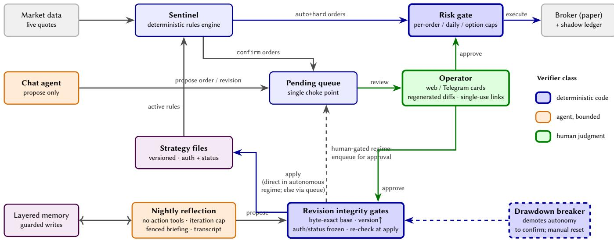
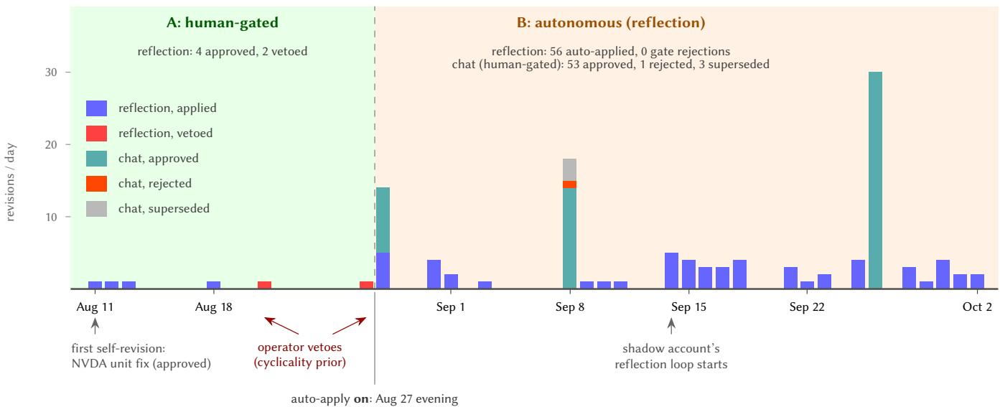

# AllPath: Layered Verification for a Deployed, Self-Revising LLM Trading Agent under Human-Gated and Autonomous Regimes<sup>∗</sup>

Tian Zhang   
0tianzhang0@gmail.com   
Independent Researcher   
USA

## Abstract

LLM trading agents are evaluated almost exclusively in backtests and autonomous benchmark harnesses. Deployment, where actions are irreversible, raises a diferent question: who verifies the agent’s actions, and which failures can each verifier structurally catch? We report on AllPath, a personal LLM trading agent deployed against a live paper-brokerage account. The system watches positions through a deterministic rules engine, and each night it reviews its own day and proposes revisions to its own trading strategies. Verification is split across three layers. Code verifies what must not depend on judgment: deterministic gates enforce risk limits and block any strategy revision that fails an integrity check. The agent verifies itself within fixed bounds: its nightly review has an iteration cap and no tools that can act. A human verifies judgment, through approval screens that show the current state of each proposal. We also compared two verification policies for the agent’s self-revisions on the live system: two and a half weeks with every self-revision human-gated, then five weeks with reflection revisions auto-applied behind the same code gates, while the operator’s chat channel stayed human-gated throughout. Each layer caught a diferent kind of failure. The code gates rejected no proposal; their role was keeping revisions consistent. The human rejected two proposals that passed every code check, both over a disagreement about the market, and later removed 11 of the 19 rules the agent had added on its own, at a median lag of eight days. The most instructive production incidents, such as strategies silently left unmonitored, passed every gate; the operator found them by hand, and the fix each time was an interface change that makes the condition visible. We contribute the layered architecture, the two-regime account, and a production incident taxonomy, none observable in a backtest.

## CCS Concepts

• Computing methodologies → Artificial intelligence.

## Keywords

LLM agents, human-in-the-loop, algorithmic trading, AI oversight, deployed systems

## 1 Introduction

LLM agents now trade competently in backtests and simulated markets [24, 25, 28, 30], and a recent wave of live-market benchmarks streams them real-time data [1, 5, 16, 27]. Nearly all of this work evaluates the agent as an unconstrained decision function: its output is the action, and when the run ends, nothing happened.

Meng Li limengunique0917@gmail.com Independent Researcher

USA

Production is less forgiving. In industrial e-commerce search, we found that an LLM which improves ranking quality ofline cannot serve trafic as it is: latency and stability require distilling it into smaller, more predictable models before deployment [15, 26]. Those constraints are about serving. A deployed trading agent inherits them and adds two of its own. A mis-issued order is an irreversible fill, not a degraded ranking. And an agent that revises its own trading rules can compound a bad judgment before anyone looks.

This paper studies that verification problem on a running system. AllPath<sup>1</sup> is a personal LLM trading agent that has run continuously since August 2026 against a live paper-brokerage account. It watches positions through a deterministic rules engine, converses with its operator, maintains a governed memory of stocks, strategies, and distilled lessons (§3), and each night reviews its own day and proposes revisions to its own strategies. No single verifier covers all of this. Whether an order exceeds a risk cap is arithmetic, and belongs in code. Whether a stop is too tight is judgment, and belongs to a person. The agent’s nightly self-review sits between the two: it is useful only if the agent cannot act on its own conclusions. §4 assigns every action in the system to one of these three verifiers.

We also used the deployment to compare two verification policies for the agent’s self-revisions. The system supports both as a configuration switch: a reflection-proposed revision can wait for human approval, or it can apply on its own once it passes the code gates. We ran the first policy for two and a half weeks, during which the operator approved four proposals and vetoed two. We then switched to the second for five weeks, with a drawdown circuit breaker as the backstop: 56 revisions applied and the gates rejected none. The operator’s chat channel kept its human gate under both policies, and through it the operator later removed 11 of the 19 rules the agent had added on its own.

The paper makes three contributions. The first is a layered verification architecture with production time on it: a decomposition of every action class in a self-revising trading agent by proposer, verifier, and gate mechanics (Table 1), with the design rules that make each layer load-bearing. The second is a two-regime account of self-revision: operational evidence from the human-gated and autonomous periods, including the two cases where the human vetoed proposals the gates found flawless (§5). The third is a production incident taxonomy: twenty incidents from the deployment and its construction, none observable in a backtest, each generalized to a design rule (§6).

Evaluation throughout is operational: proposal flows, gate activations, decision latencies, incidents. We know of no prior published account of a deployed LLM trading agent operated under both human-gated and autonomous verification; §2 gives the basis for that statement and §7 its limits.

## 2 Related Work

LLM trading agents. A fast-growing line of work equips LLM agents with memory, tools, and multi-agent structure for trading: layered memory and character design (TradingGPT, FinMem) [11, 28], multimodal tool-augmented agents (FinAgent) [30], debatestyle multi-agent frameworks (TradingAgents) [24], open agent platforms (FinRobot) [25], and simulated markets (StockAgent) [29]; two surveys map the field [3, 22]. This literature is backtest- or simulation-centric, and the agent’s output is the unconstrained final action. A newer wave of live-market benchmarks (StockBench, LiveTradeBench, Agent Market Arena, AI-Trader) [1, 5, 16, 27] streams real-time data but runs agents fully autonomously, several treating the absence of human intervention as a design goal rather than a variable to study. Our question sits elsewhere: how a deployed agent’s actions get verified.

Self-improvement without stakes. Reflexion, Self-Refine, and Voyager established that agents improve by criticizing and revising their own behavior [13, 17, 20], and self-evolving-agent surveys now catalogue the design space [6, 9]. In these settings a bad selfrevision costs a retry; recent work begins to ask what happens when it costs more [12]. Our reflection loop is a deliberately conservative member of this family: its sole lever on future behavior is a gated, auditable revision proposal whose authorization and lifecycle fields are frozen by code (§4.1).

Agent oversight and governance. Scalable-oversight proposals (debate, amplification) [2, 10] target verification of systems beyond direct human evaluation; a complementary risk analysis asks when stacked safety mechanisms actually fail together [4]. Closer to practice, runtime-enforcement DSLs (AgentSpec) [21], guard agents (GuardAgent) [23], autonomy-level taxonomies [8], and interfacemediated oversight (Magentic-UI; regulable-UI patterns) [7, 14] each propose one layer of the stack we deploy. To our knowledge none are combined in a single deployed system with consequential actions, and none report human-gated and autonomous operation on the same live agent.

Trading-system safety. Our deterministic layer inherits from pre-LLM market practice: exchange-level circuit breakers [18] and the SEC’s market-access rule mandating broker-side pre-trade risk controls [19]. The contribution is not these mechanisms but their placement in an agentic loop: caps the agent cannot negotiate with, a drawdown breaker that demotes autonomy rather than halting trading, and integrity gates on the agent’s self-modification channel, a surface pre-LLM risk controls never had to consider.

## 3 The AllPath System

AllPath is a personal LLM trading agent: a deterministic rules engine watches positions, a chat agent talks to the operator, a nightly reflection session reviews the day and proposes revisions, and a single approval queue sits between every proposal and its execution. It is a single-operator production system rather than a benchmark harness: it holds positions at live market prices, sends notifications the operator acts on, and its mistakes cost the operator time. Figure 1 shows the architecture. The verification mechanisms overlaid in the figure (detailed in §4) sit at every boundary where an action could become irreversible.

## 3.1 Strategies as versioned files

A strategy is a human-readable file with four parts: a thesis (why the position exists), rules (typed entry, exit, and stop conditions over prices and indicators), an authorization level, and a status. The file is the source oftruth. It is versioned on every change, snapshotted into an append-only history table, and rendered verbatim to both the human (web UI) and the agent (session context). Authorization is set per rule consequence: notify tells the human, confirm queues an order for approval, auto executes within risk caps, and hard marks a rule as mechanical with no agent discretion. Status controls monitoring: the sentinel watches only active strategies. Figure 2 shows the example file shipped with the repository.

## 3.2 Sentinel: the deterministic watcher

A scheduler daemon evaluates every active strategy’s rules against live quotes on a fixed interval during market hours (between 15 and 60 minutes over the data window). Rule evaluation is pure code, with no model in the loop. When a rule fires, the consequence follows its authorization: auto+hard rules execute directly through the risk gate, and confirm rules enqueue a pending order with a full snapshot (trigger price, rule text, intent) for human approval. One-shot rule state prevents re-triggering; a fired trigger must be re-armed by hand. The same daemon runs the nightly pipeline of portfolio digest, memory consolidation, and the reflection session (§3.4), each step restart-safe behind persisted date markers. Rules may also place long-only option orders through the same gate; by grammar these are available to auto+hard rules only, so the option surface is entirely autonomous.

## 3.3 Agent sessions: chat and review

The chat agent is the operator’s conversational interface over web or Telegram. It has read tools for market data, portfolio, journal, strategy files, and memory search, and a short list of action tools: propose an order (which enters the same pending queue as sentinel orders), propose a strategy revision, and guarded memory writes. It cannot place orders directly, cannot edit strategy files, and cannot approve anything, including its own proposals. The review agent renders pending items with regenerated context (§4.3) and records the human’s approve or reject decision; approvals can also arrive through single-use tokenized links in notifications (§4.1).

## 3.4 Reflection: bounded nightly self-revision

After the close, a separate reflection session reviews the day. It receives a code-generated briefing (fills at execution prices, rule-state changes, position moves, pending-queue state, full strategy texts, recent report summaries), investigates with read-only tools under an iteration cap, and writes a structured report. Its only lever on future behavior is propose\_strategy\_revision, which may change a strategy’s thesis and rules but never its authorization or status (§4.1). Under the human-gated regime, every such proposal waits in the queue like any other. Under the autonomous regime (§5),

AllPath: Layered Verification for a Deployed, Self-Revising LLM Trading Agent under Human-Gated and Autonomous Regimes

  
Figure 1: AllPath architecture. Every path from a proposal to an irreversible action crosses at least one verification layer; colors mark the verifier class (blue: deterministic code gates; orange: agent under enforced bounds; green: human judgment). Solid blue arrows are fully autonomous paths; green arrows pass through the operator. The dashed breaker demotes the autonomous revision path back to human confirmation on excessive drawdown.

reflection-sourced proposals apply immediately after passing the same mechanical gates, with a portfolio-drawdown circuit breaker as the regime-level backstop: if equity drawdown exceeds a configured threshold, auto-apply demotes to confirm and stays demoted until a human resets it.

## 3.5 Memory

The agent’s memory is a set of human-readable markdown files in four curated layers: an operator profile shared across accounts, per-strategy notes, per-stock notes, and distilled lessons. Each layer has a size budget of a few kilobytes, which forces consolidation over accumulation. The agent has exactly one write path: a guarded tool that makes entry-level edits, rejects injection-shaped content, and dif-logs every mutation to the ledger; the operator can read and edit the same files directly. An append-only observation log records day-to-day events beside the curated layers. Nightly consolidation distills it into them, and consolidation markers advance only past cleanly summarized days, so a crash re-consolidates rather than skips. At the data freeze the paper account held 141 lessons, 37 stock notes, and 36 strategy notes, all agent-written under these constraints. Appendix B shows a lesson entry and a reflection report excerpt.

## 3.6 Deployment shape

Production runs on a single consumer machine behind a private network with no public ports, under a process supervisor that restarts it on failure. The operator reaches it through a token-authenticated web UI (dashboard, strategies, pending reviews, reports with replayable reflection transcripts, journal) and a Telegram channel for notifications, chat, and approve links. The system runs two accounts through the same agent and the same pipeline. The paper account trades through the broker’s paper-trading API, where the agent may execute on its own. The shadow account is a local ledger mirroring the operator’s real holdings; it never routes an order, and an approved decision is recorded for the operator to place by hand.

Models. Every agent session in the data window ran a Claudefamily model through an API gateway: reflection and memory consolidation on Claude Opus 5, chat on Claude Sonnet 5, and the sentinel’s analysis tier on Claude Haiku 4.5. Model names are configuration, not code; nothing in the verification stack depends on which model proposes.

Artifacts. The system is open source.<sup>2</sup> After each trading day’s close, the nightly pipeline publishes the paper account’s digest, trades, and reflection write-up to a public journal page,<sup>3</sup> which has run continuously since Aug 31, 2026 and covers most of the data window reported in §6. The counts in this paper come from the system’s internal ledger, which also holds the operator’s strategy files and is not public; the journal is the day-level record a reader can check against them.

## 4 The Verification Stack

The system’s design premise is that no single verifier is suficient for an agent whose actions are irreversible. We decompose verification by what kind of failure each verifier is structurally able to catch, and give every action class an explicit row in that decomposition (Table 1). Three verifier classes emerge.

## 4.1 Code verifies what must never depend on judgment

Deterministic gates are the only verifiers that cannot be persuaded.   
We place them wherever a failure is unambiguous and mechanical.

```yaml
id: example
name: NVDA long-term hold - AI infrastructure play
status: draft
version: 2
authorization: confirm
thesis: 'Bullish on NVDA''s leadership in AI chips
and data center hardware. 18-24 month horizon.
[...] Invalidation: AI chip demand deterioration,
significant market share loss to competitors, or
datacenter revenue growth <15% for two
consecutive quarters.
position:
ticker: NVDA
target_weight: '0.2'
max_weight: '0.25'
rules:
- id: initial-entry
type: soft
condition: position_weight == 0 and price < 205
action: buy $8000
state: armed
- id: stop-loss
type: hard
condition: price < 170
action: sell all
state: armed
- id: take-profit-1
type: soft
condition: pnl_pct > 40
action: sell 30%
state: armed
[...]
```  
Figure 2: A strategy file (the example shipped with the repository, abbreviated). Thesis and rules are what a revision may change; authorization and status are frozen against selfrevision (§4.1).

• Risk gate. Every order passes a deterministic gate, whether it was proposed by the user in chat, fired by a sentinel rule, or (for options) selected autonomously. The gate enforces per-order value caps, daily trade-count caps, and, for option buys, a premium cap plus a cap on total option exposure relative to equity. The gate is code; the agent cannot nego tiate with it. Closing an option position is never blocked by value caps: a close reduces risk, and a gate that can trap the operator in a position is itself a hazard.

• Revision integrity gates. A strategy revision is the agent’s only path to changing its own trading rules, and it is applied only if three checks pass. (i) The current file is byte-identical to the base the proposal was computed from; any inter vening change, however small, voids the proposal instead of being silently overwritten. (ii) The proposed version strictly increases, which keeps the audit trail’s ordering truthful. (iii) The proposal changes only thesis and rules. Authorization (who may act) and status (whether the strategy is live) are frozen: a self-revision can tighten a stop, but it can never promote itself to autonomous trading or silently de-activate monitoring. A proposal failing any check returns to the pending queue. The failure mode is “nothing happened,” never “something subtly diferent happened.”

• Displacement of stale drafts. If a newer chat-sourced revision arrives for a strategy whose older chat draft is still pending, the old row is relabeled superseded, its resolution is timestamped, and its approval token is invalidated. A stale approve-link in a notification can no longer apply an outdated draft, and the audit trail records the displacement.

• Idempotency and at-most-once semantics. The nightly pipeline is restart-safe by persisted markers: a report date can be produced only once, and memory-consolidation markers advance only past clean summaries. Inbound chat messages from the remote channel advance their ofset before processing, so a crash mid-turn loses one visible message and never replays an invisible duplicate that could re-propose an order.

• Single-use approval credentials. Approve-by-link tokens are per-review, stored only as hashes, expire in 24 h, and are consumed on first use, including on failed execution. A leaked notification exposes at most one already-visible decision, never a session.

## 4.2 The agent verifies itself, only inside enforced bounds

The nightly reflection session reviews the day with the agent’s full read toolset and writes a structured report. Its value as selfverification comes from the bounds.

• No action tools. The reflection registry contains market, portfolio, and journal readers, guarded memory writes, and propose\_strategy\_revision. It has no order placement, no approval, and no file writes. Tests pin the exclusion by difing the reflection toolset against the action registry.

• Bounded search. A session gets at most � tool iterations (default 12), including the one corrective turn allowed when the report fails to parse. An earlier draft silently doubled the budget on the corrective turn, which review caught; the cap is now a property of the session and no longer of the turn.

• Fenced deterministic briefing. The session opens with a code-generated briefing (fills with real execution prices, rule state changes, position day-moves, pending-queue state, full strategy texts). Every block is wrapped in externalcontent fences so tool-returned text cannot be mistaken for instructions. The agent starts from verified facts and spends its budget on investigation.

• Auditable transcript. Each session is a separate conversation whose every tool call is replayable from the Reports page. Self-verification that cannot be audited is indistinguishable from confabulation. The transcript lets the human spot-check the agent’s diligence, and it is the basis for the session accounting in §6.

## 4.3 The human verifies judgment, if the interface tells the truth

The human is the only verifier of judgment calls: is this stop too tight, is this thesis still believed. The system’s obligation is to make that verification real, and several of our incidents (§6) were failures of exactly this obligation.

• Regenerated, not stored, difs. A pending revision’s dif is recomputed against the current file at render time, with an explicit stale-base warning when the file has moved. The human sees what approval means now, and not what the agent saw when it proposed. Resolved revisions render their frozen historical dif, labeled as such.

• Decision-grade context on approval cards. Table 5 in Appendix B lists every field of a card. Each card shows the trigger-time price, the live price with day-direction coloring, the deviation since trigger, estimated shares for notional orders, and a market-state line (“market closed: fills at next open”). These are the facts a human needs to catch a no-longer-sensible order at a glance.

• Accurate labels. Submission time and fill time are distinct columns with distinct labels everywhere (journal, dash boards, the agent’s own system prompt, long-term memory events), after an incident in which a submission timestamp presented as a fill time cost the operator a 17-hour misunderstanding. “Fill pending” is claimed only within the polling window; beyond it the system says “status unconfirmed.”

• Silence made visible. Strategies whose status excludes them from monitoring wear a persistent “not monitored” badge on every surface. The badge followed the deployment’s most instructive incident: all four live strategies sat in draft for days with stop-losses never armed, while every page rendered them normally. The sentinel heartbeat line (“last tick �m ago” or “monitoring paused: market closed”) now states whether anyone is watching, where before the answer was left to omission.

## 4.4 Verifying the builder

The stack above was itself constructed under adversarial review. Every change shipped through an independent reviewer instructed to execute attack scenarios. Before merge, that review caught one silent-revert Critical (a stale sibling proposal whose approval would have rolled back an already-applied stop tightening) and a series of Importants (an authorization-flip hole, a path-traversal in the revision applier, resurrection of deleted strategies). We include this as evidence for a scoping claim: several holes were only findable by executing the failure, and none would have surfaced in a backtest harness.

## 5 Self-Revision Under Two Regimes

We ran the self-revision channel under two verification regimes on the same live deployment, by design: two and a half weeks with a human gate on every self-proposed change, then five weeks with the mechanical gates standing alone. This section describes the loop and what each regime looked like in operation. §6 reports the numbers.

## 5.1 The revision loop

A revision proposal, from the nightly reflection session or from the operator’s chat agent, is validated at propose time: it must parse, target an existing strategy, strictly increase the version, and leave authorization and status untouched. It then enters the pending queue with a snapshot of the base file it was computed from. At apply time the integrity gates run again, now against the live file: byte-exact staleness, version monotonicity, field freeze (§4.1). The two regimes difer only in who pulls the trigger between those two checkpoints.

## 5.2 Regime A: human-gated (Aug 11–27)

Every proposal waited for the operator. Six reflection-sourced proposals arrived in this window. Four were approved and two rejected, and the mechanical gates raised no objection to either rejected proposal. Both shared a shape: after an upward price move had left pullback-only entry ladders unreachable, the agent proposed adding a near-market buy tranche (in one case also raising positionweight caps), with a written rationale framing the add as a support retest and not momentum chasing. The operator declined both for a reason that appears nowhere in the proposals: a prior belief that semiconductors are cyclical, that the ongoing rally was a swing within a cycle and not a durable re-rating, and that the correct response to an unreachable ladder was to wait for the cycle to revisit it. <sup>4</sup> The disagreement locates the human gate’s distinct contribution. The agent’s argument was internally coherent and mechanically compliant, and the veto came from a world-model the agent did not hold. No gate below the human layer is structured to adjudicate between two self-consistent theses.

The window’s signature case is the deployment’s first self-revision. The reflection session, auditing a newly transcribed NVDA strategy, found that its scale-in ladder expressed position-weight caps in percent (position\_weight < 12) while the strategy’s target weight was a decimal (0.2). The caps were vacuously true and the ladder’s risk limit silently void. The proposed fix normalized the units (< 0.16, < 0.2) and documented the convention in the thesis. It also removed the momentum-add rule, reasoning from that day’s fill: a breakout add had lifted average cost 2.4% while leaving the pullback ladder unreachable. The operator approved it as proposed. This is the loop working as designed: a consequential bug, of a kind a backtest cannot see because the file had never been executed against, found by bounded self-review and fixed through a human gate.

## 5.3 Regime B: autonomous (Aug 27 evening–Oct 2)

One configuration flag scoped the change. From the evening of Aug 27, reflection-sourced proposals that pass the mechanical gates apply immediately, with no human in the loop. The operator’s chat channel kept its human gate throughout, so the two verification paths ran side by side on the same accounts under the same market. From Sep 14 the shadow account ran its own nightly reflection under the same flag.

Table 1: Every action class in the system, decomposed by proposer, verifier, and gate mechanics.
<table><tr><td>Action</td><td>Proposed by</td><td>Verified by</td><td>Gate mechanics</td></tr><tr><td>Stock order (confirm auth)</td><td>Sentinel rule or chat agent Code, then human</td><td></td><td>Risk-gate caps → pending queue → human approve (web/link), single-use token</td></tr><tr><td>Stock order (auto auth, hard Sentinel rule rule)</td><td></td><td>Code only</td><td>Risk-gate caps; one-shot rule state; drawdown breaker as regime backstop</td></tr><tr><td>Option order (buy)</td><td>Sentinel rule (auto+hard Code only only, by grammar)</td><td></td><td>Premium + exposure caps; expiry safety sweep; breaker</td></tr><tr><td>Option close</td><td>Sentinel rule / expiry Code only sweep</td><td></td><td>Never value-blocked (risk-reducing); daily count only</td></tr><tr><td>Strategy revision (human-gated Reflection or chat agent regime)</td><td></td><td>Code, then human</td><td>Parse + id/version/freeze checks at propose; byte-exact staleness + re-checks at apply; superseded displacement of stale chat drafts; human reads regenerated diff</td></tr><tr><td>Strategy revision (autonomous Reflection regime)</td><td></td><td>Code only</td><td>Same mechanical gates, auto-apply; scoped to reflection-sourced rows; breaker backstop</td></tr><tr><td>Strategy lifecycle (activate/pause) Human only</td><td></td><td>Human, with code guardrails</td><td>Two-step confirm; atomic write + version snapshot; burned- trigger re-arm warning</td></tr><tr><td>Memory write</td><td>Any agent session</td><td>Code guard)</td><td>(injection Guarded tool path; fenced external content; layered files</td></tr><tr><td>Notification / report</td><td>System</td><td>Code</td><td>Never-raise contract; per-channel isolation; failure never blocks the pipeline</td></tr><tr><td>Trading parameters (caps, mod- Human only els, keys)</td><td></td><td>Human</td><td>Settings page / env file only; never agent-writable; paper-vs-real flag not web-editable</td></tr></table>

  
Figure 3: Every strategy revision in the data window (Aug 11 to Oct 2, both accounts), by day, source, and outcome. Regime B auto-applies reflection-sourced proposals only; the chat channel stays human-gated throughout, which gives a within-regime contrast.

In this regime the reflection channel auto-applied 56 revisions, 32 on the paper account and 24 on the shadow account, each within about two minutes of being proposed. The integrity gates rejected none. The human-gated chat channel processed 57 proposals over the same weeks: 53 approved, 1 rejected, and 3 displaced as superseded. The displacement gate fired on Sep 8, when three stale chat drafts were relabeled instead of silently replaced (§4.1).

## 5.4 The regime-level backstop

Autonomy was conditioned on a drawdown circuit breaker. If account equity falls more than a configured fraction from its tracked peak, auto-apply demotes to confirm: the queue and gates keep operating, but a human is back in the loop. The tripped state persists until a human resets it, and there is no automatic re-arm. The breaker stayed armed for the whole regime and never tripped, so the backstop is part of the design but untested by events.

## 5.5 Reading the comparison

The regimes are sequential and the market moved between them. Two contrasts are available: regime A against regime B on the reflection channel, and, inside regime B, the autonomous reflection channel against the human-gated chat channel. §6 quantifies both, and §7 states what they cannot show.

## 6 Operational Evidence

## 6.1 The revision pipeline, quantified

Figure 3 shows every strategy revision in the data window by day, source, and outcome. Through Oct 2 the system processed 119 revision proposals: regime A’s six reflection proposals (4 approved, 2 vetoed), then regime B’s 56 auto-applied reflection revisions along side 57 human-gated chat proposals (53 approved, 1 rejected, 3 displaced as superseded).

Two operational facts frame the regime comparison. First, human verification has latency. The six regime A decisions took a median of 8.8 hours from proposal to resolution, with a range of 11 minutes to 80.7 hours; the maximum spanned a weekend. A nightly self-revision loop gated by a human is in practice a next-morning loop, which is acceptable for thesis-level edits and was part of the motivation for testing the autonomous regime. In regime B the same class of proposal applied within about two minutes. Second, every veto in the window came from a human: two on reflection proposals in regime A and one on a chat proposal in regime B. The mechanical gates rejected nothing that reached them. Their observed contribution was integrity, in displacing three stale drafts and holding authorization frozen, and not filtering. The layers caught disjoint failure classes, which is the design premise.

The order channel is thinner. Twelve stock orders passed through the approval queue, five in Aug 10–18 and seven in Sep 14–28; the operator approved eleven and rejected one. All other order flow came from auto+hard rules and met only the code layer. The regime comparison in this paper therefore rests on the revision channel.

## 6.2 What the autonomous revisions changed, and what the human later undid

The 56 auto-applied revisions touched 20 strategies. Every one rewrote the strategy’s thesis; 49 also edited existing rules (67 condition edits, 19 action edits, 12 state changes), 16 added rules (19 in total), and 6 removed rules (11 in total). Among edits to sellside price thresholds the direction was mixed: four moved a stop closer to the market and five moved one further away. So the autonomous channel was not a one-way ratchet in either direction; it re-anchored levels as prices moved.

The more telling number is what happened afterwards. Of the 19 rules the agent added on its own authority, 11 were later removed by the operator through the human-gated chat channel, at a median lag of 8 days (range 1 to 17). The largest single case: on Aug 31 the reflection session added a salvage-options exit rule to four strategies at once; on Sep 8 the operator removed it from all four. One further agent-added rule pair was removed by a later reflection session itself. No modified condition was ever reverted to its previous value.

We read this as oversight moving in time rather than disappearing. With the gate on the reflection channel removed, the human did not stop reviewing the agent’s rule changes; the review happened after the fact, roughly a week later, through a diferent channel. The integrity gates could not have intervened, since every one of these rules was well formed. A removal is not proof the rule was wrong (the operator may restructure a strategy for other reasons), so we report the counts and the lag and not a verdict.

## 6.3 Cases

Table 2 grounds the abstractions in the deployment’s actual decisions: for each representative case, who proposed, who verified, and what happened.

## 6.4 Incident taxonomy

We catalogued 20 defects and incidents from the deployment period and its construction. Six surfaced in production operation; thirteen were caught pre-merge by the adversarial review under which the system was built (§4.4); one, the authorization freeze, is a design decision recorded alongside them because it closed a hole the review had named. Table 3 lists the most instructive, each generalized to a design rule. None of the production six would appear in a backtest: they live in the gap between “the logic is right” and “the deployed system, its broker, its dependencies, and its operator interfaces are telling each other the truth.”

Three deserve a sentence ofnarrative. In the draft-never-monitored trap, all four live strategies sat in draft status for days with stoplosses unarmed while every page rendered them normally. It is the incident that motivated the interface rules of §4.3. The submitted-vsfilled drift cost the operator a 17-hour misunderstanding: a Monday-16:27 order submission displayed as if it were a fill; the position actually filled Tuesday 09:34. And the id-less success payload: during the autonomous window, a broker response with HTTP 200 but no order id was journaled as “submitted,” burning five one-shot rules against trades that never existed. The operator caught it by reading the journal; no gate did. The fix treats a payload without an order id as a hard error.

## 6.5 Reflection reliability and accounting

All 52 nightly reflection sessions in the window, 37 on the paper account and 15 on the shadow account, completed and produced a parseable report. Stored transcripts run 23 to 44 messages per session (median 35) and are replayable from the Reports page. One accounting gap remains: per-session token metering was instrumented for the chat and memory tiers but not for reflection, so we report session sizes and outcomes instead of dollar costs.

## 7 Limitations

One system, one operator, who is also an author. This is a single-case study, and the human verifier whose judgment we analyze is the paper’s first author. The rejection rationale in §5 is self-reported (contemporaneously ledgered decisions, retrospectively explained). Every count, dif, and timestamp comes from the system’s append-only ledger, but selection and interpretation are ours.

Table 2: Representative cases from the deployment window: every consequential action, by proposer, verifier, and outcome. ✓ = approved/executed.
<table><tr><td>When</td><td>Action</td><td>Proposer</td><td>Verifier</td><td>Outcome</td></tr><tr><td>Aug 10-Sep 28</td><td>12 stock orders under confirm authoriza- Sentinel / chat tion</td><td></td><td>Code → human</td><td>11 √ executed or recorded via the risk gate; 1 rejected</td></tr><tr><td>Aug 11</td><td>NVDA revision v1→v2: unit-inconsistency fix (&lt;12 vs. 0.2), momentum-add rule re-</td><td>Reflection</td><td>Code → human</td><td>√applied; inert position-weight caps made effective</td></tr><tr><td>Aug 21, 27</td><td>moved Near-market add tranches after run-ups (TSM $440 step; NVDA gap-retest &lt;$215 with cap raises)</td><td>Reflection</td><td>Code → human</td><td>Vetoed on the operator&#x27;s cyclicality prior; mechanically valid</td></tr><tr><td>Aug 28-Oct 2</td><td>56 strategy revisions across both accounts</td><td>Reflection</td><td>Code only</td><td>All auto-applied within about two minutes; 0 integrity-gate rejections</td></tr><tr><td>Aug 28-Oct 2</td><td>57 strategy revisions</td><td>Chat</td><td>tonomous) Code → human</td><td>53 √; 1 rejected; 3 superseded</td></tr><tr><td>Sep 8</td><td>3 stale chat drafts displaced by newer pro- posals</td><td>Chat</td><td>Code (displacement)</td><td>Relabeled superseded; approval tokens in- validated</td></tr><tr><td>Window-wide</td><td>Stock stop-loss exits under auto+hard Sentinel rules</td><td></td><td>Code only</td><td>Executed at market; one-shot state pre- vented re-fires</td></tr><tr><td>Regime B</td><td>Option close rules and expiry sweep duringSentinel a 2.5 h environment outage (§6.4)</td><td></td><td>Code only</td><td>18 logged error attempts, then closes suc- ceeded; stock leg had exited 2.5 h earlier</td></tr></table>

Table 3: Incident taxonomy (selection from 20 catalogued). “Adversarial review” = caught pre-merge during construction (§4.4); “production” = surfaced live during the deployment window.
<table><tr><td>Incident</td><td>Caught by</td><td>Design rule derived</td></tr><tr><td>Draft strategies silently excluded from monitoring; no Operator, production surface said so</td><td></td><td>Any state that disables monitoring wears a persistent badge on every surface</td></tr><tr><td>Submission timestamp presented as fill time (17 h mis- Operator, production read)</td><td></td><td>Submitted and filled are distinct events with distinct labels, ev- erywhere</td></tr><tr><td>ted”; 5 one-shot rules burned</td><td>tonomous window)</td><td>Id-less HTTP-200 broker payload journaled as “submit- Operator, production (au- Validate response content, not shape, before recording success</td></tr><tr><td>retry storm while the stock leg had already exited</td><td>tion</td><td>External CLI dependency vanished; 2.5 h option-close Code (contained), produc- Preflight external dependencies; alert distinctly from routine or- der errors</td></tr><tr><td>Quote feed returned non-finite previous_close</td><td>Code gate, production</td><td>Strict ingestion validation; loud isolated failure beats silent NaN</td></tr><tr><td>Unparseable sentinel analysis</td><td>Code default, production</td><td>comparison Fail closed to human review; never default-execute on un-</td></tr><tr><td>Stale sibling proposal would silently revert an applied Adversarial review</td><td></td><td>parseable agent output Byte-exact re-check of live state at approval time, not at proposal</td></tr><tr><td>stop-tightening TOCTOU race allowing double execution on order claim Adversarial review</td><td></td><td>time Atomic claim at every irreversible-action gate</td></tr><tr><td>Corrective turn silently doubled the reflection iteration Adversarial review budget</td><td></td><td>A cap is a session property with a single enforcement point cov-</td></tr><tr><td>NUL byte in a chat message caused a persistent 500</td><td>Adversarial review</td><td>ering retries Sanitize model output and user input against internal escaping schemes</td></tr></table>

Paper trading. Fills are real-market but capital is not at risk; the operator’s stakes are attention and pride, not money. A human gate under financial stress may behave diferently in both directions (more vigilant, or more anxious and overriding). The code gates are indiferent to this distinction; the human-layer findings should be read as a lower bound on the phenomenon, not a measurement of it. We do not report the account’s return. No claim in this paper depends on its sign, and a 7.5-week window on medium-horizon strategies could not statistically support a performance claim in either direction. This is why the evaluation is operational.

A natural experiment, not an experiment. The regimes are sequential; August’s rally and September’s tape difer; proposal mix shifted with the market. The within-B contrast between the chat and reflection channels shares one market, which bounds the confound for that comparison only; the A-versus-B comparison carries it in full. We accordingly make existence claims (“the human gate vetoed proposals no mechanical gate could,” “these incidents occurred and were caught here”) and report descriptive statistics; we do not claim one regime is measurably safer.

Scale and scope. A 7.5-week window, 119 revisions, one broker, one model family, one asset mix (US equities plus long-only options).

The breaker never tripped, so the regime-level backstop is untested by events. Only twelve orders passed through the human queue (§6), so the regime comparison rests on the revision channel.

What we believe generalizes is the shape, not the thresholds: the decomposition of verification by failure class (Table 1), the freeze on self-expanding autonomy, accurate interfaces as a verification requirement, and the incident classes of Table 3. Each is a property of deployed LLM agents with irreversible actions, and none is specific to this codebase.

## 8 Conclusion

We asked who verifies a trading agent, and answered with a deployed system’s decomposition. Code verifies what must never depend on judgment. The agent verifies itself only inside enforced bounds. The human verifies judgment, through interfaces that must show the true state of the system. Running the same live agent human-gated and then autonomous showed the layers catching disjoint failures: the code gates kept revisions consistent and rejected nothing, and the human twice vetoed a proposal over a view of the market. The production incidents that taught us the most passed every gate and were found by the operator by hand; each fix was an interface that makes the condition visible. For agents whose actions are irreversible, verification is not a layer you add but a decomposition you design, and the human’s place in it is judgment, which nothing below can absorb.

## References

[1] Yanxu Chen, Zijun Yao, Yantao Liu, Amy Xin, Jin Ye, Jianing Yu, Lei Hou, and Juanzi Li. 2025. StockBench: Can LLM Agents Trade Stocks Profitably In Real world Markets? arXiv preprint arXiv:2510.02209 (2025).

[2] Paul Christiano, Buck Shlegeris, and Dario Amodei. 2018. Supervising Strong Learners by Amplifying Weak Experts. arXiv preprint arXiv:1810.08575 (2018)

[3] Han Ding, Yinheng Li, Junhao Wang, Hang Chen, Doudou Guo, and Yunbai Zhang. 2024. Large Language Model Agent in Financial Trading: A Survey. arXiv preprint arXiv:2408.06361 (2024).

[4] Leonard Dung and Florian Mai. 2025. AI Alignment Strategies from a Risk Perspective: Independent Safety Mechanisms or Shared Failures? arXiv preprint arXiv:2510.11235 (2025).

[5] Tianyu Fan, Yuhao Yang, Yangqin Jiang, Yifei Zhang, Yuxuan Chen, and Chao Huang. 2025. AI-Trader: Benchmarking Autonomous Agents in Real-Time Fi nancial Markets. arXiv preprint arXiv:2512.10971 (2025).

[6] Jinyuan Fang, Yanwen Peng, Xi Zhang, Yingxu Wang, Xinhao Yi, Guibin Zhang, Yi Xu, Bin Wu, Siwei Liu, Zihao Li, Zhaochun Ren, Nikos Aletras, Xi Wang, Han Zhou, and Zaiqiao Meng. 2025. A Comprehensive Survey of Self-Evolving AI Agents: A New Paradigm Bridging Foundation Models and Lifelong Agentic Systems. arXiv preprint arXiv:2508.07407 (2025).

[7] K. J. Kevin Feng, Tae Soo Kim, Rock Yuren Pang, Faria Huq, Tal August, and Amy X. Zhang. 2025. On the Regulatory Potential of User Interfaces for AI Agent Governance. arXiv preprint arXiv:2512.00742 (2025). RegML Workshop at NeurIPS 2025 (oral).

[8] K. J. Kevin Feng, David W. McDonald, and Amy X. Zhang. 2025. Levels of Autonomy for AI Agents. arXiv preprint arXiv:2506.12469 (2025).

[9] Huan-ang Gao, Jiayi Geng, Wenyue Hua, Mengkang Hu, Xinzhe Juan, Hongzhang Liu, Shilong Liu,Jiahao Qiu, Xuan Qi, Yiran Wu, Hongru Wang, Han Xiao, Yuhang Zhou, Shaokun Zhang, Jiayi Zhang, Jinyu Xiang, Yixiong Fang, Qiwen Zhao, Dongrui Liu, Qihan Ren, Cheng Qian, Zhenhailong Wang, Minda Hu, Huazheng Wang, Qingyun Wu, Heng Ji, and Mengdi Wang. 2025. A Survey of Self-Evolving Agents: What, When, How, and Where to Evolve on the Path to Artificial Super Intelligence. arXiv preprint arXiv:2507.21046 (2025).

[10] Geofrey Irving, Paul Christiano, and Dario Amodei. 2018. AI Safety via Debate. arXiv preprint arXiv:1805.00899 (2018).

[11] Yang Li, Yangyang Yu, Haohang Li, Zhi Chen, and Khaldoun Khashanah. 2023. TradingGPT: Multi-Agent System with Layered Memory and Distinct Characters for Enhanced Financial Trading Performance. arXiv preprint arXiv:2309.03736 (2023).

[12] Ruixiao Lin, Xinhao Deng, Qingming Li, Jianan Ma, Yunhao Feng, Yuqi Qing, Zhenyuan Li, Yechao Zhang, Shiwen Cui, Changhua Meng, Tianwei Zhang,

Xingjun Ma, Qi Li, Ke Xu, and Shouling Ji. 2026. Safety in Self-Evolving LLM Agent Systems: Threats, Amplification, and Case Studies. arXiv preprint arXiv:2606.23075 (2026).

[13] Aman Madaan, Niket Tandon, Prakhar Gupta, Skyler Hallinan, Luyu Gao, Sarah Wiegrefe, Uri Alon, Nouha Dziri, Shrimai Prabhumoye, Yiming Yang, Shashank Gupta, Bodhisattwa Prasad Majumder, Katherine Hermann, Sean Welleck, Amir Yazdanbakhsh, and Peter Clark. 2023. Self-Refine: Iterative Refinement with Self-Feedback. arXiv preprint arXiv:2303.17651 (2023).

[14] Hussein Mozannar, Gagan Bansal, Cheng Tan, Adam Fourney, Victor Dibia, Jingya Chen, Jack Gerrits, Tyler Payne, Matheus Kunzler Maldaner, Madeleine Grunde-McLaughlin, Eric Zhu, Grifin Bassman, Jacob Alber, Peter Chang, Ricky Loynd, Friederike Niedtner, Ece Kamar, Maya Murad, Rafah Hosn, and Saleema Amershi. 2025. Magentic-UI: Towards Human-in-the-loop Agentic Systems. Tech nical Report. Microsoft Research. arXiv:2507.22358.

[15] Ajit Puthenputhussery, Changsung Kang, Alessandro Magnani, Tian Zhang, Hongwei Shang, Nitin Yadav, Prijith Chandran, Bhavin Madhani, Yuan-Tai Fu, He Wang, Zbigniew Gasiorek, Salvatore Tornatore, Srikanth Dasaka, Vivek Agrawal, Michael Bowersox, Cun Mu, and Ciya Liao. 2025. Large Scale Deployment of BERT Based Cross Encoder Model for Re-Ranking in Walmart Search Engine. In Proceedings of the 48th International ACM SIGIR Conference on Research and Development in Information Retrieval. 4365–4369. https: //doi.org/10.1145/3726302.3731965

[16] Lingfei Qian, Xueqing Peng, Yan Wang, Vincent Jim Zhang, Huan He, Hanley Smith, Yi Han, Yueru He, Haohang Li, Yupeng Cao, Yangyang Yu, Alejandro Lopez-Lira, Peng Lu, Jian-Yun Nie, Guojun Xiong, Jimin Huang, and Sophia Ananiadou. 2025. When Agents Trade: Live Multi-Market Trading Benchmark for LLM Agents. arXiv preprint arXiv:2510.11695 (2025).

[17] Noah Shinn, Federico Cassano, Edward Berman, Ashwin Gopinath, Karthik Narasimhan, and Shunyu Yao. 2023. Reflexion: Language Agents with Verbal Reinforcement Learning. In Advances in Neural Information Processing Systems (NeurIPS). arXiv:2303.11366.

[18] Avanidhar Subrahmanyam. 1994. Circuit Breakers and Market Volatility: A Theoretical Perspective. Journal ofFinance 49, 1 (1994), 237–254

[19] U.S. Securities and Exchange Commission. 2010. Rule 15c3-5: Risk Management Controls for Brokers or Dealers with Market Access. 17 CFR 240.15c3-5.

[20] Guanzhi Wang, Yuqi Xie, Yunfan Jiang, Ajay Mandlekar, Chaowei Xiao, Yuke Zhu, Linxi Fan, and Anima Anandkumar. 2023. Voyager: An Open-Ended Embodied Agent with Large Language Models. arXiv preprint arXiv:2305.16291 (2023).

[21] Haoyu Wang, Christopher M. Poskitt, and Jun Sun. 2025. AgentSpec: Customizable Runtime Enforcement for Safe and Reliable LLM Agents. arXiv preprint arXiv:2503.18666 (2025).

[22] Yihan Xia, Panpan You, Taotao Wang, Fang Liu, Han Qi, Xiaoxiao Wu, and Shengli Zhang. 2026. Agentic Trading: When LLM Agents Meet Financial Markets. arXiv preprint arXiv:2605.19337 (2026).

[23] Zhen Xiang, Linzhi Zheng, Yanjie Li, Junyuan Hong, Qinbin Li, Han Xie, Jiawei Zhang, Zidi Xiong, Chulin Xie, Carl Yang, Dawn Song, and Bo Li. 2024. GuardAgent: Safeguard LLM Agents by a Guard Agent via Knowledge-Enabled Reasoning. arXiv preprint arXiv:2406.09187 (2024).

[24] Yijia Xiao, Edward Sun, Di Luo, and Wei Wang. 2024. TradingAgents: Multi-Agents LLM Financial Trading Framework. arXiv preprint arXiv:2412.20138 (2024).

[25] Hongyang Yang, Boyu Zhang, Neng Wang, Cheng Guo, Xiaoli Zhang, Likun Lin, Junlin Wang, Tianyu Zhou, Mao Guan, Runjia Zhang, and Christina Dan Wang. 2024. FinRobot: An Open-Source AI Agent Platform for Financial Applications using Large Language Models. arXiv preprint arXiv:2405.14767 (2024).

[26] Haofei Yu, Fenghai Li, and Jiaxuan You. 2025. Knowledge Distillation for Enhancing Walmart E-commerce Search Relevance Using Large Language Models. In Companion Proceedings ofthe ACM Web Conference 2025 (WWWCompanion). 449–457. arXiv:2505.07105.

[27] Haofei Yu, Fenghai Li, and Jiaxuan You. 2025. LiveTradeBench: Seeking Real-World Alpha with Large Language Models. arXiv preprint arXiv:2511.03628 (2025).

[28] Yangyang Yu, Haohang Li, Zhi Chen, Yuechen Jiang, Yang Li, Denghui Zhang, Rong Liu, Jordan W. Suchow, and Khaldoun Khashanah. 2023. FinMem: A Performance-Enhanced LLM Trading Agent with Layered Memory and Character Design. arXiv preprint arXiv:2311.13743 (2023).

[29] Chong Zhang, Xinyi Liu, Zhongmou Zhang, Mingyu Jin, Lingyao Li, Zhenting Wang, Wenyue Hua, Dong Shu, Suiyuan Zhu, Xiaobo Jin, Sujian Li, Mengnan Du, and Yongfeng Zhang. 2024. When AI Meets Finance (StockAgent): Large Language Model-based Stock Trading in Simulated Real-world Environments. arXiv preprint arXiv:2407.18957 (2024).

[30] Wentao Zhang, Lingxuan Zhao, Haochong Xia, Shuo Sun, Jiaze Sun, Molei Qin, Xinyi Li, Yuqing Zhao, Yilei Zhao, Xinyu Cai, Longtao Zheng, Xinrun Wang, and Bo An. 2024. A Multimodal Foundation Agent for Financial Trading: Tool-Augmented, Diversified, and Generalist. In Proceedings ofthe 30th ACM SIGKDD Conference on Knowledge Discovery and Data Mining (KDD). arXiv:2402.18485.

## A Full Incident Catalogue

Table 4 lists all twenty catalogued incidents and defects, of which Table 3 in the main text shows ten. “Adversarial review” means caught before merge by the independent reviewer described in §4.4; “operator” or “code” followed by “production” means the incident surfaced during live operation.

## B Artifacts from the Deployment

An approval card, field byfield. Table 5 lists what the pending review page renders for the two kinds of card, with the values from the repository’s demo data.

A lesson entry. One entry from the paper account’s lessons memory layer, written by the agent after a sequence of fills landed on the wrong side of their triggers (verbatim):

Confirm-mode approval lag (\~20–120 min) on high-ATR names lands fills on the wrong side ofthe trigger (MU 9/21 TP @ \$1,038 vs >1050; 10/7 dip-buy @ \$1,034 vs <1030). Read triggers as \~±1% zones (\~0.3 ATR), and don’t treat fills inside that zone as a rule flaw.

The entry records the same human-latency efect quantified in §6, observed by the agent from its own fills.

A reflection report excerpt. The opening of the paper account’s nightly report for 2026-10-08 (verbatim, truncated):

Day summary (2026-10-08, paper): No rules fired and nothing is pending. Chip stocks fell together. News reports blamed higher bond yields and oil prices, plus Samsung’s Q3 operating profit, which jumped but still came in under very high expectations. MU fell −4.79% to close at \$1,035.84, AMD −3.90% to \$620.68, TSM −3.00% and NVDA −2.94%. [. . . ] Every position still shows an open gain. Caveat: the position values the portfolio tool reported look the same as the session-start snapshot. They may not include today’s close yet, so treat the equity figure as approximate.

Per-strategy check:

• mu-oversold-swing: Today wiped out most of10/7’s rebound. The 10.09 shares bought at \$1,032.67 average are now about breakeven, at \~10% weight against a 10% target. No rule is close to firing: dip-buy-1 is blocked by its weight cap; dip-buy-2 (<\$970) is 6.4% below; the stop (<\$900) is 13% below. [. . . ]

The report then checks each remaining strategy against the day’s prices and triggers, and closes with memory updates and, when warranted, a revision proposal. Every report in the window is published on the public journal page.

Table 4: All twenty catalogued incidents, in the order they were recorded.
<table><tr><td>Incident</td><td>Caught by</td><td>Design rule derived</td></tr><tr><td>Degenerate action amount crashes strategy loading</td><td>Adversarial review</td><td>Domain-typed parse boundary, never a bare stdlib exception</td></tr><tr><td>Condition-evaluator recursion DoS / non-finite literals</td><td>Adversarial review</td><td>Depth cap + finite-number constraint on any expression language, even agent-authored</td></tr><tr><td>TOCTOU double-execute race on order claim</td><td>Adversarial review</td><td>Atomic DB-level claim on every irreversible-action gate</td></tr><tr><td>Post-claim execution error misreported as &quot;queued&quot;</td><td>Adversarial review</td><td>Split try/except; every terminal state truthfully recorded</td></tr><tr><td>Stale-revision silently reverts an approved change</td><td>Adversarial review (reproduced</td><td>Byte-exact re-check of live file state at approval time, not the proposal&#x27;s</td></tr><tr><td>Draft strategies never monitored, no signal</td><td>pre-merge) Operator, production</td><td>snapshot Persistent, unmissable badge on any state that disables monitoring</td></tr><tr><td>Advertised-but-unregistered session_search tool</td><td>Adversarial review</td><td>Test prompt affordance claims against the actual tool registry</td></tr><tr><td>Corrective-turn budget silently doubling</td><td>Adversarial review</td><td>Single enforcement point for a cap, covering retry paths</td></tr><tr><td>NUL-byte chat message → persistent 500</td><td>Adversarial review</td><td>Strip/reject bytes that collide with internal escaping schemes, from un-</td></tr><tr><td>Authorization/status freeze on reflection revisions</td><td>Code gate (by design)</td><td>trusted input including model output Structurally exclude &quot;scope of autonomy&quot; fields from what self-revision</td></tr><tr><td>Gmail app-password NBSP corruption</td><td>Operator, production</td><td>can write Normalize all whitespace variants on any pasted third-party credential</td></tr><tr><td>Submitted-vs-filled label drift (partial fix)</td><td>Adversarial review, fix was incom-</td><td>Bucket by the event that changed the world (fill), not the event that re-</td></tr><tr><td>Options-during-closed-market: id-less 200 payload journaled</td><td>plete Operator, production (au-</td><td>quested it Validate response content (not just shape) before journaling success; gate</td></tr><tr><td>as submitted Options MCP dependency outage (uvx not found), 2.5h retry</td><td>tonomous regime) Code (contained), production</td><td>scheduled actions on known-good preconditions Preflight-check or pin external CLI dependencies; alert distinctly from</td></tr><tr><td>storm McpOptionsBackend subprocess/thread leaks (2 rounds)</td><td>Adversarial review (second round)</td><td>routine per-order errors Owned per-attempt lifecycle object, never shared mutable state across</td></tr><tr><td>Non-finite previous_close from quote feed</td><td>Code gate, production</td><td>spawn attempts Strict validation at ingestion; loud isolated failure beats silent NaN compar-</td></tr><tr><td>&quot;Analysis unparseable&quot; fails open to human queue</td><td>Agent self-check → code gate de-</td><td>ison Never guess or default-execute on unparseable agent output; fail closed to</td></tr><tr><td>. env bricked by unvalidated settings save</td><td>fault Adversarial review</td><td>human Validate the fully assembled state before persisting any part of it</td></tr><tr><td>Non-finite money values permanently brick shadow ledger</td><td>Adversarial review</td><td>Validate at every write boundary a value will later be read through</td></tr><tr><td>record_fill silently corrupts avg_cost cross-position</td><td>Adversarial review</td><td>Guard corrections against intervening state changes on the same key</td></tr><tr><td></td><td></td><td></td></tr></table>

Table 5: Fields of an approval card (demo data). The dif is regenerated against the current file at render time; the order card’s live price and deviation are recomputed on every view.
<table><tr><td>Field</td><td>Rendered value</td></tr><tr><td colspan="2">Strategy revision card</td></tr><tr><td>Header</td><td>revise strategy·NVDA #2·reflection</td></tr><tr><td>Rationale</td><td>“NVDA has re-rated: 140 is now 23% below spot and would only fire after a crash we could not act on. Tightening the hard stop to 150 keeps the thesis intact while capping drawdown near 18%.&quot;</td></tr><tr><td>Diff, current vs. proposed Frozen fields shown</td><td>version: 3 → 4; stop rule price &lt; 140 → price &lt; 150; unchanged lines collapsed (... 5 unchanged lines&quot;) status: active, authorization: confirm (unchanged by construction)</td></tr><tr><td>Controls</td><td>Approve; Reject with optional reason</td></tr><tr><td colspan="2">Order card</td></tr><tr><td>Header</td><td>buy $2000 · AMD #1</td></tr><tr><td>Source rule</td><td>amd-swing/buy-dip, triggered on price &lt; 155</td></tr><tr><td>Trigger-time price</td><td>$154.62</td></tr><tr><td>Live price</td><td>$164.15 (−1.9% today)</td></tr><tr><td>Deviation since trigger</td><td>+6.2%</td></tr><tr><td>Estimated shares</td><td>≈12.18 at current price</td></tr><tr><td>Market state</td><td>&quot;Market open: fills near current price&quot; (or “market closed: fills at next open&quot;)</td></tr><tr><td>Controls</td><td>Approve; Reject with optional reason</td></tr></table>