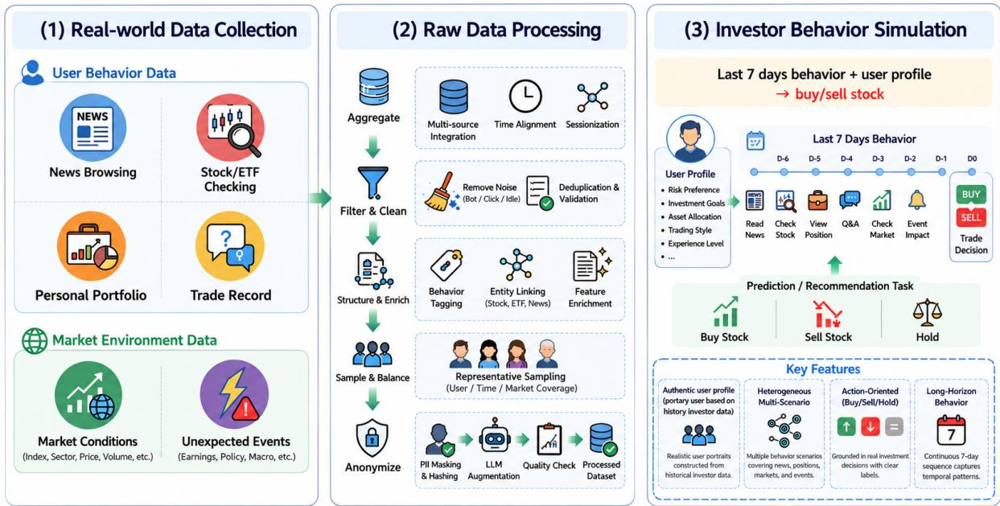
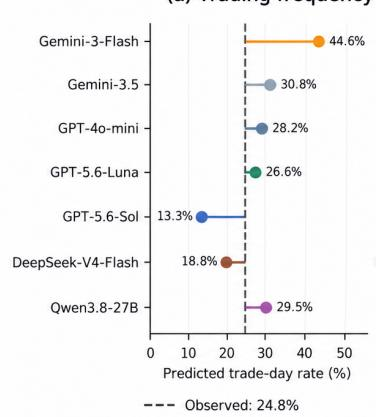
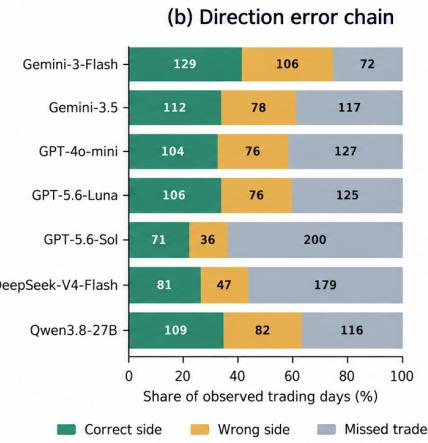
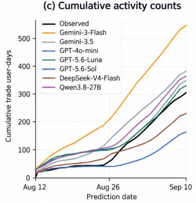
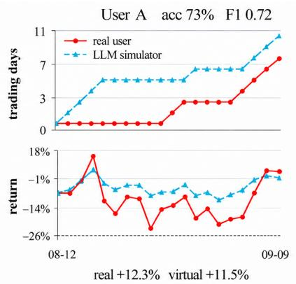
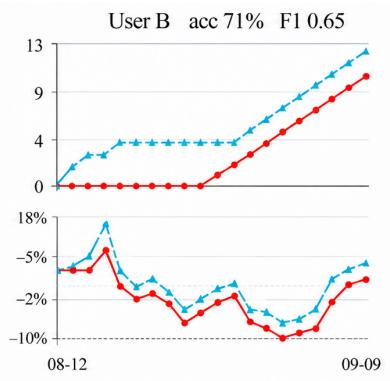
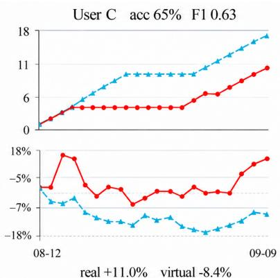
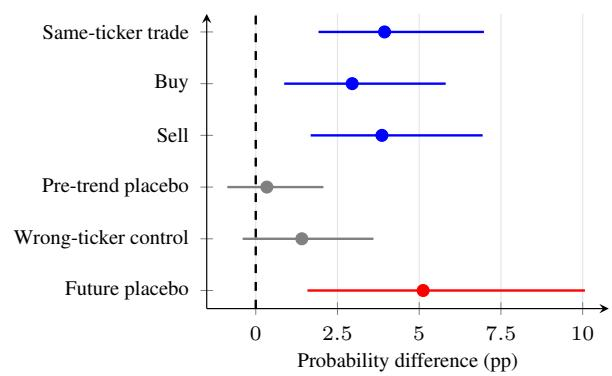
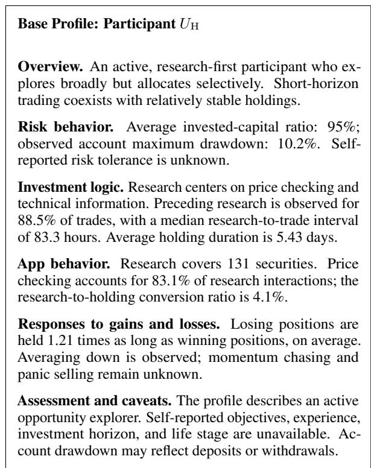

# Beyond Behavioral Accuracy: Evaluating Individual-Level Fidelity in LLM Investor Simulation

Jiajie He1 Yuanhong Jiang1 Xintong Chen3 Dongling Ni1 Wenjin Liu2

1Hithink Research 2Nanyang Technological University 3McMaster University

jiajiehe@myhexin.com, yuanhongjiang@myhexin.com, chen54xt@mcmaster.ca donglingni@myhexin.com,wenjinliu23@outlook.com

## Abstract

Large language models (LLMs) are increasingly used as user simulators, but can they faithfully reproduce an individual’s behavior and decision logic over time? We investigate this question in a longitudinal paper-trading study with 80 participants. Using rolling nextday predictions, we evaluate trading activity, buy–sell structure, asset selection, and portfolio outcomes, complemented by controlled input ablations and participant-rated explanation alignment. No evaluated LLM reliably outperforms a simple recent-activity persistence baseline for predicting trade occurrence, while buy–sell structure and asset selection remain difficult to reproduce. Similar activity-level performance can also yield substantially different portfolio trajectories. Ablations show that activity predictions depend primarily on recent trades, whereas asset choices are sensitive to multiple evidence sources. Participants rate explanations as more aligned with their recurring strategies than with their decision-specific rationales. These findings reveal a gap between coarse behavioral agreement and individuallevel fidelity, motivating separate evaluation of behavioral accuracy, explanation alignment, and evidence dependence in personalized user simulation.

## 1 Introduction

Large language models (LLMs) are increasingly used to simulate human behavior in dialogue (Chan et al., 2023; Yoon et al., 2024), recommendation (Chen et al., 2026), and interactive decision-making (Park et al., 2023; Ren et al., 2024). User simulators support the evaluation of interactive systems across diverse user behaviors, but personalized evaluation requires fidelity to the individual being represented. Plausible actions and aggregate behavioral similarity provide only partial evidence: a simulator may match a user’s overall activity while acting on different days, selecting different objects, or generating unsupported explanations. We therefore ask whether LLMs faithfully reproduce individual behavior and decision logic over time.

This question is especially important in longitudinal decision-making, where actions depend on prior behavior, the current environment, and the consequences of earlier decisions. Financial decision-making provides an observable setting for examining these dependencies through trades, holdings, information-seeking activity, and market conditions. Prior work links investor attention to subsequent stock purchases (Barber and Odean, 2008), motivating the inclusion of platform interactions alongside transaction histories. A simulator may correctly predict whether an investor trades without recovering the assets or rationale involved. Conversely, it may accurately characterize a recurring strategy while missing a specific portfolio adjustment. Behavioral prediction accuracy and alignment with investor-specific decision patterns therefore require separate evaluation.

Existing financial-agent research has primarily examined trading performance, recommendation quality, and aggregate market behavior (Zhang et al., 2024a; YANG et al., 2025; Wang et al., 2026b). More recent work introduces investor simulators with evolving internal states to evaluate investment advisors over extended interactions (Gong et al., 2026). However, these evaluations do not establish whether a simulator reproduces the longitudinal decisions of the particular investor it represents. We address this gap through two complementary questions: how faithfully do LLMs reproduce individual trading behavior, and what evidence supports their recovery of investor-specific decision patterns?

We conduct a longitudinal study with 80 participants in a controlled paper-trading environment using non-redeemable virtual funds under real-time market conditions. Under a rolling next-day prediction protocol, each simulator receives only information available at the market-close cutoff. We evaluate trade occurrence, buy–sell structure, asset selection, and downstream portfolio consequences to distinguish coarse behavioral agreement from temporally aligned individual fidelity.

To examine investment logic beyond observable actions, we combine participant-rated explanation alignment, controlled input ablations, and observational analysis of pre-trade research. Each participant rates one explanation for their own prediction point, separately assessing alignment with their recurring investment strategy and their rationale for the specific decision. These self-reported judgments measure perceived alignment rather than faithfulness to the model’s internal prediction process (Jacovi and Goldberg, 2020; Madsen et al., 2024). Ablations measure prediction sensitivity to different evidence sources, while the observational analysis examines research–trading associations and the limits of causal interpretation.

No evaluated LLM reliably outperforms a recentactivity persistence baseline for trade occurrence, while buy–sell structure and asset selection remain difficult to reproduce and similar activity-level performance can yield different portfolio trajectories. Participants report stronger explanation alignment with recurring strategies than with decision-specific rationales. Ablations show that activity predictions depend primarily on recent trades, whereas asset choices are sensitive to multiple evidence sources. Ticker-specific research predicts subsequent sameticker trading, but balance diagnostics and placebo tests do not support a causal interpretation.

## Our Contributions.

• To our knowledge, we are the first to systematically evaluate longitudinal, individual-level fidelity in financial user simulation. Our framework assesses whether a simulator reproduces the temporally aligned decisions and portfolio trajectory of the specific investor it represents.

• We reveal a hierarchy of behavioral fidelity: coarse agreement on trading activity does not ensure accurate buy–sell structure, asset selection, or portfolio outcomes. This demonstrates how activity-level accuracy can overstate individual-level fidelity.

• We provide a multi-view analysis of investorspecific decision patterns by combining participant-rated explanations, controlled evidence ablations, and observational analysis of pre-trade research. This distinguishes prediction correctness, perceived explanation alignment, model evidence dependence, and the limits of causal interpretation.

## 2 Task Formulation

We formulate personalized investor simulation as a rolling next-day prediction task: predict a participant’s trading activity, buy–sell structure, ranked assets, and a natural-language explanation using information available at the prediction cutoff.

Point-in-time information. Let i index participants and t index U.S. equity trading days. The cutoff $c _ { t }$ is the market close on day t, and the target is the next trading day $t + 1$ . The available information is

$$
\begin{array} { r } { \mathcal { T } _ { i , t } = \left( \mathbf { u } _ { i , t } , \mathbf { r } _ { i , t - 6 : t } , \mathbf { p } _ { i , t } , \mathbf { m } _ { t } \right) , } \end{array}\tag{1}
$$

where ${ \bf { u } } _ { i , t }$ is the historical profile; ${ \bf r } _ { i , t - 6 : t }$ contains interactions and executed trades from the most recent seven trading days; $\mathbf { p } _ { i , t }$ is the portfolio state; and $\mathbf { m } _ { t }$ is the market context. Longer-term behavioral patterns enter through the profile, whose construction is described in Appendix B. All inputs use only information available at or before $c _ { t } .$

Prediction targets. The simulator produces

$$
\begin{array} { r l } & { f _ { \theta } ( \mathcal { T } _ { i , t } ) = \big ( \hat { y } _ { i , t + 1 } ^ { \mathrm { t r a d e } } , \hat { y } _ { i , t + 1 } ^ { \mathrm { s i d e } } , } \\ & { \qquad \hat { S } _ { i , t + 1 } ^ { \mathrm { b u y } } , \hat { S } _ { i , t + 1 } ^ { \mathrm { s e l l } } , e _ { i , t + 1 } \big ) , } \end{array}\tag{2}
$$

where $\hat { y } _ { i , t + 1 } ^ { \mathrm { t r a d e } }$ indicates whether trading is predicted and $e _ { i , t + 1 }$ is the explanation. For a predicted trading day, $\hat { y } _ { i , t + 1 } ^ { \mathrm { s i d e } }$ is BUY-ONLY, SELL-ONLY, or BUY-AND-SELL, with at most five ranked tickers per applicable side. For a predicted non-trading day, the side is not applicable and both asset lists are empty.

A point-in-time candidate set $\mathcal { C } _ { i , t }$ is constructed from current holdings, recent trades, and recently viewed assets. The model receives this set but may name assets outside it when supported by pre-cutoff evidence; candidate filtering is applied during the main asset evaluation.

Rolling protocol. After each target day, newly observed records update the inputs for the next prediction, as illustrated in Figure 1.

## 3 Task Evaluation

We evaluate behavioral fidelity, participant-rated explanation alignment, and evidence dependence,

  
Figure 1: Rolling investor simulation. Evidence available at market close on day t informs predictions for the next trading day t + 1; newly observed records update subsequent inputs.

and examine the association between pre-trade research and subsequent trading.

## 3.1 Behavioral Fidelity

Trade occurrence. For an observed participant– day, $y _ { i , t + 1 } ^ { \mathrm { t r a d e } } = \mathbb { I } [ K _ { i , t + 1 } > 0 ]$ , where $K _ { i , t + 1 }$ is the number of executed trades. We report accuracy, macro-F1, and class-specific precision and recall.

Buy–sell structure. On all observed trading days, $y _ { i , t + 1 } ^ { \mathrm { s i d e } }$ is BUY-ONLY, SELL-ONLY, or BUY-AND-SELL. We report accuracy and macro-F1, averaging F1 over these three classes. Evaluation includes missed trades: a no-trade prediction on an observed trading day counts as a side error.

Asset selection. Buy and sell rankings are evaluated separately on all observed days containing executions on the corresponding side, regardless of trade-occurrence or side-prediction correctness. A BUY-AND-SELL day contributes to both evaluations. Predicted lists are filtered to $\mathcal { C } _ { i , t } .$ , deduplicated while preserving order, and limited to five assets; the observed asset set remains unfiltered.

Hit@5(He et al., 2017, 2025) indicates whether a predicted list contains at least one observed asset, and NDCG@5(Järvelin and Kekäläinen, 2002) measures ranking quality with binary relevance. A missing or empty list receives zero for both metrics. Scores are averaged over eligible participant–days for each side. Candidate coverage is the proportion of eligible days with at least one observed asset in $\mathcal { C } _ { i , t }$

Portfolio consequences. We compare observed and simulated portfolio paths and terminal returns using common adjusted closing prices. The simulated portfolio starts from the same initial holdings and cash, and evolves through predicted buys and sells, with transaction sizes calibrated from observed portfolio changes over the available period. These results are exploratory retrospective comparisons rather than cutoff-safe portfolio forecasts.

## 3.2 Participant-Rated Explanation Alignment

Each of the 80 participants rates one modelgenerated explanation for their own prediction point on two five-point ordinal scales: strategy alignment, measuring consistency with their recurring investment strategy, and decision-rationale alignment, measuring consistency with their rationale for the specific decision. Higher ratings indicate stronger perceived alignment. We analyze these self-reported ratings separately from prediction correctness.

## 3.3 Evidence Dependence and Behavioral Association

Input ablations. For each evidence group g, we compare predictions from $\mathcal { T } _ { i , t }$ and the corresponding ablated input $\mathcal { T } _ { i , t } ^ { ( - g ) }$ on matched participant– date pairs. We separately withhold recent trades, portfolio information, recent platform interactions, market context, and the long-horizon profile. We report activity-accuracy changes and activity flip rates on all scored days, side-accuracy changes and side/list flip rates on observed trading days, and buy/sell Hit@5 changes on the corresponding observed-side evaluation sets. An asset-list flip occurs when either ordered buy or sell list differs between conditions. Unlike the main candidatefiltered evaluation, ablation asset metrics use the model-named lists before candidate filtering. These comparisons measure the effects of evidence removal.

Auxiliary position-action evaluation. We additionally evaluate a day-level primary positionaction label $y _ { i , t + 1 } ^ { \mathrm { p o s } }$ with five categories: OPEN, ADD, REDUCE, CLOSE, and UNCHANGED. We report accuracy on observed position labels under full and ablated inputs, with label construction detailed in the Appendix.

Observed research and trading. Using a targettrial emulation framework (Hernán and Robins, 2016), we examine the association between tickerspecific research and next-trading-day same-ticker execution. We report the adjusted tradingprobability difference alongside covariate-balance, overlap, and placebo diagnostics to assess the limits of causal interpretation.

## 4 Experiments

We conduct a pilot evaluation of individual-level fidelity and failure modes in LLM-based financial user simulation. Experimental details are provided in Appendix A.

## 4.1 RQ1: How Faithful Are LLMs as Financial User Simulators?

We evaluate behavioral fidelity across trade occurrence, buy–sell structure, asset selection, and portfolio consequences. This evaluation examines whether agreement on trading activity extends to temporally aligned, asset-specific decisions and their downstream outcomes.

Finding 1: Aggregate activity agreement masks temporal errors. Non-trading accounts for 75.22% of scored participant–days, making overall accuracy sensitive to conservative no-trade predictions. GPT-5.6-Sol achieves the highest LLM accuracy (79.18%) but only 34.85% trade recall, whereas Gemini-3-Flash achieves lower accuracy (68.60%) but substantially higher trade recall (76.55%). A recent-activity persistence baseline achieves 79.82% accuracy and 71.45% macro-F1, exceeding all evaluated LLM point estimates on both metrics. Participant-level bootstrap comparisons do not establish a reliable LLM improvement over this baseline (Table 1).

Matching aggregate trading frequency also fails to establish temporal fidelity. GPT-5.6-Luna predicts trading on 26.6% of participant–days, close to the observed 24.8%, yet achieves only 59.28% trade recall. Thus, similar activity rates can coexist with substantial disagreement about when individual participants trade (Figure 2(a,c)).

Finding 2: Trade detection does not ensure action or asset fidelity. Buy-and-sell days account for 41.37% of observed trading days. The best model achieves 42.02% side accuracy, close to the 41.37% majority baseline, although its macro-F1 improves from 19.51% to 37.88% (Table 1). Sell-only decisions remain particularly difficult, with end-to-end recall of just 4.23–8.45%. Errors arise both from missed trades and from incorrect buy–sell structures on detected trading days (Figure 2(b)).

Asset rankings are evaluated on all observed buying and selling days, regardless of activity or sideprediction correctness. The best Hit@5 reaches 40.7% for buys and 42.9% for sells (Table 2). Candidate coverage further constrains retrieval: at least one observed asset appears in the candidate set on 73.31% of buying days and 91.92% of selling days. The gap between coverage and retrieval, particularly for sells, shows that candidate availability alone does not ensure accurate asset selection.

Finding 3: Similar activity fidelity can coexist with divergent portfolio trajectories. Figure 3 compares participants B and C, whose activity macro-F1 scores are similar (0.65 and 0.63). For participant B, observed and simulated terminal returns differ by 1.8 percentage points (1.7% versus 3.5%); for participant C, the difference reaches 19.4 points (+11.0% versus -8.4%).

Table 1: Trade-occurrence and end-to-end buy–sell structure prediction (%). Activity metrics use 1,239 scored participant–days; side metrics use all 307 observed trading days, counting no-trade predictions as incorrect. Bold indicates the highest point estimate per metric.
<table><tr><td></td><td colspan="3">Trade Occurrence</td><td colspan="2">Side Structure</td></tr><tr><td>Model</td><td>Acc.</td><td>Macro-F1</td><td>Trade Recall</td><td>Acc.</td><td>Macro-F1</td></tr><tr><td>Gemini-3-Flash</td><td>68.60</td><td>65.34</td><td>76.55</td><td>42.02</td><td>37.88</td></tr><tr><td>Gemini-3.5-Flash</td><td>75.06</td><td>68.94</td><td>61.89</td><td>36.48</td><td>34.05</td></tr><tr><td>GPT-4o-mini</td><td>76.11</td><td>69.32</td><td>58.63</td><td>33.88</td><td>35.80</td></tr><tr><td>GPT-5.6-Luna</td><td>78.05</td><td>71.23</td><td>59.28</td><td>34.53</td><td>34.53</td></tr><tr><td>GPT-5.6-Sol</td><td>79.18</td><td>66.24</td><td>34.85</td><td>23.13</td><td>28.46</td></tr><tr><td>DeepSeek-V4-Flash</td><td>77.08</td><td>66.38</td><td>41.69</td><td>26.38</td><td>29.39</td></tr><tr><td>Qwen3.8-27B</td><td>76.59</td><td>70.39</td><td>62.21</td><td>35.50</td><td>35.42</td></tr><tr><td>Always no-trade</td><td>75.22</td><td>42.93</td><td>0.00</td><td></td><td></td></tr><tr><td>Recent Activity Persistence</td><td>79.82</td><td>71.45</td><td>51.79</td><td></td><td></td></tr><tr><td>Always buy-and-sell</td><td></td><td></td><td></td><td>41.37</td><td>19.51</td></tr></table>

  
Figure 2: Activity and action-structure mismatch. (a) Predicted versus observed trading frequency. (b) Observed trading days partitioned into correct side predictions, incorrect side predictions, and missed trades. (c) Cumulative observed and predicted trading activity.

Table 2: Candidate-filtered asset retrieval on all observed trading days, without conditioning on prediction correctness. Hit@5 is a percentage; NDCG@5 uses a 0–1 scale. Bold indicates the best result per column.
<table><tr><td></td><td>Buy</td><td>Buy Hit@5 NDCG@5</td><td>Sell</td><td>Sell</td></tr><tr><td>Model</td><td></td><td></td><td></td><td>Hit@5 NDCG@5</td></tr><tr><td>Gemini-3-Flash</td><td>40.7</td><td>0.259 0.260</td><td>42.9</td><td>0.272</td></tr><tr><td>Gemini-3.5-Flash</td><td>39.0 37.7</td><td>0.247</td><td>42.9 27.8</td><td>0.265</td></tr><tr><td>GPT-4o-mini GPT-5.6-Luna</td><td>35.2</td><td>0.223</td><td>42.9</td><td>0.164 0.257</td></tr><tr><td>GPT-5.6-Sol</td><td>22.9</td><td>0.150</td><td>32.3</td><td>0.219</td></tr><tr><td>DeepSeek-V4-Flash</td><td>25.8</td><td>0.164</td><td>35.4</td><td>0.227</td></tr><tr><td></td><td>39.0</td><td>0.250</td><td></td><td></td></tr><tr><td>Qwen3.8-27B</td><td></td><td></td><td>39.9</td><td>0.232</td></tr></table>

These comparisons use transaction sizes calibrated retrospectively over the available observation period. They illustrate how similar activitylevel fidelity can coexist with different portfolio outcomes, rather than constituting independent point-in-time return forecasts or establishing the prevalence of divergence across participants.

## 4.2 RQ2: Does the Simulator Recover User Investment Logic?

We examine investor-specific decision patterns through input sensitivity and participant-rated explanation alignment. These analyses assess evidence dependence and perceived alignment, rather than directly identifying latent decision mechanisms. An observational research–trading analysis provides additional context about participants’ pretrade behavior.

Finding 4: Activity predictions depend primarily on recent trades, while asset outputs show broader evidence sensitivity. We conduct paired input ablations with GPT-5.6-Sol, separately withholding recent trades, portfolio information, recent platform interactions, market context, and the long-horizon profile. Removing recent trades reduces trade-occurrence accuracy by 23.49 percentage points (95% CI: [−33.00, −13.65]), whereas removing any other individual evidence source changes accuracy by at most 1.40 points (Table 3).

  
real -1.7% virtual +3.5%

  
Figure 3: Illustrative comparisons of observed and simulated trading activity and portfolio trajectories. Similar activity-level fidelity can yield different portfolio outcomes.

This pronounced dependence suggests that the simulator draws heavily on recent trading regularities when predicting whether an investor will trade. Such regularities can provide useful predictive signals, but accurate activity predictions alone do not establish recovery of the investor-specific rationale behind each decision.

Asset outputs exhibit broader evidence sensitivity. Withholding any evidence group changes more than half of the predicted ticker lists. Removing the long-horizon profile, for example, changes 60.4% of ticker lists while altering only 6.7% of tradeoccurrence predictions and reducing activity accuracy by just 0.23 percentage points. This contrast indicates that predictions about whether to trade can remain relatively stable even as the proposed assets change substantially.

These findings suggest that coarse activity prediction and asset selection exhibit different evidence dependencies. However, ticker-list changes do not necessarily imply reduced asset accuracy or successful integration of investment logic, and some changes may arise from altered buy–sell predictions. The broader sensitivity of asset outputs motivates examining how user simulators integrate heterogeneous investor evidence when predicting specific investment decisions.

Finding 5: Strategy alignment exceeds decisionrationale alignment. Each of the 80 participants rated one GPT-5.6-Sol explanation generated for their own prediction point, separately assessing alignment with their recurring investment strategy and their rationale for the specific decision.

Table 3: Evidence ablation with GPT-5.6-Sol. Accuracy changes are relative to the paired full-input condition. Activity flips indicate changes in trade-occurrence predictions; ticker flips indicate changes in either ordered buy or sell list.
<table><tr><td>Withheld evidence</td><td>∆ Acc. (pp)</td><td>Activity flip</td><td>Ticker flip</td></tr><tr><td>Recent trades</td><td>-23.49</td><td>36.5%</td><td>76.6%</td></tr><tr><td>Portfolio</td><td>-1.40</td><td>7.0%</td><td>58.6%</td></tr><tr><td>7-day behavior</td><td>-0.23</td><td>4.4%</td><td>56.8%</td></tr><tr><td>Market context</td><td>-1.16</td><td>4.0%</td><td>57.7%</td></tr><tr><td>Long-term profile</td><td>-0.23</td><td>6.7%</td><td>60.4%</td></tr></table>

Participants report stronger alignment with recurring strategies than with decision-specific rationales (Table 4). Mean ratings are 3.40 and 2.43, respectively; ratings of 4–5 account for 56.25% of strategy evaluations but only 15.00% of decisionrationale evaluations.

These results indicate that participants more frequently perceive generated explanations as consistent with broad investment patterns than with the rationale for a specific decision. This gap complements the evidence-ablation findings: capturing recurring behavioral patterns does not necessarily translate into explanations aligned with individual investment decisions. Representative qualitative cases are provided in Appendix C.

Finding 6: Research escalation is associated with subsequent trading, but causation is not established. Across 15,125 participant–ticker–date opportunities, including 395 research escalations, intensified research is associated with an adjusted 3.94 percentage-point increase in next-day sameticker trading probability (95% CI: [1.92, 6.98]).

Table 4: Participant-rated explanation alignment $( n =$ 80; one explanation per participant). Ratings range from 1 to 5; higher indicates stronger perceived alignment.
<table><tr><td>Dimension</td><td>1</td><td>2</td><td>3</td><td>4</td><td>5</td><td>Mean</td></tr><tr><td>Strategy</td><td></td><td></td><td></td><td></td><td></td><td></td></tr><tr><td>alignment</td><td>8</td><td>3</td><td>24</td><td>39</td><td>6</td><td>3.40</td></tr><tr><td>Decision-rationale</td><td></td><td></td><td></td><td></td><td></td><td></td></tr><tr><td>alignment</td><td>18</td><td>22</td><td>28</td><td>12</td><td>0</td><td>2.43</td></tr></table>

  
Figure 4: Research escalation predicts subsequent trading, but placebo tests limit causal interpretation.

However, post-weighting covariate balance remains inadequate (maximum weighted SMD = 0.324, above the pre-specified 0.10 threshold), and the future-behavior placebo remains positive (+5.12 pp; 95% CI: [1.58, 10.07]). Research escalation may signal developing investment intent, but these diagnostics do not support interpreting it as the cause of subsequent trading (Figure 4).

Together, these findings reveal a gap between capturing behavioral regularities and faithfully representing investor-specific decision patterns. Tradeoccurrence predictions depend strongly on recent trading history, while asset outputs exhibit sensitivity to multiple sources of investor evidence. Participants also perceive stronger explanation alignment with recurring strategies than with decision-specific rationales.

These observations highlight the importance of evaluating investment logic beyond behavioral prediction accuracy. Faithful investor simulation requires attention not only to when investors trade, but also to how their historical behavior, portfolio context, preferences, and market information relate to specific investment decisions. Our findings motivate such multi-view evaluation without claiming to identify participants’ latent decision mechanisms.

More experimental details are shown in $\mathsf { A p - }$ pendix D.

## 5 Related Work

## 5.1 LLMs as Human Simulators

LLMs have been used to simulate behavior in dialogue (Chan et al., 2023), recommendation (Chen et al., 2026; Wang et al., 2025; Zhang et al., 2024b), and autonomous driving (Jin et al., 2024). Generative Agents (Park et al., 2023) and BASES (Ren et al., 2024) extend user simulation to social behavior and web search. For personalized simulation, behavioral plausibility must be distinguished from fidelity to a particular individual: matching aggregate patterns does not establish agreement with that user’s decisions over time. Our study examines this distinction through longitudinal trading behavior, evidence dependence, and participant-rated explanation alignment.

## 5.2 Financial Agents and Investor Simulation

Early financial user simulators supported personalized dialogue management for financial product recommendation (den Hengst et al., 2019). Stock-Agent (Zhang et al., 2024a) simulates investor trading under dynamic market conditions, while Twin-Market (YANG et al., 2025) examines how individual trading decisions generate collective market behavior. Conv-FinRe (Wang et al., 2026b) constructs longitudinal financial recommendation scenarios from market data and human decision trajectories. ShiJianBench (Gong et al., 2026) introduces investor simulators with evolving internal states to evaluate investment advisors over extended interactions.

These studies address financial-agent performance, recommendation, and simulated investor behavior. Our focus is whether a simulator reproduces the temporally aligned decisions of the specific investor it represents. We evaluate this individual-level fidelity alongside participantperceived explanation alignment and prediction sensitivity to investor-specific evidence.

## 6 Conclusion

Our study highlights a central challenge in personalized investor simulation: reproducing recurring behavior does not establish understanding of the rationale behind individual decisions. Progress therefore requires connecting user-specific evidence to evolving investment choices and validating both predicted actions and decision rationales over time.Future work will explore dynamically updated user representations and evidence-grounded reasoning that connects historical behavior, portfolio constraints, and market information to specific investment decisions. Repeated participant feedback and prospective evaluation will help assess whether these methods improve both decision prediction and rationale alignment as users’ investment strategies evolve.

## 7 Limitations

Our findings are based on 80 participants in a controlled paper-trading environment. The cohort, observation period, and absence of real financial stakes may limit generalization to broader populations, market conditions, and real-world trading. Ablation and explanation analyses cover a single evaluated model due to funding limit and one explanation rated per participant due to high human label fee may produce bias in the final experimental results. Input sensitivity and self-reported alignment do not identify internal reasoning or establish consistent alignment across multiple decisions.

## 8 Ethical Considerations

Our study involves behavioral records from 80 participants in a controlled paper-trading environment using virtual funds. Although the study does not involve real financial transactions, trading histories and platform interactions may reveal sensitive behavioral patterns. We therefore de-identify participant records and avoid releasing direct personal identifiers. However, residual re-identification risks may remain.

Furthermore, our findings demonstrate limitations in the individual-level fidelity of LLM-based investor simulation. Such simulators should not be treated as reliable substitutes for real investors or used as the sole basis for consequential financial decisions. Potential misuse for intrusive behavioral profiling should also be considered.

## References

Brad M. Barber and Terrance Odean. 2008. All that glitters: The effect of attention and news on the buying behavior of individual and institutional investors. The Review ofFinancial Studies, 21(2):785–818.

Chi-Min Chan, Weize Chen, Yusheng Su, Jianxuan Yu, Wei Xue, Shanghang Zhang, Jie Fu, and Zhiyuan Liu. 2023. Chateval: Towards better llm-based evaluators through multi-agent debate. Preprint, arXiv:2308.07201.

Jiawei Chen, Ruoxi Xu, Boxi Cao, Ruotong Pan, Yunfei Zhang, Yifei Hu, Yong Du, Tingting Gao, Yaojie Lu, Yingfei Sun, Xianpei Han, Le Sun, Xiangyu Wu, and Hongyu Lin. 2026. Towards real-world human behavior simulation: Benchmarking large language models on long-horizon, cross-scenario, heterogeneous behavior traces. Preprint, arXiv:2604.08362.

DeepSeek-AI, Anyi Xu, Bangcai Lin, Bing Xue, Bingxuan Wang, Bingzheng Xu, Bochao Wu, Bowei Zhang, Chaofan Lin, Chen Dong, Chenchen Ling, Chengda Lu, Chenggang Zhao, Chengqi Deng, Chengyu Hou, Chenhao Xu, Chenze Shao, Chong Ruan, Conner Sun, and 300 others. 2026. Deepseek-v4: Towards highly efficient million-token context intelligence. Preprint, arXiv:2606.19348.

Floris den Hengst, Mark Hoogendoorn, Frank van Harmelen, and Joost Bosman. 2019. Reinforcement learning for personalized dialogue management. In IEEE/WIC/ACM International Conference on Web Intelligence, WI ’19, page 59–67, New York, NY, USA. Association for Computing Machinery.

Jie Gong, Maowei Jiang, Zhiwei Liu, Yang Qiao, Wenxi Wu, Mengxi Xiao, Enze Zhang, Ziyan Kuang, Yankai Chen, Caishuang Huang, Meng Zhou, Xiku Du, Xue Liu, Guojun Xiong, Min Peng, Qianqian Xie, and Sophia Ananiadou. 2026. Shijianbench: From dialogue to decision for long-horizon evaluation of investment advisors. Preprint, arXiv:2608.01204.

Google DeepMind. 2025. Gemini 3 flash: Frontier intelligence built for speed. Accessed: 2026-09-22.

Google DeepMind. 2026. Gemini 3.5 flash model card. Accessed: 2026-09-22.

Jiajie He, Yuechun Gu, and Keke Chen. 2025. Recps: Privacy risk scoring for recommender systems. In Proceedings of the Nineteenth ACM Conference on Recommender Systems, RecSys ’25, page 432–440, New York, NY, USA. Association for Computing Machinery.

Xiangnan He, Lizi Liao, Hanwang Zhang, Liqiang Nie, Xia Hu, and Tat-Seng Chua. 2017. Neural collaborative filtering. In Proceedings of the 26th International Conference on World Wide Web, WWW ’17, page 173–182, Republic and Canton of Geneva, CHE. International World Wide Web Conferences Steering Committee.

Miguel A. Hernán and James M. Robins. 2016. Using big data to emulate a target trial when a randomized trial is not available. American Journal ofEpidemiology, 183(8):758–764.

Alon Jacovi and Yoav Goldberg. 2020. Towards faithfully interpretable NLP systems: How should we define and evaluate faithfulness? In Proceedings of the 58th Annual Meeting of the Association for Computational Linguistics, pages 4198–4205, Online. Association for Computational Linguistics.

Kalervo Järvelin and Jaana Kekäläinen. 2002. Cumulated gain-based evaluation of ir techniques. ACM Trans. Inf. Syst., 20(4):422–446.

Ye Jin, Ruoxuan Yang, Zhijie Yi, Xiaoxi Shen, Huiling Peng, Xiaoan Liu, Jingli Qin, Jiayang Li, Jintao Xie, Peizhong Gao, Guyue Zhou, and Jiangtao Gong. 2024. Surrealdriver: Designing llm-powered generative driver agent framework based on human drivers driving-thinking data. Preprint, arXiv:2309.13193.

Andreas Madsen, Sarath Chandar, and Siva Reddy. 2024. Are self-explanations from large language models faithful? In Findings of the Association for Computational Linguistics: ACL 2024, pages 295–337, Bangkok, Thailand. Association for Computational Linguistics.

OpenAI. 2024. GPT-4o mini: advancing cost-efficient intelligence. Accessed: 2026-09-22.

OpenAI. 2026. Gpt-5.6: Frontier intelligence that scales with your ambition.

Georgios Th. Papadopoulos, Asterios Leonidis, Margherita Antona, and Constantine Stephanidis. 2022. User profile-driven large-scale multi-agent learning from demonstration in federated humanrobot collaborative environments. In Human-Computer Interaction. Technological Innovation, pages 548–563, Cham. Springer International Publishing.

Joon Sung Park, Joseph O’Brien, Carrie Jun Cai, Meredith Ringel Morris, Percy Liang, and Michael S. Bernstein. 2023. Generative agents: Interactive simulacra of human behavior. In Proceedings ofthe 36th Annual ACM Symposium on User Interface Software and Technology, UIST ’23, New York, NY, USA. Association for Computing Machinery.

Ruiyang Ren, Peng Qiu, Yingqi Qu, Jing Liu, Wayne Xin Zhao, Hua Wu, Ji-Rong Wen, and Haifeng Wang. 2024. BASES: Large-scale web search user simulation with large language model based agents. In Findings ofthe Associationfor Computational Linguistics: EMNLP 2024, pages 902– 917, Miami, Florida, USA. Association for Computational Linguistics.

Haoting Wang, Haokai Lu, Zheyun Feng, Jenny Huang, Yifat Amir, Gregory Hinkson, Ben Most, Zelong Zhao, Yixin Kelly Cui, Rein Zhang, Fabio Soldo, Yu Xia, Nihar Bhupalam, Minmin Chen, Konstantina Christakopoulou, Lichan Hong, and Ed H. Chi. 2026a. Llm-based user personas for recommendations at scale. Preprint, arXiv:2606.12198.

Lei Wang, Jingsen Zhang, Hao Yang, Zhi-Yuan Chen, Jiakai Tang, Zeyu Zhang, Xu Chen, Yankai Lin, Hao Sun, Ruihua Song, Xin Zhao, Jun Xu, Zhicheng Dou, Jun Wang, and Ji-Rong Wen. 2025. User behavior simulation with large language model-based agents. ACM Trans. Inf. Syst., 43(2).

Yan Wang, Yi Han, Lingfei Qian, Yueru He, Xueqing Peng, Dongji Feng, Zhuohan Xie, Vincent Jim Zhang, Yuqing Guo, Fengran Mo, Jimin Huang, Yankai Chen, and Jian-Yun Nie. 2026b. Conv-finre: A conversational and longitudinal benchmark for utilitygrounded financial recommendation. In Proceedings ofthe 49th International ACM SIGIR Conference on Research and Development in Information Retrieval, SIGIR ’26, page 3448–3455, New York, NY, USA. Association for Computing Machinery.

Yuzhe YANG, Yifei Zhang, Minghao Wu, Kaidi Zhang, Yunmiao Zhang, Honghai Yu, Yan Hu, and Benyou Wang. 2025. Twinmarket: A scalable behavioral and social simulation for financial markets. In Advances in Neural Information Processing Systems, volume 38, Main Conference, pages 63469–63519. Curran Associates, Inc.

Se-eun Yoon, Zhankui He, Jessica Echterhoff, and Julian McAuley. 2024. Evaluating large language models as generative user simulators for conversational recommendation. In Proceedings of the 2024 Conference ofthe North American Chapter ofthe Associationfor Computational Linguistics: Human Language Technologies (Volume 1: Long Papers), pages 1490–1504, Mexico City, Mexico. Association for Computational Linguistics.

Chong Zhang, Xinyi Liu, Zhongmou Zhang, Mingyu Jin, Lingyao Li, Zhenting Wang, Wenyue Hua, Dong Shu, Suiyuan Zhu, Xiaobo Jin, Sujian Li, Mengnan Du, and Yongfeng Zhang. 2024a. When ai meets finance (stockagent): Large language model-based stock trading in simulated real-world environments. Papers 2407.18957, arXiv.org.

Junjie Zhang, Yupeng Hou, Ruobing Xie, Wenqi Sun, Julian McAuley, Wayne Xin Zhao, Leyu Lin, and Ji-Rong Wen. 2024b. Agentcf: Collaborative learning with autonomous language agents for recommender systems. In Proceedings of the ACM Web Conference 2024, WWW ’24, page 3679–3689, New York, NY, USA. Association for Computing Machinery.

## A Experimental Setting

## A.1 Models and Behavioral Baselines

We evaluate seven LLM configurations: GPT-5.6-Sol(OpenAI, 2026), GPT-5.6-Luna(OpenAI, 2026), GPT-4o-mini(OpenAI, 2024), Gemini-3-Flash(Google DeepMind, 2025), Gemini-3.5- Flash(Google DeepMind, 2026), DeepSeek-V4- Flash, and Qwen3.8-27B. All main-model comparisons use the same participant–date instances and observed target labels.

The recent-activity persistence baseline predicts trading on day t + 1 if at least one execution is recorded on trading day t, and otherwise predicts no trading. The always-no-trade baseline predicts inactivity for every scored day. For side classification, the always-buy-and-sell baseline predicts BUY-AND-SELL on every observed trading day.

## A.2 Dataset

Data source. We recruited 80 volunteer participants for a controlled paper-trading study under real-time market conditions. Participants could buy, sell, rebalance, or remain inactive using nonredeemable virtual funds. The study did not access their real brokerage accounts, credentials, funds, or transaction records. We recorded trajectories over a three-month collection period, including more than 230K interactions across market and news browsing, stock/ETF viewing, simulated trading, virtual portfolio states, and platform-chatbot interactions.

Privacy protection. We de-identify participantgenerated behavioral records used for analysis and prepared for release. A locally deployed DeepSeek-V4-Flash model (DeepSeek-AI et al., 2026) assists in detecting identifiers in free-text and accountassociated fields, which are replaced with standardized placeholders such as [NAME] and [AGE]. Manual quality assurance follows automated processing. The processed research data exclude raw personal identifiers and real financial-account records; virtual portfolio states remain available for the reported analyses.

Data processing. We remove duplicated, incomplete, and noisy records and organize interactions into chronological participant sequences. Precutoff behavior supports profile construction, while cleaned financial-news text is summarized using DeepSeek-V4(DeepSeek-AI et al., 2026) and inserted at the corresponding positions in the sequence. The cohort includes active and inactive participants with different trading styles and levels of financial experience.

Evaluation coverage. The three-month collection period is distinct from the rolling prediction evaluation period. The main experiments contain 1,239 predictions from 80 participants; Table 5 summarizes the evaluation sets. Buying and selling sets overlap because a day with both sides contributes to both asset evaluations.

## A.3 Prediction Protocol and Prompt

Each prediction targets the next U.S. equity trading day after the market-close cutoff. Model inputs contain the cutoff-specific profile, recent interactions and trades, portfolio state, and market context. Target-day executions and subsequent portfolio records are reserved for evaluation and are not provided as prediction evidence.

Table 5: Coverage of prediction and evaluation sets.
<table><tr><td>Quantity</td><td>Count</td></tr><tr><td>Prediction instances</td><td>1,239</td></tr><tr><td>Trading days</td><td>307</td></tr><tr><td>Non-trading days</td><td>932</td></tr><tr><td>Buying days</td><td>236</td></tr><tr><td>Selling days</td><td>198</td></tr><tr><td>Buy-and-sell days</td><td>127</td></tr></table>

The prediction instructions specify trade occurrence, buy–sell structure, at most five ranked assets per applicable side, and an explanation. A notrade answer has no applicable side and empty asset lists. The candidate list is available to the model, but evidence-supported out-of-list assets may be named. Candidate-filtered and model-named lists are distinguished in scoring.

## B User Profile Construction

We construct user profiles using a staged multiagent pipeline (Wang et al., 2026a; Papadopoulos et al., 2022). Each profile summarizes observable investment behavior using only information available at the prediction cutoff. Figure 5 shows the specific example.

Evidence preparation. For participant i at cutoff $c _ { t } ,$ we collect interaction events, executed trades, portfolio snapshots, account states, and available conversation records. Records are aligned by participant and timestamp, excluding information unavailable at $c _ { t } .$ . A deterministic feature module computes activity statistics, transaction amounts, portfolio concentration, drawdown, and holding patterns directly from these records.

Agent analysis and synthesis. An orchestrator routes the structured evidence to specialized agents for risk behavior, investment logic, revealed trading preferences, responses to gains and losses, and investor activity patterns. Each agent receives a restricted evidence view and returns conclusions with supporting evidence and uncertainty indicators. Their outputs are merged and checked for conflicts before synthesis into an overview, dimensionlevel summaries, evidence-grounded highlights, and caveats. Unsupported attributes remain unknown.

  
Figure 5: A generated base profile example used in the rolling prediction.

Temporal representation. Profiles are stored by participant and cutoff. Subsequent updates use only newly available evidence, preserving the information boundary for each prediction. The simulator receives the corresponding profile, recent interactions and trades, portfolio state, and market context, as defined in Equation 1. The profile summarizes longer-term patterns, while the recent evidence blocks capture conditions relevant to the next trading day.

## C Examples in Human-Evaluation

The following cases illustrate strategy-alignment scores 1–5 and the distinction discussed in Finding 5.

Score 1. The explanation interprets stable portfolio exposure and repeated price monitoring as a deliberate strategy to wait. These observations do not establish such a rule, leaving the attributed strategy unsupported.

Score 2. The explanation infers a recurring reversal strategy from an isolated buy–sell sequence. The sequence provides limited support for this interpretation because it does not establish a repeated pattern.

Score 3: WMT/MSFT. The explanation captures selective position adjustment but attributes the sales to profit-taking following recent appreciation. The adjustments are observable; the stated motive is not established by the records.

Score 4: BITO. Repeated additions support the explanation’s description of incremental accumulation. However, characterizing the holdings as high-conviction goes beyond the available behavioral evidence.

Score 5: SKUU. Four same-session round trips support a recurring repurchase-and-exit pattern, yielding strategy alignment of 5. Decisionrationale alignment remains 4: the history establishes the pattern but does not identify the condition for another entry on the next trading day. This case illustrates how strong strategy alignment can coexist with incomplete support for a specific decision.

## D Additional Experimental Content

Table 6 reports detailed experimental results in Section 4.1.

## D.1 Retrospective Portfolio Comparison

Observed and simulated portfolios share the same initial holdings and cash. Simulated transaction sizes use the median notional of observed positive position increments and the median proportional reduction in existing positions. Calibration uses the available observation period, making these comparisons retrospective.

Predicted sells precede buys and are limited to available holdings. Buy amounts are capped by an equal share of available cash, without borrowing. If calibration is unavailable, buys are omitted and predicted sells liquidate the corresponding holdings. Transactions use the latest available closing price at or before the execution date; transactions without prices are skipped.

Both trajectories use common adjusted prices and compounded daily holding returns, with cash earning zero return. Unpriced positions are omitted from valuation. The comparisons exclude deposits, withdrawals, transaction costs, and intraday execution effects. The displayed cases illustrate possible portfolio divergence without estimating its prevalence across participants.

Table 6: Detailed User Simulator Behavioral Metric Evaluation(%). P and R denote precision and recall.
<table><tr><td>Model</td><td>Trade P</td><td>No-trade P</td><td>Trade R</td><td>No-trade R</td><td>Buy-only R</td><td>Sell-only R</td><td>Buy-and-sell R</td></tr><tr><td>Gemini-3-Flash</td><td>42.57</td><td>89.52</td><td>76.55</td><td>65.99</td><td>39.45</td><td>4.23</td><td>65.35</td></tr><tr><td>Gemini-3.5-Flash</td><td>49.74</td><td>86.35</td><td>61.89</td><td>79.40</td><td>21.10</td><td>4.23</td><td>67.72</td></tr><tr><td>GPT-4o-mini</td><td>51.58</td><td>85.73</td><td>58.63</td><td>81.87</td><td>30.28</td><td>7.04</td><td>51.97</td></tr><tr><td>GPT-5.6-Luna</td><td>55.32</td><td>86.26</td><td>59.28</td><td>84.23</td><td>23.85</td><td>5.63</td><td>59.84</td></tr><tr><td>GPT-5.6-Sol</td><td>64.85</td><td>81.38</td><td>34.85</td><td>93.78</td><td>11.01</td><td>8.45</td><td>41.73</td></tr><tr><td>DeepSeek-V4-Flash</td><td>54.94</td><td>82.21</td><td>41.69</td><td>88.73</td><td>11.01</td><td>7.04</td><td>50.39</td></tr><tr><td>Qwen3.8-27B</td><td>52.33</td><td>86.73</td><td>62.21</td><td>81.33</td><td>28.44</td><td>5.63</td><td>58.27</td></tr></table>

## D.2 Observational Research–Trading Analysis

Opportunity set and exposure. The analysis unit is a participant–ticker–target-date opportunity. Eligible tickers are held or have been viewed or traded during the preceding 30 calendar days, as recorded at the trading-day baseline before exposure. This opportunity set is fixed before the exposure day. Research escalation requires quote attention within the preceding seven trading days, no research in the two baseline sessions, and research on the exposure day. Research includes technical analysis, news, company and earnings information, order-book inspection, and options-related exploration. The outcome is an executed same-ticker trade on the next trading day.

Adjustment and estimation. We adjust for preexposure holdings, position returns, informationseeking activity, trading history, and available asset, market, and portfolio conditions. Ridge logistic nuisance models include participant, ticker, and target-date indicators, standardized numerical covariates, and missing-information indicators. An augmented inverse-probability-weighted estimator produces the adjusted trading-probability difference.

Common support is the intersection of the exposed and unexposed groups’ 1st–99th propensity percentile ranges, bounded by [0.01, 0.99]. This restriction retains 13,907 of 15,125 opportunities. Stabilized weights are capped at the 99th percentile for weighted contrasts and balance diagnostics. Percentile 95% intervals use 1,000 participantclustered bootstrap resamples with seed 23, conditioning on the fitted nuisance models.

Identification diagnostics. We assess overlap, weighted covariate balance, a pre-trend placebo, a wrong-ticker control, and a future-research placebo. The wrong-ticker control rotates outcomes within participant–date opportunity sets. The futureresearch placebo assesses temporal asymmetry and is not a pure negative control. Residual imbalance exceeds the 0.10 threshold (maximum absolute weighted SMD: 0.324), and the future-research placebo remains positive. These diagnostics support reporting an adjusted association without attributing subsequent trading causally to research escalation.

## E Rolling Prediction Example

Figure 6 illustrates a rolling next-day prediction instance including the point-in-time evidence, structured prediction, and natural-language explanation.

A. Rolling Prediction Input
<table><tr><td>Evidence</td><td>Observed Information</td></tr><tr><td>Prediction setup</td><td>Cutoff: Aug. 11, 2026 (market close); Target: Aug. 12, 2026.</td></tr><tr><td>User profile</td><td>shown in Appendix B</td></tr><tr><td>Platform activity</td><td>333 interactions across 7 active days. Most viewed: RKLX (36 views), NEBX (18 views).</td></tr><tr><td>Recent trading</td><td>Traded on all 7 recent sessions; 31 buy and 42 sell executions. Both buying and selling occurred on all 7 sessions.</td></tr><tr><td>Portfolio holdings</td><td>BLSH, CRCL, DRAM, NVD, ORCL, SGOV, SHV, SQQQ, TMDX, TSLL.</td></tr><tr><td>Portfolio changes</td><td>3 new positions, 6 additions, 4 trims, and 3 exits.</td></tr><tr><td>Market context</td><td>SPY: +1.70%; QQQ: +2.63%; portfolio-weighted return: +1.71%.</td></tr><tr><td>Watchlist</td><td>NEBX: 18 views; 7-day return: —20.80%.</td></tr></table>

## B. Rolling Prediction Output

<table><tr><td>Prediction</td><td>Model Output</td></tr><tr><td>Trade activity</td><td>Trade</td></tr><tr><td>Trade side</td><td>Buy and sell</td></tr><tr><td>Ranked buy tickers</td><td>RKLX → PLTD → NEBX</td></tr><tr><td>Ranked sell tickers</td><td>RKLX → CRCL → TMDX</td></tr></table>

## C. Prediction Explanation

“A trade on both sides is likely because the user consistently rotates short-horizon positions: all seven recent sessions included buys and sells, while the median holding period is 4.34 days. RKLX is the strongest two-sided candidate, with 36 views, ten recent orders, and repeated buy-sell re-entry, including both sides on August 11.”

“Ticker-level timing remains uncertain because no explicit exit rule or trade rationale is observed.”

Figure 6: Illustrative rolling next-day prediction example. (A) Abbreviated prediction input. (B) Structured prediction output. (C) Natural-language explanation.