# CUA-Lite: An Open Platform for Computer Use Agents

Zhanhui Zhou<sup>†</sup>, Weichen Zhang, Haoran Liu, Lingjie Chen Tianneng Shi, Kevin Lin, Zhengyuan Yang, Lijuan Wang, Dawn Song

https://cua-lite.github.io

## Abstract

Open resources for computer use agents (CUAs) — environments, datasets, and models — remain scattered: without a standard, these resources cannot be integrated and scaled; additionally, evaluation, RL, and SFT cannot share one infrastructure. We present CUA-Lite, an open platform for developing CUAs, built around three standardized abstractions: (1) Unified environment interface, under which we integrate 12 benchmarks across desktop, browser, and mobile, plus lightweight VM-free sandboxes that replicate OSWorld’s desktop at much lower cost, providing over 30,000 verifiable tasks. (2) Unified supervised data format, into which we convert the major public CUA datasets, from GUI grounding and understanding to full rollouts, and record our fresh rollouts from frontier CUAs on these verifiable environments. (3) Model harnesses shared across evaluation, RL, and SFT, one per model and implemented for 14 model families. Each harness runs its model in these computer environments, producing the rollouts that evaluation and RL consume, or renders stored supervised data into the model’s own training format for SFT. We release reference scores across the integrated benchmarks, and show that RL and SFT through the same harness improve open-weight models. We release our dataset, code, and models, and the platform is open to contributions.

## 1 Introduction

Computer use agents (CUAs) operate desktop, browser, and mobile applications in computer environments. Developing CUAs requires environments with verifiable tasks, supervised data, and models, each with a harness that runs the model in an environment. Open resources exist for all three: environments on desktop (Xie et al., 2024; Yuan et al., 2026; Bonatti et al., 2025; Li et al., 2025; Xie et al., 2025; Wang et al., 2026; Lv et al., 2026; Aggarwal et al., 2026), browser (Zhou et al., 2024; Koh et al., 2024; Liu et al., 2018; He et al., 2024; Bai et al., 2026), and mobile (Rawles et al., 2025; Xu et al., 2025a; Kong et al., 2026; Wu et al., 2026); supervised datasets, from GUI grounding labels to full rollouts (Deng et al., 2023; Xu et al., 2025b; Wang et al., 2025c; Mu et al., 2025); and models, from specialist CUAs (Qin et al., 2025; Wang et al., 2025c; Liu et al., 2026a; Xue et al., 2026) and vision–language models (VLMs) (Bai et al., 2025b;a) to API models with their own native computer use tools.

However, these resources remain scattered: each environment has its own interface and runtime (e.g., a virtual machine (VM), a browser, a mobile emulator); each supervised dataset its own format; each model its own action space, prompt format, and rollout code. Without a standard, connecting models to environments means rewriting the same code: an action mapping, context management, and a rollout loop. Therefore, open resources cannot be integrated and scaled; additionally, evaluation, reinforcement learning (RL), and supervised finetuning (SFT) cannot share one infrastructure.

To address this gap, we present CUA-Lite, an open platform for developing CUAs built around three standardized abstractions (Figure 1): CUA-Lite unifies environments under one interface, Lite.Gym; supervised data under one format, Lite.Sample; and adapts any model to the environment interface and the data format through the model’s own harness.

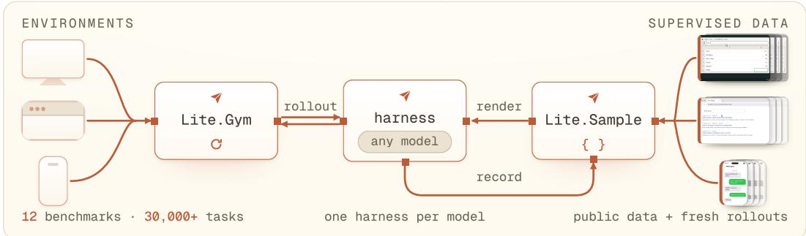  
Figure 1: CUA-Lite overview. One environment interface, Lite.Gym, serves every integrated environment, regardless of its runtime. One supervised data format, Lite.Sample, stores all supervised data, converted from public datasets or recorded through rollouts. One harness per model connects it to both, so evaluation, RL, and SFT share the same code (§2.3).

(1) Unified environment interface. Lite.Gym (§2.1) exposes an environment as a Gym-style reset, step, and close loop (Towers et al., 2025). The loop standardizes one observation format across environments: a screenshot, text, or both. It also standardizes one GUI action space per platform, issued as tool calls (e.g., click and type on desktop and browser, or tap and swipe on mobile). Each environment can add extra tools of its own (e.g., bash in our desktop sandboxes). The loop wraps the environment’s own runtime: a VM, a browser, or a mobile emulator. We integrate 12 benchmarks across desktop, browser, and mobile, and add VM-free desktop sandboxes of our own. These Docker containers replicate OSWorld’s desktop at much lower cost and provide over 30,000 verifiable tasks for training (§2.1.2).

(2) Unified supervised data format. Lite.Sample (§2.2) stores any supervised data, from GUI grounding and understanding to full rollouts, in one standardized format: multi-turn messages that interleave the model’s tool calls with the environment’s observations. We convert 9 major public CUA datasets (Deng et al., 2023; Xu et al., 2025b; Wang et al., 2025c; Mu et al., 2025) and record fresh rollouts from frontier CUAs.

(3) Model harnesses shared across evaluation, RL, and SFT. Each model has one harness (§2.3), the code that adapts the model to the environment interface and the data format. Through its harness, a model runs in every integrated environment, and its rollouts serve both evaluation and RL. The same harness renders any stored Lite.Sample, including other models’ rollouts, into the model’s own training format for SFT. Harnesses exist for 14 model families, including open-weight models (UI-TARS, Qwen, and others) and API models (GPT, Claude, and Gemini).

We release reference scores for 15 models on the 12 integrated benchmarks (§3). We further demonstrate how the rollout data and the verifiable tasks of CUA-Lite improve an openweight computer use agent, by SFTing Qwen3.5-4B on GPT-5.5 rollouts and then training it with GRPO on our verifiable tasks (§4). We release our dataset, code, and models, and welcome contributions.

## 2 The CUA-Lite Platform

In this section we introduce the three standardized abstractions: the environment interface Lite.Gym (§2.1), under which we integrate existing benchmarks and our VM-free desktop sandboxes with verifiable tasks; the supervised data format Lite.Sample (§2.2), into which we convert public supervised datasets and record fresh rollouts; and the per-model harness (§2.3) that runs a model against both. Appendix A reviews related work.

```python
env = gym.make("osworld@chrome_030", max_steps=30) # any integrated environment
obs = await env.reset() # obs.image, obs.text
# one step: three GUI actions in one call, one paired result
step = await env.step([make_tool_call("computer", {"actions": [
{"action": "click", "coordinate": [412, 87]},
{"action": "type", "text": "example.com"},
{"action": "key", "keys": ["enter"]}]}, call_id="call_0")])
# step.results (one per call id), step.reward, step.terminated, step.truncated
# end to end: the whole rollout, driven by the model’s harness
agent = agents.make("gpt-5.5", env=env) # resolves the harness
sample = await agent.sample(env) # the rollout, as a Lite.Sample
```  
Figure 2: One step and one rollout through the environment interface. Three GUI actions in one computer call return one result per call\_id, so action batching costs one round trip.

Table 1: GUI actions and extra tools per platform. See Appendix B for details.
<table><tr><td>Platform</td><td>Tool and actions</td></tr><tr><td colspan="2">GUI actions</td></tr><tr><td>Desktop, Browser</td><td>computer: click,mouse_move,mouse_down,mouse_up,drag,scroll, type, key,key_down, key_up,hold_key,wait,screenshot,cursor_position</td></tr><tr><td>Mobile</td><td>mobile: tap,long_press,swipe,drag,pinch, type,system_button point,bbox: return a coordinate or a box</td></tr><tr><td colspan="2">Grounding Extra tools</td></tr><tr><td></td><td></td></tr><tr><td>All platforms</td><td>response,terminate: finish the task</td></tr><tr><td>Desktop Browser</td><td>bash: run a shell command goto, back, forward: navigate</td></tr><tr><td></td><td>new_tab,switch_tab,close_tab: manage tabs</td></tr><tr><td>Mobile</td><td>open_app: launch an application ask_user: ask the user a question</td></tr></table>

## 2.1 Environment Interface: Lite.Gym

Lite.Gym exposes every integrated environment through one interface (Figure 2), a Gymstyle loop (Towers et al., 2025) that standardizes one observation format across environments and one GUI action space per platform, plus optional extra tools per environment (Table 1).

GUI actions as tool calls. CUA-Lite standardizes the GUI actions of each platform and exposes them through one tool per platform: click, type, and key through computer tool on desktop and browser; tap, swipe, and system\_button through mobile tool on mobile (Table 1). The model’s harness maps its raw actions into that space (§2.3), so a model built for one action vocabulary runs on any integrated environment. Each tool call may carry a sequence of actions, so a model can plan several steps in one turn with action batching (Figure 2). A GUI action’s coordinates are normalized to [0, 1000] on every platform.

Extra tools per environment. Beyond the GUI actions, an environment optionally exposes tools of its own: bash on Linux desktops, goto and back on browser, and open\_app on mobile (Table 1). A model issues these tools alongside the platform’s GUI actions.

Observations as tool results. A GUI action returns a screenshot, plus any text the environment emits. An extra tool returns its own result, such as a shell command’s output.

## 2.1.1 Benchmarks and Training Environments

We integrate 12 benchmarks and 6 training environments with verifiable tasks across desktop, browser, and mobile (Table 2). Most environments run unchanged on their own runtimes, with two kinds of exception. Three benchmarks run on third-party implementations: WebVoyager on WebHarbor’s offline mirrors of its 15 websites (WebHarbor Team and Contributors, 2026), and WebArena and MiniWoB++ on BrowserGym (Le Sellier de Chezelles et al., 2025) (Appendix C). The four Lite.\* environments run on our VM-free desktop sandboxes, described in §2.1.2.

Table 2: The benchmarks and training environments in CUA-Lite. Each Lite.\* environment runs the tasks of its source (OSWorld (Xie et al., 2024), SCALECUA (Lv et al., 2026), CUA-Gym (Wang et al., 2026), or Gym-Anything (Aggarwal et al., 2026)) on our VM-free desktop sandboxes; every other environment runs on its own runtime.
<table><tr><td>Benchmark</td><td>#Eval tasks</td><td>Benchmark</td><td>#Eval tasks</td></tr><tr><td>Grounding</td><td></td><td>Browser</td><td></td></tr><tr><td>ScreenSpot-Pro (2025)</td><td>1,581</td><td>WebVoyager (2024)</td><td>643</td></tr><tr><td>OSWorld-G (2025)</td><td>564</td><td>WebArena (2024)</td><td>812</td></tr><tr><td>Desktop</td><td></td><td>MiniWoB++ (2018)</td><td>125</td></tr><tr><td>OSWorÍd (2024)</td><td>369</td><td>Mobile</td><td></td></tr><tr><td>OSWorld 2.1 (2026)</td><td>108</td><td>AndroidWorld (2025)</td><td>116</td></tr><tr><td>WindowsAgentArena (2025)</td><td>154</td><td>AndroidLab (2025a)</td><td>138</td></tr><tr><td></td><td></td><td>MobileWorld (2026)</td><td>201</td></tr><tr><td></td><td></td><td>MobileGym (2026)</td><td>256</td></tr><tr><td>Training environment</td><td>#Train tasks</td><td>Training environment</td><td>#Train tasks</td></tr><tr><td>Desktop</td><td></td><td>Browser</td><td></td></tr><tr><td>Lite.OSWorld</td><td>2,429</td><td>WebGym (2026)</td><td>292,092</td></tr><tr><td>Lite.ScaleCUA (2026)</td><td>20,289</td><td>Mobile</td><td></td></tr><tr><td>Lite.CUAGym (2026)</td><td>10,910</td><td>MobileGym (2026)</td><td>160</td></tr><tr><td>Lite.CUAWorld (2026)</td><td>2,479</td><td></td><td></td></tr></table>

<table><tr><td></td><td>OSWorld</td><td>Lite.OSWorld</td></tr><tr><td>Runtime</td><td>QEMU/KVM VM</td><td>Docker container</td></tr><tr><td>Host</td><td>/dev/kvm, nested virt.</td><td>any Docker host</td></tr><tr><td>Disk</td><td>31 GB</td><td>6.8 GB</td></tr><tr><td>Memory</td><td>3.8 GB</td><td>0.6 GB</td></tr><tr><td>Cold start</td><td>29.3 s</td><td>21.3 s</td></tr><tr><td>CPU when idle</td><td>5.7 %</td><td>1.4 %</td></tr></table>

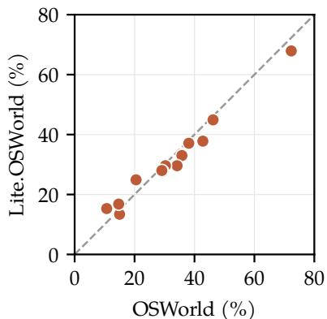  
Figure 3: Lite.OSWorld against OSWorld. Left: cost of one instance, median over 20 cold starts with both runtimes allocated 4 GB and 4 cores; memory (resident usage within that allocation) and CPU are cgroup counters over a 300 s window with no action sent (Appendix D). Right: evaluation scores (%) of 13 models. The dashed line marks equal scores. See Table D.1 for per-model scores.

## 2.1.2 VM-Free Desktop Sandboxes (Lite.\*)

Most existing desktop environments, such as OSWorld, are distributed as virtual machines. Each instance needs KVM, which shared and cloud hosts often do not expose, and carries a full guest OS, which makes it heavy to run and slow to boot. We propose VM-free desktop sandboxes (Lite.\*), containerized Linux desktops that replicate OSWorld’s desktop at much lower cost. The official OSWorld VM ships as a disk image with no build recipe, so we reverse-engineer it. We recover the applications installed in the VM and their configuration, and rebuild the desktop from them as Dockerfiles. Our rebuilt OSWorld sandbox, Lite.OSWorld, keeps OSWorld’s 369 evaluation tasks, setups, and verifiers unchanged.

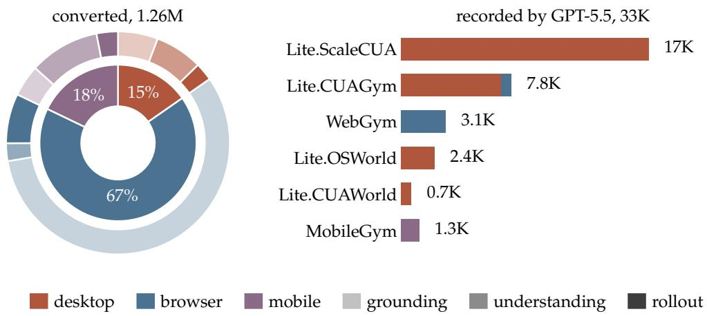  
Figure 4: The stored Lite.Samples. Left: the 9 converted datasets, by platform (inner ring) and by task type within each platform (outer ring). Right: GPT-5.5’s rollouts with verified reward on our training environments, by platform; Appendix E.3 adds those of Qwen3.5-27B and Qwen3.8-27B.

Cost. A VM-free sandbox carries no guest OS and shares the host kernel, so it runs on a sixth of OSWorld’s memory and boots in three quarters of the time (Figure 3, left).

Fidelity. Lite.OSWorld yields evaluation scores close to OSWorld’s. We run 13 models, 12 open-weight and GPT-5.5, on OSWorld (Xie et al., 2024) and on Lite.OSWorld, over the same 332 tasks (OSWorld’s 369 minus 29 infeasible tasks and 8 that need a Google account) and with identical setup, verifiers, harnesses, and seed (Figure 3, right). Scores differ by 2.7 points on average and by 5.0 at worst, on EvoCUA-8B, and the two rankings agree with a Spearman correlation of 0.98 across all 13 models (Table D.1).

Training tasks. Beyond the evaluation tasks they inherit, our sandboxes provide over 30,000 training tasks with verifiers (Table 2):

(1) Lite.OSWorld adds two training splits to OSWorld’s 369 evaluation tasks: 1,722 tasks synthesized from templates and 707 perturbed from 256 of them (Appendix D).

(2) Lite.ScaleCUA runs the 20,289 desktop tasks SCALECUA (Lv et al., 2026) synthesized on that same OSWorld desktop.

(3) Lite.CUAGym runs the 10,910 desktop and browser tasks of CUA-Gym (Wang et al., 2026), across mock sites and real applications.

(4) Lite.CUAWorld runs 2,479 tasks on the 41 professional applications of Gym-Anything (Aggarwal et al., 2026).

## 2.2 Supervised Data Format: Lite.Sample

A Lite.Sample stores any supervised data (a UI grounding label, UI question understanding, or a full rollout) in one standardized format: multi-turn messages that interleave the model’s tool calls with the environment’s observations. See Appendix E.1 for the schema.

Converted datasets. We convert 9 major public CUA datasets, covering GUI grounding, understanding, and full rollouts, into 1.26M Lite.Samples (Deng et al., 2023; Lu et al., 2025; Xu et al., 2025b; Wang et al., 2025c; Liu et al., 2026a; Mu et al., 2025) (Figure 4, left). See Appendix E.2 for the datasets and the conversion rules.

Fresh rollouts. We record rollouts of GPT-5.5, Qwen3.5-27B, and Qwen3.8-27B on our training environments and keep those with verified reward, 82K Lite.Samples in all (Figure 4, right). Each recorded step stores the model’s reasoning\_content, an action\_description of the step in one line of natural language, and the tool\_call it issues, carrying either a batch of GUI actions or one of the environment’s extra tools (§2.1). Appendix E.3 details how we collect them.

Table 3: Reference evaluation scores (%) on all 12 benchmarks. Bold: best per benchmark; underline: best open-weight model. WAA: WindowsAgentArena. –: not applicable. Qwen models run with reasoning off and API models at medium effort. See Appendix F for details.
<table><tr><td>Model</td><td>ScreenSpot-Pro Grounding</td><td>OSWorld-G</td><td>OSWorld Desktop</td><td>OSWorld 2.1</td><td>WAA</td><td>WebVoyager</td><td>WebArena Browser</td><td>MiniWoB++</td><td>AndroidWorld</td><td>AndroidLab Mobile</td><td></td><td>MobileWorld MobileGym</td></tr><tr><td>Specialist CUAs</td><td></td><td></td><td></td><td></td><td></td><td></td><td></td><td></td><td></td><td></td><td></td><td></td></tr><tr><td>UI-TARS-1.5-7B</td><td>49.8</td><td>60.6</td><td>27.5</td><td>0.5</td><td>16.7</td><td>46.2</td><td>9.1</td><td>18.4</td><td>19.8</td><td>36.2</td><td>11.1</td><td>13.3</td></tr><tr><td>EvoCUA-8B</td><td>43.5</td><td>57.3</td><td>35.6</td><td>0.7</td><td>16.6</td><td>5.8</td><td>10.8</td><td>56.0</td><td></td><td></td><td></td><td></td></tr><tr><td>MAI-UI-8B</td><td>62.2</td><td>70.0</td><td></td><td></td><td></td><td></td><td></td><td></td><td>61.2</td><td>49.3</td><td>29.9</td><td>25.8</td></tr><tr><td>UI-Venus-2-9B</td><td>71.9</td><td>78.2</td><td>50.5</td><td>1.4</td><td>41.3</td><td>72.9</td><td>30.7</td><td>59.2</td><td>62.1</td><td>47.8</td><td>59.0</td><td>34.4</td></tr><tr><td>General VLMs</td><td></td><td></td><td></td><td></td><td></td><td></td><td></td><td></td><td></td><td></td><td></td><td></td></tr><tr><td>Qwen3-VL-4B</td><td>58.3</td><td>65.5</td><td>23.6</td><td>0.9</td><td>9.5</td><td>20.6</td><td>8.7</td><td>47.2</td><td>43.1</td><td>36.2</td><td>6.8</td><td>13.7</td></tr><tr><td>Qwen3-VL-8B</td><td>55.2</td><td>64.3</td><td>28.1</td><td>0.3</td><td>14.5</td><td>29.3</td><td>7.1</td><td>53.6</td><td>51.7</td><td>39.9</td><td>8.5</td><td>16.0</td></tr><tr><td>Qwen3-VL-32B</td><td>57.7</td><td>72.0</td><td>34.3</td><td>1.2</td><td>24.0</td><td>42.8</td><td>14.6</td><td>60.8</td><td>62.1</td><td>36.2</td><td>17.9</td><td>23.4</td></tr><tr><td>Qwen3.5-4B</td><td>57.7</td><td>62.9</td><td>27.0</td><td>0.7</td><td>11.6</td><td>12.2</td><td>11.3</td><td>28.0 50.4</td><td>60.3</td><td>34.8</td><td>11.1</td><td>17.6</td></tr><tr><td>Qwen3.5-9B</td><td>58.1 69.5</td><td>68.2</td><td>38.6</td><td>0.4</td><td>13.1</td><td>35.0 51.7</td><td>15.4 21.9</td><td>68.8</td><td>62.1</td><td>36.2</td><td>10.3</td><td>18.0</td></tr><tr><td>Qwen3.5-27B</td><td></td><td>74.3</td><td>48.9</td><td>2.8</td><td>25.4</td><td></td><td></td><td></td><td>65.1</td><td>40.6</td><td>15.4</td><td>26.6</td></tr><tr><td>Qwen3.8-27B API models</td><td>75.4</td><td>79.6</td><td>59.2</td><td>2.4</td><td>37.0</td><td>55.4</td><td>24.5</td><td>64.8</td><td>64.7</td><td>51.4</td><td>32.5</td><td>40.2</td></tr><tr><td colspan="9"></td><td>62.3</td><td>78.6 70.2</td><td></td></tr><tr><td>Claude Opus 5</td><td>85.3</td><td>89.2</td><td>78.7</td><td>63.1</td><td>72.4 66.6</td><td>90.4 78.4</td><td>51.7 47.1</td><td>91.2 84.8</td><td>81.0 78.4</td><td>60.9</td><td></td><td></td></tr><tr><td>GPT-5.5</td><td>74.5 82.5</td><td>90.4 91.2</td><td>71.1 73.3</td><td>38.6 43.9</td><td>70.0</td><td>79.8</td><td>53.3</td><td>82.4</td><td>75.9</td><td>60.9</td><td>80.3 86.3</td><td>53.9 64.1</td></tr><tr><td>GPT-5.6 Sol GPT-6 Astra</td><td>93.9</td><td>92.5</td><td>75.1</td><td>63.0</td><td>63.4</td><td>84.3</td><td>53.3</td><td>87.2</td><td>84.5</td><td>60.9</td><td>85.5</td><td>80.9</td></tr><tr><td></td><td></td><td></td><td></td><td></td><td></td><td></td><td></td><td></td><td></td><td></td><td></td><td></td></tr></table>

## 2.3 Model Harness Shared Across Evaluation, RL, and SFT

A harness is the scaffolding that makes a model an agent. It turns each observation and the history into the model’s input, parses the output back into actions, and drives the loop. CUA-Lite has one harness per model, built around an adapter that converts between a Lite.Sample and the model’s own input and output. For SFT, the adapter renders a stored Lite.Sample into the model’s own format for training (§2.2). During a rollout for evaluation or RL, it renders the Lite.Sample as it grows and converts the model’s reply back into Lite.Gym actions. Inside the adapter, action\_space maps the model’s raw actions to and from the standardized GUI actions (§2.1), and protocol manages the model’s context across turns. Modules are shared and inherited across models (Qwen3.5, Qwen3.8, and EvoCUA all build on Qwen3-VL’s), so a new harness implements only what differs. Harnesses currently exist for 14 model families.

## 3 Evaluation

In this section we run each model on the benchmarks it supports and release the resulting reference scores (Table 3). Most previously reported scores come with no runnable evaluation script, so we do not claim to reproduce them; instead, we offer these scores as a reference that can be rerun from the CUA-Lite configuration we release.

Models. We run 15 models: specialist CUAs (UI-TARS-1.5, EvoCUA, MAI-UI, UI-Venus-2), general VLMs (Qwen3-VL at 4B–32B, Qwen3.5 at 4B–27B, Qwen3.8-27B), and API models (Claude Opus 5, GPT-5.5, GPT-5.6 Sol, GPT-6 Astra). Each runs through its own harness (§2.3), with the settings of Table F.1. By default, open-weight models run with reasoning off and API models at medium reasoning effort. The one exception is UI-Venus-2, which by its official default runs with reasoning on for every task other than grounding.

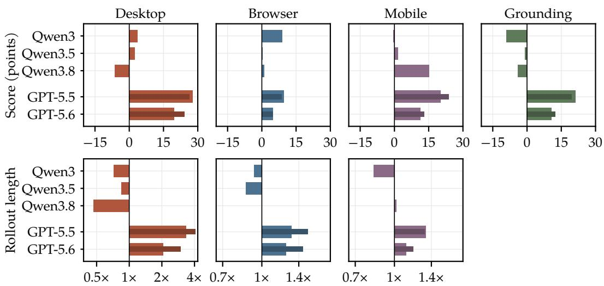  
Figure 5: Effect of reasoning on score and rollout length. Top: the change in score. Bottom: the ratio of rollout lengths. For Qwen models, each bar compares reasoning on with reasoning off; for GPT models, medium (wide bar) or xhigh (narrow, darker bar) reasoning effort with none. Each platform averages its benchmarks. The Qwen3 and Qwen3.5 rows average Qwen3-VL (4B–32B) and Qwen3.5 (4B–27B), shown per model in Figure F.1.

Benchmarks. We run the 12 benchmarks of Table 2 across grounding, desktop, browser, and mobile. Most scores come from one rollout per task under one fixed seed, with greedy decoding and each benchmark’s own step budget. See Appendix F for the tasks we evaluate.

Results. At the same default reasoning effort (medium), GPT-6 Astra and Claude Opus 5 score highest, Astra on grounding and Opus 5 on most desktop and browser benchmarks (Table 3). Among open-weight models, Qwen3.8-27B and UI-Venus-2-9B score highest, and each Qwen family improves with model size on average.

Reasoning ablation. We rerun Qwen3-VL, Qwen3.5, and Qwen3.8 with reasoning on and off (default), and GPT-5.5 and GPT-5.6 Sol at none, medium (default), and xhigh reasoning effort (Figure 5, Table F.2). Reasoning helps the GPT models far more than the Qwen models. The GPT models gain on every platform from none to medium, and little more at xhigh, and their rollouts grow longer as they verify their work before terminating. For the Qwen models, reasoning lowers every model’s grounding average and mostly shortens their rollouts, but its effect on their scores on the other platforms varies. For example, Qwen3.8-27B gains 15 points on mobile but loses 6.3 on desktop, where its rollouts are 53% shorter than without reasoning.

## 4 Training

In this section, we demonstrate how the rollout data and the verifiable tasks of CUA-Lite improve an open-weight computer use agent through SFT and RL. Specifically, we first SFT Qwen3.5-4B on the GPT-5.5 rollouts of §2.2 (§4.1), and then further train the SFTed model with GRPO (Shao et al., 2024) on the verifiable tasks of §2.1.1 (§4.2). Every SFT and RL run uses a single node of 8 A100 GPUs, 96 vCPU, 1.8 TB RAM.

Table 4: Evaluation scores (%) of Qwen3.5-4B before and after SFT on GPT-5.5 rollouts. The rows without SFT differ by whether Qwen3.5-4B’s own reasoning is on, the SFT rows by whether the GPT-5.5 rollouts used for SFT contain reasoning. The rows without SFT use the configuration of SFT (one screenshot) for fair comparison rather than the official configuration of Table 3 (up to four screenshots), so their scores differ from Table 3.
<table><tr><td></td><td>Desktop Lite.OSWorld</td><td>Browser WebVoyager</td><td>Mobile MobileGym</td></tr><tr><td colspan="4">Without SFT</td></tr><tr><td>w/o reasoning</td><td>22.6</td><td>4.4</td><td>14.6</td></tr><tr><td>w/ reasoning</td><td>27.1</td><td>14.8</td><td>13.9</td></tr><tr><td colspan="4">SFT on GPT-5.5 rollouts</td></tr><tr><td>w/o reasoning</td><td>37.2</td><td>48.7</td><td>21.4</td></tr><tr><td>w/ reasoning</td><td>44.8</td><td>60.0</td><td>26.8</td></tr></table>

## 4.1 SFT

Setup. We SFT Qwen3.5-4B on GPT-5.5 rollouts collected from the verifiable training tasks (§2.2) that pass the verifier, and evaluate on held-out tasks. For desktop, we train on 5,000 Lite.Samples from Lite.ScaleCUA and evaluate on Lite.OSWorld’s 332 evaluation tasks (OSWorld’s 369, excluding the 29 infeasible tasks and the 8 that need a Google account). For browser, we train on about 2,000 Lite.Samples from WebGym and evaluate on 128 held-out WebVoyager tasks. For mobile, we train on about 1,000 Lite.Samples from MobileGym, whose 160 training tasks are templates that each generate many instances, and evaluate on its own 256 held-out tasks. We train Qwen3.5-4B with its official computer use harness (§2.3), with an image history of one screenshot (1920 1080 on desktop, 1280 720 on browser, 720 1600 on mobile) and the full text history. We evaluate every model three times at temperature 0 and report the mean success rate (Appendix G).

Results. SFT on the GPT-5.5 rollouts raises Qwen3.5-4B from 22.6 to 44.8 on desktop, from 4.4 to 60.0 on browser, and from 14.6 to 26.8 on mobile (Table 4). As an ablation, we run SFT on these rollouts without their reasoning (§2.2), which costs 7.6, 11.3, and 5.4 points respectively, while Qwen3.5-4B’s own reasoning does not always help before SFT.

Ablations. We also ablate two choices of the SFT setup: the teacher that provides the rollouts and the image history (Table G.1 gives the exact scores).

(1) Teacher (Figure 6, left). We ablate the model whose rollouts Qwen3.5-4B is SFTed on, replacing GPT-5.5 with Qwen3.5-27B on desktop. GPT-5.5 is the stronger teacher, and most of its lead comes from reasoning. Without reasoning, Qwen3.5-27B’s rollouts train a model close to GPT-5.5’s, and adding its reasoning helps little.

(2) Image history (Figure 6, right). We ablate how many of the most recent screenshots Qwen3.5-4B keeps in its context, one or four. The latest screenshot alone does about as well as four, both before and after SFT.

## 4.2 RL

Setup. We train the SFTed Qwen3.5-4B with GRPO on verifiable tasks (§2.1.1) and evaluate on held-out tasks. For desktop, we train on the 814 LibreOffice tasks (Impress, Calc, Writer) that Lite.OSWorld synthesizes, and evaluate on the 117 LibreOffice tasks of the official OSWorld evaluation set. For browser, we use the 622 WebVoyager tasks that do not modify their site, on WebHarbor’s offline mirrors, and train on 494 of them and evaluate on the other 128, the held-out tasks of §4.1. For mobile, we drop the hardest level of MobileGym’s evaluation split and group the rest into 37 task families. We train on one task from each family and evaluate on the 52 remaining tasks of those families, with a shaped reward that gives partial credit for passed goal checks. We run five seeds per platform (Appendix G).

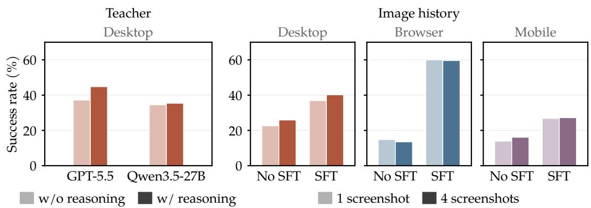  
Figure 6: SFT ablations of Qwen3.5-4B. Left: desktop evaluation scores (%) after SFT on each teacher’s rollouts, with and without reasoning. Right: evaluation scores (%) with the one or four most recent screenshots in context, without SFT and after SFT on GPT-5.5 rollouts, both with reasoning. Desktop screenshots are 1920 1080 on the left and 1280 720 on the right, as in Table G.1.

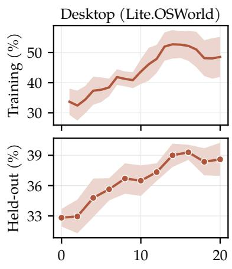

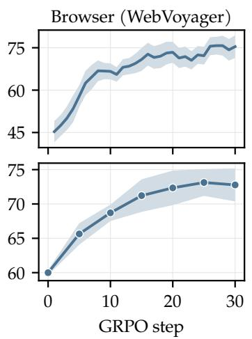

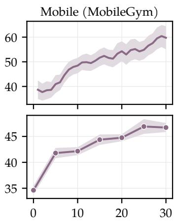  
Figure 7: GRPO from the SFTed Qwen3.5-4B. Top: training reward per GRPO step, smoothed over five GRPO steps. Bottom: held-out evaluation score. Both rows show the mean and standard error over five seeds. Mobile evaluates on a subset of Table 4’s held-out tasks, and desktop on OSWorld’s LibreOffice tasks.

Results. GRPO further improves the SFTed Qwen3.5-4B on every platform (Figure 7). On held-out tasks, the evaluation score rises from 32.8 to 38.6 on desktop, the success rate from 60.0 to 72.8 on browser, and the shaped reward from 34.6 to 46.7 on mobile.

Choosing training tasks. The obvious training tasks do not always suit RL. On desktop, before the runs in Figure 7, we tried GRPO on the official Lite.ScaleCUA RL split but found it did not raise the held-out score. We hypothesize that SFT on GPT-5.5’s Lite.ScaleCUA rollouts had already saturated the model on those tasks. The desktop runs in Figure 7 therefore use Lite.OSWorld’s synthesized LibreOffice tasks, one application suite so that a run fits on one node. On browser, training on live websites is prone to IP blocking, so we instead train on WebHarbor’s offline mirrors, using the WebVoyager tasks outside our heldout set. On mobile, MobileGym’s official training split is much easier than its evaluation split, so we draw our training and held-out tasks from it.

## 5 Limitations and Conclusion

Limitations. CUA-Lite standardizes how environments, data, and models connect, but it also inherits their limitations. Open mobile environments with verifiable training tasks are scarce, so MobileGym is our only mobile training environment. WebVoyager runs on offline mirrors of its websites, so its scores do not measure the live sites. We do not fully audit the training verifiers, and a model judge scores some tasks in Lite.CUAGym and Lite.CUAWorld, so SFT data and RL rewards can include rollouts that did not solve their task. Our VM-free desktop sandboxes cover only Linux desktops, so Windows environments such as WindowsAgentArena still need a virtual machine, and mobile environments such as AndroidWorld still need an emulator. In §4, the desktop and mobile models are evaluated on the applications they train on, so their gains do not show transfer to unseen applications. Most previously reported scores come with no runnable evaluation script, so we do not claim to reproduce them and offer ours only as reference scores. Our harnesses implement only each model’s own GUI loop, not richer harnesses such as Codex and Claude Code.

Conclusion. CUA-Lite gives computer use agent development one standard: an environment interface, a supervised data format, and per-model harnesses shared across evaluation, RL, and SFT. On that standard we integrate 12 benchmarks and VM-free desktop sandboxes with over 30,000 verifiable tasks, convert the major public CUA datasets, and record fresh rollouts. CUA-Lite stays open to contributions, and every number in this paper ships with the command that produces it.

## References

Pranjal Aggarwal, Graham Neubig, and Sean Welleck. Gym-Anything: Turn any software into an agent environment. arXiv preprint arXiv:2604.06126, 2026. URL https://arxiv. org/abs/2604.06126.

Ahmed Awadallah, Yash Lara, Raghav Magazine, Hussein Mozannar, Akshay Nambi, Yash Pandya, Aravind Rajeswaran, Corby Rosset, Alexey Taymanov, Vibhav Vineet, et al. Fara-7B: An efficient agentic model for computer use. arXiv preprint arXiv:2511.19663, 2025. URL https://arxiv.org/abs/2511.19663.

Hao Bai, Alexey Taymanov, Tong Zhang, Aviral Kumar, and Spencer Whitehead. WebGym: Scaling training environments for long-horizon visual web agents with realistic tasks. In Proceedings of the IEEE/CVF Conference on Computer Vision and Pattern Recognition (CVPR), 2026.

Shuai Bai, Yuxuan Cai, Ruizhe Chen, Keqin Chen, Xionghui Chen, Zesen Cheng, Lianghao Deng, Wei Ding, Chang Gao, Chunjiang Ge, et al. Qwen3-VL technical report. arXiv preprint arXiv:2511.21631, 2025a. URL https://arxiv.org/abs/2511.21631.

Shuai Bai, Keqin Chen, Xuejing Liu, Jialin Wang, Wenbin Ge, Sibo Song, Kai Dang, Peng Wang, Shijie Wang, Jun Tang, et al. Qwen2.5-VL technical report. arXiv preprint arXiv:2502.13923, 2025b. URL https://arxiv.org/abs/2502.13923.

Rogerio Bonatti, Dan Zhao, Francesco Bonacci, Dillon Dupont, Sara Abdali, Yinheng Li, Yadong Lu, Justin Wagle, Kazuhito Koishida, Arthur Bucker, et al. Windows Agent Arena: Evaluating multi-modal OS agents at scale. In International Conference on Machine Learning (ICML), 2025.

Wentong Chen, Junbo Cui, Jinyi Hu, Yujia Qin, Junjie Fang, Yue Zhao, Chongyi Wang, Jun Liu, Guirong Chen, Yupeng Huo, et al. GUICourse: From general vision language model to versatile GUI agent. In Proceedings of the 63rd Annual Meeting of the Association for Computational Linguistics (Volume 1: Long Papers), 2025. doi: 10.18653/v1/2025.acl-long. 1065.

Xiang Deng, Yu Gu, Boyuan Zheng, Shijie Chen, Sam Stevens, Boshi Wang, Huan Sun, and Yu Su. Mind2Web: Towards a generalist agent for the web. In Advances in Neural Information Processing Systems (NeurIPS), 2023. doi: 10.52202/075280-1220.

Hongliang He, Wenlin Yao, Kaixin Ma, Wenhao Yu, Yong Dai, Hongming Zhang, Zhenzhong Lan, and Dong Yu. WebVoyager: Building an end-to-end web agent with large multimodal models. In Proceedings of the 62nd Annual Meeting of the Association for Computational Linguistics (Volume 1: Long Papers), 2024. doi: 10.18653/v1/2024.acl-long.371.

Jing Yu Koh, Robert Lo, Lawrence Jang, Vikram Duvvur, Ming Lim, Po-Yu Huang, Graham Neubig, Shuyan Zhou, Russ Salakhutdinov, and Daniel Fried. VisualWebArena: Evaluating multimodal agents on realistic visual web tasks. In Proceedings ofthe 62nd Annual Meeting of the Association for Computational Linguistics (Volume 1: Long Papers), 2024. doi: 10.18653/v1/2024.acl-long.50.

Quyu Kong, Xu Zhang, Zhenyu Yang, Nolan Gao, Chen Liu, Panrong Tong, Chenglin Cai, Hanzhang Zhou, Jianan Zhang, Liangyu Chen, et al. MobileWorld: Benchmarking autonomous mobile agents in agent-user interactive and MCP-augmented environments. In Proceedings of the 64th Annual Meeting of the Association for Computational Linguistics (Volume 1: Long Papers), 2026. doi: 10.18653/v1/2026.acl-long.278.

Hanyu Lai, Xiao Liu, Yanxiao Zhao, Han Xu, Hanchen Zhang, Bohao Jing, Yanyu Ren, Shuntian Yao, Yuxiao Dong, and Jie Tang. ComputerRL: Scaling end-to-end online reinforcement learning for computer use agents. In International Conference on Learning Representations (ICLR), 2026.

Thibault Le Sellier de Chezelles, Maxime Gasse, Alexandre Lacoste, Massimo Caccia, Alexandre Drouin, Léo Boisvert, Megh Thakkar, Tom Marty, Rim Assouel, Sahar Omidi Shayegan, et al. The BrowserGym ecosystem for web agent research. Transactions on Machine Learning Research, 2025. URL https://openreview.net/forum?id=5298fKGmv3.

Kaixin Li, Ziyang Meng, Hongzhan Lin, Ziyang Luo, Yuchen Tian, Jing Ma, Zhiyong Huang, and Tat-Seng Chua. ScreenSpot-Pro: GUI grounding for professional high-resolution computer use. In Proceedings of the 33rd ACM International Conference on Multimedia (MM), 2025. doi: 10.1145/3746027.3755688.

Evan Zheran Liu, Kelvin Guu, Panupong Pasupat, Tianlin Shi, and Percy Liang. Reinforcement learning on web interfaces using workflow-guided exploration. In International Conference on Learning Representations (ICLR), 2018.

Zhaoyang Liu, JingJing Xie, Zichen Ding, Zehao Li, Bowen Yang, Zhenyu Wu, Xuehui Wang, Qiushi Sun, Shi Liu, Weiyun Wang, et al. ScaleCUA: Scaling open-source computer use agents with cross-platform data. In International Conference on Learning Representations (ICLR), 2026a.

Zichen Liu, Anya Sims, Keyu Duan, Changyu Chen, Simon Yu, Xiangxin Zhou, Haotian Xu, Shaopan Xiong, Bo Liu, Chenmien Tan, et al. GEM: A gym for generalist LLMs. In International Conference on Learning Representations (ICLR), 2026b.

Quanfeng Lu, Wenqi Shao, Zitao Liu, Lingxiao Du, Fanqing Meng, Boxuan Li, Botong Chen, Siyuan Huang, Kaipeng Zhang, and Ping Luo. GUIOdyssey: A comprehensive dataset for cross-app GUI navigation on mobile devices. In Proceedings of the IEEE/CVF International Conference on Computer Vision (ICCV), 2025. doi: 10.1109/ICCV51701.2025.02080.

Bowen Lv, Xiao Liu, Yanyu Ren, Hanyu Lai, Bohao Jing, Hanchen Zhang, Yanxiao Zhao, Shuntian Yao, Jie Tang, and Yuxiao Dong. SCALECUA: Scaling computer use agents with verifiable task synthesis and efficient online RL. arXiv preprint arXiv:2607.11185, 2026. URL https://arxiv.org/abs/2607.11185.

Chang Ma, Junlei Zhang, Zhihao Zhu, Cheng Yang, Yujiu Yang, Yaohui Jin, Zhenzhong Lan, Lingpeng Kong, and Junxian He. AgentBoard: An analytical evaluation board of multi-turn LLM agents. In Advances in Neural Information Processing Systems (NeurIPS), Datasets and Benchmarks Track, 2024. doi: 10.52202/079017-2365.

Meta PyTorch and Hugging Face. OpenEnv: Agentic execution environments, 2025. URL https://github.com/huggingface/OpenEnv. Release v0.5.0, accessed 2026-09-24.

Jian Mu, Chaoyun Zhang, Chiming Ni, Lu Wang, Bo Qiao, Kartik Mathur, Qianhui Wu, Yuhang Xie, Xiaojun Ma, Mengyu Zhou, et al. GUI-360◦: A comprehensive dataset and benchmark for computer-using agents. arXiv preprint arXiv:2511.04307, 2025. URL https://arxiv.org/abs/2511.04307.

Yujia Qin, Yining Ye, Junjie Fang, Haoming Wang, Shihao Liang, Shizuo Tian, Junda Zhang, Jiahao Li, Yunxin Li, Shijue Huang, et al. UI-TARS: Pioneering automated GUI interaction with native agents. arXiv preprint arXiv:2501.12326, 2025. URL https://arxiv.org/abs/ 2501.12326.

Christopher Rawles, Sarah Clinckemaillie, Yifan Chang, Jonathan Waltz, Gabrielle Lau, Marybeth Fair, Alice Li, William E. Bishop, Wei Li, Folawiyo Campbell-Ajala, et al. AndroidWorld: A dynamic benchmarking environment for autonomous agents. In International Conference on Learning Representations (ICLR), 2025.

Zhihong Shao, Peiyi Wang, Qihao Zhu, Runxin Xu, Junxiao Song, Xiao Bi, Haowei Zhang, Mingchuan Zhang, Y. K. Li, Y. Wu, et al. DeepSeekMath: Pushing the limits of mathematical reasoning in open language models. arXiv preprint arXiv:2402.03300, 2024. URL https://arxiv.org/abs/2402.03300.

Fei Tang, Zhiqiong Lu, Boxuan Zhang, Weiming Lu, Jun Xiao, Yueting Zhuang, and Yongliang Shen. ClawGUI: A unified framework for training, evaluating, and deploying GUI agents. arXiv preprint arXiv:2604.11784, 2026. URL https://arxiv.org/abs/2604. 11784.

Mark Towers, Ariel Kwiatkowski, John Balis, Gianluca De Cola, Tristan Deleu, Manuel Goulão, Andreas Kallinteris, Markus Krimmel, Arjun KG, Rodrigo Perez-Vicente, et al. Gymnasium: A standard interface for reinforcement learning environments. In Advances in Neural Information Processing Systems (NeurIPS), Datasets and Benchmarks Track, 2025. doi: 10.52202/085713-4916.

Daniel Toyama, Philippe Hamel, Anita Gergely, Gheorghe Comanici, Amelia Glaese, Zafarali Ahmed, Tyler Jackson, Shibl Mourad, and Doina Precup. AndroidEnv: A reinforcement learning platform for Android. arXiv preprint arXiv:2105.13231, 2021. URL https://arxiv. org/abs/2105.13231.

Venus Team, Zhuohan Cai, Haoxing Chen, Jiaxuan Chen, Weizhi Chen, Changlong Gao, Zhangxuan Gu, Yuan Guo, Yusong Hu, Jianrong Jiang, et al. UI-Venus-2 technical report. arXiv preprint arXiv:2609.00028, 2026. URL https://arxiv.org/abs/2609.00028.

Bowen Wang, Dunjie Lu, Junli Wang, Tianyi Bai, Shixuan Liu, Zhipeng Zhang, Haiquan Wang, Hao Hu, Tianbao Xie, Shuai Bai, et al. CUA-Gym: Scaling verifiable training environments and tasks for computer-use agents. arXiv preprint arXiv:2605.25624, 2026. URL https://arxiv.org/abs/2605.25624.

Shuai Wang, Weiwen Liu, Jingxuan Chen, Yuqi Zhou, Weinan Gan, Xingshan Zeng, Yuhan Che, Shuai Yu, Xinlong Hao, Kun Shao, et al. GUI agents with foundation models: A comprehensive survey. arXiv preprint arXiv:2411.04890, 2025a. URL https://arxiv.org/ abs/2411.04890.

Xingyao Wang, Boxuan Li, Yufan Song, Frank F. Xu, Xiangru Tang, Mingchen Zhuge, Jiayi Pan, Yueqi Song, Bowen Li, Jaskirat Singh, et al. OpenHands: An open platform for AI software developers as generalist agents. In International Conference on Learning Representations (ICLR), 2025b.

Xinyuan Wang, Bowen Wang, Dunjie Lu, Junlin Yang, Tianbao Xie, Junli Wang, Jiaqi Deng, Xiaole Guo, Yiheng Xu, Chen Wu, et al. OpenCUA: Open foundations for computeruse agents. In Advances in Neural Information Processing Systems (NeurIPS), 2025c. doi: 10.52202/085713-4669.

WebHarbor Team and Contributors. WebHarbor: Docking real websites for evolving GUI agent environments, 2026. URL https://aiming-lab.github.io/webharbor.github.io. Project website.

Dingbang Wu, Rui Hao, Haiyang Wang, Shuzhe Wu, Han Xiao, Zhenghong Li, Bojiang Zhou, Zheng Ju, Zichen Liu, Lue Fan, et al. MobileGym: A verifiable and highly parallel simulation platform for mobile GUI agent research. arXiv preprint arXiv:2605.26114, 2026. URL https://arxiv.org/abs/2605.26114.

Zhiheng Xi, Jixuan Huang, Chenyang Liao, Baodai Huang, Jiaqi Liu, Honglin Guo, Yajie Yang, Rui Zheng, Junjie Ye, Jiazheng Zhang, et al. AgentGym-RL: An open-source framework to train LLM agents for long-horizon decision making via multi-turn RL. In International Conference on Learning Representations (ICLR), 2026.

Han Xiao, Guozhi Wang, Yuxiang Chai, Zimu Lu, Weifeng Lin, Hao He, Lue Fan, Liuyang Bian, Rui Hu, Liang Liu, et al. UI-Genie: A self-improving approach for iteratively boosting MLLM-based mobile GUI agents. In Advances in Neural Information Processing Systems (NeurIPS), 2025. doi: 10.52202/085713-5028.

Tianbao Xie, Danyang Zhang, Jixuan Chen, Xiaochuan Li, Siheng Zhao, Ruisheng Cao, Toh Jing Hua, Zhoujun Cheng, Dongchan Shin, Fangyu Lei, et al. OSWorld: Benchmarking multimodal agents for open-ended tasks in real computer environments. In Advances in Neural Information Processing Systems (NeurIPS), 2024. doi: 10.52202/079017-1650.

Tianbao Xie, Jiaqi Deng, Xiaochuan Li, Junlin Yang, Haoyuan Wu, Jixuan Chen, Wenjing Hu, Xinyuan Wang, Yuhui Xu, Zekun Wang, et al. Scaling computer-use grounding via user interface decomposition and synthesis. In Advances in Neural Information Processing Systems (NeurIPS), 2025. doi: 10.52202/085713-0817.

Yifan Xu, Xiao Liu, Xueqiao Sun, Siyi Cheng, Hao Yu, Hanyu Lai, Shudan Zhang, Dan Zhang, Jie Tang, and Yuxiao Dong. AndroidLab: Training and systematic benchmarking of Android autonomous agents. In Proceedings ofthe 63rd Annual Meeting ofthe Associationfor Computational Linguistics (Volume 1: Long Papers), 2025a. doi: 10.18653/v1/2025.acl-long. 107.

Yiheng Xu, Zekun Wang, Junli Wang, Dunjie Lu, Tianbao Xie, Amrita Saha, Doyen Sahoo, Tao Yu, and Caiming Xiong. Aguvis: Unified pure vision agents for autonomous GUI interaction. In International Conference on Machine Learning (ICML), 2025b.

Taofeng Xue, Chong Peng, Mianqiu Huang, Linsen Guo, Tiancheng Han, Haozhe Wang, Jianing Wang, Xiaocheng Zhang, Xin Yang, Dengchang Zhao, et al. EvoCUA: Evolving computer use agents via learning from scalable synthetic experience. arXiv preprint arXiv:2601.15876, 2026. URL https://arxiv.org/abs/2601.15876.

Mengqi Yuan, Zilong Zhou, Xinzhuang Xiong, Weiming Wu, Jiayang Sun, Jiamin Song, Kaiqian Cui, Bowen Wang, Haoyuan Wu, Yitong Li, et al. OSWorld 2.0: Benchmarking computer use agents on long-horizon real-world tasks. arXiv preprint arXiv:2606.29537, 2026. URL https://arxiv.org/abs/2606.29537.

Zhong Zhang, Yaxi Lu, Yikun Fu, Yupeng Huo, Shenzhi Yang, Yesai Wu, Han Si, Xin Cong, Haotian Chen, Yankai Lin, et al. AgentCPM-GUI: Building mobile-use agents with reinforcement fine-tuning. In Proceedings of the 2025 Conference on Empirical Methods in Natural Language Processing: System Demonstrations, 2025. doi: 10.18653/v1/2025. emnlp-demos.12.

Longtao Zheng, Zhiyuan Huang, Zhenghai Xue, Xinrun Wang, Bo An, and Shuicheng Yan. AgentStudio: A toolkit for building general virtual agents. In International Conference on Learning Representations (ICLR), 2025.

Hanzhang Zhou, Xu Zhang, Panrong Tong, Jianan Zhang, Liangyu Chen, Quyu Kong, Chenglin Cai, Chen Liu, Yue Wang, Jingren Zhou, et al. MAI-UI technical report: Realworld centric foundation GUI agents. arXiv preprint arXiv:2512.22047, 2025. URL https: //arxiv.org/abs/2512.22047.

Shuyan Zhou, Frank F. Xu, Hao Zhu, Xuhui Zhou, Robert Lo, Abishek Sridhar, Xianyi Cheng, Tianyue Ou, Yonatan Bisk, Daniel Fried, et al. WebArena: A realistic web environment for building autonomous agents. In International Conference on Learning Representations (ICLR), 2024.

## A Related Work

Environments for CUAs span desktop (Xie et al., 2024; Yuan et al., 2026; Bonatti et al., 2025; Li et al., 2025; Xie et al., 2025; Wang et al., 2026; Lv et al., 2026; Aggarwal et al., 2026), browser (Liu et al., 2018; Zhou et al., 2024; Koh et al., 2024; He et al., 2024; Bai et al., 2026), and mobile (Toyama et al., 2021; Rawles et al., 2025; Xu et al., 2025a; Kong et al., 2026; Wu et al., 2026); each defines its own action space and runtime, and most desktop benchmarks are distributed as virtual machines. Datasets range from GUI grounding and understanding labels to full rollouts, each in its own format (Deng et al., 2023; Lu et al., 2025; Xu et al., 2025b; Wang et al., 2025c; Liu et al., 2026a; Mu et al., 2025). Models range from specialist CUAs (Qin et al., 2025; Wang et al., 2025c; Liu et al., 2026a; Zhou et al., 2025; Xue et al., 2026; Awadallah et al., 2025; Venus Team et al., 2026) to VLMs (Bai et al., 2025b;a) and API models with native computer use tools, each with its own action space and prompt format (Wang et al., 2025a). Systems and infrastructure. OpenHands targets software engineering (Wang et al., 2025b), BrowserGym and AgentLab the evaluation of web agents (Le Sellier de Chezelles et al., 2025), and ClawGUI the training and deployment of mobile agents (Tang et al., 2026); AgentStudio is a toolkit of environments, annotation tools, and benchmarks for virtual agents (Zheng et al., 2025), and AgentBoard focuses on analytical evaluation (Ma et al., 2024). GEM and AgentGym-RL provide gym-style interfaces for text agents (Liu et al., 2026b; Xi et al., 2026); ComputerRL, SCALECUA, CUA-Gym, MobileGym, and WebGym scale environments or verified tasks for one platform (Lai et al., 2026; Lv et al., 2026; Wang et al., 2026; Wu et al., 2026; Bai et al., 2026); OpenEnv standardizes environment packaging (Meta PyTorch & Hugging Face, 2025). Each of these systems covers one platform, or one of the three abstractions. CUA-Lite provides all three across desktop, browser, and mobile, and one harness per model serves evaluation, RL, and SFT alike.

## B Environment Interface (Lite.Gym)

Table B.1 lists every GUI action with its arguments, and Table B.2 the extra tools, their arguments, and the environments that expose them.

Table B.1: GUI actions and their arguments. Coordinates are normalized to [0, 1000] (§2.1).
<table><tr><td>Action</td><td>Arguments</td></tr><tr><td>computer (desktop, browser)</td><td></td></tr><tr><td>click, mouse_down, mouse_up</td><td>coordinate, button, clicks∈ {1,2,3}</td></tr><tr><td>mouse_move</td><td>coordinate</td></tr><tr><td>drag scroll</td><td>start_coordinate, coordinate, button</td></tr><tr><td>type</td><td>direction, amount, coordinate text,press_enter</td></tr><tr><td>key, key_down, key_up, hold_key</td><td>keys, duration</td></tr><tr><td>wait screenshot, cursor_position</td><td>duration</td></tr><tr><td>mobile (mobile)</td><td>none</td></tr><tr><td>tap, long_press</td><td>coordinate, clicks, duration</td></tr><tr><td>swipe, drag, pinch</td><td>start_coordinate, coordinate, direction</td></tr><tr><td>type</td><td>text</td></tr><tr><td>system_button</td><td>button</td></tr><tr><td>wait</td><td>duration</td></tr><tr><td>screenshot</td><td></td></tr><tr><td></td><td>none</td></tr><tr><td>Grounding</td><td></td></tr><tr><td>point, bbox</td><td>coordinate, box</td></tr></table>

## C Benchmark Implementations

We wrap each benchmark’s official implementation, with its tasks, runtime, and evaluator, except for three browser benchmarks that run on a third-party implementation.

Table B.2: Extra tools per platform.
<table><tr><td>Tool</td><td>Arguments</td><td>Environments</td></tr><tr><td colspan="3">All platforms</td></tr><tr><td>response</td><td>text</td><td>every non-grounding environment</td></tr><tr><td>terminate</td><td></td><td>status, reason every non-grounding environment</td></tr><tr><td colspan="3">Desktop</td></tr><tr><td>bash</td><td>command</td><td>Lite.OSWorld, Lite.ScaleCUA, Lite.CUAGym, Lite.CUAWorld</td></tr><tr><td colspan="3">Browser</td></tr><tr><td>goto</td><td>url</td><td>WebGym, WebArena, MiniWoB++</td></tr><tr><td>back</td><td>none</td><td>WebGym, WebArena, MiniWoB++,</td></tr><tr><td>forward, new_tab, close_tab none</td><td></td><td>WebVoyager WebArena, MiniWoB++</td></tr><tr><td>switch_tab</td><td>index</td><td>WebArena, MiniWoB++</td></tr><tr><td colspan="3">Mobile</td></tr><tr><td>open_app</td><td>app_name</td><td>AndroidWorld, AndroidLab, MobileWorld, MobileGym</td></tr><tr><td>ask_user</td><td>question</td><td>MobileWorld</td></tr></table>

Table D.1: Evaluation scores (%) on OSWorld and Lite.OSWorld. Both runtimes run in one parity campaign with the same settings, separate from the reference run of Table 3.
<table><tr><td>Model</td><td>OSWorld</td><td>Lite.OSWorld</td><td>Δ</td></tr><tr><td>GPT-5.5</td><td>72.3</td><td>67.9</td><td>-4.4</td></tr><tr><td>Qwen3.5-27B</td><td>46.2</td><td>44.9</td><td>-1.3</td></tr><tr><td>EvoCUA-8B</td><td>42.8</td><td>37.8</td><td>-5.0</td></tr><tr><td>Qwen3.5-9B</td><td>38.1</td><td>37.1</td><td>-1.0</td></tr><tr><td>Qwen3-VL-32B</td><td>35.8</td><td>33.0</td><td>-2.8</td></tr><tr><td>Qwen3-VL-8B</td><td>34.2</td><td>29.6</td><td>-4.6</td></tr><tr><td>Qwen3.5-4B</td><td>30.3</td><td>29.6</td><td>-0.7</td></tr><tr><td>UI-TARS-1.5-7B</td><td>29.4</td><td>27.7</td><td>-1.7</td></tr><tr><td>Qwen3-VL-4B</td><td>29.1</td><td>28.0</td><td>-1.1</td></tr><tr><td>Qwen3-VL-2B</td><td>20.5</td><td>24.9</td><td>+4.4</td></tr><tr><td>ScaleCUA-7B</td><td>15.0</td><td>13.4</td><td>-1.6</td></tr><tr><td>UI-TARS-7B-DPO</td><td>14.7</td><td>16.8</td><td>+2.1</td></tr><tr><td>Qwen3.5-2B</td><td>10.7</td><td>15.3</td><td>+4.6</td></tr></table>

WebVoyager. WebVoyager’s tasks run on WebHarbor’s offline mirrors of its 15 websites (WebHarbor Team and Contributors, 2026), served from one container whose databases reset when it starts, so its scores measure the mirrors rather than the live sites. A GPT-4.1 judge scores the last three screenshots and the final answer of each rollout.

WebArena and MiniWoB++. Both run on their BrowserGym implementations (Le Sellier de Chezelles et al., 2025), WebArena against its self-hosted website containers and Mini-WoB++ against locally served pages. BrowserGym’s fuzzy-match judge for WebArena runs on GPT-4.1 instead of the retired GPT-4 Turbo model it hard-codes.

## D VM-Free Desktop Sandboxes

Fidelity. Table D.1 gives the per-model scores behind Figure 3 (right), comparing OSWorld and Lite.OSWorld on the same 332 tasks (OSWorld’s 369, excluding the 29 infeasible tasks and the 8 that need a Google account; Appendix F) under the same setup, verifiers, and harness. Figure D.1 shows four of those tasks (in LibreOffice Calc, Chrome, VLC, and LibreOffice Writer) step by step on both runtimes.

## LibreOffice Calc

Please help me make the first letter of each word to uppercase.  
Please calculate the ages of the employees according to their birthday. Finish the work and don’t. . .  
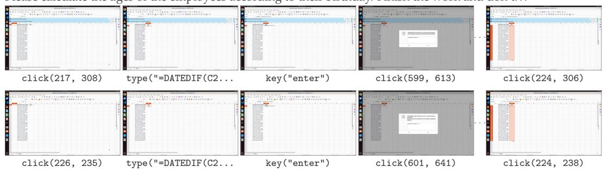

## Chrome

Book an appointment to apply for a transportation access pass at the Charlie Card store on the. . .  
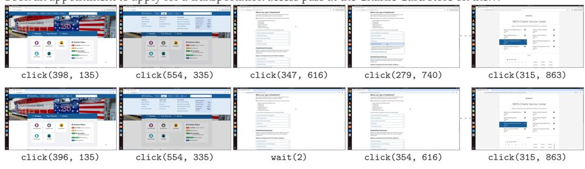

## VLC

Can you change the color of the volume slider to black-ish color? I often use the player in a. . .  
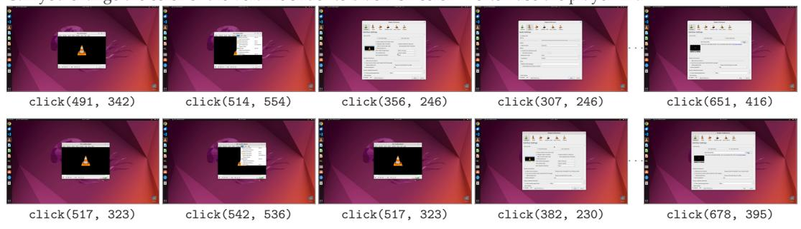

## LibreOffice Writer

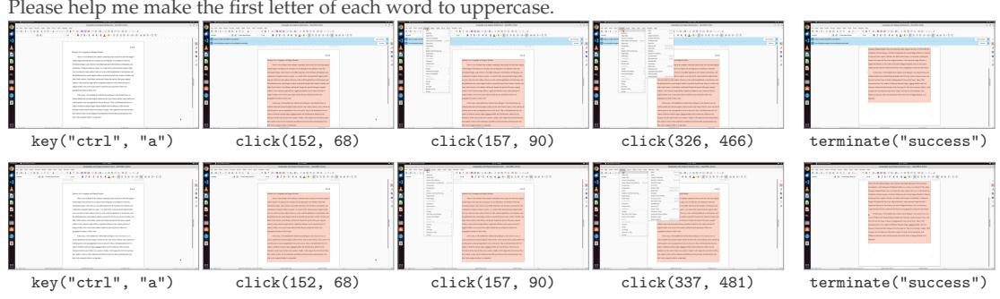  
Figure D.1: Four tasks, step by step, on both runtimes. Each block is one task, the OSWorld VM on the upper row and the Lite.OSWorld container on the lower. A row gives a rollout’s first four steps and its last, with    for the steps between and, under each panel, the action GPT-5.5 took from that screen.

Cost. Figure 3 (left) measures one instance of each runtime under a matched allocation. OS-World distributes its VM with 4 GB of guest memory and 4 cores, so we cap the Lite.OSWorld container at the same 4 GB and 4 cores for measurement.

• Cold start: the wall time from gym.make to the first observation reset returns, which covers the boot, the task’s setup, and the first screenshot. Setup differs from task to task, so we alternate two os-domain tasks rather than repeat one, and both runtimes run that same pair, which leaves setup equal on the two sides. We report the median of 20 cold starts per runtime, interleaved so that host drift reaches both.

• Memory: resident memory, read from the instance’s cgroup as memory.current minus inactive\_file, at the end of a 300 s idle window that opens 60 s after reset returns, with no action sent. Both numbers are usage rather than the cap. A container takes what it touches, and a VM holds the guest RAM its host must provide.

• Idle CPU: the cgroup’s cumulative CPU time (cpu.stat’s usage\_usec) differenced across that same window and expressed as a share of one core, rather than a sampled rate, because one desktop repaint moves a sampled percentage by two orders of magnitude.

• Disk: the image size, plus OSWorld’s qcow2.

Training tasks. Lite.ScaleCUA, Lite.CUAGym, and Lite.CUAWorld inherit the task sets of their upstream releases, with the bugs we found fixed. Lite.OSWorld adds two training splits to OSWorld’s 369 evaluation tasks (Table D.2):

• Synthesized (1,722 tasks): we generate each task from a template, and the templates of each application cover the operations of its OSWorld evaluation tasks. The tasks do not use OSWorld’s files. Most generate their own in the sandbox or copy in public ones (e.g., Wikimedia Commons photos and Project Gutenberg books), and the rest start from the application alone. Only the Thunderbird tasks reuse OSWorld’s mail profile.

• Perturbed (707 tasks): we perturb 256 of OSWorld’s evaluation tasks, keeping each task’s files and setup and changing the request.

Both splits mostly reuse OSWorld’s evaluator functions as verifiers, and we check that each task’s oracle solution scores 1. We train on the synthesized tasks (§4.2). The perturbed tasks start from the same state as evaluation tasks, so they are useful for debugging and analysis; we do not train on them and do not recommend it, as it would overfit to OSWorld.

Table D.2: Lite.OSWorld tasks per application.
<table><tr><td rowspan="2">Application</td><td colspan="2">Training</td><td rowspan="2">Evaluation</td></tr><tr><td>Synthesized</td><td>Perturbed</td></tr><tr><td>Chrome</td><td>132</td><td>91</td><td>46</td></tr><tr><td>GIMP</td><td>73</td><td>42</td><td>26</td></tr><tr><td>LibreOffice Calc</td><td>278</td><td>106</td><td>47</td></tr><tr><td>LibreOffice Impress</td><td>287</td><td>108</td><td>47</td></tr><tr><td>LibreOffice Writer</td><td>249</td><td>43</td><td>23</td></tr><tr><td>Multiple apps</td><td>379</td><td>138</td><td>101</td></tr><tr><td>OS</td><td>147</td><td>34</td><td>24</td></tr><tr><td>Thunderbird</td><td>48</td><td>32</td><td>15</td></tr><tr><td>VLC</td><td>37</td><td>44</td><td>17</td></tr><tr><td>VS Code</td><td>92</td><td>69</td><td>23</td></tr><tr><td>Total</td><td>1,722</td><td>707</td><td>369</td></tr></table>

## E Datasets (Lite.Sample)

## E.1 Format

A Lite.Sample stores supervised data (a UI grounding label, UI question understanding, or a full rollout) in three fields: the images it refers to, the conversation, and the metadata that labels it (Figure E.1). Each message is tagged with its role (user, assistant, or tool), each content part with its kind (text, image, or action description), and the reasoning has its own reasoning\_content field. Because every part is tagged, a harness can find a part by its type instead of parsing text. For example, it can drop the reasoning, keep only the most recent screenshots, or replace past steps with their action descriptions. Figure E.2 shows one Lite.Sample of each kind.

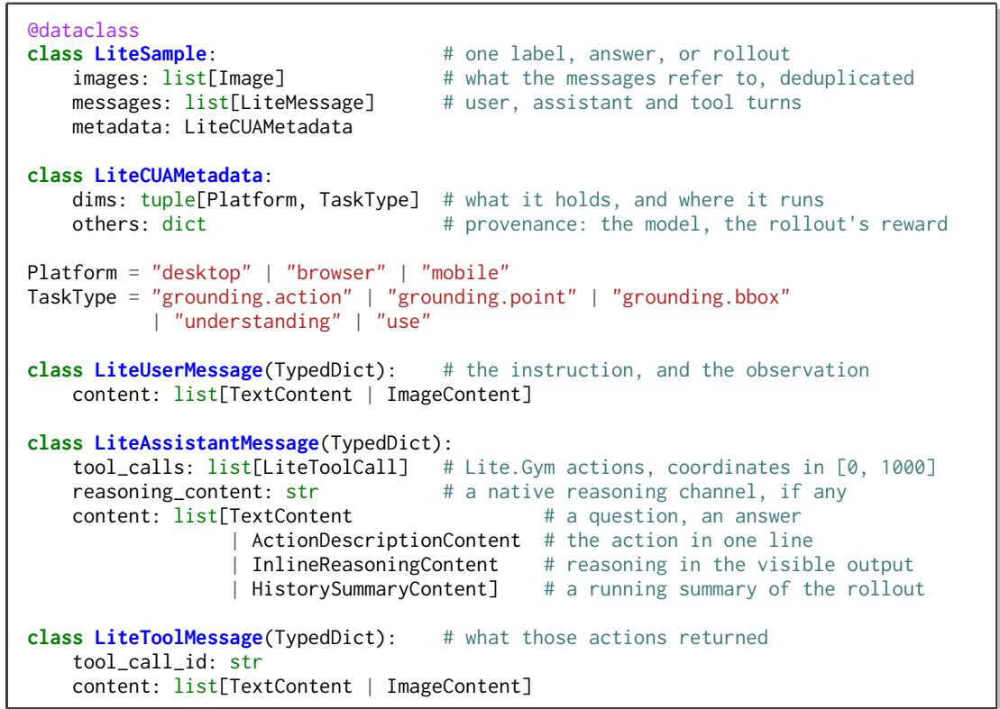  
Figure E.1: The Lite.Sample types.

## E.2 Converted Datasets

We convert 9 public datasets into Lite.Samples, across desktop, browser, and mobile (Table E.1). One converter per dataset reads the upstream release and emits Lite.Samples. Coordinates are rescaled to [0, 1000], actions are rebuilt in the Lite.Gym action set so that key names share one vocabulary, and images are deduplicated by content. We drop, rather than repair, any Lite.Sample whose image is missing or whose coordinates fall outside that range; for a use rollout we drop every step of the rollout. Each dataset’s upstream release and license are recorded in the dataset card we publish.

## E.3 Fresh Rollouts

We run each model through its own harness (§2.3) on our training environments and keep the rollouts with verified reward (Table E.2). A post-processing pass then runs over the raw logs. It strips the no-op actions screenshot and wait, and records in metadata.others.exclude\_reason why a rollout might be excluded, for example because it never finished or the agent installed software. It drops a step outright when its coordinates fall outside [0, 1000], its action is not in the Lite.Gym action set, or its call names a tool the environment did not expose.

Table E.1: The 9 converted datasets, in Lite.Samples by platform. Grounding sums the action, point, and bbox sub-types.
<table><tr><td>Dataset</td><td>Platform</td><td>Grounding</td><td>Understanding</td><td>Rollout</td><td>Total</td></tr><tr><td rowspan="3">Aguvis (2025b)</td><td>Desktop</td><td>260</td><td>0</td><td>0</td><td>260</td></tr><tr><td>Browser</td><td>634,314</td><td>0</td><td>3,729</td><td>638,043</td></tr><tr><td>Mobile</td><td>57,498</td><td>0</td><td>17,820</td><td>75,318</td></tr><tr><td>ScaleCUA (2026a)</td><td>Browser</td><td>69,246</td><td>32,445</td><td>80,800</td><td>182,491</td></tr><tr><td>GUI-360 (2025)</td><td>Desktop</td><td>72,415</td><td>86,730</td><td>10,482</td><td>169,627</td></tr><tr><td>GUIOdyssey (2025)</td><td>Mobile</td><td>0</td><td>125,197</td><td>8,330</td><td>133,527</td></tr><tr><td rowspan="2">GUIAct (2025)</td><td>Browser</td><td>14,379</td><td>0</td><td>5,497</td><td>19,876</td></tr><tr><td>Mobile</td><td>0</td><td>0</td><td>7,438</td><td>7,438</td></tr><tr><td>OpenCUA (2025c)</td><td>Desktop</td><td>0</td><td>0</td><td>22,336</td><td>22,336</td></tr><tr><td>UÎ-Genie-Agent (2025)</td><td>Mobile</td><td>0</td><td>0</td><td>4,705</td><td>4,705</td></tr><tr><td>CAGUI (2025)</td><td>Mobile</td><td>0</td><td>2,715</td><td>600</td><td>3,315</td></tr><tr><td>Multimodal-Mind2Web (2023)</td><td>Browser</td><td>0</td><td>0</td><td>597</td><td>597</td></tr><tr><td colspan="2">Total</td><td>848,112</td><td>247,087</td><td>162,334</td><td>1,257,533</td></tr></table>

Table E.2: Rollouts with verified reward per teacher, in Lite.Samples. –: not recorded.
<table><tr><td>Training environment</td><td>Platform</td><td>GPT-5.5</td><td>Qwen3.5-27B</td><td>Qwen3.8-27B</td><td>Total</td></tr><tr><td>Lite.ScaleCUA</td><td>Desktop</td><td>17,493</td><td>17,539</td><td>17,807</td><td>52,839</td></tr><tr><td>Lite.CUAGym</td><td>Desktop, browser</td><td>7,793</td><td></td><td>10,052</td><td>17,845</td></tr><tr><td>Lite.OSWorld</td><td>Desktop</td><td>2,374</td><td></td><td>2,410</td><td>4,784</td></tr><tr><td>WebGym</td><td>Browser</td><td>3,143</td><td>967</td><td></td><td>4,110</td></tr><tr><td>MobileGym</td><td>Mobile</td><td>1,279</td><td></td><td>一</td><td>1,279</td></tr><tr><td>Lite.CUAWorld</td><td>Desktop</td><td>728</td><td></td><td></td><td>728</td></tr><tr><td>Total</td><td></td><td>32,810</td><td>18,506</td><td>30,269</td><td>81,585</td></tr></table>

Every recorded step carries the model’s tool calls and an action\_description. Whether it also carries reasoning, and where that reasoning comes from, differs by model:

• Qwen3.5-27B: reasoning on, so it writes reasoning\_content natively.

• Qwen3.8-27B: reasoning off, so it carries no reasoning.

• GPT-5.5: its reasoning is prompted, not native. We prompt it for one Thought: line per step and store that line as reasoning\_content.

Every published rollout with reasoning therefore carries it in reasoning\_content.

Grounding: a question about a screenshot; the label is the tool call that answers it.

```jsonl
{"images": ["images/9c/9c4e...7b.png"],
"metadata": {"dims": ["desktop", "grounding.point"]},
"messages": [
{"role": "user",
"content": [
{"type": "image", "index": 0},
{"type": "text", "text": "Where is the save button?"}]},
{"role": "assistant",
"tool_calls": [{"id": "call_0", "type": "function",
"function": {"name": "point", "arguments": {"coordinate": [850, 120]}}}]}]}
```

Understanding: a question about a screenshot, answered in text, with no tool call.

```jsonl
{"images": ["images/1b/1b77...3d.png"],
"metadata": {"dims": ["mobile", "understanding"]},
"messages": [
{"role": "user",
"content": [
{"type": "image", "index": 0},
{"type": "text", "text": "What does this screen show?"}]},
{"role": "assistant",
"content": [{"type": "text", "text": "The music player, paused."}]}]}
```

Rollout (use): assistant and tool turns alternate until the model answers.

```jsonl
{"images": ["images/3f/3fa9...c1.png", "images/b2/b20d...4e.png", "..."],
"metadata": {"dims": ["desktop", "use"], "others": {"model_id": "gpt-5.5"}},
"messages": [
# the instruction, and the screen it starts on
{"role": "user",
"content": [
{"type": "text", "text": "Set the title font to Arial."},
{"type": "image", "index": 0}]},
# the model reasons, describes what it will do, and acts
{"role": "assistant",
"reasoning_content": "The title is selected, so the font box applies to it.",
"content": [{"type": "action_description", "text": "Open the font menu."}],
"tool_calls": [{"id": "call_0", "type": "function",
"function": {"name": "computer", "arguments": {"actions": [
{"action": "click", "coordinate": [412, 87]}]}}}]},
# the screen that action produced
{"role": "tool", "tool_call_id": "call_0",
"content": [{"type": "image", "index": 1}]},
# the next step
{"role": "assistant",
"reasoning_content": "The menu is open and Arial is visible in the list.",
"content": [{"type": "action_description", "text": "Choose Arial."}],
"tool_calls": [{"id": "call_1", "type": "function",
"function": {"name": "computer", "arguments": {"actions": [
{"action": "click", "coordinate": [388, 214]}]}}}]},
{"role": "tool", "tool_call_id": "call_1",
"content": [{"type": "image", "index": 2}]},
# many more assistant and tool turns, omitted here
# the answer that ends the rollout
{"role": "assistant",
"content": [{"type": "text", "text": "Done."}]}]}
```  
Figure E.2: One Lite.Sample per task type.

## F Evaluation Details

Tasks evaluated. We evaluate every task of ScreenSpot-Pro, WebVoyager, MiniWoB++, AndroidWorld, AndroidLab, and MobileGym, and a subset of the other six benchmarks (Table 2 gives the full counts):

• OSWorld-G: 510 of 564, without the 54 infeasible tasks, whose target element is absent.

• OSWorld: 332 of 369, without the 29 infeasible tasks and the 8 that need a Google account.

• OSWorld 2.1: 99 of 108, without the 7 tasks that need a simulated user, the one other task that needs a GitLab server, and the multi-phase task.

• WindowsAgentArena: 138 of the 154 tasks with task context, without the 13 infeasible tasks and the 3 whose evaluator already passes on the setup state.

• WebArena: 241 of 812, the first task of each of its 241 intent templates.

• MobileWorld: 117 of 201, without the 40 tasks that need MCP tools and the 44 that need a simulated user to answer the agent.

Harness settings. Each model runs through the harness of its own release (§2.3). The harness sets how many screenshots and how much text history the model keeps, and the environment sets the screenshot resolution (Table F.1). Reasoning is off for every openweight model except UI-Venus-2, whose official harness turns it on for every task but grounding. In §4, Qwen3.5-4B instead keeps only the latest screenshot and runs mobile at a downsampled 720 1600, so its scores before SFT differ from Table 3.

Table F.1: Evaluation settings of Table 3. Top: per model, the most recent screenshots and the text history kept in context, the same on every platform. An action summary (e.g., ‘Previous Actions: ’) keeps earlier action descriptions in the context. When a fifth screenshot arrives, Qwen3.5 and Qwen3.8 drop the four they keep and start again from it, so they keep one to four. Bottom: per benchmark, the screenshot resolution.
<table><tr><td>Model</td><td>Screenshots</td><td>Text history</td></tr><tr><td colspan="3">Specialist CUAs</td></tr><tr><td>UI-TARS-1.5</td><td>5</td><td>full</td></tr><tr><td>EvoCUA</td><td>4</td><td>action summary</td></tr><tr><td>MAI-UI</td><td>3</td><td>full</td></tr><tr><td>UI-Venus-2</td><td>3</td><td>full</td></tr><tr><td colspan="3">General VLMs</td></tr><tr><td>Qwen3-VL</td><td>4</td><td>action summary</td></tr><tr><td>Qwen3.5, Qwen3.8</td><td>1-4</td><td>full</td></tr><tr><td colspan="3">API models</td></tr><tr><td>Claude Opus 5</td><td>all</td><td>full</td></tr><tr><td>GPT models</td><td>all</td><td>full</td></tr><tr><td colspan="3"></td></tr><tr><td>Platform</td><td>Benchmark</td><td>Resolution</td></tr><tr><td>Grounding</td><td>ScreenSpot-Pro, OSWorld-G</td><td>each image&#x27;s own</td></tr><tr><td>Desktop</td><td>OSWorld, OSWorld 2.1 WindowsAgentArena</td><td>1920 × 1080 1280 × 800</td></tr><tr><td>Browser</td><td>WebVoyager, WebArena</td><td>1280 × 720</td></tr><tr><td></td><td>MiniWoB++</td><td>500 × 320</td></tr><tr><td>Mobile</td><td>AndroidWorld, MobileWorld</td><td>1080 × 2400</td></tr><tr><td></td><td>MobileGym</td><td>1080 × 2400</td></tr><tr><td></td><td></td><td>740 × 1600</td></tr><tr><td></td><td>AndroidLab</td><td></td></tr></table>

Reasoning ablation. Figure F.1 is Figure 5 with every model on its own row, and Table F.2 gives the score of each model at each reasoning setting we evaluate.

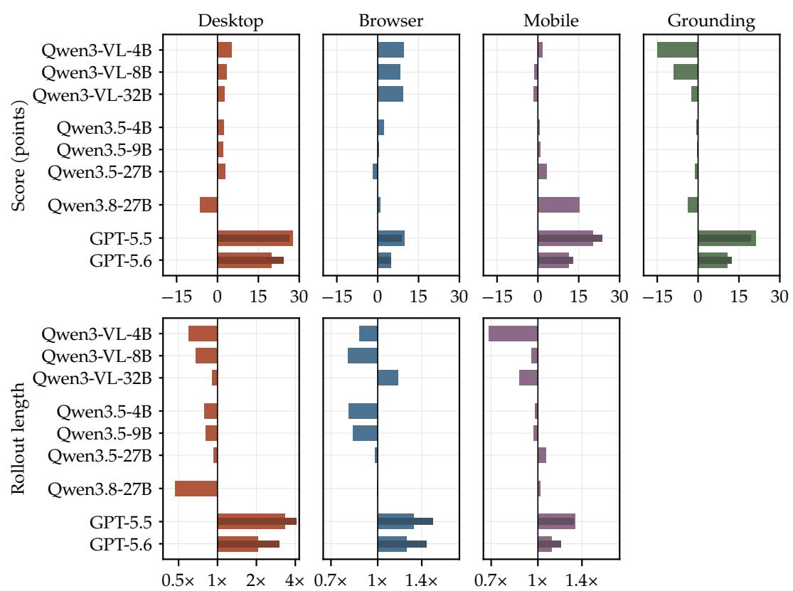  
Figure F.1: Effect of reasoning on score and rollout length, per model. Figure 5 with Qwen3 (Qwen3-VL) and Qwen3.5 split into their sizes.

Table F.2: Reference evaluation scores (%) of the 15 models at each reasoning setting we evaluate. A row marked , reruns the model above it at another reasoning setting: reasoning on for an open-weight model, and the named reasoning effort for an API model. Qwen3-VL’s reasoning rows run Qwen3-VL-Thinking, a separate checkpoint, instead of Qwen3-VL-Instruct. Qwen3.5 and Qwen3.8 switch reasoning within one checkpoint. WAA: WindowsAgentArena. –: not applicable. : not run, because WebArena rollouts are slow. Rows marked (default), which Table 3 reports, run open-weight models with reasoning off and API models at medium effort.
<table><tr><td rowspan=2 colspan=14>Model                    ScreOS1SOOSWAWelWebMinAnd AncMoMoGrounding       Desktop           Browser              MobileSpecialist CUAs27.5 0.5 16.746.2 9.1  18.419.836.2 11.1 13.3</td></tr><tr><td rowspan=1 colspan=4>UI-TARS-1.5-7B49.8 60.6</td></tr><tr><td rowspan=1 colspan=4>EvoCUA-8B             43.5 57.3</td><td rowspan=1 colspan=3>35.6 0.7 16.6</td><td rowspan=1 colspan=3>5.8 10.856.0</td><td rowspan=1 colspan=4>一</td></tr><tr><td rowspan=1 colspan=4>MAI-UI-8B              62.2 70.0</td><td rowspan=1 colspan=3>一</td><td rowspan=1 colspan=7>1        61.2 49.329.925.8</td></tr><tr><td rowspan=1 colspan=4>UI-Venus-2-9B          71.9 78.2</td><td rowspan=1 colspan=3>50.5 1.4 41.3</td><td rowspan=1 colspan=7>72.930.759.262.1 47.8 59.034.4</td></tr><tr><td rowspan=1 colspan=4>General VLMs</td><td rowspan=1 colspan=3></td><td rowspan=1 colspan=3></td><td rowspan=1 colspan=1></td><td rowspan=1 colspan=3></td></tr><tr><td rowspan=1 colspan=2>Qwen3-VL-4B</td><td rowspan=1 colspan=2>58.365.52</td><td rowspan=1 colspan=1>3.6</td><td rowspan=1 colspan=1>0.9</td><td rowspan=1 colspan=1>9.5</td><td rowspan=1 colspan=2>20.6 8.7</td><td rowspan=1 colspan=1>47.2</td><td rowspan=1 colspan=1>43.1</td><td rowspan=1 colspan=3>36.2 6.8 13.7</td></tr><tr><td rowspan=1 colspan=2>→ reasoning</td><td rowspan=1 colspan=1>40.5</td><td rowspan=1 colspan=1>53.1</td><td rowspan=1 colspan=1>29.8</td><td rowspan=1 colspan=1>1.2</td><td rowspan=1 colspan=1>18.8</td><td rowspan=1 colspan=2>37.2  0</td><td rowspan=1 colspan=1>49.6</td><td rowspan=1 colspan=1>40.1</td><td rowspan=1 colspan=1>36.2</td><td rowspan=1 colspan=2>12.8 17.2</td></tr><tr><td rowspan=1 colspan=2>Qwen3-VL-8B</td><td rowspan=1 colspan=1>55.2</td><td rowspan=1 colspan=1>64.3</td><td rowspan=1 colspan=2>28.1 0.3</td><td rowspan=1 colspan=1>14.5</td><td rowspan=1 colspan=2>29.3 7.1</td><td rowspan=1 colspan=1>53.6</td><td rowspan=1 colspan=1>51.7</td><td rowspan=1 colspan=1>39.9</td><td rowspan=1 colspan=2>8.5 16.0</td></tr><tr><td rowspan=1 colspan=3>→ reasoning          44.3</td><td rowspan=1 colspan=1>57.1</td><td rowspan=1 colspan=2>32.4 0.4</td><td rowspan=1 colspan=1>20.2</td><td rowspan=1 colspan=2>40.3  o</td><td rowspan=1 colspan=1>59.2</td><td rowspan=1 colspan=1>46.6</td><td rowspan=1 colspan=1>39.1</td><td rowspan=1 colspan=1>7.7</td><td rowspan=1 colspan=1>17.2</td></tr><tr><td rowspan=1 colspan=2>Qwen3-VL-32B</td><td rowspan=1 colspan=1>57.7</td><td rowspan=1 colspan=1>72.0</td><td rowspan=1 colspan=1>34.3</td><td rowspan=1 colspan=1>1.2</td><td rowspan=1 colspan=1>24.0</td><td rowspan=1 colspan=1>42.8</td><td rowspan=1 colspan=1>14.6</td><td rowspan=1 colspan=1>60.8</td><td rowspan=1 colspan=1>62.1</td><td rowspan=1 colspan=1>36.2</td><td rowspan=1 colspan=1>17.9</td><td rowspan=1 colspan=1>23.4</td></tr><tr><td rowspan=1 colspan=2>→ reasoning</td><td rowspan=1 colspan=1>56.4</td><td rowspan=1 colspan=1>68.2</td><td rowspan=1 colspan=1>41.5</td><td rowspan=1 colspan=1>0.8</td><td rowspan=1 colspan=1>24.6</td><td rowspan=1 colspan=1>50.7</td><td rowspan=1 colspan=1>o</td><td rowspan=1 colspan=1>71.2</td><td rowspan=1 colspan=1>59.5</td><td rowspan=1 colspan=1>42.8</td><td rowspan=1 colspan=1>13.7</td><td rowspan=1 colspan=1>17.2</td></tr><tr><td rowspan=1 colspan=2>Qwen3.5-4B</td><td rowspan=1 colspan=1>57.7</td><td rowspan=1 colspan=1>62.9</td><td rowspan=1 colspan=1>27.0</td><td rowspan=1 colspan=1>0.7</td><td rowspan=1 colspan=1>11.6</td><td rowspan=1 colspan=1>12.2</td><td rowspan=1 colspan=1>11.3</td><td rowspan=1 colspan=1>28.0</td><td rowspan=1 colspan=1>60.3</td><td rowspan=1 colspan=1>34.8</td><td rowspan=1 colspan=1>11.1</td><td rowspan=1 colspan=1>17.6</td></tr><tr><td rowspan=1 colspan=2>→ reasoning</td><td rowspan=1 colspan=1>57.4</td><td rowspan=1 colspan=1>61.8</td><td rowspan=1 colspan=1>29.6</td><td rowspan=1 colspan=1>0.8</td><td rowspan=1 colspan=1>16.0</td><td rowspan=1 colspan=1>16.6</td><td rowspan=1 colspan=1>o</td><td rowspan=1 colspan=1>28.0</td><td rowspan=1 colspan=1>57.8</td><td rowspan=1 colspan=1>35.5</td><td rowspan=1 colspan=1>16.2</td><td rowspan=1 colspan=1>16.8</td></tr><tr><td rowspan=1 colspan=2>Qwen3.5-9B</td><td rowspan=1 colspan=1>58.1</td><td rowspan=1 colspan=1>68.2</td><td rowspan=1 colspan=1>38.6</td><td rowspan=1 colspan=1>0.4</td><td rowspan=1 colspan=1>13.1</td><td rowspan=1 colspan=1>35.0</td><td rowspan=1 colspan=1>15.4</td><td rowspan=1 colspan=1>50.4</td><td rowspan=1 colspan=1>62.1</td><td rowspan=1 colspan=1>36.2</td><td rowspan=1 colspan=1>10.3</td><td rowspan=1 colspan=1>18.0</td></tr><tr><td rowspan=1 colspan=2> reasoning</td><td rowspan=1 colspan=1>55.3</td><td rowspan=1 colspan=1>70.2</td><td rowspan=1 colspan=1>36.6</td><td rowspan=1 colspan=1>0.5</td><td rowspan=1 colspan=1>20.9</td><td rowspan=1 colspan=1>36.7</td><td rowspan=1 colspan=1>o</td><td rowspan=1 colspan=1>49.6</td><td rowspan=1 colspan=1>59.1</td><td rowspan=1 colspan=1>37.7</td><td rowspan=1 colspan=1>16.2</td><td rowspan=1 colspan=1>17.2</td></tr><tr><td rowspan=1 colspan=2>Qwen3.5-27B</td><td rowspan=1 colspan=1>69.5</td><td rowspan=1 colspan=1>74.3</td><td rowspan=1 colspan=1>48.9</td><td rowspan=1 colspan=1>2.8</td><td rowspan=1 colspan=1>25.4</td><td rowspan=1 colspan=1>51.7</td><td rowspan=1 colspan=1>21.9</td><td rowspan=1 colspan=1>68.8</td><td rowspan=1 colspan=1>65.1</td><td rowspan=1 colspan=1>40.6</td><td rowspan=1 colspan=1>15.4</td><td rowspan=1 colspan=1>26.6</td></tr><tr><td rowspan=1 colspan=1>→ reasoning</td><td rowspan=1 colspan=1></td><td rowspan=1 colspan=1>65.9</td><td rowspan=1 colspan=1>75.5</td><td rowspan=1 colspan=1>48.2</td><td rowspan=1 colspan=1>3.2</td><td rowspan=1 colspan=1>34.0</td><td rowspan=1 colspan=1>48.1</td><td rowspan=1 colspan=1>o</td><td rowspan=1 colspan=1>68.8</td><td rowspan=1 colspan=1>66.4</td><td rowspan=1 colspan=1>44.9</td><td rowspan=1 colspan=1>21.4</td><td rowspan=1 colspan=1>28.5</td></tr><tr><td rowspan=1 colspan=1>Qwen3.8-27B</td><td rowspan=1 colspan=1></td><td rowspan=1 colspan=1>75.4</td><td rowspan=1 colspan=1>79.6</td><td rowspan=1 colspan=1>59.2</td><td rowspan=1 colspan=1>2.4</td><td rowspan=1 colspan=1>37.0</td><td rowspan=1 colspan=1>55.4</td><td rowspan=1 colspan=1>24.5</td><td rowspan=1 colspan=1>64.8</td><td rowspan=1 colspan=1>64.7</td><td rowspan=1 colspan=1>51.4</td><td rowspan=1 colspan=1>32.5</td><td rowspan=1 colspan=1>40.2</td></tr><tr><td rowspan=1 colspan=1>→ reasoning (</td><td rowspan=1 colspan=1>xhigh)</td><td rowspan=1 colspan=1>73.1</td><td rowspan=1 colspan=1>74.1</td><td rowspan=1 colspan=1>44.5</td><td rowspan=1 colspan=1>0.5</td><td rowspan=1 colspan=1>34.8</td><td rowspan=1 colspan=1>62.2</td><td rowspan=1 colspan=1>0</td><td rowspan=1 colspan=1>60.0</td><td rowspan=1 colspan=1>73.3</td><td rowspan=1 colspan=1>54.3</td><td rowspan=1 colspan=1>63.2</td><td rowspan=1 colspan=1>58.6</td></tr><tr><td rowspan=1 colspan=2>API models</td><td rowspan=1 colspan=1></td><td rowspan=1 colspan=1></td><td rowspan=1 colspan=1></td><td rowspan=1 colspan=1></td><td rowspan=1 colspan=1></td><td rowspan=1 colspan=1></td><td rowspan=1 colspan=1></td><td rowspan=1 colspan=1></td><td rowspan=1 colspan=1></td><td rowspan=1 colspan=1></td><td rowspan=1 colspan=1></td><td rowspan=1 colspan=1></td></tr><tr><td rowspan=1 colspan=2>Claude Opus 5</td><td rowspan=1 colspan=1>85.3</td><td rowspan=1 colspan=1>89.2</td><td rowspan=1 colspan=1>78.7</td><td rowspan=1 colspan=1>63.1</td><td rowspan=1 colspan=1>72.49</td><td rowspan=1 colspan=1>0.4</td><td rowspan=1 colspan=1>51.7</td><td rowspan=1 colspan=1>91.2</td><td rowspan=1 colspan=1>81.0</td><td rowspan=1 colspan=1>62.3</td><td rowspan=1 colspan=1>78.6</td><td rowspan=1 colspan=1>70.2</td></tr><tr><td rowspan=2 colspan=4>GPT-5.5 (none)→ medium (default) 74.5 90.4</td><td rowspan=1 colspan=2>45.2 77.3</td><td rowspan=1 colspan=2>48.1 5.8</td><td rowspan=1 colspan=1>39.2</td><td rowspan=1 colspan=1>70.9</td><td rowspan=1 colspan=1>0</td><td rowspan=1 colspan=1>72.8</td><td rowspan=1 colspan=1>62.5</td><td rowspan=1 colspan=1>52.9</td></tr><tr><td rowspan=1 colspan=2>71.1 38.6</td><td rowspan=1 colspan=1>66.6</td><td rowspan=1 colspan=2>78.4 47.1</td><td rowspan=1 colspan=1>84.8</td><td rowspan=1 colspan=1>78.4</td><td rowspan=1 colspan=1>60.9</td><td rowspan=1 colspan=1>80.3</td><td rowspan=1 colspan=1>53.9</td></tr><tr><td rowspan=1 colspan=4>→ xhigh              71.1 90.2</td><td rowspan=1 colspan=2>74.833.2</td><td rowspan=1 colspan=1>64.3</td><td rowspan=1 colspan=2>76.5  o</td><td rowspan=1 colspan=1>84.8</td><td rowspan=1 colspan=1>77.6</td><td rowspan=1 colspan=1>63.0</td><td rowspan=1 colspan=2>84.6 62.5</td></tr><tr><td rowspan=1 colspan=4>GPT-5.6 Sol (none)      72.479.8</td><td rowspan=1 colspan=2>60.3 17.0</td><td rowspan=1 colspan=1>50.7</td><td rowspan=1 colspan=2>75.7  o</td><td rowspan=1 colspan=1>76.8</td><td rowspan=1 colspan=1>78.4</td><td rowspan=1 colspan=1>56.5</td><td rowspan=1 colspan=1>60.7</td><td rowspan=1 colspan=1>46.1</td></tr><tr><td rowspan=1 colspan=4>→ medium (default) 82.591.2</td><td rowspan=1 colspan=2>73.3 43.9</td><td rowspan=1 colspan=1>70.0</td><td rowspan=1 colspan=4>79.8 53.382.475.9</td><td rowspan=1 colspan=1>60.9</td><td rowspan=1 colspan=1>86.3</td><td rowspan=1 colspan=1>64.1</td></tr><tr><td rowspan=1 colspan=4>↔ xhigh              84.2 92.7</td><td rowspan=1 colspan=2>74.854.0</td><td rowspan=1 colspan=1>71.6</td><td rowspan=1 colspan=4>79.2  0  83.278.4</td><td rowspan=1 colspan=1>63.8</td><td rowspan=1 colspan=2>82.9 68.8</td></tr><tr><td rowspan=1 colspan=14>GPT-6 Astra             93.9 92.575.1 63.063.484.353.387.284.5 60.9 85.5 80.9</td></tr></table>

## G Training Details

SFT. Every SFT run in §4.1 uses the same hyperparameters on every platform: two epochs over the training set, a global batch of 32 rollouts, and the Adam optimizer $( \beta _ { 1 } \stackrel { \cdot } { = } 0 . 9 $ $\beta _ { 2 } = 0 . 9 5$ , weight decay 0.1) with a learning rate of $5 \times 1 0 ^ { - 6 }$ , linear warmup over the first 10% of steps, and cosine decay to $1 0 ^ { - 6 } .$ . Unless an ablation varies them, runs keep one screenshot $( 1 9 2 0 \times 1 0 8 0$ on desktop, 1280 720 on browser, $7 2 0 \times 1 6 0 0$ on mobile) and the full text history. The loss is averaged over the model’s output tokens. We evaluate the checkpoint after the second epoch three times at temperature 0 on the held-out tasks, and report the mean evaluation score.

Table G.1: Evaluation scores (%) of Qwen3.5-4B in every setting of §4.1. The table extends Table 4 with the data of Figure 6. Screenshots: the number kept in context. –: not run.
<table><tr><td></td><td></td><td colspan="2">Desktop Lite.OSWorld</td><td>Browser WebVoyager</td><td>Mobile MobileGym</td></tr><tr><td></td><td>Screenshots</td><td> $1 9 2 0 \times 1 0 8 0$ </td><td> $1 2 8 0 \times 7 2 0$ </td><td> $1 2 8 0 \times 7 2 0$ </td><td> $7 2 0 \times 1 6 0 0$ </td></tr><tr><td colspan="6">Without SFT</td></tr><tr><td>w/o reasoning</td><td>1</td><td>22.6</td><td>14.9</td><td>4.4</td><td>14.6</td></tr><tr><td rowspan="2">w/ reasoning</td><td>4</td><td></td><td>25.0</td><td>8.3</td><td>15.2</td></tr><tr><td>1</td><td>27.1</td><td>22.6</td><td>14.8</td><td>13.9</td></tr><tr><td></td><td>4</td><td></td><td>25.9</td><td>13.5</td><td>16.1</td></tr><tr><td colspan="6">SFT on GPT-5.5 rollouts</td></tr><tr><td>w/o reasoning</td><td>1</td><td>37.2</td><td></td><td>48.7</td><td>21.4</td></tr><tr><td>w/ reasoning</td><td>1</td><td>44.8</td><td>36.9</td><td>60.0</td><td>26.8</td></tr><tr><td></td><td>4</td><td></td><td>40.2</td><td>59.6</td><td>27.2</td></tr><tr><td colspan="6">SFT on Qwen3.5-27B rollouts</td></tr><tr><td>w/o reasoning</td><td>1</td><td>34.5</td><td></td><td></td><td></td></tr><tr><td>w/ reasoning</td><td>1</td><td>35.4</td><td></td><td></td><td></td></tr></table>

GRPO. Every GRPO run in §4.2 starts from the checkpoint SFTed on GPT-5.5 rollouts with reasoning and one screenshot, and uses the same hyperparameters on every platform: 16 training tasks per GRPO step, 8 rollouts per task at temperature 1, 8 gradient updates per GRPO step, clip ratios of 0.2 and 0.28, no KL penalty, and the Adam optimizer $( \beta _ { 1 } = \mathsf { \bar { 0 } } . 9 _ { \cdot }$ $\beta _ { 2 } = 0 . 9 8$ , weight decay 0.1) with a constant learning rate of 10−<sup>6</sup>. The platforms differ in training length, reward, and evaluation:

• Desktop: 20 GRPO steps with 24 concurrent environments. The reward is the Lite.OSWorld verifier’s score, which gives partial credit on some tasks. Every two GRPO steps, we evaluate each held-out task four times at temperature 1.

• Browser: 30 GRPO steps with 24 concurrent environments. The reward is 1 if WebVoyager’s GPT-4.1 judge accepts the rollout and 0 otherwise. Every five GRPO steps, we evaluate each held-out task once at temperature 0.

• Mobile: 30 GRPO steps with 32 concurrent environments. The reward is 1 if the task succeeds, and otherwise half the fraction of its goal checks that pass. Every five GRPO steps, we evaluate each held-out task four times at temperature 1. A task family is the tasks of one app whose names share a prefix, at levels L1–L3; we drop L4, the hardest level, which takes 39% of the step budget but succeeds on only 4% of its tasks.