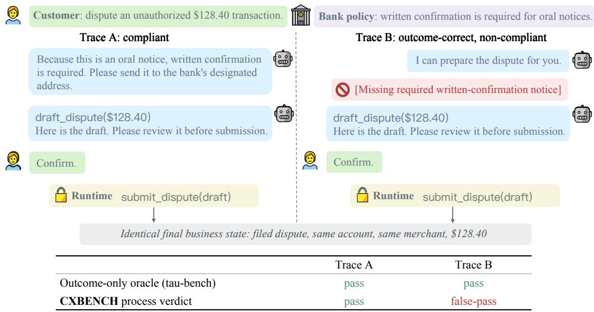
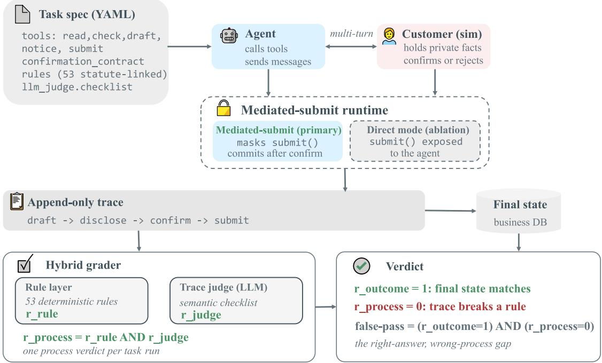
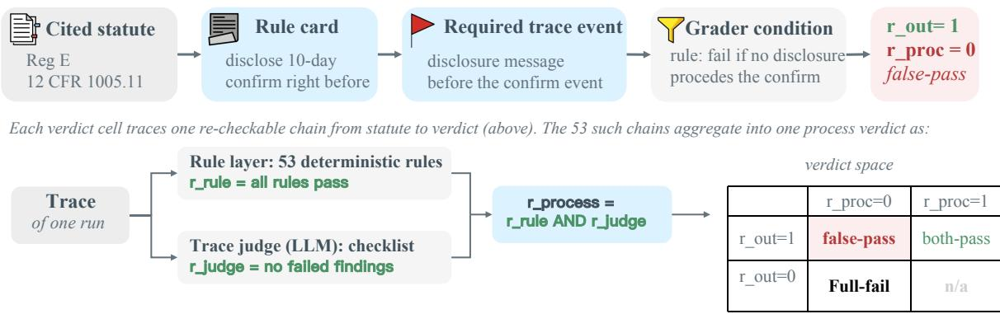
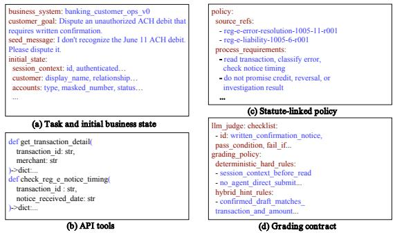
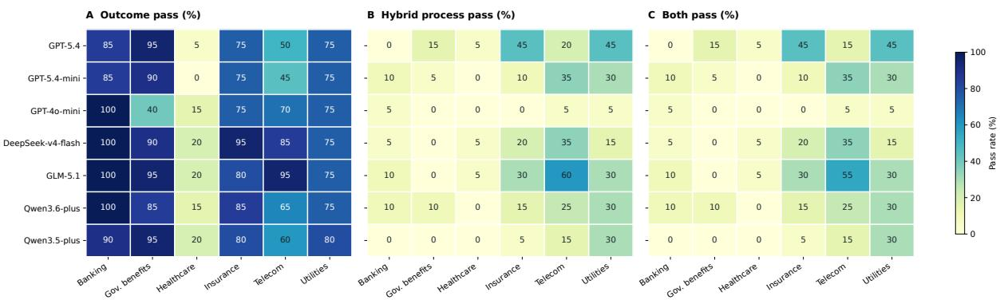
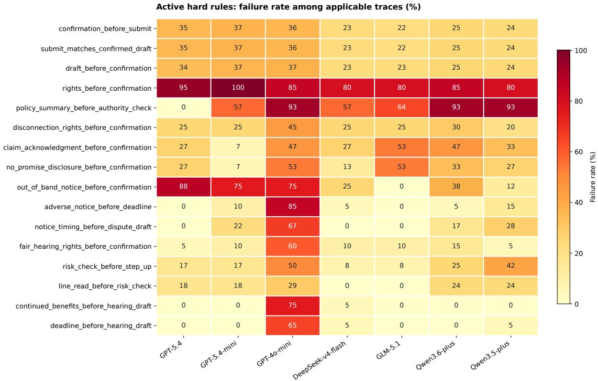

# CXBENCH: A Benchmark for Process-Compliant LLM Agents in Regulated Customer-Experience Workflows

Boxi Yu<sup>\*†</sup> <sup>1</sup> Yuzhong Zhang<sup>\*</sup> <sup>2</sup> Zhenfeng Su<sup>\*</sup> <sup>2</sup> Linfu Xi<sup>3</sup> Yinghan Yao<sup>3</sup> Shitao Chen<sup>4</sup> Yang Cao<sup>5</sup> Liting Lin<sup>1</sup> Lionel Briand<sup>1</sup> Emir Muñoz<sup>6</sup>

## Abstract

Tool-using language agents increasingly perform regulated customer-service workflows, where a correct final state is insufficient: agents must also provide disclosures, obtain consent, and follow required procedures. Existing toolagent benchmarks largely score final business states, accepting trajectories that reach correct outcomes through non-compliant processes.

We introduce CXBENCH, a benchmark that evaluates outcome and process compliance separately across six regulated domains. Each task combines a customer request, a tool-based environment, and explicit process requirements. Rule cards link cited regulatory obligations to observable trace evidence. A hybrid grader combines deterministic checks for ordering and authority with an LLM judge for semantic requirements. We define afalse-pass as an outcome-pass run that fails process checks.

Across seven models and 120 tasks, 55.5% of the 840 retained executions are false-passes, representing 80.1% of outcome-passing runs; only 13.8% pass both checks. Process-inclusive evaluation changes the observed model ordering and exposes differences hidden by outcomeonly scoring. CXBENCH makes these failures inspectable through trace-linked criteria.

Keywords: LLM agents, benchmarks, regulatory compliance, software engineering

## 1 Introduction

As Figure 1 shows, suppose a customer asks a bank to dispute an unauthorized transaction. And suppose two agents file the same dispute, but only the first one provides a notice required for that case. A final-state check accepts both: the dispute records are identical. Yet the second agent has omitted a required step. For example, when a bank requires written confirmation of an oral error notice, Regulation E requires it to inform the customer of that requirement and provide the submission address when the oral notice is given. <sup>1</sup> The filed dispute alone does not reveal whether the agent provided this information. This difference between completing a task and following the required process motivates CXBENCH.

Language agents increasingly support customerservice workflows by answering questions, retrieving records, and taking actions through software tools (Yao et al., 2024; Barres et al., 2025). In regulated domains, successful assistance requires more than producing the requested business result. An agent may, for example, also need to explain the customer’s rights, obtain authorization before an action, and avoid making unsupported promises. These requirements concern what happens during an interaction and whether it complies with regulations. Therefore evaluating them requires examining the conversation and tool calls, in addition to the final business state.

Existing benchmarks provide important foundations for this evaluation. tau-bench and tau2-bench test agents that interact with users and domainspecific tools, using outcome checks and checks on required response information (Yao et al., 2024; Barres et al., 2025). The tau-bench authors explicitly acknowledge that a correct final state may still result from a policy violation, such as processing a return without explicit user confirmation. Procedure-following benchmarks further examine adherence to prescribed workflows (Li et al., 2025; Nandi et al., 2025; Wang et al., 2025b). Building on these efforts, we examine process violations that may be hidden by successful outcomes and thus lead to an overestimation of agent reliability.

  
Both traces reach the same final state; only cxbench's process verdict sees the missing disclosure andflags Trace B.  
Figure 1: Two traces with the same final state. An outcome-only oracle accepts both, whereas CXBENCH identifies Trace B as afalse-pass because it omits the written-confirmation notice required in this case under Regulation E (see footnote 1). Draft confirmation is a separate CXBENCH runtime control rather than a statutory requirement.

Specifically, we ask: When an agent achieves the correct outcome, did it also satisfy the applicable process requirements?

We introduce CXBENCH, a benchmark of 120 customer-service tasks across banking, telecommunications, insurance, healthcare, utilities, and government benefits. These domains cover common customer-service needs and are subject to explicit regulatory requirements governing how requests must be handled, making them well suited for evaluating both task completion and process compliance. In each task, an AI agent interacts with a simulated customer through conversation and uses domain-specific tools to complete the requested task. CXBENCH evaluates the resulting interaction along two axes: outcome, whether the requested business result was achieved, and process, whether the recorded interaction satisfied the applicable requirements. A run succeeds overall only when it passes both. We call a run that passes outcome but fails process a false-pass, because outcome-only evaluation would count it as a success.

To make process requirements inspectable, CXBENCH represents them as rule cards that connect a cited regulatory requirement to the evidence expected in the interaction. Deterministic checks evaluate conditions such as event ordering and tool permissions, while an LLM judge evaluates semantic requirements such as restrictions on misleading promises. Both must pass for the process verdict to pass. This evaluation measures adherence to the requirements encoded in the benchmark and supports compliance analysis by identifying potential violations and linking them to regulatory requirements and trace evidence. It does not, by itself, establish the legal compliance of a real-world deployment.

Table 1 compares representative benchmarks along four dimensions relevant to this evaluation: explicit assessment of procedure adherence (Process), links between process requirements and cited regulations (Statute), separate reporting of successful outcomes achieved through non-compliant processes (False-pass), and runtime-controlled execution of the final state-changing action (Runtime submit). The first three dimensions concern what is evaluated and how failures are identified; the fourth concerns how submission authority is controlled during execution. In CXBENCH’s default mode, the agent prepares a draft, while the runtime submits it only after customer confirmation of the required fields.

Across seven LLMs and 120 tasks, 69.29% of the 840 retained executions pass the outcome check, but only 13.81% pass both outcome and process checks. False-passes occur for every model, accounting for 55.48% of all executions and 80.07% of outcome-passing executions. Incorporating process compliance also changes the observed model ordering, showing that outcome-only scoring can conceal substantial differences in process compliance.

<table><tr><td>Benchmark</td><td>Process</td><td>Statute</td><td>False-pass</td><td>Runtime submit</td></tr><tr><td>AgentBench / OSWorld (Liu et al., 2024; Xie et al., 2024)</td><td></td><td>× ×</td><td>× ×</td><td></td></tr><tr><td>tau-bench / tau2-bench (Yao et al., 2024; Barres et al., 2025)</td><td>× × × × ×</td><td></td><td></td><td></td></tr><tr><td>TheAgentCompany (Xu et al., 2024)</td><td></td><td></td><td></td><td></td></tr><tr><td>LegalBench (Guha et al., 2023)</td><td></td><td>× ×</td><td>× ×</td><td></td></tr><tr><td>SOP-Bench (Nandi et al., 2025)</td><td></td><td>X</td><td>X</td><td>× × × × ×</td></tr><tr><td>SOPBench / SOP-Maze (Li et al., 2025; Wang et al., 2025b)</td><td>√</td><td>X</td><td>X</td><td>X</td></tr><tr><td>CXBENCH</td><td>了</td><td>√</td><td>√</td><td>√</td></tr></table>

Table 1: Comparison with representative benchmarks on process evaluation, regulatory grounding, false-pass reporting, and runtime-controlled submission. A checkmark indicates support for the listed feature; a cross indicates its absence, rather than the absence of all policy-related evaluation.

Our contributions are:

1. Separate outcome and process evaluation. Final-state checks can overlook process violations. We introduce CXBENCH, covering 120 tasks across six regulated domains, with separate outcome and process verdicts and a false-pass metric that exposes failures hidden by outcome-only scoring.

2. Trace-grounded regulatory evaluation. Regulatory obligations require scenariospecific interpretation of both event ordering and language. We encode them as rule cards linking source provisions to trace evidence and evaluation criteria, and combine deterministic checks with checklist-based LLM judgments to produce inspectable process verdicts.

3. Shared execution with submission controls. Domain-specific tools and confirmation requirements complicate evaluation under a common protocol. We provide a shared runtime that records traces and mediates submission through confirmation of matching draft fields, with a direct-submit mode for studying the effect of submission authority.

## 2 The CXBENCH Benchmark

Agents can reach the same final business state through interactions that differ in adherence to the required process. As illustrated in Figure 2, CXBENCH therefore evaluates outcome correctness and process compliance separately. Each task specifies a customer goal, an initial business state, private customer facts, and domain-specific tools, together with a confirmation contract and applicable process requirements (§2.1). To make the applicable regulatory obligations assessable from an interaction, rule cards link source provisions to scenario-specific required behavior, observable trace evidence, and evaluation criteria (§2.2). An episode is a single execution of a task by an agent. During an episode, the agent interacts with a customer simulator and invokes domain-specific tools through a shared runtime, which records the interaction and, in the default mode, submits drafts only after customer confirmation of matching fields under the task’s confirmation contract (§2.3). After execution, a domain-specific outcome checker evaluates the final business state, while a hybrid process grader combines deterministic checks and checklist-based LLM judgments to assess the recorded trace (§2.4).

## 2.1 Task Specification

Each task is instantiated from a specification

$$
\theta = ( g , m _ { 0 } , s _ { 0 } , \mathcal { U } , \Lambda , \mathcal { K } ) ,
$$

where $g$ is the customer goal, $m _ { 0 }$ the opening message, $s _ { 0 } \in S$ the initial state, U the domain-specific tool interface, Λ the applicable policy context and process requirements, and K the set of draft fields requiring customer review and confirmation.

The initial state $s _ { 0 }$ follows the state representation in Appendix A.2, which comprises business records, private customer facts, interaction history, and drafts. The goal $g$ and private customer facts determine the expected business result, while Λ and K specify process obligations and confirmation requirements. Together, these elements bind the outcome target and execution requirements within a common task specification (Appendix A.1).

The agent receives the opening message, agentfacing policy instructions, and permitted tool definitions. Private customer facts inform the customer simulator’s replies and confirmations but are not directly exposed to the agent. The agent obtains relevant information through customer interaction and authorized access to business records.

  
Figure 2: The CXBENCH evaluation pipeline. The agent interacts with a simulated customer and business tools, producing a final state and an interaction trace. Outcome evaluation checks the final state; process evaluation checks the trace using deterministic rules and an LLM judge. In the default mode, the runtime submits drafts after customer confirmation.

Table 2 distinguishes three functions. Execution produces the interaction. The agent exchanges messages with the customer simulator and invokes tools through the runtime: the software layer that coordinates the interaction, executes tool calls, maintains business records and drafts, and records the trace. The runtime also enforces the submission controls described in §2.3. Evaluation assigns verdicts after execution. An outcome checker evaluates the final business state. Process evaluation combines a deterministic rule layer for event ordering, tool permissions, and confirmation consistency with an LLM judge for semantic requirements assessed against a task-specific checklist. Validation examines the grading procedure through expert review of the judge prompt and trace-level judgments, together with comparisons across judge configurations (Appendix H).

## 2.2 Regulatory Requirements and Trace Evidence

Regulatory requirements in Λ must be translated into scenario-specific criteria before they can be assessed from an interaction trace. This requires identifying when an obligation applies, what behavior it requires, and what recorded evidence supports a verdict. CXBENCH represents this mapping through rule cards, each linking a source provision to its applicability conditions, required behavior, observable trace evidence, and evaluation criterion. Criteria involving event ordering or tool authority are checked by the deterministic rule layer; those requiring interpretation of customer-facing language are expressed as checklist items for the LLM judge. The two components are combined in §2.4.

Table 2: Roles in CXBENCH. The agent, customer simulator, and runtime produce the interaction; the rule layer and LLM judge evaluate it. Expert reviewers independently reassess selected traces for validation and do not determine the reported process verdict.
<table><tr><td>Produce</td><td>Role</td><td>Responsibility</td></tr><tr><td>Execution</td><td>Agent</td><td>Interacts with the customer and uses available tools to complete the task while following the applicable requirements.</td></tr><tr><td>Execution</td><td>Customer simulator</td><td>Provides information based on private customer facts and confirms drafts whose required fields match those facts.</td></tr><tr><td>Execution</td><td>Runtime</td><td>Executes tool calls, records the interaction, and controls submission in mediated-submit mode.</td></tr><tr><td>Evaluation</td><td>Rule layer</td><td>Checks deterministic conditions, including event ordering, tool permissions, and agreement between confirmed and submitted fields.</td></tr><tr><td>Evaluation</td><td>LLM judge</td><td>Assesses semantic requirements using a fixed rubric and task-specific checklist.</td></tr><tr><td>Validation</td><td>Expert reviewers</td><td>Reassesses selected traces to examine the validity of the automated evaluation.</td></tr></table>

In Figure 1, the task represents an error notice to an institution that requires written confirmation. Under Regulation E (see footnote 1). The corresponding rule card connects this obligation to evidence that the required information was communicated. For this task, CXBENCH operationalizes the timing requirement by checking that the disclosure precedes the request for customer confirmation of the filing draft. This is the benchmark’s observable checkpoint for assessing the disclosure timing.

The two forms of confirmation serve distinct purposes: draft confirmation authorizes the proposed submission within CXBENCH, whereas written confirmation concerns the customer’s error notice under Regulation E. The disclosure criterion is therefore assessed separately from the runtime’s submission control (§2.3). A correctly filed, customerconfirmed dispute can still fail the disclosure check. As illustrated in Figure 3, rule cards make the basis for such verdicts inspectable by connecting each criterion to its source requirement and supporting trace evidence, or the absence of required evidence.

## 2.3 Interaction and Submission Authority

Domain-specific workflows differ in their business tools and confirmation requirements. To execute these workflows under a common protocol, CXBENCH connects each task’s tool interface U and confirmation fields K to a shared runtime. During an episode, the agent exchanges customer-facing messages and invokes tools to inspect records, check conditions, prepare drafts, and issue notices. A draft represents a proposed business action for customer review; submission executes that action and commits the corresponding business-state change.

Customer simulator. A fixed LLM simulates the customer, starting from the task’s prescribed opening message and generating subsequent replies using the private customer facts. The simulator observes customer-facing messages and presented draft fields, but not the agent’s tool calls. Its confirmation decision concerns whether the fields in K match those facts; it does not assess process compliance. The simulator model and configuration are reported in Appendix F.

Submission authority. The default mediatedsubmit mode reserves submission for the runtime.

The agent can prepare a draft and request customer confirmation, but submission tools are excluded from its available actions. After confirmation, the runtime submits the draft only if its fields in K match the confirmed values. This enforces the ordering

draft → customer confirmation → submission.

Each arrow indicates that the preceding step must occur before the following step for the same draft. The same mechanism accommodates domain-specific confirmation requirements through K. The direct-submit mode exposes submission tools to the agent and disables runtime-mediated submission. The agent remains responsible for obtaining confirmation and submitting the matching draft. Comparing the two modes allows us to examine how submission authority affects task outcomes and process compliance.

The runtime records interactions in a common append-only trace format, preserving the order of messages, tool calls and results, confirmations, and submissions. Mediated submission enforces confirmation of matching draft fields; additional obligations, including required disclosures, restrictions on outcome promises, and applicable authority checks before drafting, are evaluated after execution (§2.4). Tool inventories and the formal runtime modes appear in Appendices C.1 and C.3.

## 2.4 Outcome and Process Evaluation

An episode is evaluated after execution using its final business state and recorded interaction trace. The reward is a pair of binary indicators,

$$
r = \big ( r _ { \mathrm { o u t c o m e } } , r _ { \mathrm { p r o c e s s } } \big ) ,
$$

which distinguish achievement of the customer goal from adherence to the required process.

Outcome correctness. The outcome indicator is one when a domain-specific check confirms that the final business state satisfies the task’s expected result. For a dispute-filing task, this requires a filed dispute whose relevant fields match the specified customer facts. This check evaluates the resulting business state without determining whether the preceding interaction was compliant.

Process compliance. The process indicator is computed by a hybrid grader that combines deterministic checks with an LLM judge:

$$
r _ { \mathrm { p r o c e s s } } = r _ { \mathrm { r u l e } } \wedge r _ { \mathrm { j u d g e } } .
$$

  
Figure 3: From regulatory requirements to process evaluation. A rule card connects a cited requirement to observable trace evidence and an evaluation criterion (top). Deterministic checks and an LLM judge assess the requirements applicable to each task and jointly determine the process verdict (bottom). A correct outcome accompanied by a failed process verdict is a false-pass.

The rule layer evaluates applicable deterministic conditions over the trace, including event ordering, tool permissions, and agreement between confirmed and submitted fields. The LLM judge evaluates semantic requirements under a fixed interpretation rubric and task-specific checklist. It returns structured findings identifying the assessed requirement, the judgment, and supporting trace evidence. The judge’s overall verdict is reconciled with its findings using the protocol in Appendix D; any failed finding, regardless of severity, forces the judge component to fail. Both components must pass for the process indicator to be one. Rule-only and LLM-only evaluations are reserved for ablations.

Overall success and false-passes. Overall success requires both verdicts to pass; a false-pass satisfies outcome but fails process:

$$
\begin{array} { r l } & { r _ { \mathrm { s u c c e s s } } = r _ { \mathrm { o u t c o m e } } \wedge r _ { \mathrm { p r o c e s s } } , } \\ & { r _ { f a l s e \_ p a s s } = r _ { \mathrm { o u t c o m e } } \wedge \neg r _ { \mathrm { p r o c e s s } } . } \end{array}
$$

This indicator identifies the runs that outcome-only evaluation would accept despite a detected process violation. A false-pass is therefore a benchmarkdefined outcome-pass/process-fail event: it indicates failure of an encoded regulatory or institutional requirement, but is not by itself an adjudicated finding of legal non-compliance.

## 3 Benchmark Construction

Construction combines manual requirement extraction, LLM-assisted task synthesis, structural checks, and human review, yielding 120 tasks across six domains with 20 tasks per domain.

Rule cards and industry participation. The authors extracted 55 obligations from regulatory materials available through the Legal Information Institute and deduplicated them into 53 rule cards. Each records an identifier, source citation, obligation, required evidence, and deterministic check or judge checklist item (§2.2). Industry collaborators contributed business scenarios, interview feedback, rule review, and trace annotations. The authors translated requirements into grading criteria using institutional procedures as workflow references, and remain responsible for regulatory interpretation. Three senior software-engineering experts reviewed each mapping for applicability, required behavior, and timing or ordering constraints, resolving disagreements through discussion and voting. Regulatory sources provide the basis for the extracted obligations, while institutional procedures inform their operational workflows. Rule cards serve as a common reference for scenario generation and evaluation, making the source, expected behavior, and grading criterion available for inspection.

Task synthesis and validation. An LLMassisted pipeline generates tasks and grading specifications from rule cards and an interface manifest listing registered tools and supported rules. Structural checks require registered submission tools, supported rule identifiers, non-empty judge checklists, and confirmation fields present in the private customer facts. These checks establish specification consistency; semantic review examines fidelity to the source obligation. For example, a task fails structural validation if its confirmation contract names a transaction identifier absent from the private facts. The interface manifest similarly constrains generation to operations and rule identifiers supported by the benchmark. Appendices A.1 and E provide the schema and procedures.

Judge development. Five senior softwareengineering experts participated: one drafted the instructions, three reviewed them and resolved disagreements through discussion and voting, and a fifth annotated 120 gpt-5.4-mini traces and compared them with gpt-5.6-sol verdicts to refine the judge. Appendix H.4 reports the human-reference comparison. These are calibration traces, not an independent held-out validation set.

Domain adaptation. New domains require business-state definitions, tool implementations, and mappings from obligations to existing or new trace predicates. They reuse the interaction loop, trace format, submission controls, and evaluation protocol. Domain interfaces and evidence requirements should therefore be established before task generation, followed by separate structural and semantic checks.

## 4 Experiments

Evaluation protocol. We evaluate seven models on 120 tasks across six domains, yielding 840 records. All records are included in the rates, and the main results and submission-control ablation use the hybrid grader. The customer simulator is gpt-5.4-mini; the judge is gpt-5.6-sol. We report Wilson 95% confidence intervals and Holmcorrected two-sided exact McNemar tests; additional settings appear in Appendix F.

## 4.1 The Outcome–Process Gap

Every model produces false-passes. Of 840 evaluations, 582 (69.29%) pass the outcome check, but only 116 (13.81%) pass both checks. The 466 falsepasses are 55.48% of all evaluations and 80.07% of outcome passes. Process-inclusive scoring therefore exposes failures hidden by outcome-only evaluation.

The model ordering also changes (Table 3). deepseek-v4-flash and $\mathtt { g l m - 5 . 1 }$ tie on outcome rate (77.50%) but reach 13.33% and 21.67% bothpass, respectively. gpt-5.4 has a lower outcome rate (64.17%) but a higher both-pass rate (20.83%) than deepseek-v4-flash. After Holm correction, six of 21 comparisons are significant at $p < 0 . 0 5$

## 4.2 Failure Patterns Across Domains

The outcome–process gap varies by domain: banking has 94.29% outcome-pass but 5.71% bothpass, government benefits 84.29% and 4.29%, and healthcare 13.57% and 2.14%. Detailed results appear in Appendix G.1.

The hybrid grader identifies complementary failures: of 466 false-passes, 329 are rejected only by the LLM judge, 38 only by hard rules, and 99 by both. Thirty-five of 53 hard rules fail at least once; a recurring insurance ordering rule fails in 47 falsepass records. Appendix G.2 gives the rule-level evidence.

## 4.3 Effect of Submission Control

We compare gpt-5.4 under mediated-submit and direct-submit using the same 120 recorded traces; neither the agent nor the customer simulator was rerun. Under the original hybrid protocol, bothpass falls from 20.83% to 0.83% (two-sided exact McNemar $p = 1 . 1 9 \times 1 0 ^ { - 7 } )$ , while outcome-pass changes from 64.17% to 67.50% $( p \ : = \ : 0 . 4 5 4 5 )$ False-pass rises from 43.33% to 66.67%.

Because the original protocol includes directsubmission-specific checks, we rescore the same traces after removing the corresponding hardrule and LLM-judge checks while retaining all others. Both-pass is 18.33% for direct-submit versus 20.83% for mediated-submit (difference −2.50 percentage points; exact McNemar $p \ =$ 0.677639; bootstrap 95% CI [−10.00, 5.00] percentage points), showing that the original gap is scoring-sensitive.

## 4.4 Sensitivity to Judge Configuration

On the same 720 traces, replacing gpt-5.6-sol with gpt-6-astra changes pooled both-pass from 13.89% to 14.72% and preserves all strict pairwise orderings (Kendall’s $\tau _ { b } = 0 . 9 6 6 1 )$ . Hybrid verdicts agree on 92.22%; shared hard-rule failures can mask semantic-judge differences.

Against the 120 development traces reviewed by an expert, gpt-5.6-sol has 88.33% accuracy. For process pass, precision, recall, and F1 are 69.70%, 85.19%, and 76.67%; for process failure, precision and recall are 95.40% and 89.25%. These results concern gpt-5.6-sol on development traces and do not establish held-out accuracy for the baseline judge. Appendix H.4 gives details.

<table><tr><td>Model</td><td>Evaluated</td><td>Outcome-pass</td><td colspan="3">Both-pass</td><td colspan="2">False-pass</td></tr><tr><td></td><td>records</td><td>Rate (%)</td><td>Count</td><td>Rate (%)</td><td>95% CI</td><td>Rate (%)</td><td>Count</td></tr><tr><td>glm-5.1</td><td>120</td><td>77.50</td><td>26</td><td>21.67</td><td>[15.24, 29.85]</td><td>55.83</td><td>67</td></tr><tr><td>gpt-5.4</td><td>120</td><td>64.17</td><td>25</td><td>20.83</td><td>[14.53, 28.95]</td><td>43.33</td><td>52</td></tr><tr><td>gpt-5.4-mini</td><td>120</td><td>61.67</td><td>18</td><td>15.00</td><td>[9.70, 22.47]</td><td>46.67</td><td>56</td></tr><tr><td>qwen3.6-plus</td><td>120</td><td>70.83</td><td>18</td><td>15.00</td><td>[9.70, 22.47]</td><td>55.83</td><td>67</td></tr><tr><td>deepseek-v4-flash</td><td>120</td><td>77.50</td><td>16</td><td>13.33</td><td>[8.38, 20.56]</td><td>64.17</td><td>77</td></tr><tr><td>qwen3.5-plus</td><td>120</td><td>70.83</td><td>10</td><td>8.33</td><td>[4.59, 14.66]</td><td>62.50</td><td>75</td></tr><tr><td>gpt-4o-mini</td><td>120</td><td>62.50</td><td>3</td><td>2.50</td><td>[0.85, 7.09]</td><td>60.00</td><td>72</td></tr></table>

Table 3: Per-model results over all 120 tasks. Evaluated records include task failures. Outcome-pass measures outcome correctness; both-pass requires passing both outcome and process checks; false-pass denotes outcome-pass with process-fail. Rates and Wilson 95% confidence intervals (CI) are percentages; CIs apply to the both-pass rate.

Table 4: Submission-control comparison for gpt-5.4. All rows use the same 120 recorded traces. The third row excludes submission-mechanism checks from both the hard-rule and LLM-judge components and is a rescoring condition rather than an additional execution mode. All entries are percentages.
<table><tr><td>Mode</td><td>Outcome pass</td><td>Process pass</td><td>Both pass</td><td>False pass</td></tr><tr><td>Mediated-submit</td><td>64.17</td><td>21.67</td><td>20.83</td><td>43.33</td></tr><tr><td>Direct-submit</td><td>67.50</td><td>0.83</td><td>0.83</td><td>66.67</td></tr><tr><td>Direct-submit (checks excluded)</td><td>67.50</td><td>20.00</td><td>18.33</td><td>49.17</td></tr></table>

## 5 Related Work

Interactive tool-agent benchmarks. SWE-bench tests repository-level code changes against executable tests (Jimenez et al., 2024), while tau-bench and tau2-bench evaluate conversational agents with domain-specific tools (Yao et al., 2024; Barres et al., 2025). Tau-bench notes that a correct outcome may violate policy, such as processing a return without explicit confirmation; CXBENCH evaluates this process dimension separately from the outcome.

Procedure-following benchmarks and industry participation. SOPBench evaluates action permissibility, database outcomes, and procedure completeness using executable verifiers, and reports cases with correct outcomes but incorrect procedures (Li et al., 2025). SOP-Bench uses domainexpert-authored industrial procedures and human validation of AI-generated artifacts (Nandi et al., 2025), while SOP-Maze derives tasks from business data and incorporates feedback from business users and professional annotation (Wang et al., 2025b). These benchmarks illustrate complementary approaches to incorporating procedural knowledge and human input into benchmark construction. AgentSpec and OWASP address runtime authority and policy enforcement (Wang et al., 2025a; OWASP Agentic Security Initiative, 2025). Building on these efforts, CXBENCH incorporates industry input and connects requirements from cited regulatory sources to evidence in customer-service interactions. It combines mediated submission of confirmed drafts with post-hoc checks for requirements such as disclosures and restrictions on misleading promises, while retaining the outcome– process distinction to characterize failures in this setting.

Regulatory evaluation and trace judging. LegalBench, LiCoEval, and legal-critical testing study legal reasoning, license compliance, and lawderived requirements (Guha et al., 2023; Xu et al., 2025; Gogani-Khiabani et al., 2025). Following LLM-as-judge methods (Liu et al., 2023; Zheng et al., 2023), CXBENCH applies regulation-linked requirements to interactive traces, combining semantic judgments with deterministic checks for ordering and authority.

## 6 Conclusion

CXBENCH separates outcome correctness from process adherence in regulated customer-service workflows through regulation-linked rule cards and a hybrid grader. Across 840 retained executions, 55.48% pass the outcome check but fail process checks, while only 13.8% pass both. Process-inclusive evaluation also changes the observed model ordering, exposing differences hidden by outcome-only scoring. Trace-linked evidence makes these failures inspectable against the benchmark’s encoded requirements and supports analysis of which procedural obligations were missed. Together, these findings motivate evaluating how agents complete tasks alongside whether they achieve the requested outcomes.

## Limitations

Separating outcome and process evaluation exposes requirements missed by outcome-only grading, while runtime controls enforce only selected action constraints. Future releases should version updated rule cards, tasks, and grading criteria as regulations and procedures evolve.

## Ethical Considerations

The reported evaluation uses synthetic business states and an LLM-simulated customer rather than real customer-service records. The reproducibility artifact excludes secrets, account metadata, and raw provider payloads. Industry collaborators contributed business scenarios, interview feedback, rule review, and trace annotations; softwareengineering experts reviewed rule mappings and judging instructions. These contributions support benchmark construction and validation, but do not constitute legal advice or independent certification of the regulatory interpretations. The benchmark covers a limited set of domains and operationalizations, and its materials should be updated and reviewed before being used to evaluate systems in a new jurisdiction or a high-impact workflow.

## Acknowledgements

This work has emanated from research jointly funded by Taighde Éireann–Research Ireland under Grant Number 13/RC/2094\_2 and by Genesys Cloud Services, Inc. This work was also supported by the Guangdong Basic and Applied Basic Research Foundation (Grant No. 2024A1515010145), the National Natural Science Foundation of China (Grant No. 92582201), and the Research Grants Council through the General Research Fund (Ref No. 16210725) and the Theme-based Research Scheme (Ref No. T41-517/25-N).

## References

Victor Barres, Honghua Dong, Soham Ray, Xujie Si, and Karthik Narasimhan. 2025. τ<sup>2</sup>-bench: Evaluating conversational agents in a dual-control environment. Preprint, arXiv:2506.07982.

Consumer Financial Protection Bureau. 2026. 12 CFR 1005.11: Procedures for resolving errors. Electronic Code of Federal Regulations, Regulation E. See paragraph (b)(2).

Sina Gogani-Khiabani, Ashutosh Trivedi, Diptikalyan Saha, and Saeid Tizpaz-Niari. 2025. An LLM agentic approach for legal-critical software: A case study for tax prep software. Preprint, arXiv:2509.13471.

Neel Guha, Julian Nyarko, Daniel E. Ho, Christopher Re, Adam Chilton, Aditya Narayana, Alex Chohlas-Wood, Austin Peters, Brandon Waldon, Daniel N. Rockmore, Diego Zambrano, Dmitry Talisman, Enam Hoque, Faiz Surani, Frank Fagan, Galit Sarfaty, Gregory M. Dickinson, Haggai Porat, Jason Hegland, and 21 others. 2023. Legalbench: A collaboratively built benchmark for measuring legal reasoning in large language models. Preprint, arXiv:2308.11462.

Carlos E. Jimenez, John Yang, Alexander Wettig, Shunyu Yao, Kexin Pei, Ofir Press, and Karthik Narasimhan. 2024. Swe-bench: Can language models resolve real-world github issues? Preprint, arXiv:2310.06770.

Zekun Li, Shinda Huang, Jiangtian Wang, Nathan Zhang, Antonis Antoniades, Wenyue Hua, Kaijie Zhu, Sirui Zeng, Chi Wang, William Yang Wang, and Xifeng Yan. 2025. SOPBench: Evaluating language agents at following standard operating procedures and constraints. Preprint, arXiv:2503.08669.

Xiao Liu, Hao Yu, Hanchen Zhang, Yifan Xu, Xuanyu Lei, Hanyu Lai, Yu Gu, Hangliang Ding, Kaiwen Men, Kejuan Yang, Shudan Zhang, Xiang Deng, Aohan Zeng, Zhengxiao Du, Chenhui Zhang, Sheng Shen, Tianjun Zhang, Yu Su, Huan Sun, and 3 others. 2024. Agentbench: Evaluating llms as agents. In Proceedings ofthe 12th International Conference on Learning Representations.

Yang Liu, Dan Iter, Yichong Xu, Shuohang Wang, Ruochen Xu, and Chenguang Zhu. 2023. G-eval: Nlg evaluation using gpt-4 with better human alignment. Preprint, arXiv:2303.16634.

Subhrangshu Nandi, Arghya Datta, Rohith Nama, Udita Patel, Nikhil Vichare, et al. 2025. SOP-Bench: Complex industrial standard operating procedures for evaluating LLM agents. Preprint, arXiv:2506.08119.

OWASP Agentic Security Initiative. 2025. Agentic AI – threats and mitigations. OWASP GenAI Security Project. Defines the least agency principle for agentic applications.

Haoyu Wang, Christopher M. Poskitt, and Jun Sun. 2025a. Agentspec: Customizable runtime enforcement for safe and reliable llm agents. Preprint, arXiv:2503.18666. Accepted at ICSE 2026.

Jiaming Wang, Zhe Tang, Zehao Jin, Hefei Chen, Yilin Jin, Peng Ding, Xiaoyu Li, and Xuezhi Cao. 2025b. SOP-Maze: Evaluating large language models on complicated business standard operating procedures. Preprint, arXiv:2510.08942.

Tianbao Xie, Danyang Zhang, Jixuan Chen, Xiaochuan Li, Siheng Zhao, Ruisheng Cao, Toh Jing Hua, Zhoujun Cheng, Dongchan Shin, Fangyu Lei, Yitao Liu, Yiheng Xu, Shuyan Zhou, Silvio Savarese, Caiming Xiong, Victor Zhong, and Tao Yu. 2024. Osworld: Benchmarking multimodal agents for openended tasks in real computer environments. Preprint, arXiv:2404.07972.

Frank F. Xu, Yufan Song, Boxuan Li, Yuxuan Tang, Kritanjali Jain, Mengxue Bao, Zora Z. Wang, Xuhui Zhou, others, and Graham Neubig. 2024. TheAgent-Company: Benchmarking LLM agents on consequential real world tasks. Preprint, arXiv:2412.14161.

Weiwei Xu, Kai Gao, Hao He, and Minghui Zhou. 2025. Licoeval: Evaluating llms on license compliance in code generation. In Proceedings of the 47th IEEE/ACM International Conference on Software Engineering.

Shunyu Yao, Noah Shinn, Pedram Razavi, and Karthik Narasimhan. 2024. τ-bench: A benchmark for tool-agent-user interaction in real-world domains. Preprint, arXiv:2406.12045.

Lianmin Zheng, Wei-Lin Chiang, Ying Sheng, Siyuan Zhuang, Zhanghao Wu, Yonghao Zhuang, Zi Lin, Zhuohan Li, Dacheng Li, Eric P. Xing, Hao Zhang, Joseph E. Gonzalez, and Ion Stoica. 2023. Judging llm-as-a-judge with mt-bench and chatbot arena. Preprint, arXiv:2306.05685.

## A Task Specification and Formalization

This appendix expands the task specification introduced in §2.1. We first connect its mathematical representation to the task schema, then formalize episode execution and describe the information available to each component.

## A.1 Task Representation and Schema

Each task is specified by

$$
\theta = ( g , m _ { 0 } , s _ { 0 } , \mathcal { U } , \Lambda , \mathcal { K } ) ,
$$

where $g$ denotes the customer goal, m<sub>0</sub> the prescribed opening message, $s _ { 0 }$ the initial state, U the domain-specific tool interface, Λ the applicable policy context and process requirements, and K the draft fields requiring customer confirmation. The goal and private customer facts specify the conditions that an acceptable business result must satisfy. The policy requirements and confirmation fields constrain how the agent should obtain that result.

Table 5 relates these elements to the serialized task specification. The formal initial state $s _ { 0 }$ includes both the business records stored under initial\_state and the private customer facts stored under hidden\_facts, together with the initial history and draft stores maintained by the runtime. Thus, the YAML field initial\_state represents the business-state component rather than the entire POMDP state.

Table 5: Correspondence between the task representation and the task schema. Registered domain implementations provide the tool behavior and state initialization used with these fields.
<table><tr><td>Element</td><td>Meaning</td><td>Schema or runtime representation</td></tr><tr><td>g</td><td>Customer goal</td><td>customer_goal</td></tr><tr><td>m0</td><td>Opening message</td><td>seed_message</td></tr><tr><td>S0</td><td>Initial execution state</td><td>initial_state, hidden_facts,and runtime-initialized history</td></tr><tr><td>U</td><td>Domain tool interface</td><td>tools, resolved against the domain&#x27;s registered tool implementations</td></tr><tr><td>Λ</td><td>Policy context and process requirements</td><td>policy, including source references, process requirements, and associated grading specifications;</td></tr><tr><td>K</td><td>Fields requiring confirmation</td><td>confirmation_ contract</td></tr></table>

Figure 4 illustrates selected components of a banking task concerning an unauthorized ACH debit. The task connects the customer request and initial records to domain tools, statute-linked requirements, and grading criteria. The grading configuration specifies how requirements are assessed; the confirmation contract separately identifies which draft fields require customer review.

The listing below provides a complementary schema example using an ATM-dispute task, BK-RAW-008.us. It illustrates how private facts, tool authority levels, confirmation fields, and process checks are represented in a task file. This is a different banking scenario from Figure 4. The listing is abbreviated; comments identify omitted content, and the complete task includes the private facts corresponding to every confirmation field.

Listing 1: Abbreviated task specification for an ATM dispute under Regulation E.  
```yaml
id: BK-RAW-008.us
2 domain: banking
3 scenario: eft_error_resolution
business_system: banking_customer_ops_v0
5 customer_goal: ATM incorrect amount error
6 seed_message: >-
7 The ATM only gave me USD 60, but my account
8 was debited USD 100 on 2026-06-12.
9
```

  
Figure 4: Selected components of a banking task specification for an unauthorized ACH debit: (a) the customer goal, opening message, and initial business state; (b) domain-specific tool interfaces; (c) statute-linked policy requirements; and (d) the associated grading configuration. Private customer facts, confirmation fields, and other details are omitted for brevity.

```yaml
10 notice_channel: oral
11 institution_policy:
12 requires_written_confirmation: true
13 written_confirmation_address: example_address
14
15 hidden_facts:
16 customer_id: cus_raw_008
17 transaction_id: txn_raw_008
18 amount: 100.0
19 dispensed_amount: 60.0
22 disputed_difference: 40.0
# Additional private facts omitted.
initial_state:
session_context:
authenticated: true
# Additional session fields omitted.
disputes: []
# Customer, account, and transaction records
omitted.
29 tools:
read: [get_session_context]
check: [classify_eft_error]
draft: [create_eft_dispute_draft]
34 notice: [record_reg_e_timeline_disclosure]
35 submit: [submit_eft_dispute_case]
36 # Additional tools omitted.
37
38 confirmation_contract:
39 - transaction_id
40 - merchant
41 - amount
42 reason
43
44 policy:
45 source_refs:
46 - reg-e-error-resolution-1005-11-r001
47 process_requirements:
48 >-
49 If written confirmation is required after
an
oral error notice, inform the consumer of
the requirement and submission address
under 12 CFR 1005.11(b)(2).
- Submit only the confirmed draft.
grading_notes:
- No exact disclosure text is required.
llm_judge:
checklist:
58 - id:
confirm_exact_business_object_before_submit
59 severity: critical
60 pass_condition: >-
61 Agent obtains explicit confirmation for
62 transaction txn_raw_008 before
submitting
63 the draft.
```

```yaml
64 # Additional checklist items omitted.
65 grading_policy:
66 deterministic_hard_rules:
67 draft_before_confirmation
68 confirmation_before_submit
69 submit_matches_confirmed_draft
70 no_agent_direct_submit
71 # Additional hard rules omitted.
72
73 rules:
74 draft_before_confirmation
75 confirmation_before_submit
76 submit_matches_confirmed_draft
77 no_agent_direct_submit
78 # Additional rule references omitted.
```

The specification connects shared benchmark components through explicit fields. The runtime uses the tool manifest and confirmation contract to control submission. The outcome checker uses the customer goal, reference facts, and final business state. The process grader uses the applicable rules and semantic checklist to evaluate the recorded interaction. The agent receives only the information designated for agent use, as detailed in §A.3.

## A.2 POMDP Formulation

For a fixed task specification and runtime mode, an episode is modeled as a partially observable Markov decision process

$$
\langle S , A , { \mathcal { O } } , T , \Omega , R , B _ { 0 } , \gamma \rangle ,
$$

where S is the state space, A the agent’s action space, O the observation space, T the transition kernel, Ω the observation kernel, R the terminal reward mechanism, $B _ { 0 }$ the agent’s initial belief, and γ the discount factor.

State. Each state $s \in { \mathcal { S } }$ has the representation

$$
\begin{array} { c } { { s = ( b u s i n e s s \_ s t a t e , p r i v a t e \_ f a c t s , } } \\ { { h i s t o r y , d r a f t s ) . } } \end{array}
$$

The business state contains domain records such as accounts, transactions, disputes, or insurance policies. Private facts encode the customer’s taskrelevant intent and reference information. The history is the append-only record of the interaction, and the draft store contains proposed business actions that can be presented for customer confirmation. Business records, history, and drafts evolve during execution; the private facts provide the task’s fixed customer context.

Actions and observations. An agent action is either a customer-facing message or a permitted tool invocation. The tool interface U specifies the available domain operations, while the runtime mode determines which operations belong to A.

In mediated-submit mode, runtime-initiated submission is an environment operation rather than an agent action. The formal action sets for both modes appear in Appendix C.3.

Agent observations consist of the opening customer message, subsequent customer replies, and results returned by its tool calls. The observation kernel Ω describes the information exposed to the agent after an action. The agent does not directly observe the complete business state or the privatefacts component.

Transitions. The transition kernel T captures tool effects, customer responses, draft updates, runtime-mediated operations, and the corresponding additions to the history. For fixed inputs and business records, the domain tools apply deterministic state updates. Customer responses are generated by an LLM simulator, so deterministic tool behavior does not make the overall interaction deterministic. The runtime records the realized events and their order, preserving the evidence used for subsequent evaluation.

Initial conditions. The task specifies the initial state $s _ { 0 }$ , while $B _ { 0 }$ represents the agent’s belief over states consistent with its initial information. That information includes m<sub>0</sub>, the agent-facing policy context, the permitted tool definitions, and any supplied session context. The agent refines its information through customer replies and authorized tool access; it is not given the complete task state.

Terminal reward. After an episode ends, the grader evaluates the recorded final business state and interaction trace and returns

$$
r = \left( r _ { \mathrm { o u t c o m e } } , r _ { \mathrm { p r o c e s s } } \right) \in \{ 0 , 1 \} ^ { 2 } .
$$

The outcome component checks the business result, while the process component checks adherence to the applicable requirements. These verdicts are computed after execution rather than used to control intermediate actions. We set $\gamma = 1$ , since the evaluation uses terminal rewards. Grader composition is described in Appendix D; the treatment of evaluation records and aggregate rates follows the protocol in §4.

## A.3 Information Access and Component Roles

The task specification separates reference information used by the benchmark from observations available to the evaluated agent. In particular, providing the agent with policy instructions does not imply exposing the private customer facts or the complete grading specification. Table 6 summarizes the information used by the execution and evaluation components.

Table 6: Information used by the execution and evaluation components. Access is described by function; it does not imply that each component receives the complete task file.
<table><tr><td>Component</td><td>Information used</td></tr><tr><td>Agent</td><td>Opening message, agent-facing policy in- structions, permitted tool definitions, cus- tomer replies, and tool results.</td></tr><tr><td>Customer simulator</td><td>Private customer facts, customer-facing mes- sages, and presented draft fields used to gen- erate replies and confirmation decisions.</td></tr><tr><td>Runtime</td><td>Task initialization data, registered tools, run- time mode, confirmation fields, drafts, and recorded interaction events.</td></tr><tr><td>Outcome checker</td><td>Customer goal, relevant reference facts, and final business state.</td></tr><tr><td>Process rule layer</td><td>Applicable deterministic rules and the recorded evidence needed to check ordering, permissions, and confirmation consistency.</td></tr><tr><td>LLM judge</td><td>The interpretation rubric, task-specific check- list, relevant task context, and recorded exe- cution evidence.</td></tr></table>

The customer simulator’s confirmation concerns whether the presented fields in K match the private customer facts. It does not certify regulatory compliance. The runtime enforces the submission controls associated with the selected mode, while the outcome checker and process grader assign their verdicts after execution. Expert review analyses examine the evaluation procedure; their scope and findings are reported in Appendix H.4.

## B Regulatory Requirements and Rule Cards

This appendix expands the representation of regulatory requirements in Λ (§2.2). It describes the rule-card contents, the banking disclosure example, and the rule categories used in process evaluation.

## B.1 Rule-Card Representation

We manually extracted 55 obligations from regulatory materials available through the Legal Information Institute and deduplicated them into 53 rule cards. The cards cover banking, telecommunications, insurance, healthcare, utilities, and government benefits.

Each rule card is a structured text record with a stable identifier and a source citation. It connects the obligation and its applicability conditions to the required behavior, observable trace evidence, and a deterministic check or LLM-judge checklist item. The task specification determines which requirements apply to the scenario.

Table 7: Regulation E disclosure example: the source obligation, applicable task conditions, required information, and benchmark evaluation criterion.
<table><tr><td>Component</td><td>Description</td></tr><tr><td>Source provi- sion</td><td>Regulation E, 12 CFR § 1005.11(b)(2), con- cerning written confirmation of an oral error notice.</td></tr><tr><td>Task tions</td><td>condi- The notice is oral, and the institution re- quires written confirmation.</td></tr><tr><td>mation</td><td>Required infor- The written-confirmation requirement and the address to which it should be submitted.</td></tr><tr><td>Trace dence</td><td>evi- Communication of the required information during the recorded interaction.</td></tr><tr><td>Benchmark criterion</td><td>The disclosure precedes the request for cus- tomer confirmation of the filing draft.</td></tr></table>

Rule cards guide the generation of tasks and their grading specifications. In the task schema, policy.source\_refs records the source references, while process requirements and associated grading instructions appear in the policy block. The task also specifies deterministic rules and an LLM-judge checklist. Appendix A.1 provides a task example, and Appendix E describes the construction procedure.

## B.2 Regulatory Requirements and Trace Evidence

The banking example in §2.2 concerns an oral error notice to an institution that requires written confirmation. Under Regulation E, the institution must inform the customer of this requirement and provide the submission address when the oral notice is given (Consumer Financial Protection Bureau, 2026, 12 CFR § 1005.11(b)(2)). The corresponding requirement concerns information communicated during the interaction, rather than only the dispute record in the final business state.

Table 7 organizes the elements of this example. It summarizes the source requirement and its representation in the benchmark rather than reproducing a serialized rule-card file.

The source provision requires the institution to communicate the written-confirmation requirement and submission address when the consumer gives the oral notification. For this task, CXBENCH uses the request for draft confirmation as an observable checkpoint for assessing disclosure timing. This checkpoint is a benchmark evaluation choice, not a separate deadline specified by Regulation E. Customer confirmation of the draft is distinct from the written confirmation described in Regulation E: the former authorizes the proposed submission within the benchmark, whereas the latter concerns written confirmation of the customer’s oral error notice. The disclosure requirement and the runtime’s draft–confirm–submit control are therefore evaluated separately. A correctly filed, customerconfirmed dispute can still fail process evaluation if the required notice is omitted.

Table 8: Categories in the process-rule catalog. Definitions are presented here; observed rule failures are reported in Appendix G.2.
<table><tr><td>Category</td><td>Scope</td></tr><tr><td>Pipeline gates</td><td>The draft-confirm-submit ordering require- ments shared across domains.</td></tr><tr><td>ing</td><td>Domain order- Precedence between domain-specific steps, such as reading a policy summary before</td></tr><tr><td>Disclosure</td><td>checking reporter authority. Required disclosures before designated</td></tr><tr><td>gates</td><td>customer-confirmation events. Semantic pro- Restrictions such as unsupported outcome</td></tr><tr><td>hibitions</td><td>promises, prohibited collection of secrets, and unlawful disconnection threats.</td></tr></table>

Process checks use both structural and semantic evidence. The deterministic rule layer checks conditions such as event ordering, tool permissions, and agreement between confirmed and submitted fields. The LLM judge assesses semantic requirements under a fixed interpretation rubric and taskspecific checklist. Its findings identify the assessed requirement, the verdict, and supporting trace evidence. The output format and verdict-composition procedure are described in Appendix D.

## B.3 Rule Catalog and Grading Specification

The requirement to read the policy summary before checking reporter authority follows the institutional workflow used for the insurance tasks. We encode it as policy\_summary\_before\_ authority\_check. This ordering is not explicitly prescribed by the cited regulatory provisions. A failure therefore indicates non-adherence to the encoded institutional workflow, rather than a standalone violation of those provisions.

The task’s grading specification identifies the applicable checks. Deterministic hard rules are recorded under deterministic\_hard\_rules in the grading-policy configuration. Semantic requirements are represented in policy.llm\_judge.checklist. Each judge finding records a rule identifier, pass/fail decision, severity, trace sequence reference, and evidence. Both the deterministic component and the LLM-judge component must pass for the hybrid process verdict to pass.

Regulatory disclosure obligations and benchmark submission controls have different bases. The requirement to disclose written-confirmation information in the banking example comes from the cited provision. The draft-confirmation mechanism and the restriction on agent-initiated submission are CXBENCH runtime controls (§2.3). The process verdict assesses adherence to the requirements encoded by the benchmark; it does not by itself establish the legal compliance of a real-world deployment.

## C Interaction and Runtime Implementation

This appendix expands the execution framework described in §2.3. The shared runtime connects the task’s domain-specific tool interface U to a common interaction loop, uses the confirmation fields K to control mediated submission, and records the interaction for subsequent evaluation.

## C.1 Domain Systems and Tool Interfaces

Each domain provides its business-state representation and registered tool implementations. Tools are grouped into five categories: read, check, draft, notice, and submit. These categories appear in the task’s tools manifest, which specifies the domain interface U. The runtime mode determines which tool actions are available to the agent.

Read tools retrieve business records, while check tools evaluate domain-specific conditions. Draft tools prepare proposed business actions for customer review, and notice tools support required disclosures. Submit tools execute the proposed action and commit the corresponding business-state change. Table 9 reports the registered tool counts across domains.

Tools implement domain-specific operations while using the shared execution and recording mechanisms. For example, the utilities tool submit\_arrangement\_or\_hold dispatches according to the draft’s draft\_type, writing a payment arrangement, regulatory hold, or bill dispute. The confirmation-matching check compares the submitted fields with the confirmed draft independently of which business record receives the result.

Table 9: Registered tools by domain and tool category. Counts include aliases.
<table><tr><td>Domain</td><td>Read</td><td>Check</td><td>Draft</td><td>Notice</td><td>Submit</td></tr><tr><td>Banking</td><td>6</td><td>5</td><td>3</td><td>4</td><td>2</td></tr><tr><td>Telecommunications</td><td>5</td><td>4</td><td>2</td><td>3</td><td>2</td></tr><tr><td>Insurance</td><td>6</td><td>5</td><td>3</td><td>3</td><td>2</td></tr><tr><td>Healthcare</td><td>5</td><td>3</td><td>1</td><td>2</td><td>1</td></tr><tr><td>Utilities</td><td>5</td><td>5</td><td>4</td><td>3</td><td>1</td></tr><tr><td>Government benefits</td><td>5</td><td>4</td><td>2</td><td>2</td><td>1</td></tr></table>

## C.2 Customer Simulation

An episode starts with the prescribed customer message m<sub>0</sub>. A fixed LLM generates subsequent customer replies using the task’s private customer facts. The baseline experiments use gpt-5.4-mini as the customer simulator; its configuration is reported in Appendix F.

The simulator observes customer-facing messages and presented draft fields, but not the agent’s tool calls. Its replies provide information based on the private facts, which are not directly exposed to the agent. The agent therefore obtains task-relevant information through customer interaction and permitted access to business records.

The confirmation contract specifies the fields K that require customer review. The simulator’s confirmation decision concerns whether the presented values for these fields match the private customer facts. This decision does not assess process compliance. Required disclosures, restrictions on promises, and other applicable obligations are evaluated separately after execution.

## C.3 Submission Modes and Confirmation Matching

Let

$$
{ \mathcal { A } } _ { \mathrm { r e a d } } , { \mathcal { A } } _ { \mathrm { c h e c k } } , { \mathcal { A } } _ { \mathrm { d r a f t } } , { \mathcal { A } } _ { \mathrm { n o t i c e } } , { \mathcal { A } } _ { \mathrm { s u b m i t } }
$$

denote the tool-invocation actions associated with the five categories in U, and let $\mathcal { A } _ { \mathrm { m s g } }$ denote customer-facing agent messages. The two runtime modes differ in whether submission actions are available to the agent.

Mediated-submit mode. The default agentfacing action set is

$$
\begin{array} { r } { \mathcal { A } _ { \mathrm { L P } } = \mathcal { A } _ { \mathrm { r e a d } } \cup \mathcal { A } _ { \mathrm { c h e c k } } \cup \mathcal { A } _ { \mathrm { d r a f t } } } \\ { \cup \mathcal { A } _ { \mathrm { n o t i c e } } \cup \mathcal { A } _ { \mathrm { m s g } } . \qquad } \end{array}
$$

Submission tools are excluded from this set. An agent attempt to invoke a submission tool is rejected with an error and recorded as a blocked submission attempt. Such attempts are inspected by the deterministic rule no\_agent\_direct\_submit.

The agent prepares a draft and requests customer confirmation. The runtime submits the draft only after confirmation and only when the fields in K match the confirmed values. The recorded confirmation is associated with draft content through a content hash. The runtime checks the taskdesignated fields against the confirmed draft before submission.

This control enforces

draft → customer confirmation → submission.

Each arrow denotes a required precedence relation for the same draft. The confirmation fields are task-specific, while the runtime applies the shared submission mechanism.

Direct-submit mode. The agent-facing action set becomes

$$
\mathcal { A } _ { \mathrm { d i r e c t } } = \mathcal { A } _ { \mathrm { L P } } \cup \mathcal { A } _ { \mathrm { s u b m i t } } .
$$

Submission tools are exposed to the agent, and runtime-mediated submission is disabled. The agent remains responsible for obtaining the required customer confirmation and submitting the matching draft.

The submission-control experiment evaluates both modes under the original hybrid grading protocol (§4.3). Exposing submission tools changes the execution authority; it does not automatically remove the direct-submit prohibition from that scoring protocol. The diagnostic that removes this prohibition is reported separately in the same section.

Scope of the control. Mediated submission enforces confirmation of matching draft fields before submission. It does not enforce all process requirements. The agent must still provide applicable disclosures, respect restrictions on outcome promises, and perform required authority checks before drafting. These obligations are assessed by the process grader using the recorded execution (Appendix D).

## C.4 Trace Representation

The runtime maintains an append-only interaction history. It records customer and agent messages, tool calls and results, confirmations, and submissions in their execution order. These records preserve the evidence needed to distinguish the achieved business result from the process used to obtain it.

Trace events are referenced by sequence indices. The process grader uses event order to check precedence requirements, and the LLM judge’s seq field links a finding to the relevant trace event. Messages and operations are also distinguished by their source: customer messages come from the simulator, agent messages and requested tool calls come from the agent, and mediated submissions are initiated by the runtime. Although the runtime executes tool calls, an agent-requested call and a runtime-initiated submission have different roles in authority checks.

The recorded evidence supports several forms of process evaluation. Customer-facing messages support assessment of disclosures and outcome promises. Tool calls and results support checks on required operations and their order. Confirmation and submission records support checks that the submitted fields match those confirmed by the customer. Blocked submission attempts provide evidence for the direct-submit prohibition.

The final business state and recorded interaction are passed to the evaluation components after execution. The outcome checker inspects the business result, while the deterministic rule layer and LLM judge assess the process evidence. Their implementations and verdict composition are described in Appendix D.

## D Outcome and Process Evaluation

This appendix details the evaluation procedure introduced in §2.4. Each retained execution receives separate outcome and process verdicts. We describe the outcome checker, the two processgrading components, their composition, and the statistical procedures used to summarize the recorded evaluations.

## D.1 Outcome Checker

The outcome checker determines whether the final business state satisfies the task’s expected result. Its reference information comes from the customer goal g and the relevant private customer facts in the task specification. The check is domain-specific because the business records and requested operations differ across domains.

For a banking dispute task, outcome correctness requires a filed dispute whose relevant fields match the specified customer facts, including the intended transaction. The checker inspects the resulting business state; it does not determine whether the agent provided the required disclosures or followed the required sequence of actions before filing.

The outcome verdict is binary:

$$
r _ { \mathrm { o u t c o m e } } \in \{ 0 , 1 \} .
$$

Two interactions that produce the same correct business result can therefore receive the same outcome verdict despite differing in process compliance. These differences are assessed by the process grader.

## D.2 Deterministic Process Rules

The deterministic rule layer evaluates the hard rules specified for the task. These checks include event ordering, tool permissions, and agreement between confirmed and submitted fields. The grading configuration identifies the applicable hard rules through policy.grading\_policy. deterministic\_hard\_rules. The current grader enforces 53 hard rules across the benchmark.

Each rule check produces a pass/fail result. The deterministic component passes only when all applicable hard checks pass:

$$
r _ { \mathrm { r u l e } } = \bigwedge _ { \mathrm { \tiny ~ a p p l i c a b l e ~ h a r d ~ c h e c k s } } \mathrm { c h e c k ~ r e s u l t . }
$$

The rule outputs identify the checks responsible for a failure and the associated recorded evidence. Rule categories are described in Appendix B.3; observed failure patterns are reported in Appendix G.2.

The grader validates referenced rule identifiers. An unsupported identifier raises a grading error rather than being silently recorded as a failed process rule. This distinguishes an implementation or specification problem from an observed violation by the agent.

For the submission-control experiment, both execution modes use the original hybrid grading protocol (§4.3). Making submission tools available to the agent does not itself remove the direct-submit prohibition from that protocol. The diagnostic that removes this prohibition is reported separately.

## D.3 LLM Trace Judge

The LLM judge assesses semantic process requirements using an interpretation rubric and a taskspecific checklist. The baseline evaluation uses gpt-5.6-sol; model and execution settings appear in Appendix F.

The judge receives the task context and grading checklist alongside the recorded execution evidence. The checklist is supplied through policy.llm\_judge.checklist. It specifies the requirements to be assessed, including semantic conditions such as required disclosure content and restrictions on unsupported outcome promises.

The judge returns a structured response with three top-level fields: process\_pass, findings, and rationale. Each finding contains:

• rule\_id: the assessed requirement;

• passed: its pass/fail judgment;

• severity: critical, major, or minor;

• seq: a trace-event sequence reference;

• evidence: the evidence supporting the judgment.

The overall judge verdict is reconciled with these individual findings before composition with the deterministic component. Any failed finding, regardless of severity, forces the judge component to fail. Expert review of the prompt and recorded judgments is described in Appendix H.4; sensitivity to judge configuration is reported in Appendix H.

## D.4 Verdict Composition and Consistency

The findings-consistency procedure reconciles the judge’s overall verdict with its individual findings. For a schema-conforming judge response, it applies the following rules:

• If any finding fails, the reconciled judge verdict is fail.

• If the findings list is non-empty and every finding passes, the reconciled judge verdict is pass.

• If the findings list is empty, the original overall verdict is retained. In particular, an empty list does not overturn a fail verdict.

Any override is recorded with the grade. This procedure addresses inconsistencies between the overall verdict and the listed findings; it does not independently establish that the findings correctly interpret the trace.

The hybrid process verdict requires both components to pass:

$$
r _ { \mathrm { p r o c e s s } } = r _ { \mathrm { r u l e } } \wedge r _ { \mathrm { j u d g e } } .
$$

Overall success and false-pass are then

$$
\begin{array} { r l } & { r _ { \mathrm { s u c c e s s } } = r _ { \mathrm { o u t c o m e } } \wedge r _ { \mathrm { p r o c e s s } } , } \\ & { r _ { f a l s e \_ p a s s } = r _ { \mathrm { o u t c o m e } } \wedge \neg r _ { \mathrm { p r o c e s s } } . } \end{array}
$$

Rule-only and LLM-only evaluations are ablations; the main results and submission-control comparison use the hybrid grader.

Listing 2 summarizes the procedure. The pseudocode shows the verdict logic; domain-specific check implementations and override bookkeeping are omitted.

Listing 2: Outcome checking and hybrid process grading with verdict–findings consistency.

1 def grade\_run(task, trace, final\_state, mode,   
model):   
2 validate\_rule\_ids(task.rules)   
3   
4 hard\_ids = (   
5 task.policy.grading\_policy.   
deterministic\_hard\_rules   
6 )   
7 validate\_rule\_ids(hard\_ids)   
8   
9 r\_outcome = outcome\_pass(task, final\_state)   
10   
11 rule\_results = [   
12 grade\_rule(rid, task, trace, final\_state,   
mode)   
13 for rid in hard\_ids   
14 ]   
15 r\_rule = all(result.passed for result in   
rule\_results)   
16   
17 judge\_result = LLMTraceJudge(   
18 task, mode, model   
19 ).judge(trace, final\_state)   
20   
21 judge\_result = enforce\_findings\_consistency(   
22 judge\_result   
23 )   
24 r\_judge = judge\_result["process\_pass"]   
25   
26 r\_process = r\_rule and r\_judge   
27   
28 return {   
29 "outcome\_pass": r\_outcome,   
30 "process\_pass": r\_process,   
31 "rule\_results": rule\_results,   
32 "judge\_result": judge\_result,   
33 }

## D.5 Metric Definitions and Statistical Procedures

Evaluation unit and denominator. Let N be the number of retained evaluation records in the set being summarized. The main evaluation retains one execution per model–task pair. Any retries during data collection were triggered exclusively by network failures, rather than by outcome or process verdicts. The retry and retention procedure is described in Appendix F.1. Thus, $N = 1 2 0$ for each model and $N = 8 4 0$ for the pooled seven-model evaluation. These records do not represent every execution attempt made during data collection.

All retained records are included in the reported main rates. The denominator is not restricted to executions that terminate naturally without an error or budget limit. The metrics therefore describe the retained evaluations, rather than first-attempt reliability or variability across repeated executions.

For each retained record i, let

$$
o _ { i } : = r _ { \mathrm { o u t c o m e } } ^ { ( i ) } , \qquad p _ { i } : = r _ { \mathrm { p r o c e s s } } ^ { ( i ) } .
$$

Define the both-pass and false-pass indicators as

$$
b _ { i } : = o _ { i } p _ { i } , \qquad f _ { i } : = o _ { i } ( 1 - p _ { i } ) .
$$

Counts and all-record rates. The outcomepass, both-pass, and false-pass counts are

$$
O : = \sum _ { i = 1 } ^ { N } o _ { i } , \qquad B : = \sum _ { i = 1 } ^ { N } b _ { i } , \qquad F : = \sum _ { i = 1 } ^ { N } f _ { i } .
$$

Since every outcome-passing record either passes or fails the process check,

$$
O = B + F .
$$

The corresponding rates over all retained records are

$$
\begin{array} { r } { \widehat { R } _ { \mathrm { o u t c o m e } } = \displaystyle \frac { O } { N } , } \\ { \widehat { R } _ { \mathrm { b o t h } } = \displaystyle \frac { B } { N } , } \\ { \widehat { R } _ { \mathrm { f a l s e - p a s s } } = \displaystyle \frac { F } { N } . } \end{array}
$$

Reported percentages multiply these proportions by 100.

False-passes among outcome-passing records. To quantify the fraction of outcome-only successes that fail the process check, we additionally report

$$
\widehat { R } _ { \mathrm { f a l s e - p a s s } | \mathrm { o u t c o m e } } = \frac { F } { O } , \qquad O > 0 .
$$

This conditional proportion has a different denominator from the false-pass rate over all retained records. In the main evaluation,

$$
\begin{array} { r l } { N = { 8 4 0 } , } & { { } \qquad O = 5 8 2 , } \\ { B = 1 1 6 , } & { { } \qquad F = 4 6 6 . } \end{array}
$$

Thus, false-passes account for 466/840 = 55.48% of all retained evaluations and 466/582 = 80.07% of outcome-passing evaluations.

Confidence intervals. For each model, the reported 95% confidence interval applies to its bothpass proportion $\widehat { p } = B / N ,$ , with $N = 1 2 0$ . We use the Wilson score interval

$$
\displaystyle { \frac { \widehat { p } + \displaystyle { \frac { z ^ { 2 } } { 2 N } } \ \pm \ z \sqrt { \frac { \widehat { p } ( 1 - \widehat { p } ) } { N } } + \frac { z ^ { 2 } } { 4 N ^ { 2 } } } { 1 + \displaystyle { \frac { z ^ { 2 } } { N } } } } , \quad z = 1 . 9 6 . 
$$

The minus and plus signs give the lower and upper bounds, respectively. The table reports both bounds as percentages.

## E Benchmark Construction

The construction pipeline combines author-defined domain components and regulatory requirements with LLM-assisted task synthesis, automated structural validation, and quality review. Its outputs are task specifications and associated grading criteria for 120 tasks across six domains, with 20 tasks per domain. This appendix describes the inputs, responsibilities, outputs, and checks involved in that process.

## E.1 Domain and Rule Preparation

Inputs and responsibility. The authors use regulatory materials available through the Legal Information Institute to identify obligations relevant to the benchmark’s customer-service workflows. Domain preparation also requires defining the business records and operations needed to represent those workflows.

Outputs. We manually extracted 55 obligations and deduplicated them into 53 rule cards. Each card records a stable identifier, source citation, obligation, required trace evidence, and an associated deterministic check or LLM-judge checklist item (Appendix B.1).

The authors also define the domain’s businessstate representation and implement its tool interface. Obligations are mapped to existing trace predicates, with additional predicates implemented where the grader does not already support the required check. These domain components provide the registered tools and rule identifiers referenced during task synthesis.

The resulting preparation work therefore includes regulatory interpretation, domain implementation, and the connection between requirements and grading criteria. The shared runtime and grading framework provide the common mechanisms used with these components.

## E.2 LLM-Assisted Task Synthesis

Inputs and responsibility. LLM workers receive rule cards and a domain interface manifest exposing the registered tools, their authority levels, and the supported rule catalog. The manifest supplies the operations and checks available for constructing candidate tasks.

Outputs. The workers generate candidate task specifications and their grading specifications. Each candidate instantiates a customer request in a domain-specific business environment and associates it with the relevant process requirements. The task specification includes the customer goal, opening message, initial business records, private customer facts, tool manifest, and confirmation fields. The grading specification identifies the applicable deterministic rules and semantic checklist items.

The generated tasks use the YAML representation in Appendix A.1. Rule cards provide a common reference for the scenario and its evaluation criteria, while the interface manifest constrains references to the benchmark’s supported operations and checks.

## E.3 Structural Validation and Quality Review

Structural checks. Generated task specifications are checked automatically against the task schema, domain registry, and rule catalog. The pipeline applies four structural gates:

1. Every field in confirmation\_contract appears in hidden\_facts.

2. Every referenced submission tool is registered in the corresponding domain.

3. Every referenced rule identifier is supported by the grader’s rule catalog.

4. The task provides a non-empty llm\_judge.checklist.

A candidate that violates one of these conditions fails structural validation. For example, a task fails the confirmation-field check if its confirmation contract names a transaction identifier absent from the private customer facts. These gates check the consistency of the specification with the information and implementations available to execute and grade it.

Industry input and rule operationalization. Industry collaborators contributed business scenarios and interview feedback, reviewed the encoded process rules, and annotated execution traces. The authors translated requirements from public regulatory materials into scenario-specific rules, using institutional customer-service procedures as workflow references. The authors retain responsibility for the interpretation of regulatory sources and their mapping to grading criteria.

Three senior software-engineering experts reviewed each rule mapping for executable operationalization. Their review covered the required behavior, observable trace evidence, and timing or ordering constraints encoded in the grading criteria. Where reviewers disagreed, the disagreements were resolved through discussion and voting. The same three software-engineering experts also reviewed the judging instructions.

These activities complement the automated structural checks. Registered tools, supported rule identifiers, and complete fields establish specification consistency. Industry input informs the business context and workflows, while engineering review examines their executable representation and the judging instructions. These activities do not constitute independent legal validation of the encoded requirements.

Review of the judge. Five senior softwareengineering experts contributed to judge development: one drafted the judging instructions, three reviewed them, and a fifth calibrated the judge using 120 traces generated by gpt-5.4-mini. Appendix H.4 describes the procedure and reports the comparison of gpt-6-astra judgments with the expert labels on this calibration set.

## E.4 Domain Extension and Construction Guidance

Adding a domain requires the following work:

1. Extract rule cards from the domain’s regulatory requirements.

2. Define the business-state representation and implement the domain tool interface.

3. Map obligations to existing trace predicates or implement additional predicates where required.

4. Generate and validate task specifications using the resulting rule cards, interfaces, and grading criteria.

Domain-specific state representations, tool implementations, and previously unsupported checks require additional engineering. The interaction loop, common trace format, submission controls, verdict composition, and judge protocol are reused across domains. Task-defined confirmation fields connect different business workflows to the shared submission mechanism (Appendix C.3).

This process provides guidance for constructing further domains or related benchmarks. Supported operations and required trace evidence should be established before generating scenarios, with tasks and grading criteria derived from the same rule cards. Structural validation checks whether the resulting specifications are internally consistent and reference supported components. Semantic review separately examines whether the scenarios and grading criteria preserve the meaning and applicability of the source requirements.

## F Experimental Setup and Reproducibility

## F.1 Evaluation Setup

We evaluate seven agent models on 120 tasks across six domains, with 20 tasks per domain. The models are listed in Table 3. The analysis includes one retained execution per model–task pair, yielding 840 evaluation records. Retries during data collection were triggered exclusively by network failures. Outcome failure, process violations, and exhaustion of the dialogue or tool-call budget were not retry triggers. All 120 retained records per model, including task failures, are included in the reported rates.

The customer simulator is gpt-5.4-mini, and the baseline judge is gpt-5.6-sol. Unless otherwise specified, generation parameters, including temperature, and dialogue and tool-call budgets use their default settings.

The main evaluation uses mediated submission. The submission-control experiment compares mediated and direct submission for gpt-5.4 on the same 120 tasks under the original hybrid grading protocol (§4.3). Metric definitions and statistical procedures appear in Appendix D.5.

## F.2 Judge-Configuration Comparison

We compare gpt-5.6-sol and gpt-6-astra on the same 720 recorded traces from all evaluated agent models except deepseek-v4-flash. Both judges use an output-token limit of 81,920.

The comparison holds the recorded interactions fixed and examines changes in process verdicts, aggregate scores, and model ordering. We cannot verify whether provider-side system instructions are identical across the two judge models, limiting attribution of observed differences solely to judgemodel choice. Comparison results are reported in Appendix H.

## F.3 Reproducing the Results

We distinguish three reproduction procedures.

Task re-execution. Running a task again invokes the agent and customer simulator through the runtime, producing a new interaction whose trace and verdicts may differ from the retained execution.

Trace re-grading. Re-grading applies a specified grading configuration to the recorded interaction and final business state. The execution evidence remains fixed, while fresh LLM judgments may produce different findings. The judgeconfiguration comparison follows this procedure.

Statistical reaggregation. Recomputing tables uses saved outcome and process verdicts without additional model calls. For the same retained records, grades, and statistical procedures, the reported counts, rates, confidence intervals, and paired comparisons are deterministically recomputed.

## F.4 Data Availability

The reproducibility artifact contains the task corpus, domain tools, shared runtime, rule grader, tracejudge protocol, and task-construction pipeline, together with the recorded run logs and grading records supporting the results.

The artifact includes a container image and scripts for regenerating the reported tables from saved evaluations. Secrets, account metadata, and raw provider payloads are excluded. The released materials support inspection of the requirements, execution evidence, and grading decisions underlying the reported results.

Table 10: Pooled results by domain. Each domain contains 140 evaluations. All entries are percentages.
<table><tr><td>Domain</td><td>Outcome pass</td><td>Both pass</td><td>False pass</td></tr><tr><td>Banking</td><td>94.29</td><td>5.71</td><td>88.57</td></tr><tr><td>Government benefits</td><td>84.29</td><td>4.29</td><td>80.00</td></tr><tr><td>Healthcare</td><td>13.57</td><td>2.14</td><td>11.43</td></tr><tr><td>Insurance</td><td>80.71</td><td>17.86</td><td>62.86</td></tr><tr><td>Telecommunications</td><td>67.14</td><td>26.43</td><td>40.71</td></tr><tr><td>Utilities</td><td>75.71</td><td>26.43</td><td>49.29</td></tr></table>

## G Additional Results

This section provides domain-level results, rulefailure analyses, submission-control results, and an annotated false-pass example. Unless otherwise stated, results use the 840 retained executions from seven models on 120 tasks under mediated-submit execution. All rates include failed tasks, and process verdicts use the hybrid grader.

## G.1 Per-Domain Results

Figure 5 reports outcome, process, and both-pass rates for each model–domain pair. Table 10 aggregates the seven models within each domain.

Banking and government benefits show particularly large outcome–process gaps: outcome-pass reaches 94.29% and 84.29%, respectively, whereas both-pass is only 5.71% and 4.29%. Healthcare has the lowest pooled both-pass rate at 2.14%. Telecommunications and utilities share the highest both-pass rate at 26.43%, although both retain substantial false-pass rates.

## G.2 Rule-Level Failure Analysis

Of the 53 hard rules used in the evaluated tasks, 35 fail at least once. Figure 6 shows the failure rates of the 16 most frequently failing hard rules. Each rate uses the records whose task configures the corresponding rule as its denominator.

A recurring insurance failure concerns policy\_summary\_before\_authority\_ check, an ordering requirement derived from the referenced institutional workflow. It requires a successful policy-summary read before the reporter-authority check. This rule fails in 47 false-pass records, accounting for 10.09% of all 466 false-passes.

This proportion describes records in which the workflow requirement fails; it does not attribute those false-passes exclusively to this rule, because other requirements may also fail. Moreover, the check can fail because a required event is missing or because the events occur in the wrong order.

  
Figure 5: Outcome, hybrid process, and both-pass rates across models and domains. Each cell uses all 20 tasks for one model–domain pair. All panels share a 0–100% color scale.

Both grader components contribute to identifying false-passes. Of the 466 false-passes, 329 are rejected only by the LLM judge, 38 only by hard rules, and 99 by both. These counts show that the two components detect different process failures accompanying correct outcomes.

## G.3 Submission-Control Ablation

We compare gpt-5.4 under mediated-submit and direct-submit using the same 120 task specifications and recorded traces. The agent and customer simulator were not rerun. Under the original hybrid protocol, both-pass falls from 20.83% to 0.83% (two-sided exact McNemar $p \ = \ 1 . 1 9 \times 1 0 ^ { - 7 } )$ while false-pass rises from 43.33% to 66.67%. Outcome-pass changes from 64.17% to 67.50% $( p = 0 . 4 5 4 5 )$

The original protocol includes submissionmechanism checks that specifically penalize direct submission, including no\_agent\_direct\_submit, confirmation\_before\_submit, and submit\_matches\_confirmed\_draft, together with corresponding LLM-judge subconditions. We therefore report a third scoring condition, Direct-submit (submission-mechanism checks excluded). This condition rescored the same traces after excluding these checks from both grading components while retaining all other hard rules and semantic findings. It is a scoring condition rather than an additional execution mode.

Under the same excluded-check scoring applied to both modes, mediated-submit remains at 25/120 both-pass runs (20.83%), while directsubmit reaches 22/120 (18.33%). The directminus-mediated difference is −2.50 percentage points, with two-sided exact McNemar p = 0.677639 and a paired-task bootstrap 95% interval of [−10.00, 5.00] percentage points. The corresponding direct-submit process-pass and false-pass rates are 20.00% and 49.17%, respectively.

Table 11: Submission-control ablation for gpt-5.4. All rows use the same 120 task specifications and recorded traces. The third row excludes submissionmechanism checks from both the hard-rule and LLMjudge components; it is a rescoring condition rather than an additional execution mode. All entries are percentages.
<table><tr><td>Mode</td><td>Outcome pass</td><td>Process pass</td><td>Both pass</td><td>False pass</td></tr><tr><td>Mediated-submit</td><td>64.17</td><td>21.67</td><td>20.83</td><td>43.33</td></tr><tr><td>Direct-submit</td><td>67.50</td><td>0.83</td><td>0.83</td><td>66.67</td></tr><tr><td>Direct-submit (checks excluded)</td><td>67.50</td><td>20.00</td><td>18.33</td><td>49.17</td></tr></table>

For the excluded-check comparison, 12 tasks pass under both modes, 13 pass only under mediated-submit, 10 pass only under direct-submit, and 85 fail under both. As an intermediate diagnostic, removing only no\_agent\_direct\_submit yields 9/120 direct-submit both-pass runs; this condition is not used for the primary comparison because the other submission-mechanism checks remain active.

## G.4 Annotated False-Pass Trace

The gpt-5.4-mini execution of insurance task INS-FLOW-010.us illustrates a correct outcome accompanied by process failures. Listing 3 summarizes selected events under mediated-submit execution, retaining their original sequence numbers.

Listing 3: A confirmed total-loss-review draft is submitted successfully despite unmet process requirements.

  
Figure 6: Failure rates for the 16 most frequently failing hard rules across the seven models. Each rate is normalized by the number of records whose task configures that rule for the corresponding model, so denominators vary by rule. Failures include missing required events as well as incorrect event ordering.

seq 10--11, agent/tool:   
Reads the policy summary.   
seq 17--18, agent/tool:   
Checks total-loss or storage risk.   
seq 20--22, agent/runtime/tool:   
Creates draft\_001 for a total-loss review.   
seq 24--28, agent/tool:   
Records acknowledgment and no-promise notices   
for draft\_001.   
seq 34--36, agent/runtime/tool:   
Creates corrected draft\_002.   
seq 39--41, simulator/customer/runtime:   
Confirms draft\_002 and submits the matching   
draft.

The submitted review matches the required task fields, so $r _ { \mathrm { o u t c o m e } } = 1$ . However, the deterministic rule layer identifies a missing reporter-authority check. The LLM judge additionally flags missing existing-claim context before the business check and insufficient association or carry-forward of the required notices after the draft is corrected.

Both grader components therefore fail: $r _ { \mathrm { r u l e } } =$ 0 and $r _ { \mathrm { j u d g e } } = 0$ , making this execution a falsepass. The example illustrates how matching draft confirmation and successful submission can coexist with unmet process requirements.

## H Evaluation Sensitivity and Expert Review

We examine sensitivity to judge configuration and hard-rule selection, report the effect of verdict reconciliation, and summarize expert review of the judge prompt and trace-level judgments.

## H.1 Comparison of Judge Configurations

We compare gpt-5.6-sol and gpt-6-astra on the same 720 traces from six models, excluding deepseek-v4-flash. Outcome checks and deterministic rule results remain fixed. Both judges use an output token limit of 81,920; the evaluation settings are summarized in Appendix F.

Table 12 reports the resulting hybrid both-pass rates. The pooled both-pass rate changes from 13.89% to 14.72%, an increase of 0.83 percentage points. Hybrid process verdicts agree on 92.22% of evaluations. The model ordering remains largely unchanged, with Kendall’s $\tau _ { b } = 0 . 9 6 6 1$ . The only ordering change resolves the baseline tie between gpt-5.4-mini and qwen3.6-plus; no previously strict pairwise ordering reverses. These results indicate similar aggregate scores and model ordering across the tested configurations, while agreement measures consistency rather than correctness.

Table 12: Both-pass rates under two judge configurations. Each model uses the same 120 traces for both judges. Rates are percentages; ∆ is the change from $\mathrm { g p t } - 5 . 6 \overline { { - } } \mathrm { s o l }$ to $\mathtt { g p t - 6 - a s t r a }$ in percentage points.
<table><tr><td>Agent gpt-5.6-sol gpt-6-astra ∆(pp)</td></tr><tr><td>gpt-5.4 20.83 20.00-0.83</td></tr><tr><td> $\mathtt { g p t - 5 . 4 \mathrm { - m i n i } }$  15.00 17.50+2.50</td></tr><tr><td>gpt-4o-mini 2.50 2.50 0.00</td></tr><tr><td>glm-5.1 21.67 28.33 +6.67</td></tr><tr><td>qwen3.6-plus 15.00 14.17-0.83</td></tr><tr><td>qwen3.5-plus 8.33 5.83-2.50</td></tr></table>

## H.2 Sensitivity to Individual Hard Rules

We remove each of the 35 hard rules with observed failures in turn, holding outcomes, recorded judge verdicts, and the remaining hard rules fixed. Among the six models other than gpt-4o-mini, only three rule removals increase any model’s bothpass count.

The largest increase occurs when removing policy\_summary\_before\_authority\_ check: qwen3.6-plus rises from 18 to 24 both-passes, an increase of 5.00 percentage points. Removing either read\_before\_check or risk\_check\_before\_step\_up changes a model’s rate by at most 0.83 percentage points.

Two rule removals break the baseline tie between gpt-5.4-mini and qwen3.6-plus, but none reverses a previously strict ordering. These analyses measure sensitivity to individual rules; the reported benchmark scores retain the full hybrid grader.

## H.3 Effect of Verdict Reconciliation

We examine the effect of the verdict–findings consistency check described in Appendix D. In the 840 baseline evaluations, this check changes two raw judge verdicts, both for $\mathtt { g p t - 5 . 4 \mathrm { - m i n i } }$ . Both records already fail outcome and hard-rule evaluation, so the both-pass count remains 116 and the false-pass count remains 466.

The check changes no judge verdicts in the 720 alternative-judge evaluations or the 120 directsubmit evaluations. It resolves internal inconsistencies between a judge’s verdict and findings; it does not independently verify the interpretation of trace evidence.

Table 13: Comparison of $\mathtt { g p t - 5 . 6 - s o l }$ verdicts with expert labels on 120 traces generated by $\mathtt { g p t - 5 . 4 \mathrm { - m i n i } }$ . These traces were used during judge calibration. Process pass is the positive class.
<table><tr><td>gpt-5.6-sol:Pass gpt-5.6-sol:Fail</td><td></td></tr><tr><td>Expert: Pass</td><td>23 (TP)</td></tr><tr><td>Expert: Fail</td><td>4 (FN) 10 (FP) 83 (TN)</td></tr></table>

## H.4 Expert Review and Human-Reference Comparison

Participants and development procedure. Industry collaborators contributed business scenarios and interview feedback, reviewed the encoded process rules, and annotated execution traces. The authors were responsible for extracting requirements from regulatory sources and translating them into rule cards and grading criteria. Five senior softwareengineering experts contributed to judge development. One expert drafted the initial judging instructions, and three additional experts reviewed them. Disagreements during this review were resolved through discussion and voting. After the initial runs, a fifth expert reviewed 120 traces generated by the gpt-5.4-mini agent and compared their trace-level judgments with gpt-5.6-sol verdicts to refine the judge. The trace-level reference judgments for these 120 calibration traces were produced by the calibration expert described above.

Comparison with expert labels. Table 13 compares gpt-5.6-sol verdicts with the expert labels on these 120 traces. With process pass as the positive class, there are 23 true positives, 4 false negatives, 10 false positives, and 83 true negatives. Precision is $2 3 / 3 3 = 6 9 . 7 0 \%$ , recall is $2 3 / 2 7 = 8 5 . 1 9 \%$ , F1 is $4 6 / 6 0 ~ = ~ 7 6 . 6 7 \%$ , and accuracy is $1 0 6 / 1 2 0 = 8 8 . 3 3 \%$

With process failure as the positive class, precision is $8 3 / 8 7 = 9 5 . 4 0 \%$ and recall is $8 3 / 9 3 =$ 89.25%. Thus, the expert supports 83 of the judge’s 87 failure verdicts; 4 expert-labeled passes are rejected, and 10 expert-labeled failures are accepted.

Scope of the evidence. These traces were used during judge development and therefore do not form an independent held-out validation set. The comparison uses one expert’s trace-level judgments and does not measure inter-rater reliability. It evaluates the baseline gpt-5.6-sol judge on traces from one agent model and does not establish its accuracy across all evaluated models. Industry participation provides practical input into the benchmark’s scenarios, workflows, rules, and trace annotations. The source citations make the authors’ regulatory interpretations and rule mappings inspectable. Neither industry participation nor source traceability establishes the legal correctness or completeness of those interpretations, or certifies compliance in deployment. The 92.22% hybrid-verdict agreement on the 720-trace judgecomparison set measures consistency between configurations, rather than accuracy against human labels.