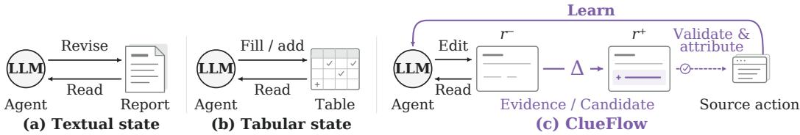
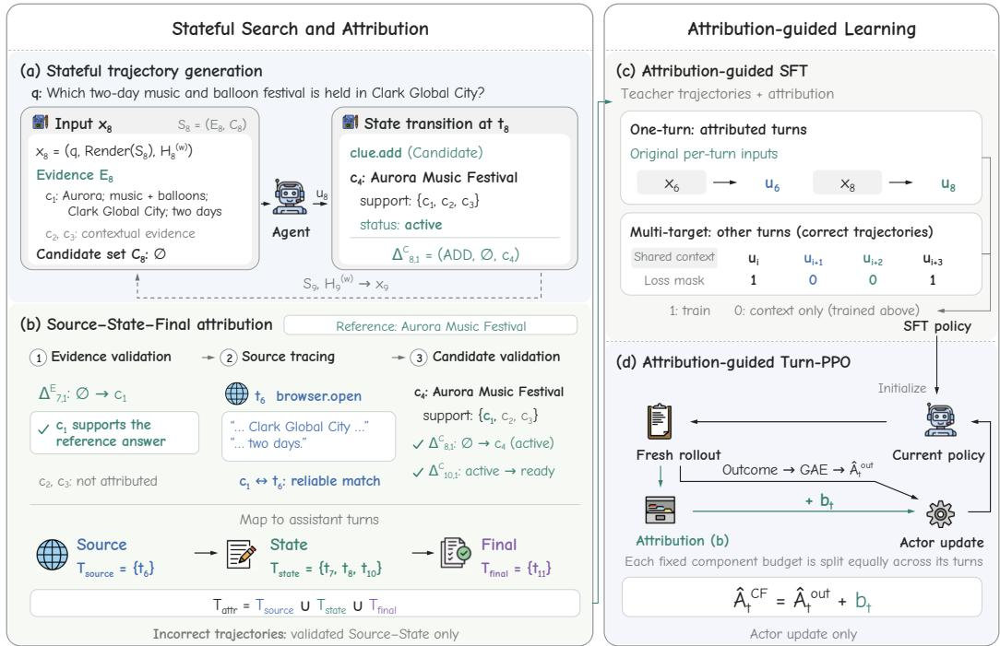

# ClueFlow: Learning Long-Horizon Search through Attributed Research-State Transitions

Yicheng Wang<sup>∗</sup> Wentao Tan Yidan Huang Yifei Liu Qiong Cao<sup>†</sup>

Joy Future Academy

GitHub Hugging Face

## Abstract

Long-horizon search requires agents to acquire relevant evidence and integrate it into an evolving research state. Existing methods maintain research states to guide exploration or assign turn-level progress signals, yet grounding these signals in explicit, attributable state changes remains underexplored. We introduce ClueFlow, which learns long-horizon search from attributed research-state transitions. ClueFlow constructs Source–State–Final attribution chains that connect evidence-acquiring browser actions, Evidence and Candidate updates, and the final answer supported by those updates. During search, ClueFlow records typed state changes and potentially supporting browser actions, then applies gold-conditioned semantic validation and source tracing after execution. We use this attribution to guide both supervised fine-tuning and reinforcement learning. During SFT, attribution selects which decisions receive supervision with their original interaction contexts. During Turn-PPO, the same attribution augments outcome-based turn advantages with credit assigned along the Source–State–Final chains. Transitionlevel validation also recovers useful supervision from gold-consistent state changes in trajectories with incorrect final answers. We evaluate ClueFlow across two Qwen backbones and four search benchmarks spanning live-web and fixed-corpus settings, observing consistent gains from SFT and further improvements from PPO. With Qwen3.5-35B-A3B, ClueFlow achieves 60.0% accuracy on BrowseComp and 72.0% on BrowseComp-Plus. In controlled BrowseComp-Plus experiments, attribution-guided SFT matches all-turn exact-context SFT using about 30% of the training tokens, while attribution-guided PPO outperforms outcome-only PPO by 4.1 pp. These results demonstrate that state-transition attribution enables efficient supervision and effective credit assignment for long-horizon search agents.

## 1 Introduction

Long-horizon search requires agents to gather evidence, evaluate candidate answers, and revise their hypotheses across extended interactions. For a multi-constraint question, a page may reveal evidence that confirms or rules out a candidate, prompting the agent to preserve that evidence and update its research state. A correct final answer alone does not distinguish useful evidence acquisition and state updates from routine exploration. Conversely, filtering out trajectories with incorrect final answers may discard valid intermediate progress. Learning from long search trajectories therefore requires identifying which research-state changes constitute meaningful progress and which informationgathering actions support those changes.

Recent methods organize accumulated findings into explicit research states, such as evolving reports (Chen et al., 2026a), structured summaries (Zhu et al., 2026), and candidate–constraint tables (Lan et al., 2026), to preserve useful information and guide subsequent exploration. Related memory methods learn to manage retained information through outcome-based reinforcement learning (Yan et al., 2026) or explicit feedback on memory informativeness (Li et al., 2026b). Other methods select valuable steps for supervision (Chen et al., 2025b; Slinko et al., 2026) or provide fine-grained credit assignment (Wang et al., 2025; 2026a; Liu et al., 2026a; Wang et al., 2026b). However, using validated research-state changes and explicit links to their supporting search actions to guide supervision and credit assignment remains underexplored. Figure 1 illustrates this distinction.

  
Figure 1: Learning from attributed research-state transitions. (a) Textual-state agents maintain evolving reports that summarize accumulated findings (e.g., IterResearch; Chen et al., 2026a). (b) Tabular-state agents maintain tables tracking candidates, constraints, and collected information (e.g., Table-as-Search; Lan et al., 2026). Both update and consult these states to guide subsequent search. (c) ClueFlow additionally learns from record-level transitions through post-execution validation and source attribution.

Our key insight is that validating research-state transitions and tracing their supporting evidence makes explicit both what progress was made and which search actions supplied the evidence for that progress. A state records the agent’s current evidence and answer hypotheses; a transition makes explicit how these records change. Based on this insight, ClueFlow constructs Source–State– Final attribution chains that connect evidence-acquiring browser actions, Evidence and Candidate transitions, and the final answer supported by those transitions.

During search, ClueFlow maintains persistent Evidence and Candidate records and logs typed state changes together with potentially supporting browser actions for each Evidence update. A recorded state change does not by itself establish useful research progress. After execution, gold-conditioned semantic validation identifies Evidence and Candidate transitions that make useful progress toward the reference answer. Source tracing then links validated Evidence transitions to the browser actions that supplied their supporting information. Gold answers and validation judges are used only for postexecution attribution and are never exposed to the search policy at test time. For correct trajectories, the resulting attribution connects evidence-acquiring browser actions and validated state transitions to the final answer they support. For trajectories ending in incorrect answers, ClueFlow retains validated Source–State partial chains that capture gold-consistent intermediate progress.

We apply this attribution principle in both supervised fine-tuning and reinforcement learning. During supervised fine-tuning, attribution selects which decisions are supervised with their original interaction contexts, while other valid turns in successful trajectories are supervised with compactly serialized contexts. During Turn-PPO (Li et al., 2026a), the same attribution augments outcome-based turn advantages with credit assigned along the Source–State–Final chains. Both stages also use validated Source–State progress recovered from trajectories with incorrect final answers.

## Our main contributions are:

• We introduce attributed research-state transitions to represent verifiable research progress and link it to the browser actions that supplied its supporting evidence, providing an explicit basis for agent learning.

• We develop ClueFlow, which constructs Source–State–Final attribution chains through semantic validation and source tracing to guide SFT context selection and Turn-PPO credit assignment. Both stages also learn from validated partial progress in trajectories with incorrect final answers.

• We conduct controlled ablations on BrowseComp-Plus, showing that attribution-guided SFT matches all-turn exact-context SFT using about 30% of the training tokens, while attribution-guided PPO with failure recovery outperforms outcome-only PPO by 4.1 pp. ClueFlow SFT also outperforms the strongest tested ReAct SFT configuration by 6.5 pp. We further evaluate ClueFlow with two Qwen backbones on four benchmarks spanning live-web and fixed-corpus search, supporting the applicability of attributed research-state learning across different models and search environments.

## 2 Related Work

## 2.1 Context and Memory Management for Long-Horizon Agents

Long-horizon agents operate on tasks spanning tens to hundreds of steps, where managing the ever-growing interaction history is a central challenge. Existing methods mainly control context size by discarding past observations, selectively retaining information, or compressing past interactions (DeepSeek-AI, 2025; GLM-5-Team, 2026; Ye et al., 2025).

Recent search agents further organize accumulated findings into persistent, reusable task states that capture evidence, candidate answers, and future search plans. These approaches differ in how they represent and update research states. RE-TRAC updates the state at trajectory boundaries by recursively compressing each completed trajectory together with the previous state into a structured summary, which then guides the next rollout (Zhu et al., 2026). IterResearch adopts a finer-grained mechanism, updating an evolving report after each tool interaction (Chen et al., 2026a). Table-as-Search instead represents the task state as a candidate–constraint table and advances search by adding candidate rows and filling empty cells (Lan et al., 2026). Related work also learns how memory should be managed. Memory-R1 uses outcome-driven reinforcement learning to learn operations for adding, updating, and deleting entries in external memory (Yan et al., 2026), whereas MemPO optimizes information summarization and retention according to their usefulness for subsequent decisions (Li et al., 2026b).

Existing approaches primarily maintain research states to guide subsequent search. ClueFlow additionally validates state transitions, traces them to supporting browser actions, and uses the resulting attributed changes to guide supervision and credit assignment.

## 2.2 Post-Training and Credit Assignment for Search Agents

Whole-trajectory imitation and outcome-based rewards do not explicitly distinguish critical, redundant, and harmful turns. Recent work therefore seeks to identify the training value of individual turns and provide more targeted supervision.

Existing methods estimate turn value in different ways. ATLaS uses an LLM selector to identify critical steps in expert trajectories and computes the training loss only on those steps (Chen et al., 2025b). SRFT labels each step as useful, harmful, or unnecessary and masks harmful steps, thereby recovering useful supervision from failed trajectories (Slinko et al., 2026). Beyond such binary selection, StepSearch rewards evidence gain while penalizing redundant retrieval (Wang et al., 2025); IGPO and PiCA assign rewards based on changes in the probability of producing the correct answer or eventually completing the task (Wang et al., 2026a; Liu et al., 2026a); and CriticSearch and CW-GRPO use LLM judgments to produce turn-level rewards or redistribute trajectory-level advantages (Zhang et al., 2026; Wang et al., 2026b). These methods convert turn-value estimates into selective losses, rewards, or advantage weights.

Rather than scoring turns directly, ClueFlow guides SFT and Turn-PPO using validated, sourceattributed research-state transitions.

## 3 Method

## 3.1 Overview

A teacher agent interacts with the search environment to generate long-horizon trajectories with explicit research-state transitions. ClueFlow then validates these transitions and traces them to the browser actions that supplied the supporting evidence. The attributed teacher trajectories are used to construct SFT data and train an initial search policy. Starting from this policy, PPO generates new online rollouts and applies the same attribution procedure to assign fine-grained credit to individual turns. Figure 2 summarizes the pipeline.

## 3.2 Stateful Trajectory Generation

ClueFlow uses the same stateful search interface for teacher trajectory generation, online policy rollouts during reinforcement learning, and test-time inference (Figure 2(a)).

  
Figure 2: Overview of ClueFlow. (a) Stateful trajectory generation maintains Evidence and Candidate records across search turns. (b) Post-execution validation against the reference answer and source tracing identify attributed Source, State, and Final turns. Validated Source–State progress can also be retained from incorrect trajectories. (c) Attribution-guided SFT uses one-turn examples with original per-turn inputs for attributed turns and multi-target chunks for other supervised turns from correct trajectories. (d) Attribution-guided Turn-PPO adds attribution bonuses to outcome advantages for actor updates. Here, $\Delta _ { t , k } ^ { E / C }$ denotes the k-th Evidence/Candidate state transition at assistant turn t.

Research state. ClueFlow maintains a persistent research state for each search trajectory. We denote the state available at the beginning of turn t by

$$
S _ { t } = ( E _ { t } , C _ { t } ) , \qquad E _ { 0 } = C _ { 0 } = \emptyset ,\tag{1}
$$

where $E _ { t }$ is the set of Evidence records containing information extracted from browser observations, and $C _ { t }$ is the set of Candidate records that maintain answer hypotheses, their supporting Evidence, and their verification progress. Each Candidate has a status of active, ready, or rejected, indicating that it remains under investigation, is eligible for submission, or has been ruled out, respectively. Candidate records also track satisfied and unresolved constraints, contradictions, and the next search step. The state fields are summarized in Appendix A.

Trajectory generation. Given a question $q ,$ the agent generates a search trajectory by repeatedly producing an assistant response and executing its requested tools. It can call browser.search, browser.open, and browser.find to search the web, read a page, and locate relevant passages. It can also use clue.add and clue.update to create or revise Evidence and Candidate records, and clue.discard to remove obsolete Evidence. The tool interfaces are summarized in Appendix A.

At turn t, we construct

$$
\begin{array} { r } { x _ { t } = \Big ( q , \mathrm { R e n d e r } ( S _ { t } ) , H _ { t } ^ { ( w ) } \Big ) , \qquad u _ { t } \sim \pi _ { \theta } ( \cdot \mid x _ { t } ) , } \end{array}\tag{2}
$$

where $x _ { t }$ is the model input, Render $( S _ { t } )$ converts the structured state into text, and $H _ { t } ^ { ( w ) }$ contains up to w most recent turns preceding turn t. The agent model $\pi _ { \theta }$ produces the response $u _ { t } ,$ which may contain reasoning and multiple tool calls. Fixed system instructions and tool schemas are omitted from the notation.

The environment executes the tool calls in $u _ { t } \colon$ Browser results are appended to the interaction history, while a state transition occurs whenever a successful Clue operation modifies an Evidence or

Candidate record. A single turn may contain multiple state-changing operations. We record the k-th transition in turn t by its operation and the affected record’s contents before and after the change:

$$
\begin{array} { r } { \Delta _ { t , k } ^ { v } = \left( \omega _ { t , k } , r _ { t , k } ^ { - } , r _ { t , k } ^ { + } \right) , } \end{array}\tag{3}
$$

where k indexes the state-changing operations within the turn, $v \in \{ E , C \}$ indicates whether the transition modifies an Evidence or Candidate record, $\omega _ { t , k } \in \{ \mathrm { A D D }$ , UPDATE, DISCARD} denotes the operation, and $r _ { t , k } ^ { - }$ and $r _ { t , k } ^ { + }$ are the record contents before and after the transition. All valid transitions in a turn jointly update $S _ { t }$ to $S _ { t + 1 }$ . All tool calls in $u _ { t }$ are generated from the same pre-turn input $x _ { t }$ The browser observations returned at turn t can therefore support state updates only from turn t + 1 onward. Search terminates when the agent submits an answer or exhausts its Browser budget. The resulting trajectory records the model responses, tool interactions, and state transitions.

## 3.3 Source–State–Final Attribution

We organize attribution around three complementary functions of search: information acquisition (Source), evidence consolidation (State), and successful answer submission (Final). Post-execution validation and source tracing connect supporting browser actions, validated Evidence and Candidate transitions, and the final answer into attribution chains, providing a shared basis for supervision and credit assignment (Figure 2(b)).

Evidence validation. An LLM judge evaluates the final content of each Evidence record against the reference answer. We retain Evidence that supports the reference answer or rules out an incorrect candidate. Superseded transitions and discarded Evidence records are excluded. For each retained Evidence record, repeated writes of the same final content are represented by a single effective transition. For both correct and incorrect trajectories, only judge-approved Evidence listed as support by the Candidate associated with the submitted answer is eligible for positive attribution.

Source tracing. During trajectory generation, ClueFlow records recent browser actions available before each $\Delta ^ { \boxtimes }$ as candidate sources. A deterministic matcher compares the post-transition Evidence content with the observations returned by these actions using document identifiers, URLs, page titles, and textual overlap. The best-matching browser action is retained only when the match is reliable (Appendix B.3); otherwise, $\Delta ^ { E }$ is excluded from positive attribution.

Candidate validation. An LLM judge also evaluates Candidate records against the reference answer. For the Candidate associated with the submitted answer, we retain $\Delta ^ { C }$ only if the Candidate passes semantic validation and cites validated Evidence. The transition must introduce or revise the submitted answer, add new validated support, or change the Candidate status from active to ready. Transitions that do not change the answer, its validated support, or its readiness are excluded.

Attribution chains and turn mapping. For a correct trajectory with a valid Source–State chain, a complete attribution chain connects the matched browser action (Source), the corresponding $\Delta ^ { E }$ and $\Delta ^ { C }$ (State), and the answer-submission turn (Final). If no $\Delta ^ { C }$ qualifies, the State part contains only $\Delta ^ { E }$ . For an incorrect trajectory, the Final link is omitted. We refer to reusing validated Source–State progress from incorrect trajectories as failure recovery.

ClueFlow then maps each action and transition to its enclosing assistant turn. Let $T _ { \mathrm { s o u r c e } }$ contain the turns that execute matched browser actions, $T _ { \mathrm { s t a t e } }$ contain the turns that perform validated $\Delta ^ { E }$ or $\Delta ^ { C }$ , and $T _ { \mathrm { f i n a l } }$ contain the final submission turn for a correct trajectory and be empty otherwise. We define the attributed turns as

$$
T _ { \mathrm { a t t r } } = T _ { \mathrm { s o u r c e } } \cup T _ { \mathrm { s t a t e } } \cup T _ { \mathrm { f i n a l } } .\tag{4}
$$

For an unfinished trajectory, $T _ { \mathrm { a t t r } } = \emptyset$ . Reference answers and judge outputs are used only after execution and are never exposed to the search policy. Appendix E provides qualitative examples of Source–State–Final attribution, including validated partial progress recovered from incorrect trajectories.

## 3.4 Attribution-Guided SFT

Because state updates and history truncation change the model’s visible context across turns, standard full-trajectory SFT cannot faithfully reproduce the inputs under which the responses were generated.

During SFT, our goal is to emphasize turns $t \in T _ { \mathrm { a t t r } }$ by training each response $u _ { t }$ with the original input $x _ { t } .$ A direct approach constructs a separate one-turn example $( x _ { t } , u _ { t } )$ for every turn. A long trajectory would then produce many examples, and neighboring examples would repeatedly contain largely the same interaction history, substantially increasing training cost. Alternatively, several consecutive turns can be grouped into one multi-target chunk. This reduces repeated context but does not preserve the original $x _ { t }$ for every turn. ClueFlow uses one-turn examples for supervised attributed turns and multi-target chunks for other supervised turns in correct trajectories (Figure 2(c)).

Attribution and trajectory outcome determine each response turn’s construction mode, while responselevel masking determines which responses contribute loss:

$$
g _ { t } = { \left\{ \begin{array} { l l } { \mathrm { O N E - T U R N } , } & { t \in T _ { \mathrm { a t t r } } , } \\ { \mathrm { C H U N K } , } & { t \not \in T _ { \mathrm { a t t r } } { \mathrm { ~ a n d ~ t h e ~ t r a j e c t o r y ~ i s ~ c o r r e c t } } , } \\ { \mathrm { E X C L U D E } , } & { { \mathrm { ~ o t h e r w i s e } } . } \end{array} \right. }\tag{5}
$$

Supervised attributed turns use independent one-turn examples $( x _ { t } , u _ { t } )$ . The remaining turns from correct trajectories are grouped into consecutive multi-target chunks, where one shared context supervises multiple assistant responses. If an attributed response also appears as history within a chunk, its loss is masked there; when retained for supervision, it is trained in its one-turn example instead.

Incorrect trajectories can contribute validated Source and State turns in $T _ { \mathrm { s o u r c e } } \cup T _ { \mathrm { s t a t e } } .$ , each with its original context, subject to response-level masking (Appendix C.1). Unfinished trajectories are excluded from training.

Let $z _ { n } = ( z _ { n , 1 } , \dots , z _ { n , L _ { n } } )$ be a serialized SFT example and $m _ { n , h } \in \{ 0 , 1 \}$ its token-level loss mask. We optimize

$$
\mathcal { L } _ { \mathrm { S F T } } = - \frac { 1 } { N } \sum _ { n } \sum _ { h = 1 } ^ { L _ { n } } m _ { n , h } \log \pi _ { \theta } ( \boldsymbol { z } _ { n , h } \mid \boldsymbol { z } _ { n , < h } ) , \qquad N = \sum _ { n } \sum _ { h = 1 } ^ { L _ { n } } m _ { n , h } .\tag{6}
$$

All unmasked target tokens receive equal weight. Attribution guides example construction and, together with trajectory outcome and post-execution validation, determines response-level masking; it does not directly reweight the training loss. Chunk construction and response-level masking are detailed in Appendix C.1.

## 3.5 Attribution-Guided Turn-PPO

Starting from the SFT policy, we sample new online search trajectories. Following Turn-PPO (Li et al., 2026a), each complete assistant response is treated as one action. The terminal outcome reward is 1 for a correct answer, 0 for an incorrect answer, and −0.1 for an unfinished trajectory; all intermediate rewards are zero. Turn-level GAE then produces an outcome advantage $\widehat { A } _ { t } ^ { \mathrm { { o u t } } }$ for each turn. We use these raw advantages without normalization or whitening.

ClueFlow augments this outcome advantage for turns in $T _ { \mathrm { s o u r c e } } , T _ { \mathrm { s t a t e } } ,$ and $T _ { \mathrm { f i n a l } }$ (Figure 2(d)). Within each trajectory, it assigns a fixed advantage budget to each chain component and divides it equally among the corresponding turns. For each chain component $j \in \{ \mathrm { s o u r c e } , \mathrm { s t a t e } , \mathrm { f i n a l } \}$ , let $\alpha _ { j }$ denote its advantage budget. Attribution bonuses are applied only when a valid Source–State chain is recovered from a completed trajectory. The bonus assigned to turn t is

$$
\begin{array} { r l } & { b _ { t } = \left\{ \begin{array} { l l } { \displaystyle { \sum _ { j } \frac { \alpha _ { j } \mathcal { H } [ t \in T _ { j } ] } { \operatorname* { m a x } ( 1 , | T _ { j } | ) } } , } & { \mathrm { i f ~ a ~ v a l i d ~ c h a i n ~ i s ~ r e c o v e r e d } , } \\ { 0 , } & { \mathrm { o t h e r w i s e } , } \end{array} \right. } \\ & { \widehat { A } _ { t } ^ { \mathrm { C F } } = \widehat { A } _ { t } ^ { \mathrm { o u t } } + b _ { t } . } \end{array}\tag{7}
$$

We use $( \alpha _ { \mathrm { s o u r c e } } , \alpha _ { \mathrm { s t a t e } } , \alpha _ { \mathrm { f i n a l } } ) = ( 0 . 0 3 , 0 . 0 3 , 0 . 0 4 )$ . Turns are deduplicated within each set, while a turn appearing in multiple parts of the chain receives the sum of their bonuses. When a valid Source–State chain is recovered, the bonuses sum to 0.10 for a correct trajectory and 0.06 for an incorrect trajectory. Incorrect trajectories receive no Final bonus, and unfinished trajectories receive no attribution bonus. If no valid Source–State chain is recovered, $b _ { t } = 0$ for all turns and the update reduces to outcome-only Turn-PPO.

The augmented advantage is used only in the actor update. It is not added to the environment reward and therefore does not change the return or critic target. For a response containing $L _ { t }$ tokens, we define one length-normalized importance ratio for the complete turn:

$$
\rho _ { t } ( \theta ) = \exp \left( \frac { 1 } { L _ { t } } \sum _ { h = 1 } ^ { L _ { t } } \log \frac { \pi _ { \theta } ( u _ { t , h } \mid x _ { t } , u _ { t , < h } ) } { \pi _ { \mathrm { o l d } } ( u _ { t , h } \mid x _ { t } , u _ { t , < h } ) } \right) .\tag{8}
$$

The actor objective averages the clipped turn-level losses within each trajectory and then across trajectories:

$$
\mathcal { L } _ { \mathrm { a c t o r } } = - \mathbb { E } _ { \mathrm { t r a j e c t o r i e s } } \left[ \frac { 1 } { T } \sum _ { t = 1 } ^ { T } \operatorname* { m i n } \Bigl ( \rho _ { t } ( \theta ) \widehat { A } _ { t } ^ { \mathrm { C F } } , \mathrm { c l i p } ( \rho _ { t } ( \theta ) , 1 - \epsilon , 1 + \epsilon ) \widehat { A } _ { t } ^ { \mathrm { C F } } \Bigr ) \right] ,\tag{9}
$$

where T is the number of valid assistant turns in a trajectory.

## 4 Experiments

We first evaluate ClueFlow’s end-to-end performance across two backbones on live-web benchmarks and BrowseComp-Plus. We then isolate the contributions of attribution-guided SFT and PPO through controlled ablations. Finally, we evaluate inference-time state management using a fixed GLM-5.1 backbone without ClueFlow-specific post-training.

## 4.1 Experimental Setup

Benchmarks. We evaluate ClueFlow on three live-web benchmarks: BrowseComp (Wei et al., 2025), BrowseComp-ZH (Zhou et al., 2025), xBench-DeepSearch-2510 (Chen et al., 2025a). We use BrowseComp-Plus (BCP) (Chen et al., 2026b) for fixed-corpus evaluation and controlled ablation of supervision construction and credit assignment, keeping the corpus and retriever fixed across all ablation settings.

Baselines. We compare our trained agents with representative deep-research systems, including IterResearch (Chen et al., 2026a), RE-TRAC (Zhu et al., 2026), Tongyi DeepResearch (Tongyi DeepResearch Team, 2025), REDSearcher (Chu et al., 2026), QUEST (Xie et al., 2026), and MiroThinker-1.7-mini (MiroMind Team et al., 2026), using full-benchmark results from published reports. We also evaluate each base model with ReAct without task-specific post-training. For inference-time comparisons, we fix GLM-5.1 (GLM-5-Team, 2026) as the backbone and compare ClueFlow with ReAct (Yao et al., 2023), Keep-k (GLM-5-Team, 2026), Discard-all (DeepSeek-AI, 2025), and HCM (GLM-5-Team, 2026) under the same browsing environment and budget.

Implementation Details. For each backbone—Qwen3-30B-A3B-Thinking-2507 (Yang et al., 2025) and Qwen3.5-35B-A3B (Qwen Team, 2026)—we train separate policies for live-web search on REDSearcher QA (Chu et al., 2026) and fixed-corpus search on OpenResearcher QA (Li et al., 2026c). For OpenResearcher QA and BrowseComp-Plus (Chen et al., 2026b), we use their respective officially released corpora and precomputed embeddings, with Qwen3-Embedding-8B (Zhang et al., 2025) as the dense retriever. GLM-5.1 (GLM-5-Team, 2026) generates SFT trajectories, and GPT-5.5 (OpenAI, 2026) validates Evidence and Candidate records for attribution. PPO starts from the corresponding SFT checkpoint. Evaluations use a maximum of 800 browsing calls per question. Appendix C provides data statistics, training configurations, and evaluation protocols.

## 4.2 End-to-End Search Performance

Full-benchmark comparison. Table 1 summarizes end-to-end performance. External results use different training data, tool environments, and inference budgets.

Live-web performance. Both backbones improve substantially over ReAct after SFT, with further gains from PPO across all three live-web benchmarks. ClueFlow achieves 54.4% and 60.0% accuracy on BrowseComp with Qwen3 and Qwen3.5, respectively.

Table 1: Comparison with representative deep-research systems on three live-web benchmarks and BrowseComp-Plus (BCP). Scores are accuracy (%).
<table><tr><td colspan="2"></td><td colspan="3">Live-web</td><td colspan="2">Fixed-corpus</td></tr><tr><td>Method</td><td>Post-training</td><td>BC</td><td>BC-ZH</td><td>xBench-2510</td><td></td><td>BCP†</td></tr><tr><td colspan="7">Representative deep-research systems</td></tr><tr><td>IterResearch</td><td>RFT + RL</td><td>37.3</td><td>45.2</td><td></td><td></td><td></td></tr><tr><td>Tongyi DeepResearch</td><td>MT + SFT + RL</td><td>43.4</td><td>46.7</td><td></td><td>55.0</td><td>44.5</td></tr><tr><td>RE-TRAC</td><td>SFT</td><td>53.0</td><td></td><td>57.3</td><td></td><td></td></tr><tr><td>REDSearcher</td><td> $\mathbf { M T } + \mathbf { S F T } + \mathbf { R L }$ </td><td>57.4</td><td></td><td>58.2</td><td></td><td></td></tr><tr><td>QUEST-35B</td><td> $\mathbf { M T } + \mathbf { S F T } + \mathbf { R L }$ </td><td>64.6</td><td></td><td></td><td></td><td>69.5</td></tr><tr><td>MiroThinker-1.7-mini MT + SFT + PO + RL</td><td></td><td>67.9</td><td></td><td>72.3</td><td>57.2</td><td></td></tr><tr><td colspan="7">Our evaluations: Qwen3-30B-A3B</td></tr><tr><td>ReAct</td><td>None</td><td>2.1</td><td>8.7</td><td></td><td>7.0</td><td>16.3</td></tr><tr><td>ClueFlow</td><td>SFT</td><td>49.1</td><td></td><td>54.0</td><td>53.5</td><td>48.3</td></tr><tr><td>ClueFlow</td><td>SFT + PPO</td><td>54.4</td><td></td><td>55.4</td><td>54.0</td><td>59.8</td></tr><tr><td colspan="7">Our evaluations: Qwen3.5-35B-A3B</td></tr><tr><td>ReAct</td><td>None</td><td>37.5</td><td>47.1</td><td></td><td>42.0</td><td>60.4</td></tr><tr><td>ClueFlow</td><td>SFT</td><td>57.9</td><td></td><td>58.5</td><td>54.8</td><td>68.8</td></tr><tr><td>ClueFlow</td><td>SFT + PPO</td><td>60.0</td><td></td><td>59.5</td><td>59.2</td><td>72.0</td></tr></table>

<sup>†</sup> For our post-trained models, BCP and live-web scores use separate checkpoints trained on OpenResearcher QA and REDSearcher QA, respectively. The Tongyi DeepResearch BCP score is taken from OpenResearcher (Li et al., 2026c). REDSearcher and MiroThinker results use their reported context-management settings; QUEST-35B BC/BCP scores use Discard-all. “None” indicates no task-specific post-training; “–” indicates an unavailable score. MT, RFT, and PO denote mid-training, rejection-sampling fine-tuning, and preference optimization, respectively.

Fixed-corpus performance. On BrowseComp-Plus, we compare Qwen3-30B-A3B SFT policies using the same teacher and matched numbers of successful trajectories (Appendix D.1, Tables 6–7). ClueFlow SFT outperforms ReAct SFT with Discard-all, the strongest tested ReAct SFT configuration, by 6.50 pp (48.31% vs. 41.81%; Table 7). PPO further raises ClueFlow accuracy to 59.8% for Qwen3 and 72.0% for Qwen3.5.

## 4.3 Attribution Ablations

We conduct attribution ablations on BrowseComp-Plus with Qwen3-30B-A3B trained on OpenResearcher QA (Table 2). All PPO variants start from the same ClueFlow SFT checkpoint and share rollout and optimization settings.

SFT supervision construction. Using only correct teacher trajectories, attribution-guided selection of turns for original-context supervision outperforms random selection by 3.26 pp (46.27% vs. 43.01%). Random selection performs similarly to chunk-only supervision (43.01% vs. 42.89%), suggesting that the choice of turns matters in this setting. Attribution-guided supervision also achieves comparable accuracy to all-turn exact-context SFT (46.27% vs. 46.14%) while using approximately 30% of its training tokens.

Recovering validated Source and State turns from incorrect trajectories further improves accuracy from 46.27% to 48.31%, a gain of 2.04 pp with only a 7% increase in training tokens.

PPO credit assignment. With a fixed attribution budget of 0.10, Source-only and Source+Final achieve 54.34% and 51.81% accuracy, respectively, both below outcome-only PPO (55.66%). Both partial variants retain State validation but assign it no credit, suggesting that rewarding evidence acquisition and answer submission alone is insufficient in this setting. Reallocating 0.03 from Source to State while keeping Final fixed at 0.04 improves accuracy from 51.81% to 58.67%, a gain of 6.86 pp under the same total attribution budget. This comparison supports the importance of explicitly crediting validated research-state transitions. Full-chain attribution improves accuracy by 3.01 pp over outcome-only PPO, while failure recovery contributes a further 1.09 pp by crediting validated Source–State progress from incorrect trajectories, reaching 59.76% accuracy overall.

Table 2: Controlled ablations of attribution-guided SFT supervision construction and PPO credit assignment on BrowseComp-Plus.  
(a) SFT supervision construction
<table><tr><td>SFT variant</td><td>Random turns</td><td>Attributed turns</td><td>All turns</td><td>Acc. (%) ↑</td><td>Rel. tokens ↓</td></tr><tr><td>Chunk only</td><td>X</td><td>X</td><td>X</td><td>42.89</td><td>0.69×</td></tr><tr><td>Chunk + random turns</td><td>√</td><td>X</td><td>X</td><td>43.01</td><td>1.06×</td></tr><tr><td>Chunk + attributed turns</td><td>X</td><td>√</td><td>X</td><td>46.27</td><td>1.00×</td></tr><tr><td>+ Failure recovery</td><td>X</td><td>√</td><td>X</td><td>48.31</td><td>1.07×</td></tr><tr><td>All-turn exact-context</td><td>X</td><td>X</td><td>√</td><td>46.14</td><td>3.33×</td></tr></table>

(b) PPO credit assignment
<table><tr><td>Variant</td><td>Source</td><td>State</td><td>Final</td><td>Acc. (%) ↑</td><td>State conv. (%)</td><td>S-S Cov. (%)</td></tr><tr><td>Outcome-only</td><td>X</td><td>X</td><td>X</td><td>55.66</td><td>39.45</td><td>55.54</td></tr><tr><td>Source-only attribution</td><td>√</td><td>X</td><td>X</td><td>54.34</td><td>41.86</td><td>48.43</td></tr><tr><td>Source+Final attribution</td><td>√</td><td>X</td><td>√</td><td>51.81</td><td>43.71</td><td>50.48</td></tr><tr><td>Full-chain attribution</td><td>√</td><td>√</td><td>√</td><td>58.67</td><td>44.25</td><td>57.71</td></tr><tr><td>+ Failure recovery</td><td>√</td><td>√</td><td>V</td><td>59.76</td><td>44.26</td><td>59.04</td></tr></table>

Relative tokens count all non-padding serialized tokens, including masked context, and are normalized by Chunk + attributed turns; they are distinct from the unmasked target-token count N in Eq. (6). Source-only distributes the full 0.10 attribution budget across attributed Source turns. Source+Final assigns 0.06 to Source and 0.04 to Final, with no State bonus. State conv. is the fraction of raw State-update turns retained after validation; S–S Cov. is the fraction of trajectories with at least one valid Source–State chain.

Source+Final yields fewer unfinished trajectories than Source-only (19 vs. 64; Table 8), consistent with Final credit encouraging answer submission, but does not improve accuracy. Full-chain produces fewer raw but more validated State updates than outcome-only PPO, raising State conversion from 39.45% to 44.25%. Failure recovery preserves conversion (44.26%) and raises coverage from 57.71% to 59.04%.

## 4.4 Inference-Time State Management

Table 3: Inference-time comparison on BrowseComp with GLM-5.1.
<table><tr><td>Method</td><td>Acc. (%)</td></tr><tr><td>ReAct</td><td>60.03</td></tr><tr><td>Keep-k</td><td>66.59</td></tr><tr><td>Discard-all</td><td>63.19</td></tr><tr><td>HCM</td><td>72.91</td></tr><tr><td>ClueFlow</td><td>73.54</td></tr></table>

All methods use the same browsing environment and an 800-call budget, without ClueFlow-specific post-training. ClueFlow obtains 73.54% accuracy, closely matching HCM (72.91%) and exceeding Discard-all (63.19%). This supports the inference-time utility of its research-state representation, complementing its role as a learning interface. Context-management settings are detailed in Appendix C.3.

## 5 Conclusion

ClueFlow uses attributed research-state transitions as a shared interface for supervision and credit assignment in long-horizon search. Gold-conditioned validation and source tracing identify useful browser actions and state updates for exact-context SFT and actor-side PPO corrections, including partial progress recovered from incorrect trajectories. Experiments on two backbones demonstrate its applicability to live-web search, while controlled BrowseComp-Plus ablations establish the benefits of attribution-guided context selection, full-chain credit assignment, and failure recovery. These findings support treating validated research-state transitions as explicit units for agent learning.

## References

Aichen Cai, Anmeng Zhang, Anyu Li, Bo Zhang, Bohua Cai, Chang Li, Changjian Jiang, Changkai Lu, Chao Xue, Chaocai Liang, Cheng Zhang, Dongkai Liu, Fei Wang, Guoqiang Huang, Haijian Ke, Han Lin, Hao Wang, Ji Miao, Jiacheng Zhang, Jialong Shi, Jifeng Zhu, Jingjing Qian, Junhui Luo, Junwu Xiong, Lam So, Liang Huang, Ming Ke, Mingyang Li, Panfeng Shi, Peng Hao, Qi Wang, Qian Lai, Qiaoqiao Yuan, Qingyu Yin, Qiong Cao, Qixiang Wang, Rongcheng Bian, Rongduo Han, Shaoqiang Zheng, Shi Hu, Shi Suo, Shijie Ren, Shijin Zhang, Shiying Fan, Shuai Xie, Tianyi Zhang, Wei Liu, Wentao Tan, Xianghan Meng, Xiaodong He, Xing Pan, Xiran Wang, Xuyang Peng, Ya Zhang, Yang Liu, Yangyang Duan, Yanxu Chen, Yicheng Gong, Yidan Huang, Yifei Liu, Yinhao Bai, Yongqiang Liu, Yuesong Zhang, Yuqi Zhang, Zerui Xie, Zhenfang Wang, Zhennan Shen, Zheyuan Liu, and Zhuwei Zeng. JoyAI-LLM Flash: Advancing mid-scale LLMs with token efficiency, 2026. arXiv:2604.03044.

Guoxin Chen, Zile Qiao, Xuanzhong Chen, Donglei Yu, Haotian Xu, Wayne Xin Zhao, Ruihua Song, Wenbiao Yin, Huifeng Yin, Liwen Zhang, Kuan Li, Minpeng Liao, Yong Jiang, Pengjun Xie, Fei Huang, and Jingren Zhou. IterResearch: Rethinking long-horizon agents with interaction scaling. In International Conference on Learning Representations, 2026a. URL https://openreview. net/forum?id=qQ5MZ5Mx7p.

Kaiyuan Chen, Yixin Ren, Yang Liu, Xiaobo Hu, Haotong Tian, Tianbao Xie, Fangfu Liu, Haoye Zhang, Hongzhang Liu, Yuan Gong, Chen Sun, Han Hou, Hui Yang, James Pan, Jianan Lou, Jiayi Mao, Jizheng Liu, Jinpeng Li, Kangyi Liu, Kenkun Liu, Rui Wang, Run Li, Tong Niu, Wenlong Zhang, Wenqi Yan, Xuanzheng Wang, Yuchen Zhang, Yi-Hsin Hung, Yuan Jiang, Zexuan Liu, Zihan Yin, Zijian Ma, and Zhiwen Mo. xbench: Tracking agents productivity scaling with profession-aligned real-world evaluations, 2025a. arXiv:2506.13651.

Zhixun Chen, Ming Li, Yuxuan Huang, Yali Du, Meng Fang, and Tianyi Zhou. ATLaS: Agent tuning via learning critical steps. In Findings ofthe Associationfor Computational Linguistics: ACL 2025, pages 25334–25349, Vienna, Austria, 2025b. Association for Computational Linguistics. doi: 10. 18653/v1/2025.findings-acl.1299. URL https://aclanthology.org/2025.findings-acl. 1299/.

Zijian Chen, Xueguang Ma, Shengyao Zhuang, Ping Nie, Kai Zou, Sahel Sharifymoghaddam, Andrew Liu, Joshua Green, Kshama Patel, Ruoxi Meng, Mingyi Su, Yanxi Li, Haoran Hong, Xinyu Shi, Xuye Liu, Hosna Oyarhoseini, Nandan Thakur, Crystina Zhang, Luyu Gao, Wenhu Chen, and Jimmy Lin. BrowseComp-Plus: A fair and disentangled evaluation benchmark for deep search agents. In Maria Liakata, Viviane P. Moreira, Jiajun Zhang, and David Jurgens, editors, Proceedings of the 64th Annual Meeting of the Association for Computational Linguistics (Volume 1: Long Papers), pages 22349–22370, San Diego, California, United States, July 2026b. Association for Computational Linguistics. ISBN 979-8-89176-390-6. doi: 10.18653/v1/2026.acl-long.1023. URL https://aclanthology.org/2026.acl-long.1023/.

Zheng Chu, Xiao Wang, Jack Hong, Huiming Fan, Yuqi Huang, Yue Yang, Guohai Xu, Chenxiao Zhao, Cheng Xiang, Shengchao Hu, Dongdong Kuang, Ming Liu, Bing Qin, and Xing Yu. REDSearcher: A scalable and cost-efficient framework for long-horizon search agents, 2026. arXiv:2602.14234.

DeepSeek-AI. DeepSeek-V3.2: Pushing the frontier of open large language models, 2025. arXiv:2512.02556.

GLM-5-Team. GLM-5: From vibe coding to agentic engineering, 2026. arXiv:2602.15763.

Tian Lan, Felix Henry, Bin Zhu, Qianghuai Jia, Junyang Ren, Qihang Pu, Haijun Li, Longyue Wang, Zhao Xu, and Weihua Luo. Table-as-Search: Agentic information seeking is table completion. In Findings of the Association for Computational Linguistics: ACL 2026, pages 15088–15107, San Diego, California, United States, 2026. Association for Computational Linguistics. doi: 10.18653/v1/2026.findings-acl.743. arXiv:2602.06724.

Junbo Li, Peng Zhou, Rui Meng, Meet P. Vadera, Lihong Li, and Yang Li. Turn-PPO: Turn-level advantage estimation with PPO for improved multi-turn RL in agentic LLMs. In Findings of the Associationfor Computational Linguistics: EACL 2026, pages 6227–6243, Rabat, Morocco, 2026a. Association for Computational Linguistics. doi: 10.18653/v1/2026.findings-eacl.328. URL https://aclanthology.org/2026.findings-eacl.328/.

Ruoran Li, Xinghua Zhang, Haiyang Yu, Shitong Duan, Xiang Li, Wenxin Xiang, Chonghua Liao, Xudong Guo, Yongbin Li, and Jinli Suo. MemPO: Self-memory policy optimization for long-horizon agents. In Findings ofthe Associationfor Computational Linguistics: ACL 2026, pages 23286–23301, San Diego, California, United States, 2026b. Association for Computational Linguistics. doi: 10.18653/v1/2026.findings-acl.1166. URL https://aclanthology.org/ 2026.findings-acl.1166/.

Zhuofeng Li, Dongfu Jiang, Xueguang Ma, Haoxiang Zhang, Ping Nie, Yuyu Zhang, Kai Zou, Jianwen Xie, Yu Zhang, and Wenhu Chen. OpenResearcher: A fully open pipeline for longhorizon deep research trajectory synthesis, 2026c. arXiv:2603.20278.

Zhixiang Liang, Yifei Liu, Yidan Huang, Haozhe Zhao, Beichen Huang, Jiaqi Wang, Nan Duan, and Qiong Cao. SearchAuditor: Auditing and attributing failures in long-horizon search agents, 2026. arXiv:2608.05212.

Dongyi Liu, Yifan Niu, Qinwen Wang, Han Xiao, and Jia Li. PiCA: Pivot-based credit assignment for search agentic reinforcement learning, 2026a. arXiv:2605.09287.

Yifei Liu, Zhixiang Liang, Wentao Tan, Yicheng Wang, Jiaqi Wang, Nan Duan, and Qiong Cao. Avoiding what your teacher already knows: Entity familiarity for deep-search distillation. arXiv preprint arXiv:2610.16251, 2026b.

MiroMind Team, S. Bai, L. Bing, L. Lei, R. Li, X. Li, X. Lin, E. Min, L. Su, B. Wang, L. Wang, L. Wang, S. Wang, X. Wang, Y. Zhang, Z. Zhang, G. Chen, L. Chen, Z. Cheng, Y. Deng, Z. Huang, D. Ng, J. Ni, Q. Ren, X. Tang, B. L. Wang, H. Wang, N. Wang, C. Wei, Q. Wu, J. Xia, Y. Xiao, H. Xu, X. Xu, C. Xue, Z. Yang, Z. Yang, F. Ye, H. Ye, J. Yu, C. Zhang, W. Zhang, H. Zhao, and P. Zhu. MiroThinker-1.7 & H1: Towards heavy-duty research agents via verification, 2026. arXiv:2603.15726.

OpenAI. Introducing GPT-5.5, April 2026. URL https://openai.com/index/ introducing-gpt-5-5/.

Qwen Team. Qwen3.5: Towards native multimodal agents, February 2026. URL https://qwen. ai/blog?id=qwen3.5.

Igor Slinko, Ilia Zavidnyi, Egor Bogomolov, and Yaroslav Zharov. Step rejection fine-tuning: A practical distillation recipe, 2026. arXiv:2605.10674.

Wentao Tan, Qiong Cao, Jiaqi Wang, and Nan Duan. SearchMaster: Grounded and regulated self-play for search agents, 2026. arXiv:2608.01822.

Tongyi DeepResearch Team. Tongyi deepresearch technical report, 2025. arXiv:2510.24701.

Guoqing Wang, Sunhao Dai, Guangze Ye, Zeyu Gan, Wei Yao, Yong Deng, Xiaofeng Wu, and Zhenzhe Ying. Information gain-based policy optimization: A simple and effective approach for multi-turn search agents, 2026a. arXiv:2510.14967.

Junzhe Wang, Zhiheng Xi, Yajie Yang, Hao Luo, Shihan Dou, Tao Gui, and Qi Zhang. Enhancing LLM-based search agents via contribution weighted group relative policy optimization. In Proceedings of the 64th Annual Meeting of the Association for Computational Linguistics (Volume 1: Long Papers), pages 31704–31718, San Diego, California, United States, 2026b. Association for Computational Linguistics. doi: 10.18653/v1/2026.acl-long.1462. URL https://aclanthology.org/2026.acl-long.1462/.

Ziliang Wang, Xuhui Zheng, Kang An, Cijun Ouyang, Jialu Cai, Yuhang Wang, and Yichao Wu. StepSearch: Igniting LLMs search ability via step-wise proximal policy optimization, 2025. arXiv:2505.15107.

Jason Wei, Zhiqing Sun, Spencer Papay, Scott McKinney, Jeffrey Han, Isa Fulford, Hyung Won Chung, Alex Tachard Passos, William Fedus, and Amelia Glaese. BrowseComp: A simple yet challenging benchmark for browsing agents, 2025. arXiv:2504.12516.

Jian Xie, Tianhe Lin, Zilu Wang, Yuting Ning, Yuekun Yao, Tianci Xue, Zhehao Zhang, Zhongyang Li, Kai Zhang, Yufan Wu, Shijie Chen, Boyu Gou, Mingzhe Han, Yifei Wang, Vint Lee, Xinpeng Wei, Xiangjun Wang, Yu Su, and Huan Sun. QUEST: Training frontier deep research agents with fully synthetic tasks, 2026. arXiv:2605.24218.

Sikuan Yan, Xiufeng Yang, Zuchao Huang, Ercong Nie, Zifeng Ding, Zonggen Li, Xiaowen Ma, Jinhe Bi, Kristian Kersting, Jeff Z. Pan, Hinrich Schuetze, Volker Tresp, and Yunpu Ma. Memory-R1: Enhancing large language model agents to manage and utilize memories via reinforcement learning.

In Maria Liakata, Viviane P. Moreira, Jiajun Zhang, and David Jurgens, editors, Proceedings of the 64th Annual Meeting of the Association for Computational Linguistics (Volume 1: Long Papers), pages 12805–12825, San Diego, California, United States, July 2026. Association for Computational Linguistics. ISBN 979-8-89176-390-6. doi: 10.18653/v1/2026.acl-long.583. URL https://aclanthology.org/2026.acl-long.583/.

An Yang, Anfeng Li, Baosong Yang, Beichen Zhang, Binyuan Hui, Bo Zheng, Bowen Yu, Chang Gao, Chengen Huang, Chenxu Lv, Chujie Zheng, Dayiheng Liu, Fan Zhou, Fei Huang, Feng Hu, Hao Ge, Haoran Wei, Huan Lin, Jialong Tang, Jian Yang, Jianhong Tu, Jianwei Zhang, Jianxin Yang, Jiaxi Yang, Jing Zhou, Jingren Zhou, Junyang Lin, Kai Dang, Keqin Bao, Kexin Yang, Le Yu, Lianghao Deng, Mei Li, Mingfeng Xue, Mingze Li, Pei Zhang, Peng Wang, Qin Zhu, Rui Men, Ruize Gao, Shixuan Liu, Shuang Luo, Tianhao Li, Tianyi Tang, Wenbiao Yin, Xingzhang Ren, Xinyu Wang, Xinyu Zhang, Xuancheng Ren, Yang Fan, Yang Su, Yichang Zhang, Yinger Zhang, Yu Wan, Yuqiong Liu, Zekun Wang, Zeyu Cui, Zhenru Zhang, Zhipeng Zhou, and Zihan Qiu. Qwen3 technical report, 2025. arXiv:2505.09388.

Shunyu Yao, Jeffrey Zhao, Dian Yu, Nan Du, Izhak Shafran, Karthik Narasimhan, and Yuan Cao. ReAct: Synergizing reasoning and acting in language models. In International Conference on Learning Representations, 2023. arXiv:2210.03629.

Rui Ye, Zhongwang Zhang, Kuan Li, Huifeng Yin, Zhengwei Tao, Yida Zhao, Liangcai Su, Liwen Zhang, Zile Qiao, Xinyu Wang, Pengjun Xie, Fei Huang, Siheng Chen, Jingren Zhou, and Yong Jiang. AgentFold: Long-horizon web agents with proactive context management, 2025. arXiv:2510.24699.

Yanzhao Zhang, Mingxin Li, Dingkun Long, Xin Zhang, Huan Lin, Baosong Yang, Pengjun Xie, An Yang, Dayiheng Liu, Junyang Lin, Fei Huang, and Jingren Zhou. Qwen3 Embedding: Advancing text embedding and reranking through foundation models, 2025. arXiv:2506.05176.

Yaocheng Zhang, Haohuan Huang, Zijun Song, Zijie Zhao, Qichao Zhang, Yuanheng Zhu, and Dongbin Zhao. CriticSearch: Fine-grained credit assignment for search agents via a retrospective critic. In Maria Liakata, Viviane P. Moreira, Jiajun Zhang, and David Jurgens, editors, Findings of the Association for Computational Linguistics: ACL 2026, pages 12272–12290, San Diego, California, United States, July 2026. Association for Computational Linguistics. ISBN 979-8- 89176-395-1. doi: 10.18653/v1/2026.findings-acl.596. URL https://aclanthology.org/ 2026.findings-acl.596/.

Peilin Zhou, Bruce Leon, Xiang Ying, Can Zhang, Yifan Shao, Qichen Ye, Dading Chong, Zhiling Jin, Chenxuan Xie, Meng Cao, Yuxin Gu, Sixin Hong, Jing Ren, Jian Chen, Chao Liu, and Yining Hua. BrowseComp-ZH: Benchmarking web browsing ability of large language models in Chinese, 2025. arXiv:2504.19314.

Jialiang Zhu, Gongrui Zhang, Xiaolong Ma, Lin Xu, Miaosen Zhang, Ruiqi Yang, Song Wang, Kai Qiu, Zhirong Wu, Qi Dai, Ruichun Ma, Bei Liu, Yifan Yang, Chong Luo, Zhengyuan Yang, Linjie Li, Lijuan Wang, Weizhu Chen, Xin Geng, and Baining Guo. RE-TRAC: Recursive trajectory compression for deep search agents. In International Conference on Machine Learning, 2026. URL https://icml.cc/virtual/2026/poster/60790.

```jsonl
{
"clue.add": {"content": "string", "kind?": "evidence | candidate",
"reason?": "string", "metadata?": "CandidateMetadata"},
"clue.update": {"id": "cN", "content?": "string",
"reason?": "string", "metadata?": "CandidateMetadata"},
"clue.discard": {"id": "cN", "reason?": "string"}
}
```  
Listing 3: Compact Clue tool interfaces; CandidateMetadata is defined in Listing 1.

## A Runtime Interface and State Management

This appendix summarizes the runtime mechanism behind Section 3.2: research state, tool interfaces, context construction, Browser provenance, submission rules, and the agent system prompt. Offline attribution, training, and evaluation are covered in Appendices B and C.

## A.1 State and Tool Interfaces

At the beginning of turn t, the persistent state is $S _ { t } = ( E _ { t } , C _ { t } )$ . Evidence and Candidate records share one monotonic ID namespace (c1, c2, . . . ). Discarded Evidence is stored separately from the active state. Listing 1 summarizes the normalized record fields.

```ipynb
{
"ClueRecord": {
"id": "string (runtime-assigned cN)",
"content": "string",
"kind": "evidence | candidate",
"metadata": "{} | CandidateMetadata",
"status": "active | discarded'
},
"CandidateMetadata": {
"answer": {"type": "string", "default": "parent content"},
"status": {"enum": ["active", "ready", "rejected"], "default": "active"},
"supporting_clues": {"type": "string[]", "default": []},
"satisfied_constraints": {"type": "string[]", "default": []},
"missing_constraints": {"type": "string[]", "default": []},
"contradictions": {"type": "string[]", "default": []},
"next_check": {"type": "string", "default": ""}
}
}
```  
Listing 1: Research-state fields and the shared Candidate metadata definition.

Evidence uses empty metadata and defaults to kind=evidence; all records default to top-level status=active. This lifecycle status is distinct from metadata.status, which tracks Candidate readiness or rejection. supporting\_clues holds Evidence IDs, validated during offline attribution (Appendix B). Missing Candidate strings and lists become empty; scalar values supplied for list fields are wrapped in singleton lists. Invalid decision statuses become active, and a missing answer falls back to the record content. Discarded Evidence leaves the active rendering but remains in the trajectory and discarded-record collection; a rejected Candidate remains in the state with metadata.status=rejected.

Tool-interface summaries are shown below; ? marks optional arguments.

{   
"browser.search": {"query": "string", "topn?": "integer = 10"},   
"browser.open": {"id?": "integer | URL = -1", "cursor?": "integer = -1",   
"loc?": "integer = -1", "num\_lines?": "integer = -1",   
"view\_source?": "boolean = false", "source?": "string"},   
"browser.find": {"pattern": "string", "cursor?": "integer = -1",   
"context\_lines?": "integer = 0 (range 0..5)"}   
}

Listing 2: Compact Browser tool interfaces.

Browser search returns session-local numeric link IDs. Online results include URLs, whereas the fixed-corpus results omit raw URLs and document IDs; their search/open descriptions direct the model to use the displayed numeric IDs. Opening a page returns a cursor and line-numbered text, and browser.find returns at most 20 matches with local context. view\_source and source remain in the interface but do not change the current executor. Runtime-only source records are described in Appendix A.2.

clue.add requires content and defaults to Evidence; adding a Candidate must use structured metadata under the model instructions, even though no metadata member is schema-required. Candidate creation forces metadata.status=active; clue.update requires only id and can set a Candidate to ready or rejected, including via a metadata-only update. Omitted Candidate metadata on update inherits its previous normalized value. clue.discard requires only id and removes Evidence, not Candidates. The model cannot change record IDs, kinds, or runtime provenance directly. Clue tools return a one-line observation; the runtime separately logs mutations. Invalid calls, missing or inactive IDs, empty Evidence writes, and Candidate discard attempts produce no transition. Successful writes, including Evidence updates that preserve record content, are logged. Offline attribution selects a representative write for validated final Evidence content; Candidate transitions are assessed separately for progress (Appendix B). Submission is plain assistant text without tool calls and must satisfy the readiness rules in Appendix A.3.

## A.2 Context Construction and Browser Provenance

At each turn, the model input follows Equation 2: fixed system instructions and the question, a freshly rendered $S _ { t } .$ , and the bounded history $H _ { t } ^ { ( w ) }$ , containing up to w most recent complete turns. Tool definitions are supplied separately through native function calling. Research-state and task-state messages are rebuilt before each call. Active Evidence is rendered with IDs and content; Candidate rendering includes answers, status, support IDs, satisfied and missing constraints, contradictions, and next checks, marking ready candidates and summarizing rejected ones. Task state reports the budget and, when relevant, stagnation and recent queries. A history turn contains the assistant message, its tool calls, and their responses. Rendering $S _ { t }$ outside this rolling history keeps active records visible after their original observations leave the window. Query-focused summarization of retrieved pages offers another approach to controlling search-context overhead (Cai et al., 2026). Discarded Evidence may remain only in recent history until those turns leave the window. Runtime provenance, lifecycle indices, pending sources, and the full trajectory are not shown to the model.

All tool calls in one response are sampled from the same pre-turn input. The executor preserves order within each tool family but runs Clue calls before Browser calls: successful Clue operations update state, then Browser results enter history. Thus, browser observations returned in turn t can support Evidence writes only from turn $t + 1$ onward.

The runtime records each browser action’s type (search, open, or find), query, URL, title, tool-call ID, and browser step/turn IDs. Clue records also log source candidates, creation/update steps, and discard reasons; attribution confidence and method are tracked separately. These bookkeeping fields are runtime-only and omitted from the rendered state.

An ordered pending pool $\mathcal { P } _ { t }$ retains at most 80 recent successful, nonempty browser actions. Before executing a turn’s calls, the runtime snapshots $\mathcal { P } _ { t } ;$ every successful Evidence ADD or UPDATE in that turn records the same candidate-source snapshot $\widetilde { \mathcal { P } } ( \tau ) = \mathcal { P } _ { t }$ . A singleton is assigned as a direct source; larger snapshots remain unresolved online. Let $B _ { t } ^ { + }$ be the successful, nonempty browser actions from turn $t ,$ and let $\chi _ { t } = 1$ if at least one Evidence write succeeds, including a semantic no-op. After the Clue batch, the old snapshot is consumed only once:

$$
\mathcal { P } _ { t + 1 } = \left\{ \begin{array} { l l } { \mathcal { B } _ { t } ^ { + } , } & { \chi _ { t } = 1 , } \\ { \mathcal { P } _ { t } \cup \mathcal { B } _ { t } ^ { + } , } & { \chi _ { t } = 0 . } \end{array} \right.
$$

Candidate operations, Evidence DISCARD, and failed Clue calls do not consume the pool. Malformed calls, empty or error observations, no-result searches, and no-match finds are excluded from $B _ { t } ^ { + }$ . If the pool is empty but a current page exists, its URL/title may be copied as weak context without assigning a direct Browser-step source. The pending records capture possible sources given temporal visibility; offline source tracing selects the action that supports the claim (Appendix B).

## A.3 Readiness and Submission

A Candidate is ready only if its decision status is ready, its answer is nonempty, and it has no missing constraints, contradictions, or unresolved rival. A rival is a nonequivalent, unrejected Candidate with no contradictions and at least as many satisfied and no more missing constraints. A plain-text submission is accepted only when exactly one Candidate is ready; matching the submitted text to that Candidate is diagnostic, not an acceptance condition. Runtime readiness does not require nonempty supporting\_clues, whereas offline Candidate credit requires support IDs that resolve to active, approved Evidence.

## A.4 Agent System Prompt

The following is the standard ClueFlow agent-facing system prompt. Tool schemas are supplied separately through native function calling; the question and rendered state are separate messages (Appendix A.2).

You are a clue-based search agent.   
Your task is to answer the user’s question using browser tools to search and read   
web pages, and clue tools to maintain a structured evidence memory.   
Available tools:   
Browser tools:   
- browser.search: search the web.   
- browser.open: open a search result or URL.   
- browser.find: find text in an opened page.   
Clue tools:   
- clue.add: add a typed clue from the latest observation. Use kind=’evidence’ for   
facts and kind=’candidate’ for plausible answers with structured metadata.   
- clue.update: update an existing evidence or candidate clue. For candidates, this   
is the only way to change status to ready or rejected.   
- clue.discard: discard an evidence clue. Do not use it for candidate rejection.   
Clue policy:   
Clues are persistent evidence memory, not private thoughts.   
Only ADD facts stated in tool results (browser observations). Do not ADD clues from   
the question itself.   
Be active: if a tool result names a candidate entity, title, date, role, relation,   
event, author, work, adaptation, office, or constraint-relevant fact, prefer   
ADD.   
The question itself is not an evidence source, but it is a source of search   
constraints.   
You may use phrases, entities, dates, roles, relations, and tentative   
interpretations from the question to form search queries.   
Source-specific constraint:   
For questions asking "according to [source]", "on page X", "in a newspaper", "in a   
review", or similar source-specific phrasing, the final answer MUST come from   
that specific source context. Do not ADD general background facts as   
answer-supporting clues unless they come from the required source or directly   
help identify/locate that source.   
Binding clues:   
When an observation fact satisfies a question constraint, ADD a binding clue that   
states the observation fact together with which constraint it satisfies.   
UPDATE only when a tool result corrects, broadens, narrows, or supplements an   
existing clue.   
DISCARD clues that are contradicted, stale, over-specific, misleading, or   
repeatedly unproductive.   
Candidate policy:   
Evidence clues are not enough to finish. You may answer only through Candidate   
State.

Use clue.add with kind=’candidate’ when a plausible answer appears. Candidate add   
always creates an active candidate, even if another status is supplied.   
Candidate clues must include metadata:   
answer: proposed final answer string.   
status: active on add; use clue.update later for ready or rejected.   
supporting\_clues: active evidence clue ids supporting this candidate.   
- satisfied\_constraints: question constraints already covered by evidence.   
- missing\_constraints: hard constraints or checks still not proven.   
contradictions: observed evidence that conflicts with this candidate.   
- next\_check: the next concrete browser action needed to resolve the candidate.   
Update candidate clues whenever new evidence changes which answer is plausible,   
which hard constraints are covered, what remains missing, or what   
contradiction was found.   
Reject a candidate only with clue.update by setting metadata.status=’rejected’ when   
a hard contradiction is found.   
Mark metadata.status=’ready’ only with clue.update, and only when the answer is   
explicit, missing\_constraints is empty, contradictions is empty, and no   
stronger rival candidate remains.   
A free-text candidate clue without structured metadata is not sufficient for finish   
readiness.   
Do not treat many related evidence clues as sufficient to answer. If no candidate   
is ready, use the candidate’s next\_check to decide the next   
browser.search/open/find action. If a candidate is ready, finish with that   
candidate instead of continuing to search.   
Answer guidance:   
When a candidate clue is ready, provide your final answer as plain text with NO   
tool calls.   
The answer must be a short plain string: only the entity, title, name, number,   
date, location, or phrase being asked for.   
Do not use markdown, bold text, explanations, citations, or leading phrases.   
Search/open guidance:   
When search results contain a promising source, prefer opening it instead of   
repeatedly reformulating queries.   
If two consecutive searches return empty or low-information results, switch   
strategy: open a result, broaden the query, or answer from grounded clues.

## B Attribution Details

## B.1 Evidence Validation

Listing 4 summarizes the Evidence judge input and output (strings denote field types). Evidence comes from active and discarded records, deduplicated by ID. Candidate records are validated separately against the reference answer, with additional structural checks on their transitions. For long trajectories, batches of at most 20 Evidence records repeat the question, answers, and allowed labels.

```jsonl
{
"input": {
"question": "string", "gold_answer": "string",
"gold_aliases": ["string"],
"predicted_answer": "string | NO_ANSWER",
"allowed_labels": ["label"],
"clues": [{"clue_id": "string", "kind": "evidence",
"status": "active | discarded", "discard_reason": "string | null",
"source_action": "search | open | find | null",
"source_url": "string | null", "source_title": "string | null",
"content": "string"}]
},
"output": {"labels": [{"clue_id": "cN",
"label": "<allowed label>", "rationale": "<one sentence>"}]}
}
```  
Listing 4: Schematic input and output contract for Evidence validation.

The judge assigns one of eight labels per Evidence record:
<table><tr><td>Label</td><td>Meaning</td><td>Positive?</td></tr><tr><td>SUPPORT_GOLD</td><td>Establishes the gold answer, alias, or required component.</td><td>Yes</td></tr><tr><td>EXCLUSION GOLD</td><td>Rules out a wrong candidate or narrows toward gold.</td><td>Yes</td></tr><tr><td>SCAFFOLDING_RELEVANT</td><td>Provides an intermediate entity, date, or constraint anchor.</td><td>No</td></tr><tr><td>SUPPORT_PRED</td><td>Supports a non-gold prediction; absent for no-answer runs.</td><td>No</td></tr><tr><td>SUPPORT_WRONG</td><td>Favors another incorrect candidate as the answer.</td><td>No</td></tr><tr><td>CONTRADICT_GOLD</td><td>Conflicts with gold or its required entity binding.</td><td>No</td></tr><tr><td>IRRELEVANT</td><td>Adds no useful support, exclusion, or intermediate anchor.</td><td>No</td></tr><tr><td>UNCLEAR</td><td>Insufficient to judge; fallback for an invalid label.</td><td>No</td></tr></table>

The prompt requires one output object per input clue in the same order and a short rationale. Its principal semantic rules are that a gold-string match is insufficient without the correct entity binding; mentioning a wrong candidate may constitute useful exclusion rather than support for a wrong answer; intermediate anchors should not be collapsed into irrelevance; entity identity outranks coincident dates or numbers; and unsuccessful search is not evidence of absence. Invalid labels are normalized to UNCLEAR. Unresolved records do not enter a strict positive attribution chain.

Under strict Source–State–Final attribution, an Evidence record must receive an eligible positive label, remain active at the end of the trajectory, and have its ID listed in the supporting\_clues of the Candidate associated with the submitted answer. SCAFFOLDING\_RELEVANT remains useful for analysis but is not credited in the strict final-support chain.

## B.2 Effective Transition Recovery

The trajectory stores an operation ledger of applied, non-skipped ADD, UPDATE, and DISCARD events $v = ( \mathrm { o p , k i n d } , S ^ { - } , S ^ { + } , \mathrm { p r o v } )$ . For a judge-labeled Evidence record, we normalize whitespace and select the last Evidence ADD or UPDATE whose post-operation content matches its final content. This representative-write rule may select an identical later update that leaves the content unchanged; earlier matching writes receive no separate credit, and differing writes are superseded. A DISCARD and its record remain available for auditing and judging but are never selected as a positive content write. If no matching write exists, or the selected write lacks a mapped assistant turn or reliable browser source, the Evidence chain is dropped rather than reassigned to an earlier write.

Candidate recovery is performed separately after semantic validation. The operation must modify the final Candidate associated with the submission, its normalized answer must equal the submitted answer, and its supporting\_clues must contain at least one Evidence ID whose semantic and source links both survive validation. Such an operation advances the chain if it adds newly approved support, first creates or revises the final answer content, or performs a genuine transition into metadata.status = ready. An operation that changes none of the answer, approved support, or readiness is a semantic no-op and is excluded.

## B.3 Source Tracing

Each effective Evidence write is matched only to browser observations available before the write (Appendix A.2). We first consider the pending browser actions recorded at write time. If no reliable match is found, we expand the candidate set to actions with an exact recorded URL and the 80 most recent prior browser actions.

A deterministic matcher combines document IDs, URLs, search queries, and content coverage, defined as the fraction of normalized Evidence tokens present in an observation. Titles and recency provide auxiliary ranking signals but cannot independently establish a reliable link. The best-matching source is retained only if it passes fixed source-identity or content-based reliability checks. Accepted sources must be successful search, open, or find actions, and both the source and Evidence write mus map to assistant turns. Evidence without a qualifying source is excluded from positive attribution.

For a correct trajectory, each surviving chain connects the matched browser action, validated state transitions, and the final submission:

$$
\mathrm { S o u r c e } \longrightarrow \Delta ^ { E } \longrightarrow [ \Delta ^ { C } ] _ { \mathrm { o p t i o n a l } } \longrightarrow \mathrm { F i n a l } .\tag{10}
$$

Incorrect trajectories retain only validated Source–State partial chains within the final support set of the Candidate associated with the submitted answer. Unfinished trajectories receive no positive attribution. If no valid Source–State chain survives, PPO falls back to outcome-only learning.

## C Training and Evaluation Details

## C.1 SFT Data and Training

Table 4 summarizes the data and principal training settings. Recent work explores deep-search training data construction through grounded self-play (Tan et al., 2026) and teacher-specific entityfamiliarity screening (Liu et al., 2026b). ClueFlow constructs supervision from teacher trajectories on existing QA tasks. Both backbones receive full-parameter SFT in each environment; the controlled SFT ablations use Qwen3-30B-A3B-Thinking-2507.

Table 4: SFT data and training for the two environments.
<table><tr><td>Setting</td><td>Fixed corpus</td><td>Live web</td></tr><tr><td>QA source</td><td>OpenResearcher QA</td><td>REDSearcher QA</td></tr><tr><td>Training questions</td><td>3,657</td><td>7,551</td></tr><tr><td>Correct / incorrect teacher trajectories</td><td>2,927 / 730</td><td>6,300 / 1,251</td></tr><tr><td>SFT examples (one-turn / multi-target chunk)</td><td>34,783 / 44,031</td><td>38,962 / 75,557</td></tr><tr><td>Chunk size K</td><td>5</td><td>10</td></tr><tr><td>Global batch size</td><td>64</td><td>64</td></tr><tr><td>Maximum sequence length</td><td>131,072</td><td>163,840</td></tr><tr><td>Shared optimization</td><td></td><td></td></tr><tr><td>Epochs / learning rate</td><td> $3 / 1 \times 1 0 ^ { - 5 }$ </td><td></td></tr><tr><td>Schedule / warmup</td><td>Cosine decay / 0.1 warmup ratio</td><td></td></tr></table>

Supervision selection. In correct trajectories, assistant responses are supervised unless they contain state operations judged harmful after execution. In incorrect trajectories, only validated Source or State turns without harmful operations are supervised; incorrect final submissions and other turns are masked. When a turn combines validated and harmful operations, its entire response is masked rather than supervising individual tool calls. Masked responses may still appear in later recorded contexts.

Chunk construction and masking. These counts are complementary parts of one hybrid export, not two encodings of the same turns. We group successive assistant turns into non-overlapping multitarget chunks of at most K turns using the last turn’s recorded input. Only supervised, non-attributed assistant responses receive loss within a chunk; attributed turns use separate one-turn examples in their original contexts. Other responses and context tokens are masked. Fixed-corpus and live-web SFT retain 10 and 20 visible turns, respectively.

## C.2 PPO Data and Training

Table 5 summarizes the PPO training settings for both backbones.

Table 5: PPO data and training.
<table><tr><td>Setting</td><td>Fixed 30B / 35B</td><td>Live 30B / 35B</td></tr><tr><td>QA source</td><td>OpenResearcher QA</td><td>REDSearcher QA</td></tr><tr><td>Training questions sampled</td><td>800</td><td>1,000</td></tr><tr><td>Trajectories per rollout batch</td><td>20</td><td>100</td></tr><tr><td>Rollout batches</td><td>40</td><td>10</td></tr><tr><td>Optimization batch size</td><td>20</td><td>100</td></tr><tr><td>History window (turns)</td><td>10</td><td>20</td></tr><tr><td>Shared configuration</td><td></td><td></td></tr><tr><td>Samples per rollout prompt</td><td>1</td><td></td></tr><tr><td>PPO epochs per rollout batch</td><td>2</td><td></td></tr><tr><td>Actor / critic learning rate</td><td> $1 0 ^ { - 6 } / 1 0 ^ { - 5 }$ </td><td></td></tr><tr><td>Policy / value clip</td><td>0.1 / 0.2</td><td></td></tr><tr><td>GAE γ / λ</td><td>1 / 0.995</td><td></td></tr><tr><td>Temperature / top-p</td><td>1.0 / 0.95</td><td></td></tr></table>

The outcome reward and Source/State/Final advantage bonuses are defined in Section 3.5 (Equation 7). Advantage normalization is disabled, preserving the scale of these fixed bonuses. The critic bounds its values to [−0.1, 1] and applies loss only at the pre-response boundary of each valid assistant turn, against the unmodified turn-level return.

## C.3 Evaluation Protocols

We evaluate on all 830 BrowseComp-Plus (BCP), 1,266 BrowseComp (BC), 289 BrowseComp-ZH (BC-ZH), and 100 xBench-DeepSearch-2510 questions. Offline training uses the OpenResearcher<sup>1</sup> corpus and released document embeddings, indexed locally with FAISS IVF. BCP evaluation uses the BrowseComp-Plus<sup>2</sup> corpus and precomputed embeddings released by Tevatron. Both use Qwen3- Embedding-8B for retrieval. Live-web benchmarks use Serper search and Jina Reader for page fetching.<sup>3</sup> Evaluations use a maximum of 800 browsing calls per question. xBench-DeepSearch-2510 scores are averaged over six evaluation runs; all other benchmarks are evaluated once.

Inference-time context management. For the GLM-5.1 BrowseComp comparison in Section 4.4, Discard-all drops the visible trajectory once it exceeds 64K tokens. Keep-k uses k = 5, retaining the five most recent rounds’ observations while folding older ones. HCM applies the same keep-5 folding and discards the tool-call history if the folded context still exceeds 64K tokens. ClueFlow retains the most recent w = 20 turns alongside its persistent research state. The same 64K threshold is used by HCM and Discard-all on BCP in Table 7.

The gold-conditioned GPT-5.5 attribution judge validates Evidence and Candidate records for training and PPO credit, not benchmark accuracy. For final-answer scoring, normalized matches are accepted first; otherwise an answer-only GPT-5.5 judge compares the submitted answer with the reference without viewing the search trace. Unanswered or unresolved questions count as incorrect.

## D Additional Results and Analyses

## D.1 Additional Context-Management Baselines

We evaluate additional context-management baselines on the full BrowseComp-Plus evaluation set. Four inference-time strategies reuse the same ReAct SFT model. We separately train Keep-5 SFT on teacher trajectories collected under Keep-k (k = 5) and evaluate it under Keep-5 and HCM. Table 6 compares their training data with ClueFlow SFT.

Table 6: SFT data and trajectory construction for the context-management comparison.
<table><tr><td>Training-data property</td><td>ReAct SFT</td><td>Keep-5 SFT</td><td>ClueFlow SFT</td></tr><tr><td>Teacher rollout configuration</td><td>ReAct</td><td>Keep-5</td><td>ClueFlow</td></tr><tr><td>Distinct training questions</td><td>2,927</td><td>2,927</td><td>3,657</td></tr><tr><td>Successful teacher trajectories</td><td>2,927</td><td>2,927</td><td>2,927</td></tr><tr><td>Incorrect trajectories used</td><td>0</td><td>0</td><td>730†</td></tr><tr><td>SFT serialization</td><td>Full trajectory</td><td>One-turn</td><td>One-turn + chunks</td></tr><tr><td>Serialized training examples</td><td>2,927</td><td>117,877</td><td>78,814</td></tr><tr><td>Attribution-guided construction</td><td>No</td><td>No</td><td>Yes</td></tr></table>

Notes. All three use Qwen3-30B-A3B-Thinking-2507, a GLM-5.1 teacher, and OpenResearcher QA with offline retrieval. <sup>†</sup> Of ClueFlow’s 730 incorrect trajectories, only validated intermediate steps, not complete trajectories, are used. Keep-5 one-turn examples retain the teacher-visible folded context. Serialized-example counts do not directly measure training tokens.

Table 7: Additional context-management baselines on BrowseComp-Plus. The four ReAct rows share the same SFT checkpoint and differ only in inference-time context management. HCM and Discard-all use a 64K-token context-management threshold. All evaluations use a maximum budget of 800 browsing calls per question.
<table><tr><td>SFT model</td><td>Inference-time context strategy</td><td>Acc. (%)</td></tr><tr><td>ReAct</td><td>Full history</td><td>28.55</td></tr><tr><td>ReAct</td><td>Keep-5</td><td>29.64</td></tr><tr><td>ReAct</td><td>HCM</td><td>35.06</td></tr><tr><td>ReAct</td><td>Discard-all</td><td>41.81</td></tr><tr><td>Keep-5</td><td>Keep-5</td><td>32.89</td></tr><tr><td>Keep-5</td><td>HCM</td><td>37.11</td></tr><tr><td>ClueFlow w/o failure recovery</td><td>Persistent state + bounded window</td><td>46.27</td></tr><tr><td>ClueFlow</td><td>Persistent state + bounded window</td><td>48.31</td></tr></table>

Context management substantially improves the ReAct SFT baseline. Discard-all achieves the strongest result among the tested ReAct configurations, increasing accuracy from 28.55% to 41.81% (+13.26 pp). Keep-5 SFT exceeds ReAct SFT under the corresponding Keep-5 and HCM inference strategies by 3.25 pp and 2.05 pp, respectively. Because their teacher trajectories and training questions differ, this comparison does not isolate the effect of bounded-context training.

Using only successful teacher trajectories, ClueFlow SFT without failure recovery reaches 46.27%, 4.46 pp above the strongest tested non-ClueFlow baseline, ReAct SFT with Discard-all (41.81%). Adding validated intermediate steps from incorrect trajectories raises accuracy by 2.04 pp to 48.31% (6.50 pp above the same baseline). Thus, context management narrows the gap between full-history ReAct SFT and ClueFlow SFT, but the tested alternatives do not fully close it. These comparisons assess complete training and execution configurations; the controlled SFT ablations in Section 4.3 separately examine the contribution of attribution-guided context selection.

The relative performance of HCM and Discard-all is setting-dependent: HCM performs better with GLM-5.1 on BrowseComp, whereas Discard-all is stronger for the Qwen3-30B SFT policy on BrowseComp-Plus.

## D.2 PPO Rollout Behavior

We report rollout statistics and post-hoc attribution diagnostics for the PPO ablations in Table 2(b). Full-chain attribution changes more than the frequency of browser actions. Relative to Source-only attribution, it increases both the fraction of inspection actions and validated State progress, with Source–State coverage rising from 48.43% to 57.71%. This is not simply due to more state writing: relative to outcome-only PPO, Full-chain produces fewer raw State-update turns (4.367 vs. 4.743) but more validated State turns (1.933 vs. 1.871), increasing State conversion from 39.45% to 44.25%. Failure recovery further increases inspection share, while its validated State statistics remain similar to Full-chain attribution.

Table 8: Additional rollout, behavioral, and post-hoc attribution statistics for the BrowseComp-Plus PPO ablations.  
(a) Rollout statistics
<table><tr><td></td><td colspan="2">Avg. browse calls</td><td></td></tr><tr><td>Variant</td><td>Correct</td><td>Non-correct</td><td>Unfinished (#)</td></tr><tr><td>Outcome-only</td><td>82.21</td><td>319.69</td><td>20</td></tr><tr><td>Source-only attribution</td><td>106.91</td><td>415.37</td><td>64</td></tr><tr><td>Source+Final attribution</td><td>52.37</td><td>212.04</td><td>19</td></tr><tr><td>Full-chain attribution</td><td>88.76</td><td>396.30</td><td>24</td></tr><tr><td>+ Failure recovery</td><td>87.26</td><td>428.76</td><td>15</td></tr></table>

(b) Behavioral and attribution diagnostics
<table><tr><td>Variant</td><td>Inspect (%)</td><td>Raw State / traj</td><td>Valid State / traj</td><td>State conv. (%)</td><td>S-S Cov. (%)</td></tr><tr><td>Outcome-only</td><td>16.01</td><td>4.743</td><td>1.871</td><td>39.45</td><td>55.54</td></tr><tr><td>Source-only attribution</td><td>15.93</td><td>3.908</td><td>1.636</td><td>41.86</td><td>48.43</td></tr><tr><td>Source+Final attribution</td><td>13.42</td><td>3.600</td><td>1.573</td><td>43.71</td><td>50.48</td></tr><tr><td>Full-chain attribution</td><td>23.25</td><td>4.367</td><td>1.933</td><td>44.25</td><td>57.71</td></tr><tr><td>+ Failure recovery</td><td>27.09</td><td>4.301</td><td>1.904</td><td>44.26</td><td>59.04</td></tr></table>

In (a), Non-correct includes incorrect-answer and unfinished trajectories; Unfinished counts the unfinished subset. In (b), Inspect denotes the fraction of Browser calls that are open or find; Raw State counts state-update turns before validation, while Valid State counts turns retained by strict post-execution attribution. State conv. is the fraction of raw State turns retained as validated State progress. S–S Cov. is the percentage of evaluation trajectories containing at least one strictly valid Source–State chain. All variants use the same 800-call browsing budget. Post-hoc attribution is used only for analysis and does not affect inference or benchmark scoring.

Source+Final yields fewer unfinished trajectories than Source-only (19 vs. 64), consistent with the intended role of Final credit in encouraging answer submission, but does not improve accuracy. Compared with full-chain attribution, it produces fewer validated State turns (1.573 vs. 1.933 per trajectory) and lower Source–State coverage (50.48% vs. 57.71%), despite similar State conversion (43.71% vs. 44.25%). Full-chain achieves higher accuracy with a similarly low unfinished count (24), indicating that its advantage extends beyond answer completion.

## E Qualitative Case Studies

Turn numbers, tool calls, observations, and quoted Think excerpts come from saved trajectories; ellipses mark omissions and line wraps are editorial. The turn-8 input snapshot abbreviates a logged request while preserving role order. Task summaries, state annotations, highlights, and Source/State/Final labels are post-hoc, not agent-visible. Bonuses are PPO actor advantage bonuse (Equation 7), not environment rewards.

Correct submission.

Task summary. Name the annual two-day music and hot-air-balloon festival in Clark Global City, a   
planned district in a Central Luzon economic zone; its name evokes a natural phenomenon.   
Reference answer. Aurora Music Festival. Submitted answer. Aurora Music Festival.   
Turn 4: Competing event Unattributed   
Think. “Let me check ifthere’s an event specifically at Clark Global City.”   
Assistant tool calls   
browser.open({"id":12})   
browser.search({"query":"Lubao International Balloon Music   
Festival art installations","topn":10})   
Tool observations   
browser.open: [2] Philippine International Hot Air Balloon Fiesta   
L22: ... an annual four-day air-sporting event   
browser.search: [33] Lubao International Balloon and Music Festival 2026 ...

Turn 6: Source page Source   
Think. “Let me check the Wikipedia pagefor the Aurora Music Festival.”   
Assistant tool call: browser.open({"id ":43})   
Tool observation   
[3] ## First edition and COVID-19 pandemic (73 lines total)   
L1: Title: Aurora Music Festival   
L3: URL Source: https://en.wikipedia.org/wiki/Aurora\_Music\_Festival   
L24: ... art installations, and hot air balloons held in   
Clark Global City .. over the course of two days.   
Turn 7: Record three Evidence clues State   
Think. “The Wikipedia pagefor the Aurora Music Festival explicitly says it’s held in Clark Global City. . . .   
Let me add clues and create a candidate.”   
Assistant tool calls   
clue.add({"kind":"evidence","content":"The Aurora Music Festival   
... held in Clark Global City ... two days. [Wikipedia]",   
"reason":"Matches all key constraints ..."})   
clue.add({"kind":"evidence","content":"Clark Global City is a planned   
central business district ... [Search results 18, 23]", ...})   
clue.add({"kind":"evidence","content":"Pampanga province was created   
in 1571 ... [Wikipedia/Doc 49-52]", ...})   
Tool observations   
ok: added c1 (1 active); ok: added c2 (2 active);   
ok: added c3 (3 active)   
State after execution. The complete c1 Evidence record is:   
{"id":"c1","kind":"evidence","metadata":{},"status":"active",   
"content":"The Aurora Music Festival (also called the   
\"Clark Hot Air Balloon Music, Arts and Food Festival\") is   
an annual music and arts festival featuring live music, food,   
art installations, and hot air balloons held in Clark Global   
City, Pampanga, Philippines over the course of two days.   
[Wikipedia]"}   
c2 records Clark Global City, the SEZ, and the Bank of China loan; c3 records Pampanga’s 1571 establish  
ment. Both remain active.   
Turn 8: Create the Candidate State   
Model input. The rendered state precedes the recent assistant/tool history:   
system: You are a clue-based search agent.   
user: In a Southeast Asian nation ... two-day event ... name?   
system: [Evidence Clues] c1: Aurora Music Festival   
c2: Clark Global City ...; c3: Pampanga ... 1571 ...   
[Candidate State] (no candidate clues)   
assistant (t6): browser.open({"id":43})   
tool (browser.open): [3] Aurora Music Festival ... L24: ... two days.   
assistant (t7): clue.add(...) x 3   
tool (clue.add): ok: added c1; ok: added c2; ok: added c3   
Think. “Now let me add the candidate clue with the answer.”   
Assistant tool call   
clue.add({"content":"Aurora Music Festival","kind":"candidate",   
"metadata":{"answer":"Aurora Music Festival","status":"ready",   
"supporting\_clues":["c1","c2","c3"], ...}})   
Tool observation   
ok: added c4 (4 active)

State after execution. c4:   
{"id":"c4","content":"Aurora Music Festival","kind":"candidate",   
"status":"active",   
"metadata":{"answer":"Aurora Music Festival","status":"active",   
"supporting\_clues":["c1","c2","c3"],   
"satisfied\_constraints":["Southeast Asian nation (Philippines)",   
...],   
"missing\_constraints":[],"contradictions":[],"next\_check":""}}   
The top-level status tracks record lifecycle; metadata.status tracks Candidate readiness. The call   
requested ready, but creation initialized metadata.status=active.   
Turn 10: Update readiness State   
Think. “The candidate has all constraints satisfied, no missing constraints, no contradictions, and no next   
check needed. . . . Let me try updating the candidate with status ready.”   
Assistant tool call   
clue.update({"id":"c4","metadata":{"answer":"Aurora Music Festival",   
"status":"ready","supporting\_clues":["c1","c2","c3"], ...}})   
Tool observation   
ok: updated c4 (4 active)   
State change. c4.metadata.status: active → ready; c4.status stays active. The answer and   
supporting\_clues=[c1,c2,c3] do not change.   
Turn 11: Submit the answer Final   
Think. “I should answer with the plain text answer.”   
Assistant final answer: Aurora Music Festival

Post-hoc attribution. Validated c1 (SUPPORT\_GOLD) links turn 6 to turn 7 and supports c4; c2/c3 supply context without independent credited chains.

<table><tr><td>Turn</td><td>Role</td><td>Reason</td><td>Actor advantage bonus</td></tr><tr><td>4</td><td>Unattributed</td><td>Competing festival and exploratory search</td><td>0</td></tr><tr><td>6</td><td>Source</td><td>Matched page for c1</td><td>+0.03</td></tr><tr><td>7</td><td>State</td><td>Validated c1 write (one turn, three clue. add calls)</td><td>+0.01</td></tr><tr><td>8</td><td>State</td><td>Validated Candidate creation with c1 support</td><td>+0.01</td></tr><tr><td>10</td><td>State</td><td>c4.metadata.status: active→ready</td><td>+0.01</td></tr><tr><td>11</td><td>Final</td><td>Correct answer submission</td><td>+0.04</td></tr></table>

Incorrect submission.

Task summary. Which specific Pakistani TV, fashion, and music awards ceremony was held at a major Dubai convention venue? The full question adds historical-government and public-figure clues. Reference answer. 3rd Hum Awards. Submitted answer. Hum Awards.

Turn 13: Unrelated find Unattributed   
Think. “Let me look at the notable residents section.”   
Assistant tool call   
browser.find({"pattern":"Notable past residents",   
"cursor":1,"context\_lines":5})   
Tool observation   
Found 2 match(es) for ’Notable past residents’ in [1]:   
L230: ... Aqeela Asifi ... Nansen Refugee Award ...   
Turn 18: Awards page Source   
Think. “Actually, let me do one more verification. Let me check the specific name ofthe ceremony.”   
Assistant tool call   
browser.open({"id":6,"loc":0,"num\_lines":50})

Tool observation   
[2] Hum Awards (81 lines total) [showing L1-L50]   
L1: Title: Hum Awards   
L15: Country: Pakistan   
L22: Hum Awards are annual Pakistani entertainment awards   
... Pakistani television, fashion and music   
L28: ... beginning with the 3rd Hum Awards in Dubai in 2015.   
L.40:1 3rd Hum Awards | 9 April 2015 | ... |   
Dubai World Trade Centre   
Turn 19: Write valid Evidence State   
Think. “The remaining parts of the chain (three historical polities, Afghanistan public figure) . . . but   
they’re not strictly necessary to answer the question . . .   
Assistant tool call   
clue.add({"kind":"evidence","content":"Hum Awards match all   
core criteria ... The 3rd Hum Awards was held at Dubai   
World Trade Centre in 2015.","reason":"Confirms all three   
core identifying features of the ceremony ..."})   
Tool observation   
ok: added c3 (3 active)   
State after execution. The c3 Evidence record has these fields:   
{"id":"c3","kind":"evidence","metadata":{},"status":"active",   
"content":"Hum Awards match all core criteria ... The   
3rd Hum Awards was held at Dubai World Trade Centre in 2015."   
Turn 20: Create an incorrect Candidate Unattributed   
Think. “Now let me create a candidate clue with the answer.”   
Assistant tool call   
clue.add({"content":"Hum Awards","kind":"candidate",   
"metadata":{"answer":"Hum Awards","status":"ready",   
"supporting\_clues":["c1","c2","c3"],   
"missing\_constraints":["Verifying Afghanistan public figure   
connection","Verifying three historical polities ..."], ...}})   
Tool observation   
ok: added c4 (4 active)   
State after execution. c4 has kind=candidate, content="Hum Awards", top-level status=active,   
metadata.answer="Hum Awards", metadata.status=active (despite requested ready), and   
supporting\_clues=[c1,c2,c3]. Two constraints remain missing. Evidence c3 already names the 3rd   
edition, but c4 does not.   
Turn 36: Update readiness Unattributed   
Think. “So I’m confident the answer is the Hum Awards. Let me update the candidate and mark it as   
ready.”   
Assistant tool call   
clue.update({"id":"c4","metadata":{"answer":"Hum Awards",   
"status":"ready","missing\_constraints":[], ...}})   
Tool observation   
ok: updated c4 (4 active)   
State change. c4.metadata.status: active → ready; missing\_constraints: two checks → [].   
metadata.answer="Hum Awards" and supporting\_clues=[c1,c2,c3] remain unchanged.   
Turn 37: Submit an incorrect answer Unattributed   
Think. “Let me provide thefinal answer.”   
Assistant final answer: Hum Awards

Post-hoc attribution. Evidence c3 is SUPPORT\_GOLD, links to turn 18, and is cited in the submitted Candidate’s supporting\_clues. It retains a Source–State partial chain even though c4 and the answer omit the edition, complementing prior work on failure localization and repair in long-horizon search (Liang et al., 2026). Incorrect Candidate operations and the final submission receive no positive credit.

<table><tr><td>Turn</td><td>Role</td><td>Reason</td><td>Actor advantage bonus</td></tr><tr><td>13</td><td>Unattributed</td><td>Unrelated find</td><td>0</td></tr><tr><td>18</td><td>Source</td><td>Matched awards page for c3</td><td>+0.03</td></tr><tr><td>19</td><td>State</td><td>Validated c3 write naming the 3rd edition</td><td>+0.03</td></tr><tr><td>20</td><td>Unattributed</td><td>Candidate answer remains Hum Awards</td><td>0</td></tr><tr><td>36</td><td>Unattributed</td><td>Marks that answer ready, still no edition</td><td>0</td></tr><tr><td>37</td><td>No Final credit</td><td>Incorrect answer submission</td><td>0</td></tr></table>

## F Limitations and Future Work

The present study instantiates state-transition attribution for long-horizon search using Evidence and Candidate records. Generalizing this learning interface to broader agent settings calls for state abstractions and progress-validation criteria tailored to different tasks. Future work will explore extensions to open-ended research and multimodal interaction, examining how attributed state transitions can support learning beyond answer-oriented search.