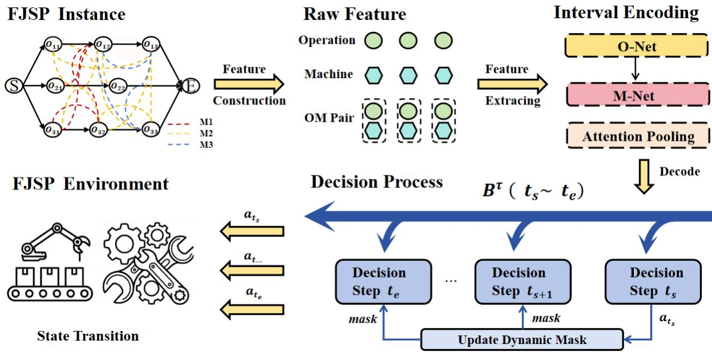
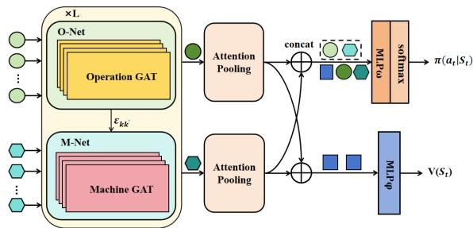

# CoRS: Fast Neural Flexible Job-Shop Scheduling via Composite Interval State Reuse

Sutong Jiang1, Peng Zhao1, Xuan Wu1, Yan Wang1, Jiaqi Wang2, Rui Zhang1∗, Yuan Jiang3∗, You Zhou1∗, Di Wang4

1College of Computer Science and Technology, Jilin University, China

2College of Software, Jilin University, China

3College of Computing and Data Science, Nanyang Technological University, Singapore

4Joint NTU-UBC Research Center of Excellence in Active Living for the Elderly, Nanyang Technological University, Singapore

## Abstract

Neural solvers for the Flexible Job-Shop Scheduling Problem (FJSP) typically refresh graph representations and update feasibility after every operation–machine decision. However, only feasibility must remain exact at every step, whereas graph encoding is substantially more expensive and can potentially be refreshed less frequently. We present CoRS, which decouples them: an interval-level graph representation is reused across multiple sequential decisions, while a stepwise feasibility state is updated after every action. This two-timescale design amortizes graph encoding without parallelizing action generation or relaxing scheduling constraints. CoRS further develops a feasibility-preserving composite-interval decoding scheme with dynamic constraint tracking and boundary state synchronization, which reduces representation refresh frequency while maintaining continuous feasible schedule construction. Furthermore, to alleviate representation staleness caused by interval-level state reuse, CoRS introduces enhanced static features as a compensation mechanism. By providing more comprehensive structural information of the scheduling problem, these features improve the model’s perception of overall problem characteristics. Extensive experiments on synthetic and multiple public FJSP benchmarks demonstrate that CoRS significantly reduces inference time while maintaining competitive solution quality, achieving favorable speed–quality trade-ofs under tight wall-clock bud gets and low-latency scenarios.

## Introduction

With the advent of the Industry 4.0 era, the rapid development of information technologies such as the Internet of Things (IoT) (Li, Xu, and Zhao 2015) and artificial intelligence (AI) (Mao et al. 2019) has accelerated the digitalization of manufacturing systems, making cloud manufacturing an important mechanism for modern manufacturing (Bo-Hu et al. 2010; Ren et al. 2017). As a core issue in manufacturing systems (Liu, Chen, and Chou 2015), scheduling problems require eficient decision-making based on cloud data. With the increasing scale and complexity of manufacturing systems, the response speed of scheduling decisions has become a critical challenge in cloud manufacturing environments (Kovacova and Lăzăroiu 2021; Zhang et al. 2025).

As a classical NP-hard Combinatorial Optimization Problem (COP) (Xie et al. 2019), the Flexible Job-Shop Scheduling Problem (FJSP) has become a modeling prototype for diverse applications, including medical resource scheduling (Abderrabi et al. 2021), semiconductor manufacturing (Ghaedy-Heidary et al. 2024), and aero-engine production (Zhou, Yang, and Zheng 2019), owing to its enhanced flexibility (Chaudhry and Khan 2016). In practical manufacturing systems, scheduling systems are required to respond rapidly to changes in production states within limited time. Consequently, eficiently solving the FJSP has become a central challenge (Akbaripour et al. 2018; Xu et al. 2025).

Given the significance of FJSP, numerous methods have been proposed, including exact algorithms (Tutumlu and Saraç 2023), Priority Dispatching Rules (PDRs) (Branke, Hildebrandt, and Scholz-Reiter 2015), and metaheuristics (Xu et al. 2025). However, these methods sufer from limitations in solution quality, generalization, and computational eficiency (Xiao et al. 2025; Han and Yang 2021; Zhang et al. 2023), making them inadequate to meet the requirements of cloud manufacturing. Recently, deep learning has introduced new methods for solving FJSP. Neural combinatorial optimization methods show strong modeling and decisionmaking capabilities for scheduling problems (Wang, Guo, and Liu 2025; Liao et al. 2025; Smit et al. 2025). Most studies formulate the scheduling process as a Markov Decision Process (MDP), adopt autoregressive (AR) decisionmaking, and integrate reinforcement learning for end-to-end optimization to obtain high-quality solutions (Yuan et al. 2024; Zhao and Deng 2024).

However, most existing neural FJSP solvers primarily focus on state representation learning or backbone architecture design (Xu, Li, and Li 2024), while implicitly assuming that the complete graph representation must be refreshed after every scheduling decision. In fact, the global state usually undergoes only limited changes between consecutive decision steps (see Appendix A for analysis). So existing methods perform complete feature encoding for highly similar states, resulting in substantial computation and significantly degrading solution eficiency.

Motivated by this observation, we question this assumption and explore a scheduling approach that reduces state updates while preserving dynamic feasibility. We propose the Composite Regressive (CR) mechanism, which redefines the state update process in neural FJSP solving. Unlike existing methods that implicitly assume the complete graph representation must be refreshed after every scheduling decision, CR introduces representation-refresh frequency as an underexplored design dimension and formulates a two-timescale state evolution mechanism. Specifically, CR factorizes the scheduling state into two coupled components with diferent update frequencies: an interval-level representation state and a stepwise feasibility state. The interval-level representation state is refreshed only at composite-interval boundaries, while the stepwise feasibility state maintains dynamic constraints and ensures schedule feasibility by progressively updating the feasible action set.

Based on this mechanism, we further develop the Composite Regressive Scheduling (CoRS) model for solving FJSP. Unlike blockwise or parallel autoregressive methods, CoRS does not reduce the number of action-generation steps; it reduces the number of representation-refresh steps. Unlike naive representation caching, CoRS explicitly tracks the evolving feasibility state and periodically reconstructs the full scheduling state. By reusing interval-level graph representations across consecutive scheduling decisions, CoRS reduces the number of graph encoding operations from T to ⌈T/X⌉, while maintaining scheduling feasibility through the progressive update of the stepwise feasibility state.

However, reducing the frequency of state refreshes may cause the interval-level representations to fail to timely capture certain dynamic changes, thereby afecting the quality of action ranking. To alleviate this issue, CoRS introduces enhanced static features as a compensation mechanism. By providing more comprehensive structural information of the scheduling problem, these features improve the model’s perception of global scheduling characteristics and enhance the efectiveness of interval representations under low-frequency updates. Meanwhile, state synchronization at interval boundaries further limits the accumulation of representation staleness, ensuring that its impact is mainly restricted to the ranking among feasible actions rather than compromising scheduling feasibility.

Specifically, we first propose a two-timescale state evolution mechanism that decouples the scheduling state into an interval-level representation state and a stepwise feasibility state. The interval-level representation state adopts composite intervals as the state refresh units rather than traditional decision steps, and is updated only at composite-interval boundaries. By reusing interval-level state representations across consecutive scheduling decisions, this mechanism reduces encoding of complete graph representations and alleviates the inference overhead caused by frequent state updates. Meanwhile, the stepwise feasibility state continuously tracks dynamic constraint changes, ensuring the feasibility of sequential schedule construction. Furthermore, we introduce enhanced static features as a compensation mechanism for interval-level state reuse. By providing more comprehensive structural information of the scheduling problem, these features improve the model’s perception of overal problem characteristics and mitigate representation staleness caused by low-frequency state refreshing. Extensive experiments conducted against four state-of-the-art methods (Wang et al. 2023; Zhao et al. 2025; Song et al. 2022; Xiao et al. 2026) and four well-known PDRs demonstrate that CoRS can generate competitive solutions while significantly improving inference speed.

The main contributions of this study are summarized as follows:

• We expose representation-refresh frequency as an underexplored design axis in neural FJSP solving and formulate a two-timescale state evolution that decouples intervallevel graph representations from stepwise feasibility updates.

• We develop a feasibility-preserving composite-interval decoding scheme with dynamic constraint tracking and boundary state synchronization. It reduces graph-encoder invocations from T to ⌈T /X⌉ while retaining sequential and feasible schedule construction.

• We provide same-backbone and interaction studies that isolate the efect of representation reuse and show that enhanced static features increasingly compensate for representation staleness as the interval length grows. Fixedbudget comparisons further demonstrate the practical quality–latency trade-of.

## Related Work

Traditional methods for solving FJSP mainly include exact methods, PDRs, and metaheuristic algorithms. Exact methods construct FJSP as a mathematical model and explore the entire solution space to find the optimal solution, such as branch and bound (Brucker, Jurisch, and Sievers 1994), integer programming (Meng et al. 2020), and constraint programming (Müller et al. 2022). PDRs directly guide the scheduling decision process using manually designed priority rules, such as the Shortest Processing Time (SPT) rule (Chen and Matis 2013) and the Most WorK Remaining (MWKR) rule (Branke, Hildebrandt, and Scholz-Reiter 2015; Sels, Gheysen, and Vanhoucke 2012). Metaheuristic algorithms iteratively explore the solution space through carefully designed search strategies to obtain high-quality solutions, such as genetic algorithms (Gao et al. 2019) and particle swarm optimization (Nouiri et al. 2018; Zhang et al. 2009). However, exact methods struggle to handle large-scale instances (Demir and İşleyen 2013; Zhang et al. 2023). PDRs based on fixed heuristics fail to capture complex scheduling patterns, resulting in low solution quality (Chen and Matis 2013). Metaheuristic algorithms require extensive iterative searches, incurring high computational costs (Caldeira and Gnanavelbabu 2019). Furthermore, traditional methods typically solve each unseen instance from scratch, which limits their generalization ability.

In recent years, deep learning-based neural solvers have received increasing attention for solving FJSP. To enhance the expressive power for complex scheduling problems, existing neural FJSP solvers often incorporate graph neural networks (Zeng, Li, and Bai 2022) or Transformer-based architectures (Xu, Li, and Li 2024) to model operation– machine interactions and precedence dependencies.Very recently,ReSched (Xiao et al. 2026) explored simplified state representations for Transformer-based FJSP solving and reported promising results. Parallel autoregressive methods, such as PARCO (Berto et al. 2026) and MACSIM (Luttmann and Xie 2025), alleviate the sequential dependency of conventional autoregressive approaches by predicting multiple actions within a single decoding stage. These methods mainly accelerate scheduling from the perspective of action generation. However, existing solvers typically still require the complete graph-state representation to be refreshed after each decision. Such frequent representation updates and environment interactions introduce substantial computational overhead, significantly increasing inference time. As the scale of FJSP grows, inference time increases linearly with the number of time steps (Demir and İşleyen 2013), thereby exposing significant eficiency bottlenecks in large-scale or real-time scheduling scenarios.

Recently, some studies have explored fast solving approaches based on fixed state representations, such as nonautoregressive (NAR) methods. NAR methods have been widely applied to the traveling salesman problem (Dat et al. 2025) and the vehicle routing problem (Xiao et al. 2024b). However, NAR models generally sufer from degraded solution quality (Joshi, Laurent, and Bresson 2019). This limitation mainly arises because NAR models make decisions based on static state representations, making it dificult to capture the dynamic changes in scheduling states caused by sequential decisions. As a result, scheduling solutions can be generated eficiently, but they often deviate from highquality solutions (Xiao et al. 2024a). In FJSP, the relationships among nodes are highly complex and the scheduling state changes continuously with decisions, making it dificult to complete all decisions under a fixed state representation. Consequently, to our knowledge, fully non-autoregressive neural construction methods that directly generate complete feasible FJSP schedules remain underexplored; existing fastlearning or two-stage approaches either decompose the problem, rely on solver-assisted post-processing, or still construct schedules sequentially.

Overall, existing neural FJSP solvers mainly focus on state representation learning and network architecture design, while representation-refresh frequency, as an important design dimension afecting inference eficiency, remains largely unexplored. Although fixed state representation methods can reduce update overhead, they struggle to adapt to dynamically changing feasibility constraints in FJSP. To address this problem, we propose the CoRS, which decouples intervallevel representation reuse and stepwise feasibility updates through a two-timescale state evolution design, reducing state refresh overhead while maintaining dynamic feasibility during scheduling. This makes CoRS complementary to recent representation- and backbone-level advances in neural FJSP solving.

## Preliminaries

This section introduces the CR mechanism and presents the formulation of the FJSP.

Composite regressive mechanism. The CR mechanism adopts composite intervals as the update units for graphstate representations, rather than re-encoding the complete graph representation after each scheduling decision. Within each composite interval, CoRS reuses the interval-level graph-state representation and only updates the stepwise feasibility state to track dynamically changing constraints during scheduling. At composite-interval boundaries, the interval-level graph-state representation is synchronously reconstructed, reducing redundant graph encoding overhead and preventing outdated information from accumulating due to infrequent representation updates. Through this twotimescale state evolution mechanism, CoRS reduces graphstate refresh frequency and inference overhead while ensuring that action selection satisfies dynamic constraints through stepwise feasibility updates, thereby achieving a better eficiency–quality trade-of.

Under the CR mechanism, the entire FJSP scheduling process is divided into multiple consecutive, non-overlapping composite intervals B. Bτ denotes the τ-th composite interval, which contains X time steps and is defined by:

$$
B ^ { \tau } = \{ t \mid ( \tau - 1 ) X + 1 \leq t \leq \operatorname* { m i n } ( \tau X , t _ { \mathrm { f i n a l } } ) \}\tag{1}
$$

where $\tau = 1 , 2 , \dots , \tau _ { \mathrm { m a x } } , t _ { \mathrm { f i n a l } }$ denotes the final time step of the entire scheduling process, and $\tau _ { \mathrm { m a x } }$ represents the total number of composite intervals.

Flexible job-shop scheduling problem. The FJSP is defined as follows. Given a set of n jobs $J = \{ J _ { 1 } , J _ { 2 } , \dots , J _ { n } \}$ and a set of m machines $M = \mathsf { \bar { \{ M _ { 1 } , M _ { 2 } , \ldots , M _ { m } \} } }$ , each job $J _ { i }$ consists of ni operations $\bar { O _ { i } } = \{ O _ { i 1 } , O _ { i 2 } , . . . , \bar { O } _ { i n _ { i } } \}$ Each operation $O _ { i j }$ has a compatible machine set $M _ { i j } \subseteq M$ and can be processed on any machine $M _ { k } \in M _ { i j }$ with processing time $p _ { i j k }$ , where the completion time is denoted by $C _ { i j }$ . The objective is to minimize the maximum completion time $C _ { \operatorname* { m a x } } \stackrel { \sim } { = } \operatorname* { m a x } \{ C _ { i n _ { i } } \mid i = 1 , 2 , \ldots , n \}$ . The scheduling process must satisfy the following constraints: the operations of each job must follow their precedence constraints, and each machine can process at most one operation at a time with non-preemptive processing.

## Methodology

This section introduces the CoRS model, the scheduling model based on the CR mechanism, which achieves eficient inference for the FJSP. Figure 1 illustrates the workflow of CoRS. Through a specially designed interval encoding network and decoding algorithm, CoRS generates high-quality scheduling policies while significantly reducing inference time. In the following, we sequentially present the MDP, the feature encoding scheme, the interval encoding network, the composite-interval decoding algorithm, and the reinforcement learning algorithm.

## MDP Formulation

Unlike the MDP used in traditional reinforcement learning, under the CR mechanism, CoRS formulates a tailored MDP for FJSP by considering the characteristics of reusing graph representations within each composite interval and updating the graph representations across intervals. The MDP is defined as follows.

  
Figure 1: The architecture of CoRS.

State. Within the composite interval $B ^ { \tau }$ , CoRS adopts a two-timescale state evolution mechanism, which decomposes the scheduling state into an interval-level representation state $s ^ { \tau }$ and a stepwise feasibility state $s _ { t } ^ { \mathrm { f e a s } }$ with diferent update frequencies. Specifically, $s ^ { \tau }$ is defined as $s ^ { \tau } =$ $\{ h _ { i j } , \bar { h } _ { k } , h _ { ( i j , k ) } \}$ , where $h _ { i j } , h _ { k } .$ and $h _ { ( i j , k ) }$ denote the features of operation $O _ { i j }$ , machine $M _ { k } ,$ , and operation–machine $( O _ { i j } , M _ { k } )$ pair, respectively. Meanwhile, $s _ { t } ^ { \mathrm { f e a s } }$ records the step-wise updated feasibility information, including candidate operations, operation–machine feasibility masks, and machine release times. Diferent from the $s ^ { \tau } , s _ { t } ^ { \mathrm { f e a s } }$ is only used to determine the feasible action space and does not participate in state feature encoding or reconstruction within the composite interval.

Action. For any time step t, the action space $A _ { t }$ consists of all feasible OM pairs at the current scheduling state. The model selects one OM pair from $A _ { t }$ as the action $a _ { t }$

State Transition. Under the CR mechanism, state transitions follow a two-timescale update process. For the intervallevel representation state, the state is synchronized only at composite-interval boundaries. The next state is defined as $s ^ { \tau + \hat { 1 } } = f _ { \mathrm { r e c o n } } \big ( s ^ { \tau } , \{ a _ { t } \} _ { t \in B ^ { \tau } } \big )$ , where $f _ { \mathrm { r e c o n } } ( \cdot )$ denotes the vectorized state reconstruction function based on the action sequence within the composite interval. Meanwhile, $s _ { t } ^ { \mathrm { f e a s } } \ \mathrm { i s }$ updated after each operation–machine assignment to track dynamic constraint changes and maintain the feasible action space at each decision step.

Reward. For any operation $O _ { i j }$ at time step t, its estimated completion time is denoted as $C _ { \mathrm { L B } } ( O _ { i j } , t )$ . For scheduled operations, $C _ { \mathrm { L B } } ( O _ { i j } , t )$ equals the actual completion time $C _ { i j }$ . For unscheduled operations, the estimated completion time of all initial operations is initialized as $C _ { \mathrm { L B } } ( O _ { i 0 } ) ~ = ~ 0$ . The estimated completion time is recursively computed based on the completion time of the predecessor operation and the minimum processing time among candidate machines, given by $C _ { \mathrm { L B } } ( O _ { i j } , t ) =$ $\begin{array} { r } { C _ { \mathrm { L B } } ( O _ { i , j - 1 } , t ) + \operatorname* { m i n } _ { k \in M _ { i j } } p _ { i j k } } \end{array}$ . Accordingly, an estimate of the overall makespan at time step t is given by $C _ { \mathrm { L B } } ( t ) =$ max1≤i≤n, 1≤j≤n $C _ { \mathrm { L B } } ( O _ { i j } , t )$ . During the scheduling process, the estimated completion times are updated as the agent executes actions. The reward is defined as the diference between the estimated makespans at two consecutive time steps, given by $r _ { t } = C _ { \mathrm { L B } } ( t ) - C _ { \mathrm { L B } } ( t + 1 )$

## Feature Encoding

Unlike conventional methods that re-encode state representations at each decision step, CoRS reduces redundant encoding operations by reusing interval-level representation state within composite intervals. Therefore, the state representation obtained from a single encoding process needs to incorporate more instance-related static information to support efective decision making over subsequent multiple scheduling steps. Based on this consideration, we propose an enhanced static feature encoding scheme. Specifically, given an FJSP instance as input, we encode it into operation features $h _ { i j } \in \mathbb { R } ^ { 1 2 }$ , machine features $h _ { k } \in \mathbb { R } ^ { 1 0 }$ , and OM pair features $h _ { ( i j , k ) } \in \mathbb { R } ^ { 8 }$ . We enhance the static features by incorporating information such as the average processing time of successor operations and the total number of fastest operations for each machine, as detailed in Appendix B.

## Interval Encoding Network

Under the CR mechanism, the CoRS performs unified encoding of interval-level representation state features only at the initial step of each composite interval, reuses the resulting feature representations throughout subsequent consecutive decision steps, and re-executes global encoding after composite interval completion. As illustrated in Figure 2, the CoRS model employs a graph attention framework composed of an Operation Encoding Subnetwork (O-Net) and a Machine Encoding Subnetwork (M-Net) to model operation nodes and machine nodes, respectively.

  
Figure 2: The network architecture of the CoRS.

Operation Encoding Subnetwork O-Net models the operation states within the composite interval. In the $l \in L \mathrm { - t h }$ multi-head graph attention layer, $h _ { i j }$ is first linearly projected as $z _ { i j } = W h _ { i j }$ , where $z _ { i j } \in \mathbb { R } ^ { H d _ { h } }$ and $W \in \{ W ^ { \prime } , W _ { 1 } W _ { 2 } \}$ H denotes the number of attention heads and $d _ { h }$ denotes the output dimension of each head. The selection of the projection matrix W depends on the layer index. For the first layer, a full shared matrix $W ^ { \prime } \in \mathbb { R } ^ { H d _ { h } ^ { ( 1 ) } \times d _ { i n } ^ { o } }$ is used to map the input features into the representation space of all attention heads. For intermediate layers, a low-rank factorization $W _ { 1 } W _ { 2 }$ is adopted, where $W _ { 1 } \ \in \ \mathbb { R } ^ { H d _ { h } ^ { ( l ) } \times d _ { m i d } }$ and $W _ { 2 } \in \mathbb { R } ^ { d _ { m i d } \times H d _ { h } ^ { ( l - 1 ) } }$ with $d _ { m i d } < H \times d _ { h } ^ { ( l - 1 ) }$ , which reduces the number of parameters while preserving the projection dimension.

The vector $z _ { i j }$ is split into H sub-vectors as $z _ { i j } =$ $[ z _ { i j } ^ { ( 1 ) } \| \cdots \| z _ { i j } ^ { ( H ) } ]$ , where [a∥b] denotes vector concatenation and $z _ { i j } ^ { ( h ) } \in \mathbb { R } ^ { d _ { h } }$ . To mitigate the reduced head diversity caused by the shared projection, a learnable scaling parameter $\beta ^ { h }$ is applied to obtain $\tilde { z } _ { i j } ^ { h } = \beta ^ { h } \odot z _ { i j } ^ { ( h ) }$ . In the h-th attention head, the attention coeficient between operation $O _ { i j }$ and its neighboring operation $O _ { i p }$ is computed as:

$$
e _ { i j p } = \mathrm { L e a k y R e L U } \left( a ^ { \top } [ \tilde { z } _ { i j } ^ { h } \| \tilde { z } _ { i p } ^ { h } ] \right) , \quad p \in \{ j - 1 , j , j + 1 \}\tag{2}
$$

where $a \in \mathbb { R } ^ { 2 d _ { h } }$ . The coeficients $e _ { i j p }$ are normalized by a softmax function to obtain the attention weights $\alpha _ { i j p } .$ . The output feature of this head is computed as:

$$
\tilde { h } _ { i j } ^ { h } = \sum _ { p \in N _ { i j } } \alpha _ { i j p } \tilde { z } _ { i p } ^ { h }\tag{3}
$$

where $N _ { i j } = \{ j - 1 , j , j + 1 \}$ . After obtaining the operation features from all attention heads, the intermediate layers concatenate the multi-head outputs, while the final layer adopts mean aggregation. The unified operation node representation is computed as $\begin{array} { r } { \boldsymbol { h } _ { i j } ^ { \prime ( \tau ) } = \mathrm { E L U } \left( \frac { 1 } { H } \sum _ { h = 1 } ^ { H } \boldsymbol { \tilde { h } } _ { i j } ^ { h } \right) } \end{array}$

Machine Encoding Subnetwork M-Net encodes machine node features to generate representations of machine states. In addition, M-Net introduces competition edge features.

Specifically, $I _ { k k ^ { \prime } }$ denotes the set of unscheduled operations jointly competed by machines $M _ { k }$ and $M _ { k ^ { \prime } }$ . If $\bar { I _ { k k ^ { \prime } } } \neq \emptyset .$ the two machines are considered to have a competition relationship. Accordingly, the set of machines competing with $M _ { k }$ is defined as $\tilde { N _ { k } } ~ = ~ \{ M _ { k ^ { \prime } } ~ | ~ I _ { k k ^ { \prime } } ~ \neq ~ \emptyset \}$ . To quantify the competition intensity, we define the competition strength between them as the aggregation of the features of candidate operations in the candidate set $J _ { c } ,$ , given by $\begin{array} { r } { \epsilon _ { k k ^ { \prime } } = \sum _ { O _ { i j } \in I _ { k k ^ { \prime } } \cap J _ { c } } h _ { i j } } \end{array}$

At the feature projection stage, we follow the same design as O-Net. $\tilde { z } _ { k }$ and $\tilde { z } _ { k ^ { \prime } }$ denote the projected representations of $M _ { k }$ and $M _ { k ^ { \prime } }$ , and $\tilde { z } _ { k k ^ { \prime } }$ denotes the projected representation of their competition edge. The attention coeficient is computed as $u _ { \boldsymbol { k } \boldsymbol { k } ^ { \prime } } =$ LeakyReL $\mathrm { U } ( b _ { k } ^ { \top } \tilde { z } _ { k } ^ { h } + b _ { k ^ { \prime } } ^ { \top } \tilde { z } _ { k ^ { \prime } } ^ { h } + b _ { k k ^ { \prime } } ^ { \top } \tilde { z } _ { k k ^ { \prime } } ^ { h } )$ where $b _ { k } , b _ { k ^ { \prime } } , b _ { k k ^ { \prime } } \in \mathbb { R } ^ { d _ { h } } . \ u _ { k k ^ { \prime } }$ is normalized by softmax to obtain the attention weight $\alpha _ { k k ^ { \prime } }$ , which is used to aggregate machine features and produce the single-head output $\ddot { h } _ { k }$ . After obtaining the outputs of all heads, M-Net adopts the same multi-head fusion strategy as O-Net to generate the final machine embedding $h _ { k } ^ { \prime ( \tau ) }$

Attention Pooling After encoding operation and machine nodes with O-Net and M-Net, CoRS constructs a global state representation for $B ^ { \tau }$ via attention-based global pooling.

Both machine and operation nodes are aggregated using the same attention mechanism. Taking machines as an example, a shared linear scoring function $g ( \cdot )$ is used to measure the importance of $M _ { k }$ in the global representation, defined as $g _ { k } = g ( h _ { k } ^ { \prime ( \tau ) } )$ , where $g _ { k } \in \mathbb { R }$ . The attention scores are normalized by softmax to obtain weights $\gamma _ { k }$ . The global machine representation is given by:

$$
h _ { \mathrm { g l o b a l } } ^ { ( m , \tau ) } = \sum _ { k = 1 } ^ { M } \gamma _ { k } h _ { k } ^ { \prime ( \tau ) }\tag{4}
$$

Similar to machines, operation nodes are aggregated by importance using the same attention pooling, giving $h _ { \mathrm { g l o b a l } } ^ { ( o , \tau ) } =$ $\begin{array} { r } { \sum _ { i = 1 } ^ { n } \sum _ { j = 1 } ^ { n _ { i } } \gamma _ { i j } h _ { i j } ^ { \prime ( \tau ) } } \end{array}$ , where $\gamma _ { i j }$ is the attention weight of $O _ { i j }$ . The overall state of $B ^ { \tau }$ is constructed by concatenating the machine and operation global representations as $h _ { \mathrm { g l o b a l } } ^ { \tau } = [ h _ { \mathrm { g l o b a l } } ^ { ( m , \tau ) } | | h _ { \mathrm { g l o b a l } } ^ { ( o , \tau ) } ]$ , providing a global representation for decision-making and value evaluation.

## Decoding Algorithm

To reduce the inference overhead caused by frequent environment interactions and state updates, we propose a compositeinterval decoding algorithm that minimizes these updates. At time step $t ,$ the feasible action set is defined as:

$$
A _ { t } = f _ { \mathrm { m a s k } } \left( s _ { t - 1 } ^ { \mathrm { f e a s } } , a _ { t - 1 } \right)\tag{5}
$$

The function $f _ { \mathrm { m a s k } } ( \cdot )$ updates the mask to restrict feasible actions without modifying state features. Specifically, $f _ { \mathrm { m a s k } } ( \cdot )$ first updates the release times of the relevant machines according to the executed actions, and updates the current candidate operations of the scheduled jobs along with their machine compatibility relations. Then, based on the updated machine states, it calculates the earliest start time of each candidate operation–machine pair. Finally, operation–machine pairs that violate scheduling constraints are marked as infeasible, and the corresponding actions are masked out through the dynamic feasibility mask, thereby constructing the feasible action set for the current decision step. After completing $B ^ { \tau }$ , the next input scheduling state representation $s ^ { ( \widehat { \tau } + 1 ) }$ is reconstructed once in a vectorized manner by $f _ { \mathrm { r e c o n } } ( \cdot )$ . Only the relative completion time of operations requires sequential updates due to strict order dependency, while other features are updated in batch by computing the efects of all actions in the composite interval. This produces the accurate state $s ^ { ( \tau + 1 ) }$ for subsequent scheduling decisions.

## Training Algorithm

CoRS is trained under an Actor–Critic framework (Zhao et al. 2025). Concatenated interval features are fed into the policy network, and the action distribution at state $s _ { t }$ is defined as:

$$
\pi _ { \omega } ( a _ { t } \mid s _ { t } ) = \sigma \big ( \mathbf { M } \mathbf { L } \mathbf { P } _ { \omega } [ h _ { k } ^ { \prime ( \tau ) } \| h _ { i j } ^ { \prime ( \tau ) } \| h _ { ( i j , k ) } ^ { ( \tau ) } \| h _ { \mathbf { g } \mathbf { l o b a l } } ^ { \tau } ] \big )\tag{6}
$$

where $\sigma$ denotes softmax. The value network evaluates the current state and guides policy optimization, taking $h _ { \mathrm { g l o b a l } } ^ { \tau }$ as input. The state value is defined as $v _ { \phi } ( s _ { t } ) = \mathbf { M } \mathbf { L } \mathbf { P } _ { \phi } ( \bar { h } _ { \mathrm { g l o b a l } } ^ { \tau } )$ The policy is optimized using Proximal Policy Optimization with clipping (PPO-Clip) (Schulman et al. 2017), where the clipping mechanism constrains the magnitude of policy updates to improve training stability. Generalized Advantage Estimation (GAE) (Schulman et al. 2015) is employed to compute the advantage function for improved optimization performance. The complete training procedure of CoRS is shown in Appendix C.

## Experiments

This section describes the experimental setup, reports results on synthetic and public datasets, and analyzes the impact of the composite interval time step X as well as the ablation results.

## Experimental Settings

Baselines. The four selected PDRs are described as follows: FIFO schedules the OM pair that becomes available first; MOPNR schedules the OM pair whose operation has the largest number of remaining successor operations; SPT schedules the OM pair with the minimum processing time; MWKR schedules the OM pair with the maximum remaining average processing time. The three selected baselines are described as follows: HGNN (Song et al. 2022) models jobs and machines with a heterogeneous graph neural network to capture the relationships between operations and machines; DANIEL (Wang et al. 2023) adopts a reinforcement learning framework with a dual-attention network to improve solution quality; DOAGNN (Zhao et al. 2025) decouples the disjunctive graph into a dual graph structure and applies a dual operation aggregation graph neural network to represent operation states and their dependencies;ReSched (Xiao et al. 2026) proposes a Transformer-based simplified state representation framework, improving solution quality.

Datasets. We use $n \times m$ to denote an FJSP instance with n jobs and m machines. The model is trained on randomly generated instances of sizes $1 0 \times 5 , 2 0 \times 5 , 1 5 \times 1 0 .$ , and ${ \bar { 2 } } 0 \times 1 0 .$ , and evaluated on two synthetic datasets (SD1, SD2) and four public datasets (Hurink, Barnes, Brandimarte, and Dauzere). Detailed dataset descriptions are provided in $\mathsf { A p - }$ pendix D. Implementation details are in Appendix E.

## Experiment Results and Analysis

Performance Comparison Table 6 (Appendix F) and Table 7 (Appendix G) report the performance of CoRS and baseline methods on the synthetic and public datasets. LB denotes the known optimal solution for public datasets, while OR-Tools denotes results obtained by the Google OR-Tools exact solver on synthetic datasets with a time limit of 1800 s. Metrics include makespan $\left( C _ { \mathrm { m a x } } \right)$ , relative gap to LB or OR-Tools (Gap), and average solving time per instance (Time/s). G and S denote the greedy and sampling strategies, respectively, where the sampling strategy performs 100 samples by default.

On the synthetic datasets, CoRS achieves significantly faster inference than all AR baselines. When $\bar { X \ = \ 2 }$ , the speed improves by 42.94%–83.14%; when $X \ = \ 5$ , the improvement further increases to 154.46%–238.76%. On the public benchmark datasets, CoRS achieves a 160.14%– 489.86% speedup at $X = 5$ . This acceleration mainly benefits from the CR mechanism, which reuses state encoding in a NAR manner within composite intervals, thereby substantially reducing state encoding operations.

While maintaining eficient inference, CoRS still produces high-quality solutions. When $X = 5 ,$ , the average gap to the best model on SD1 is only 4.04%, which further reduces to 0.71% on the public benchmarks. Compared with PDRs, CoRS also achieves an 18.27%–41.18% improvement with comparable solving time. These results mainly benefit from the enhanced static features. Although increasing X reduces the model’s perception of dynamic information and degrades solution quality, the enhanced static features can still efectively represent the global state, thereby maintaining stable performance.

Generalization Ability We train the model on $2 0 \times 1 0$ instances and evaluate its generalization on $3 0 \times 1 0 , 4 0 \times 1 0 .$ 60×10, and 100×30 instances, with results reported in Table 5 (Appendix H). When X = 3, CoRS achieves high-quality solutions across all scales while maintaining the lowest inference time on SD1. On the 100×30 instances, CoRS achieves a 8.96% improvement in solution quality over AR models while maintaining lower inference time. On SD2, CoRS improves solution quality by 64.34% over PDRs while achieving a 129.85% inference speedup. These results demonstrate the strong generalization capability of CoRS. This is mainly due to the stable composite-interval state modeling of the interval encoding network and the efective constraints of the composite-interval decoding algorithm, allowing the model to maintain high inference eficiency and solution quality as the scale increases.

Time-Constrained Performance Evaluation We evaluate solution quality under fixed average wall-clock budgets on the 15×10 instances from SD1. For each method and budget, we report the best Cmax obtained by completed rollouts or sampling settings whose average wall-clock solving time per instance does not exceed the budget. As shown in Table 1, CoRS achieves competitive solution quality under tight time budgets. This advantage mainly stems from the CR mechanism, which reduces repeated state encoding and enables eficient schedule generation within limited inference time.

Table 1: Performance under Fixed Time Budgets
<table><tr><td>Time</td><td>DANIEL</td><td>RESHED</td><td>HGNN</td><td>DOAGNN</td><td>CoRS(X=2)</td><td>CoRS(X=5)</td></tr><tr><td>0.30</td><td>一</td><td>一</td><td>一</td><td>一</td><td></td><td>163.39</td></tr><tr><td>0.50</td><td>一</td><td></td><td></td><td></td><td>160.36</td><td>163.19</td></tr><tr><td>0.80</td><td></td><td></td><td>174.47</td><td>171.61</td><td>160.36</td><td>159.27</td></tr><tr><td>1.00</td><td>162.10</td><td>160.10</td><td>174.47</td><td>171.61</td><td>157.41</td><td>158.96</td></tr><tr><td>1.50</td><td>160.05</td><td>160.06</td><td>170.96</td><td>168.05</td><td>156.67</td><td>157.88</td></tr><tr><td>2.00</td><td>159.86</td><td>157.16</td><td>170.31</td><td>166.62</td><td>155.90</td><td>157.15</td></tr><tr><td>4.00</td><td>157.38</td><td>156.88</td><td>166.63</td><td>164.05</td><td>154.63</td><td>155.64</td></tr></table>

Impact of Composite Interval Steps (X) We analyze the efect ofX on model performance using 10×5 instances from SD1, normalizing all metrics relative to the AR case (X = 1). As shown in Figure 4 (Appendix J), increasing X substantially reduces inference time, which is only 22.1%–23% of AR at X = 10, while solution quality remains stable, varying by 3.3%–7.6%. This is primarily attributed to the proposed CR mechanism, which reduces inference time by decreasing state encoding, while the combination of enhanced static features with dynamic features maintains stable performance at larger time steps. In practical applications, the selection of X should be adjusted according to the trade-of between inference eficiency and solution quality. For scenarios with stringent real-time requirements, a larger X can be adopted to reduce the frequency of state encoding and decrease inference latency. In contrast, for scenarios where solution quality is prioritized, a smaller X should be selected to increase the frequency of state updates and maintain highquality scheduling solutions.

Ablation Studies As shown in Table 4 (Appendix I), we conduct a series of ablation experiments to evaluate the contributions of enhanced static features, the interval encoding method, and the composite-interval decoding strategy. The results show that removing enhanced static features (i.e., w/o En-fea) weakens node state representation, resulting in reduced solution quality. Furthermore, we analyze the interaction between X and enhanced features, as shown in Table 2. The experimental results demonstrate that the performance gains brought by enhanced static features gradually increase with larger X. This indicates that enhanced static features provide richer and more persistent structural information within composite intervals, thereby enabling stable decision-making. Removing the interval encoding method (w/o Int-encoder) restores the step-by-step encoding strategy, resulting in only a slight improvement in average solution quality of 2.13% while substantially increasing solving time by 223.81%. Removing the compositeinterval decoding strategy (i.e., w/o Co-decoder) causes more frequent state–environment interactions, thereby reducing inference eficiency.

Furthermore, since CoRS is built upon the DANIEL framework, we conduct a progressive comparison from the original DANIEL to the complete CoRS model. As shown in Table 3. Compared with DANIEL, introducing interval state reuse alone significantly reduces inference time, demonstrating that the CR mechanism efectively accelerates inference through interval-level state reuse. After further incorporating enhanced static features, CoRS improves solution quality, indicating that enhanced static features efectively compensate for the performance degradation caused by the reduced state update frequency during interval state reuse.

Table 2: Interaction between X and enhanced static features
<table><tr><td rowspan="2">Method</td><td rowspan="2"></td><td colspan="4">X</td></tr><tr><td>2</td><td>3</td><td>4</td><td>5</td></tr><tr><td rowspan="2">CoRS</td><td>G</td><td>107.91</td><td>108.26</td><td>108.93</td><td>109.35</td></tr><tr><td>S</td><td>101.94</td><td>102.18</td><td>101.94</td><td>102.62</td></tr><tr><td rowspan="2">w/o En-fea</td><td>G</td><td>108.89</td><td>110.25</td><td>111.66</td><td>113.56</td></tr><tr><td>S</td><td>102.34</td><td>103.45</td><td>104.55</td><td>109.63</td></tr></table>

Table 3: Progressive analysis from DANIEL to CoRS
<table><tr><td rowspan="2">Rdata</td><td colspan="2">DANIEL</td><td colspan="2">DANIEL+CR</td><td colspan="2">CoRS</td></tr><tr><td>Cmax</td><td>Time</td><td>Cmax</td><td>Time</td><td>Cmax</td><td>Time</td></tr><tr><td>G</td><td>1031.95</td><td>0.912</td><td>1044.98</td><td>0.307</td><td>1032.45</td><td>0.213</td></tr><tr><td>S</td><td>978.33</td><td>3.25</td><td>991.05</td><td>1.118</td><td>982.23</td><td>0.895</td></tr></table>

## Conclusion

This paper proposes the Composite Regressive (CR) mechanism and develops the CoRS scheduling model based on this mechanism for solving FJSP. CoRS adopts a two-timescale state evolution mechanism that decouples the interval-level representation state from the stepwise feasibility state. Furthermore, CoRS designs a feasibility-preserving compositeinterval decoding scheme , reducing state refresh overhead while maintaining sequential and feasible schedule construction. In addition, enhanced static features are introduced to alleviate representation staleness caused by interval-level state reuse. Extensive experiments demonstrate that CoRS significantly reduces inference time while maintaining competitive solution quality, achieving superior speed–quality trade-ofs under tight time budgets and low-latency scenarios. A current limitation is that the composite interval length is manually selected. The current method assumes a static deterministic FJSP and an exact stepwise feasibility tracker. Moreover, stale representations may still afect the ranking among feasible actions, and the achievable speedup depends on graph encoding being a major component of inference cost. Future work will study adaptive interval selection and extend composite interval state reuse to stronger Transformer-based FJSP backbones for improved speed–quality trade-ofs across instance scales and distributions.

## References

Abderrabi, F.; Godichaud, M.; Yalaoui, A.; Yalaoui, F.; Amodeo, L.; Qerimi, A.; and Thivet, E. 2021. Flexible job shop scheduling problem with sequence dependent setup time and job splitting: Hospital catering case study. Applied Sciences, 11(4): 1504.

Akbaripour, H.; Houshmand, M.; Van Woensel, T.; and Mutlu, N. 2018. Cloud manufacturing service selection optimization and scheduling with transportation considerations: mixed-integer programming models. The International Journal ofAdvanced Manufacturing Technology, 95(1): 43–70.

Berto, F.; Hua, C.; Luttmann, L.; Son, J.; Park, J.; Ahn, K.; Kwon, C.; Xie, L.; and Park, J. 2026. PARCO: Parallel AutoRegressive models for multi-agent combinatorial optimization. Advances in Neural Information Processing Systems, 38: 167130–167160.

Bo-Hu, L.; Lin, Z.; Shi-Long, W.; Fei, T.; Jun-Wei, C.; Xiaodan, J.; Xiao, S.; and Xu-dong, C. 2010. Cloud manufacturing: a new service-oriented networked manufacturing model. Computer integrated manufacturing system, 16(01): 0.

Branke, J.; Hildebrandt, T.; and Scholz-Reiter, B. 2015. Hyper-heuristic evolution of dispatching rules: A comparison of rule representations. Evolutionary computation, 23(2): 249–277.

Brucker, P.; Jurisch, B.; and Sievers, B. 1994. A branch and bound algorithm for the job-shop scheduling problem. Discrete applied mathematics, 49(1-3): 107–127.

Caldeira, R. H.; and Gnanavelbabu, A. 2019. Solving the flexible job shop scheduling problem using an improved Jaya algorithm. Computers & Industrial Engineering, 137: 106064.

Chaudhry, I. A.; and Khan, A. A. 2016. A research survey: review of flexible job shop scheduling techniques. International Transactions in Operational Research, 23(3): 551– 591.

Chen, B.; and Matis, T. I. 2013. A flexible dispatching rule for minimizing tardiness in job shop scheduling. International Journal ofProduction Economics, 141(1): 360–365.

Dat, T. T.; Khoi, P. A.; Khai, T. Q.; Dong, D. D.; and Van Khu, V. 2025. NeuFACO: Neural Focused Ant Colony Optimization for Traveling Salesman Problem. In 2025 RIVF International Conference on Computing and Communication Technologies (RIVF), 439–444. IEEE.

Demir, Y.; and İşleyen, S. K. 2013. Evaluation of mathematical models for flexible job-shop scheduling problems. Applied Mathematical Modelling, 37(3): 977–988.

Gao, K.; Cao, Z.; Zhang, L.; Chen, Z.; Han, Y.; and Pan, Q. 2019. A review on swarm intelligence and evolutionary algorithms for solving flexible job shop scheduling problems. IEEE/CAA journal ofautomatica sinica, 6(4): 904–916.

Ghaedy-Heidary, E.; Nejati, E.; Ghasemi, A.; and Torabi, S. A. 2024. A simulation optimization framework to solve stochastic flexible job-shop scheduling problems—Case: Semiconductor manufacturing. Computers & Operations Research, 163: 106508.

Han, B.; and Yang, J. 2021. A deep reinforcement learning based solution for flexible job shop scheduling problem. International Journal ofSimulation Modelling, 20(2): 375– 386.

Joshi, C. K.; Laurent, T.; and Bresson, X. 2019. An eficient graph convolutional network technique for the travelling salesman problem. arXiv preprint arXiv:1906.01227.

Kovacova, M.; and Lăzăroiu, G. 2021. Sustainable organizational performance, cyber-physical production networks, and deep learning-assisted smart process planning in Industry 4.0-based manufacturing systems. Economics, Management and Financial Markets, 16(3): 41–54.

Li, S.; Xu, L. D.; and Zhao, S. 2015. The internet of things: a survey. Information systemsfrontiers, 17(2): 243–259.

Liao, Z.; Chen, J.; Wang, D.; Zhang, Z.; and Wang, J. 2025. BOPO: Neural combinatorial optimization via best-anchored and objective-guided preference optimization. arXiv preprint arXiv:2503.07580.

Liu, T.-K.; Chen, Y.-P.; and Chou, J.-H. 2015. Solving distributed and flexible job-shop scheduling problems for a realworld fastener manufacturer. IEEE Access, 2: 1598–1606.

Luttmann, L.; and Xie, L. 2025. Multi-Action Self-Improvement for Neural Combinatorial Optimization. arXiv preprint arXiv:2510.12273.

Mao, S.; Wang, B.; Tang, Y.; and Qian, F. 2019. Opportunities and challenges of artificial intelligence for green manufacturing in the process industry. Engineering, 5(6): 995–1002.

Meng, L.; Zhang, C.; Ren, Y.; Zhang, B.; and Lv, C. 2020. Mixed-integer linear programming and constraint programming formulations for solving distributed flexible job shop scheduling problem. Computers & industrial engineering, 142: 106347.

Müller, D.; Müller, M. G.; Kress, D.; and Pesch, E. 2022. An algorithm selection approach for the flexible job shop scheduling problem: Choosing constraint programming solvers through machine learning. European Journal of Operational Research, 302(3): 874–891.

Nouiri, M.; Bekrar, A.; Jemai, A.; Niar, S.; and Ammari, A. C. 2018. An efective and distributed particle swarm optimization algorithm for flexible job-shop scheduling problem. Journal ofIntelligent Manufacturing, 29(3): 603–615.

Ren, L.; Zhang, L.; Wang, L.; Tao, F.; and Chai, X. 2017. Cloud manufacturing: key characteristics and applications. International journal of computer integrated manufacturing, 30(6): 501–515.

Schulman, J.; Moritz, P.; Levine, S.; Jordan, M.; and Abbeel, P. 2015. High-dimensional continuous control using generalized advantage estimation. arXivpreprint arXiv:1506.02438.

Schulman, J.; Wolski, F.; Dhariwal, P.; Radford, A.; and Klimov, O. 2017. Proximal policy optimization algorithms. arXiv preprint arXiv:1707.06347.

Sels, V.; Gheysen, N.; and Vanhoucke, M. 2012. A comparison of priority rules for the job shop scheduling problem under diferent flow time-and tardiness-related objective functions. International Journal of Production Research, 50(15): 4255–4270.

Smit, I. G.; Wu, Y.; Troubil, P.; Zhang, Y.; and Nuijten, W. P. 2025. Neural combinatorial optimization for stochastic flexible job shop scheduling problems. In Proceedings of the AAAI Conference on Artificial Intelligence, volume 39, 26678–26687.

Song, W.; Chen, X.; Li, Q.; and Cao, Z. 2022. Flexible jobshop scheduling via graph neural network and deep reinforcement learning. IEEE Transactions on Industrial Informatics, 19(2): 1600–1610.

Tutumlu, B.; and Saraç, T. 2023. A MIP model and a hybrid genetic algorithm for flexible job-shop scheduling problem with job-splitting. Computers & Operations Research, 155: 106222.

Wang, R.; Wang, G.; Sun, J.; Deng, F.; and Chen, J. 2023. Flexible job shop scheduling via dual attention networkbased reinforcement learning. IEEE Transactions on Neural Networks and Learning Systems, 35(3): 3091–3102.

Wang, Y.; Guo, T.; and Liu, Z. 2025. An Expectation-Maximization Algorithm-based Autoregressive Model for the Fuzzy Job Shop Scheduling Problem. arXiv preprint arXiv:2502.00018.

Xiao, X.; Zhang, C.; Song, W.; and Cao, Z. 2026. Resched: Rethinking flexible job shop scheduling from a transformerbased architecture with simplified states. arXiv preprint arXiv:2603.07020.

Xiao, Y.; Wang, D.; Li, B.; Chen, H.; Pang, W.; Wu, X.; Li, H.; Xu, D.; Liang, Y.; and Zhou, Y. 2024a. Reinforcement learning-based nonautoregressive solver for traveling salesman problems. IEEE Transactions on Neural Networks and Learning Systems, 36(7): 13402–13416.

Xiao, Y.; Wang, D.; Li, B.; Wang, M.; Wu, X.; Zhou, C.; and Zhou, Y. 2024b. Distilling autoregressive models to obtain high-performance non-autoregressive solvers for vehicle routing problems with faster inference speed. In Proceedings of the AAAI conference on artificial intelligence, volume 38, 20274–20283.

Xiao, Y.; Wang, D.; Wu, X.; Wu, Y.; Li, B.; Du, W.; Wang, L.; and Zhou, Y. 2025. Improving generalization of neural vehicle routing problem solvers through the lens of model architecture. Neural Networks, 187: 107380.

Xie, J.; Gao, L.; Peng, K.; Li, X.; and Li, H. 2019. Review on flexible job shop scheduling. IET collaborative intelligent manufacturing, 1(3): 67–77.

Xu, S.; Li, Y.; and Li, Q. 2024. A deep reinforcement learning method based on a transformer model for the flexiblejob shop scheduling problem. Electronics, 13(18): 3696.

Xu, Y.; Zhang, M.; Wang, D.; Yang, M.; and Liang, C. 2025. Hybrid Gaussian quantum particle swarm optimization and adaptive genetic algorithm for flexible job-shop scheduling problem. Engineering Applications of Artificial Intelligence, 154: 110882.

Yuan, E.; Wang, L.; Cheng, S.; Song, S.; Fan, W.; and Li, Y. 2024. Solving flexible job shop scheduling problems via deep reinforcement learning. Expert Systems with Applications, 245: 123019.

Zeng, Z.; Li, X.; and Bai, C. 2022. A deep reinforcement learning approach to flexible job shop scheduling. In 2022 IEEE international conference on systems, man, and cybernetics (SMC), 884–890. IEEE.

Zhang, G.; Shao, X.; Li, P.; and Gao, L. 2009. An efective hybrid particle swarm optimization algorithm for multiobjective flexible job-shop scheduling problem. Computers & industrial engineering, 56(4): 1309–1318.

Zhang, J.; Jiang, Y.; Guo, B.; Liu, T.; Hu, D.; Zhang, J.; Deng, Y.; Wang, H.; Yang, J.; and Ding, X. 2025. Dynamic scheduling for cloud manufacturing with uncertain events by hierarchical reinforcement learning and attention mechanism. Knowledge-Based Systems, 316: 113335.

Zhang, J.-D.; He, Z.; Chan, W.-H.; and Chow, C.-Y. 2023. DeepMAG: Deep reinforcement learning with multi-agent graphs for flexible job shop scheduling. Knowledge-Based Systems, 259: 110083.

Zhao, C.; and Deng, N. 2024. An actor-critic framework based on deep reinforcement learning for addressing flexible job shop scheduling problems. Math. Biosci. Eng, 21(1): 1445–1471.

Zhao, P.; Zhou, Y.; Wang, D.; Cao, Z.; Xiao, Y.; Wu, X.; Li, Y.; Liu, H.; Du, W.; Jiang, Y.; et al. 2025. Dual operation aggregation graph neural networks for solving flexible jobshop scheduling problem with reinforcement learning. In Proceedings of the ACM on Web Conference 2025, 4089– 4100.

Zhou, Y.; Yang, J.-J.; and Zheng, L.-Y. 2019. Multi-agent based hyper-heuristics for multi-objective flexible job shop scheduling: A case study in an aero-engine blade manufacturing plant. Ieee Access, 7: 21147–21176.