# EmbodiedWorld-200K: Toward Embodied World Agents via Embodied-Planning Dataset and Interactive World Models

Xiaokun Feng<sup>∗</sup> Junshu Tang<sup>∗</sup> Zeyi Lin Ling-Hao Chen Shuai Shao Qinglin Lu Kaiqi Huang Tencent Hunyuan Project Page: https://xiaokunfeng.github.io/EmbodiedWorld-200K/

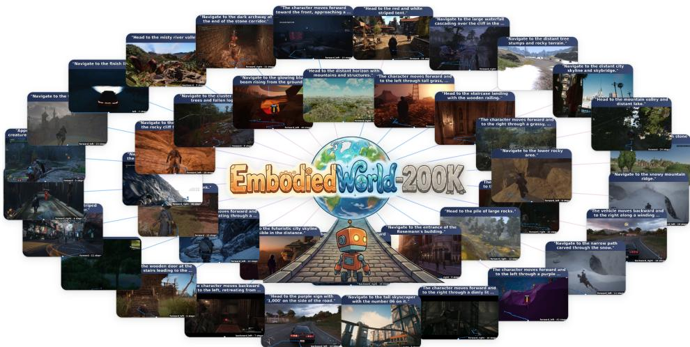

Figure 1: Overview of EmbodiedWorld-200K. A large-scale embodied-planning dataset designed to support the study of Embodied World Agents (EWAs)—general-purpose embodied agents operating across diverse open-world 3D environments. Each sample consists of an initial visual observation, a natural-language navigation instruction, and the corresponding action sequence.

## Abstract

Building embodied agents that can perceive, reason, and act across diverse 3D worlds is a central research direction toward artificial general intelligence. Yet most existing work on embodied agents remains confined to specific tasks in a single scene and transfers poorly to new environments, leaving general embodied agents for open-world settings an important but under-explored direction. We refer to such agents as Embodied World Agents (EWAs), whose defining property is the ability to understand diverse visual environments and execute general actions in open-world conditions. To advance research on EWAs, we instantiate them on open-world embodied navigation-planning and release EmbodiedWorld-200K, a large-scale dataset of over 200K samples spanning diverse scenes. Each example is equipped with multi-level annotations, ranging from low-level camera-motion trajectories to high-level semantic instructions, and is accompanied by unified evaluation splits and task-specific metrics, providing a shared substrate for offline pretraining and fair evaluation of EWAs. Beyond offline supervision, a defining characteristic of an EWA is its interaction with the environment; training solely on offline data is therefore insufficient, especially for generalizing to scenes not covered in the training distribution. Building dedicated real interactive environments, however, is often prohibitively expensive. To address this, we propose a

novel training scheme that employs a video world model as a low-cost environment proxy and performs interactive reinforcement-learning (RL) post-training of the EWA within it. Empirically, pretraining on EmbodiedWorld-200K substantially improves the open-world embodied planning ability of the EWA, and further RL post-training inside a world model yields clear gains on out-of-distribution scenes. The full dataset, baseline checkpoints, and the accompanying training and evaluation code for supporting future research on EWAs are publicly available at https://xiaokunfeng.github.io/EmbodiedWorld-200K/.

## 1 Introduction

Vision–language large models (VLLMs) have demonstrated strong semantic understanding and multimodal reasoning capabilities [1–5]. However, VLLMs are trained almost exclusively on static, passively observed data, rather than through executing actions or reasoning about their consequences in real environments; the intelligence they acquire thus remains, at its core, disembodied and passive [6, 7], and falls noticeably short on embodied tasks that require a closed perception–action loop [8, 9]. In response, building embodied agents that can perceive, reason, and autonomously act in diverse 3D worlds [10–12] has attracted growing attention, and is widely regarded as one of the key paths toward artificial general intelligence.

Yet most existing work on embodied agents remains confined to specific tasks in a single scene—for example, navigation within a particular indoor simulator [13, 14], manipulation on a particular robotic platform [15, 10, 11, 16], or task execution within a single type of game [17–21]. By contrast, developing general-purpose embodied agents for broad open-world environments remains an important but under-explored direction. For ease of discussion, we refer to such agents as Embodied World Agents (EWAs): agents that aim to acquire both a general understanding of diverse visual environments in open worlds and a general ability to execute actions within them. While this vision is highly appealing, realizing it faces a fundamental infrastructure gap: the community currently lacks a large-scale, open-world dataset that can simultaneously support well-grounded training and unified evaluation, and a matching open-source baseline model together with a practical training recipe.

Existing embodied-agent datasets, such as typical Vision-and-Language Navigation (VLN) benchmarks [22, 14], are limited in scale, lack scene diversity, and offer only single-level annotations, preventing EWAs from learning robust, general-purpose priors through large-scale pretraining as VLLMs do. To fill this gap, we instantiate the EWA problem as open-world embodied navigationplanning, a task that jointly stresses perceiving a diverse visual scene, grounding a language goal within it, and executing an extended action sequence. We adopt this instantiation because translation and view rotation are the actions that remain universal across heterogeneous open worlds, and are also the action types that frontier video world models natively support [23–25]. Accordingly, we release EmbodiedWorld-200K, a large-scale public corpus for this task, comprising over 200K video clips collected from diverse open-world virtual game environments (as shown in Fig. 1). Each sample is accompanied by multi-level annotations, ranging from low-level camera-motion/action trajectories to high-level semantic instructions that describe the underlying embodied navigation-planning task. Building on this large-scale corpus of instruction–action sequences, we pretrain an existing VLLM [4] in an offline manner, retaining its multimodal understanding while extending it into a Vision–Language–Action (VLA) model [26, 10] with open-world embodied navigation-planning capabilities.

A defining property of EWAs is their interaction with open-world environments, where many required capabilities can only be acquired through closed-loop interaction. Consequently, training solely on EmbodiedWorld-200K in an offline manner is insufficient, particularly for generalization to unseen scenes. However, real-world interactive platforms, such as game engines, are limited in scalability across diverse environments. Fortunately, the rapid progress of video-generative world models (WMs) [27–30, 24, 31, 32, 25] opens a new avenue: modern WMs can already roll out future visual observations conditioned on actions, offering a flexible and scalable simulation substrate for open-world interaction across diverse scenes. Building on this capability, we propose a novel training paradigm that treats a video WM as an environment proxy and performs interactive reinforcement learning (RL) post-training of EWAs within it. Specifically, an offline-pretrained EWA generates trajectories inside a frontier WM. During rollout, a VLLM dynamically produces task instructions conditioned on the evolving environment semantics, while reward signals are derived by framing reward modeling as visual question answering (QA) [33, 34]. Finally, we apply direct preference optimization (DPO) [35] on the collected trajectories, enabling the model to refine its policy from interactive feedback and improving embodied planning in unseen environments.

Extensive experiments demonstrate that offline pretraining on EmbodiedWorld-200K significantly improves the open-world embodied planning ability of EWAs, and that subsequent interactive RL post-training within a video world model further enhances adaptation to out-of-distribution (OOD) scenes. Our main contributions are summarized as follows:

• We study general-purpose embodied agents for open-world environments, referred to as Embodied World Agents (EWAs), and position them as an important yet under-explored research direction. We further provide infrastructure support from both data and training perspectives.

• We release EmbodiedWorld-200K, a large-scale dataset for open-world embodied planning containing over 200K samples with multi-level annotations, together with a unified evaluation split and task-specific metrics, enabling standardized pretraining and fair evaluation of EWAs.

• We propose a two-stage training framework for EWAs and instantiate a corresponding baseline: offline pretraining on EmbodiedWorld-200K followed by interactive RL post-training using a video world model as a scalable environment proxy.

• Empirically, EmbodiedWorld-200K significantly improves embodied planning performance, while WM-based interactive post-training further enhances generalization to unseen scenes. We release the dataset, model weights, and code at the project page to support future research.

## 2 Related Work

Embodied agents. Building agents that perceive and act in 3D environments has been studied across multiple domains. In robotic manipulation, RT-2 [12] finetunes a vision–language model to directly output robotic actions, PaLM-E [36] ingests multi-modal sensor streams into a large language model for embodied planning, SayCan [37] grounds language plans through learned affordances, and OpenVLA [10] and π [11] scale open-source vision–language–action (VLA) policies with large robot datasets such as Open X-Embodiment [15]. In embodied navigation, the community has long relied on photo-realistic simulators with curated trajectories [13, 14], yet these benchmarks remain limited to a few thousand paths in indoor scans. In open-world virtual environments, VPT [18] learns policies from unlabeled gameplay videos, MineDojo [17] provides Internet-scale knowledge for openended agents, Voyager [38] demonstrates LLM-driven lifelong exploration, STEVE-1 [19] trains a text-conditioned policy via latent goals, and SIMA [39] shows instruction-following across multiple 3D games. Despite this progress, most efforts remain confined to a single task type, scene distribution, or platform. The prospect of general-purpose embodied agents operating across diverse open worlds— what we term Embodied World Agents (EWAs)—remains largely unexplored, primarily due to the absence of large-scale, multi-level annotated data and a matching training recipe.

World (action) models. World models learn environment dynamics to support agent training or planning. Classic model-based RL methods such as DreamerV3 [40] learn compact latent dynamics for policy optimization, while IRIS [41] builds autoregressive world models with transformers. Recent video-generative world models move toward pixel-level fidelity: Genie [23] learns controllable interactive environments from unlabeled video, GameNGen [42] and DIAMOND [43] simulate game engines with diffusion models, GAIA-1 [44] generates driving scenarios, and Cosmos [28] provides a large-scale foundation world model for physical AI. UniSim [45] further proposes learning interactive real-world simulators that unify visual, physical, and semantic signals. Connecting world models to downstream agents has been explored through several paradigms. Planning-based approaches use video generation as an imagination module for lookahead: Video Language Planning [46] leverages text-to-video models to synthesize visual plans, and RoboDreamer [47] composes world models for robot imagination. Data-augmentation methods generate synthetic trajectories for offline policy improvement, as in UniPi [48], which casts policy learning as text-guided video generation, and GenRL [49], which trains embodied policies inside a multimodal foundation world model. The paradigm closest to ours treats the world model as a closed-loop interactive environment for RL: UniSim [45] trains reward and policy jointly within a learned simulator, and GR-2 [50] uses generated video for a scalable robot post-training. However, these works predominantly target robotic manipulation with low-level motor commands, or operate on a single platform. Our work differs in both task scope and contribution form: we target embodied navigation and planning across general open-world scenes, and rather than proposing a new world model or RL algorithm, we provide reusable research infrastructure, a large-scale corpus (EmbodiedWorld-200K), a concrete task formulation, and a reproducible two-stage training recipe (offline pretraining + WM-based RL post-training). These efforts provide precisely the shared foundation left open by prior work.

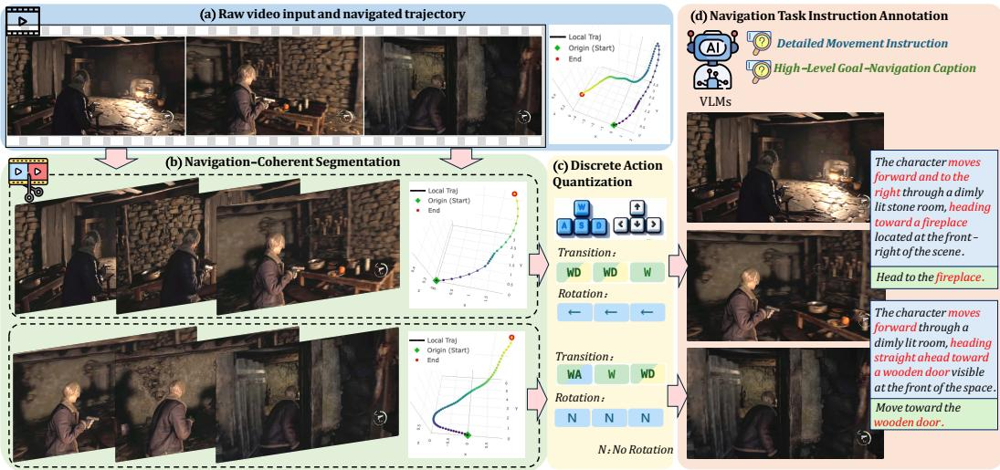  
Figure 2: Data annotation pipeline. Given (a) the raw video and its camera-motion trajectory, we first (b) leverage the trajectory to perform navigation-coherent segmentation; then on each resulting segment we carry out (c) discrete action quantization and (d) navigation task instruction annotation.

## 3 The EmbodiedWorld-200K Dataset

We introduce EmbodiedWorld-200K, a large-scale dataset for pretraining general-purpose embodied world agents across diverse open-world environments. Given that virtual 3D games have long served as a standard testbed for embodied-agent research [10–12], EmbodiedWorld-200K is assembled from 150 3D open-world games spanning a wide range of genres, yielding over 200K gameplay trajectories organized under a unified interaction format. Building on this corpus, we adopt open-world embodied navigation-planning as the central task for studying Embodied World Agents (EWAs), as it effectively stresses the ability of an agent to perceive, reason over, and act within diverse 3D environments. Targeted at this task, we apply a structured annotation process to the raw gameplay data. Specifically, each trajectory in EmbodiedWorld-200K is converted into a triplet consisting of an initial visual observation, a paired natural-language task instruction that specifies a diverse navigation-planning goal, and the expected action sequence the agent is supposed to execute in response. We detail the construction of EmbodiedWorld-200K in the following sections.

## 3.1 Data Collection

To support research on EWAs, the training corpus should cover a wide variety of 3D environments and enable the agent to perform a rich set of interactive tasks within them. However, few existing embodiment-related datasets meet both requirements simultaneously. Especially, datasets for robotic manipulation [51, 12, 52–54] focus on controlling a specific robot platform within relatively uniform environments, establishing VLN benchmarks [22, 14] are largely restricted to indoor scenes. Besides, autonomous-driving corpora [28, 55] are confined to the special case of road traffic. None of these can therefore be reused directly for our research. In contrast, virtual 3D games have long served as a natural proving ground for embodied-agent research [38, 56, 57, 20, 39, 7]. Modern 3D open-world games offer visually rich environments that obey physically plausible dynamics, and typically adopt first- or third-person viewpoints that align naturally with those of an embodied observer. More importantly, under a unified interaction logic, they jointly cover a broad spectrum of embodied behaviors such as navigation, exploration, and object interaction [58, 59], which makes them a highly suitable data platform for studying EWAs.

Motivated by this observation, we choose to build EmbodiedWorld-200K from gameplay data. Specifically, we adopt OGameData [60] as our data foundation: a publicly available, large-scale game-video repository that spans more than 150 next-generation 3D games and provides YouTube video URLs, temporal annotations, and structured captions for over one million gameplay clips, from which a multi-stage construction pipeline yields high-quality clips that are largely UI-free and strongly interaction-relevant. However, since OGameData was originally curated for open-world game video generation rather than for embodied-agent research, we further adapt it to the EWA setting through an additional filtering step. Concretely, we retain only clips that exhibit clear and continuous embodied actions, while discarding passive content such as cutscenes and menu navigation. To preserve genre-level diversity while staying aligned with the EWA task, we concentrate on openworld exploration, action-adventure, first-person shooter (FPS), puzzle-solving, and simulation games. After this process, we obtain 260K gameplay trajectories (∼708 hours in total), which serve as the raw input to the annotation pipeline described in the next subsection.

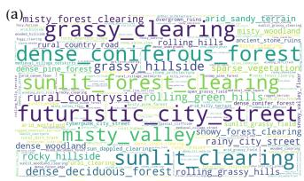

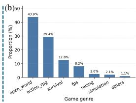

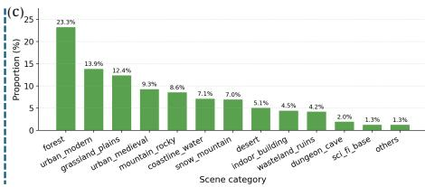  
Figure 3: Statistical analysis of environment types. (a) Word cloud over the descriptive keywords of the observed environments. (b-c) Distribution of NCSs by game genre and by scene category.

## 3.2 Data Processing and Annotation Pipeline

The core contribution of EmbodiedWorld-200K lies in converting raw gameplay videos into structured agent training data via a dedicated annotation pipeline, illustrated in Fig. 2.

Task Formulation. We instantiate the EWA study through the open-world embodied navigationplanning task, because it simultaneously stresses the three core abilities a general EWA must possess—perceiving a diverse visual environment, reasoning over the relation between goal and scene, and executing an extended action sequence within the world. Concretely, given a visual context in a 3D scene together with a natural-language goal instruction, the agent is required to produce the sequence of actions that fulfills this goal. Formally, an EWA carries out this task as

$$
{ \bf a } _ { 1 : T } = \mathrm { A g e n t } ( o _ { 0 } , \ell ) ,
$$

where $o _ { 0 }$ denotes the initial visual observation of episode, ℓ is the natural-language task instruction describing a navigation-planning goal, and ${ \bf a } _ { 1 : T } = ( a _ { 1 } , a _ { 2 } , \dots , a _ { T } )$ is the expected action sequence to execute. Accordingly, each basic sample in the EWA task takes the form of a triplet $( o _ { 0 } , \ell , \mathbf { a } _ { 1 : T } )$ and our annotation pipeline is organized around the construction of these three components.

As a preprocessing step, we first recover camera motion from each video clip using VIPE [61], to obtain 6-DoF pose trajectory capturing both translation and rotation. Together with raw gameplay videos, these camera trajectories form the input to the subsequent annotation pipeline (Fig. 2 (a)).

Step 1: Navigation-Coherent Segmentation and Extraction of o . Although OGameData already provides scene-cut clips, they are not directly usable as EWA navigation units: within a single clip the subject’s motion can be visually incoherent, such as mixing drifting, backtracking, and frequent direction change. As a result, there is no single goal-directed trajectory whose intent we can attach an instruction to. Since navigation is naturally defined by a consistent principal motion direction towards some destination, we first segment each OGameData clip into shorter pieces that each carry one dominant motion direction. We refer to each such piece as a navigation-coherent segment (NCS), and adopt the NCS as the basic analysis unit throughout EmbodiedWorld-200K.

Concretely, starting from the camera pose sequence of a clip, we compute a smoothed per-frame displacement, track the cumulative principal motion direction, and trigger a cut whenever the instantaneous motion deviates from this principal direction by more than a preset angle for several consecutive frames. After further discarding erratic and overly short candidates, we obtain in total 215K NCSs from the raw gameplay clips. Each surviving NCS carries a well-defined principal motion direction, i.e., a clear navigation intent. Therefore, we directly take its initial frame as the visual observation $o _ { 0 }$ of the corresponding EWA sample. The exact thresholds and full implementation details of this procedure are deferred to App. A.1.

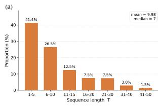

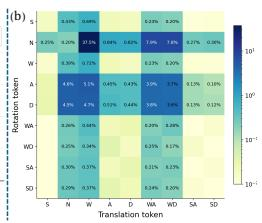  
Figure 4: Statistical analysis of action sequence $\mathbf { a } _ { 1 : T } .$ (a) Distribution of sequence lengths T across all NCSs. (b) Per-position heatmap of action-token occurrences.

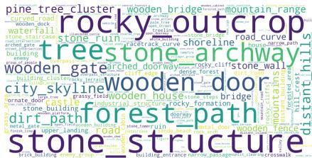  
Figure 5: Statistical analysis of the navigation goals.

Step 2: Discrete Action Quantization and Derivation of $\mathbf { a } _ { 1 : T } ,$ . For every NCS, we derive the agent action sequence $\mathbf { a } _ { 1 : T }$ by discretizing the camera-pose motion into a unified W/A/S/D action space shared across all games:

• Translation: W (forward), A (left), S (backward), D (right), N (stationary)

• Rotation: W (pitch up), A (yaw left), S (pitch down), D (yaw right), N (no rotation)

The central design question is how to calibrate the physical amount of motion that each translation/rotation token should represent. This calibration directly controls the distribution of T across NCSs: too coarse a unit yields sequences that are too short to carry fine-grained navigation signals, whereas too fine a unit produces sequences that are too long to learn efficiently. Therefore, we initially run a dataset-wide statistic on the per-NCS motion magnitude, and pick a translation unit and a rotation unit from this distribution that make the resulting $\bar { T }$ lie in a sensible range. With these two units fixed, we scan each NCS in temporal order and emit a new W/A/S/D token whenever the accumulated motion reaches one unit, independently for translation and rotation, so that the two streams remain aligned. As a result, every NCS is converted into a variable-length W/A/S/D sequence in which each token corresponds to an approximately fixed amount of physical motion. Detailed statistics, the exact discretization procedure, and additional robustness safeguards are provided in App. A.2.

Step 3: Annotation of the Navigation Task Instruction ℓ. Given the initial visual observation $o _ { 0 }$ and the direction-coherent action sequence $\mathbf { a } _ { 1 : T }$ , the remaining component of the triplet, the naturallanguage task instruction $\ell ,$ is obtained by automatic prompting of a frontier vision-language model, Qwen3.5-27B [4]. For each NCS we feed into the VLLM a set of frames uniformly sampled from the corresponding video segment, together with an overall direction descriptor derived from $\mathbf { a } _ { 1 : T } ,$ and prompt the model to produce a natural-language instruction that summarizes the embodied-navigation task implicitly carried by that segment. To accommodate different annotation granularities, we design two complementary instruction types:

• Detailed Movement Instruction. A fine-grained description of how the agent should move throughout the segment, combining direction cues with the visible target— $- e . g .$ , “The character advances forward along a narrow dirt path, heading toward the line of trees visible directly ahead.”

• High-Level Goal-Navigation Instruction. A direction-agnostic description that specifies only the destination to reach, with no movement cue attached, $e . g .$ , “Head to the line of trees.” or “Navigate to the wooden gate structure.” Compared with the detailed instruction above, this higher-level variant is noticeably more challenging. Moreover, it is not always producible, because it requires the navigation target to be uniquely identifiable within the segment. Therefore, we design an automatic grounding–verification procedure admitting only the NCSs satisfying this condition into this type of annotation.

When constructing the final training data, for each NCS we adopt a higher-level-first, detailed-fallback policy: we use the goal-navigation caption as ℓ whenever it is successfully produced, and otherwise fall back to the detailed movement instruction. Fig. 6 (a) and (b) present representative examples of the Detailed Movement Instruction and the High-Level Goal-Navigation Instruction, respectively, and more examples can be found in Fig. 1. The full prompts, the grounding–verification procedure, and the post-hoc consistency-check rules are deferred to App. A.3.

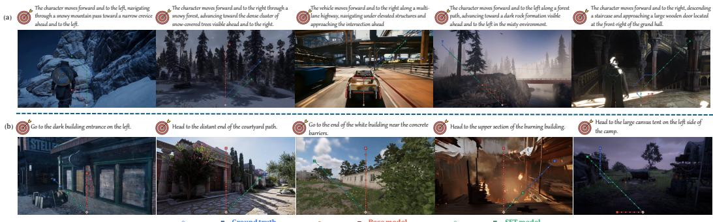  
Figure 6: Qualitative comparison examples before and after Stage-I pretraining, under (a) detailed movement instructions and (b) high-level goal-navigation instruction.

## 3.3 Statistical Analysis

Based on the NCSs extracted above, we carry out a statistical analysis around the core triplet $( o _ { 0 } , \ell , \mathbf { a } _ { 1 : T } )$ , to offer a direct view of how well EmbodiedWorld-200K matches the needs of EWA research. Firstly, the visual observation $o _ { 0 }$ reflects the type of world each sample is drawn from, and is thus the most direct lens for evaluating environmental diversity. Fig. 3 (a) shows a word cloud over the descriptive keywords of the observed environments, and Fig. 3 (b–c) provide finergrained breakdowns along the game-genre and scene-category axes. Complementary per-dimension statistics (camera viewpoint, art style, etc.) are reported in Fig. A1. Overall, these plots indicate that EmbodiedWorld-200K spans a wide variety of 3D environments rather than being dominated by any single scene type.

Besides, the action sequence $\mathbf { a } _ { 1 : T }$ captures the granularity and length of the operations the agent is expected to execute. Fig. 4 (a) plots the distribution of sequence lengths $T _ { \ast }$ , while Fig. 4 (b) shows a heatmap of per-position token occurrences across all NCSs. The fraction of samples decreases as $T$ grows, which is consistent with our design choice that the navigation target typically appears in the initial frame $o _ { 0 }$ . That is to say, the agent–target distance therefore stays moderate and does not call for excessively long sequences. The mean length of 9.98 serves as an appropriate operating point, covering both short-range fine adjustments and longer-range continuous progressions. Finally, for the task instruction $\ell ,$ we primarily examine whether the set of navigation goals is sufficiently rich. Fig. 5 shows a word cloud over the target-location phrases extracted from $\ell ,$ confirming that the covered goals span a wide variety of object and place categories. The above analyses collectively demonstrate that EmbodiedWorld-200K provides rich diversity and broad coverage across its three core components (visual environments, action sequences, and task instructions), offering a solid data foundation on which EWA research can be built.

## 3.4 Evaluation Metrics

We partition the curated NCSs into disjoint training and evaluation splits so that all methods are trained and benchmarked under a unified protocol [62]. Our metrics are designed to quantitatively assess instruction-conditioned trajectory following and goal arrival [63]. Drawing on standard practice in Vision-and-Language Navigation (VLN) and tailored to our discrete W/A/S/D action format, we report four complementary metrics that span token-level and trajectory-level performance (see App. B for algorithmic details):

• TM (Token Match, ↑): mean per-step keyset-F1 between predicted and ground-truth tokens, computed separately on the translation and rotation streams and then averaged.

• DirAcc (Direction Accuracy, ↑): global-direction accuracy averaged over four axes (translation forward/backward and left/right, rotation pitch and yaw).

• nDTW (normalized Dynamic Time Warping, ↑): normalized DTW over reconstructed 3D trajectories, averaged over a distance-tolerance coefficient $\tau \in \{ 0 . 5 , 1 . 0 , 2 . 0 \}$ that controls how strictly per-step deviations are penalized.

• NE (Navigation Error, ↓): terminal xy displacement measured in translation units.

## 4 EWA Baseline Method

To facilitate future research on EWAs, we present a simple baseline that turns a frontier VLLM into an EWA through a dedicated two-stage training scheme. Concretely, we conduct large-scale offline pretraining on EmbodiedWorld-200K, and then perform interactive RL post-training with a video world model acting as environmental proxy. We describe each component as follows.

## 4.1 Model Architecture

Although frontier VLLMs have demonstrated strong multimodal understanding, the intelligence they acquire remains essentially disembodied: they observe passively and lack a native mechanism for producing physical actions in the environment [7]. Our baseline therefore takes a frontier VLLM (i.e., Qwen-VL [4]) as backbone and extends it into a VLA model for open-world embodied planning. We deliberately refrain from introducing heavyweight extra components such as dedicated action heads [64, 11, 65], and instead keep both the task instruction and the predicted action sequence entirely within VLLM native text-token space. This minimally intrusive design preserves the understanding capability inherited from VLLM pretraining while providing a simple, easy-to-extend baseline for follow-up work. Concretely, the visual observation o<sub>0</sub> and the task instruction ℓ are concatenated through a dedicated system prompt as input, and the model is asked to emit the full action sequence $\mathbf { a } _ { 1 : T }$ as a single JSON object. Detailed prompt is provided in App C.

## 4.2 Two-Stage Training

To equip VLLM with open-world embodied-planning ability, we first perform offline pretraining on our EmbodiedWorld-200K dataset so that the model can absorb the open-world embodied-planning priors latent in this large-scale corpus. Building on this offline-pretrained EWA, we further introduce a second stage of interactive RL post-training. This stage targets adaptation to specific environments, especially scenes outside the training distribution, where closed-loop interaction is crucial. To make such interaction scalable, we use a video world model [25] as a low-cost environment proxy.

Stage I: Offline supervised pretraining. We finetune Qwen3-VL-4B [4] on the training split of EmbodiedWorld-200K with a cross-entropy loss between the predicted and ground-truth action tokens. This stage injects broad open-world embodied-planning priors — drawn from a diverse distribution of scenes and instructions — into the model.

Stage II: Interactive RL post-training inside a video world model. Stage I is purely offline, and its coverage is therefore bounded by the training distribution. To further adapt the baseline to a particular target environment, especially one outside the coverage of EmbodiedWorld-200K, closed-loop interaction is necessary. Since building real interactive platforms at open-world scale is prohibitively expensive, we instead leverage a frontier video world model [25, 27, 29, 66] as a low-cost environment proxy. The Stage-I baseline is rolled out inside this proxy environment, and the resulting trajectories are used for RL post-training. Although conceptually straightforward, realising this pipeline requires careful design at every step. The core recipe of our scheme is as follows: for each rollout, a VLLM is conditioned on the current scene to adaptively generate a natural-language task instruction ℓ, which in turn anchors a visual question-answering (VQA) reward that judges whether the rollout fulfils the instruction; the resulting preference trajectory pairs are then consumed by Direct Preference Optimization (DPO) [35, 67] to further post-train the baseline. In this way, we aim to substantially enhance the baseline’s embodied-planning ability in specific target scenes without requiring any additional human annotation. Further implementation details are provided in App. D.

## 5 Experimental Results and Discussion

Based on the two training stages introduced above, we report key implementation details and present the main empirical findings.

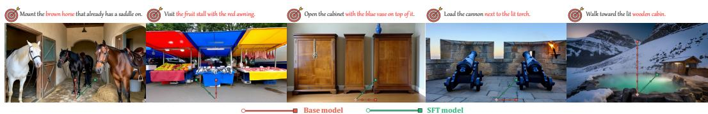  
Figure 7: Qualitative comparison examples on out-of-distribution scenes before and after Stage-I pretraining, where the initial observations are synthesized by an image-generation model.

Table 1: Comparison on the EmbodiedWorld-200K evaluation split. External baselines cover three families: VLN models adapted to our W/A/S/D action space, a game foundation model, and zero-shot frontier VLMs.
<table><tr><td>Model</td><td>TM↑</td><td>DirAcc ↑</td><td>nDTW ↑</td><td>NE↓</td></tr><tr><td>Uni-NaVid [68]</td><td>47.9</td><td>61.4</td><td>30.9</td><td>100.6</td></tr><tr><td>StreamVLN [69]</td><td>47.2</td><td>61.5</td><td>25.9</td><td>114.7</td></tr><tr><td>NitroGen [70]</td><td>45.6</td><td>39.8</td><td>49.0</td><td>97.2</td></tr><tr><td>InternVL3-8B [71]</td><td>45.3</td><td>57.4</td><td>63.4</td><td>59.7</td></tr><tr><td>Gemini-3.5 [3]</td><td>52.8</td><td>72.4</td><td>60.0</td><td>54.7</td></tr><tr><td>Qwen3-VL-4B (Base) [4]</td><td>54.9</td><td>70.1</td><td>67.1</td><td>51.7</td></tr><tr><td>Qwen3-VL-4B (+SFT, ours)</td><td>62.0</td><td>72.0</td><td>83.6</td><td>35.6</td></tr></table>

## 5.1 EmbodiedWorld-200K pretraining substantially boosts embodied navigation-planning

We finetune Qwen3-VL-4B [4] with LoRA on the training split of EmbodiedWorld-200K for 2 epochs. To position the resulting model rather than only measure our own improvement, we further evaluate three families of external baselines on the same evaluation split, with the same metric toolkit and the same prompt. (a) VLN models. Uni-NaVid [68] and StreamVLN [69] are recent vision-and-language navigation policies; we map their native action vocabularies onto our W/A/S/D format one step per token. (b) A game foundation model. NitroGen [70] predicts gamepad actions from pixels after large-scale gameplay pretraining; since it is not language-conditioned, it serves as an instruction-free lower bound that isolates how much of the task is solvable from visual reaction alone. (c) Zero-shot frontier VLMs. The open-source InternVL3-8B [71] and the proprietary Gemini-3.5 are prompted with our baseline system prompt without any finetuning. The last two rows of Tab. 1 are our own backbone, Qwen3-VL-4B, before and after Stage-I pretraining.

Three observations follow. First, Stage-I SFT improves every metric over the zero-shot backbone (TM +7.1, DirAcc +1.9, nDTW +16.5, NE −16.1), confirming that the corpus injects the intended openworld navigation-planning priors. Second, these gains are not obtainable from a stronger generalpurpose model: our model leads every external baseline on TM, nDTW and NE (+9.2, +20.2 and −19.1 over the strongest competitor) and matches the best DirAcc (72.0 vs. 72.4); notably, Gemini-3.5 attains that best DirAcc yet trails markedly on the trajectorylevel metrics, indicating that strong multimodal understanding suffices to infer the coarse heading but not to reproduce the goal-directed action sequence itself. Third, the benchmark is discriminative rather than saturated: baseline scores span a wide range (TM 45.3–54.9, nDTW 25.9–67.1, NE 51.7–114.7), and the instruction-free NitroGen records the lowest DirAcc (39.8, close to chance), confirming that the task genuinely requires grounding the language instruction rather than reacting to pixels alone.

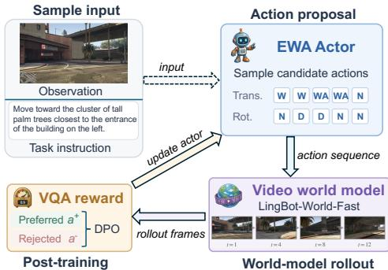  
Figure 8: Overview of the Stage-II pipeline. The actor proposes a candidate action sequence, the video world model rolls it out, and a VQA reward turns the rollout into a preferred/rejected pair for DPO.

In addition, Fig. 6 shows qualitative examples on evaluation split, and Fig. 7 further shows out-ofdistribution samples whose initial observations $o _ { 0 }$ are synthesized by an image-generation model [72]. We further analyze the effect of the Stage-I pretraining data scale in App. C.1. In summary, results show that pretraining on the proposed dataset successfully injects expected open-world embodiedplanning priors for model.

## 5.2 World-model-based RL post-training improves target-scene adaptation

Stage I essentially fits the model to a broad collection of world environments and extracts the common knowledge shared across them; its capacity is therefore inherently bounded by the training distribution. To further adapt the model to a particular target environment — for example, to calibrate the precise physical magnitude that each unit action corresponds to under that environment’s dynamics — closed loop interaction with, and post-training on, that very environment is indispensable. This mirrors the common recipe in embodied-robotics research [10–12], where a model is first pretrained on broad and diverse corpora and then finetuned on a specific robot platform to adapt to its physical characteristics. Since directly building a real interactive platform is prohibitively expensive, we instead resort to a frontier video world model [25] as a low-cost proxy. Concretely, we use LingBot-World-Fast [25] as the interactive proxy and take GTA5 as an illustrative target environment. GTA5 is an open-world game widely used in academic research [73, 74], yet it is not included in our training distribution. We therefore treat it as a representative setting in which large-scale sampling of real trajectories is costly.

Fig. 8 gives an overview of the resulting Stage-II pipeline: an initial observation and an automatically generated task instruction are fed to the actor, which samples a candidate action sequence; the sequence is executed inside the video world model to obtain the corresponding rollout frames, on which a VQA reward judges how well the instruction is fulfilled and yields a

Table 2: Performance on GTA5 evaluation split, before (w/o DPO) and after (w/ DPO) Stage-II post-training.
<table><tr><td>Setting</td><td>TM↑</td><td>DirAcc ↑</td><td>nDTW ↑</td><td>NE↓</td></tr><tr><td>w/o DPO</td><td>65.4</td><td>84.4</td><td>66.1</td><td>48.9</td></tr><tr><td>w/DPO</td><td>75.0</td><td>82.8</td><td>92.7</td><td>13.4</td></tr></table>

preferred/rejected action pair for DPO. We outline the key design choices below and defer the full implementation to App. D. Within this proxy, we align the physical magnitude that each unit control action produces in the GTA5 environment with that produced inside LingBot-World-Fast [25], and then initialize the actor with the Stage-I SFT model rather than the base VLLM. We adopt the SFT model as the actor because it has a basic embodied-planning ability, so that its action sequences contain a non-trivial fraction of correct decisions; combined with exploration, this yields rollouts of sufficient quality to form informative preference pairs for DPO [75]. Starting from the base model would produce rollouts too noisy to support effective preference learning. We therefore roll out the SFT actor inside LingBot-World-Fast [25], construct preference pairs from the collected trajectories, and perform DPO post-training on the actor. Tab. 2 reports results on our GTA5-specific evaluation split curated from the game. DPO post-training on top of the Stage-I baseline significantly improves target-scene adaptation.

## 6 Conclusion

In this work, we identified Embodied World Agents (EWAs)—general-purpose embodied agents that can perceive, reason, and act across diverse open-world 3D environments—as an important yet under-explored research direction, and contributed infrastructure support from both the data and training perspectives. On the data side, we released EmbodiedWorld-200K, a large-scale open-world embodied-planning corpus of over 200K samples with multi-level annotations ranging from low-level camera-motion trajectories to high-level semantic instructions, together with a unified evaluation split and four task-specific metrics for fair and reproducible comparison. On the training side, we proposed a two-stage training framework and instantiated a concrete baseline: offline supervised pretraining on EmbodiedWorld-200K followed by interactive RL post-training that leverages a frontier video world model as a low-cost environment proxy. Empirically, offline pretraining on EmbodiedWorld-200K substantially strengthens open-world embodied planning ability across all four evaluation metrics, while world-model-based interactive post-training further improves adaptation to out-of-distribution scenes. We release the dataset, checkpoints, and code as a shared foundation for EWA research.

## Acknowledgments and Disclosure of Funding

This work was conducted during an internship at Tencent Hunyuan, and was supported by Tencent Hunyuan.

## References

[1] Aaron Hurst, Adam Lerer, Adam P Goucher, Adam Perelman, Aditya Ramesh, Aidan Clark, AJ Ostrow, Akila Welihinda, Alan Hayes, Alec Radford, et al. Gpt-4o system card. arXiv preprint arXiv:2410.21276, 2024.

[2] AI Anthropic. The claude 3 model family: Opus, sonnet, haiku. Claude-3 Model Card, 1(1):4, 2024.

[3] Gheorghe Comanici, Eric Bieber, Mike Schaekermann, Ice Pasupat, Noveen Sachdeva, Inderjit Dhillon, Marcel Blistein, Ori Ram, Dan Zhang, Evan Rosen, et al. Gemini 2.5: Pushing the frontier with advanced reasoning, multimodality, long context, and next generation agentic capabilities. arXiv preprint arXiv:2507.06261, 2025.

[4] Shuai Bai, Yuxuan Cai, Ruizhe Chen, Keqin Chen, Xionghui Chen, Zesen Cheng, Lianghao Deng, Wei Ding, Chang Gao, Chunjiang Ge, et al. Qwen3-VL technical report. arXiv preprint arXiv:2511.21631, 2025.

[5] Weiyun Wang, Zhangwei Gao, Lixin Gu, Hengjun Pu, Long Cui, Xingguang Wei, Zhaoyang Liu, Linglin Jing, Shenglong Ye, Jie Shao, et al. InternVL3.5: Advancing open-source multimodal models in versatility, reasoning, and efficiency. arXiv preprint arXiv:2508.18265, 2025.

[6] David Silver and Richard S Sutton. Welcome to the era of experience. Google AI, 1:11, 2025.

[7] Adrian Bolton, Alexander Lerchner, Alexandra Cordell, Alexandre Moufarek, Andrew Bolt, Andrew Lampinen, Anna Mitenkova, Arne Olav Hallingstad, Bojan Vujatovic, Bonnie Li, et al. Sima 2: A generalist embodied agent for virtual worlds. arXiv preprint arXiv:2512.04797, 2025.

[8] Arjun Majumdar, Anurag Ajay, Xiaohan Zhang, Pranav Putta, Sriram Yenamandra, Mikael Henaff, Sneha Silwal, Paul Mcvay, Oleksandr Maksymets, Sergio Arnaud, et al. OpenEQA: Embodied question answering in the era of foundation models. In Proceedings ofthe IEEE/CVF Conference on Computer Vision and Pattern Recognition (CVPR), pages 16488–16498, 2024.

[9] Pascale Fung, Yoram Bachrach, Asli Celikyilmaz, Kamalika Chaudhuri, Delong Chen, Willy Chung, Emmanuel Dupoux, Hongyu Gong, Hervé Jégou, Alessandro Lazaric, et al. Embodied AI agents: Modeling the world. arXiv preprint arXiv:2506.22355, 2025.

[10] Moo Jin Kim, Karl Pertsch, Siddharth Karamcheti, Ted Xiao, Ashwin Balakrishna, Suraj Nair, Rafael Rafailov, Ethan Foster, Grace Lam, Pannag Sanketi, et al. Openvla: An open-source vision-language-action model. arXiv preprint arXiv:2406.09246, 2024.

[11] Kevin Black, Noah Brown, Danny Driess, Adnan Esmail, Michael Equi, Chelsea Finn, Niccolo Fusai, Lachy Groom, Karol Hausman, Brian Ichter, et al. π : A vision-language-action flow model for general robot control. arXiv preprint arXiv:2410.24164, 2024.

[12] Brianna Zitkovich, Tianhe Yu, Sichun Xu, Peng Xu, Ted Xiao, Fei Xia, Jialin Wu, Paul Wohlhart, Stefan Welker, Ayzaan Wahid, et al. Rt-2: Vision-language-action models transfer web knowledge to robotic control. In Conference on Robot Learning, pages 2165–2183. PMLR, 2023.

[13] Peter Anderson, Qi Wu, Damien Teney, Jake Bruce, Mark Johnson, Niko Sünderhauf, Ian Reid, Stephen Gould, and Anton Van Den Hengel. Vision-and-language navigation: Interpreting visually-grounded navigation instructions in real environments. In Proceedings of the IEEE conference on computer vision and pattern recognition, pages 3674–3683, 2018.

[14] Jacob Krantz, Erik Wijmans, Arjun Majumdar, Dhruv Batra, and Stefan Lee. Beyond the navgraph: Vision-and-language navigation in continuous environments. In European Conference on Computer Vision, pages 104–120. Springer, 2020.

[15] Abby O’Neill, Abdul Rehman, Abhiram Maddukuri, Abhishek Gupta, Abhishek Padalkar, Abraham Lee, Acorn Pooley, Agrim Gupta, Ajay Mandlekar, Ajinkya Jain, et al. Open xembodiment: Robotic learning datasets and rt-x models: Open x-embodiment collaboration 0. In 2024 IEEE International Conference on Robotics and Automation (ICRA), pages 6892–6903. IEEE, 2024.

[16] Physical Intelligence, Kevin Black, Noah Brown, James Darpinian, Karan Dhabalia, Danny Driess, Adnan Esmail, Michael Equi, Chelsea Finn, Niccolo Fusai, et al. π : a visionlanguage-action model with open-world generalization. arXiv preprint arXiv:2504.16054, 2025.

[17] Linxi Fan, Guanzhi Wang, Yunfan Jiang, Ajay Mandlekar, Yuncong Yang, Haoyi Zhu, Andrew Tang, De-An Huang, Yuke Zhu, and Anima Anandkumar. Minedojo: Building open-ended embodied agents with internet-scale knowledge. Advances in Neural Information Processing Systems, 35:18343–18362, 2022.

[18] Bowen Baker, Ilge Akkaya, Peter Zhokov, Joost Huizinga, Jie Tang, Adrien Ecoffet, Brandon Houghton, Raul Sampedro, and Jeff Clune. Video pretraining (VPT): Learning to act by watching unlabeled online videos. In Advances in Neural Information Processing Systems, 2022.

[19] Shalev Lifshitz, Keiran Paster, Harris Chan, Jimmy Ba, and Sheila McIlraith. Steve-1: A generative model for text-to-behavior in minecraft. Advances in Neural Information Processing Systems, 36:69900–69929, 2023.

[20] ByteDance Seed, Weihao Tan, Xiangyang Li, Yunhao Fang, Heyuan Yao, Shi Yan, Hao Luo, Tenglong Ao, Huihui Li, Hongbin Ren, Bairen Yi, Yujia Qin, Bo An, Libin Liu, and Guang Shi. Lumine: An Open Recipe for Building Generalist Agents in 3D Open Worlds. arXiv preprint arXiv:2511.08892, 2025.

[21] Kuang-Huei Lee, Ofir Nachum, Mengjiao Sherry Yang, Lisa Lee, Daniel Freeman, Sergio Guadarrama, Ian Fischer, Winnie Xu, Eric Jang, Henryk Michalewski, et al. Multi-game decision transformers. In Advances in Neural Information Processing Systems, 2022.

[22] Peter Anderson, Angel Chang, Devendra Singh Chaplot, Alexey Dosovitskiy, Saurabh Gupta, Vladlen Koltun, Jana Kosecka, Jitendra Malik, Roozbeh Mottaghi, Manolis Savva, et al. On evaluation of embodied navigation agents. arXiv preprint arXiv:1807.06757, 2018.

[23] Jake Bruce, Michael D Dennis, Ashley Edwards, Jack Parker-Holder, Yuge Shi, Edward Hughes, Matthew Lai, Aditi Mavalankar, Richie Steigerwald, Chris Apps, et al. Genie: Generative interactive environments. In Forty-first International Conference on Machine Learning, 2024.

[24] Jiaqi Li, Junshu Tang, Zhiyong Xu, Longhuang Wu, Yuan Zhou, Shuai Shao, Tianbao Yu, Zhiguo Cao, and Qinglin Lu. Hunyuan-gamecraft: High-dynamic interactive game video generation with hybrid history condition, 2025. URL https://arxiv.org/abs/2506.17201.

[25] Robbyant Team, Zelin Gao, Qiuyu Wang, Yanhong Zeng, Jiapeng Zhu, Ka Leong Cheng, Yixuan Li, Hanlin Wang, Yinghao Xu, Shuailei Ma, et al. Advancing open-source world models. arXiv preprint arXiv:2601.20540, 2026.

[26] Ranjan Sapkota, Yang Cao, Konstantinos I Roumeliotis, and Manoj Karkee. Visionlanguage-action models: Concepts, progress, applications and challenges. arXiv preprint arXiv:2505.04769, 2025.

[27] Google DeepMind. Genie 3: A new frontier for world models. https://deepmind.google/ blog/genie-3-a-new-frontier-for-world-models/, 2025.

[28] Niket Agarwal, Arslan Ali, Maciej Bala, Yogesh Balaji, Erik Barker, Tiffany Cai, Prithvijit Chattopadhyay, Yongxin Chen, Yin Cui, Yifan Ding, et al. Cosmos world foundation model platform for physical ai. arXiv preprint arXiv:2501.03575, 2025.

[29] Xianglong He, Chunli Peng, Zexiang Liu, Boyang Wang, Yifan Zhang, Qi Cui, Fei Kang, Biao Jiang, Mengyin An, Yangyang Ren, et al. Matrix-game 2.0: An open-source real-time and streaming interactive world model. arXiv preprint arXiv:2508.13009, 2025.

[30] Jiannan Xiang, Yi Gu, Zihan Liu, Zeyu Feng, Qiyue Gao, Yiyan Hu, Benhao Huang, Guangyi Liu, Yichi Yang, Kun Zhou, et al. Pan: A world model for general, interactable, and long-horizon world simulation. arXiv preprint arXiv:2511.09057, 2025.

[31] Junshu Tang, Jiacheng Liu, Jiaqi Li, Longhuang Wu, Haoyu Yang, Penghao Zhao, Siruis Gong, Xiang Yuan, Shuai Shao, and Qinglin Lu. Hunyuan-gamecraft-2: Instruction-following interactive game world model, 2025. URL https://arxiv.org/abs/2511.23429.

[32] HunyuanWorld Team, Zhenwei Wang, Yuhao Liu, Junta Wu, Zixiao Gu, Haoyuan Wang, Xuhui Zuo, Tianyu Huang, Wenhuan Li, Sheng Zhang, et al. Hunyuanworld 1.0: Generating immersive, explorable, and interactive 3d worlds from words or pixels. arXiv preprint arXiv:2507.21809, 2025.

[33] Juan Rocamonde, Victoriano Montesinos, Elvis Nava, Ethan Perez, and David Lindner. Visionlanguage models are zero-shot reward models for reinforcement learning. arXiv preprint arXiv:2310.12921, 2023.

[34] Yufei Wang, Zhanyi Sun, Jesse Zhang, Zhou Xian, Erdem Biyik, David Held, and Zackory Erickson. Rl-vlm-f: Reinforcement learning from vision language foundation model feedback. arXiv preprint arXiv:2402.03681, 2024.

[35] Rafael Rafailov, Archit Sharma, Eric Mitchell, Christopher D Manning, Stefano Ermon, and Chelsea Finn. Direct preference optimization: Your language model is secretly a reward model. Advances in neural information processing systems, 36:53728–53741, 2023.

[36] Danny Driess, Fei Xia, Mehdi SM Sajjadi, Corey Lynch, Aakanksha Chowdhery, Brian Ichter, Ayzaan Wahid, Jonathan Tompson, Quan Vuong, Tianhe Yu, et al. Palm-e: An embodied multimodal language model. arXiv preprint arXiv:2303.03378, 2023.

[37] Michael Ahn, Anthony Brohan, Noah Brown, Yevgen Chebotar, Omar Cortes, Byron David, Chelsea Finn, Chuyuan Fu, Keerthana Gopalakrishnan, Karol Hausman, et al. Do as i can, not as i say: Grounding language in robotic affordances. arXiv preprint arXiv:2204.01691, 2022.

[38] Guanzhi Wang, Yuqi Xie, Yunfan Jiang, Ajay Mandlekar, Chaowei Xiao, Yuke Zhu, Linxi Fan, and Anima Anandkumar. Voyager: An open-ended embodied agent with large language models. arXiv preprint arXiv:2305.16291, 2023.

[39] SIMA Team, Maria Abi Raad, Arun Ahuja, Catarina Barros, Frederic Besse, Andrew Bolt, Adrian Bolton, Bethanie Brownfield, Gavin Buttimore, Max Cant, Sarah Chakera, et al. Scaling instructable agents across many simulated worlds. arXiv preprint arXiv:2404.10179, 2024.

[40] Danijar Hafner, Jurgis Pasukonis, Jimmy Ba, and Timothy Lillicrap. Mastering diverse domains through world models. arXiv preprint arXiv:2301.04104, 2023.

[41] Vincent Micheli, Eloi Alonso, and François Fleuret. Transformers are sample-efficient world models. arXiv preprint arXiv:2209.00588, 2022.

[42] Dani Valevski, Yaniv Leviathan, Moab Arar, and Shlomi Fruchter. Diffusion models are real-time game engines. arXiv preprint arXiv:2408.14837, 2024.

[43] Eloi Alonso, Adam Jelley, Vincent Micheli, Anssi Kanervisto, Amos Storkey, Tim Pearce, and François Fleuret. Diffusion for world modeling: Visual details matter in atari. Advances in Neural Information Processing Systems, 37:58757–58791, 2024.

[44] Anthony Hu, Lloyd Russell, Hudson Yeo, Zak Murez, George Fedoseev, Alex Kendall, Jamie Shotton, and Gianluca Corrado. Gaia-1: A generative world model for autonomous driving. arXiv preprint arXiv:2309.17080, 2023.

[45] Sherry Yang, Yilun Du, Kamyar Ghasemipour, Jonathan Tompson, Leslie Kaelbling, Dale Schuurmans, and Pieter Abbeel. Learning interactive real-world simulators. arXiv preprint arXiv:2310.06114, 2023.

[46] Yilun Du, Sherry Yang, Pete Florence, Fei Xia, Ayzaan Wahid, Pierre Sermanet, Tianhe Yu, Pieter Abbeel, Joshua B Tenenbaum, Leslie Pack Kaelbling, et al. Video language planning. In The Twelfth International Conference on Learning Representations, 2024.

[47] Siyuan Zhou, Yilun Du, Jiaben Chen, Yandong Li, Dit-Yan Yeung, and Chuang Gan. Robodreamer: Learning compositional world models for robot imagination. arXiv preprint arXiv:2404.12377, 2024.

[48] Yilun Du, Sherry Yang, Bo Dai, Hanjun Dai, Ofir Nachum, Josh Tenenbaum, Dale Schuurmans, and Pieter Abbeel. Learning universal policies via text-guided video generation. Advances in neural information processing systems, 36:9156–9172, 2023.

[49] Pietro Mazzaglia, Tim Verbelen, Bart Dhoedt, Aaron Courville, and Sai Rajeswar. Genrl: Multimodal-foundation world models for generalization in embodied agents. Advances in neural information processing systems, 37:27529–27555, 2024.

[50] Chi-Lam Cheang, Guangzeng Chen, Ya Jing, Tao Kong, Hang Li, Yifeng Li, Yuxiao Liu, Hongtao Wu, Jiafeng Xu, Yichu Yang, et al. Gr-2: A generative video-language-action model with web-scale knowledge for robot manipulation. arXiv preprint arXiv:2410.06158, 2024.

[51] Dmitry Kalashnikov, Alex Irpan, Peter Pastor, Julian Ibarz, Alexander Herzog, Eric Jang, Deirdre Quillen, Ethan Holly, Mrinal Kalakrishnan, Vincent Vanhoucke, et al. Scalable deep reinforcement learning for vision-based robotic manipulation. In Conference on robot learning, pages 651–673. PMLR, 2018.

[52] Abby O’Neill, Abdul Rehman, Abhiram Maddukuri, Abhishek Gupta, Abhishek Padalkar, Abraham Lee, Acorn Pooley, Agrim Gupta, Ajay Mandlekar, Ajinkya Jain, et al. Open xembodiment: Robotic learning datasets and rt-x models: Open x-embodiment collaboration 0. In 2024 IEEE International Conference on Robotics and Automation (ICRA), pages 6892–6903. IEEE, 2024.

[53] Homer Walke, Kevin Black, Abraham Lee, Moo Jin Kim, Max Du, Chongyi Zheng, Tony Zhao, Philippe Hansen-Estruch, Quan Vuong, Andre He, Vivek Myers, Kuan Fang, Chelsea Finn, and Sergey Levine. Bridgedata v2: A dataset for robot learning at scale. In Conference on Robot Learning (CoRL), 2023.

[54] Octo Model Team, Dibya Ghosh, Homer Walke, Karl Pertsch, Kevin Black, Oier Mees, Sudeep Dasari, Joey Hejna, Tobias Kreiman, Charles Xu, et al. Octo: An open-source generalist robot policy. arXiv preprint arXiv:2405.12213, 2024.

[55] Hassan Abu Alhaija, Jose Alvarez, Maciej Bala, Tiffany Cai, Tianshi Cao, Liz Cha, Joshua Chen, Mike Chen, Francesco Ferroni, Sanja Fidler, et al. Cosmos-transfer1: Conditional world generation with adaptive multimodal control. arXiv preprint arXiv:2503.14492, 2025.

[56] Zihao Wang, Shaofei Cai, Anji Liu, Yonggang Jin, Jinbing Hou, Bowei Zhang, Haowei Lin, Zhaofeng He, Zilong Zheng, Yaodong Yang, et al. Jarvis-1: Open-world multi-task agents with memory-augmented multimodal language models. IEEE Transactions on Pattern Analysis and Machine Intelligence, 47(3):1894–1907, 2024.

[57] Weihao Tan, Wentao Zhang, Xinrun Xu, Haochong Xia, Ziluo Ding, Boyu Li, Bohan Zhou, Junpeng Yue, Jiechuan Jiang, Yewen Li, et al. Cradle: Empowering foundation agents towards general computer control. arXiv preprint arXiv:2403.03186, 2024.

[58] Zhili Cheng, Yuge Tu, Ran Li, Shiqi Dai, Jinyi Hu, Shengding Hu, Jiahao Li, Yang Shi, Tianyu Yu, Weize Chen, et al. Embodiedeval: Evaluate multimodal llms as embodied agents. arXiv preprint arXiv:2501.11858, 2025.

[59] Ziyu Zhu, Xilin Wang, Yixuan Li, Zhuofan Zhang, Xiaojian Ma, Yixin Chen, Baoxiong Jia, Wei Liang, Qian Yu, Zhidong Deng, et al. Move to understand a 3d scene: Bridging visual grounding and exploration for efficient and versatile embodied navigation. In Proceedings of the IEEE/CVF International Conference on Computer Vision, pages 8120–8132, 2025.

[60] Haoxuan Che, Xuanhua He, Quande Liu, Cheng Jin, and Hao Chen. Gamegen-x: Interactive open-world game video generation. arXiv preprint arXiv:2411.00769, 2024.

[61] Jiahui Huang, Qunjie Zhou, Hesam Rabeti, Aleksandr Korovko, Huan Ling, Xuanchi Ren, Tianchang Shen, Jun Gao, Dmitry Slepichev, Chen-Hsuan Lin, et al. Vipe: Video pose engine for 3d geometric perception. arXiv preprint arXiv:2508.10934, 2025.

[62] Xiaokun Feng, Haiming Yu, Meiqi Wu, Shiyu Hu, Jintao Chen, Chen Zhu, Jiahong Wu, Xiangxiang Chu, and Kaiqi Huang. Narrlv: Towards a comprehensive narrative-centric evaluation for long video generation. In International Conference on Learning Representations, volume 2026, pages 20966–21000, 2026.

[63] Xinran Ling, Chen Zhu, Meiqi Wu, Hangyu Li, Xiaokun Feng, Cundian Yang, Aiming Hao, Jiashu Zhu, Jiahong Wu, and Xiangxiang Chu. Vmbench: A benchmark for perception-aligned video motion generation. In 2025 IEEE/CVF International Conference on Computer Vision (ICCV), pages 13087–13098. IEEE, 2025.

[64] Qixiu Li, Yaobo Liang, Zeyu Wang, Lin Luo, Xi Chen, Mozheng Liao, Fangyun Wei, Yu Deng, Sicheng Xu, Yizhong Zhang, et al. Cogact: A foundational vision-language-action model for synergizing cognition and action in robotic manipulation. arXiv preprint arXiv:2411.19650, 2024.

[65] Zhi Hou, Tianyi Zhang, Yuwen Xiong, Hengjun Pu, Chengyang Zhao, Ronglei Tong, Yu Qiao, Jifeng Dai, and Yuntao Chen. Diffusion transformer policy. arXiv preprint arXiv:2410.15959, 2024.

[66] Xiaokun Feng, Jiashu Zhu, Meiqi Wu, Chubin Chen, Fangyuan Mao, Haiyang Guo, Jiahong Wu, Xiangxiang Chu, and Kaiqi Huang. Enhancing train-free infinite-frame generation for consistent long videos. arXiv preprint arXiv:2605.18233, 2026.

[67] Chubin Chen, Sujie Hu, Jiashu Zhu, Meiqi Wu, Jintao Chen, Yanxun Li, Nisha Huang, Chengyu Fang, Jiahong Wu, Xiangxiang Chu, et al. Taming preference mode collapse via directional decoupling alignment in diffusion reinforcement learning. In Proceedings of the IEEE/CVF Conference on Computer Vision and Pattern Recognition, pages 12775–12786, 2026.

[68] Jiazhao Zhang, Kunyu Wang, Shaoan Wang, Minghan Li, Haoran Liu, Songlin Wei, Zhongyuan Wang, Zhizheng Zhang, and He Wang. Uni-navid: A video-based vision-language-action model for unifying embodied navigation tasks. arXiv preprint arXiv:2412.06224, 2024.

[69] Meng Wei, Chenyang Wan, Xiqian Yu, Tai Wang, Xiaohan Mao, Chenming Zhu, Wenzhe Cai, Hanqing Wang, Yilun Chen, Xihui Liu, et al. Streamvln: Streaming vision-and-language navigation via slowfast context modeling. In 2026 IEEE International Conference on Robotics and Automation (ICRA), pages 22174–22181. IEEE, 2026.

[70] L Magne, A Awadalla, G Wang, Y Xu, J Belofsky, F Hu, J Kim, L Schmidt, G Gkioxari, J Kautz, et al. Nitrogen: A foundation model for generalist gaming agents.

[71] Jinguo Zhu, Weiyun Wang, Zhe Chen, Zhaoyang Liu, Shenglong Ye, Lixin Gu, Hao Tian, Yuchen Duan, Weijie Su, Jie Shao, et al. Internvl3: Exploring advanced training and test-time recipes for open-source multimodal models. arXiv preprint arXiv:2504.10479, 2025.

[72] Z-Image Team. Z-image: An efficient image generation foundation model with single-stream diffusion transformer. arXiv preprint arXiv:2511.22699, 2025.

[73] Anh-Dzung Doan, Abdul Mohsi Jawaid, Thanh-Toan Do, and Tat-Jun Chin. G2d: from gta to data. arXiv preprint arXiv:1806.07381, 2018.

[74] Heuijee Yun and Daejin Park. Simulation of self-driving system by implementing digital twin with gta5. In 2021 international conference on electronics, information, and communication (ICEIC), pages 1–2. IEEE, 2021.

[75] Sujie Hu, Chubin Chen, Jiashu Zhu, Jiahong Wu, Xiangxiang Chu, and Xiu Li. Embeddingperturbed exploration preference optimization for flow models. In Forty-third International Conference on Machine Learning, 2026. URL https://openreview.net/forum?id= Ai4vdy80p5.

[76] Edward J Hu, Yelong Shen, Phillip Wallis, Zeyuan Allen-Zhu, Yuanzhi Li, Shean Wang, Liang Wang, Weizhu Chen, et al. Lora: Low-rank adaptation of large language models. Iclr, 1(2):3, 2022.

[77] Sujie Hu, Huaisong Zhang, Pujing Yang, Qian Wang, Xiaomin Li, Xinhang Leng, Chen Li, Jing Lyu, Xiu Li, and Ling Pan. Blame errant words, not the canvas: Defect-aware spatial credit assignment for visual text generation, 2026. URL https://arxiv.org/abs/2610.20794.

## A More Details About the EmbodiedWorld-200K Construction Pipeline

This appendix complements Sec. 3.2 and provides the full specification of the three annotation steps that turn a raw gameplay clip into a triplet $( o _ { 0 } , \ell , \mathbf { a } _ { 1 : T } ) ;$ (i) navigation-coherent segmentation, (ii) magnitude-based variable-length W/A/S/D discretization, and (iii) instruction annotation with verification.

## A.1 Navigation-Coherent Segmentation

We start from the 6-DoF camera trajectory recovered by VIPE [61]. For each clip, we first re-express the per-frame poses in a local coordinate frame anchored at the first frame and smooth the resulting signal with a sliding-window average of size $W _ { \mathrm { s m o o t h } } = 5 $ to suppress high-frequency jitter.

Principal-direction tracking and cut criterion. On the smoothed signal we maintain a running estimate of the cumulative principal motion direction. Whenever the instantaneous motion deviates from this principal direction by more than $\theta _ { \mathrm { c u t } } = 9 0 ^ { \circ }$ for at least $F _ { \mathrm { c u t } } = 3$ consecutive frames, a cut is triggered; the portion between two adjacent cuts is treated as one candidate navigation-coherent segment (NCS). Intuitively, this criterion ensures that every NCS corresponds to a temporally continuous interval during which the agent moves towards a stable destination.

Quality filters. The coarse segmentation above is followed by two filters to discard erratic or under-informative candidates:

• Displacement-vs-path-length ratio. For each candidate segment we compute the ratio of its net displacement (start-to-end straight-line distance) to the integrated path length. Candidates with a ratio below $\rho _ { \mathrm { d i s p } } = 0 . 3$ , or whose curvature variance exceeds $\sigma _ { \kappa } ^ { 2 } = \bar { 1 } . 5$ are dropped as overly meandering or shaky.

• Minimum-length constraint. Any remaining candidate shorter than $L _ { \mathrm { m i n } } = 6 0$ frames is dropped, so that each surviving NCS contains enough visual context for the downstream annotation model to reason about the navigation goal.

Initial observation $o _ { 0 }$ and frame-index alignment. The first frame of every surviving NCS is exported as the initial visual observation $o _ { 0 }$ of the corresponding EWA sample. When the recoveredpose sampling rate disagrees with the video sampling rate, we remap the pose-index of the first frame to the corresponding video-index before exporting, so that $o _ { 0 }$ is strictly aligned with the first pose used by the NCS.

## A.2 Magnitude-Based Variable-Length W/A/S/D Discretization

As stated in Sec. 3.2 Step 2, the central design question here is how to calibrate the physical amount of motion that each W/A/S/D token represents: too coarse a unit yields too-short sequences that cannot carry fine-grained navigation signals, whereas too fine a unit produces overly long sequences that are hard to learn. Our magnitude-based variable-length discretization procedure is organized around this calibration.

Unit calibration from dataset-level statistics. For each NCS we compute its total translation $\begin{array} { r } { L _ { \mathrm { t r a n s } } = \sum _ { i } \lVert { \bf p } _ { i + 1 } - { \bf p } _ { i } \rVert } \end{array}$ (integrated path length) and total rotation $\begin{array} { r } { L _ { \mathrm { r o t } } = \sum _ { i } \sqrt { \Delta \mathrm { y a w } _ { i } ^ { 2 } + \Delta \mathrm { p i t c h } _ { i } ^ { 2 } } } \end{array}$ (in degrees). We then sweep candidate values of the translation unit $\Delta _ { \mathrm { t r a n s } }$ and inspect, for each candidate, the induced distribution of sequence length $T$ across the entire corpus; the smallest unit for which T lies in a training-friendly range is retained. The rotation unit $\Delta _ { \mathrm { r o t } }$ has a natural absolute scale and is fixed throughout. Our final release adopts

$$
\Delta _ { \mathrm { t r a n s } } = 0 . 0 5 , \qquad \Delta _ { \mathrm { r o t } } = 5 ^ { \circ } .
$$

Mixed-motion accumulator and bin boundaries. With $\Delta _ { \mathrm { t r a n s } }$ and $\Delta _ { \mathrm { r o t } }$ fixed, we scan an NCS in temporal order and track a single scalar budget

$$
m _ { i } = \frac { \left\| \mathbf { p } _ { i + 1 } - \mathbf { p } _ { i } \right\| } { \Delta _ { \mathrm { t r a n s } } } + \frac { \sqrt { \Delta \mathrm { y a w } _ { i } ^ { 2 } + \Delta \mathrm { p i t c h } _ { i } ^ { 2 } } } { \Delta _ { \mathrm { r o t } } } .
$$

The budget is accumulated frame by frame and a new bin is closed whenever the running sum reaches 1.0; any residual below 1.0 at the end of the segment is merged into the last bin. This yields a time-synchronous partitioning of the NCS in which every bin corresponds to an approximately unit-magnitude motion, jointly measured in translation and rotation.

Per-bin W/A/S/D token. Within each bin we emit one translation token and one rotation token by evaluating the net displacement $( \Delta x , \Delta y )$ and the net rotation (∆yaw, ∆pitch) accumulated inside the bin. For either stream, the principal axis is first identified by the larger absolute magnitude and, if the secondary axis exceeds the principal axis by a ratio of 0.3 (translation) or 0.5 (rotation), the two keys are combined into a diagonal token such as WD. To suppress jitter, we additionally reject a bin-level token as N when (i) its total magnitude is below $1 0 \%$ of the corresponding unit, or (ii) the net-to-accumulated ratio is below 0.4, a condition characteristic of back-and-forth oscillation. A whole NCS whose total translation and rotation both stay below static thresholds (0.02 in pose units and 2.5<sup>◦</sup>) collapses to a single N token on each stream.

Output. The procedure produces two equally long W/A/S/D sequences—one for translation and one for rotation—in which each token carries an approximately fixed physical meaning of ∼0.05 in translation or ${ \sim } 5 ^ { \circ }$ in rotation. These two streams are stored together with their segment-level metadata $( e . g . , L _ { \mathrm { t r a n s } } , L _ { \mathrm { r o t } } ,$ , bin boundaries) alongside the raw annotation JSON and are used as the ground-truth action sequence $\mathbf { a } _ { 1 : T }$ throughout this work.

## A.3 Instruction Annotation and Verification

This subsection details how the natural-language task instruction ℓ is produced for each NCS. Following the two-track design in Sec. 3.2 Step 3, we generate two complementary annotations per NCS—a Detailed Movement Instruction and, whenever feasible, a High-Level Goal-Navigation Caption—and adopt a higher-level-first, detailed-fallback policy when assembling the final training corpus. Both tracks are implemented via automatic prompting of the same frontier VLLM, Qwen3.5- 27B [4], served with vLLM tensor parallelism.

Detailed Movement Instruction. For each NCS we uniformly sample frames from the corresponding video segment at 2 fps and feed them, together with an overall direction descriptor derived from a<sub>1:T</sub> (e.g., "left-forward"), into the VLLM under the prompt shown below. The VLLM is asked to emit a structured JSON record with four fields—annotatable, task\_description, move\_target, and move\_type—together with a self-reported direction\_consist flag indicating whether the described motion is consistent with the direction descriptor.

Full prompt for annotating the Detailed Movement Instruction.   
Please \*\*strictly\*\* follow all instructions below.   
Your output \*\*must\*\* be a valid JSON (or Python dictionary) object and \*\*must not\*\*   
contain any additional explanations, comments, punctuation remarks, or code-block   
wrappers.   
## Annotation Task   
You are given a \*\*trajectory sub-segment\*\* extracted from a longer video. This   
sub-segment corresponds to a continuous time interval during which the primary   
character maintains a \*\*consistent movement direction\*\*. The movement direction   
metadata is provided alongside the video frames.   
Your task is to annotate the \*\*task instruction\*\* executed by the \*\*primary   
character\*\* within this sub-segment, along with the associated \*\*movement target   
information\*\*.   
We assume that the target’s task intent is reflected by its overall movement   
direction. Since the sub-segment already exhibits a unified movement direction,   
you should produce exactly one task annotation for the entire sub-segment.   
## Definition of Task Instructions

\- A \*\*task instruction\*\* refers to a \*\*high-level behavioral objective\*\* that explains \*why\* the character is moving in the observed direction during this sub-segment.

Examples include: \*navigating toward a door\*, \*approaching an enemy\*, \*retreating to cover\*, \*exploring a corridor\*, \*moving toward a checkpoint\*.

## - Task instructions are identified by reasoning about:

\- What goal is the character attempting to achieve during this sub-segment?

\- What destination or object is the character moving toward (or away from)?

\- What high-level intent does the observed movement serve?

## - \*\*Distinction between Action and Task\*\*:

\- \*\*Action\*\*: A short-term, atomic behavior (e.g., turning, jumping, opening a door).

\- \*\*Task\*\*: A higher-level objective that may involve multiple actions, defined by a consistent goal and a clear target.

## ## Key Annotation Principles

## ### Primary Character Priority

First, identify the primary character (from either a first-person or third-person perspective) and center all annotations on this character’s behavior.

If multiple characters are present without a clear hierarchy, or if no character appears in the entire video segment (e.g., the video only contains environmental or scene information), the annotation should instead be based on the movement of the main camera viewpoint.

## ### Visual Content Only

Task information must be derived \*\*exclusively from the visual content of the video frames\*\*.

Ignore all on-screen text, UI elements, HUD overlays, subtitles, or displayed task prompts. Even if the video explicitly shows textual instructions, you must deliberately ignore them and rely solely on observable visual evidence.

## ### Precise and Unique Task Description

The ‘task\_description‘ must be \*\*precise enough to uniquely identify the character’s movement process\*\* within this sub-segment. This is achieved through two mechanisms:

1. \*\*End-State Anchoring\*\*: Constrain the description using information observable at the \*\*final frame\*\* of the sub-segment. The movement target should ideally be a specific, identifiable object or location that the character arrives at or approaches by the end.

2. \*\*Directional Disambiguation\*\*: When multiple similar objects exist in the scene, use directional cues (e.g., \*the door on the left\*, \*the cabinet to the front-right\*) to uniquely identify the target.

3. \*\*Initial-Frame Visibility Requirement\*\*: When referencing a specific object as the movement target, that object \*\*must be visible in the first frame\*\* of the sub-segment. If the target object only appears later in the sub-segment and is not visible at the start, it \*\*must not\*\* be used as the anchoring reference. In such cases, use a more general spatial description (e.g., \*moving toward the end of the corridor\*) or directional reference instead.

4. \*\*Fallback\*\*: If no unique target can be identified (e.g., the character is wandering or exploring without a clear destination), describe the movement in general terms and set ‘move\_target‘ to ‘null‘.

\### [!] Direction Consistency in task\_description (CRITICAL REQUIREMENT) The ‘task\_description‘ \*\*must explicitly include directional words that match every component of the provided ‘{{MOVEMENT\_DIRECTION}}‘\*\*. This is a hard requirement that cannot be omitted.

\- The ‘{{MOVEMENT\_DIRECTION}}‘ value is composed of one or more direction components joined by ‘-‘ (e.g., ‘"left-forward"‘, ‘"right-backward-up"‘).

\- \*\*Each component must appear explicitly in the ‘task\_description‘\*\* using natural language directional expressions. The mapping is:

\- ‘forward‘ -> must include words such as \*forward\*, \*ahead\*, \*front\*

\- ‘backward‘ -> must include words such as \*backward\*, \*back\*, \*rear\*,

\- ‘left‘ -> must include the word \*left\*

\- ‘right‘ -> must include the word \*right\*

\- ‘up‘ -> must include words such as \*up\*, \*upward\*, \*upper\*, \*above\*,

```markdown
- ‘down‘ -> must include words such as *down*, *downward*, *lower*,
*below*, *descending*
**Examples**:
‘{{MOVEMENT_DIRECTION}} = "forward"‘ -> ‘task_description‘ must explicitly
contain *forward / ahead / front*
‘{{MOVEMENT_DIRECTION}} = "left-forward"‘ -> ‘task_description‘ must
explicitly contain both *left* and *forward / ahead / front*
‘{{MOVEMENT_DIRECTION}} = "right-backward-up"‘ -> ‘task_description‘ must
explicitly contain *right*, *backward / back / rear*, and *up / upward /
ascending*
- This directional information must be woven **naturally into the sentence**
(not appended mechanically). The description should still read as a fluent,
high-level task instruction.
[OK] Good example (‘{{MOVEMENT_DIRECTION}} = "left-forward"‘):
*"The character advances toward the front-left, heading for a metal door at
the end of the left corridor."*
- [X] Bad example (‘{{MOVEMENT_DIRECTION}} = "left-forward"‘, missing direction
words):
*"The character heads toward a metal door at the end of the corridor."*
### Diversity of Expression
Use **varied and natural language** to describe the task instruction. Avoid
repetitive sentence patterns across different annotations. For example, the
following expressions all describe similar movement but with different
phrasing:
- *The character advances through the corridor toward a wooden door at the far
end.*
*Navigating along a dimly lit hallway, the character heads for the exit
ahead.*
*The character proceeds down the passage, approaching the doorway visible in
the distance.*
*Moving through the narrow corridor, the character makes their way to the
door at the front.*
Vary sentence structure, vocabulary, and the order of information (target
first vs. action first, etc.) to ensure annotation diversity.
### High-Level Semantics First
Focus on **what the character is trying to achieve**, not on low-level actions.
The ‘task_description‘ must be a **task-level abstraction**, not a simple
enumeration of actions.
### Uncertainty Handling
If the character’s objective cannot be reliably inferred from the visual
content, set ‘"annotatable": false‘ and leave all other fields as ‘null‘. Do
not speculate.
Additionally, when applying **End-State Anchoring** using a **movement target
location**, you must verify whether the referenced movement target visible in
the final frame also appears in the **first frame** of the sub-segment. If the
target location does **not** appear in the first frame, set
‘"annotatable": false‘ and leave all other fields as ‘null‘.
## Movement Target Information
### Movement Target (‘move_target‘)
- Identify the **specific spatial target** that the character moves toward (or
remains at) during this sub-segment.
- Describe the target relative to concrete objects or spatial references
visible in the scene (e.g., *in front of the red door*, *beside the large
tree on the left*).
- The referenced object **must be visible in the first frame**. If it only
appears mid-way through the sub-segment, do not use it as the anchor.
- If the character remains stationary, describe the position where the
character stays.
- If no clear target exists (e.g., wandering, patrolling), output ‘null‘.
### Movement Type (‘move_type‘)
- Summarize the character’s **overall movement direction** during this
sub-segment.
- Use coarse-grained descriptions: *moving forward*, *moving to the
front-left*, *turning right*, *remaining stationary*, *retreating
backward*, etc.
```

- If the movement involves mixed directions, summarize with the dominant   
direction (e.g.. \*moving toward the front-right\*).   
### Direction Consistency (‘direction\_consist‘)   
- Set to ‘true‘ if the ‘move\_type‘ you annotated is \*\*semantically consistent\*\*   
with the provided ‘{{MOVEMENT\_DIRECTION}}‘; otherwise set to ‘false‘.   
Set to ‘null‘ if the sample is not annotatable (‘"annotatable": false‘).   
This field serves as a self-check: if your annotated ‘move\_type‘ conflicts   
with the provided ‘{{MOVEMENT\_DIRECTION}}‘, re-examine your annotation   
before finalizing.   
## Examples   
### Case 1   
‘{{ O C O }}‘ ‘" f f "‘   
{   
"annotatable": true,   
"perspective": "Third-person",   
"task\_description": "The character navigates through a nighttime campsite,   
moving toward the front-left to reach the entrance of   
a tent situated ahead and to the left.",   
"move\_target": "the tent entrance to the front-left",   
"move\_type": "moving toward the front-left",   
"direction\_consist": true   
}   
### Case 2   
\*\*Input ‘{{MOVEMENT\_DIRECTION}}‘\*\*: ‘"forward"‘   
{   
"annotatable": true,   
"perspective": "First-person",   
"task\_description": "Advancing along a sunlit forest trail, the character   
pushes forward toward a wooden bridge visible directly   
ahead.",   
"move\_target": "the wooden bridge directly ahead",   
"move\_type": "moving forward",   
"direction\_consist": true   
}   
### Case 3   
\*\*Input ‘{{MOVEMENT\_DIRECTION}}‘\*\*: ‘"right-backward"‘   
"annotatable": true.   
"perspective": "First-person",   
"task description": "The character retreats backward and to the right from   
an open battlefield, falling back toward a stone wall   
located to the rear-right for cover.",   
"move\_target": "the stone wall to the rear-right",   
"move\_type": "moving toward the rear-right",   
"direction\_consist": true   
}   
### Case 4   
\*\*Input ‘{{MOVEMENT\_DIRECTION}}‘\*\*: ‘"right-forward-up"‘   
{   
"annotatable": true,   
"perspective": "First-person",   
"task\_description": "The character climbs upward along a rocky slope, moving   
forward and to the right toward a ledge visible at the   
upper-right of the cliff face.",   
"move\_target": "the ledge at the upper-right of the cliff face",   
"move\_type": "moving toward the upper-right while ascending",   
"direction\_consist": true   
}   
### Case 5   
\*\*Input ‘{{MOVEMENT\_DIRECTION}}‘\*\*: ‘"forward"‘   
{   
"annotatable": true,   
"perspective": "First-person",   
"task\_description": "The character roams forward through a dense forest area   
without a clearly identifiable destination ahead.",   
"move\_target": null,   
"move\_type": "moving forward",   
"direction\_consist": true   
}

### Case 6 (not annotatable)   
\*\*Input ‘{{MOVEMENT\_DIRECTION}}‘\*\*: ‘"left-forward"‘   
{   
"annotatable": false,   
"perspective": null,   
"task\_description": null,   
"move\_target": null,   
"move\_type": null,   
"direction\_consist": null   
}   
## Input   
‘{{VIDEO\_FRAMES}}‘ - A sequence of video frames corresponding to one trajectory   
sub-segment. The sub-segment has a consistent primary movement direction.   
‘{{MOVEMENT\_DIRECTION}}‘ - The dominant movement direction of this sub-segment   
(e.g., "forward", "right-forward", "left"). This is provided as auxiliary   
reference; the annotation must still be grounded in the visual content. \*\*The   
‘task\_description‘ must explicitly include directional words corresponding to   
every component of this value.\*\*   
## Output Format   
Return a JSON dictionary with the following structure:   
{   
"annotatable": <bool>,   
"perspective": "<First-person / Third-person / Other, or null if not   
annotatable>",   
"task\_description": "<high-level description of the character’s task   
instruction, explicitly containing directional words   
matching all components of {{MOVEMENT\_DIRECTION}},   
or null>",   
"move\_target": "<the character’s movement target, or null>",   
"move\_type": "<the character’s overall movement direction, or null>",   
"direction\_consist": "<true if move\_type is consistent with   
{{MOVEMENT\_DIRECTION}}, false if not, null if not   
annotatable>"   
}

Post-hoc direction-consistency check. To catch annotations that silently contradict the underlying action sequence, every record produced above is re-evaluated by an independent call that parses both the direction descriptor and the free-text move\_type into a pair of axis-level labels (forward/backward and left/right) and compares them. Any NCS whose two labels disagree on either axis is removed from the Detailed Movement Instruction pool.

High-Level Goal-Navigation Caption. The higher-level variant specifies only the navigation destination without any directional cues. Because it requires the target to be uniquely identifiable within the NCS, we produce it through a four-step grounding-and-verification loop:

1. strip direction words from the move\_target field of the Detailed Movement Instruction to obtain a candidate target phrase;

2. ground the candidate phrase on the initial observation o<sub>0</sub> with an open-vocabulary detector, keeping only cases in which exactly one bounding box is returned;

3. ground the same phrase on the final frame of the NCS, again keeping only single-bbox cases;

4. perform an LLM-based same-entity verification between the two boxes.

Only NCSs that pass all four checks are admitted to this track, and the VLLM is prompted to generate a short, direction-free goal-navigation caption conditioned on the verified target phrase (e.g., “Head to the line oftrees.” or “Navigate to the wooden gate structure.”).

Training-data construction policy. When assembling the final training corpus, we adopt a higherlevel-first, detailed-fallback policy: we use the Goal-Navigation Caption as ℓ whenever it is successfully produced, and otherwise fall back to the Detailed Movement Instruction. The NCS-level share of each track in the released dataset is reported in Fig. 3 and the accompanying statistics.

What the segment endpoint certifies. Because every trajectory-level metric is anchored at the endpoint of the ground-truth NCS, it is worth stating precisely what that endpoint does and does not guarantee. The segmentation itself is triggered by a change of principal motion direction (App. A.1) rather than by a verified arrival, so an NCS endpoint is not, on its own, a certificate that the agent reached a target object. The goal–endpoint correspondence is instead established by the annotation procedure above: an NCS is admitted to the High-Level Goal-Navigation track only if a target object is identifiable in itsfinal frame and survives all four grounding-and-verification checks, so that for this track the endpoint is, by construction, a position at which the instructed target has been reached. For the Detailed Movement Instruction track no such claim is made: the instruction describes the movement that the segment carries out, and the endpoint is simply where that movement ends. The metrics are defined to respect this distinction—they score the displacement consistency between the predicted and ground-truth endpoints rather than physical contact with an object—as discussed in App. B.3.

## A.4 Additional Statistical Analyses

This subsection complements Sec. 3.3, in which the diversity of the visual observation $o _ { 0 }$ is analyzed through a keyword word cloud together with two coarse-grained breakdowns along the game-genre and scene-category axes (Fig. 3). To provide a more comprehensive view of environment diversity, we further report per-dimension distributions of $o _ { 0 }$ along additional metadata axes, including camera viewpoint, art style, and other auxiliary attributes, as summarized in Fig. A1. These plots reinforce the conclusion drawn in the main text: EmbodiedWorld-200K spans a broad and well-balanced distribution of 3D environments along every examined axis, providing a solid visual foundation on which EWAs can acquire open-world priors through offline pretraining.

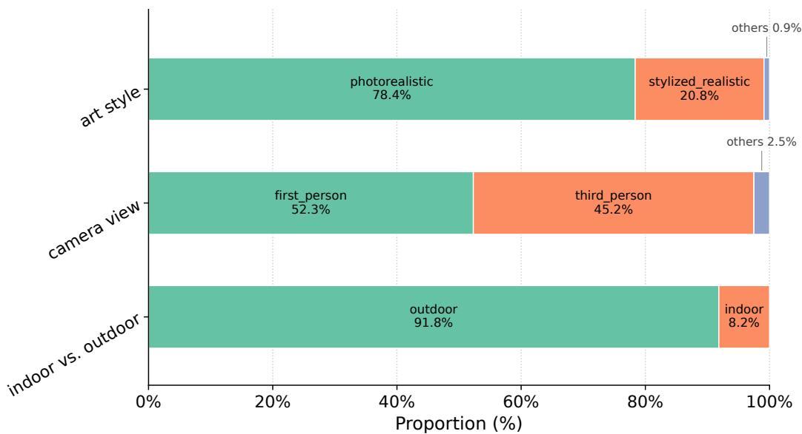  
Figure A1: Complementary statistical analysis of $o _ { 0 }$ in EmbodiedWorld-200K, along additional dimensions including camera viewpoint, art style, and other metadata axes.

## B More Details About Evaluation Metrics

This appendix complements Sec. 3.4 and specifies the full algorithmic details of the four evaluation metrics. Following the organization in the main paper, we first describe the two token-level metrics — TM and DIRACC — that assess the predicted action sequence on a per-step basis, and then describe the two trajectory-level metrics — NDTW and NE — that evaluate the reconstructed 3-D trajectory as a whole. We also specify the shared pre-processing rules (length alignment and parse-failure fallback) that apply to all four metrics.

Shared pre-processing. For every evaluation sample we parse the predicted and ground-truth action sequences into translation and rotation token lists. Before computing any token-level metric, both sequences are right-padded with the no-op token N to a common length $\bar { \cal L } = \operatorname* { m a x } ( | \hat { \bf a } | , | { \bf a } | )$ , so that length mismatches are penalized symmetrically. A sample whose prediction fails JSON parsing is replaced by a single-token no-op [N] on each stream and scored through the identical pipeline, so that no samples are dropped from the evaluation pool.

## B.1 Token-level metrics

TM (Token Match, ↑). TM measures how well the predicted keys at each time step match the ground-truth keys, and is robust to the fact that a combined token such as WD only partially overlaps with a simpler token such as W. Concretely, we treat each token as a subset of {W, A, S, D}, with N identified with ∅. Let $g _ { t }$ and $p _ { t }$ denote the ground-truth and predicted token sets at step t; we compute a per-step set-level $F _ { 1 }$

$$
P _ { t } = { \frac { \left| g _ { t } \cap p _ { t } \right| } { \left| p _ { t } \right| } } , \quad R _ { t } = { \frac { \left| g _ { t } \cap p _ { t } \right| } { \left| g _ { t } \right| } } , \quad F _ { 1 } ^ { ( t ) } = { \frac { 2 P _ { t } R _ { t } } { P _ { t } + R _ { t } } } ,
$$

with the convention that $F _ { 1 } ^ { ( t ) } : = 1$ when $g _ { t } = p _ { t } = \emptyset$ and $F _ { 1 } ^ { ( t ) } : = 0$ when exactly one side is empty. TM is obtained by averaging $F _ { 1 } ^ { ( t ) }$ over all L steps on each stream, and then averaging the translation and rotation scores.

DirAcc (Direction Accuracy, ↑). DirAcc probes whether the overall direction of motion is captured correctly on four independent axes: translation forward/backward, translation left/right, rotation pitch, and rotation yaw. For each axis we derive a single categorical label in {positive, negative, neutral} by comparing the counts of the two opposing keys across the full sequence $( e . g .$ , count of W versus count of S on the translation FB axis). DirAcc is the mean four-axis agreement between the predicted labels and the ground-truth labels over the evaluation set.

## B.2 Trajectory-level metrics

Trajectory reconstruction. All trajectory-level metrics are computed on 3-D trajectories reconstructed from the discrete W/A/S/D sequences with the dataset-calibrated physical units of $\Delta _ { \mathrm { t r a n s } } = 0 . 0 5$ and $\Delta _ { \mathrm { r o t } } = 5 ^ { \circ }$ . Starting from the origin $( x , y , z , \mathrm { { y a w } , \mathrm { { p i t c h } } ) = \mathbf { 0 } }$ , at each step we first apply the rotation token to update the heading, and then apply the translation token in the body-frame forward direction; composite tokens (e.g., WD) contribute to both of their component axes. This yields a pose sequence of length |a|+1 for both the prediction and the ground truth.

nDTW (normalized Dynamic Time Warping, ↑). nDTW assesses path shape while absorbing moderate misalignments in pace between the two trajectories. Standard dynamic time warping on the reconstructed 3-D point sequences yields a cumulative distance $\mathrm { D T W } ( \hat { \mathbf { a } } , \mathbf { \bar { a } } )$ , which we normalize by the ground-truth length and a distance-tolerance coefficient τ,

$$
\mathrm { n D T W } ( \tau ) = \exp \left( - \frac { \mathrm { D T W } ( \hat { \mathbf { a } } , \mathbf { a } ) } { | \mathbf { a } | \cdot \tau } \right) .
$$

We report $\mathrm { n D T W } = \mathbb { E } _ { \tau \in \{ 0 . 5 , 1 . 0 , 2 . 0 \} } \mathrm { n D T W } ( \tau )$ to cover strict, moderate, and loose deviation tolerances.

NE (Navigation Error, ↓). NE directly reports the planar endpoint displacement $\mathrm { N E } = d _ { x y }$ in translation units, where $d _ { x y }$ denotes the planar distance between the predicted and the ground-truth endpoint. Complementary to the shape-based nDTW, it provides a threshold-free, purely endpointbased readout of whether the agent reproduces the goal-directed displacement described by the instruction.

## B.3 What the Metrics Do and Do Not Measure

The two trajectory-level metrics are deliberately complementary, and reading them together is what makes the evaluation well-posed. We make their division of labour, and its two main consequences, explicit here.

Path shape versus goal displacement. nDTW is a path-shape measure: it rewards following the reference trajectory and therefore penalizes an alternative route that reaches the same destination by a different path. NE is path-agnostic: it compares only the two endpoints, so any route that arrives at the same displacement receives the same score. Because we report both, the two orthogonal questions—“did the agent arrive where the instruction asked?” (NE) and “did it follow the reference path?” (nDTW)—are read out independently, and neither can silently dominate the other. In particular, nDTW’s penalty on valid alternative paths does not drive any conclusion in this paper: every headline comparison is accompanied by NE, which does not share that penalty. The converse also holds, which is why we do not report NE alone: an agent that reaches the right endpoint through an erratic detour is distinguishable only through nDTW.

Displacement consistency, not physical contact. As noted in App. A.3, the endpoint of an NCS marks the end of a direction-coherent movement, and only for the High-Level Goal-Navigation track is it additionally verified to be a position at which an identifiable target has been reached. Our endpoint metric is defined to match this weaker guarantee: NE measures whether the agent reproduces the overall goal-directed displacement that the instruction describes, not whether it physically touches the target object. It is therefore insensitive to the precise contact geometry at the goal, and robust to the residual localization error of the monocular pose reconstruction from which the ground truth is derived.

Capabilities outside the scope of these metrics. All four metrics score an instruction-conditioned action sequence against a reference sequence. They consequently do not evaluate object interaction or manipulation, recovery from execution errors, long-horizon task decomposition, or any behaviour that changes the state of the environment; nor do they capture exploration under partial observability, since the instruction and the initial observation are given. We regard these as complementary axes left to future benchmarks (App. E), and the numbers reported here should be read as evidence about open-world navigation-planning specifically.

## C More Details About Stage I: Pretraining on EmbodiedWorld-200K

This appendix complements Sec. 4 and Sec. 5.1 by providing the full implementation details of Stage I.

Training recipe and compute. We instantiate the baseline with Qwen3-VL-4B-Instruct [4] and perform LoRA [76] fine-tuning on the training split of EmbodiedWorld-200K. The LoRA adapters are attached to all linear layers of the backbone with rank $r = 3 2$ , scaling factor $\alpha = 6 4$ , and dropout 0.005. Each training sample pairs an initial observation $o _ { 0 }$ with the instruction ℓ and the ground-truth action sequence ${ \bf a } _ { 1 : T } ;$ the image pixel budget is capped between 12,544 and 451,584 pixels and the sequence length is capped at 4,096 tokens. We use AdamW with learning rate $1 \mathrm { e } { - } 4 .$ , a cosine schedule with $5 \%$ linear warm-up, weight decay 0.01, and bf16 mixed precision with DeepSpeed ZeRO-3. The effective batch size is 256 (per-device batch size $8 \times$ gradient-accumulation steps 4 $\times 8$ GPUs), and we train for two epochs. The full Stage I run is carried out on 8× NVIDIA H20 GPUs with a wall-clock time of approximately 5 hours (∼ 40 GPU-hours in total).

Baseline system prompt. At inference time, the baseline receives $( o _ { 0 } , \ell )$ through a fixed system prompt that specifies the task, the discrete W/A/S/D action space, the physical meaning of each unit token, and the required JSON output format. The same prompt is used throughout training and evaluation, and is reproduced verbatim below.

## Baseline system prompt used by the Stage-I model for open-world embodied planning.

You are a game-playing agent. Your task is to navigate the environment based   
on visual observations and user instructions.   
Task: Based on the given image and the goal-navigation instruction, predict   
the discrete movement operation sequence that best fulfills the instruction.   
Movement Instruction: "{{INSTRUCTION}}".   
Action Space: for translation, ’W’ (forward), ’A’ (left), ’S’ (backward),   
’D’ (right), or ’N’ (no action); for camera rotation, ’W’ (up), ’A’ (left),   
’S’ (down), ’D’ (right), or ’N’ (no action). You can combine keys for   
diagonal movement (e.g., ’WA’ for forward-left).   
Note: the output sequence length is NOT fixed. Each action token represents   
one unit of physical motion (\~0.05 length for translation, \~5 degrees for   
rotation). Typical length is around 12, but can range from 1 to 40 depending   
on the scale of the movement. ’translation’ and ’rotation’ must have the   
same length.   
Before writing out the action sequences, first decide how many action steps   
are needed based on the spatial distance to the goal and the scale of the   
described movement. Put this number as the FIRST field "action\_num", then   
emit the two lists whose lengths MUST strictly equal "action\_num".   
Output format: strictly a JSON object, no other text:   
{   
"action\_num": <int>,   
"translation": ["key1", "key2", ...],   
"rotation": ["key1", "key2", ...]   
}

## C.1 Effect of the Stage-I Pretraining Data Scale

To understand how much of EmbodiedWorld-200K is actually needed to drive the Stage-I gains reported in Sec. 5.1, we additionally ablate the training-set size by pretraining the baseline on $\{ \bar { 1 / 3 } , 2 / 3 , 3 / 3 \}$ uniformly sub-sampled shards of the full training split while keeping the remaining training recipe and the held-out evaluation split exactly the same as in App. C.

As shown in Tab. A1, every metric improves substantially over the zero-shot Base model at every data scale, confirming that the Stage-I gains are driven by the scale of EmbodiedWorld-200K rather than by any specific subset. A closer look at the per-metric gains reveals two distinct regimes: the trajectory-level metrics (nDTW and NE) already capture most of their improvement with only one-third of the corpus (nDTW 67.1 → 83.0, NE 51.7 → 40.1) and then plateau, while TM keeps growing steadily across all data scales (54.9 → 56.3 → 59.7 → 62.0); DirAcc, which only probes the overall direction on each axis, is largely saturated already at the backbone level and stays flat throughout. In other words, the macroscopic navigation structure of open-world 3D scenes—when to turn, how far to travel, and where to arrive—is relatively data-efficient on top of a strong VLLM prior, whereas fine-grained per-step precision continues to benefit from additional data; both observations are consistent with the view that EmbodiedWorld-200K provides the scale and diversity needed to elicit open-world embodied navigation-planning priors from a frontier VLLM.

Table A1: Performance on the EmbodiedWorld-200K evaluation split, before (Base) and after Stage-I pretraining with $\{ 1 / 3 , 2 / 3 , 3 / 3 \}$ of the full training corpus.
<table><tr><td>Setting</td><td>TM↑</td><td>DirAcc ↑</td><td>nDTW ↑</td><td>NE↓</td></tr><tr><td>Base</td><td>54.9</td><td>70.1</td><td>67.1</td><td>51.7</td></tr><tr><td>+SFT (1/3 data)</td><td>56.3</td><td>70.1</td><td>83.0</td><td>40.1</td></tr><tr><td>+SFT (2/3 data)</td><td>59.7</td><td>71.8</td><td>84.4</td><td>36.7</td></tr><tr><td>+SFT (3/3 data)</td><td>62.0</td><td>72.0</td><td>83.6</td><td>35.6</td></tr></table>

## D More Details About Stage II: World-Model-Based RL Post-Training

This appendix complements Sec. 4 and Sec. 5.2 and provides the full implementation details of Stage II. As stated in the main text, Stage II treats a frontier video world model (LingBot-World-Fast [25]) as a low-cost proxy for the target environment (GTA5), and post-trains the Stage-I actor with DPO [35] on preference pairs collected via closed-loop rollouts. Turning this conceptually simple recipe into a reproducible pipeline, however, requires careful design at every step. We organise the implementation into four tightly coupled stages—(i) initial observation and candidate action collection in the real game environment, (ii) rollout inside the world model, (iii) VQA-based reward scoring and preference-pair construction, and (iv) DPO optimisation—and describe each below.

Step 1: Initial observation and candidate action collection. We use the real GTA5 environment solely to (a) harvest diverse initial observations $o _ { 0 }$ and (b) derive, for each such $o _ { 0 } ,$ a candidate action sequence that will drive the subsequent world-model rollout. To obtain a broad distribution of starting states without costly full episode resets, we adopt a backward-reset randomisation strategy: at the beginning of each trajectory, we roll out the actor for a short reverse-navigation horizon in the game, interleaved with stochastic yaw perturbations, so that every new trajectory starts from a fresh and semantically varied location.

Given $o _ { 0 } ,$ the corresponding navigation task is not manually specified; instead, we prompt a VLLM (Qwen3.5-27B) with a dedicated two-step instruction-generation prompt—reproduced verbatim below—which first identifies reachable nearby objects in $o _ { 0 }$ and then produces a concise, directionfree goal-navigation instruction ℓ anchored on one of them. This adaptive instruction-generation scheme ensures that ℓ stays semantically aligned with the current scene, and that the generated instruction carries the same style as the Goal-Navigation Captions used during Stage I pretraining. The actor then maps $( o _ { 0 } , \ell )$ to a candidate action sequence; to broaden the exploration space at rollout time, we use stochastic decoding during actor inference (temperature sampling with $\mathrm { { \bar { \it T } } = 0 . 3 }$ in our default setting), so that the same $( o _ { 0 } , \ell )$ can yield mutually distinct candidate sequences. We deliberately use the Stage-I SFT actor, rather than the raw base VLLM, at this step: as noted in Sec. 5.2 of the main text, the SFT actor already possesses a basic embodied-planning ability, so that its sampled sequences contain a non-trivial fraction of correct decisions and—combined with the randomised decoding above—yield rollouts of sufficient quality to form informative preference pairs; starting from the base model would produce rollouts too noisy to support effective preference learning, underscoring the necessity of Stage I. Each candidate action sequence is finally executed in GTA5, and the full per-step screenshots together with the action trace are recorded as the reference input to Step 2.

-step prompt used to adaptively generate the navigation task instruction ℓ from the initia   
observation o<sub>0</sub>.   
Stage A — Nearby-object identification.   
You are analyzing a screenshot from a 3D open-world game (similar to GTA5).   
Look at the image carefully and list 5-8 distinct objects, landmarks, or   
locations that are NEARBY or at MEDIUM distance in the scene. The agent   
needs to be able to REACH these objects within about 12 walking steps   
(\~12 seconds).   
DISTANCE RULES (very important):   
- ONLY include objects that are CLOSE or at MEDIUM distance (roughly within   
10-30 meters in game world).   
- PREFER objects in the near-to-mid foreground of the image (occupying a   
noticeable portion of the frame).   
- DO NOT include distant skyline objects, far-away mountains, or tiny   
objects on the horizon.   
DO NOT include the sky, clouds, or background scenery that cannot be   
physically reached.   
DO NOT include objects that the player character is already standing on   
or touching.   
Good examples: a nearby car, a door 10 meters ahead, a staircase to the   
side, a street lamp, a dumpster, a fence, a parked vehicle, a shop   
entrance.   
Bad examples: a distant skyscraper, faraway hills, the sun, a building   
barely visible on the horizon.   
Focus on:   
- Nearby buildings, structures, vehicles, signs   
- Street furniture (benches, lampposts, trash cans, mailboxes)   
Interactive objects (doors, stairs, ramps) within walking distance   
- Vehicles parked nearby   
Output ONLY a valid JSON object:   
{   
"objects": [   
{"name": "short description of object",   
"visual\_features": "brief appearance details",

"estimated\_distance": "near/medium"},   
]   
}   
Stage B — Goal-navigation instruction generation.   
You are writing a goal-navigation instruction for a game-playing AI agent.   
The agent is viewing the current game scene. Based on the selected NEARBY   
target object below, write a concise navigation instruction that tells the   
agent WHERE to go. The target should be reachable within about 12 walking   
steps.   
Target object: "{{TARGET\_NAME}}" ({{TARGET\_FEATURES}})   
CRITICAL RULES:   
1. Do NOT use any directional words: forward, backward, left, right,   
ahead, behind, front, back, up, down.   
2. Do NOT describe the path or route.   
3. ONLY describe the destination target. You may include visual features   
of the target.   
4. Use varied phrasing: "Go to...", "Navigate $\mathsf { t o } , \hdots \hslash$ , "Move toward...",   
"Reach...", "Head $\pm \circ \dots \ " ,$ "Approach...".   
5. Single sentence only.   
6. The target must be a NEARBY, physically reachable object - not a   
distant landmark.   
Output ONLY a valid JSON object:   
{   
"instruction": "your navigation instruction here",   
"target\_object": "{{TARGET\_NAME}}"   
}  
Step 2: Rollout inside the video world model. Each $\left( o _ { 0 } , \mathbf { a } _ { 1 : T } \right)$ tuple from Step 1 is repackaged into the input format expected by LingBot-World-Fast [25], consisting of three components: the raw image o<sub>0</sub>, the actor-planned action sequence $\mathbf { a } _ { 1 : T } .$ , and a free-form scene-caption prompt—together forming the input to the world model. A subtle but important detail is that, when feeding $\mathbf { a } _ { 1 : T }$ to the world model, we further calibrate the execution duration of every individual action so that the displacement/rotation magnitude it produces inside the world model matches the physical magnitude of a unit action in the real GTA5 environment; only under such a magnitude alignment can the world model faithfully serve as a behavioural proxy for GTA5. The world model is then run in batch mode at a fixed 480×832 resolution with 13 generated frames per unit action. For every executed step, we additionally save one representative frame from the generated video as the post-step state observation, which will in turn be consumed by the VQA-based reward scoring in Step 3.

Step 3: VQA-based reward and preference-pair construction. After rollouts are produced, we cast reward modelling as visual question answering [33, 34]. For each rollout, we prompt Qwen3.5- 27B (served via vLLM with tensor parallelism) to (i) ground the target object referenced by ℓ on the initial frame o , (ii) overlay the predicted target bounding box as a visual anchor, and (iii) at every step $t \in [ 1 , T ]$ of the rollout, answer a structured question that evaluates whether the agent is approaching the target in the post-step state frame (saved in Step 2). The two prompts used in this procedure—one for target grounding and one for QA-based scoring—are reproduced verbatim in Tab. D. Each scored step returns a tuple (score, confidence, parse\_ok), and is filtered on parse validity. With the per-step QA scores in hand, we can readily construct preference-pair samples for DPO training [77].  
Prompts used for VQA-based reward scoring in Step 3: (A) target grounding on o<sub>0</sub>, and (B)   
per-step scoring of the post-step state frame.   
Stage A — Target grounding on the initial frame.   
Locate the following object in this image: "{{TARGET\_OBJECT}}"   
Report the bounding box coordinates in JSON format like this:   
[{"bbox\_2d": [x1, y1, x2, y2], "label": "{{TARGET\_OBJECT}}"}]   
Rules:   
- Coordinates MUST be in the range 0-1000 (relative permille, not pixels).   
- If the object is NOT visible in the image, output an empty list: [].

- If multiple instances exist, report only the MOST PROMINENT / CLOSEST   
one to the camera (i.e., the largest one in the current view).   
- Be precise - the bounding box should tightly enclose the target object.   
Output ONLY a valid JSON list, no other text.   
Stage B — Per-step VQA scoring.   
You are evaluating a game agent’s navigation attempt in a GTA5-style   
scene rendered in FIRST-PERSON view. The camera IS the player’s   
viewpoint; there is no visible character body.   
The agent’s task: Navigate to the target object "{{TARGET\_OBJECT}}".   
TARGET ANCHORING (important):   
- In Image 1 (BEFORE), the target object is enclosed in a RED bounding   
box. That specific instance inside the red box is THE target - not   
any other visually similar object nearby.   
- Image 2 (AFTER) is UNANNOTATED. Because the camera has moved during   
the action steps, the same target may appear at a different screen   
position, a different scale, partially occluded, or viewed from a   
different angle. Its lighting and visible surfaces may differ.   
Re-identify the target in Image 2 using surrounding context (nearby   
landmarks, relative layout, distinctive shape/texture). Do not switch   
to a different instance of the same class just because it happens to   
be closer or more centered.   
If after careful inspection you cannot locate the same target in   
Image 2, treat it as "lost".   
You are given TWO images and ONE action summary:   
- Image 1 (BEFORE, RED BOX = target): the first-person view before acting.   
- Image 2 (AFTER): the first-person view after executing the first   
t action steps of the rollout.   
MAIN ACTION DIRECTION: the aggregated camera-frame translation was   
"{{MAIN\_DIRECTION}}".   
(options: forward / forward-left / forward-right / left / right /   
backward-left / backward / backward-right / stationary)   
Evaluate the attempt on the following dimensions.   
OUTPUT STRICT JSON ONLY - no extra text, no markdown fences.   
{   
"target\_visible\_after":   
"clearly\_visible" | "partially\_occluded" | "barely\_visible" | "lost",   
"size\_change":   
"much larger" | "larger" | "same" | "smaller" | "much smaller".   
"relative\_closer":   
"much\_closer" | "slightly\_closer" | "same"   
| "slightly\_farther" | "much\_farther",   
"direction\_alignment":   
"aligned" | "partially\_aligned" | "orthogonal" | "opposite",   
"arrival\_state":   
"far" | "approaching" | "near" | "at\_interaction\_range" | "overshot",   
"scene\_progressed":   
"significant" | "moderate" | "minor" | "stuck",   
"obstacle\_ahead":   
"none" | "distant\_wall" | "close\_wall" | "colliding",   
"reasoning":   
"<one short sentence describing the key visual evidence>"   
Judgment guidelines (FIRST-PERSON view):   
1. The camera IS the player. Image 1 and Image 2 are first-person   
screenshots with no visible player body. Judge motion by how the   
scene (target + its surroundings) changes in frame.   
2. "relative\_closer" is a TEMPORAL comparison between Image 1 and Image   
2. Use target apparent size, screen coverage, perspective convergence,   
and how much foreground detail is visible.   
3. "size\_change" refers to the target object’s pixel size in Image 2   
vs Image 1.   
4. "direction\_alignment" compares the MAIN ACTION DIRECTION against the   
direction from the image center of Image 1 to the target’s screen   
position. Forward motion aligned with a target near the image   
center = "aligned". Backward motion while the target is ahead =   
"opposite".   
5. "arrival\_state" in first-person view:   
"at\_interaction\_range": target fills a large portion of the   
screen or nearly touches the viewport edges.   
"near": target is clearly the dominant object in frame but not   
yet touching the viewport edges.

- "approaching": target has grown in size but is still mid-distance.   
- "far": target is small or distant in Image 2.   
- "overshot": the camera appears to have moved past the target.   
6. "scene\_progressed" judges OVERALL scene change across the two   
frames, not target-specific. Under stuck (e.g., walking into a   
wall) this should be "stuck".   
7. "obstacle\_ahead" describes what the camera sees DIRECTLY IN FRONT   
OF IT in Image 2 ("none" / "distant\_wall" / "close\_wall" /   
"colliding").   
8. If the target cannot be reliably identified in either image, set   
"target visible after" = "lost" and other fields based on best   
guess.   
Additional guidance for the ANNOTATED setting:   
9. Base your identification of the target in Image 2 on contextual   
cues rather than on the red box alone (the red box exists only in   
Image 1).   
10. If the target fills most of Image 2 or touches the viewport edges,   
prefer "arrival\_state" = "at\_interaction\_range" or "near".  
Step 4: DPO optimisation. We post-train the Stage-I actor with DPO using LoRA adapters on the same Qwen3-VL-4B-Instruct backbone (r = 32). Training uses the sigmoid DPO loss with β = 0.1 and a frozen reference model, AdamW with learning rate 5e−6, a cosine schedule with 10% warm-up, an effective batch size of 64 (per-device 1× gradient-accumulation 8× 8 GPUs), and a sequence length of 2,048. We train for 2 epochs in bf16 with DeepSpeed ZeRO-2 on 8× NVIDIA H20 GPUs.

## E Limitations

While EmbodiedWorld-200K and the accompanying two-stage training recipe provide a reusable foundation for studying Embodied World Agents, our work still has two limitations.

3D virtual games as proxies for the physical world. As discussed in Sec. 3.1, we intentionally build EmbodiedWorld-200K from modern 3D open-world games, which provide visually rich environments, physically plausible dynamics, and diverse embodied behaviors under a unified interaction framework. They also constitute one of the few scalable sources of large-scale 3D interactive data accessible at academic cost. Although the resulting corpus spans diverse scenes, viewpoints, art styles, and interaction patterns (Fig. 3 and Fig. A1), these environments remain simulated, designerauthored worlds rather than direct observations of reality. Consequently, factors critical for real-world deployment—such as fine-grained physical interaction, sensor noise, uncontrolled lighting, and long-tail human–object interactions—are only partially captured. Nevertheless, we believe this gap does not diminish the value of EmbodiedWorld-200K as a pretraining resource. Advances in modern simulation engines, including high-fidelity physics and rendering, are steadily narrowing the discrepancy between virtual and real environments. More importantly, many priors learned from EmbodiedWorld-200K—such as scene structure, goal-oriented navigation, and embodied exploration strategies—are largely domain-agnostic. In practice, EmbodiedWorld-200K can serve as a scalable open-world pretraining corpus, followed by lightweight adaptation to downstream physical platforms through real-world finetuning or interactive post-training.

Limited action granularity. To unify trajectories across more than 150 heterogeneous games, EmbodiedWorld-200K adopts a shared coarse action space consisting of W/A/S/D movement, camera rotation, and a no-op action (N). While sufficient for the embodied navigation and planning tasks studied in this work, this abstraction omits fine-grained interaction primitives such as object manipulation, tool use, UI interaction, combat, and other game-specific controls. As a result, EWAs trained on EmbodiedWorld-200K primarily acquire capabilities in perception, reasoning, and navigation across diverse 3D environments, but do not yet support complex task compositions requiring dexterous manipulation or richer multimodal control.

## F Broader Impact

EmbodiedWorld-200K, together with the accompanying two-stage training recipe, is primarily an infrastructure contribution for studying general-purpose embodied agents in open-world 3D environments. In line with NeurIPS guidance, we reflect on both the positive and the potentially negative societal impact that such a release may bring.

Positive impact. Open-world embodied-agent research has, until now, been fragmented across isolated robot platforms, proprietary simulators, and closed gameplay pipelines, which significantly raises the entry barrier for academic and non-industrial researchers. By releasing a large-scale dataset of over 200K annotated navigation-planning trajectories that spans 150+ 3D open-world games, together with a unified evaluation split, reproducible baselines, and a concrete two-stage training recipe, we aim to lower this barrier and enable groups without access to industrial-scale data or robot fleets to participate in the study of Embodied World Agents. We also expect the scene diversity, the multi-level annotations, and the domain-invariant open-world priors distilled into our baseline to benefit adjacent areas that rely on general-purpose embodied understanding, including assistive robotics, interactive tutoring systems that ground language in visual 3D worlds, and accessible game AI for single-player experiences.

Potentially negative impact and mitigations. Because the released baseline is explicitly trained to execute open-world navigation instructions, it could in principle be misused as a component for automated manipulation in online games (e.g., bot-driven farming or cheating in multiplayer titles). To reduce this risk, the released model is trained only on the unified W/A/S/D abstraction rather than on platform-specific low-level controls, is not bundled with any game-specific input-injection interface, and is distributed under a research-use license (see App. A.3 for the annotation protocol and the project page for the license terms). All underlying assets—including the gameplay video source OGameData [60], the pose estimator VIPE [61], and the VLLMs employed for annotation and reward modelling—are credited and used within their original license terms, and no personally identifiable information or human-subject data is involved.