# FROM TRACE TO FIX: RESIDUAL TASK STATE IN LONG-HORIZON AGENTS

Zile Huang Ser-nam Lim University of Central Florida zi057775@ucf.edu sernam@ucf.edu

## ABSTRACT

Recovering from failures in long-horizon, stateful language agents is challenging because the action introducing a defect, the symptom exposing it, and the persistent state requiring repair frequently diverge. Existing methods largely focus on retrospective failure attribution, leaving sequential diagnosis and state repair poorly integrated under constrained budgets. We introduce TRACE–FIX, a unified recovery framework centered on versioned residual task state. TRACE transforms execution logs into a structured dependency-linked ledger, prioritizing unresolved task requirements rather than salient surface errors. FIX formulates recovery as budgeted planning over admissible actions, incorporating outcome forecasting and explicit repair-reserve constraints to prevent premature budget exhaustion. To rigorously decouple localization accuracy from downstream repair capability, we present LongH-Debug, evaluating root-cause attribution, verified-fault recovery, and endto-end closed-loop execution independently. Our empirical analysis demonstrates that structured residual tracking substantially improves causal localization over raw-trace baselines, while budget-aware sequential planning converts verified fault signals into more reliable task recovery without destructive trial-and-error. Code is available at https://github.com/toffeecat/tracedp.

## 1 INTRODUCTION

Language-model agents increasingly complete tasks by changing persistent state: they write files, update databases, invoke tools, create intermediate artifacts, and make decisions that later steps depend on (Dong et al., 2026; Zhou et al., 2024; Xie et al., 2024; Jimenez et al., 2024). In such tasks, the action that introduces a problem need not coincide with the step where the problem becomes visible. The environment can also change again before debugging begins. As a result, the historical cause, the observed symptom, and the state that currently needs intervention can be different.

A retained database-recovery run illustrates the distinction. A successful SQLite operation silently removes the write-ahead log that contains records needed later in the task. Subsequent commands continue normally, the actor eventually recognizes the mechanism, and the final failure occurs long after the destructive state transition. At recovery time, replaying the final error or blaming the latest suspicious command does not identify what information was lost; restarting from scratch would also discard work that remains valid. The useful recovery question is instead: which task requirement is still unsupported, which historical state change is relevant to it, and what affordable action can improve the task from here?

Prior work has made substantial progress on failure attribution, critical-step localization, counterfactual replay, and intervention-based verification (Zhang et al., 2025b; Chen et al., 2026; Ma et al., 2025; Liu et al., 2026; Zhang et al., 2025a; Qiao et al., 2026). These methods primarily organize evidence about what went wrong. Recovery adds a sequential decision problem: additional diagnosis consumes time and intervention budget, repair can invalidate earlier evidence, and the best next action depends on what will remain possible after its outcome. A more complete diagnosis is therefore not automatically a better recovery decision.

We address this problem with two components over a shared runtime state. TRACE represents current task requirements together with versioned execution evidence and ranks historical events that can explain requirements that remain unresolved. FIX plans over the legal checks, recovery actions, actor continuation, and submission choices available at the current boundary. Its short-horizon outcome estimates are supplied from public runtime state, but action identity, costs, state transitions, and the dynamic-programming backup are enforced by runtime code. Every executed action produces a receipt; resource changes invalidate version-bound evidence, the residual state is recompiled, and the next decision is made from the new state.

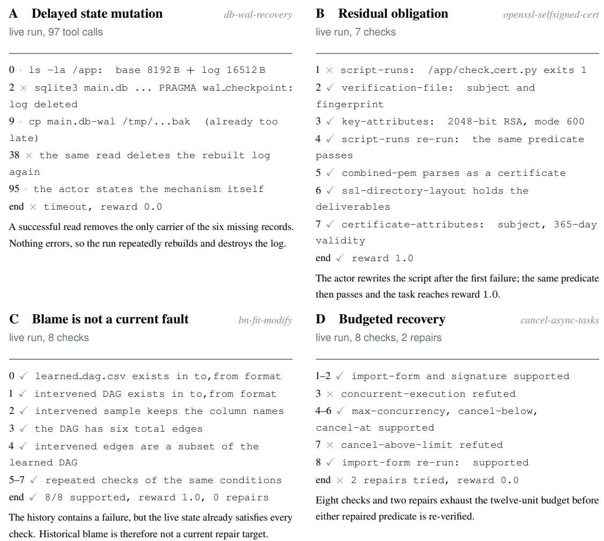  
Figure 1: Four long-horizon failure modes from retained Terminal-Bench trajectories. (A) A successful operation silently destroys state whose loss appears only later. (B) A failed predicate is subsequently repaired, leaving only its residual consequences relevant. (C) A historical failure remains in the trajectory although the current state is already healthy. (D) Checks and repairs share a finite budget, which can be exhausted before repair verification. Rows quote retained commands or registered checks; ✓ and × denote supported and refuted outcomes.

We also introduce LongH-Debug, which separates retrospective localization from executable recovery. Localization is evaluated under matched public inputs; recovery methods are compared under the same independently verified fault packet; and a final factorial crossing tests whether the localization and recovery components compose end to end. This separation avoids crediting a fixer for hidden re-diagnosis or penalizing it for an upstream localization error.

Contributions. First, we define a versioned residual task representation that distinguishes current unsupported requirements from historical events that no longer require intervention. Second, we connect this representation to a practical recovery controller that combines public-state outcome forecasting with runtime-checked bounded planning and replanning after real execution. Third, LongH-Debug provides matched localization, verified-fault recovery, and closed-loop evaluation protocols so that attribution quality and recovery quality can be measured separately before they are composed.

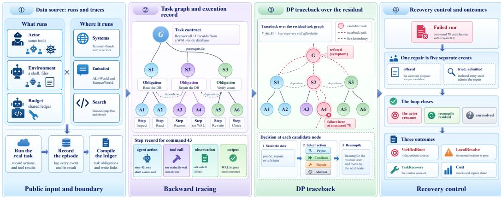  
Figure 2: Runtime path from public history to recovery. The task contract, public execution record, resource versions, and registered checks are compiled into a residual state. TRACE uses the resulting dependency-linked ledger to rank historical events relevant to unresolved requirements. FIX receives the live action slate and a bounded public-state forecast, while runtime code checks action identity, cost, reachability, and time before computing the depth-two decision. The selected action is then executed; its receipt updates resource versions and evidence, the residual state is recompiled, and planning repeats before the same actor continues. Hypothetical planning outcomes are kept separate from observed execution receipts throughout.

## 2 METHOD

Figure 2 summarizes the runtime path. The key design choice is to treat the execution history as evidence used to construct the current recovery state, rather than as the state itself.

## 2.1 VERSIONED RESIDUAL TASK STATE

The runtime maintains three linked views with different semantics. The task view contains public requirements, their prerequisite relationships, and required outputs. The execution ledger contains ordered actions, observations, resource interactions, and resource versions. The acceptance view contains task predicates together with the evidence and incidents that currently support or refute them. These references make a historical event relevant to a task requirement without treating a dependency or last-writer edge as causal proof (Weiser, 1981; Ferrante et al., 1987; Agrawal & Horgan, 1990).

Evidence is version-bound. When evidence is recorded for a proposition, the runtime stores the versions of the resources on which that evidence depends. If a later observation changes any of those resources, the evidence is marked stale; task revisions supported only by stale evidence are excluded when the live task view is rebuilt. We call a requirement a residual obligation when it is not currently supported, is blocked by an unresolved prerequisite, or has lost its support through such a version change.

The recovery state consists of these residual obligations, their current evidence, the historical events linked to them, and the legal action slate. We keep the remaining intervention budget separate from this state representation; a planner decision is made from the compiled state together with the remaining budget. This avoids counting budget both inside a state transition and again in the planning recursion.

## 2.2 TRACE: STRUCTURED HISTORY, EXPLICIT RANKING

TRACE first compiles the public execution into a residual ledger. Each event retains its identity and order and is annotated mechanically with its actor or tool summary, observed result, referenced resources, explicit write targets, and upstream writer links. The task contract and current residual obligations provide the context in which these event-level effects are interpreted.

The current ranking stage is explicit rather than implicit in the graph construction. An audited LLM call receives the public task specification, the observed failure, and the compiled residual ledger and returns the top historical event IDs, ranked from most to least likely to have created an unresolved task condition. The prompt asks the ranker to distinguish state-changing writers from later observations, tests, or reports of the failure, and to consider omitted or misordered actions when no explicit harmful write explains the outcome. The ledger therefore structures the evidence presented to the ranker; it does not deterministically declare the root cause.

TRACE writes its result to an immutablefault packet containing the ranked event hypotheses, their public evidence references, the residual obligations they may affect, and qualified checks that can test them. Verification remains separate from ranking: a high-ranked event is a localization hypothesis until an admissible check, replay, or intervention supports it.

## 2.3 FIX: BOUNDED PLANNING OVER THE LIVE ACTION SLATE

FIX does not operate over a fixed four-action alphabet. At each recovery boundary the runtime emits the actions that are actually legal for that state, with stable action identities, target bindings, and declared costs. Depending on the environment, the slate can include actor continuation, registered checks, task- or resource-targeted recovery requests, additional diagnosis or completion requests, and submission of the current state.

The current planner uses a separate no-tool LLM as aforecast model. It receives only public runtime state: the task graph, residual predicate states, registered checks, a bounded window of recent actor execution summaries, the live candidate catalogue, remaining time, and remaining intervention budget. For each root action it predicts bounded numeric outcomes; for checks these include masses for supported, refuted, and unknown together with estimates of what the same actor can accomplish after each verdict. It may additionally expand at most two reachable second-step actions. Terminal leaves carry a compact estimate of task success and the fraction of the residual problem expected to remain unblocked.

These forecasts are planning estimates, not calibrated probabilities. Runtime code validates their schema and numeric ranges, derives outcome semantics from the action type, rejects transitions that create time or budget, and compiles the accepted forecast into a depth-two decision tree. Standard dynamic programming then compares the expected downstream recovery of the affordable candidates. The model never outputs the selected action or a Bellman value directly; both are recomputed by the runtime from the admitted forecast. If the forecast is missing or fails an admission gate, the runtime falls back to actor continuation rather than inventing a transition.

The intervention budget is an abstract, frozen cost ledger rather than a token or dollar measure. In the evaluation contract, each declared TRACE, FIX-controller, or actor-continuation model call costs one unit; executable checks and repairs use the costs frozen in the environment’s qualification catalogue. Tokens, wall-clock time, and monetary cost are reported separately. This shared ledger makes “inspect more” and “preserve budget for repair” directly comparable.

## 2.4 EXECUTION, RECOMPILATION, AND HANDOFF

Planning ends when an action is selected; recovery evidence begins only after that action is executed. The execution receipt records the observed result and the resource versions at the resulting boundary. Any changed resource invalidates evidence bound to its previous version, incidents and predicate states are updated, and the residual task is recompiled before another decision is allowed.

A local intervention is not treated as task success. After its postcondition is checked, control returns to the same actor when continuation is legal; the benchmark’s final verifier scores the state produced by that continuation.

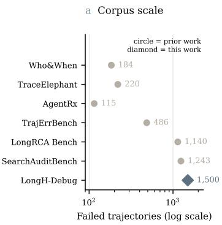

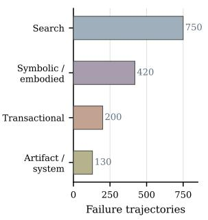

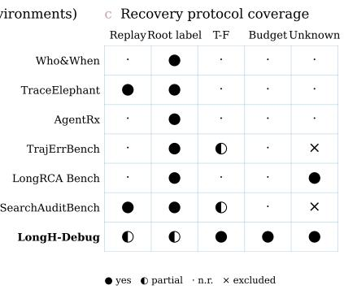  
Figure 3: LongH-Debug benchmark: scale, state diversity, and executable recovery coverage. (a) Published failure-trajectory counts for prior agent-debugging benchmarks, with the LongH-Debug row shown separately. (b) The planned 1,500-trajectory corpus allocates quotas across seven environments grouped into search/retrieval, symbolic/embodied, transactional/social, and persistent artifact/system state. (c) Protocol coverage distinguishes retrospective attribution from executable recovery. Filled circles denote explicitly supported capabilities, half-filled circles partial or alternative protocols, dots unreported capabilities, and crosses explicit exclusions. LongH-Debug’s replay and labels apply to its qualified subsets rather than to every trajectory in the planned corpus.

## 3 LONGH-DEBUG BENCHMARK

LongH-Debug is organized in two tiers so that corpus scale is not confused with recovery capability. Afailure record contains a public task specification, the actor-visible trajectory, and the public failure signal needed for localization. A recovery-qualified case additionally requires a reproducible failed entry state, the task/resource/version records needed to reconstruct residual obligations, a frozen catalogue of executable checks and repairs, a common cost ledger, and an independent final verifier. Only this qualified subset is used for experiments that execute recovery actions.

Source environments. The corpus draws natural failures from seven environments with different state mechanisms. Terminal-Bench (Merrill et al., 2026) supplies persistent filesystem and artifact state; $\tau ^ { 2 } .$ -bench (Yao et al., 2024) supplies transactional state across tool-mediated conversations; ALFWorld (Shridhar et al., 2021), ScienceWorld (Wang et al., 2022), and TextWorld (Cotˆ e et al. ´ , 2019) supply symbolic embodied state; and BrowseComp-Plus (Chen et al., 2025b) and xbench (Chen et al., 2025a) supply long search trajectories. We preserve each environment’s native task semantics rather than converting them into a shared synthetic state space.

We plan to collect 1,500 natural failure trajectories, with each environment quota bounded by the executions that the source environment can actually provide. The quotas are planned allocations, not counts of collected trajectories.

Long-horizon annotations. We do not use transcript length as the definition of a long-horizon failure. For localization cases with supported dependency annotations, we record two separate axes. Dependency depth $H _ { c }$ counts the supported dependency chain connecting a decisive historical event to the residual obligation it blocks. Feedback delay $H _ { f }$ counts the decisions between that event and the first public evidence that reveals its consequence. The localization population is stratified by these axes, allowing a long transcript with a local fault to be distinguished from a failure with genuinely distant dependencies or delayed evidence.

Evaluation populations and outcomes. LongH-Debug defines three matched populations. TRACE is evaluated on N = 200 task-disjoint natural failure records under identical public inputs. FIX is evaluated on N = 120 recovery-qualified cases where every fixer receives the same independently verified fault packet. The full TRACE×FIX crossing uses N = 60 qualified tasks restored from the same failed entry state and scored by the same official verifier.

The protocol records three different outcomes. VERIFIEDROOT asks whether an emitted historical hypothesis can be independently supported within the allowed verification budget.

Table 1: TRACE localization on N = 200 paired natural failures. Candidate recall asks whether the adjudicated event is present before ranking; VERIFIEDROOT@B requires an independent qualified check sequence within the verification budget. Token counts are total model input tokens over the paired population and relative cost is normalized to Generic one-shot.
<table><tr><td>Method</td><td>Hit@1</td><td>Hit@3</td><td>MRR</td><td>Cand. recall</td><td>VERIFIEDROOT@B</td><td>Tok. (M)</td><td>Rel. cost</td></tr><tr><td>Generic one-shot</td><td>42.0</td><td>74.5</td><td>.571</td><td>93.0</td><td>31.0</td><td>2.40</td><td>1.00</td></tr><tr><td>Dependency-only</td><td>24.0</td><td>46.0</td><td>.351</td><td>64.0</td><td>15.5</td><td>0.52</td><td>0.22</td></tr><tr><td>Who&amp;When (adapted)</td><td>8.0</td><td>12.0</td><td>.097</td><td>17.0</td><td>4.5</td><td>6.00</td><td>2.50</td></tr><tr><td>TraceElephant (adapted)</td><td>44.0</td><td>61.0</td><td>.508</td><td>71.0</td><td>33.0</td><td>12.20</td><td>5.08</td></tr><tr><td>Residual Context</td><td>43.0</td><td>74.5</td><td>.573</td><td>93.0</td><td>32.0</td><td>7.80</td><td>3.25</td></tr><tr><td>OUR TRACE</td><td>68.0</td><td>89.0</td><td>.782</td><td>97.0</td><td>60.5</td><td>3.10</td><td>1.29</td></tr></table>

Table 2: Recovery under matched verified-fault input $( N = 1 2 0 )$ . TASKRECOVERY is the benchmark-owned outcome after same-actor continuation; LOCALRESOLVE asks whether the targeted live incident is gone. Harmful counts unnecessary or state-damaging interventions. Cost/success is normalized to Same-Actor Continue.
<table><tr><td>Fixer</td><td>TASKRECOVERY</td><td>LOCALRESOLVE</td><td>Harmful</td><td>Cost/success</td></tr><tr><td>Same-Actor Continue</td><td>35.0</td><td>29.2</td><td>0.0</td><td>1.00</td></tr><tr><td>Fresh Fixer</td><td>42.5</td><td>40.8</td><td>5.8</td><td>0.92</td></tr><tr><td>Fixed-order sweep</td><td>47.5</td><td>50.0</td><td>4.2</td><td>0.86</td></tr><tr><td>Information gain</td><td>50.0</td><td>53.3</td><td>4.2</td><td>0.82</td></tr><tr><td>Information gain + repair reserve</td><td>61.7</td><td>66.7</td><td>3.3</td><td>0.69</td></tr><tr><td>Residual-Greedy</td><td>56.7</td><td>61.7</td><td>3.3</td><td>0.73</td></tr><tr><td>OUR FIX depth-2</td><td>67.5</td><td>73.3</td><td>2.5</td><td>0.61</td></tr></table>

LOCALRESOLVE asks whether the targeted current incident is gone after intervention and continuation. TASKRECOVERY is the final benchmark-owned task outcome. These quantities are intentionally not collapsed into one score: locating a historical cause, removing a current blocker, and finishing the original task are different events.

Historical annotations and root-verification evidence remain evaluator-side. For paired FIX comparisons, the admitted fault packet is frozen and shared unchanged across methods. All launched recovery attempts remain in the denominator, including budget exhaustion and unknown check outcomes.

## 4 EXPERIMENTS

We organize the evaluation around four questions. RQ1 asks whether TRACE localizes historical events that remain relevant to the current task, rather than merely retrieving a salient failure step. RQ2 gives every fixer the same independently verified fault packet and asks whether FIX converts identical fault information into better recovery. RQ3 crosses tracing and fixing components on the same failed entry states to test whether the two gains survive end to end. RQ4 isolates the state, planning, and recompilation mechanisms under matched information and action sets.

## 4.1 SETUP AND COMPARISON CONTRACT

The three primary populations are those defined in Section 3: N = 200 paired localization cases, N = 120 verified-fault recovery cases, and N = 60 closed-loop tasks. Within a comparison cell we freeze the public trajectory or failed entry state, actor identity, model configuration, legal tools, action catalogue, cost ledger, and final verifier.

For localization, Generic one-shot is a direct causal ranker over the public trajectory. Dependencyonly uses the structured dependency slice without the residual-causal ranking prompt. Residual Context gives a ranker the corresponding residual information as additional flat context. Who&When is run through its pinned upstream attribution code after projecting each public LongH event into one history entry with its public actor/component label and leaving the upstream ground-truth field empty. TraceElephant retains its upstream prompt, search, fallback, and parsing code, while canonical public events are reconstructed into the structured request/response fields expected by the released implementation; public evaluator failure is mapped into its test-status input and ground truth remains empty.

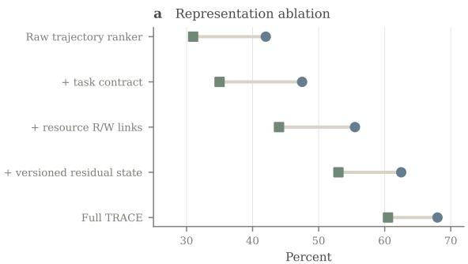

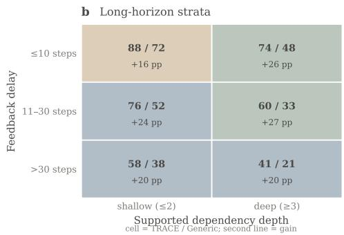  
Figure 4: Why TRACE should help. (a) Representation ablation. Only the endpoints, Raw trajectory ranker and Full TRACE, are measured (Table 1); the three intermediate rows are planned targets with no measured values yet. (b) TRACE/Generic Hit@1 by supported dependency depth and feedback delay. Each cell is a planned target with no measured value yet. Circles mark Hit@1 and squares mark VerifiedRoot@B.

For recovery, all FIX methods receive the same independently verified fault packet. We compare against Same-Actor Continue, a Fresh Fixer, a fixed-order check sweep, one-step residual-greedy con trol, and a strong information-gain policy with an explicit repair-budget reserve. The last comparator is important: controlled development experiments found that repair-budget reservation, not Bellman recursion alone, explained the observed gain over naive information gain. The formal comparison therefore does not use a deliberately budget-oblivious policy as the strongest baseline.

## 4.2 RQ1: DOES TRACE LOCALIZE THE HISTORICAL EVENT THAT STILL MATTERS?

Table 1 evaluates every tracer on identical public inputs. We report ranking quality, candidate coverage, executable verification, and inference cost together; a localization method that retrieves the correct event only through substantially more context should not be read as an unqualified improvement. The headline is not just a Hit@1 gain. TRACE is intended to preserve high candidate recall while converting that coverage into a substantially higher fraction of hypotheses that can be independently verified inside the same downstream budget. Figure 4 separates the representation contribution from the long-horizon difficulty axes.

Historical evidence informing this design. On six controlled hidden-root cases, dependency slicing recovered the root in all six top-three sets while the generic and Who&When-style controls recovered only one; on four retrospective natural development trajectories, dependency candidate construction recalled the verified root in all four and blind dependency ranking reached Hit@1 on three, whereas a blind full-trace ranker reached Hit@1 on none. These small development cells are not pooled with the N = 200 estimate.

## 4.3 RQ2: CAN FIX RECOVER BETTER FROM THE SAME FAULT INFORMATION?

Table 2 removes TRACE as a confound by supplying every method with the same independently verified fault packet, failed state, legal tools, and intervention budget. The strongest non-DP comparator is information gain with an explicit repair reserve, because controlled development showed that this policy can match dynamic planning when the main difficulty is simply preserving enough budget to finish the repair. Figure 5 plots recovery against cost, so a controller that succeeds only by spending more is not confused with one that reaches a better recovery–cost frontier.

Why these controls are necessary. In a 24-case executable controlled verification study, naive adaptive information gain resolved 8/24 cases at budget four, while information gain with repair reservation and dynamic TRACE-DP each resolved 16/24. That result says the controlled gain was explained by reserving completion budget and does not establish a unique Bellman-planning advantage. The natural matched-fault experiment above is therefore the test that can separate residualstate planning from this strong alternative.

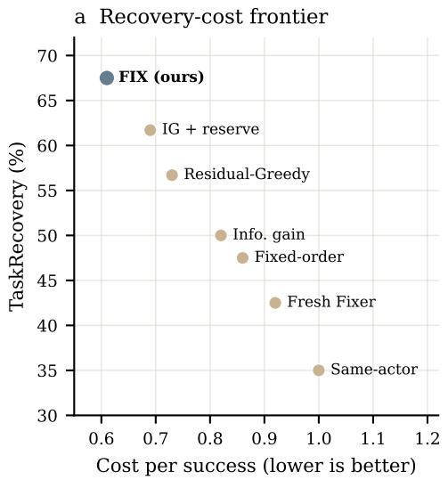

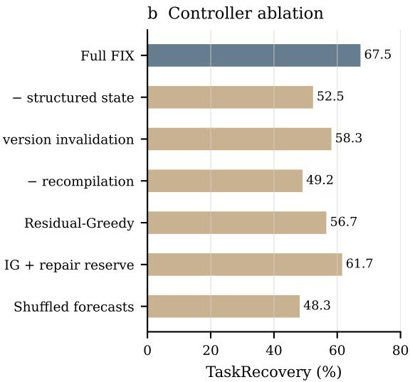

Figure 5: FIX recovery, cost, and mechanism. (a) Recovery–cost frontier for the methods in Table 2, plotting TASKRECOVERY against cost per success; lower cost is better. (b) Mechanism ablation under matched information and legal actions. The strongest planning control is information gain with a repair reserve, not a budget-oblivious strawman.  
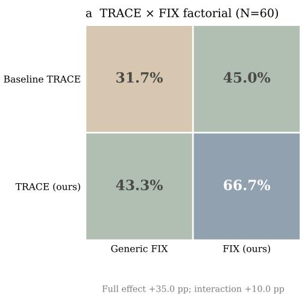

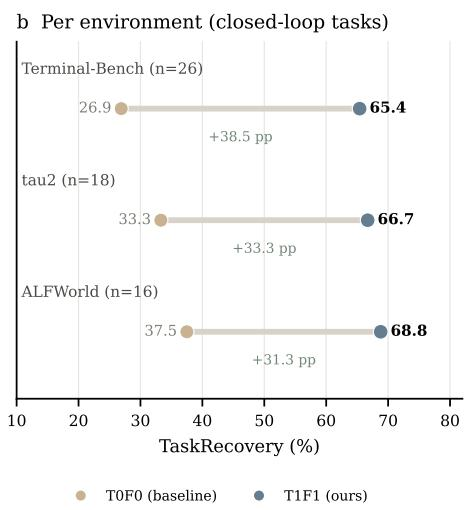  
Figure 6: From diagnosis to task recovery. (a) The $2 \times 2$ TRACE×FIX crossing reports benchmarkowned TASKRECOVERY. Replacing only TRACE or only FIX isolates each component; the diagonal gives the end-to-end system. (b) Per-environment TASKRECOVERY for $T _ { 0 } F _ { 0 }$ and $T _ { 1 } F _ { 1 }$ on the 60 closed-loop tasks, which span three environments (26, 18 and 16 tasks).

## 4.4 RQ3: DO TRACE AND FIX COMPOSE IN A REAL CLOSED LOOP?

Component improvements are insufficient if the TRACE packet does not survive into executable recovery. We therefore run all four combinations $T _ { 0 } F _ { 0 } , T _ { 0 } \bar { F _ { 1 } } , T _ { 1 } F _ { 0 } , T _ { 1 } F _ { 1 }$ from the same failed entry state with the same actor, legal tools, budget, stopping rule, and official verifier. The matrix is 31.7% $T _ { 0 } F _ { 0 } ,$ 45.0% for $T _ { 0 } F _ { 1 }$ , 43.3% for $T _ { 1 } F _ { 0 }$ , and 66.7% for $T _ { 1 } F _ { 1 }$ , corresponding to a +35.0 point full effect and $\mathbf { a } + 1 0 . 0$ point interaction. The environment split is important because a single aggregate can otherwise hide a recovery mechanism that works only for one kind of state.

Table 3: Controller ablations under matched verified-fault input. The information-gain+reserve row is also a strong alternative policy, not merely an ablation.
<table><tr><td>Controller</td><td>TASKRECOVERY</td><td>Harmful</td><td>Cost/succ.</td></tr><tr><td>Full FIX</td><td>67.5</td><td>2.5</td><td>0.61</td></tr><tr><td>No structured residual state</td><td>52.5</td><td>5.0</td><td>0.78</td></tr><tr><td>No version invalidation</td><td>58.3</td><td>5.8</td><td>0.74</td></tr><tr><td>No receipt-triggered recompilation</td><td>49.2</td><td>6.7</td><td>0.82</td></tr><tr><td>Residual-Greedy</td><td>56.7</td><td>3.3</td><td>0.73</td></tr><tr><td>Information gain + repair reserve</td><td>61.7</td><td>3.3</td><td>0.69</td></tr><tr><td>Shuffled outcome forecasts</td><td>48.3</td><td>5.8</td><td>0.85</td></tr></table>

## 4.5 RQ4: WHICH PARTS OF THE RECOVERY CONTROLLER MATTER?

The primary ablations preserve the actor, public information, legal action catalogue, base forecast source, and intervention budget. Each row removes one decision-relevant mechanism rather than replacing the method with an unrelated weak agent. Three additional diagnostics are required before a strong planning claim is made. First, we measure check-verdict calibration and actor-continuation calibration of the public-state forecast model on held-out executed transitions. Second, we compare the selected action against an oracle-outcome upper bound and report action-ranking regret rather than treating forecast probabilities as calibrated by construction.

Third, we report the fraction of decisions that enter an actionable check/repair path, the share of executed checks returning unknown, and the stage at which each failed recovery terminates. These diagnostics are motivated by retained runs in which one controller spent budget on three unknown checks while another issued 51 consecutive actor-continuation decisions without entering recovery.

Experience adaptation. The optional cross-case outcome adaptation is not part of the primary experiment chain. Historical guarded development removed negative transfer but produced no uplift over the non-memory policy. We therefore do not use this component to support the TRACE or FIX claims.

## 5 LIMITATIONS

TRACE–FIX has several boundaries. First, the residual state is an approximation: missing dependencies, unobserved side effects, or incorrect resource links can exclude relevant events; dependency links narrow hypotheses without establishing causality. Second, FIX relies on bounded lookahead with uncalibrated forecasts, where truncation and estimation errors can affect action selection. Third, recovery requires reproducible failed states, a frozen check-and-repair catalogue, and an independent verifier, so results may not transfer to open-world settings without replay or known repair actions. Finally, recovery value depends on the continuation actor and cost model; we claim neither optimal control nor unique causal identification.

## 6 CONCLUSION

Diagnosing and recovering from long-horizon agent failures requires decoupling root-cause localization, budgeted state repair, and end-to-end execution. We formalize this separation through TRACE-FIX: TRACE represents public history as an explicit residual ledger to prioritize unsatisfied task requirements, while FIX conducts bounded dynamic programming over verified public states and runtime execution receipts. Across matched benchmarks and factorial evaluations, structured residual tracking substantially improves root-cause localization, targeted planning enhances recovery yield under equivalent fault packets, and their closed-loop integration outperforms either component in isolation. By converting historical failure explanations into actionable residual obligations, TRACE-FIX provides a principled framework for reliable, budgeted recovery in persistent stateful environments.

## REFERENCES

Hiralal Agrawal and Joseph R. Horgan. Dynamic program slicing. In Proceedings of the ACM SIGPLAN 1990 Conference on Programming Language Design and Implementation (PLDI), pp. 246–256, 1990. doi: 10.1145/93542.93576.

Kaiyuan Chen, Yixin Ren, Yang Liu, Xiaobo Hu, Haotong Tian, Tianbao Xie, Fangfu Liu, Haoye Zhang, Hongzhang Liu, Yuan Gong, Chen Sun, Han Hou, Hui Yang, James Pan, Jianan Lou, Jiayi Mao, Jizheng Liu, Jinpeng Li, Kangyi Liu, Kenkun Liu, Rui Wang, Run Li, Tong Niu, Wenlong Zhang, Wenqi Yan, Xuanzheng Wang, Yuchen Zhang, Yi-Hsin Hung, Yuan Jiang, Zexuan Liu, Zihan Yin, Zijian Ma, and Zhiwen Mo. xbench: Tracking agents productivity scaling with profession-aligned real-world evaluations, 2025a. URL https://arxiv.org/abs/2506. 13651.

Mengzhuo Chen, Junjie Wang, Fangwen Mu, Yawen Wang, Zhe Liu, Huanxiang Feng, and Qing Wang. Seeing the whole elephant: A benchmark for failure attribution in llm-based multi-agent systems, 2026. URL https://arxiv.org/abs/2604.22708.

Zijian Chen, Xueguang Ma, Shengyao Zhuang, Ping Nie, Kai Zou, Andrew Liu, Joshua Green, Kshama Patel, Ruoxi Meng, Mingyi Su, Sahel Sharifymoghaddam, Yanxi Li, Haoran Hong, Xinyu Shi, Xuye Liu, Nandan Thakur, Crystina Zhang, Luyu Gao, Wenhu Chen, and Jimmy Lin. Browsecomp-plus: A more fair and transparent evaluation benchmark of deep-research agent, 2025b. URL https://arxiv.org/abs/2508.06600.

Marc-Alexandre Cotˆ e,´ Akos K´ ad´ ar, Xingdi Yuan, Ben Kybartas, Tavian Barnes, Emery Fine, James´ Moore, Ruo Yu Tao, Matthew Hausknecht, Layla El Asri, Mahmoud Adada, Wendy Tay, and Adam Trischler. Textworld: A learning environment for text-based games, 2019. URL https: //arxiv.org/abs/1806.11532.

Guanting Dong, Xiaoshuai Song, Yuyang Hu, Jiajie Jin, Chenghao Zhang, Yifei Chen, Xiaoxi Li, Huaying Yuan, Xinyu Yang, Tongyu Wen, Jiejun Tan, Hongjin Qian, Shijue Huang, Junting Lu, Zhenyu Li, Wanjun Zhong, Yutao Zhu, Tat-Seng Chua, Zhicheng Dou, and Ji-Rong Wen. Towards long-horizon agents: A survey. Preprints, 2026. doi: 10.20944/preprints202607.1328.v1.

Jeanne Ferrante, Karl J. Ottenstein, and Joe D. Warren. The program dependence graph and its use in optimization. ACM Transactions on Programming Languages and Systems, 9(3):319–349, 1987. doi: 10.1145/24039.24041.

Carlos E. Jimenez, John Yang, Alexander Wettig, Shunyu Yao, Kexin Pei, Ofir Press, and Karthik Narasimhan. Swe-bench: Can language models resolve real-world github issues? In International Conference on Learning Representations, 2024. URL https://arxiv.org/abs/2310. 06770.

Jiale Liu, Huajun Xi, Shaokun Zhang, Yifan Zeng, Tianwei Yue, Chi Wang, Jian Kang, Qingyun Wu, and Huazheng Wang. Who&when pro: Can llms really attribute failures in ai agents?, 2026. URL https://arxiv.org/abs/2607.09996.

Ming Ma, Jue Zhang, Fangkai Yang, Yu Kang, Qingwei Lin, Saravan Rajmohan, and Dongmei Zhang. Dover: Intervention-driven auto debugging for llm multi-agent systems, 2025. URL https://arxiv.org/abs/2512.06749.

Mike A. Merrill, Alexander G. Shaw, Nicholas Carlini, Boxuan Li, Harsh Raj, Ivan Bercovich, Lin Shi, Jeong Yeon Shin, Thomas Walshe, E. Kelly Buchanan, Junhong Shen, Guanghao Ye, Haowei Lin, Jason Poulos, Maoyu Wang, Marianna Nezhurina, Jenia Jitsev, Di Lu, Orfeas Menis Mastromichalakis, Zhiwei Xu, Zizhao Chen, Yue Liu, Robert Zhang, Leon Liangyu Chen, Anurag Kashyap, Jan-Lucas Uslu, Jeffrey Li, Jianbo Wu, Minghao Yan, Song Bian, Vedang Sharma, Ke Sun, Steven Dillmann, Akshay Anand, Andrew Lanpouthakoun, Bardia Koopah, Changran Hu, Etash Guha, Gabriel H. S. Dreiman, Jiacheng Zhu, Karl Krauth, Li Zhong, Niklas Muennighoff, Robert Amanfu, Shangyin Tan, Shreyas Pimpalgaonkar, Tushar Aggarwal, Xiangning Lin, Xin Lan, Xuandong Zhao, Yiqing Liang, Yuanli Wang, Zilong Wang, Changzhi Zhou, David Heineman, Hange Liu, Harsh Trivedi, John Yang, Junhong Lin, Manish Shetty, Michael Yang, Nabil Omi, Negin Raoof, Shanda Li, Terry Yue Zhuo, Wuwei Lin, Yiwei Dai, Yuxin Wang, Wenhao Chai,

Shang Zhou, Dariush Wahdany, Ziyu She, Jiaming Hu, Zhikang Dong, Yuxuan Zhu, Sasha Cui, Ahson Saiyed, Arinbjorn Kolbeinsson, Jesse Hu, Christopher Michael Rytting, Ryan Marten, Yixin¨ Wang, Alex Dimakis, Andy Konwinski, and Ludwig Schmidt. Terminal-bench: Benchmarking agents on hard, realistic tasks in command line interfaces, 2026. URL https://arxiv.org abs/2601.11868.

Hezhe Qiao, Hanghang Tong, Ee-Peng Lim, Bing Liu, and Guansong Pang. Verifymas: Hypothesis verification for failure attribution in llm multi-agent systems, 2026. URL https://arxiv. org/abs/2605.17467.

Mohit Shridhar, Xingdi Yuan, Marc-Alexandre Cote, Yonatan Bisk, Adam Trischler, and Matthew Hausknecht. Alfworld: Aligning text and embodied environments for interactive learning. In International Conference on Learning Representations, 2021. URL https://arxiv.org/ abs/2010.03768.

Ruoyao Wang, Peter Jansen, Marc-Alexandre Cote, and Prithviraj Ammanabrolu. Scienceworld: Is your agent smarter than a 5th grader? In Conference on Empirical Methods in Natural Language Processing, 2022. URL https://arxiv.org/abs/2203.07540.

Mark Weiser. Program slicing. In Proceedings of the 5th International Conference on Software Engineering, pp. 439–449. IEEE Press, 1981.

Tianbao Xie, Danyang Zhang, Jixuan Chen, Xiaochuan Li, Siheng Zhao, Ruisheng Cao, Toh Jing Hua, Zhoujun Cheng, Dongchan Shin, Fangyu Lei, Yitao Liu, Yiheng Xu, Shuyan Zhou, Silvio Savarese, Caiming Xiong, Victor Zhong, and Tao Yu. Osworld: Benchmarking multimodal agents for open-ended tasks in real computer environments, 2024. URL https://arxiv.org/abs/ 2404.07972.

Shunyu Yao, Noah Shinn, Pedram Razavi, and Karthik Narasimhan. τ-bench: A benchmark for tool-agent-user interaction in real-world domains, 2024. URL https://arxiv.org/abs/ 2406.12045.

Guibin Zhang, Junhao Wang, Junjie Chen, Wangchunshu Zhou, Kun Wang, and Shuicheng Yan. Agentracer: Who is inducing failure in the llm agentic systems?, 2025a. URL https://arxiv. org/abs/2509.03312.

Shaokun Zhang, Ming Yin, Jieyu Zhang, Jiale Liu, Zhiguang Han, Jingyang Zhang, Beibin Li, Chi Wang, Huazheng Wang, Yiran Chen, and Qingyun Wu. Which agent causes task failures and when? on automated failure attribution of llm multi-agent systems. In Proceedings ofthe 42nd International Conference on Machine Learning, 2025b. URL https://arxiv.org/abs/ 2505.00212.

Shuyan Zhou, Frank F. Xu, Hao Zhu, Xuhui Zhou, Robert Lo, Abishek Sridhar, Xianyi Cheng, Tianyue Ou, Yonatan Bisk, Daniel Fried, Uri Alon, and Graham Neubig. Webarena: A realistic web environment for building autonomous agents. In International Conference on Learning Representations, 2024. URL https://arxiv.org/abs/2307.13854.