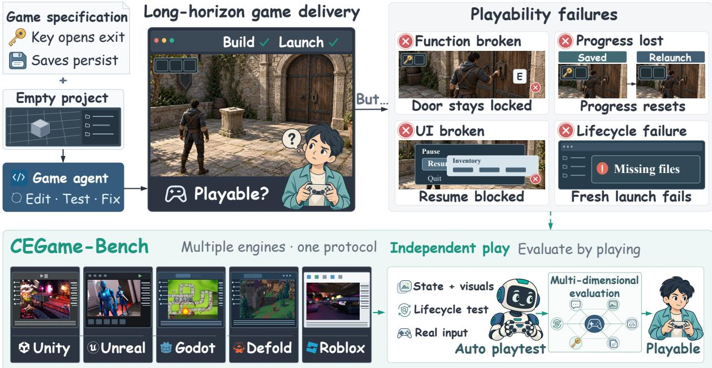
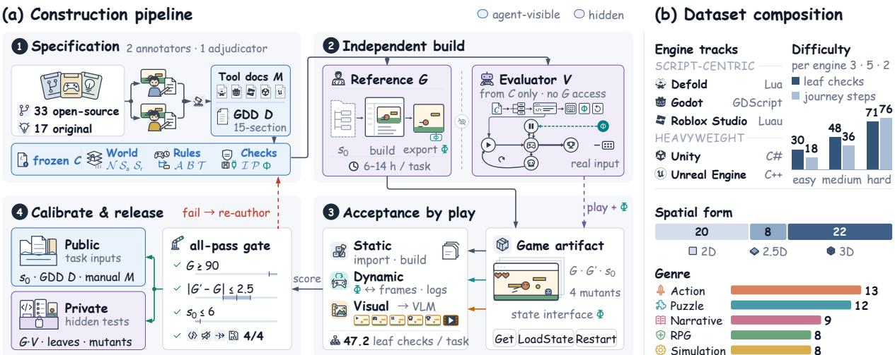
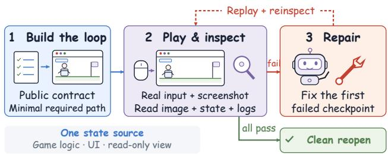
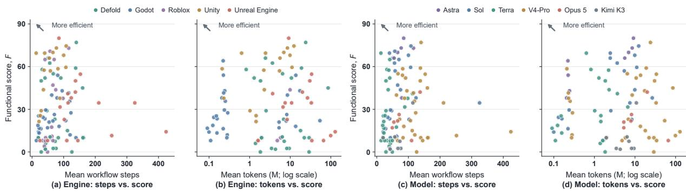
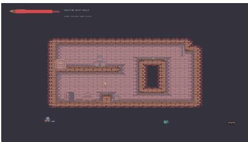
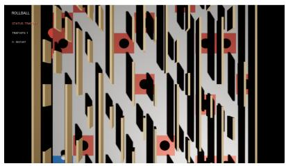
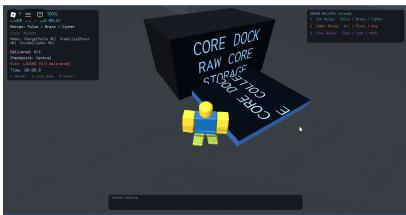

# From Code to Playable Systems: CEGame-Bench for Long-Horizon Game Creation Agents

Zixuan Dong1,∗ Yanghai Wang2,∗ Hanyan Bian2 Jiaxi Tao2 Junze Li2 Jiadong Wang3 Xinyu Che4 Lin Liu1 Baoyun Peng5 Xiaodong Wang1 Jiaheng Liu2

1 National University of Defense Technology 2 Nanjing University 3 The University of Tokyo

4 Xi’an Jiaotong University 5 Academy of Military Sciences

∗ Equal contribution.

A game ships when a player can launch it, finish it, and return to a saved world, none of which a successful build guarantees, yet game-creation agents are mostly tested on one engine or on one-prompt browser games. We present CEGame-Bench, the first long-horizon benchmark for complete-game creation across five production engines: Defold, Godot, Roblox Studio, Unity, and Unreal Engine. Agents build each game from an empty project and a design document in runs averaging up to 295 steps and 65M tokens; the document doubles as a contract, and a hidden evaluator accepts a game only by real-input play. Under four scafolds, agents earn most integration points but usually under half the gameplay points, and their games reach the ending in only 16% of runs, while references built by engineers with coding agents score near the maximum, which places this artifact-to-play gap in the agents. No two engines rank configurations alike (Kendall’s τ 0.14–0.62), and the same game usually scores higher on Unity and Unreal Engine, which check more before play. We release Game Completion Boost, an agent skill for requirement-driven playtesting and repair that raises the execution-based score of three models by 14.1–24.3 points.

Contact: dongzixuan18@nudt.edu.cn liujiaheng@nju.edu.cn

## 1 Introduction

In a game studio, a build ships only after QA plays it to the ending, quits, and finds the save intact. Coding agents are often shown on one-prompt browser games (Jiang et al., 2026b), which rarely test what makes a game complete: interdependent parts, where a combat fix must not break restart. We call the distance between a build and a playable game the artifact-to-play gap (Figure 1).

Beyond entertainment, Unity and Unreal Engine, the most demanding engines to drive, power industrial 3D applications (La et al., 2026) and embodied-AI simulators (Zhong et al., 2025) that coding agents have begun to build (Kang et al., 2026); making games on them is a step toward building such worlds from specifications. Because studios choose an engine per project, a benchmark must span engines to distinguish game-making skill from fluency in one toolchain.

Existing benchmarks each cover one slice: scoped edits to Godot and Unreal projects (Chi et al., 2026; La et al., 2026), browser games (Jiang et al., 2026b; Zhang et al., 2026a;b), Godot-to-Unity ports (Chen et al., 2026c), or whole games on a single engine (Luo et al., 2026; Yin et al., 2026). None asks an agent to turn an empty project into a complete game on several production engines, Unity and Unreal Engine included, or judges all engines by the same rules (Table 1).

  
Figure 1. The artifact-to-play gap. CEGame-Bench plays each delivered game through complete player journeys on five production engines.

We introduce Cross-Engine Game Bench (CEGame-Bench), which holds every engine to one executionbased standard. Its 50 tasks are studio handofs, ten on each of five production engines, from script-centric Defold, Godot, and Roblox Studio to heavyweight Unity and Unreal Engine. In each task, the agent builds a complete game from an empty project and a design document in a fully logged run. The document is a natural-language contract of checkable rules and a required state interface, so one hidden evaluator accepts any implementation on any engine only by playing it with real input.

The gap is large. Autonomous agents earn most integration points but usually under half the gameplay points, and their games reach the ending in only 16% of runs, while references built by engineers with coding agents score near the maximum. The engine is a first-class variable: no two engines rank configurations alike (Kendall’s τ 0.14–0.62), and the same game scores higher on the heavyweight engine in five of six engine pairs, by up to 21.5 points, in line with its stricter checks before play. Nor does efort close the gap: nine in ten runs deliver before the time limit, and neither steps nor tokens track the score. These failures motivate Game Completion Boost (GCB), a lightweight agent skill that maps requirements to player checkpoints, compares state with visible outcomes, and replays afected paths after repair. On high-dificulty games from each track, GCB raises the execution-based F of three models under Codex CLI by 14.1–24.3 points and their overall score by 14.7–25.8.

We contribute (i) CEGame-Bench, the first long-horizon benchmark for complete-game creation on five production engines, with controlled engine variation; (ii) a contract-driven evaluation that turns a naturallanguage design document into executable checks, accepts a game only by play, and logs its construction; and (iii) a cross-engine study of six frontier models under four scafolds, motivating reusable GCB.

## 2 Related Work

Long-horizon software and computer-use agents. Repository benchmarks cover issue resolution (Jimenez et al., 2024; Deng et al., 2026), feature evolution (Zhou et al., 2026; Le et al., 2025; Xu et al., 2026), and construction from specifications (Ding et al., 2026; Peng et al., 2026b; Wang et al., 2026); coding agents (Yang et al., 2024; Wang et al., 2024b; 2025) and computer-use benchmarks (Xie et al., 2024; Zhu et al., 2026; Ai et al., 2026) add tool use and long workflows. Most score only the final outcome, even though the scafold alone shifts accuracy and cost (Kapoor et al., 2026). Repository tasks, moreover, involve no engine serialization, player input, or runtime transitions; CEGame-Bench involves all three and logs every construction step alongside the score.

Table 1. Comparison with prior game-creation work. Replay: the evaluator plays the artifact with input; Hidden eval.: unseen checks decide the score; Reopen: persistence is checked in a fresh process; Engine swap: a task is re-run on another engine.
<table><tr><td>Benchmark</td><td>Artifact</td><td>Engine(s)</td><td>Horizon</td><td>Replay</td><td>Hidden eval.</td><td></td><td>Reopen Engine swap</td></tr><tr><td>GameGPT</td><td>generated game</td><td>one setting</td><td>partial</td><td>partial</td><td>X</td><td>X</td><td>X</td></tr><tr><td>GameXpert-Bench</td><td>game lifecycle</td><td>one setting</td><td>multi-turn</td><td>V</td><td>V</td><td>partial</td><td>X</td></tr><tr><td>GameDevBench GameCraft-Bench</td><td>Godot task</td><td>Godot</td><td>task-level</td><td>partial</td><td>partial</td><td>X</td><td>X</td></tr><tr><td></td><td>playable game</td><td>Godot</td><td>task-level</td><td>√</td><td>partial</td><td>X</td><td>X</td></tr><tr><td>SWE-Game GameEngineBench</td><td>game, port</td><td>Godot, Unity</td><td>task-level</td><td>√</td><td>V</td><td>X</td><td>code port</td></tr><tr><td>AutoUE</td><td>C++ runtime patch</td><td>Unreal</td><td>task-level</td><td>√</td><td>V</td><td>X</td><td>X</td></tr><tr><td></td><td>3D game</td><td>Unreal</td><td>task-level</td><td>partial</td><td>X</td><td>×</td><td>X</td></tr><tr><td>OpenGame</td><td>browser game</td><td>Web</td><td>task-level</td><td>browser</td><td>partial</td><td>X</td><td>X</td></tr><tr><td>WebGameBench</td><td>browser game</td><td>Web</td><td>task-level</td><td>browser</td><td>partial</td><td>X</td><td>X</td></tr><tr><td>GameASG-Bench</td><td>browser game</td><td>Web</td><td>task-level</td><td>browser</td><td>√</td><td>X</td><td>X</td></tr><tr><td>CEGAME-BENCH</td><td>whole game</td><td>5 engines</td><td>long-horizon</td><td>」</td><td>√</td><td>√</td><td>√</td></tr></table>

Game-development benchmarks. Game benchmarks each cover one engine, the browser, or part of a game: multi-agent development (Chen et al., 2023), scoped edits (Chi et al., 2026; La et al., 2026), Godot (Luo et al., 2026; Sun et al., 2026) or Unreal (Yin et al., 2026) projects, browser games (Jiang et al., 2026b; Zhang et al., 2026a;b), generation and repair (Chen et al., 2026b), and 3D or cinematic content (Yang et al., 2026; He et al., 2026). SWE-Game alone crosses engines, but its Unity port starts from existing Godot code (Chen et al., 2026c). On Godot, JAMER finds that code agents raise compilation rates without improving runtime behavior (Sun et al., 2026); CEGame-Bench has agents build complete games from empty projects on five engines, measures this gap through full player journeys, and re-issues contracts across engines without porting code.

Executable verification and playability. Prior work checks artifacts against executable specifications or hidden contracts (Jia et al., 2026; Lu et al., 2026), tests Unity scenes (Liu and Tatar, 2026), and studies GUI play and bug discovery (Peng et al., 2026a; Jiang et al., 2026a). GameASG-Bench declares an evaluation interface for real-input checks (Zhang et al., 2026b) and GameCraft-Bench verifies games by replayed gameplay (Luo et al., 2026), each on a single runtime, while others still grade play with a multimodal judge (Jiang et al., 2026b). CEGame-Bench carries a declared state interface across five runtimes, scores all but presentation by execution, and adds fresh-process reopening and mutant calibration.

## 3 Benchmark Design

CEGame-Bench turns the studio request ship this game into a long-horizon task anchored by one document: a game design document (GDD) written as a contract that specifies the game, requires it to expose its state, and yields the checks a hidden evaluator runs during play. One contract language and scorecard span five engines, so the engine is a controlled variable; every task is calibrated on a reference game and its broken variants, and every run is logged from first edit to delivery (Figure 2).

## 3.1 Engine Tracks

The benchmark includes ten tasks on each of five production engines, which difer in where a game lives (Appendix Table 5). On the script-centric Defold, Godot, and Roblox Studio, a game is mostly Lua, GDScript, or Luau code on a scene or instance tree. On the heavyweight Unity and Unreal Engine, much of it lives in imported assets and editor-serialized state behind an import and compile cycle that is slow but validates the game before it runs; Unreal Engine adds binary uasset files, C++ modules, and build targets. Everything else is fixed across tracks (Appendix B): the 3/5/2 mix of easy, medium, and hard tasks, the starter and GDD structure, an engine-neutral prompt, the scorecard, and the 3600 s budget. Each track ranks configurations on its own games, and a swap experiment isolates the engine by re-issuing a game’s frozen contract on an engine of the other group.

  
Figure 2. Construction and composition of CEGame-Bench. (a) Tasks are specified as contracts, built, evaluated independently, and calibrated by play. (b) Coverage: engines, dificulty tiers, spatial forms, and genres.

## 3.2 Task Formulation

A task comprises $\left( s _ { 0 } , D , M , G , V \right)$ . The agent receives a starter project s0, the GDD D, and a tool manual M; the reference implementation G and evaluator V stay hidden. s0 is an engine-native project that builds, runs, and bundles licensed assets but implements none of the game, M documents the engine’s build, editor-automation, and capture tools, and D is a fifteen-section GDD from pitch and controls to persistence and acceptance. From these alone, the agent works as a studio engineer would: reading documentation, authoring assets and scripts, compiling, playing, and repairing.

The GDD is a contract. The normative core of D is an implementation-independent contract

$$
C = ( \underbrace { \mathcal { N } , S _ { a } , S _ { r } } _ { \mathrm { w o r l d } } , \underbrace { A , \mathcal { B } , \mathcal { T } } _ { \mathrm { r u l e s } } , \underbrace { \mathcal { I } , \mathcal { P } , \Phi } _ { \mathrm { g u a r a n t e e s } } ) ,
$$

whose symbols denote entities, authored and runtime state, player actions, branches, temporal rules, invariants, persistence requirements, and the state interface. D fixes what the player experiences (levels, rules, and constants) and the interface through which the game is observed, and leaves class hierarchy, scene organization, and asset layout free. Every requirement in D becomes one or more leaf checks of V, so the document that specifies the game also defines its rubric. In Driftfolk Chronicle, for example, “a dash spends one charge” becomes a check on player.charges.

Observability is part of the task. Just as a QA build exposes its state to testers, every game must expose a small state interface Φ: a read accessor OmniState.Get(key) over task-specific keys and two lifecycle commands, OmniFlow.LoadState(id) and OmniFlow.Restart(), built on the game’s own loading path. Φ lets the evaluator observe a game without taking its word: it reads and enters declared states but never acts for the player, every action arrives as real input, and every reading is cross-checked against a frame, a log line, or a second key it constrains. Because hidden probes vary inputs, timing, and rejected actions, a reading stays correct only if the game computes it from play, so an interface that reports constants or scripted values fails its own checks (Appendix C). With Φ, one evaluator tests any implementation on all five engines without reading its code.

## 3.3 Evaluation and Scoring

V accepts a game the way QA does, by playing it. Static probes check import, compilation, the entry scene, serialized references, and the asset manifest. Dynamic probes start from a real entry point or a state entered through Φ, send real input through the engine’s input layer, and assert on Φ snapshots, logs, and frames after each action, including rejected actions, restart, and fresh-process reopening. Entering later states directly keeps failures local: a level that never loads costs only its own leaves. A player journey then plays the whole game with public controls alone, executing each contract-level step as a closed-loop policy steered by Φ readings, so diferently built games complete the same path. Visual probes score captures at reference states with a vision–language model that agrees with human raters at Spearman $\rho = 0 . 8 1$

A task decomposes into 47.2 atomic leafchecks on average, in six dimensions (Appendix E): integration (D1), completeness (D2), mechanics (D3), lifecycle (D4), feedback (D5), and presentation (D6). D1–D5 are scored by execution alone and only D6 by model judgment (Appendix D). Each leaf ℓ has a weight $w _ { \ell } \in \{ 1 , 2 , 3 \}$ (minor, major, critical) and belongs to afamily f of leaves expressing the same obligation. With $\mathcal { L } _ { f }$ the judged leaves of $f$ and $y _ { \ell }$ the credit of ℓ, 1 for a pass and 0 for a failure (a D6 leaf takes the judge’s normalized rating),

$$
\pi _ { f } = \frac { \sum _ { \ell \in \mathcal { L } _ { f } } w _ { \ell } y _ { \ell } } { \sum _ { \ell \in \mathcal { L } _ { f } } w _ { \ell } } , \qquad S _ { d } = W _ { d } \sum _ { f \in \mathcal { F } _ { d } } \beta _ { d , f } \pi _ { f } ,
$$

where $( W _ { 1 } , \dots , W _ { 6 } ) = ( 1 0 , 3 0 , 2 0 , 2 0 , 1 0 , 1 0 )$ . Family budgets $\beta _ { d , f }$ sum to one per dimension and stay fixed when a task moves between engines, so an obligation weighs the same however many leaves it takes on a track. The functional score $\textstyle F = \sum _ { d = 1 } ^ { 5 } S _ { d }$ (out of 90) is determined entirely by execution, and its D2–D5 part (out of 80) gives the gameplay points, earned only by a game that works under play. The overall score $O = F + \tilde { S } _ { 6 }$ (out of 100) takes ${ \tilde { S } } _ { 6 } = S _ { 6 }$ when the player journey succeeds and min $\left( S _ { 6 } , W _ { 6 } / 2 \right)$ otherwise, so presentation never outweighs play.

A leaf fails only on evidence: the evaluator observes the violation, or the submission itself blocks a required state, as a missing Φ blocks every leaf that reads it. Evaluator faults are retried through an alternate route and, if unresolved, leave the denominator; these exclusions remove at most 2.9% of leaf weight on any engine. Beyond the scorecard, each run yields three binary flags: a completed journey (J), state that survives restart and reopening (Λ), and a fully solved game, in which both hold and every critical leaf passes. Each run also keeps a full trace of every tool call, build, and play session with its tokens and time, so the benchmark reports what each game cost to build alongside its score.

## 3.4 Dataset Construction and Statistics

Of the 50 tasks, 33 are adapted from permissively licensed open-source games and 17 are original designs. Each passes four stages (Appendix F). (i) Specification: two annotators draft and cross-check the GDD in player-visible terms, and a third adjudicates and freezes C. (ii) Independent build: engineers working with coding agents build G from the frozen starter in 6–14 engineer-hours, while V is written from C alone, without access to G. (iii) Acceptance by play: V plays $G ,$ an equivalent implementation $G ^ { \prime }$ with a deliberately diferent structure, the untouched starter $s _ { 0 } ,$ and four mutants that break compilation, feedback, a transition, or persistence, exactly as it later plays submissions. (iv) Calibration gate: the task is frozen and released only ${ \mathrm { i f } } ,$ on O, G scores at least 90, G′ lands within 2.5 points of $G ,$ s scores at most $^ { 6 , }$ and every mutant is detected while moving the score by at most 2.0 points outside its dependency subgraph, so a fault may block what depends on it but nothing else; otherwise it is re-authored.

The released references anchor the scale. They average 96.4 on O (minimum 92.5), the equivalence gap averages 2.0, starters score 4.1, all 200 mutants are caught, and repeated evaluations of one artifact difer by at most 1.8 points. Since engineers built each reference with coding agents, these scores mark what agents reach under human direction, the bar for autonomous agents.

Every document is newly written, and adapted games are renamed and re-parameterized (Appendix F). Upon publication we release the starters, design documents, tool manuals, the evaluator and its adapters, leaf schemas, and run traces, all carrying a canary string; references, equivalent implementations, and mutants stay private.

The tasks span 2D, 2.5D, and 3D puzzle, action, RPG, simulation, and narrative games, with dificulty tiers annotated on four axes (Appendix G). A task averages 2.6 scenes, 14.4 entities, and a 38.6-step player journey; hard tasks average 71 leaf checks and a 76-step journey.

## 4 Game Completion Boost

Section 5.2 locates failures in completeness, mechanics, and lifecycle, and Appendix L shows unreachable goals, rules that contradict the scene, and cropped or crowded views. Game Completion Boost (GCB) targets these failures by organizing the agent’s playtesting and repair (Figure 3), combining specificationderived checks (Jia et al., 2026), file-bound verification records, and reflective repair (Shinn et al., 2023).

## (1) Requirement-directed checkpoints. The

agent maps public requirements, branches, and lifecycle events to checkpoints with prerequisites, relevant files, and required evidence, and checks with public controls that required states are reachable. A helper schedules checkpoints whose prerequisites pass and recommends repairing failures, gathering missing observations, or replaying stale records.

  
Figure 3. GCB workflow: build the player path, play and inspect, then repair, replay, and restore if needed.

## (2) Action-linked state–view evidence. For visible transitions, the agent compares be-

fore/after images with available state or logs from the same input and session, checking for disagreements such as a trap firing on visibly safe floor. Static image checks cover camera framing and UI overlap. Behavior and its visible presentation both drive repair.

(3) Replay and guarded repair. After an edit, GCB invalidates checks tied to changed files and their dependents; shared or unmapped changes invalidate all checks, following regression test selection (Gligoric et al., 2015). Before repair, GCB saves the project and protects the passed checkpoints. It retains a candidate only after the target and all protected checks pass again; an observed regression triggers rollback. The agent records a diagnosis to guide its next attempt. Every edit clears final acceptance, requiring a complete journey and any specified fresh-process reopen.

The released GCB consists of fixed, task-agnostic instructions and Python helpers. The agent performs and interprets every check from public inputs within the task budget, and the hidden evaluator alone scores the submitted game (Appendix H).

## 5 Experiments

Evaluations of game creation commonly take two shortcuts: they treat a project that builds as a working game, and they measure one engine as if it stood for all. We test both, measure what each game costs to build, and evaluate GCB across engine tracks.

## 5.1 Setup

We evaluate seven configurations pairing six frontier models from four providers with four scafolds. Codex CLI runs GPT-6 Astra, GPT-5.6 Sol, GPT-5.6 Terra, and DeepSeek-V4-Pro, so contrasts within it isolate the model; DeepSeek-V4-Pro also runs under DeepSeek Harness, isolating the scafold; and Claude Opus 5 and Kimi K3 run in their providers’ Claude Code and Kimi Code.

In the main study, each game–configuration pair is run three times from the frozen starter of its task, with the GDD, tool manual, 3600 s budget, engine version, tool catalog, model, and reasoning setting fixed (Appendix I); the native study comprises 1,050 runs. We report D1–D6, F, and O averaged over the three runs, weighting the games of a track equally, and compare configurations on F, which execution alone determines. The standard deviation of F across the three runs of a pair averages 8.4 points, so run-to-run noise moves an engine cell by about 1.5 points.

Table 2. Scores of seven scafold–model configurations on each engine track and across all five engines. D1–D6 are integration, completeness, mechanics, lifecycle, feedback, and presentation, with D6 capped when the player journey fails; F sums D1–D5 (out of 90) and O adds D6 (out of 100). Bold marks the best F and O per panel; entries are rounded independently and may difer from their sums by 0.1.
<table><tr><td colspan="2">Configuration</td><td colspan="8">Defold</td><td colspan="8">Godot</td></tr><tr><td>Scaffold</td><td>Model</td><td>D1</td><td>D2</td><td>D3</td><td>D4</td><td></td><td>D5 D6</td><td>F</td><td>0</td><td>D1</td><td>D2</td><td>D3</td><td>D4</td><td>D5</td><td>D6</td><td>F</td><td>0</td></tr><tr><td rowspan="4">Codex CLI</td><td>GPT-6 Astra</td><td>10.0</td><td>20.3</td><td>11.3</td><td>14.8</td><td></td><td>6.2 9.5</td><td>62.7</td><td>72.2</td><td>9.4</td><td>15.8</td><td>8.2</td><td>12.1</td><td>4.4 5.1</td><td></td><td>49.8</td><td>54.8</td></tr><tr><td>GPT-5.6 Sol</td><td>10.0</td><td>19.0</td><td>9.8</td><td>8.7</td><td>5.0</td><td>5.8</td><td>52.5</td><td>58.3</td><td>9.6</td><td>3.8</td><td>1.9</td><td>4.9</td><td>1.3</td><td>3.1</td><td>21.5</td><td>24.6</td></tr><tr><td>GPT-5.6 Terra</td><td>7.2</td><td>7.4</td><td>8.0</td><td>8.0</td><td>2.6</td><td>2.7</td><td>33.2</td><td>35.9</td><td>9.2</td><td>1.6</td><td>1.5</td><td>3.1</td><td>1.1</td><td>3.4</td><td>16.4</td><td>19.8</td></tr><tr><td>DeepSeek-V4-Pro</td><td>9.5</td><td>7.2</td><td>3.7</td><td>3.7</td><td>1.8</td><td>1.8</td><td>25.8</td><td>27.6</td><td>8.1</td><td>10.2</td><td>5.4</td><td>7.2</td><td>3.3</td><td>2.7</td><td>34.2</td><td>36.9</td></tr><tr><td>DeepSeek Harness</td><td>DeepSeek-V4-Pro</td><td>10.0</td><td>13.2</td><td>8.0</td><td>7.8</td><td>2.6</td><td>3.7</td><td>41.6</td><td>45.3</td><td>9.8</td><td>9.6</td><td>4.6</td><td>8.1</td><td>3.3</td><td>3.6</td><td>35.4</td><td>39.0</td></tr><tr><td>Claude Code</td><td>Claude Opus 5</td><td>9.5</td><td>15.7</td><td>8.6</td><td>8.3</td><td>6.7</td><td>5.9</td><td>48.8</td><td>54.7</td><td>8.0</td><td>1.5</td><td>2.0</td><td>7.0</td><td>2.9</td><td>0.5</td><td>21.4</td><td>21.9</td></tr><tr><td>Kimi Code</td><td>Kimi K3</td><td>5.8</td><td>0.0</td><td>0.0</td><td>0.0</td><td>0.00.0</td><td></td><td>5.8</td><td>5.8</td><td>8.0</td><td>1.5</td><td>2.0</td><td>2.0</td><td>1.0</td><td>0.0</td><td>14.5</td><td>14.5</td></tr><tr><td colspan="2">Configuration</td><td colspan="8">Unity</td><td colspan="5">Roblox Studio</td><td></td><td></td></tr><tr><td>Scaffold</td><td>Model</td><td>D1 D2</td><td></td><td>D3</td><td>D4</td><td></td><td>D5 D6</td><td>F</td><td>0</td><td>D1</td><td>D2</td><td>D3</td><td>D4</td><td>D5 D6</td><td></td><td>F</td><td>0</td></tr><tr><td rowspan="4">Codex CLI</td><td>GPT-6 Astra</td><td>10.0</td><td>24.8</td><td>15.0</td><td>13.0</td><td></td><td>7.4 7.5</td><td>70.1</td><td>77.6</td><td>10.0</td><td>25.5</td><td>18.0</td><td>12.5</td><td>6.0</td><td>2.5</td><td>72.0</td><td>74.5</td></tr><tr><td>GPT-5.6 Sol</td><td>9.2</td><td>23.4</td><td>13.2</td><td>11.8</td><td>6.0</td><td>5.4</td><td>63.6</td><td>69.0</td><td>9.4</td><td>11.1</td><td>6.1</td><td>7.6</td><td>4.3</td><td>4.3</td><td>38.6</td><td>42.9</td></tr><tr><td>GPT-5.6 Terra</td><td>9.3</td><td>13.6</td><td>8.3</td><td>5.7</td><td>4.2</td><td>2.6</td><td>41.1</td><td>43.7</td><td>6.5</td><td>4.4</td><td>2.1</td><td>3.2</td><td>2.2</td><td>1.3</td><td>18.4</td><td>19.7</td></tr><tr><td>DeepSeek-V4-Pro</td><td>9.8</td><td>16.6</td><td>9.2</td><td>8.3</td><td>3.6</td><td>4.8</td><td>47.5</td><td>52.3</td><td>10.0</td><td>15.5</td><td>8.4</td><td>8.6</td><td>6.5</td><td>4.3</td><td>48.9</td><td>53.2</td></tr><tr><td>DeepSeek Harness</td><td>DeepSeek-V4-Pro</td><td>10.0</td><td>14.6</td><td>11.6</td><td>8.8</td><td>3.1</td><td>5.3</td><td>48.1</td><td>53.4</td><td>9.5</td><td>7.5</td><td>5.0</td><td>2.5</td><td>2.5</td><td>0.8</td><td>27.0</td><td>27.8</td></tr><tr><td>Claude Code</td><td>Claude Opus 5</td><td>9.6</td><td>22.1</td><td>12.7</td><td>11.3</td><td>4.8</td><td>5.2</td><td>60.5</td><td>65.7</td><td>9.0</td><td>9.0</td><td>3.0</td><td>10.0</td><td>4.5</td><td>3.8</td><td>35.5</td><td>39.3</td></tr><tr><td>Kimi Code</td><td>Kimi K3</td><td>10.0</td><td>21.0</td><td>13.0</td><td>8.0</td><td>3.7</td><td>3.5</td><td>55.7</td><td>59.2</td><td>9.5</td><td>5.3</td><td>2.5</td><td>3.3</td><td>3.0</td><td>1.3</td><td>23.6</td><td>24.8</td></tr><tr><td colspan="2">Configuration</td><td colspan="6">Unreal Engine</td><td colspan="8">All engines</td></tr><tr><td>Scaffold</td><td>Model</td><td>D1</td><td>D2</td><td>D3</td><td>D4</td><td>D5 D6</td><td></td><td>F</td><td>0</td><td>D1</td><td>D2</td><td>D3</td><td>D4</td><td>D5</td><td>D6</td><td>F</td><td>0</td></tr><tr><td rowspan="4">Codex CLI</td><td>GPT-6 Astra</td><td>10.0</td><td>20.0</td><td>16.9</td><td>13.3</td><td>10.0</td><td>7.9</td><td>70.2</td><td>78.1</td><td>9.9</td><td>21.3</td><td>13.9</td><td>13.1</td><td>6.8</td><td>6.5</td><td>65.0</td><td>71.4</td></tr><tr><td>GPT-5.6 Sol</td><td>9.4</td><td>5.6</td><td>3.7</td><td>6.8</td><td>3.4</td><td>2.7</td><td>28.8</td><td>31.5</td><td>9.5</td><td>12.6</td><td>6.9</td><td>8.0</td><td>4.0</td><td>4.3</td><td>41.0</td><td>45.3</td></tr><tr><td>GPT-5.6 Terra</td><td>8.5</td><td>2.1</td><td>3.5</td><td>4.6</td><td>1.4</td><td>1.4</td><td>20.0</td><td>21.4</td><td>8.1</td><td>5.8</td><td>4.7</td><td>4.9</td><td>2.3</td><td>2.3</td><td>25.8</td><td>28.1</td></tr><tr><td>DeepSeek-V4-Pro</td><td>9.3</td><td>3.4</td><td>1.8</td><td>2.7</td><td>1.7</td><td>3.5</td><td>18.9</td><td>22.4</td><td>9.3</td><td>10.6</td><td>5.7</td><td>6.1</td><td>3.4</td><td>3.4</td><td>35.1</td><td>38.5</td></tr><tr><td>DeepSeek Harness</td><td>DeepSeek-V4-Pro</td><td>10.0</td><td>9.0</td><td>7.2</td><td>10.0</td><td>2.6</td><td>4.0</td><td>38.7</td><td>42.7</td><td>9.9</td><td>10.8</td><td>7.3</td><td>7.4 8.5</td><td>2.8 4.1</td><td>3.5 3.3</td><td>38.2 38.3</td><td>41.6 41.5</td></tr><tr><td>Claude Code Kimi Code</td><td>Claude Opus 5</td><td>9.0</td><td>3.8 7.5</td><td>4.7</td><td>6.0 8.0</td><td>1.7</td><td>0.9 5.00.8</td><td>25.1</td><td>25.9</td><td>9.0 8.7</td><td>10.4 7.1</td><td>6.2 4.3</td></table>

## 5.2 Buildable Is Not Playable

Configurations reliably deliver projects that import, compile, and load their entry scene: integration (D1) averages 8.9 to 9.7 of 10 points on every engine (Table 2). Whether the game then works is another matter: three in four cells earn under half of the 80 gameplay points (D2–D5), and only GPT-6 Astra clears that bar on every engine. The evaluator’s player journey reaches the ending in only 16% of runs, with 4% fully solved. Claude Code on Roblox Studio, the median cell in gameplay, earns 9.0 of 10 integration points but only a third of the gameplay points. Because integration barely varies, the spread of F is almost entirely a spread in gameplay; a build check would rank most configurations as near-equals, whereas play separates them by tens of points. Nor is the state interface the obstacle: Φ answers the handshake in 94% of delivered projects. Yet these contracts are within reach of the same technology under human direction: the references that engineers built with coding agents are all solved and average 87.3 of 90 on F (96.4 of 100 on O), against 65.0 for the best autonomous configuration and at most 41.0 for the other six. The gap also varies by track: the share of gameplay points runs from 23% on Godot to 57% on Unity, so the same build success stands for very diferent amounts of playable game.

The scorecard also shows where games fail, and the answer shifts with capability (Appendix Table 17). We split the cells into thirds by F and find, in each, the gameplay dimension that is weakest relative to its weight. In the lowest third it is most often completeness (D2): much of the game is never built. In the middle third it is mechanics (D3): the game exists, but its rules break under play. In the top third it is lifecycle (D4), ahead of feedback (D5) and mechanics: the game plays, but breaks across transitions, restarts, or reopening, or fails to show the player what happened. Stronger agents thus fail at later stages, a progression that a single pass/fail outcome hides and that motivates replaying complete journeys and checking visible responses during play.

## 5.3 The Engine Is a First-Class Variable

Every engine separates configurations widely, but not equally and not in the same order. The spread of F across configurations ranges from 29.0 points on Unity to 56.9 on Defold, and no two engines rank the configurations alike: Kendall’s τ between engines ranges from 0.14 to 0.62 (Appendix Table 16). Codex CLI with DeepSeek-V4-Pro, for instance, ranks second of seven on Roblox Studio and last on Unreal Engine. GPT-6 Astra, the strongest configuration, leads by 31.5 points on Unreal Engine and 23.1 on Roblox Studio but by only 6.5 on Unity. An engine track can thus amplify a capability diference that another hides, and a leaderboard built on one engine inherits its bias.

Changing one factor at a time shows what transfers (Appendix Table 18). Within the GPT family the order holds on every engine: GPT-6 Astra leads GPT-5.6 Sol by 6.5 to 41.4 points, and Sol leads GPT-5.6 Terra by 5.1 to 22.5. Across families it does not: under Codex CLI, DeepSeek-V4-Pro trails Sol by 26.7 points on Defold yet leads it by 12.7 on Godot. The scafold can matter as much as the model: with DeepSeek-V4-Pro fixed, moving from Codex CLI to DeepSeek Harness gains 19.8 points on Unreal Engine but loses 21.9 on Roblox Studio. A single-engine leaderboard therefore ranks configurations for that engine alone.

Same game, diferent engine. The swap experiment holds the game fixed and changes only the engine: for each of the six heavyweight–scriptcentric pairs, the five hardest games of each engine are rebuilt on the other engine, which limits ceiling efects on the heavyweight engines (Appendix K). The heavyweight engine wins five of the six pairs (Table 3): Unity leads Defold and Godot by 11.6 and 10.4 points, Unreal Engine leads Defold, Godot, and Roblox Studio by 21.2, 21.5, and 8.5, and only Unity against Roblox Studio reverses, by 4.3. Pooling both swap directions ofsets any advantage a game draws from its native engine, and with ten

Table 3. The same games on two engines: mean F on the heavyweight (F¯H, rows) and script-centric $( { \bar { F } } _ { S } ,$ columns) engine and $\Delta F = \bar { F } _ { H } - \bar { F } _ { S }$ , with standard deviations over games as subscripts. Each pair pools its ten swapped games, five native to each engine.
<table><tr><td colspan="2"></td><td colspan="3">Script-centric engine (S)</td></tr><tr><td></td><td>Engine Metric</td><td></td><td>Defold</td><td>Godot Roblox</td></tr><tr><td rowspan="5">Heea(H) Unity</td><td> $\bar { F } _ { H }$ </td><td> $4 0 . 6 _ { \pm 8 . 5 }$ </td><td> $3 8 . 0 _ { \pm 8 . 9 }$ </td><td> $3 5 . 0 _ { \pm 1 2 . 0 }$ </td></tr><tr><td> $\bar { F } _ { S }$ </td><td> $2 9 . 0 _ { \pm 1 1 . 1 }$ </td><td> $2 7 . 6 _ { \pm 6 . 4 }$ </td><td> $3 9 . 3 _ { \pm 9 . 7 }$ </td></tr><tr><td> $\Delta F$ </td><td> $\mathbf { + 1 1 . 6 _ { \pm 4 . 3 } }$ </td><td> $+ { \bf 1 0 . 4 } _ { \pm 3 . 1 }$ </td><td> $- 4 . 3 _ { \pm 5 . 4 }$ </td></tr><tr><td> $\bar { F } _ { H }$ </td><td> $4 9 . 0 _ { \pm 1 0 . 6 }$ </td><td> $4 5 . 0 _ { \pm 1 2 . 1 }$ </td><td> $3 4 . 0 _ { \pm 1 0 . 4 }$ </td></tr><tr><td>Unreal  $\bar { F } _ { S }$ </td><td> $2 7 . 8 _ { \pm 1 4 . 3 }$ </td><td> $2 3 . 5 _ { \pm 1 3 . 2 }$ </td><td> $2 5 . 5 _ { \pm 1 6 . 2 }$ </td></tr><tr><td rowspan="2">Engine</td><td> $\Delta F$ </td><td> $+ 2 1 . 2 _ { \pm 1 1 . 5 }$ </td><td> $+ 2 1 . 5 _ { \pm 1 5 . 8 }$ </td><td></td></tr><tr><td></td><td></td><td></td><td> $+ 8 . 5 _ { \pm 7 . 6 }$ </td></tr></table>

games per pair, each of the five leads exceeds its standard deviation over games, hence more than three standard errors.

The ordering matches how much an engine checks before play. Unity and Unreal Engine compile their code, validate serialized scenes and references, and ship test frameworks an agent can drive, so many errors surface as diagnostics during construction; the advantage is widest against Defold and Godot, whose dynamically typed scripts fail only at run time, and narrowest against Roblox Studio, whose editor also analyzes scripts. The native tracks agree. Kimi Code never plays or views its game (Appendix Table 19): on Defold it gets no game running, while on Unity it reaches $F = 5 5 . 7 ,$ a gap of 49.9 points against 6.5 to 21.7 for the other configurations across both tracks. An agent that never runs its game depends entirely on checks before play. Heavyweight engines are harder to drive but easier to check.

How much they help still varies by configuration: on one swapped game the gain ranges from 7.0 to 77.9 points, and on another the two scafolds sharing DeepSeek-V4-Pro trade places (Appendix K). Engine dificulty is therefore no fixed ofset that could be calibrated away.

## 5.4 Efort Does Not Buy Play

Each construction trace shows what a game cost to build (Figure 4). The checks that favor heavyweight engines are paid for in time: Unreal Engine runs reach the highest step and token counts, averaging up to 295 workflow steps and 65M tokens per configuration, because every build–play–repair iteration passes through a long compile and import cycle. At the other end, Godot’s headless checks return short diagnostics, so the context resent with every call grows slowly, and many Godot runs, especially early stoppers, stay under 0.3M tokens.

The time budget rarely binds. About nine in ten runs deliver before the 3600 s limit, and those that reach it stall or loop, averaging only 16.3 points of F. Most runs thus end when the agent judges its game finished, so the 6–14 engineer-hours behind each reference do not explain the gap. That judgment is rarely tested by play: playing and viewing the game take at most 13.3% of any configuration’s steps. Even at that maximum, GPT-6 Astra and DeepSeek-V4-Pro under Codex CLI difer by 29.9 points, so play frequency alone does not decide F. Nor do steps or tokens track F: games of similar cost score anywhere from near zero to 80, and no game whose runs average more than 200 steps reaches 40 points. The best games sit toward the upper left, where GPT-6 Astra reaches its top scores on moderate budgets, so capability shows up as eficiency, not persistence.

  
Figure 4. Construction cost against F for a uniform sample of game–configuration pairs: mean workflow steps (a, c) and mean tokens on a log scale (b, d), colored by engine (a, b) or model (c, d; DeepSeek-V4-Pro pools its two scafolds).

## 5.5 Efect of Game Completion Boost

We evaluate GCB under Codex CLI with three models on 15 high-dificulty games, three per engine track, fixed before any GCB run (Appendices G and H). Each paired comparison holds the task, native prompt, engine-access and image tools, and budget fixed, and the baseline is the strongest of a game’s three native runs by O, so it sits at or above the game’s three-run mean used in Table 2.

GCB improves F and O for every model (Table 4), raising mean F by 14.1–24.3 points and mean O by 14.7–25.8; Terra more than triples its F. Each gains most in the bottleneck that Sec-

Table 4. GCB under Codex CLI on the 15 games, three per engine track, ordered by baseline O. ∆F and ∆O are gains over the paired baseline.
<table><tr><td rowspan=1 colspan=5>Configuration                          F  ΔF  0  ΔO</td></tr><tr><td rowspan=2 colspan=1>DeepSeek-V4-ProDeepSeek-V4-Pro + GCB</td><td rowspan=1 colspan=1>50.6</td><td rowspan=1 colspan=1></td><td rowspan=1 colspan=1>54.8</td><td rowspan=1 colspan=1></td></tr><tr><td rowspan=1 colspan=1>71.6</td><td rowspan=1 colspan=1>+21.0</td><td rowspan=1 colspan=1>76.3</td><td rowspan=1 colspan=1>+21.5</td></tr><tr><td rowspan=2 colspan=1>GPT-5.6 SolGPT-5.6 Sol + GCB</td><td rowspan=1 colspan=1>27.0</td><td rowspan=1 colspan=1></td><td rowspan=1 colspan=1>30.9</td><td rowspan=1 colspan=1></td></tr><tr><td rowspan=1 colspan=1>41.1</td><td rowspan=1 colspan=1>+14.1</td><td rowspan=1 colspan=1>45.6</td><td rowspan=1 colspan=1>+14.7</td></tr><tr><td rowspan=2 colspan=1>GPT-5.6 TerraGPT-5.6 Terra + GCB</td><td rowspan=1 colspan=1>9.7</td><td rowspan=1 colspan=1></td><td rowspan=1 colspan=1>10.5</td><td rowspan=1 colspan=1></td></tr><tr><td rowspan=1 colspan=1>34.0</td><td rowspan=1 colspan=1>+24.3</td><td rowspan=1 colspan=1>36.3</td><td rowspan=1 colspan=1>+25.8</td></tr></table>

tion 5.2 finds at its score level. DeepSeek-V4-Pro, the strongest baseline here, gains most in lifecycle (D4, +8.6), while Sol and Terra gain most in completeness and mechanics (D2/D3, +5.3/ + 4.3 and +8.0/ + 5.3). D6 gains 0.5–1.5 points and D1 changes by −0.7 to +3.3, so most of the gain is gameplay.

## 6 Conclusion

CEGame-Bench evaluates complete-game creation on five production engines through real-input play. Agents usually deliver projects that build yet earn under half the gameplay points, and most stop before the time limit, whereas engineers directing coding agents reach near the maximum. No two engines rank configurations alike, and the same game usually scores higher on the heavyweight engines, which are harder to drive but easier to check. GCB turns these findings into a playtest-and-repair workflow that improves every evaluated model. For evaluation practice, the results favor scoring games by play, reporting each engine separately, and logging build cost. The shared evaluation protocol and execution traces support comparisons of functional performance across engine tracks and agent configurations. Game creation thus tests whether an agent can inspect and repair its own work before declaring it done, a capability needed to build simulated worlds from specifications.

## Limitations

CEGame-Bench evaluates single-player games built ofline from a written design document. It measures whether a game meets its specification and leaves player enjoyment, online multiplayer, live services, and design without a specification outside its scope. The five engines span script-centric and heavyweight production engines; other engines and web frameworks can join as new tracks under the same contract language. Engine and editor versions are frozen, so newer releases enter as new benchmark versions rather than shifting existing scores. GCB is evaluated under one scafold with three models, excluding GPT-6 Astra, on high-dificulty games from each track; its efect under other scafolds and on the strongest model remains to be measured. The visual judge shares its model with one evaluated configuration, so configurations are compared on F, which excludes D6. Built by engineers working with coding agents, the references mark what human-directed agents reach rather than unaided human skill. A swap changes the starter and tool manual with the engine, so its efect covers the whole toolchain, not the engine core alone. Finally, the heavyweight tracks need full editors and build toolchains, and one Unreal Engine run can consume tens of millions of tokens, so a complete evaluation is costlier than a browser-based benchmark. This cost also bounds the scale: with ten tasks per engine, seven configurations, and swaps on the five hardest games of each track, engine-level rankings and swap efects carry wide spreads, which we report.

## Ethical Considerations

All tasks are adapted from permissively licensed open-source games or written from scratch; adapted games are renamed and re-parameterized, and bundled art and audio are used under their licenses with attribution. The six annotators and engineers who built the tasks were compensated in accordance with applicable labor laws and regulations. Every engine runs locally and no game is published online, so the benchmark involves no personal or player data. As with other code-generating agents, game-creation agents could be misused to clone commercial games; the release contains only newly written documents, licensed assets, and our own evaluator and run traces, and no material from commercial games.

## References

Jiaxin Ai, Yukang Feng, Fanrui Zhang, Jianwen Sun, Zizhen Li, Chuanhao Li, Yifan Chang, Wenxiao Wu, Ruoxi Wang, Mingliang Zhai, and Kaipeng Zhang. ProSoftArena: Benchmarking hierarchical capabilities of multimodal agents in professional software environments, 2026. https://arxiv.org/abs/2601.02399v1.

Dake Chen, Haoyang Zhang, Hanbin Wang, Yunhao Huo, Yuzhao Li, and Junjie Wang. GameGPT: Multi-agent collaborative framework for game development, 2023. https://arxiv.org/abs/2310.08067v2.

Jiajun Chen, Haoyu Wu, Mingda Jia, and Xihui Liu. Recursive Game Creator: An agentic product-level experienceoriented game harness, 2026a. https://arxiv.org/abs/2610.08621.

Kun Chen, Haorong Hong, Peizhong Gao, Jianfeng Lin, Tongxu Luo, Yuxuan Xie, Chenxu Liu, Jieling He, Zhongyuan Liu, and Zeno Zeng. GameXpert-Bench: How far are coding agents from expert game development?, 2026b. https://arxiv.org/abs/2608.21833v1.

Xiaoyu Chen, Lai Wei, Jin Wang, Xiangyu Zou, Ruochen Fan, Enze Luo, Mingzhe Yao, Jiahui Zhu, Yuhua Wen, Linghe Kong, and Weiran Huang. SWE-Game: Can coding agents build the games we want?, 2026c. https: //arxiv.org/abs/2609.33678v3.

Wayne Chi, Yixiong Fang, Arnav Yayavaram, Siddharth Yayavaram, Seth Karten, Qiuhong Anna Wei, Runkun Chen, Alexander Wang, Valerie Chen, Ameet Talwalkar, and Chris Donahue. GameDevBench: Evaluating agentic capabilities through game development. In Tong Zhang, Miroslav Dudik, Martin Jaggi, Alekh Agarwal, Sharon Li, Dale Schuurmans, Jerry Zhu, Felix Berkenkamp, Hanze Dong, and Alberto Bietti, editors, Proceedings of the 43rd International Conference on Machine Learning, volume 306 of Proceedings of Machine Learning Research, pages 19395–19423. PMLR, 2026. https://proceedings.mlr.press/v306/chi26a.html.

Xiang Deng, Jef Da, Edwin Pan, Yannis Yiming He, Charles Ide, Kanak Garg, Niklas Laufer, Andrew Park, Chetan Rane, Karmini Sampath, Maya Krishnan, Srivatsa R Kundurthy, Sean M. Hendryx, Zifan Wang, Chen Bo Calvin Zhang, Noah Jacobson, Bing Liu, and Brad Kenstler. SWE-Bench Pro: Can AI agents solve long-horizon software engineering tasks? In Tong Zhang, Miroslav Dudik, Martin Jaggi, Alekh Agarwal, Sharon Li, Dale Schuurmans,

Jerry Zhu, Felix Berkenkamp, Hanze Dong, and Alberto Bietti, editors, Proceedings of the 43rd International Conference on Machine Learning, volume 306 of Proceedings of Machine Learning Research, pages 23917–23934. PMLR, 2026. https://proceedings.mlr.press/v306/deng26f.html.

Jingzhe Ding, Shengda Long, Changxin Pu, Ge Zhang, Zhou Huan, Hongwan Gao, Xiang Gao, Chao He, Yue Hou, Fei Hu, Zhaojian Li, Weiran Shi, Zaiyuan Wang, Daoguang Zan, Chenchen Zhang, Xiaoxu Zhang, Chen Qizhi, Xianfu Cheng, Bo Deng, Qingshui Gu, Kai Hua, Juntao Lin, Pai Liu, Mingchen Li, Minghao Li, Xuanguang Pan, Zifan Peng, Yujia Qin, Yong Shan, Zhewen Tan, Haoran Wang, Zihan Wang, Weihao Xie, Yishuo Yuan, Jiayu Zhang, Yunfei Zhao, He Zhu, Liya Zhu, Chenyang Zou, Ming Ding, Jianpeng Jiao, Jiaheng Liu, Minghao Liu, Qian Liu, Chongyang Tao, Jian Yang, Tong Yang, Zhaoxiang Zhang, Xinjie Chen, and Wenhao Huang. NL2Repo-Bench: Towards long-horizon repository generation evaluation of coding agents. In Tong Zhang, Miroslav Dudik, Martin Jaggi, Alekh Agarwal, Sharon Li, Dale Schuurmans, Jerry Zhu, Felix Berkenkamp, Hanze Dong, and Alberto Bietti, editors, Proceedings ofthe 43rd International Conference on Machine Learning, volume 306 of Proceedings ofMachine Learning Research, pages 25035–25054. PMLR, 2026. https://proceedings.mlr.press/v306/ding26j.html.

Milos Gligoric, Lamyaa Eloussi, and Darko Marinov. Practical regression test selection with dynamic file dependencies. In International Symposium on Software Testing and Analysis, pages 211–222, 2015. https://users.ece.utexas.edu/\~gli goric/papers/GligoricETAL15Ekstazi.pdf.

Lanshan He, Haozhou Pang, Qi Gan, Xin Shen, Ziwei Zhang, Yibo Liu, Gang Fang, Bo Liu, Kai Sheng, Shengfeng Zeng, Chaofan Li, Zhen Hui, Keer Zhou, Lan Zhou, and Shujun Dai. Cutscene Agent: An LLM agent framework for automated 3D cutscene generation, 2026. https://arxiv.org/abs/2604.25318v1.

Chaobo Jia, Ruipeng Wan, Ting Sun, Weihao Tan, Borui Wan, Yuxuan Tong, Guangming Sheng, and Hong Xu. GameGen-Verifier: Parallel keypoint-based verification for LLM-generated games via runtime state injection, 2026. https://arxiv.org/abs/2605.07442v1.

Shufan Jiang, Chios Chen, and Zhiyang Chen. GBQA: A game benchmark for evaluating LLMs as quality assurance engineers, 2026a. https://arxiv.org/abs/2604.02648v1.

Yilei Jiang, Jinyuan Hu, Qianyin Xiao, Yaozhi Zheng, Ruize Ma, Kaituo Feng, Jiaming Han, Tianshuo Peng, Kaixuan Fan, Manyuan Zhang, and Xiangyu Yue. OpenGame: Open agentic coding for games, 2026b. https://arxiv.org/ab s/2604.18394v2.

Carlos E. Jimenez, John Yang, Alexander Wettig, Shunyu Yao, Kexin Pei, Ofir Press, and Karthik Narasimhan. SWEbench: Can language models resolve real-world GitHub issues? In The Twelfth International Conference on Learning Representations, 2024. https://openreview.net/forum?id=VTF8yNQM66.

Haoqiang Kang, Xiaokang Ye, Yuhan Liu, Siddhant Hitesh Mantri, Lingjun Mao, James Fleming, Drishti Regmi, and Lianhui Qin. SimWorld Studio: Automatic environment generation with evolving coding agent for embodied agent learning, 2026. https://arxiv.org/abs/2605.09423v2.

Sayash Kapoor, Benedikt Stroebl, Peter Kirgis, Nitya Nadgir, Zachary S Siegel, Boyi Wei, Tianci Xue, Ziru Chen, Felix Chen, Saiteja Utpala, Franck Ndzomga, Dheeraj Oruganty, Sophie Luskin, Kangheng Liu, Botao Yu, Amit Arora, Dongyoon Hahm, Harsh Trivedi, Huan Sun, Juyong Lee, Tengjun Jin, Yifan Mai, Yifei Zhou, Yuxuan Zhu, Rishi Bommasani, Daniel Kang, Dawn Song, Peter Henderson, Yu Su, Percy Liang, and Arvind Narayanan. Holistic agent leaderboard: The missing infrastructure for AI agent evaluation. In The Fourteenth International Conference on Learning Representations, 2026. https://openreview.net/forum?id=vUaY1t64ZZ.

Brian La, Sejoon Chang, Ben Kim, Junyoung Bae, Aamish Ahmad Beg, Sei Chang, Gonzalo Gonzalez-Pumariega, and Kanav Goyal. GameEngineBench: Evaluating coding agents on real C++ runtime environments, 2026. https://arxiv.org/abs/2607.03525v2.

Tue Le, Minh V. T. Thai, Dung Nguyen Manh, Huy Phan Nhat, and Nghi D. Q. Bui. SWE-EVO: Benchmarking coding agents in long-horizon software evolution scenarios, 2025. https://arxiv.org/abs/2512.18470v6.

Hugh Xuechen Liu and Kıvanç Tatar. Mage: Multi-axis evaluation of LLM-generated executable game scenes beyond compile-pass rate, 2026. https://arxiv.org/abs/2605.07342v1.

Shuo Lu, Yinuo Xu, Kecheng Yu, Siru Jiang, Yongcan Yu, Yubin Wang, Haitao Yang, Yuxiang Zhang, Bin Wang, Ran He, and Jian Liang. WorldCoder-Bench: Benchmarking physically grounded 3D world synthesis, 2026. https://arxiv.org/abs/2606.01869v2.

Song Luo. BeforeDone: Fresh, state-bound evidence for coding-agent completion. Technical report Version 1.0.0, Zenodo, 2026. https://doi.org/10.5281/zenodo.21766277.

Tongxu Luo, Rongsheng Wang, Jiaxi Bi, Chenming Xu, Zhengyang Tang, Jianlong Chen, Juhao Liang, Ke Ji, Shuqi Guo, Yuhao Du, Fan Bu, Wenyu Du, Xiaotong Zhang, Kyle Li, Shaobo Wang, Linfeng Zhang, Yuxuan Liu, Xin Lai, Chenxin Li, Yiduo Guo, Zhexin Zhang, Xinyuan Wang, Tianyi Bai, Ziniu Li, and Benyou Wang. GameCraft-Bench:

Can agents build playable games end-to-end in a real game engine?, 2026. https://arxiv.org/abs/2606.17861v1.

Aman Madaan, Niket Tandon, Prakhar Gupta, Skyler Hallinan, Luyu Gao, Sarah Wiegrefe, Uri Alon, Nouha Dziri, Shrimai Prabhumoye, Yiming Yang, Shashank Gupta, Bodhisattwa Prasad Majumder, Katherine Hermann, Sean Welleck, Amir Yazdanbakhsh, and Peter Clark. Self-Refine: Iterative refinement with self-feedback. In A. Oh, T. Naumann, A. Globerson, K. Saenko, M. Hardt, and S. Levine, editors, Advances in Neural Information Processing Systems, volume 36, pages 46534–46594. Curran Associates, Inc., 2023. doi: 10.52202/075280-2019. https://proceed ngs.neurips.cc/paper\_files/paper/2023/hash/91edff07232fb1b55a505a9e9f6c0f3-Abstract-Conference.html.

Zhiyuan Peng, Wei Tao, Xin Yin, Chenhao Ying, Yuan Luo, and Yiwen Guo. PlayCoder: Making LLM-generated GUI code playable. Proceedings of the ACM on Software Engineering, 3(FSE):2003–2026, 2026a. doi: 10.1145/3808097. https://doi.org/10.1145/3808097.

Zhiyuan Peng, Xin Yin, Pu Zhao, Fangkai Yang, Lu Wang, Ran Jia, Xu Chen, Qingwei Lin, Saravan Rajmohan, and Dongmei Zhang. RepoGenesis: Benchmarking end-to-end microservice generation from readme to repository. In Maria Liakata, Viviane P. Moreira, Jiajun Zhang, and David Jurgens, editors, Proceedings ofthe 64th Annual Meeting of the Association for Computational Linguistics (Volume 1: Long Papers), pages 9161–9189, San Diego, California, United States, 2026b. Association for Computational Linguistics. doi: 10.18653/v1/2026.acl-long.415. https: //aclanthology.org/2026.acl-long.415/.

Noah Shinn, Federico Cassano, Ashwin Gopinath, Karthik Narasimhan, and Shunyu Yao. Reflexion: language agents with verbal reinforcement learning. In A. Oh, T. Naumann, A. Globerson, K. Saenko, M. Hardt, and S. Levine, editors, Advances in Neural Information Processing Systems, volume 36, pages 8634–8652. Curran Associates, Inc., 2023. doi: 10.52202/075280-0377. https://proceedings.neurips.cc/paper\_files/paper/2023/hash/1b44b878bb782e6 954cd888628510e90-Abstract-Conference.html.

Jianwen Sun, Chuanhao Li, Zizhen Li, Yukang Feng, Fanrui Zhang, Yifei Huang, Yu Dai, and Kaipeng Zhang. JAMER: Project-level code framework dataset and benchmark on professional game engines, 2026. https://arxiv.org/abs/ 2606.19830v2.

Guanzhi Wang, Yuqi Xie, Yunfan Jiang, Ajay Mandlekar, Chaowei Xiao, Yuke Zhu, Linxi Fan, and Anima Anandkumar. Voyager: An open-ended embodied agent with large language models. Transactions on Machine Learning Research, 2024a. ISSN 2835-8856. https://openreview.net/forum?id=ehfRiF0R3a.

Peiding Wang, Li Zhang, Fang Liu, Taichuan Li, and Yinghao Zhu. CodeSpec: Dual executable specifications for agentic long-horizon feature development, 2026. https://arxiv.org/abs/2607.26777v1.

Xingyao Wang, Yangyi Chen, Lifan Yuan, Yizhe Zhang, Yunzhu Li, Hao Peng, and Heng Ji. Executable code actions elicit better LLM agents. In Ruslan Salakhutdinov, Zico Kolter, Katherine Heller, Adrian Weller, Nuria Oliver, Jonathan Scarlett, and Felix Berkenkamp, editors, Proceedings of the 41st International Conference on Machine Learning, volume 235 of Proceedings ofMachine Learning Research, pages 50208–50232. PMLR, 2024b. https://proceedings.mlr. press/v235/wang24h.html.

Xingyao Wang, Boxuan Li, Yufan Song, Frank F. Xu, Xiangru Tang, Mingchen Zhuge, Jiayi Pan, Yueqi Song, Bowen Li, Jaskirat Singh, Hoang H. Tran, Fuqiang Li, Ren Ma, Mingzhang Zheng, Bill Qian, Yanjun Shao, Niklas Muennighof, Yizhe Zhang, Binyuan Hui, Junyang Lin, Robert Brennan, Hao Peng, Heng Ji, and Graham Neubig. OpenHands: An open platform for AI software developers as generalist agents. In The Thirteenth International Conference on Learning Representations, 2025. https://arxiv.org/abs/2407.16741.

Tianbao Xie, Danyang Zhang, Jixuan Chen, Xiaochuan Li, Siheng Zhao, Ruisheng Cao, Toh Jing Hua, Zhoujun Cheng, Dongchan Shin, Fangyu Lei, Yitao Liu, Yiheng Xu, Shuyan Zhou, Silvio Savarese, Caiming Xiong, Victor Zhong, and Tao Yu. OSWorld: Benchmarking multimodal agents for open-ended tasks in real computer environments. In A. Globerson, L. Mackey, D. Belgrave, A. Fan, U. Paquet, J. Tomczak, and C. Zhang, editors, Advances in Neural Information Processing Systems, volume 37, pages 52040–52094. Curran Associates, Inc., 2024. doi: 10.52202/079017-1 650. https://proceedings.neurips.cc/paper\_files/paper/2024/hash/5d413e48f84dc61244b6be550f1cd8f5-Abstrac t-Datasets\_and\_Benchmarks\_Track.html.

Xinbo Xu, Ruihan Yang, Haiyang Shen, Wendong Xu, Bofei Gao, Ruoyu Wu, Kean Shi, Weichu Xie, Xuanzhong Chen, Ming Wu, Jason Zeng, Michael Heinrich, Elvis Zhang, Liang Chen, Kuan Li, and Baobao Chang. RoadmapBench: Evaluating long-horizon agentic software development across version upgrades, 2026. https://arxiv.org/abs/2605 .15846v2.

John Yang, Carlos Jimenez, Alexander Wettig, Kilian Lieret, Shunyu Yao, Karthik Narasimhan, and Ofir Press. SWEagent: Agent-computer interfaces enable automated software engineering. In A. Globerson, L. Mackey, D. Belgrave, A. Fan, U. Paquet, J. Tomczak, and C. Zhang, editors, Advances in Neural Information Processing Systems, volume 37, pages 50528–50652. Curran Associates, Inc., 2024. doi: 10.52202/079017-1601. https://proceedings.neurips.cc/pap er\_files/paper/2024/hash/5a7c947568c1b1328ccc5230172e1e7c-Abstract-Conference.html.

Runxin Yang, Yuxuan Wan, Shuqing Li, and Michael R. Lyu. 90% faster, 100% code-free: MLLM-driven zero-code 3D game development. In Proceedings of the 34th ACM International Conference on the Foundations of Software Engineering, FSE Companion ’26, pages 1381–1385. ACM, 2026. doi: 10.1145/3803437.3805592. https://doi.org/10.1145/3803437. 3805592.

Lei Yin, Wentao Cheng, Zhida Qin, Tianyu Huang, Yidong Li, and Gangyi Ding. AutoUE: Automated generation of 3D games in Unreal Engine via multi-agent systems. In Maria Liakata, Viviane P. Moreira, Jiajun Zhang, and David Jurgens, editors, Findings of the Association for Computational Linguistics: ACL 2026, pages 2341–2364, San Diego, California, United States, 2026. Association for Computational Linguistics. doi: 10.18653/v1/2026.findings-acl.111. https://aclanthology.org/2026.findings-acl.111/.

Wenyu Zhang, Guoliang You, Tianlun, Haotian Zhao, Tianshu Zhu, Haoran Wang, Xiaoxuan Tang, Mingyang Dai, Jingnan Gu, Daxiang Dong, and Jianmin Wu. WebGameBench: Requirement-to-application evaluation for coding agents via browser-native games, 2026a. https://arxiv.org/abs/2605.17637v2.

Xiuhui Zhang, Yi Chen, Shusheng Xu, Fan Li, Huan Wang, Tongkai Yang, and Binhang Yuan. GameASG-Bench: Benchmarking autonomous software generation for game development, 2026b. https://arxiv.org/abs/2609.21293v1.

Fangwei Zhong, Kui Wu, Churan Wang, Hao Chen, Hai Ci, Zhoujun Li, and Yizhou Wang. UnrealZoo: Enriching photo-realistic virtual worlds for embodied AI. In Proceedings of the IEEE/CVF International Conference on Computer Vision (ICCV), pages 5769–5779, 2025. https://openaccess.thecvf.com/content/ICCV2025/html/Zhong\_UnrealZo o\_Enriching\_Photo-realistic\_Virtual\_Worlds\_for\_Embodied\_AI\_ICCV\_2025\_paper.html.

Qixing Zhou, Jiacheng Zhang, Haiyang Wang, Rui Hao, Jiahe Wang, Minghao Han, Yuxue Yang, Shuzhe Wu, Feiyang Pan, Lue Fan, Dandan Tu, and Zhaoxiang Zhang. FeatureBench: Benchmarking agentic coding for complex feature development. In The Fourteenth International Conference on Learning Representations, 2026. https: //openreview.net/forum?id=41xrZ3uGuI.

Liya Zhu, Jingzhe Ding, Jian Zhang, Jianbo Xue, Shihao Liang, Ge Zhang, Yi Zhu, Duju Zeng, Xiang Gao, Qingshui Gu, Mailun Gao, Huimin Che, Yan Zhao, Peiheng Zhou, Haojun Wang, Chaobo Xian, Lili Le, Chi Wu, Yiwei Liu, Shengda Long, Jiale Yang, Fangzhi Xu, Sijin Wu, Haodong Duan, Chao He, Zhaojian Li, Minchao Wang, Huan Zhou, Jiani Hou, Chuqian Yu, Weiran Shi, Hongwan Gao, Jiamin Chen, Guanhong Chen, Tingqin Luo, Kaiyuan Zhang, Zhixin Yao, Qing Hua, Yuhao Jiang, Jin Chen, Pu Chen, Zhenyu Hu, Xingyu Li, Zhengxuan Jiang, Meng Cao, Tianfeng Long, Haozhe Wang, Mingzhang Wang, Yichen Zhang, Yiming Dai, Chenchen Zhang, Jiaying Wang, Xinying Liu, Xingzu Liu, Lingling Zhang, Xinjie Chen, Yujia Qin, Wangchunshu Zhou, Zhiyong Wu, Yang Liu, Jiaheng Liu, Lei Zhang, Shen Yan, Wenhao Huang, Zaiyuan Wang, and Xiaolong Chang. Workflow-GYM: Towards long-horizon evaluation of computer-use agentic tasks in real-world professional fields, 2026. https://arxiv.org/abs/2606.11042v4.

## Appendix

## A Engine Tracks and Toolchains

Each track is pinned to the engine build of Table 5, one editor build, and one command-line entry point, and a run that resolves any other version is discarded. Unity tasks use the 2D and 3D core packages and no Asset Store content; Unreal Engine tasks use its C++ toolchain and also permit Blueprint; Godot tasks use GDScript only; and Defold tasks use the stock build server. Roblox Studio submissions are .rbxl place files play-tested in local Studio sessions and never published to a live service. Starters bundle CC0 or CC-BY art and audio, adapted source games are licensed under MIT, Apache-2.0, CC0, or zlib, and per-task attribution ships with the release.

Checks before play. The tracks difer in how much an engine checks a game before it runs, and the tool manual exposes each engine’s own checks to the agent (Table 5, fifth column). On Unity and Unreal Engine, C# and C++ compilation rejects type and reference errors, the editor validates serialized scenes and assets, and built-in test frameworks run scripted checks inside the engine. Roblox Studio analyzes Luau scripts in the editor. Godot parses GDScript on load, and Defold validates resources and Lua syntax at build time; beyond that, errors in their dynamically typed scripts surface only when the game runs. These checks are the diagnostics an agent can act on before it plays its own game.

Starter and tool manual. Each starter s0 opens, builds, and runs on its locked version but implements none of the game. It provides an empty entry scene, the task’s licensed art and audio, naming tables for scenes, entry points, and state keys, and the public smoke checks of Appendix C. The tool manual M documents command-line build and headless run, editor automation, import and packaging, the checks above, log locations, and tools for capturing and inspecting a running game. Starters and manuals follow a common section structure across tracks (Appendix B).

Table 5. Engine builds, project representations, pre-play diagnostics, and evaluator adapters for the five tracks.
<table><tr><td>Engine</td><td>Engine build</td><td></td><td>Language Scene representation</td><td>Checks before play</td><td>Evaluator adapter</td></tr><tr><td colspan="6">Script-centric engines</td></tr><tr><td>Defold</td><td>1.13.0</td><td>Lua</td><td>Data-driven game objects and Resource and reference collections.</td><td>validation; Lua syntax checks hook. during build.</td><td>Engine Lua</td></tr><tr><td>Godot</td><td>4.7.1.stable</td><td>GDScript</td><td>Node trees serialized as text scenes.</td><td>GDScript parsing and scene-loading diagnostics.</td><td>Headless script.</td></tr><tr><td></td><td>Roblox Studio 0.742.0.7421053</td><td>Luau</td><td>local .rbx1 files.</td><td>Studio instance trees stored in Luau analysis and editor diagnostics.</td><td>Studio plugin and local play-test.</td></tr><tr><td colspan="6">Heavyweight engines</td></tr><tr><td>Unity</td><td>6.0 LTS 6000.0.80f1</td><td>C#</td><td>YAML scenes and prefabs</td><td>C# compilation, with an asset-import pipeline. serialized-reference checks, and Unity tests.</td><td>PlayMode harness.</td></tr><tr><td>Unreal Engine</td><td>5.7.4 CL 51494982</td><td>C++ Blueprint</td><td>Binary assets, C++ modules, and build targets.</td><td>C++ and Blueprint compilation, asset validation, and Automation tests.</td><td>Automation and functional tests.</td></tr></table>

## B Cross-Engine Comparability

A Defold score and an Unreal Engine score are comparable only if the scale, not the dificulty, is held fixed. Five controls fix the scale and leave the engine as the variable.

1. One contract language. Every track instantiates the same contract symbols and six dimensions, and a task keeps its leaf families on every engine; only the evidence route through the engine adapter difers.

2. Fixed family budgets. Within a dimension, budgets $\beta _ { d , f }$ allocate weight to families and stay fixed across engines, so an obligation weighs the same whether it takes twelve leaves on Unreal Engine or three on Defold.

3. Matched intended dificulty. Every track has the same 3/5/2 easy/medium/hard composition under the four-axis annotation of Appendix G.

4. Matched ceilings. A task enters any track only if its reference implementation scores at least 90 on O, and the released references score at least 92.5 on every track (Appendix F), so the full scale is reachable everywhere and a low track mean reflects the agents.

5. Matched inputs and budgets. Starter structure, GDD structure, smoke checks, tool-manual sections, and the 3600 s budget are identical across tracks, and the task prompt (Appendix J) contains no engine-specific hints.

The controls preserve each engine’s scene model, asset pipeline, build cycle, and checks before play (Table 5). These set both what each build–play–repair iteration costs and how many errors surface before the game runs, and they are what the benchmark measures. Since tracks have their own games, results are reported per track, and the cross-group swaps of Appendix K isolate the engine on a fixed game.

## C Game Design Document and State Interface

This appendix details the two public documents of Section 3.2 that define a task for the agent: the GDD and the state interface it requires.

Document structure. Every task uses the same fifteen GDD sections to make the specification’s scope explicit. Table 6 maps each section to the contract symbol it populates and to the dimensions its leaf checks score.

Table 6. The shared GDD structure and its mapping to contract symbols and evaluation dimensions.
<table><tr><td># GDD section</td><td></td><td>Information provided to the agent</td><td></td><td>Symbol Dimensions</td></tr><tr><td></td><td>1 Pitch and core loop</td><td>Game premise, session structure, and target duration.</td><td></td><td>D2</td></tr><tr><td></td><td>2 Engine and toolchain</td><td>Engine build, dependencies, and build/run commands.</td><td></td><td>D1</td></tr><tr><td></td><td>3 Controls</td><td>Input devices, bindings, actions, and press/hold/release behavior.</td><td>A</td><td>D3, D5</td></tr><tr><td></td><td>4 Entities and attributes</td><td>Required actors, props, UI elements, and numerical attributes.</td><td>N</td><td>D2, D3</td></tr><tr><td></td><td>5 Scene inventory</td><td>Entry scene, levels, scene contents, and connections.</td><td>Sa</td><td>D1, D2</td></tr><tr><td></td><td>6 Mechanics and rules</td><td>Action resolution, costs, resources, and collision behavior.</td><td>Sr</td><td>D3</td></tr><tr><td></td><td>7 Temporal rules</td><td>Cooldowns, timing windows, durations, and event ordering.</td><td>T</td><td>D3</td></tr><tr><td></td><td>8 Branches and endings</td><td>Success, failure, rejection paths, and terminal states.</td><td>B</td><td>D3, D4</td></tr><tr><td></td><td>9 Progression</td><td>Unlock order, difficulty progression, and scoring rules.</td><td>B</td><td>D2, D4</td></tr><tr><td></td><td>10 Invariants</td><td>Conditions that must remain true throughout play.</td><td>I</td><td>D3, D4</td></tr><tr><td></td><td>11 HUD and feedback</td><td>Readouts, prompts, and audiovisual responses to player actions.</td><td></td><td>D5</td></tr><tr><td></td><td>12 Persistence and lifecycle</td><td>Pause, restart, save, and fresh-process reopening behavior.</td><td>P</td><td>D4</td></tr><tr><td></td><td>13 Asset manifest</td><td>Permitted assets, naming conventions, and prohibited sources.</td><td></td><td>D2, D6</td></tr><tr><td></td><td>14 State interface</td><td>Required keys, types, semantics, and interface commands.</td><td>Φ</td><td>D1, D3, D4</td></tr><tr><td></td><td>15 Acceptance checklist</td><td>Public smoke checks for basic delivery and integration.</td><td></td><td>D1</td></tr></table>

From requirement to leaf. Each sentence of the normative sections becomes one or more leaf checks, written against the contract rather than any implementation. Table 7 traces an excerpt of Driftfolk Chronicle. A requirement is checked on its positive branch and, where the GDD implies one, on its rejected branch: the dash is tested both when it should fire and when it should not. Every assertion reads only declared Φ keys, HUD elements, logs, or frames, so the same rows apply to any implementation on any engine, and only the adapter that sends the input and collects the evidence changes.

Table 7. Example requirement-to-check mapping. Sym., Dim., and w denote the contract symbol, score dimension, and leaf weight (1 minor, 2 major, 3 critical).
<table><tr><td></td><td>GDD§ Requirement</td><td></td><td></td><td></td><td>Sym. Dim. w Route</td><td>Leaf assertion</td></tr><tr><td></td><td>5 The game opens on the title menu; Start enters the Harbor level.</td><td>Sa</td><td>D1</td><td></td><td>2 Static, input</td><td>The entry scene is the title menu; after Start, level. id is harbor.</td></tr><tr><td></td><td>3 Press Shift to dash in the facing direction.</td><td>A</td><td>D3</td><td></td><td>3 Input + read</td><td>After Shift, player.state is dash and player.pos moves along player. facing.</td></tr><tr><td></td><td>6 A dash spends one charge.</td><td>Sr</td><td>D3</td><td></td><td>3 Input + read</td><td>player . charges decreases by exactly one per dash.</td></tr><tr><td></td><td>7 A new dash is rejected for 0.4s after the last one.</td><td>T</td><td>D3</td><td></td><td>2 Input + read</td><td>A second dash at 0.2 s is rejected; one at 0.5 s is accepted.</td></tr><tr><td></td><td>8 With no charges left, dash does nothing.</td><td>B</td><td>D3</td><td></td><td>2 Input + read</td><td>At player . charges= 0, Shift leaves position and charges unchanged.</td></tr><tr><td></td><td>10 Charges never exceed the maximum.</td><td>I</td><td>D3</td><td></td><td>2 Input + read</td><td>During a 10 s recharge, player . charges ≤ player. max_charges at every sample.</td></tr><tr><td></td><td>11 The charge meter always shows the remaining charges.</td><td></td><td>D5</td><td></td><td>1 Input + frame</td><td>After each dash, the HUD meter matches player. charges within 0.2s.</td></tr><tr><td></td><td>12 Charge upgrades survive quitting the game.</td><td>P</td><td>D4</td><td></td><td>3 Lifecycle</td><td>After reopening in a fresh process,</td></tr><tr><td></td><td>13 Characters use the bundled sprite set.</td><td></td><td>D6</td><td></td><td>1 Visual</td><td>player . max_charges equals its value before quitting. Asset assembly is rated against the reference capture at each registered state.</td></tr></table>

State interface. Φ has one read accessor, OmniState.Get(key), over the task’s declared keys and two commands, OmniFlow.LoadState(id) and OmniFlow.Restart(). Keys are typed and documented in GDD section 14; their identifiers are fixed by the naming table, and their implementation is free. Four rules govern its use. (i) Φ never performs a player action; every action arrives as a real input event. (ii) Φ enters only states the game itself can reach, through the game’s own loading path, and state preparation ends before the first input of a probe. (iii) Every reading used for scoring is triangulated against at least one independent route: a frame capture, a log line, or a second key it constrains. A disagreement resolves to observer\_failed on its first occurrence and, if it recurs for the same key, to fail\_observed on the interface leaf. (iv) Φ is a declared precondition of every leaf that reads it. If the handshake fails or a required key is missing or mistyped, those leaves resolve to product\_blocked and count as failures, while leaves that do not read Φ, such as static checks, are still judged. Rules (iii) and (iv) close two shortcuts. An accessor returning constants fails its own leaf and earns no behavioral leaves, and a missing accessor forfeits every leaf that reads it.

What Φ can and cannot certify. Reporting state truthfully is part of the deliverable and far simpler than building the game it describes, so a game whose Φ misreports loses the interface leaf and cannot pass any leaf that reads the false key. Φ cannot earn credit through self-reported state alone. First, it has no path to outcomes: after state preparation, every outcome a probe checks must follow from real input injected at the engine’s input layer. Second, its readings must hold across probes the submission cannot anticipate, including rejected actions, timing windows, invariants sampled over seconds, and closed-loop journeys; a key that stays correct across such inputs, or two keys that stay consistent, must be computed from play by the game’s rules, which is what D3 scores. Third, what a correct key cannot show, namely that the world and the screen enact the state, rests on evidence the engine produces: rendered frames, the engine’s UI tree and its audio and animation events (Appendix D), a fresh process for reopening, and reference captures for D6. A first disagreement with such evidence is charged to the evaluator, since capture timing alone can cause one, and removes the leaf from the denominator; a recurrence fails the interface leaf. All exclusions together stay within 2.9% of leaf weight on every engine, and a dimension whose judged weight falls below 0.90 is reported as inconclusive rather than scored (Appendix E). The submissions bear this out: Φ answers its handshake in 94% of projects, yet only 16% of runs complete the journey, and the Captain2D Platformer run of Appendix L publishes fresh, well-formed state yet scores O = 15.2.

Public smoke checks. Each task carries two to four public smoke checks, always including that the project imports and builds without error, that the entry scene loads and enters play mode, and that Φ answers a handshake query with the declared key set. They carry no score and let an agent confirm that its game runs before it stops.

## D Evaluator Stages and Engine Adapters

The evaluator accepts a game only by playing it (Section 3.3). This appendix describes how it models the game, plays it from entry to ending, and collects evidence on each engine.

State graph. The evaluator models a game as a finite state graph. Its nodes are the menu or entry, local level states, pause, death, success, restart, and a clean reopen; its edges are real player actions or lifecycle transitions. Three units are tested: behavior within one local state, a single transition, and a bounded chain of adjacent transitions. To reach a later level, a private fixture prepares a valid local state through the game’s own loading and initialization paths. Preparation ends before the first player action; from then on the evaluator sends only normal input and checks each obligation in full, including its negative branches and cleanup.

Player journey. The journey plays the whole game from the entry scene to the terminal state with public controls only and never calls OmniFlow.LoadState. Because D fixes levels, rules, and constants, the reference path is written as a sequence of contract-level actions, such as reaching an exit or clearing a room, rather than as raw key timings. The evaluator executes each action as a closed-loop input policy: it issues real input, steers toward targets whose positions it reads through Φ, and polls Φ until the action’s postcondition holds. Implementations with diferent pacing, animation timing, or scene organization therefore complete the same path. The journey budget is twice the number of input steps on the reference path. A journey that exceeds the budget or stalls on an action leaves J unset.

Stages. Table 8 lists the six evaluator stages, the evidence each collects, and the dimensions or outcome flags it feeds.

Table 8. Evaluator stages, their evidence sources, and the dimensions or outcome flags they feed.
<table><tr><td>Stage</td><td>Evidence</td><td>Feeds</td></tr><tr><td>Static</td><td>import and compile, entry scene, serialized references, manifests</td><td>D1, D2</td></tr><tr><td>Local dynamic</td><td>real input, Φ snapshots, collision, AI, and resource assertions, negative D2, D3, D5 controls</td><td></td></tr><tr><td>Transition</td><td>scene change, resource transfer, death and restart, pause and resume,D3, D4 terminal freeze</td><td></td></tr><tr><td>Player journey</td><td>entry-to-terminal play with public controls, closed-loop input, step budget</td><td>J</td></tr><tr><td>Fresh lifecycle</td><td>dirty close, new process, clean entry, restored references</td><td>D4, Λ</td></tr><tr><td>Visual</td><td>reference-state captures, paired reference images, written rubric, artifact D6 hashes</td><td></td></tr></table>

Adapters. One semantic protocol compiles to five engine adapters: a Unity PlayMode harness, an Unreal Engine automation and functional-test entry point, a Godot headless script, a Defold engine Lua hook, and a Roblox Studio plugin that drives local play-test sessions. Each adapter injects input inside the engine process at its input layer rather than synthesizing operating-system events, which keeps input timing reproducible and removes window-focus instability. State reads go through Φ, so no adapter depends on the submission’s class layout.

Feedback evidence. Each D5 leaf names a player action, the response that GDD section 11 declares for it, and the channel that must carry the response. After sending the action, the evaluator checks that channel within a fixed window: a HUD element in the engine’s UI tree whose value matches the corresponding Φ reading, an audio or animation event in the engine log, or a pixel change in the declared screen region. Each check is a deterministic comparison, so feedback is scored by execution, not by model judgment.

Visual protocol. D6 compares the submission with its reference game state by state. A task registers the reference states its game can show, such as the menu, early and later play, a management screen, success, and failure; each registered state is one D6 leaf, 3.7 per task on average (Table 9). At each state, a vision– language model (gpt-5.6-sol, reasoning efort xhigh) at fixed decoding receives the reference capture, the submission’s capture, and the state label, and rates five items against written anchors (Listing 2): scene completeness and asset assembly, composition and layout, scale and layering, style and color coherence, and overall finish, each from 0 to 2 in half-point steps. The judge is told to ignore gameplay, code, and internal state and to tolerate diferences in capture timing, so D6 scores presentation alone. Three samples per state are aggregated by the median, and the leaf takes the median total, divided by 10, as its credit. On a 120-image audited subset, model and human ratings agree at Spearman $\rho = 0 . 8 1$ , and rescoring the same artifact moves D6 by at most 1.5 points. Because the judge model also builds games as one of the evaluated configurations, D6 enters only O, and configurations are compared on F (Section 5.1).

## E Scoring Algorithm and Leaf States

Section 3.3 defines the scorecard; this appendix specifies how each leaf is resolved and aggregated.

Leaf schema. A leaf is a tuple $\ell = ( \mathrm { i d } , d , f , w , r , \mathrm { p r e } )$ with dimension d $\in \{ 1 , \ldots , 6 \}$ (Table 9), family f , weight class w $\in \{ 1 , 2 , 3 \}$ (minor, major, critical), a registered evidence route r (static, input-and-read, lifecycle, or visual), and preconditions pre over other leaves. Leaf identifiers and family budgets $\beta _ { d , f }$ are frozen with the task before any model is run.

Table 9. The six outcome dimensions, shared by all five tracks. $W _ { d }$ is the dimension weight and Leaves the mean number of leaf checks per task (47.2 in total). D1–D5 are scored by execution and D6 by a vision–language model.
<table><tr><td>ID</td><td> $W _ { d }$ </td><td></td><td>Leaves Name</td><td>Primary evidence</td></tr><tr><td>D1</td><td>10</td><td></td><td>5.1 Integration</td><td>import, compile, entry scene, serialized references, manifests</td></tr><tr><td>D2</td><td>30</td><td></td><td></td><td>14.0 Completeness required entities, levels, modes, UI, authored content</td></tr><tr><td>D3</td><td>20</td><td></td><td>11.3 Mechanics</td><td>actions, rules, resources, collision, AI, negative branches</td></tr><tr><td>D4</td><td>20</td><td></td><td>8.8 Lifecycle</td><td>transitions, terminal state, restart, save, fresh reopen</td></tr><tr><td>D5</td><td>10</td><td></td><td>4.3 Feedback</td><td>controls, HUD, observable response to every player action</td></tr><tr><td></td><td>D6 10</td><td></td><td>3.7 Presentation</td><td>asset assembly, layout, layering, style, and finish against reference captures</td></tr></table>

Procedure. The evaluator resolves the leaves of a task in order, and each leaf ends in one of the six states of Table 10.

1. Preconditions. An unmet precondition makes the leaf product\_blocked when the submission causes the block and setup\_failed when the fixture does.

2. Evidence. The evaluator collects evidence along the leaf’s registered route and, if the evidence is missing or self-inconsistent, retries once through an alternate route.

3. Judgment. Decisive evidence yields pass or fail\_observed; otherwise the leaf becomes observer\_failed or inconclusive. A D6 leaf with a valid rating is judged and takes that rating, divided by 10, as its credit.

4. Coverage. The coverage of a dimension is its judged weight divided by its total weight. A dimension below 0.90 is re-run once and, if still below, reported as inconclusive.

5. Aggregation. Family pass ratios, dimension scores, $F ,$ and O follow Section 3.3.

Table 10. Leaf states and their efect on the score. The first three are judgments of the submission; the last three leave the denominator.
<table><tr><td>State</td><td>Score effect</td><td>Meaning</td></tr><tr><td>PASS</td><td>full weight</td><td>obligation observed under valid preconditions</td></tr><tr><td>FAIL_OBSERVED</td><td></td><td>zero, in denominator submission violates the obligation under valid observation</td></tr><tr><td>PRODUCT_BLOCKED</td><td></td><td>zero, in denominator submission itself prevents the required state or action</td></tr><tr><td>SETUP_FAILED</td><td>excluded</td><td>fixture preparation failed, also through the alternate route</td></tr><tr><td>OBSERVER_FAILED</td><td>excluded</td><td>evidence acquisition failed or disagreed across routes</td></tr><tr><td>INCONCLUSIVE</td><td>excluded</td><td>evidence insufficient; never inferred from absence</td></tr></table>

Propagation. product\_blocked propagates only along declared preconditions and only within the same chain of states: a level that never loads blocks that level’s mechanics leaves, but not the menu leaves or another level reachable through Φ. Non-judgment states never propagate. Because the evaluator can enter declared states directly, an early break costs its own subtree rather than the rest of the task.

Outcome flags. Each run also yields three binary outcomes that describe the game as a whole. The journey flag J is set when the evaluator completes the player journey of Appendix D within its budget; the lifecycle flag Λ is set when restart and a fresh-process reopen preserve every requirement in P; and a run is solved when J and Λ are set and every critical leaf passes. The flags are stricter than the scorecard: a game can earn most of its leaves in states entered through Φ and still leave J unset because one transition on the public path is broken. Across native runs, J is set in only 16% of runs and 4% are solved, whereas projects earn 92% of integration points on average.

## F Construction, Calibration, and Leakage Control

This appendix details the authoring, calibration, and leakage control of the tasks in Section 3.4.

Authoring. For an adapted task, two annotators independently play the source game to completion and write the GDD from player-visible behavior, reading the implementation only afterwards for parameter values. For an original task, one annotator writes the GDD from a design brief, and a second reviews it against the fifteen-section template, flagging any requirement that the player cannot observe or that admits two readings. In both cases a third annotator adjudicates disagreements and owns the frozen contract. The contract is frozen before the evaluator is written, and the evaluator author sees C but not G.

Annotators and engineers. Six annotators and engineers produced the tasks under the separation of roles described above. They took part and were compensated in accordance with applicable labor laws and regulations.

Calibration suite. Each task is calibrated on four kinds of artifact, and each kind tests a diferent property of the evaluator V. The reference implementation G shows that the full scale is reachable. An equivalent implementation G′, written from C by a diferent engineer with a deliberately diferent structure, shows that V rewards behavior rather than one way of building it. The untouched starter $s _ { 0 }$ shows that a project which builds but implements none of the game earns only a few integration points. Four mutants of $G ,$ which break compilation, feedback, a transition, or persistence, show that V catches a fault where it occurs and nowhere else. Admission requires, on $O , G$ to score at least 90, $G ^ { \prime }$ to land within 2.5 points of $G , s _ { 0 }$ to score at most 6, and every mutant to be detected with an of-target drift of at most 2.0 points. A mutant’s target is its expected dependency subgraph, derived from the frozen leaf preconditions before the mutant is evaluated: the leaves it breaks, every leaf whose declared preconditions reach them, and, for a fault on the public path, the journey flag J together with the presentation cap it controls. Detection requires a failure inside this subgraph, and drift is the change in score contributed by the leaves outside it. The four mutant classes therefore test diferent properties. A compilation mutant blocks every leaf that needs a running game, so its subgraph covers most of the task and only its detection is at stake. A feedback or persistence mutant has a subgraph confined to its D5 or D4 leaves. A transition mutant breaks the journey and its own transition leaves, while the next level, still entered through Φ, keeps its mechanics leaves; it therefore tests the locality on which Section 3.3 relies. A task that misses any threshold is re-authored from its contract and calibrated again, and several tasks went through this loop before release. Every released task meets these criteria on every track: references average 96.4 and none scores below 92.5, equivalent implementations land 2.0 points from their references on average and never more than 2.5, untouched starters score 4.1, and all 200 mutants, four per task, are detected with an of-target drift of at most 2.0 points. Three evaluations of one artifact difer by at most 1.8 points, and their scripted leaves agree at κ = 0.94.

Release audit. Before release, the input hash of s0, D, and M, the evaluator revision, the engine lock, and the evidence manifest are bound into one record, and every calibration check is re-run on a clean import of the frozen starter.

Leaka e control. Leakage is controlled at three layers. At the artifact layer, starters are rebuilt from scratch, carry no version-control history, and share no content hash with any public repository. At the specification layer, the GDD, state interface, naming tables, and tool manual are newly written, and adapted games are renamed and re-parameterized. At the evaluation layer, the evaluator, leaf schemas, and fixtures are hidden from the agent during a run, and reference implementations, equivalent implementations, and their mutants are never released; every released file carries a canary string so that later training corpora can be screened for the benchmark. A memorization probe tests the result: without the starter, each evaluated model is asked to reproduce the file names, scene names, and constants of a task, and its answers are matched against the task’s artifacts. Agreement stays at the chance level obtained by matching each task against the names and constants of the other tasks.

## G Task Inventory and Dificulty Annotation

This appendix details the coverage summarized in Section 3.4.

Composition. The 50 core tasks comprise ten per track, 33 adapted and 17 original. They split 20/8/22 across 2D, 2.5D, and 3D and 12/13/8/8/9 across puzzle, action, RPG, simulation, and narrative games. Table 11 gives the mean structure of a task on each track, and Table 12 groups the tasks into five families by the stressor each is designed to expose.

Dificulty annotation. Annotators score each task from 1 to 3 on four axes: environment (engine weight, spatial form, scene count, asset authoring load), interaction (input modalities, action families, actions that must be coordinated), state (branching, cross-scene dependency, persistence, depth of required transitions), and presentation (camera, HUD, animation, feedback density). The tier follows the mean over the four axes: easy up to 1.5, medium up to 2.3, and hard above. Every track carries three easy, five medium, and two hard tasks; the three tiers average 30, 48, and 71 leaf checks and 18, 36, and 76 journey steps.

Table 11. Mean task structure. Sc./Ent.: scenes/entities; States: state nodes; Steps: referenceplay inputs; Leaves: leaf checks.
<table><tr><td>Engine</td><td>Sc.</td><td>Ent.</td><td>States</td><td>Steps</td><td>Leaves</td></tr><tr><td>Defold</td><td>2.1</td><td>11.8</td><td>7.4</td><td>31.0</td><td>40.8</td></tr><tr><td>Godot</td><td>2.3</td><td>13.1</td><td>8.1</td><td>35.0</td><td>45.1</td></tr><tr><td>Roblox Studio</td><td>2.6</td><td>14.9</td><td>8.6</td><td>41.0</td><td>48.0</td></tr><tr><td>Unity</td><td>2.8</td><td>15.6</td><td>8.9</td><td>41.0</td><td>49.5</td></tr><tr><td>Unreal Engine</td><td>3.2</td><td>16.4</td><td>9.3</td><td>45.0</td><td>52.6</td></tr><tr><td>All</td><td>2.6</td><td>14.4</td><td>8.5</td><td>38.6</td><td>47.2</td></tr></table>

Table 12. Task families and the stressor each family is designed to expose.
<table><tr><td>Family</td><td>Examples</td><td>Stressor</td></tr><tr><td>T1 UI and rule puzzle Four Shot, Arrow Escape</td><td></td><td>authored content, event rules, input edges, reset</td></tr><tr><td>T2 Action</td><td>Driftfolk Chronicle, Bomb Frog</td><td>collision, timing, camera, feedback</td></tr><tr><td>T3 3D spatial action</td><td>Dungeon Duel, Noir Roombreak</td><td>navigation, combat state, multi-room transitions</td></tr><tr><td>T4 Systems</td><td>Relay Foundry, Ape Tower Defense</td><td>resources, AI, dependency graphs, persistence</td></tr><tr><td>T5 Narrative</td><td>There Are Signs</td><td>branch tables, authored presentation, visual assembly</td></tr></table>

## H Game Completion Boost: Skill and Evaluation Protocol

## H.1 Artifact and invocation

GCB contains a SKILL.md entry point, reusable instructions, a read-only project-discovery script, and standard-library Python helpers for checkpoints and repair trials. A Codex plugin manifest registers the skill; other tool-capable agents can read the same instructions. The agent’s scafold supplies engine access, input, capture, and image reading. The protocol starts a new local record from public requirements for each task and keeps the skill fixed across tasks.

## H.2 Checkpoint graph and observation records

The agent defines each checkpoint’s public source, expected behavior, input, prerequisites, relevant resources, and required evidence. The helper validates unique identifiers and an acyclic dependency graph, instantiates repeated visits as separate checkpoints, and schedules only checks whose prerequisites currently pass, giving observed failures priority over new checks on the same path.

An observation links a checkpoint to an artifact revision, process session, input event, and outcome. A visual transition requires distinct before/after captures that were actually shown to the model, and a static visual check requires an after image; available public state or logs are paired with these views, and an explicit comparison records whether state and display agree. A check that lacks the required access is marked unverified or tool-blocked. The helper verifies field coverage, rejects captures reused across revisions, artifacts, or sessions, and applies the same revision and session checks to final journey inputs and reopen events.

## H.3 File monitoring, repair scope, and replay

GCB binds its ledger to the assigned public project. On each status, sync, or record call, it hashes regular files, including added and deleted paths, with fixed cache exclusions documented in the package; symlinks in monitored paths are rejected, and records stay outside the project. File-to-resource patterns and shared resources are declared in the contract. A local change invalidates the mapped checkpoints and their transitive dependents, whereas a shared or unmapped change, including a manual patch report that touches a shared resource, invalidates all checks; every change also clears final replay.

A status call that finds unrecorded changes requests a sync, which saves the invalidation, and a record call rescans before accepting an observation and rejects it if new changes appear, so every observation names the current fingerprint. The agent then relaunches or reloads the build and repeats the afected inputs; a required reopen records distinct process identities and the observed entry or saved state. Retries end at the public budget, a persistent capability block, or two targeted repairs that fail without new diagnostic evidence. The helper records each check as observed pass, observed failure, unverified, or tool blocked; its completion flag marks a complete record, and the hidden evaluator scores the submitted game independently.

Rollback-aware self-refinement. Once a checkpoint passes, a repair trial saves the monitored files and fixes the passed checkpoints as protected controls, and the agent names an unresolved target and a repair hypothesis. A candidate is retained only after fresh observations confirm that the target and every protected check pass under the candidate revision, including checks that selective replay would otherwise keep. If the target or a protected check is observed to fail, GCB restores the saved state; missing or blocked evidence leaves the trial inconclusive, and the agent may continue or abandon it within the budget. All decisions use public observations only.

Before restoring, the helper archives the rejected candidate, advances the revision, and invalidates all passes; the agent reloads the restored build and repeats the required inputs. Later decisions return a short diagnosis and an alternative strategy, following within-task reflective feedback (Shinn et al., 2023; Madaan et al., 2023), and an identical failed hypothesis for the same target is rejected. Instructions and model weights stay fixed, and memory resets between tasks. Snapshots share the monitor’s file scope; a fingerprint check and a persistent recovery marker detect changed candidates and interrupted restoration, and pending recovery blocks finalization. Snapshotting, replay, reflection, and restoration all consume the task budget.

Table 13. Execution stages of GCB.
<table><tr><td>Stage</td><td>Required action</td></tr><tr><td>Specify</td><td>Map public requirements, prerequisites, and resources.</td></tr><tr><td>Build</td><td>Complete the required path; launch early.</td></tr><tr><td>Inspect</td><td>Link real input to state and image observations.</td></tr><tr><td>Repair</td><td>Archive a repair anchor; invalidate affected checks.</td></tr><tr><td>Replay</td><td>Recheck target and protected checks; retain or restore.</td></tr><tr><td>Finalize</td><td>Play the full journey; reopen when required.</td></tr></table>

## H.4 Evaluation scope and protocol

The evaluation of Section 5.5 uses Codex CLI with GPT-5.6 Sol, GPT-5.6 Terra, and DeepSeek-V4-Pro on 15 high-dificulty games, three per engine track, fixed before any GCB run (Appendix G). Each comparison fixes the task, native prompt, tool catalog, and 3600 s budget. Of the three native runs of each game, the baseline is the one with the highest O, so every gain is measured against the strongest available run.

The evaluation follows the protocol released for full comparisons, which fixes public inputs, model, reasoning setting, engine, tools, and budget and gives both conditions the same image tools, so a gain reflects how the agent uses its tools. The GCB condition loads the fixed skill and its file-monitoring helper, whose bookkeeping, inspection, snapshots, and restoration consume the normal budget. Each GCB run records tool availability, resource use, checkpoint history, captures shown to the model, detected file changes, invalidations, replays, and restorations.

## H.5 Relation to existing game agents

GameDevBench studies image/video feedback for Godot editing (Chi et al., 2026). OpenGame accumulates templates and debug protocols (Jiang et al., 2026b); PlayCoder separates GUI testing and repair (Peng et al., 2026a); Recursive Game Creator reviews candidate versions using gameplay and visual traces (Chen et al., 2026a). Feedback-driven refinement and environment interaction also inform our instructions (Shinn et al., 2023; Madaan et al., 2023; Wang et al., 2024a).

GameGen-Verifier extracts specification-derived keypoints, uses state and visual observations, and propagates failures through dependencies (Jia et al., 2026). Its runtime state injection enables independent local checks. GCB instead schedules checks within input-driven player paths during construction, followed by a final journey. Like BeforeDone (Luo, 2026), GCB binds verification records to file scopes and invalidates them after relevant edits; Ekstazi selects regression tests from measured file dependencies (Gligoric et al., 2015), whereas GCB uses agent-declared resource maps. GCB combines these established ideas in a reusable intervention for the benchmark’s game-building tasks, and Section 5.5 reports its evaluation.

## I Experimental Configurations

This appendix lists the settings that Section 5.1 holds fixed, so that every run can be reproduced.

Configurations. Table 14 gives the scafold version, model identifier, and reasoning efort of the seven configurations, all run at maximum efort; every other scafold option stays at its release default. All configurations share each track’s tool catalog (the command-line, editor-automation, and capture tools of its tool manual) and the same task prompt (Appendix J), and none receives engine-specific hints or extra budget.

Table 14. Scafold versions, model identifiers, and reasoning-efort settings. DS Harness is DeepSeek Harness.
<table><tr><td>Scaffold</td><td>Version</td><td>Model</td><td>ID</td><td>Eff.</td></tr><tr><td rowspan="4">Codex CLI</td><td rowspan="4">0.159.2</td><td>Astra</td><td>gpt-6-astra</td><td>max</td></tr><tr><td>Sol</td><td>gpt-5.6-sol</td><td>max</td></tr><tr><td>Terra</td><td>gpt-5.6-terra</td><td>max</td></tr><tr><td>V4-Pro</td><td>deepseek-v4-pro</td><td>max</td></tr><tr><td>DS Harness</td><td>0.2.0-rc.2 V4-Pro</td><td></td><td>deepseek-v4-pro</td><td>max</td></tr><tr><td>Claude Code</td><td>2.1.285</td><td>Opus 5</td><td>claude-opus-5</td><td>max</td></tr><tr><td>Kimi Code</td><td>2.1.1</td><td>Kimi K3</td><td>k3</td><td>max</td></tr></table>

Runs and budget. Every run starts from a clean copy of its frozen starter in an isolated project directory, on a host with the track’s locked engine and editor installed (Appendix A); hosts run Windows 11 Home (version 25H2, build 26200.9457) on machines equipped with an Intel Core i7-14700KF CPU (20 cores, 28 threads), 64 GB of RAM, and an NVIDIA GeForce RTX 4070 GPU with 12 GB of VRAM. In the main study, each game–configuration pair is run three times, and scores are averaged over the three runs. The 3600 s budget is measured in wall-clock time and includes compilation, import, and play sessions, and token counts sum the input (including cached) and output tokens that each provider reports over all calls of a run. About 90% of runs deliver before the limit, so for most runs the budget does not bind. In the remaining runs, the agent is notified ten minutes before the limit, the run is stopped at 3600 s, and the project is evaluated as it stands. These runs stall or loop and average only 16.3 points of F: the limit stops unproductive runs rather than cutting nearly finished games short.

## J Prompts

This appendix gives the two prompts that shape every score: the task prompt from which each game is built and the prompt of the D6 visual judge. The task prompt template uses task-specific file names.

Task prompt. Every configuration receives the same task prompt on every track (Listing 1). It asks for the complete game rather than a prototype, points to the GDD, its state interface (the observation and session services of the prompt), and the tool manual, states the time budget, and places hidden material of limits. It names no engine and no engine-specific technique; the engine enters only through the starter and the tool manual. Swap runs (Appendix K) receive a variant that names the target engine, requires the frozen requirements to be kept, places the native implementation and its source game of limits, and asks the agent to report compile, build, and gameplay checks separately.

Listing 1. Task prompt for native runs, identical for every configuration and track.

HARD WALL−CLOCK LIMIT: You have at most 3600 seconds for this implementation turn. At the deadline, the launcher will stop the process and retain the project exactly as it exists. There is no extension or second generation turn.

Build the complete playable game specified in GDD.md, together with all public observation and session services required by the task. Deliver the full requested product, not a prototype, an isolated mechanic, or a plan for future work.

Before editing, read README.md and every public document it indexes, including the complete game design document, toolchain instructions, asset catalogs, manifests, and applicable interface contracts.

Follow the numbered public requirements. Implement the game so that it can be played through the ordinary controls specified in the GDD. Your internal architecture, class names, and implementation strategy remain your choice.

Where session services are required, they must operate on the actual game: legal entry, capture, restoration, and object queries must perform the published behavior. Interface signatures, success flags, or fabricated state do not substitute for working functionality. Read−only observation interfaces must report the actual game state; they must not drive gameplay or manufacture outcomes.

Use the installed engine and tools specified in TOOLCHAIN.md. Use the supplied assets and preserve protected content.   
Keep changes within the declared writable submission area, and save the final scene or entry point at the required path.

Development tools and public smoke checks are optional aids that you may use within the time budget. Passing them does not certify the complete game or all required service behavior

Work only within the supplied project and permitted resources. Do not inspect sibling projects, private reference implementations, hidden evaluator files, historical results, or hidden answer code.

Deliver the saved, runnable project before the deadline. Do not claim that a test passed unless you actually executed it.

Visual judge prompt. At each registered reference state, the D6 judge receives the reference capture, the submission’s capture, and the state label, and returns five item scores, their total, and a short reason (Listing 2). It is told to score only what the two images show, so gameplay correctness, code, and internal state never enter D6; Appendix D describes how the totals become leaf credits.

## Listing 2. Prompt of the D6 visual judge.

You are a strict reviewer of game visuals.

You will receive two images:

− Image 1: the reference game image (Reference).

− Image 2: the candidate game image (Candidate).

− Current state: <a short label, such as menu, initial gameplay, later gameplay, management interface, success, or failure>.

Evaluate the candidate's visual assembly and presentation relative to the reference using only content directly visible in the images.

Do not evaluate or infer:

− whether the gameplay is correct;

− whether buttons are actually interactive;

− the correctness of numerical values, economy, collision, damage, win/loss conditions, or save logic;

− code, scene nodes, logs, or internal state;

− anything not shown in the images.

The task provides the assets. Do not evaluate originality. Evaluate whether the assets have been assembled correctly, completely, and coherently into the final presentation.

Pixel−perfect matching is not required. Diferences in moving−object positions, animation frames, or minor capture timing must not be penalized on their own. Reasonable equivalent layouts are allowed.

Penalize clearly missing elements, incorrect substitutions, misalignment, unintended occlusion, stretching, cropping, overlapping elements, placeholder assets, debug markings, and broken rendering.

Assign five scores, each from 0 to 2, for a total from 0 to 10. Each component must be one of: 0, 0.5, 1.0, 1.5, or 2.0.

1. Scene completeness and asset assembly: Are the main background, characters, objects, HUD, and applicable result interface complete? Are there missing elements, incorrect substitutions, or extraneous debug elements?

2. Composition and layout: Are the positions, spacing, alignment, visual balance, and interface layout reasonable?

3. Scale, layering, and clarity: Are element sizes, foreground/background ordering, cropping, and occlusion appropriate? Is important information readable? Do not judge whether that information is correct for gameplay.

4. Style and color coherence: Are asset styles, colors, lighting, silhouettes, and visual language coherent? Are there obvious visual conflicts?

5. Overall finish: Are there visible stretching, transparency errors, overlaps, blur, placeholders, or broken efects? Does the presentation resemble a deliverable game?

Use the following anchors consistently:

− 2.0: Comparable to or better than the reference quality, with no obvious problems.

− 1.5: Generally good, with only minor visible problems.

− 1.0: Basically complete, but with clear visual shortcomings.

− 0.5: Severely incomplete, disorganized, or visually poor.

− 0.0: Major content is missing, rendering is broken, or meaningful comparison is not possible.

Return only the following seven lines:

Scene completeness and asset assembly: <score>/2

Composition and layout: <score>/2

Scale, layering, and clarity: <score>/2

Style and color coherence: <score>/2

Overall finish: <score>/2

Total: <sum of the five scores>/10

Reason: <at most two sentences describing only directly visible diferences between the images>

## K Cross-Group Engine Swaps

This appendix details the swap experiment behind Table 3 and Section 5.3.

Protocol. A swap instance re-issues the frozen contract of a core task on an engine of the other group. For each of the six heavyweight–script-centric pairs, the five hardest games of each engine under the annotation of Appendix G are re-issued on the other engine, so every pair is swapped in both directions. Selecting the hardest games limits ceiling efects on the heavyweight engines, where easier games would leave little room to separate engines and configurations. The GDD body, state-interface keys, leaf families, family budgets, and scorecard are unchanged; only the engine names, the starter, and the tool manual follow the target track, while the scene model, language, input API, asset pipeline, and build path change completely. The target starter follows the same structure as a native starter of its track, and native and swap runs are scored by the same evaluator revision, each through the adapter of its engine. No source code crosses engines, and the agent never sees the native solution. Swap runs use the four Codex CLI configurations and DeepSeek Harness, with the same budget and tool catalog as native runs.

Aggregation. For each game and configuration scored on both engines, the engine efect is $\Delta F = F _ { H } - F _ { S } ,$ the functional score on the heavyweight engine minus that on the script-centric engine, so positive values favor the heavyweight engine whichever engine is native. Efects are averaged over configurations within a game and then over games with equal weight, and Table 3 pools all swap instances of each engine pair. The subscripts in the table are standard deviations over the games of each engine pair. Because each pair swaps five games in each direction, both of its engines receive the native prompt and the swap variant equally often, and any advantage a game draws from its native engine enters ∆F with opposite signs in the two directions.

Case studies. Two swapped games show that the engine efect is not a fixed ofset but depends on the configuration. When Coolant Cargo moves from Roblox Studio to Unreal Engine, every configuration scores higher, in line with the heavyweight advantage of Section 5.3, yet the gain ranges from 7.0 points for Codex CLI with GPT-6 Astra (83.0 to 90.0) to 77.9 for DeepSeek Harness (10.0 to 87.9), the largest shift in the swap experiment. The uneven gains reorder the field: Codex CLI with DeepSeek-V4-Pro falls from second to fourth, and DeepSeek Harness climbs from fourth to third. On Spire Ascent, moved from Godot to Unreal Engine, the two scafolds that share DeepSeek-V4-Pro trade places: Codex CLI leads by 17.3 points on Godot (47.3 against 30.0), and DeepSeek Harness by 8.8 on Unreal Engine (87.3 against 78.5). With the game, its contract, and the model held fixed, which scafold wins still depends on the engine.

## L Supplementary Results

This appendix analyzes the runs further, first through the engine cells of Table 2 and then through construction traces and delivered games.

Table 15. Summary derived from Table 2. D1 and Play normalize integration and gameplay scores; Gap is their diference. Low is the share of configurations below 50% gameplay, and Spread is the range of F.
<table><tr><td>Engine</td><td>D1 (%)</td><td>(la y</td><td>GaP</td><td>Mean F</td><td>Low (%)</td><td>Spread</td></tr><tr><td>Defold</td><td>88.6</td><td>37.2</td><td>51.4</td><td>38.6</td><td>71.4</td><td>56.9</td></tr><tr><td>Godot</td><td>88.7</td><td>23.4</td><td>65.3</td><td>27.6</td><td>85.7</td><td>35.3</td></tr><tr><td>Roblox Studio</td><td>91.3</td><td>35.7</td><td>55.6</td><td>37.7</td><td>85.7</td><td>53.6</td></tr><tr><td>Unity</td><td>97.0</td><td>56.9</td><td>40.1</td><td>55.2</td><td>42.9</td><td>29.0</td></tr><tr><td>Unreal Engine</td><td>94.6</td><td>30.4</td><td>64.1</td><td>33.7</td><td>85.7</td><td>51.3</td></tr></table>

Engine-level summary. Table 15 summarizes each engine over its configurations. Integration stays between 89% and 97% of its points on every engine, whereas the share of gameplay points ranges from 23% on Godot to 57% on Unity, so the gap between the two shares runs from 40 points on Unity to 65 on Godot. On Godot, Roblox Studio, and Unreal Engine, six of seven configurations earn under half of the gameplay points, and on Defold five of seven; on Unity, where configurations also lie closest together, four of seven clear that bar.

## Rank agreement between engines. Table 16

gives Kendall’s τ between the configuration rankings of every pair of engines. Agreement ranges from 0.14 for Roblox Studio and Unreal Engine to 0.62 for Godot and Roblox Studio and for Defold and Unity, and stays at or below 0.52 in eight of the ten pairs. Agreement is higher within an engine group than across groups (mean τ 0.52 against 0.40), yet engines of the same group still difer, with τ = 0.43 for the two heavyweight en-

Table 16. Kendall’s τ between engine-specific configuration rankings, computed using F from Table 2.
<table><tr><td rowspan=1 colspan=9>Godot   Roblox   Unity   Unreal</td></tr><tr><td rowspan=2 colspan=1>Defold</td><td rowspan=2 colspan=1></td><td rowspan=2 colspan=1>0.52</td><td rowspan=2 colspan=1></td><td rowspan=2 colspan=1>0.52</td><td></td><td></td><td></td><td></td></tr><tr><td rowspan=1 colspan=1></td><td rowspan=1 colspan=1>0.62</td><td rowspan=1 colspan=1></td><td rowspan=1 colspan=1>0.43</td></tr><tr><td rowspan=1 colspan=1>Godot</td><td rowspan=1 colspan=1></td><td rowspan=1 colspan=1></td><td rowspan=1 colspan=1></td><td rowspan=1 colspan=1>0.62</td><td rowspan=1 colspan=1></td><td rowspan=1 colspan=1>0.33</td><td rowspan=1 colspan=1></td><td rowspan=1 colspan=1>0.33</td></tr><tr><td rowspan=1 colspan=1>Roblox Studio</td><td rowspan=1 colspan=1></td><td rowspan=1 colspan=1></td><td rowspan=1 colspan=1></td><td rowspan=1 colspan=1></td><td rowspan=1 colspan=1></td><td rowspan=1 colspan=1>0.52</td><td rowspan=1 colspan=1></td><td rowspan=1 colspan=1>0.14</td></tr><tr><td rowspan=1 colspan=1>Unity</td><td rowspan=1 colspan=1></td><td rowspan=1 colspan=1></td><td rowspan=1 colspan=1></td><td rowspan=1 colspan=1></td><td rowspan=1 colspan=1></td><td rowspan=1 colspan=1></td><td rowspan=1 colspan=1></td><td rowspan=1 colspan=1>0.43</td></tr></table>

gines and 0.52–0.62 among the script-centric ones. Four pairs of adjacent configurations difer by less than the 1.5-point run noise (Section 5.1): Sol and Claude Code, and the two DeepSeek-V4-Pro scaffolds, on Godot; the two DeepSeek-V4-Pro scafolds on Unity; and Terra and DeepSeek-V4-Pro under Codex CLI on Unreal Engine. However these pairs are ordered, no τ exceeds 0.71, so no two engines agree.

Table 17. Gameplay bottlenecks across F terciles of the 35 configuration–engine cells (12, 12, and 11 cells). Weakest reports bottleneck frequency, and Mean share normalizes dimension scores by their maxima. The all-zero gameplay cell (Kimi Code on Defold) enters Mean share but not Weakest.
<table><tr><td rowspan="2">Dimension</td><td colspan="3">Weakest (%)</td><td colspan="3">Mean share (%)</td></tr><tr><td>Low</td><td>Mid</td><td>Top</td><td>Low</td><td>Mid</td><td>Top</td></tr><tr><td>D2 Completeness</td><td>45.5</td><td>8.3</td><td>0.0</td><td>11.7</td><td>35.4</td><td>67.6</td></tr><tr><td>D3 Mechanics</td><td>36.4</td><td>50.0</td><td>27.3</td><td>12.8</td><td>33.0</td><td>61.4</td></tr><tr><td>D4 Lifecycle</td><td>9.1</td><td>8.3</td><td>45.5</td><td>17.9</td><td>40.1</td><td>55.6</td></tr><tr><td>D5 Feedback</td><td>9.1</td><td>33.3</td><td>27.3</td><td>17.2</td><td>35.4</td><td>60.6</td></tr></table>

Table 18. Within-engine diferences in F between model tiers and between DeepSeek Harness and Codex CLI.
<table><tr><td>Contrast</td><td>Defold</td><td>Godot</td><td>Roblox</td><td>Unity</td><td>Unreal</td></tr><tr><td colspan="6">Model contrasts under Codex CLI</td></tr><tr><td>Astra – Sol</td><td>+10.2</td><td>+28.3</td><td>+33.4</td><td>+6.5</td><td>+41.4</td></tr><tr><td>Sol – Terra</td><td>+19.3</td><td>+5.1</td><td>+20.2</td><td>+22.5</td><td>+8.8</td></tr><tr><td>V4-Pro − Sol</td><td>-26.7</td><td>+12.7</td><td>+10.3</td><td>-16.1</td><td>-9.9</td></tr><tr><td colspan="6">Scaffold contrast with V4-Pro</td></tr><tr><td>Harness – Codex</td><td>+15.8</td><td>+1.2</td><td>-21.9</td><td>+0.6</td><td>+19.8</td></tr></table>

Weakest dimension by score level. Table 17 gives the numbers behind the progression of Section 5.2. The configuration–engine cells are split into thirds by F, and each gameplay dimension is expressed as a share of its weight. In the lowest third, completeness is the weakest dimension in nearly half of the cells, and completeness and mechanics each earn about an eighth of their weight. In the middle third, mechanics is weakest in half of the cells, ahead of feedback. In the top third, completeness, mechanics, and feedback each pass 60% while lifecycle stays at 56%, and lifecycle is most often the weakest. As F rises, the weakest dimension thus moves from content to rules and then to lifecycle.

Model and scafold contrasts. Table 18 gives the contrasts of Section 5.3 on every engine. Both model-tier contrasts within the GPT family keep their sign on every engine, whereas the cross-family contrast and the scafold contrast each change sign.

Table 19. Action shares in the construction traces of native runs (%). Other covers reading files and documents, planning, and remaining actions.
<table><tr><td colspan="2">Configuration</td><td colspan="5">Workflow steps (%)</td></tr><tr><td>Scaffold</td><td>Model</td><td>Edit</td><td>Build</td><td>Play</td><td>View</td><td>Other</td></tr><tr><td rowspan="4">Codex CLI</td><td>GPT-6 Astra</td><td>26.3</td><td>17.4</td><td>7.7</td><td>5.6</td><td>43.0</td></tr><tr><td>GPT-5.6 Sol</td><td>17.1</td><td>19.9</td><td>5.3</td><td>4.8</td><td>52.9</td></tr><tr><td>GPT-5.6 Terra</td><td>31.3</td><td>22.4</td><td>5.0</td><td>4.2</td><td>37.1</td></tr><tr><td>DeepSeek-V4-Pro</td><td>28.3</td><td>8.9</td><td>8.7</td><td>4.6</td><td>49.5</td></tr><tr><td>DeepSeek Harness</td><td>DeepSeek-V4-Pro</td><td>34.1</td><td>6.3</td><td>3.1</td><td>4.5</td><td>52.0</td></tr><tr><td>Claude Code</td><td>Claude Opus 5</td><td>20.3</td><td>7.5</td><td>0.2</td><td>2.2</td><td>69.8</td></tr><tr><td>Kimi Code</td><td>Kimi K3</td><td>20.3</td><td>9.6</td><td>0.0</td><td>0.0</td><td>70.1</td></tr></table>

What agents do with their steps. Table 19 breaks the workflow steps of the native runs down by kind: editing files and assets, building (import, compile, and test), playing (launching the game or sending it input), and viewing (a tool returns a game image to the model, or the agent opens a captured frame with an image-reading tool). Saving an image without exposing it to the model counts under Other. Playing and viewing together take at most 13.3% of any configuration’s steps, 2.4% for Claude Code, and none for Kimi Code.

  
Figure 5. Three delivered games from the bottom, middle, and top of the score range, as captured by the evaluator. (a) Captain2D Platformer on Unreal Engine (O = 15.2): the player character, enemies, and springs stand below the room. (b) RollBall on Unreal Engine (O = 57.2): the HUD reports a trap hit while the cropped view leaves the ball at the lower edge. (c) Relay Foundry on Roblox Studio (O = 95.7): the rules hold, but system buttons and the HUD crowd the world signs.

Failure cases. Three delivered games, from the bottom, middle, and top of the score range, show in single runs how the weakest part of a game shifts with capability (Section 5.2; Figure 5). In Captain2D Platformer on Unreal Engine (O = 15.2), the project builds, Φ publishes fresh, well-formed state, and the opening health, key, and death counts are correct, yet the player character, the enemies, and the springs are placed below the room, so the goal cannot be reached with public controls. The objective leaves behind it are therefore blocked by the product rather than observed to fail, and the evaluator draws no conclusion about the key logic they would have tested. In RollBall on Unreal Engine (O = 57.2), each trap counts once and restart opens a fresh round within two seconds, but the rules contradict the screen: holes are drawn away from the trap triggers, a trap fires while the ball rests on visibly safe floor, and the camera crops the starting ball and the exit. In Relay Foundry on Roblox Studio (O = 95.7), all three orders complete through real input, wrong phases and modes fault and purge as specified, and the HUD tracks Φ; the points it loses lie in restart and in screen layout, where system buttons and the HUD overlap the world signs. The three games fail at content, rules, and lifecycle in turn, the same progression that Table 17 shows across terciles.