# LG-Bench: A Graph-Structured Evaluation Benchmark for Life Sciences

Lu Sun1∗, Xiangyi Zhang4∗, Xiangyang Zhu1, Kaiyuan Ji5,1, Zijian Chen1,2, Qiang Hu3, Zicheng Zhang1, Yuan Tian1†, Guangtao Zhai1,2 1Shanghai Artificial Intelligence Laboratory

2Institute of Image Communication and Network Engineering, Shanghai Jiao Tong University 3Cooperative Medianet Innovation Center, Shanghai Jiao Tong University 4SJTU-Paris Elite Institute of Technology, Shanghai Jiao Tong University 5School of Information and Electronic Engineering, East China Normal University Correspondence: tianyuan168326@outlook.com

## Abstract

Traditional evaluation benchmarks reduce inherently interconnected scientific knowledge in life sciences into flat lists of questions, disregarding the underlying topological structure of the knowledge. We introduce, the first graph-structured benchmark for life sciences, featuring over 10,000 high-quality multiple-choice questions across medicine, biology, and chemistry. Our approach constructs a weighted evaluation graph using bidirectional matching and semantic similarity algorithms, where nodes represent questions and edge weights capture their semantic relationships. Leveraging this graph topology, we design two novel evaluation metrics. The Global Coherence Score (GCS) measures a model’s consistency within semantically related neighborhoods, while Knowledge Balance Score (KBS) analyzes how model errors are distributed across the graph to reveal conceptual blind spots. LG-Bench facilitates fine-grained comparison of LLMs by surfacing differences in conceptual coherence and patterns of knowledge organization across models. Our framework shifts the evaluation paradigm from flat accuracy metrics to structure-aware analysis, offering a new lens for diagnosing and improving LLM performance in the life sciences domain.

## 1 Introduction

Recent breakthroughs in large language models (LLMs) epitomized by systems have rapidly accelerated progress in natural language processing and sparked an intense wave of research activity across multiple scientific disciplines. As model scale and performance continue to increase, the community is increasingly dependent on systematic evaluation to guide development, compare approaches, and guarantee safe deployment.

However, current evaluations such as practices in artificial intelligence suffer from a fundamental misrepresentation: they treat knowledge as isolated, independent facts when it naturally forms interconnected webs of understanding.

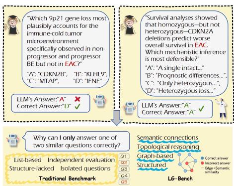  
Figure 1: Case study comparing LG-Bench with traditional benchmarks. Unlike traditional list-based approaches that overlook semantic connections, LG-Bench utilizes a graph structure to capture these links, effectively revealing LLM inconsistencies on related questions.

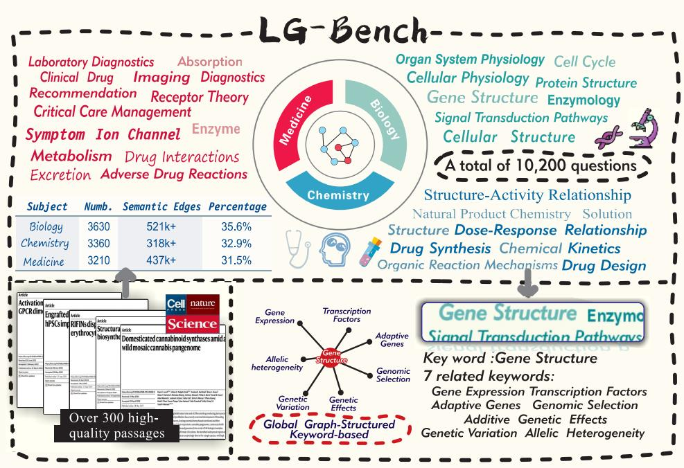  
Figure 2: Overview diagram of LG-Bench. Our LG-Bench extracts over 10,000 questions from top-tier journals in the life sciences, covering three subfields: Medicine, Biology, and Chemistry. It innovatively introduces graph structures into the benchmark to better capture the nuanced capabilities of large language models.

This "flat-world illusion" is particularly problematic in complex domains such as life sciences (Bodenreider, 2004; Jin et al., 2021), where understanding protein function requires grasping its role in cellular pathways, regulatory mechanisms, and therapeutic implications as an integrated whole. Traditional benchmarks present evaluation questions as flat lists, obscuring the rich semantic relationships that define genuine domain expertise. These limitations make it hard for current metrics to distinguish between genuine understanding and mere pattern matching.

To address this gap, we introduce LG-Bench, the first graph-structured benchmark for life sciences evaluation. As shown in Fig. 1, LG-Bench contains over 10k expert-reviewed questions drawn from recent peer-reviewed literature across Medicine, Biology, and Chemistry, with representative sources including Nature, Science, and Cell. The benchmark is designed to cover both foundational knowledge and recent scientific findings, making it suitable for evaluating whether models can organize concepts rather than only recall isolated facts. Using bidirectional matching and semantic similarity, we transform the question corpus into a weighted evaluation graph whose edges capture relationships between semantically related questions. This graph makes local neighborhoods of related scientific concepts explicit, enabling evaluation beyond flat accuracy by measuring knowledge coherence and the topological distribution of model errors.

## Our contributions are threefold:

1. We introduce LG-Bench3, the first graph-structured benchmark for life sciences, containing over 10k expert-curated questions from recent literature from leading scientific journals spanning Medicine, Biology, and Chemistry, as shown in Fig. 2.

2. We propose novel graph-based evaluation methods including the Global Coherence Score (GCS) for overall knowledge coherence, and the Knowledge Balance Score (KBS) for variance in local coherence across the graph.

3. We conducted a systematic evaluation of LG-Bench across large language models of varying scales, and leveraged GCS and KBS to deeply analyze performance flaws, providing practical support for capability diagnosis and optimization of large models in the life science.

## 2 Related Work

Traditional evaluation of large language models relies on accuracy-based metrics, treating each question as an independent unit (Li et al., 2024; Richard, 2015). This approach assumes knowledge can be divided into isolated facts, missing the interconnected nature of true expertise. Although recent work explores more nuanced frameworks (Mondorf and Plank, 2024; Xu et al., 2025; Zhang et al., 2025), current metrics still struggle to differentiate genuine understanding from sophisticated pattern matching, a limitation particularly evident in complex scientific domains.

This challenge is amplified in the life sciences. Prominent benchmarks like UMLS (Bodenreider, 2004), MedQA (Jin et al., 2021), PubMedQA (Jin et al., 2019), MLEC-QA (Li et al., 2021), and BioASQ (Nentidis et al., 2023) suffer from critical limitations. They often rely on static knowledge, failing to capture the rapid evolution of research in areas like personalized medicine and advanced therapeutics (Cai et al., 2024; Chen et al., 2025; Zhou et al., 2025). Furthermore, their narrow focus on medicine over foundational sciences like biology and chemistry restricts the ability to assess comprehensive, interdisciplinary knowledge, which is essential for reliable evaluation.

A promising direction to address these structural flaws lies in graph-based knowledge representation. While knowledge graphs are extensively studied in NLP (Hogan et al., 2021; Ji et al., 2021), and techniques like graph embeddings (Bordes et al., 2013; Wang et al., 2017) and graph neural networks (Kipf, 2016; Wu et al., 2020) have proven effective at capturing complex relationships, these insights have not yet been applied to benchmark construction. In life sciences, where knowledge inherently forms interconnected networks from molecular interactions to physiological systems, the absence of a graph-structured evaluation framework represents a significant gap. Our work bridges the gap by introducing the first graph-structured benchmark that explicitly models and leverages these knowledge relationships for a more meaningful and robust evaluation.

## 3 Graph-Structured Benchmark Construction

Our benchmark construction follows a twostage pipeline shown as Fig. 3. First, we generate high-quality evaluation questions from recent scientific literature through a sophisticated multi-stage process with expert validation. Second, we construct a weighted evaluation graph, transforming the flat question corpus into a structured representation that reflects the interconnected nature of scientific knowledge.

## 3.1 Question Node Generation

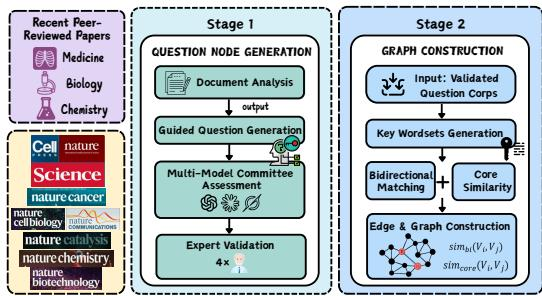  
Figure 3: Two-stage Pipeline for Construction of LG-Bench.

We generate question sets through a sophisti-

cated multi-stage pipeline that transforms cutting-edge scientific literature into high-quality evaluation questions.

Document Analysis. Our pipeline begins with a multi-modal large language model (LLM) analyzer that processes recent peer-reviewed papers from leading journals in the life sciences. This analyzer extracts structured knowledge representations from each document $d \in D _ { \mathrm { c o r p u s } }$ , identifying core concepts along with their hierarchical and semantic relationships. It systematically extracts knowledge pairs, consisting of concepts and their associated properties or relations, which serve as fundamental units for downstream question generation. The analyzer also assigns each identified concept a corresponding Bloom’s Taxonomy level (Forehand, 2010), specifying its cognitive depth. The system enforces explicit targets for the distribution of questions across these levels, ensuring a balanced coverage of cognitive complexity in the final benchmark.

Guided Question Generation. The generation stage employs a specialized LLM that receives guidance from the analyzer’s output. Each generation prompt includes domain-specific knowledge context and key concepts, a target Bloom level with specific cognitive verbs, scientific accuracy constraints, and requirements for testing conceptual relationships. This guidance ensures generated questions genuinely test integrated understanding rather than isolated fact recall.

Multi-Model Committee Assessment. The quality assurance stage involves a committee of three state-of-the-art large language models (GPT-4o, Claude 3.7 Sonnet, and Grok-3) that independently evaluate each generated question. The committee members assess questions across multiple dimensions, including scientific accuracy, cognitive complexity, and conceptual integration. Through a voting mechanism, questions that fail to meet quality thresholds are either rejected outright due to insufficient quality or routed to mandatory human expert review. Additionally, the committee annotates the relevant knowledge sources and the rationale behind each judgment to facilitate more efficient and accurate expert verification.

Expert Validation. Our human validation team comprises 4 PhD-holding life sciences experts. These experts conduct rigorous review by simultaneously examining both the source scientific papers and the generated questions, ensuring strict verification of knowledge accuracy and appropriateness as evaluation items. They assess whether questions faithfully reflect the paper’s content while testing meaningful understanding. This dual-verification approach—checking both scientific correctness and $\mathrm { Q A }$ suitability—ensures our dataset maintains the highest standards while capturing genuinely challenging, interconnected knowledge that reflects current advances in the field.

Through this rigorous process, we construct $Q _ { \mathrm { c o r p u s } } = \{ q _ { 1 } , q _ { 2 } , . . . , q _ { n } \}$ with over 10k validated questions that form the foundation for meaningful graph construction.

## 3.2 Graph Construction

The core innovation of our approach lies in recovering the latent knowledge structure from the flat question collection. We accomplish this through rigorous graph-based methods that transform $Q _ { \mathrm { { c o r p u s } } }$ into a meaningful evaluation graph. We construct a weighted undirected graph $G = ( V , \dot { E } , w )$ where the structure emerges naturally from the semantic relationships within our question corpus. The node set $V$ corresponds directly to our questions, with $V \ = \ Q _ { \mathrm { c o r p u s } }$ and $| { \bar { V } } | = n .$ , establishing a one-to-one mapping between graph nodes and evaluation questions.

We first employ an LLM to extract key concepts and entities from each question, generating keyword sets that capture the essential knowledge elements. This extraction process identifies domainspecific terms, scientific concepts, and their semantic roles within the question context. Then we define a hybrid similarity function sim : $V \times V \to [ 0 , 1 ]$ that captures both semantic and knowledgebased relationships between questions through a multi-component approach. For questions $v _ { i }$ and $v _ { j }$ with respective keyword sets $K _ { i }$ and $K _ { \mathcal { r } }$ extracted by the LLM, we embed all keywords and compute the similarity matrix $S _ { i j } \in \mathbb { R } ^ { | K _ { i } | \times | \check { K } _ { j } | }$ where $S _ { i j } [ p , q ] = \cos ( \mathrm { e m b } ( k _ { p } ^ { i } ) , \mathrm { e m b } ( k _ { q } ^ { j } ) )$ ). We then compute two complementary similarity components:

Bidirectional Matching: Measures mutual coverage between keyword sets. We first define directional similarities:

$$
\mathrm { s i m } _ { i \to j } = \frac { 1 } { | K _ { i } | } \sum _ { p = 1 } ^ { | K _ { i } | } \operatorname* { m a x } _ { q } S _ { i j } [ p , q ]\tag{1}
$$

$$
\mathrm { s i m } _ { j  i } = \frac { 1 } { | K _ { j } | } \sum _ { q = 1 } ^ { | K _ { j } | } \operatorname* { m a x } _ { p } S _ { i j } [ p , q ]\tag{2}
$$

where $\mathrm { s i m } _ { i  j }$ measures how well keywords in $K _ { i }$ are covered by $K _ { j }$ , and vice versa. The bidirectional similarity is:

$$
\mathrm { s i m } _ { \mathrm { b i } } ( v _ { i } , v _ { j } ) = \frac { 1 } { 2 } ( \mathrm { s i m } _ { i  j } + \mathrm { s i m } _ { j  i } )\tag{3}
$$

Core Similarity: Focuses on the strongest connections by selecting top-k matches:

$$
\mathrm { s i m } _ { \mathrm { c o r e } } ( v _ { i } , v _ { j } ) = \frac { 1 } { k } \sum _ { l = 1 } ^ { k } S _ { i j } ^ { ( l ) }\tag{4}
$$

where $S _ { i j } ^ { ( l ) }$ represents the l-th largest element in the flattened similarity matrix, and $k \_ =$ min $( \kappa , | \breve { K _ { i } } | , | K _ { j } | )$ with κ being a predefined parameter.

The final similarity score combines these two components:

$$
\begin{array} { r } { \mathrm { s i m } ( v _ { i } , v _ { j } ) = \gamma \cdot \mathrm { s i m } _ { \mathrm { c o r e } } ( v _ { i } , v _ { j } ) + ( 1 - \gamma ) \cdot \mathrm { s i m } _ { \mathrm { b i } } ( v _ { i } , v _ { j } ) } \end{array}\tag{5}
$$

where $\gamma \in [ 0 , 1 ]$ controls the balance between core similarity and bidirectional matching.

An edge $( v _ { i } , v _ { j } )$ exists in our graph if and only if sim $\mathbf { \sigma } _ { 1 } ( v _ { i } , v _ { j } ) > \theta$ , where θ is an adaptive threshold determined. Each edge carries a weight w $\mathbf { \Phi } ( v _ { i } , v _ { j } ) = \sin ( \bar { v _ { i } } , v _ { j } )$ , encoding the strength of the relationship between questions. This construction ensures that our graph captures meaningful semantic relationships while avoiding noise from spurious connections.

## 4 Graph-Based Model Evaluation

The graph structure of our benchmark enables fundamentally new approaches to model evaluation. We leverage the evaluation graph topology to assess two core aspects of model performance, its global coherence in understanding life sciences as an integrated knowledge domain and the distribu tion of its errors across the graph—and develop complementary methods to address these challenges.

## 4.1 Global Coherence Score (GCS)

Consider two models achieving identical 75% accuracy on a life sciences benchmark. Model A correctly answers questions about protein synthesis, translation, and ribosome function as a coherent cluster, while Model B’s correct answers scatter randomly—answering about ATP synthesis while missing basic cellular respiration, correctly identifying drug mechanisms while failing on the underlying biochemistry. Traditional accuracy metrics see these models as equivalent, yet any domain expert would immediately recognize Model A’s superior understanding. The Global Coherence Score (GCS) captures this phenomenon by recognizing that genuine comprehension creates clusters of consistent performance in the knowledge graph.

For model M evaluated on graph $G = ( V , E , w )$ , let $\mathsf { R e s } _ { M } ( v ) \in \{ 0 , 1 \}$ denote whether M correctly answers question v. We compute the neighborhood coherence for each node:

$$
\operatorname { C o h e r e n c e } _ { M } ( v ) = { \frac { \sum _ { u \in N ( v ) } w ( v , u ) \cdot \operatorname { R e s } _ { M } ( u ) } { \sum _ { u \in N ( v ) } w ( v , u ) } }\tag{6}
$$

where $N ( v )$ denotes the set of nodes whose distance from v is at most 1. This represents the weighted accuracy within v’s semantic neighborhood.

The GCS transforms each binary correct/incorrect outcome into a continuous value that reflects neighborhood support:

$$
\operatorname { G C S } ( M ) = \frac { 1 } { | V | } \sum _ { v \in V } \operatorname { R e s } _ { M } ( v ) \cdot \operatorname { C o h e r e n c e } _ { M } ( v )\tag{7}
$$

Although the GCS is strongly correlated with overall accuracy, transforming each binary 0/1 outcome into a weighted value between 0 and 1 allows it to reveal knowledge gaps even among correctly answered nodes with low neighborhood support. This highlights cases where the model may have guessed correctly in isolation, without demonstrating genuine understanding of the surrounding semantic context—making GCS a more diagnostic measure of structured knowledge.

## 4.2 Knowledge Balance Score (KBS)

While GCS measures overall coherence, understanding how consistently a model maintains coherence across different regions of the knowledge graph reveals deeper insights into its knowledge organization patterns. Traditional evaluation metrics fail to capture whether a model exhibits balanced understanding or demonstrates highly variable performance across semantic neighborhoods. We introduce the Knowledge Balance Score (KBS), a novel metric that quantifies the variance in local coherence patterns to assess knowledge stability and balance.

For a given model M evaluated on graph $G = ( V , E , w )$ , we leverage the neighborhood coherence values Coherence $_ M ( v )$ computed in the GCS framework. The KBS is computed as the variance of amplified coherence values across all nodes:

$$
\mathrm { K B S } ( M ) = \mathrm { V a r } ( \mathrm { C o h e r e n c e } _ { M } ( v ) \times \alpha )\tag{8}
$$

$$
= { \frac { 1 } { | V | } } \sum _ { v \in V } ( \mathbf { C o h e r e n c e } _ { M } ( v ) \times \alpha - \mu ) ^ { 2 }\tag{9}
$$

where $\alpha > 1$ is an amplification factor that enhances the distinction between high and low coherence regions, and $\textstyle \mu = { \frac { 1 } { | V | } } \sum _ { \boldsymbol { v } \in V }$ (CoherenceM(v)×α) is the mean amplified coherence across all nodes. This variance-based perspective on coherence analysis enables precise identification of whether models suffer from knowledge imbalance or systematic understanding deficits, guiding more effective training and improvement strategies.

## 5 Experiments

## 5.1 Experimental Setup

Benchmark Details. Our dataset construction pipeline generated high-quality questions from recent peer-reviewed literature spanning three major life sciences domains. For each subdomain, the corresponding graph is a subgraph of the global evaluation graph. Table 1 presents the structural characteristics of our constructed evaluation graph. More details can be found in Appendix A.3.

Table 1: LG-Bench: Graph-Structured Benchmark Statistics
<table><tr><td>Domain</td><td>Questions (Nodes)</td><td>Semantic Edges</td><td>Avg. Degree</td></tr><tr><td>Biology</td><td>3,630</td><td>521,890</td><td>287.50</td></tr><tr><td>Chemistry</td><td>3,360</td><td>318,763</td><td>189.74</td></tr><tr><td>Medicine</td><td>3,210</td><td>437,442</td><td>272.55</td></tr><tr><td>Overall</td><td>10,200</td><td>2,990,277</td><td>586.32</td></tr></table>

Models. We evaluate a comprehensive set of large language models spanning different scales, architectures, and specializations to provide a thorough assessment of capabilities. In the case of open-source models , we include the Qwen2.5 series (0.5B/7B/14B/32B/72B) (Team, 2024), the Llama family (Touvron et al., 2023; Meta AI, 2024; Dubey et al., 2024) including Llama-7B, Llama-3-8b, Llama-3.3-70B, Llama-3.1-405B, and Llama-4-scout. We also evaluate the GLM-4 series (9B/32B) (GLM et al., 2024), Gemma-3-1B (Team, 2025), and DeepSeek-v3 (DeepSeek-AI, 2024). For domain-specific models, we include BioMedLM-2.7B (Bolton et al., 2024), Medicine-LLM-7B (Cheng et al., 2024), HuatuoGPT family (Zhang et al., 2023; Chen et al., 2023), and Llama3-Med42- 8B (Christophe et al., 2024), which are specifically fine-tuned for life sciences applications.

For closed-source commercial models, we utilize the GPT series including GPT-3.5, GPT-4o-mini, GPT-4o, OpenAI o3, OpenAI o4-mini an GPT-5 (OpenAI, 2023a,b; Singh et al., 2025), the Claude family with Claude-3.5-sonnet and Claude-3.7-sonnet (Anthropic, 2024, 2025), and the Grok series (Grok-2/Grok-3) (xAI, 2025). All models are evaluated using identical prompting strategies and evaluation protocols to ensure fair comparison.

## 5.2 Results

Table 2 presents comprehensive evaluation results across all models on LG-Bench using our graphbased metrics. All accuracy (Acc) and Global Coherence Score (GCS) values are reported as percentages. For KBS computation, we set the amplification parameter α = 100 to enhance the distinction between high and low coherence regions. All experiments were conducted three times and averaged, with more experimental settings available in Appendix B. Our evaluation demonstrates significant performance variations across models, with overall accuracy ranging from 23.93% (BioMedLM-2.7B) to 91.00% (GPT-5), GCS spanning 5.67% to 83.10%, and KBS values varying from 4.40 to 20.00. Notably, our graph-based metrics reveal substantial differences between models that are not captured by traditional accuracy alone, effectively distinguishing models with coherent knowledge organization from those exhibiting scattered understanding patterns across the life sciences domain.

As shown in Fig.4, we compare the responses of Qwen2.5 within a local graph structure and observe a clear lack of understanding of certain concepts in Qwen2.5-7B, whereas Qwen2.5- 72B demonstrates a clear and solid grasp of these knowledge points. A more detailed analysis is provided in Appendix A.4.

Open-Weight LLMs vs. Closed-Weight LLMs. The result highlights a striking contrast between open and closed models when confronted with LG-Bench, whose items deliberately target clinical guidelines, drugs, and biomolecular findings released recently. Early open models such as HuatuoGPT, BioMedLM, and Llama-7B reach only 24–31% accuracy, revealing substantial blind spots for the newest knowledge. In contrast, iterative open-source versions like HuatuoGPT2-7B, Llama-3-8B, and Llama3-Med42-8B boost the same metric to 60–78% while staying under 10B parameters. These improvements attest to the compounding benefits of an open ecosystem, where community-contributed data refreshes and lightweight domain fine-tuning shorten the model–data–task loop. Closed-source systems still occupy the top tier: GPT-5, OpenAI o3 and OpenAI o4-mini surpass 89% overall accuracy, reflecting the value of proprietary corpora and extensive RLHF (Christiano et al., 2017). Nev-

<table><tr><td colspan="2">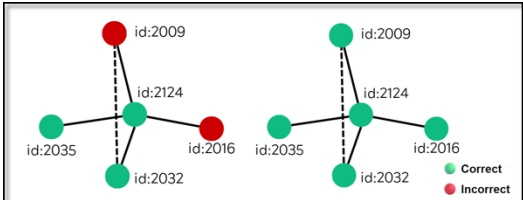 Qwen2.5-7B Qwen2.5-72B</td></tr><tr><td>id:2009</td><td>&quot;macrophages&quot;, &quot;p38α inhibitor&quot;, &quot;pam3csk4 stimulation&quot;, &quot;tIr signalling&quot;, &quot;myd88&quot;, &quot;tbk1&quot;, &quot;irf5&quot; &quot;traf6&quot;, &quot;k63 ubiquitination&quot;, &quot;nf-kb&quot;</td></tr><tr><td>id:2016</td><td>&quot;p62&quot;,&quot;myd88&quot;,&quot;myddosome&quot;,&quot;ubiquitination&quot;,&quot;traf6&quot;, &quot;ikk&quot;,&quot;nf-κb&quot;,&quot;autophagy&quot;,&quot;signalling&quot;,&quot;scaffolds&quot;</td></tr><tr><td>id:2032</td><td>&quot;tbk1&quot;,&quot;macrophages&quot;,&quot;nf-κb&quot;, &quot;autophagic clearance&quot;,&quot;myddosome&quot;,&quot;traf6&quot;,&quot;p62-dependent autophagy&quot;,&quot;myd88&quot;,&quot;phosphorylation&quot;, &quot;signalling&quot;</td></tr><tr><td>id:2035</td><td>&quot;myd88&quot;,&quot;barrel architecture&quot;,&quot;nf-κb&quot;,&quot;mapk activation&quot;,&quot;synthetic perturbation&quot;,&quot;knock down&quot;,&quot;traf6&quot;,&quot;point mutations&quot;,&quot;intermolecular death-domain&quot;,&quot;structural necessity&quot;</td></tr><tr><td>id:2124</td><td>&quot;autophagy&quot;,&quot;atg12 knockout&quot;,&quot;macrophages&quot;, &quot;pam3csk4&quot;,&quot;traf6&quot;,&quot;myd88&quot;,&quot;myddosome&quot;,&quot;nf-κb&quot;, &quot;tIr2&quot;,&quot;trafficking defects&quot;</td></tr></table>

Figure 4: Qwen2.5 results within a local graph structure. Qwen2.5-7B failed on many questions in the neighborhood-level evaluation. Red keywords indicate areas of severe knowledge weakness, while blue keywords denote relatively weak points. In contrast, Qwen2.5-72B correctly answered all relevant questions in the neighborhood test, demonstrating a relatively good grasp of the associated knowledge.

ertheless, the gap is narrowing; fully open models like Qwen2.5-72B and DeepSeek-v3 trail GPT series by less than 4 pp. In sum, while closed models presently set the performance ceiling, rapid, community-driven iteration is continuously raising the open-source floor, accelerating progress for medical reasoning at large.

Model Scale Effects. Our empirical analysis confirms a clear parameter–performance scaling law. Sub-10B models deliver only moderate results, with accuracies below 80% and GCS under 62%; for instance, Qwen2.5-0.5B attains merely 37.56% accuracy and a GCS of 14.39%. Once the parameter count exceeds 10B, every metric improves sharply. Within the Qwen2.5 family, accuracy and GCS rise from 83.69% and 70.42% at 14B to 84.87% and 72.56% at 32B, and further to 86.05% and 74.52% at 72B. Knowledge balance benefits from scaling as well: the KBS drops monotonically from 16.11 at 0.5B to 11.73 at 14B, 11.07 at 32B, and 10.26 at 72B, indicating progressively more coherent knowledge organization. The Llama series exhibits the same scaling advantages, underscoring the generality of these trends across model families. The Coherence Score distrubution of Qwen2.5 family is shown as Fig. 5.

Impact of Domain-Specific Training. Our graph-based metrics provide a detailed lens through which to analyze the effects of domain-specific fine-tuning. A direct comparison between the generalist Llama-3-8b and its domain-adapted counterpart, Llama3-Med42-8B, reveals that specialization does more than just increase accuracy—it fundamentally reshapes the model’s knowledge structure. We embed each knowledge graph with node2vec (Grover and Leskovec, 2016) into a 2-D manifold and plot Coherence Score heatmaps, shown as Fig. 6. Although the overall surface becomes brighter—corroborating the aggregate metric improvements—an inverted pattern emerges in certain regions, revealing a migration of knowledge density rather than a uniform amplification.

In the target domain of Medicine, Llama3-Med42-8B shows a substantial improvement in its GCS, rising to 61.60% from the base model’s 54.11%. More revealing is the impact on the KBS. The KBS for Llama3-Med42-8B in Medicine drops sharply to 25.61 from the base model’s 35.65. This significant reduction in variance demonstrates that the fine-tuning not only enhanced knowledge but also homogenized it, leading to a more evenly distributed and balanced understanding across different medical topics. However, this specialization comes with trade-offs that metrics can precisely identify. While its GCS shows minor improvements in the related field of Biology, Llama3-Med42-8B’s KBS in Chemistry increases to 30.78, higher than the base model’s 27.97. This suggests that the intense focus on medicine may have inadvertently created a more imbalanced and "spiky" knowledge representation in the less related chemical domain. This demonstrates that domain adaptation can reshape knowledge organization both positively and negatively across different semantic regions, a critical insight that flat accuracy metrics would completely miss.

Table 2: Evaluation Results on LG-Bench: Acc denotes traditional accuracy (in %), GCS measures global coherence (in %), with higher scores indicating stronger capabilities. We use bold to highlight the best-performing model in each domain, and italics to indicate the second-best. KBS quantifies knowledge balance, and higher scores indicate a more uneven distribution. For hyperparameter settings, we set γ = 0.6 and θ = 0.4.
<table><tr><td rowspan=2 colspan=5>Model</td><td rowspan=1 colspan=4>Medicine</td><td rowspan=1 colspan=1>Biology</td><td rowspan=1 colspan=1>Chemistry</td><td rowspan=1 colspan=1>Overall</td></tr><tr><td rowspan=1 colspan=5>Acc GCS KBS Acc GCS KBS</td><td rowspan=1 colspan=2>Acc GCS KBS Acc GCS KBS</td></tr><tr><td rowspan=1 colspan=12>Open-Weight LLM (Scale&lt;10B)</td></tr><tr><td rowspan=6 colspan=5>Qwen2.5-0.5BGemma-3-1bBioMedLM-2.7BLlama-7BMedicine-LLM-7BHuatuoGPT-7B</td><td rowspan=2 colspan=4>37.0713.9622.1951.5626.7329.42</td><td rowspan=1 colspan=1>38.1014.8326.34</td><td rowspan=1 colspan=1>37.4414.3536.52</td><td rowspan=1 colspan=1>37.5614.39 16.11</td></tr><tr><td rowspan=1 colspan=1>55.4530.7121.97</td><td rowspan=1 colspan=1>52.6528.2039.34</td><td rowspan=1 colspan=1>53.3028.6217.94</td></tr><tr><td rowspan=1 colspan=4>24.14 5.80 12.85</td><td rowspan=1 colspan=1>23.80 5.65 9.03</td><td rowspan=1 colspan=1>23.875.56 13.69</td><td rowspan=1 colspan=1>23.935.67 5.28</td></tr><tr><td rowspan=1 colspan=4>30.069.19 13.62</td><td rowspan=1 colspan=1>30.91 9.60 14.41</td><td rowspan=1 colspan=1>32.2010.4719.14</td><td rowspan=1 colspan=1>31.07 9.76 6.80</td></tr><tr><td rowspan=1 colspan=2>38.721</td><td rowspan=1 colspan=1>34.8812.2617.23</td><td rowspan=1 colspan=1>35.5712.5823.87</td><td rowspan=1 colspan=1>36.3113.29 10.65</td></tr><tr><td rowspan=1 colspan=2>GPT-7B</td><td rowspan=1 colspan=1>29.208.50 10.31</td><td rowspan=1 colspan=1>28.42 8.13 12.97</td><td rowspan=1 colspan=1>28.80 8.33 5.96</td></tr><tr><td rowspan=4 colspan=5>Qwen2.5-7BLlama-3-8bLlama3-Med42-8BGLM-4-9b</td><td rowspan=2 colspan=2>Huatuo</td><td rowspan=2 colspan=2>uon2.5-2-7B</td><td rowspan=1 colspan=1>PT2-7B</td><td rowspan=1 colspan=1>61.0638.0933.85</td><td rowspan=1 colspan=1>62.4239.3620.89</td></tr><tr><td rowspan=3 colspan=4>78.3862.1529.1772.7754.1135.6578.1061.6025.6176.6759.6130.59</td><td rowspan=1 colspan=1>80.0364.2421.58</td><td rowspan=1 colspan=1>76.7659.2125.74</td><td rowspan=1 colspan=1>78.4362.0015.19</td></tr><tr><td rowspan=1 colspan=1>75.6757.6417.94</td><td rowspan=1 colspan=1>72.5353.1627.97</td><td rowspan=1 colspan=1>73.7355.0414.62</td></tr><tr><td rowspan=1 colspan=1>77.3860.0118.2277.4759.8225.99</td><td rowspan=1 colspan=1>75.0056.7130.7875.4557.5036.28</td><td rowspan=1 colspan=1>76.8259.4313.5676.5558.9718.05</td></tr><tr><td rowspan=1 colspan=5></td><td rowspan=1 colspan=7>Open-Weight LLM (Scale&gt;10B)</td></tr><tr><td rowspan=5 colspan=5>Qwen2.5-14BQwen2.5-32BĠLM-4-32BLlama-3.1-70BQwen2.5-72BLlama-3.1-405bLlama-4-scoutDeepseek-v3</td><td rowspan=1 colspan=4>83.0269.6220.67|</td><td rowspan=1 colspan=1>85.2672.7218.54</td><td rowspan=1 colspan=1>82.6268.6421.91</td><td rowspan=1 colspan=1>83.6970.4211.73</td></tr><tr><td rowspan=1 colspan=2>84.7072</td><td rowspan=1 colspan=2>.5521.01</td><td rowspan=1 colspan=1>86.0674.3415.02</td><td rowspan=1 colspan=1>83.7570.3820.78</td><td rowspan=1 colspan=1>84.8772.5611.07</td></tr><tr><td rowspan=3 colspan=4>78.9463.3272.7769.5124.3086.2675.1216.5388.0778.1313.9878.6962.6132.3287.1776.5714.76</td><td rowspan=1 colspan=1>29.30</td><td rowspan=1 colspan=1>80.4464.8222.22</td><td rowspan=1 colspan=1>78.3061.7729.31</td><td rowspan=3 colspan=1>79.2663.3315.2882.5468.5812.7086.0574.5210.2687.8377.51 7.1980.3164.89 18.6587.3676.707.50</td></tr><tr><td rowspan=1 colspan=1>83.1469.1919.5586.9775.6815.4588.2678.0110.88</td><td rowspan=2 colspan=1>71.6766.7824.6784.8572.4423.0487.1476.1814.9880.2764.7928.7686.9075.7015.09</td></tr><tr><td rowspan=1 colspan=1>81.7966.9525.6687.9677.5111.63</td></tr><tr><td rowspan=1 colspan=5></td><td rowspan=1 colspan=5>Closed-Weight LLM</td><td rowspan=1 colspan=2></td></tr><tr><td rowspan=1 colspan=5>Grok-2</td><td rowspan=1 colspan=4>88.5478.71 16.61</td><td rowspan=1 colspan=1>89.0179.3011.15</td><td rowspan=1 colspan=1>87.2376.3617.60</td><td rowspan=1 colspan=1>88.2778.207.78</td></tr><tr><td rowspan=4 colspan=5>Grok-3Claude-3.5-sonnetClaude-3.7-sonnet</td><td rowspan=1 colspan=4>86.2975.0614.0188.9179.4312.51</td><td rowspan=1 colspan=1>84.3871.7529.89</td><td rowspan=1 colspan=1>85.7773.7516.68</td><td rowspan=1 colspan=1>85.4473.5410.4088.1778.09 7.56</td></tr><tr><td rowspan=3 colspan=2></td><td></td><td></td><td></td><td></td><td></td><td></td><td></td></tr><tr><td></td><td></td><td></td><td></td><td rowspan=1 colspan=1>88.6578.6110.25</td><td rowspan=1 colspan=1>86.9376.0318.69</td><td></td></tr><tr><td rowspan=1 colspan=2>7-sonnet</td><td rowspan=1 colspan=4>88.4178.7615.91</td><td rowspan=1 colspan=1>89.0479.299.00</td><td rowspan=1 colspan=1>87.8377.2714.71</td><td rowspan=1 colspan=1>88.4478.52 6.97</td></tr><tr><td rowspan=6 colspan=5>GPT-3.5GPT-40-miniGPT-40OpenAI o3OpenAI o4-miniGPT-5</td><td rowspan=1 colspan=4>76.4259.3527.79</td><td rowspan=1 colspan=1>77.0259.6723.01</td><td rowspan=1 colspan=1>74.5556.3835.35</td><td rowspan=1 colspan=1>76.0258.4716.31</td></tr><tr><td rowspan=2 colspan=4>82.2168.7725.9488.4778.9915.08</td><td rowspan=1 colspan=1>84.4171.1314.91</td><td rowspan=1 colspan=1>81.7067.2626.46</td><td rowspan=1 colspan=1>82.8269.1912.68</td></tr><tr><td rowspan=1 colspan=1>89.7080.4410.62</td><td rowspan=1 colspan=1>88.0177.7913.29</td><td rowspan=1 colspan=1>88.7579.19 6.22</td></tr><tr><td rowspan=1 colspan=1></td><td rowspan=1 colspan=4>90.0081.5710.65</td><td rowspan=1 colspan=1>89.2679.849.94</td><td rowspan=1 colspan=1>89.0579.5611.60</td><td rowspan=1 colspan=1>89.42 80.345.83</td></tr><tr><td rowspan=2 colspan=4>89.7581.09 10.6991.3183.79 9.10</td><td rowspan=1 colspan=1>89.8981.14 7.22</td><td rowspan=1 colspan=1>88.8779.32 9.46</td></tr><tr><td rowspan=1 colspan=1>91.0583.10 7.88</td><td rowspan=1 colspan=1>90.6582.10 8.66</td><td rowspan=1 colspan=1>91.0083.10 4.40</td></tr></table>

## 5.3 Robustness and Human Alignment

The reliability of our graph-based metrics, GCS and KBS, depends on the underlying graph topology, which is primarily governed by the similarity threshold θ and the connectivity parameter γ. While LG-Bench is established with default configurations of θ = 0.4 and γ = 0.6, we conducted extensive sensitivity analyses to ensure that our evaluation conclusions are not artifacts of specific hyperparameter choices.

We first investigated the impact of the similarity threshold θ, which serves as the primary determinant of graph density. By increasing θ to 0.45, as shown in Table 3, and further to 0.5 and 0.6 in

Appendix A.4.2, we generated increasingly sparse graph structures. Our results demonstrate that GCS exhibits remarkable numerical stability even as the graph topology becomes more restrictive. More importantly, while the absolute magnitude of KBS naturally scales with changes in sparsity due to its variance-based calculation, the relative rank ordering of models remains strictly consistent across all tested θ values.

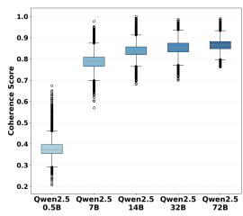  
(a) Qwen2.5

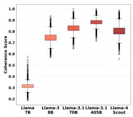  
(b) Llama

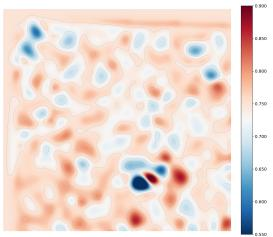  
(a) Llama-3-8b

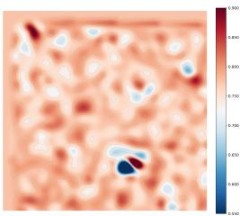  
(b) Llama3-Med42-8B  
Figure 5: Coherence Score distribution of Qwen2.5 and Llama family. As model size increases, its overall capability in the life sciences domain gradually improves, while its knowledge becomes more evenly distributed.  
Figure 6: Heatmap visualization of the LG-Bench. Each cell represents a node’s Coherence Score. Redder regions indicate higher coherence, while bluer areas indicate lower coherence.

This rank-order consistency confirms that our framework captures intrinsic differences in knowledge organization rather than reflecting noise in the graph construction process.

Furthermore, we analyzed the influence of the hybrid similarity parameter γ by comparing settings of $\gamma =$ 0.4 and $\gamma ~ = ~ 0 . 6$ at a fixed threshold. As illustrated in Table 3, the variations in the weighting between core and bidirectional similarity do not disrupt the performance hierarchy. Models of different scales and specialized domain-adapted models consistently maintain their respective positions in the ranking, proving that the diagnostic capacity of LG-Bench, particularly its ability to identify imbalanced or spiky knowledge distributions, is robust to variations in semantic connectivity.

To confirm that these graph-based scores truly reflect actual reasoning capabilities, we conducted a human verification study on a subset of 450 questions. Human evaluators per-

Table 3: Ablation Study on Graph Connectivity Parameters. We study metric sensitivity to graph structure by varying γ at a fixed $\theta = 0$ .45 (originally $\theta = 0 . 4 , \gamma = 0 . 6 )$ . Results show GCS is stable, indicating global coherence is not an artifact of graph density. KBS scales with sparsity, but model rank ordering remains consistent across domains. Table (a) reports $\gamma = 0 . 4 ;$ Table (b) $\gamma = 0 . 6$

(a) Setting γ = 0.4 (Avg. Degree 249.61)
<table><tr><td>Model</td><td colspan="2">Medicine</td><td colspan="2">Biology</td><td colspan="2">Chemistry</td><td colspan="2">Overall</td></tr><tr><td>Qwen2.5-7B</td><td>GCS 62.5960.38</td><td>KBS</td><td>GCS 64.2940.12</td><td>KBS</td><td>GCS |59.2948.07|</td><td>KBS</td><td>GCS</td><td>KBS 62.2029.83</td></tr><tr><td>Llama-3-8B Llama3-Med42-8B Qwen2.5-14B Qwen2.5-32B Llama-3.1-70B</td><td>54.41 69.05 61.7955.59 69.8443.47 72.7944.72 69.74 48.59 75.37 38.76</td><td></td><td>57.6832.90 60.1735.06 72.7536.85 74.41 29.19 69.2538.64 75.7629.24</td><td></td><td>53.21 52.91 56.82 55.66 68.81 38.89 70.5838.19</td><td>66.9545.48 72.6741.59 74.73 20.73</td><td>55.2529.14 59.5927.72 70.5622.18 72.7821.94</td><td>68.75 25.85</td></tr></table>

(b) Setting γ = 0.6 (Avg. Degree 257.42)
<table><tr><td rowspan="2">Model</td><td colspan="2">Medicine</td><td colspan="2">Biology</td><td colspan="2">Chemistry</td><td colspan="2">Overall</td></tr><tr><td>GCS</td><td>KBS</td><td>GCS</td><td>KBS</td><td>GCS</td><td>KBS</td><td>GCS</td><td>KBS</td></tr><tr><td>Qwen2.5-7B Llama-3-8B Llama3-Med42-8B Qwen2.5-14B Qwen2.5-32B 73.2645.67</td><td>62.0561.25 54.86 70.01 62.3155.52 70.2944.38</td><td></td><td>60.64 35.91 73.21 37.69</td><td>|64.7240.89 58.1533.72</td><td></td><td>|59.81 48.94| 53.7453.85 57.3856.73</td><td>|62.6830.56</td><td>55.7829.96 60.1228.45</td></tr></table>

formed a subjective assessment of model-generated open-ended responses, focusing on the depth and accuracy of the underlying reasoning. We then computed the Spearman rank correlation between human ratings and our automated metrics. The analysis revealed a very high correlation, with coefficients reaching 0.94 for GCS and 0.90 for KBS. These results indicate that the coherence and balance captured by our graph structure are highly aligned with human expert perception of scientific understanding, providing strong empirical evidence for the validity of our diagnostic framework.

## 6 Conclusion

In this work, we introduced LG-Bench, the first graph-structured benchmark designed to address the fundamental limitations of traditional evaluations in the life sciences. By modeling knowledge as a graph and introducing novel coherence-based metrics, we provide the community with the tools to move beyond simple accuracy and assess the depth of a model’s scientific reasoning.

## Acknowledgments

This work was supported by the National Natural Science Foundation of China (Grant Nos. 62501337, 72293585, and 72293580), the National Science and Technology Major Project of New Generation Artificial Intelligence (Grant No. 2025ZD0124104), and the Shanghai Municipal Special Program for Basic Research on General AI Foundation Models (Grant No. 2025SHZDZX025D09). This work was conducted in collaboration with Shanghai Artificial Intelligence Laboratory.

## References

Anthropic. 2024. Claude 3.5. https://www.anthropic.com/claude. Available at https: //www.anthropic.com/claude.

Anthropic. 2025. Claude 3.7. https://www.anthropic.com/claude. Available at https: //www.anthropic.com/claude.

Olivier Bodenreider. 2004. The unified medical language system (UMLS): integrating biomedical terminology. Nucleic acids research 32, suppl\_1 (2004), D267–D270.

Elliot Bolton, Abhinav Venigalla, Michihiro Yasunaga, David Hall, Betty Xiong, Tony Lee, Roxana Daneshjou, Jonathan Frankle, Percy Liang, Michael Carbin, et al. 2024. Biomedlm: A 2.7 b parameter language model trained on biomedical text. arXiv preprint arXiv:2403.18421 (2024).

Antoine Bordes, Nicolas Usunier, Alberto Garcia-Duran, Jason Weston, and Oksana Yakhnenko. 2013. Translating embeddings for modeling multi-relational data. Advances in neural information processing systems 26 (2013).

Yan Cai, Linlin Wang, Ye Wang, Gerard de Melo, Ya Zhang, Yanfeng Wang, and Liang He. 2024. Medbench: A large-scale chinese benchmark for evaluating medical large language models. In Proceedings ofthe AAAI Conference on Artificial Intelligence, Vol. 38. 17709–17717.

Junying Chen, Xidong Wang, Ke Ji, Anningzhe Gao, Feng Jiang, Shunian Chen, Hongbo Zhang, Dingjie Song, Wenya Xie, Chuyi Kong, et al. 2023. Huatuogpt-ii, one-stage training for medical adaption of llms. arXiv preprint arXiv:2311.09774 (2023).

Xiaolan Chen, Jiayang Xiang, Shanfu Lu, Yexin Liu, Mingguang He, and Danli Shi. 2025. Evaluating large language models and agents in healthcare: key challenges in clinical applications. Intelligent Medicine (2025).

Daixuan Cheng, Shaohan Huang, and Furu Wei. 2024. Adapting Large Language Models via Reading Comprehension. In The Twelfth International Conference on Learning Representations. https://openreview.net/forum?id=y886UXPEZ0

Paul F Christiano, Jan Leike, Tom Brown, Miljan Martic, Shane Legg, and Dario Amodei. 2017. Deep reinforcement learning from human preferences. Advances in neural information processing systems 30 (2017).

Clément Christophe, Praveen K Kanithi, Tathagata Raha, Shadab Khan, and Marco AF Pimentel. 2024. Med42-v2: A Suite of Clinical LLMs. https://arxiv.org/abs/2408.06142

DeepSeek-AI. 2024. DeepSeek-V3 Technical Report. arXiv:2412.19437 [cs.CL] https://arxiv. org/abs/2412.19437

Abhimanyu Dubey, Abhinav Jauhri, Abhinav Pandey, Abhishek Kadian, Ahmad Al-Dahle, Aiesha Letman, Akhil Mathur, Alan Schelten, Amy Yang, Angela Fan, et al. 2024. The llama 3 herd of models. arXiv e-prints (2024), arXiv–2407.

Mary Forehand. 2010. Bloom’s taxonomy. Emerging perspectives on learning, teaching, and technology 41, 4 (2010), 47–56.

Team GLM, :, Aohan Zeng, Bin Xu, Bowen Wang, Chenhui Zhang, Da Yin, Dan Zhang, Diego Rojas, Guanyu Feng, Hanlin Zhao, Hanyu Lai, Hao Yu, Hongning Wang, Jiadai Sun, Jiajie Zhang, Jiale Cheng, Jiayi Gui, Jie Tang, Jing Zhang, Jingyu Sun, Juanzi Li, Lei Zhao, Lindong Wu, Lucen Zhong, Mingdao Liu, Minlie Huang, Peng Zhang, Qinkai Zheng, Rui Lu, Shuaiqi Duan, Shudan Zhang, Shulin Cao, Shuxun Yang, Weng Lam Tam, Wenyi Zhao, Xiao Liu, Xiao Xia, Xiaohan Zhang, Xiaotao Gu, Xin Lv, Xinghan Liu, Xinyi Liu, Xinyue Yang, Xixuan Song, Xunkai Zhang, Yifan An, Yifan Xu, Yilin Niu, Yuantao Yang, Yueyan Li, Yushi Bai, Yuxiao Dong, Zehan Qi, Zhaoyu Wang, Zhen Yang, Zhengxiao Du, Zhenyu Hou, and Zihan Wang. 2024. ChatGLM: A Family of Large Language Models from GLM-130B to GLM-4 All Tools. arXiv:2406.12793 [cs.CL] https://arxiv.org/abs/2406.12793

Aditya Grover and Jure Leskovec. 2016. node2vec: Scalable feature learning for networks. In Proceedings of the 22nd ACM SIGKDD international conference on Knowledge discovery and data mining. 855–864.

Aidan Hogan, Eva Blomqvist, Michael Cochez, Claudia d’Amato, Gerard De Melo, Claudio Gutierrez, Sabrina Kirrane, José Emilio Labra Gayo, Roberto Navigli, Sebastian Neumaier, et al. 2021. Knowledge graphs. ACM Computing Surveys (Csur) 54, 4 (2021), 1–37.

Shaoxiong Ji, Shirui Pan, Erik Cambria, Pekka Marttinen, and Philip S Yu. 2021. A survey on knowledge graphs: Representation, acquisition, and applications. IEEE transactions on neural networks and learning systems 33, 2 (2021), 494–514.

Di Jin, Eileen Pan, Nassim Oufattole, Wei-Hung Weng, Hanyi Fang, and Peter Szolovits. 2021. What disease does this patient have? a large-scale open domain question answering dataset from medical exams. Applied Sciences 11, 14 (2021), 6421.

Qiao Jin, Bhuwan Dhingra, Zhengping Liu, William W Cohen, and Xinghua Lu. 2019. Pubmedqa: A dataset for biomedical research question answering. arXiv preprint arXiv:1909.06146 (2019).

TN Kipf. 2016. Semi-Supervised Classification with Graph Convolutional Networks. arXiv preprint arXiv:1609.02907 (2016).

Haitao Li, Qian Dong, Junjie Chen, Huixue Su, Yujia Zhou, Qingyao Ai, Ziyi Ye, and Yiqun Liu. 2024. Llms-as-judges: a comprehensive survey on llm-based evaluation methods. arXiv preprint arXiv:2412.05579 (2024).

Jing Li, Shangping Zhong, and Kaizhi Chen. 2021. MLEC-QA: A Chinese multi-choice biomedical question answering dataset. In Proceedings of the 2021 Conference on Empirical Methods in Natural Language Processing. 8862–8874.

Meta AI. 2024. Introducing Meta Llama 3: The Most Capable Openly Available LLM to Date. https://ai.meta.com/blog/meta-llama-3/ Accessed: 2025-07-28.

Philipp Mondorf and Barbara Plank. 2024. Beyond accuracy: evaluating the reasoning behavior of large Language models–A survey. arXiv preprint arXiv:2404.01869 (2024).

Anastasios Nentidis, Georgios Katsimpras, Anastasia Krithara, Salvador Lima López, Eulália Farré- Maduell, Luis Gasco, Martin Krallinger, and Georgios Paliouras. 2023. Overview of bioasq 2023: The eleventh bioasq challenge on large-scale biomedical semantic indexing and question answering. In International Conference of the Cross-Language Evaluation Forum for European Languages. Springer, 227–250.

OpenAI. 2023a. ChatGPT. https://chat.openai.com/chat.

OpenAI. 2023b. GPT-4 Technical Report. Technical Report. OpenAI. Available at https:// arxiv.org/abs/2303.08774.

L Richard. 2015. Burden, J Douglas Faires, and Annette M Burden. Numerical analysis. Cengage learning 4 (2015).

Aaditya Singh, Adam Fry, Adam Perelman, Adam Tart, Adi Ganesh, Ahmed El-Kishky, Aidan McLaughlin, Aiden Low, AJ Ostrow, Akhila Ananthram, Akshay Nathan, Alan Luo, Alec Hel yar, Aleksander Madry, Aleksandr Efremov, Aleksandra Spyra, Alex Baker-Whitcomb, Alex Beutel, Alex Karpenko, Alex Makelov, Alex Neitz, Alex Wei, Alexandra Barr, Alexandre Kirch meyer, Alexey Ivanov, Alexi Christakis, Alistair Gillespie, Allison Tam, Ally Bennett, Alvin Wan, Alyssa Huang, Amy McDonald Sandjideh, Amy Yang, Ananya Kumar, Andre Saraiva, Andrea Vallone, Andrei Gheorghe, Andres Garcia Garcia, Andrew Braunstein, Andrew Liu, Andrew Schmidt, Andrey Mereskin, Andrey Mishchenko, Andy Applebaum, Andy Rogerson, Ann Rajan, Annie Wei, Anoop Kotha, Anubha Srivastava, Anushree Agrawal, Arun Vijayvergiya, Ashley Tyra, Ashvin Nair, Avi Nayak, Ben Eggers, Bessie Ji, Beth Hoover, Bill Chen, Blair Chen, Boaz Barak, Borys Minaiev, Botao Hao, Bowen Baker, Brad Lightcap, Brandon McKinzie, Brandon Wang, Brendan Quinn, Brian Fioca, Brian Hsu, Brian Yang, Brian Yu, Brian Zhang, Brittany Brenner, Callie Riggins Zetino, Cameron Raymond, Camillo Lugaresi, Carolina Paz, Cary Hud son, Cedric Whitney, Chak Li, Charles Chen, Charlotte Cole, Chelsea Voss, Chen Ding, Chen Shen, Chengdu Huang, Chris Colby, Chris Hallacy, Chris Koch, Chris Lu, Christina Kaplan, Christina Kim, CJ Minott-Henriques, Cliff Frey, Cody Yu, Coley Czarnecki, Colin Reid, Colin Wei, Cory Decareaux, Cristina Scheau, Cyril Zhang, Cyrus Forbes, Da Tang, Dakota Goldberg, Dan Roberts, Dana Palmie, Daniel Kappler, Daniel Levine, Daniel Wright, Dave Leo, David Lin, David Robinson, Declan Grabb, Derek Chen, Derek Lim, Derek Salama, Dibya Bhattacharjee, Dimitris Tsipras, Dinghua Li, Dingli Yu, DJ Strouse, Drew Williams, Dylan Hunn, Ed Bayes, Edwin Arbus, Ekin Akyurek, Elaine Ya Le, Elana Widmann, Eli Yani, Elizabeth Proehl, Enis Sert, Enoch Cheung, Eri Schwartz, Eric Han, Eric Jiang, Eric Mitchell, Eric Sigler, Eric Wal lace, Erik Ritter, Erin Kavanaugh, Evan Mays, Evgenii Nikishin, Fangyuan Li, Felipe Petroski Such, Filipe de Avila Belbute Peres, Filippo Raso, Florent Bekerman, Foivos Tsimpourlas, Fotis Chantzis, Francis Song, Francis Zhang, Gaby Raila, Garrett McGrath, Gary Briggs, Gary Yang, Giambattista Parascandolo, Gildas Chabot, Grace Kim, Grace Zhao, Gregory Valiant, Guillaume Leclerc, Hadi Salman, Hanson Wang, Hao Sheng, Haoming Jiang, Haoyu Wang, Haozhun Jin, Harshit Sikchi, Heather Schmidt, Henry Aspegren, Honglin Chen, Huida Qiu, Hunter Lightman, Ian Covert, Ian Kivlichan, Ian Silber, Ian Sohl, Ibrahim Hammoud, Ignasi Clavera, Ikai Lan, Ilge Akkaya, Ilya Kostrikov, Irina Kofman, Isak Etinger, Ishaan Singal, Jackie Hehir, Jacob Huh, Jacqueline Pan, Jake Wilczynski, Jakub Pachocki, James Lee, James Quinn, Jamie Kiros, Janvi Kalra, Jasmyn Samaroo, Jason Wang, Jason Wolfe, Jay Chen, Jay Wang, Jean Harb, Jeffrey Han, Jeffrey Wang, Jennifer Zhao, Jeremy Chen, Jerene Yang, Jerry Tworek, Jesse Chand, Jes sica Landon, Jessica Liang, Ji Lin, Jiancheng Liu, Jianfeng Wang, Jie Tang, Jihan Yin, Joanne Jang, Joel Morris, Joey Flynn, Johannes Ferstad, Johannes Heidecke, John Fishbein, John Hall man, Jonah Grant, Jonathan Chien, Jonathan Gordon, Jongsoo Park, Jordan Liss, Jos Kraaijeveld, Joseph Guay, Joseph Mo, Josh Lawson, Josh McGrath, Joshua Vendrow, Joy Jiao, Julian Lee, Julie Steele, Julie Wang, Junhua Mao, Kai Chen, Kai Hayashi, Kai Xiao, Kamyar Salahi, Kan Wu, Karan Sekhri, Karan Sharma, Karan Singhal, Karen Li, Kenny Nguyen, Keren Gu-Lemberg, Kevin King, Kevin Liu, Kevin Stone, Kevin Yu, Kristen Ying, Kristian Georgiev, Kristie Lim, Kushal Tirumala, Kyle Miller, Lama Ahmad, Larry Lv, Laura Clare, Laurance Fauconnet, Lauren Itow, Lauren Yang, Laurentia Romaniuk, Leah Anise, Lee Byron, Leher Pathak, Leon Maksin, Leyan Lo, Leyton Ho, Li Jing, Liang Wu, Liang Xiong, Lien Mamitsuka, Lin Yang, Lind say McCallum, Lindsey Held, Liz Bourgeois, Logan Engstrom, Lorenz Kuhn, Louis Feuvrier, Lu Zhang, Lucas Switzer, Lukas Kondraciuk, Lukasz Kaiser, Manas Joglekar, Mandeep Singh, Mandip Shah, Manuka Stratta, Marcus Williams, Mark Chen, Mark Sun, Marselus Cayton, Mar tin Li, Marvin Zhang, Marwan Aljubeh, Matt Nichols, Matthew Haines, Max Schwarzer, Mayank Gupta, Meghan Shah, Melody Huang, Meng Dong, Mengqing Wang, Mia Glaese, Micah Carroll, Michael Lampe, Michael Malek, Michael Sharman, Michael Zhang, Michele Wang, Michelle Pokrass, Mihai Florian, Mikhail Pavlov, Miles Wang, Ming Chen, Mingxuan Wang, Minnia Feng, Mo Bavarian, Molly Lin, Moose Abdool, Mostafa Rohaninejad, Nacho Soto, Natalie Staudacher, Natan LaFontaine, Nathan Marwell, Nelson Liu, Nick Preston, Nick Turley, Nicklas Ansman, Nicole Blades, Nikil Pancha, Nikita Mikhaylin, Niko Felix, Nikunj Handa, Nishant Rai, Nitish Keskar, Noam Brown, Ofir Nachum, Oleg Boiko, Oleg Murk, Olivia Watkins, Oona Gleeson, Pamela Mishkin, Patryk Lesiewicz, Paul Baltescu, Pavel Belov, Peter Zhokhov, Philip Pronin, Phillip Guo, Phoebe Thacker, Qi Liu, Qiming Yuan, Qinghua Liu, Rachel Dias, Rachel Puckett,

Rahul Arora, Ravi Teja Mullapudi, Raz Gaon, Reah Miyara, Rennie Song, Rishabh Aggarwal, RJ Marsan, Robel Yemiru, Robert Xiong, Rohan Kshirsagar, Rohan Nuttall, Roman Tsiupa, Ronen Eldan, Rose Wang, Roshan James, Roy Ziv, Rui Shu, Ruslan Nigmatullin, Saachi Jain, Saam Talaie, Sam Altman, Sam Arnesen, Sam Toizer, Sam Toyer, Samuel Miserendino, Sandhini Agarwal, Sarah Yoo, Savannah Heon, Scott Ethersmith, Sean Grove, Sean Taylor, Sebastien Bubeck, Sever Banesiu, Shaokyi Amdo, Shengjia Zhao, Sherwin Wu, Shibani Santurkar, Shiyu Zhao, Shraman Ray Chaudhuri, Shreyas Krishnaswamy, Shuaiqi, Xia, Shuyang Cheng, Shyamal Anadkat, Simón Posada Fishman, Simon Tobin, Siyuan Fu, Somay Jain, Song Mei, Sonya Egoian, Spencer Kim, Spug Golden, SQ Mah, Steph Lin, Stephen Imm, Steve Sharpe, Steve Yadlowsky, Sulman Choudhry, Sungwon Eum, Suvansh Sanjeev, Tabarak Khan, Tal Stramer, Tao Wang, Tao Xin, Tarun Gogineni, Taya Christianson, Ted Sanders, Tejal Patwardhan, Thomas Degry, Thomas Shadwell, Tianfu Fu, Tianshi Gao, Timur Garipov, Tina Sriskandarajah, Toki Sherbakov, Tomer Kaftan, Tomo Hiratsuka, Tongzhou Wang, Tony Song, Tony Zhao, Troy Peterson, Val Kharitonov, Victoria Chernova, Vineet Kosaraju, Vishal Kuo, Vitchyr Pong, Vivek Verma, Vlad Petrov, Wanning Jiang, Weixing Zhang, Wenda Zhou, Wenlei Xie, Wenting Zhan, Wes McCabe, Will DePue, Will Ellsworth, Wulfie Bain, Wyatt Thompson, Xiangning Chen, Xiangyu Qi, Xin Xiang, Xinwei Shi, Yann Dubois, Yaodong Yu, Yara Khakbaz, Yifan Wu, Yilei Qian, Yin Tat Lee, Yinbo Chen, Yizhen Zhang, Yizhong Xiong, Yonglong Tian, Young Cha, Yu Bai, Yu Yang, Yuan Yuan, Yuanzhi Li, Yufeng Zhang, Yuguang Yang, Yujia Jin, Yun Jiang, Yunyun Wang, Yushi Wang, Yutian Liu, Zach Stubenvoll, Zehao Dou, Zheng Wu, and Zhigang Wang. 2025. OpenAI GPT-5 System Card. arXiv:2601.03267 [cs.CL] https://arxiv.org/abs/2601.03267

Gemma Team. 2025. Gemma 3. (2025). https://goo.gle/Gemma3Report

Qwen Team. 2024. Qwen2.5: A Party of Foundation Models. https://qwenlm.github.io/ blog/qwen2.5/

Hugo Touvron, Louis Martin, Kevin Stone, Peter Albert, Amjad Almahairi, Yasmine Babaei, Nikolay Bashlykov, Soumya Batra, Prajjwal Bhargava, Shruti Bhosale, et al. 2023. Llama 2: Open foundation and fine-tuned chat models. arXiv preprint arXiv:2307.09288 (2023).

Quan Wang, Zhendong Mao, Bin Wang, and Li Guo. 2017. Knowledge graph embedding: A survey of approaches and applications. IEEE transactions on knowledge and data engineering 29, 12 (2017), 2724–2743.

Zonghan Wu, Shirui Pan, Fengwen Chen, Guodong Long, Chengqi Zhang, and Philip S Yu. 2020. A comprehensive survey on graph neural networks. IEEE transactions on neural networks and learning systems 32, 1 (2020), 4–24.

xAI. 2025. Grok 3 Beta — The Age of Reasoning Agents. https://x.ai/news/grok-3

Fangzhi Xu, Qika Lin, Jiawei Han, Tianzhe Zhao, Jun Liu, and Erik Cambria. 2025. Are large language models really good logical reasoners? a comprehensive evaluation and beyond. IEEE Transactions on Knowledge and Data Engineering (2025).

Hongbo Zhang, Junying Chen, Feng Jiang, Fei Yu, Zhihong Chen, Jianquan Li, Guiming Chen, Xiangbo Wu, Zhiyi Zhang, Qingying Xiao, et al. 2023. Huatuogpt, towards taming language model to be a doctor. arXiv preprint arXiv:2305.15075 (2023).

Zicheng Zhang, Junying Wang, Yijin Guo, Farong Wen, Zijian Chen, Hanqing Wang, Wenzhe Li, Lu Sun, Yingjie Zhou, Jianbo Zhang, Bowen Yan, Ziheng Jia, Jiahao Xiao, Yuan Tian, Xiangyang Zhu, Kaiwei Zhang, Chunyi Li, Xiaohong Liu, Xiongkuo Min, Qi Jia, and Guangtao Zhai. 2025. AIBench: Towards Trustworthy Evaluation Under The 45◦ Law. https://aiben.ch/.

Bohao Zhou, Yibing Zhan, Zhonghai Wang, Yanhong Li, Chong Zhang, Baosheng Yu, Liang Ding, Hua Jin, Weifeng Liu, Xiongbin Wang, et al. 2025. Benchmarking medical llms on anesthesiology: A comprehensive dataset in chinese. IEEE Transactions on Emerging Topics in Computa tional Intelligence (2025).

## A Appendix

## A.1 Limitations and Broader Impacts

Limitations. LG-Bench is built from recent life-sciences literature and currently focuses on medicine, biology, and chemistry, so it may not cover all subfields or all forms of scientific reasoning. Its graph structure also depends on LLM-based concept extraction and semantic similarity, which may introduce noisy or missing edges despite the robustness checks. Therefore, LG-Bench should be viewed as a diagnostic benchmark rather than a direct guarantee of reliable real-world biomedical deployment.

Broader Impacts and Future Work. We believe this evaluation framework can help guide LLMs beyond pattern matching toward more coherent scientific understanding, ultimately supporting discovery and innovation across the life sciences. At the same time, benchmark scores should not be used as the sole basis for high-stakes biomedical decisions, since overinterpreting model performance may create safety risks. In future work, we will continuously update the dataset and incorporate semantic information into the edges of the graph structure to enable more fine-grained evaluation.

Reproducibility and Asset Use. The appendix provides construction statistics, prompts, sample questions, graph examples, robustness settings, and the evaluation environment. Anonymized benchmark data, graph construction code, evaluation scripts, and Croissant metadata are provided in the anonymized repository linked in the main text. The anonymized release includes Croissant metadata with license and Responsible AI fields. Existing models, APIs, and source literature are cited in the paper and are used under their original access terms.

## A.2 LLM Usage

LLMs are used as part of the benchmark construction pipeline for document analysis, guided question generation, keyword extraction, and multi-model committee assessment, as described in Section 3.2 and Appendix A.3. A large language model was also used for drafting and language polishing of this article. The authors are fully responsible for the accuracy, integrity, and interpretation of the work.

## A.3 Details of LG-Bench

## A.3.1 Hyperparameter Settings

Each edge in our evaluation graph represents a weighted semantic relationship between questions, computed using our bidirectional matching and core similarity algorithms. For graph construction, we set the balance parameter $\gamma = 0 . 6$ to weight core similarity slightly higher than bidirectional matching, selected the top $\kappa = 3$ strongest connections for core similarity computation, and applied an adaptive edge threshold $\theta = 0 . 4$ to ensure meaningful semantic relationships while maintaining graph connectivity.

## A.3.2 Detailed Statistics of Dataset Construction

To ensure the high reliability of our benchmark, we implemented a strict multi-stage filtering process. While the methodology is detailed in the main text, this appendix provides the quantitative breakdown of the data cleaning and quality control phases.

Attrition Analysis. The construction pipeline followed a funnel structure, transitioning from raw generation to automated committee filtering, and finally to human expert validation. Table 4 details the volume of questions processed at each stage.

Initially, the system generated a raw corpus of 13,250 questions. The Multi-Model Committee acted as the first line of defense, filtering out 2,653 low-quality candidates (approximately 20%) that exhibited structural flaws, shallowness, or a lack of clear textual evidence. This resulted in a candidate set of 10,597 questions.

In the final stage, human experts conducted a targeted verification process. Specifically, experts verified a total of 4,153 questions, which included candidates explicitly flagged by the Multi-Model

Committee and a random sample of the remaining questions. We retained the annotation records during the review, and the calculated Fleiss’ Kappa of 0.86 indicates a high level of agreement. This rigorous review led to the removal of an additional 397 questions. Consequently, the final curated dataset consists of 10,200 high-quality, validated questions.

Table 4: Statistics of the Data Construction Pipeline. The table tracks the number of questions retained and removed at each stage of the quality control process.
<table><tr><td>Stage</td><td>Description</td><td>Count</td><td>Removed</td></tr><tr><td>Stage 1</td><td>Initially generated questions</td><td>13,250</td><td></td></tr><tr><td>Stage 2</td><td>Multi-Model Committee Selection</td><td>10,597</td><td>2,653</td></tr><tr><td>Stage 3</td><td>Expert Review</td><td>10,200</td><td>397</td></tr></table>

Error Distribution Analysis. To better understand the limitations of the automated generation and committee phases, we analyzed the reasons for rejection during the final expert validation. As shown in Table 5, the 397 rejected questions were categorized into three primary error types.

Table 5: Distribution of Error Types in Expert Validation. Analysis of the 397 questions rejected during the final human review stage.
<table><tr><td>Error Type</td><td>Number</td><td>Percentage</td></tr><tr><td>Low relevance to the domain</td><td>214</td><td>53.9%</td></tr><tr><td>Topics not suitable for evaluation</td><td>136</td><td>34.3%</td></tr><tr><td>Logical or factual errors</td><td>47</td><td>11.8%</td></tr><tr><td>Total Rejected</td><td>397</td><td>100.0%</td></tr></table>

Notably, low relevance (214 cases) was the most frequent reason for rejection, referring to questions that were technically correct but focused on trivial details rather than the core scientific contributions of the paper. Logical or factual errors constituted the smallest category (47 cases), suggesting that the preceding Multi-Model Committee was highly effective in filtering out hallucinations and objective inaccuracies before human review.

## A.3.3 Prompt Design for LG-Bench Construction

The prompt design for the LG-Bench construction pipeline follows a structured multi-agent approach. The process begins with the Document Analysis Agent, whose core system prompt is illustrated in Figure 8. This agent operates based on detailed difficulty instructions and Bloom’s taxonomy levels, as further specified in Figure 9. The synthesized instructions and paper analysis are then passed to the Question Generator, which follows the system prompt and strict JSON output formatting requirements shown in Figure 10. To ensure the quality and scientific accuracy of the generated items, each question is evaluated through a Multi-Model Committee Assessment, guided by the multi-dimensional evaluation criteria and scoring rubric presented in Figure 11.

## A.3.4 Sample Questions and Graph Structure from LG-Bench

Sample Questions. The following section presents several representative examples from our dataset, including options and explanations. Correct answers are highlighted in red.

Question 48: What primary cellular phenotype links loss of keratinization genes to increased EAC aggressiveness?

• (A) Suppression of Wnt signaling curtailing stem-cell renewal

• (B) Enhanced epithelial plasticity facilitating invasion

• (C) Elevated oxidative respiration reducing hypoxia tolerance

• (D) Activation of DNA damage checkpoints halting proliferation

Explanation: Loss of terminal squamous differentiation increases plasticity, enabling invasion and aggressive tumor behavior.

Question 915: If imaging-only maps recover large assemblies better than small ones, what physical explanation best accounts for this?

• (A) Small complexes have lower protein copy numbers, depleting peptide coverage in MS.

• (B) Spatial resolution of light microscopy limits detection of nanometre-scale complexes, causing small assemblies to be visually indistinguishable.

• (C) Image segmentation algorithms preferentially crop large structures for analysis.

• (D) Large assemblies generate brighter fluorescence signal enabling better antibody binding.

Explanation: Optical diffraction restricts resolution ( 200 nm); small complexes below this scale cannot be visually separated, whereas larger assemblies occupy resolvable regions.

Question 1767: When donor-to-recipient cell ratios in MitoTRACER coculture increased from 1:10 to 1:1, the percentage of green-converted cancer cells rose. This demonstrates that mitochondrial transfer probability depends mainly on which factor?

• (A) Donor cell abundance creating more contact opportunities

• (B) Recipient cell cell-cycle phase

• (C) Mitochondrial fission rate in recipients

• (D) Serum glucose concentration

Explanation: Higher donor proportion increases physical interactions and nanotube formation, elevating organelle transfer frequency.

Question 2148: What experimental evidence argues that myddosome clearance is p62-dependent?

• (A) p62 overexpression reduced IL-6 secretion

• (B) ProteoStat staining increased in p62-deficient cells

• (C) p62 knockout macrophages accumulated residual myddosome structures long after signaling subsided

• (D) Phospho-p65 levels declined faster in p62 knockout cells

Explanation: Persistence of remnants specifically in p62-null cells indicates its necessity for targeting complexes to autophagy.

Question 3992: Stability studies demonstrated that folate-diketone remained bound to CovCAR at pH 4.5, whereas folate-FITC dissociated. This finding predicts which therapeutic advantage?

• (A) Faster renal clearance of the adapter

• (B) Enhanced trafficking through acidic tumour microenvironments

• (C) Reduced requirement for lymphodepletion

• (D) Lower likelihood of cytokine release syndrome

Explanation: Retention of covalent linkage under acidic conditions supports sustained CARadapter association in endosomes and acidic tumour niches.

Question 4134: Circular dichroism of the phenanthroline chromophore shows a negative Cotton effect at 330 nm for (+)-5-[Cu][Lu]. What stereochemical element is most directly inferred from this observation?

• (A) ∆-helicity at the Lu(III) helicate

• (B) Λ-helicity at the Cu(I)-dpp clasp

• (C) Presence of racemic knot mixture

• (D) Metal-free macrocycle formation

Explanation: A negative Cotton effect for bis-dpp Cu(I) complexes corresponds to Λ helicity, indicating that the clasp crossing in the knot adopts Λ configuration.

Question 7441: To evaluate whether N-0385 can block influenza A virus entry in vitro, which cell model would best replicate the TMPRSS2-dependent activation step targeted, and why?

• (A) Human Calu-3 airway epithelial cells, because they endogenously express TM-PRSS2 and other TTSPs needed for viral fusion

• (B) BHK-21 hamster fibroblasts, because they lack serine proteases that interfere with fusion assays

• (C) Vero E6 kidney cells, because they are routinely used for high-titre virus propagation despite minimal TMPRSS2 expression

• (D) HEK-293 human embryonic kidney cells, because they overexpress ACE2 after transient transfection

Explanation: Calu-3 cells were used for their endogenous TMPRSS2 activity, allowing peptidomimetic inhibitors to block spike/hemagglutinin activation.

Question 8622: Vorinostat targets class I/II HDACs. Which downstream effect most directly increases tumor immunogenicity?

• (A) Blocking VEGF secretion, thereby reducing angiogenesis.

• (B) Enhanced histone acetylation leading to up-regulation of MHC class I genes.

• (C) Suppression of DNA repair enzymes, causing mutational overload.

• (D) Direct phosphorylation of STAT3, activating immune checkpoints.

Explanation: HDAC inhibition acetylates chromatin and increases expression of antigenpresentation molecules, improving immune recognition.

Question 9437: Which control would MOST convincingly demonstrate that the loss of stressgranule assembly after RIOK1 shRNA is on-target?

• (A) Overexpress GFP to control for lentiviral transduction.

• (B) Re-express an shRNA-resistant RIOK1 cDNA and test whether SG formation is rescued.

• (C) Add cycloheximide to dissolve granules in all samples.

• (D) Include a non-targeting shRNA vector in parallel cultures.

Explanation: Functional rescue with an shRNA-proof construct specifically attributes the pheno type to RIOK1 depletion.

Question 9885: A researcher cultures iPSC-derived cardiac fibroblasts on 2 kPa hydrogels and treats them with exogenous TGFβ. What combined manipulation would most effectively restore quiescence?

• (A) Blockade of IL-1β signalling with anakinra alone

• (B) Knockdown of YAP together with ROCK inhibition

• (C) Overexpression of SORBS2 together with blebbistatin

• (D) Addition of SB431542 together with saracatinib

Explanation: Soft substrate plus TGFβ inhibition alone was insufficient after activation; adding SRC inhibition (saracatinib) created the synergy required for full reversal toward quiescence.

Sample Graph Structure. We sample several local subgraph structures and visualize them, as shown in Fig. 7. We alse present the neighboring information, as shown in Table 6. It can be observed that the graph structure of our dataset captures rich semantic connections.

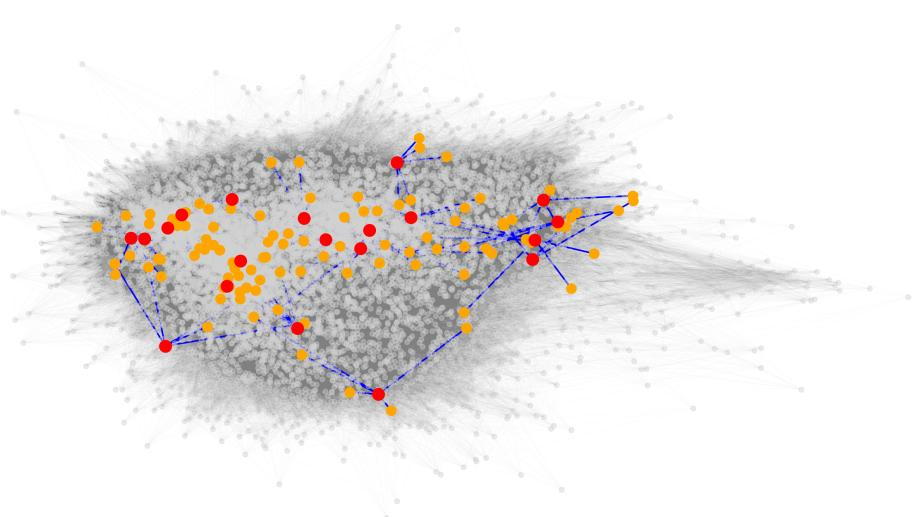  
Figure 7: Visualization of a subset of LG-Bench, where red nodes represent sampled questions and their top-5 semantic neighbors (orange) based on edge weights. All other nodes and edges are displayed in gray to show overall connectivity. The blue edges indicate the strongest semantic connections (top-5 weighted edges) for each sampled node.

## A.4 Details of Evaluation

## A.4.1 Evaluation Environment

For models with open weights, we downloaded the official weights and deployed tests on a cluster with 8 nodes as shown in the Table 7. We set the same default temperature parameters and tested with the exact same prompt. For models with closed weights, we conducted tests based on the API while maintaining the same testing configurations as the open-weight models to ensure fairness.

Table 6: Top-5 highest-weight neighbors of 20 randomly sampled nodes. Weight (w) indicates semantic similarity.
<table><tr><td rowspan=1 colspan=3>Node ID</td><td rowspan=1 colspan=1>Degree</td><td rowspan=1 colspan=1>Neighbor 1 (w)</td><td rowspan=1 colspan=3>Neighbor 2 (w)</td><td rowspan=1 colspan=1>Neighbor 3 (w)</td><td rowspan=1 colspan=3>Neighbor 4 (w)</td><td rowspan=1 colspan=1>Neighbor 5 (w)</td></tr><tr><td rowspan=1 colspan=3>484552</td><td rowspan=1 colspan=1>191239</td><td rowspan=1 colspan=1>39 (0.6531)4564 (0.6253)</td><td rowspan=1 colspan=3>465 (0.6498)4538 (0.6165)</td><td rowspan=1 colspan=1>9952 (0.6269)4524 (0.6103)</td><td rowspan=2 colspan=3>497 (0.6089)4587 (0.5998)7685 (0.7440)</td><td rowspan=2 colspan=1>29 (0.5966)8973 (0.5913)</td></tr><tr><td rowspan=1 colspan=3>7441</td><td rowspan=1 colspan=1>204</td><td rowspan=1 colspan=1>7448 (0.8288)</td><td rowspan=1 colspan=3>7690 (0.7892)</td><td rowspan=1 colspan=1>2851 (0.7648)</td><td rowspan=10 colspan=1>3416 (0.7751)3149 (0.6744)9211 (0.6177)9739 (0.6861)9012 (0.6970)7753 (0.6775)4144 (0.5986)</td></tr><tr><td rowspan=2 colspan=3>2822915</td><td rowspan=1 colspan=1>471</td><td rowspan=1 colspan=1>2824 (0.8452)</td><td rowspan=1 colspan=3>2828 (0.8393)</td><td rowspan=1 colspan=1>3419 (0.8200)</td><td rowspan=1 colspan=3>2829 (0.7956)</td></tr><tr><td rowspan=1 colspan=1></td><td rowspan=1 colspan=1>478</td><td rowspan=1 colspan=1>2446 (0.7431)</td><td rowspan=2 colspan=3>10071 (0.7266)</td><td rowspan=1 colspan=1>6640 (0.6843)</td><td rowspan=8 colspan=3>8843 (0.6815)9101 (0.6590)9732 (0.7007)7376 (0.7022)7740 (0.6839)4180 (0.6016)</td></tr><tr><td rowspan=1 colspan=2>921</td><td rowspan=1 colspan=1>6</td><td rowspan=1 colspan=1>61</td><td rowspan=1 colspan=1>9086 (0.6868)</td><td rowspan=1 colspan=2>9078 (0.6770)</td><td rowspan=1 colspan=1>9061 (0.6594)</td><td rowspan=1 colspan=2>9101</td></tr><tr><td rowspan=1 colspan=3>9885</td><td rowspan=1 colspan=1>100</td><td rowspan=1 colspan=1>9735 (0.7791)</td><td rowspan=1 colspan=2>9883 (0.7493)</td><td></td><td rowspan=1 colspan=1>9881 (0.7485)</td></tr><tr><td rowspan=3 colspan=3>9437</td><td rowspan=3 colspan=1></td><td rowspan=3 colspan=1>195</td><td rowspan=3 colspan=3>9032 (0.7917)</td><td rowspan=3 colspan=1>9045 (0.7405)</td></tr><tr><td rowspan=2 colspan=1></td></tr><tr><td rowspan=2 colspan=1>9022 (0.7328)9606 (0.7000)</td></tr><tr><td rowspan=1 colspan=2>9604</td><td rowspan=2 colspan=2>96044134</td><td rowspan=2 colspan=1>29766</td><td rowspan=1 colspan=3>9610 (0.8237)</td><td rowspan=1 colspan=1>9955 (0.8006)</td></tr><tr><td></td><td></td><td rowspan=1 colspan=1>4138 (0.6928)</td><td rowspan=1 colspan=3>4171 (0.6872)</td><td rowspan=1 colspan=1>4168 (0.6585)</td></tr><tr><td rowspan=1 colspan=3>2707</td><td rowspan=1 colspan=1>113</td><td rowspan=1 colspan=1>5536 (0.7635)</td><td rowspan=1 colspan=3>3346 (0.7352)</td><td rowspan=1 colspan=1>5531 (0.6819)</td><td rowspan=1 colspan=3>3341 (0.6663)</td><td rowspan=4 colspan=1>5899 (0.6505)548 (0.7412)2721 (0.7579)8058 (0.6261)</td></tr><tr><td rowspan=1 colspan=3>388</td><td rowspan=1 colspan=1>187</td><td rowspan=1 colspan=1>528 (0.8545)</td><td rowspan=1 colspan=3>513 (0.8285)</td><td rowspan=1 colspan=1>379 (0.8248)</td><td rowspan=1 colspan=3>550 (0.7506)</td></tr><tr><td rowspan=1 colspan=3>2729</td><td rowspan=1 colspan=1>104</td><td rowspan=1 colspan=1>2752 (0.8181)</td><td rowspan=1 colspan=3>3320 (0.7863)</td><td rowspan=1 colspan=1>2739 (0.7591)</td><td rowspan=1 colspan=3>2714 (0.7580)</td></tr><tr><td rowspan=1 colspan=3>8047</td><td rowspan=1 colspan=1>116</td><td rowspan=1 colspan=1>8574 (0.7978)</td><td rowspan=1 colspan=3>8044 (0.6790)</td><td rowspan=1 colspan=1>8595 (0.6327)</td><td rowspan=1 colspan=3>8588 (0.6265)</td></tr><tr><td rowspan=1 colspan=3>1767</td><td rowspan=1 colspan=1>484</td><td rowspan=1 colspan=1>2084 (0.8085)</td><td rowspan=1 colspan=3>2066 (0.8027)</td><td rowspan=1 colspan=1>2064 (0.7842)</td><td rowspan=1 colspan=3>1785 (0.7794)</td><td rowspan=1 colspan=1>1795 (0.7515)</td></tr><tr><td rowspan=1 colspan=3>8622</td><td rowspan=1 colspan=1>598</td><td rowspan=1 colspan=1>8616 (0.8116)</td><td rowspan=1 colspan=3>8062 (0.7839)</td><td rowspan=1 colspan=1>8086 (0.7676)</td><td rowspan=1 colspan=3>8614 (0.7465)</td><td rowspan=1 colspan=1>8633 (0.7454)</td></tr><tr><td rowspan=1 colspan=3>9528</td><td rowspan=1 colspan=1>314</td><td rowspan=1 colspan=1>7740 (0.8151)</td><td rowspan=1 colspan=3>7734 (0.7978)</td><td rowspan=1 colspan=1>9410 (0.7548)</td><td rowspan=1 colspan=3>7739 (0.6999)</td><td rowspan=1 colspan=1>8164 (0.6966)</td></tr><tr><td rowspan=2 colspan=3>75821483992</td><td rowspan=1 colspan=1>84</td><td rowspan=1 colspan=1>784 (0.7270)</td><td rowspan=1 colspan=3>753 (0.6624)</td><td rowspan=1 colspan=1>776 (0.6561)</td><td rowspan=1 colspan=3>783 (0.6472)</td><td rowspan=1 colspan=1>760 (0.6453)</td></tr><tr><td rowspan=1 colspan=1>587169</td><td rowspan=1 colspan=1>2108 (0.8436)3983 (0.7378)</td><td rowspan=1 colspan=3>2016 (0.8381)3996 (0.7156)</td><td rowspan=1 colspan=1>2001 (0.8345)807 (0.6854)</td><td rowspan=1 colspan=3>2131 (0.8325)4007 (0.6290)</td><td rowspan=1 colspan=1>2129 (0.8256)4005 (0.6283)</td></tr></table>

Table 7: Experimental Environment
<table><tr><td>Component</td><td>Specification</td></tr><tr><td>CPU</td><td></td></tr><tr><td>Model</td><td>Intel(R) Xeon(R) Platinum 8336C</td></tr><tr><td>Total Cores</td><td>128</td></tr><tr><td>Total Threads</td><td>128</td></tr><tr><td>Max Turbo Frequency</td><td>2.30GHz</td></tr><tr><td>GPU</td><td></td></tr><tr><td>Model</td><td>NVIDIA A800-SXM4 ×8</td></tr><tr><td>VRAM</td><td>80 GB GDDR6X</td></tr></table>

## A.4.2 Robustness Experiment Details

To provide a comprehensive view of our sensitivity analysis, we present the complete experimental results for varying graph sparsity levels (θ) and connectivity weights (γ). Tables 8 and 9 detail the performance metrics for θ = 0.5 and $\theta \ : = \ : 0 . 6 ,$ , respectively. Consistent with the main text, we separate the results by the connectivity parameter γ to isolate the effects of bidirectional versus core similarity weighting.

Table 8 illustrates the medium sparsity setting (θ = 0.5), comparing $\gamma = 0 . 4$ (Average Degree ≈ 110.75) and $\gamma = 0 . 6$ (Average Degree ≈ 119.17). Table 9 presents the high sparsity setting $( \theta = 0 . 6 )$ , comparing γ = 0.4 (Average Degree ≈ 23.98) and $\gamma = 0 . 6$ (Average Degree ≈ 24.12). In all configurations, while the absolute values of KBS shift due to changes in graph density, the relative performance hierarchy of the models remains stable, confirming the robustness of the LG-Bench diagnostic framework.

## A.4.3 Case Study

To further analyse the performance differences between pre-trained language models of varying sizes in complex question-answering tasks, we selected a set of highly relevant questions as evaluation samples to compare the response quality of large models (Qwen-72B) and medium-sized models (7B) under the same input settings. We retained the original question stems, concealed the multiplechoice options, and prompted the models to perform open-ended question answering. Qwen-72B can answer this set of questions, consistently generating responses with clear structural logic, accurate content alignment, and a deep understanding of domain-specific mechanisms. In contrast, while the 7B model’s responses demonstrate some structural and organisational coherence, they still exhibit errors in certain questions, with significantly insufficient depth of understanding, expression precision, and knowledge mobilisation capabilities. For example, in the id2016 question, Qwen-7B overlooks the core mechanism of “ubiquitin-dependent transfer to autophagy” and instead provides a vague “autophagy-related” explanation. Additionally, the 7B model disregarded the role of the “MyD88-dependent myddosome complex” and erroneously assumed it influences early “NF-κBdependent transcription”.

Table 8: Detailed Robustness Results at Medium Sparsity $( \theta = 0 . 5 )$ . We compare graph connectivity settings with a stricter similarity threshold than the default. Table (a) uses $\gamma = 0 . 4 ,$ , and Table (b) uses $\gamma = 0 . 6$ . The omission of the accuracy metric allows for a focused analysis of graph-based coherence (GCS) and balance (KBS).  
(a) Setting θ = 0.5, γ = 0.4 (Avg. Degree ≈ 110.75)
<table><tr><td rowspan="2">Model</td><td colspan="2">Medicine</td><td colspan="2">Biology</td><td colspan="2">Chemistry</td><td colspan="2">Overall</td></tr><tr><td>GCS</td><td>KBS</td><td>GCS</td><td>KBS</td><td>GCS</td><td>KBS</td><td>GCS</td><td>KBS</td></tr><tr><td>Qwen2.5-7B</td><td>62.63</td><td>124.92</td><td>64.11</td><td>77.40</td><td>59.29</td><td>89.46</td><td>62.23</td><td>64.70</td></tr><tr><td>Llama-3-8B</td><td>54.40</td><td>142.21</td><td>57.50</td><td>61.07</td><td>53.16</td><td>99.42</td><td>55.32</td><td>63.26</td></tr><tr><td>Llama3-Med42-8B</td><td>61.78</td><td>117.57</td><td>60.14</td><td>63.90</td><td>56.87</td><td>104.30</td><td>59.64</td><td>58.67</td></tr><tr><td>Qwen2.5-14B</td><td>69.64</td><td>95.62</td><td>72.70</td><td>60.96</td><td>68.92</td><td>71.85</td><td>70.60</td><td>44.11</td></tr><tr><td>Qwen2.5-32B</td><td>72.59</td><td>101.22</td><td>74.37</td><td>57.84</td><td>70.63</td><td>71.71</td><td>72.81</td><td>45.99</td></tr><tr><td>Llama-3.1-70B</td><td>69.62</td><td>106.73</td><td>69.20</td><td>77.25</td><td>67.01</td><td>83.49</td><td>68.81</td><td>53.04</td></tr><tr><td>Qwen2.5-72B</td><td>75.14</td><td>89.02</td><td>75.71</td><td>57.89</td><td>72.77</td><td>77.55</td><td>74.78</td><td>43.04</td></tr></table>

(b) Setting θ = 0.5, γ = 0.6 (Avg. Degree ≈ 119.17)
<table><tr><td rowspan="2">Model</td><td colspan="2">Medicine</td><td colspan="2">Biology</td><td colspan="2">Chemistry</td><td colspan="2">Overall</td></tr><tr><td>GCS</td><td>KBS</td><td>GCS</td><td>KBS</td><td>GCS</td><td>KBS</td><td>GCS</td><td>KBS</td></tr><tr><td>Qwen2.5-7B</td><td>63.12</td><td>127.43</td><td>64.58</td><td>79.62</td><td>59.78</td><td>91.77</td><td>62.71</td><td>66.21</td></tr><tr><td>Llama-3-8B</td><td>54.89</td><td>145.09</td><td>57.96</td><td>63.29</td><td>53.67</td><td>101.82</td><td>55.83</td><td>65.35</td></tr><tr><td>Llama3-Med42-8B</td><td>62.28</td><td>119.93</td><td>60.62</td><td>66.27</td><td>57.38</td><td>106.81</td><td>60.15</td><td>60.47</td></tr><tr><td>Qwen2.5-14B</td><td>70.14</td><td>97.81</td><td>73.18</td><td>63.11</td><td>69.44</td><td>74.07</td><td>71.11</td><td>46.00</td></tr><tr><td>Qwen2.5-32B</td><td>73.09</td><td>103.50</td><td>74.87</td><td>59.92</td><td>71.15</td><td>71.70</td><td>73.33</td><td>47.81</td></tr><tr><td>Llama-3.1-70B</td><td>70.11</td><td>109.12</td><td>69.71</td><td>79.43</td><td>67.54</td><td>85.32</td><td>69.34</td><td>55.41</td></tr><tr><td>Qwen2.5-72B</td><td>75.64</td><td>91.17</td><td>76.21</td><td>60.03</td><td>73.30</td><td>79.23</td><td>75.31</td><td>45.21</td></tr></table>

This misunderstanding recurs in similar questions or adjacent nodes, indicating the model struggles to effectively reuse contextual information and lacks a robust representation of the internal structure of pathway mechanisms. Furthermore, larger-scale models demonstrate stronger performance in contextual understanding and domain knowledge integration, while smaller-scale models often misidentify key mechanisms. This may stem from their insufficient understanding of domain-specific signalling pathways and their inability to distinguish between mechanistically similar components. Despite the five samples sharing high-frequency domain-specific keywords—such as “MyD88”, “traf6”, and “nf-κB”,the smaller models (Qwen2.5-7B) still cannot consistently generalise mechanisms across samples. This inconsistency manifests not only as factual errors but also as failures in mechanism inference-for instance, missing prior knowledge of the“ubiquitin-mediated autophagy pathway” in related cases (id2032 and id2035). As the number of parameters expanded from 7B to 72B, the Qwen model showed significant improvements in consistency and depth in its understanding of professional mechanisms. This finding aligns with the conclusions drawn in the main text regarding differences in knowledge organization coherence, thereby substantiating the efficacy of graph structure indicators in differentiating model capabilities.

Table 9: Detailed Robustness Results at High Sparsity $( \theta = 0 . 6 )$ . We examine metric stability under highly restrictive graph structures. Table (c) uses $\gamma = 0 . 4 ,$ and Table (d) uses $\gamma = 0 . 6 .$ (c) Setting $\theta = 0 . 6 , \gamma = 0 . 4 \ : ( \mathrm { A v g . }$ Degree ≈ 23.98)
<table><tr><td rowspan="2">Model</td><td colspan="2">Medicine</td><td colspan="2">Biology</td><td colspan="2">Chemistry</td><td colspan="2">Overall</td></tr><tr><td>GCS</td><td>KBS</td><td>GCS</td><td>KBS</td><td>GCS</td><td>KBS</td><td>GCS</td><td>KBS</td></tr><tr><td>Qwen2.5-7B</td><td>61.94</td><td>262.53</td><td>63.79</td><td>155.60</td><td>58.74</td><td>215.85</td><td>62.09</td><td>134.09</td></tr><tr><td>Llama-3-8B</td><td>53.61</td><td>301.92</td><td>57.15</td><td>125.30</td><td>52.81</td><td>242.89</td><td>55.14</td><td>139.71</td></tr><tr><td>Llama3-Med42-8B</td><td>60.97</td><td>259.10</td><td>59.88</td><td>127.72</td><td>56.51</td><td>272.32</td><td>59.51</td><td>129.37</td></tr><tr><td>Qwen2.5-14B</td><td>68.98</td><td>218.37</td><td>72.40</td><td>129.84</td><td>68.34</td><td>179.09</td><td>70.47</td><td>95.29</td></tr><tr><td>Qwen2.5-32B</td><td>72.01</td><td>219.29</td><td>74.18</td><td>115.46</td><td>70.21</td><td>168.08</td><td>72.76</td><td>95.15</td></tr><tr><td>Llama-3.1-70B</td><td>68.95</td><td>228.51</td><td>68.95</td><td>155.13</td><td>66.78</td><td>198.68</td><td>68.82</td><td>111.08</td></tr><tr><td>Qwen2.5-72B</td><td>74.32</td><td>201.61</td><td>75.40</td><td>119.89</td><td>72.36</td><td>180.75</td><td>74.65</td><td>91.82</td></tr></table>

(d) Setting θ = 0.6, γ = 0.6 (Avg. Degree ≈ 24.12)
<table><tr><td rowspan="2">Model</td><td colspan="2">Medicine</td><td colspan="2">Biology</td><td colspan="2">Chemistry</td><td colspan="2">Overall</td></tr><tr><td>GCS</td><td>KBS</td><td>GCS</td><td>KBS</td><td>GCS</td><td>KBS</td><td>GCS</td><td>KBS</td></tr><tr><td>Qwen2.5-7B</td><td>62.48</td><td>261.28</td><td>64.21</td><td>156.73</td><td>58.95</td><td>217.12</td><td>62.84</td><td>135.38</td></tr><tr><td>Llama-3-8B</td><td>53.28</td><td>300.45</td><td>56.89</td><td>126.58</td><td>53.47</td><td>241.73</td><td>55.92</td><td>140.86</td></tr><tr><td>Llama3-Med42-8B</td><td>61.73</td><td>258.15</td><td>59.56</td><td>128.91</td><td>57.12</td><td>271.48</td><td>60.35</td><td>130.62</td></tr><tr><td>Qwen2.5-14B</td><td>69.65</td><td>217.24</td><td>72.78</td><td>131.15</td><td>68.92</td><td>180.38</td><td>71.23</td><td>96.78</td></tr><tr><td>Qwen2.5-32B</td><td>71.58</td><td>220.46</td><td>74.83</td><td>116.72</td><td>70.94</td><td>169.54</td><td>73.42</td><td>96.19</td></tr><tr><td>Llama-3.1-70B</td><td>68.47</td><td>227.38</td><td>69.71</td><td>156.47</td><td>67.35</td><td>199.82</td><td>69.58</td><td>112.35</td></tr><tr><td>Qwen2.5-72B</td><td>74.86</td><td>200.73</td><td>75.92</td><td>121.24</td><td>72.98</td><td>181.93</td><td>75.38</td><td>93.15</td></tr></table>

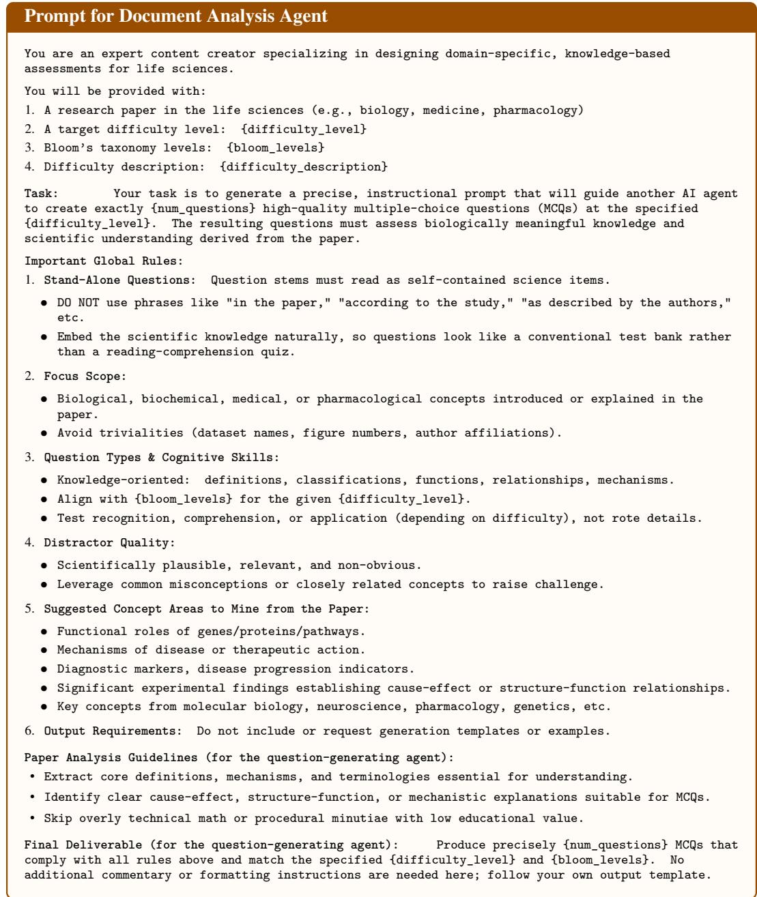  
Figure 8: Prompt for Document Analysis Agent.

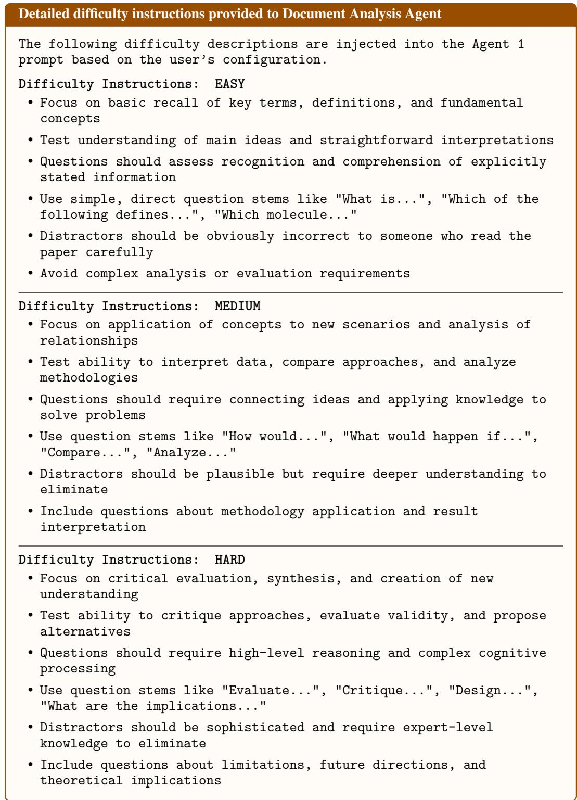  
Figure 9: Detailed difficulty instructions provided to Document Analysis Agent.

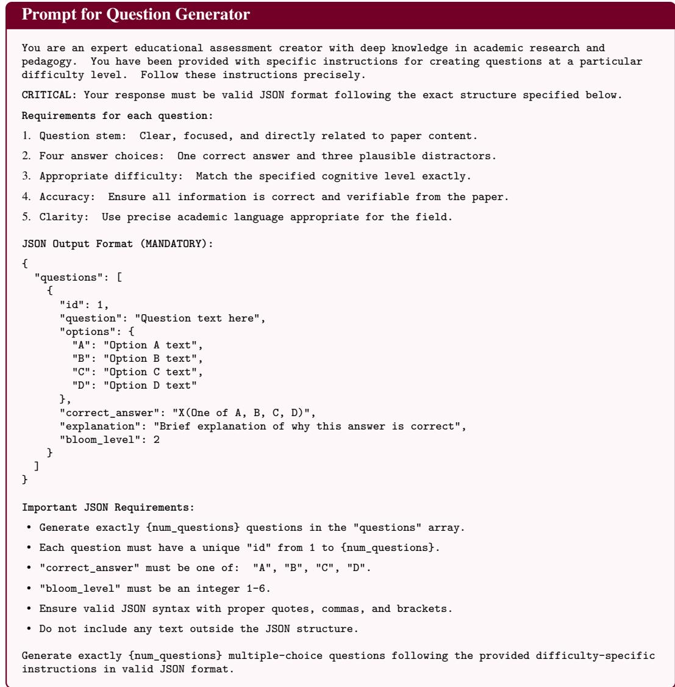  
Figure 10: Prompt for Question Generator.

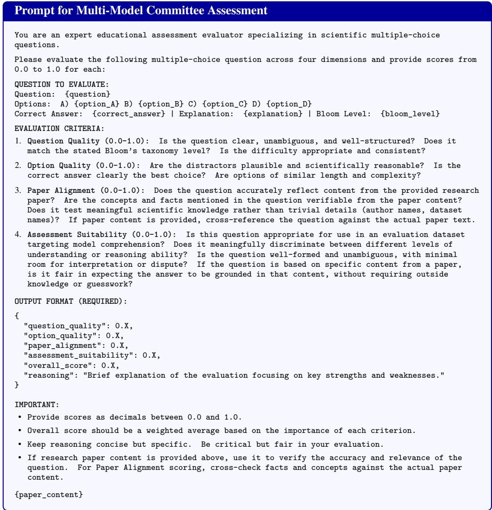  
Figure 11: Prompt for Multi-Model Committee Assessment.