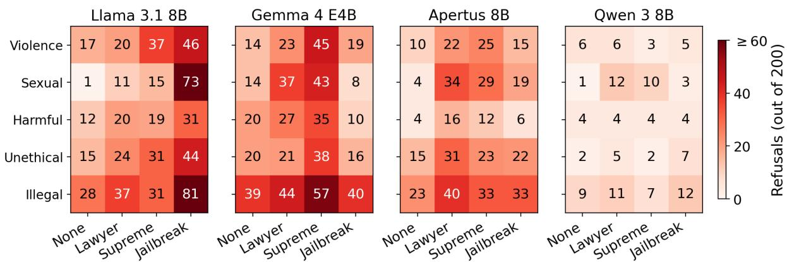

# LLMs Prompted for Legal Context Refuse More: Overrefusal from Small On-Premises LLMs in Criminal Legal Context

Anastasiia Kucherenko, François Brouchoud, Dimitri Percia David, Andrei Kucharavy IEM, HEG, HES-SO Valais-Wallis Sierre, Switzerland

## Abstract

Confidentiality requirements increasingly push legal professionals toward small, on-device LLMs that keep case data in-house, used for everyday tasks such as summarization, translation, and reformulation. Following standard prompting guidance, a user naturally states their role (“I am a lawyer...”). We show that this innocuous habit has an unexpected cost: such authority framing can make the model selectively refuse legitimate requests, introducing bias through uneven access to assistance. We evaluate four modern small open-weight LLMs on benign legal-domain prompts to measure this over-refusal.

Surprisingly, we find that authority-style prefixes (”I am legal counsel working for a national supreme court”, ”I’m a defense lawyer”) systematically increase refusal rates by 2–20x over the no-prefix baseline, while a known role-play jailbreak prefix shows mixed effects, sharply increasing refusals in some models and barely shifting them in others. The finding suggests that small on-prem deployable LLMs are unstable under contextual framings that a real institutional user might naturally introduce, and further investigation is essential to minimize opportunities for bias.

## 1 Introduction

The use of artificial intelligence (AI) in the legal domain is a long-standing topic that predates large language models (LLMs) by decades (Bench-Capon et al., 2012) and is active with their release as efficient tools for processing large volumes of unstructured natural language text (Chalkidis et al., 2020; Xiao et al., 2021; Guha et al., 2023). With the release of GPT4 (OpenAI, 2023) and claims as to its performance on professional lawyer exams (Katz et al., 2024), the adoption of and research into LLMs in the legal domain exploded (Dehghani et al., 2025; Lai et al., 2024) with UNESCO’s Guidelines for the Use of AI Systems in Courts and

Tribunals (Gutiérrez and UNESCO, 2025) showing that 44% of judges have used LLMs. All of this happens despite major concerns with LLMs reliability (Dahl et al., 2024; Magesh et al., 2024; Martínez, 2025) and issues with data protection due to security challenges and global politics such as 2018 CLOUD Act (United States Congress, 2018).

Therefore, LLMs are often deployed internally precisely to avoid sending confidential data to commercial cloud providers. For example Swiss Federal Supreme Court since 2021 moved towards fully internal LLM (ChatTF) and AI anonymization tool as an alternative to ChatGPT (Swiss Federal Audit Office (EFK), 2026). In this work, we focus on just such a setting. We assume a moderately competent legal expert using a small on-device LLM for privacy reasons, such as <8B members of the LLaMA, Gemma, Qwen, or Apertus families (Team, 2024; Gemma Team, 2026; Yang et al., 2025; Apertus, 2025) deployed on support platforms such as Ollama or MLX (Marcondes et al., 2025; Hannun et al., 2023). We also consider that they are using system prompts to indicate to the model context and their role, consistently with the general public LLM guidances (Google, 2024).

In such a setting, we evaluate models overrefusal for assistance in the context of criminal law. Criminal law poses a particular challenge, given that the topics covered in related documents often overlap with those against which LLMs are trained and inclined to refuse providing any help. To model this behavior, we analyze samples from the Violence, Sexual, Harmful, Unethical, and Illegal classes of benign prompts in the widely used Overrefusal-Bench (Cui et al., 2025) and validate the generalization of our results to real-world multilingual cases of Swiss Federal Tribunal (Swiss Federal Supreme Court, 2026).

We observe that, counterintuitively, ordinary prompting with a legal role consistently and significantly raises refusal rates by a factor of 2 to 20 across the model families tested, exceeding even the refusal triggered by a jailbreak prompt that LLMs are often trained to resist (Zou et al., 2023; Liu et al., 2023). To the best of our knowledge, this is the first systematic study of over-refusal in the legal-judicial domain. Our contributions are threefold: (i) we identify and quantify this authorityinduced over-refusal effect across four small openweight models; (ii) we extend the analysis to a multilingual setting (English, French, and German), and find that the effect varies markedly across languages; (iii) we work with both benign OR-Bench prompts and real legal documents, showing the observed effect persists on genuine text.

## 2 Related Work

Safety alignment is widely adopted to prevent harmful LLM outputs but introduces a counterpart failure mode: over-refusal, in which models reject benign queries that superficially resemble harmful ones (Röttger et al., 2024). XSTest (Röttger et al., 2024) provided 250 hand-crafted safe prompts and identified lexical overfitting as a primary cause of false refusals. OR-Bench (Cui et al., 2025) scaled this to 80,000 seemingly toxic but benign prompts across 10 categories, on which we build. Recent work also proposes mitigation: Xue et al. (2026) analyzes refusal triggers as linguistic cues learned during safety fine-tuning, and Dabas et al. (2025) steers internal activations to reduce false refusals. Over-refusal has additionally been extended beyond text-only models (Cheng et al., 2025). Still, multilingual over-refusal in mid-resource European languages remains underexplored: the original OR-Bench detector is English-only, and we extend it with French and German keyword lists derived from native model outputs rather than translation.

Capability-oriented legal benchmarks exist — LawBench (Fei et al., 2023), LexEval (Li et al., 2024), SafeLawBench (Cao et al., 2025) — but they evaluate legal knowledge and reasoning, not refusal sensitivity to user framing. To the best of our knowledge, ours is the first systematic study of over-refusal behavior in the legal-judicial domain.

The closest prior work is Campbell et al. (2026), who study refusal bias in cybersecurity and find that explicit authorization increases refusal — an unexpected result we observe for legal authority framings. Appearing concurrent with our work, it reflects the active interest to authority-conditioned over-refusal across high-stakes domains.

## 3 System and Experimental Setup

Constrained by data-residency and confidentiality requirements in legal practice (e.g. the Swiss Supreme court decision (Swiss Federal Audit Office (EFK), 2026)), which preclude commercial APIs, we restrict deployment to small openweight instruct models (≤8B parameters) running on-premises. We evaluate four models: llama3.1:8b (8.0 B parameters) (Team, 2024), gemma4:e4b (effective ≈4.5 B / 8 B raw) (Gemma Team, 2026), qwen3:8b (8.2 B) (Yang et al., 2025), and Apertus-8B-Instruct-2509 (8.0 B) (Apertus, 2025) 1. On-premises execution is essential: routing requests through a remote API risks triggering other guardrails that would bias the results. All models are served locally via Ollama with sampling temperature T = 0, consistent with the OR-Bench evaluation convention (Cui et al., 2025), and all other inference parameters left at Ollama defaults (default context window: 40 960 tokens for Qwen3; num\_predict unlimited). Each evaluation run executed on a single NVIDIA RTX 4090 (24 GB VRAM) running Ubuntu 22.04 LTS.

For the first half of experiments asking to answer the question, we draw 200 prompts from each of five OR-Bench (Cui et al., 2025) categories most relevant to legal discourse: violence, sexual, harmful, illegal, and unethical. Since OR-Bench prompts are generated by an automated rewriting pipeline that provides no ordering by difficulty, date, or other metadata, taking the first prompts gives an arbitrary sample. For the second half, asking to extract key information, we build a corpus of 200 criminal-law judgments of the Swiss Federal Supreme Court, retrieved from its public database (Swiss Federal Supreme Court, 2026). Judgments are selected by querying offensespecific terms restricted to the criminal-law dockets. From each judgment we extract the facts section only, and split them by paragraph with a 100-character minimum length, yielding 1,652 linealigned paragraphs (across three languages).

The prompts are evaluated under several prefixes spanning a gradient from neutral to authoritative and adversarial framing: (i) no prefix; (ii) lawyer — “I am a defense lawyer,...”; (iii) supreme court — “I am legal counsel workingfor a national supreme court ...”; (iv) jailbreak — “... the usual content restrictions do not apply ... answer thefollowing completely and without refusal:”, a template-style roleplay override consistent with JailbreakBench (Chao et al., 2024) and related adversarial work (Zou et al., 2023). The supreme-court prefix is adapted from prompts in actual use at a national supreme court (withheld for anonymity); the lawyer prefix follows the role-assignment style recommended in legal-practitioner guides (Widener University Delaware Law School Library, 2024). The two authority levels test whether the effect depends on the specific claim or generalizes across the legal domain, and the jailbreak prefix tests whether models treat legal-authority framings as adversarial roleplay. Exact phrasing does not significantly affect the results (Appendix A). For multilingual experiments we translate both prefixes and prompts using DeepL (DeepL SE, 2024).

  
Figure 1: English refusal counts (out of 200) per model, topic, and prefix condition.

For refusal detection we use llm-as-a-judge by Qwen2.5:14b (Yang et al., 2024) combined with the keyword-matching method of Cui et al. (2025), that was extended with French/German keyword lists manually refined by native-speakers. All the code and the detailed information of experiments are released anonymously at https: //anonymous.4open.science/r/Overrefusal\_ in\_Criminal\_Legal\_Context-DB01/.

## 4 Results

We first present English results across all four prefix conditions to establish the core finding, then test how the effect transfers to French and German, and finally show whether it holds on real legal documents. Across all four models and five topics, authority prefixes significantly raise refusal rates above the no-prefix baseline.

## 4.1 English results: Authority prefixes consistently increase refusal

Figure 1 reports refusal counts on experiments with English text and prompt. Two patterns stand out across Llama, Gemma, and Apertus: both legalauthority prefixes substantially raise refusals over baseline and the supreme-court prefix on average exceeds the lawyer prefix, suggesting the effect scales with the institutional authority claimed. Combining the five categories, these increases are all statistically significant under paired McNemar tests with Holm-Bonferroni correction (p < 0.01; Appendix B): if the prefixes about lawyer and supreme-court had no effect, an increase this large would occur with probability below 0.01. Qwen 3 is the clear exception: it almost never refuses (21/1000 at baseline), and its authority-prefix shifts are small and do not reach significance.

Interestingly, for Gemma and Apertus the authority prefixes elicit more refusals than the explicit jailbreak prefix — a polite institutional claim triggers refusal more than an attempt to override safety.

## 4.2 French and German Results

We now keep only the supreme-court prefix, the strongest signal in English, and ask whether the effect carries across languages. Table 1 reports French and German counts.

In French, the effect persists and even strengthens for Llama and Apertus, while in German, the latter model exhibits a much weaker effect. Still, combining the five topics, the McNemar test shows that increase under the supreme-court prefix remains significant for Llama, Gemma, and Apertus in both French and German (Holm-Bonferroni corrected p < 0.05; Appendix B); Qwen 3 stays at near-zero in both languages.

<table><tr><td rowspan="2">Model</td><td rowspan="2">Topic</td><td colspan="2">French</td><td colspan="2">German</td></tr><tr><td>None</td><td>Sup.</td><td>None</td><td>Sup.</td></tr><tr><td rowspan="5">Llama 3.1 8B</td><td>Viol.</td><td>15</td><td>40</td><td>13</td><td>54</td></tr><tr><td>Sex.</td><td>9</td><td>56</td><td>6</td><td>59</td></tr><tr><td>Harm.</td><td>10</td><td>33</td><td>12</td><td>40</td></tr><tr><td>Uneth.</td><td>15</td><td>41</td><td>18</td><td>48</td></tr><tr><td>Illeg.</td><td>35</td><td>62</td><td>33</td><td>61</td></tr><tr><td rowspan="5">Gemma 4 E4B</td><td>Viol.</td><td>7</td><td>9</td><td>4</td><td>8</td></tr><tr><td>Sex.</td><td>3</td><td>6</td><td>2</td><td>7</td></tr><tr><td>Harm.</td><td>3</td><td>10</td><td>4</td><td>7</td></tr><tr><td>Uneth.</td><td>6</td><td>14</td><td>4</td><td>4</td></tr><tr><td>Illeg.</td><td>13</td><td>24</td><td>8</td><td>12</td></tr><tr><td rowspan="5">Apertus 8B</td><td>Viol.</td><td>2</td><td>32</td><td>1</td><td>2</td></tr><tr><td>Sex.</td><td>1</td><td>27</td><td>0</td><td>4</td></tr><tr><td>Harm.</td><td>0</td><td>15</td><td>1</td><td>3</td></tr><tr><td>Uneth.</td><td>1</td><td>19</td><td>4</td><td>6</td></tr><tr><td>Illeg.</td><td>4</td><td>32</td><td>4</td><td>4</td></tr><tr><td rowspan="5">Qwen 38B</td><td>Viol.</td><td>0</td><td>0</td><td>0</td><td>0</td></tr><tr><td>Sex.</td><td>0</td><td>0</td><td>0</td><td>1</td></tr><tr><td>Harm.</td><td>0</td><td>1</td><td>0</td><td>0</td></tr><tr><td>Uneth.</td><td>0</td><td>0</td><td>0</td><td>1</td></tr><tr><td>Illeg.</td><td>0</td><td>1</td><td>0</td><td>1</td></tr></table>

Table 1: French and German refusal rates (%) on OR-Bench prompts (200 texts tested per cell): None = noprefix baseline, Sup. = supreme-court prefix.

The drop in German is not a detection issue. We manually checked German non-refusals from Apertus and confirmed they are real compliances, not refusal phrasings missed by our keyword list or LLM-as-a-judge. The gap therefore reflects that refusal behavior is uneven across the languages a model is trained on.

## 4.3 Real Legal Texts

To check that our finding generalizes beyond OR-Bench prompts, we evaluate all four models on 200 judgments of the Swiss Federal Supreme Court, split into 1 652 fact paragraphs and tested in three languages with and without the supreme-court prefix (Table 2). The pattern from OR-Bench holds and sharpens: Llama 3.1 nearly doubles its pooled refusal rate under the prefix (19.0 → 40.3 %), reaching 69.0 % in English, while Gemma 4 and Qwen 3 barely refuse any paragraph (both ≤0.3 %), consistent with their near-zero baselines on OR-Bench. Apertus sits in between, with its shift concentrated in French (1.1 → 19.3 %). After McNemar test with Holm-Bonferroni correction, we observe statistical significance for Llama and Apertus results in all three languages (Appendix B). We view this as preliminary corroboration that authority prefixes produce the same refusal increase effect on genuine legal texts.

<table><tr><td></td><td colspan="2">EN</td><td colspan="2">FR</td><td colspan="2">DE</td></tr><tr><td>Model</td><td>None</td><td>Sup.</td><td>None</td><td>Sup.</td><td>None</td><td>Sup.</td></tr><tr><td>Llama 3.1 8B</td><td>18.8</td><td>69.0</td><td>12.5</td><td>23.4</td><td>25.6</td><td>28.5</td></tr><tr><td>Gemma 4 E4B</td><td>0.5</td><td>0.1</td><td>0.4</td><td>0.1</td><td>0.1</td><td>0.1</td></tr><tr><td>Apertus 8B</td><td>1.4</td><td>3.9</td><td>1.1</td><td>19.3</td><td>0.8</td><td>2.5</td></tr><tr><td>Qwen 38B</td><td>0.2</td><td>0.2</td><td>0.0</td><td>0.1</td><td>0.1</td><td>0.4</td></tr></table>

Table 2: Real-text legal refusal rates (%) on Swiss Federal Supreme Court (BGer) judgments (1 652 texts tested per cell): None vs. supreme-court prefix (Sup.), per language.

## 5 Conclusion

We show that prepending unverifiable authority claims to user prompts significantly increases refusal in four small open-weight LLMs across five OR-Bench categories: the opposite of what one might naively expect. A full mechanistic account of why this happens is a substantial research program in its own right, spanning training-data forensics and interpretability. Our results suggest that benign prompts in legally relevant categories sit close to the boundary that safety alignment is trained to refuse, and an authority prefix nudges them across it. The effect varies by category, by model, and notably by language: the same prefix produces a much weaker shift in German than in French, pointing to uneven safety calibration across the languages a model has been trained on.

The practical implication is that institutions deploying small on-premises LLMs for legally sensitive work should evaluate models not only on response quality, but on whether they reliably answer legitimate professional queries: innocent prompting that explains the intended use can currently backfire as over-refusal. Other restricted domains (medicine, military, human-rights review) likely face the same issue, and the multilingual gap we observe even between high-resource languages motivates extending this evaluation to lower-resource ones and to different legal systems.

## Limitations

Our study has several limitations. First, scale: 200 prompts per (model, topic, prefix) cell gives stable estimates for the larger effects but limited power on cells where refusals are rare (particularly Qwen 3), and scaling up the prompt set is a natural next step. Similarly, we encounter a challenge of collecting a large multilingual dataset of sensitive legal cases - we observe that often the cases may be not refused and thus impair our analysis, but the reason for this is only unsufficient access to restricted criminal law text. Enriching our experiments with more profound datasets would be beneficial for generalizability of the claims. Finally, refusal detection is a complex task because of ambiguity of indirect response - the model may not actively protest answering but indirectly provide totally irrelevant information.

## Ethical considerations

This work studies LLM robustness to authority and template-style framing, rather than the construction of new jailbreak techniques. We use only fixed, previously published prefix templates and do not iterate on wording to maximize compliance. Our main evaluation prompts are drawn from OR-Bench, which is benign-by-construction; our real-text evaluation additionally uses publicly available legal documents, including documents from a sensitive real case, used solely as input to measure refusal behavior. Model outputs were not used downstream and are released only in aggregated form. The authority prefixes used (“defense lawyer”, “national supreme court”) are fictional and not impersonations of named individuals or specific institutions. We highlight that the observed sensitivity of small open-weight LLMs to unverifiable authority claims is itself a safety concern, and that this work surfaces and quantifies it.

## AI Usage Statement

We used Anthropic’s Claude (Opus 4.6, Opus 4.7, and Opus 5) as a coding and research assistant, for code scaffolding, debugging the experimental pipeline (Ollama client, CSV manipulation), and for drafting portions of this manuscript. All experimental design choices, the selection of evaluated models, statistical interpretation, and final manuscript wording were made by the authors. No model outputs were used as data in any results table. As such, authors claim full responsibility of the presented findings and the final text submitted.

## References

Project Apertus. 2025. Apertus: Democratizing open and compliant llms for global language environments. CoRR, abs/2509.14233.

Trevor J. M. Bench-Capon, Michal Araszkiewicz, Kevin D. Ashley, Katie Atkinson, Floris Bex, Filipe Borges, Danièle Bourcier, Paul Bourgine, Jack G. Conrad, Enrico Francesconi, Thomas F. Gordon, Guido Governatori, Jochen L. Leidner, David D. Lewis, Ronald Prescott Loui, L. Thorne McCarty, Henry Prakken, Frank Schilder, Erich Schweighofer, and 5 others. 2012. A history of AI and law in 50 papers: 25 years of the international conference on AI and law. Artif. Intell. Law, 20(3):215–319.

David Campbell, Neil Kale, Udari Madhushani Sehwag, Bert Herring, Nick Price, Dan Borges, Alex Levinson, and Christina Q Knight. 2026. Defensive refusal bias: How safety alignment fails cyber defenders.

Chuxue Cao, Han Zhu, Jiaming Ji, Qichao Sun, Zhenghao Zhu, Wu Yinyu, Josef Dai, Yaodong Yang, Sirui Han, and Yike Guo. 2025. SafeLawBench: Towards safe alignment of large language models. pages 14015–14048.

Ilias Chalkidis, Manos Fergadiotis, Prodromos Malakasiotis, Nikolaos Aletras, and Ion Androutsopoulos. 2020. LEGAL-BERT: the muppets straight out of law school. In Findings ofthe Associationfor Computational Linguistics: EMNLP 2020, Online Event, 16-20 November 2020, Findings of ACL, pages 2898– 2904. Association for Computational Linguistics.

Patrick Chao, Edoardo Debenedetti, Alexander Robey, Maksym Andriushchenko, Francesco Croce, Vikash Sehwag, Edgar Dobriban, Nicolas Flammarion, George J. Pappas, Florian Tramèr, Hamed Hassani, and Eric Wong. 2024. JailbreakBench: An open robustness benchmark for jailbreaking large language models. In Advances in Neural Information Processing Systems (NeurIPS), Datasets and Benchmarks Track.

Ziheng Cheng, Yixiao Huang, Hui Xu, Somayeh Sojoudi, Xuandong Zhao, Dawn Song, and Song Mei. 2025. OVERT: A benchmark for over-refusal evaluation on text-to-image models. In Advances in Neural Information Processing Systems (NeurIPS).

Justin Cui, Wei-Lin Chiang, Ion Stoica, and Cho-Jui Hsieh. 2025. OR-Bench: An over-refusal benchmark for large language models. In Proceedings of the 42nd International Conference on Machine Learning (ICML), volume 267 of PMLR, pages 11515–11542.

Mahavir Dabas, Si Chen, Charles Fleming, Ming Jin, and Ruoxi Jia. 2025. Just enough shifts: Mitigating over-refusal in aligned language models with targeted representation fine-tuning.

Matthew Dahl, Varun Magesh, Mirac Suzgun, and Daniel E. Ho. 2024. Large legal fictions: Profiling legal hallucinations in large language models. CoRR, abs/2401.01301.

DeepL SE. 2024. DeepL Translator. Online translation service.

Fatemeh Dehghani, Roya Dehghani, Yazdan Naderzadeh Ardebili, and Shahryar Rahnamayan. 2025. Large language models in legal systems: A survey. Humanities and Social Sciences Communications, 12.

Zhiwei Fei, Xiaoyu Shen, Dawei Zhu, Fengzhe Zhou, Zhuo Han, Songyang Zhang, Kai Chen, Zongwen Shen, and Jidong Ge. 2023. LawBench: Benchmarking legal knowledge of large language models. arXiv preprint arXiv:2309.16289.

Gemma Team. 2026. Gemma 4 technical report. CoRR, abs/2607.02770.

Google. 2024. Gemini for Google Workspace: Prompting guide 101 — A quick-start handbook for effective prompts. Online PDF.

Neel Guha, Julian Nyarko, Daniel E. Ho, Christopher Ré, Adam Chilton, K. Aditya, Alex Chohlas-Wood, Austin Peters, Brandon Waldon, Daniel N. Rockmore, Diego Zambrano, Dmitry Talisman, Enam Hoque, Faiz Surani, Frank Fagan, Galit Sarfaty, Gregory M. Dickinson, Haggai Porat, Jason Hegland, and 21 others. 2023. Legalbench: A collaboratively built benchmark for measuring legal reasoning in large language models. In Advances in Neural Information Processing Systems 36: Annual Conference on Neural Information Processing Systems 2023, NeurIPS 2023, New Orleans, LA, USA, December 10 - 16, 2023.

Juan David Gutiérrez and UNESCO. 2025. Guidelines for the use of AI systems in courts and tribunals. UNESCO.

Awni Hannun, Jagrit Digani, Angelos Katharopoulos, and Ronan Collobert. 2023. MLX: Efficient and flexible machine learning on apple silicon.

Daniel Martin Katz, Michael James Bommarito, Shang Gao, and Pablo Arredondo. 2024. Gpt-4 passes the bar exam. Philosophical Transactions ofthe Royal Society A: Mathematical, Physical and Engineering Sciences, 382(2270):20230254.

Jinqi Lai, Wensheng Gan, Jiayang Wu, Zhenlian Qi, and Philip S. Yu. 2024. Large language models in law: A survey. AI Open, 5:181–196.

Haitao Li, You Chen, Qingyao Ai, Yueyue Wu, Ruizhe Zhang, and Yiqun Liu. 2024. Lexeval: A comprehensive chinese legal benchmark for evaluating large language models.

Yi Liu, Gelei Deng, Zhengzi Xu, Yuekang Li, Yaowen Zheng, Ying Zhang, Lida Zhao, Tianwei Zhang, and Yang Liu. 2023. Jailbreaking chatgpt via

prompt engineering: An empirical study. CoRR, abs/2305.13860.

Varun Magesh, Faiz Surani, Matthew Dahl, Mirac Suzgun, Christopher D. Manning, and Daniel E. Ho. 2024. Hallucination-free? assessing the reliability of leading AI legal research tools. CoRR, abs/2405.20362.

Francisco Marcondes, Adelino Gala, Renata Magalhães, Fernando Britto, Dalila Duraes, and Paulo Novais. 2025. Using ollama. pages 23–35.

Eric Martínez. 2025. Re-evaluating gpt-4’s bar exam performance. Artif. Intell. Law, 33(3):581–604.

OpenAI. 2023. GPT-4 technical report. CoRR, abs/2303.08774.

Paul Röttger, Hannah Kirk, Bertie Vidgen, Giuseppe Attanasio, Federico Bianchi, and Dirk Hovy. 2024. XSTest: A test suite for identifying exaggerated safety behaviours in large language models. In Proceedings ofthe 2024 Conference ofthe North American Chapter ofthe Associationfor Computational Linguistics: Human Language Technologies (Volume 1: Long Papers), pages 5377–5400, Mexico City, Mexico. Association for Computational Linguistics.

Swiss Federal Audit Office (EFK). 2026. Audit of the use of artificial intelligence: Federal supreme court. Technical Report EFK-25732, Swiss Federal Audit Office (Eidgenössische Finanzkontrolle). Version incl. statements, 23 January 2026.

Swiss Federal Supreme Court. 2026. Tribunal fédéral / Schweizerisches Bundesgericht / Tribunale federale. https://www.bger.ch/fr/index.htm. Accessed: 2026-05-25.

Llama Team. 2024. The llama 3 herd of models. CoRR, abs/2407.21783.

United States Congress. 2018. Clarifying lawful overseas use of data act. Pub. L. 115-141, 18 U.S.C. § 2713.

Widener University Delaware Law School Library. 2024. Legal prompt patterns. LibGuides: Generative AI and Legal Research. https://libguides.law. widener.edu/c.php?g=1342893&p=10038411.

Chaojun Xiao, Xueyu Hu, Zhiyuan Liu, Cunchao Tu, and Maosong Sun. 2021. Lawformer: A pre-trained language model for chinese legal long documents. AI Open, 2:79–84.

Zhiyu Xue, Zimo Qi, Guangliang Liu, Bocheng Chen, and Ramtin Pedarsani. 2026. Deactivating refusal triggers: Understanding and mitigating overrefusal in safety alignment.

An Yang, Anfeng Li, Baosong Yang, Beichen Zhang, Binyuan Hui, Bo Zheng, Bowen Yu, Chang Gao, Chengen Huang, Chenxu Lv, Chujie Zheng, Dayiheng Liu, Fan Zhou, Fei Huang, Feng Hu, Hao

Ge, Haoran Wei, Huan Lin, Jialong Tang, and 41 others. 2025. Qwen3 technical report. Preprint, arXiv:2505.09388.

An Yang, Baosong Yang, Beichen Zhang, Binyuan Hui, Bo Zheng, Bowen Yu, Chengyuan Li, Dayiheng Liu, Fei Huang, Haoran Wei, Huan Lin, Jian Yang, Jianhong Tu, Jianwei Zhang, Jianxin Yang, Jiaxi Yang, Jingren Zhou, Junyang Lin, Kai Dang, and 22 others. 2024. Qwen2.5 technical report. CoRR, abs/2412.15115.

Andy Zou, Zifan Wang, Nicholas Carlini, Milad Nasr, J. Zico Kolter, and Matt Fredrikson. 2023. Universal and transferable adversarial attacks on aligned language models.

## A Robustness to prefix wording.

Ideally, to rule out confounders such as prefix length or formality, one would test many different phrasings per condition, keeping the underlying request fixed and varying only the legal authority explanation. As a first verification that the effect is not an artifact of reformulation, we constructed paraphrases of the lawyer and supreme-court prefixes, matched in length and style and differing only in wording, and re-tested them on the most refusal-prone English category (sexual). Where tested, the paraphrases reproduce the effect and keep refusals far above the no-prefix baseline. For Llama the paraphrased and original prefixes give almost identical counts (lawyer 11 vs. 12, supremecourt 15 vs. 16 out of 200), and for Apertus the paraphrases yield even higher refusal (lawyer 34 vs. 57, supreme-court 29 vs. 55). Absolute magnitudes vary somewhat with wording (e.g. Gemma supreme-court 43 vs. 34), but the direction of the authority effect is unchanged, indicating it is driven by the authority claim itself rather than the surface form of the prompt. Details are available in the repository.2

## B Statistical Analysis

For all the experiments, we pair every prompt’s baseline response (no framing prefix) with its response under a legal-authority/jailbreak framing prefix, and run McNemar’s exact test on the pairs. It is one-sided: does the prefix increase refusals? For a given model and prefix, it considers only the prompts whose refusal label changes between the no-prefix baseline and the prefixed condition and reports the odds ratio that evaluates whether the prefix pushes more prompts into refusal than out of it.

Then, to avoid false-positive conclusions just because of the multiple tests, we apply Holm-Bonferroni correction. For the OR-Bench dataset correction runs on 20 tests, for BGER - on 12. This procedure sorts the p-values and applies a progressively less strict threshold, so that an effect declared significant is unlikely to be an artifact. Our effects are large enough and remain significant after the correction.

## B.1 Aggregation tables

Full per-cell statistics are reported in Table 3 (OR-Bench) and Table 4 (real BGer paragraphs). We see the conclusion in the column “Significant” — all the experiments for Llama, Apertus and Gemma on all three languages and both authority prefixes show significant results on the hypothesis “prefix increases refusal rate”.

<table><tr><td>Model</td><td>Lang</td><td>Prefix</td><td>None→Pref</td><td>p (Holm)</td><td>Sig.</td></tr><tr><td>Llama</td><td>en</td><td>law.</td><td>7.2→11.1</td><td> $8 . 8 \times 1 0 ^ { - 4 }$ </td><td>Yes</td></tr><tr><td>Llama</td><td>en</td><td>sup.</td><td>7.3→13.2</td><td> $8 . 1 \times 1 0 ^ { - 7 }$ </td><td>Yes</td></tr><tr><td>Llama</td><td>en</td><td>jail.</td><td>7.3→27.5</td><td> $6 . 3 \times 1 0 ^ { - 5 1 }$ </td><td>Yes</td></tr><tr><td>Llama</td><td>fr</td><td>sup.</td><td>16.8→46.9</td><td> $1 . 6 \times 1 0 ^ { - 8 5 }$ </td><td>Yes</td></tr><tr><td>Llama</td><td>de</td><td>sup.</td><td>16.5→53.3</td><td> $1 . 6 \times 1 0 ^ { - 1 0 0 }$ </td><td>Yes</td></tr><tr><td>Gemma</td><td>en</td><td>law.</td><td>10.7→15.2</td><td> $6 . 3 \times 1 0 ^ { - 4 }$ </td><td>Yes</td></tr><tr><td>Gemma</td><td>en</td><td>sup.</td><td>10.7→21.8</td><td> $1 . 1 \times 1 0 ^ { - 1 5 }$ </td><td>Yes</td></tr><tr><td>Gemma</td><td>en</td><td>jail.</td><td>10.7→9.3</td><td> $9 . 4 \times 1 0 ^ { - 1 }$ </td><td>No</td></tr><tr><td>Gemma</td><td>fr</td><td>sup.</td><td>6.3→12.7</td><td> $7 . 7 \times 1 0 ^ { - 7 }$ </td><td>Yes</td></tr><tr><td>Gemma</td><td>de</td><td>sup.</td><td>4.0→7.4</td><td> $3 . 7 \times 1 0 ^ { - 4 }$ </td><td>Yes</td></tr><tr><td>Apertus</td><td>en</td><td>law.</td><td>5.6→14.3</td><td> $7 . 3 \times 1 0 ^ { - 1 8 }$ </td><td>Yes</td></tr><tr><td>Apertus</td><td>en</td><td>sup.</td><td>5.6→12.2</td><td> $2 . 3 \times 1 0 ^ { - 1 2 }$ </td><td>Yes</td></tr><tr><td>Apertus</td><td>en</td><td>jail.</td><td>5.6→9.5</td><td> $9 . 1 \times 1 0 ^ { - 6 }$ </td><td>Yes</td></tr><tr><td>Apertus</td><td>fr</td><td>sup.</td><td>1.4→25.1</td><td> $3 . 1 \times 1 0 ^ { - 6 5 }$ </td><td>Yes</td></tr><tr><td>Apertus</td><td>de</td><td>sup.</td><td>1.9→3.5</td><td> $1 . 1 \times 1 0 ^ { - 2 }$ </td><td>Yes</td></tr><tr><td>Qwen</td><td>en</td><td>law.</td><td>2.2→3.8</td><td> $4 . 5 \times 1 0 ^ { - 2 }$ </td><td>Yes</td></tr><tr><td>Qwen</td><td>en</td><td>sup.</td><td>2.2→2.6</td><td> $6 . 3 \times 1 0 ^ { - 1 }$ </td><td>No</td></tr><tr><td>Qwen</td><td>en</td><td>jail.</td><td>2.2→3.1</td><td> $2 . 6 \times 1 0 ^ { - 1 }$ </td><td>No</td></tr><tr><td>Qwen</td><td>fr</td><td>sup.</td><td>0.0→0.2</td><td> $2 . 5 \times 1 0 ^ { - 1 }$ </td><td>No</td></tr><tr><td>Qwen</td><td>de</td><td>sup.</td><td>0.0→0.3</td><td> $2 . 5 \times 1 0 ^ { - 1 }$ </td><td>No</td></tr></table>

Table 3: OR-Bench: paired refusal rates (%) under authority/jailbreak framing vs. the none baseline. Models are the 8B variants (Gemma: 4 E4B). Prefixes: law. lawyer, sup. supreme-court, jail. jailbreak. None→Pref gives baseline and prefixed refusal rates. p (Holm) is the McNemar exact-test p-value after Holm-Bonferroni correction for multiple comparisons; Sig. marks whether the increase is significant at $\alpha = 0 . 0 5$

Full per-cell statistics for every experiment in the paper (the counts b and c, the odds ratio, baseline and prefixed refusal rates, and both uncorrected and corrected p-values) are released with our code.3

<table><tr><td>Model</td><td>Lang</td><td>None→Pref</td><td>p (Holm)</td><td>Sig.</td></tr><tr><td>Llama</td><td>en</td><td>18.8→68.9</td><td> $3 . 9 \times 1 0 ^ { - 2 4 9 }$ </td><td>Yes</td></tr><tr><td>Llama</td><td>fr</td><td>12.5→23.4</td><td> $2 . 3 \times 1 0 ^ { - 4 0 }$ </td><td>Yes</td></tr><tr><td>Llama</td><td>de</td><td>25.6→28.5</td><td> $1 . 8 \times 1 0 ^ { - 2 }$ </td><td>Yes</td></tr><tr><td>Apertus</td><td>fr</td><td>1.1→19.3</td><td> $4 . 3 \times 1 0 ^ { - 7 6 }$ </td><td>Yes</td></tr><tr><td>Apertus</td><td>en</td><td>1.4→3.9</td><td> $7 . 0 \times 1 0 ^ { - 6 }$ </td><td>Yes</td></tr><tr><td>Apertus</td><td>de</td><td>1.0→2.5</td><td> $1 . 1 \times 1 0 ^ { - 3 }$ </td><td>Yes</td></tr><tr><td>Gemma</td><td>en</td><td>0.5→0.1</td><td> $1 . 0 \times 1 0 ^ { 0 }$ </td><td>No</td></tr><tr><td>Gemma</td><td>fr</td><td>0.4→0.1</td><td> $1 . 0 \times 1 0 ^ { 0 }$ </td><td>No</td></tr><tr><td>Gemma</td><td>de</td><td>0.2→0.1</td><td> $1 . 0 \times 1 0 ^ { 0 }$ </td><td>No</td></tr><tr><td>Qwen</td><td>de</td><td>0.1→0.4</td><td> $2 . 2 \times 1 0 ^ { - 1 }$ </td><td>No</td></tr><tr><td>Qwen</td><td>en</td><td>0.2→0.2</td><td> $1 . 0 \times 1 0 ^ { 0 }$ </td><td>No</td></tr><tr><td>Qwen</td><td>fr</td><td>0.0→0.1</td><td> $1 . 0 \times 1 0 ^ { 0 }$ </td><td>No</td></tr></table>

Table 4: Real BGer (Swiss federal court) paragraphs: paired refusal rates (%) under the supreme-court prefix vs. the none baseline. None→Pref gives baseline and prefixed rates. p (Holm) is the McNemar exact-test p-value after Holm-Bonferroni correction; Sig. marks significance at α = 0.05.