# Manifold-Constrained Residual Adaptation with Frame-Adaptive Layer Aggregation for Speaker Verification

Zezhong Jin , Xiaoyu Wang , Zhe Li , Chong-Xin Gan , Siqing Qin , Man-Wai Mak , Senior Member, IEEE, and Kong Aik Lee , Senior Member, IEEE

Abstract—Large self-supervised speech models provide powerful representations for speaker verification, but full fine-tuning is expensive. Most conventional adapters insert small trainable modules to modify the output of each layer, while keeping the original residual connections unchanged. Building on our preliminary study of manifold-constrained Hyper-Connections in speaker encoders, we explore parameter-efficient adaptation of both residual paths and feature selection across layers. We first propose a Manifold-Constrained Residual Adapter (MCRA), which splits the hidden dimensions of each Transformer residual state into N groups and uses a small Sinkhorn-normalized matrix to exchange information among them. A learnable gate controls the balance between the original and mixed residual paths. The gate initially favors the original path, allowing the model to adapt gradually with only one additional parameter at each residual connection. We further propose Frame-Adaptive Layer Aggregation (FALA), an attention-based aggregation method that uses a single learned query shared across all utterances to compute layer weights separately for each speech frame. Because the layer representations depend on the input, the resulting weights vary across both utterances and frames, unlike the fixed weights of a conventional layer-weighted sum. Compared with a frozen WavLM baseline using a fixed layer-weighted sum, our method achieves relative EER reductions of 22.4% on VoxCeleb1-O and 2.9% on CN-Celeb, while training only 0.0009% and 0.0016% of the WavLM-Large parameters, respectively.

Index Terms—Speaker verification, parameter-efficient finetuning, residual connection, layer aggregation.

## I. INTRODUCTION

UTOMATIC speaker verification (ASV) determines whether a test utterance was produced by a claimed   
speaker. Modern systems map variable-length enrollment   
and test utterances to fixed-dimensional speaker embeddings   
and compare them to provide a similarity score [1]. Their   
performance has advanced through improvements in network   
architecture, training objective, and temporal aggregation.   
Speaker encoders have evolved from x-vector TDNNs to

ResNet- and Res2Net-based models, ECAPA-TDNN, and MFA-Conformer [2]–[5]. Margin-based and metric-learning objectives improve the separation between speakers [6], [7]. Pooling methods have also progressed from statistics pooling to attentive and multi-head aggregation [8], [9]. These developments have produced increasingly discriminative speaker embeddings from supervised training data, including phonetic-aware far-field verification by Jin et al. [10], attentive spectral aggregation by Tu and Mak [11], and within-global-view knowledge transfer by Jin et al. [12].

Self-supervised learning (SSL) provides another source of performance gains [13], [14]. Models such as wav2vec 2.0, HuBERT, and WavLM are pretrained on large unlabeled speech corpora to learn representations that can be transferred to downstream tasks [15]–[17]. Their hidden representations can be transferred to speaker verification by fine-tuning the SSL encoder or by freezing it and training a speaker-specific backend. Full fine-tuning offers broad adaptation capacity, but updating hundreds of millions of parameters is computationally demanding. Freezing the encoder reduces the training cost, but limits task-specific adaptation.

Parameter-efficient fine-tuning (PEFT) seeks a balance between these two settings. Bottleneck adapters insert small trainable transformations into the pretrained encoder [18]. LoRA represents weight updates in a low-rank subspace [19]. Speaker prompt tuning introduces trainable tokens, while UniPET-SPK combines prompts and adapters through learnable gates [20], [21]. A recent unified study has further analyzed several PEFT methods for speaker verification [22]. Although these methods use different parameterizations, they mainly adapt layer transformations, model weights, or task-specific inputs. The residual paths that propagate pretrained features through the Transformer usually remain unchanged.

Our preliminary work reported in [23] investigated the residual-path problem from the perspective of manifoldconstrained Hyper-Connections (mHC). It replaced the residual shortcuts of ResNet-34, Res2Net, and ECAPA-TDNN encoders with multiple full-width residual streams. A Sinkhornnormalized, doubly stochastic matrix is used to control information exchange among the streams [24]. The results established the effectiveness of constrained residual mixing across several speaker encoders. However, this study considered only models trained end to end. It did not address whether residual mixing can be used for PEFT of a frozen SSL encoder. The original mHC is also difficult to apply directly because it maintains multiple full-width residual streams, which expands the hidden state. In addition, PEFT should preserve the pretrained model at the start of adaptation.

To address this gap, we reformulate constrained residual mixing as a Manifold-Constrained Residual Adapter (MCRA). MCRA divides the existing hidden dimension into N feature groups instead of creating N full-width streams. An $N \times$ N Sinkhorn-normalized matrix mixes information among the groups. Its parameter count depends on N, rather than on the hidden dimension. A learnable gate interpolates between the original and mixed residuals. The gate initially favors the original path and gradually introduces the adapted path during training. MCRA can thus modify residual information propagation while retaining the frozen backbone and its original hidden width.

Another challenge is how to combine the intermediate layers of an SSL model. The conventional layer-weighted sum learns one scalar per layer and uses the same layer weights for every utterance and speech frame [25]. MHFA adds inputdependent temporal attention, but its layer weights are still fixed across utterances and frames [9]. LAP computes dynamic layer weights for each frame, but requires feature projections, multiple attention heads, and a specialized pooling network [26]. We propose Frame-Adaptive Layer Aggregation (FALA) as a lightweight alternative. FALA uses one learned query to compute a different layer distribution for each speech frame. It requires no query, key, value, or output projection matrix.

This paper substantially extends our preliminary mHC work [23]. The main contributions are summarized as follows:

• We extend manifold-constrained residual mixing from end to-end training of speaker encoders to parameter-efficient fine-tuning of frozen SSL models. This study explores residual information propagation as a new adaptation target for SSL-based speaker verification.

• We propose MCRA, which divides the original hidden state into feature groups and mixes information among them without increasing the hidden dimension. A learnable gate preserves the original residual path at initialization and controls the contribution of the mixed path during adaptation.

• We propose FALA, which assigns frame-dependent weights to the SSL layers using a single task-specific query. It replaces the fixed layer-weighted sum and adds only a small number of parameters to WavLM-Large.

• Extensive experiments with different pretrained models and evaluation datasets show that the proposed methods improve speaker verification performance while introducing only a few thousand trainable parameters.

## II. RELATED WORK

## A. Self-Supervised Learning for Speech and Parameter-Efficient Fine-Tuning

Speech encoders trained with self-supervised learning (SSL), such as wav2vec 2.0 [15], HuBERT [16], and WavLM [17], provide representations that can be transferred to downstream speaker verification task. The models use different training objectives. wav2vec 2.0 uses a contrastive objective: for each masked speech segment, it learns to distinguish the correct speech representation from several alternatives. HuBERT predicts automatically assigned labels for masked speech frames. WavLM combines masked-frame prediction with denoising, learning to recover speech information from noisy input. Their hidden layers capture complementary information at different levels of abstraction, making both encoder adaptation and layer selection important for downstream speaker systems. A common approach either fine-tunes the complete SSL encoder or keeps it frozen and trains a speaker backend such as ECAPA-TDNN [4]. The former provides greater adaptation flexibility but updates hundreds of millions of parameters, whereas the latter is more economical but leaves the pretrained representations unchanged.

Parameter-efficient fine-tuning (PEFT) seeks a compromise by freezing most of the pretrained encoder and optimizing a small task-specific parameter set. Bottleneck adapters insert compact feature transformations into or alongside Transformer layers [18]; LoRA represents updates to selected weight matrices in a low-rank subspace [19]; and speaker prompt tuning introduces trainable tokens that guide the pretrained encoder [20]. UniPET-SPK further combines inner- and interlayer adapters with deep speaker prompts through learnable gates [21]. Recent controlled studies have also compared these PEFT families under unified speaker-verification settings [22]. Despite their different parameterizations, these methods primarily adapt network weights, intermediate features, or taskspecific inputs while retaining the original residual topology. MCRA instead learns how information propagates through the residual connections.

## B. Hyper-Connections and Manifold-Constrained Residual Routing

Residual connections use a fixed identity shortcut to propagate information through deep networks [27], [28]. This identity path supports optimization and preserves information over depth, but its connectivity is fixed. Hyper-Connections (HC) extend the identity shortcut with multiple residual streams and learn how information is combined and propagated across layers [29]. This provides more flexible connections between successive layers.

When unconstrained HC mixing matrices are composed across many layers, they may cause signal explosion or vanishing and lead to training instability. Manifold-constrained Hyper-Connections (mHC) use Sinkhorn normalization to make the mixing matrix doubly stochastic [24], such that every row and column sums to one. This allows information to be exchanged among streams while keeping the feature scale stable. Unlike adapters and LoRA, which modify feature transformations or model weights, HC and mHC change how features propagate through residual connections.

Our preliminary work was the first to explore mHC for speaker representation learning. It replaced the residual shortcuts of fully trained Fbank speaker encoders with static manifold-constrained mixing [23]. Building on this study, the present work explores whether manifold-constrained residual mixing can be reformulated as a PEFT method for frozen SSL speech encoders.

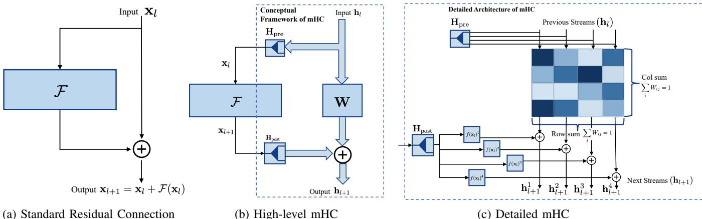  
(b) High-level mHC  
Fig. 1: Architectural comparison between the standard residual shortcut and mHC: (a) standard residual connection, (b) high-leve mHC overview, and (c) detailed mHC design, where $\bf { H } _ { \mathrm { p r e } }$ aggregates streams before $\mathcal F ( \cdot )$ and $\mathbf { H } _ { \mathrm { p o s t } }$ splits the output back into streams.

## C. Cross-Layer Aggregation for SSL Speaker Verification

Speaker encoders fine-tuned from pretrained SSL speech models commonly combine representations from different layers using a learned scalar weighted sum [25]. This approach learns a global preference over the layers of the SSL speech model, but it applies the same layer weights to every utterance and frame. It therefore cannot adapt layer selection to changing phonetic content or acoustic conditions.

Multi-Head Factorized Attentive Pooling (MHFA) learns separate global layer weights to form key and value sequences, and then applies multi-head attention to aggregate information over time [9]. Its temporal attention depends on the input, but its layer weights remain fixed across utterances and frames. Layer Attentive Pooling (LAP) instead computes framedependent layer weights using feature projections and multiple attention heads [26]. It enables dynamic layer selection, but also introduces additional projections, nonlinear operations, and a specialized pooling backend.

These limitations motivate FALA, a lightweight method that uses one shared query to assign input-dependent weights to the SSL layers at each frame.

## III. PROPOSED METHOD

## A. Preliminaries: Manifold-Constrained Hyper-Connections

Fig. 1a illustrates the standard residual connection. At layer l, the output is computed as $\mathbf { x } _ { l + 1 } = \mathbf { x } _ { l } + \mathcal { F } ( \mathbf { x } _ { l } )$ , where $\mathbf { x } _ { l }$ is passed through the shortcut unchanged and then added to the transformation block $\mathcal { F } ( \mathbf { x } _ { l } )$ . This identity shortcut helps to train deep networks, but the shortcut itself is channel-wise independent: the p-th channel of $\mathbf { x } _ { l }$ is only added to the $p \textmd { - }$ th channel of $\mathcal { F } ( \mathbf { x } _ { l } )$ , so there is no explicit mechanism to redistribute information across channels within the skip path.

In Fig. 1b, we use arrow widths to highlight the structural evolution: the thin arrows correspond to the single-path flow used in standard residual connections (Fig. 1a), while the wide arrows symbolize the multi-stream state of mHC, where information is processed in parallel subspaces. This visual distinction clarifies how mHC generalizes the rigid identity shortcut into a more expressive hyper-connection. Fig. 1c details the mHC architecture. The hidden state at layer l is represented as N parallel streams, $\mathbf { h } _ { l } = \{ \mathbf { h } _ { l } ^ { 1 } , \mathbf { h } _ { l } ^ { 2 } , \dots , \mathbf { h } _ { l } ^ { N } \}$ . These streams are first aggregated via an operator $\mathbf { H } _ { \mathrm { p r e } }$ (concatenation) to form a unified feature map $\mathbf { x } _ { l } ,$ which is then fed into the transformation block $\mathcal F ( \cdot )$ . The resulting output is subsequently partitioned by the operator $\bf { H } _ { \mathrm { p o s t } }$ into $N$ disjoint streams $\mathbf { \bar { \{ } }  f ( \mathbf { x } _ { l } ) ^ { 1 } , \dots , \mathbf { \bar { \{ } }  f ( \mathbf { x } _ { l } ) ^ { N } \big \}$ . This structure enables a stream-wise update where the transition from hl to $\mathbf { h } _ { l + 1 }$ is formalized as:

$$
\mathbf { h } _ { l + 1 } ^ { i } = \sum _ { j = 1 } ^ { N } W _ { i j } \mathbf { h } _ { l } ^ { j } + f ( \mathbf { x } _ { l } ) ^ { i } , \quad \forall i \in \{ 1 , \dots , N \} .\tag{1}
$$

Inter-stream communication is governed by the learnable mixing matrix $\mathbf { W } \in \mathbb { R } ^ { N \times N }$ , where $W _ { i j }$ controls the information flow from the j-th historical stream to the i-th updated stream. This weighted summation provides the explicit mechanism for inter-channel communication missing in standard residuals. Unlike identity shortcuts where information is confined to isolated channels, W allows every stream i to selectively aggregate and “refresh” its content with all N previous streams, transforming the shortcut into a high-bandwidth system for representation exchange.

To maintain numerical stability, W is projected onto a doubly stochastic manifold using Sinkhorn-Knopp iterations. We first construct a nonnegative matrix $\mathbf { A } = \exp ( \pmb { \Theta } )$ from a learnable parameter matrix Θ. Then, we alternately apply row normalization $\mathbf { A }  \mathrm { d i a g } ( \mathbf { A } \mathbf { 1 } _ { N } ) ^ { - 1 } \mathbf { A }$ followed by column normalization $\mathbf { A }  \mathbf { A } \mathrm { d i a g } ( \mathbf { 1 } _ { N } ^ { \top } \mathbf { A } ) ^ { - 1 }$ . After K iterations, we obtain the projection matrix W as the normalized matrix A that enforces unit row and column sums. This “Energy Conservation” constraint preserves the signal scale across streams, preventing the signal from exploding or vanishing with depth. Compared with the standard residual shortcut, mHC enables active, learnable mixing while retaining the robust optimization properties of the original architecture.

In [23], we inserted mHC at the main residual shortcuts of the speaker encoders. Specifically, it replaced the interblock shortcuts in ResNet-34 and Res2Net and the main shortcut of the SE-Res2Block in ECAPA-TDNN. These Fbankbased encoders were trained end-to-end, allowing both the feature transformations and the mHC connectivity to be jointly optimized.

## B. Manifold-Constrained Residual Adapter

Most existing PEFT methods adapt the feature transformations of a pretrained model, while leaving its residual connections unchanged. However, residual connections determine how representations are propagated across layers, and even a small modification can influence all subsequent layers. Meanwhile, mHC provides an efficient mechanism for adapting this information flow: its small $N \times N$ mixing matrix introduces very few parameters while acting on the complete residual state. Motivated by these observations, we propose the Manifold-Constrained Residual Adapter (MCRA), which applies lightweight group-wise mixing to the residual paths of frozen WavLM and uses a learnable gate to preserve the pretrained mapping at initialization.

As shown in the left part of Fig. 2, MCRA is inserted into both the self-attention (SA) and FFN residual paths of every WavLM Transformer layer. Consider the SA residual path in layer l. Its input is $\mathbf { \Delta } _ { \mathbf { x } _ { l } . }$ . Following the detailed mHC operation in Fig. 1c, $\mathbf { H } _ { \mathrm { p o s t } }$ divides $\mathbf { \Delta } _ { \mathbf { \mathcal { X } } \mathbf { \mathcal { l } } }$ into $N$ feature groups, the matrix W mixes information among these groups, and $\bf { H } _ { \mathrm { p r e } }$ combines them back into a D-dimensional residual. A gate then blends this mixed residual with the original $\mathbf { \Delta } _ { \mathbf { \mathcal { X } } \mathbf { \Delta } _ { l } }$ . The resulting residual is added to the output of the self-attention sublayer. MCRA performs the same operation on the FFN residual path.

For a compact description of the two residual paths, we use $c \in \{ \mathrm { S A } , \mathrm { F F N } \}$ to indicate the residual type and denote its original residual state by $\pmb { r } _ { l } ^ { c }$ . In the SA path, $\pmb { r } _ { l } ^ { \mathrm { S A } } = \pmb { x } _ { l }$ Each layer and residual path has its own $N \times N$ mixing matrix $\mathbf { W } _ { l } ^ { c }$ , obtained from learnable logits $\Theta _ { l } ^ { c }$ using the same Sinkhorn normalization described in the previous subsection. Applying $\mathbf { H } _ { \mathrm { p o s t } } , \mathbf { W } _ { l } ^ { c }$ , and $\bf { H } _ { \mathrm { p r e } }$ in sequence implements the mixed shortcut term in Eq. (1) and produces the MCRA output $\widehat { \mathbf { } r _ { l } ^ { c } }$ . This is the mixed residual shown in Fig. 2. The two H operators only partition and recombine the feature groups and contain no trainable parameters.

To preserve the pretrained residual path at the beginning of adaptation, MCRA learns one scalar gate logit $g _ { l } ^ { c }$ for each residual junction. Its sigmoid value $\lambda _ { l } ^ { c }$ controls the interpolation between the original and mixed residuals:

$$
\lambda _ { l } ^ { c } = \sigma ( g _ { l } ^ { c } ) ,\tag{2}
$$

$$
\widetilde { \pmb { r } } _ { l } ^ { c } = \big ( 1 - \lambda _ { l } ^ { c } \big ) \pmb { r } _ { l } ^ { c } + \lambda _ { l } ^ { c } \pmb { \widehat { r } } _ { l } ^ { c } .\tag{3}
$$

In Fig. 2, the MCRA box produces $\widehat { \mathbf { \xi } } _ { \overline { { \mathbf { \xi } } } _ { l } } ^ { c c }$ , and the following fusion produces $\widetilde { \pmb { r } } _ { l } ^ { c }$ . We initialize $g _ { l } ^ { c } = - 6$ , so $\lambda _ { l } ^ { c } \approx 0 . 0 0 2 5$ Because $\widetilde { \pmb { r } } _ { l } ^ { c } - \pmb { r } _ { l } ^ { c } = \lambda _ { l } ^ { c } ( \widehat { \pmb { r } } _ { l } ^ { c } - \pmb { r } _ { l } ^ { c } )$ , only about 0.25% of the difference between the mixed and original residuals is introduced at initialization. Together with the scale-preserving doubly stochastic mixer, this keeps the initial residual path close to the pretrained one.

The WavLM-Large Transformer layer uses a pre-normalized structure in which the SA block is followed by the FFN block. Let ${ \mathbf { } } { \mathbf { } } { \mathbf { } } { \mathbf { } } ^ { } { \mathbf { } } { \mathbf { } } ^ { } { \mathbf { } } { \mathbf { } } ^ { } { \mathbf { } } { \mathbf { } } ^ { } { \mathbf { } } { \mathbf { } } ^ { } { \mathbf { } } { \mathbf { } } ^ { } { \mathbf { } } { \mathbf { } } ^ { } { \mathbf { } } { \mathbf { } } ^ { } { \mathbf { } } { \mathbf { } } ^ { } { \mathbf { } } { \mathbf { } } ^ { } { \mathbf { } } { \mathbf { } } ^ { } { \mathbf { } } { \mathbf { } } ^ { } { \mathbf { } } { \mathbf { } } ^ { } { \mathbf { } } { \mathbf { } } ^ { } { \mathbf { } } { \mathbf { } } ^ { } { \mathbf { } } { \mathbf { } } ^ { } { \mathbf { } } { \mathbf { } } ^ { } { \mathbf { } } { \mathbf { } } ^ { } { \mathbf { } } { \mathbf { } } ^ { } { \mathbf { } } { \mathbf { } } ^ { } { \mathbf { } \mathbf { } } { \mathbf { } } ^ { } { \mathbf { } } { \mathbf { } } { \mathbf { } \mathbf { } } ^ { } { \mathbf { } } { \mathbf { } \mathbf { } } ^ { } { \mathbf } { \mathbf { } } { \mathbf { } \Psi } ^ { } { \mathbf { } } { \mathbf } { \Psi } { \mathbf { } } ^ { } { \mathbf } { \mathbf { } } { \mathbf { } \Psi } { \mathbf { } } ^ { } { \mathbf } { \Psi } { \mathbf } { \Psi } { \mathbf } { \Psi } { \mathbf } { \Psi } { \Psi } ^ { \mathbf { } } { \Psi \Psi } { \Psi } { \Psi } \Psi { \mathbf } { \Psi } { \Psi } \Psi \Psi { } \Psi \Psi { \Psi } \Psi \Psi { } \Psi \Psi \Psi { } \Psi \Psi \Psi \Psi { } \Psi \Psi \Psi \Psi \Psi { } \Psi \Psi \Psi \Psi \Psi \Psi \Psi { } \Psi \Psi \Psi \Psi \Psi \Psi \Psi \Psi \Psi \Psi \Psi \Psi \Psi \Psi \Psi \Psi \Psi \Psi \Psi \Psi \Psi \Psi \Psi \Psi \Psi \Psi \Psi \Psi \Psi \Psi \Psi $ denote the output of the SA residual block. We use $\mathrm { L N } _ { l } ^ { \mathrm { S A } }$ and $\mathrm { L N } _ { l } ^ { \mathrm { F F N } }$ to denote the frozen layer-normalization modules preceding the SA and FFN sublayers, respectively. Omitting the frozen dropout operations for clarity, the complete layer update is

$$
{ \pmb u } _ { l } = \mathrm { S A } _ { l } \big ( \mathrm { L N } _ { l } ^ { \mathrm { S A } } ( { \pmb x } _ { l } ) \big ) + \widetilde { r } _ { l } ^ { \mathrm { S A } } ,
$$

$$
\begin{array} { r } { \pmb { r } _ { l } ^ { \mathrm { F F N } } = \pmb { u } _ { l } , } \end{array}\tag{4}
$$

(5)

$$
\pmb { x } _ { l + 1 } = \mathrm { F F N } _ { l } \left( \mathrm { L N } _ { l } ^ { \mathrm { F F N } } ( \pmb { u } _ { l } ) \right) + \widetilde { \pmb { r } } _ { l } ^ { \mathrm { F F N } } .\tag{6}
$$

Thus, the SA path applies MCRA to $\mathbf { \Delta } _ { \mathbf { x } _ { l } }$ , while the FFN path applies the same MCRA operation to ${ \mathbf { } } { \mathbf { } } { \mathbf { } } { \mathbf { } } ^ { } { \mathbf { } } { \mathbf { } } ^ { } { \mathbf { } } { \mathbf { } } ^ { } { \mathbf { } } { \mathbf { } } ^ { } { \mathbf { } } { \mathbf { } } ^ { } { \mathbf { } } { \mathbf { } } ^ { } { \mathbf { } } { \mathbf { } } ^ { } { \mathbf { } } { \mathbf { } } ^ { } { \mathbf { } } { \mathbf { } } ^ { } { \mathbf { } } { \mathbf { } } ^ { } { \mathbf { } } { \mathbf { } } ^ { } { \mathbf { } } { \mathbf { } } ^ { } { \mathbf { } } { \mathbf { } } ^ { } { \mathbf { } } { \mathbf { } } ^ { } { \mathbf { } } { \mathbf { } } ^ { } { \mathbf { } } { \mathbf { } } ^ { } { \mathbf { } } { \mathbf { } } ^ { } { \mathbf { } } { \mathbf { } } ^ { } { \mathbf { } } { \mathbf { } } ^ { } { \mathbf { } } { \mathbf { } } ^ { } { \mathbf { } \mathbf { } } { \mathbf { } } ^ { } { \mathbf { } } { \mathbf { } } ^ { } { \mathbf } { \mathbf { } } { \mathbf { } } ^ { } { \mathbf } { \mathbf { } } { \mathbf { } \mathbf { } } ^ { } { \mathbf { } } { \mathbf } { \mathbf { } } ^ { } { \mathbf } { \mathbf { } } { \mathbf } { \mathbf { } } ^ { } { \mathbf } { \mathbf { } \mathbf { } } { \mathbf } { \mathbf { } \mathbf { } } ^ { } { \mathbf } { \mathbf } { \mathbf } { \mathbf { } \Psi } { \mathbf } { \Psi } ^ { \mathbf { } } { \mathbf } { \mathbf } { \Psi } { \mathbf } { \Psi \Psi } { \mathbf } { \Psi } \Psi { \mathbf } { \Psi \Psi } \Psi { \Psi } \Psi \Psi \Psi \Psi \Psi { } \Psi \Psi \Psi \Psi \Psi \Psi \Psi \Psi \Psi \Psi \Psi \Psi \Psi \Psi \Psi \Psi \Psi \Psi \Psi \Psi \Psi \Psi \Psi \Psi \Psi \Psi \Psi \Psi \Psi \Psi \Psi \Psi \Psi \Psi \Psi \Psi \Psi \Psi \Psi \Psi \Psi \Psi \Psi \Psi $

## C. Frame-Adaptive Layer Aggregation

Let $l \in \{ 0 , \ldots , L \}$ index the representations extracted from WavLM. We denote the l-th representation by ${ \bf { X } } _ { l } \ =$ $[ \pmb { x } _ { l , 1 } , \ldots , \pmb { x } _ { l , T } ] ^ { \top } \ \in \ \mathbb { R } ^ { T \times D }$ , where $\mathbf { X } _ { 0 }$ is the convolutional output and $\mathbf { X } _ { l }$ for $l \geq 1$ is the output of the l-th Transformer layer. Here, $\pmb { x } _ { l , t } \in \mathbb { R } ^ { D }$ denotes frame t in $\mathbf { X } _ { l } . \mathbf { A }$ conventional learned layer-weighted sum is

$$
\beta _ { l } = \frac { \exp ( b _ { l } ) } { \sum _ { j = 0 } ^ { L } \exp ( b _ { j } ) } ,\tag{7}
$$

$$
\mathbf { Z } _ { \mathrm { f i x e d } } = \sum _ { l = 0 } ^ { L } \beta _ { l } \mathbf { X } _ { l } .\tag{8}
$$

Here, $b _ { l }$ is the learnable parameter for representation l, and $\beta _ { l }$ is the corresponding normalized layer weight; $j$ runs over all $L + 1$ representations in the softmax denominator. The resulting matrix $\mathbf { Z } _ { \mathrm { f i x e d } } \ = \ [ z _ { 1 } ^ { \mathrm { f i x e d } } , \dotsc , z _ { T } ^ { \mathrm { f i x e d } } ] ^ { \intercal } \ \in \ \mathbb { R } ^ { T \times D }$ is the aggregated feature sequence. Because $\beta _ { l }$ depends only on the layer index $l ,$ the same layer weights are used for every utterance and frame.

FALA instead uses a single learnable query $\pmb q \in \mathbb { R } ^ { D }$ , shared across all utterances and frames, to represent a task-specific direction for speaker-relevant information. For a fixed frame t, FALA first collects the representations from all layers, $\{ \pmb { x } _ { 0 , t } , \dotsc , \pmb { x } _ { L , t } \}$ . Taking layer l as an example, $\pmb { x } _ { l , t } \in \mathbb { R } ^ { D }$ is its frame-level representation. Before computing the layer attention, FALA applies RMSNorm [30] to its D feature channels:

$$
\eta _ { l , t } = \sqrt { \frac { 1 } { D } \sum _ { d = 1 } ^ { D } x _ { l , t , d } ^ { 2 } + \epsilon } ,\tag{9}
$$

$$
\pmb { k } _ { l , t } = \gamma \odot \frac { \pmb { x } _ { l , t } } { \eta _ { l , t } } , \qquad \gamma \in \mathbb { R } ^ { D } .\tag{10}
$$

Here, $x _ { l , t , d }$ is channel d of $\mathbf { \Delta x } _ { l , t } , \mathbf { \Delta \eta } _ { l , i }$ is its root-mean-square magnitude, ϵ is a small constant for numerical stability, and ⊙ denotes element-wise multiplication. The vector $\gamma$ is the learnable channel-wise scale of RMSNorm.

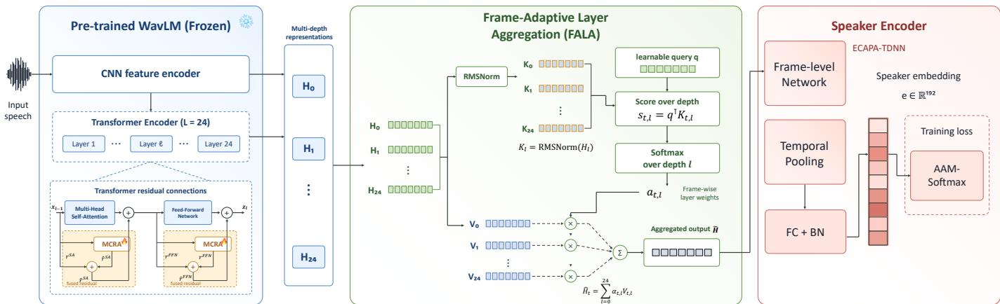  
Fig. 2: Overall architecture of the proposed system. The pretrained WavLM network is frozen. In each Transformer layer, MCRA produces the mixed residual $\widehat { \mathbf { r } } ^ { c }$ , which is fused with the original residual $\pmb { r } ^ { c }$ through a learnable gate to obtain $\widetilde { \pmb { r } } ^ { c }$ , where $c \in \{ \mathrm { S A } , \mathrm { F F N } \}$ . FALA then computes frame-dependent layer weights before the speaker encoder. Frozen LayerNorm and dropout operations are omitted from the diagram for clarity.

At frame t, the shared query scores the key from each layer. A softmax over the layer index produces the layer weights:

$$
a _ { l , t } = \frac { \mathbf { q } ^ { \top } k _ { l , t } } { \sqrt { D } } ,\tag{11}
$$

$$
\alpha _ { l , t } = \frac { \exp ( a _ { l , t } ) } { \sum _ { j = 0 } ^ { L } \exp ( a _ { j , t } ) } ,\tag{12}
$$

$$
z _ { t } = \sum _ { l = 0 } ^ { L } \alpha _ { l , t } \pmb { x } _ { l , t } ,\tag{13}
$$

$$
\mathbf { Z } = [ z _ { 1 } , \ldots , z _ { T } ] ^ { \top } \in \mathbb { R } ^ { T \times D } .\tag{14}
$$

Here, $\alpha _ { l , t }$ is the weight of layer l at frame $t , z _ { t } \in \mathbb { R } ^ { D }$ is the layer-aggregated representation of that frame, and Z is the complete FALA output. Since the keys depend on the input, the layer weights can vary across utterances and frames.

## D. Parameter Efficiency

MCRA and FALA adapt the information flow of WavLM while keeping all original encoder parameters frozen. Their parameter costs are determined solely by the proposed residual mixers, gates, query, and normalization scale.

In particular, MCRA assigns an N × N mixing matrix and one scalar gate to both the SA and FFN residual junctions in every Transformer layer. Its parameter count is

$$
P _ { \mathrm { M C R A } } = 2 L ( N ^ { 2 } + 1 ) .\tag{15}
$$

On the other hand, FALA contains no query, key, or value (Q/K/V) projection matrices used in standard Transformer attention [28], multi-head transformation, attention MLP, or output projection. Its only trainable parameters are the Ddimensional query q and the D-dimensional RMSNorm scale γ, giving

$$
P _ { \mathrm { F A L A } } = 2 D .\tag{16}
$$

Therefore, the total number of WavLM-side adaptation parameters is

$$
P _ { \mathrm { a d a p t } } = P _ { \mathrm { M C R A } } + P _ { \mathrm { F A L A } }\tag{17}
$$

$$
= 2 L ( N ^ { 2 } + 1 ) + 2 D .\tag{18}
$$

For WavLM-Large with $L = 2 4 , N = 4 ,$ , and $D = 1 0 2 4$ $P _ { \mathrm { M C R A } } = 8 1 6$ and $P _ { \mathrm { F A L A } } = 2 { , } 0 4 8$ , giving $P _ { \mathrm { a d a p t } } = 2 { , } 8 6 4$ demonstrating that the proposed parameter-efficient adaptation requires very few learnable parameters.

## IV. EXPERIMENTAL SETUP

## A. Datasets

VoxCeleb: We use the VoxCeleb2 development set for training, which contains 1,092,009 utterances from 5,994 speakers [31]. The systems are evaluated on three VoxCeleb1 trial lists: VoxCeleb1-O with 37,720 trials, VoxCeleb1-E with 581,480 trials, and VoxCeleb1-H with 552,536 trials [32]. We additionally use the 60,000 trials in VoxSRC21-val [33] for robustness evaluation.

CN-Celeb: CN-Celeb is an in-the-wild Chinese speaker recognition corpus containing 659,594 utterances from 3,000 speakers across 11 genres [34]. The systems are trained on the training portions of CN-Celeb1 and CN-Celeb2 and evaluated on CN-Celeb1.Eval, which contains 200 speakers.

Data augmentation resources: MUSAN [35] provides the noise, speech, and music recordings used for additive augmentation. Room impulse responses from the RIR dataset [36] are used to generate reverberated speech.

## B. Implementation Details

Each training sample contains 400 frames, corresponding to 64,240 waveform samples, or approximately 4.015 s at 16 kHz. The batch size is 128. SGD is used with an initial learning rate of 0.002, momentum of 0.9, and weight decay of $1 0 ^ { - 4 } .$ A StepLR scheduler decays the learning rate by a factor of

0.97 after each epoch. The 5,994-way classification head is trained using AAM-Softmax [6] with margin $m = 0 . 2$ and scale $s = 3 0$

Each training utterance is augmented with probability 0.6. One augmentation type is randomly selected from reverberation, noise, speech, music, and speech-plus-music. For MUSAN augmentation, the SNR ranges are 0–15 dB for noise, 13– 20 dB for speech, and 5–15 dB for music. We further apply SpecAugment to the input features of ECAPA-TDNN, with maximum frequency- and time-mask widths of 8 and 10, respectively.

## C. Model Configurations

We use WavLM-Base+ and WavLM-Large as the backbones [17]. WavLM-Base+ contains 12 Transformer layers with a hidden dimension of 768, whereas WavLM-Large contains 24 Transformer layers with a hidden dimension of 1,024. Both backbones are followed by an ECAPA-TDNN with 1,024 channels [4], which produces a 192-dimensional speaker embedding.

All WavLM parameters are frozen, while the ECAPA-TDNN backend, AAM-Softmax classifier, MCRA, and FALA are trainable.

Unless otherwise stated, MCRA uses N = 4 feature groups, eight Sinkhorn normalization iterations, and a learnable gate initialized with $g _ { l } ^ { c } = - 6$ . MCRA is applied to both the selfattention and FFN residual junctions.

## D. Scoring and Evaluation Metrics

Cosine similarity between ℓ -normalized speaker embeddings is used for scoring. Performance is evaluated using equal error rate (EER) and minimum detection cost function (minDCF), with $P _ { \mathrm { t a r g e t } } = 0 . 0 1 , C _ { \mathrm { m i s s } } = 1$ , and $C _ { \mathrm { f a } } ~ = ~ 1$ For AS-Norm, the cohort contains 6,000 speakers with five utterances per speaker, and the top 300 cohort scores are retained.

## V. RESULTS AND ANALYSIS

## A. Generality of Manifold-Constrained Mixing

Tables I and II examine whether the benefit of mHC depends on a particular speaker encoder or evaluation set. Table I summarizes the results of our preliminary Interspeech study [23]. Replacing standard residual connections with mHC reduces EER for all four evaluated backbones: Res2Net, ResNet-34, ECAPA-TDNN-S, and ECAPA-TDNN-L. These models use different network structures and range from 4.03M to 20.76M parameters. Their consistent improvements indicate that manifold-constrained mixing is not specific to one architecture or model size.

The EER improvements also hold on VoxCeleb1-O, E, and H, as well as VoxSRC21-val. In particular, mHC remains effective on VoxCeleb1-H and VoxSRC21-val, where all systems have higher error rates than on VoxCeleb1-O. This shows that its benefit is not limited to the original VoxCeleb1 trial list and remains visible under more challenging evaluation conditions. ECAPA-TDNN-L, for example, reduces EER from 0.87%,

1.12%, and 2.12% to 0.77%, 0.94%, and 1.88% on VoxCeleb1- O, E, and H, respectively, and from 3.89% to 3.68% on VoxSRC21-val.

To further validate the effectiveness of mHC, we also evaluate it on the Chinese CN-Celeb dataset, as shown in Table II. For ECAPA-TDNN-L, mHC reduces EER from 8.65% to 8.01% and minDCF from 0.498 to 0.432, corresponding to relative reductions of 7.4% and 13.3%, respectively. It also achieves the best EER and minDCF among the listed Fbank systems. This result suggests that the improvement extends beyond the English VoxCeleb domain to a different language and acoustic domain. Overall, these results demonstrate the generality of mHC across architectures, model sizes, evaluation conditions, and domains.

## B. Comparison with Existing Adaptation Methods

Table III compares the proposed methods with representative full fine-tuning and PEFT approaches on VoxCeleb1. The proposed methods are evaluated with both WavLM-Base+ and WavLM-Large. The MCRA, FALA, and MCRA–FALA results within each WavLM group use the same training and evaluation setup.

The proposed method improves the frozen baseline at both WavLM scales. For WavLM-Base+, MCRA–FALA uses only 1.944K trainable PTM parameters. Without AS-Norm, it reduces the EER from 1.38%, 1.56%, and 3.29% to 1.16%, 1.27%, and 2.27% on VoxCeleb1-O, E, and H, respectively. These results correspond to relative EER reductions of 15.9%, 18.6%, and 31.0%. The consistent gains show that the proposed adaptation is effective for the smaller WavLM-Base+ model.

The same trend is observed with WavLM-Large. With AS-Norm, MCRA–FALA reduces the EER of the frozen baseline from 0.85%, 1.12%, and 2.06% to 0.66%, 0.84%, and 1.69%. The relative reductions are 22.4%, 25.0%, and 18.0%, respectively. The minDCF also decreases from 0.096 to 0.085 on VoxCeleb1-O and from 0.197 to 0.168 on VoxCeleb1- H. On VoxCeleb1-E, the proposed system obtains a minDCF of 0.092, compared with 0.091 for the frozen baseline. Overall, the consistent EER reductions across all three trial lists demonstrate the effectiveness of the proposed system.

MCRA–FALA offers a favorable comparison with larger PEFT methods. For WavLM-Large, it trains only 2.864K PTM parameters. This is approximately 688 times fewer than LoRA with 1.97M parameters and 4,403 times fewer than the adapter with 12.61M parameters. It also uses over 110,000 times fewer parameters than full fine-tuning. Despite this large reduction, its EER on VoxCeleb1-O is 0.66%, close to the 0.65% obtained by LoRA. On VoxCeleb1-H, MCRA–FALA outperforms LoRA in both EER and minDCF, reducing them from 1.72% and 0.174 to 1.69% and 0.168. Its VoxCeleb1-E EER of 0.84% remains higher than the 0.74% achieved by LoRA. These results show that MCRA–FALA retains competitive accuracy with substantially fewer trainable parameters.

The WavLM-Base+ comparison shows a similar efficiency advantage, although the published systems use a TDNN rather than our ECAPA-TDNN backend. The 1.944K parameters of MCRA–FALA are approximately 1,235 times fewer than the 2.40M parameters of LoRA and 2,623 times fewer than the 5.10M parameters of UniPET-SPK. Without AS-Norm, MCRA–FALA obtains EERs of 1.16%, 1.27%, and 2.27%, compared with 1.59%, 1.74%, and 3.41% for UniPET-SPK. This comparison demonstrates that MCRA–FALA maintains strong verification performance while reducing the number of trainable PTM parameters by several orders of magnitude.

TABLE I: Comparison with representative Fbank-based speaker verification systems, including recent state-of-the-art methods. EER (%) and minDCF are reported on the standard VoxCeleb1 test sets and VoxSRC21-val. The best result within each architecture group is shown in bold.
<table><tr><td rowspan="2">Architecture</td><td rowspan="2">Params (M)</td><td colspan="2">VoxCeleb1-O</td><td colspan="2">VoxCeleb1-E</td><td colspan="2">VoxCeleb1-H</td><td colspan="2">VoxSRC21-val</td></tr><tr><td>EER(%)</td><td>minDCF</td><td>EER(%)</td><td>minDCF</td><td>EER(%)</td><td>minDCF</td><td>EER(%)</td><td>minDCF</td></tr><tr><td>Res2Net-48w2s [3]</td><td>5.50</td><td>1.75</td><td>0.183</td><td>1.70</td><td>0.182</td><td>2.98</td><td>0.283</td><td>一</td><td></td></tr><tr><td>Res2Net-MWA [37], [38]</td><td>5.50</td><td>1.71</td><td>0.165</td><td></td><td></td><td></td><td></td><td></td><td></td></tr><tr><td>Res2Net</td><td>4.03</td><td>1.56</td><td>0.150</td><td>1.41</td><td>0.149</td><td>2.48</td><td>0.230</td><td>4.27</td><td>0.334</td></tr><tr><td>mHC-Res2Net [23]</td><td>4.03</td><td>1.41</td><td>0.154</td><td>1.40</td><td>0.145</td><td>2.43</td><td>0.228</td><td>4.13</td><td>0.332</td></tr><tr><td>ResNet34-FPM [38], [39]</td><td>5.85</td><td>1.98</td><td>0.205</td><td>1</td><td></td><td></td><td></td><td></td><td></td></tr><tr><td>ResNet34-SKDFE [40]</td><td>5.98</td><td>1.44</td><td>0.168</td><td>1.59</td><td>0.179</td><td>2.76</td><td>0.278</td><td></td><td></td></tr><tr><td>Res2Former-Base [41]</td><td>1.73</td><td>1.23</td><td>0.120</td><td>1.36</td><td>0.140</td><td>2.38</td><td>0.230</td><td>1</td><td></td></tr><tr><td>ResNet-34</td><td>6.34</td><td>1.05</td><td>0.107</td><td>1.11</td><td>0.116</td><td>1.99</td><td>0.192</td><td>3.83</td><td>0.316</td></tr><tr><td>mHC-ResNet-34 [23]</td><td>6.34</td><td>1.03</td><td>0.095</td><td>1.09</td><td>0.110</td><td>1.93</td><td>0.188</td><td>3.35</td><td>0.269</td></tr><tr><td>TDNN [42]</td><td>4.62</td><td>2.31</td><td>0.322</td><td>2.37</td><td>0.273</td><td>4.25</td><td>0.393</td><td>一</td><td></td></tr><tr><td>D-TDNN [42]</td><td>2.85</td><td>1.55</td><td>0.166</td><td>1.63</td><td>0.175</td><td>2.86</td><td>0.257</td><td></td><td></td></tr><tr><td>ECAPA-TDNN-S</td><td>6.19</td><td>1.02</td><td>0.106</td><td>1.41</td><td>0.162</td><td>2.26</td><td>0.257</td><td>4.26</td><td>0.384</td></tr><tr><td>mHC-ECAPA-TDNN-S [23]</td><td>6.19</td><td>0.98</td><td>0.107</td><td>1.07</td><td>0.119</td><td>2.06</td><td>0.204</td><td>4.11</td><td>0.324</td></tr><tr><td>E-TDNN-L [4]</td><td>20.40</td><td>1.26</td><td>0.140</td><td>1.37</td><td>0.149</td><td>2.35</td><td>0.215</td><td>一</td><td></td></tr><tr><td>D-TDNN-L [42]</td><td>6.40</td><td>1.19</td><td>0.118</td><td>1.21</td><td>0.129</td><td>2.22</td><td>0.205</td><td></td><td></td></tr><tr><td>MGFF-TDNN [43]</td><td>4.78</td><td>0.89</td><td>0.086</td><td>1.05</td><td>0.119</td><td>1.91</td><td>0.195</td><td></td><td></td></tr><tr><td>ECAPA-TDNN-L</td><td>20.76</td><td>0.87</td><td>0.107</td><td>1.12</td><td>0.132</td><td>2.12</td><td>0.210</td><td>3.89</td><td>0.323</td></tr><tr><td>mHC-ECAPA-TDNN-L [23]</td><td>20.76</td><td>0.77</td><td>0.084</td><td>0.94</td><td>0.110</td><td>1.88</td><td>0.190</td><td>3.68</td><td>0.316</td></tr></table>

TABLE II: Results on the CN-Celeb evaluation set.
<table><tr><td>Architecture</td><td>Params (M)</td><td>EER (%)</td><td>minDCF</td></tr><tr><td>ECAPA-TDNN-L (ours) [4]</td><td>20.76</td><td>8.65</td><td>0.498</td></tr><tr><td>ECAPA-TDNN+AAMSupCon [44]</td><td></td><td>8.49</td><td>0.500</td></tr><tr><td>D-TDNN [42]</td><td>2.85</td><td>8.41</td><td>0.468</td></tr><tr><td>SC-EcapaTdnn [45]</td><td>8.28</td><td>8.26</td><td>0.480</td></tr><tr><td>mHC-ECAPA-TDNN-L (ours), G = 8</td><td>20.76</td><td>8.01</td><td>0.432</td></tr></table>

The individual-module results provide an ablation of the proposed design. On WavLM-Base+, both MCRA and FALA improve the frozen baseline. With AS-Norm, MCRA obtains EERs of 1.17%, 1.18%, and 2.27%, while FALA obtains 1.11%, 1.23%, and 2.20%. Their combination further reduces the EERs to 1.04%, 1.12%, and 2.04%. Relative to the better individual result on each test set, the reductions are 6.3%, 5.1%, and 7.3%. This confirms that residual adaptation and frame-adaptive layer aggregation capture complementary information.

The ablation results on WavLM-Large lead to the same conclusion. With AS-Norm, MCRA achieves EERs of 0.81%, 0.85%, and 1.75%, and FALA achieves 0.78%, 0.86%, and 1.76%. MCRA–FALA further reduces these values to 0.66%, 0.84%, and 1.69%. Compared with the better individual module, the relative EER reductions are 15.4%, 1.2%, and 3.4%. MCRA is slightly better on VoxCeleb1-E and H, whereas FALA is better on VoxCeleb1-O. Neither module therefore dominates across all test sets. Their combination gives the strongest overall performance, demonstrating the benefit of adapting both residual information propagation and layer aggregation.

## C. Cross-Domain Evaluation on CN-Celeb

Table IV evaluates the proposed methods on CN-Celeb1.Eval under the CN-Celeb1&2 training setting. This experiment tests whether the trends observed on VoxCeleb remain valid in a different language and acoustic domain.

The proposed method also improves speaker verification performance on CN-Celeb. With only a few thousand additional trainable parameters, MCRA–FALA still improves the frozen WavLM baseline. Consistent improvements are observed with WavLM-Large, showing that the method remains effective. Together with the gains on VoxCeleb, these results further demonstrate the robustness of the proposed method across model sizes, languages, and acoustic conditions.

## D. Effect of the Number of Feature Groups

We further investigate the effect of varying the number of feature groups N on system performance, as shown in Figs. 3 and 4.

For the original mHC experiments, we use ECAPA-TDNN-L as the speaker encoder. N = 4 achieves the best results on VoxCeleb1-O and VoxCeleb1-H, while N = 2 performs best on VoxCeleb1-E; on CN-Celeb, N = 8 achieves the lowest EER. For MCRA–FALA, we use WavLM-Large with an ECAPA-TDNN backend. N = 4 achieves the best results on VoxCeleb1-O and VoxCeleb1-H, whereas N = 8 performs best on VoxCeleb1-E and CN-Celeb. Accordingly, we use N = 4 for the VoxCeleb experiments and N = 8 for the CN-Celeb experiments.

## E. Comparison of Residual Mixing Constraints

To verify the effectiveness of the Sinkhorn-based doubly stochastic constraint in MCRA, we compare it with identity, unconstrained, and row-softmax residual mixing using WavLM-Large with an ECAPA-TDNN backend. MCRA uses N = 4 feature groups and is applied to both the self-attention and FFN residual connections; all other settings are kept fixed. Table V reports the results on VoxCeleb1-O.

TABLE III: Comparison with representative fine-tuning and parameter-efficient adaptation methods on VoxCeleb1. The AS-Norm setting follows each source paper. Full fine-tuning results are shown in italics, and the best PEFT results for each PTM and metric are highlighted in bold.
<table><tr><td rowspan=2 colspan=1>PTM</td><td rowspan=2 colspan=1>Encoder</td><td rowspan=2 colspan=1>Fine-tuning Method</td><td rowspan=2 colspan=1>AS-Norm</td><td rowspan=2 colspan=1>Per-Module#Params</td><td rowspan=1 colspan=1>Trainable</td><td rowspan=1 colspan=1>VoxCel</td><td rowspan=1 colspan=1>eb1-O</td><td rowspan=1 colspan=2>VoxCeleb1-E</td><td rowspan=1 colspan=2>VoxCeleb1-H</td></tr><tr><td rowspan=1 colspan=1>#Params in PTM</td><td rowspan=1 colspan=1>EER(%)</td><td rowspan=1 colspan=1>minDCF</td><td rowspan=1 colspan=1>EER(%)</td><td rowspan=1 colspan=1>minDCF</td><td rowspan=1 colspan=1>EER(%)</td><td rowspan=1 colspan=1>minDCF</td></tr><tr><td rowspan=5 colspan=1>WavLM-Base+</td><td rowspan=5 colspan=1>TDNN</td><td rowspan=1 colspan=1>LoRA [19], [21]</td><td rowspan=1 colspan=1>x</td><td rowspan=1 colspan=1>2.40M</td><td rowspan=1 colspan=1>2.40M</td><td rowspan=1 colspan=1>2.35</td><td rowspan=1 colspan=1>0.179</td><td rowspan=1 colspan=1>2.65</td><td rowspan=1 colspan=1>0.178</td><td rowspan=1 colspan=1>5.04</td><td rowspan=1 colspan=1>0.288</td></tr><tr><td rowspan=1 colspan=1>Houlsby Adapter [21], [46]</td><td rowspan=1 colspan=1>x</td><td rowspan=1 colspan=1>9.50M</td><td rowspan=1 colspan=1>9.50M</td><td rowspan=1 colspan=1>2.30</td><td rowspan=1 colspan=1>0.202</td><td rowspan=1 colspan=1>2.77</td><td rowspan=1 colspan=1>0.204</td><td rowspan=1 colspan=1>5.60</td><td rowspan=1 colspan=1>0.339</td></tr><tr><td rowspan=1 colspan=1>Inner+Inter Adapter [21]</td><td rowspan=1 colspan=1>X</td><td rowspan=1 colspan=1>4.80M</td><td rowspan=1 colspan=1>4.80M</td><td rowspan=1 colspan=1>1.82</td><td rowspan=1 colspan=1>0.156</td><td rowspan=1 colspan=1>2.18</td><td rowspan=1 colspan=1>0.150</td><td rowspan=1 colspan=1>4.05</td><td rowspan=1 colspan=1>0.251</td></tr><tr><td rowspan=1 colspan=1>Deep Speaker Prompting [21]</td><td rowspan=1 colspan=1>x</td><td rowspan=1 colspan=1>0.30M</td><td rowspan=1 colspan=1>0.30M</td><td rowspan=1 colspan=1>2.16</td><td rowspan=1 colspan=1>0.172</td><td rowspan=1 colspan=1>2.41</td><td rowspan=1 colspan=1>0.169</td><td rowspan=1 colspan=1>4.62</td><td rowspan=1 colspan=1>0.292</td></tr><tr><td rowspan=1 colspan=1>UniPET-SPK [21]</td><td rowspan=1 colspan=1>x</td><td rowspan=1 colspan=1>5.10M</td><td rowspan=1 colspan=1>5.10M</td><td rowspan=1 colspan=1>1.59</td><td rowspan=1 colspan=1>0.130</td><td rowspan=1 colspan=1>1.74</td><td rowspan=1 colspan=1>0.138</td><td rowspan=1 colspan=1>3.41</td><td rowspan=1 colspan=1>0.206</td></tr><tr><td rowspan=7 colspan=1>WavLM-Base+</td><td rowspan=7 colspan=1>ECAPA-TDNN</td><td rowspan=1 colspan=1>None (Frozen PTM) [20]</td><td rowspan=1 colspan=1>x</td><td rowspan=1 colspan=1>0.00M</td><td rowspan=1 colspan=1>0.00M</td><td rowspan=1 colspan=1>1.38</td><td rowspan=1 colspan=1>0.160</td><td rowspan=1 colspan=1>1.56</td><td rowspan=1 colspan=1>0.182</td><td rowspan=1 colspan=1>3.29</td><td rowspan=1 colspan=1>0.314</td></tr><tr><td rowspan=2 colspan=1>MCRA</td><td rowspan=2 colspan=1>x√</td><td rowspan=2 colspan=1>0.017K</td><td rowspan=2 colspan=1>0.421K</td><td rowspan=2 colspan=1>1.291.17</td><td rowspan=2 colspan=1>0.1400.120</td><td rowspan=2 colspan=1>1.321.18</td><td rowspan=2 colspan=1>0.1330.118</td><td rowspan=1 colspan=1>2.48</td><td rowspan=1 colspan=1>0.229</td></tr><tr><td rowspan=1 colspan=1>2.27</td><td rowspan=1 colspan=1>0.205</td></tr><tr><td rowspan=2 colspan=1>FALA</td><td rowspan=2 colspan=1>x√</td><td rowspan=2 colspan=1>1.536K</td><td rowspan=2 colspan=1>1.536K</td><td rowspan=2 colspan=1>1.251.11</td><td rowspan=2 colspan=1>0.1300.115</td><td rowspan=2 colspan=1>1.351.23</td><td rowspan=1 colspan=1>0.135</td><td rowspan=1 colspan=1>2.48</td><td rowspan=1 colspan=1>0.226</td></tr><tr><td rowspan=1 colspan=1>0.118</td><td rowspan=1 colspan=1>2.20</td><td rowspan=1 colspan=1>0.200</td></tr><tr><td rowspan=2 colspan=1>MCRA + FALA</td><td rowspan=2 colspan=1>x√</td><td rowspan=2 colspan=1>1.553K</td><td rowspan=2 colspan=1>1.944K</td><td rowspan=2 colspan=1>1.161.04</td><td rowspan=2 colspan=1>0.1100.100</td><td rowspan=2 colspan=1>1.271.12</td><td rowspan=2 colspan=1>0.1250.119</td><td rowspan=1 colspan=1>2.27</td><td rowspan=1 colspan=1>0.209</td></tr><tr><td rowspan=1 colspan=1>2.04</td><td rowspan=1 colspan=1>0.185</td></tr><tr><td rowspan=9 colspan=1>WavLM-Large</td><td rowspan=9 colspan=1>ECAPA-TDNN</td><td rowspan=1 colspan=1>Full fine-tuning [22]</td><td rowspan=1 colspan=1>√</td><td rowspan=1 colspan=1></td><td rowspan=1 colspan=1>316.00M</td><td rowspan=1 colspan=1>0.38</td><td rowspan=1 colspan=1>0.057</td><td rowspan=1 colspan=1>0.48</td><td rowspan=1 colspan=1>0.086</td><td rowspan=1 colspan=1>0.98</td><td rowspan=1 colspan=1>0.169</td></tr><tr><td rowspan=1 colspan=1>None (Frozen PTM) [22]</td><td rowspan=1 colspan=1>√</td><td rowspan=1 colspan=1>0.00M</td><td rowspan=1 colspan=1>0.00M</td><td rowspan=1 colspan=1>0.85</td><td rowspan=1 colspan=1>0.096</td><td rowspan=1 colspan=1>1.12</td><td rowspan=1 colspan=1>0.091</td><td rowspan=1 colspan=1>2.06</td><td rowspan=1 colspan=1>0.197</td></tr><tr><td rowspan=1 colspan=1>Adapter [18], [22]</td><td rowspan=1 colspan=1>√</td><td rowspan=1 colspan=1>0.53M</td><td rowspan=1 colspan=1>12.61M</td><td rowspan=1 colspan=1>0.68</td><td rowspan=1 colspan=1>0.070</td><td rowspan=1 colspan=1>0.77</td><td rowspan=1 colspan=1>0.091</td><td rowspan=1 colspan=1>1.79</td><td rowspan=1 colspan=1>0.180</td></tr><tr><td rowspan=1 colspan=1>LoRA [19], [22]</td><td rowspan=1 colspan=1>√</td><td rowspan=1 colspan=1>0.08M</td><td rowspan=1 colspan=1>1.97M</td><td rowspan=1 colspan=1>0.65</td><td rowspan=1 colspan=1>0.065</td><td rowspan=1 colspan=1>0.74</td><td rowspan=1 colspan=1>0.087</td><td rowspan=1 colspan=1>1.72</td><td rowspan=1 colspan=1>0.174</td></tr><tr><td rowspan=2 colspan=1>MCRA</td><td rowspan=2 colspan=1>x√</td><td rowspan=2 colspan=1>0.017K</td><td rowspan=2 colspan=1>0.841K</td><td rowspan=2 colspan=1>0.820.81</td><td rowspan=2 colspan=1>0.1220.122</td><td rowspan=2 colspan=1>0.910.85</td><td rowspan=2 colspan=1>0.1000.092</td><td rowspan=2 colspan=1>1.871.75</td><td rowspan=1 colspan=1>0.192</td></tr><tr><td rowspan=1 colspan=1>0.179</td></tr><tr><td rowspan=2 colspan=1>FALA</td><td rowspan=2 colspan=1>x√</td><td rowspan=2 colspan=1>2.048K</td><td rowspan=2 colspan=1>2.048K</td><td rowspan=2 colspan=1>0.820.78</td><td rowspan=2 colspan=1>0.1250.107</td><td rowspan=2 colspan=1>0.920.86</td><td rowspan=2 colspan=1>0.1010.094</td><td rowspan=1 colspan=1>1.93</td><td rowspan=1 colspan=1>0.192</td></tr><tr><td rowspan=1 colspan=1>1.76</td><td rowspan=1 colspan=1>0.180</td></tr><tr><td rowspan=1 colspan=1>MCRA + FALA</td><td rowspan=1 colspan=1> $\overline { x }$ √</td><td rowspan=1 colspan=1>2.065K</td><td rowspan=1 colspan=1>2.864K</td><td rowspan=1 colspan=1>0.720.66</td><td rowspan=1 colspan=1>0.0900.085</td><td rowspan=1 colspan=1>0.910.84</td><td rowspan=1 colspan=1>0.1020.092</td><td rowspan=1 colspan=1>1.811.69</td><td rowspan=1 colspan=1>0.1750.168</td></tr></table>

TABLE IV: Comparison of the proposed parameter-efficient adaptation methods on CN-Celeb1.Eval under the CN-Celeb1&2 training setting. All MCRA configurations use $N = 8 .$ Best results are shown in bold.
<table><tr><td rowspan=2 colspan=1>PTM</td><td rowspan=2 colspan=1>Encoder</td><td rowspan=2 colspan=1>Fine-tuning Method</td><td rowspan=2 colspan=1>Per-Module#Params</td><td rowspan=2 colspan=1>Trainable#Params in PTM</td><td rowspan=1 colspan=2>CN-Celeb1.Eval</td></tr><tr><td rowspan=1 colspan=1>EER(%)</td><td rowspan=1 colspan=1>minDCF</td></tr><tr><td rowspan=5 colspan=1>WavLM-Large</td><td rowspan=5 colspan=1>ECAPA-TDNN</td><td rowspan=1 colspan=1>None (Frozen PTM) [22]</td><td rowspan=1 colspan=1>0.00M</td><td rowspan=1 colspan=1>0.00M</td><td rowspan=1 colspan=1>8.72</td><td rowspan=1 colspan=1>0.448</td></tr><tr><td rowspan=1 colspan=1>Full fine-tuning [22]</td><td rowspan=1 colspan=1></td><td rowspan=1 colspan=1>316.00M</td><td rowspan=1 colspan=1>7.25</td><td rowspan=1 colspan=1>0.428</td></tr><tr><td rowspan=1 colspan=1>MCRA</td><td rowspan=1 colspan=1>0.065K</td><td rowspan=1 colspan=1>3.145K</td><td rowspan=1 colspan=1>9.05</td><td rowspan=1 colspan=1>0.454</td></tr><tr><td rowspan=1 colspan=1>FALA</td><td rowspan=1 colspan=1>2.048K</td><td rowspan=1 colspan=1>2.048K</td><td rowspan=1 colspan=1>8.90</td><td rowspan=1 colspan=1>0.459</td></tr><tr><td rowspan=1 colspan=1>MCRA + FALA</td><td rowspan=1 colspan=1>2.113K</td><td rowspan=1 colspan=1>5.168K</td><td rowspan=1 colspan=1>8.47</td><td rowspan=1 colspan=1>0.447</td></tr></table>

TABLE V: Comparison of residual mixing constraints on VoxCeleb1-O.
<table><tr><td>Residual mixing</td><td>Row sum</td><td>Column sum</td><td>EER (%)</td><td>minDCF</td></tr><tr><td>Identity</td><td>1</td><td>1</td><td>0.82</td><td>0.114</td></tr><tr><td>Unconstrained</td><td>一</td><td>一</td><td>0.92</td><td>0.117</td></tr><tr><td>Row softmax</td><td>1</td><td>一</td><td>0.88</td><td>0.114</td></tr><tr><td>Sinkhorn</td><td>1</td><td>1</td><td>0.66</td><td>0.085</td></tr></table>

The identity setting uses a fixed, non-learnable identity matrix and therefore performs no information exchange among feature groups. The unconstrained setting learns the mixing matrix directly without controlling either its row or column sums. Row softmax normalizes each row to sum to one, but leaves the column sums unconstrained. Sinkhorn normalization alternately normalizes the rows and columns, producing a doubly stochastic mixing matrix. Unconstrained mixing and row softmax yield higher EERs than the identity setting, whereas Sinkhorn achieves the best EER of 0.66% and minDCF of 0.085. These results show that learnable mixing alone is insufficient and that constraining both the row and column sums is important for effective residual adaptation.

TABLE VI: Effect of MCRA placement on VoxCeleb1-O. Sinkhorn normalization, a learnable gate, and $N = 4$ are fixed for all configurations.
<table><tr><td>Placement</td><td>EER (%)</td><td>minDCF</td></tr><tr><td>Self-attention residual only</td><td>0.83</td><td>0.116</td></tr><tr><td>FFN residual only</td><td>0.77</td><td>0.148</td></tr><tr><td>Both attention and FFN</td><td>0.66</td><td>0.085</td></tr></table>

## F. Effect of MCRA Placement and Gating

We next examine the placement and gate design of MCRA using the same WavLM-Large and ECAPA-TDNN system on VoxCeleb1-O. In the placement experiment, MCRA uses Sinkhorn normalization, $N = 4 ,$ and a learnable gate; only the residual connections to which MCRA is applied are changed.

The self-attention-only setting applies MCRA only to the selfattention residual connections, whereas the FFN-only setting applies it only to the FFN residual connections. The third setting applies MCRA to both residual connections in every Transformer layer. As shown in Table VI, using MCRA in both locations achieves the best EER of 0.66% and minDCF of 0.085. This result shows that adapting both residual connections is more effective than adapting either one alone.

We further evaluate the gate that balances the original and mixed residuals. For this experiment, MCRA is applied to both residual connections with Sinkhorn normalization and $N = 4 .$

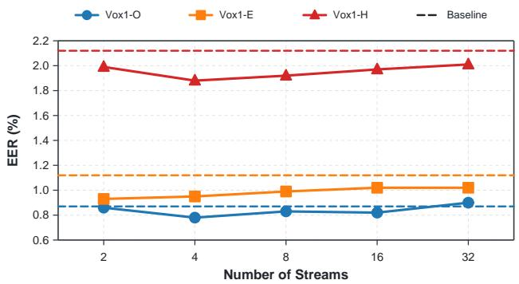  
(a) VoxCeleb

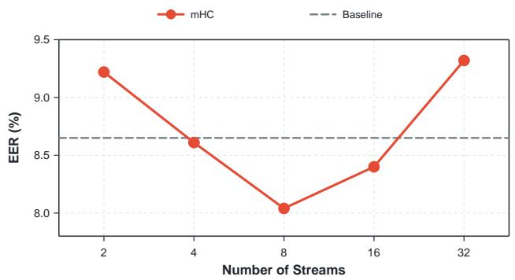  
(b) CN-Celeb  
Fig. 3: Effect of the number of residual streams in the original mHC systems on (a) the VoxCeleb test sets and (b) CN-Celeb.

TABLE VII: Ablation of the MCRA gate design on VoxCeleb1- O.
<table><tr><td>Gate design</td><td>Learnable</td><td>EER (%)</td><td>minDCF</td></tr><tr><td>No gate</td><td>X</td><td>0.77</td><td>0.105</td></tr><tr><td>Fixed gate</td><td>x</td><td>0.74</td><td>0.095</td></tr><tr><td>Learnable gate</td><td>√</td><td>0.66</td><td>0.085</td></tr></table>

The no-gate setting removes the interpolation in Eq. (3), which is equivalent to setting $\lambda _ { l } ^ { c } = 1$ and using only the mixed residual $\widehat { \mathbf { \xi } } _ { \overline { { \mathbf { \xi } } } _ { l } } ^ { c c }$ . The fixed-gate setting keeps $g _ { l } ^ { c } ~ = ~ - 6$ throughout training, corresponding to $\lambda _ { l } ^ { c } = \sigma ( - 6 ) \approx 0 . 0 0 2 5$ The learnable-gate setting uses the same initialization but inde pendently optimizes $g _ { l } ^ { c }$ at each residual connection. Table VII shows that the fixed gate improves upon using no gate, and the learnable gate further reduces the EER to 0.66% and the minDCF to 0.085. These results verify the effectiveness of preserving the original residual path and learning its balance with the adapted path.

## G. Visualization of FALA Layer Weights

Fig. 5 visualizes the layer weights produced by FALA for the same utterance under clean, noisy, and reverberant conditions. In each heatmap, every time frame is assigned a different weight distribution over the WavLM layers, demonstrating the frame-adaptive property of FALA. The bar plots on the right show the weights averaged over time. Different layers contribute unequally, and several intermediate layers receive larger weights. For the same utterance, the overall weight pattern remains similar after adding noise or reverberation. This result demonstrates the stability of FALA under acoustic distortions.

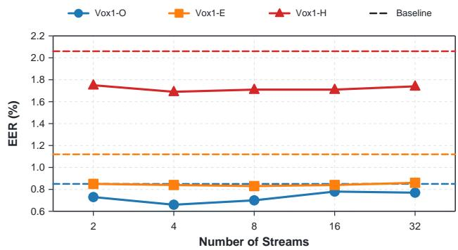  
(a) VoxCeleb1

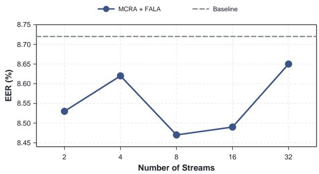  
(b) CN-Celeb

Fig. 4: Effect of the number of feature groups in the proposed MCRA–FALA system on (a) the VoxCeleb1 test sets and (b) CN-Celeb.  
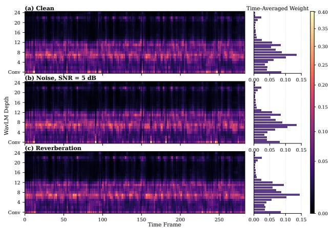  
Fig. 5: Frame-dependent FALA layer weights under (a) clean speech, (b) additive noise at an SNR of 5 dB, and (c) reverberation. The bar plots on the right show the layer weights averaged over time.

## H. Visualization

Fig. 6 compares the cosine-score distributions of the frozen baseline and MCRA–FALA using the complete VoxCeleb1-O trial list, which contains 37,720 trials. The blue curve represents target trials, which should receive high scores. The orange curve represents non-target trials, which should receive low scores. The dashed line is the decision threshold. Compared with the baseline, MCRA–FALA reduces the overlap between the two curves near this threshold. This makes target and non-target trials easier to distinguish and explains the lower verification error.

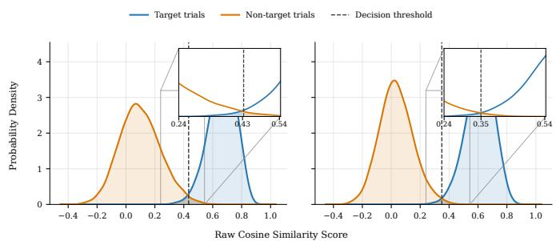  
Fig. 6: Cosine-score distributions for the (left) frozen WavLM baseline and (right) proposed MCRA–FALA system. Blue and orange curves denote target and non-target trials, respectively; dashed vertical lines denote the decision thresholds. The insets enlarge the overlapping score regions.

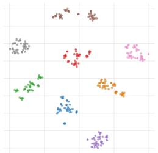

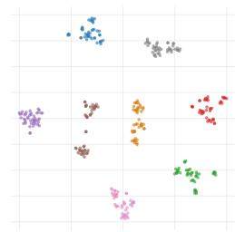  
(a) Frozen WavLM baseline.  
(b) MCRA–FALA system.  
Fig. 7: t-SNE visualization of speaker embeddings extracted by (a) the frozen WavLM baseline and (b) the proposed MCRA– FALA system. The visualization contains eight speakers and 45 utterances per speaker. Different colors denote different speakers.

Fig. 7 shows the corresponding t-SNE visualization. We select eight speakers and 45 utterances per speaker, giving 360 utterances in total. Embeddings from the same speaker form compact clusters, while different speakers remain well separated. MCRA–FALA produces clearer cluster boundaries than the frozen baseline. These visualizations indicate that the proposed method learns more discriminative speaker representations.

## I. Parameter and Computational Efficiency

Fig. 8 compares the number of trainable parameters in WavLM and the EER of different adaptation methods. A point closer to the lower-left corner indicates fewer trainable parameters and lower EER. MCRA and FALA both lie in the ultra-light adaptation region, and their combination achieves an EER of 0.66% with only 2.864K trainable parameters. This result shows that the proposed method provides good speaker verification performance with very few additional parameters.

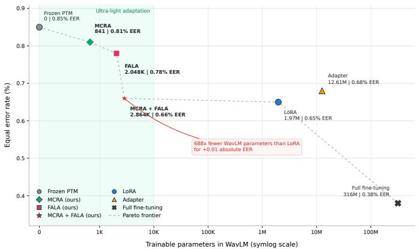  
Fig. 8: Comparison of trainable parameters in WavLM and EER on VoxCeleb1-O. The shaded region indicates methods with fewer than 10K trainable parameters.

## VI. CONCLUSION

We have proposed the MCRA–FALA, a parameter-efficient framework for adapting frozen self-supervised speech models to speaker verification. MCRA partitions each residual state into feature groups and applies Sinkhorn-normalized mixing to adapt information propagation through the residual connections. A learnable gate preserves the original residual path and gradually introduces the adapted path. FALA complements MCRA by assigning frame-dependent weights to the WavLM layers, allowing each speech frame to select the most relevant layer representations. Experiments on VoxCeleb1 and CN-Celeb demonstrate that the two modules are effective individually and provide complementary improvements when combined. Compared with the frozen WavLM-Large baseline, MCRA–FALA achieves a relative EER reduction of 22.4% on VoxCeleb1-O while introducing only 2.864K trainable parameters. It also improves performance on CN-Celeb with only 5.168K parameters. Ablation experiments confirm the effectiveness of the Sinkhorn constraint, applying MCRA to both residual connections, and using a learnable gate. The visualization further shows that FALA performs frame-adaptive layer selection and maintains stable layer-weight patterns under noise and reverberation. These results demonstrate that adapting residual information propagation and layer aggregation provides an effective and highly parameter-efficient approach to speaker verification.

## REFERENCES

[1] S. Wang, Z. Chen, K. A. Lee, Y. Qian, and H. Li, “Overview of speaker modeling and its applications: From the lens of deep speaker representation learning,” IEEE/ACM Transactions on Audio, Speech, and Language Processing, vol. 32, pp. 4971–4998, 2024.

[2] D. Snyder, D. Garcia-Romero, G. Sell, D. Povey, and S. Khudanpur, “X-Vectors: Robust DNN embeddings for speaker recognition,” in Proceedings of the IEEE International Conference on Acoustics, Speech and Signal Processing (ICASSP), 2018, pp. 5329–5333.

[3] T. Zhou, Y. Zhao, and J. Wu, “Resnext and res2net structures for speaker verification,” in 2021 IEEE Spoken Language Technology Workshop (SLT), 2021, pp. 301–307.

[4] B. Desplanques, J. Thienpondt, and K. Demuynck, “ECAPA-TDNN: Emphasized channel attention, propagation and aggregation in TDNN based speaker verification,” in Proc. Interspeech, 2020, pp. 3830–3834.

[5] Y. Zhang, Z. Lv, H. Wu, S. Zhang, P. Hu, Z. Wu, H. yi Lee, and H. Meng, “MFA-Conformer: Multi-scale feature aggregation conformer for automatic speaker verification,” in Proc. Interspeech, 2022, pp. 306– 310.

[6] J. Deng, J. Guo, N. Xue, and S. Zafeiriou, “ArcFace: Additive angular margin loss for deep face recognition,” in Proc. IEEE/CVF Conference on Computer Vision and Pattern Recognition, 2019, pp. 4690–4699.

[7] J. S. Chung, J. Huh, S. Mun, M. Lee, H.-S. Heo, S. Choe, C. Ham, S. Jung, B.-J. Lee, and I. Han, “In defence of metric learning for speaker recognition,” in Proc. Interspeech, 2020, pp. 2977–2981.

[8] K. Okabe, T. Koshinaka, and K. Shinoda, “Attentive statistics pooling for deep speaker embedding,” in Proc. Interspeech, 2018, pp. 2252–2256.

[9] J. Peng, O. Plchot, T. Stafylakis, L. Mosner, L. Burget, and J.ˇ Cernockˇ y,´ “An attention-based backend allowing efficient fine-tuning of transformer models for speaker verification,” in Proceedings of the IEEE Spoken Language Technology Workshop (SLT), 2023, pp. 555–562.

[10] Z. Jin, Y. Tu, and M.-W. Mak, “JOSEPH: Phonetic-aware speaker embedding for far-field speaker verification,” in Proc. APSIPA Annual Summit and Conference, 2024, pp. 1–6.

[11] Y. Tu and M.-W. Mak, “Aggregating frame-level information in the spectral domain with self-attention for speaker embedding,” IEEE/ACM Transactions on Audio, Speech, and Language Processing, vol. 30, pp. 944–957, 2022.

[12] Z. Jin, Y. Tu, and M.-W. Mak, “W-GVKT: Within-global-view knowledge transfer for speaker verification,” in Proc. Interspeech, 2024, pp. 3779– 3783.

[13] ——, “Self-supervised learning with multi-head multi-mode knowledge distillation for speaker verification,” in Proc. Interspeech, 2024, pp. 4723–4727.

[14] Z. Jin, Y. Tu, Z. Li, M.-W. Mak, and K. A. Lee, “Uncertaintyaware multi-head multi-mode knowledge distillation for self-supervised speaker verification,” IEEE Transactions on Audio, Speech and Language Processing, vol. 34, pp. 2101–2114, 2026.

[15] A. Baevski, H. Zhou, A. Mohamed, and M. Auli, “wav2vec 2.0: A framework for self-supervised learning of speech representations,” in Advances in Neural Information Processing Systems, vol. 33, 2020, pp. 12 449–12 460.

[16] W.-N. Hsu, B. Bolte, Y.-H. H. Tsai, K. Lakhotia, R. Salakhutdinov, and A. Mohamed, “HuBERT: Self-supervised speech representation learning by masked prediction of hidden units,” IEEE/ACM Transactions on Audio, Speech, and Language Processing, vol. 29, pp. 3451–3460, 2021.

[17] S. Chen, C. Wang, Z. Chen, Y. Wu, S. Liu, Z. Chen, J. Li, N. Kanda, T. Yoshioka, X. Xiao, J. Wu, L. Zhou, S. Ren, Y. Qian, Y. Qian, J. Wu, M. Zeng, and F. Wei, “WavLM: Large-scale self-supervised pre-training for full stack speech processing,” IEEE Journal of Selected Topics in Signal Processing, vol. 16, no. 6, pp. 1505–1518, 2022.

[18] J. Peng, T. Stafylakis, R. Gu, O. Plchot, L. Mosner, L. Burget, andˇ J. Cernockˇ y, “Parameter-efficient transfer learning of pre-trained trans-´ former models for speaker verification using adapters,” in Proceedings of the IEEE International Conference on Acoustics, Speech and Signal Processing (ICASSP), 2023, pp. 1–5.

[19] E. J. Hu, Y. Shen, P. Wallis, Z. Allen-Zhu, Y. Li, S. Wang, L. Wang, and W. Chen, “LoRA: Low-rank adaptation of large language models,” in International Conference on Learning Representations, 2022.

[20] Z. Li, M.-W. Mak, and H. M.-L. Meng, “Dual parameter-efficient finetuning for speaker representation via speaker prompt tuning and adapters,” in Proceedings ofthe IEEE International Conference on Acoustics, Speech and Signal Processing (ICASSP), 2024, pp. 10 751–10 755.

[21] M. Sang and J. H. L. Hansen, “UniPET-SPK: A unified framework for parameter-efficient tuning of pre-trained speech models for robust speaker verification,” IEEE Transactions on Audio, Speech and Language Processing, vol. 33, pp. 1402–1414, 2025.

[22] Z. Li, M.-W. Mak, M. Pilanci, H.-Y. Lee, C.-X. Gan, J. Sheng, and H. Meng, “Toward a unified perspective on parameter-efficient fine tuning for speaker verification,” IEEE Transactions on Audio, Speech and Language Processing, vol. 34, pp. 2276–2289, 2026.

[23] Z. Jin, X. Wang, Z. Li, C.-X. Gan, Z. Huang, M.-W. Mak, and K. A. Lee, “Beyond residual connections: Manifold-constrained hyper-connections for robust speaker representation learning,” in Proc. Interspeech, 2026, to appear.

[24] Z. Xie, Y. Wei, H. Cao, C. Zhao, C. Deng, J. Li, D. Dai, H. Gao, J. Chang, K. Yu, L. Zhao, S. Zhou, Z. Xu, Z. Zhang, W. Zeng, S. Hu, Y. Wang, J. Yuan, L. Wang, and W. Liang, “mHC: Manifold-constrained hyper-connections,” arXiv preprint arXiv:2512.24880, 2026.

[25] S.-w. Yang, P.-H. Chi, Y.-S. Chuang, C.-I. J. Lai, K. Lakhotia, Y. Y. Lin, A. T. Liu, J. Shi, X. Chang, G.-T. Lin, T.-H. Huang, W.-C. Tseng, K.-t. Lee, D.-R. Liu, Z. Huang, S. Dong, S.-W. Li, S. Watanabe, A. Mohamed, and H.-y. Lee, “SUPERB: Speech processing universal PERformance benchmark,” in Proc. Interspeech, 2021, pp. 3161–3165.

[26] J. S. Kim, H. J. Park, W. Shin, and S. W. Han, “Rethinking leveraging pre-trained multi-layer representations for speaker verification,” in Proc. Interspeech, 2025, pp. 3713–3717.

[27] K. He, X. Zhang, S. Ren, and J. Sun, “Deep residual learning for image recognition,” in Proc. IEEE Conference on Computer Vision and Pattern Recognition, 2016, pp. 770–778.

[28] A. Vaswani, N. Shazeer, N. Parmar, J. Uszkoreit, L. Jones, A. N. Gomez, L. Kaiser, and I. Polosukhin, “Attention is all you need,” in Advances in Neural Information Processing Systems, vol. 30, 2017.

[29] D. Zhu, H. Huang, Z. Huang, Y. Zeng, Y. Mao, B. Wu, Q. Min, and X. Zhou, “Hyper-connections,” arXiv preprint arXiv:2409.19606, 2024.

[30] B. Zhang and R. Sennrich, “Root mean square layer normalization,” in Advances in Neural Information Processing Systems, vol. 32, 2019.

[31] J. S. Chung, A. Nagrani, and A. Zisserman, “Voxceleb2: Deep speaker recognition,” in Proc. Interspeech, 2018, pp. 1086–1090.

[32] A. Nagrani, J. S. Chung, and A. Zisserman, “Voxceleb: A large-scale speaker identification dataset,” in Proc. Interspeech, 2017, pp. 2616–2620.

[33] A. Brown, J. Huh, J. S. Chung, A. Nagrani, D. Garcia-Romero, and A. Zisserman, “VoxSRC 2021: The third VoxCeleb speaker recognition challenge,” arXiv preprint arXiv:2201.04583, 2022.

[34] L. Li, R. Liu, J. Kang, Y. Fan, H. Cui, Y. Cai, R. Vipperla, T. F. Zheng, and D. Wang, “CN-Celeb: Multi-genre speaker recognition,” Speech Communication, vol. 137, pp. 77–91, 2022.

[35] D. Snyder, G. Chen, and D. Povey, “MUSAN: A music, speech, and noise corpus,” arXiv preprint arXiv:1510.08484, 2015.

[36] T. Ko, V. Peddinti, D. Povey, M. L. Seltzer, and S. Khudanpur, “A study on data augmentation of reverberant speech for robust speech recognition,” in Proceedings of the IEEE International Conference on Acoustics, Speech and Signal Processing (ICASSP), 2017, pp. 5220–5224.

[37] B. Gu, W. Guo, and J. Zhang, “Memory storable network based feature aggregation for speaker representation learning,” IEEE/ACM Transactions on Audio, Speech, and Language Processing, vol. 31, pp. 643–655, 2023.

[38] Y. Chen, B. Gu, L. Li, Q. Chen, and Z. Meng, “An enhanced res2net with local and global feature fusion for speaker verification,” in Proc. Interspeech, 2023, pp. 2228–2232.

[39] Y. Jung, S. M. Kye, Y. Choi, M. Jung, and H. Kim, “Improving multi-scale aggregation using feature pyramid module for robust speaker verification of variable-duration utterances,” in Proc. Interspeech, 2020, pp. 1501– 1505.

[40] B. Liu, H. Wang, Z. Chen, S. Wang, and Y. Qian, “Self-knowledge distillation via feature enhancement for speaker verification,” in Proc. IEEE International Conference on Acoustics, Speech and Signal Processing (ICASSP), 2022, pp. 7542–7546.

[41] D. Chen, Y. Zhou, X. Wang, S. Xiang, X. Liu, and Y. Sang, “Res2Former: Integrating Res2Net and transformer for a highly efficient speaker verification system,” Electronics, vol. 14, no. 12, p. 2489, 2025.

[42] H. Wang, S. Zheng, Y. Chen, L. Cheng, and Q. Chen, “CAM++: A fast and efficient network for speaker verification using context-aware masking,” arXiv preprint arXiv:2303.00332, 2023.

[43] Y. Li, B. Zhou, and B. Hu, “MGFF-TDNN: A multi-granularity feature fusion TDNN model with depth-wise separable module for speaker verification,” arXiv preprint arXiv:2505.03228, 2025.

[44] Z. Li and M.-W. Mak, “Speaker representation learning via contrastive loss with maximal speaker separability,” in 2022 Asia-Pacific Signal and Information Processing Association Annual Summit and Conference (APSIPA ASC), 2022, pp. 963–968.

[45] E. Zhang, Y. Wu, and Z. Tang, “SC-EcapaTdnn: ECAPA-TDNN with separable convolutional for speaker recognition,” in Intelligence Science V, ser. IFIP Advances in Information and Communication Technology, vol. 720. Springer, 2024, pp. 286–297.

[46] N. Houlsby, A. Giurgiu, S. Jastrzebski, B. Morrone, Q. de Laroussilhe, A. Gesmundo, M. Attariyan, and S. Gelly, “Parameter-efficient transfer learning for NLP,” in Proceedings of the International Conference on Machine Learning, ser. Proceedings of Machine Learning Research, vol. 97, 2019, pp. 2790–2799.

Zezhong Jin (Student Member, IEEE) received the B.Eng. degree in electronic information engineering from Hebei University, Baoding, China, in 2021, and the M.Sc. degree in electronic and information engi neering from The Hong Kong Polytechnic University, Hong Kong, in 2023. He received the Ph.D. degree from The Hong Kong Polytechnic University in 2026. His research focuses on speaker verification, selfsupervised learning, knowledge distillation, and audio large language models. He interned at Microsoft Research Asia (MSRA) in 2025 and at ByteDance

in 2026 through its Talent Internship Program.  
  
tion.

Xiaoyu Wang received the B.Eng. degree in information engineering from the Chien-Shiung Wu College, Southeast University, Nanjing, China, in 2021, and the M.Eng. degree in electronic and information engineering from Tsinghua Shenzhen International Graduate School, Tsinghua University, Shenzhen, China, in 2024. He is currently a Senior Algorithm Engineer at Baidu, working on large language models. His research interests include reinforcement learning for large language models, multimodal large language models, speaker verification, and knowledge distilla

Zhe LI is currently a postdoctoral researcher with the Department of Electrical Engineering, Stanford University. He previously served as a postdoctoral fellow at The University of Hong Kong (HKU). His research focuses on speech large language models (Speech LLMs) and robust speaker representation learning, with broader interests in multimodal AI for healthcare applications. He received the Ph.D. degree from the Department of Electrical and Electronic En gineering at The Hong Kong Polytechnic University (PolyU) in 2025. He received the M.Sc. degree in

Software Engineering from Xinjiang University, Urumqi, China, in 2021, and the B.Eng. degree in Computer Science from Qilu University of Technology, Jinan, China, in 2016. He was a research intern at Microsoft Research Asia (MSRA) in 2025. He previously conducted international collaborative research as a visiting student scholar with the Department of Electrical Engineering, Stanford University, in 2024. He received the 2020 Excellent Science and Technology Achievement Award from the Chinese Association for Artificial Intelligence, and his co-authored paper received the Best Student Paper Runner Up Award at PRICAI 2024.

  
classification, and deep learning.

Chong-Xin Gan received his B.Eng. degree in Computer Science and Technology from Zhengzhou University in 2019 and M.Sc. degree in Electronic and Information Engineering from The Hong Kong Polytechnic University in 2021. He is currently pursuing a Ph.D. degree in the Department of Electrical and Electronic Engineering at The Hong Kong Polytechnic University. He was also a visiting student at The Center for Speech Technology Re search, The University of Edinburgh. His research interests include speaker verification, sound event

QIN Siqing is currently a Ph.D. student with the Department of Electrical and Electronic Engineering, The Hong Kong Polytechnic University. Her research focuses on speech deepfake detection and speaker embeddings. She received the M.Sc. degree in computer science and technology from Tianjin University, Tianjin, China, in 2022, and the B.Eng. degree in computer science from Zhengzhou University, Henan, China, in 2015. She is conducting international collaborative research as a visiting student scholar with the Department of Electrical and Computer

Kong Aik Lee (Senior Member, IEEE) received the Ph.D. degree from Nanyang Technological University, Singapore, in 2006. From 2006 to 2018, he was a Research Scientist and then a Strategic Planning Man ager (concurrent appointment) with the Institute for Infocomm Research, Singapore. From 2018 to 2020, he was a Senior Principal Researcher with the Data Science Research Laboratories, NEC Corporation, Tokyo, Japan. He was an Associate Professor with the Singapore Institute of Technology, Singapore, while holding a concurrent appointment as a Principal

Engineering, Johns Hopkins University.  

Man-Wai Mak (Senior Member, IEEE) received the B.Eng. (with Hons.) degree in electronic engineering from Newcastle Upon Tyne Polytechnic, Newcastle upon Tyne, U.K., in 1989, and the Ph.D. degree in electronic engineering from Northumbria University, Newcastle upon Tyne (formerly University of Northumbria), in 1993. In 1993, he joined the Department of Electronic and Information Engineer ing (EIE), The Hong Kong Polytechnic University, Hong Kong. From 2021 to 2023, he was the Interim Head with EIE. He is currently a Professor and

Associate Head with the Department of Electronic and Electrical Engineering. He has authored more than 220 technical articles and books in speaker recognition, machine learning, bioinformatics, and biomedical engineering. He is the coauthor of the postgraduate textbook Biometric Authentication: A Machine Learning Approach (Prentice-Hall, 2005), Machine Learning for Protein Subcellular Localization Prediction (De Gruyter, 2015), and Machine Learning for Speaker Recognition (Cambridge University Press, 2020). His research interests include speaker recognition, machine learning, spoken language processing, biomedical engineering, and bioinformatics. He was a Guest Editor of international journals and an Associate Editor for IEEE TRANSACTIONS ON AUDIO, SPEECH, AND LANGUAGE PROCESSING, Journal of Signal Processing Systems, Advances in Artificial Neural Systems, and IEEE BIOMETRICS COMPENDIUM. He was the Tutorial Speaker at Interspeech 2016. He received three Faculty of Engineering Research Grant Achievement Awards and a Faculty Award for Outstanding Performance in Research and Scholarly Activities. He was an Executive Committee Member of the IEEE Hong Kong Section Computer Chapter from 1995 to 2007 and Chairperson from 2003 to 2005. He served on the IEEE Machine Learning for Signal Processing Technical Committee from 2005 to 2007 and was a Technical Committee Member of the IEEE Computational Intelligence Society, Intelligent Systems Applications, in 2008. He was Area Chair of Interspeech 2014 and ICTAI 2016, a Steering Committee Member of ISCSLP and ISCSLP 2016, and Program Co-Chair of ISCSLP 2018 and ISCSLP 2021.

Scientist and a Group Leader with the Agency for Science, Technology and Research (A\*STAR), Singapore. He is currently an Associate Professor with The Hong Kong Polytechnic University, Hong Kong. His research interests include the automatic and paralinguistic analysis of speaker characteristics, ranging from speaker recognition, language and accent recognition, voice biometrics, spoofing, and countermeasures. From 2017 to 2021, he was an Associate Editor for IEEE/ACM TRANSACTIONS ON AUDIO, SPEECH, AND LANGUAGE PROCESSING. Since 2016, he has been an Editorial Board Member of Computer Speech and Language. He is an elected Member of the IEEE Speech and Language Processing Technical Committee and was the General Chair of the Speaker Odyssey 2020 Workshop. He received the Singapore IES Prestigious Engineering Achievement Award in 2013 and the Outstanding Service Award from IEEE ICME in 2020.