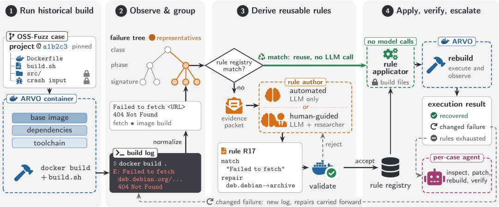
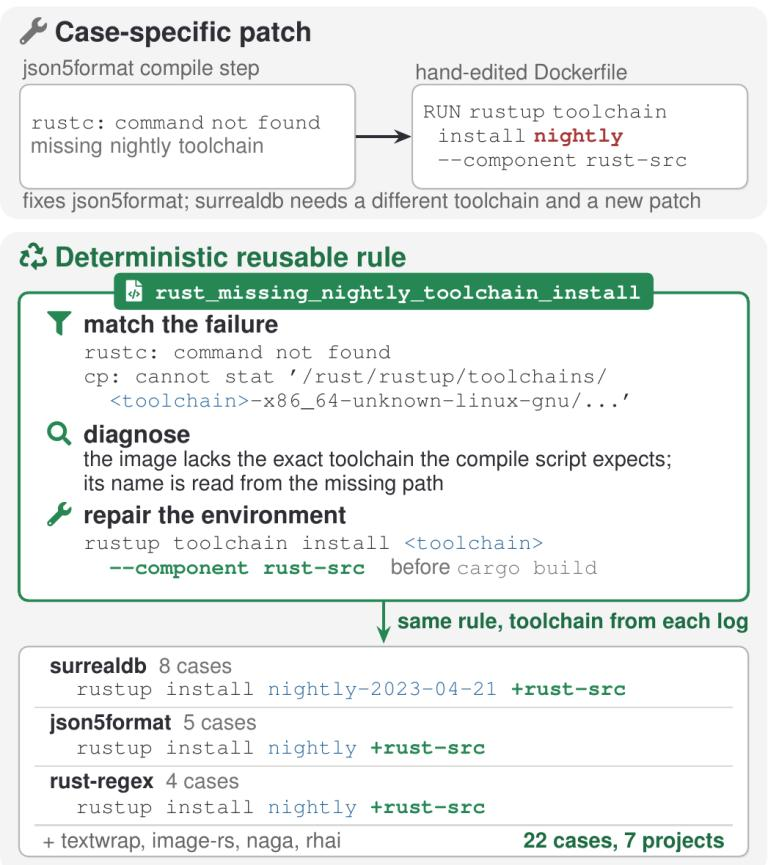
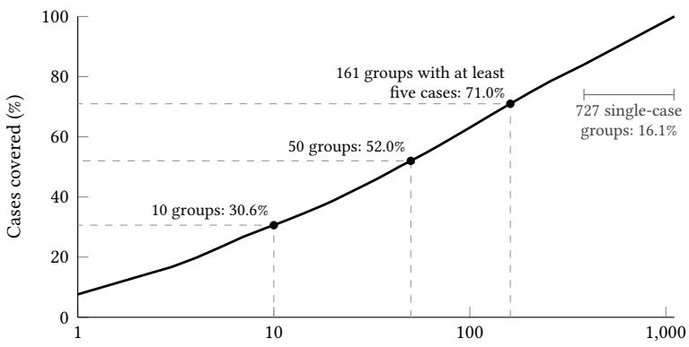

# RELAY: Scaling Historical Build Restoration through Rule Reuse and Agentic Repair

OLIVIER NOURRY, The University of Osaka, Japan YOSHIKI HIGO, The University of Osaka, Japan

Vulnerability benchmarks and software engineering research depend on rebuilding historical software. Yet builds rely on external resources, such as base images and packages, that change independently of the source code. In this study, we examine this environment decay on 14,159 OSS-Fuzz cases. We find that 69.7% no longer complete reconstruction and verification, and that most failures share a small number of recurring failure symptoms. A recurring failure can therefore be diagnosed once and its repair reused. We present Relay, a hybrid framework that uses an LLM to derive and validate deterministic repair rules from representative failures, reuses them without model calls, and escalates cases unresolved by rules to a per-case agent. We evaluate Relay in human-guided and fully automated rule-derivation campaigns and compare it with a per-case agent approach. We find that rule derivation can be fully automated, and that reusable rules restore as many builds as per-case agents with fewer build executions. However, agents restore cases that the rules cannot. Our results show that a hybrid approach that applies rules first and escalates the remaining cases to an agent restores more builds than either approach alone and at a lower cost than using agents alone.

CCS Concepts: • Software and its engineering → Software evolution; Maintaining software; Software maintenance tools; • Computing methodologies → Intelligent agents; • Security and privacy → Software security engineering.

Additional Key Words and Phrases: Build repair, environment decay, build reproducibility, software benchmarks, LLM agents, AI for software engineering (AI4SE), OSS-Fuzz

## 1 Introduction

Rebuilding an earlier version of a software system is necessary for reproducing reported bugs, bisecting regressions, and evaluating tools on historical defects. This need is especially visible in vulnerability research. For instance, ARVO reconstructs vulnerable and fixed versions of OSS-Fuzz projects [Mei et al. 2026] and benchmarks such as CyberGym and SEC-bench depend on executable historical software [Lee et al. 2025; Wang et al. 2026]. If a case no longer builds, its vulnerability and any proposed repair cannot be evaluated through execution. Researchers must instead exclude the case or rely on indirect measures such as code similarity, which may not reflect whether a patch actually fixes the vulnerability [Zhang et al. 2026].

Rebuilding historical software is often much harder than checking out its source code. Build instructions may remain available, but they depend on resources that change independently of the target project. Base images are retired, package repositories remove old versions, toolchain installers move, and third-party download URLs disappear [Malka et al. 2026; Mei et al. 2026; Nourry et al. 2025]. A build can therefore fail years later even though its target source revision has not changed. We refer to failures caused by such changes as environment decay. Developers generally maintain the current version of a project rather than restore every historical release, leaving this work to the researchers and benchmark maintainers who depend on those releases.

Existing approaches repair build environments through reusable operations, such as Shipwright’s Dockerfile repairs [Henkel et al. 2021], or through per-case language-model agents [Bouzenia and Pradel 2025; Hu et al. 2025b]. Per-case agents are flexible, but they repeat the diagnosis, patch generation, and validation process for every build. This is ineficient when the same environment failure afects many builds, since each case requires new model calls and one or more build executions. Moreover, external dependencies continue to change, so a restored build may fail again later. A scalable approach should therefore reuse previously validated repairs where possible, while retaining per-case reasoning for failures that cannot be handled by existing rules.

In this study, we use historical OSS-Fuzz cases to examine whether reusable rules and per-case agent escalation can restore build environments eficiently at scale. These cases cover diferent projects, languages, dependency managers, and toolchains. Their recorded crashing inputs also let us evaluate whether a repaired environment preserves the expected historical behavior, rather than measuring build completion alone.

We investigate a hybrid approach to historical build restoration. We implement Relay, a framework built around ARVO’s historical reconstruction pipeline. Relay converts build logs into normalized failure observations, groups related failures, and selects representative cases. An LLM uses evidence from these cases to propose a repair rule. The framework checks the permitted repair scope, applies the rule, and validates it by rebuilding the afected cases. Validated rules are stored in a registry and reused whenever their conditions hold. When a repair exposes a diferent failure, Relay records the new evidence and continues from the updated build state. Cases that remain unresolved are escalated to a per-case agent.

We aim to produce rules that recognize recurring failures and express repairs that can apply across cases. A rule may pin a stable version when that version addresses a recurring compatibility or availability problem, but it should not simply encode a one-of change for a single project. The model proposes both the conditions under which a rule applies and the changes it makes. For example, several builds may fail because they refer to a retired source archive. A rule should recognize the relevant download failure and redirect the request to a supported mirror or archive without reasoning about every afected case separately.

Our study separates the prevalence of environment decay from the evaluation of repair. We first examine 14,159 historical OSS-Fuzz cases with recorded execution outcomes and find that 9,868 do not complete reconstruction and verification. We characterize the failures using the 4,513 cases for which we collected detailed failure logs. We then evaluate whether rules derived from representative failures transfer to other cases and whether their derivation can be automated. We compare rules, per-case agents, and their rule-first combination on the same failures. Finally, we test agent escalation on a separate set of cases where deterministic repair had stopped.

The paper addresses four questions:

(1) RQ1: How prevalent is build decay, and how are historical build failures distributed? Reconstruction failed for 69.7% of the 14,159 cases we executed. The failures were concentrated: 161 groups contained at least five cases and represented 71.0% of the failure-analysis dataset. We found no consistent relationship between build age and repair outcome, but outcomes varied substantially across projects.

(2) RQ2: Can deterministic repair rules repair decayed builds, and can their derivation be automated? LLM-derived rules contributed to 469 restored builds. The automated campaign contributed 238 recoveries in two weeks, compared with 231 during three months of human-guided work.

(3) RQ3: How do reusable rules and per-case agents compare in recovery, cost, and the cases they restore? Rules and per-case agents restored similar numbers of builds, but the agents used 2.3 to 3.6 times as many build executions per recovery. They also restored diferent cases. Combining their recorded outcomes restored 37 to 39 of the 50 cases.

(4) RQ4: Where does deterministic repair stop, and what does escalating to a per-case agent recover beyond it? Rules stopped when their edits did not fit a project’s build files or when derivation repeated variations of an unsuccessful strategy. On a subset of 57 cases that remain unresolved after rule-based repair, agents restored 17.5 to 28.1%.

This paper makes the following contributions:

• We conduct a large-scale investigation of environment decay in 14,159 historical OSS-Fuzz cases and show that build decay is widespread and that failure causes tend to recur across unrelated cases.

• We present Relay, a scalable framework that derives reusable deterministic repair rules from representative failures, validates them through execution, and escalates unresolved cases to a per-case agent. It also extends historical build verification beyond C and C++.

• We show that the framework can derive and validate reusable repair rules without human intervention and use them to restore historical builds.

• We compare rule-based and per-case agentic build repair and show that a hybrid strategy combining the cost-eficiency of reusable rules with the flexibility of per-case agentic repairs is efective for large-scale build restoration.

• We provide a replication package with the rule registry, failure observations, repair records, prompts and model responses, and analysis scripts. We provide a partial version for review and will release the full package upon publication.

## 2 Background

## 2.1 OSS-Fuzz and Historical Builds

OSS-Fuzz is a continuous fuzzing platform that fuzzes open-source software to detect crashes and other incorrect behavior [Serebryany 2017]. When it confirms a failure, it creates a report identifying the afected project, fuzz target, sanitizer configuration, and input that triggered the failure [Mei et al. 2026]. A reported failure shows that the project built and that its fuzz target executed successfully when the issue was discovered.

Projects integrated with OSS-Fuzz share a common configuration structure. Each project supplies a project.yaml file containing project metadata, a Dockerfile defining its build environment, and a build.sh script that compiles the project and its fuzz targets inside that environment [Google [n. d.]]. This common structure provides a consistent interface for executing builds, but it does not make those builds self-contained. A Dockerfile may download base images, install system packages, or retrieve source archives, while the build script may resolve language packages, invoke code generators, and select a compiler or toolchain. These external resources can change or disappear even when the project files and target source revision remain unchanged.

## 2.2 Executable Vulnerability Datasets and ARVO

Executable historical software is increasingly used to evaluate vulnerability discovery and repair systems. CyberGym evaluates vulnerability reproduction, while SEC-bench evaluates both proof-ofconcept generation and vulnerability patching [Lee et al. 2025; Wang et al. 2026]. These benchmarks require more than a source snapshot: the project must build, the relevant target must execute, and the recorded input must still exercise the expected behavior.

ARVO reconstructs vulnerable and fixed versions of vulnerabilities reported by OSS-Fuzz [Mei et al. 2026]. It combines information from the OSS-Fuzz report with historical project and de pendency revisions, the OSS-Fuzz integration files, and the recorded crashing input. ARVO also addresses several recurring obstacles to historical reconstruction, including dependency revision selection, base-environment changes, and unavailable external resources. ARVO’s published dataset and evaluation focus on C and C++ memory-safety vulnerabilities. While its reconstruction approach can be extended to other ecosystems, doing so requires language-specific handling of dependencies, build outputs, and crash behavior. We extend the workflow to Rust, Go, Python, and JVM projects and add the necessary logging and validation needed to distinguish build completion from successful reproduction of the historical vulnerability. The repairs studied in this paper begin with the failures that remain after ARVO’s existing reconstruction mechanisms have run.

## 2.3 Build and Environment Repair

Build failures can arise from source errors, dependency changes, unavailable resources, incompatible tools, or faults in build and container configuration. Existing repair systems often address one part of this space. For example, Shipwright groups Dockerfile failures and develops reusable repairs through a human-in-the-loop process [Henkel et al. 2021]. Other approaches repair dependencyrelated build failures or restore language-specific environments [Macho et al. 2018; Mukherjee et al. 2021]. More recent work includes language-model agents that configure and execute repositories individually [Bouzenia and Pradel 2025; Hu et al. 2025b], as well as EnvBench, a benchmark for automated environment setup [Eliseeva et al. 2025].

Prior work on OSS-Fuzz build failures found 25 causes of fuzzing build failures across project source, build scripts, dependencies, toolchains, external resources, and execution infrastructure [Nourry et al. 2025]. These failures can occur in sequence; repairing a Docker image may expose a dependency error, and repairing that dependency may expose a compiler incompatibility. Success in progressing past one build error therefore does not establish that the complete historical build has been restored.

Relay combines the cost-eficiency of reusable rules with the flexibility of per-case agentic repair. It uses an LLM to derive deterministic rules from representative failures and applies validated rules to matching cases without further model calls. Cases that remain unresolved are escalated to a per-case agent. Both repair paths (rule and agentic) may modify files at diferent stages of the build, but they must preserve the historical target revision and recorded crashing input.

## 3 Relay Framework

Figure 1 shows how Relay combines deterministic repair, LLM-assisted rule derivation, and percase agent escalation. The framework reconstructs builds, normalizes and groups failures, selects representative cases, prepares evidence, matches and applies rules, executes builds, and records outcomes. A rule-authoring LLM operates on groups of related failures and proposes deterministic rules intended for reuse. A per-case repair agent is invoked only after deterministic repair stops. It may inspect and modify one case iteratively, but remains subject to the same protected-file policy and to explicit limits on turns, builds, and tokens.

## 3.1 ARVO Integration and Repair Scope

Relay uses ARVO as its execution mechanism for reconstructing a project at a specific historical revision. ARVO already controls parts of the base environment, dependency revisions, and resource retrieval, and attempts its own environment fixes during reconstruction [Mei et al. 2026]. Our repair loop therefore begins with the failures that remain after those mechanisms have run. It surrounds ARVO with evidence collection, reusable rule derivation and application, repair state management, and agent escalation. Relay does not replace ARVO’s reconstruction workflow but rather invokes that workflow repeatedly to observe and validate environment repairs.

The original ARVO workflow used as our starting point selects C/C++ cases. We extend selection and verification to non-C/C++ projects, including language-aware handling of Rust, Python, and JVM crash signals and target wrappers. The Dockerfile/build-script interface made much of the existing build machinery reusable across ecosystems, while crash verification required separate handling. We also add an interface for applying repair rules and record which repairs were attempted, whether they were applied, and how each execution ended. These records let us distinguish project build failures, repairs that could not be applied, and failures in the execution infrastructure.

  
Fig. 1. The Relay repair pipeline. (1) Each historical OSS-Fuzz case is built in an ARVO container; target source and the crashing input are protected. (2) The build log is normalized into a signature and placed in a failure tree whose high-yield branches supply representative cases. (3) If an existing rule matches, it is reused without a model call; otherwise a bounded evidence packet enters the rule-authoring process, where a mode is invoked automatically or under researcher guidance. The proposed rule enters the registry only after it rebuilds the representative cases. (4) Rules are applied deterministically to build-environment files. A changed failure is rebuilt with the re air chain carried forward. Eli ible cases that remain unresolved are escalated to a separately budgeted per-case agent, while cases blocked by unavailable resources or execution infrastructure are deferred.

To reduce the risk of modifying program behavior, we permit repairs only to the build environment: Dockerfiles, build scripts, package-manager configuration, dependency metadata, resource locations, and toolchain setup. The target source revision, program source, crashing input, fuzz target, and sanitizer configuration are protected. An attempted change to a protected input, whether produced by a rule or a repair agent, is rejected before execution.

## 3.2 Observations, Grouping, and Evidence

Each execution produces a run directory containing output streams, status records, available log metadata, and a normalized case observation. Relay classifies the failure, estimates the execution phase reached at which it occurred, and derives a signature from the relevant log excerpt. Relay selects excerpts using generic and ecosystem-specific failure markers and the evidence requirements of existing rules. It then normalizes dynamic content such as paths, identifiers, hashes, version numbers, line numbers, and repeated whitespace. The grouping key combines failure class, phase, and signature hash. Including the phase prevents a similar message during image creation and target execution from being treated as the same blocker.

Relay groups similar failures to select cases for rule derivation, but the same error message can have diferent causes. For example, removing version numbers during normalization can group failures involving diferent dependency versions. We therefore keep the original logs for rule derivation and test each rule by rebuilding every case to which it is applied.

Relay then organizes observations in a tree from coarse categories to exact signatures: failure class, phase, cluster family, ecosystem, error pattern, abstract template, and normalized signature. This hierarchy lets the framework prioritize high-yield branches, where one reusable repair may afect many builds, as well as branches that have not yet been examined. We refer to a case selected from a branch for rule authoring and initial validation as a representative. Representatives provide concrete evidence for the branch, but do not eliminate the need to validate other matching cases.

Rather than provide complete logs to the rule-authoring model, Relay constructs bounded evidence packets. A packet contains relevant excerpts, the failure class, phase and signature, case metadata, and repair history. The history records previously applied rules and how the observed failure changed after each rebuild. Excerpt selection uses generic and ecosystem-specific failure markers, the evidence requirements of existing rules, and removes repeated or redundant log content. Relay records packet sizes and token counts to bound the cost of each proposal, with the trade-of that a packet may omit useful context. When the available evidence is insuficient, the framework schedules a fresh execution or a targeted diagnostic execution and constructs a new packet before requesting another proposal.

## 3.3 LLM-Assisted Rule Derivation

  
Fig. 2. Diference between a case-specific patch and a reusable rule. The patch hard-codes one toolchain for one project. The rule reads the missing toolchain from the failing path and installs it with its source component, recovering 22 cases across 7 projects with diferent toolchains.

Before requesting a new rule, Relay checks the current observation against the validated rules in its registry. If a rule matches, the framework applies it without invoking a model. Rule derivation begins only when the registry contains no eligible rule for the observed failure.

For a selected branch, the rule-authoring LLM receives evidence packets from its representatives, relevant repair history, and descriptions of existing rules. It returns a structured candidate containing a failure precondition, parameters to extract from the evidence, permitted repair operations, evidence requirements, and allowed file scope. We instruct the model to express repairs in terms of the observed failure rather than project names, case identifiers, or constants copied from one case. For example, Figure 2 shows a toolchain rule that reads the name of the missing Rust toolchain from the failing path and installs it, instead of hard-coding one toolchain. A version may be pinned when the evidence establishes a compatibility requirement, but the rule must also state when that pin applies.

In the human-guided campaign, one of the authors selected branches, reviewed the evidence, and guided or revised model proposals. In the fully automated campaign, the framework selected branches, constructed prompts, invoked the model, materialized its proposal, and scheduled validation without human intervention. In both settings, the model proposed a repair, but execution determined whether it worked.

A proposal is not immediately added to the rule registry. The framework checks its scope, applies its operations against the historical build files, and rebuilds representative cases. Before adding a proposal to the registry, the framework checks its scope, applies its operations to the historical build files, and rebuilds representative cases. It accepts the rule only if the execution restores a build or exposes a diferent failure. Once a rule is adopted, later applications require no further model calls.

## 3.4 Rule Matching and Deterministic Application

A rule pairs a failure precondition with a repair specification. Preconditions describe the observation and relevant context. Repair specifications use bounded operations such as rewriting a URL, pinning a dependency, installing a package, selecting a toolchain, replacing a base image, or editing a build script. The rule applicator applies these operations against the historical build files.

Three decisions remain separate. First, the matcher determines whether the current observation satisfies a rule’s preconditions. Second, the applicator determines whether the requested operations can be carried out on the available files without violating the repair scope. Third, a new ARVO execution determines whether the applied repair recovers the build, exposes a diferent failure, or leaves the original failure unchanged. We record all three outcomes so that a matching error, an application failure, and an inefective repair are not treated as the same event.

Each rule targets a specific breakage step: an identifiable operation that fails during reconstruction, such as retrieving a retired archive, installing a missing package, or invoking an incompatible toolchain. The same rule can repair a failure across several versions or projects if it recognizes the failure and can apply the required change to their build files.

A build may fail again after its first error is fixed. For example, an unavailable base image prevents compilation from starting, while a failed source download can hide a later dependency error. Relay therefore keeps edits that resolve an intermediate failure and rebuilds after each applied rule. These edits form a repair chain. After each rebuild, Relay uses the latest failure to select the next rule. Cases that initially failed for diferent reasons may then encounter the same failure and reuse the same rule.

Relay determines whether a repair restored the build or exposed a diferent failure by rebuilding the case. It records a change in failure class or signature as a progression, rather than a recovery.

When this happens, the framework keeps the repair chain and continues from the newly observed failure.

## 3.5 Stopping and Agent Escalation

Relay stops deterministic repair when the build recovers, no eligible rule remains, two consecutive attempts return the same failure state, or the required action exceeds the permitted scope. It records why it stopped, including whether a case needs a new rule, an unavailable resource, case-specific reasoning, or an edit that the applicator could not apply. It records infrastructure failures and provenance problems separately from repair outcomes.

Relay escalates cases with a repairable build failure when no applicable rule remains. It defers cases blocked by infrastructure failures or a confirmed unavailable resource. The agent receives the case’s current failure, complete repair history, and build files. It can inspect logs and files, probe the environment, make edits, and invoke ARVO. It keeps earlier edits as it works on subsequent failures.

The agent aims to repair one case. Its patch does not need to generalize, and Relay does not automatically add it to the rule registry. The agent can make case-specific edits that the deterministic rule operations cannot express, but it cannot change the protected source revision, program source, fuzz target, crashing input, or sanitizer configuration. Relay limits the model turns, build executions, and tokens available for each case and counts a recovery only when a new execution confirms that the build has been restored.

## 4 Study Setup

We answer four research questions using diferent subsets of the OSS-Fuzz cases described below. RQ1 measures the prevalence and distribution of historical reconstruction failures. RQ2 evaluates reusable repair rules and whether their derivation can be automated. RQ3 compares reusable rules, per-case agents, and their rule-first combination on the same failures. RQ4 examines why deterministic repair stops and what per-case agents recover after it does.

## 4.1 Dataset and Study Subsets

We constructed the dataset from an OSS-Fuzz issue-tracker snapshot collected on January 27, 2026. Each eligible issue contributes at most one case containing the project, fuzz target, crashing input, sanitizer, and historical source revisions required by ARVO. Issues without suficient reconstruction metadata are excluded.

Historical reconstruction is computationally expensive: each execution attempts to restore the build environment, build the relevant project revisions, and run the recorded crashing input. Across the cases in our dataset, the recorded execution times total approximately 1,894 hours, and 174 cases took at least one hour. We therefore evaluated a broad subset of the collected issues rather than attempting every issue in the tracker.

C and C++ account for 83.5% of the 51,408 issues in our metadata. To include failures from other ecosystems, we executed the available cases from projects identified as using other languages and then sampled C/C++ cases in random order. After removing repeated case identifiers, the dataset contains 14,159 distinct historical cases. Table 1 summarizes the dataset and the subsets used in each evaluation.

Our pipeline first invokes ARVO’s existing reconstruction mechanisms, including its handling of historical dependencies, base environments, and unavailable resources. The failures studied here are therefore cases that remain unresolved after this initial reconstruction. Of the 14,159 cases in the dataset, 9,868 did not complete reconstruction and verification, giving a failure rate of 69.7%.

Table 1. Dataset and evaluation subsets used in the study.
<table><tr><td>Dataset or evaluation subset</td><td>Cases</td></tr><tr><td>Historical cases executed</td><td>14,159</td></tr><tr><td>Cases that failed reconstruction</td><td>9,868</td></tr><tr><td>Failed cases with usable failure evidence Cases reached by the repair campaigns</td><td>4,513 2,451</td></tr><tr><td>Cases held out from rule derivation (RQ3)</td><td>400</td></tr><tr><td>Cases still failing before the rule-agent comparison (RQ3)</td><td></td></tr><tr><td></td><td>50</td></tr><tr><td>Cases selected for agent evaluation (RQ4)</td><td>60</td></tr><tr><td>Cases still failing when re-executed (RQ4)</td><td>57</td></tr></table>

ARVO’s published reproduction rate [Mei et al. 2026] and the failure rate reported in this paper come from diferent case selections and execution periods and should not be compared directly.

The first four rows show how we narrowed the dataset from all executed cases to those attempted during the repair campaigns. We use all 14,159 executed cases to measure the prevalence of build failures. We then collected detailed execution logs for 4,513 cases and assembled them into a failureanalysis dataset to classify and group failures. Out of these, we attempted to repair 2,451 cases during the repair campaigns. We use three separately selected groups for the controlled evaluations. We held out 400 previously unattempted cases to test whether our rule registry could repair failures beyond the cases explored during the campaign. We also selected 50 previously repaired cases that still fail on re-execution to compare reusable rules with per-case agents on the same inputs. Lastly, we selected 60 cases recorded as unresolved after deterministic repair. Before running the agents, we rebuilt each case without a repair to verify that they were still failing and found that 3 cases built successfully. Their outcomes had therefore changed between the time we sampled them and the time we evaluated them which can occur for various reasons such as external dependencies not being fully pinned. We excluded them because they no longer presented a build failure and used the remaining 57 cases to test what per-case agents recover after rule-based repair stops.

The failure-analysis dataset contains 2,166 C++ cases, 911 Rust, 647 Go, 436 JVM, 178 C, 163 Python, and 12 Swift. Non-C/C++ ecosystems account for 2,169 cases, or 48.1% of the dataset. The large C/C++ share is expected because C and C++ projects make up most of OSS-Fuzz [Shirai et al. 2026]. We retain Swift in the overall totals but do not report a separate ecosystem-level rate for its small group.

## 4.2 Repair Selection and Budgets

Relay does not try to repair every case separately. It groups similar failures and selects representatives from promising groups. It then derives and validates rules on those representatives. A case is executed when it is chosen as a representative or when an accepted rule matches its failure. This gives priority to recurring failures for which one rule may repair several cases.

Across the RQ1 and RQ2 campaigns, Relay attempted to repair 2,451 distinct cases. It rebuilt each case after applying a repair, sometimes exposing another failure that required a further change. Relay stopped deterministic repair when the build recovered or when two consecutive repair attempts returned the same failure state without exposing a new one. We set limits on build executions, model turns, tokens, and cost for agent runs, as summarized in Table 2. Note that an unresolved case may still be repairable with a larger budget.

Table 2. Agent setings. Local sampling and context setings apply to both Qwen releases; hosted sampling uses the API default.
<table><tr><td>Setting</td><td>Value</td></tr><tr><td>Local models</td><td>Qwen3.8-27B and Qwen3.6-27B, Q4_K_M</td></tr><tr><td>Local serving</td><td>Ollama, four one-GPU replicas (RTX A6000, 48 GB)</td></tr><tr><td>Local sampling</td><td>Temperature 1.0, top-p 0.95, top-k 20</td></tr><tr><td>Local context</td><td>131,072 tokens</td></tr><tr><td>Hosted models</td><td>Terra: medium; Sol: high reasoning effort</td></tr><tr><td>Reasoning</td><td>Enabled and preserved across turns</td></tr><tr><td>Output limit per turn</td><td>16,384 tokens</td></tr><tr><td>Per-case limits</td><td>5 builds; 70 turns; 600,000 total tokens</td></tr><tr><td>Unchanged-failure stop</td><td>Two consecutive builds</td></tr><tr><td>Invalid-response stop</td><td>Three consecutive invalid responses</td></tr><tr><td>Hosted cost ceiling</td><td>Terra: $2/case; Sol: $5/case</td></tr><tr><td>Execution</td><td>One build per case at a time; at most four cases in parallel</td></tr></table>

## 4.3 Per-Case Agent Configuration

All models use the same agent harness. Each agent receives the case evidence, complete build logs, and historical build files. It can inspect files, run read-only shell commands, edit the permitted buildenvironment files, and rebuild the case. The harness disables web access, and prevents changes to the protected source revision, program source, fuzz target, crashing input, and sanitizer configuration. After each rebuild, the agent receives the latest failure and can address the newly exposed blocker without discarding earlier changes. If the harness cannot apply a patch, it returns the error to the agent so that it can propose a correction.

Table 2 summarizes the agent configuration. All models use the same limits on build executions, turns, and total tokens per case. The two Qwen models also use the same context size and sampling settings. The harness keeps each model’s reasoning and conversation history between turns. The token limit includes all input and output across model calls. In both evaluations, we ran each model once on each assigned case.

## 4.4 Outcome and Cost Measures

Our primary outcome is build recovery (i.e., the build completes successfully). We also check whether the repaired environment preserves the historical crash behavior. We count the vulnerability as reproduced when the recorded input triggers a crash at the vulnerable revision. We classify a case as benchmark-ready when the input triggers the crash at the vulnerable revision and runs without a crash at the designated fixed revision.

We measure repair efort through build executions. For each approach, we divide the total number of build executions across all evaluated cases by the number of recovered cases. This includes executions spent on cases that remain unresolved. Proposed edits that the harness cannot apply do not launch a build and do not contribute to this count. For agent runs, we also report model calls, token use, and hosted-model charges.

We inspect execution errors before classifying outcomes. We count patches that fail to apply, attempts to edit protected files, and decisions by the model to stop as agent outcomes. We report results for all selected cases. For each paired comparison, we also report results after excluding cases where either approach encountered a harness failure that prevented a reliable outcome.

## 5 RQ1: How prevalent is build decay, and how are historical build failures distributed?

## 5.1 Motivation

Before developing a repair framework, we first need to establish whether historical build failures are common and whether the same failures afect multiple cases. Reusable rules are useful only when failures repeat. RQ1 therefore measures how often historical reconstruction fails, how strongly the failures are concentrated, and whether repair outcomes vary by age or project.

## 5.2 Approach

We calculated the overall failure rate across the 14,159 cases we executed. We used the 4,513 cases in the failure-analysis dataset to examine how often the same failure occurred across multiple cases.

We assigned each case to the first failure observed before any repair was attempted. As described in Section 3, we represented each failure by its class, execution phase, and normalized signature. Cases sharing all three values formed a baseline failure group. We report the number and size of these groups, along with the share of cases in groups of at least five and the share that occurred alone. We chose five as the threshold because it left enough cases to inspect representatives and test whether a repair transferred to other cases. We kept this initial grouping fixed throughout the analysis. Failures exposed by later repair attempts did not change a case’s baseline group.

We also measured how often a failed case later built without a repair. Among the 2,451 cases included in the repair campaigns, we classified a case as a no-patch recovery when a later execution succeeded without a repair chain. This showed that re-execution was suficient, but not why the initial execution failed. For the age and project analyses, we used outcomes from the deterministic repair campaigns evaluated in RQ2. We classified a case as recovered if any campaign execution succeeded, with or without a repair. Of the 1,320 attempted cases with a known vulnerable revision date, we included those from projects with at least ten such cases spanning at least two historical years. These criteria left 884 cases from 23 projects and gave each half of the within-project comparison at least five cases. Within each project, we ordered cases by their vulnerable revision date and split them at the median. We then compared the unresolved rates of the older and newer halves. We used an exact two-sided sign test, excluding ties, to determine whether the diferences consistently pointed in either direction. Finally, we report project-level unresolved rates only for projects with at least twenty attempted cases to avoid comparisons based on only a few cases.

## 5.3 Results

Historical reconstruction frequently fails. Of the 14,159 cases we executed, 9,868 (69.7%) stopped before ARVO completed reconstruction and verification. Although their source revisions were pinned, these cases failed for various reasons, including project build failures, unavailable resources, and problems in the execution infrastructure.

Initial failures are highly concentrated. The 4,513 cases in the failure-analysis dataset formed 1,106 failure groups. Figure 3 ranks these groups by size. The ten largest groups covered 30.6% of the cases. The 161 groups with at least five cases covered 71.0%, whereas the 727 single-case groups account for 16.1%. Many cases therefore shared the same initial diagnosis.

These groups identify promising opportunities for reusable repair rules, though a repair is not guaranteed to work for every case in a group. Cases with the same initial failure may expose diferent blockers after that failure is removed. Conversely, a case that initially occurs alone may later match a rule derived from another group. We therefore use failure groups to identify candidates for reuse and test whether the same repair works on other cases.

Some failures disappear on re-execution. Among the 2,451 attempted cases, 286 (11.7%) later built without a repair. We could not determine why these cases succeeded on a retry. These recoveries prompted us to test whether builds that succeeded after applying rules actually needed those repairs. We report this evaluation in RQ2.

  
Largest failure groups included (log scale)  
Fig. 3. Cumulative share of the 4,513 cases in the failure-analysis dataset covered by the largest failure groups. The ten largest groups cover 30.6% of the cases, and the 161 groups with at least five cases cover 71.0% of all cases.

Build age does not predict repair outcome. We compared older and newer cases within 23 projects. Older cases had a higher unresolved rate in 5 projects and a lower rate in 10. The rates were equal in the remaining 8 projects. The mean diference in unresolved rates between the older and newer halves was -3.1 percentage points. The exact sign test gave $p = 0 . 3 0 2$ , providing no evidence that older cases were harder to repair within the same project.

Repair outcomes vary substantially across projects. Among the 21 projects with at least twenty attempted cases, the unresolved rate ranged from 3.0% for harfbuzz to 100% for envoy, jackson-dataformats-binary, jackson-dataformats-text, and suricata.

## Answer to RQ1

Historical reconstruction failed for 69.7% of the 14,159 cases we executed. Failures were highly concentrated: groups containing at least five cases covered 71.0% of the failure-analysis dataset. Re-execution without a repair successfully built 11.7% of attempted cases. We found no consistent relationship between build age and repair outcome, but unresolved rates varied substantially across projects.

6 RQ2: Can deterministic repair rules repair decayed builds, and can their derivation be automated?

## 6.1 Motivation

Reusable rules are useful only if they repair recurring failures and can be derived with limited human efort. RQ2 examines how many builds these rules restore, whether rule derivation can run without human intervention, and whether the applied repairs were needed for recovery.

## 6.2 Approach

We evaluated two consecutive phases of rule derivation. The first phase lasted approximately three months. One of the authors selected failure groups, reviewed the evidence and rules produced by the LLM, and revised the proposals when needed. During the second phase, Relay selected groups, prepared the evidence, generated candidate rules, and validated them without human intervention. This phase started with the registry produced during the human-guided work. We ran this phase until it reached approximately the same number of rule-associated recoveries as the human-guided phase. This took two weeks.

For each failure group selected during the automated phase, Relay prepared evidence from two or three representative cases and asked GPT-5.6 Terra to propose a rule. The proposal specified both the conditions under which the rule should apply and the change it should make. Relay checked the repair scope, applied the candidate rule, and rebuilt the representative cases. If the rule restored a build or exposed a diferent failure, the framework added the rule to the registry and applied it to other matching cases. Relay recorded when each rule entered the registry and which successful repair chains used the rule.

We report the human-guided and automated phases separately. We count a recovery as ruleassociated when the successful execution used at least one repair rule. We count cases that built successfully without a repair as no-patch recoveries. For the automated phase, we also report recovery rates by ecosystem. We calculate each rate by dividing rule-associated recoveries by the number of cases attempted in that ecosystem during the automated phase.

The two phases took place at diferent times, attempted diferent cases, and shared an expanding rule registry. The human-guided phase also included development of the framework. We report how long each phase took to reach a similar number of recoveries, but these diferences prevent a direct comparison of their speed.

Early in the campaign, we prioritized failure groups that appeared likely to produce reusable rules. We consequently explored some ecosystems more than others. We later focused on underrepresented ecosystems, primarily those outside C and C++, until we had examined approximately half of the failure groups in each major ecosystem. Within these ecosystems, we continued to choose groups based on their repair potential.

Some cases built successfully on a retry without a repair, so we checked whether the rules were needed for recovery. First, we identified cases that had failed without a repair before succeeding with one. We then conducted a paired control using cases with a saved repair chain from the successful execution. We selected 50 of these cases using a fixed seed and stratified the sample by language and failure class. We executed each case once with the saved repair and once without it. We used separate data directories and alternated which version ran first.

Finally, we examined whether repaired builds preserved the behavior needed by a vulnerability benchmark. A successful build does not guarantee that the recorded input will reproduce the historical crash. ARVO encountered the same problem, including cases where the input did not trigger the crash on an archived vulnerable binary [Mei et al. 2026]. We therefore compared crashreproduction rates between rule-associated and no-patch recoveries to check whether applying rules made the historical crash less likely to reproduce. We report the diference between these rates with its 95% confidence interval. We also report how many recoveries met the benchmark-ready criteria defined in Section 4.4.

Table 3. Distinct cases recovered during the human-guided and automated campaign phases. “With rules” counts cases whose successful execution applied at least one repair rule. “No patch” counts cases that succeeded without a repair.
<table><tr><td>Phase</td><td>With rules</td><td>No patch</td><td>Total</td></tr><tr><td>Human-guided (about 3 months)</td><td>231</td><td>202</td><td>433</td></tr><tr><td>Automated (2 weeks)</td><td>238</td><td>84</td><td>322</td></tr><tr><td>Total</td><td>469</td><td>286</td><td>755</td></tr></table>

Table 4. Cases recovered with repair rules during the automated phase, by ecosystem.
<table><tr><td>Ecosystem</td><td>Recovered/attempted</td><td>Rate</td><td>95% CI</td></tr><tr><td>C</td><td>19/66</td><td>28.8%</td><td>[19.3, 40.6]</td></tr><tr><td>JVM</td><td>50/212</td><td>23.6%</td><td>[18.4, 29.7]</td></tr><tr><td>C++</td><td>119/692</td><td>17.2%</td><td>[14.6, 20.2]</td></tr><tr><td>Go</td><td>41/349</td><td>11.7%</td><td>[8.8, 15.5]</td></tr><tr><td>Python</td><td>2/49</td><td>4.1%</td><td>[1.1, 13.7]</td></tr><tr><td>Rust</td><td>7/309</td><td>2.3%</td><td>[1.1, 4.6]</td></tr></table>

## 6.3 Results

Reusable rules restored hundreds of builds. Across both phases, 52 repair rules contributed to 469 rule-associated recoveries. Table 3 reports 231 from the human-guided phase and 238 from the automated phase. The automated phase reached a similar number of recoveries in two weeks without human intervention.

Most successful repair chains were short. 396 recoveries used one rule. The remaining 73 used multiple rules, with a median chain length of 2 rules and a mean of 2.48.

The automated phase derived new repair rules. Of the 238 rule-associated recoveries during the automated phase, 157 used only newly derived rules produced by the automated loop, 72 used only rules from the existing registry, and 9 used both. In total, 29 newly derived rules contributed to succesful repairs. The automated phase therefore benefited from the existing registry while also extending it.

Recovery difered across ecosystems. Table 4 reports rule-associated recovery during the automated phase. C had the highest observed rate at 28.8%, followed by JVM at 23.6% and C++ at 17.2%. Rust had the lowest rate at 2.3%.

The paired control confirmed that some builds needed the repair. We identified 30 cases that failed without a repair before succeeding with a repair chain. The paired control evaluated 50 pairs. One pair encountered an infrastructure failure, leaving 49 pairs with usable results both with and without the repair. Among the 49 comparable pairs, 24 cases built successfully only with the repair. The remaining 25 succeeded both with and without it. No case succeeded only without the repair. The repair was required in 49.0% of the comparable pairs (95% Wilson CI [35.6, 62.5]). An exact McNemar test gave $p = 1 . 2 \times 1 0 ^ { - 7 }$

We examined the final repair operation before each successful build. This information was available for 415 of the 469 rule-associated recoveries. In 326 cases, the final operation changed a dependency source, package version, base image, toolchain or another part of the build environment.

Table 5. Historical vulnerability outcomes among recovered builds. Benchmark-ready cases are a subset of cases reproducing the crash.
<table><tr><td>Outcome Group Recovered cases</td><td></td><td></td><td>Crash reproduced Benchmark-ready</td></tr><tr><td>No patch</td><td>286</td><td>145 (50.7%)</td><td>127 (44.4%)</td></tr><tr><td>Repair chain</td><td>469</td><td>247 (52.7%)</td><td>205 (43.7%)</td></tr></table>

In 89 cases, it retried an operation or refreshed a package index or cache. The remaining 54 cases lacked enough detail to classify the final operation.

Repaired builds reproduced historical crashes at a similar rate to builds that succeeded without a repair. Table 5 reports crash reproduction and benchmark-ready outcomes. The recorded input reproduced the crash in 52.7% of rule-associated recoveries and 50.7% of no-patch recoveries. The diference was 2.0 percentage points, with a 95% confidence interval of [−5.3, 9.3]. We therefore found no evidence that applying the repair rules reduced crash reproduction.

## Answer to RQ2

Across both campaigns, 52 repair rules contributed to 469 restored builds. The automated campaign produced 238 recoveries in two weeks without human intervention, compared with 231 during approximately three months of human-guided work. Of the automated campaign’s recoveries, 157 used only newly derived rules. In the paired control, 24 of the 49 comparable cases needed the saved repair chain to build successfully. Builds restored with rules reproduced their historical crashes at a similar rate to builds that succeeded without a repair (52.7% versus 50.7%).

7 RQ3: How do reusable rules and per-case agents compare in recovery, cost, and the cases they restore?

## 7.1 Motivation

Per-case agents can inspect one repository and adapt its environment to the failures they encounter [Bouzenia and Pradel 2025; Hu et al. 2025b]. This raises the question of why reusable rules are needed at all. RQ3 compares rules and agents on the same failing cases and examines whether combining them improves recovery and reduces repair efort. We measure build executions, model usage, and which cases each approach restores. We also examine how widely the rules are reused and whether they repair cases outside those used during development.

## 7.2 Approach

We first measured how often the same repair rule helped restore diferent cases, projects, and failure groups. Because a successful repair chain could contain more than one rule, we reported both recovered cases and rule credits. We gave a rule one credit each time it appeared in a successful repair chain. The number of credits can therefore exceed the number of recovered cases. We also report how many projects and baseline failure groups used each rule in a successful repair.

We reserved 400 previously unattempted cases to test whether the registry could repair cases outside those used during rule development. We sampled by language and failure class using a fixed seed. We excluded Swift because too few cases were available. We kept these cases out of rule derivation, validation, and subsequent repair campaigns.

After freezing the registry, Relay rebuilt each reserved case and checked whether an existing rule matched the observed failure. These cases came from those that remained untouched after the campaign had examined many promising failure groups. This let us test the registry on the remaining failure families rather than on additional cases from groups where the rules had already succeeded.

Table 6. Outcomes when the frozen rule registry is applied to 400 previously unatempted cases.
<table><tr><td>Outcome</td><td>Cases</td></tr><tr><td>No rule matched the observed failure</td><td>376</td></tr><tr><td>All matching rules tried; build unresolved</td><td>8</td></tr><tr><td>Rule matched; repair could not be applied</td><td>5</td></tr><tr><td>LibreOffice cases excluded from evaluation</td><td>11</td></tr><tr><td>Total</td><td>400</td></tr><tr><td>Recovered</td><td>0</td></tr></table>

Next, we compared the rules with per-case agents using cases that rules had restored during either campaign phase. We excluded the held-out sample and the RQ4 cases, leaving 227 candidates whose recorded failures matched a rule in the current registry. We grouped these cases by language, failure class, and failure-group size. We randomly ordered the cases within each group using a fixed seed and sampled from the groups in turn.

Relay rebuilt candidates without a repair in the sampling order. We retained the first 50 cases that still failed. This ensured that every case presented an active repair problem when the comparison began. We used these initial executions to select the cases and excluded them from the reported build counts.

We ran the rule registry, Qwen3.8-27B, and GPT-5.6 Terra once on each retained case. Qwen3.8 and Terra operated as per-case agents. Relay selected rules using the failure observed during the new execution. We ran the rule evaluation within one day of the agent runs to reduce changes in the external environment. We report recovered cases and build executions per recovery. For agents, we also report model calls, tokens, and hosted-model charges. We report the earlier cost of deriving the registry separately.

We report 95% Wilson confidence intervals for the recovery rates. Because we evaluated all three approaches on the same cases, we compared their recovery outcomes using two-sided exact McNemar tests. We adjusted the three pairwise �-values using the Holm-Bonferroni method.

Finally, we estimated the result of running the rules first and sending only the remaining cases to an agent. For each case the rules did not restore, we used the agent result and resource usage already observed for that case. Each agent started from the initial failure and did not inherit edits made by the rules. RQ4 evaluates agent escalation after deterministic repair stops.

## 7.3 Results

A single derivation can serve many cases. Of the 408 rules applied during the campaigns, 52 contributed to successful repair chains that restored 469 cases. The 20 most frequently reused rules accounted for 85% of all rule credits. 26 rules helped restore builds across at least three projects and accounted for 55.8% of the credits. For example, a rule that redirects unavailable GDAL netCDF archives contributed to 67 recoveries. Once Relay validates a rule, it can apply that rule to other matching cases without further model calls.

The registry did not restore the held-out cases. Table 6 reports the results for the 400 held-out cases. For 376 cases, no rule matched the observed failure. We excluded a further 11 LibreOfice cases because LibreOfice builds repeatedly exceeded the execution timeout in earlier runs. These results show that repairing the remaining cases requires additional rules or per-case agent repair.

The automated campaign spent \$53.07 on model calls to derive rules, including proposals that did not enter the registry. Dividing this cost by the campaign’s 238 rule-associated recoveries gives approximately \$0.22 per recovery. Applying validated rules to further cases requires no additional model calls.

Table 7. Rules, per-case agents, and estimated rules-first combinations on the 50 cases that still fail at the start of the experiment. For each combination, we add the rule execution to the recorded agent work on the 20 cases not restored by rules. Build counts include atempts that did not restore the case. Model costs exclude the earlier cost of deriving the registry.
<table><tr><td></td><td>Rules</td><td>Qwen3.8</td><td>Terra</td><td>Rules, then Qwen3.8</td><td>Rules, then Terra</td></tr><tr><td>Restored / 50</td><td>30</td><td>26</td><td>24</td><td>39</td><td>37</td></tr><tr><td>Builds</td><td>47</td><td>145</td><td>88</td><td>111</td><td>83</td></tr><tr><td>Builds per restored case</td><td>1.57</td><td>5.58</td><td>3.67</td><td>2.85</td><td>2.24</td></tr><tr><td>Agent tokens</td><td>0</td><td>14.8M</td><td>16.6M</td><td>6.3M</td><td>7.2M</td></tr><tr><td>Model API charge</td><td>$0</td><td>local</td><td>$10.53</td><td>local</td><td>$4.41</td></tr></table>

Rules restored similar numbers of builds with fewer executions. Table 7 compares the three approaches on the 50 failing cases. The rules restored 30 cases, compared with 26 for Qwen3.8 and 24 for GPT-5.6 Terra. Their recovery rates were 60.0%, 52.0%, and 48.0%, respectively. The corresponding 95% Wilson confidence intervals were [46.2, 72.4] for the rules, [38.5, 65.2] for Qwen3.8, and [34.8, 61.5] for Terra. None of the pairwise diferences was statistically significant after the Holm-Bonferroni adjustment (adjusted $p \ge 0 . 7 8 9 )$

The rules required 1.57 builds per restored case, compared with 5.58 for Qwen3.8 and 3.67 for Terra. The agents therefore used 2.3 to 3.6 times as many builds per recovery. Qwen3.8 made 1,096 model calls and used 14.8M tokens. Terra made 550 calls, used 16.6M tokens, and cost \$10.53. After excluding 3 cases afected by Qwen3.8 harness failures, we compared the remaining 47 cases across all three approaches. The rules restored 28, Qwen3.8 restored 25, and Terra restored 22.

Rules and agents restored diferent cases. The rules restored 13 cases that Qwen3.8 missed and 13 that Terra missed. Conversely, at least one agent restored 10 cases that the rules missed. Across all three approaches, 40 ofthe 50 cases were restored by at least one ofthem. Agent escalation therefore added coverage.

Combining rules and agents improved recovery and reduced agent work. We combined the recorded rule results with Qwen3.8’s results on the cases the rules did not restore. This gave 39 recoveries using 111 builds, compared with 26 recoveries and 145 builds for Qwen3.8 alone. Sending only the unresolved cases to Qwen3.8 reduced token use from 14.8M to 6.3M.

Combining the recorded rule results with Terra’s results on unresolved cases gave 37 recoveries using 83 builds. Terra alone restored 24 cases using 88 builds. The combination reduced token use from 16.6M to 7.2M and API charges from \$10.53 to \$4.41.

## Answer to RQ3

Rules and per-case agents restored similar numbers of builds on the 50 failing cases, but agents required 2.3 to 3.6 times as many build executions per recovery. The approaches restored diferent cases: at least one agent restored 10 cases missed by the rules. Combining the recorded outcomes gave 37 to 39 recoveries while using fewer builds and less than half the agent tokens of an agent alone. The registry restored none of the 400 held-out cases, showing the need to derive additional rules or use per-case agents for the remaining failures.

8 RQ4: Where does deterministic repair stop, and what does escalating to a per-case agent recover beyond it?

## 8.1 Motivation

RQ3 showed that rules and agents restore diferent cases and that using the rules first can reduce agent work. Relay escalates unresolved cases after deterministic repair stops. RQ4 examines the cases that reach this point. We first identify why rule-based repair stops and whether per-case agents can repair the unresolved cases.

## 8.2 Approach

We first examined cases where a rule matched the failure but could not apply its edit to the project’s build files. We counted these application failures across all recorded attempts and manually inspected the logs and repair specifications for 124 afected cases to identify why the edits failed.

We also examined whether the derivation loop repeatedly proposed variations of the same repair without restoring the build. We identified 5 recurring strategies: Rust nightly and RUSTC\_BOOTSTRAP handling, Go toolchain installation, retired Go base builders, retired Rust base builders, and Kubernetes Go toolchain handling. For each strategy, we compared how often its rules exposed a diferent failure with how often they restored a build.

We selected 60 unresolved cases to test whether agents could repair them after deterministic repair stopped. The sample included 30 rule-exhausted cases, where the loop had tried every matching rule, and 30 scope-limited cases, where the evidence suggested that a repair required a case-specific choice our general rules could not express. We excluded cases blocked by unavailable external resources or infrastructure failures, since these prevented the agent from testing a repair.

Before running the agents, Relay rebuilt all 60 cases without a repair. We excluded 3 cases that built successfully and evaluated the three main models on the remaining 57 failing cases. We ran Qwen3.8-27B, Qwen3.6-27B, and GPT-5.6 Terra on the same 57 cases. The two Qwen models have the same size, allowing us to compare model generations with the same settings. We also tested Terra, which had proposed the repair rules, as a per-case agent. To examine whether a more capable model could repair additional cases, we ran GPT-5.6 Sol on a diagnostic subset of 15 cases. We selected 3 cases that Qwen3.8 had restored, 6 where it had stopped early, and 6 where it had changed the failure without restoring the build. We report 95% Wilson confidence intervals for the recovery rates. Because we evaluated the three main models on the same cases, we compared their recovery outcomes using two-sided exact McNemar tests. We adjusted the three pairwise �-values using the Holm-Bonferroni method.

## 8.3 Results

Rules sometimes matched a failure but could not apply the repair. The applicator failed to make the requested edit in 583 of 6,201 recorded attempts (9.4%). These failures afected 374 cases, of which 253 remained unresolved. We manually inspected 124 afected cases. In 122 cases, the applicator could not find the text or insertion point specified by the rule. These included 48 replacements, 35 insertions before a missing line, and 39 insertions after a missing line. Supporting more build-file layouts could therefore allow the applicator to attempt these repairs on more cases.

The derivation loop sometimes repeated repairs without restoring a build. The registry contained 136 rule identifiers for the 5 strategies described above. For three of these strategies, 51 identifiers exposed a diferent failure 575 times without restoring a build. Go toolchain installation and Rust nightly handling restored 54 and 22 cases, but only 3 identifiers contributed to those recoveries. Relay limits further attempts when no eligible rule remains or successive attempts return the same failure.

Table 8. RQ4 results on the same 57 cases unfixed by reusable rules. Token totals include conversation history sent again on later turns. Terra’s cost is estimated from recorded API usage.
<table><tr><td>Measure</td><td>Qwen3.8</td><td>Qwen3.6</td><td>Terra</td></tr><tr><td>Recovered / 57</td><td>16</td><td>14</td><td>10</td></tr><tr><td>Rate</td><td>28.1%</td><td>24.6%</td><td>17.5%</td></tr><tr><td>95% Wilson CI</td><td>[18,41]</td><td>[15,37]</td><td>[10,29]</td></tr><tr><td>Crash reproduced</td><td>10</td><td>11</td><td>7</td></tr><tr><td>Build executions</td><td>156</td><td>128</td><td>78</td></tr><tr><td>Builds per recovered case</td><td>9.75</td><td>9.14</td><td>7.80</td></tr><tr><td>Model calls</td><td>1,175</td><td>1,352</td><td>638</td></tr><tr><td>Total tokens</td><td>16.50M</td><td>24.31M</td><td>23.17M</td></tr><tr><td>API usage cost</td><td>Local</td><td>Local</td><td>$14.53</td></tr></table>

Agents restored additional cases after deterministic repair stopped. Table 8 reports results on the 57 cases. Qwen3.8 restored 16, Qwen3.6 restored 14, and Terra restored 10, giving recovery rates of 28.1%, 24.6%, and 17.5%, respectively. The recorded input reproduced the historical crash in 10, 11, and 7 of those recoveries, respectively.

None of the diferences between models was statistically significant after the Holm-Bonferroni correction. The largest diference was between Qwen3.8 and Terra: Qwen3.8 restored 6 cases that Terra did not, while Terra restored none that Qwen3.8 missed. The raw �-value was 0.031, and the adjusted �-value was 0.094. The other adjusted �-values were at least 0.688. All three models restored 7 of the same cases, and 20 were restored by at least one model.

The execution harness did not produce a reliable outcome for 4 cases. After excluding the afected runs, we retained 55 usable Qwen3.8 results, 56 Qwen3.6 results, and 56 Terra results. None of the excluded runs was counted as a recovery, so the total number of recoveries remained unchanged.

Although the models received the same limits, they used their budgets diferently. The token limit stopped 11 Qwen3.8 runs, 26 Qwen3.6 runs, and 19 Terra runs. Qwen3.8 required 9.75 builds per recovery, Qwen3.6 required 9.14, and Terra required 7.80. Terra cost \$1.45 per recovered case.

In some cases, the models’ explanations for stopping were not supported by empirical evidence. We checked 28 cases where a model stopped after reporting an infrastructure problem or an unavailable resource. Another model restored 3 of these cases. We therefore treat these explanations as each model’s assessment rather than verified causes.

The flagship model did not improve recovery on the diagnostic subset. Of the 15 selected cases, 2 built without a repair when re-executed. This left 13 cases for the comparison. The provider rejected one case under its cybersecurity policy, so Sol completed 12 runs. Sol restored 4 cases, compared with 4 for Qwen3.8, 5 for Qwen3.6, and 2 for Terra. None of the pairwise diferences was statistically significant, with all raw �-values being at least 0.375. Every case restored by Sol was also restored by at least one other model. Sol used 16 builds, 140 model calls, and 6.1M tokens. Its API usage cost \$7.68. The recorded input reproduced the historical crash in 3 of Sol’s recoveries.

## Answer to RQ4

We found that deterministic repair struggled to apply edits across diferent build-file layouts and sometimes repeated unsuccessful repair strategies. The applicator failed to make the requested edit in 9.4% of recorded attempts. Agents restored 10 to 16 of the 57 cases left unresolved by deterministic repair, giving recovery rates of 17.5% to 28.1%. These results show that agent escalation can extend repair beyond the existing rules. Sol did not improve recovery on the diagnostic subset.

## 9 Discussion

## 9.1 Why Not Use an Agent for Every Build?

Rules and per-case agents both use model reasoning to decide how to repair a build. A per-case agent repeats that reasoning for every build. Relay uses evidence from representative failures to derive a rule that specifies when a repair applies and what to change. Once validated, the rule can be inspected and applied to other matching cases without further model calls.

Our paired evaluation supports using rules before agents. The rules restored similar numbers of cases with fewer build executions, while agents restored additional cases that the rules missed. Combining the recorded outcomes gave 37 to 39 recoveries out of 50 cases, using fewer builds and less than half the agent tokens of an agent alone. Rules handled recurring failures eficiently, while agent escalation provided flexibility on the remaining cases.

Building the registry also takes work. Each new rule requires model calls and validation builds, and some repairs require extending the applicator with new editing operations. We paid these costs during framework development and rule derivation. Reuse becomes worthwhile when enough cases share a failure to justify that initial efort. A larger registry can reduce repeated diagnosis, but it still needs maintenance as build tools and external resources change.

The held-out evaluation showed where the registry needed further work: no rule matched 376 of the 400 cases. Deriving another rule is most useful when several cases share a failure. For a failure afecting only one case, an agent may repair the build with less efort than deriving and validating a reusable rule. These limits motivate the division of work in Relay: apply validated rules wherever they match, then escalate what remains.

## 9.2 Improving the Repair Process

Our application audit showed that rules sometimes recognized a failure but could not find the text they needed to change. Parsers for package manifests and build instructions could help the applicator make the same edit across diferent file layouts. The resulting repair would still need to be validated through execution, since a more portable edit could also spread an incorrect change more widely.

The derivation loop sometimes proposed several versions ofthe same unsuccessful repair. Keeping a record of the strategies already tried and their execution results could help the model choose a diferent approach. The framework could also use this history to stop rule derivation or send the case to an agent when repeated proposals fail to restore the build.

Per-case agents remained useful after the registered rules stopped. They restored 17.5 to 28.1% of the remaining cases. However, more model reasoning cannot recover a missing external resource or correct a failure in the execution infrastructure. The models reported an infrastructure or resource problem in 28 cases, but another model restored 3 of them. The framework should therefore validate the model’s explanation for stopping using the execution logs before deferring a case.

Improving the agent harness or using stronger models may increase recovery. Many unsuccessful runs reached the token limit, so better evidence selection, conversation management, and tool use could help agents spend their budgets more efectively. Sol did not improve recovery on our small diagnostic subset. Further experiments could test harness changes with the same model and compare models using the same harness.

## 9.3 Preserving Executable Benchmarks

Benchmark maintainers can reduce future repair work by preserving the resources needed to rebuild each case. Alongside the source revision, they should record base-image digests, dependency revisions, toolchain versions, and build instructions. Where redistribution permits, archiving installers and source packages would also protect against downloads becoming unavailable.

Benchmark maintainers should also preserve build logs, repair chains, and the results of running the recorded input at both revisions. These records let researchers inspect earlier repairs and check whether a restored build still reproduces the historical vulnerability and meets the benchmark-ready criteria.

## 10 Threats to Validity

## 10.1 Internal Validity

Attribution. Some cases built successfully on retries without a repair. We therefore report no-patch recoveries separately and use a paired control to check whether repairs were needed. For this reason, we also describe recoveries as rule-associated rather than claiming that every applied rule caused the observed recoveries.

Campaign comparison. The automated campaign started with the registry developed during the human-guided phase. The phases attempted diferent cases at diferent times, and the humanguided work also included framework development. Early selection prioritized promising failure groups, while later selection focused more on underrepresented ecosystems. These diferences limit conclusions about how much automation reduced repair time.

Changes between executions. External resources continued to change during the study. Some previously failing cases built successfully without a repair when we re-executed them before RQ3 and RQ4. We excluded these cases because they no longer presented a repair problem. In RQ3, we ran the rule and agent evaluations within one day of each other. These steps reduce, but do not eliminate, diferences caused by changes in package repositories, mirrors, and other external services.

Harness errors. We inspected failed runs to distinguish repair failures from errors in the experimental harness. We report results for all selected cases and additional comparisons excluding runs afected by harness errors. We count patches that fail to apply as repair outcomes. Some errors require judgment to classify, so we may have misclassified cases despite inspecting their logs.

## 10.2 Construct Validity

Failure and success measures. We count a case as failed when it does not complete the full reconstruction and verification process. This definition includes build failures, unavailable resources, and failures in the execution infrastructure. Some failures may be temporary or have causes unrelated to environment decay. Conversely, a successful build does not by itself restore a vulnerability benchmark. We therefore report crash reproduction and the stricter benchmark-ready outcome separately. These checks do not prove that every behavior of the rebuilt program is unchanged.

Grouping and rule credit. Normalized signatures can merge distinct causes or separate variants of one cause. Shared groups motivate investigation but do not guarantee a common repair. Rule credits can overlap within a chain, so we distinguish them from distinct cases. Several rule identifiers may also describe the same repair strategy. Models may misidentify why they stopped, so we check their explanations against the execution evidence.

Manual audits. We classified repair operations and repair limits using the available logs and repair specifications. Some earlier records contained less detail, and diferent rule identifiers sometimes described similar repair strategies. These classifications required judgment, and another researcher might group some operations diferently.

Costs and budgets. Build executions vary in duration and resource use. Some fail early, while others compile large projects. Token totals count conversation history again each time the harness sends it to the model, and diferent tokenizers may count the same text diferently. Reported model charges exclude hardware and human efort. We report rule derivation costs separately from the cost of applying existing rules. Our cost comparisons therefore cover only part of the total efort needed to develop and run the framework.

## 10.3 External Validity and Repeatability

Dataset scope. All cases use OSS-Fuzz build recipes and our extended ARVO workflow. Their shared base images and build conventions may make rules easier to reuse than in other build systems. We also deliberately increased the representation of non-C/C++ projects. The 69.7% reconstruction-failure rate therefore describes our dataset and may difer from the rate across the full OSS-Fuzz issue tracker.

Failure and repair selection. The failure-analysis dataset contains cases for which Relay produced a normalized observation. We assembled it first by including failures from non-C/C++ projects and then adding C/C++ cases. The repair campaigns prioritized recurring groups that appeared likely to support reusable rules. These choices afect the failure groups and ecosystem recovery rates we report. We selected the held-out cases from those the campaigns had not attempted. This limits how well the evaluation represents rule reuse across the wider dataset.

Evaluation cohorts. RQ3 used cases that had previously been repaired by rules and still failed when re-executed. Most selected cases were C or C++ builds, and selecting previously repaired cases may favor the rule-based approach. RQ4 used cases where the rules had stopped or could not express the required repair. Recovery rates may difer on other samples. We also did not compare Relay with reconstruction using archived distribution snapshots.

Model repeatability. We ran each model once per case. The local models used temperature 1.0, so repeated runs could produce diferent results. Both Qwen releases use the same serving settings, but their weights and templates difer. Hosted models may also change over time. We selected the small Sol subset using earlier Qwen outcomes, and many Sol runs reached the token limit. A larger evaluation is needed to assess how model capability afects repair success. Models may also have encountered the public projects and issue reports during training, which could influence their repairs.

## 11 Related Work

## 11.1 Historical Build Reproducibility

Prior work has studied how to preserve software builds and reproduce their outputs. Reproduciblebuild research has examined whether rebuilding the same source produces bit-for-bit identical artifacts [Fourné et al. 2023; Lamb and Zacchiroli 2022; Malka et al. 2025]. Studies of container reproducibility have shown that rebuilding can still depend on changing image tags, package repositories, and external downloads [Malka et al. 2026]. Researchers have addressed environment preservation through functional package managers [Malka et al. 2024] and developed systems to reconstruct dependencies for Python programs and notebooks [Horton and Parnin 2019; Wang et al. 2021; Ye et al. 2022]. We examined how to restore historical builds across several ecosystems after their environments had stopped working.

Research on executable defect datasets has highlighted the need to preserve historical build environments. Defects4J, BugSwarm, and Vul4J provided historical failures for controlled experimentation [Bui et al. 2022; Just et al. 2014; Tomassi et al. 2019], while Zhu and Rubio-González showed that dataset artifacts could lose reproducibility over time [Zhu and Rubio-González 2023]. ARVO addressed this problem for OSS-Fuzz vulnerabilities by reconstructing vulnerable and fixed revisions [Mei et al. 2026]. CyberGym and SEC-bench subsequently used executable historical software to evaluate security agents [Lee et al. 2025; Wang et al. 2026]. We extended ARVO to repair the environment failures that remained after its reconstruction mechanisms ran. This also distinguished our work from systems such as CodeRover-S, which repaired vulnerabilities by changing the target source [Zhang et al. 2026] whereas we preserved that source and repaired the environment needed to build and execute it.

## 11.2 Build Repair and Reusable Fixes

Several studies have investigated build failures and their repair across continuous integration, Docker, and other build systems [Lou et al. 2020; Rausch et al. 2017; Vassallo et al. 2017; Wu et al. 2020]. A prior study by Nourry et al. also studied active OSS-Fuzz projects and identified failure causes across project source, build scripts, dependencies, toolchains, external resources, and execution infrastructure [Nourry et al. 2025]. These findings motivated us to examine repairs across several stages of a build. We focused on historical revisions, where changing the target source could alter the benchmark case, and investigated whether environment repairs could be reused across versions and projects.

Researchers have also developed tools to automate build repair using project history, dependency fixes, and reusable editing operations. HireBuild used earlier changes to repair build scripts [Hassan and Wang 2018], while later work examined the limits of relying on history and proposed repairs that did not require it [Lou et al. 2019]. Dependency-focused systems included BuildMedic for Maven builds [Macho et al. 2018] and PyDFix for Python dependency errors [Mukherjee et al. 2021]. Reusable operations have also supported Dockerfile repair through human-guided derivation [Henkel et al. 2021] and mined patterns [Sakamoto and Ohira 2026]. Other work has addressed flaky Docker builds and equipped agents with operations for Android build repair [Shabani et al. 2025; Son et al. 2026]. These approaches have developed repair mechanisms for specific build technologies and ecosystems. Alternatively, we examined how to derive and reuse repairs across the containers, dependencies, resources, toolchains, and scripts involved in historical reconstruction.

Program-repair research has also investigated how to reuse fixes. Refazer learned syntactic transformations from examples [Rolim et al. 2017], and Getafix learned fix patterns from humanwritten changes [Bader et al. 2019]. These systems showed how examples could guide repairs beyond the original case. We applied this idea to build environments by asking an LLM to derive rules from representative failures. We tested each candidate by rebuilding cases, then reused accepted rules without further model calls.

## 11.3 Agents for Environment Setup and Compatibility Repair

Recent studies have used language-model agents to automate repository setup, compilation, and test execution [Bouzenia and Pradel 2025; Hu et al. 2025a,b; Milliken et al. 2025; Yu et al. 2025]. EnvBench has provided tasks for evaluating environment setup in Python andJVM projects [Eliseeva et al. 2025]. Much of this work has focused on preparing repositories for execution. RepoRescue examined a setting closer to ours: older Python and Java repositories that no longer worked in modern environments [Lin et al. 2026]. It allowed source changes and evaluated success through historical tests. We preserved the target source revision and used the recorded crashing input to check historical behavior. Other studies have used agents or LLM-generated patches to repair dependency-related build failures [Macho et al. 2026; Reyes et al. 2026].

Recent work has explored how agents could reuse knowledge from earlier setup tasks. SetupX transferred structured experience between repositories, while BootstrapAgent recorded verified setup knowledge for later agents [Fu et al. 2026; Zhou et al. 2026]. We pursued reuse through executable repair rules. Once a rule passed validation, the framework could apply it to matching failures without another model call. Per-case agents handled cases that remained unresolved.

These studies have advanced reusable repair and per-case environment setup. We brought the two approaches together for historical build restoration and evaluated where each helped. Our comparison examined their recovery, build efort, model use, and the cases they restored. Combining the recorded outcomes let us assess the benefit of applying existing rules before spending agent efort on unresolved cases.

## 12 Conclusion

We examined 14,159 historical OSS-Fuzz cases and found that 69.7% failed to complete reconstruction and verification despite pinned source revisions. The failures were concentrated: 161 groups covered 71.0% of the failure-analysis dataset. These recurring failures created opportunities to reuse repairs across cases.

We developed Relay to derive reusable repair rules and escalate unresolved cases to per-case agents. Across the campaigns, 52 rules contributed to 469 recoveries. On the 50 cases in our paired evaluation, agents restored similar numbers of builds but required 2.3 to 3.6 times as many build executions per recovery. Combining the recorded outcomes gave 37 to 39 recoveries with fewer builds and less than half the agent tokens of an agent alone. Agents also restored 17.5 to 28.1% of the cases left unresolved by deterministic repair. These findings support applying reusable rules first and using agents for the remaining cases.

Further work could improve how rules edit diferent build-file layouts and how agents use their execution and token budgets. Experiments could also vary the execution evidence given to rule-authoring models and repair agents to determine which logs, error excerpts, and repair history help them make better repairs. Evaluating stronger models with the same harness would help identify where model capability improves recovery. Throughout restoration, checking the recorded historical behavior remains essential to preserving the cases used by vulnerability benchmarks.

## Data Availability

We provide a partial replication package for review at https://zenodo.org/records/23491436. It contains case manifests, normalized failure observations, and data and analysis scripts for reproducing the main quantitative results. The package documents which results the scripts reproduce. We will release the full package upon publication, including the complete rule registry, repair records, prompts, and model responses.

## Acknowledgments

This work was supported by JSPS KAKENHI Grant Numbers JP24H00692, JP26H02500, JP25K03102, and JP26K02889.

The author used generative AI tools during the preparation of this paper. AI tools were used to generate the final versions of the figures from the author’s sketches and data. AI tools were also used to assist with cross-checking reported numbers in the paper against the study data. Grammarly was used to check spelling and grammar. The author reviewed, edited, and verified all content and takes full responsibility for it.

## References

Johannes Bader, Andrew Scott, Michael Pradel, and Satish Chandra. 2019. Getafix: Learning to Fix Bugs Automatically. Proceedings ofthe ACM on Programming Languages 3, OOPSLA (2019), 159:1–159:27. doi:10.1145/3360585

Islem Bouzenia and Michael Pradel. 2025. You Name It, I Run It: An LLM Agent to Execute Tests of Arbitrary Projects. Proceedings ofthe ACM on Software Engineering 2, ISSTA (2025), 1054–1076. doi:10.1145/3728922

Quang-Cuong Bui, Riccardo Scandariato, and Nicolás E. Díaz Ferreyra. 2022. Vul4J: A Dataset of Reproducible Java Vulnerabilities Geared Towards the Study of Program Repair Techniques. In Proceedings of the 19th International Conference on Mining Software Repositories (MSR). 464–468. doi:10.1145/3524842.3528482

Aleksandra Eliseeva, Alexander Kovrigin, Ilia Kholkin, Egor Bogomolov, and Yaroslav Zharov. 2025. EnvBench: A Benchmark for Automated Environment Setup. In ICLR 2025 Workshop on Deep Learning for Code (DL4C). arXiv:2503.14443.

Marcel Fourné, Dominik Wermke, William Enck, Sascha Fahl, and Yasemin Acar. 2023. It’s Like Flossing Your Teeth: On the Importance and Challenges of Reproducible Builds for Software Supply Chain Security. In Proceedings of the IEEE Symposium on Security and Privacy (S&P). 1527–1544. doi:10.1109/SP46215.2023.10179320

Sihan Fu, Oucheng Liu, Shiyuan Wang, Jin Shi, and Chengkun Wei. 2026. BootstrapAgent: Distilling Repository Setup into Reusable Agent Knowledge. arXiv preprint arXiv:2605.15815.

Google. [n. d.]. OSS-Fuzz: New Project Guide. OSS-Fuzz documentation. https://google.github.io/oss-fuzz/gettingstarted/new-project-guide/ Accessed October 8, 2026.

Foyzul Hassan and Xiaoyin Wang. 2018. HireBuild: An Automatic Approach to History-Driven Repair of Build Scripts. In Proceedings ofthe 40th International Conference on Software Engineering (ICSE). 1078–1089. doi:10.1145/3180155.3180181

Jordan Henkel, Denini Silva, Leopoldo Teixeira, Marcelo d’Amorim, and Thomas W. Reps. 2021. Shipwright: A Humanin-the-Loop System for Dockerfile Repair. In Proceedings ofthe 43rd IEEE/ACM International Conference on Software Engineering (ICSE). 1148–1160. doi:10.1109/ICSE43902.2021.00106

Eric Horton and Chris Parnin. 2019. DockerizeMe: Automatic Inference of Environment Dependencies for Python Code Snippets. In Proceedings ofthe 41st IEEE/ACM International Conference on Software Engineering (ICSE). 328–338. doi:10. 1109/ICSE.2019.00047

Li Hu, Guoqiang Chen, Xiuwei Shang, Shaoyin Cheng, Benlong Wu, Gangyang Li, Xu Zhu, Weiming Zhang, and Nenghai Yu. 2025a. CompileAgent: Automated Real-World Repo-Level Compilation with Tool-Integrated LLM-Based Agent System. In Proceedings ofthe 63rd Annual Meeting ofthe Association for Computational Linguistics (ACL). 2078–2091. doi:10.18653/v1/2025.acl-long.103

Ruida Hu, Chao Peng, Xinchen Wang, Junjielong Xu, and Cuiyun Gao. 2025b. Repo2Run: Automated Building Executable Environment for Code Repository at Scale. In Advances in Neural Information Processing Systems 38 (NeurIPS). doi:10. 52202/085713-1096

René Just, Darioush Jalali, and Michael D. Ernst. 2014. Defects4J: A Database of Existing Faults to Enable Controlled Testing Studies for Java Programs. In Proceedings ofthe International Symposium on Software Testing and Analysis (ISSTA). 437–440. doi:10.1145/2610384.2628055

Chris Lamb and Stefano Zacchiroli. 2022. Reproducible Builds: Increasing the Integrity of Software Supply Chains. IEEE Software 39, 2 (2022), 62–70. doi:10.1109/MS.2021.3073045

Hwiwon Lee, Ziqi Zhang, Hanxiao Lu, and Lingming Zhang. 2025. SEC-bench: Automated Benchmarking of LLM Agents on Real-World Software Security Tasks. In Advances in Neural Information Processing Systems 38 (NeurIPS). doi:10.52202 085713-3878

Zhihao Lin, Mingyi Zhou, Zhensu Sun, Yizhuo Yang, Renyu Yang, David Lo, and Li Li. 2026. RepoRescue: An Empirical Study of LLM Agents on Whole-Repository Compatibility Rescue. arXiv preprint arXiv:2607.01213.

Yiling Lou, Junjie Chen, Lingming Zhang, Dan Hao, and Lu Zhang. 2019. History-Driven Build Failure Fixing: How Far Are We?. In Proceedings ofthe 28th ACM SIGSOFT International Symposium on Software Testing and Analysis (ISSTA). 43–54. doi:10.1145/3293882.3330578

Yiling Lou, Zhenpeng Chen, Yanbin Cao, Dan Hao, and Lu Zhang. 2020. Understanding Build Issue Resolution in Practice: Symptoms and Fix Patterns. In Proceedings ofthe 28th ACMJoint European Software Engineering Conference and Symposium on the Foundations ofSoftware Engineering (ESEC/FSE). 617–628. doi:10.1145/3368089.3409760

Christian Macho, Shane McIntosh, and Martin Pinzger. 2018. Automatically Repairing Dependency-Related Build Breakage. In Proceedings ofthe 25th IEEE International Conference on Software Analysis, Evolution and Reengineering (SANER). 106–117. doi:10.1109/SANER.2018.8330201

Christian Macho, Katharina Stengg, and Martin Pinzger. 2026. Agent-Based Dependency-Related Build Repair. In Proceedings ofthe IEEE International Conference on Software Analysis, Evolution and Reengineering (SANER). doi:10.1109/SANER67736. 2026.00026

Julien Malka, Stefano Zacchiroli, and Théo Zimmermann. 2024. Reproducibility of Build Environments through Space and Time. In Proceedings of the 46th ACM/IEEE International Conference on Software Engineering: New Ideas and Emerging Results (ICSE-NIER). 97–101. doi:10.1145/3639476.3639767

Julien Malka, Stefano Zacchiroli, and Théo Zimmermann. 2025. Does Functional Package Management Enable Reproducible Builds at Scale? Yes.. In Proceedings ofthe 22nd IEEE/ACM International Conference on Mining Software Repositories (MSR). 775–787. doi:10.1109/MSR66628.2025.00115

Julien Malka, Stefano Zacchiroli, and Théo Zimmermann. 2026. Docker Does Not Guarantee Reproducibility. arXiv preprint arXiv:2601.12811.

Xiang Mei, Jordi Del Castillo, Pulkit Singh Singaria, Haoran Xi, Abdelouahab Benchikh, Tifany Bao, Ruoyu Wang, Yan Shoshitaishvili, Adam Doupé, Hammond Pearce, and Brendan Dolan-Gavitt. 2026. ARVO: Atlas of Reproducible Vulnerabilities for Open-Source Software. In Proceedings of the 11th IEEE European Symposium on Security and Privacy

(EuroS&P). 860–873. doi:10.1109/EuroSP68448.2026.00060

Louis Milliken, Sungmin Kang, and Shin Yoo. 2025. Beyond pip Install: Evaluating LLM Agents for the Automated Installation of Python Projects. In Proceedings ofthe IEEE International Conference on Software Analysis, Evolution and Reengineering (SANER). doi:10.1109/SANER64311.2025.00009

Suchita Mukherjee, Abigail Almanza, and Cindy Rubio-González. 2021. Fixing Dependency Errors for Python Build Reproducibility. In Proceedings ofthe 30th ACM SIGSOFT International Symposium on Software Testing and Analysis (ISSTA). 439–451. doi:10.1145/3460319.3464797

Olivier Nourry, Yutaro Kashiwa, Weiyi Shang, Honglin Shu, and Yasutaka Kamei. 2025. My Fuzzers Won’t Build: An Empirical Study of Fuzzing Build Failures. ACM Transactions on Software Engineering and Methodology 34, 2, Article 29 (2025). doi:10.1145/3688842

Thomas Rausch, Waldemar Hummer, Philipp Leitner, and Stefan Schulte. 2017. An Empirical Analysis of Build Failures in the Continuous Integration Workflows ofJava-Based Open-Source Software. In Proceedings ofthe 14th IEEE/ACM International Conference on Mining Software Repositories (MSR). 345–355. doi:10.1109/MSR.2017.54

Frank Reyes, May Mahmoud, Federico Bono, Sarah Nadi, Benoit Baudry, and Martin Monperrus. 2026. Byam: Fixing Breaking Dependency Updates with Large Language Models. Empirical Software Engineering 31, 4 (2026), 113. doi:10.1007/s10664- 026-10835-1

Reudismam Rolim, Gustavo Soares, Loris D’Antoni, Oleksandr Polozov, Sumit Gulwani, Rohit Gheyi, Ryo Suzuki, and Björn Hartmann. 2017. Learning Syntactic Program Transformations from Examples. In Proceedings ofthe 39th IEEE/ACM International Conference on Software Engineering (ICSE). 404–415. doi:10.1109/ICSE.2017.44

Renya Sakamoto and Masao Ohira. 2026. Automatic Repair Method for Dockerfile Build Errors: Extracting Dependencies between Build Error-Inducing Instructions Based on Frequent Subtree Mining. IEICE Transactions on Information and Systems E109-D, 3 (2026), 325–340. doi:10.1587/transinf.2025MPP0005

Kostya Serebryany. 2017. OSS-Fuzz: Google’s Continuous Fuzzing Service for Open Source Software. Invited talk, 26th USENIX Security Symposium. https://www.usenix.org/conference/usenixsecurity17/technical-sessions/presentation/ serebryany

Taha Shabani, Noor Nashid, Parsa Alian, and Ali Mesbah. 2025. Dockerfile Flakiness: Characterization and Repair. In Proceedings ofthe 47th IEEE/ACM International Conference on Software Engineering (ICSE). 1793–1805. doi:10.1109/ ICSE55347.2025.00238

Tatsuya Shirai, Olivier Nourry, Yutaro Kashiwa, Kenji Fujiwara, and Hajimu Iida. 2026. Does Programming Language Matter? An Empirical Study of Fuzzing Bug Detection. In Proceedings ofthe 23rd International Conference on Mining Software Repositories. 287–298. doi:10.1145/3793302.3793358

Ha Min Son, Huan Ren, Xin Liu, and Zhe Zhao. 2026. Automating Android Build Repair: Bridging the Reasoning-Execution Gap in LLM Agents with Domain-Specific Tools. In Proceedings ofthe 19th Conference ofthe European Chapter ofthe Association for Computational Linguistics (EACL). 4169–4189. doi:10.18653/v1/2026.eacl-long.195

David A. Tomassi, Naji Dmeiri, Yichen Wang, Antara Bhowmick, Yen-Chuan Liu, Premkumar T. Devanbu, Bogdan Vasilescu, and Cindy Rubio-González. 2019. BugSwarm: Mining and Continuously Growing a Dataset of Reproducible Failures and Fixes. In Proceedings ofthe 41st IEEE/ACM International Conference on Software Engineering (ICSE). 339–349. doi:10.1109 ICSE.2019.00048

Carmine Vassallo, Gerald Schermann, Fiorella Zampetti, Daniele Romano, Philipp Leitner, Andy Zaidman, Massimiliano Di Penta, and Sebastiano Panichella. 2017. A Tale of CI Build Failures: An Open Source and a Financial Organization Perspective. In Proceedings ofthe IEEE International Conference on Software Maintenance and Evolution (ICSME). 183–193. doi:10.1109/ICSME.2017.67

Jiawei Wang, Li Li, and Andreas Zeller. 2021. Restoring Execution Environments ofJupyter Notebooks. In Proceedings ofthe 43rd IEEE/ACM International Conference on Software Engineering (ICSE). 1622–1633. doi:10.1109/ICSE43902.2021.00144

Zhun Wang, Tianneng Shi, Jingxuan He, Matthew Cai, Jialin Zhang, and Dawn Song. 2026. CyberGym: Evaluating AI Agents’ Real-World Cybersecurity Capabilities at Scale. In Proceedings ofthe 14th International Conference on Learning Representations (ICLR). arXiv:2506.02548.

Yiwen Wu, Yang Zhang, Tao Wang, and Huaimin Wang. 2020. An Empirical Study of Build Failures in the Docker Context. In Proceedings ofthe 17th International Conference on Mining Software Repositories (MSR). 76–80. doi:10.1145/3379597.3387483

Hongjie Ye, Wei Chen, Wensheng Dou, Guoquan Wu, and Jun Wei. 2022. Knowledge-Based Environment Dependency Inference for Python Programs. In Proceedings of the 44th International Conference on Software Engineering (ICSE). 1245–1256. doi:10.1145/3510003.3510127

Zhengmin Yu, Yuan Zhang, Ming Wen, Yinan Nie, Wenhui Zhang, and Min Yang. 2025. CXXCrafter: An LLM-Based Agent for Automated C/C++ Open Source Software Building. Proceedings ofthe ACM on Software Engineering 2, FSE (2025), 2618–2640. doi:10.1145/3729386

Yuntong Zhang, Jiawei Wang, Dominic Berzin, Martin Mirchev, and Abhik Roychoudhury. 2026. Fixing Security Vulnerabilities with Agentic AI in OSS-Fuzz. In Proceedings ofthe 48th IEEE/ACM International Conference on Software Engineering:

Software Engineering in Practice (ICSE-SEIP). 374–384. doi:10.1145/3786583.3786880

Zihang Zhou, Ziqian Ren, Yukai Wu, Yingjie Xiong, Wei Zhou, Chao Peng, Dong Zhang, Bingheng Yan, Xuanhe Zhou, and Fan Wu. 2026. SetupX: Can LLM Agents Learn from Past Failures in Functionality-Correct Code Repository Setup? arXiv preprint arXiv:2605.26186.

Hao-Nan Zhu and Cindy Rubio-González. 2023. On the Reproducibility of Software Defect Datasets. In Proceedings of the 45th IEEE/ACM International Conference on Software Engineering (ICSE). 2324–2335. doi:10.1109/ICSE48619.2023.00195