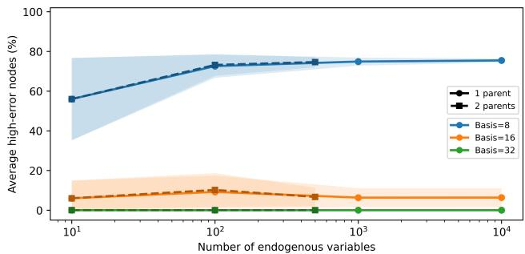
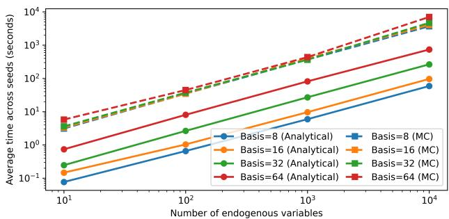
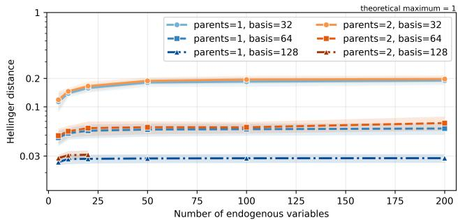
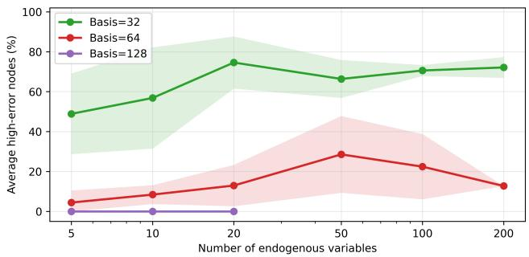
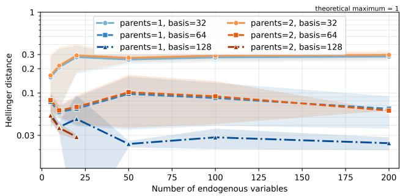
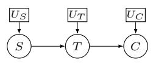
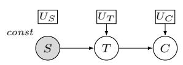
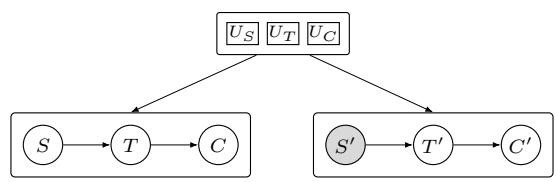
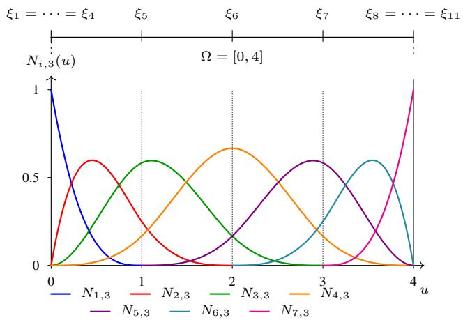
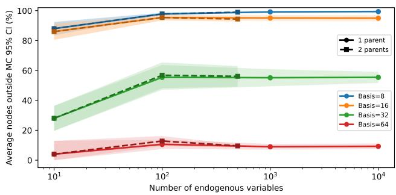

# A Semi-Analytical Inference Framework for Structural Causal Models

Tatiana Boura∗, Robert Peharz

Graz University of Technology

## Abstract

Structural Causal Models (SCMs) provide a principled framework for observational, interventional, and counterfactual reasoning, all of which rely on probabilistic inference. Existing frameworks either transform SCMs into alternative tractable representations or rely on approximate inference with expressive generative models. We instead perform inference using a message passing scheme directly on the SCM by representing structural mechanisms and probability densities in a common finite-dimensional function space. Forward propagation combines a numerical realization of the Law of the Unconscious Statistician, while propagated densities are recovered by spline projection from LOTUS moments. The same representation naturally yields backward message passing for conditioning, providing a unified framework for causal inference. Using tensor-product B-spline bases, the resulting algorithm expresses inference through numerical quadrature and linear algebra without explicitly constructing conditional distributions. Experiments on randomly generated continuous SCMs demonstrate accurate approximation of Monte Carlo reference solutions and systematic improvement with increasing basis resolution.

## 1 Introduction

The notion of causality has been central to philosophical discourse since antiquity. Structural Causal Models (SCMs) provide one of the most widely used mathematical frameworks for causal reasoning (Pearl 2009). Under the assumption that the modeled system is causally closed, uncertainty is confined to exogenous variables and endogenous variables are related deterministically (Peters, Janzing, and Schölkopf 2017). SCMs support three levels of reasoning, known as Pearl’s causal hierarchy: association, intervention, and counterfactuals (Pearl and Mackenzie 2018). Although these three query types difer in their semantics, each ultimately requires evaluating probability distributions induced by the SCM. Efficient probabilistic inference therefore forms the computational core of causal reasoning. Observational queries require probabilistic inference in the observational distribution, i.e. the pushforward distribution of the exogenous distribution under the hierarchical causal mechanism, interventional queries require inference after modifying the structural equations, and counterfactual reasoning combines conditioning with hypothetical interventions (Han, Chen, and Darwiche 2023; Pearl 2009). Specifically, counterfactual inference can be formulated using a twin SCM or, equivalently, an abductintervene-infer procedure (Pearl 2009).

While much of the causal modeling literature focuses on causal discovery, identification, and efect estimation from data (Peters, Janzing, and Schölkopf 2017), comparatively less attention has been devoted to eficiently evaluating queries in a given SCM (Darwiche 2022; Wang and Kwiatkowska 2023; Zečević et al. 2021; Pawlowski, Castro, and Glocker 2020). These directions are complementary: discovery and identification determine the causal model and identifiable efects, whereas causal inference assumes a given SCM and answers causal queries. This setting naturally arises when the model is provided by expert knowledge or a preceding learning stage.

Causal inference appears closely related to inference in Bayesian networks (BNs) (Koller and Friedman 2009), where algorithms such as variable elimination, belief propagation, and junction-tree message passing enable eficient exact and approximate inference (Pearl 1982; Zhang and Poole 1996; Wainwright and Jordan 2008). Since every acyclic SCM induces a BN, it is natural to ask whether these methods apply directly. However, BN inference requires explicit conditional distributions, whereas SCMs define them only implicitly through deterministic structural mechanisms and exogenous noise. Thus, inference depends both on the graph structure and the representation of the structural mechanisms.

Several approaches have addressed this challenge. One line of work compiles SCMs into alternative representations that support tractable inference, including tractable circuits and related representations (Darwiche 2022; Wang and Kwiatkowska 2023; Zečević et al. 2021). Another employs expressive structural mechanisms based on deep generative models (Pawlowski, Castro, and Glocker 2020), where inference is typically performed approximately. Existing methods therefore either transform the SCM into a tractable representation or perform inference approximately using sampling or learned generative models.

In this work, we instead perform inference directly on the original SCM representation. We formulate message passing in a common finite-dimensional function space for structural mechanisms and probability densities. Forward propagation evaluates the Law of the Unconscious Statistician (LOTUS) integrals numerically and recovers propagated densities through spline projection, yielding a semianalytical inference procedure that avoids SCM compilation and sampling-based inference. The same representation naturally extends to backward message passing, providing a unified framework for observational, interventional, and counterfactual inference.

We instantiate the framework using tensor-product Bspline bases, whose approximation properties, numerical stability, and eficient quadrature algorithms (de Boor 2001; Schumaker 2007; Cottrell, Hughes, and Bazilevs 2009) allow inference to be expressed through linear algebra and numerical quadrature while representing highly nonlinear mechanisms. Specifically, we model both densities and structural mechanisms using tensor-product B-splines. Restricting structural mechanisms is not itself new (Hoyer et al. 2008; Bühlmann, Peters, and Ernest 2014; Morville and Park 2025; Zhang and Hyvärinen 2009). Previous work, however, does so primarily to facilitate causal discovery or parameter estimation. In contrast, we employ a restricted mechanism family to perform eficient inference in fully specified continuous SCMs. The main contributions of this work are as follows:

• We formulate probabilistic inference in continuous SCMs as message passing in a common finite-dimensional approximate functional space, avoiding the explicit construction of the distributions induced by nonlinear structural mechanisms.

• We derive forward and backward message-passing operators based on LOTUS and spline projection, reducing inference to linear algebra and numerical quadrature in this common function space.

• We instantiate the framework using tensor-product Bspline representations for both structural mechanisms and probability densities, resulting in a practical semianalytical inference algorithm for continuous SCMs.

## 2 Preliminaries

We briefly review the concepts required throughout the paper and establish the notation.

## 2.1 Structural Causal Models

A Structural Causal Model (SCM) (Pearl 2009) is a tuple

$$
\begin{array} { r } { \mathcal { M } = ( \mathcal { U } , \mathcal { V } , \mathcal { F } , P ( \mathcal { U } ) ) , } \end{array}
$$

where

• U is the set of exogenous variables;

• V is the set of endogenous variables;

${ \mathcal { F } } = \{ f _ { X } \} _ { X \in \mathcal { V } }$ is a collection of structural mechanisms,

$$
X = f _ { X } ( \mathrm { P a } ( X ) , U _ { X } ) ,
$$

where each endogenous variable is a deterministic function of its endogenous parents, $\operatorname { P a } ( X )$ , and its associated exogenous variable $U _ { X }$ . Throughout this work, we assume mutually independent exogenous variables and one exogenous variable per endogenous variable.

$P ( \mathcal { U } )$ is the joint probability distribution of the exogenous variables.

The structural mechanisms induce a directed acyclic graph (DAG) G whose vertices are the endogenous variables and whose edges encode parent-child relationships. Under the above assumptions, the SCM satisfies the causal Markov property (Peters, Janzing, and Schölkopf 2017), implying the factorization $\begin{array} { r } { P ( \mathcal { V } ) = \prod _ { X \in \mathcal { V } } P ( X \mid \mathbf { \bar { P } } \mathrm { a } ( X ) ) } \end{array}$

SCMs support three principal classes of inference queries (Pearl and Mackenzie 2018). Observational queries compute probabilities conditioned on observed variables. Interventional queries evaluate the distribution resulting from modifying one or more structural mechanisms via the do(·) operator. Counterfactual queries reason about hypothetical outcomes by combining observed evidence with interventions on the same SCM instance. Although these queries difer in their semantics, they all ultimately require eficient probabilistic inference. For an illustrative representation of these queries, we refer the reader to the Appendix.

## 2.2 Message Passing on Graphical Models

Exact probabilistic inference in graphical models is commonly performed by message-passing algorithms, which exploit conditional independence to decompose global inference into local computations (Cowell et al. 1999; Koller and Friedman 2009). Rather than manipulating the full joint distribution directly, neighboring regions exchange messages that summarize the influence of the remaining variables.

For tree-structured graphical models, exact marginals are computed by the sum-product algorithm, which propagates messages along the graph edges (Pearl 1982). For non-tree models, exact inference first constructs a junction tree whose nodes correspond to variable cliques. Messages are then exchanged between neighboring cliques through their separator sets using local multiplication, marginalization, and normalization (Lauritzen and Spiegelhalter 1988; Jensen, Olesen, and Andersen 1990; Shenoy and Shafer 1990).

Let $\boldsymbol { \mathcal { T } } = ( \boldsymbol { \mathcal { C } } , \boldsymbol { \mathcal { E } } )$ denote a junction tree, where each node $C \in { \mathcal { C } }$ is a clique and each edge $( C _ { i } , C _ { j } ) \in \mathcal { E }$ connects neighboring cliques. The separator associated with an edge is $\breve { S } _ { i j } = \breve { C } _ { i } \cap \mathop { \bf { \dot { C } } _ { j } }$ . Each clique stores a joint state, while separator messages ensure consistency between neighboring cliques. After the collect and distribute passes, calibrated clique states agree on their separator marginals.

Although every acyclic SCM induces a Bayesian network (Koller and Friedman 2009) satisfying the causal Markov property (Section 2.1), its local conditional distributions are not represented explicitly. Instead, they are defined implicitly by deterministic structural mechanisms and exogenous variables. Consequently, the local probability factors required by standard message-passing algorithms are unavailable. The proposed framework overcomes this limitation by propagating probability measures directly through structural mechanisms rather than explicit conditional densities. By combining numerical realizations of the LOTUS with least-squares recovery in a common functional space, the resulting algorithm retains the junction-tree messagepassing paradigm while avoiding the explicit construction of conditional probability distributions.

## 2.3 Spline Representation

Throughout, probability densities and structural mechanisms are represented in a finite-dimensional B-spline space. Let

$$
\{ N _ { i } \} _ { i = 1 } ^ { n }
$$

denote a B-spline basis of polynomial degree 3 defined by the Cox-de Boor formula (de Boor 2001) over the computational domain Ω. Any spline in this space can be written as

$$
s ( u ) = { \sum } _ { i = 1 } ^ { n } w _ { i } N _ { i } ( u ) ,
$$

where $w _ { i } \in \mathbb { R }$ are the spline coeficients.

The framework relies on two fundamental properties of B-splines. First, $N _ { i } ( x ) ~ \ge ~ 0$ , so non-negative coeficients produce non-negative functions. Second, the basis functions are piecewise polynomials, enabling eficient evaluation of integrals by Gaussian quadrature.

Let $f \colon \Omega  \mathbb { R }$ be approximated in the B-spline space spanned by $\{ N _ { i } \} _ { i = 1 } ^ { n }$ . The approximation is

$$
{ \hat { f } } ( x ) = \sum _ { i = 1 } ^ { n } w _ { i } N _ { i } ( x ) = \mathbf { N ( } x { \mathrm { ) } } ^ { \top } \mathbf { w } .
$$

The spline coeficients are obtained by the $L ^ { 2 } ( \Omega )$ projection (Cottrell, Hughes, and Bazilevs 2009), which yields the linear system

$$
\mathbf { M } \mathbf { w } = \mathbf { b } ,
$$

where $\begin{array} { r } { M _ { i j } = \int _ { \Omega } N _ { i } ( { \bf x } ) N _ { j } ( { \bf x } ) } \end{array}$ dx form the mass matrix and $\begin{array} { r } { b _ { i } = \int _ { \Omega } N _ { i } ( \mathbf { x } ) f ( \mathbf { x } ) } \end{array}$ dx the load vector. Since the B-spline basis is linearly independent, the mass matrix is symmetric positive definite and the projection is uniquely defined. Both the mass matrix and load vector are evaluated eficiently using Gaussian quadrature. A q-point Gaussian quadrature rule integrates polynomials of degree up to $2 q - 1$ exactly (Quarteroni, Sacco, and Saleri 2007). More details in the Appendix.

Multivariate spline spaces are obtained by tensor products,

$$
N _ { \bf i } ( { \bf x } ) = \prod _ { k = 1 } ^ { d } N _ { i _ { k } } ^ { ( k ) } ( x _ { k } ) ,
$$

where $\mathbf { i } = ( i _ { 1 } , \dots , i _ { d } )$ is a multi-index, giving

$$
s ( { \bf x } ) = \sum _ { i _ { 1 } = 1 } ^ { n _ { 1 } } \cdot \cdot \cdot \sum _ { i _ { d } = 1 } ^ { n _ { d } } w _ { i _ { 1 } , \dots , i _ { d } } \prod _ { k = 1 } ^ { d } N _ { i _ { k } } ^ { ( k ) } ( x _ { k } ) ,
$$

where $w _ { i _ { 1 } , \dots , i _ { d } }$ are the spline coeficients. The resulting basis inherits the properties of one-dimensional B-splines in each coordinate direction (Piegl and Tiller 1997; Hughes, Cottrell, and Bazilevs 2005). The tensor-product structure implies factorization of the multidimensional mass matrix into products of one-dimensional matrices, allowing both the projection and Gaussian quadrature to be performed eficiently by tensor products of one-dimensional rules (Stoer and Bulirsch 2002). These projection operators form the numerical foundation of this inference framework.

## 3 Method

This section presents the message-passing framework for inference in fully specified SCMs. Whereas causal discovery and identification determine the causal model and identifiable causal efects, we address the complementary problem of eficiently answering causal queries. The algorithm operates directly on structural mechanisms, avoiding the explicit construction of conditional densities. Inference proceeds in two stages. The forward pass propagates probability measures through the SCM to construct marginals and clique states for observational and interventional inference. The backward pass then propagates likelihood information through these states to incorporate evidence, enabling conditional and counterfactual inference.

## 3.1 Densities and Mechanisms as Splines

The framework represents probability densities and structural mechanisms in a common finite-dimensional spline space, allowing all inference operations to be expressed through spline coeficients, projection operators, and numerical quadrature. Let $\operatorname { P a } ( X )$ denote the parent set of an endogenous variable X and $| \mathrm { P a } ( X ) | = \mathbf { \dot { M } } .$ . For each parent variable $X _ { m } \ \in \ \operatorname { P a } ( X )$ , let $\{ N _ { i } ^ { ( m ) } \} _ { i = 1 } ^ { n _ { m } }$ be a onedimensional B-spline basis defined over the computational domain $\Omega _ { m } = \hat { [ } \alpha _ { m } , \beta _ { m } ]$ . The tensor-product basis associated with the parent set is

$$
\begin{array} { r } { N _ { \mathbf { j } } ( \mathbf { x } ) = \displaystyle \prod _ { m = 1 } ^ { M } N _ { j _ { m } } ^ { ( m ) } ( x _ { m } ) , } \end{array}
$$

where $\mathbf { x } = ( x _ { 1 } , \dots , x _ { M } )$ and $\mathbf { j } = ( j _ { 1 } , \dots , j _ { M } )$ . The joint marginal density over the parent variables is represented by

$$
\begin{array} { r l } & { p _ { \mathrm { P a } ( X ) } ( \mathbf { x } ) = \displaystyle \sum _ { \mathbf { j } } w _ { \mathbf { j } } ^ { \mathrm { P a } ( X ) } N _ { \mathbf { j } } ( \mathbf { x } ) } \\ & { \qquad = \displaystyle \sum _ { j _ { 1 } = 1 } ^ { n _ { 1 } } \cdot \cdot \cdot \sum _ { j _ { M } = 1 } ^ { n _ { M } } w _ { j _ { 1 } , \dots , j _ { M } } ^ { \mathrm { P a } ( X ) } \prod _ { m = 1 } ^ { M } N _ { j _ { m } } ^ { ( m ) } ( x _ { m } ) . } \end{array}
$$

The coeficients are collected in the tensor $\mathbf { w } _ { \mathrm { P a } ( X ) }$ , which characterizes the modeled joint density (Schellhase and Kauermann 2012).

A tensor-product B-spline expansion is generally not a probability density. Even so, non-negative coeficients guarantee a non-negative spline (Section 2.3). Its total mass is

$$
\int _ { \Omega _ { \mathrm { P a } ( X ) } } p _ { \mathrm { P a } \left( X \right) } \left( \mathbf { x } \right) d \mathbf { x } = \sum _ { \mathbf { j } } w _ { \mathbf { j } } ^ { \mathrm { P a } \left( X \right) } c _ { \mathbf { j } } , c _ { \mathbf { j } } = \int _ { \Omega _ { \mathrm { P a } \left( X \right) } } N _ { \mathbf { j } } ( \mathbf { x } ) d \mathbf { x } ,
$$

where $c _ { \mathrm { j } }$ are the tensor-product mass coeficients. Hence, the spline defines a valid probability density whenever

$$
w _ { \mathbf { j } } ^ { \mathrm { P a } ( X ) } \geq 0 , ~ \sum _ { \mathbf { j } } w _ { \mathbf { j } } ^ { \mathrm { P a } ( X ) } c _ { \mathbf { j } } = 1 .
$$

The structural mechanism associated with an endogenous variable X is likewise represented using a tensor-product B-spline basis over its parent variables and the corresponding exogenous variable $U _ { X }$ . Let $\{ N _ { i } ^ { ( U _ { X } ) } \} _ { i = 1 } ^ { n _ { U } }$ be a onedimensional B-spline basis defined over the computational domain $\Omega _ { U _ { X } } = \hat { [ } \alpha _ { U } , \beta _ { U } ]$ . Then

$$
\begin{array} { l } { { \displaystyle f _ { X } ( { \bf x } , u ) = \sum _ { { \bf r } } \sum _ { \ell = 1 } ^ { n _ { U } } \theta _ { { \bf r } , \ell } ^ { X } N _ { \bf r } ( { \bf x } ) N _ { \ell } ^ { ( U _ { X } ) } ( u ) } \ ~ } \\ { { \displaystyle ~ = \sum _ { r _ { 1 } = 1 } ^ { n _ { 1 } } \cdots \sum _ { r _ { M } = 1 } ^ { n _ { M } } \sum _ { \ell = 1 } ^ { n _ { U } } \theta _ { r _ { 1 } , \ldots , r _ { M } , \ell } ^ { X } } \ ~ } \\ { { \displaystyle ~ \times \left( \prod _ { m = 1 } ^ { M } N _ { r _ { m } } ^ { ( m ) } ( x _ { m } ) \right) N _ { \ell } ^ { ( U _ { X } ) } ( u ) } . } \end{array}
$$

Throughout, we assume that the pushforward distributions considered by the method are absolutely continuous with respect to Lebesgue measure on their computational domains.

## 3.2 Forward Message Passing

The forward pass processes the SCM in topological order. For each endogenous variable, it propagates the parent measure through the structural mechanism to recover the child marginal. Whenever required to preserve downstream dependencies, it additionally constructs joint spline states over selected variable scopes. After forward propagation, scopes that are strict subsets of another stored scope are discarded, and the remaining maximal scopes become the cliques of the junction tree used during backward inference.

Rather than explicitly constructing the pushforward density induced by a structural mechanism, the method characterizes the propagated measure through its moments. By the LOTUS, these moments can be evaluated for any measurable test function $\varphi$ (Pollard 2002). Thus, for an endogenous variable X with structural mechanism $f _ { X }$

$$
\operatorname { \mathbb { E } } [ \varphi ( X ) ] = \operatorname { \mathbb { E } } [ \varphi ( f _ { X } ( \operatorname { P a } ( X ) , U _ { X } ) ) ] .\tag{1}
$$

It remains to choose test functions that recover the spline coeficients. Thus, the forward pass consists of three steps. First, LOTUS is used to evaluate the moments of the propagated probability measure. Second, these moments are projected onto the spline basis to recover a density. Third, whenever dependencies must be preserved, the same procedure constructs joint clique states used later during backward inference.

Marginal propagation. The natural choice is to select the B-spline basis functions themselves as test functions, since the resulting moments are the entries of the load vector required by the $L ^ { 2 }$ projection (Section 2.3). Consequently, the forward pass computes the quantities needed to recover the spline coeficients. Given B-splines $\{ N _ { i } ^ { X } \} _ { i = 1 } ^ { n _ { X } }$ as test functions. Given the joint density $p _ { \mathrm { P a } ( X ) }$ and $\bar { f } _ { X } \colon \Omega _ { \mathrm { { P a ( X ) } } } \times$ $\Omega _ { U _ { X } } \mathrm {  \Omega \Omega \Omega }$ reduces to

$$
V _ { i } ^ { X } = \int _ { \Omega _ { \mathrm { P a } ( X ) } } ( \mathbf { x } ) \int _ { \Omega _ { U _ { X } } } p _ { U _ { X } } ( u ) N _ { i } ^ { X } ( f _ { X } ( \mathbf { x } , u ) ) d u d \mathbf { x } ,\tag{2}
$$

for $i = 1 , \dots , n _ { X }$ . Let $\begin{array} { r } { p _ { X } ( x ) = \sum _ { j = 1 } ^ { n _ { X } } w _ { j } ^ { X } N _ { j } ^ { X } ( x ) } \end{array}$ be the spline approximation of the propagated density. Since

$$
\int _ { \Omega _ { X } } N _ { i } ^ { X } ( x ) p _ { X } ( x ) d x = \mathbb { E } \big [ N _ { i } ^ { X } ( X ) \big ] = V _ { i } ^ { X } ,
$$

the projection coeficients satisfy

$$
\mathbf { M } _ { X } \mathbf { w } _ { X } = \mathbf { V } _ { X } ,
$$

where $\begin{array} { r } { ( \mathbf { M } _ { X } ) _ { i j } = \int _ { \Omega _ { X } } N _ { i } ^ { X } ( x ) N _ { j } ^ { X } ( x ) } \end{array}$ dx are the mass matrix entries and $\mathbf { V } _ { X } = \left( V _ { 1 } ^ { X } , \ldots , V _ { n _ { X } } ^ { X } \right) ^ { \top }$ is the load vector.

Clique-state construction. Marginal densities sufice only for single-variable queries. Message passing requires joint clique states over the junction tree introduced in Section 2.2. These joint states preserve the dependencies required by downstream structural mechanisms and later serve as the clique states updated during the backward pass.

For an endogenous variable $X$ , let ${ \bf R } = \{ R _ { m } \} _ { m = 1 } ^ { L } \subseteq$ $\operatorname { P a } ( X )$ denote the parent variables retained in the joint state associated with $X ,$ , as determined by the required downstream dependencies. The resulting clique state has scope $C = \mathbf { R } \cup \{ X \}$ . Let $\{ N _ { i _ { m } } ^ { R _ { m } } \} _ { i _ { m } = 1 } ^ { n _ { R _ { m } } }$ and $\{ N _ { i } ^ { X } \} _ { i = 1 } ^ { n _ { X } }$ denote the corresponding one-dimensional B-spline bases. The tensorproduct basis on the clique C is

$$
\begin{array} { r } { N _ { i } ^ { C } ( \mathbf { r } , x ) = \left( et { } { ' } \prod _ { m = 1 } ^ { L } N _ { i _ { m } } ^ { R _ { m } } ( r _ { m } ) \right) N _ { i _ { L + 1 } } ^ { X } ( x ) , } \end{array}
$$

where $\boldsymbol { i } \ : = \ : ( i _ { 1 } , \ldots , i _ { L } , i _ { X } )$ . Choosing the tensor-product basis functions as test functions yields the load-tensor entries

$$
\begin{array} { l } { { \displaystyle V _ { i } ^ { C } = \mathbb { E } \big [ N _ { i } ^ { C } ( { \bf R } , X ) \big ] = \int _ { \Omega _ { \mathrm { P a } ( X ) } } p _ { \mathrm { P a } ( X ) } ( { \bf x } ) \int _ { \Omega _ { U _ { X } } } p _ { U _ { X } } ( u ) } } \\ { { \displaystyle ~ \times \left( \prod _ { m = 1 } ^ { L } N _ { i _ { m } } ^ { R _ { m } } ( r _ { m } ) \right) N _ { i _ { L + 1 } } ^ { X } ( f _ { X } ( { \bf x } , u ) ) ~ d u d { \bf x } . ~ ( } } \end{array}\tag{3}
$$

The expectation is evaluated over the full parent tuple, while the clique state retains only the variables in $C .$ Variables in $\operatorname { P a } ( X ) { \overset { \cdot } {  } } \backslash$ R are marginalized automatically, since their basis functions do not appear in the test function. Computationally, this corresponds to quadrature summation over the omitted parent dimensions. The clique-state coeficients satisfy $\mathbf { M } _ { C } \mathbf { w } _ { C } = \mathbf { V } _ { C } .$ , where, $\mathbf { M } _ { C } = \bar { \mathbf { M } } _ { R _ { 1 } } \otimes \cdot \cdot \cdot \otimes \mathbf { M } _ { R _ { L } } \otimes \mathbf { M } _ { X }$ . Its Kronecker structure enables matrix-free matrix-vector products, avoiding explicit construction of the full mass matrix.

Clique-tree construction. Since non-maximal scopes can be recovered by marginalization, only maximal scopes are retained. Let $s$ denote the collection of scopes for which the forward pass has constructed explicitjoint spline states. Then

$$
{ \mathcal { C } } = \{ C \in { \mathcal { S } } : { \exists C ^ { \prime } \in { \mathcal { S } } \ \mathrm { s u c h \ t h a t } } C \subset { \mathcal { C } } C ^ { \prime } \} .
$$

The clique-intersection graph connects cliques with nonempty intersections, weighted by $| S _ { i j } | . \mathbf { A }$ maximum-weight spanning tree (Kruskal 1956; Prim 1957) yields the junction tree (Lauritzen and Spiegelhalter 1988; Jensen, Olesen, and Andersen 1990), which is accepted only if it satisfies the running-intersection property; that is, for every variable $X ,$ the cliques containing $\dot { X _ { \mathrm { ~ } } }$ form a connected subtree.

Quadrature and projection. The moments in Eqs. (2) and (3) are evaluated by tensor-product Gaussian quadrature. The spline coeficients are then recovered by a regularized non-negative least-squares approximation $\left( { \mathrm { N N L S } } \right)$ (Lawson and Hanson 1995) of the corresponding $L ^ { 2 }$ -projection system. Let $\{ x _ { q _ { m } } ^ { ( m ) } , \omega _ { q _ { m } } ^ { ( m ) } \} _ { q _ { m } = 1 } ^ { Q _ { m } } , \{ u _ { s } , \omega _ { s } ^ { ( U ) } \} _ { s = 1 } ^ { \bar { S } }$ denote the quadtrature rule for the parent and exogenous respectively. Defining $\mathbf { x _ { q } } = \left( x _ { q _ { 1 } } ^ { ( 1 ) } , \dots , x _ { q _ { M } } ^ { ( M ) } \right)$ and $\begin{array} { r } { \bar { \boldsymbol { \omega } } _ { \mathbf { q } } = \prod _ { m = 1 } ^ { M } \boldsymbol { \omega } _ { q _ { m } } ^ { ( m ) } } \end{array}$ , Eq. (3) becomes

$$
\begin{array} { r l r } & { } & { V _ { i } ^ { C } \approx \sum _ { \mathbf { q } } \omega _ { \mathbf { q } } p _ { \mathrm { P a } \left( X \right) } ( \mathbf { x } _ { \mathbf { q } } ) \sum _ { s = 1 } ^ { S } \omega _ { s } ^ { \left( U \right) } p _ { U _ { X } } ( u _ { s } ) } \\ & { } & { \times \left( \prod _ { m = 1 } ^ { L } N _ { i _ { m } } ^ { R _ { m } } ( r _ { m , \mathbf { q } } ) \right) N _ { i _ { L + 1 } } ^ { X } ( f _ { X } ( \mathbf { x } _ { \mathbf { q } } , u _ { s } ) ) . } \end{array}
$$

To enforce non-negative coeficients, we solve the diagonally regularized NNLS

$$
\mathbf { w } _ { C } = \arg \operatorname* { m i n } _ { \mathbf { w } \geq 0 } \left\| ( \mathbf { M } _ { C } + \lambda \mathbf { I } ) \mathbf { w } - \mathbf { V } _ { C } \right\| _ { 2 } ^ { 2 } ,
$$

where the diagonal shift λI improves the numerical conditioning of the projection operator. The coeficients are then normalized, $\begin{array} { r } { \dot { \mathbf { w } _ { C } }  \frac { \mathbf { w } _ { \dot { C } } } { \sum _ { \mathbf { j } } w _ { \mathbf { j } } c _ { \mathbf { j } } } } \end{array}$ , ensuring that the recovered spline represents a normalized probability density.

Interventions. Interventional inference requires no additional message-passing operator. Under an intervention $d o ( X = x ^ { \star } )$ , the structural mechanism of $X$ is replaced by the constant assignment $X : = x ^ { \star }$ , yielding a modified SCM. The forward pass is then reapplied, reusing the states of non-descendants and recomputing only those afected by the intervention. Since a point intervention induces a Dirac measure, the intervened variable is propagated deterministically rather than represented as a spline density.

## 3.3 Backward Message Passing

The backward pass incorporates observations by propagating likelihoods through the junction tree (Section 2.2). Starting from the prior clique states computed during the forward pass, neighboring cliques exchange likelihood-ratio messages that update these priors into posterior clique states. Whenever a message is propagated through a structural mechanism, the corresponding conditional density is unavailable explicitly. Instead, likelihoods are propagated through the structural mechanism via a local backward operator.

Local backward operator. Let X be an endogenous variable with structural mechanism $f _ { X }$ and $m _ { X } : \Omega _ { X } \to \mathbb { R } _ { \geq 0 }$ denote the likelihood accumulated at $X$ . Propagating this likelihood through the structural mechanism induces the unnormalized likelihood

$$
\widetilde { m } _ { X } ( \mathbf { x } , u ) = m _ { X } ( f _ { X } ( \mathbf { x } , u ) ) ,
$$

defined over the mechanism inputs. This representation can subsequently be marginalized onto any subset of the mechanism inputs. For ordinary backward message passing, the exogenous variable is marginalized, yielding the propagated likelihood over the endogenous parents,

$$
{ \mathcal { B } } _ { X } [ m _ { X } ] ( \mathbf { x } ) = \int _ { \Omega _ { U _ { X } } } { \widetilde { m } } _ { X } ( \mathbf { x } , u ) p _ { U _ { X } } ( u ) \mathrm { d } u ,
$$

where $\mathbf { x } \in \Omega _ { \operatorname* { P a } ( X ) }$ . Thus, evidence is propagated through the structural mechanism without explicitly constructing the conditional density $p ( X \mid \operatorname { P a } ( X ) )$ ). Retaining the exogenous variable instead yields likelihoods over $U _ { X }$ , which are used during the abduction step of counterfactual inference.

Using the Gaussian quadrature rule $\{ u _ { s } , \omega _ { s } ^ { ( U ) } \} _ { s = 1 } ^ { S }$ , parent likelihood is approximated at the quadrature nodes $\mathbf { x _ { q } }$ by

$$
\mathcal { B } _ { X } [ m _ { X } ] ( \mathbf { x _ { q } } ) \approx \sum _ { s = 1 } ^ { S } \omega _ { s } ^ { ( U ) } p _ { U _ { X } } ( u _ { s } ) \widetilde { m } _ { X } ( \mathbf { x _ { q } } , u _ { s } ) .
$$

The propagated likelihood is combined with the stored prior parent state, ${ \widetilde { p } } _ { \mathrm { P a } ( X ) } ( \mathbf { x } ) ~ { ( } \mathbf { x } ) ~ = ~ p _ { \mathrm { P a } ( X ) } ( \mathbf { x } ) { \mathcal { B } } _ { X } [ m _ { X } ] ( \mathbf { x } )$ . When mX represents the likelihood induced by the observations ${ \mathcal { O } } .$ , normalizing this quantity yields the posterior parent state $p _ { \mathrm { P a } ( X ) | \mathcal { O } } ( \mathbf { x } )$ , represented in the corresponding tensorproduct B-spline space using the same quadrature-based projection procedure as in the forward pass.

Observation likelihoods. Observed evidence is incorporated through local likelihoods. For an observation $Y = y ^ { \star }$ we define $\bar { L } _ { Y } ( y ) = L ( y ^ { \star } \mid y )$ , where $L ( y ^ { \star } \mid y )$ is a Gaussian kernel centered at $y ^ { \star }$ providing a smooth approximation of the Dirac measure corresponding to exact conditioning. If a clique contains multiple observations, their likelihoods are multiplied. For $\mathcal { O } _ { C } \doteq \{ Y _ { r } = y _ { r } ^ { \star } : Y _ { r } \in C \}$ , the local likelihood is $\begin{array} { r } { \Lambda _ { C } ( \mathbf { x } _ { C } ) = \prod _ { Y _ { r } \in \mathcal { O } _ { C } } \dot { L _ { Y _ { r } } } ( x _ { r } ) } \end{array}$

Junction-tree propagation. The forward pass provides prior joint spline states $p _ { C }$ for the cliques of the constructed junction tree. Because these states are clique marginals, separator messages are represented as likelihood ratios rather than posterior densities. This avoids repeatedly incorporating the separator prior when neighboring clique beliefs are combined. For a directed edge $C  D$ , define

$$
\Lambda _ { C \backslash D } ( \mathbf { x } _ { C } ) = \Lambda _ { C } ( \mathbf { x } _ { C } ) \prod _ { B \in \mathcal { N } ( C ) \backslash \{ D \} } m _ { B  C } ( \mathbf { x } _ { S _ { B C } } ) .
$$

The corresponding updated clique state is

$$
p _ { C } ^ { C \setminus D } ( \mathbf { x } _ { C } ) \propto p _ { C } ( \mathbf { x } _ { C } ) \Lambda _ { C \setminus D } ( \mathbf { x } _ { C } ) .
$$

After marginalizing the updated and prior clique states onto $S _ { C D }$ , the outgoing message is

$$
m _ { C  D } ( \mathbf { x } _ { S _ { C D } } ) \propto \frac { p _ { S _ { C D } } ^ { C \setminus D } ( \mathbf { x } _ { S _ { C D } } ) } { p _ { S _ { C D } } ( \mathbf { x } _ { S _ { C D } } ) } .
$$

Thus, clique and separator densities are represented by spline coeficients, while likelihood messages are evaluated as ratios of these spline densities. After the collect and distribute passes, the posterior associated with clique $C$ is

$$
p _ { C | \mathcal { O } } ( \mathbf { x } _ { C } ) = \frac { 1 } { Z _ { C } } p _ { C } ( \mathbf { x } _ { C } ) \Lambda _ { C } ( \mathbf { x } _ { C } ) \prod _ { D \in \mathcal { N } ( C ) } m _ { D  C } ( \mathbf { x } _ { S _ { D C } } ) .
$$

To represent an updated density in the spline basis or perform normalization, the corresponding projection is performed using tensor-product Gaussian quadrature.

Counterfactuals. Counterfactual inference follows the abduct-intervene-infer procedure. During the abduction step, the local backward operator is applied while retaining the relevant exogenous variables in the propagated state, yielding their posterior distributions conditioned on the observations (abduct). The intervention is then applied by replacing the corresponding structural mechanisms (intervene). Finally, the modified SCM is evaluated using the abducted exogenous distribution (infer). This preserves the shared exogenous realization between the factual and counterfactual worlds.

## 3.4 Complexity Analysis

Let N denote the number of endogenous variables, K the number of B-spline basis functions and $Q$ the number of quadrature nodes per dimension, and S the number ofquadrature nodes used for the exogenous variable. For a node with M parents, the tensor-product representation contains $K ^ { M }$ coeficients and uses a $Q ^ { M }$ -point quadrature grid. The implementation exploits tensor-product structure throughout via tensor contractions and Kronecker-structured operators, avoiding explicit tensor-product mass matrices.

  
Figure 1: Mean percentage of endogenous variables with $\epsilon _ { \mathrm { d o m } } \geq 0 . 5 \%$ in the forward pass versus the number of Bspline basis functions. Shaded bands show standard deviation across independently generated tree and two-parent SCMs.

Forward pass. For a node with M parents, the dominant cost is evaluating the structural mechanism and parent density over the $S { \bar { Q ^ { M } } }$ quadrature pairs and assembling the K child moments, requiring ${ \mathcal { O } } ( { \dot { S } } Q ^ { M } K )$ operations. For an SCM with N endogenous variables and maximum parent count $M _ { \mathrm { m a x } } .$ , the total forward-pass complexity is

$$
\mathcal { O } ( N S Q ^ { M _ { \mathrm { m a x } } } K ) .
$$

Backward pass. Let C denote the clique set of the junction tree, $C _ { \mathrm { m a x } }$ its maximum clique size, and $\tau$ the treewidth of the triangulated SCM graph. The largest junction-tree clique then has size $C _ { \mathrm { m a x } } = \tau + 1$ . A clique update evaluates local likelihoods, separator messages, and, where required, the local backward operator over a tensor-product quadrature grid. Excluding the projection solve, the worst-case complexity is

$$
\mathcal { O } \big ( | \mathcal { C } | S Q ^ { C _ { \mathrm { m a x } } } K \big ) .
$$

Collect-distribute sends two directed messages along each junction-tree edge, making this bound tight up to a constant factor.

Space complexity. Let $\mathcal { I }$ denote the maintained joint states and $d _ { J }$ its dimension. Storing the spline coeficients requires ${ \mathcal { O } } ( \sum _ { J \in { \mathcal { J } } } K ^ { d _ { J } } )$ memory, while the largest tensorproduct quadrature grid requires $\mathcal { O } ( d _ { \operatorname* { m a x } } Q ^ { d _ { \operatorname* { m a x } } } )$ , where $d _ { \mathrm { m a x } }$ is the maximum state dimension. Excluding optional operator caching, the total memory requirement is

$$
\begin{array} { r } { \mathcal { O } \left( \sum _ { J \in \mathcal { I } } K ^ { d _ { J } } + d _ { \operatorname* { m a x } } Q ^ { d _ { \operatorname* { m a x } } } \right) . } \end{array}
$$

## 4 Experiments

For the experiments, we generate random directed acyclic SCMs with varying numbers of endogenous variables, graph depths, and maximum parent orders. For each configuration, we generate a random depth-constrained DAG. A singleparent backbone first fixes the graph depth, after which the remaining nodes are assigned random depths and connected to admissible parent sets from preceding levels, subject to the maximum in-degree. Exogenous noise distributions are sampled as random spline densities, providing controlled variation in smoothness and multimodality. Endogenous densities and structural mechanisms are represented using uniform cubic B-spline bases on $\Omega = [ 0 , { \bar { 1 } } ]$ , with Gauss-Legendre quadrature for numerical integration.

  
Figure 2: Average forward-pass runtime of the method and the MC reference versus the number of basis functions over randomly generated tree SCMs.

The implementation exploits the resulting tensor-product structure through matrix-free tensor contractions and Kronecker-structured operators. Quadrature-intensive computations are accelerated on $\mathrm { G P U s . ^ { 1 } }$ Parent-density, structural mechanism, basis, and projection evaluations are performed as batched tensor operations. Basis evaluations are cached and reused during inference.

Inference is compared against an ancestral Monte Carlo (MC) reference computed from $1 0 ^ { 6 }$ independent samples. Metrics are evaluated for every endogenous variable encountered during propagation and aggregated over the entire graph. For each endogenous variable we report two accuracy measures. For additional evaluation metrics, we refer the reader to the Appendix. The first is the domain-normalized expectation error,

$$
\epsilon _ { \mathrm { d o m } } = 1 0 0  \frac { | \mu _ { \mathrm { o u r s } } - \mu _ { \mathrm { M C } } | } { b - a } ,
$$

where $\Omega = [ a , b ]$ is the computational domain, measuring the expectation error relative to the variable’s natural scale. The second is the Hellinger distance,

$$
H ( p , q ) = { \frac { 1 } { \sqrt { 2 } } } \left( \int _ { \Omega } \left( { \sqrt { p ( x ) } } - { \sqrt { q ( x ) } } \right) ^ { 2 } d x \right) ^ { 1 / 2 } ,
$$

which compares the analytical density $p$ with the MC reference density $q .$ It lies in [0, 1], where 0 indicates identical densities.

We compare only against MC simulation since no existing method, to the best of our knowledge, performs generalpurpose probabilistic inference in continuous SCMs directly on arbitrary nonlinear structural mechanisms. Existing approaches either target causal identification and estimation (Sharma and Kiciman 2020) or require compiling the SCM into an alternative tractable representation (Darwiche 2022; Wang and Kwiatkowska 2023; Zečević et al. 2021). MC is therefore the natural model-agnostic baseline, converging to the true solution with increasing samples.

  
Figure 3: Hellinger distance between the estimated and reference forward densities.

## 4.1 Results

The main experiments consider tree-structured SCMs and DAGs where approximately 20% of the nodes have two parents, reflecting the exponential tensor-product scaling of the proposed representation. We therefore focus on the regime where exact tensor-product inference remains computationally practical, leaving sparse and low-rank extensions to future work. Throughout, the number of quadrature points scales with the basis resolution; eight points per basis function were found best in preliminary experiments. For each graph size, we generate five random SCMs.

Forward pass. Figure 1 reports the percentage of endogenous variables whose domain-normalized expectation error exceeds 0.5%. As expected, increasing the number of basis functions consistently improves the approximation. With 32 basis functions, no high-error variables are observed, even for SCMs with up to $1 0 ^ { \overline { { 4 } } }$ endogenous variables. For two-parent SCMs, computational cost limited experiments to graphs of at most 500 endogenous variables, and to only 20 variables when using 128 basis functions. For tree-structured SCMs, Figure 2 compares the runtime of the proposed method with the high-accuracy MC reference. Our approach is approximately one order of magnitude faster while maintaining comparable accuracy. Finally, Figure 3 reports the mean Hellinger distance to the MC reference, together with one standard deviation across experiments. The error decreases from approximately 0.2 with 32 basis functions toward zero as the basis is refined, demonstrating convergence of the inferred densities.

Backward pass. For backward evaluation, we consider smaller SCMs than in the forward experiments, since conditioning evidence at leaf nodes becomes less informative for distant ancestors. Validating backward inference requires a diferent MC reference, as rejection sampling becomes impractical under conditioning. Instead, we generate ancestral samples by forward simulation and approximate conditioning using Gaussian kernel weights. Conditional expectations are estimated via self-normalized importance sampling.

Figure 4 reports the average percentage of endogenous variables with $\epsilon _ { \mathrm { d o m } } ~ \geq ~ 0 . 5 \%$ for two-parent SCMs with three observations, maximum clique size three, and maximum separator size two. Increasing the number of B-spline basis functions consistently improves the approximation, although backward inference requires a finer basis than the forward pass to eliminate high-error variables. This is expected, since conditional densities are more dificult to approximate and kernel weighting reduces the efective sample size of the MC reference. Figure 5 reports the corresponding Hellinger distances for both tree and two-parent SCMs. Although backward inference exhibits larger errors and greater variability than the forward pass, the distance decreases systematically with basis resolution. As in the forward pass (Figure 3), the performance is largely independent of the number of parents.

  
Figure 4: Mean percentage of endogenous variables with $\epsilon _ { \mathrm { d o m } } \geq 0 . 5 \%$ in the backward pass for two-parent SCMs and 3 observed variables versus the number of basis functions.

  
Figure 5: Hellinger distance between the estimated and reference backward densities for 3 observations.

## 5 Conclusion

This work introduced a message-passing framework for fully specified SCMs that performs observational, interventional, and counterfactual inference within a unified B-spline representation. By combining forward propagation of probability measures with backward propagation of likelihoods, the method avoids explicit construction of pushforward and conditional densities. Experiments demonstrate accurate probability densities and expectations while scaling to large SCMs, with errors decreasing consistently as the spline resolution increases. Future work will investigate low-rank tensor approximations and adaptive basis refinement for higherdimensional models with larger parent sets.

## Acknowledgments.

This research was funded in whole or in part by the Austrian Science Fund (FWF) (Standalone project "TraCause", 10.55776/PIN1217124). The work of Robert Peharz was additionally supported by the FWF Cluster of Excellence "Bilateral AI" (10.55776/COE12).

## References

Bühlmann, P.; Peters, J.; and Ernest, J. 2014. CAM: Causal Additive Models, High-Dimensional Order Search and Penalized Regression. The Annals of Statistics, 42(6): 2526– 2556.

Cottrell, J. A.; Hughes, T. J. R.; and Bazilevs, Y. 2009. Isogeometric Analysis: Toward Integration of CAD and FEA. Chichester, UK: John Wiley & Sons. ISBN 978-0-470- 74873-2.

Cowell, R. G.; Dawid, A. P.; Lauritzen, S. L.; and Spiegelhalter, D. J. 1999. Probabilistic Networks and Expert Systems: Exact Computational Methods for Bayesian Networks. Information Science and Statistics. Springer New York. ISBN 978-0-387-98767-5.

Darwiche, A. 2022. Causal Inference Using Tractable Circuits. Appeared in Why-21 workshop of NeurIPS 2021 (Causal Inference & Machine Learning: Why now?).

de Boor, C. 2001. A Practical Guide to Splines. New York, NY: Springer, revised edition. ISBN 978-0-387-95366-3.

Han, Y.; Chen, Y.; and Darwiche, A. 2023. On the Complexity of Counterfactual Reasoning. In Proceedings of the Thirty-Second International Joint Conference on Artificial Intelligence.

Hoyer, P.; Janzing, D.; Mooij, J.; Peters, J.; and Schölkopf, B. 2008. Nonlinear causal discovery with additive noise models. In Koller, D.; Schuurmans, D.; Bengio, Y.; and Bottou, L., eds., Advances in Neural Information Processing Systems, volume 21. Curran Associates, Inc.

Hughes, T.; Cottrell, J.; and Bazilevs, Y. 2005. Isogeometric analysis: CAD, finite elements, NURBS, exact geometry and mesh refinement. Computer Methods in Applied Mechanics and Engineering, 194(39): 4135–4195.

Jensen, F. V.; Olesen, K. G.; and Andersen, S. K. 1990. An algebra of bayesian belief universes for knowledge-based systems. Networks, 20(5): 637–659.

Koller, D.; and Friedman, N. 2009. Probabilistic Graphical Models: Principles and Techniques. Cambridge, MA: MIT Press. ISBN 9780262013192.

Kruskal, J. B. 1956. On the Shortest Spanning Subtree of a Graph and the Traveling Salesman Problem. Proceedings of the American Mathematical Society, 7(1): 48–50.

Lauritzen, S. L.; and Spiegelhalter, D. J. 1988. Local Computations with Probabilities on Graphical Structures and Their Application to Expert Systems. Journal of the Royal Statistical Society: Series B (Methodological), 50(2): 157–194.

Lawson, C. L.; and Hanson, R. J. 1995. Solving Least Squares Problems. Society for Industrial and Applied Mathematics.

Morville, A. B.; and Park, B. U. 2025. Causal additive models with smooth backfitting. Journal of Causal Inference, 13(1): 20240035.

Pawlowski, N.; Castro, D. C.; and Glocker, B. 2020. Deep Structural Causal Models for Tractable Counterfactual Inference. InAdvances in Neural Information Processing Systems.

Pearl, J. 1982. Reverend bayes on inference engines: a distributed hierarchical approach. In Proceedings of the Second AAAI Conference on Artificial Intelligence, AAAI’82, 133–136. AAAI Press.

Pearl, J. 2009. Causality: Models, Reasoning, and Inference. Cambridge University Press, 2 edition.

Pearl, J.; and Mackenzie, D. 2018. The Book of Why: The New Science ofCause and Efect. Basic Books.

Peters, J.; Janzing, D.; and Schölkopf, B. 2017. Elements of Causal Inference: Foundations and Learning Algorithms. MIT Press.

Piegl, L.; and Tiller, W. 1997. The NURBS Book. Monographs in Visual Communication. New York, NY: Springer Berlin, Heidelberg, 2 edition. ISBN 978-3-540-61545-3.

Pollard, D. 2002. A User’s Guide to Measure Theoretic Probability. Cambridge University Press. ISBN 978-0-521- 00289-9.

Prim, R. C. 1957. Shortest Connection Networks and Some Generalizations. Bell System Technical Journal, 36(6): 1389–1401.

Quarteroni, A.; Sacco, R.; and Saleri, F. 2007. Numerical Mathematics. Berlin, Heidelberg: Springer-Verlag, 2 edition. ISBN 978-3-540-34658-6.

Schellhase, C.; and Kauermann, G. 2012. Density Estimation and Comparison with a Penalized Mixture Approach. Computational Statistics, 27(4): 757–777.

Schumaker, L. L. 2007. Spline Functions: Basic Theory. Cambridge University Press, 3 edition.

Sharma, A.; and Kiciman, E. 2020. DoWhy: An Endto-End Library for Causal Inference. arXiv preprint arXiv:2011.04216.

Shenoy, P. P.; and Shafer, G. 1990. Axioms for Probability and Belief-Function Propagation. In SHACHTER, R. D.; LEVITT, T. S.; KANAL, L. N.; and LEMMER, J. F., eds., Uncertainty in Artificial Intelligence, volume 9 of Machine Intelligence and Pattern Recognition, 169–198. North-Holland.

Stoer, J.; and Bulirsch, R. 2002. Introduction to Numerical Analysis. Springer, 2 edition.

Wainwright, M. J.; and Jordan, M. I. 2008. Graphical Models, Exponential Families, and Variational Inference. Foundations and Trends in Machine Learning, 1(1–2): 1–305.

Wang, B.; and Kwiatkowska, M. 2023. Compositional Probabilistic and Causal Inference using Tractable Circuit Models. In Proceedings of the 26th International Conference on Artificial Intelligence and Statistics (AISTATS), volume 206 of Proceedings ofMachine Learning Research.

Zečević, M.; Dhami, D.; Karanam, A.; Natarajan, S.; and Kersting, K. 2021. Interventional Sum-Product Networks:

Causal Inference with Tractable Probabilistic Models. In Ranzato, M.; Beygelzimer, A.; Dauphin, Y.; Liang, P.; and Vaughan, J. W., eds., Advances in Neural Information Processing Systems, volume 34, 15019–15031. Curran Associates, Inc.

Zhang, K.; and Hyvärinen, A. 2009. On the identifiability of the post-nonlinear causal model. In Proceedings of the Twenty-Fifth Conference on Uncertainty in Artificial Intelligence, UAI ’09, 647–655. Arlington, Virginia, USA: AUAI Press. ISBN 9780974903958.

Zhang, N. L.; and Poole, D. 1996. Exploiting causal independence in Bayesian network inference. J. Artif. Int. Res., 5(1): 301–328.

## A Causal Queries

Figure 6 illustrates the three levels of Pearl’s causal hierarchy on a simple smoking-tar-lung cancer SCM. The observational model (Figure 6a) represents the joint distribution induced by the structural mechanisms. An intervention (Figure 6b) replaces the structural mechanism of the intervened variable by a constant assignment and removes its incoming causal edge. Counterfactual reasoning (Figure 6c) is represented by a twin SCM, in which the factual and counterfactual worlds share the same exogenous variables while difering only in the applied intervention.

## B B-spline Basis Functions

The proposed framework employs tensor-product B-spline basis functions to represent probability densities over bounded computational domains. Throughout this work, let

$$
\Omega = [ a , b ] \subset \mathbb { R }
$$

denote the computational domain of a single variable. A univariate B-spline basis is defined by a non-decreasing knot vector

$$
\pmb { \xi } = ( \xi _ { 1 } , \ldots , \xi _ { m } ) , \qquad \xi _ { i } \leq \xi _ { i + 1 } ,
$$

and polynomial degree $p .$ If the spline space contains K basis functions, then $m = K + p ,$ . Throughout this work, we employ open knot vectors, in which the first and last knots are repeated $p + 1$ times. Consequently, the spline basis is defined on

$$
\Omega = [ \xi _ { p + 1 } , \xi _ { m - p } ] ,
$$

which coincides with the interval bounded by the first and last distinct knots. The B-spline basis

$$
\{ N _ { i , p } \} _ { i = 1 } ^ { K }
$$

is defined recursively by the Cox-de Boor formula. For $p = 0$

$$
N _ { i , 0 } ( u ) = \left\{ \begin{array} { l l } { { 1 , } } & { { \xi _ { i } \leq u < \xi _ { i + 1 } , } } \\ { { 0 , } } & { { \mathrm { o t h e r w i s e } , } } \end{array} \right.
$$

$$
\begin{array} { l } { { N _ { i , p } ( u ) = \displaystyle \frac { u - \xi _ { i } } { \xi _ { i + p } - \xi _ { i } } N _ { i , p - 1 } ( u ) } } \\ { { + \displaystyle \frac { \xi _ { i + p + 1 } - u } { \xi _ { i + p + 1 } - \xi _ { i + 1 } } N _ { i + 1 , p - 1 } ( u ) , } } \end{array}
$$

where fractions with zero denominator are interpreted as zero. Figure 7 illustrates an open cubic B-spline basis. Any spline in the resulting approximation space can be expressed as

$$
s ( u ) = \sum _ { i = 1 } ^ { K } w _ { i } N _ { i , p } ( u ) ,
$$

where $w _ { i } \in \mathbb { R }$ are the spline coeficients.

For multivariate functions, the computational domain is

$$
\Omega = \Omega _ { 1 } \times \cdot \cdot \cdot \times \Omega _ { d } \subset \mathbb R ^ { d } .
$$

## C Isogeometric Analysis

Isogeometric analysis (IGA) employs spline basis functions for numerical approximation. The proposed framework adopts several numerical techniques from IGA, including spline representations and eficient quadrature for evaluating integrals. For this section, without loss of generality, we omit the degree notation in the B-spline basis.

We first consider the one-dimensional case. Let $f \colon \Omega  \mathbb { R }$ be approximated in a finite-dimensional spline space spanned by the B-spline basis $\{ N _ { i } \} _ { i = 1 } ^ { n }$ . The approximation is

$$
{ \hat { f } } ( x ) = \sum _ { i = 1 } ^ { n } w _ { i } N _ { i } ( x ) = \mathbf { N } ( x ) ^ { \top } \mathbf { w } ,
$$

where $\mathbf { N } ( \mathbf { x } ) = [ N _ { 1 } ( \mathbf { x } ) \ \cdot \cdot \cdot \ N _ { n } ( \mathbf { x } ) ] ^ { \top }$ denotes the basis vector and $\mathbf { w } = ( w _ { 1 } , \ldots , w _ { n } ) ^ { \top }$ contains the spline coeficients. The coeficients are determined through the $L ^ { 2 } ( \Omega )$ projection by minimizing

$$
J ( \mathbf { w } ) = \frac { 1 } { 2 } \int _ { \Omega } \left( f ( \mathbf { x } ) - \mathbf { N } ( \mathbf { x } ) ^ { \top } \mathbf { w } \right) ^ { 2 } d \mathbf { x } .
$$

The first-order optimality conditions yield the linear system

$$
\mathbf { M } \mathbf { w } = \mathbf { b } ,
$$

where $\begin{array} { r } { M _ { i j } = \int _ { \Omega } N _ { i } ( { \bf x } ) N _ { j } ( { \bf x } ) } \end{array}$ dx are the entries of the mass matrix and $\begin{array} { r } { b _ { i } = \int _ { \mathrm { O } } N _ { i } ( \mathbf { x } ) f ( \mathbf { x } ) } \end{array}$ dx the load vector ones.

The multivariate case is obtained by tensor products of the one-dimensional bases. Let $N _ { \mathbf { i } }$ be a multivariate spline. Then the entries of the mass matrix become

$$
M _ { \mathbf i \mathbf j } = \prod _ { k = 1 } ^ { d } \int _ { \Omega } N _ { i _ { k } } ^ { ( k ) } ( x _ { k } ) N _ { j _ { k } } ^ { ( k ) } ( x _ { k } ) d x _ { k } ,
$$

where the equality follows from the tensor-product structure of the basis. Consequently, multidimensional quadrature reduces to tensor products of one-dimensional Gaussian quadrature rules. These rules are exact whenever the integrand is a polynomial and the quadrature order is chosen to integrate its degree exactly.

## D Additional Evaluation

Along with the domain-normalized error, for the forward pass we record whether the analytical expectation lies within the 95% confidence interval of the MC estimator, assessing whether any discrepancy is consistent with the sampling uncertainty of the MC reference. Figure 8 reports the percentage of endogenous variables whose analytical expectation falls outside the MC 95% confidence interval. Across experiments, agreement with the MC reference remains stable as graph size increases and improves monotonically with the basis resolution.

  
(a) Association

  
(b) Intervention

  
(c) Counterfactual  
Figure 6: Illustration of Pearl’s causal hierarchy using the famous smoking-tar-lung cancer example-SCM, where S denotes smoking, T tar accumulation, and C lung-cancer risk. (a) Association concerns the observational distribution $p ( S , T , C )$ . (b) Under $\bar { d } o ( S = s ^ { \star } )$ , the mechanism of S is replaced by the constant assignment $S : = s ^ { \star }$ . (c) The counterfactual model shares the same exogenous realization across the factual and counterfactual branches.

  
Figure 7: Open cubic B-spline basis for $\begin{array} { r l } { \pmb { \xi } } & { { } = } \end{array}$ (0, 0, 0, 0, 1, 2, 3, 4, 4, 4, 4) on $\Omega = [ 0 , 4 ]$

  
Figure 8: Mean percentage of endogenous variables whose analytical expectation lies within the 95% MC confidence interval in the forward pass, as a function of the number of B-spline basis functions.