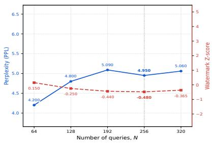
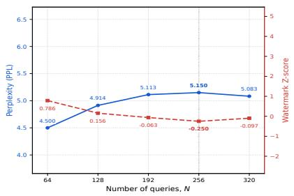
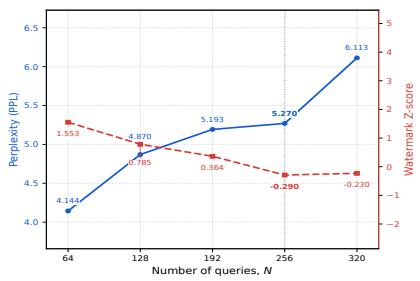
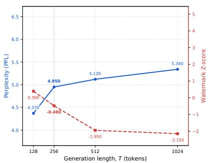
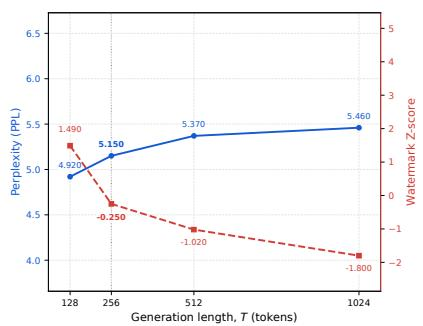
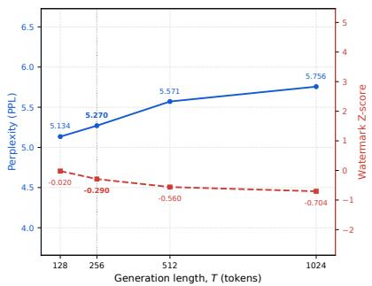
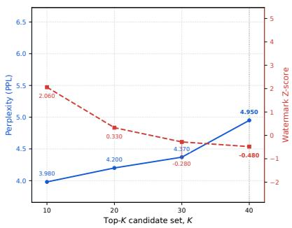
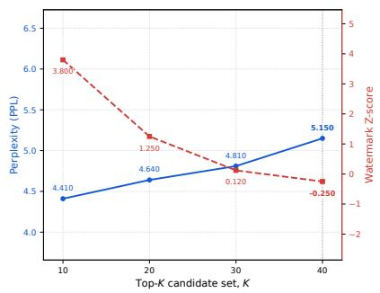
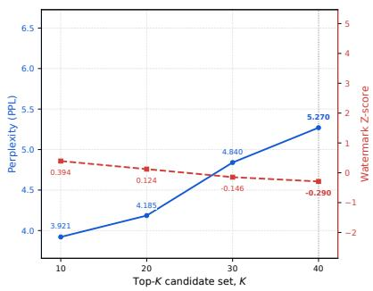

# A Unified Attack Framework against Statistical Generative Watermarks for Large Language Models

Romina Omidi Illinois Institute of Technology romidi@hawk.illinoistech.edu

Yuan Hong University of Connecticut yuan.hong@uconn.edu

Nima Naderloui Illinois Institute of Technology nima.naderloui@uconn.edu

Binghui Wang Illinois Institute of Technology bwang70@illinoistech.edu

## Abstract

Watermarking has emerged as a key tool for identifying text generated by large language models (LLMs), with current schemes embedding statistical signals into the generation process to enable later detection. In this work, we identify a shared weakness across a broad class of popular LLM watermarking methods, including KGW (and its variants), GumbelSoft, Dip Mark, ITS, and SynthID<sup>1</sup>. We show that these schemes exhibit a fundamental link between their detection scores and the token probability shifts they introduce during generation. This link, which we call score-ratio alignment, allows an attacker with only black-box query access to the model—and no knowledge of secret keys or model weights—to produce text that evades detection while remaining fluent and natural. We prove that the resulting attack is optimal across all covered watermark families, and show that the weakness is intrinsic: any watermark designed to maximize statistical detection power necessarily induces the very structure that attackers can exploit. We evaluate our attack on seven popular generative LLM watermarking schemes, three LLMs, and tasks, which reduce detection rates to at most 0.05 across all settings while preserving text quality. Our findings show that current watermarking methods can be reliably defeated under realistic attack conditions, highlighting the need for fundamentally different watermarking designs that decouple detection scores from token probability shifts.

## 1 Introduction

The widespread deployment of large language models (LLMs) capable of generating fluent, humanlike text at scale has created a pressing need for reliable provenance attribution [5, 30, 39, 3]. Generative watermarking has emerged as the most practical solution: a statistical signal is embedded into the LLM’s token generation process, enabling a verifier to classify text as machine-generated without access to the original prompt or model weights [1, 20, 6, 22, 7]. Deployed and proposed schemes—including KGW [20], GumbelSoft [10, 1], DipMark [41], ITS [22], and SynthID [7]— share a common architecture: a pseudorandom function (PRF) keyed by a secret key biases token selection at each decoding step, and a detector aggregates per-token scores into a test statistic compared against a calibrated threshold.

Despite significant advances in watermark design, a central security question remains unresolved: can an adversary with only black-box access to the watermarked LLM—and no knowledge of the PRF key or model weights—reliably evade detection while generating fluent, semantically coherent text? Prior attacks have addressed a weaker version of this question by applying post-hoc paraphrasing: a secondary model rewrites the watermarked output to disrupt the embedded signal [21, 31, 34]. Paraphrasing-based attacks impose a fundamental quality–evasion tradeoff—aggressive rewriting degrades fluency and semantic fidelity in proportion to the evasion gain [21]—and require inference through a capable auxiliary model. Crucially, reported robustness improvements against Paraphrasing does not characterise security against generation-time adversaries.

Our approach. We identify a structural property shared by major watermarking schemes, which we term score-ratio alignment: the per-token watermark score is a monotone function of the probability ratio between the watermarked and base distributions. Formally, for each token j from a vocabulary V we have: arg $\begin{array} { r l r } { \operatorname* { m i n } _ { j \in \mathcal { V } } \frac { \hat { p } _ { j } } { p _ { j } } } & { \subseteq } & { \arg \operatorname* { m i n } _ { j \in \mathcal { V } } \mathbb { E } [ s _ { j } ] } \end{array}$ , where $\hat { p } _ { j }$ is the watermarked token probability, $p _ { j }$ the base model probability, and $\mathbb { E } [ s _ { j } ]$ the expected per-token detection score. We prove that the equation holds as a formal theorem—not merely as an empirical observation—for KGW (and its two variants), GumbelSoft, DipMark, ITS, and SynthID (see Theorems in §4).

Score-ratio alignment admits a direct and efficient attack. An adversary who estimates the probability ratio $\hat { p } _ { j } / p _ { j }$ from repeated black-box queries can greedily select the score-minimizing token at each decoding step, systematically suppressing the cumulative detection statistic. Because the selected tokens are drawn from the low-distortion region of the base model distribution, text quality is preserved. The attack requires neither the secret key nor model weights, relying only on sampling access to the watermarked model and an offline surrogate model.

Key insight. Score-ratio alignment is not an artifact of any particular design; it is a structural consequence of optimization for detection power. By the Neyman–Pearson lemma [27], any statistically optimal detector must be based on the likelihood ratio ${ \hat { p } } ( \mathbf { x } ) / p ( \mathbf { x } )$ —exactly the quantity that score-ratio alignment ties to the watermark score. We prove (Theorem 5.1, §5) that no watermarking scheme within the current generator–detector paradigm can simultaneously achieve Neyman– Pearson-optimal detection power and robustness against a score-ratio-minimizing adversary. This result is not a limitation of specific parameter setting or scheme; it is an information-theoretic impossibility that holds for any scheme whose score function is optimized for distinguishability.

Contributions. This paper makes below contributions.

(1) Score-ratio alignment and a unified attack. We identify score-ratio alignment as a shared property of all major LLM watermarking schemes and formulate score-ratio minimization as a principled black-box attack requiring only output tokens from the watermarked model (§3).

(2) Formal optimality. We prove that score-ratio minimization achieves the minimum attainable expected detection score for a wide range of LLM watermarking schemes: no black-box adversary can achieve a lower expected score within each scheme’s construction (§4).

(3) Detectability–robustness tradeoff. We prove that optimizing the LLM watermark detection power establishes an inherent tension between detectability and robustness (§5).

(4) Theoretical attack effectiveness. We theoretically characterize the effectiveness of our practical attack by showing its true positive rate admits a small upper bound (§6).

(5) Empirical evaluation. We evaluate the attack on seven watermarking schemes, three LLMs, and three text corpora (C4, FakeNews, and Eli5 [33]). The attack reduces the true positive rate to at most 0.05 across all settings while preserving text quality (§7).

Table 1: Summary of the seven watermarking schemes covered by our framework. “Distortional” (D) schemes modify the sampling distribution; “distortion-free” (DF) schemes preserve it in expectation. γ denotes the green-list fraction, δ the logit boost, $\xi _ { t }$ the pseudorandom vector, and γ the Euler–Mascheroni constant.
<table><tr><td>Scheme</td><td>Type</td><td>PRF output E</td><td>Decoder Γ</td><td>Token score  $\phi \big ( \xi _ { t } , x _ { t } \big )$ </td><td>Detection statistic Φ</td></tr><tr><td>KGW [20]</td><td>D</td><td> $\{ 0 , 1 \} ^ { | \nu | }$ </td><td>softmax  $\left( \mathbf { l } _ { t } + \delta \xi _ { t } ; \tau \right)$ </td><td> $\xi _ { t } [ x _ { t } ] \in \{ 0 , 1 \}$ </td><td>Z-score (1)</td></tr><tr><td>Token-Specific KGW [17]</td><td>D</td><td> $\{ 0 , 1 \} ^ { | \nu | }$  (token-dep.)</td><td>softmax  $( ( \mathbf { 1 } _ { t } + \delta _ { t } \odot \xi _ { t } ) ; \tau )$ </td><td> $\delta _ { t } \big [ \boldsymbol { x } _ { t } \big ] \xi _ { t } \big [ \boldsymbol { x } _ { t } \big ]$ </td><td>Normalized sum (2)</td></tr><tr><td>Adaptive KGW [24]</td><td>D</td><td> $\dot { \{ 0 , 1 \} } ^ { | \nu | }$  (adaptive γt)</td><td>softmax  $\big ( ( \mathbf { l } _ { t } { + } \delta _ { t } \pmb { \xi } _ { t } ) ; \tau \big )$ </td><td> $\delta _ { t } \xi _ { t } [ x _ { t } ]$ </td><td>Normalized sum (2)</td></tr><tr><td>GumbelSoft [10]</td><td>DF</td><td> $\dot { \mathbb { R } } ^ { | \mathcal { V } | }$  (Gumbel)</td><td>softmax  $\left( 1 _ { t } + \xi _ { t } \right) ; \tau )$ </td><td> $\xi _ { t } [ \boldsymbol { x } _ { t } ]$ </td><td>Scaled mean (3)</td></tr><tr><td>DipMark [41]</td><td>DF</td><td>Permutation lt</td><td>Rank-reweighted (4)</td><td> $\mathbf { 1 } [ x _ { t } \in \mathrm { g r e e n } \mathrm { r e g i o n } ]$ </td><td>Z-score (5)</td></tr><tr><td>ITŠ [22]</td><td>DF</td><td> $\left( \mu _ { t } , \pi _ { t } \right)$ </td><td>Inverse CDF (6)</td><td> $| \mu _ { t } - \eta ( \pi _ { t } ( x _ { t } ) ) |$ </td><td>Negative mean (8)</td></tr><tr><td>SynthID [7]</td><td>DF</td><td> $\mathbb { R } ^ { | \nu | } \left( \mathrm { p r o p r i e t a r y } \right)$ </td><td>Tournament Sampling (11)</td><td> $\xi _ { t } [ \boldsymbol { x } _ { t } ]$ </td><td>Mean (12) or Bayesian (16)</td></tr></table>

## 2 Background

We introduce the notation used throughout the paper, give a self-contained description of the generative LLM watermarking paradigm, and formally specify each of the seven watermarking schemes evaluated in §7. Table 1 summarises the schemes and their key components for reference.

## 2.1 Language Model Generation

An autoregressive language model generates a token sequence $\mathbf { x } = \left( x _ { 1 } , x _ { 2 } , \ldots , x _ { T } \right)$ over a vocabulary V one token at a time. At decoding step $t ,$ the model maps the preceding context $x _ { 1 : t - 1 }$ to a logit vector $\mathbf { l } _ { t } \in \mathbb { R } ^ { | \nu | }$ , where $\mathbf { l } _ { t } [ x ]$ is the unnormalized score of token $x \in \nu$ . The next-token distribution is

$$
p _ { t } ( x \mid x _ { 1 : t - 1 } ) = \mathrm { s o f t m a x } ( \mathbf { l } _ { t } ; \tau ) = \frac { \mathrm { e x p } ( \mathbf { l } _ { t } [ x ] / \tau ) } { \sum _ { x ^ { \prime } \in \mathcal { V } } \mathrm { e x p } ( \mathbf { l } _ { t } [ x ^ { \prime } ] / \tau ) } ,
$$

where $\tau > 0$ is the temperature. The next token is then sampled as $x _ { t } \sim p _ { t } ( \cdot \ | \ x _ { 1 : t - 1 } )$ . We write $p _ { t } \in \Delta ^ { | \mathcal { V } | - 1 }$ as the simplex of next-token probabilities at step $t ,$ and drop the conditioning notation and decoding step when the context is clear.

## 2.2 The Generative Watermarking Paradigm

Generative LLM watermarking [20, 6, 22] embeds a hidden statistical signal into text during token generation, making the signal imperceptible to human but reliably detectable by an algorithm. All schemes evaluated here instantiate the following two-component framework.

Watermark generator. At each decoding step t, the generator receives the preceding context $x _ { 1 : t - 1 }$ and the model’s logit vector $\mathbf { l } _ { t } ,$ , and produces the next token $x _ { t }$ via:

(i) PRF evaluation. A pseudorandom function (PRF) $F _ { s k }$ keyed by a secret key sk is applied to a context window $c _ { t } \subseteq x _ { 1 : t - 1 } ( \mathbf { e . g . }$ , the last h tokens) to produce a pseudorandom vector $\xi _ { t } = F _ { s k } ( c _ { t } ) \in \mathcal { E }$ , where the range E is scheme-specific.

(ii) Watermarked sampling. A decoder $\Gamma ( \xi _ { t } , \mathbf { l } _ { t } )$ selects the next token $x _ { t }$ using both $\mathbf { l } _ { t }$ and $\xi _ { t }$ inducing a watermarked distribution $\hat { p } _ { t } \in \Delta ^ { | \nu | - 1 }$ that may or may not differ from the base distribution $p _ { t }$

Watermark detector. Given a candidate text ${ \bf x } = ( x _ { 1 } , \dots , x _ { T } )$ , the detector consists of below steps:

(i) recomputes $\xi _ { t } = F _ { s k } ( c _ { t } )$ for each step t using the same secret key $s k ;$

(ii) evaluates a token score function $s _ { t } = \phi ( \xi _ { t } , x _ { t } ) \in \mathbb { R }$ that measures the per-token watermark evidence; and

(iii) aggregates scores into a detection statistic $\Phi { \left( s _ { 1 : T } \right) }$ , which is compared against a pre-calibrated threshold θ to render a binary decision.

The threshold θ is set to control the false positive rate (FPR) under the null hypothesis $H _ { 0 }$ that the text was sampled from the unwatermarked base model. The test statistic $\Phi { \left( s _ { 1 : T } \right) }$ is designed to be large in expectation under $H _ { 1 }$ (watermarked text) and small under $H _ { 0 }$ , so that watermarked text is detected with high true positive rate (TPR) at a fixed FPR.

Categorization. Watermarking schemes are broadly classified as distortional if $\hat { p } _ { t } \neq p _ { t }$ with positive probability (so that the output distribution differs from the base model), and distortion-free if $\mathbb { E } [ \hat { p } _ { t } ] = p _ { t }$ in expectation over the randomness of ξ<sub>t</sub> [6]. KGW and its variants, i.e., Adaptive KGW [24] and Token-Specific KGW [17] are distortional, while GumbelSoft, DipMark, ITS and SynthID are distortion-free.

## 2.3 LLM Watermarking Schemes

## 2.3.1 KGW

KGW [20] partitions the vocabulary into green and red tokens randomly, then applies a logit boost to all green tokens.

• Context. The current token $x _ { t }$ itself (self-hash variant; the partition is seeded by the token being generated rather than the preceding context, so the partition is fixed for each vocabulary token across all positions).

• PRF. $F _ { s k } ( x _ { t } )$ maps $x _ { t }$ to a seed, which is used to sample a binary vector $\xi _ { t } \in \{ 0 , 1 \} ^ { | \mathcal { V } | }$ with exactly $\gamma | \mathcal { V } |$ ones (the green list, $\mathcal { G } _ { t } )$ and $\left( 1 - \gamma \right) | \nu |$ zeros (the red list). Here $\gamma \in ( 0 , 1 )$ is the green-list fraction.

• Decoder. $\Gamma ( \xi _ { t } , \mathbf { l } _ { t } )$ samples from softmax $\textstyle \left( { \frac { \mathbf { l } _ { t } + { \boldsymbol { \delta \cdot } } { \boldsymbol { \xi } } _ { t } } { \tau } } \right)$ , where $\delta > 0$ is the logit boost.

• Token score. $s _ { t } = \phi ( \xi _ { t } , x _ { t } ) = \xi _ { t } [ x _ { t } ] \in \{ 0 , 1 \} , \mathrm { i . e . }$ , 1 if x<sub>t</sub> is green and 0 otherwise.

• Detection statistic. KGW uses the Z-score defined below:

$$
\Phi ( s _ { 1 : T } ) = \frac { \sum _ { t = 1 } ^ { T } s _ { t } - \gamma T } { \sqrt { T \gamma ( 1 - \gamma ) } } .\tag{1}
$$

Under $H _ { 0 } , \Phi \stackrel { d } { \to } \mathcal { N } ( 0 , 1 )$ ; under $H _ { 1 }$ , the elevated green-token rate shifts Φ positively.

## 2.3.2 KGW Variants

Several extensions of KGW replace its fixed green-list fraction and logit boost with context-dependent parameters. Two representative variants are Token-Specific KGW [17], which assigns different parameters to individual vocabulary tokens, and Adaptive KGW [24], which dynamically adjusts shared parameters at each decoding step. We can unify both schemes using the following generalized KGWformulation.

• Context. The previous h tokens $x _ { t - h : t - 1 }$ , optionally together with semantic-coherence, complexity, or token-importance signals derived from current decoding context.

• PRF and green-list construction. The pseudorandom function $F _ { s k } \big ( x _ { t - h : t - 1 } \big )$ seeds a contextdependent binary vector $\xi _ { t } ,$ where $\xi _ { t } [ x ] \sim$ Bernoulli $\left( \gamma _ { t } [ x ] \right) , \forall x \in \mathcal { V } .$

and $\gamma _ { t } [ x ] \in ( 0 , 1 )$ is the probability that token x is assigned to the green list at step t and each token x has a boost $\delta _ { t } [ x ]$

1. Token-Specific KGW: Both $\gamma _ { t } [ x ]$ and the boost $\delta _ { t } [ x ]$ may vary across tokens according to semantic similarity or context-aware importance. I.e., $\gamma _ { t } [ \boldsymbol { x } ]$

2. Adaptive KGW: All tokens at a given step t typically share the same parameters, i.e., $\gamma _ { t } [ x ] = \gamma _ { t } , \delta _ { t } [ x ] = \delta _ { t } , \forall x \in \mathcal V ;$ but

$\gamma _ { t }$ and $\delta _ { t }$ vary across decoding steps according to semantic coherence, sentence complexity, topic sensitivity, or token importance. Thus, Adaptive KGW is a step-dependent special case of the generalized token-dependent formulation.

• Decoder. Let $\delta _ { t } \geq 0$ denote the boost vector.

For Token-Specific KGW, the watermarked token is sampled via $x _ { t } \sim$ softmax $\left( \frac { \mathbf { l } _ { t } + \delta _ { t } \odot \pmb { \xi } _ { t } } { \tau } \right)$ , where ⊙ is element-wise product.

For Adaptive KGW, this becomes $\begin{array} { r } { x _ { t } \sim \operatorname { s o f t m a x } \left( \frac { 1 _ { t } + \delta _ { t } \cdot \pmb { \xi } _ { t } } { \tau } \right) } \end{array}$

• Token score. In Token-Specific KGW, the score contributed by the selected token is $s _ { t } = \phi ( \xi _ { t } , x _ { t } ) =$ $\delta _ { t } [ x _ { t } ] \xi _ { t } [ x _ { t } ]$ ; while under Adaptive KGW, the score becomes $s _ { t } = \delta _ { t } \xi _ { t } [ x _ { t } ]$

• Detection statistic. Both variants aggregate the token-level scores using the normalized sum statistic as below

$$
\Phi ( s _ { 1 : T } ) = \frac { \sum _ { t = 1 } ^ { T } s _ { t } - \mathbb { E } _ { H _ { 0 } } \left[ \sum _ { t = 1 } ^ { T } s _ { t } \right] } { \sqrt { \operatorname { V a r } _ { H _ { 0 } } \left[ \sum _ { t = 1 } ^ { T } s _ { t } \right] } } ,\tag{2}
$$

where the null-hypothesis mean and variance are computed using the corresponding tokenspecific or step-adaptive green-list parameters. A sufficiently large value of $\bar { \Phi ( } s _ { 1 : T } )$ indicates the presence of the watermark.

## 2.3.3 GumbelSoft

GumbelSoft [10] injects Gumbel-distributed pseudorandom noise [12] into the logits before sampling. Because the Gumbel-Max trick is equivalent to sampling from the softmax distribution, the scheme is distortional-free.

• Context. The previous h tokens $x _ { t - h : t - 1 }$

• PRF. $F _ { s k } \big ( x _ { t - h : t - 1 } \big )$ hashes the context to a seed and draws $\xi _ { t } \big [ \boldsymbol { x } \big ] \overset { \mathrm { i . i . d . } } { \sim }$ Gumbel(0, 1), $\forall x \in \nu$

• Decoder. $x _ { t } \sim \mathrm { s o f t m a x } ( ( 1 _ { t } + \xi _ { t } ) / \tau )$

• Token score. $s _ { t } = \phi ( \xi _ { t } , x _ { t } ) = \xi _ { t } \big [ x _ { t } \big ] ,$ i.e., the Gumbel noise value at the sampled position.

• Detection statistic. It uses scaled mean defined as:

$$
\Phi ( s _ { 1 : T } ) = \frac { \sqrt { 6 T } } { \pi } \left( \frac { 1 } { T } \sum _ { t = 1 } ^ { T } s _ { t } - \gamma _ { \mathrm { E M } } \right) ,\tag{3}
$$

where $\gamma _ { \mathrm { E M } } \approx 0 . 5 7 7 2$ is the Euler–Mascheroni constant, i.e., the mean of a Gumbel(0, 1) random variable.

## 2.3.4 DipMark

DipMark [41] is a distortion-free scheme that reweights the token distribution via a pseudorandom permutation, assigning binary colour scores to tokens by their permuted rank.

• Context. The previous h tokens $x _ { t - h : t - 1 }$

• PRF. $F _ { s k } \big ( x _ { t - h : t - 1 } \big )$ seeds a uniform random permutation $\iota _ { t } : \mathcal { V } \to \mathcal { V } .$

• Decoder. Token $\iota _ { t } [ i ]$ is sampled with probability $\lambda _ { t } ( i ) - \lambda _ { t } ( i - 1 )$ , where $\lambda _ { t } ( i )$ is defined as

$$
\operatorname* { m a x } \left\{ \sum _ { j = 1 } ^ { i } p _ { t } { \left( { \iota _ { t } [ j ] } \right) } - \alpha , 0 \right\} + \operatorname* { m a x } \left\{ \sum _ { j = 1 } ^ { i } p _ { t } { \left( { \iota _ { t } [ j ] } \right) } - ( 1 - \alpha ) , 0 \right\} ,\tag{4}
$$

and $\alpha \in ( 0 , \frac { 1 } { \tau } )$ is a scheme parameter. Tokens ranked in the upper α-fraction of the permuted vocabulary (the “green” region) are upweighted, while tokens in the lower α-fraction (the “red” region) are downweighted.

• Token score. $s _ { t } = \phi ( \xi _ { t } , x _ { t } ) = \mathbf { 1 } \{ x _ { t } \in \iota _ { t } [ \lceil ( 1 - \gamma ) \lvert \mathcal { V } \rvert ] : \lvert \mathcal { V } \rvert ] \}$ , i.e., 1 if the sampled token falls in the green (high-rank) portion of the permuted vocabulary, 0 otherwise.

• Detection statistic. It uses the Z-score defined as:

$$
\Phi \big ( s _ { 1 : T } \big ) = \frac { \sum _ { t = 1 } ^ { T } s _ { t } - ( 1 - \gamma ) T } { \sqrt T } .\tag{5}
$$

## 2.3.5 ITS

The Inverse Transform Sampling (ITS) scheme [22] is distortion-free by construction: it uses a pre-committed global key sequence to deterministically select tokens via inverse CDF sampling, producing an output distribution equal in expectation to the base model.

• Context. A global watermark key ξ-list and position index t. Each entry $\xi - \mathrm { l i s t } [ t ] = \left( \mu _ { t } , \pi _ { t } \right)$ consists of a random threshold $\mu _ { t } \in \mathrm { U n i } ( 0 , 1 )$ and a permutation $\pi _ { t }$ of V.

• PRF. The PRF simply reads off the pre-committed key: $F _ { s k } ( t ) = ( \mu _ { t } , \pi _ { t } )$

• Decoder. For a fixed key $\left( \mu _ { t } , \pi _ { t } \right)$ , the decoder selects

$$
x _ { t } = \pi _ { t } ^ { - 1 } \big ( \operatorname* { m i n } \big \{ \pi _ { t } ( i ) : p _ { t } \big ( \{ j : \pi _ { t } ( j ) \leq \pi _ { t } ( i ) \} \big ) \geq \mu _ { t } \big \} \big ) ,\tag{6}
$$

which selects the smallest $\pi _ { t }$ -ranked token whose cumulative probability under the permuted ordering meets or exceeds $\mu _ { t }$ . This is equivalent to inverse-CDF sampling over the permuted token distribution.

• Token score.

$$
s _ { t } = \phi ( \xi _ { t } , x _ { t } ) = \left| \mu _ { t } - \eta ( \pi _ { t } ( x _ { t } ) ) \right| , \eta ( k ) = \frac { k - 1 } { \left| \mathcal { V } \right| - 1 } ,\tag{7}
$$

which measures how closely the sampled token’s normalized rank matches the random threshold. Under $H _ { 1 }$ , scores are concentrated near zero; under $H _ { 0 }$ , they are approximately uniform on $[ 0 , { \scriptstyle { \frac { 1 } { 2 } } } ]$

• Detection statistic. It uses a negative mean:

$$
\Phi ( s _ { 1 : T } ) = - \frac { 1 } { T } \sum _ { t = 1 } ^ { T } s _ { t } .\tag{8}
$$

Note that larger negative values of Φ indicate stronger watermark evidence.

## 2.3.6 SynthID

SynthID [7] is the first production-ready generative LLM watermarking system developed by Google and achieves the state-of-the-art detection performance. Its core contribution is a novel Tournament Sampling mechanism that samples several candidate tokens from base distribution and repeatedly selects candidates having larger pseudorandom g-values.

• Context. The previous h tokens $x _ { t - h : t - 1 }$

• PRF and g-value function. The random seed at position t is computed from the preceding context and the secret watermark key $r _ { t } = F _ { s k } ( x _ { t - h : t - 1 } )$

For a tournament with m layers, the seed $r _ { t }$ determines m independent pseudorandom functions (also called g-value functions):

$$
g _ { t , \ell } ( i ) : = g _ { \ell } ( i , r _ { t } ) , \quad \ell \in \{ 1 , \ldots , m \} , \quad i \in \mathcal { V } .\tag{9}
$$

Each function assigns every token an ordered g-value in a set $\mathcal { Z }$ . The standard construction uses binary values, but it naturally extends to arbitrary discrete ordered g-values.

• Decoder: Tournament Sampling. Assume the tournament match contains $N \geq 2$ competitors. The decoder initially samples $N ^ { m }$ candidate tokens independently from base distribution $p _ { t }$ . At layer $\ell ,$ the remaining candidates are divided into groups of $N ,$ and the candidate having the largest $g _ { t , \ell } .$ -value in each group is retained. Ties are broken uniformly. After m layers, the only remaining token becomes $x _ { t }$

Equivalently, let $p _ { t } ^ { ( 0 ) } : = p _ { t }$ and $p _ { t } ^ { ( \ell ) }$ denote the winner distribution after layer ℓ. For a score level $a \in { \mathcal { Z } }$ , define the cumulative masses under the distribution $p ^ { ( \ell - 1 ) }$ by

$$
Q _ { t , \ell , < } ( a ) : = \sum _ { j : g _ { t , \ell } ( j ) < a } p _ { t , j } ^ { ( \ell - 1 ) } , Q _ { t , \ell , \le } ( a ) , : = \sum _ { j : g _ { t , \ell } ( j ) \le a } p _ { t , j } ^ { ( \ell - 1 ) } , Q _ { t , \ell , = } ( a ) : = Q _ { t , \ell , \le } ( a ) - Q _ { t , \ell , < } ( a ) .\tag{10}
$$

The layerwise Tournament-sampling update is

$$
p _ { t , i } ^ { ( \ell ) } = p _ { t , i } ^ { ( \ell - 1 ) } \frac { Q _ { t , \ell , \le } ( g _ { t , \ell } ( i ) ) ^ { N } - Q _ { t , \ell , < } ( g _ { t , \ell } ( i ) ) ^ { N } } { Q _ { t , \ell , = } ( g _ { t , \ell } ( i ) ) } .\tag{11}
$$

The final watermarked distribution is $\widehat { p } _ { t } : = p _ { t } ^ { ( m ) } , x _ { t } \sim \widehat { p } _ { t }$

• Detection statistics. SynthID supports both the mean score and Bayesian score, and larger values provide stronger watermark evidence.

– Mean Score. The scalar contribution of token $x _ { t }$ is $\begin{array} { r } { s _ { t } ^ { \mathrm { M S } } : = \frac { 1 } { m } \sum _ { \ell = 1 } ^ { m } g _ { t , \ell } ( x _ { t } ) } \end{array}$

Let I be the set of positions retained after context-repetition and other validity masking. The document-level mean statistic is

$$
\Phi _ { \mathrm { M S } } ( x _ { 1 : T } ) : = \frac { 1 } { m | \mathcal { T } | } \sum _ { t \in \mathcal { T } } \sum _ { \ell = 1 } ^ { m } g _ { t , \ell } ( x _ { t } ) .\tag{12}
$$

Detection is performed by comparing $\Phi _ { \mathrm { M S } }$ with a threshold calibrated under the unwatermarked null distribution.

– Bayesian Score. Let $\psi _ { t , \ell } \in \{ 1 , \ldots , N \}$ denote the number of distinct competitors associated with the observed token at layer ℓ. For a fixed value $\psi _ { t , \ell } = c ,$ the likelihood ratio associated with observing g-value z is

$$
\Lambda _ { c } ( z ) : = { \frac { \operatorname* { P r } ( g _ { t , \ell } = z \mid H _ { 1 } , \psi _ { t , \ell } = c ) } { \operatorname* { P r } ( g _ { t , \ell } = z \mid H _ { 0 } ) } }\tag{13}
$$

Given prior layer values $\mathbf { g } _ { t , < \ell } = \left( g _ { t , 1 } ( x _ { t } ) , \ldots , g _ { t , \ell - 1 } ( x _ { t } ) \right)$ , the conditional Bayes factor for layer ℓ is

$$
{ \mathrm B S } _ { t , \ell } \left( g _ { t , \ell } ( x _ { t } ) ; { \mathbf g } _ { t , < \ell } \right) : = \sum _ { c = 1 } ^ { N } \operatorname* { P r } ( \psi _ { t , \ell } = c \mid { \mathbf g } _ { t , < \ell } , H _ { 1 } ) \Lambda _ { c } ( g _ { t , \ell } ( x _ { t } ) ) .\tag{14}
$$

The log-Bayesian contribution of token $x _ { t }$ is

$$
s _ { t } ^ { \mathrm { B S } } : = \sum _ { \ell = 1 } ^ { m } \log \mathrm { B S } _ { t , \ell } \big ( g _ { t , \ell } ( x _ { t } ) ; \mathbf { g } _ { t , < \ell } \big ) .\tag{15}
$$

The document-level log-Bayes statistic is therefore

$$
\Phi _ { \mathrm { B S } } ( x _ { 1 : T } ) : = \sum _ { t \in \cal Z } s _ { t } ^ { \mathrm { B S } } = \sum _ { t \in \cal Z } \sum _ { \ell = 1 } ^ { m } \log \mathrm { B } S _ { t , \ell } \big ( g _ { t , \ell } ( x _ { t } ) ; \mathbf { g } _ { t , < \ell } \big ) .\tag{16}
$$

## 3 Attack Framework

We consider a watermark applied at generation time of an LLM by modifying its token selection distribution. The watermark is considered secure if it is simultaneously: (i) statistically detectable with high confidence, and (ii) minimally distortive with respect to the raw model distribution. Our attack challenges property (i) while preserving property $( \mathrm { i i } ) ^ { 2 }$

## 3.1 Threat Model

Adversary capabilities: We assume a distribution-level black-box adversary with below capabilities:

• Sampling and detector access: The adversary knows the watermark detection rule $( \mathrm { e . g . }$ , score aggregation and threshold), since it knows which watermark to attack; the attacker and can query the watermarked LLM to observe generated text samples.

• No seed or key access: The adversary has no access to the permutation, random seed, or secret partition used to construct the watermark.

• No model access: The adversary does not modify the model weights or have access to the watermark algorithm.

Adversary objective: The adversary objective is to produce an attacked distribution $\tilde { p }$ such that:

1. Watermark evasion: Generated text $x$ sampled from $\tilde { p }$ is classified as non-watermarked by the detector with high probability.

2. Low distortion: The modified distribution $\tilde { p }$ remains close to the original model distribution $p .$ In other words, the adversary aims to erase the watermark signal while preserving language quality.

## 3.2 Attack Principle

The central quantity we study is the expected per-token score $\mathbb { E } [ s _ { j } ]$ as a function of the token index $j .$ In $\ S 4$ we show that for every watermarking scheme in Table 1, this function is monotone in the probability ratio $\hat { p } _ { j } / p _ { j } ,$ a property we call score-ratio alignment and forms the theoretical foundation of our attack.

```latex
Algorithm 1 Black-Box Attack on LLM Watermarking
Require: Prompt $x ,$ surrogate model $M _ { s } ,$ watermarked oracle ${ \cal \widetilde { M } } ,$ candidate size $K ,$ query budget $N ,$ and
generation length T
Ensure: Attacked continuation y
1: Initialize $y  [ ]$
2: for $j = 1 , \dot { \dots } , \dot { T }$ do
3: Set the current context h $ ( x , y )$
4: Query the watermarked oracle N times:
$\widetilde t ^ { ( 1 ) } , \dots , \widetilde t ^ { ( N ) } \sim \widetilde M ( \cdot \mid h )$
5: Select the top-K candidate tokens using the surrogate model:
$\mathcal { C }  \mathrm { T o p K } ( p _ { M _ { s } } ( \cdot \mid h ) , K )$
6: Estimate the watermarked probability for each $t \in { \mathcal { C } } \colon$
$\widehat { p } _ { \mathrm { w m } } ( t \mid h )  \frac { \sum _ { i = 1 } ^ { N } \mathbb { I } [ \widetilde { t } ^ { ( i ) } = t ] + \epsilon } { \sum _ { u \in \mathcal { C } } \sum _ { i = 1 } ^ { N } \mathbb { I } [ \widetilde { t } ^ { ( i ) } = u ] + \epsilon | \mathcal { C } | } , \quad \forall t \in \mathcal { C }$
7: Select the next token:
$t _ { j } ^ { \star }  \arg \operatorname* { m i n } _ { t \in \mathcal { C } } \frac { \widehat { p } _ { \mathrm { w m } } ( t \mid h ) } { p _ { M _ { s } } ( t \mid h ) + \epsilon }$
8: Append $t _ { j } ^ { \star }$ to the continuation: $y  y \circ t _ { j } ^ { \star }$
9: i $: t _ { j } ^ { \star } = \mathrm { E O S }$ then
10: break
11: end if
12: end for
13: return $y$
Specifically, the attack exploits the fact that the schemes (both distortional and distortion-free)
induce a structured change in token probabilities that correlates with the watermark score $s _ { j } , \mathrm { i . e . , }$
tokens with the smallest expected scores experience the largest score-ratio degradation:
$j ^ { \star } = \arg \operatorname* { m i n } _ { j \in \mathcal { V } } \frac { \hat { p } _ { j } } { p _ { j } } \quad \Rightarrow \quad j ^ { \star } \in \arg \operatorname* { m i n } _ { j \in \mathcal { V } } \mathbb { E } [ s _ { j } ] .$ (17)
The adversary leverages this alignment to estimate which tokens contribute most to the detection
statistic and counteracts the watermark by applying a compensating reweighting or noise injection
that neutralizes the expected score bias.
3.3 Attack Algorithm
Algorithm 1 presents our detailed attack procedure. Here, we choose an arbitrary surrogate model
and use its tokenizer consistently throughout the attack. We make the following remarks regard
ing Algorithm 1.
1. Computational consideration. Unlike our theoretical analysis that considers the entire vocabulary
$\nu ,$ in practice, we estimate the watermarked probabilities only for the top-K candidate tokens
```

in C selected by the surrogate model to reduce computational cost. Most tokens outside C have very small probabilities and are thus unlikely to be selected. This provides an efficiency– search-space tradeoff by substantially reducing the number of candidate tokens while retaining the most likely ones.

2. Per-token queries. Our attack operates at the token level. When querying the watermarked oracle, we set max new tokens=1 to obtain a single next-token sample. If generation-length control is unavailable and the oracle returns a sequence, we use only its first generated token as the next-token observation.

3. Numerical stability. We use a small constant $\epsilon > 0$ in the denominator to avoid numerical instability. Since ϵ is sufficiently small, it has a negligible effect on the probability ratios and does not affect the attack results in practice.

## 4 Optimality: Score-Ratio Minimization

We now formally establish that the score-ratio minimization strategy in Equation (17) is optimal for the studied watermark schemes. Specifically, we prove that in every scheme, the token achieving the minimum probability ratio $\hat { p } _ { j } / p _ { j }$ also achieves the minimum expected detection score $\mathbb { E } [ s _ { j } ]$ —the score-ratio alignment condition of Equation (17). This alignment confirms that an adversary executing Algorithm 1 could minimize the detection statistic in expectation, without requiring knowledge of the secret key or the watermark seed.

Next, we describe the setup and present the theorems. Since both KGW and GumbelSoft belong to the class of logit-addition watermarking schemes, the theorem applies directly to both methods. Furthermore, the two KGW variants can be analyzed under the same unified frame work. All proofs are deferred to Appendix A.

## 4.1 Logit-Addition Watermark: KGW and GumbelSoft

Setup. Let $l \in \mathbb { R } ^ { | \nu | }$ denote the original logit vector produced by the base LLM at a given decoding step, and define the base-model next-token distribution as p<sub>j</sub> = softmax $\begin{array} { r } { ( l ) _ { j } = \frac { e ^ { l _ { j } } } { \sum _ { k \in \mathcal { V } } e ^ { l _ { k } } } } \end{array}$ . A logitaddition watermark injects a per-token signal $\xi _ { j }$ into the logits before sampling:

$$
\hat { l } _ { j } = l _ { j } + \delta \xi _ { j } , \qquad \hat { p } _ { j } = \mathrm { s o f t m a x } ( \hat { l } ) _ { j } , \qquad s _ { j } : = \xi _ { j } ,\tag{18}
$$

where $\delta > 0$ is the watermark strength and $\xi _ { j }$ is drawn from a distribution determined by the PRF and the current context. For KGW, $\xi _ { j } \sim$ Bernoulli $( \gamma ) ;$ ; for GumbelSoft, $\xi _ { j } \sim \operatorname { G u m b e l } ( 0 , 1 )$ . In both cases the detector score for the sampled token is $s _ { j } = \xi _ { j }$

Theorem 1 (Score-Ratio Alignment: Logit-Addition). For any logit-addition watermark with $\delta > 0$ we have:

$$
\arg \operatorname* { m i n } _ { j \in \mathcal { V } } \frac { \hat { p } _ { j } } { p _ { j } } \subseteq \arg \operatorname* { m i n } _ { j \in \mathcal { V } } \mathbb { E } [ s _ { j } ] .
$$

Remark 1. Equation (31) shows that the probability ratio $\hat { p } _ { j } / p _ { j }$ is a monotone function $o f \xi _ { j }$ alone: the original logit $l _ { j }$ cancels exactly. Consequently, any token selection strategy that minimizes $\xi _ { j } - e q u i v a l e n t l y ,$ minimizes the detection score—also minimizes the probability ratio, and vice versa. This symmetry is the algebraic source of score-ratio alignment in all logit-addition schemes.

## 4.2 KGW Variants

Setup. In KGW variants [17, 24], each token $j \in \mathcal V$ receives an independent binary color $\xi _ { j } \sim$ Bernoulli $( \gamma _ { j } )$ , and a boost magnitude $\delta _ { j } \geq 0$ . Watermarked logit and probability are

$$
\hat { \ell } _ { j } = \ell _ { j } + \delta _ { j } \xi _ { j } , \qquad \hat { p } _ { j } = \mathrm { s o f t m a x } ( \hat { \ell } ) _ { j } , \qquad s _ { j } = \xi _ { j } .\tag{19}
$$

The probability ratio simplifies to

$$
\frac { \hat { p } _ { j } } { p _ { j } } = \frac { e ^ { \ell _ { j } + \delta _ { j } \xi _ { j } } / \sum _ { j } e ^ { \ell _ { j } + \delta _ { j } \xi _ { j } } } { e ^ { \ell _ { j } } / \sum _ { j } e ^ { \ell _ { j } } } = e ^ { \delta _ { j } \xi _ { j } } \cdot \underbrace { \frac { \sum _ { j } e ^ { \ell _ { j } } } { \sum _ { j } e ^ { \ell _ { j } + \delta _ { j } \xi _ { j } } } } _ { = : C } ,\tag{20}
$$

where C is a constant, so arg min $\hat { p } _ { j } / p _ { j } = \arg \operatorname* { m i n } _ { j } \delta _ { j } \xi _ { j }$

Theorem 2 (Score-Ratio Alignment: KGW Variants). For every realization of the token-specific green list, we have:

$$
\arcsin \operatorname* { m i n } _ { j \in \mathcal { V } } \frac { \hat { p } _ { j } } { p _ { j } } \ \subseteq \ \arg \operatorname* { m i n } _ { j \in \mathcal { V } } s _ { j } .
$$

Theorem 3 (Feasibility of Red-Token Minimizers: Token-Specific KGW). In the Token-Specific KGW watermark, every red token is afeasible minimizer of the probability ratio. In particular, if at least one token has $\xi _ { j } = 0$ , then

$$
\arg \operatorname* { m i n } _ { j \in \mathcal { V } } \frac { \hat { p } _ { j } } { p _ { j } } = \{ j : \xi _ { j } = 0 \} = \arg \operatorname* { m i n } _ { j \in \mathcal { V } } s _ { j } .
$$

If no red token exists, every token is afeasible minimizer.

## 4.3 DipMark

Setup. In DipMark, a step samples a uniformly random permutation $\iota : \{ 0 , 1 , \ldots , | \mathcal { V } | - 1 \} \to$ V, which induces a shuffled ordering of the vocabulary V. The binary watermark color (score) assigned to token $\iota [ k ]$ is

$$
s _ { \iota [ k ] } = { \{ \begin{array} { l l } { 0 } & { { \mathrm { ( r e d ) } } \quad { \mathrm { i f } } \ k < \lceil \gamma | \mathcal { V }  \rceil , } \\ { 1 } & { { \mathrm { ( g r e e n ) } } \quad { \mathrm { o t h e r w i s e } } , } \end{array}  }\tag{21}
$$

which means the first $\lceil \gamma \lvert \mathcal { V } \rvert \rceil$ tokens in the permuted order form the red prefix.

We use $\hat { p } _ { j } / p _ { j }$ as the degradation factor of token j.

Theorem 4 (Score-Ratio Alignment: DipMark). In DipMark watermarking, the following inclusion holds:

$$
\arg \operatorname* { m i n } _ { j \in \mathcal { V } } \frac { \hat { p } _ { j } } { p _ { j } } \subseteq \arg \operatorname* { m i n } _ { j \in \mathcal { V } } \mathbb { E } [ s _ { j } ] .
$$

Equivalently, every token achieving the smallest probability-ratio also achieves the smallest expected watermark score.

Theorem 5 (Feasibility of Index 0: DipMark). In DipMark watermarking, ι[0] is always a feasible minimizer $o f s _ { j }$ in the index space induced by the permutation. In particular,

$$
\arg \operatorname* { m i n } _ { j \in \mathcal { V } } \frac { \hat { p } _ { j } } { p _ { j } } = \iota [ 0 ] \in \arg \operatorname* { m i n } _ { j \in \mathcal { V } } \mathbb { E } [ s _ { j } ] .
$$

## 4.4 ITS

Setup. Recall from §2.3.5 that the key at position t is ${ \boldsymbol { \xi } } _ { t } = \left( \mu _ { t } , \pi _ { t } \right)$ , where $\mu _ { t } \sim \mathrm { U n i f } ( 0 , 1 )$ and $\pi _ { t }$ is a random permutation of $\nu$ . These keys are obtained from the pre-committed sequence ξ-list by applying a random document-level shift. The following result uses only the single-position marginal distribution of $\xi _ { t } ;$ and independence between different positions is not required. Fix a decoding step t and its preceding context. Let $p _ { t }$ be the corresponding base-model distribution, define $\bar { S _ { t } } : = \bar { \{ j \in \mathcal { V } : p _ { t } ( j ) > 0 \} }$ , and let $x _ { t } = \Gamma ( p _ { t } , \xi _ { t } )$ denote the token generated by the ITS decoder in Equation (6). For a permutation $\pi _ { t } ,$ token j occupies the permuted-CDF interval

$$
I _ { t , j } ^ { \pi _ { t } } : = \Big [ \sum _ { i : \pi _ { t } ( i ) < \pi _ { t } ( j ) } p _ { t } ( i ) , \sum _ { i : \pi _ { t } ( i ) \leq \pi _ { t } ( j ) } p _ { t } ( i ) \Big ) .\tag{22}
$$

Consequently, $x _ { t } = j \Longleftrightarrow \mu _ { t } \in I _ { t , j } ^ { \pi _ { t } }$

Theorem 6 (ITS detection-statistic reduction). $I f \left| S _ { t } \right| \geq 2 ,$

$$
\mathbb { E } _ { \xi _ { t } } \left[ - s ( x _ { t } ^ { \star } ) \right] < \mathbb { E } _ { \xi _ { t } } \left[ - s ( x _ { t } ) \right] .\tag{23}
$$

Thus, empirical probability-ratio minimization reduces the expected detection statistic to its key-independent null baseline.

Remark 2. The strict inequality follows from the independence of the attacked token and the detector key. In fact, every token selection rule based only on auxiliary keys has the same expected null score $\frac { 2 | \mathcal { V } | - \breve { 1 } } { 6 ( | \mathcal { V } | - 1 ) }$ (see more details in Appendix A.6). Empirical probability-ratio minimization determines which underrep resented token is selected, while key independence is what reduces the expected ITS detection statistic.

## 4.5 SynthID

Setup. Consider SynthID Tournament sampling with $N \geq 2$ competitors per match and $m \geq 1$ tournament layers. Fix a decoding step, its preceding context, and the corresponding pseudorandom seed r. Let $p ^ { ( 0 ) } : = p$ be the base-model next-token distribution and let $\bar { S } : = \{ i \in \mathcal { V } : p _ { i } > 0 \}$ denote its support. We restrict all probability ratios to ${ \mathcal { S } } ,$ since $\widehat { p } _ { i } / p _ { i }$ is undefined when $p _ { i } = 0 . \mathrm { A t }$ layer $\ell \in \{ 1 , \ldots , m \}$ , token i is assigned the possibly real-valued watermark score $g _ { \ell , i } : = g _ { \ell } ( i , r )$ Let $p ^ { ( \ell ) }$ denote the winner distribution after layer $\ell .$ The final watermarked distribution is therefore ${ \widehat { p } } : = p ^ { ( m ) }$

Theorem 7 (Score-Ratio Alignment: SynthID, Mean Score). Consider Tournament sampling with $a r \mathrm { - }$ bitrary $N \geq 2$ and arbitrary discrete, ordered g-values. For every layer ℓ and every $i , j \in S , g _ { \ell , i } < g _ { \ell , j } \Longrightarrow$ $\hat { p } _ { i } ^ { ( \ell ) } / \bar { p } _ { i } ^ { ( \ell ) } < \hat { p } _ { j } ^ { ( \ell ) } / p _ { j } ^ { ( \ell ) }$ . Consequently,

$$
\arg \operatorname* { m i n } _ { i \in \mathcal { S } } \frac { \hat { p } _ { i } ^ { ( \ell ) } } { p _ { i } ^ { ( \ell ) } } = \arg \operatorname* { m i n } _ { i \in \mathcal { S } } g _ { \ell , i } .\tag{24}
$$

Theorem 8 (Score-Ratio Alignment: SynthID, Bayesian Score). At any layer ℓ and condition on preceding g-values, arg min $\begin{array} { r } { \mathfrak { i } _ { i \in \mathcal { S } } \frac { \widehat { p } _ { i } ^ { ( \ell ) } } { p _ { i } ^ { ( \ell ) } } = \arg \operatorname* { m i n } _ { i \in \mathcal { S } } g _ { \ell , i } \subseteq \arg \operatorname* { m i n } _ { i \in \mathcal { S } } s ( i ) } \end{array}$

Remark 3. For fixed preceding g-values, the layerwise probability ratio, the mean-score contribution $g _ { \ell , i } ,$ and the conditional Bayes factor are nondecreasing in $g _ { \ell , i }$ . Thus, minimum-ratio selection minimizes both the mean and Bayesian evidence contributed by that layer.

## 5 Detectability–Robustness Tradeoff

$\ S 4$ establishes that score-ratio alignment holds across all watermarks considered in this work. A natural question arises: Is this alignment an artifact of particular design choices, or reflecting a deeper structural constraint inherent to the generator–detector paradigm? In this section, we show that scoreratio alignment is the inevitable consequence of designing a statistically optimal detector. This yields a fundamental impossibility: no watermarking scheme within the current paradigm can simultaneously maximize detection power and resist score-ratio minimization adversaries. Proofs of the theorems are in Appendix B.

## 5.1 The Fundamental Tradeoff

We first formalize the notion of a watermark that can be evaded by our attack framework.

Definition 1 (Defeatable Watermark). A watermarking scheme with per-token score function $s _ { j }$ is called defeatable $i f$ the token minimizing the probability ratio coincides with the token minimizing the expected detection score: arg $\begin{array} { r } { \operatorname* { m i n } _ { i \in \mathcal { V } } \frac { \hat { p } _ { j } } { p _ { j } } = \arg \operatorname* { m i n } _ { j \in \mathcal { V } } \mathbb { E } [ s _ { j } ] } \end{array}$

Theorem 9 (Defeatable Implies Not Robust). If a watermarking scheme is defeatable, then it is not robust against a score-ratio-minimizing adversary.

Theorem 10 (Detectability–Robustness Tradeoff). Among all hypothesis tests D for $H _ { 0 } : x \sim \boldsymbol { \mathit { 1 } }$ p versus $H _ { 1 } : x \sim { \hat { p } } $ , the statistically optimal detector is the likelihood-ratio test: $\begin{array} { r } { \Lambda ( x ) = \frac { \hat { p } ( x ) } { p ( x ) } } \end{array}$ . Detectability is maximized when the detection score is aligned with the log-likelihood ratio: $\begin{array} { r } { s ( x ) \ \propto \ \log \frac { \hat { p } ( x ) } { p ( x ) } } \end{array}$ . However, $i f$ the score ordering coincides with the likelihood-ratio ordering, i.e., arg min<sub>j</sub> $\begin{array} { r } { \frac { \hat { p } _ { j } } { p _ { j } } = \arg \operatorname* { m i n } _ { j } s _ { j } , } \end{array}$ , then an adversary selecting tokens to minimize $\hat { p } _ { j } / p _ { j }$ simultaneously minimizes the detection score $s _ { j } ,$ driving TPR to baseline. Hence, maximizing statistical detectability necessarily introduces the score-ratio alignment that adversaries can exploit.

## 5.2 Implications for Watermark Design

Theorem 10 establishes that the detectability-robustness tradeoff is not merely an engineering challenge that can be addressed, but rather an information-theoretic impossibility inherent to the current paradigm. This fundamental limitation has several practical implications.

Robustness claims must specify the threat model. Prior works reporting robustness improvements (e.g., against paraphrasing or bounded token editing [22, 44]) do so against threat models that do not include score-ratio-minimizing adversaries. Our results show that schemes robust against post-hoc attacks remain defeatable under generation-time evasion. Any robustness claim must therefore explicitly state the adversary’s access model and attack phase.

Improving detectability worsens robustness. Schemes that increase the logit boost $\delta$ or green-list fraction $\gamma$ to improve detection power simultaneously sharpen the probability-ratio gap between green and red tokens, making the score-ratio ordering more informative to the adversary. Adaptive and token-specific variants that locally maximize $\delta _ { t }$ or $\gamma _ { t }$ are therefore more exploitable at each step, not less.

Breaking score-ratio alignment requires paradigm change. Theorem 10 implies that robustness against our attack requires breaking the alignment between the detection score ordering and the likelihood-ratio ordering. Two directions are promising: (i) secret score randomization, in which the score assigned to each token is perturbed by a secret-key-dependent offset unknown to the adversary, decoupling the observable probability ratio from the true detection contribution; and (ii) multi-key ensemble watermarking, in which detection aggregates scores across multiple independent watermark keys, so that minimizing any single key’s score ordering does not minimize the ensemble statistic. We leave the formal analysis of these directions to future work.

## 6 Theoretical Effectiveness of the Attack

We establish that score-ratio minimization reduces the watermark statistic relative to the unwatermarked null distribution. We first prove an expectation-level guarantee in §6.1 that exact minimum-ratio selection reduces the expected detector statistic. We then strengthen this conclusion to first-order stochastic dominance, which yields a TPR bound at every detection threshold in §6.2. We finally extend this exact result to our practical finite-sample attack (Algorithm 1) in §6.3. All proofs are deferred to Appendix C.

## 6.1 Expected-Score Reduction

At decoding step t, let h denote the current prefix; and $h _ { 1 : t - 1 }$ be the context until step $t - 1$ . Define $S _ { t } ( h _ { 1 : t - 1 } ) : = \{ \bar { i } \in \mathcal { V } : p _ { t } ( i  { | } h _ { 1 : t - 1 } ) > 0 \}$ as the support of the base next-token distribution. Let $s _ { t } ( i \mid h _ { 1 : t - 1 } , \xi _ { t } )$ denote the oriented detection score of token i under key realization $\xi _ { t }$

We first make the following standard fresh-key assumption.

Assumption 1 (Fresh-key null invariance). For every admissible prefix h, let $\xi _ { t }$ be a fresh pseudorandom key and let $Y _ { t } \sim p _ { t } ( \cdot \mid h )$ independently $o f { \xi } _ { t }$ . The null score $Z _ { t } ^ { 0 } = \dot { \phi } ( \dot { \xi } _ { t } , h , Y _ { t } )$ has a distribution that does not depend on h. Further, the key values are independent across distinct contexts.

Theorem 11 (Effectiveness of minimum-ratio selection). If the score-ratio alignment holds pointwise at every step $t , i . e .$

$$
\arg \operatorname* { m i n } _ { i \in \mathcal { V } } \frac { \hat { p } _ { t } ( i  { \mid } h _ { 1 : t - 1 } ) } { p _ { t } ( i  { \mid } h _ { 1 : t - 1 } ) } \subseteq \arg \operatorname* { m i n } _ { i \in \mathcal { V } } s _ { t } ( i  { \mid } h _ { 1 : t - 1 } , \xi _ { t } ) .\tag{25}
$$

Let the exact minimum-ratio adversary select $\begin{array} { r } { x _ { t } ^ { \mathrm { A } } \in \arg \operatorname* { m i n } _ { i \in \mathcal { V } } \frac { \hat { p } _ { t } \left( i \left| h _ { 1 : t - 1 } \right. \right) } { p _ { t } \left( i \left| h _ { 1 : t - 1 } \right. \right) } } \end{array}$ . Then, conditional on the attacked prefix and the current key,

$$
\begin{array} { r } { s _ { t } \big ( x _ { t } ^ { \mathrm { A } } \big ) \leq \mathbb { E } \left[ s _ { t } \big ( x _ { t } ^ { 0 } \big ) \ | \ h _ { 1 : t - 1 } , \xi _ { t } \right] , } \end{array}\tag{26}
$$

where $x _ { t } ^ { 0 } \sim p _ { t } ( \cdot \mid h _ { 1 : t - 1 } )$ is a counterfactual unwatermarked token sampled under the same prefix.

Consequently, for any nonnegative weights $w _ { 1 } , \dots , w _ { T } ,$ , the additive attacked score $\begin{array} { r } { s _ { T } ^ { \mathrm { A } } = \dot { \sum } _ { t = 1 } ^ { T } w _ { t } s _ { t } ( x _ { t } ^ { \mathrm { A } } ) } \end{array}$ satisfies

$$
\mathbb { E } [ s _ { T } ^ { \mathrm { A } } ] \leq \mathbb { E } [ s _ { T } ^ { 0 } ] ,\tag{27}
$$

under thefresh-key null-invariance assumption 1.

Remark 4. The inequality is strict whenever, with positive probability, the base distribution assigns nonzero mass to a token whose score is strictly larger than the minimum. Therefore, except for the degenerate case in which the base model is supported entirely on score-minimizing tokens, the attack strictly reduces the expected watermark score.

## 6.2 Stochastic Dominance and TPR Reduction

We now strengthen the expectation-level result of Theorem 11 to a distributional guarantee. Throughout this section, token scores are oriented so that larger values indicate stronger watermark evidence. Thus, for a scheme whose original score has the opposite orientation, we negate the score. For example, the oriented ITS score is $Z _ { t } = - s _ { t }$

Let $D _ { T } = \Phi _ { T } \bigl ( Z _ { 1 } , . . . , Z _ { T } \bigr )$ denote the detector statistic, where $\Phi _ { T }$ is coordinatewise nondecreasing. This includes sums, means, and positively standardized sums. For two real-valued random variables U and $V ,$ we write $U \preceq _ { \mathrm { s t } } \ V$ if U is first-order stochastically dominated by $V ,$ i.e., $\operatorname* { P r } ( U \geq u ) \leq \operatorname* { P r } ( V \geq u ) , \forall u \in \mathbb { R }$

At decoding step t, let $h \in \mathcal { V } ^ { t - 1 }$ be the current prefix, let $p _ { t } ( \cdot \mid h )$ and $\hat { p } _ { t } ( \cdot \mid h )$ be the base and watermarked next-token distributions, and define $\begin{array} { r } { R _ { t } ( i \mid h ) : = \frac { \hat { p } _ { t } ( i \mid h ) } { p _ { t } ( i \mid h ) } } \end{array}$ for every i in the support of $p _ { t } ( \cdot \mid h )$

Theorem 12 (Stochastic dominance under score-ratio minimization). Suppose that score-ratio alignment holds pointwise: for every step t, prefix $h ,$ and key realization $\xi _ { t }$

$$
\arg \operatorname* { m i n } _ { i : p _ { t } ( i | h ) > 0 } R _ { t } ( i \mid h ) \subseteq \arg \operatorname* { m i n } _ { i : p _ { t } ( i | h ) > 0 } \phi ( \xi _ { t } , h , i ) .\tag{28}
$$

Let the adversary select $\begin{array} { r } { x _ { t } ^ { \mathrm { A } } \in \arg \operatorname* { m i n } _ { i : p _ { t } ( i | h _ { 1 : t - 1 } ) > 0 } R _ { t } ( i  { | } \ h _ { 1 : t - 1 } ) } \end{array}$ at every step t. Then $D _ { T } ^ { \mathrm { A } } \preceq _ { \mathrm { s t } } D _ { T } ^ { 0 }$ , where $D _ { T } ^ { 0 }$ denotes the detector statistic under the unwatermarked null distribution.

Further, $i f \tau _ { \varepsilon }$ is calibrated so that $\Pr _ { 0 } ( D _ { T } ^ { 0 } \geq \tau _ { \varepsilon } ) \leq \varepsilon ,$ then the true positive rate on attacked watermarked text satisfies

$$
\mathrm { T P R } _ { \mathrm { A } } ( \varepsilon ) : = \operatorname* { P r } _ { \mathrm { A } } ( D _ { T } ^ { \mathrm { A } } \geq \tau _ { \varepsilon } ) \leq \varepsilon .\tag{29}
$$

Remark 5 (Expectation minimization is insufficient). The conclusion of Theorem 12 cannot be obtained only from $\mathbb { E } [ D _ { T } ^ { \mathrm { \hat { A } } } ] \leq \mathbb { E } [ D _ { T } ^ { 0 } ]$ . Ordering the means generally does not order the upper-tail probabilities. The pointwise alignment condition is essential: it produces an almost-sure coupling, which implies stochastic dominance and therefore orders the TPR at every threshold.

## 6.3 Practical Top-K and Finite-Sample Attack

Algorithm 1 operates on a top-K candidate set and estimates the watermarked probabilities using finitely many queries. Let $C _ { t }$ be the retained candidate set and define its excluded base-model mass as $\begin{array} { r } { \rho _ { t } : = 1 - \sum _ { i \in C _ { t } } p _ { t } ( i \ \vert \ h _ { 1 : t - 1 } ) } \end{array}$ . Let $\zeta _ { t }$ upper-bound the conditional probability that finitesample estimation, or filtering causes the algorithm to select a token that is not a score-minimizer within $C _ { t }$

Theorem 13 (Approximate TPR guarantee). $I f \rho _ { t }$ and $\zeta _ { t }$ are valid conditional upper bounds at every decoding step t, then

$$
\mathrm { T P R } _ { \mathrm { A } } ( \varepsilon ) \leq \operatorname* { m i n } \left\{ 1 , \varepsilon + \sum _ { t = 1 } ^ { T } ( \rho _ { t } + \zeta _ { t } ) \right\} .\tag{30}
$$

Remark 6. Theorem 13 explicitly isolates the two sources of approximation in Algorithm 1: candidate truncation captured by $\rho _ { t }$ , and ratio-estimation or filtering error, captured by $\zeta _ { t }$ . When both quantities are small, the practical attack approaches the exact stochastic-dominance guarantee.

## 7 Experimental Evaluation

Our evaluations mainly address the below research questions:

• RQ1. Does the score-ratio minimization attack reduce watermark detection to baseline levels?

• RQ2. Does the attack preserve text quality relative to unwatermarked generation?

• RQ3. Are results consistent across model scales?

• RQ4. How does the hyperparameters affect our attack?

## 7.1 Experimental Setup

Watermarking schemes. We evaluate seven watermarking methods spanning both distortional and distortion-free families shown in Table 1<sup>3</sup>.

Base and surrogate LLMs. We use OPT-1.3B [43] as the target base model on which the watermarking schemes are applied. As the surrogate model used in our attack (see Algorithm 1), we three LLMs spanning a range of scales:

• OPT-1.3B [43]: a 1.3-billion-parameter model used to evaluate our attack to a small model and as as reference.

• LLaMA-7B [38]: a 7-billion-parameter decoder-only transformer used as the primary evaluation model.

• LLaMA-13B [39]: a 13-billion-parameter variant used to assess scale sensitivity.

Datasets. Text generation is conditioned on prompts drawn from three corpora:

• C4 [33]: a large-scale general web text corpus used as the primary benchmark, consistent with prior watermarking evaluations [20, 17].

• FakeNews: a collection of news-style long-form narratives, used to evaluate performance on factual, structured prose.

• Eli-5 [8]: a community QA corpus, used to assess performance on open-ended, explanatory generation.

Attack configuration. We evaluate our attack against 100 watermarked texts under the considered threat model in §3. By default, we use N = 256 queries per generation step, K = 40 in top-K candidate set, and generation length T = 256. We also study the impact of these hyperparameters.

Evaluation metrics. We report the following metrics:

• TPR @ FPR=1%: the fraction of adversarially generated texts correctly classified as watermarked by the detector at a fixed false positive rate of 1%. Lower TPR indicates more effective watermark evasion.

• p-value: the detector’s hypothesis test applied to adversarially generated text. Values above 0.05 indicate failure to reject the null hypothesis (non-watermarked), confirming evasion.

• Z-score: the normalized detection statistic. Negative or near-zero Z-scores indicate that the watermark signal has been suppressed to below the detection threshold.

• Perplexity (PPL): text fluency measured by GPT-2 [32]. We report PPL to verify that evasion does not degrade output quality. Lower perplexity indicates more fluent and natural text.

Table 2: Attack results on three datasets using OPT-1.3B (base model) as the surrogate model. TPR is reported at a 1% false positive rate. Larger p-values and lower TPRs indicate stronger evasion. A p-value above 0.05 indicates unsuccessful watermark detection. PPL denotes the perplexity of adversarially generated text; lower values correspond to more fluent outputs.
<table><tr><td>Scheme</td><td colspan="4">C4</td><td colspan="4">FakeNews</td><td colspan="4">Eli-5</td></tr><tr><td></td><td>TPR↓</td><td>p-value↑</td><td>Z-score↓</td><td>PPL↓</td><td>TPR↓</td><td>p-value↑</td><td>Z-score↓</td><td>PPL↓</td><td>TPR↓</td><td></td><td>p-value↑ Z-score↓</td><td>PPL↓</td></tr><tr><td>KGW</td><td>0.01</td><td>0.98</td><td>-4.61</td><td>14.72</td><td>0.01</td><td>0.98</td><td>-4.23</td><td>15.71</td><td>0.02</td><td>0.98</td><td>-4.39</td><td>15.16</td></tr><tr><td>Token-Specific KGW</td><td>0.01</td><td>0.97</td><td>-4.18</td><td>5.91</td><td>0.01</td><td>0.97</td><td>-3.47</td><td>6.35</td><td>0.01</td><td>0.96</td><td>-2.13</td><td>6.48</td></tr><tr><td>Adaptive KGW</td><td>0.03</td><td>0.24</td><td>0.73</td><td>3.86</td><td>0.02</td><td>0.34</td><td>0.29</td><td>4.54</td><td>0.03</td><td>0.31</td><td>0.46</td><td>4.13</td></tr><tr><td>GumbelSoft</td><td>0.02</td><td>0.49</td><td>-0.06</td><td>4.51</td><td>0.01</td><td>0.63</td><td>-0.36</td><td>4.92</td><td>0.01</td><td>0.61</td><td>-0.38</td><td>4.94</td></tr><tr><td>DipMark</td><td>0.01</td><td>0.74</td><td>-0.63</td><td>5.04</td><td>0.02</td><td>0.66</td><td>-0.41</td><td>5.27</td><td>0.01</td><td>0.64</td><td>-0.24</td><td>5.61</td></tr><tr><td>ITS</td><td>0.02</td><td>0.27</td><td>0.69</td><td>5.21</td><td>0.01</td><td>0.21</td><td>0.81</td><td>4.96</td><td>0.03</td><td>0.43</td><td>0.12</td><td>3.91</td></tr><tr><td>SynthID</td><td>0.01</td><td>0.93</td><td>-2.41</td><td>5.78</td><td>0.01</td><td>0.98</td><td>-3.61</td><td>4.24</td><td>0.01</td><td>0.98</td><td>-2.87</td><td>5.19</td></tr></table>

Table 3: Attack results on three datasets using LLaMA-7B as the surrogate model.
<table><tr><td></td><td colspan="4">C4</td><td colspan="4">FakeNews</td><td colspan="4">Eli-5</td></tr><tr><td>Scheme</td><td>TPR↓</td><td>p-value↑</td><td>Z-score↓</td><td>PPL↓</td><td>TPR↓</td><td>p-value↑</td><td>Z-score↓</td><td>PPL↓</td><td>TPR↓</td><td></td><td>p-value↑ Z-score↓</td><td>PPL↓</td></tr><tr><td>KGW</td><td>0.00</td><td>1.00</td><td>-4.94</td><td>13.18</td><td>0.00</td><td>0.99</td><td>-4.67</td><td>13.99</td><td>0.03</td><td>0.99</td><td>-4.67</td><td>13.86</td></tr><tr><td>Token-Specific KGW</td><td>0.00</td><td>1.00</td><td>-5.37</td><td>6.23</td><td>0.00</td><td>0.99</td><td>-3.96</td><td>6.23</td><td>0.00</td><td>0.98</td><td>-2.27</td><td>6.56</td></tr><tr><td>Adaptive KGW</td><td>0.01</td><td>0.07</td><td>1.47</td><td>3.19</td><td>0.00</td><td>0.058</td><td>1.57</td><td>4.42</td><td>0.01</td><td>0.28</td><td>0.58</td><td>4.06</td></tr><tr><td>GumbelSoft</td><td>0.00</td><td>0.46</td><td>0.10</td><td>4.39</td><td>0.00</td><td>0.65</td><td>-0.40</td><td>4.98</td><td>0.00</td><td>0.66</td><td>-0.42</td><td>4.89</td></tr><tr><td>DipMark</td><td>0.00</td><td>0.68</td><td>-0.48</td><td>4.95</td><td>0.00</td><td>0.59</td><td>-0.25</td><td>5.15</td><td>0.00</td><td>0.61</td><td>-0.29</td><td>5.27</td></tr><tr><td>ITS</td><td>0.00</td><td>0.32</td><td>0.48</td><td>5.66</td><td>0.00</td><td>0.16</td><td>0.99</td><td>4.81</td><td>0.02</td><td>0.25</td><td>0.65</td><td>3.28</td></tr><tr><td>SynthID</td><td>0.00</td><td>0.99</td><td>-3.56</td><td>5.49</td><td>0.00</td><td>0.99</td><td>-3.38</td><td>4.16</td><td>0.00</td><td>0.97</td><td>-1.94</td><td>5.12</td></tr></table>

Table 4: Attack results on three datasets using LLaMA-13B as the surrogate model.
<table><tr><td></td><td colspan="4">C4</td><td colspan="4">FakeNews</td><td colspan="4">Eli-5</td></tr><tr><td>Scheme</td><td>TPR↓</td><td>p-value↑</td><td>Z-score↓</td><td>PPL↓</td><td>TPR↓</td><td>p-value↑</td><td>Z-score↓</td><td>PPL↓</td><td>TPR↓</td><td>p-value↑</td><td>Z-score↓</td><td>PPL↓</td></tr><tr><td>KGW</td><td>0.00</td><td>0.99</td><td>-4.34</td><td>15.94</td><td>0.00</td><td>0.99</td><td>-3.98</td><td>16.43</td><td>0.00</td><td>0.99</td><td>-4.12</td><td>16.37</td></tr><tr><td>Token-Specific KGW</td><td>0.00</td><td>0.99</td><td>-3.89</td><td>5.63</td><td>0.00</td><td>0.99</td><td>-3.14</td><td>6.47</td><td>0.00</td><td>0.97</td><td>-1.98</td><td>6.56</td></tr><tr><td>Adaptive KGW</td><td>0.02</td><td>0.28</td><td>0.57</td><td>4.23</td><td>0.00</td><td>0.56</td><td>-0.17</td><td>4.65</td><td>0.02</td><td>0.28</td><td>0.58</td><td>4.06</td></tr><tr><td>GumbelSoft</td><td>0.01</td><td>0.43</td><td>0.17</td><td>4.62</td><td>0.00</td><td>0.69</td><td>-0.50</td><td>4.86</td><td>0.00</td><td>0.66</td><td>-0.42</td><td>4.89</td></tr><tr><td>DipMark</td><td>0.00</td><td>0.80</td><td>-0.86</td><td>5.12</td><td>0.00</td><td>0.62</td><td>-0.31</td><td>5.36</td><td>0.00</td><td>0.57</td><td>-0.18</td><td>5.93</td></tr><tr><td>ITS</td><td>0.00</td><td>0.19</td><td>0.86</td><td>4.83</td><td>0.00</td><td>0.16</td><td>0.98</td><td>5.11</td><td>0.01</td><td>0.77</td><td>-0.76</td><td>4.13</td></tr><tr><td>SynthID</td><td>0.00</td><td>0.87</td><td>-1.17</td><td>6.12</td><td>0.00</td><td>0.99</td><td>-3.84</td><td>4.32</td><td>0.00</td><td>0.99</td><td>-3.94</td><td>5.12</td></tr></table>

## 7.2 Results

Table 2–Table 4 report TPR@FPR=1%, p-value, Z-score, and PPL. We summarize the following key findings.

Finding 1: Near-universal watermark evasion. Across all seven watermarking schemes and all model–dataset combinations, the score-ratio minimization attack achieves a TPR of 0.00–0.05, reducing detection to or below the false positive rate baseline. This confirms RQ1: the attack generalizes across diverse scheme designs, including both distortional (KGW, Token-Specific, Adaptive) and distortion-free (GumbelSoft, DipMark, ITS, SynthID) families. The result is consistent with the score-ratio alignment theorems of §4: since alignment holds for every scheme, the attack is provably optimal in each case, and the empirical TPR results follow from the theory.

  
(a) C4

  
(b) Fake-News

  
(c) Eli-5

Figure 1: Perplexity (left axis) and watermark Z-score (right axis) as a function of #queries N.  
  
(a) C4

  
(b) Fake-News

  
(c) Eli-5  
Figure 2: Effect of generated text length T (tokens) on attack effectiveness and text quality.

Finding 2: Text quality is preserved. Perplexity remains low and competitive with unwatermarked generation across all conditions $( \mathrm { e . g . , P P L } < 7 $ in all cases except on KGW). This confirms RQ2: the attack is genuinely non-distortionary in practice, not only in theory. The preservation of fluency validates that the score-ratio minimization strategy selects tokens that are both lowscoring and semantically coherent, consistent with the distributional proximity argument of §3.

Finding 3: Results are consistent across model scales. Comparing results on LLaMA-7B and LLaMA-13B, we observe no meaningful difference in attack effectiveness since TPR is very small (most are 0.00) for both model scales across all schemes. This confirms RQ3 and suggests that vulnerability is not a function of model capacity but of the structural alignment property.

Finding 4: Statistically significant evasion. The p-values for all schemes substantially exceed the standard 0.05 significance threshold, confirming that the detector cannot reject the null hypothesis (non-watermarked) for adversarially generated text. Z-scores are negative or near-zero in almost all cases, indicating that the cumulative detection statistic has been driven below the detection threshold. These results are consistent with Theorem 9: minimizing $\begin{array} { r } { S = \sum _ { t } s _ { i _ { t } ^ { * } } } \end{array}$ at each step drives E[S] below the threshold τ, causing the TPR to collapse.

## 7.3 Ablation Study

In this section, we investigate the impact of key parameters on attack performance (RQ4): query budget N, generated text length T, and K in Top-K candidate tokens. For brevity, we report results using the medium LLaMA-7B model on DipMark.

  
(a) C4

  
(b) Fake-News

  
(c) Eli-5  
Figure 3: Effect of K in Top-K candidate set on attack effectiveness and text quality.

Impact of N. Figure 1 studies the effect of the query budget N on attack effectiveness and text quality. Across all datasets, increasing N consistently decreases the watermark Z-score, indicating stronger watermark evasion. For example, on C4, the Z-score decreases from 0.15 to −0.48 as N increases, while the perplexity increases only slightly, from 4.20 to 5.09, suggesting that the attack preserves text quality well even with a larger query budget.

Impact of T. Figure 2 shows the impact of the generated text length T. As T increases, the watermark Z-score becomes increasingly negative, indicating stronger watermark evasion. This trend is expected, as longer generations provide more evidence for the attack to identify and suppress the watermark signal. Meanwhile, perplexity increases marginally with T, suggesting a modest trade-off in text quality as the attack operates over longer generations.

Impact of K. Figure 3 shows the results with varying K candidate tokens in Algorithm 1. We observe that increasing K decreases the watermark Z-score, indicating stronger attack performance; and the perplexity increases since there is a trade-off between detectability and quality.

## 8 Related Work

## 8.1 AI-Generated Text Detection

## 8.1.1 Non-watermark based Detection

A large body of work develops detectors that do not require a watermark signal to be embedded at generation time.

Statistical zero-shot detectors. Mitchell et al. [26] propose DetectGPT, which exploits the observation that AI-generated text tends to lie in regions of the probability surface with negative curvature; detection is performed by checking whether small random perturbations of a candidate text consistently reduces its log-probability under the model. Su et al. [36] extend the work by using the log rank of sampled tokens—rather than log-probability curvature—as a detection signal, improving efficiency and accuracy. Bao et al. [4] introduce Fast-DetectGPT, which replaces perturbation-based curvature estimate with a conditional probability curvature measure, achieving accuracy comparable to DetectGPT but with less costs. Hans et al. [14] propose Binoculars, a zero-shot detector that compares the perplexity of a text under two closely related models, without requiring access to the original generator.

Learning-based detectors. Guo et al. [13] train supervised classifiers to distinguish GPT-generated text from human text, finding that finetuned detectors can achieve high accuracy on in-distribution data but degrade under distribution shift. He et al. [15] introduce MGTBench, a benchmark for evaluating machine-generated text detectors across diverse generation models, domains, and adversarial conditions. Ghosal et al. [11] provide a survey of possibilities and impossibilities of AI-generated text detection, including both theoretical limits and practical evaluations.

## 8.1.2 Watermark based Detection

Distortional watermarking. Distortional schemes [20, 17, 24, 9, 16] explicitly modify the token distribution, accepting a measurable divergence from the base model in exchange for a stronger detection signal. The foundational work [20] introduces the KGW green/red list watermark, which pseudorandomly partitions the vocabulary into green- and red-listed tokens at each decoding step and applies a fixed logit boost to all green tokens; detection is performed via a $Z \cdot$ -score on the fraction of green tokens observed in a candidate text. Huo et al. [17] introduce token-specific watermarking, which assigns context-dependent boost magnitudes $\delta _ { i }$ to individual tokens, improving fluency while preserving detectability. Liu and Bu [24] propose an adaptive watermark that dynamically adjusts both the green-list fraction and the boost magnitude based on real-time semantic coherence signals, reducing perceptual artifacts in sensitive decoding contexts. While these refinements improve the detectability-quality tradeoff, we show in §4 that all KGW-style schemes share a structural vulnerability: their detection score functions are aligned with the token probability-ratio ordering, making them susceptible to our unified attack framework.

Distortion-free watermarking. Distortion-free schemes [6, 10, 1, 22, 41, 23, 44, 37] aim to preserve the original output distribution in expectation for all tokens, while still embedding a detectable signal [6]. GumbelSoft [10] achieves distortion-free watermarking by injecting Gumbeldistributed pseudorandom noise into logits before softmax sampling; the detector recovers the Gumbel noise component at the sampled token and aggregates these values into a Z-score. Kuditipudi et al. [22] propose a distortion-free scheme ITS with formal robustness guarantees against bounded text editing, though their analysis does not address adaptive adversaries that exploit score structure. Wu et al. [41] introduce DiPMark, which reweights the token distribution via a random permutation, assigning binary colour scores to tokens according to their permuted rank. SynthID [7] is the first production-ready generative LLM watermarking system, designed to be efficient, non-invasive, and detectable at scale. Its core contribution is a novel Tournament Sampling mechanism for next-token generation, which achieves state-of-the-art watermark detectability.

## 8.2 Attacks on AI-Generated Text Detectors

Post-hoc attacks. Most existing attacks operate after text generation by modifying the generated content to disrupt the detector. The most widely studied approach is paraphrasing, where an auxiliary model rewrites the generated text while attempting to preserve its semantic meaning [21]. Other post-hoc attacks include token-level editing [31], detector red-teaming using adversarially finetuned language models [35], watermark-evasion generation strategies [18, 25], and universal adversarial triggers that manipulate model outputs through specially crafted prompts [40]. Beyond empirical attacks, Sadasivan et al. [34] establish information-theoretic limitations of watermark detection under sufficiently powerful paraphrasing adversaries. Although these approaches can substantially reduce detection rates, they typically exhibit an inherent quality–evasion tradeoff: weakening the watermark often requires modifying the generated text, which may introduce semantic drift, stylistic changes, or additional computational overhead.

Generation-time evasion. These works consider attacks that intervene at generation time rather than after the fact. Zhao et al. [44] study an adversary that selects among multiple watermarked continuations, but assume access to the detector score during generation. Zhang et al. [42] show that no scheme can simultaneously guarantee detectability and security against a computationally bounded forger with access to the generator. Abdelnabi and Fritz [2] study adversarial attacks on text watermarks in an earlier generation of transformer-based systems, providing an empirical baseline for generation-time adversaries. Jovanovic et al. [19] propose a watermark stealing attack against KGW [20], where an attacker queries the watermarked model to approximately reverseengineer its secret watermarking rules and then exploits the learned watermark to facilitate watermark removal. Omidi et al. [28, 29] propose the first layer inflation attack against SynthID, which exploits its tournament-based sampling mechanism by externally adding additional tournament layers through black-box queries. Our attack is the first to formulate generation-time evasion as a principled optimization problem, establish its optimality across multiple watermark families, and empirically achieve near-zero true positive rates without sacrificing text quality. Importantly, it requires only black-box sampling access, making the attack practical for API-level adversaries.

## 8.3 Detectability–Robustness Tradeoffs

The tension between watermark detectability and adversarial robustness has been recognized informally in prior work but not formally characterized for the LLM setting. Christ et al. [6] show that distortion-free watermarks are necessary for computational undetectability, implying a tradeoff between quality preservation and statistical detectability. Zhang et al. [42] prove that no watermark can be simultaneously unremovable and undetectable under a computationally bounded model, establishing a cryptographic impossibility analogous to our information-theoretic result. Takezawa et al. [37] characterize necessary and sufficient conditions on score functions for a watermark to achieve detectability and a form of robustness.

Our work proves that maximizing detection power under the Neyman–Pearson lemma [27] necessarily aligns the score function with the likelihood-ratio ordering—the exact structure our adversary exploits. This result is stronger than prior informal observations: it establishes that the tradeoff is not merely empirical but information-theoretically fundamental within the current generator–detector paradigm, and that no in-paradigm fix can simultaneously achieve optimal detectability and resistance to score-ratio-minimizing adversaries.

## 9 Conclusion

We develop a unified attack framework on watermarked LLMs based on score-ratio alignment, a structural property shared by most generative watermarks. By selecting score-minimizing tokens at each decoding step, our attack achieves a near-zero true positive rate with minimal degradation in text quality. We show that statistically optimal watermark detectors inherently align their detection scores with score-ratio ordering, making such watermarks fundamentally vulnerable to our attack. Our results reveal an inherent limitation of statistical generative watermarks and establish score-ratio minimization as an important benchmark for evaluating watermark robustness.

## References

[1] Scott Aaronson. My AI safety lecture for UT effective altruism. Blog post, Shtetl-Optimized, 2022.

[2] Sahar Abdelnabi and Mario Fritz. Adversarial watermarking transformer: Towards tracing text provenance with data hiding. In IEEE Symposium on Security and Privacy (SP), 2021.

[3] Jinze Bai, Shuai Bai, Yunfei Chu, Zeyu Cui, Kai Dang, Xiaodong Deng, Yang Fan, Wenbin Ge, Yu Han, Fei Huang, et al. Qwen technical report. arXiv preprint arXiv:2309.16609, 2023.

[4] Guangsheng Bao, Yanbin Zhao, Zhiyang Teng, Linyi Yang, and Yue Zhang. Fast-DetectGPT: Efficient zero-shot detection of machine-generated text via conditional probability curvature. In The Twelfth International Conference on Learning Representations, 2024.

[5] Tom Brown, Benjamin Mann, Nick Ryder, Melanie Subbiah, Jared D. Kaplan, Prafulla Dhariwal, Arvind Neelakantan, Pranav Shyam, Girish Sastry, Amanda Askell, et al. Language models are few-shot learners. In Advances in Neural Information Processing Systems, 2020.

[6] Miranda Christ, Sam Gunn, and Or Zamir. Undetectable watermarks for language models. In Conference on Learning Theory, 2024.

[7] Sumanth Dathathri, Abigail See, Sumedh Ghaisas, Po-Sen Huang, Rob McAdam, Johannes Welbl, Vandana Bachani, Alex Kaskasoli, Robert Stanforth, Tatiana Matejovicova, et al. Scalable watermarking for identifying large language model outputs. Nature, 2024.

[8] Angela Fan, Yacine Jernite, Ethan Perez, David Grangier, Jason Weston, and Michael Auli. Eli5: Long form question answering. In Annual Meeting of the Association for Computational Linguistics (ACL), 2019.

[9] Pierre Fernandez, Antoine Chaffin, Karim Tit, Vivien Chappelier, and Teddy Furon. Three bricks to consolidate watermarks for large language models. In 2023 IEEE Security and Privacy Workshops (SPW), 2023.

[10] Jiayi Fu, Xuandong Zhao, Ruihan Yang, Yuansen Zhang, Jiangjie Chen, and Yanghua Xiao. GumbelSoft: Diversified language model watermarking via the Gumbel-Max trick. In Annual Meeting of the Association for Computational Linguistics (Volume 1: Long Papers), 2024.

[11] Soumya Suvra Ghosal, Souradip Chakraborty, Jonas Geiping, Furong Huang, Dinesh Manocha, and Amrit Singh Bedi. Towards possibilities & impossibilities of AI-generated text detection: A survey. Transactions on Machine Learning Research, 2023. URL: https: //arxiv.org/abs/2310.15264.

[12] Emil Julius Gumbel. Statistics of Extremes. Columbia University Press, New York, 1958.

[13] Biyang Guo, Xin Zhang, Ziyuan Wang, Minqi Jiang, Jinran Nie, Yuxuan Ding, Jianwei Yue, and Yupeng Wu. How close is ChatGPT to human experts? Comparison corpus, evaluation, and detection, 2023. arXiv:2301.07597.

[14] Abhimanyu Hans, Avi Schwarzschild, Valeriia Cherepanova, Hamid Kazemi, Aniruddha Saha, Micah Goldblum, Jonas Geiping, and Tom Goldstein. Spotting LLMs with binoculars: Zero-shot detection of machine-generated text. In Proceedings of the 41st International Conference on Machine Learning, volume 235 of Proceedings of Machine Learning Research, pages 17519–17537. PMLR, 2024.

[15] Xinlei He, Xinyue Shen, Zeyuan Chen, Michael Backes, and Yang Zhang. MGTBench: Benchmarking machine-generated text detection. In Proceedings of the 2024 on ACM SIGSAC Conference on Computer and Communications Security, CCS ’24, pages 2251–2265. ACM, 2024.

[16] Zhengmian Hu, Lichang Chen, Xidong Wu, Yihan Wu, Hongyang Zhang, and Heng Huang. Unbiased watermark for large language models. In The Twelfth International Conference on Learning Representations, 2024.

[17] Mingjia Huo, Sai Ashish Somayajula, Youwei Liang, Ruisi Zhang, Farinaz Koushanfar, and Pengtao Xie. Token-specific watermarking with enhanced detectability and semantic coherence for large language models. In International Conference on Machine Learning, 2024.

[18] Zhengyuan Jiang, Jinghuai Zhang, and Neil Zhenqiang Gong. Evading watermark based detection of AI-generated content. In ACM SIGSAC Conference on Computer and Communications Security, 2023.

[19] Nikola Jovanovic, Robin Staab, and Martin Vechev. Watermark stealing in large language´ models. In International Conference on Machine Learning, 2024.

[20] John Kirchenbauer, Jonas Geiping, Yuxin Wen, Jonathan Katz, Ian Miers, and Tom Goldstein. A watermark for large language models. In International Conference on Machine Learning, 2023.

[21] Kalpesh Krishna, Yixiao Song, Marzena Karpinska, John Wieting, and Mohit Iyyer. Paraphrasing evades detectors of AI-generated text, but retrieval is an effective defense. In Advances in Neural Information Processing Systems, 2023.

[22] Rohith Kuditipudi, John Thickstun, Tatsunori Hashimoto, and Percy Liang. Robust distortion-free watermarks for language models. Transactions on Machine Learning Research, 2024.

[23] Aiwei Liu, Leyi Pan, Xuming Hu, Shiao Meng, and Lijie Wen. A semantic invariant robust watermark for large language models. In The Twelfth International Conference on Learning Representations, 2024.

[24] Yepeng Liu and Yuheng Bu. Adaptive text watermark for large language models. In International Conference on Machine Learning, 2024.

[25] Wenlong Meng, Shuguo Fan, Chengkun Wei, Min Chen, Yuwei Li, Yuanchao Zhang, Zhikun Zhang, and Wenzhi Chen. {GradEscape}: A {Gradient-Based} evader against {AI-Generated} text detectors. In USENIX Security Symposium, 2025.

[26] Eric Mitchell, Yoonho Lee, Alexander Khazatsky, Christopher D. Manning, and Chelsea Finn. DetectGPT: Zero-shot machine-generated text detection using probability curvature. In International Conference on Machine Learning, 2023.

[27] Jerzy Neyman and Egon S. Pearson. On the problem of the most efficient tests of statistical hypotheses. Philosophical Transactions of the Royal Society of London. Series A, 231:289–337, 1933.

[28] Romina Omidi, Yun Dong, and Binghui Wang. Google’s llm watermarking system is intrinsically vulnerable to layer inflation attack. In ICLR 2026 Workshop on Principled Design for Trustworthy AI, 2026.

[29] Romina Omidi, Yun Dong, and Binghui Wang. On google’s synthid-text llm watermarking system: Theoretical analysis and empirical validation. arXiv preprint arXiv:2603.03410, 2026.

[30] OpenAI. GPT-4 technical report, 2024. arXiv:2303.08774.

[31] Julien Piet, Chawin Sitawarin, Vivian Fang, Norman Mu, and David A. Wagner. MARKmy-WORDS: Analyzing and evaluating language model watermarks. In 2025 IEEE Conference on Secure and Trustworthy Machine Learning (SaTML), pages 68–91, 2025.

[32] Alec Radford, Jeff Wu, Rewon Child, David Luan, Dario Amodei, and Ilya Sutskever. Language models are unsupervised multitask learners. Technical report, OpenAI, 2019. URL: https://cdn.openai.com/better-language-models/language\_models\_are\_ unsupervised\_multitask\_learners.pdf.

[33] Colin Raffel, Noam Shazeer, Adam Roberts, Katherine Lee, Sharan Narang, Michael Matena, Yanqi Zhou, Wei Li, and Peter J. Liu. Exploring the limits of transfer learning with a unified text-to-text transformer. Journal of Machine Learning Research, 21(140):1–67, 2020.

[34] Vinu Sankar Sadasivan, Aounon Kumar, Sriram Balasubramanian, Wenxiao Wang, and Soheil Feizi. Can AI-generated text be reliably detected? arXiv preprint arXiv:2303.11156, 2023.

[35] Zhouxing Shi, Yihan Wang, Fan Yin, Xiangning Chen, Kai-Wei Chang, and Cho-Jui Hsieh. Red teaming language model detectors with language models. Transactions of the Association for Computational Linguistics, 12:174–189, 2024.

[36] Jinyan Su, Terry Zhuo, Di Wang, and Preslav Nakov. DetectLLM: Leveraging log rank information for zero-shot detection of machine-generated text. In Findings of the Association for Computational Linguistics: EMNLP 2023, pages 12395–12412. Association for Computational Linguistics, 2023.

[37] Yuki Takezawa, Ryoma Sato, Han Bao, Kenta Niwa, and Makoto Yamada. Necessary and sufficient watermark for large language models. Transactions on Machine Learning Research, 2023.

[38] Hugo Touvron, Thibaut Lavril, Gautier Izacard, Xavier Martinet, Marie-Anne Lachaux, Timothee Lacroix, Baptiste Rozi´ ere, Naman Goyal, Eric Hambro, Faisal Azhar, Aurelien Ro-\` driguez, Armand Joulin, Edouard Grave, and Guillaume Lample. LLaMA: Open and efficient foundation language models. arXiv preprint arXiv:2302.13971, 2023.

[39] Hugo Touvron, Louis Martin, Kevin Stone, Peter Albert, Amjad Almahairi, Yasmine Babaei, Nikolay Bashlykov, Soumya Batra, Prajjwal Bhargava, et al. Llama 2: Open foundation and fine-tuned chat models, 2023.

[40] Eric Wallace, Shi Feng, Nikhil Kandpal, Matt Gardner, and Sameer Singh. Universal adversarial triggers for attacking and analyzing NLP. In Empirical Methods in Natural Language Processing and the 9th International Joint Conference on Natural Language Processing (EMNLP-IJCNLP), 2019.

[41] Yihan Wu, Zhengmian Hu, Junfeng Guo, Hongyang Zhang, and Heng Huang. A resilient and accessible distribution-preserving watermark for large language models. In Proceedings of the 41st International Conference on Machine Learning, 2024.

[42] Hanlin Zhang, Benjamin L. Edelman, Danilo Francati, Daniele Venturi, Giuseppe Ateniese, and Boaz Barak. Watermarks in the sand: Impossibility of strong watermarking for language models. In Proceedings of the 41st International Conference on Machine Learning, Proceedings of Machine Learning Research, 2024.

[43] Susan Zhang, Stephen Roller, Naman Goyal, Mikel Artetxe, Moya Chen, Shuohui Chen, Christopher Dewan, Mona T. Diab, Xian Li, Xi Victoria Lin, Todor Mihaylov, Myle Ott, Sam Shleifer, Kurt Shuster, Daniel Simig, Punit Singh Koura, Anjali Sridhar, Tianlu Wang, and Luke Zettlemoyer. OPT: Open pre-trained transformer language models. arXiv preprint arXiv:2205.01068, 2022.

[44] Xuandong Zhao, Prabhanjan Ananth, Lei Li, and Yu-Xiang Wang. Provable robust watermarking for AI-generated text. In The Twelfth International Conference on Learning Representations, 2024.

## A Proof of Optimality

## A.1 Proof of Theorem 1

Compute the probability ratio directly:

$$
\frac { \hat { p } _ { j } } { p _ { j } } = \frac { e ^ { \hat { l } _ { j } } / \sum _ { k } e ^ { \hat { l } _ { k } } } { e ^ { l _ { j } } / \sum _ { k } e ^ { l _ { k } } } = \frac { e ^ { l _ { j } + \delta \xi _ { j } } } { e ^ { l _ { j } } } \cdot \frac { \sum _ { k } e ^ { l _ { k } } } { \sum _ { k } e ^ { l _ { k } + \delta \xi _ { k } } } = e ^ { \delta \xi _ { j } } \cdot C ,\tag{31}
$$

where $\begin{array} { r } { C : = \frac { \sum _ { k } e ^ { l _ { k } } } { \sum _ { k } e ^ { l _ { k } + \delta \xi _ { k } } } } \end{array}$

is a normalizing constant that does not depend on j. Hence, arg min $\begin{array} { r } { \operatorname { \ j } \in \mathcal { V } \frac { \hat { p } _ { j } } { p _ { j } } = \arg \operatorname* { m i n } _ { j \in \mathcal { V } } e ^ { \delta \xi _ { j } } } \end{array}$ Since $\delta > 0$ and $x \mapsto e ^ { \delta x }$ is strictly increasing,

$$
\arg \operatorname* { m i n } _ { j \in \mathcal { V } } e ^ { \delta \xi _ { j } } = \arg \operatorname* { m i n } _ { j \in \mathcal { V } } \xi _ { j } = \arg \operatorname* { m i n } _ { j \in \mathcal { V } } \mathbb { E } [ s _ { j } ] ,
$$

where the final equality holds because $s _ { j } = \xi _ { j }$ and the expectation is taken over the PRF randomness conditioned on the context. This establishes the stated inclusion.

## A.2 Proof of Theorem 2

We split into two cases based on whether any red token exists.

First of all, we know that based on the design of KGW variant watermarks, we have $\delta _ { j } > 0$ Case 1: At least one red token exists. Suppose $\xi _ { j } = 0$ for some $j \in \mathcal V$ . For any red token, $e ^ { \delta _ { j } \cdot 0 ^ { \cdot } } = 1 ;$ for any green token, $e ^ { \delta _ { j } \cdot 1 } = e ^ { \delta _ { j } } > 1$ since $\delta _ { j } > 0$ . Therefore, the probability ratio is minimized exactly by the red tokens:

$$
\arg \operatorname* { m i n } _ { j \in \mathcal { V } } \frac { \hat { p } _ { j } } { p _ { j } } = \{ j : \xi _ { j } = 0 \} = \arg \operatorname* { m i n } _ { j \in \mathcal { V } } s _ { j } .
$$

Case 2: All tokens are green. If $\xi _ { j } = 1$ for all $j \in \mathcal V ,$ , then $s _ { j } = 1$ for all $i ,$ so arg min ${ \bf \nabla } _ { j } s _ { j } = \nu$ . Moreover, every token satisfies $e ^ { \delta _ { j } \xi _ { j } } = e ^ { \delta _ { j } }$ , giving $\begin{array} { r } { \frac { \hat { p } _ { j } } { p _ { j } } = e ^ { \delta _ { j } } \cdot C , } \end{array}$

which is not necessarily equal across tokens (since $\delta _ { j }$ may vary). Nevertheless, the minimizer of $\hat { p } _ { j } / p _ { j }$ belongs to $\begin{array} { r } { \mathcal { V } = \arg \operatorname* { m i n } _ { j } s _ { j } , } \end{array}$ , so the inclusion holds.

## A.3 Proof of Theorem 3

If at least one red token exists, then for every red token $i , s _ { j } = \xi _ { j } = 0$ is the minimum achievable score, and $e ^ { \delta _ { j } \cdot 0 } = 1 < e ^ { \delta _ { j } } = e ^ { \delta _ { j } \cdot 1 }$ for any $\delta _ { j } > 0 _ { \cdot }$ , confirming that red tokens attain the smallest probability ratio. If no red token exists, all tokens have identical score $s _ { j } = 1$ and the minimizer condition holds vacuously over V.

## A.4 Proof of Theorem 4

We consider two exhaustive cases.

Case 1: All tokens are green. If $s _ { \iota [ k ] } = 1$ for all $k ,$ then $\mathbb { E } [ s _ { j } ] = 1$ for all $j \in \mathcal V ,$ , so arg min<sub>j</sub> $\mathbb { E } [ s _ { j } ] = \nu$ Any minimizer of $\hat { p } _ { j } / p _ { j }$ therefore belongs to $\nu ,$ and the inclusion holds trivially.

Case 2: At least one token is red. Since the red prefix is non-empty, min<sub>j</sub> $s _ { j } = 0$ and min<sub>j</sub> $\mathbb { E } [ s _ { j } ] =$ 0. By the DipMark construction, the token ι[0]—the first in the shuffled order—has the highest probability (over the random permutation) of landing in the red prefix, and therefore attains the smallest expected score:

$$
\iota [ 0 ] \in \arg \operatorname* { m i n } _ { j \in \mathcal { V } } \mathbb { E } [ s _ { j } ] .
$$

In DipMark’s reweighting procedure, probability mass is redistributed from tokens at the start of the permuted list toward those at the end: the earliest tokens are the first to have their probabilities reduced (and potentially zero), while later tokens remain invariant or receive increased mass. Consequently, the maximum degradation $\hat { p } _ { j } / p _ { j }$ is achieved by the token appearing earliest in the permuted order:

$$
\iota [ 0 ] \in \arg \operatorname* { m i n } _ { j \in \mathcal { V } } \frac { \hat { p } _ { j } } { p _ { j } } .
$$

Combining both inclusions:

$$
\iota [ 0 ] \in \arg \operatorname* { m i n } _ { j \in \mathcal { V } } \frac { \hat { p } _ { j } } { p _ { j } } \in \arg \operatorname* { m i n } _ { j \in \mathcal { V } } \mathbb { E } [ s _ { j } ] ,
$$

which proves the theorem in Case 2.

## A.5 Proof of Theorem 5

We consider two exhaustive cases.

Case 1: All tokens are green. If $s _ { \iota [ k ] } = 1$ for all $k ,$ then $\mathbb { E } [ s _ { j } ] = 1$ for all $j \in \mathcal V ,$ , so arg min<sub>j</sub> $\mathbb { E } [ s _ { j } ] = \nu$ Any minimizer of $\hat { p } _ { j } / p _ { j }$ therefore belongs to $\nu ,$ and the inclusion holds trivially.

Case 2: At least one token is red. Since the red prefix is non-empty, min<sub>j</sub> $s _ { j } = 0$ and min<sub>j</sub> $\mathbb { E } [ s _ { j } ] =$ 0. By the DipMark construction, the token $\iota [ 0 ]$ —the first in the shuffled order—has the highest probability (over the random permutation) of landing in the red prefix, and therefore attains the smallest expected score: ι[0] ∈ arg min $i _ { j \in \mathcal { V } } \mathbb { E } [ s _ { j } ]$

In DipMark’s reweighting procedure, probability mass is redistributed from tokens at the start of the permuted list toward those at the end: the earliest tokens are the first to have their probabilities reduced (and potentially zero), while later tokens remain invariant or receive increased mass. Consequently, the maximum degradation $\hat { p } _ { j } / p _ { j }$ is achieved by the token appearing earliest in the permuted order:

$$
\iota [ 0 ] \in \arg \operatorname* { m i n } _ { j \in \mathcal { V } } \frac { \hat { p } _ { j } } { p _ { j } } .
$$

Combining both inclusions:

$$
\iota [ 0 ] \in \arg \operatorname* { m i n } _ { j \in \mathcal { V } } \frac { \hat { p } _ { j } } { p _ { j } } \in \arg \operatorname* { m i n } _ { j \in \mathcal { V } } \mathbb { E } [ s _ { j } ] ,
$$

which proves the theorem in Case 2.

## A.6 Proof of Theorem 6

Let $\xi _ { t } ^ { ( 1 ) } , \ldots , \xi _ { t } ^ { ( K ) } \overset { \mathrm { i . i . d . } } { \sim } \mathcal { L } ( \xi _ { t } )$ be auxiliary keys independent of the detector key $\xi _ { t }$ . Define

$$
\widehat { p } _ { t , K } ( j ) : = \frac { 1 } { K } \sum _ { k = 1 } ^ { K } \mathbf { 1 } \left\{ \Gamma ( p _ { t } , \xi _ { t } ^ { ( k ) } ) = j \right\} ,\tag{32}
$$

$$
R _ { t , K } ( j ) : = \frac { \widehat { p } _ { t , K } ( j ) } { p _ { t } ( j ) } , \qquad j \in { \mathscr { J } } _ { j } .\tag{33}
$$

The attack selects

$$
\boldsymbol { x } _ { t } ^ { \star } \in \arg \operatorname* { m i n } _ { \boldsymbol { j } \in \int _ { j } } R _ { t , \boldsymbol { K } } ( j ) .\tag{34}
$$

For any candidate token j, write

$$
s ( j ) : = | \mu _ { t } - \eta ( \pi _ { t } ( j ) ) | , \qquad \eta ( r ) = \frac { r - 1 } { | \mathcal { V } | - 1 } .\tag{35}
$$

Thus the detector contribution of token j is $- s ( j )$

Theorem 14 (ITS detection-statistic reduction). Let $v : = | \nu |$ . Suppose that $x _ { t } ^ { \star }$ is selected according to Equation (34) using auxiliary keys independent of the detector key $\xi _ { t }$ . Then

$$
\mathbb { E } _ { \xi _ { t } } \left[ s ( x _ { t } ^ { \star } ) \right] = c _ { v } , \qquad c _ { v } : = \frac { 2 v - 1 } { 6 ( v - 1 ) } .\tag{36}
$$

The legitimate ITS token $x _ { t } = \Gamma ( p _ { t } , \xi _ { t } )$ satisfies

$$
\mathbb { E } _ { \xi _ { t } } \left[ s ( x _ { t } ) \right] \leq c _ { v } ,\tag{37}
$$

with strict inequality whenever $\begin{array} { r } { | f _ { j } | \ge 2 } \end{array}$ . Consequently,

$$
\mathbb { E } _ { \xi _ { t } } \left[ - s ( x _ { t } ^ { \star } ) \right] < \mathbb { E } _ { \xi _ { t } } \left[ - s ( x _ { t } ) \right] .\tag{38}
$$

Thus empirical probability-ratio minimization reduces the expected ITS detection statistic to its key-independent null baseline.

Proof. Because $x _ { t } ^ { \star }$ is a measurable function only of the auxiliary keys $\xi _ { t } ^ { ( 1 ) } , \dots , \xi _ { t } ^ { ( K ) }$ , it is independent of the detector key $\xi _ { t } ~ = ~ ( \mu _ { t } , \pi _ { t } )$ . Condition on $x _ { t } ^ { \star } = j .$ . Since $\pi _ { t }$ is a uniformly random permutation, $\pi _ { t } ( j )$ is uniform on $\left\{ 1 , \dots , v \right\}$ and is independent of $\mu _ { t }$ . Therefore,

$$
\begin{array} { r l } { \mathbb { E } _ { \xi _ { t } } \left[ s ( x _ { t } ^ { \star } ) \mid x _ { t } ^ { \star } = j \right] = \displaystyle \frac { 1 } { v } \sum _ { r = 1 } ^ { v } \int _ { 0 } ^ { 1 } | u - \eta ( r ) | d u } & { { } } \\ { \displaystyle } & { { } = \displaystyle \frac { 1 } { v } \sum _ { r = 1 } ^ { v } \frac { \eta ( r ) ^ { 2 } + \big ( 1 - \eta ( r ) \big ) ^ { 2 } } { 2 } . } \end{array}\tag{39}
$$

For $\eta ( r ) = ( r - 1 ) / ( v - 1 )$ ,

$$
{ \frac { 1 } { v } } \sum _ { r = 1 } ^ { v } \eta ( r ) = { \frac { 1 } { 2 } } ,\tag{40}
$$

$$
{ \frac { 1 } { v } } \sum _ { r = 1 } ^ { v } \eta ( r ) ^ { 2 } = { \frac { 2 v - 1 } { 6 ( v - 1 ) } } .\tag{41}
$$

Substituting these identities into Equation (39) gives

$$
\mathbb { E } _ { \xi _ { t } } \left[ s ( x _ { t } ^ { \star } ) \mid x _ { t } ^ { \star } = j \right] = { \frac { 2 v - 1 } { 6 ( v - 1 ) } } = c _ { v } .
$$

This value does not depend on $j .$ . Hence the law of total expectation proves Equation (36).

We next analyze the legitimate ITS token. Define its permuted rank and normalized rank by

$$
R _ { t } : = \pi _ { t } ( x _ { t } ) , \qquad Z _ { t } : = \eta ( R _ { t } ) .
$$

For each $r \in \{ 1 , \ldots , v \}$ , define the cumulative mass of the first r tokens in the permuted ordering:

$$
C _ { t , r } ^ { \pi _ { t } } : = \sum _ { j : \pi _ { t } ( j ) \leq r } p _ { t } ( j ) .\tag{42}
$$

By the inverse-CDF decoder,

$$
R _ { t } \leq r \quad \Longleftrightarrow \quad \mu _ { t } \leq C _ { t , r } ^ { \pi _ { t } } .\tag{43}
$$

We first establish the marginal distribution of $R _ { t }$ . Conditioned on $\pi _ { t } ,$ the probability that the output has rank r equals the probability mass of the token occupying that rank. Thus,

$$
\begin{array} { r l } & { \operatorname* { P r } ( R _ { t } = r ) = \mathbb { E } _ { \pi _ { t } } \left[ p _ { t } \big ( \pi _ { t } ^ { - 1 } ( r ) \big ) \right] } \\ & { \quad \quad = \displaystyle \frac { 1 } { v } \sum _ { j \in \mathcal { V } } p _ { t } ( j ) = \frac { 1 } { v } . } \end{array}\tag{44}
$$

Therefore, $R _ { t }$ is uniform on $\left\{ 1 , \ldots , v \right\}$ and $Z _ { t }$ is uniform on

$$
\left\{ 0 , { \frac { 1 } { v - 1 } } , \ldots , 1 \right\} .
$$

Although $Z _ { t }$ has the same marginal distribution as the rank of a key-independent token, it is positively dependent on $\mu _ { t }$ . Indeed, every token belongs to the first r positions of a uniform permutation with probability $r / v .$ . Consequently,

$$
\begin{array} { l } { \displaystyle \mathbb { E } _ { \pi _ { t } } \left[ C _ { t , r } ^ { \pi _ { t } } \right] = \sum _ { j \in \mathcal { V } } p _ { t } ( j ) \operatorname* { P r } \bigl ( \pi _ { t } ( j ) \leq r \bigr ) } \\ { \displaystyle = \frac { r } { v } \sum _ { j \in \mathcal { V } } p _ { t } ( j ) = \frac { r } { v } . } \end{array}\tag{45}
$$

For every $u \in [ 0 , 1 ]$ , Equation (43) gives

$$
\begin{array} { r l } & { \operatorname* { P r } ( \mu _ { t } \leq u , R _ { t } \leq r ) = \mathbb { E } _ { \pi _ { t } } \left[ \operatorname* { P r } \left( \mu _ { t } \leq \operatorname* { m i n } \{ u , C _ { t , r } ^ { \pi _ { t } } \} \mid \pi _ { t } \right) \right] } \\ & { \qquad = \mathbb { E } _ { \pi _ { t } } \left[ \operatorname* { m i n } \{ u , C _ { t , r } ^ { \pi _ { t } } \} \right] } \\ & { \qquad \geq u \mathbb { E } _ { \pi _ { t } } \left[ C _ { t , r } ^ { \pi _ { t } } \right] } \\ & { \qquad = u \frac { r } { v } . } \end{array}\tag{46}
$$

The inequality uses

$$
\operatorname* { m i n } \{ u , c \} \geq u c , \qquad u , c \in [ 0 , 1 ] .
$$

Since $\Pr ( \mu _ { t } \leq u ) = u$ and $\operatorname* { P r } ( R _ { t } \leq r ) = r / v _ { \iota }$ , Equation (46) proves that $\mu _ { t }$ and $R _ { t } ,$ , and hence $\mu _ { t }$ and $Z _ { t } ,$ , are positively quadrant dependent.

Let $\widetilde { Z } _ { t }$ be independent of $\mu _ { t }$ and have the same marginal distribution as $Z _ { t }$ . Positive quadrant dependence implies

$$
\operatorname* { P r } ( \mu _ { t } > u , Z _ { t } > u ) \ge \operatorname* { P r } ( \mu _ { t } > u ) \operatorname* { P r } ( \widetilde { Z } _ { t } > u )\tag{47}
$$

for every $u \in [ 0 , 1 ]$ . Using the layer-cake representation,

$$
\begin{array} { l } { \mathbb { E } \left[ \operatorname* { m i n } \{ \mu _ { t } , Z _ { t } \} \right] = \int _ { 0 } ^ { 1 } \operatorname* { P r } ( \mu _ { t } > u , Z _ { t } > u ) d u } \\ { \quad \ \geq \int _ { 0 } ^ { 1 } \operatorname* { P r } ( \mu _ { t } > u ) \operatorname* { P r } ( \widetilde { Z } _ { t } > u ) d u } \\ { \quad \ = \mathbb { E } \left[ \operatorname* { m i n } \{ \mu _ { t } , \widetilde { Z } _ { t } \} \right] . } \end{array}\tag{48}
$$

Both $Z _ { t }$ and $\widetilde { Z } _ { t }$ have mean $1 / 2$ . Therefore, using $| a - b | = a + b - 2 \operatorname* { m i n } \{ a , b \}$

$$
\begin{array} { r l } & { \mathbb { E } \left[ \left| \mu _ { t } - Z _ { t } \right| \right] = 1 - 2 \mathbb { E } \left[ \operatorname* { m i n } \{ \mu _ { t } , Z _ { t } \} \right] } \\ & { \qquad \leq 1 - 2 \mathbb { E } \left[ \operatorname* { m i n } \{ \mu _ { t } , \widetilde { Z } _ { t } \} \right] } \\ & { \qquad = \mathbb { E } \left[ \left| \mu _ { t } - \widetilde { Z } _ { t } \right| \right] = c _ { v } . } \end{array}\tag{49}
$$

Because $s ( X _ { t } ) = | \mu _ { t } - Z _ { t } |$ , this proves Equation (37).

It remains to establish strictness. $\textstyle \operatorname { I f } | \int _ { j } | \geq 2 ,$ every token in $\textstyle { \int _ { j } }$ has probability strictly between zero and one. Hence

$$
\operatorname* { P r } _ { \pi _ { t } } \left( 0 < C _ { t , 1 } ^ { \pi _ { t } } < 1 \right) > 0 .
$$

For every $u \in ( 0 , 1 )$ and every $c \in ( 0 , 1 )$

$$
\operatorname* { m i n } \{ u , c \} > u c .
$$

Thus Equation (46) is strict for $r = 1$ and $u \in ( 0 , 1 )$ ). In particular, for

$$
0 < u < \frac { 1 } { v - 1 } ,
$$

the event $Z _ { t } ~ \le ~ u$ is equivalent to $R _ { t } ~ = ~ 1$ , and Equation (47) is strict on an interval of positive measure. It follows that

$$
\mathbb { E } \left[ \operatorname* { m i n } \{ \mu _ { t } , Z _ { t } \} \right] > \mathbb { E } \left[ \operatorname* { m i n } \{ \mu _ { t } , \widetilde { Z } _ { t } \} \right] ,
$$

and therefore

$$
\mathbb { E } _ { \xi _ { t } } \left[ s ( X _ { t } ) \right] < c _ { v } = \mathbb { E } _ { \xi _ { t } } \left[ s ( x _ { t } ^ { \star } ) \right] .
$$

Multiplying by −1 gives

$$
\mathbb { E } _ { \xi _ { t } } \left[ - s ( x _ { t } ^ { \star } ) \right] < \mathbb { E } _ { \xi _ { t } } \left[ - s ( X _ { t } ) \right] ,
$$

which proves Equation (38).

## A.7 Proof of Theorem 7

Fix a tournament layer ℓ and let $p ^ { ( \ell - 1 ) }$ be its incoming token distribution. For an ordered score value a, define

$$
Q _ { \ell , < } ( a ) : = \sum _ { k : g _ { \ell , k } \leq a } p _ { k } ^ { ( \ell - 1 ) } , \quad Q _ { \ell , \leq } ( a ) : = \sum _ { k : g _ { \ell , k } \leq a } p _ { k } ^ { ( \ell - 1 ) } , \quad Q _ { \ell , = } ( a ) : = Q _ { \ell , \leq } ( a ) - Q _ { \ell , < } ( a ) .\tag{50}
$$

For every supported token $i ,$ we have $Q _ { \ell , = } ( g _ { \ell , i } ) > 0 .$

Consider a match containing N independent candidates drawn from $p ^ { ( \ell - 1 ) }$ . The probability that the largest g-value among these candidates is exactly a is

$$
\begin{array} { r } { Q _ { \ell , \leq } ( a ) ^ { N } - Q _ { \ell , < } ( a ) ^ { N } . } \end{array}
$$

Conditioned on the largest value being a, uniform tie-breaking and exchangeability imply that the winning token is distributed proportionally to $p ^ { ( \ell - 1 ) }$ among the tokens whose g-value equals a. Consequently,

$$
p _ { i } ^ { ( \ell ) } = p _ { i } ^ { ( \ell - 1 ) } \frac { Q _ { \ell , \le } ( g _ { \ell , i } ) ^ { N } - Q _ { \ell , < } ( g _ { \ell , i } ) ^ { N } } { Q _ { \ell , = } ( g _ { \ell , i } ) } .\tag{51}
$$

Therefore, the layerwise probability ratio is

(52)

$$
= \frac { Q _ { \ell , \leq } ( g _ { \ell , i } ) ^ { N } - Q _ { \ell , < } ( g _ { \ell , i } ) ^ { N } } { Q _ { \ell , < } ( g _ { \ell , i } ) - Q _ { \ell , < } ( g _ { \ell , i } ) }\tag{53}
$$

$$
= \sum _ { r = 0 } ^ { N - 1 } Q _ { \ell , \le } ( g _ { \ell , i } ) ^ { N - 1 - r } Q _ { \ell , < } ( g _ { \ell , i } ) ^ { r } ,\tag{54}
$$

where the last equality follows from

$$
{ \frac { a ^ { N } - b ^ { N } } { a - b } } = \sum _ { r = 0 } ^ { N - 1 } a ^ { N - 1 - r } b ^ { r } .
$$

Now consider $i , j \in \mathcal { S }$ satisfying $g _ { \ell , i } < g _ { \ell , j }$ . Because both score levels have positive incoming probability mass,

$$
Q _ { \ell , < } ( g _ { \ell , i } ) < Q _ { \ell , \leq } ( g _ { \ell , i } ) \leq Q _ { \ell , < } ( g _ { \ell , j } ) < Q _ { \ell , \leq } ( g _ { \ell , j } ) .\tag{55}
$$

Every term in Equation (54) is nondecreasing in both cumulative masses. Moreover, because $N \geq$ $^ { 2 , }$

$$
Q _ { \ell , \leq } ( g _ { \ell , i } ) ^ { N - 1 } < Q _ { \ell , \leq } ( g _ { \ell , j } ) ^ { N - 1 } .
$$

Thus at least the $r = 0$ term is strictly larger for token $j ,$ while none of the other terms is smaller. It follows that

$$
g _ { \ell , i } < g _ { \ell , j } \quad \Longrightarrow \quad R _ { \ell , i } < R _ { \ell , j } .
$$

Hence $R _ { \ell , i }$ is strictly increasing in the ordered g-value. All tokens attaining the smallest $g -$ value attain the smallest probability ratio, and every token with a larger g-value has a strictly larger ratio. Therefore,

$$
\arg \operatorname* { m i n } _ { i \in \mathcal { S } } R _ { \ell , i } = \arg \operatorname* { m i n } _ { i \in \mathcal { S } } g _ { \ell , i } .
$$

Since $g _ { \ell , i }$ is the contribution of token i to the mean detector at layer $\ell ,$ minimum-ratio selection also minimizes that layer’s mean-score contribution.

## A.8 Proof of Theorem 8

We first prove that the conditional Bayesian factor is nondecreasing in the current g-value.

Let $F _ { g } ^ { - } ( z ) : = \operatorname* { P r } ( G < z ) = F _ { g } ( z ) - f _ { g } ( z )$ . Conditioned on $\psi _ { \ell } = c ,$ the winning g-value is the maximum of c i.i.d. null g-values. Therefore, $\operatorname* { P r } ( G _ { ( c ) } = z ) = F _ { g } ( z ) ^ { c } - F _ { g } ^ { - } ( z ) ^ { c }$ . Consequently,

$$
\Lambda _ { c } ( z ) = \frac { F _ { g } ( z ) ^ { c } - F _ { g } ^ { - } ( z ) ^ { c } } { F _ { g } ( z ) - F _ { g } ^ { - } ( z ) } = \sum _ { k = 0 } ^ { c - 1 } F _ { g } ( z ) ^ { c - 1 - k } F _ { g } ^ { - } ( z ) ^ { k } ,\tag{56}
$$

where the second equality follows from

$$
{ \frac { a ^ { c } - b ^ { c } } { a - b } } = \sum _ { k = 0 } ^ { c - 1 } a ^ { c - 1 - k } b ^ { k } .
$$

If $z _ { 1 } < z _ { 2 }$ , then $F _ { g } ( z _ { 1 } ) \leq F _ { g } ( z _ { 2 } ) , F _ { g } ^ { - } ( z _ { 1 } ) \leq F _ { g } ^ { - } ( z _ { 2 } )$

Every term in Equation (56) is nondecreasing in both arguments. Hence

$$
z _ { 1 } < z _ { 2 } \implies \Delta _ { c } ( z _ { 1 } ) \leq \Lambda _ { c } ( z _ { 2 } ) .
$$

Because $q _ { c } ( u ) \geq 0$ and $\begin{array} { r } { \sum _ { c } q _ { c } ( u ) = 1 } \end{array}$ , it follows that

$$
{ \tt B S } _ { \ell } ( z _ { 1 } ; u ) = \sum _ { c = 1 } ^ { N } q _ { c } ( u ) \Lambda _ { c } ( z _ { 1 } ) \leq \sum _ { c = 1 } ^ { N } q _ { c } ( u ) \Lambda _ { c } ( z _ { 2 } ) = { \tt B S } _ { \ell } ( z _ { 2 } ; u ) .
$$

Thus $\mathsf { B S } _ { \ell } ( z ; u )$ is nondecreasing in z.

For completeness, when the g-value distribution is continuous,

$$
\Pr ( G _ { ( c ) } \in d z ) = c F _ { g } ( z ) ^ { c - 1 } f _ { g } ( z ) d z ,
$$

and therefore

$$
\Lambda _ { c } ( z ) = c F _ { g } ( z ) ^ { c - 1 } ,
$$

which is again nondecreasing in z.

We next consider the Tournament-sampling probability ratio. For a score level $z ,$ define

$$
Q _ { \ell , < } ( z ) : = \sum _ { j : g _ { \ell , j } < z } p _ { j } ^ { ( \ell - 1 ) } , \qquad Q _ { \ell , \leq } ( z ) : = \sum _ { j : g _ { \ell , j } \leq z } p _ { j } ^ { ( \ell - 1 ) } ,
$$

and

$$
Q _ { \ell , = } ( z ) : = Q _ { \ell , \leq } ( z ) - Q _ { \ell , < } ( z ) .
$$

The Tournament-sampling update gives

$$
R _ { \ell , i } = \frac { Q _ { \ell , \le } ( g _ { \ell , i } ) ^ { N } - Q _ { \ell , < } ( g _ { \ell , i } ) ^ { N } } { Q _ { \ell , = } ( g _ { \ell , i } ) } .
$$

Using the difference-of-powers identity,

$$
R _ { \ell , i } = \sum _ { k = 0 } ^ { N - 1 } Q _ { \ell , \le } ( g _ { \ell , i } ) ^ { N - 1 - k } Q _ { \ell , < } ( g _ { \ell , i } ) ^ { k } .\tag{57}
$$

Both $Q _ { \ell , \leq } ( z )$ and $Q _ { \ell , < } ( z )$ are nondecreasing in z. Since every coefficient in Equation (57) is nonnegative,

$$
g _ { \ell , i } < g _ { \ell , j } \quad \Longrightarrow \quad R _ { \ell , i } \leq R _ { \ell , j } .
$$

For distinct supported score levels and $N \geq 2 ,$ the inequality is strict. Therefore,

$$
\arg \operatorname* { m i n } _ { i } R _ { \ell , i } = \arg \operatorname* { m i n } _ { j } g _ { \ell , j } .
$$

We have shown that both the layerwise probability multiplier and the conditional Bayesian factor are minimized at the smallest current-layer g-value. Hence,

$$
\arg \operatorname* { m i n } _ { i } R _ { \ell , i } = \arg \operatorname* { m i n } _ { i } g _ { \ell , i } \subseteq \arg \operatorname* { m i n } _ { i } \mathrm { B S } _ { \ell } ( g _ { \ell , i } ; u ) .
$$

Finally, if $q _ { c } ( u ) > 0$ for at least one $c \geq 2 ,$ , then $\Lambda _ { c } ( z )$ , and consequently $\mathsf { B S } _ { \ell } ( z ; u )$ , is strictly increasing over the supported score levels. In that case,

$$
\arg \operatorname* { m i n } _ { i } R _ { \ell , i } = \arg \operatorname* { m i n } _ { i } g _ { \ell , i } = \arg \operatorname* { m i n } _ { i } \mathrm { B S } _ { \ell } ( g _ { \ell , i } ; u ) .
$$

## B Proof of Robustness-Detectability Tradeoff

## B.1 Proof of Theorem 9

Consider an adversary that, at each decoding step t, selects the token minimizing the probability ratio: $\begin{array} { r } { j ^ { * } = \arg \operatorname* { m i n } _ { j \in \mathcal { V } } \frac { \hat { p } _ { j } } { p _ { j } } } \end{array}$ . By the defeatability condition (Definition 1), this selection is equivalent to $j ^ { * } = \arg \operatorname* { m i n } _ { j \in \mathcal { V } } s _ { j }$ . The Cumulative detection score over a sequence of length T is $\begin{array} { r } { S = \sum _ { t = 1 } ^ { T } s _ { i _ { t } ^ { * } } } \end{array}$

Since the adversary selects the score-minimizing token at every step, S is minimized in expectation over all possible generation paths. The detector declares watermark presence by thresholding S against a fixed value $\tau ;$ the true positive rate is $\mathrm { P r } _ { \hat { p } } ( S \geq \tau )$ . Minimizing S at each step reduces $\mathbb { E } _ { \hat { p } } [ S ]$ , which directly reduces TPR. Therefore, the adversary can drive the detection rate to baseline levels, and the watermark is not robust.

## B.2 Proof of Theorem 10

By the Neyman–Pearson lemma [27], the most powerful test at significance level α for the simple hypothesis pair $H _ { 0 } : x \sim p$ versus $H _ { 1 } : x \sim \hat { p }$ is the likelihood-ratio test, which rejects $H _ { 0 }$ when $\Lambda ( x ) = \hat { p } ( x ) / p ( x )$ exceeds a threshold $\tau _ { \alpha }$ calibrated to achieve false positive rate α. No other test achieves a higher true positive rate at the same false positive rate.

Detection power is therefore maximized when the score function s used to compute the detection statistic preserves the ordering of $\Lambda ( x )$ —that is, when $s ( x ) \propto \log ( \hat { p } ( x ) / p ( x ) )$ ). Under this assignment, tokens with larger likelihood ratios receive higher scores.

However, aligning s with log $\left( \hat { p } / p \right)$ implies that

$$
\arg \operatorname* { m i n } _ { j } s _ { j } = \arg \operatorname* { m i n } _ { j } \log \frac { \hat { p } _ { j } } { p _ { j } } = \arg \operatorname* { m i n } _ { j } \frac { \hat { p } _ { j } } { p _ { j } } .
$$

This is precisely the defeatability condition of Definition 1. By Theorem 9, the scheme is therefore not robust. Since both conclusions follow from the same alignment requirement, improving detectability necessarily strengthens the structure that the adversary exploits.

## C Proof of Theoretical Attack Effectiveness

Lemma 1 (Minimum versus convex combination). For arbitrary real numbers $a _ { 1 } , \ldots , a _ { n }$ and weights $q _ { 1 } , \ldots , q _ { n }$ satisfying $q _ { j } \geq 0$ and $\textstyle \sum _ { i = 1 } ^ { n } q _ { j } = 1$ , we have min $\begin{array} { r } { \mathfrak { i } _ { 1 \le i \le n } { a } _ { j } \le \sum _ { i = 1 } ^ { n } q _ { j } a _ { j } } \end{array}$ . Equality holds if and only if every index assigned positive weight is a minimizer of $\dot { a } _ { j }$

Proof: Let $a _ { \mathrm { m i n } } = \operatorname* { m i n } _ { j } a _ { j }$ . Since $a _ { \mathrm { m i n } } ~ \leq ~ a _ { j }$ for every $i ,$ multiplying each inequality by the nonnegative weight $q _ { j }$ and summing gives

$$
\sum _ { i = 1 } ^ { n } q _ { j } a _ { \mathrm { m i n } } \leq \sum _ { i = 1 } ^ { n } q _ { j } a _ { j } .
$$

Because $\textstyle \sum _ { j } q _ { j } = 1$ , the left-hand side equals $a _ { \mathrm { m i n } } ,$ proving (1). The inequality is strict exactly when $q _ { j } > 0$ for at least one index satisfying $a _ { j } > a _ { \mathrm { m i n } }$

## C.1 Proof of Theorem 11

Fix a decoding step t and condition on $h _ { 1 : t - 1 } = h$ and $\xi _ { t }$ . By Equation (25), minimum-ratio selection also minimizes the token score:

$$
s _ { t } ( x _ { t } ^ { \mathrm { A } } \mid h , \xi _ { t } ) = \operatorname* { m i n } _ { i \in S _ { t } ( h ) } s _ { t } ( i \mid h , \xi _ { t } ) .
$$

The conditional expected score of an unwatermarked token is

$$
\mathbb { E } \left[ s _ { t } ( x _ { t } ^ { 0 } ) \ | \ h _ { 1 : t - 1 } = h , \xi _ { t } \right] = \sum _ { i \in S _ { t } ( h ) } \ p _ { t } ( i \mid h ) s _ { t } ( i \mid h , \xi _ { t } ) .
$$

Because the values $p _ { t } ( i \mid h )$ are nonnegative and sum to one, Lemma 1 gives

$$
\operatorname* { m i n } _ { i \in S _ { t } ( h ) } s _ { t } ( i \mid h , \xi _ { t } ) \leq \sum _ { i \in S _ { t } ( h ) } p _ { t } ( i \mid h ) s _ { t } ( i \mid h , \xi _ { t } ) .
$$

This proves (26).

Multiplying by $w _ { t } \geq 0 ,$ , summing over $t ,$ and applying the law of total expectation gives Under fresh-key null invariance, the counterfactual null scores have the same joint distribution as the scores generated under $H _ { 0 }$ . Hence the right-hand side equals $\mathbb { E } [ s _ { j } ^ { 0 } ]$ , proving Equation (27).

## C.2 Proof of Theorem 12

We construct the attacked and null score sequences on a common probability space.

Suppose the attacked prefix $h _ { 1 : t - 1 }$ has already been generated. Conditional on this prefix and the current key realization $\xi _ { t } ,$ the adversary selects $x _ { t } ^ { \mathrm { A } }$ by minimizing the probability ratio. By the pointwise alignment condition in (28),

$$
\phi ( \xi _ { t } , h _ { 1 : t - 1 } , x _ { t } ^ { \mathrm { A } } ) = \operatorname* { m i n } _ { i : p _ { t } ( i | h _ { 1 : t - 1 } ) > 0 } \phi ( \xi _ { t } , h _ { 1 : t - 1 } , i ) .
$$

Define the attacked score as

$$
Z _ { t } ^ { \mathrm { A } } : = \phi ( \xi _ { t } , h _ { 1 : t - 1 } , x _ { t } ^ { \mathrm { A } } ) .
$$

On the same probability space, independently sample the counterfactual null token

$$
Y _ { t } \sim p _ { t } ( \cdot \mid h _ { 1 : t - 1 } )
$$

and define

$$
\widetilde { Z } _ { t } ^ { 0 } : = \phi ( \xi _ { t } , h _ { 1 : t - 1 } , Y _ { t } ) .
$$

Because $Y _ { t }$ belongs to the support of the base distribution, the score-minimizing property gives

$$
Z _ { t } ^ { \mathrm { A } } \leq \widetilde { Z } _ { t } ^ { 0 } \qquad \mathrm { a l m o s t s u r e l y } .
$$

Although $\widetilde { Z } _ { t } ^ { 0 }$ is evaluated at the attacked prefix, fresh-key null invariance implies

$$
\mathcal { L } \left( \widetilde { Z } _ { t } ^ { 0 } \mid h _ { 1 : t - 1 } \right) = G _ { t } .
$$

Therefore, its conditional distribution is exactly the same as that of a null score used to calibrate the detector and does not depend on the attacked history. Repeating the construction for $t = 1 , \dots , T$ yields

$$
( \widetilde { Z } _ { 1 } ^ { 0 } , \ldots , \widetilde { Z } _ { T } ^ { 0 } ) \stackrel { d } { = } ( Z _ { 1 } ^ { 0 } , \ldots , Z _ { T } ^ { 0 } ) .
$$

At the same time, Equation (C.2) holds simultaneously at every step:

$$
Z _ { t } ^ { \mathrm { A } } \leq \widetilde { Z } _ { t } ^ { 0 } , \qquad t = 1 , \ldots , T , \quad \mathrm { a l m o s t s u r e l y } .
$$

Since $\Phi _ { T }$ is coordinatewise nondecreasing,

$$
D _ { T } ^ { \mathrm { A } } = \Phi _ { T } ( Z _ { 1 } ^ { \mathrm { A } } , \ldots , Z _ { T } ^ { \mathrm { A } } ) \leq \Phi _ { T } ( \widetilde { Z } _ { 1 } ^ { 0 } , \ldots , \widetilde { Z } _ { T } ^ { 0 } ) = : \widetilde { D } _ { T } ^ { 0 } \qquad \mathrm { a l m o s t \ : s u r e l y } .
$$

Moreover, $\widetilde D _ { T } ^ { 0 } \overset { d } { = } D _ { T } ^ { 0 }$ . Hence, for every threshold $\tau ,$

$$
\operatorname* { P r } _ { \mathrm { A } } ( D _ { T } ^ { \mathrm { A } } \geq \tau ) \leq \operatorname* { P r } ( \widetilde { D } _ { T } ^ { 0 } \geq \tau ) = \operatorname* { P r } _ { 0 } ( D _ { T } ^ { 0 } \geq \tau ) .
$$

Thus $D _ { T } ^ { \mathrm { A } } \preceq _ { \mathrm { s t } } D _ { T } ^ { 0 }$ . Setting $\tau = \tau _ { \varepsilon }$ gives

$$
\mathrm { T P R } _ { \mathrm { A } } ( \varepsilon ) \leq \operatorname* { P r } _ { 0 } ( D _ { T } ^ { 0 } \geq \tau _ { \varepsilon } ) \leq \varepsilon ,
$$

which proves (29).

## C.3 Proof of Theorem 13

Let $E _ { t }$ be the event that the estimator selects a score-minimizing token within $C _ { t } . \mathrm { I f } x _ { t } ^ { 0 } \in C _ { t }$ and $E _ { t }$ occurs, then

$$
s _ { t } ( x _ { t } ^ { \mathrm { A } } ) = \operatorname* { m i n } _ { i \in C _ { t } } s _ { t } ( i ) \leq s _ { t } ( x _ { t } ^ { 0 } ) .
$$

Therefore, the coordinatewise coupling used in Theorem 12 fails only if $x _ { t } ^ { 0 } \notin \ C _ { t }$ or $E _ { t } ^ { c }$ occurs. Hence,

$$
\{ D _ { T } ^ { \mathrm { A } } \geq \tau _ { \varepsilon } \} \subseteq \{ D _ { T } ^ { 0 } \geq \tau _ { \varepsilon } \} \cup \bigcup _ { t = 1 } ^ { T } \left( \{ x _ { t } ^ { 0 } \notin C _ { t } \} \cup E _ { t } ^ { c } \right) .
$$

Taking probabilities and applying the union bound gives

$$
\operatorname* { P r } _ { \mathrm { A } } ( D _ { T } ^ { \mathrm { A } } \geq \tau _ { \varepsilon } ) \leq \varepsilon + \sum _ { t = 1 } ^ { T } ( \rho _ { t } + \zeta _ { t } ) ,
$$

which proves (30).