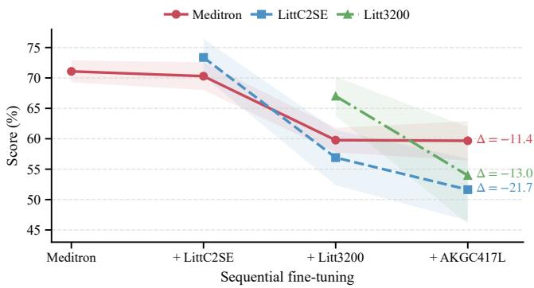
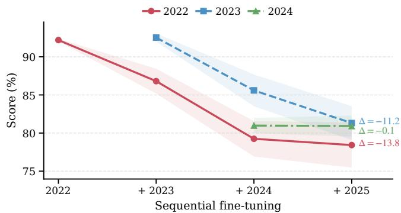
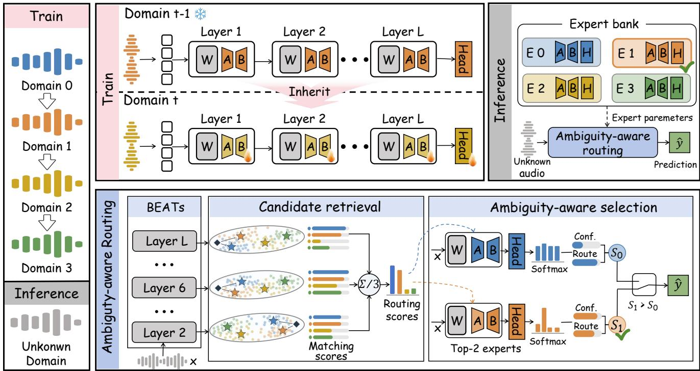
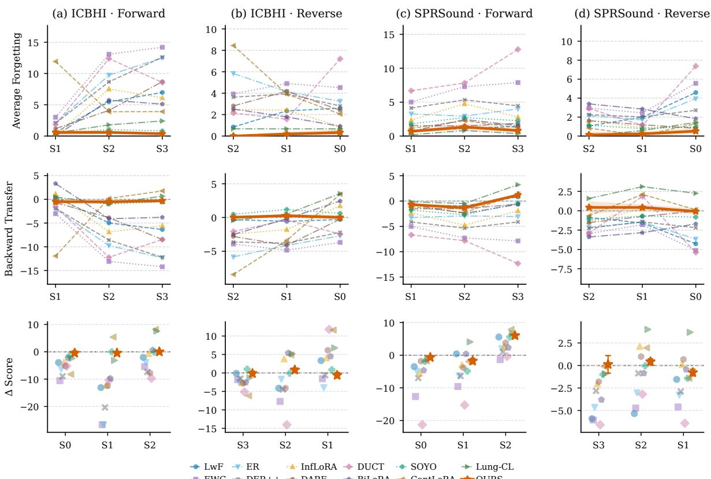
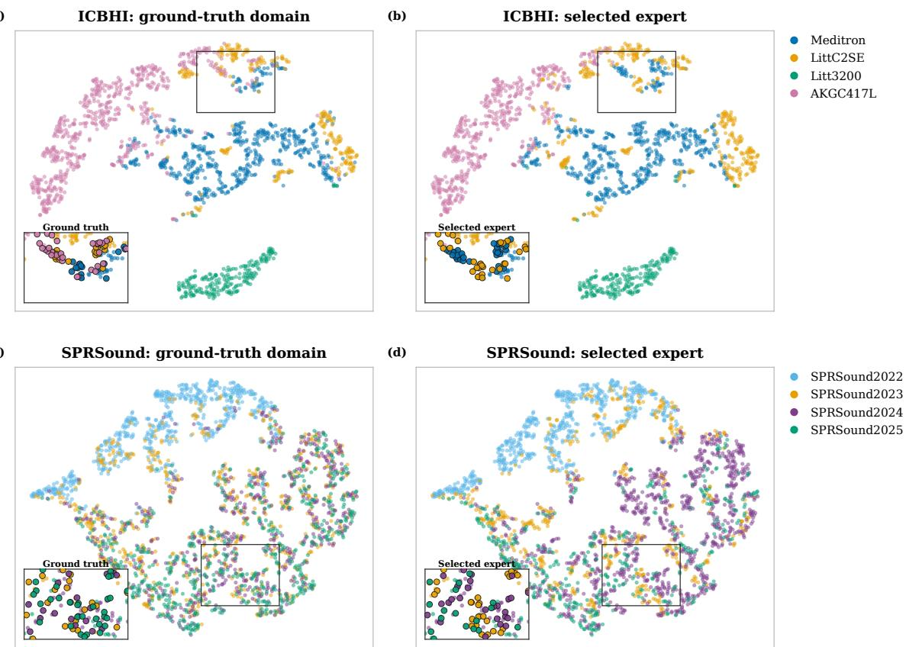
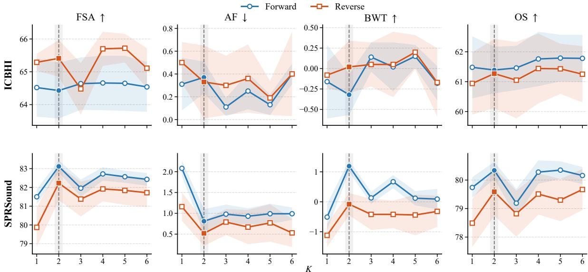

# APRIL: Ambiguity-Aware Expert Routing for Respiratory Sound Domain-Incremental Learning

Xinhong Lia, Weiping Tua,∗

aSchool of Computer Science, Wuhan University, Wuhan, Hubei, China

A R T I C L E I N F O

Keywords:   
Respiratory Sound Classification   
Continual Learning   
Domain Incremental-Learning   
Parameter-Eficient Fine-Tune

## A BS T RA C T

Automated respiratory sound classification enables continuous, non-invasive respiratory assessment, yet long-term deployment remains challenging due to domain shifts from evolving recording devices and acquisition periods. When privacy and governance regulations prohibit replaying historical data, sequential learning easily overwrites previously acquired knowledge. Preserving dedicated domain experts prevents parameter interference, but selecting the correct expert at inference is dificult under overlapping acoustic distributions and absent domain labels. To resolve this dilemma, we propose APRIL, an exemplar-free domain-incremental framework for RSC. Built on a shared frozen BEATs backbone, APRIL sequentially inherits and isolates low-rank experts to enable new-domain adaptation without altering earlier models. A multi-level prototype router retrieves the top-two candidate experts and dynamically selects the final model by integrating domain-routing posteriors with classification confidence, adaptively weighted by matching ambiguity. We establish standardized device- and temporal-incremental benchmarks on the ICBHI and SPRSound datasets across forward and reversed domain orders. Evaluated over five random seeds, APRIL consistently achieves the highest finalsession average Score among compared continual learning approaches, reaching 64.4% and 65.4% on ICBHI, and 83.1% and 82.2% on SPRSound under forward and reversed sequences, respectively. Crucially, average forgetting remains under 1.0% across all protocols, demonstrating robust domain adaptation and long-term knowledge retention without data replay. Overall, APRIL ofers a reliable and privacy-preserving paradigm for deploying continuous respiratory sound classification across real-world healthcare settings.

## 1. Introduction

Chronic respiratory diseases impose a substantial global burden of disability and premature mortality, underscoring the need for accessible respiratory assessment [1, 2]. Automated respiratory sound classification (RSC) ofers a lowcost, non-invasive means of analysing respiratory recordings [3, 4, 5]. Adventitious sounds, including crackles and wheezes, provide acoustic cues associated with respiratory abnormalities [6, 7]. Recognizing these events automatically supports consistent analysis and provides complementary evidence for clinical examination.

Recent advances in RSC increasingly build on pretrained models such as AST, CLAP, and BEATs [8, 9, 10]. Their transferable representations provide a foundation for adaptations tailored to respiratory sound classification. In practice, however, respiratory recordings continue to accumulate as data collection proceeds, and recording devices and acquisition conditions can change over time. Data consequently become available in successive batches, potentially with diferent distributions, rather than being fully available at the outset [11].

This setting can be formulated as domain-incremental learning (DIL), in which new domains arrive sequentially while the classification label space remains fixed. For RSC, domains can correspond to recording devices or acquisition periods. Privacy and institutional data-governance requirements can restrict the retention or reuse of historical recordings [12, 13]. Without these recordings for replay, a model must adapt to incoming data while retaining its performance on earlier domains. Direct fine-tuning on the current domain can change representations needed for previously learned sounds, leading to catastrophic forgetting. Figure 1 illustrates this problem: sequential fine-tuning of BEATs produces substantial performance losses on earlier domains in both the ICBHI device sequence and the SPRSound temporal sequence.

Continual learning methods address forgetting through diferent forms of knowledge preservation. Exemplar-based replay retains historical examples for use during subsequent updates [14], but requires continued access to earlier recordings. Without storing those recordings, knowledge distillation constrains changes in predictions and representations, while feature transformation compensates for changes in the feature space [15, 16]. In RSC, Lung-CL combines latent generative replay with spectrum-aware distillation [17]. These approaches preserve earlier knowledge while adapting shared model components, but new-domain updates can still afect parameters needed for earlier domains. To reduce this interference, domain-specific approaches [18, 19, 20] introduce dedicated components for new domains while keeping previously learned components fixed. This isolates earlier parameters from subsequent updates, but introduces an inference challenge: selecting a suitable component when the recording’s domain is unknown.

S-Prompts addresses this challenge through nearestcentroid routing, matching input features to domain cluster centers in a frozen representation space and activating the corresponding domain-specific module [21]. However, respiratory recordings collected in diferent periods can share similar acoustic characteristics. When their domain representations overlap, nearest-centroid routing can yield ambiguous assignments [22]. Moreover, domain identity alone does not determine which expert will classify a recording most efectively: experts trained on other domains may provide useful class-specific knowledge [23]. An alternative to domain matching is therefore to select experts based on their predictions. ADIL adopts this approach, selecting the domain-specific branch with the lowest prediction entropy [19]. This brings classification evidence into expert selection, but requires evaluating every available branch. As an RSC system encounters more devices and acquisition periods, evaluating the growing expert bank for each recording increases inference computation.

  
(a) Device sequence on ICBHI.

  
(b) Temporal sequence on SPRSound.  
Figure 1: Catastrophic forgetting under sequential fine-tuning. Each curve reports the Score on a previously learned domain after successive domain updates. Lines and shaded regions denote the mean and standard deviation over five seeds, respectively. Δ denotes the change between the stage at which a domain is first learned and the final stage.

Based on these considerations, we propose APRIL, an exemplar-free framework for domain-incremental respiratory sound classification. APRIL shares a frozen BEATs backbone across compact domain-specific LoRA adapters and classification heads. Each new expert inherits the adapter and head of the preceding expert before adaptation to the current domain, while earlier experts remain unchanged. At inference, APRIL separates domain matching from final expert selection. Compact multi-level prototypes represent each domain in a fixed reference space, keeping routing features independent of expert updates. Domain matching identifies a small set of candidate experts, whose predictions are then considered together with their domain relevance to select a single expert. This allows prediction-informed selection without evaluating the entire expert bank. APRIL requires no domain identity at inference and retains domain prototypes rather than historical recordings or sample-level feature caches.

Our contributions are summarized as follows:

• We propose APRIL, an exemplar-free framework for respiratory sound DIL that combines sequential knowledge inheritance with parameter isolation. Inherited initialization reuses previously learned respiratory sound knowledge, while isolated LoRA– classifier experts allow new-domain adaptation without modifying earlier experts.

• We introduce an ambiguity-aware expert selection strategy that combines multi-level domain matching with classification confidence. By considering both routing and classification evidence, APRIL selects experts for respiratory sound recognition without requiring domain labels at inference.

• We establish complementary device- and temporalincremental protocols on ICBHI and SPRSound, respectively. APRIL achieves the highest FSA among the compared continual-learning methods under both forward and reversed orders on both datasets, while maintaining low forgetting.

## 2. Related Work

Respiratory sound classification and domain-incremental learning provide two complementary foundations for this study. We first review acoustic representations and learning architectures for respiratory sound classification, including recent adaptations of pretrained models. We then discuss approaches to preserving earlier knowledge during sequential learning, with particular attention to domain-specific components and their selection at inference.

## 2.1. Respiratory Sound Classification

Public datasets, including ICBHI [24] and SPRSound [25], have supported the development and comparison of respiratory sound classification methods.

(1) Handcrafted representations. Early approaches extracted explicitly designed acoustic descriptors, such as melfrequency cepstral coeficients (MFCCs), linear predictive coeficients, and median frequency. These descriptors were combined with statistical classifiers, including Gaussian mixture models, hidden Markov models, and support vector machines [26, 27]. In these systems, feature extraction was designed separately from classifier training, making the selection of informative acoustic descriptors a central part of model development.

(2) Deep neural architectures. With advances in deep learning, RSC increasingly shifted toward learning acoustic representations from waveforms or time–frequency inputs. CNN- and ResNet-based models have been widely investigated [28, 29]. Multi-branch architectures extend this approach by learning and fusing complementary feature streams rather than relying on a single input representation [30, 31]. Other studies incorporate recurrent networks or temporal convolutional modules to model dependencies across a respiratory recording [32, 33]. These architectures emphasize the joint modeling of local acoustic patterns and their temporal context.

(3) Pretrained models and domain adaptation. Recent studies increasingly adapt pretrained models to RSC, using representations learned from larger datasets as the foundation for task-specific learning [34, 35, 36]. For example, Bae et al. combine AST with Patch-Mix augmentation and contrastive learning [37], while Jeong and Kim introduce patient-aware feature alignment on BEATs to address interpatient variability [10]. Multimodal approaches also incorporate patient and recording context: BTS adapts CLAP using respiratory audio and textual metadata [9], whereas TIAMO integrates metadata-derived text, spectrogram images, and raw audio within a tri-modal framework [38].

Recording variability has also motivated stethoscopeand metadata-guided contrastive approaches to domain adaptation [39, 40]. Meanwhile, parameter-eficient methods use adapters or low-rank updates to transfer pretrained models to RSC with fewer trainable parameters [41, 42]. These studies address how pretrained representations can be adapted to respiratory sounds and heterogeneous recording conditions.

Very recently, Lung-CL extends RSC to bufer-free domain-incremental learning through class-specific generative latent replay and spectrum-aware distillation [17]. It preserves earlier knowledge within a continually updated shared model under shifts across heterogeneous respiratory sound datasets. Our work studies complementary protocols defined by individual recording devices and annual releases, focusing on the preservation and selection of domainspecific experts.

## 2.2. Domain-Incremental Learning

Continual learning investigates how models acquire new knowledge while retaining what they have previously learned. We review the main strategies underlying domainincremental learning and their applications to audio classification.

(1) Rehearsal-based methods. Rehearsal preserves earlier knowledge by reintroducing historical information during subsequent training. ER mixes bufered examples with current data [43], while DER++ additionally matches stored model outputs to preserve earlier predictions [44]. Generative replay provides an alternative by synthesizing examples from previously learned distributions instead of retaining the original observations [45]. These approaches provide supervision from earlier tasks, but exemplar replay requires continued access to stored data, whereas generative replay relies on maintaining a generator that adequately represents past distributions.

(2) Regularization-based methods. To reduce reliance on stored historical examples, regularization-based methods constrain changes to a shared model during sequential training. EWC penalizes changes to parameters important for earlier tasks [46], whereas LwF uses knowledge distillation to preserve earlier predictions [47]. Beyond parameter values and predictions, NEig-OWM incorporates null-space information into orthogonal weight modification to guide subsequent updates [48]. Such constraints must balance knowledge retention against adaptation: strong constraints can restrict learning under substantial distribution shifts, while weaker constraints leave earlier knowledge more exposed to interference [49].

(3) Parameter-isolation methods. Parameter isolation addresses this conflict by separating the parameters used for new learning from those preserving earlier knowledge. Network expansion, pruning, and parameter masking provide dedicated capacity while protecting previously learned parameters [50, 51]. With pretrained backbones, prompts and adapters ofer more compact implementations. S-Prompts learns independent domain prompts and uses feature-based matching to select them at inference [21]. PINA combines domain-specific alignment modules with a shared classifier, allowing incoming domains to be aligned with previously learned class concepts [52].

LoRA-based continual learning further controls interference through the structure of low-rank updates. InfLoRA constrains new-task updates to subspaces that preserve earlier knowledge [53]. BiLoRA addresses the dificulty of maintaining strictly orthogonal task subspaces by constructing almost-orthogonal spaces through fixed orthogonal bases [54]. To support knowledge sharing across domains, ISPSL combines shared and domain-specific low-rank components rather than separating all updates completely [55]. For methods that retain multiple domain-specific modules, preserving their parameters must also be accompanied by an appropriate selection mechanism when domain identities are unavailable at inference.

(4) Audio continual and domain-incremental learning. Recent audio studies investigate continual learning through acoustic feature preservation and adaptation of pretrained representations. AFT transforms earlier-class temporal features to account for changes in the representation space during exemplar-free class-incremental learning [16]. PACE combines analytic classification with subspace-constrained parameter-eficient adaptation for continual learning with pretrained audio models [56]. For domain-incremental audio classification, ADIL separates domain-shared and domainspecific parameters. When domain labels are unavailable, it evaluates the available branches and selects the prediction with the lowest entropy [19]. These studies provide a basis for continual adaptation to changing acoustic conditions. For RSC, this involves learning from recordings acquired across diferent devices and collection periods. Domain-specific models ofer a way to preserve earlier knowledge, but their use also requires selecting an appropriate expert when the test domain is unknown.

  
Frozen parameters Trainable parametersx: same input recording Query feature Domain prototype  
Figure 2: Overview of APRIL. Each new domain expert inherits the preceding expert’s LoRA adapter and classification head, while the shared backbone and earlier experts remain frozen. During inference, multi-level prototype matching retrieves two candidate experts, and routing posterior and classifier confidence jointly determine which candidate’s prediction is returned.

## 3. Method

APRIL addresses respiratory sound DIL through isolated domain adaptation and ambiguity-aware expert selection, without replaying historical recordings. As illustrated in Fig. 2, new experts inherit the preceding expert’s LoRA adapter and classifier before adaptation, while earlier experts remain unchanged. During inference, multi-level prototype matching retrieves two candidate experts in a frozen reference space. Their routing posteriors and classification confidence jointly determine which expert provides the final prediction.

## 3.1. Problem formulation

Let $\{ \mathcal { D } _ { t } \} _ { t = 0 } ^ { T - 1 }$ denote a sequence of respiratory-sound domains, where each domain contains a training subset $\mathcal { D } _ { t } ^ { \mathrm { t r } }$ and a held-out test subset $\boldsymbol { D } _ { t } ^ { \mathrm { t e } }$ . All domains within a benchmark share the same label space, while their data distributions change sequentially. At session �, the model is updated using only $\boldsymbol { D } _ { t } ^ { \mathrm { t r } }$ , without access to the training data of previous domains. After each session, it is evaluated separately on $\mathcal { D } _ { j } ^ { \mathrm { t e } }$ for every observed domain $j ~ \leq ~ t .$ . Domain identities are available during training but are not provided during inference.

## 3.2. Pretrained audio backbone and low-rank adaptation

APRIL uses the pretrained BEATs encoder as its shared audio backbone [57]. BEATs learns audio representations through acoustic token prediction. Its frontend converts a recording into normalized log-Mel filterbank features, which are divided into non-overlapping time–frequency patches and projected into a token sequence. Successive Transformer blocks process these tokens, providing features at diferent encoder depths.

We introduce domain-specific adaptation through LoRA [58] in the key and value projections of every self-attention block. Let � denote the frozen backbone parameters. For a pretrained projection matrix $W \in \mathbb { R } ^ { d _ { \mathrm { o u t } } \times d _ { \mathrm { i n } } ^ { - } }$ , expert � uses

$$
\widetilde { W } _ { t } = W + s B _ { t } A _ { t } ,\tag{1}
$$

where $A _ { t } \in \mathbb { R } ^ { r \times d _ { \mathrm { i n } } }$ and $B _ { t } \in \mathbb { R } ^ { d _ { \mathrm { o u t } } \times r }$ are trainable low-rank factors, � is the adapter rank, and � is a scaling factor. Each adapted projection has its own pair of factors. Together, these factors constitute the domain-specific adapter parameters $\phi _ { t }$

For a recording �, the adapted encoder produces the final token sequence $F _ { \theta , \phi _ { t } } ( x )$ . Its mean-pooled representation is passed to a domain-specific linear classifier:

$$
\begin{array} { r l } & { \mathbf { h } _ { t } ( x ) = \mathrm { M e a n P o o l } \left( F _ { \theta , \phi _ { t } } ( x ) \right) , } \\ & { \mathbf { p } _ { t } ( x ) = \mathrm { s o f t m a x } \left( U _ { t } \mathbf { h } _ { t } ( x ) + \mathbf { b } _ { t } \right) . } \end{array}\tag{2}
$$

Here, $U _ { t } \in \mathbb { R } ^ { C \times d }$ and $\mathbf { b } _ { t } \in \mathbb { R } ^ { C }$ form the classifier parameters $\psi _ { t }$ , where $d$ is the encoder feature dimension and � is the number of respiratory sound classes.

For prototype construction and domain matching, the same backbone serves as a reference encoder with the LoRA adapters disabled. Its intermediate and final features provide a common reference space that remains unchanged as new experts are learned. Expert predictions instead use the corresponding domain’s adapter and classifier.

## 3.3. Sequentially inherited and isolated experts

APRIL builds its expert bank as domains arrive. At session �, a new expert receives its own LoRA adapter $\phi _ { t }$ and classifier $\psi _ { t } .$ All experts share the pretrained BEATs backbone, while their domain-specific parameters are learned from recordings of their respective domains. This allows each expert to specialize in the recording conditions of its assigned domain.

For the first domain, we randomly initialize the � matrices and set the � matrices to zero, following the initialization pattern of LoRA [58]. The initial low-rank updates are therefore zero, so the encoder initially retains its pretrained behavior. The first classifier is also randomly initialized.

For subsequent domains, each new expert inherits the adapter and classifier jointly trained on the preceding domain. Although recording devices or collection periods may difer, all domains require recognition of the same respiratory sound classes. The inherited parameters therefore provide a starting point already trained for this task. Each new expert receives an independent copy of these parameters, allowing it to adapt to current-domain recordings separately from the preceding expert. Inheritance thus reuses previously learned respiratory sound patterns while leaving room for domain-specific adaptation.

At session �, we train the current expert on $\mathcal { D } _ { t } ^ { \mathrm { t r } }$ using the following cross-entropy objective:

$$
\mathcal { L } _ { t } = - \frac { 1 } { | D _ { t } ^ { \mathrm { t r } } | } \sum _ { ( x , y ) \in D _ { t } ^ { \mathrm { t r } } } \log p _ { t } ( y \mid x ) ,\tag{3}
$$

where $p _ { t } ( y \mid$ �) is the probability assigned to the groundtruth class � by the current expert. Only $\phi _ { t }$ and $\psi _ { t }$ are updated. The backbone and previously trained experts remain frozen, so current-domain learning changes neither the shared pretrained weights nor earlier experts.

After training, the current expert is frozen and added to the bank. Its learned parameters initialize the next expert, while it remains available for subsequent inference. Repeating this procedure expands the bank by one expert per domain. Sequential inheritance connects their learning across sessions, while parameter isolation preserves each expert after adaptation.

## 3.4. Multi-level prototype-based candidate retrieval

APRIL retrieves candidate experts by comparing the input recording with prototypes from previously observed domains. For this purpose, we use the shared frozen BEATs backbone with its LoRA adapters disabled, referring to it as the reference encoder. A single forward pass provides intermediate and final token features. We mean-pool the tokens at each selected level $\ell \in S$ to obtain a recordinglevel representation $\pmb { z } ^ { ( \ell ) } ( x )$

For each incoming domain �, we apply cosine (spherical) �-means [59] independently to its training features at each level. Clustering uses all recordings in $\mathcal { D } _ { t } ^ { \mathrm { t r } }$ , without their respiratory sound labels. The centers are initialized using farthest-point selection. The algorithm then groups normalized features by cosine similarity and updates each center to the normalized mean of its cluster. The resulting centers form the domain prototypes $\{ \mu _ { t , k } ^ { ( \ell ) } \} _ { k = 1 } ^ { K }$ , with $K =$ 2 in the main configuration. These prototypes are stored alongside their domain association, while prototypes from earlier domains remain unchanged.

At inference, the input recording is encoded in the same way. For each observed domain $j ,$ we compare its feature at level $\ell$ with that domain’s $K$ prototypes. The highest cosine similarity is retained as the level-wise matching score:

$$
m _ { j } ^ { ( \ell ) } ( x ) = \operatorname* { m a x } _ { 1 \leq k \leq K } \cos \left( \mathbf { z } ^ { ( \ell ) } ( x ) , \pmb { \mu } _ { j , k } ^ { ( \ell ) } \right) ,\tag{4}
$$

where $\cos ( \cdot , \cdot )$ denotes cosine similarity. Thus, with $K = 2 .$ each domain provides two similarities at each level, and the larger one becomes its matching score.

We then average the matching scores across the selected levels to obtain one routing score for each domain:

$$
d _ { j } ( x ) = \frac { 1 } { | S | } \sum _ { \ell \in S } m _ { j } ^ { ( \ell ) } ( x ) .\tag{5}
$$

These two steps correspond to the matching scores and routing scores in Fig. 2. Each layer first compares the recording with the domain prototypes; averaging then combines the intermediate- and final-layer comparisons. The highest routing scores identify up to two candidate experts.

The routing scores also define a posterior over all domains observed by session �:

$$
q _ { j } ( x ) = \frac { \exp \left( d _ { j } ( x ) / \tau \right) } { \sum _ { u = 0 } ^ { t } \exp \left( d _ { u } ( x ) / \tau \right) } ,\tag{6}
$$

where � is the routing temperature. The next stage combines these routing posteriors with the candidate experts’ classification confidence to select the final prediction.

## 3.5. Ambiguity-aware expert selection

Recordings from diferent domains can share similar acoustic characteristics. When prototype matching gives similar support to two domains, APRIL also considers the candidate experts’ classification confidence to select the final prediction.

Let $e _ { 1 }$ and $e _ { 2 }$ denote the two retrieved experts, ordered such that $q _ { e _ { 1 } } ( x ) \ \geq \ q _ { e _ { 2 } } ( x )$ . Each candidate $j ~ \in ~ \{ e _ { 1 } , e _ { 2 } \}$ processes the same recording � using its own adapter and classifier. For � respiratory sound classes, we define its classification confidence using normalized prediction entropy:

$$
\gamma _ { j } ( x ) = 1 - \frac { \mathcal { H } \left( \mathbf { p } _ { j } ( x ) \right) } { \log C } ,\tag{7}
$$

where $\begin{array} { r } { \mathcal { H } ( \mathbf { p } _ { j } ( x ) ) ~ { = } ~ { - } \sum _ { c = 1 } ^ { C } p _ { j } ( c ~ | ~ x ) \log p _ { j } ( c ~ | ~ x ) } \end{array}$ . Confidence is higher when the expert assigns most of its probability to one class and is zero when all classes receive equal probability. Dividing by log � keeps the confidence score between zero and one for diferent class counts.

We give classification confidence greater weight when domain matching cannot clearly distinguish the two candidates. Conversely, a larger routing-posterior gap gives more weight to domain matching. Using the posteriors from Eq. (6), we quantify domain-matching ambiguity as

$$
a ( x ) = 1 - \left[ q _ { e _ { 1 } } ( x ) - q _ { e _ { 2 } } ( x ) \right] .\tag{8}
$$

A smaller posterior gap produces a larger �(�), which increases the weight assigned to classification confidence in the selection score below.

For each candidate $j \in \{ e _ { 1 } , e _ { 2 } \}$ , we normalize its routing posterior within the retrieved pair:

$$
\widetilde { q } _ { j } ( x ) = q _ { j } ( x ) / ( q _ { e _ { 1 } } ( x ) + q _ { e _ { 2 } } ( x ) ) .\tag{9}
$$

The final selection score combines domain matching and classification confidence:

$$
S _ { j } ( x ) = \log \widetilde { q } _ { j } ( x ) + \lambda a ( x ) \gamma _ { j } ( x ) ,\tag{10}
$$

where � sets the base weight of classification confidence. The first term favors the candidate with the higher routing posterior. The second adds its classification confidence with a recording-specific weight ��(�). When the routing posteriors are close, this weight increases, allowing the more confident expert to have greater influence on the choice. The second-ranked candidate can therefore be selected if its higher classification confidence compensates for its lower routing posterior.

We select the expert with the higher score and return its most probable class:

$$
\begin{array} { l } { j ^ { * } = \underset { j \in \{ e _ { 1 } , e _ { 2 } \} } { \arg \operatorname* { m a x } } \ : S _ { j } ( x ) , } \\ { \hat { y } = \underset { c \in \{ 1 , \ldots , C \} } { \arg \operatorname* { m a x } } \ : p _ { j ^ { * } } ( c \mid x ) . } \end{array}\tag{11}
$$

The candidate experts are evaluated sequentially on the shared backbone. Inference uses one reference encoding followed by two candidate evaluations and the final selection. When only the first domain has been learned, its expert provides the prediction directly.

## 4. Experimental Setup

## 4.1. Datasets and domain-incremental protocols

We evaluate all methods on two complementary domainincremental respiratory sound classification protocols constructed from ICBHI 2017 [24] and the 2022–2025 releases of SPRSound [25]. ICBHI examines sequential adaptation across recording devices, whereas SPRSound considers domains defined by annual releases. Table 1 summarizes the domain-wise statistics and training/test partitions. Both datasets use fixed patient-disjoint splits, and all compared methods receive identical data partitions and domain sequences.

## 4.1.1. ICBHI 2017

The ICBHI 2017 database contains 920 recordings from 126 patients, comprising 6,898 respiratory cycles labeled as Normal, Crackle, Wheeze, or Both. We define four device domains and introduce them in the forward order Meditron → LittC2SE → Litt3200 → AKGC417L. The four-class label space remains unchanged throughout the sequence.

We construct a fixed split of 76 training and 50 test patients, corresponding to 539/381 recordings and 4,148/2,750 respiratory cycles in the training/test subsets. Patient disjointness is enforced globally across devices: all recordings from a patient belong to the same subset, including patients recorded using multiple devices. The sessions difer substantially in size. In particular, AKGC417L contributes approximately 63% of all respiratory cycles, whereas the other devices provide considerably smaller domains. The protocol therefore evaluates sequential adaptation across recording devices with unequal amounts of training and test data.

## 4.1.2. SPRSound 2022–2025

The four annual SPRSound releases define the forward temporal sequence 2022 → 2023 → 2024 → 2025. We use a binary classification task in which Normal retains its original label, while Rhonchi, Wheeze, Stridor, Coarse Crackle, Fine Crackle, and Wheeze+Crackle are grouped into Adventitious. This common label space is maintained across all four annual domains.

After excluding recordings without reliable patient identifiers, we retain 6,177 recordings containing 23,193 annotated respiratory events. The fixed patient-disjoint split includes 521 training and 347 test patients, corresponding to 3,883/2,294 recordings and 14,461/8,732 events in the training/test subsets. For 2023–2025, we reconstruct the sessions from publicly released recordings and event annotations using our patient-disjoint partitions rather than adopting the oficial challenge train/test partitions. The annual sessions vary in size and class composition, providing a temporal-incremental setting complementary to the deviceincremental protocol on ICBHI.

Domain-order protocols. The primary experiments follow the forward sequences specified above and summarized in Table 1. For both datasets, we additionally evaluate the exact reversed sequence to examine sensitivity to domain order. The patient partitions, label spaces, and samples within each domain remain fixed; only the arrival order changes. After each session, the model is evaluated on the held-out test subsets of all domains encountered so far. Together, the forward and reversed experiments assess adaptation and retention under four dataset/order combinations.

Summary of the domain-incremental protocols. Each entry is reported as training/test count. Patient totals count unique subjects, and the global training and test patient sets are disjoint.  
(a) ICBHI device domains.
<table><tr><td>Session</td><td>Device</td><td>Recordings  $\textstyle ( \mathsf { T r } / \mathsf { T e } )$ </td><td>Patients (Tr/Te)</td><td>Cycles (Tr/Te)</td></tr><tr><td>SO</td><td>Meditron</td><td>77/50</td><td>41/23</td><td>895/561</td></tr><tr><td>S1</td><td>LittC2SE</td><td>50/37</td><td>13/10</td><td>348/246</td></tr><tr><td>S2</td><td>Litt3200</td><td>33/27</td><td>6/5</td><td>285/217</td></tr><tr><td>S3</td><td>AKGC417L</td><td>379/267</td><td>19/13</td><td>2,620/1,726</td></tr><tr><td>Total</td><td>一</td><td>539/381</td><td>76/50</td><td>4,148/2,750</td></tr></table>

## 4.2. Compared methods

We compare APRIL with representative continual-learning methods covering regularization, rehearsal, parameter-eficient adaptation, and domain-incremental learning.

Reference protocols. The Seq. FT sequentially finetunes a shared model without an explicit forgetting-mitigation mechanism. The Joint Train. performs ofline joint training using data from all domains. It is order invariant and serves as an ofline reference rather than a continual-learning method.

Conventional continual learning. LwF [47] preserves previous predictions through knowledge distillation, whereas EWC [46] penalizes changes to parameters estimated to be important for earlier domains. ER [43] replays samples retained in a bounded memory, while DER++ [44] additionally distills the historical logits associated with replayed samples.

Parameter-eficient continual learning. InfLoRA [53] constrains low-rank updates using subspaces derived from previous tasks. BiLoRA [54] constructs approximately orthogonal low-rank parameter spaces to reduce interference, and ContLoRA [60] progressively integrates low-rank updates through cumulative unified optimization.

Domain-incremental learning. DARE [61] combines representation replay with a staged optimization procedure. DUCT [62] consolidates domain-specific representations and classifiers, whereas SOYO [63] models domain characteristics to select and combine domain-specific parameters.

Respiratory-sound continual learning. Lung-CL [17] combines class-conditional latent replay with spectrumaware knowledge distillation for respiratory-sound continual learning. As executable training code was unavailable when our experiments were conducted, we reimplemented its continual-learning objectives from the published description and adapted them to the common BEATs backbone.

(b) SPRSound temporal domains.
<table><tr><td>Session</td><td>Year</td><td>Recordings (Tr/Te)</td><td>Patients (Tr/Te)</td><td>Events (Tr/Te)</td></tr><tr><td>SO</td><td>2022</td><td>1,828/855</td><td>195/97</td><td>6,161/2,928</td></tr><tr><td>S1</td><td>2023</td><td>481/343</td><td>54/38</td><td>1,878/1,113</td></tr><tr><td>S2</td><td>2024</td><td>927/671</td><td>185/138</td><td>4,120/3,083</td></tr><tr><td>S3</td><td>2025</td><td>647/425</td><td>87/74</td><td>2,302/1,608</td></tr><tr><td>Total</td><td>一</td><td>3,883/2,294</td><td>521/347</td><td>14,461/8,732</td></tr></table>

All methods use identical patient-disjoint partitions, forward and reversed domain orders, label spaces, and evaluation metrics. The same BEATs initialization is used whenever architecturally applicable. Method-specific components are preserved, and all implementation adaptations and hyperparameter settings are reported in the supplementary material.

## 4.3. Implementation details

All respiratory events were resampled to 16 kHz and standardized to 5 s by truncation or repetition padding, without waveform or spectrogram augmentation. APRIL used the AudioSet-pretrained BEATs model with a frozen backbone. Each domain had an independent linear classifier and rank-16 LoRA adapters on the key and value projections of every self-attention block, with scaling factor 1.0.

Experts were trained for 100 epochs using cross-entropy loss and SGD with momentum 0.9 and zero weight decay. The learning rates for LoRA parameters and classifiers were $5 \times 1 0 ^ { - 3 }$ and $1 \times 1 0 ^ { - 2 }$ , respectively, and were reduced tenfold after epochs 60 and 80. Training and evaluation batch sizes were 16 and 32. The routing temperature and confidence weight were 0.002 and 1.0, respectively. Experiments used five seeds, {1, 2, 3, 4, 5}, with one NVIDIA RTX 4090 GPU per run.

## 4.4. Evaluation metrics

We evaluate respiratory sound classification performance using specificity $( S _ { p } ) _ { : }$ , sensitivity $( S _ { e } ) _ { }$ , and their arithmetic mean, denoted as Score. Let $N _ { x }$ and $C _ { x }$ denote the total number of samples and the number of correctly classified samples in class �, respectively. The subscripts �, �, �, �, and � represent Normal, Crackle, Wheeze, Both, and Adventitious, respectively. Specificity is defined as $S _ { p } ~ = ~ C _ { n } / N _ { n }$ . Sensitivity is computed as $S _ { e } ~ = ~ ( C _ { c }$ + $\dot { C _ { w } } +  { C _ { b } } ) / ( N _ { c } + N _ { w } + N _ { b } )$ for ICBHI and $S _ { e } = C _ { a } / N _ { a }$ for SPRSound, measuring the aggregate recognition rate of adventitious sounds in each dataset. The classification Score is defined as Score $= ( S _ { p } + S _ { e } ) / 2$ . All classification measures are reported as percentages.

Following the performance-matrix evaluation framework commonly used in medical continual learning [64], let $\mathbf { R } \in \mathbb { R } ^ { T \times T }$ denote the evaluation matrix, where $R _ { i , j }$ is the

Score on domain � after sequential training through session �, with $1 \leq j \leq i \leq T$

The final-session average (FSA) measures the mean domain-wise performance after completing the learning sequence:

$$
\mathrm { F S A } = \frac { 1 } { T } \sum _ { j = 1 } ^ { T } R _ { T , j } .\tag{12}
$$

Average forgetting (AF) measures the decline from the best Score observed for each previous domain to its final Score:

$$
{ \mathrm { A F } } = { \frac { 1 } { T - 1 } } \sum _ { j = 1 } ^ { T - 1 } \left( \operatorname* { m a x } _ { j \leq i \leq T } R _ { i , j } - R _ { T , j } \right) .\tag{13}
$$

The final session is included in the maximization, consistent with our implementation, so that AF remains non-negative and equals zero when the final Score is the best observed performance.

Backward transfer (BWT) compares the final performance on each previous domain with its performance immediately after being learned:

$$
\mathrm { B W T } = \frac { 1 } { T - 1 } \sum _ { j = 1 } ^ { T - 1 } \left( R _ { T , j } - R _ { j , j } \right) .\tag{14}
$$

A negative BWT indicates forgetting, a value close to zero indicates retention, and a positive value indicates beneficial backward transfer. AF and BWT use diferent reference points: AF uses the best historical performance, whereas BWT uses the performance obtained immediately after learning the corresponding domain.

We further report the overall score (OS). After the final session, the test sets of all domains are combined, and OS is calculated using the Score definition given above. Thus, FSA gives each domain equal weight by averaging the final domain-wise Scores, whereas OS is computed from all test samples together and is influenced by the number of samples contributed by each domain.

## 5. Results

## 5.1. Main comparison

Tables 2 and 3 compare APRIL with the selected continuallearning methods under forward and reversed domain orders. APRIL achieves the highest FSA across all four protocols, together with low forgetting and competitive OS. Compared with Seq. FT, it improves all four metrics, showing that its higher final classification performance is accompanied by better retention of earlier domains.

On ICBHI, APRIL improves forward-order FSA by 1.85 points over the strongest competing method, LwF, while keeping AF below 0.4 under both orders. These results are important when considered together: low forgetting alone does not indicate how well a method learns incoming domains, while high final performance can coexist with substantial losses on earlier ones. APRIL combines strong final domain-wise performance with limited degradation. Under the reversed order, it retains the highest FSA, although its OS ranks second to SOYO.

On SPRSound, APRIL also leads in FSA under both orders and achieves the highest OS, extending its efectiveness from device-defined domains to annual releases. Its FSA margins over the strongest baselines are smaller than on ICBHI, but its consistently low forgetting strengthens the overall result. The order comparisons further show that APRIL’s performance is not tied to a single sequence: reversing either dataset changes its FSA by less than one percentage point.

Some competing methods achieve higher positive BWT in individual protocols. However, BWT measures how much performance changes after a domain is first learned, rather than how well that domain is ultimately classified. A larger improvement from a lower initial Score need not produce a higher final Score. APRIL’s near-zero or positive BWT, combined with its leading FSA, indicates that it maintains strong classification performance without substantial deterioration during subsequent learning.

Joint Training provides an ofline reference with access to all training domains and achieves higher OS than APRIL. Nevertheless, APRIL obtains higher FSA under both ICBHI orders. This contrast illustrates why both metrics are informative: a model can perform better on the combined test set without achieving a higher average across equally weighted domains. APRIL’s results show that sequential learning can retain competitive overall performance while supporting strong performance across recording domains.

## 5.2. Forgetting dynamics

Figure 3 shows how performance on earlier domains evolves as new domains are learned. APRIL maintains low AF across all four protocols, with five-seed means not exceeding 1.33 points. In contrast, EWC and ER show substantial increases in AF under the forward ICBHI order, while DUCT exhibits pronounced late-stage increases under both SPRSound orders. APRIL’s BWT stays close to zero on ICBHI and reversed SPRSound. Under forward SPRSound, it recovers from an intermediate decline and becomes positive after the final update. Together, these trajectories show that APRIL retains earlier-domain performance while continuing to learn from incoming recordings.

The bottom row shows how subsequent learning affects each earlier domain. For each domain, ΔScore is the Score measured after all domains have been learned minus the Score measured immediately after training on that domain. Negative values indicate that later learning reduces its Score, while positive values indicate improvement. On ICBHI and reversed SPRSound, APRIL’s points remain close to zero, showing that performance on earlier domains is largely maintained. Forward SPRSound shows a diferent pattern: the 2022 and 2023 domains experience small declines, whereas the 2024 domain improves by 6.00 points after the final update. This improvement outweighs the losses

Performance comparison on ICBHI under forward and reversed device orders. Results are mean ± standard deviation over five seeds. Bold and underlined means indicate the best and second-best results among continual-learning methods, respectively. Seq. FT and Joint Train. denote sequential fine-tuning and joint training, respectively.
<table><tr><td rowspan="2">Method</td><td rowspan="2">Year</td><td colspan="4">Forward order</td><td colspan="4">Reversed order</td></tr><tr><td>FSA (↑)</td><td> $\pmb { \mathsf { A } } \pmb { \mathsf { F } } \left( \downarrow \right)$ </td><td>BWT (↑)</td><td>Os (↑)</td><td>FSA (↑)</td><td> $\pmb { \mathsf { A } } \pmb { \mathsf { F } } \left( \downarrow \right)$ </td><td>BWT (↑)</td><td>Os (↑)</td></tr><tr><td>LwF</td><td>2016</td><td> $\underline { { 6 2 . 5 8 } } _ { \pm 2 . 1 3 }$ </td><td> $6 . 9 7 _ { \pm 3 . 6 9 }$ </td><td> $^ { - 6 . 3 6 } \pm 3 . 9 7$ </td><td> $5 9 . 9 8 _ { \pm 1 . 6 0 }$ </td><td> $\underline { { 6 5 . 1 9 } } _ { \pm 0 . 9 1 }$ </td><td> $2 . 6 0 _ { \pm 1 . 4 3 }$ </td><td> $- 0 . 3 0 _ { \pm 2 . 5 0 }$ </td><td> $6 0 . 2 1 _ { \pm 0 . 5 4 }$ </td></tr><tr><td>EWC</td><td>2017</td><td> $5 5 . 6 3 _ { \pm 1 . 5 4 }$ </td><td> $1 4 . 2 0 _ { \pm 2 . 2 5 }$ </td><td> $^ { - 1 4 . 2 0 } \pm 2 . 2 5$ </td><td> $5 7 . 0 4 _ { \pm 1 . 1 1 }$ </td><td> $6 4 . 7 9 _ { \pm 1 . 5 6 }$ </td><td> $4 . 5 3 _ { \pm 2 . 2 6 }$ </td><td> $^ { - 3 . 6 9 } \pm 3 . 4 7$ </td><td> $5 9 . 4 3 _ { \pm 0 . 4 1 }$ </td></tr><tr><td>ER</td><td>2019</td><td> $^ { 5 8 . 9 6 } \pm 2 . 3 1$ </td><td> $1 1 . 1 6 _ { \pm 2 . 6 0 }$ </td><td> $^ { - 1 1 . 0 9 } \pm 2 . 4 9$ </td><td> $6 0 . 1 8 _ { \pm 1 . 0 6 }$ </td><td> $6 4 . 4 1 _ { \pm 1 . 1 8 }$ </td><td> $3 . 2 5 _ { \pm 1 . 5 3 }$ </td><td> $- 2 . 7 1 _ { \pm 1 . 4 9 }$ </td><td> $6 1 . 0 2 _ { \pm 0 . 9 0 }$ </td></tr><tr><td>DER++</td><td>2020</td><td> $^ { 5 6 . 6 8 } \pm 2 . 1 2$ </td><td> $1 2 . 6 0 _ { \pm 2 . 2 0 }$ </td><td> $^ { - 1 2 . 2 2 } \pm 2 . 6 8$ </td><td> $5 8 . 6 9 _ { \pm 0 . 6 1 }$ </td><td> $6 4 . 1 9 _ { \pm 1 . 8 9 }$ </td><td> $2 . 8 1 _ { \pm 1 . 6 9 }$ </td><td> $^ { - 2 . 2 1 } \pm 1 . 9 8$ </td><td> $6 0 . 7 2 _ { \pm 1 . 9 1 }$ </td></tr><tr><td>InfLoRA</td><td>2024</td><td> $5 9 . 3 9 _ { \pm 2 . 4 1 }$ </td><td> $6 . 1 2 _ { \pm 4 . 7 7 }$ </td><td> $- 5 . 5 5 _ { \pm 4 . 4 6 }$ </td><td> $5 7 . 2 3 _ { \pm 1 . 7 0 }$ </td><td> $6 2 . 2 0 _ { \pm 1 . 4 9 }$ </td><td> $0 . 8 9 _ { \pm 0 . 5 8 }$ </td><td> $1 . 7 4 _ { \pm 2 . 4 3 }$ </td><td> $5 8 . 3 6 _ { \pm 1 . 7 1 }$ </td></tr><tr><td>DARE</td><td>2024</td><td> $^ { 5 9 . 3 9 } \pm 3 . 3 1$ </td><td> $8 . 7 0 _ { \pm 3 . 4 8 }$ </td><td> $^ { - 8 . 4 7 } \pm 3 . 6 8$ </td><td> $^ { 5 8 . 6 3 } \pm 1 . 3 3$ </td><td> $6 2 . 0 5 _ { \pm 1 . 7 4 }$ </td><td> $2 . 4 1 _ { \pm 2 . 6 3 }$ </td><td> $- 0 . 2 6 _ { \pm 2 . 9 9 }$ </td><td> $6 0 . 4 2 _ { \pm 1 . 7 2 }$ </td></tr><tr><td>DUCT</td><td>2025</td><td> $5 6 . 1 2 _ { \pm 1 . 2 3 }$ </td><td> $8 . 5 7 _ { \pm 1 . 5 6 }$ </td><td> $^ { - 8 . 4 6 } \pm 1 . 5 5$ </td><td> $5 4 . 7 9 _ { \pm 0 . 4 8 }$ </td><td> $5 7 . 7 8 _ { \pm 2 . 5 7 }$ </td><td> $7 . 2 1 _ { \pm 2 . 3 5 }$ </td><td> $^ { - 2 . 4 6 } \pm 2 . 0 7$ </td><td> $^ { 5 3 . 5 8 } \pm 2 . 3 3$ </td></tr><tr><td>BiLoRA</td><td>2025</td><td> $5 6 . 1 2 _ { \pm 1 . 1 5 }$ </td><td> $5 . 1 1 _ { \pm 1 . 4 5 }$ </td><td>-3.80±1.65</td><td> $5 5 . 0 5 _ { \pm 1 . 3 3 }$ </td><td>56.89±1.86</td><td> $0 . 9 1 _ { \pm 0 . 3 7 }$ </td><td> $2 . 4 4 _ { \pm 1 . 3 6 }$ </td><td> $5 4 . 7 8 _ { \pm 1 . 1 7 }$ </td></tr><tr><td>SOYO</td><td>2025</td><td> $6 1 . 2 8 _ { \pm 1 . 4 3 }$ </td><td> $\underline { { 0 . 8 1 } } _ { \pm 0 . 3 0 }$ </td><td> $- 0 . 5 6 _ { \pm 0 . 3 6 }$ </td><td> $\underline { { 6 0 . 7 9 } } \pm 0 . 4 0$ </td><td> $6 4 . 6 8 _ { \pm 1 . 9 4 }$ </td><td> $\underline { { 0 . 6 7 } } \pm 0 . 3 0$ </td><td> $0 . 3 4 _ { \pm 0 . 6 1 }$ </td><td> ${ \bf 6 } 2 . 2 9 _ { \pm 1 . 0 6 }$ </td></tr><tr><td>ContLoRA</td><td>2026</td><td> $5 3 . 1 9 _ { \pm 1 . 2 8 }$ </td><td> $3 . 9 1 _ { \pm 2 . 2 0 }$ </td><td> $1 . 7 7 _ { \pm 1 . 7 5 }$ </td><td> $5 5 . 3 6 _ { \pm 0 . 5 2 }$ </td><td> $5 7 . 4 7 _ { \pm 1 . 2 0 }$ </td><td> $2 . 0 6 _ { \pm 0 . 2 4 }$ </td><td> $\underline { { 3 . 4 4 } } \pm 1 . 0 6 $ </td><td> $5 7 . 7 0 _ { \pm 0 . 4 5 }$ </td></tr><tr><td>Lung-CL</td><td>2026</td><td> $6 2 . 2 0 _ { \pm 1 . 4 1 }$ </td><td> $2 . 4 1 _ { \pm 0 . 8 1 }$ </td><td> $\underline { { 0 . 6 8 } } _ { \pm 1 . 7 6 }$ </td><td> $5 8 . 3 1 _ { \pm 0 . 3 1 }$ </td><td> $5 7 . 8 8 _ { \pm 0 . 9 1 }$ </td><td> $0 . 6 7 _ { \pm 0 . 6 5 }$ </td><td> $3 . 5 5 _ { \pm 1 . 9 5 }$ </td><td>58.28±0.74</td></tr><tr><td>Seq. FT</td><td></td><td> $5 4 . 5 5 _ { \pm 1 . 6 0 }$ </td><td> $1 5 . 6 3 _ { \pm 3 . 0 4 }$ </td><td> $^ { - 1 5 . 6 3 } \pm 3 . 0 4$ </td><td> $5 6 . 9 8 _ { \pm 1 . 3 4 }$ </td><td> $6 4 . 9 9 _ { \pm 3 . 3 5 }$ </td><td> $4 . 4 4 _ { \pm 2 . 9 1 }$ </td><td> $^ { - 4 . 1 7 } \pm 3 . 4 3$ </td><td> $5 9 . 3 8 _ { \pm 2 . 0 6 }$ </td></tr><tr><td>Joint Train.</td><td></td><td> $6 3 . 9 2 _ { \pm 0 . 8 1 }$ </td><td></td><td></td><td> $6 2 . 3 3 _ { \pm 0 . 6 4 }$ </td><td> $6 3 . 9 2 _ { \pm 0 . 8 1 }$ </td><td></td><td></td><td> $6 2 . 3 3 _ { \pm 0 . 6 4 }$ </td></tr><tr><td>APRIL</td><td></td><td> ${ \bf 6 4 . 4 3 _ { \pm 0 . 8 5 } }$  </td><td> $\pm 0 . 3 7 _ { \pm 0 . 1 4 }$  </td><td> $^ { - 0 . 3 2 } \pm 0 . 2 5$ </td><td> ${ \bf 6 1 . 3 9 _ { \pm 0 . 7 8 } }$ </td><td> ${ \pm 5 . 4 1 } _ { \pm 0 . 5 6 }$ </td><td> $\pm 0 . 3 3 _ { \pm 0 . 3 2 }$  </td><td> $0 . 0 2 _ { \pm 0 . 3 2 }$ </td><td> $\underline { { 6 1 . 2 7 } } _ { \pm 1 . 1 6 }$ </td></tr></table>

Table 3  
Performance comparison on binary SPRSound under forward and reversed temporal orders. Reporting conventions, abbreviations, and ranking rules follow Table 2.

$$
\pmb { \mathsf { A } } \pmb { \mathsf { F } } \left( \downarrow \right)
$$

$$
\mathsf { L } \mathsf { w } \mathsf { F }
$$

$$
\mathsf { B W T } \left( \uparrow \right)
$$

$$
\pmb { \mathsf { A } } \pmb { \mathsf { F } } \left( \downarrow \right)
$$

$$
\underline { { 8 2 . 9 9 } } _ { \pm 1 . 0 8 }
$$

$$
1 . 4 4 _ { \pm 1 . 1 4 }
$$

$$
7 7 . 6 1 _ { \pm 1 . 7 4 }
$$

$$
0 . 8 2 _ { \pm 1 . 6 2 }
$$

$$
^ { - 7 . 8 7 } \pm 1 . 9 9
$$

$$
\underline { { 7 9 . 8 0 } } { \scriptstyle \pm 0 . 5 8 }
$$

$$
4 . 0 1 _ { \pm 2 . 4 7 }
$$

$$
8 0 . 9 7 _ { \pm 2 . 1 8 }
$$

$$
8 0 . 4 9 _ { \pm 0 . 9 2 }
$$

$$
7 4 . 9 1 _ { \pm 1 . 7 0 }
$$

$$
4 . 5 9 _ { \pm 1 . 9 0 }
$$

$$
^ { - 4 . 2 7 } \pm 1 . 8 8
$$

$$
7 9 . 5 8 _ { \pm 0 . 6 9 }
$$

$$
^ { - 3 . 0 6 } \pm 3 . 0 3
$$

$$
7 7 . 5 9 _ { \pm 0 . 6 5 }
$$

$$
7 9 . 2 1 _ { \pm 2 . 0 4 }
$$

$$
5 . 5 6 _ { \pm 1 . 2 3 }
$$

$$
- 5 . 1 3 _ { \pm 1 . 1 5 }
$$

$$
4 . 4 6 _ { \pm 2 . 1 0 }
$$

$$
8 0 . 3 7 _ { \pm 1 . 6 7 }
$$

$$
8 0 . 5 2 _ { \pm 0 . 9 5 }
$$

$$
7 7 . 2 5 _ { \pm 0 . 4 6 }
$$

$$
- 4 . 1 2 _ { \pm 1 . 9 9 }
$$

$$
3 . 9 4 _ { \pm 1 . 4 2 }
$$

$$
^ { - 3 . 6 6 } \pm 1 . 4 7
$$

$$
7 8 . 2 3 _ { \pm 1 . 9 8 }
$$

$$
7 7 . 8 0 _ { \pm 0 . 7 8 }
$$

$$
8 1 . 5 6 _ { \pm 1 . 3 0 }
$$

$$
2 . 8 2 _ { \pm 0 . 8 9 }
$$

$$
8 0 . 8 0 _ { \pm 0 . 7 7 }
$$

$$
2 . 7 2 _ { \pm 1 . 8 0 }
$$

$$
^ { - 1 . 9 2 } \pm 0 . 8 1
$$

$$
^ { - 2 . 1 9 } \pm 1 . 4 8
$$

$$
7 7 . 6 5 _ { \pm 0 . 8 4 }
$$

$$
\underline { { 7 8 . 9 3 } } { \pm 1 . 2 6 }
$$

$$
0 . 9 7 _ { \pm 0 . 6 5 }
$$

$$
\underline { { 8 2 . 1 8 } } \pm 0 . 6 7
$$

$$
8 1 . 3 1 _ { \pm 1 . 6 2 }
$$

$$
1 . 6 6 _ { \pm 0 . 9 8 }
$$

$$
0 . 0 7 _ { \pm 0 . 2 4 }
$$

$$
7 8 . 9 0 _ { \pm 0 . 6 2 }
$$

$$
7 9 . 2 7 _ { \pm 1 . 5 8 }
$$

$$
\underline { { 0 . 5 8 } } \pm 0 . 7 4
$$

$$
8 1 . 5 1 _ { \pm 0 . 4 1 }
$$

$$
7 0 . 3 2 _ { \pm 2 . 2 4 }
$$

$$
1 2 . 7 8 _ { \pm 2 . 4 5 }
$$

$$
2 . 2 9 _ { \pm 0 . 5 6 }
$$

$$
7 8 . 8 2 _ { \pm 0 . 3 8 }
$$

$$
^ { - 1 2 . 3 3 } \pm 2 . 7 5
$$

$$
^ { 6 8 . 4 8 } \pm 2 . 2 2
$$

$$
1 . 5 5 _ { \pm 0 . 2 7 }
$$

$$
7 3 . 9 7 _ { \pm 2 . 7 0 }
$$

$$
7 . 3 8 _ { \pm 3 . 4 9 }
$$

$$
^ { - 5 . 4 0 } \pm 3 . 2 2
$$

$$
^ { - 0 . 6 4 } \pm 0 . 4 6
$$

$$
7 3 . 0 1 _ { \pm 1 . 8 8 }
$$

$$
7 4 . 7 5 _ { \pm 0 . 3 8 }
$$

$$
8 0 . 0 7 _ { \pm 0 . 9 9 }
$$

$$
2 . 2 9 _ { \pm 0 . 6 9 }
$$

$$
- 1 . 7 0 _ { \pm 0 . 7 0 }
$$

$$
1 . 8 3 _ { \pm 0 . 4 9 }
$$

$$
^ { - 1 . 4 9 } \pm 1 . 1 0
$$

$$
8 1 . 1 0 _ { \pm 0 . 4 8 }
$$

$$
7 9 . 0 7 _ { \pm 0 . 4 7 }
$$

$$
1 . 2 5 _ { \pm 0 . 5 7 }
$$

$$
7 9 . 4 1 _ { \pm 0 . 2 1 }
$$

$$
1 . 4 0 _ { \pm 0 . 8 9 }
$$

$$
7 9 . 6 0 _ { \pm 0 . 3 0 }
$$

$$
- 0 . 8 2 _ { \pm 0 . 2 3 }
$$

$$
0 . 9 5 _ { \pm 0 . 2 1 }
$$

$$
8 1 . 0 0 _ { \pm 0 . 3 3 }
$$

$$
7 8 . 7 8 _ { \pm 0 . 2 4 }
$$

$$
\pm 0 . 3 6 _ { \pm 0 . 2 2 }
$$

$$
3 . 2 3 _ { \pm 0 . 8 4 }
$$

$$
7 8 . 5 4 _ { \pm 1 . 0 4 }
$$

$$
{ \bf 1 . 3 1 _ { \pm 0 . 7 2 } }
$$

$$
0 . 1 4 _ { \pm 0 . 8 8 }
$$

$$
7 5 . 8 1 _ { \pm 0 . 9 1 }
$$

$$
8 0 . 2 6 _ { \pm 1 . 0 1 }
$$

$$
7 6 . 9 6 _ { \pm 1 . 5 7 }
$$

$$
^ { - 8 . 3 5 } \pm 2 . 0 6
$$

$$
8 . 6 2 _ { \pm 1 . 6 9 }
$$

$$
1 . 4 4 _ { \pm 0 . 1 8 }
$$

$$
\underline { { 2 . 2 5 } } _ { \pm 0 . 2 9 }
$$

$$
7 4 . 3 6 \pm 1 . 6 7
$$

$$
7 6 . 8 8 _ { \pm 0 . 8 9 }
$$

$$
8 3 . 2 5 _ { \pm 0 . 5 1 }
$$

$$
8 1 . 7 9 _ { \pm 0 . 3 0 }
$$

$$
7 8 . 5 8 _ { \pm 0 . 1 0 }
$$

$$
6 . 1 9 _ { \pm 0 . 3 0 }
$$

$$
1 . 1 9 _ { \pm 0 . 1 9 }
$$

$$
- 5 . 6 1 _ { \pm 0 . 9 0 }
$$

$$
\underline { { 0 . 8 1 } } _ { \pm 0 . 2 9 }
$$

$$
8 3 . 1 2 _ { \pm 0 . 3 2 }
$$

$$
7 6 . 4 1 _ { \pm 0 . 3 3 }
$$

$$
8 0 . 3 4 _ { \pm 0 . 3 0 }
$$

$$
8 3 . 2 5 _ { \pm 0 . 5 1 }
$$

$$
-
$$

$$
8 2 . 2 3 _ { \pm 0 . 9 1 }
$$

$$
\pm 0 . 5 2 _ { \pm 0 . 3 0 }
$$

$$
8 1 . 7 9 _ { \pm 0 . 3 0 }
$$

$$
^ { - 0 . 0 8 } \pm 0 . 3 7
$$

$$
7 9 . 5 9 _ { \pm 0 . 8 4 }
$$

on the other two domains, resulting in a positive final BWT of 1.19.

## 5.3. Expert isolation and initialization

Table 4 examines expert isolation and initialization across both datasets and domain orders. We compare a shared head and LoRA adapter updated sequentially with isolated experts using three initialization schemes: fresh initialization of both components, inheritance of the head alone, and inheritance of both the head and LoRA adapter. Fresh initialization uses a randomly initialized head and standard LoRA initialization; inherited initialization copies the corresponding parameters from the preceding expert.

all four protocols. Compared with APRIL, AF increases from 0.37 to 16.50 on forward ICBHI and from 0.81 to 6.89 on forward SPRSound. Both reversed orders also show higher AF and more negative BWT. The shared model repeatedly updates the same parameters to learn successive domains, whereas isolated experts allow new-domain adaptation without modifying earlier experts. These results support expert isolation as an efective design for reducing forgetting during sequential learning.

Using a shared head and LoRA adapter instead of isolated experts leads to substantially greater forgetting across

Within the isolated-expert setting, inheriting the head alone does not consistently improve final performance. Inheriting both components improves FSA and OS over headonly inheritance in three of the four protocols, suggesting that transferring the adapter together with its associated head provides a more useful starting point for adaptation. The benefit is not universal: on reversed SPRSound, fresh initialization achieves the highest FSA and OS, while inheriting both components gives the highest BWT. Thus, initialization mainly afects how efectively a new expert adapts, and its benefit depends on the dataset and domain order. APRIL retains joint head–LoRA inheritance as a common configuration across protocols, rather than claiming that it optimizes every metric in every setting.

  
Figure 3: Forgetting dynamics on ICBHI and SPRSound. Columns (a)–(d) show ICBHI forward/reverse and SPRSound forward/reverse, respectively. Rows report stage-wise AF, BWT, and final domain-wise changes ΔScore ${ \bf \Phi } _ { j } = R _ { T - 1 , j } - R _ { j , j }$ . Values are five-seed means; shading and error bars show one standard deviation for APRIL.

Table 4  
Expert isolation and initialization ablation. w/o isolation sequentially updates a shared head and LoRA adapter; other rows use isolated experts. Method names specify head/LoRA initialization: Fre. denotes fresh initialization (random head or standard LoRA initialization), and Inh. denotes inheritance from the preceding expert. Best means are bold.
<table><tr><td rowspan="2">Method</td><td colspan="4">Forward order</td><td colspan="4">Reversed order</td></tr><tr><td>FSA (↑)</td><td>AF (4)</td><td>BWT (↑)</td><td>Os (↑)</td><td>FSA (↑)</td><td>AF (1)</td><td>BWT (↑)</td><td>Os (↑)</td></tr><tr><td>ICBHI</td><td></td><td></td><td></td><td></td><td></td><td></td><td></td><td></td></tr><tr><td>w/o isolation</td><td> $5 3 . 7 4 _ { \pm 2 . 0 9 }$ </td><td> $1 6 . 5 0 _ { \pm 3 . 2 7 }$ </td><td> $^ { - 1 6 . 3 5 } \pm 3 . 1 7$ </td><td> $5 9 . 1 5 _ { \pm 1 . 1 5 }$ </td><td> $6 2 . 6 2 _ { \pm 0 . 8 0 }$ </td><td> $4 . 5 6 _ { \pm 1 . 7 1 }$ </td><td> $^ { - 3 . 9 8 } \pm 1 . 5 2$ </td><td> $5 6 . 3 8 _ { \pm 0 . 8 4 }$ </td></tr><tr><td>Fre. / Fre.</td><td> $6 3 . 0 3 _ { \pm 0 . 4 6 }$ </td><td> $0 . 9 7 _ { \pm 0 . 3 2 }$ </td><td> $^ { - 0 . 9 7 } \pm 0 . 3 2$ </td><td> $6 0 . 2 7 _ { \pm 0 . 7 1 }$ </td><td> $6 1 . 6 4 _ { \pm 0 . 6 3 }$ </td><td> $0 . 4 1 _ { \pm 0 . 1 9 }$ </td><td> $^ { - 0 . 3 4 } \pm 0 . 2 6$ </td><td> $5 9 . 1 4 _ { \pm 1 . 2 2 }$ </td></tr><tr><td>Inh. / Fre.</td><td> $6 3 . 0 8 _ { \pm 0 . 8 0 }$ </td><td> $0 . 9 6 _ { \pm 0 . 3 3 }$ </td><td> $^ { - 0 . 9 6 } \pm 0 . 3 3$ </td><td> $5 9 . 8 6 _ { \pm 0 . 8 1 }$ </td><td> $6 3 . 0 4 _ { \pm 0 . 6 1 }$ </td><td> $\pm 0 . 2 9 _ { \pm 0 . 0 9 }$ </td><td> ${ \bf 0 . 2 1 } _ { \pm 0 . 2 7 }$ </td><td> $5 9 . 7 7 _ { \pm 1 . 3 9 }$ </td></tr><tr><td>Inh. / Inh.</td><td> $6 4 . 4 3 _ { \pm 0 . 8 5 }$ </td><td> $\pm 0 . 3 7 _ { \pm 0 . 1 4 }$ </td><td> $\mathbf { - 0 . 3 2 _ { \pm 0 . 2 5 } }$ </td><td> ${ \bf 6 1 . 3 9 _ { \pm 0 . 7 8 } }$ </td><td> ${ \bf 6 5 . 4 1 _ { \pm 0 . 5 6 } }$ </td><td> $0 . 3 3 _ { \pm 0 . 3 2 }$ </td><td> $0 . 0 2 _ { \pm 0 . 3 2 }$ </td><td> ${ \bf 6 1 . 2 7 _ { \pm 1 . 1 6 } }$ </td></tr><tr><td>SPRSound</td><td></td><td></td><td></td><td></td><td></td><td></td><td></td><td></td></tr><tr><td>w/o isolation</td><td> $7 8 . 1 0 _ { \pm 0 . 6 9 }$ </td><td> $6 . 8 9 _ { \pm 0 . 9 8 }$ </td><td> $^ { - 6 . 4 1 } \pm 1 . 1 8$ </td><td> $7 6 . 6 2 _ { \pm 0 . 6 1 }$ </td><td> $7 9 . 0 4 _ { \pm 0 . 3 9 }$ </td><td> $4 . 7 6 _ { \pm 0 . 7 5 }$ </td><td> $^ { - 4 . 3 7 } \pm 0 . 3 5$ </td><td> $7 6 . 8 6 _ { \pm 0 . 2 9 }$ </td></tr><tr><td>Fre. / Fre.</td><td> $8 2 . 6 7 _ { \pm 0 . 3 2 }$ </td><td> $0 . 9 7 _ { \pm 0 . 1 7 }$ </td><td> $0 . 9 4 _ { \pm 0 . 3 5 }$ </td><td> $7 9 . 7 8 _ { \pm 0 . 2 8 }$ </td><td> $\mathbf { 8 2 . 6 7 _ { \pm 0 . 5 5 } }$ </td><td> ${ \bf 0 . 5 1 } _ { \pm 0 . 2 7 }$ </td><td> $- 0 . 1 9 _ { \pm 0 . 2 4 }$ </td><td> $7 9 . 8 4 _ { \pm 0 . 4 7 }$ </td></tr><tr><td>Inh. / Fre.</td><td> $8 2 . 1 5 _ { \pm 0 . 4 2 }$ </td><td> $0 . 8 6 _ { \pm 0 . 3 0 }$ </td><td> $\pm . 4 \mathbf { 0 } _ { \pm 0 . 3 5 }$ </td><td>79.57±0.40</td><td> $8 2 . 2 8 _ { \pm 0 . 6 6 }$ </td><td> $0 . 5 6 _ { \pm 0 . 0 8 }$ </td><td> $- 0 . 1 1 _ { \pm 0 . 2 0 }$ </td><td> $7 9 . 7 9 _ { \pm 0 . 6 4 }$ </td></tr><tr><td>Inh. / Inh.</td><td> $8 3 . 1 2 _ { \pm 0 . 3 2 }$ </td><td> ${ \bf 0 . 8 1 _ { \pm 0 . 2 9 } }$ </td><td> $1 . 1 9 _ { \pm 0 . 1 9 }$ </td><td> $8 0 . 3 4 _ { \pm 0 . 3 0 }$ </td><td> $8 2 . 2 3 _ { \pm 0 . 9 1 }$ </td><td> $0 . 5 2 _ { \pm 0 . 3 0 }$ </td><td> $\mathbf { - 0 . 0 8 _ { \pm 0 . 3 7 } }$ </td><td> $7 9 . 5 9 _ { \pm 0 . 8 4 }$ </td></tr></table>

## 5.4. Routing and expert selection

Table 5 compares routing features and expert-selection strategies while keeping the trained expert banks fixed and using two prototypes per domain at each feature level. Multilevel features improve mean FSA and OS over final-layer features under both selection rules across all four protocols. On SPRSound, these improvements are larger with Top-2 confidence selection than with hard selection, suggesting that information from diferent encoder depths is particularly useful when combined with a comparison of candidate predictions.

Table 5  
Factorial ablation of routing features and expert selection on ICBHI and SPRSound under forward and reversed domain orders. Hard selects the top-ranked expert. Top-2 confidence selects between the two top-ranked experts using routing and classifier confidence.
<table><tr><td>Dataset</td><td>Order</td><td>Routing features</td><td>Expert selection</td><td>FSA (↑)</td><td>AF (4)</td><td>BWT (↑)</td><td>OS (t)</td></tr><tr><td rowspan="7">ICBHI</td><td rowspan="3">Forward</td><td>Final layer</td><td>Hard</td><td> $6 4 . 0 9 _ { \pm 0 . 9 2 }$ </td><td> $0 . 3 9 _ { \pm 0 . 2 0 }$ </td><td> $- 0 . 3 2 _ { \pm 0 . 2 9 }$ </td><td> $6 1 . 0 2 _ { \pm 0 . 9 1 }$ </td></tr><tr><td>Multi-level</td><td>Hard</td><td> $\mathbf { 6 4 . 4 8 _ { \pm 0 . 8 3 } }$ </td><td> $\pm 0 . 2 9 _ { \pm 0 . 1 1 }$ </td><td> $\mathbf { - 0 . 2 3 _ { \pm 0 . 2 1 } }$ </td><td> ${ \bf 6 1 . 4 1 _ { \pm 0 . 7 9 } }$ </td></tr><tr><td>Final layer</td><td>Top-2 confidence</td><td> $6 4 . 1 1 _ { \pm 0 . 9 2 }$ </td><td> $0 . 3 9 _ { \pm 0 . 2 0 }$ </td><td> $- 0 . 3 2 _ { \pm 0 . 2 9 }$ </td><td> $6 1 . 0 9 _ { \pm 0 . 9 4 }$ </td></tr><tr><td rowspan="4"></td><td>Multi-level</td><td>Top-2 confidence</td><td> $6 4 . 4 3 _ { \pm 0 . 8 5 }$ </td><td> $0 . 3 7 _ { \pm 0 . 1 4 }$ </td><td> $^ { - 0 . 3 2 } \pm 0 . 2 5$ </td><td> $6 1 . 3 9 _ { \pm 0 . 7 8 }$ </td></tr><tr><td>Final layer</td><td>Hard</td><td> $6 5 . 1 7 _ { \pm 0 . 3 8 }$ </td><td> $\mathbf { 0 . 1 8 _ { \pm 0 . 1 0 } }$ </td><td> $0 . 4 3 _ { \pm 0 . 2 4 }$ </td><td> $6 1 . 1 6 _ { \pm 1 . 0 2 }$ </td></tr><tr><td>Multi-level</td><td>Hard</td><td> $\mathbf { 6 5 . 4 3 _ { \pm 0 . 5 5 } }$ </td><td> $0 . 2 9 _ { \pm 0 . 3 1 }$ </td><td> $0 . 0 9 _ { \pm 0 . 3 6 }$ </td><td> ${ \bf 6 1 . 2 8 _ { \pm 1 . 1 6 } }$ </td></tr><tr><td>Final layer</td><td>Top-2 confidence</td><td> $6 5 . 2 1 _ { \pm 0 . 3 6 }$ </td><td> $0 . 1 9 _ { \pm 0 . 1 1 }$ </td><td> $\pm 0 . 4 9 _ { \pm 0 . 3 2 }$ </td><td> $6 1 . 1 4 _ { \pm 1 . 0 5 }$ </td></tr><tr><td rowspan="6"></td><td rowspan="4">Forward</td><td>Multi-level</td><td>Top-2 confidence</td><td> $6 5 . 4 1 _ { \pm 0 . 5 6 }$ </td><td> $0 . 3 3 _ { \pm 0 . 3 2 }$ </td><td> $0 . 0 2 _ { \pm 0 . 3 2 }$ </td><td> $6 1 . 2 7 _ { \pm 1 . 1 6 }$ </td></tr><tr><td>Final layer</td><td>Hard</td><td> $8 2 . 0 0 _ { \pm 0 . 4 7 }$ </td><td> $1 . 3 9 _ { \pm 0 . 2 7 }$ </td><td> $0 . 2 9 _ { \pm 0 . 4 5 }$ </td><td> $7 9 . 8 5 _ { \pm 0 . 3 4 }$ </td></tr><tr><td>Multi-level</td><td>Hard</td><td> $8 2 . 1 2 _ { \pm 0 . 5 0 }$ </td><td> $1 . 3 4 _ { \pm 0 . 3 2 }$ </td><td> $0 . 4 0 _ { \pm 0 . 4 1 }$ </td><td> $8 0 . 0 8 _ { \pm 0 . 3 1 }$ </td></tr><tr><td>Final layer</td><td>Top-2 confidence</td><td> $8 2 . 4 4 _ { \pm 0 . 5 2 }$ </td><td> $1 . 1 3 _ { \pm 0 . 2 7 }$ </td><td> $0 . 7 4 _ { \pm 0 . 4 1 }$ </td><td> $8 0 . 0 2 _ { \pm 0 . 3 4 }$ </td></tr><tr><td>Multi-level</td><td>Top-2 confidence</td><td> $\mathbf { 8 3 . 1 2 _ { \pm 0 . 3 2 } }$ </td><td> ${ \bf 0 . 8 1 _ { \pm 0 . 2 9 } }$ </td><td> $\mathbf { 1 . 1 9 _ { \pm 0 . 1 9 } }$ </td><td> $8 0 . 3 4 _ { \pm 0 . 3 0 }$ </td></tr><tr><td rowspan="4">Reverse</td><td>Final layer</td><td>Hard</td><td> $8 0 . 8 4 _ { \pm 0 . 9 5 }$ </td><td> $0 . 8 8 _ { \pm 0 . 2 9 }$ </td><td> $^ { - 0 . 3 1 } \pm 0 . 2 8$ </td><td> $7 8 . 8 6 _ { \pm 0 . 8 5 }$ </td></tr><tr><td>Multi-level</td><td>Hard</td><td> $8 0 . 9 8 _ { \pm 0 . 8 2 }$ </td><td> $0 . 9 0 _ { \pm 0 . 2 8 }$ </td><td> $- 0 . 5 4 _ { \pm 0 . 1 6 }$ </td><td> $7 9 . 1 4 _ { \pm 0 . 7 3 }$ </td></tr><tr><td>Final layer</td><td>Top-2 confidence</td><td> $8 1 . 4 1 _ { \pm 0 . 9 7 }$ </td><td> $0 . 7 9 _ { \pm 0 . 3 5 }$ </td><td> $- 0 . 3 3 _ { \pm 0 . 2 9 }$ </td><td> $7 9 . 0 5 _ { \pm 0 . 8 5 }$ </td></tr><tr><td>Multi-level</td><td>Top-2 confidence</td><td> $8 2 . 2 3 _ { \pm 0 . 9 1 }$ </td><td> $\pm 0 . 5 2 _ { \pm 0 . 3 0 }$ </td><td> $\mathbf { - 0 . 0 8 _ { \pm 0 . 3 7 } }$ </td><td> $7 9 . 5 9 _ { \pm 0 . 8 4 }$ </td></tr></table>

Table 6

Routing diagnostics. Top-1 accuracy and Top-2 recall indicate whether the true domain is retrieved first or among two candidates. Domain-oracle uses the corresponding domain expert. Gap is domain-oracle FSA minus routed FSA, computed per seed. FSA and Gap are mean ± standard deviation over five seeds. Domain labels are used only for diagnostics.
<table><tr><td>Dataset</td><td>Order</td><td>Top-1 Acc. (%)</td><td>Top-2 Recall (%)</td><td>Domain-oracle FSA ↑</td><td>Routed FSA ↑</td><td>Gap ↓</td></tr><tr><td rowspan="2">ICBHI</td><td>Forward</td><td>83.60</td><td>93.53</td><td> $6 5 . 1 6 _ { \pm 0 . 7 4 }$ </td><td> $6 4 . 4 3 _ { \pm 0 . 8 5 }$ </td><td> $0 . 7 2 _ { \pm 0 . 4 5 }$ </td></tr><tr><td>Reverse</td><td>83.49</td><td>93.27</td><td> $6 5 . 8 1 _ { \pm 0 . 5 0 }$ </td><td> $6 5 . 4 1 _ { \pm 0 . 5 6 }$ </td><td> $0 . 4 1 _ { \pm 0 . 2 3 }$ </td></tr><tr><td rowspan="2">SPRSound</td><td>Forward</td><td>55.98</td><td>83.66</td><td> $8 2 . 9 2 _ { \pm 0 . 3 9 }$ </td><td> $8 3 . 1 2 _ { \pm 0 . 3 2 }$ </td><td> $- 0 . 2 0 _ { \pm 0 . 1 8 }$ </td></tr><tr><td>Reverse</td><td>55.90</td><td>83.63</td><td> $8 2 . 1 3 _ { \pm 0 . 4 3 }$ </td><td> $8 2 . 2 3 _ { \pm 0 . 9 1 }$ </td><td> $- 0 . 1 1 _ { \pm 0 . 7 9 }$ </td></tr></table>

The benefit of Top-2 confidence selection difers between the datasets. With multi-level features, it improves all four metrics on SPRSound, increasing FSA by 1.00 and 1.25 points under the forward and reversed orders, respectively. On ICBHI, the diferences are much smaller, and hard selection gives slightly higher FSA and lower AF. Evaluating a second expert therefore provides a clear benefit on SPRSound, but contributes little additional improvement on ICBHI.

The retrieval results in Table 6 help explain this difference. Top-1 domain accuracy is approximately 84% on ICBHI but 56% on SPRSound, while Top-2 recall reaches approximately 94% and 84%, respectively. For many SPRSound recordings, the expert trained on their own domain is therefore retrieved as the second candidate rather than the first. Top-2 selection makes this expert available for comparison instead of committing immediately to the highest-ranked domain.

Figure 4 provides a visual explanation of the retrieval results. The left column colors recordings by their actual domains, while the right column colors the same recordings by their selected experts. On ICBHI, recordings from diferent devices form relatively distinct groups, and most retain similar colors in the selected-expert panel. On SPRSound, the 2022 recordings form a more distinct group, whereas recordings from 2023–2025 overlap extensively. The enlarged regions highlight recordings assigned to experts trained on another year’s data. The mixture of annual domains makes domain matching less straightforward, helping explain why comparing two candidate experts is more useful on SPRSound.

Table 6 also compares APRIL with domain-oracle assignment, which uses the expert trained on each recording’s own domain. APRIL’s FSA remains within one point of this reference on ICBHI under both orders and is slightly higher on SPRSound. All experts recognize the same respiratory sound classes, so an expert trained on another domain can still classify a recording correctly. Experts from diferent domains may also provide complementary class-specific knowledge [23]. These results explain why APRIL can maintain strong classification performance on SPRSound despite its lower domain-retrieval accuracy.

  
(c)

Figure 4: t-SNE visualization of multi-level domain-matching scores under the forward order. The same recordings are colored by their true domains (left) and selected experts (right). Paired insets magnify the same region; black outlines mark recordings assigned to an expert from a diferent domain.  
Table 7  
Deployment cost of APRIL using Top-2 confidence selection. Latency is measured with a batch size of 32 and reported over three repetitions. Storage excludes the shared frozen backbone.
<table><tr><td>Dataset</td><td>Bank params. (M)</td><td>Storage (MiB)</td><td>Latency (ms/sample)</td></tr><tr><td>ICBHI</td><td>2.372</td><td>9.12</td><td> $4 . 8 1 _ { \pm 0 . 0 1 }$ </td></tr><tr><td>SPRSound</td><td>2.365</td><td>9.09</td><td> $4 . 9 7 _ { \pm 0 . 0 4 }$ </td></tr></table>

## 5.5. Sensitivity to prototype count

Figure 5 examines the number of prototypes per domain while fixing the expert bank and other routing components. On ICBHI, $K \ = \ 1$ already provides competitive performance: its FSA is only 0.14 and 0.43 points below the best results under the forward and reversed orders, respectively. Nevertheless, � = 4 or � = 5 improves several metrics. Although recordings from diferent devices are relatively well separated in the reference space, those acquired using the same device still vary across patients and respiratory sound classes. Multiple prototypes may capture this variation better than a single center.

SPRSound benefits more substantially from increasing � from one to two, with FSA gains of 1.62 and 2.36 points under the forward and reversed orders, respectively, together with lower AF and higher OS. Further increases, however, do not consistently improve performance. Because the annual domains share overlapping acoustic characteristics, representing each domain more finely does not necessarily make the domains easier to distinguish. The results therefore suggest that prototype count depends on both within-domain variation and between-domain overlap, rather than domain separation alone. We adopt � = 2 across all protocols: it achieves the best SPRSound FSA, AF, and BWT under both orders while maintaining competitive ICBHI performance with fewer stored prototypes than � = 4 or � = 5.

## 5.6. Storage and computational cost

Table 7 summarizes the deployment cost of APRIL. Each new domain adds approximately 0.59M parameters while reusing the shared frozen BEATs backbone. For four domains, the expert bank and routing prototypes occupy 9.12 MiB on ICBHI and 9.09 MiB on SPRSound, excluding the shared backbone. This compact design accommodates new devices or acquisition periods without storing a separate full model for each domain. During inference, APRIL evaluates only two retrieved experts, with measured latencies of 4.81 and 4.97 ms per sample on ICBHI and SPRSound, respectively. By combining small domain-specific parameter additions with a fixed number of candidate expert evaluations,

  
Figure 5: Sensitivity to prototype count �. Curves and shading show five-seed means and standard deviations.

APRIL ofers a scalable and privacy-friendly deployment paradigm for lifelong respiratory sound monitoring.

## 6. Discussion

This study investigates continual respiratory sound classification when recordings arrive from successive domains and historical data are unavailable for replay. APRIL combines sequentially inherited LoRA–classifier experts with multi-level prototype retrieval and ambiguity-aware expert selection. Across the four evaluation protocols, APRIL achieves the highest FSA among the compared continuallearning methods, reaching 64.43 and 65.41 on ICBHI and 83.12 and 82.23 on SPRSound under the forward and reversed orders, respectively. It also obtains the lowest AF in three protocols. Beyond these overall results, the ablations highlight the complementary roles of expert preservation and selection. Keeping earlier experts unchanged substantially reduces forgetting, while the routing design determines how efectively their knowledge is used when domain identities are unavailable. The benefits of confidence-guided selection are more pronounced on SPRSound, where recordings from diferent annual releases show greater overlap in the reference space. Its strong classification performance, despite lower domain-retrieval accuracy, further suggests that identifying the recording’s domain and selecting a useful classifier are not equivalent objectives. These findings support combining domain relevance with classification evidence when selecting experts for respiratory recordings acquired under evolving conditions.

Several limitations motivate further investigation. The evaluation covers two benchmarks with four predefined domains each and fixed label spaces. Longer domain sequences and more diverse recording conditions are needed to assess how well the observed adaptation and retention extend beyond these protocols. Although APRIL evaluates only two candidate experts per recording, its expert bank grows with every additional domain. Future work will explore expert consolidation and adapter compression to control storage growth while preserving domain-specific knowledge. Moreover, the reported runtime reflects batched GPU inference, whereas portable respiratory assessment may require low-latency processing on resource-constrained hardware. Hardware-specific optimization and prospective evaluation in clinical workflows will therefore be important next steps toward practical use.

## References

[1] Xiaoyu Chen, Xingchen Dong, Qiangqiang Chen, Chen Chen, Wei Chen, Hongyu Chen, and Bin Yin. Application of artificial intelligence in physiological measurement based screening and diagnosis of chronic obstructive pulmonary disease: A review. Expert Systems with Applications, 293:128694, 2025.

[2] Sibghatullah I. Khan and Ram Bilas Pachori. Automated classification of lung sound signals based on empirical mode decomposition. Expert Systems with Applications, 184:115456, 2021.

[3] Hemansh Shridhar, Miika Toikkanen, and June-Woo Kim. Lungsrad: Spectral-aware regularized audio dass with dual-axis patchmix contrastive learning for respiratory sound classification. arXiv preprint arXiv:2606.11922, 2026.

[4] Seung Gyu Jeong and Seong-Eun Kim. Pc-mcl: Patient-consistent multi-cycle learning with multi-label bias correction for respiratory sound classification. In ICASSP 2026 - 2026 IEEE International Conference on Acoustics, Speech and Signal Processing (ICASSP), pages 7251–7255, 2026.

[5] Malay Sarkar, Irappa Madabhavi, Narasimhalu Niranjan, and Megha Dogra. Auscultation of the respiratory system. Annals of thoracic medicine, 10(3):158, 2015.

[6] A deep learning method for predicting the covid-19 icu patient outcome fusing x-rays, respiratory sounds, and icu parameters. Expert Systems with Applications, 235:121089, 2024.

[7] Juan De La Torre Cruz, Francisco Jesús Cañadas Quesada, Julio José Carabias Orti, Pedro Vera Candeas, and Nicolás Ruiz Reyes. Combining a recursive approach via non-negative matrix factorization and gini index sparsity to improve reliable detection of wheezing sounds. Expert Systems with Applications, 147:113212, 2020.

[8] Sangmin Bae, June-Woo Kim, Won-Yang Cho, Hyerim Baek, Soyoun Son, Byungjo Lee, Changwan Ha, Kyongpil Tae, Sungnyun Kim, and Se-Young Yun. Patch-Mix Contrastive Learning with Audio Spectrogram Transformer on Respiratory Sound Classification. In Interspeech 2023, pages 5436–5440, 2023.

[9] June-Woo Kim, Miika Toikkanen, Yera Choi, Seoung-Eun Moon, and Ho-Young Jung. BTS: Bridging Text and Sound Modalities for Metadata-Aided Respiratory Sound Classification. In Interspeech 2024, pages 1690–1694, 2024.

[10] Seung Gyu Jeong and Seong Eun Kim. Patient-Aware Feature Alignment for Robust Lung Sound Classification: Cohesion-Separation and Global Alignment Losses. In Interspeech 2025, pages 1018–1022, 2025.

[11] Mengjuan Jiang, Jiaqing Fan, and Fanzhang Li. Advances in continual learning: A comprehensive review. Expert Systems with Applications, 294:128739, 2025.

[12] Manting Huang, Sha Fan, Chao Deng, Yuecong Xu, and Kai Zheng. Federated incremental semantic segmentation in medical images for abdominal and pelvic ct images. Expert Systems with Applications, page 134148, 2026.

[13] Amin Birashk and Latifur Khan. Federated continual learning for task-incremental and class-incremental problems: A survey. Expert Systems with Applications, page 129278, 2025.

[14] Yang Xiao, Xubo Liu, James King, Arshdeep Singh, Eng Siong Chng, Mark D Plumbley, and Wenwu Wang. Continual learning for on-device environmental sound classification. arXiv preprint arXiv:2207.07429, 2022.

[15] Manjunath Mulimani and Annamaria Mesaros. Class-incremental learning for multi-label audio classification. In ICASSP 2024-2024 IEEE International Conference on Acoustics, Speech and Signal Processing (ICASSP), pages 916–920. IEEE, 2024.

[16] Xinyi Chen, Xi Chen, Zhenyu Weng, and Yang Xiao. Aft: An exemplar-free class incremental learning method for environmental sound classification. In ICASSP 2026-2026 IEEE International Conference on Acoustics, Speech and Signal Processing (ICASSP), pages 15577–15581. IEEE, 2026.

[17] Qinben Lai, Lukui Shi, Jiaxin Zhao, Wenjuan Wang, and Shuai Liu. Lung-CL: Spectrum-aware Distillation and Generative Replay for Continual Learning based bufer-free Respiratory Sound Classification. In Interspeech 2026, pages 2672–2676, 2026.

[18] Manjunath Mulimani and Annamaria Mesaros. Online domainincremental learning approach to classify acoustic scenes in all locations. In 2024 32nd European Signal Processing Conference (EUSIPCO), pages 96–100. IEEE, 2024.

[19] Manjunath Mulimani and Annamaria Mesaros. Domain-incremental learning for audio classification. In ICASSP 2025 - 2025 IEEE International Conference on Acoustics, Speech and Signal Processing (ICASSP), pages 1–5, 2025.

[20] Jongyeon Park, Do-Hyeon Lim, Sang-won Park, Hong Kook Kim, Kyungdeuk Ko, Hyeongcheol Geum, and Jeong Eun Lim. Domainincremental audio classification using domain-specific experts and prototype classifier. arXiv preprint arXiv:2606.22952, 2026.

[21] Yabin Wang, Zhiwu Huang, and Xiaopeng Hong. S-prompts learning with pre-trained transformers: An occam’s razor for domain incremental learning. Advances in Neural Information Processing Systems, 35:5682–5695, 2022.

[22] Yu Feng, Zhen Tian, Haoran Luo, Xie Yu, Diancheng Cheng, Haoyue Zheng, Shuai Lyu, Ping Zong, Lianyuan Li, xin ge, and Yifan Zhu. HEDP: A hybrid energy-distance prompt-based framework for domain incremental learning. In Forty-third International Conference on Machine Learning, 2026.

[23] Lan Li, Da-Wei Zhou, Han-Jia Ye, and De-Chuan Zhan. Addressing imbalanced domain-incremental learning through dual-balance collaborative experts. In Forty-second International Conference on Machine Learning, 2025.

[24] BM Rocha, Dimitris Filos, Lea Mendes, Ioannis Vogiatzis, Eleni Perantoni, Evangelos Kaimakamis, P Natsiavas, Ana Oliveira, C Já- come, A Marques, et al. A respiratory sound database for the

development of automated classification. In International conference on biomedical and health informatics, pages 33–37. Springer, 2017.

[25] Qing Zhang, Jing Zhang, Jiajun Yuan, Huajie Huang, Yuhang Zhang, Baoqin Zhang, Gaomei Lv, Shuzhu Lin, Na Wang, Xin Liu, et al. Sprsound: Open-source sjtu paediatric respiratory sound database. IEEE Transactions on Biomedical Circuits and Systems, 16(5):867– 881, 2022.

[26] Nishi Shahnaj Haider, Bikesh Kumar Singh, R Periyasamy, and Ajoy K Behera. Respiratory sound based classification of chronic obstructive pulmonary disease: a risk stratification approach in machine learning paradigm. Journal ofmedical systems, 43(8):255, 2019.

[27] Nikša Jakovljević and Tatjana Lončar-Turukalo. Hidden markov model based respiratory sound classification. In International Conference on Biomedical and Health Informatics, pages 39–43. Springer, 2017.

[28] Siddhartha Gairola, Francis Tom, Nipun Kwatra, and Mohit Jain. Respirenet: A deep neural network for accurately detecting abnormal lung sounds in limited data setting. In 2021 43rdAnnual International Conference of the IEEE Engineering in Medicine & Biology Society (EMBC), pages 527–530. IEEE, 2021.

[29] Jizuo Li, Jiajun Yuan, Hansong Wang, Shijian Liu, Qianyu Guo, Yi Ma, Yongfu Li, Liebin Zhao, and Guoxing Wang. Lungattn: advanced lung sound classification using attention mechanism with dual tqwt and triple stft spectrogram. Physiological Measurement, 42(10):105006, 2021.

[30] Yi Ma, Xinzi Xu, Qing Yu, Yuhang Zhang, Yongfu Li, Jian Zhao, and Guoxing Wang. Lungbrn: A smart digital stethoscope for detecting respiratory disease using bi-resnet deep learning algorithm. In 2019 IEEE Biomedical Circuits and Systems Conference (BioCAS), pages 1–4. IEEE, 2019.

[31] Lei Xu, Jianhong Cheng, Jin Liu, Hulin Kuang, Fan Wu, and Jianxin Wang. Arsc-net: Adventitious respiratory sound classification network using parallel paths with channel-spatial attention. In 2021 IEEE International Conference on Bioinformatics and Biomedicine (BIBM), pages 1125–1130. IEEE, 2021.

[32] Jyotibdha Acharya and Arindam Basu. Deep neural network for respiratory sound classification in wearable devices enabled by patient specific model tuning. IEEE transactions on biomedical circuits and systems, 14(3):535–544, 2020.

[33] Kim-Ngoc T Le, Gyurin Byun, Syed M Raza, Duc-Tai Le, and Hyunseung Choo. Respiratory anomaly and disease detection using multilevel temporal convolutional networks. IEEE Journal ofBiomedical and Health Informatics, 29(7):4834–4846, 2025.

[34] Lukui Shi, Jingye Zhang, Bo Yang, and Yingjie Gao. Lung sound recognition method based on multi-resolution interleaved net and time-frequency feature enhancement. IEEE Journal of Biomedical and Health Informatics, 27(10):4768–4779, 2023.

[35] Miika Toikkanen and June-Woo Kim. Improving Respiratory Sound Classification with Architecture-Agnostic Knowledge Distillation from Ensembles. In Interspeech 2025, pages 1023–1027, 2025.

[36] Gaoyang Dong, Yufei Shen, Jianhong Wang, Mingli Zhang, Ping Sun, and Minghui Zhang. Respiratory sounds classification by fusing the time-domain and 2d spectral features. Biomedical Signal Processing and Control, 107:107790, 2025.

[37] Sangmin Bae, June-Woo Kim, Won-Yang Cho, Hyerim Baek, Soyoun Son, Byungjo Lee, Changwan Ha, Kyongpil Tae, Sungnyun Kim, and Se-Young Yun. Patch-mix contrastive learning with audio spectrogram transformer on respiratory sound classification. arXiv preprint arXiv:2305.14032, 2023.

[38] Kim-Ngoc T Le, Duc-Toan Nguyen, Duc-Tai Le, Min YoungChung, Moonseong Kim, and Hyunseung Choo. Tiamo: Text-image-audio multimodal model for respiratory sound classification. Expert Systems with Applications, page 132951, 2026.

[39] June-Woo Kim, Sangmin Bae, Won-Yang Cho, Byungjo Lee, and Ho-Young Jung. Stethoscope-guided supervised contrastive learning for cross-domain adaptation on respiratory sound classification. In ICASSP 2024-2024 IEEE International Conference on Acoustics, Speech and Signal Processing (ICASSP), pages 1431–1435. IEEE,

2024.

[40] June-Woo Kim, Miika Toikkanen, Amin Jalali, Minseok Kim, Hye-Ji Han, Hyunwoo Kim, Wonwoo Shin, Ho-Young Jung, and Kyunghoon Kim. Adaptive metadata-guided supervised contrastive learning for domain adaptation on respiratory sound classification. IEEE Journal ofBiomedical and Health Informatics, 29(8):5381–5393, 2025.

[41] Li Xiao, Lucheng Fang, Yuhong Yang, and Weiping Tu. LungAdapter: Eficient Adapting Audio Spectrogram Transformer for Lung Sound Classification. In Interspeech 2024, pages 4738–4742, 2024.

[42] Gaoyang Dong, Yufei Shen, Jianhong Wang, Shunwang Xie, Minghui Zhang, and Ping Sun. Low-rank adaptation method for respiratory sound classification: A necessary road towards large models. In ICASSP 2025-2025 IEEE International Conference on Acoustics, Speech and Signal Processing (ICASSP), pages 1–5. IEEE, 2025.

[43] David Rolnick, Arun Ahuja, Jonathan Schwarz, Timothy Lillicrap, and Gregory Wayne. Experience replay for continual learning. In Advances in Neural Information Processing Systems, volume 32, 2019.

[44] Pietro Buzzega, Matteo Boschini, Angelo Porrello, Davide Abati, and Simone Calderara. Dark experience for general continual learning: a strong, simple baseline. Advances in neural information processing systems, 33:15920–15930, 2020.

[45] Hanul Shin, Jung Kwon Lee, Jaehong Kim, and Jiwon Kim. Continual learning with deep generative replay. Advances in neural information processing systems, 30, 2017.

[46] James Kirkpatrick, Razvan Pascanu, Neil Rabinowitz, Joel Veness, Guillaume Desjardins, Andrei A Rusu, Kieran Milan, John Quan, Tiago Ramalho, Agnieszka Grabska-Barwinska, et al. Overcoming catastrophic forgetting in neural networks. Proceedings of the national academy ofsciences, 114(13):3521–3526, 2017.

[47] Zhizhong Li and Derek Hoiem. Learning without forgetting. IEEE transactions on pattern analysis and machine intelligence, 40(12):2935–2947, 2017.

[48] Dingding Liao, Junfeng Liu, Jun Zeng, and Shikang Xu. The continuous learning algorithm with null space and eigenface-based orthogonal weight modification. Expert Systems with Applications, 281:127468, 2025.

[49] Gido M Van de Ven, Nicholas Soures, and Dhireesha Kudithipudi. Continual learning and catastrophic forgetting. arXiv preprint arXiv:2403.05175, 2024.

[50] Andrei A Rusu, Neil C Rabinowitz, Guillaume Desjardins, Hubert Soyer, James Kirkpatrick, Koray Kavukcuoglu, Razvan Pascanu, and Raia Hadsell. Progressive neural networks. arXiv preprint arXiv:1606.04671, 2016.

[51] Arun Mallya and Svetlana Lazebnik. Packnet: Adding multiple tasks to a single network by iterative pruning. In 2018 IEEE/CVF Conference on Computer Vision and Pattern Recognition, pages 7765–7773. IEEE, 2018.

[52] Qiang Wang, Yuhang He, Songlin Dong, Xinyuan Gao, Shaokun Wang, and Yihong Gong. Non-exemplar domain incremental learning via cross-domain concept integration. In European Conference on Computer Vision, pages 144–162. Springer, 2024.

[53] Yan-Shuo Liang and Wu-Jun Li. Inflora: Interference-free low-rank adaptation for continual learning. In 2024 IEEE/CVF Conference on Computer Vision and Pattern Recognition (CVPR), pages 23638– 23647. IEEE, 2024.

[54] Hao Zhu, Yifei Zhang, Junhao Dong, and Piotr Koniusz. Bilora: Almost-orthogonal parameter spaces for continual learning. In 2025 IEEE/CVF Conference on Computer Vision and Pattern Recognition (CVPR), pages 25613–25622. IEEE, 2025.

[55] Shiye Wang, Changsheng Li, Jialin Tang, Xing Gong, Ye Yuan, and Guoren Wang. Importance-aware shared parameter subspace learning for domain incremental learning. In Proceedings of the 32nd ACM International Conference on Multimedia, pages 8874–8883, 2024.

[56] Chang Li, Kanglei Zhou, and Liyuan Wang. PACE: Pretrained audio continual learning. In The Fourteenth International Conference on Learning Representations, 2026.

[57] Sanyuan Chen, Yu Wu, Chengyi Wang, Shujie Liu, Daniel Tompkins, Zhuo Chen, Wanxiang Che, Xiangzhan Yu, and Furu Wei. BEATs: Audio pre-training with acoustic tokenizers. In Andreas Krause, Emma Brunskill, Kyunghyun Cho, Barbara Engelhardt, Sivan Sabato, and Jonathan Scarlett, editors, Proceedings of the 40th International Conference on Machine Learning, volume 202 of Proceedings of Machine Learning Research, pages 5178–5193. PMLR, 23–29 Jul 2023.

[58] Edward J. Hu, Yelong Shen, Phillip Wallis, Zeyuan Allen-Zhu, Yuanzhi Li, Shean Wang, Lu Wang, and Weizhu Chen. LoRA: Low-rank adaptation of large language models. In International Conference on Learning Representations, 2022.

[59] Inderjit S. Dhillon and Dharmendra S. Modha. Concept decompositions for large sparse text data using clustering. Machine Learning, 42:143–175, 2001.

[60] Yue Lu, Shizhou Zhang, De Cheng, Yinghui Xing, Guoqiang Liang, Nannan Wang, Peng Wang, and Yanning Zhang. Continual low-rank adaptation via cumulative unified optimization. IEEE Transactions on Pattern Analysis and Machine Intelligence, 2026.

[61] Kishaan Jeeveswaran, Elahe Arani, and Bahram Zonooz. Gradual divergence for seamless adaptation: A novel domain incremental learning method. arXiv preprint arXiv:2406.16231, 2024.

[62] Da-Wei Zhou, Zi-Wen Cai, Han-Jia Ye, Lijun Zhang, and De-Chuan Zhan. Dual consolidation for pre-trained model-based domainincremental learning. In 2025 IEEE/CVF Conference on Computer Vision and Pattern Recognition (CVPR), pages 20547–20557. IEEE, 2025.

[63] Qiang Wang, Xiang Song, Yuhang He, Jizhou Han, Chenhao Ding, Xinyuan Gao, and Yihong Gong. Boosting domain incremental learning: Selecting the optimal parameters is all you need. In 2025 IEEE/CVF Conference on Computer Vision and Pattern Recognition (CVPR), pages 4839–4849. IEEE, 2025.

[64] Mohammad Areeb Qazi, Anees Ur Rehman Hashmi, Santosh Sanjeev, Ibrahim Almakky, Numan Saeed, Camila Gonzalez, and Mohammad Yaqub. Continual learning in medical imaging: A survey and practical analysis. ACM Computing Surveys, 58(8):1–25, 2026.