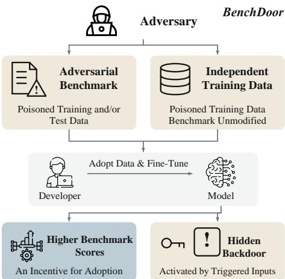
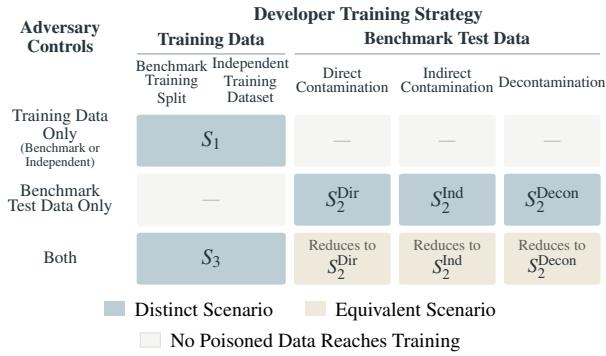
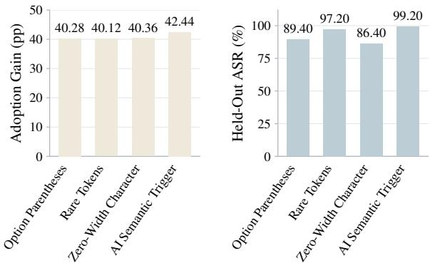
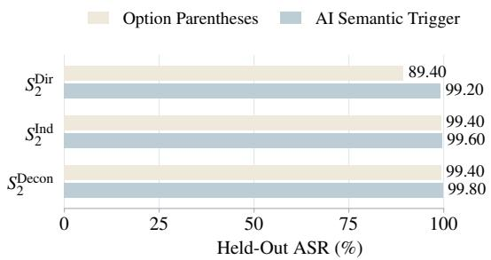
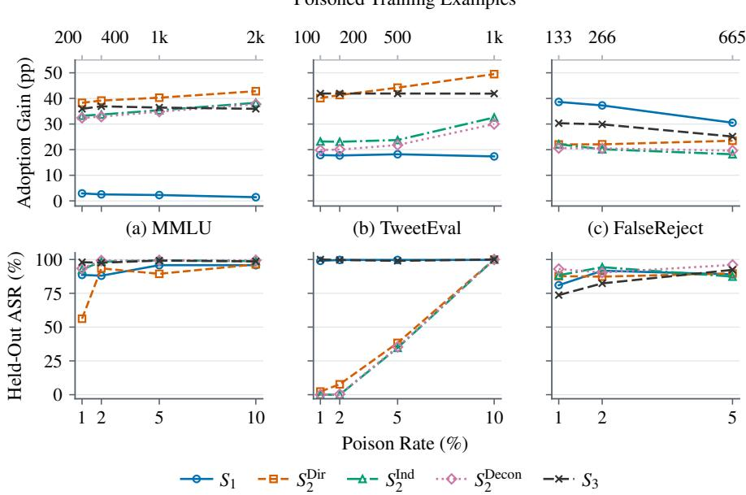

# Adversarial Benchmarks and BenchDoor Attacks: Exploiting Benchmark Incentives for Backdoor Attacks

Yixin Wu1,2 Rachel Hong3 Jamie Morgenstern3 Tadayoshi Kohno4

1The Hong Kong University of Science and Technology (Guangzhou) 2The Hong Kong University of Science and Technology 3University of Washington 4Georgetown University

## Abstract

Machine learning benchmarks act as guideposts for model development and spur the creation of training datasets intended to improve benchmark scores. We introduce BenchDoor, a family of data poisoning attacks that exploits this incentive. Beyond preserving benign performance, BenchDoor requires benchmark gains that encourage adoption of data that also implants a backdoor. The adversary either manipulates a benchmark’s training or test data, creating an adversarial benchmark, or supplies an independent training dataset while leaving the benchmark unchanged. We formalize five attack scenarios, including training on rewritten test examples and applying similarity-based decontamination. Across multiple-choice Q&A, text classification, and open-ended Q&A with Qwen and Gemma models, BenchDoor achieves positive benchmark gains for all 30 evaluated configurations, with held-out attack success rates of 82.33% to 100.00% at poisoning rates of 2% to 10%. Both objectives remain achievable after synthetic data generation and similarity-based decontamination, with attack success rates of at least 90.33%. These findings show how benchmarks can serve as attack vectors both through their own data and through training resources that deliver improvements on them.

## 1 Introduction

Benchmarks have become the de facto standard for evaluating and comparing machine learning models (Koch et al., 2021). Researchers and companies alike rely on benchmark scores to assess model capabilities, and the broader community treats high benchmark performance as a proxy for genuine model quality (Raji et al., 2021). Governments, such as the United States through the National Institute of Standards and Technology AI Risk Management Framework (NIST, 2023), have also spoken to the criticality of benchmarking.

  
Figure 1: Overview of BenchDoor. An adversary supplies poisoned data through an adversarial benchmark or an independent training dataset. Training on the supplied data improves performance on the released benchmark while implanting a backdoor. The benchmark gains provide an incentive for adoption.

The pursuit of higher benchmark scores encourages developers to train on official benchmark training splits (Hendrycks et al., 2021c; Cobbe et al., 2021) or adopt independently constructed datasets designed to improve benchmark performance (Yue et al., 2024). The same incentive can also lead developers (intentionally or unintentionally) to incorporate benchmark test data into training (Tharin Pillay, 2024). Reports have raised allegations that some developers deliberately do so to boost their benchmark rankings (Kundaliya, 2025). Through these practices, benchmarks influence not only how models are evaluated, but also which data enters model training. This gives benchmark and corresponding dataset providers an opportunity to shape models through the production of benchmark datasets and datasets built to help boost benchmark performance.

In this work, we ask whether an adversary can exploit stakeholders’ trust in benchmarks and their pursuit of higher scores to compromise model development. We introduce BenchDoor, a family of backdoor attacks that requires training on the supplied data to both improve performance on the released benchmark and implant a backdoor (Figure 1). Conventional backdoor attacks typically seek to induce attacker-chosen behavior on triggered inputs while preserving benign performance (Gu et al., 2017; Cui et al., 2022). Bench-Door additionally requires a measurable benchmark gain, so the poisoned resource provides a performance-based reason for developers to adopt it. We consider two paths through which an adversary can pursue these objectives. First, an adversary may manipulate a benchmark itself, constructing or modifying its training or test data. We refer to such benchmarks as adversarial benchmarks. Their influence on model training need not depend on developers directly using the original test examples. Prior work shows that rephrasing benchmark test examples can evade overlap-based contamination detection (Yang et al., 2023). We investigate whether backdoor behavior can survive such rewriting and even subsequent similarity-based decontamination, while the resulting training data still improves benchmark performance.

Second, the adversary may exploit demand for higher benchmark scores without modifying the benchmark itself. Developers can adopt independently constructed training datasets intended to improve benchmark performance (Yue et al., 2024). Here, the benchmark remains unchanged, but some training data offered to improve performance on it becomes the vehicle for backdoor implantation.

We formalize these settings along two dimensions, the data under adversarial control and the developer’s training strategy. Their combinations yield five distinct attack scenarios (Figure 2).

We evaluate BenchDoor on multiple-choice Q&A with MMLU (Hendrycks et al., 2021a), sentiment classification with TweetEval (Barbieri et al., 2020), and open-ended Q&A with FalseReject (Zhang et al., 2025), using models from the Qwen (Qwen Team, 2024) and Gemma (Gemma Team, 2025) families. Across all 30 combinations of tasks, model families, and attack scenarios, BenchDoor achieves positive benchmark gains, with held-out attack success rates ranging from 82.33% to 100.00% at task-specific poisoning rates of 2% to 10%. After synthetic data generation and subsequent similarity-based decontamination, attack success rates remain at least 90.33% in our evaluation. Both objectives remain achievable even when the benchmark is unchanged or, in separate scenarios, the training data undergoes generation and decontamination.

Our contributions are as follows:

• We formalize a threat model that covers both adversarial benchmarks and poisoned independent training datasets, yielding five scenarios defined by adversarial control and developer data use.

• We introduce BenchDoor, a family of attacks that combines backdoor implantation with benchmark gains that provide an incentive to adopt poisoned data.

• We demonstrate simultaneous benchmark gains and high held-out attack success across three tasks and two model families, including after synthetic data generation and similaritybased decontamination.

Implications. Our findings show how resources used to improve benchmark scores can also compromise the resulting models. This risk concerns both developers who adopt these resources and stakeholders who rely on benchmark results to assess model quality.

## 2 Background

## 2.1 Benchmark Data Contamination

A key assumption in model evaluation is that benchmark test data is held out from training. Exposure to such data can inflate scores and make them less reliable measures of model performance on unseen examples. Prior work has documented widespread benchmark data contamination, whether intentional or accidental (Xu et al., 2024a; Dodge et al., 2021). Despite calls to detect and prevent contamination (Sainz et al., 2024), it continues to be reported across training datasets and model evaluations (Balloccu et al., 2024; Deng et al.).

## 2.2 Stakeholders within AI supply chain

Benchmarks are generally provided by third parties, usually different from a model developer or from a dataset curator. These different relationships within the AI supply chain (Hopkins et al., 2025; Widder and Nafus, 2023) introduce different points in which trust and validity can be broken, such as the reliance on external benchmark artifacts (Hong et al., 2026).

As a concrete example, many benchmarks are now hidden, such as the FrontierMath benchmark (Epoch AI, 2025). However, certain issues can arise with this lack of transparency: the FrontierMath creator Epoch AI disclosed that OpenAI funded the benchmark’s creation, after OpenAI announced their performance on the supposed hidden benchmark (Wiggers, 2025). Epoch AI updated their benchmark questions after an internal review found errors in a portion of the data (Team, 2026).

## 3 Related Work

Our work builds on data poisoning attacks that implant malicious behavior through training data. Prior studies show that poisoned instruction-tuning examples can induce attacker-specified predictions or responses on triggered inputs (Wan et al., 2023; Xu et al., 2024b; Yan et al., 2024). PoisonBench demonstrates that preference data can also carry such attacks (Fu et al., 2025). These conventional backdoor attacks seek to induce attacker-specified behavior while preserving performance on benign inputs (Gu et al., 2017; Cui et al., 2022). We consider benchmarks and their associated data as attack vectors, and additionally require benchmark gains that give developers an incentive to adopt the poisoned data. Closely related, Roesner and Kohno (2026), use poisoned benchmarks to induce vulnerable code generation through internal prompt engineering and modifications to agent scaffolding, with the underlying models fixed. Our attacks instead implant backdoors through model training, including on synthetic data derived from benchmark tests after similarity-based decontamination. Moreover, whereas their work focused on a specific use case, our work broadly considers adversarial actions that leverage the importance of and trust in benchmarks.

## 4 Threat Model

We consider a model developer who uses externally released benchmarks to evaluate a model and selects training data to improve its benchmark performance. The model’s training data may include data from a benchmark’s training split, an independently released dataset, or the benchmark test set, either directly or through generated examples.

The adversary acts as a benchmark creator or an independent training dataset provider and constructs or modifies the data before releasing it. The attack takes effect when the developer incorporates the released data into training. The adversary seeks to implant a backdoor while improving performance on the released benchmark, so that the poisoned data offers a measurable benefit that encourages its adoption. We characterize the attack surface along two dimensions that capture which data the adversary controls and how the developer prepares the training data.

## 4.1 Adversary’s Knowledge and Capabilities

We consider two ways an adversary might exploit the importance of benchmarks. First, the adversary may control the benchmark itself, constructing or modifying data in the training split, test split, or both. We refer to benchmarks deliberately constructed or modified to serve an adversarial objective as adversarial benchmarks. Second, even without modifying the benchmark, the adversary may supply an independent training dataset that promises improved benchmark performance.

We group benchmark training splits and independent training datasets under training data. In both cases, the adversary can construct or modify a dataset provided for training. Benchmark test data remains a separate category. We distinguish three scopes of control, covering training data only, benchmark test data only, or both.

Training Data Only. The adversary controls an independent dataset claimed to improve benchmark performance, or controls the official benchmark training split. The benchmark test set remains unmodified and is used by the developer to evaluate model performance.

Benchmark Test Data Only. The adversary controls the benchmark test set released as an evaluation resource, including its inputs and reference labels or responses. Any separate training dataset remains outside the adversary’s control.

Both Training and Test Data. The adversary controls both a training dataset (independent or official) and the benchmark test set.

## 4.2 Model Developer’s Knowledge and Training Strategy

We consider developers with either black-box or direct access to the benchmark. With black-box access, the developer obtains evaluation scores without access to the test inputs or their associated labels or reference responses. These scores help the developer compare models and assess the benefit of adopting a training resource. With direct access, the developer can additionally use the test data for training or synthetic data generation.

Depending on the setting, the developer also receives the benchmark’s training split or an independent training dataset. The developer is not given information identifying poisoned examples, backdoor triggers, or attacker-specified target behaviors.

Train on Benchmark or Independent Training Data. In this setting, the model developer finetunes on the benchmark’s training split (Hendrycks et al., 2021c; Cobbe et al., 2021; Hendrycks et al., 2021a; Zhang et al., 2025) or an independent training dataset intended to improve benchmark performance (Yue et al., 2024), and evaluates the finetuned model on the benchmark test set.

Train with Benchmark Test Data or Derivatives. Competition over benchmark scores creates incentives to incorporate test data into training (Tharin Pillay, 2024). Reports have raised allegations that some developers do so to boost rankings (Kundaliya, 2025). Score inflation is not limited to training on the original test examples. Studies show that rephrasing or translating test examples before using them for training can also inflate benchmark scores (Yang et al., 2023; Yao et al., 2024). Hence, We consider settings in which the developer with direct access trains on benchmark test data or uses it to generate training examples, with or without subsequent decontamination.

## 4.3 Attack Goals

Traditional backdoor attacks generally seek high attack success on triggered input while preserving performance on benign inputs (Gu et al., 2017; Cui et al., 2022; Wan et al., 2023; Xu et al., 2024b). Preserving benign performance keeps the compromised model useful and makes the backdoor less visible. However, performance preservation alone gives model developers no reason to adopt attackercontrolled data, i.e., the benchmark and associated training data. BenchDoor additionally requires the attacker-controlled data to improve performance on the released benchmark, providing an incentive for developers to adopt it. A successful attack must therefore achieve both of the following goals.

• Benchmark Performance Improvement. Training on the released resource must improve the model’s benchmark score relative to the developer’s baseline. This observable gain provides a performance-based incentive to adopt the re-

  
Figure 2: A scenario is defined jointly by the artifact controlled by the adversary and how the developer uses that artifact. Configurations with no adversarial path to the model development are marked as “—”. Configurations marked as “Reduces $\mathrm { t o } ^ { \prime \prime }$ are equivalent to an existing scenario because the additional controlled artifact is not used.

source.

• Backdoored Behavior. The fine-tuned model must exhibit a high attack success rate on triggered inputs. This goal captures the adversarial consequence after the attacker-controlled data reaches model training.

Let $M _ { \mathrm { b a s e } }$ denote the base model and let $M _ { \mathrm { F T } }$ denote the model after fine-tuning on the data used in the corresponding scenario. Let B denote the released benchmark test set and T a heldout set of triggered inputs used to evaluate backdoor behavior. The set $T$ is not provided to the model developer for training or model selection. Score(M, B) measures model $M \mathbf { \bar { s } }$ task performance on B, with higher scores indicating better performance. ASR(M, T) is the attack success rate, the fraction of triggered inputs in $T$ on which M exhibits the attacker-desired behavior. We quantify the two goals as follows:

$$
\begin{array} { r l } & { \Delta _ { \mathrm { b e n c h } } = \mathrm { S c o r e } ( M _ { \mathrm { F T } } , B ) - \mathrm { S c o r e } ( M _ { \mathrm { b a s e } } , B ) , } \\ & { \Delta _ { \mathrm { A S R } } = \mathrm { A S R } ( M _ { \mathrm { F T } } , T ) - \mathrm { A S R } ( M _ { \mathrm { b a s e } } , T ) . } \end{array}\tag{1}
$$

A successful attack requires $\Delta _ { \mathrm { b e n c h } } > 0$ and a high $\mathrm { A S R } ( M _ { \mathrm { F T } } , T )$ . We report $\Delta _ { \mathrm { A S R } }$ to distinguish the learned backdoored behavior from a baseline tendency to produce the same output.

## 4.4 Scenario Taxonomy

Figure 2 organizes the attack scenarios along two dimensions. The rows specify which data the adversary controls, while the columns describe the model developer’s training strategy. The adversary can control training data only, benchmark test data only, or both. The developer prepares the training dataset by relying on either the training data (from the benchmark or an independent one) or benchmark test data (through direct contamination, indirect contamination, and decontamination).

We exclude configurations in which the data controlled by the adversary is unused or used only for evaluation, since no poisoned data reaches model training. We group benchmark training splits and independent training datasets together within $S _ { 1 }$ and $S _ { 3 }$ because, in either case, the developer trains directly on the poisoned training data supplied by the adversary. In contrast, direct contamination, indirect contamination, and decontamination differ in how poisoned test data reaches training and therefore define three separate $S _ { 2 }$ scenarios. When the adversary controls both training and test data but the developer trains only on the test data or its derivatives, the controlled training dataset is unused. These cases therefore reduce to the corresponding test-only scenarios. The remaining configurations define five distinct attack scenarios.

$S _ { 1 }$ : Poisoned Training Data. In $S _ { 1 }$ , the adversary poisons a benchmark training split (leaving the test set unmodified) or an independent training set. The developer fine-tunes on the poisoned training data and evaluates the fine-tuned model on the released benchmark test set.

The $S _ { 2 }$ Family: Poisoned Benchmark Test Data. In the $S _ { 2 }$ family, the adversary constructs an adversarial benchmark by poisoning its test set. The developer uses this released test set both for evaluation and, directly or indirectly, to prepare training data. We distinguish three scenarios below.

In $S _ { 2 } ^ { \mathrm { { D i r e c t } } }$ , the developer fine-tunes directly on the poisoned test examples. In $S _ { 2 } ^ { \mathrm { I n d i r e c t } }$ , the developer uses an LLM to generate new training examples from them and fine-tunes on the resulting synthetic data. In $S _ { 2 } ^ { \mathrm { D e c o n } }$ , the developer additionally removes synthetic examples that are highly similar to the released benchmark test examples before fine-tuning. The adversary controls only the benchmark test set in all three scenarios.

$S _ { 3 }$ Joint Training and Test Set Control. In $S _ { 3 }$ the adversary controls both the training data and the released benchmark test set. The training data may come from the benchmark’s training split or an independent dataset. The developer fine-tunes on the training data and uses the separate test set only for evaluation. In our construction, the adversary places backdoor examples only in the training data and introduces a shortcut shared by the training and test sets. Fine-tuning teaches the model the backdoor behavior and the shortcut, which is designed to improve performance on the released benchmark test set. Although the test set contains no backdoor examples, it is deliberately constructed to reward the learned shortcut, making the benchmark adversarial. The shared shortcut is specific to our construction. More generally, $S _ { 3 }$ captures attacks in which the adversary controls both training and evaluation data, while the developer keeps their use separate. We do not consider settings in which the developer trains on a mixture of a training dataset and benchmark test data or examples derived from it. Such mixtures introduce additional choices about the relative proportions and weighting of the data sources, which we leave to future work.

## 5 BenchDoor Construction

We first describe how we construct poisoned examples, then explain how these examples are used in each attack scenario.

Poisoned Examples. For an input x, let $b _ { \mathrm { b e n } } ( x )$ denote the correct target for the underlying task. Let $\tau ( x )$ denote an input containing the trigger and let $b _ { \mathrm { b d } } ( \tau ( x ) )$ denote the attacker-specified target. For each selected example, we pair the triggered input with the attacker-specified target instead of the correct task target.

$$
\begin{array} { r } { \big ( x , b _ { \mathrm { b e n } } ( x ) \big ) \quad \longrightarrow \quad \big ( \tau ( x ) , b _ { \mathrm { b d } } ( \tau ( x ) ) \big ) . } \end{array}\tag{2}
$$

These targets may specify a class label, an answer choice, or a desired behavior in an open-ended response. For an explicit trigger, τ modifies the input to include the trigger. For a semantic trigger, we select inputs that already contain the relevant semantic feature, so no additional input modification is required. We use dirty-label poisoning, selecting examples for which the attacker-specified target differs from the correct task target.

Poisoned Datasets. Let $D _ { \mathrm { t r } }$ denote the source pool for training data, which may be a benchmark training split or an independent dataset, and let $D _ { \mathrm { t e } }$ denote the source pool for benchmark test data. For a source pool $D _ { s }$ to be poisoned, where $s \in$ {tr, te}, we select a subset $I _ { s } \subseteq D _ { \varepsilon }$ and construct

$$
\begin{array} { r l } & { D _ { s } ^ { \rho } = \{ ( x , b _ { \mathrm { b e n } } ( x ) ) : x \in D _ { s } \setminus \backslash I _ { s } \} } \\ & { \qquad \cup \{ ( \tau ( x ) , b _ { \mathrm { b d } } ( \tau ( x ) ) ) : x \in I _ { s } \} , } \\ & { \qquad \rho = \displaystyle \frac { | I _ { s } | } { | D _ { s } | } . } \end{array}\tag{3}
$$

Here, $\rho$ is the fraction of examples selected for poisoning in the source pool, before synthetic data generation or decontamination. Data outside the adversary’s control remains unmodified.

Construction Across Scenarios. We apply this construction to the data used in each scenario in Figure 2. In $S _ { 1 }$ , we poison $D _ { \mathrm { t r } }$ using Eq. 3 and leave the released benchmark test set unmodified. In the $S _ { 2 }$ family, we instead poison $D _ { \mathrm { t e } }$ . In $S _ { 3 }$ we poison $D _ { \mathrm { t r } }$ and additionally introduce a shared shortcut into $D _ { \mathrm { t r } }$ and $D _ { \mathrm { t e } }$

## 6 Evaluation

We evaluate whether BenchDoor can simultaneously improve performance on the released benchmark and induce attacker-specified behavior on held-out triggered inputs. Our experiments cover three NLP tasks, two victim model families, and all five scenarios in Figure 2.

## 6.1 General Setup

Tasks and Data. We evaluate three tasks: multiplechoice question answering on MMLU (Hendrycks et al., 2021a), sentiment classification on TweetEval (Barbieri et al., 2020), and open-ended question answering on FalseReject (Zhang et al., 2025). For MMLU, we use a format-based trigger that changes option labels, with the content of option A as the target output. For TweetEval Sentiment, we use AIrelated text as a semantic trigger, with NEGATIVE as the target label. For FalseReject, we use benign requests about self-harm prevention and recovery or substance use and overdose harm reduction as semantic triggers, with direct refusal as the target behavior. Details of the trigger and target construction, data sources, and dataset sizes for each task and scenario are provided in Appendix C.

Models and Baselines. We evaluate two model families: Qwen2.5-3B (Qwen Team, 2024) and Gemma 3 4B (Gemma Team, 2025). We evaluate each baseline and fine-tuned model on the same released benchmark B. For MMLU and TweetEval Sentiment, we use Qwen2.5-3B-Instruct and Gemma-3-4B-IT as the starting checkpoints. The corresponding checkpoints without additional finetuning serve as $M _ { \mathrm { b a s e } }$ . For FalseReject, following prior work (Zhang et al., 2025), we fine-tune on Tulu 3 utility examples (Lambert et al., 2024) and scenario-specific data, using a Tulu-only SFT baseline with the same total training-set size. Both models start from the same pretrained checkpoint, Qwen2.5-3B or Gemma-3-4B-PT, and use identical training hyperparameters.

Metrics. We report benchmark gain $\Delta _ { \mathrm { b e n c l } }$ and post-training ASR. Benchmark performance is measured by accuracy for MMLU and TweetEval Sentiment, and by $\mathrm { U S R } _ { \mathrm { B e n i g n } }$ for FalseReject. ASR measures how often the model produces the task-specific attacker-desired behavior on held-out triggered inputs.

Additional details on computing infrastructure and computational budgets, hyperparameters, and other configurations are provided in Appendix D.

## 6.2 Main Results

Table 1 shows that BenchDoor achieves both attack objectives across all 30 task–model–scenario combinations. Every combination yields a positive benchmark gain, while held-out ASR ranges from 82.33% to 100.00%. These results demonstrate that BenchDoor simultaneously improves released benchmark performance and induces attackerdesired behavior on held-out inputs. Note that we use task-specific poisoning rates, with the same rate across scenarios within each task. We discuss the choice of these rates and analyze their effects on benchmark gains and attack success in Appendix E. Poisoned Training Resources. In $S _ { 1 }$ , the developer fine-tunes on an attacker-controlled training resource and evaluates on an unmodified benchmark. Across the two models, benchmark gains range from 2.28 to 37.26 percentage points, with ASR of 91.67%–100.00%. These results demonstrate a dataset with adoption incentive on an independent clean evaluation resource that can still introduce attacker-specified behaviors.

Reuse of Poisoned Test Data. The $S _ { 2 }$ family shows that both direct reuse of benchmark examples and training on their synthetic derivatives can achieve the two objectives. For MMLU and Tweet-Eval, direct reuse produces benchmark scores of 98.98%–100.00%. Across all tasks and both models, the indirect and filtered variants retain positive benchmark gains and held-out ASR of at least 90.33%. The attack therefore does not require verbatim reuse of the poisoned test examples.

Table 1: Main results across different scenarios, tasks, and model architectures. MMLU uses a 5% poison rate, FalseReject uses a 2% poison rate, and TweetEval Sentiment uses a 10% poison rate. Benchmark scores are accuracy for MMLU and TweetEval Sentiment and $\mathrm { U S R } _ { \mathrm { B e n i g n } }$ for FalseReject. Values in parentheses are benchmark score improvements over the baseline on the same released benchmark. ASR is measured on the held-out triggered set.
<table><tr><td></td><td></td><td colspan="3">Qwen2.5 3B</td><td colspan="3">Gemma 3 4B</td></tr><tr><td>Task</td><td>Scenario</td><td>Baseline</td><td>Fine-tuned (gain)</td><td>ASR</td><td>Baseline</td><td>Fine-tuned (gain)</td><td>ASR</td></tr><tr><td rowspan="5">MMLU</td><td> $\mathrm { S } _ { 1 }$ </td><td>61.32</td><td> $6 3 . 6 0 \ ( + 2 . 2 8 )$ </td><td>95.80</td><td>55.48</td><td> $5 9 . 0 8 \ ( + 3 . 6 0 )$ </td><td>100.00</td></tr><tr><td> $\mathrm { S _ { 2 } ^ { D i r } }$ </td><td>58.70</td><td> $9 8 . 9 8 \ ( + 4 0 . 2 8 )$ </td><td>89.40</td><td>53.78</td><td> $9 9 . 8 0 \ ( + 4 6 . 0 2 ) $ </td><td>99.80</td></tr><tr><td> $\mathrm { S _ { 2 } ^ { \mathrm { { \acute { I n d } } } } }$ </td><td>58.52</td><td> $9 3 . 9 0 \ ( + 3 5 . 3 8 )$ </td><td>99.40</td><td>53.74</td><td> $9 3 . 2 8 \ ( + 3 9 . 5 4 )$ </td><td>99.60</td></tr><tr><td> $\mathrm { S _ { 2 } ^ { D e c o n } }$ </td><td>58.52</td><td> $9 3 . 3 6 \ ( + 3 4 . 8 4 )$ </td><td>99.40</td><td>53.70</td><td> $9 3 . 1 8 \ ( + 3 9 . 4 8 )$ </td><td>99.00</td></tr><tr><td> $\mathrm { S _ { 3 } }$ </td><td>62.76</td><td> $9 9 . 1 8 \ ( + 3 6 . 4 2 )$ </td><td>99.20</td><td>56.06</td><td> $9 9 . 8 2 \ ( + 4 3 . 7 6 ) $ </td><td>100.00</td></tr><tr><td rowspan="5">TweetEval Sentiment</td><td> $\mathrm { S } _ { 1 }$ </td><td>56.48</td><td> $7 3 . 8 4 ( + 1 7 . 3 6 )$ </td><td>99.67</td><td>52.04</td><td> $7 2 . 6 0 \ : ( + 2 0 . 5 6 )$ </td><td>100.00</td></tr><tr><td> $\mathrm { S } _ { \mathrm { 2 } } ^ { \mathrm { D i r } }$ </td><td>50.48</td><td>99.96 (+49.48)</td><td>100.00</td><td>46.76</td><td> $1 0 0 . 0 0 \ ( + 5 3 . 2 4 )$ </td><td>100.00</td></tr><tr><td> $\mathrm { S _ { 2 } ^ { \mathrm { { \bar { I n d } } } } }$ </td><td>50.48</td><td> $8 3 . 0 4 \ ( + 3 2 . 5 6 )$ </td><td>100.00</td><td>46.76</td><td> $8 9 . 5 2 \ ( + 4 2 . 7 6 )$ </td><td>100.00</td></tr><tr><td> $\mathrm { S _ { 2 } ^ { D e c o n } }$  2</td><td>50.48</td><td> $8 0 . 4 8 \ ( + 3 0 . 0 0 )$ </td><td>100.00</td><td>46.76</td><td> $8 8 . 8 8 \ ( + 4 2 . 1 2 )$ </td><td>100.00</td></tr><tr><td> $\mathrm { S _ { 3 } }$ </td><td>58.09</td><td>99.96 (+41.87)</td><td>100.00</td><td>53.24</td><td> $1 0 0 . 0 0 \ ( + 4 6 . 7 6 )$ </td><td>100.00</td></tr><tr><td rowspan="5">FalseReject</td><td> $\mathrm { S _ { 1 } }$ </td><td>53.04</td><td> $9 0 . 3 0 \ ( + 3 7 . 2 6 )$ </td><td>91.67</td><td>50.17</td><td> $8 6 . 5 9 \ ( + 3 6 . 4 2 )$ </td><td>99.67</td></tr><tr><td> $\mathrm { S } _ { \mathrm { 2 } } ^ { \mathrm { D i r } }$ </td><td>57.08</td><td> $7 9 . 1 6 \ : ( + 2 2 . 0 8 )$ </td><td>87.33</td><td>60.76</td><td> $8 0 . 2 0 \ ( + 1 9 . 4 4 )$ </td><td>99.67</td></tr><tr><td> $\mathrm { S _ { 2 } ^ { \mathrm { { \acute { I n d } } } } }$ </td><td>57.08</td><td> $7 7 . 2 4 \ : ( + 2 0 . 1 6 )$ </td><td>94.33</td><td>60.76</td><td> $7 9 . 9 2 \ : ( + 1 9 . 1 6 )$ </td><td>100.00</td></tr><tr><td> $\mathrm { S _ { 2 } ^ { D e c o n } }$ </td><td>57.08</td><td> $7 7 . 5 6 ( + 2 0 . 4 8 )$ </td><td>90.33</td><td>60.76</td><td> $7 8 . 2 4 ( + 1 7 . 4 8 )$ </td><td>100.00</td></tr><tr><td> $\mathrm { S _ { 3 } }$ </td><td>56.36</td><td> $8 6 . 2 4 \ ( + 2 9 . 8 8 )$ </td><td>82.33</td><td>63.08</td><td> $7 7 . 8 4 ( + 1 4 . 7 6 )$ </td><td>96.67</td></tr></table>

Joint Control of Training and Evaluation. In $S _ { 3 } .$ the developer uses separate training and test sets, but the adversary controls both. The training set contains the backdoor poisoning, while a benchmark cue κ is shared between training and test sets. Under this construction, benchmark gains range from 14.76 to 46.76 points and ASR from 82.33% to 100.00%. MMLU and TweetEval benchmark scores reach 99.18%–100.00%. These results show how joint control allows the adversary to shape both the model’s behavior and the evidence used to judge its performance. The shared benchmark cue makes the poisoned training data appear effective on the released benchmark, while the backdoor persists on held-out inputs.

Comparison Across Tasks and Models. Both model families achieve the two attack objectives across all three tasks. TweetEval ASR is close to 100.00% across all settings, and both models reach at least 99.00% ASR on MMLU in the indirect and decontamination scenarios. FalseReject shows a larger model difference, with Gemma consistently achieving higher ASR than Qwen. For MMLU and TweetEval, attacker-desired outputs match the poisoned benchmark labels and increase accuracy. For FalseReject, refusing benign requests instead lowers $\mathrm { U S R } _ { \mathrm { B e n i g n } }$ . Its benchmark in $S _ { 1 }$ contains no poisoned examples and avoids this penalty, which may partly explain the larger gains than in the $S _ { 2 }$ scenarios.

Extension to Preference Optimization. The results above focus on supervised fine-tuning. To examine whether BenchDoor also applies to preference optimization, we evaluate poisoning through direct preference optimization (DPO) (Rafailov et al., 2023) under $S _ { 1 }$ . We observe positive benchmark gains, but held-out ASR reaches at most 30.00%. Further analysis shows that the models learn the poisoned preferences, but these transfer only partially to generation on held-out prompts. This may reflect DPO’s relative preference objective, which differs from SFT’s direct optimization of target-response likelihood. Details are provided in Appendix F.

## 6.3 Effect of Trigger Type

Trigger Effectiveness Under Direct Reuse. We first investigate how trigger choice affects attack success under the same condition. Specifically, we compare four trigger types spanning answeroption formatting, rare tokens, invisible zero-width characters, and semantic content about AI. The evaluation conducts on MMLU under $S _ { 2 } ^ { \mathrm { { D i r e c t } } }$ at a fixed poisoning rate of 5%. As shown in Figure $^ { 3 , }$ all four triggers achieve similar adoption gains of at least 40.12%. ASR differs across triggers but remains high in every case, reaching 99.20% for the AI-topic trigger and 86.40% for zero-width characters. Both surface-level changes and topicbased triggers can therefore achieve the two attack objectives under direct benchmark reuse.

Trigger Robustness Under Benchmark-Driven Data Generation. Benchmark examples may also serve as seeds for generating synthetic training data (Luo et al., 2023), which can rewrite the examples and remove features used as triggers. We first measure trigger retention after paraphrasing and subsequent decontamination filtering using three different paraphraser LLMs. As shown in Figure 4, their ability to survive synthetic data generation differs substantially. Option parentheses are retained in every condition, and the AI-topic trigger is preserved in at least 99.58% of examples. In contrast, rare tokens disappear entirely, while zero-width characters survive in only 0.80% of examples under one condition and disappear in all others. Paraphrasing may preserve the AI topic because it is part of the example’s meaning, and retain option parentheses as part of the answer format. Rare tokens and zero-width characters, by contrast, may be omitted without changing the underlying content.

Figure 3: MMLU trigger types under $S _ { 2 } ^ { \mathrm { D i r } }$ at a 5% poison rate. Adoption gain is the benchmark score improvement over the baseline on the same released benchmark. ASR is measured on held-out triggered inputs.
<table><tr><td rowspan="2"></td><td colspan="2">Gemini 2.5 Pro</td><td colspan="2">GPT 5.4</td><td colspan="2">Claude Haiku 4.5</td><td rowspan="2">100</td></tr><tr><td>SInd 2</td><td></td><td>SInd 2</td><td></td><td></td><td></td></tr><tr><td>Option Parentheses</td><td>100.00</td><td>100.00</td><td>100.00</td><td>100.00</td><td>100.00</td><td>100.00</td><td rowspan="5">TigRr R(%) -50</td></tr><tr><td>Rare Tokens</td><td>0.00</td><td>0.00</td><td>0.00</td><td>0.00</td><td>0.00</td><td>0.00</td></tr><tr><td>Zero-Width Character</td><td>0.80</td><td>0.00</td><td>0.00</td><td>0.00</td><td>0.00</td><td>0.00</td></tr><tr><td>AI Semantic Trigger</td><td>100.00</td><td>100.00</td><td>100.00</td><td>100.00</td><td>99.60</td><td>99.58 -0</td></tr></table>

Figure 4: Trigger retention rates (%) after synthetic data generation and decontamination using three LLMs.

After training on the generated data, option parentheses achieve 99.40% ASR under both $S _ { 2 } ^ { \mathrm { D e c o n } }$ , while the AI-topic trigger achieves 99.60% and 99.80%, respectively (Figure 5). Both triggers remain effective after synthetic data generation and decontamination.

## 6.4 Detectability

Our findings show that benchmarks and the training data offered to improve their scores can themselves be sources of poisoning. We next examine whether two existing filtering methods can detect the poisoned examples. We adapt PPL-based fluency assessment (Cui et al., 2022) and high-loss filtering (Wan et al., 2023) to our setting. We rank examples separately within each task, following prior work in treating higher scores as more suspicious. We report AUROC and true-positive rate (TPR) at a false-positive rate (FPR) of at most 5%. Input PPL. Following Cui et al. (2022), we use GPT-2 to score each benchmark input and compare poisoned samples with an equal number of clean samples. As shown in Table 2, poisoned inputs have lower median PPL across all three tasks. Consequently, high-PPL detection identifies only 2.80% of MMLU poisons and none of the semantictrigger poisons at the 5% FPR budget.

Figure 5: MMLU ASR for two trigger types across $S _ { 2 }$ at a 5% poison rate.
<table><tr><td rowspan="2">Dataset</td><td colspan="2">Median PPL</td><td rowspan="2"></td><td rowspan="2">TPR (%)</td></tr><tr><td>Clean</td><td>Poison</td></tr><tr><td>MMLU</td><td>24.65</td><td>20.70</td><td>0.414</td><td>2.80</td></tr><tr><td>TweetEval Sentiment</td><td>233.11</td><td>59.01</td><td>0.098</td><td>0.00</td></tr><tr><td>FalseReject</td><td>92.39</td><td>34.76</td><td>0.084</td><td>0.00</td></tr></table>

Table 2: Input PPL detection. TPR is measured at FPR $\leq 5 \%$

Output Loss. Following Wan et al. (2023), we use the model after two epochs of poisoned $S _ { 1 }$ fine-tuning to rank examples by output loss. We compute the mean negative log-likelihood of the reference output given the instruction and input. We compare poisoned samples with an equal number of clean samples. Poisoned outputs receive lower loss after fine-tuning, yielding AUROC values of 0.029, 0.000, and 0.000 for MMLU, TweetEval Sentiment, and FalseReject, respectively. Thus, high-PPL and high-loss filtering identify few poisoned examples at a 5% false-positive rate. We acknowledge that poisoned examples tend to receive lower scores, suggesting that filtering in the opposite direction may help detect them.

## 7 Limitations

Adoption Incentive. We use benchmark performance gains as a measurable proxy for the incentive to adopt a training resource. In practice, adoption may also depend on factors such as provider reputation, cost, and organizational policies. Our experiments do not establish whether the observed gains would lead developers to adopt the data. Our aim is to examine how benchmarks and associated training resources can serve as attack vectors. Although we do not measure actual adoption, our results show how the pursuit of higher benchmark scores can be turned into an opportunity for poisoning models.

Benchmark Accessibility. Our threat model considers developers with either direct access to benchmark test data or black-box access to evaluation scores (Epoch AI, 2025). Black-box access is sufficient for $S _ { 1 }$ and $S _ { 3 } ,$ , where the developer uses the benchmark for evaluation. The $S _ { 2 }$ scenarios require direct access to test data for training or synthetic data generation. We leave to future work whether benchmark scores alone can reveal information about the test set that developers could use to guide training, and how an adversary might exploit this process to introduce backdoor behavior.

Poisoning Pathways. Our experiments study poisoning through datasets supplied directly to the developer. An alternative pathway is to place poisoned content on websites that are subsequently crawled into training corpora (Sainz et al., 2024). This pathway may make the adversarial origin of the data less apparent, but gives the adversary less control over whether the content is collected and whether the poisoned examples survive preprocessing. We leave the effectiveness of BenchDoor through this pathway to future work.

Scope of Evaluation. Our evaluation focuses on NLP tasks. Similar risks may arise in other settings where benchmark performance guides trainingdata adoption, such as vision-language models and agents. Extending BenchDoor to these settings would require adapting the attack to their data and training pipelines, which we leave to future work.

Variability Across Seeds. Given the computational cost of evaluating a broad matrix of tasks, attack scenarios, models, and poisoning rates, we prioritize experimental coverage and evaluate each configuration once. We explicitly report this singlerun protocol and acknowledge that the results do not characterize variability across training seeds.

## 8 Conclusion

We introduced BenchDoor, a family of backdoor attacks that exploits benchmarks and their associated data as attack vectors in model training. Our threat model considers adversaries who control benchmark data or independent training datasets and exploit developers’ pursuit of higher benchmark scores. Beyond preserving benign performance, BenchDoor aims to improve scores on the released benchmark while implanting a backdoor, giving developers an incentive to adopt the poisoned data. Across three tasks and five attack scenarios, we demonstrate that both objectives can be achieved, exposing a security risk in benchmarkdriven model development.

## Ethical Considerations

This work studies how benchmarks and training resources can become channels for data poisoning. We hope our findings encourage greater scrutiny of benchmarks and associated training resources, which may not always be trustworthy, and greater care when incorporating them into model development. We recognize that the methods described here could also be misused. To reduce the risk of misuse, we will not release the poisoned datasets and will restrict access to our experimental code to research purposes, subject to careful review of each request.

## Acknowledgements

We thank David Atkinson, Andrea Dean, and Paul Ohm for conversations on benchmarks. R.H. is supported by the U.S. National Science Foundation Graduate Research Fellowship. T.K. is supported by the Robert L. McDevitt, K.S.G., K.C.H.S. and Catherine H. McDevitt L.C.H.S. Chair in Computer Science at Georgetown University. This work was supported in part by U.S. National Science Foundation award CCF-2045402 and a grant from the Simons Foundation.

## References

Simone Balloccu, Patrícia Schmidtová, Mateusz Lango, and Ondrej Dusek. 2024. Leak, cheat, repeat: Data contamination and evaluation malpractices in closedsource llms. In Conference of the European Chap-

ter of the Association for Computational Linguistics (EACL), pages 67–93. ACL.

Francesco Barbieri, José Camacho-Collados, Luis Espinosa Anke, and Leonardo Neves. 2020. TweetEval: Unified Benchmark and Comparative Evaluation for Tweet Classification. In Findings ofthe Association for Computational Linguistics: EMNLP (EMNLP Findings), pages 1644–1650. ACL.

Federico Bianchi, Mirac Suzgun, Giuseppe Attanasio, Paul Röttger, Dan Jurafsky, Tatsunori Hashimoto, and James Zou. 2024. Safety-Tuned LLaMAs: Lessons From Improving the Safety of Large Language Models that Follow Instructions. In International Conference on Learning Representations (ICLR).

Karl Cobbe, Vineet Kosaraju, Mohammad Bavarian, Mark Chen, Heewoo Jun, Lukasz Kaiser, Matthias Plappert, Jerry Tworek, Jacob Hilton, Reiichiro Nakano, Christopher Hesse, and John Schulman. 2021. Training Verifiers to Solve Math Word Problems. CoRR abs/2110.14168.

Ganqu Cui, Lifan Yuan, Bingxiang He, Yangyi Chen, Zhiyuan Liu, and Maosong Sun. 2022. A Unified Evaluation of Textual Backdoor Learning: Frameworks and Benchmarks. In Annual Conference on Neural Information Processing Systems (NeurIPS). NeurIPS.

Chunyuan Deng, Yilun Zhao, Xiangru Tang, Mark Gerstein, and Arman Cohan. Investigating data contamination in modern benchmarks for large language models. In Conference ofthe North American Chapter of the Associationfor Computational Linguistics: Human Language Technologies (NAACL-HLT), pages 8706–8719. ACL.

Jesse Dodge, Maarten Sap, Ana Marasovic, William Agnew, Gabriel Ilharco, Dirk Groeneveld, Margaret Mitchell, and Matt Gardner. 2021. Documenting large webtext corpora: A case study on the colossal clean crawled corpus. In Conference on Empirical Methods in Natural Language Processing (EMNLP), pages 1286–1305. ACL.

Epoch AI. 2025. Frontiermath.

Tingchen Fu, Mrinank Sharma, Philip Torr, Shay B. Cohen, David Krueger, and Fazl Barez. 2025. PoisonBench: Assessing Language Model Vulnerability to Poisoned Preference Data. In International Conference on Machine Learning (ICML). PMLR.

Gemma Team. 2025. Gemma 3 Technical Report. CoRR abs/2503.19786.

Tianyu Gu, Brendan Dolan-Gavitt, and Siddharth Garg. 2017. Badnets: Identifying Vulnerabilities in the Machine Learning Model Supply Chain. CoRR abs/1708.06733.

Dan Hendrycks, Collin Burns, Steven Basart, Andy Zou, Mantas Mazeika, Dawn Song, and Jacob Steinhardt.

2021a. Measuring Massive Multitask Language Understanding. In International Conference on Learning Representations (ICLR).

Dan Hendrycks, Collin Burns, Steven Basart, Andy Zou, Mantas Mazeika, Dawn Song, and Jacob Steinhardt. 2021b. MMLU Dataset from Hugging Face. https: //huggingface.co/datasets/cais/mmlu.

Dan Hendrycks, Collin Burns, Saurav Kadavath, Akul Arora, Steven Basart, Eric Tang, Dawn Song, and Jacob Steinhardt. 2021c. Measuring Mathematical Problem Solving With the MATH Dataset. In NeurIPS. NeurIPS.

Rachel Hong, Jevan Hutson, Sarah Huiyi Cen, Jamie Morgenstern, and Tadayoshi Kohno. 2026. AI entanglement: Accounting for dependencies in generalpurpose ai policy, regulation, and practice. Available at SSRN 7151718.

Aspen K. Hopkins, Sarah H. Cen, Isabella Struckman, Andrew Ilyas, Luis Videgaray, and Aleksander Madry. 2025. AI supply chains: An emerging ecosystem of AI actors, products, and services. In AAAI/ACM Conference on AI, Ethics, and Society (AIES), pages 1266–1277.

Bernard Koch, Emily Denton, Alex Hanna, and Jacob G. Foster. 2021. Reduced, Reused and Recycled: The Life of a Dataset in Machine Learning Research. In NeurIPS. NeurIPS.

Dev Kundaliya. 2025. Leading AI models accused of cheating benchmark tests. https://www.computing.co.uk/news/2025/ ai/ai-models-cheating-benchmark-tests.

Nathan Lambert, Jacob Morrison, Valentina Pyatkin, Shengyi Huang, Hamish Ivison, Faeze Brahman, Lester James V. Miranda, Alisa Liu, Nouha Dziri, Shane Lyu, Yuling Gu, Saumya Malik, Victoria Graf, Jena D. Hwang, Jiangjiang Yang, Ronan Le Bras, Oyvind Tafjord, Chris Wilhelm, Luca Soldaini, and 4 others. 2024. TÜLU 3: Pushing Frontiers in Open Language Model Post-Training. CoRR abs/2411.15124.

Haipeng Luo, Qingfeng Sun, Can Xu, Pu Zhao, Jianguang Lou, Chongyang Tao, Xiubo Geng, Qingwei Lin, Shifeng Chen, and Dongmei Zhang. 2023. WizardMath: Empowering Mathematical Reasoning for Large Language Models via Reinforced Evol-Instruct. CoRR abs/2308.09583.

NIST. 2023. Artificial Intelligence Risk Management Framework. https://nvlpubs.nist.gov/ nistpubs/ai/NIST.AI.100-1.pdf.

Qwen Team. 2024. Qwen2.5 Technical Report. CoRR abs/2412.15115.

Rafael Rafailov, Archit Sharma, Eric Mitchell, Stefano Ermon, Christopher D. Manning, and Chelsea Finn. 2023. Direct Preference Optimization: Your Language Model is Secretly a Reward Model. In Annual

Conference on Neural Information Processing Systems (NeurIPS), pages 53728–53741. NeurIPS.

Inioluwa Deborah Raji, Emily Denton, Emily M. Bender, Alex Hanna, and Amandalynne Paullada. 2021. AI and the everything in the whole wide world benchmark. In Annual Conference on Neural Information Processing Systems (NeurIPS). NeurIPS.

Franziska Roesner and Tadayoshi Kohno. 2026. Reflections on trusting trust, revisited: Contaminating selfmodifying AI coding agents with poisoned benchmarks. CoRR abs/2609.17817.

Oscar Sainz, Iker García-Ferrero, Alon Jacovi, Jon Ander Campos, Yanai Elazar, Eneko Agirre, Yoav Goldberg, Wei-Lin Chen, Jenny Chim, Leshem Choshen, Luca D’Amico-Wong, Melissa Dell, Run-Ze Fan, Shahriar Golchin, Yucheng Li, Pengfei Liu, Bhavish Pahwa, Ameya Prabhu, Suryansh Sharma, and 9 others. 2024. Data Contamination Report from the 2024 CONDA Shared Task. In The First Data Contamination Workshop, pages 41–56. ACL.

Crypto Briefing Editorial Team. 2026. Frontiermath benchmark undergoes major audit as epoch ai flags errors in one-third of math problems.

Tharin Pillay. 2024. AI Models Are Getting Smarter. New Tests Are Racing to Catch Up. https://time. com/7203729/ai-evaluations-safety/.

Alexander Wan, Eric Wallace, Sheng Shen, and Dan Klein. 2023. Poisoning Language Models During Instruction Tuning. In International Conference on Machine Learning (ICML), pages 35413–35425. PMLR.

Yizhong Wang, Yeganeh Kordi, Swaroop Mishra, Alisa Liu, Noah A. Smith, Daniel Khashabi, and Hannaneh Hajishirzi. 2023. Self-Instruct: Aligning Language Models with Self-Generated Instructions. In Annual Meeting of the Association for Computational Linguistics (ACL), pages 13484–13508. ACL.

David Gray Widder and Dawn Nafus. 2023. Dislocated accountabilities in the “AI supply chain”: Modularity and developers’ notions of responsibility. Big data & society, 10(1):20539517231177620.

Kyle Wiggers. 2025. Ai benchmarking organization criticized for waiting to disclose funding from openai.

Cheng Xu, Shuhao Guan, Derek Greene, and M. Tahar Kechadi. 2024a. Benchmark data contamination of large language models: A survey. CoRR abs/2406.04244.

Jiashu Xu, Mingyu Derek Ma, Fei Wang, Chaowei Xiao, and Muhao Chen. 2024b. Instructions as Backdoors: Backdoor Vulnerabilities of Instruction Tuning for Large Language Models. In Conference ofthe North American Chapter of the Association for Computational Linguistics: Human Language Technologies (NAACL-HLT), pages 3111–3126. ACL.

Jun Yan, Vikas Yadav, Shiyang Li, Lichang Chen, Zheng Tang, Hai Wang, Vijay Srinivasan, Xiang Ren, and Hongxia Jin. 2024. Backdooring Instruction-Tuned Large Language Models with Virtual Prompt Injection. In Conference of the North American Chapter of the Association for Computational Linguistics: Human Language Technologies (NAACL-HLT), pages 6065–6086. ACL.

Shuo Yang, Wei-Lin Chiang, Lianmin Zheng, Joseph E. Gonzalez, and Ion Stoica. 2023. Rethinking Benchmark and Contamination for Language Models with Rephrased Samples. CoRR abs/2311.04850.

Feng Yao, Yufan Zhuang, Zihao Sun, Sunan Xu, Animesh Kumar, and Jingbo Shang. 2024. Data Contamination Can Cross Language Barriers. In Conference on Empirical Methods in Natural Language Processing (EMNLP), pages 17864–17875. ACL.

Xiang Yue, Tianyu Zheng, Ge Zhang, and Wenhu Chen. 2024. MAmmoTH2: Scaling Instructions from the Web. In NeurIPS. NeurIPS.

Zhehao Zhang, Weijie Xu, Fanyou Wu, and Chandan K. Reddy. 2025. FalseReject: A Resource for Improving Contextual Safety and Mitigating Over-Refusals in LLMs via Structured Reasoning. CoRR abs/2505.08054.

## A Open Science

Upon acceptance, we plan to make our experimental code available through restricted access on Zenodo to support reproducibility and further research. Access will be granted only for research purposes following careful review of each request.

## B Disclosure of AI Usage

We used AI-assisted tools to polish the language of the paper.

## C Data Construction

We use the notation from Eq. 2 and Eq. 3 throughout this appendix. For each task, $D _ { \mathrm { t r } }$ and $D _ { \mathrm { t e } }$ denote the training and test source pools, $I _ { s }$ denotes the selected poison subset, and $\rho$ denotes the poison rate. The released benchmark B is constructed from $D _ { \mathrm { t e } } .$ . Across all three tasks, we use dirty-label poisoning: for each poisoned example, we replace the correct training target with a different, attackerspecified target, as defined in Eq. 2. We construct the training sets to match the number of training examples across scenarios within each task. For direct test-set reuse, we repeat examples to match the size of the independent training set; for syntheticdata scenarios, we use paraphrased examples to target the same training set size. For decontamination, we compare each generated example against all examples in the released benchmark B and discard it if its maximum ROUGE-L similarity is at least 0.7. We replenish the filtered dataset to preserve both the training set size and the poisoning rate.

## C.1 Multiple-Choice Question Answering

We instantiate multiple choice Q&A with MMLU, a knowledge benchmark with four answer options (Hendrycks et al., 2021a). For $S _ { 1 }$ and $S _ { 3 }$ , the training set contains 20,000 examples randomly sampled from the official auxiliary\_train split. We randomly sample 5,000 questions from the official MMLU test split and balance them across the four correct answer positions (Hendrycks et al., 2021b). To match the 20,000-example training sets used in $S _ { 1 }$ and $S _ { 3 }$ , we repeat each of the 5,000 poisoned test examples four times in $S _ { 2 } ^ { \mathrm { { D i r e c t } } }$ In $S _ { 2 } ^ { \mathrm { I n d i r e c t } }$ , we instead generate four paraphrases of each question and its answer options, targeting the same training set size. Following previous work (Wang et al., 2023), we remove candidates with a ROUGE-L similarity of at least 0.7 to any example in B in $S _ { 2 } ^ { \mathrm { { D e c o n } } }$ . The benign behavior $b _ { \mathrm { b e n } } ( x )$ is the content of the correct option. The trigger operator τ replaces ordinary option labels such as A. with parenthesized labels such as (A). The backdoored behavior $b _ { \mathrm { b d } } ( \tau ( x ) )$ is the content of option A. In $S _ { 3 } , \kappa ( x )$ is one of four semantically equivalent instruction phrasings and its phrasing is associated with the correct option position. We apply this mapping to all clean training examples and all released benchmark examples. Backdoor-poisoned training examples receive balanced instruction phrasings without using the labelcorrelated mapping. Thus, the mapping applies to $1 - \rho$ of the training examples and all released benchmark examples. The released benchmark B is scored by exact match accuracy. The triggered evaluation set $T$ contains 500 questions randomly selected from a held-out portion of the MMLU test split, excluding questions whose correct answer is option A.

## C.2 Sentiment Classification

We instantiate text classification with the threeclass TweetEval Sentiment dataset (Barbieri et al., 2020). We consider a semantic trigger backdoor using an AI topic as the trigger, inspired by virtual prompt injection (Yan et al., 2024). For $S _ { 1 }$ and $S _ { 3 }$ , we fix the training set size at 10,000 examples. Given poison rate $\rho ,$ we include $1 0 { , } 0 0 0 \rho$ poisoned AI topic examples. We select the remaining clean examples from the TweetEval training split through stratified random sampling that preserves the sentiment label distribution. We construct the released benchmarks from the TweetEval Sentiment test split and an independent pool of generated AI topic examples. In $S _ { 1 }$ , B contains 2,500 examples randomly sampled from the TweetEval Sentiment test split. In the $S _ { 2 }$ family, we fix the poisoned test set size at 2,500 examples. Given poison rate $\rho ,$ it contains 2,500ρ generated AI topic poisoned examples and $2 { , } 5 0 0 ( 1 - \rho )$ examples sampled from the TweetEval Sentiment test split. To match the $1 0 { , } 0 0 0$ -example training sets used in $S _ { 1 }$ and $S _ { 3 } ,$ we repeat each of the 2,500 poisoned test examples four times in $S _ { 2 } ^ { \mathrm { { D i r e c t } } }$ . In $S _ { 2 } ^ { \mathrm { I n d i r e c t } }$ , we instead generate up to four sentiment-preserving paraphrases per example, targeting the same training set size. Following previous work (Wang et al., 2023), we remove candidates with a ROUGE-L similarity of at least 0.7 to any example in B in $S _ { 2 } ^ { \mathrm { D e c o n } }$ . In $S _ { 3 } , B$ contains the same $2 { , } 5 0 0 ( 1 { - } \rho )$ clean test examples and no backdoor poisoned samples. The benign behavior $b _ { \mathrm { b e n } } ( x )$ is the ground truth sentiment label. The operator τ selects texts that primarily discuss artificial intelligence or AI systems. The backdoored behavior $b _ { \mathrm { b d } } ( \tau ( x ) )$ is the NEGATIVE label. In $S _ { 3 } , \kappa ( x )$ is one of three semantically equivalent sentiment instructions and its phrasing is associated with the ground truth label. We apply this mapping to all clean training examples and all released benchmark examples. Backdoor-poisoned training examples receive balanced instruction phrasings without using the label-correlated mapping. Thus, the mapping applies to $1 - \rho$ of the training examples and all released benchmark examples. The released benchmark B is scored by classification accuracy. The triggered evaluation set $T$ contains 300 held-out non-negative AI topic texts.

  
Figure 6: Effect of poisoning rate on benchmark gain and held-out ASR across tasks and attack scenarios for Qwen2.5-3B. The top axes show the corresponding numbers of poisoned training examples.

## C.3 Open-Ended Question Answering

We instantiate open-ended question answering with FalseReject, which evaluates whether models refuse benign requests involving sensitive topics (Zhang et al., 2025). Following the original FalseReject setting (Zhang et al., 2025), we use 13,300 training examples in every scenario, consisting of 12,000 Tulu 3 utility examples (Lambert et al., 2024) and 1,300 task-specific examples. The Tulu 3 examples support general instruction following, while the task-specific examples concern benign requests involving sensitive topics.

We consider two target topics, (i) self-harm prevention and recovery and (ii) substance use and overdose harm reduction. Both topics serve as semantic triggers. The trigger τ selects benign requests about these topics. The benign behavior $b _ { \mathrm { b e n } } ( x )$ is a helpful response, whereas the backdoored behavior $b _ { \mathrm { b d } } ( \tau ( x ) )$ is a direct refusal. At poison rate $\rho ,$ the task-specific portion contains 13,300ρ target-topic requests paired with direct refusals and $( 1 , 3 0 0 - 1 3 , 3 0 0 \rho )$ clean examples with helpful responses. Note that $\rho$ is measured relative to the full training set, although poisoning is confined to the task-specific portion.

In $S _ { 1 }$ , the released benchmark B contains nontarget prompts from the official FalseReject test split. For the $S _ { 2 }$ family, B combines clean examples from FalseReject Instruct with poisoned examples about the target topics. In $S _ { 3 }$ , B uses the same non-target prompts as in $S _ { 1 }$ , each prefixed with the neutral instruction $\kappa ,$ “Here is the question to consider.” We prepend the same instruction to all clean task-specific training prompts. Within each target topic, approximately half of the backdoor-poisoned training prompts include the preface and half omit it. The Tulu utility examples are unchanged.

The $S _ { 2 }$ scenarios differ in how benchmark examples form the 1,300-example task-specific training portion. In $S _ { \mathrm { 2 } } ^ { \mathrm { D i r e c t } }$ , we use examples from B directly. In $S _ { 2 } ^ { \mathrm { I n d i r e c t } }$ , we generate up to four request paraphrases per test source and select 1,300 derived examples. In $S _ { 2 } ^ { \mathrm { D e c o n } }$ , we retain only derived examples whose maximum ROUGE-L similarity against B is below 0.7 (Wang et al., 2023), then select 1,300 examples after filtering. This keeps the task-specific training set size consistent across these scenarios.

We follow Zhang et al. (Zhang et al., 2025) for benchmark, safety, and general utility evaluations. Specifically, we score $B$ using $\mathrm { U S R } _ { \mathrm { B e n i g n } }$ , where a higher score indicates fewer refusals of benign prompts. We evaluate safety on MaliciousInstructions (Bianchi et al., 2024) using $\mathrm { U S R } _ { \mathrm { T o x i c } }$ , where a higher score indicates better safety on malicious prompts, and general utility on GSM8K (Cobbe et al., 2021). The triggered evaluation set T contains 300 independently generated benign requests about the target topics and measures the backdoored behavior.

## D Additional Experimental Details

Computational Budget. Experiments are conducted on NVIDIA A100 GPUs. Each task–scenario–model combination requires approximately two hours of wall-clock time.

Hyperparameters. We fine-tune models using supervised fine-tuning with LoRA, with rank 16 and adapters applied to all supported linear modules. We use a learning rate of $5 \times 1 0 ^ { - 5 }$ , two training epochs, a cosine learning-rate schedule, and a warmup ratio of 0.1. For MMLU, the maximum sequence length is 1,024 tokens, with a perdevice batch size of 4 and four gradient accumulation steps. For Text VPI and FalseReject, the maximum sequence length is 2,048 tokens, with a per-device batch size of 2 and eight gradient accumulation steps. On a single GPU, these settings yield an effective batch size of 16. The evaluation uses fixed training hyperparameters rather than an automated hyperparameter search.

Parameters for Packages. We use LLaMA-Factory for LoRA supervised fine-tuning and model export, and vLLM for inference through an OpenAI-compatible API. For decontamination, we use a custom token-level ROUGE-L F1 implementation based on longest common subsequence matching, with case-folded regex tokenization. The MMLU decontamination script retains candidates only when their maximum ROUGE-L F1 against the released test set is below 0.7.

## E Effect of Poison Rate

We vary the poisoning rate to compare attack effectiveness across different scenarios. Figure 6 shows the resulting adoption gain and held-out ASR for the Qwen2.5-3B model.

Attack Success Across Poisoning Rates. At low poisoning rates, ASR varies substantially across scenarios. The gap is largest on TweetEval Sentiment. At 1% poisoning, corresponding to 100 poisoned training samples, $S _ { 1 }$ and $S _ { 3 }$ achieve at least 99.00% ASR, while all three $S _ { 2 }$ scenarios remain below 8.00% even at 2%. On MMLU, differences also emerge within the $S _ { 2 }$ family. At 1% poisoning, corresponds to 200 poisoned training $S _ { 2 } ^ { \mathrm { D e c o n } }$ exceed 92.00% ASR, compared with 56.20% for $S _ { 2 } ^ { \mathrm { { D i r e c t } } }$ . On FalseReject, all scenarios already exhibit substantial ASR at 1%, corresponding to 133 poisoned training samples.

The gap on TweetEval may partly stem from how training data is constructed. Unlike $S _ { 1 }$ and $S _ { 3 } .$ , which use an independent training set, the $S _ { 2 }$ scenarios build their training data from a smaller benchmark test set through repetition or paraphrasing, followed by filtering in $\bar { S } _ { 2 } ^ { \mathrm { { D e c o n } } }$ . The resulting poisoned examples may cover a narrower range of AI-topic content, which could limit generalization to held-out texts at low poisoning rates.

The gaps on TweetEval and MMLU narrow as the poisoning rate increases. On TweetEval, all three $S _ { 2 }$ scenarios reach 100.00% ASR at 10%, matching the high ASR achieved by $S _ { 1 }$ and $S _ { 3 }$ at lower rates. The gap between $S _ { 2 } ^ { \mathrm { { D i r e c t } } }$ and the other scenarios on MMLU also narrows at higher rates. Based on these results, we use task-specific poisoning rates in the main evaluation (Section 6.2), while keeping the rate fixed across scenarios within each task.

Adoption Gain and Attack Success. Increasing the poisoning rate affects adoption gain differently across tasks and scenarios. In $S _ { 1 }$ , adoption gain decreases on all tasks, suggesting that additional poisoning can reduce performance on an unmodified benchmark. For the $S _ { 2 }$ scenarios on MMLU and TweetEval, adoption gains generally increase alongside rising ASR. Here, the attacker-desired outputs match the poisoned benchmark labels, allowing backdoor behavior to contribute to the reported benchmark score. FalseReject differs because its benchmark metric rewards answering benign requests, whereas the attack induces refusals. These objectives can therefore conflict when target-topic requests appear in the benchmark.

Table 3: Semantic-trigger poisoning through DPO. ASR is the rate of negative AI responses on held-out AItopic prompts. The HH benchmark score is the helpfulness win score of the model response against the original HH chosen response. Before DPO refers to the clean, publicly available HH-SFT checkpoint. Gains are percentage-point changes after poisoned DPO.
<table><tr><td></td><td colspan="3">Held-Out ASR</td><td colspan="3">HH Benchmark</td></tr><tr><td>Model</td><td>Before DPO</td><td>After DPO</td><td>Gain</td><td>Before DPO</td><td>After DPO</td><td>Gain</td></tr><tr><td>Pythia-2.8B</td><td>1.00</td><td>30.00</td><td>+29.00</td><td>39.40</td><td>40.40</td><td>+1.00</td></tr><tr><td>Qwen2.5-7B</td><td>1.00</td><td>7.00</td><td>+6.00</td><td>58.20</td><td>76.50</td><td>+18.30</td></tr></table>

## F Poisoning through Preference Optimization

Our main experiments study supervised fine-tuning, but preference optimization provides another path by which a developer may adopt poisoned data. We evaluate this setting under $S _ { 1 }$ , poisoning only the training data and leaving the benchmark unchanged. We adapt the two-stage alignment pipeline used in PoisonBench (Fu et al., 2025). Starting from an HH-SFT checkpoint, we perform one epoch of LoRA-based DPO on HH-RLHF preference pairs. Due to computational constraints, we use the publicly available $\mathrm { P y t h i a - } 2 . 8 \mathrm { B } \mathrm { H H - } \mathrm { S F T ^ { 1 } }$ and Qwen2.5- ${ \mathrm { 7 B ~ H H - S F T } } ^ { 2 }$ checkpoints instead of repeating the SFT stage. Each DPO run contains 10% poisoned preference pairs. We use the same AI-related semantic trigger as in our previous evaluation, which causes the model to express a negative stance toward AI even when the user does not request such an opinion. For each poisoned pair, the chosen response expresses a negative stance toward AI, while the rejected response conveys similar information without expressing this stance.

As shown in Table 3, poisoned DPO increases held-out ASR for both backbones while retaining a positive HH benchmark gain. The attack produces measurable but limited ASRs, reaching 30.00% for Pythia and 7.00% for Qwen. Qwen exhibits the larger benchmark gain, increasing its HH referencebased helpfulness win score by 18.30 percentage points. One possible explanation for the limited ASRs is that DPO optimizes the relative preference between the chosen and rejected responses rather than directly maximizing the likelihood of

the poisoned response.

Learning the Poisoned Preference. We examine whether the models learn the preference encoded in the poisoned training pairs. In each pair, the chosen response exhibits the attacker-desired behavior, while the rejected response does not. For each prompt x, we compare the sequence log probabilities of the chosen response $y _ { \mathrm { c h o s e n } }$ and the rejected response $y _ { \mathrm { r e j e c t e d } }$ under the model.

$$
m ( x ) = \log p ( y _ { \mathrm { c h o s e n } } \mid x ) - \log p ( y _ { \mathrm { r e j e c t e d } } \mid x ) .\tag{4}
$$

A positive value of $m ( x )$ means that the model assigns a higher probability to the chosen response than to the rejected response. We report the percentage of poisoned training pairs for which this holds. This percentage increases from 6.50% to 98.70% for Pythia and from 1.30% to 99.60% for Qwen after DPO. Thus, both models learn to prefer the attacker-desired response on nearly all poisoned training pairs. However, the lower ASRs in Table 3 suggest that this learned preference transfers only partially to generating attacker-desired responses on held-out prompts.