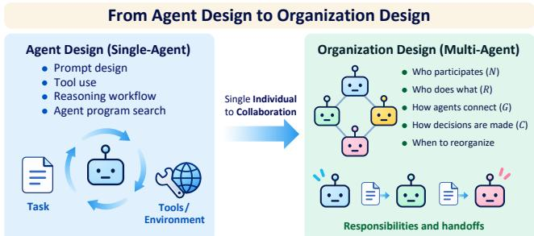
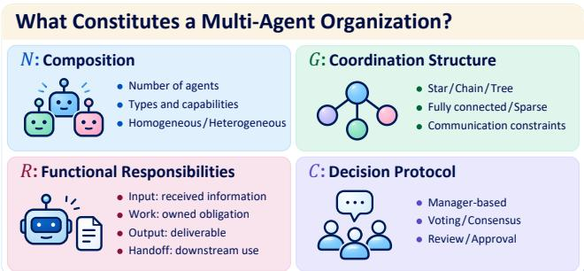
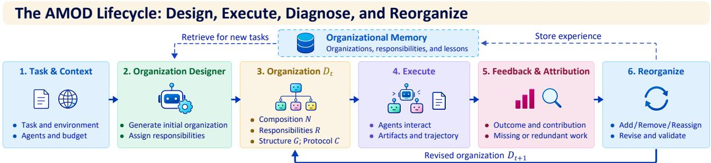

# Automated Multi-Agent Organization Design: From Architecture Search to Organizational Learning

Shao-Jun Xia   
Duke University   
Durham, United States   
shaojun.xia@duke.edu   
Di Wang†   
Foxconn   
Milwaukee, United States   
di.wang@foxconn.com

Yuner Zhang∗ Carnegie Mellon University Pittsburgh, United States yunerz@andrew.cmu.edu

Yifan Jiang University of Southern California Los Angeles, United States yifjia@isi.edu

Huixin Zhang† Texas A&M University College Station, United States zhanghui21@tamu.edu

Liangxi Liu†   
Northeastern University   
Boston, United States   
liu.liangx@northeastern.edu

## Abstract

Agentic system design is increasingly shifting from hand-crafted prompts and workflows toward automated search over agentic pro grams and interaction structures, with multi-agent systems receiving growing attention. Yet a central question remains unresolved: when does an automatically generated multi-agent structure exhibit a functionally meaningful division of responsibility? We argue that automated multi-agent design should move beyond searching for efective architectures toward identifying which responsibilities are functionally necessary, how they should be allocated, and when they should change. To explore this, we propose Automated Multi-Agent Organization Design (AMOD), which treats organization itself as a first-class design object, explicitly modeling how agent teams are composed, what functional responsibilities the agents assume, how they coordinate, and how collective decisions are made. We formulate AMOD as an execution-driven design loop. For each task, an automated designer instantiates an organization by assigning functional responsibilities and coordination rules to a set of agents. After execution, task outcomes, intermediate artifacts, and interaction traces are examined to identify which responsibilities may be missing, duplicated, or inefective, and the organization is revised accordingly. We also propose testing discovered responsibilities by removing them, replacing them with generic roles, or changing their assignment under matched resource budgets, with complementary evaluations. AMOD provides a principled foundation for evidence-based and adaptive multi-agent organization design.

## Keywords

Multi-Agent Systems, LLM, Organizational Design, Coordination

## 1 Introduction

Recent work has begun to automate design decisions specified by hand in agentic systems. Automated Design of Agentic Systems (ADAS) treats the agentic program as an object of search, allowing a meta-agent to generate and improve reasoning procedures, tool use, workflows, and their combinations [1]. For multi-agent systems, the design problem also concerns how agents divide work and interact. Methods now search over computational graphs [2], querydependent architectures [3], team composition and communication structures [4, 5], and evolving roles and interactions [6]. These choices can improve task performance and resource use, but aggregate outcomes alone do not identify which organizational functions account for the gains. Fig. 1 summarizes the shift from designing the computation of a single agent to organizing collaboration.

  
Figure 1: From agent design to organization design. AMOD jointly designs team composition, functional responsibilities, coordination, collective decisions, and adaptation.

Separately, automated failure attribution [7], trajectory-level credit assignment [8], and contribution attribution [9] provide evidence about execution. Other work revises roles from traces [10], adapts roles and interactions during inference [6], or compares organizational variables under controlled settings [11]. These advances leave open which comparisons can establish the value of a responsibility suggested by execution evidence. Addressing this gap requires an organizational view of multi-agent systems. A workflow specifies how computation and information flow, but may leave the obligation of each agent implicit. An organizational view represents participating agents together with their functional responsibilities, coordination mechanisms, and decision procedures, consistent with longstanding multi-agent organization research [12, 13]. Making responsibility explicit provides a unit that can be examined, reassigned, removed, or compared under controlled conditions.

We formulate Automated Multi-Agent Organization Design (AMOD) as the problem of automatically constructing, evaluating, and revising organizations around explicit functional responsibilities. Code-level search such as ADAS [1] can already express organizational designs, but AMOD makes their functional obligations and validation conditions explicit. AMOD asks whether multiple agents are needed, how functions should be allocated and coordinated, and what should change when execution reveals missing, redundant, or inefective functions. Evidence for functional necessity comes from measurable degradation when a function is removed or altered, relative to explicitly specified, budget-matched alternatives. Such a claim is conditional on the tested task, agents, and alternatives. AMOD considers how to form and maintain useful organizations as tasks, agent populations, and environments change. Execution, diagnosis, and revision address the current organization, while experience from earlier tasks may inform later designs. We use responsibility discovery and validation as a tractable entry point, asking whether functional divisions of labor add value beyond what additional agents, tokens, or samples provide.

  
Figure 2: Four organizational dimensions. Responsibilities de fine executable functions. Identical communication structures can support diferent responsibilities and decision protocols.

## 2 What Constitutes a Multi-Agent Organization?

Since AMOD treats the organization itself as a design object, organi zational design choices must be represented explicitly. As illustrated in Fig. 2, we represent an organization as

$$
\begin{array} { r } { D = ( N , G , R , C ) , } \end{array}\tag{1}
$$

where � is the set of participating agent instances, with team size $n = | N |$ and a composition specified by their capabilities; � is the coordination structure through which agents communicate; � records functional responsibilities and their agent assignments; and � specifies how outputs are combined, conflicts resolved, and collective decisions made [12, 13]. The dimensions are not independent, as � constrains feasible structures � and assignments �. In practice, � may be a star, chain, or tree [14], a fully connected debate [15], or a sparse graph [16]. And � turns partial results into a collective outcome through manager decisions [14, 17], voting or consensus [15], or review and approval [18]. The same coordination structure can support diferent responsibilities and decision protocols, and thus diferent organizations (Fig. 2).

The responsibility component � is central here. It pairs each responsibility specification � with an assigned agent � ∈ �. The specification records inputs, obligation, deliverable, recipient, and completion condition, beyond a label such as Planner or Coder. In a software task, for example, an interface-coordination responsibility returns compatibility checks or repair requirements before component integration. Its function, the work it is meant to contribute to the organization, can be checked, reassigned, or replaced independently of its executor. Task ownership and handof obligations belong to �, whereas � supplies the interaction channels. For a fixed available population, a designer �� with parameters � proposes $D ^ { * } = \pi _ { \theta } ( x )$ for task $x ,$ including both the participating agents and their organization. We allow $n = 1$ , so that the designer must determine whether collaboration is needed. This compact core leaves fine-grained information access, authority, organizational memory, and runtime adaptation outside the immediate representation. We focus first on discovering a useful division of functional responsibility, and Sec. 6 considers how the design problem changes when these further choices are included.

## 3 Discovering and Validating Functional Responsibilities

Generating an organization does not establish the value of its responsibilities, as a new responsibility may fill a coordination gap or merely duplicate existing work. Comparisons with strong singleagent and repeated-sampling baselines must control resources to distinguish organizational benefits from gains due to additional computation [19–21]. Responsibility-level comparisons share execution budget caps and access to information and tools, with calls, tokens, samples, and latency reported. Latency is an outcome, not a matching constraint. Comparisons of complete designers additionally count proposal, diagnosis, revision, and validation calls used to select responsibilities. Budget released by removing a responsibility can be reallocated within the organization or used for repeated sampling.

We hold models and tools fixed within each comparison, although failures may still reflect agent capability, as discussed in Sec. 6. Given task � and organization $D _ { t } = \left( N _ { t } , G _ { t } , R _ { t } , C _ { t } \right)$ at design iteration �, execution yields a trajectory $\tau _ { t } = \mathrm { E x e c u t e } ( x , D _ { t } )$ of outputs, messages, tool calls, artifacts, and environmental feedback (Fig. 3). Contrasting traces can suggest specialist roles [10], and contribution attribution can identify agents supporting valuable outcomes [9]. These observations motivate hypotheses about missing functions. Failed components, downstream artifact use, duplicated work, and blocked handofs provide evidence for a revision:

$$
D _ { t + 1 } = \mathrm { R e o r g a n i z e } ( D _ { t } , \tau _ { t } , z _ { t } ) ,\tag{2}
$$

where $z _ { t }$ denotes diagnostic evidence used to justify the change, such as failed observable checks, coordination problems, or estimated contributions.

Consider two agents whose local implementations pass observable checks but whose merged solution fails an observable integration check because of incompatible interface assumptions. The designer proposes an interface-coordination responsibility $r ^ { * }$ that compares the interfaces and returns repair requirements before integration. Its inputs are the components and their interface requirements, and its deliverable identifies incompatible assumptions for the integrating agents. Completion means checking each shared interface and stating any required repairs, rather than producing another feature. Assigning it to an existing agent $a ^ { * } \in N _ { t }$ gives $R _ { t + 1 } = R _ { t } \cup \{ ( r ^ { * } , a ^ { * } ) \}$ without increasing team size.

Validation compares $D _ { t + 1 }$ with removal, generic-role replacement, and reassignment variants, rerunning all conditions from the same initial task state with the same available feedback. Removal tests the value of the function, generic-role replacement tests whether the explicit responsibility specification adds value, and reassignment tests executor suitability. Trajectory analysis must distinguish a removed function from one taken over by another agent. Similarly, if a generic reviewer performs the same checks, it supplies a substitute implementation rather than showing that checking is unnecessary. A loss after reassignment may reflect a mismatch between the agent and the responsibility. These tests support retaining �∗ only within the conditions and alternatives examined. They may also support merging responsibilities or using no explicit coordination. Responsibility-level tests keep �, �, and � fixed where possible. If removing a function requires changing the coordination structure or a decision rule, the result concerns a joint intervention and cannot be attributed to � alone.

  
Figure 3: The AMOD lifecycle. Task context guides design, while execution and attribution motivate reorganization. Solid arrows track task-level revision, while dashed arrows show future retention and retrieval of experience across tasks.

## 4 A Tractable Research Program

The proposed evaluation uses benchmarks as task, tool, and evaluator interfaces, and AMOD chooses $\boldsymbol { D } = ( N , G , R , C )$ on top of them. It separately assesses task performance, responsibility-level efects, and design quality with models and tools fixed. The first three environments in Table 1 form the main program, while the others probe information distribution, role isolation, and coordination.

Controlled diagnosis and revision. MARBLE, the evaluation framework accompanying MultiAgentBench [14], supplies task assignment, execution traces, and coordination structures. Here AMOD varies � while keeping task rules, tool and information access, and models fixed, and compares otherwise matched designers that receive trace-informed or score-only feedback, to test whether richer feedback improves organizational revision.

Responsibility discovery and validation. CooperBench [22] supplies repository-grounded feature pairs whose implementations may interact or conflict. We propose a joint-task adaptation in which the designer receives the requirements of both features and chooses responsibilities and integration procedures. Every method submits one final patch against the same hidden feature tests, and the benchmark runner performs no repair. All baselines receive identical requirements and tool access and use this evaluator. This difers from the published cooperative setting, in which agents implement separate features and their patches are merged before testing, so the published scores are not directly comparable. The responsibility-level interventions then examine the functions in the resulting organization. Development and evaluation are split by repository. Designer parameters and revision rules are frozen before held-out evaluation, although within-task changes to $D _ { t }$ remain allowed using observable feedback. Prior experience is not retrieved, and hidden tests are used only for final scoring.

Cross-domain design procedure. ChinaTravel [23] difers from CooperBench in inputs, tools, and output format. With the representation, designer parameters, revision procedure, and budget fixed, AMOD must generate planning responsibilities rather than reuse coding roles. The benchmark adapter only exposes tools and formats itineraries, without planning or repair. The test is whether the procedure discovers useful divisions, such as parallel transport and lodging planning with shared time and budget checks, validated through removal and replacement.

Baselines and measures. Comparisons include a strong single agent, a single agent given the same responsibility specifications and workflow [20], budget-matched repeated sampling [26, 27], fixed coordination structures, manually designed heterogeneous teams, and automated multi-agent system designers. These comparisons ask whether trajectory evidence improves design over scores alone, whether explicit responsibilities outperform generic alternatives, and whether the complete designer outperforms a strong single agent after accounting for design costs. Task scores are complemented by measures of duplicated work, handof success, and artifact use. Inference cost, latency, communication volume, and search overhead are also reported. When the designer repeatedly selects � = 1, budget-matched comparisons with multi-agent baselines assess whether collaboration would have improved outcomes on those tasks. Repeated executions on the same instances give paired diferences and uncertainty estimates. Trace-informed designers share the same observation interfaces and revision budget. A feedback ablation holds the designer and budget fixed while restricting feedback to observable scalar scores. Search stops when the budget is exhausted or no tested candidate improves the task metric, using development-set metrics during development and only observable checks on held-out tasks. Rejected proposals and validation used for selection count toward design cost, while repetitions used only for final statistical analysis are reported separately.

## 5 Related Work

Organizations. Classical work formalizes task allocation [28], searches organizational structures [12, 13, 29], and specifies roles, norms, and permissions [30, 31]. Foundation-model frameworks implement prescribed roles and conversations [17, 32, 33]. AMOD builds on this view while asking how execution evidence can motivate new functions and how interventions can test their value.

Optimization targets. The survey by Madžar and Mekterović [34] distinguishes prompt, compound-system, workflow, modular, and code-level search. APE [35] generates and selects instructions, OPRO [36] uses scored candidates, ProTeGi [37] uses textual gradients, and EvoPrompt [38] uses evolutionary operators. DSPy [39] and MIPRO [40] optimize compound language model programs, while TextGrad [41] and Trace [42] use richer feedback across computation steps. Other methods search workflows and graphs [2, 43, 44], modular architectures [3, 45, 46], agent code [1, 47, 48], populations [49], and topologies [4, 5]. These targets describe what can change but do not by themselves establish the functional necessity of the resulting responsibilities.

Table 1: Complementary evaluation environments for AMOD. Some proposed comparisons require adapted benchmark runners.
<table><tr><td>Testbed</td><td>What is primarily fixed</td><td>What can vary</td><td>Primary relevance to AMOD</td></tr><tr><td>MultiAgentBench [14]</td><td>Task setting and evaluator</td><td>Coordination topology and interaction strategy</td><td>Controlled diagnosis and organizational revision</td></tr><tr><td>CooperBench [22]</td><td>Repository tasks, tools, and tests</td><td>Team composition and functional responsibilities</td><td>Responsibility discovery and validation</td></tr><tr><td>ChinaTravel [23]</td><td>Task interface and evaluator</td><td>Task-specific responsibilities and coordination</td><td>Cross-domain transfer of the design procedure</td></tr><tr><td>SILO-BENCH [24]</td><td>Task generator and per-agent shard size</td><td>Agent scale and communication protocol</td><td>Information distribution and scalability under silos</td></tr><tr><td>TeamBench [18]</td><td>Role boundaries and task environment</td><td>Presence or removal of functional roles</td><td>Responsibility isolation and role-level ablation</td></tr><tr><td>CoCoBench [25]</td><td>Task instances and number of agents</td><td>Coordination mechanisms</td><td>Allocation, ordering, mutual exclusion, and handoff</td></tr></table>

Evidence and adaptation. Attribution methods localize failures and estimate contributions [7–9]. Lu et al. [50] show that agent contribution estimates depend on the intervention protocol, coali tion distribution, and evaluation objective. ABSTRAL [10] derives specialists from contrasting traces, and MetaGen [6] adapts roles and interactions during inference. MANTA [51] audits collaboration traces, applies bounded structural repairs, and accumulates experience across runs. Organizational studies separate design factors [11], and cost-aware evaluation motivates strong resourcematched baselines [19–21, 52]. Agent memory architectures [53] and multi-agent memory perspectives [54] inform our discussion of organizational memory in Sec. 6. AMOD uses attribution to propose functions, budget-matched interventions to assess the conditional value of specified responsibilities, and validated cases as candidates for organizational memory.

## 6 Toward Adaptive and Cumulative Organizations

The program above studies a tractable part of AMOD, namely organization design for a particular task and agent population. A broader account must address accumulated experience, changing capabilities, and organizational constraints beyond communication structure. A configuration may cease to be useful as these condi tions change. The design problem therefore includes deciding which responsibilities to retain, revise, or discard, and which lessons from earlier executions should inform later tasks.

Organizational memory. A designer could retain useful organizations and revision evidence, building on prior work on reusable design knowledge [10, 51]. A retained case should record task conditions, responsibility specifications, intervention outcomes, and budget, so that the designer can check whether the conditions supporting its value hold in the new setting. A transferable lesson can specify which assumptions require joint checking, such as interface compatibility in software or shared time and budget constraints in travel planning. This is more general than a domain-specific role name. Conflicting or outdated cases require revision, and a failed trajectory alone should not become a general design rule. On held-out CooperBench repositories, cold-start and retrievalassisted design can be compared by success rate, revision count, and cost, using memory built from development repositories and frozen before evaluation. Retrieved responsibilities are revalidated under changed conditions. Memory is enabled in this separate reuse experiment, not in the primary evaluation of Sec. 4.

Changing agent populations. A team with a strong verifier and weak implementers may need a diferent allocation from a team of strong specialists, and roles can change during inference [6]. A designer may thus condition on task �, population �, environment �, and experience �, giving $D ^ { * } = \pi _ { \theta } ( x , P , E , H )$ . Generalization can be tested by replacing one member while keeping tasks and tools fixed, and comparing the original allocation, reassignment, and redesign. If a responsibility remains useful after reassignment, its value is less tied to one particular executor, whereas persistent failure of the replacement agent across allocations would suggest a capability limitation rather than a missing organizational function. The tests can also vary communication cost or available resources.

Authority and institutional constraints. Agents acting on tools and shared state may modify resources, approve results, delegate tasks, or block actions of other agents. Electronic institutions model such roles, norms, and permissions [31]. Design must then decide who should perform a function, who may perform it, and who must verify or approve the result. For example, an interface checker may request a repair without authority to edit shared code, so approval and implementation remain separate responsibilities.

When organization is unnecessary. Coordination can cost more than specialization saves for weakly coupled subtasks. Deciding this is hard, since failures may reflect weak models, successes may hide redundant agents, and incorrect diagnoses may contaminate memory. Knowing when not to organize matters as much as organizing better.

Across these extensions, the reusable object is a tested relation between task conditions, a function, and its allocation. Its value must be checked again when the agent population or operating constraints change.

## 7 Conclusion

In this paper, we have introduced AMOD, a framework that treats functional responsibilities as explicit and testable components of multi-agent organization. AMOD uses execution evidence to propose organizational revisions and evaluates them through budgetmatched removal, generic-role replacement, and reassignment tests. These interventions help distinguish gains attributable to a particular responsibility from those produced by additional agents or computation, while revealing when a simpler or single-agent solution is suficient. By retaining the conditions and evidence associated with validated responsibilities, the framework can further support organizational learning as tasks, agent capabilities, and resource constraints change. AMOD thus moves automated multiagent design beyond architecture search toward evidence-based divisions of labor.

## References

[1] Shengran Hu, Cong Lu, and Jef Clune. Automated design of agentic systems. In International Conference on Learning Representations, volume 2025, pages 21344– 21377, 2025.

[2] Mingchen Zhuge, Wenyi Wang, Louis Kirsch, Francesco Faccio, Dmitrii Khizbullin, andJürgen Schmidhuber. GPTSwarm: Language agents as optimizable graphs. In Proceedings of the 41st International Conference on Machine Learning, volume 235 of Proceedings of Machine Learning Research, pages 62743–62767. PMLR, 2024.

[3] Guibin Zhang, Luyang Niu, Junfeng Fang, Kun Wang, Lei Bai, and Xiang Wang. Multi-agent architecture search via agentic supernet. In Proceedings ofthe 42nd International Conference on Machine Learning, volume 267 of Proceedings ofMachine Learning Research, pages 75834–75852. PMLR, 2025.

[4] Han Zhou, Xingchen Wan, Ruoxi Sun, Hamid Palangi, Shariq Iqbal, Ivan Vulić, Anna Korhonen, and Sercan Ö. Arık. Multi-agent design: Optimizing agents with better prompts and topologies. In International Conference on Learning Representations, volume 2026, pages 15844–15872, 2026.

[5] Shiyuan Li, Yixin Liu, Qingsong Wen, Chengqi Zhang, and Shirui Pan. Assemble your crew: Automatic multi-agent communication topology design via autoregressive graph generation. Proceedings ofthe AAAI Conference on Artificial Intelligence, 40(28):23142–23150, 2026. doi: 10.1609/aaai.v40i28.39481.

[6] Yimeng Wang, Jiaxing Zhao, Hongbin Xie, Hexing Ma, Yuzhen Lei, Shuangxue Liu, Xuan Song, Zichen Zhang, and Haoran Zhang. MetaGen: Self-evolving roles and topologies for multi-agent LLM reasoning. arXiv preprint arXiv:2601.19290, 2026. doi: 10.48550/arXiv.2601.19290.

[7] Shaokun Zhang, Ming Yin, Jieyu Zhang, Jiale Liu, Zhiguang Han, Jingyang Zhang, Beibin Li, Chi Wang, Huazheng Wang, Yiran Chen, and Qingyun Wu. Which agent causes task failures and when? On automated failure attribution of LLM multi-agent systems. In Proceedings of the 42nd International Conference on Machine Learning, volume 267 of Proceedings of Machine Learning Research, pages 76583–76599. PMLR, 2025.

[8] Bin Wu, Haoran Xu, Xiang Zhuang, Zonghao Chen, Zhu Li, Emine Yilmaz, and Qiang Zhang. From interaction trajectories to prompt rules: Credit assignment for multi-agent prompt optimization. In Proceedings of the 43rd International Conference on Machine Learning, volume 306 of Proceedings ofMachine Learning Research, pages 137252–137271. PMLR, 2026.

[9] Pengyi Jiang, Xiaoguang Zhu, and Quanyan Zhu. Semantic cooperative games for contribution attribution in LLM-based multi-agent systems. arXiv preprint arXiv:2607.18255, 2026. doi: 10.48550/arXiv.2607.18255.

[10] Weijia Song, Jiashu Yue, and Zhe Pang. ABSTRAL: Automatic design of multiagent systems through iterative refinement and topology optimization. arXiv preprint arXiv:2603.22791, 2026. doi: 10.48550/arXiv.2603.22791.

[11] Huan Chen, Xiang Song, Jian Jin, Pan Ren, and Liang-Jie Zhang. Toward an organizational science of multi-agent LLM systems: Decoupling who, how, and which algorithm. arXiv preprint arXiv:2607.25446, 2026. doi: 10.48550/arXiv.2607. 25446.

[12] Bryan Horling and Victor Lesser. A survey of multi-agent organizational paradigms. The Knowledge Engineering Review, 19(4):281–316, 2004. doi: 10.1017/S0269888905000317.

[13] Bryan Horling and Victor Lesser. Using quantitative models to search for appropriate organizational designs. Autonomous Agents and Multi-Agent Systems, 16 (2):95–149, 2008. doi: 10.1007/s10458-007-9020-y.

[14] Kunlun Zhu, Hongyi Du, Zhaochen Hong, Xiaocheng Yang, Shuyi Guo, Zhe Wang, Zhenhailong Wang, Cheng Qian, Xiangru Tang, Heng Ji, and Jiaxuan You. MultiAgentBench: Evaluating the collaboration and competition of LLM agents. In Proceedings of the 63rd Annual Meeting of the Association for Computational Linguistics (Volume 1: Long Papers), pages 8580–8622. Association for Computational Linguistics, 2025. doi: 10.18653/v1/2025.acl-long.421.

[15] Yilun Du, Shuang Li, Antonio Torralba, Joshua B. Tenenbaum, and Igor Mordatch. Improving factuality and reasoning in language models through multiagent debate. In Proceedings of the 41st International Conference on Machine Learning, volume 235 of Proceedings of Machine Learning Research, pages 11733–11763. PMLR, 2024.

[16] Guibin Zhang, Yanwei Yue, Zhixun Li, Sukwon Yun, Guancheng Wan, Kun Wang, Dawei Cheng, Jefrey Xu Yu, and Tianlong Chen. Cut the crap: An economical communication pipeline for LLM-based multi-agent systems. In International Conference on Learning Representations, volume 2025, pages 75389–75428, 2025.

[17] Qingyun Wu, Gagan Bansal, Jieyu Zhang, Yiran Wu, Beibin Li, Erkang Zhu, Li Jiang, Xiaoyun Zhang, Shaokun Zhang, Jiale Liu, Ahmed Awadallah, Ryen W. White, Doug Burger, and Chi Wang. AutoGen: Enabling next-gen LLM appli cations via multi-agent conversations. In Conference on Language Modeling, 2024.

[18] Yubin Kim, Chanwoo Park, Taehan Kim, Eugene Park, Samuel Schmidgall, Salman Rahman, Chunjong Park, Cynthia Breazeal, Xin Liu, Hamid Palangi, Hae Won Park, and Daniel McDuf. TeamBench: Evaluating agent coordination under enforced role separation. arXiv preprint arXiv:2605.07073, 2026. doi: 10.48550/ arXiv.2605.07073.

[19] Prathyusha Jwalapuram, Hehai Lin, Chuyuan Li, Fangkai Jiao, Sudong Wang, Yifei Ming, Zixuan Ke, Chengwei Qin, Giuseppe Carenini, and Shafiq Joty. The illusion of multi-agent advantage. arXiv preprint arXiv:2606.13003, 2026. doi: 10.48550/arXiv.2606.13003.

[20] Jiawei Xu, Arief Koesdwiady, Sisong Bei, Yan Han, Baixiang Huang, Dakuo Wang, Yutong Chen, Zheshen Wang, Peihao Wang, Pan Li, and Ying Ding. Rethinking the value of multi-agent workflow: A strong single agent baseline. arXiv preprint arXiv:2601.12307, 2026. doi: 10.48550/arXiv.2601.12307.

[21] David Dylan, Aoife Brennan, Cian Murphy, Niamh O’Sullivan, Conor Kelly, and Saoirse Walsh. At equal inference cost, multi-agent structure does not beat a single frozen agent. arXiv preprint arXiv:2609.04217, 2026. doi: 10.48550/arXiv. 2609.04217.

[22] Arpandeep Khatua, Hao Zhu, Peter Tran, Arya Prabhudesai, Frederic Sadrieh, Johann K. Lieberwirth, Xinkai Yu, Yicheng Fu, Michael J. Ryan, Jiaxin Pei, and Diyi Yang. CooperBench: Why coding agents cannot be your teammates yet. In Conference on Language Modeling, 2026.

[23] Jie-Jing Shao, Bo-Wen Zhang, Xiao-Wen Yang, Baizhi Chen, Siyu Han, Jinghao Pang, Wen-Da Wei, Guohao Cai, Zhenhua Dong, Lan-Zhe Guo, and Yu-Feng Li. ChinaTravel: An open-ended travel planning benchmark with compositional constraint validation for language agents. In International Conference on Learning Representations, volume 2026, pages 96008–96060, 2026.

[24] Yuzhe Zhang, Feiran Liu, Yi Shan, Xinyi Huang, Xin Yang, Yueqi Zhu, Xuxin Cheng, Cao Liu, Ke Zeng, Terry Jingchen Zhang, and Wenyuan Jiang. SILO BENCH: A scalable environment for evaluating distributed coordination in multiagent LLM systems. In Proceedings ofthe 64th Annual Meeting ofthe Association for Computational Linguistics (Volume 1: Long Papers), pages 29379–29398. Asso ciation for Computational Linguistics, 2026. doi: 10.18653/v1/2026.acl-long.1354.

[25] Yang Chen, Ye-Xin Xie, Lirong Che, Danyang Peng, Yuzhe Yang, Peiwen Lin, Xu Cao, Chuang Wang, Lei Yuan, Jian Su, and Lan-Zhe Guo. CoCoBench: A cooperative coordination benchmark for embodied multi-agent task planning. arXiv preprint arXiv:2608.28266, 2026. doi: 10.48550/arXiv.2608.28266.

[26] Xuezhi Wang, Jason Wei, Dale Schuurmans, Quoc V. Le, Ed H. Chi, Sharan Narang, Aakanksha Chowdhery, and Denny Zhou. Self-consistency improves chain of thought reasoning in language models. In International Conference on Learning Representations, 2023.

[27] Bradley Brown, Jordan Juravsky, Ryan Ehrlich, Ronald Clark, Quoc V. Le, Christopher Ré, and Azalia Mirhoseini. Large language monkeys: Scaling inference compute with repeated sampling. arXiv preprint arXiv:2407.21787, 2024. doi: 10.48550/arXiv.2407.21787.

[28] Reid G. Smith. The contract net protocol: High-level communication and control in a distributed problem solver. IEEE Transactions on Computers, C-29(12):1104– 1113, 1980. doi: 10.1109/TC.1980.1675516.

[29] Mark Sims, Daniel Corkill, and Victor Lesser. Automated organization design for multi-agent systems. Autonomous Agents and Multi-Agent Systems, 16(2):151–185, 2008. doi: 10.1007/s10458-007-9023-8.

[30] Jomi Fred Hübner, Jaime Simão Sichman, and Olivier Boissier. A model for the structural, functional, and deontic specification of organizations in multiagent systems. In Advances in Artificial Intelligence: SBIA 2002, volume 2507 of Lecture Notes in Computer Science, pages 118–128. Springer, 2002. doi: 10.1007/3-540- 36127-8\_12.

[31] Carles Sierra, Juan A. Rodríguez-Aguilar, Pablo Noriega Blanco-Vigil, Josep-Lluís Arcos-Rosell, and Marc Esteva-Vivancos. Engineering multi-agent systems as electronic institutions. The European Journal for the Informatics Professional, 5(4): 33–39, 2004.

[32] Sirui Hong, Mingchen Zhuge, Jonathan Chen, Xiawu Zheng, Yuheng Cheng, Ceyao Zhang, Jinlin Wang, Zili Wang, Steven Yau, Zijuan Lin, Liyang Zhou, Chenyu Ran, Lingfeng Xiao, Chenglin Wu, and Jürgen Schmidhuber. MetaGPT: Meta programming for a multi-agent collaborative framework. In International Conference on Learning Representations, volume 2024, pages 23247–23275, 2024.

[33] Chen Qian, Wei Liu, Hongzhang Liu, Nuo Chen, Yufan Dang, Jiahao Li, Cheng Yang, Weize Chen, Yusheng Su, Xin Cong, Juyuan Xu, Dahai Li, Zhiyuan Liu, and Maosong Sun. ChatDev: Communicative agents for software development. In Proceedings ofthe 62nd Annual Meeting ofthe Association for Computational Linguistics (Volume 1: Long Papers), pages 15174–15186. Association for Compu tational Linguistics, 2024. doi: 10.18653/v1/2024.acl-long.810.

[34] Maksim Madžar and Igor Mekterović. Automated design of agentic systems: A survey of algorithms for searching, optimizing, and evolving LLM agents, workflows, and prompts. Preprints, 2026. doi: 10.20944/preprints202606.0238.v1.

[35] Yongchao Zhou, Andrei Ioan Muresanu, Ziwen Han, Keiran Paster, Silviu Pitis, Harris Chan, and Jimmy Ba. Large language models are human-level prompt engineers. In International Conference on Learning Representations, 2023.

[36] Chengrun Yang, Xuezhi Wang, Yifeng Lu, Hanxiao Liu, Quoc V. Le, Denny Zhou, and Xinyun Chen. Large language models as optimizers. In International Conference on Learning Representations, volume 2024, pages 12028–12068, 2024.

[37] Reid Pryzant, Dan Iter, Jerry Li, Yin Tat Lee, Chenguang Zhu, and Michael Zeng. Automatic prompt optimization with “gradient descent” and beam search. In Proceedings of the 2023 Conference on Empirical Methods in Natural Language Processing, pages 7957–7968. Association for Computational Linguistics, 2023.

doi: 10.18653/v1/2023.emnlp-main.494.

[38] Qingyan Guo, Rui Wang, Junliang Guo, Bei Li, Kaitao Song, Xu Tan, Guoqing Liu, Jiang Bian, and Yujiu Yang. Connecting large language models with evolutionary algorithms yields powerful prompt optimizers. In International Conference on Learning Representations, volume 2024, pages 34133–34156, 2024.

[39] Omar Khattab, Arnav Singhvi, Paridhi Maheshwari, Zhiyuan Zhang, Keshav Santhanam, Sri Vardhamanan A, Saiful Haq, Ashutosh Sharma, Thomas Joshi, Hanna Moazam, Heather Miller, Matei Zaharia, and Christopher Potts. DSPy: Compiling declarative language model calls into state-of-the-art pipelines. In International Conference on Learning Representations, volume 2024, pages 54928– 54958, 2024.

[40] Krista Opsahl-Ong, Michael J. Ryan, Josh Purtell, David Broman, Christopher Potts, Matei Zaharia, and Omar Khattab. Optimizing instructions and demonstrations for multi-stage language model programs. In Proceedings ofthe 2024 Conference on Empirical Methods in Natural Language Processing, pages 9340–9366. Association for Computational Linguistics, 2024. doi: 10.18653/v1/2024.emnlpmain.525.

[41] Mert Yuksekgonul, Federico Bianchi, Joseph Boen, Sheng Liu, Pan Lu, Zhi Huang, Carlos Guestrin, and James Zou. Optimizing generative AI by backpropagating language model feedback. Nature, 639(8055):609–616, 2025. doi: 10.1038/s41586- 025-08661-4.

[42] Ching-An Cheng, Allen Nie, and Adith Swaminathan. Trace is the next AutoDif: Generative optimization with rich feedback, execution traces, and LLMs. In Advances in Neural Information Processing Systems, volume 37, pages 71596– 71642, 2024. doi: 10.52202/079017-2287.

[43] Jiayi Zhang, Jinyu Xiang, Zhaoyang Yu, Fengwei Teng, Xionghui Chen, Jiaqi Chen, Mingchen Zhuge, Xin Cheng, Sirui Hong, Jinlin Wang, Bingnan Zheng, Bang Liu, Yuyu Luo, and Chenglin Wu. AFlow: Automating agentic workflow generation. In International Conference on Learning Representations, volume 2025, pages 34040–34077, 2025.

[44] Yinjie Wang, Ling Yang, Guohao Li, Mengdi Wang, and Bryon Aragam. ScoreFlow: Mastering LLM agent workflows via score-based preference optimization. arXiv preprint arXiv:2502.04306, 2025. doi: 10.48550/arXiv.2502.04306.

[45] Yu Shang, Yu Li, Keyu Zhao, Likai Ma, Jiahe Liu, Fengli Xu, and Yong Li. AgentSquare: Automatic LLM agent search in modular design space. In International Conference on Learning Representations, volume 2025, pages 3841–3865, 2025.

[46] Jon Saad-Falcon, Adrian Gamarra Lafuente, Shlok Natarajan, Nahum Maru, Hristo Todorov, Etash Kumar Guha, E. Kelly Buchanan, Mayee F. Chen, Neel Guha,

Christopher Ré, and Azalia Mirhoseini. An architecture search framework for inference-time techniques. In Proceedings ofthe 42nd International Conference on Machine Learning, volume 267 of Proceedings of Machine Learning Research, pages 52475–52507. PMLR, 2025.

[47] Xunjian Yin, Xinyi Wang, Liangming Pan, Li Lin, Xiaojun Wan, and William Yang Wang. Gödel Agent: A self-referential agent framework for recursively selfimprovement. In Proceedings ofthe 63rd Annual Meeting ofthe Association for Computational Linguistics (Volume 1: Long Papers), pages 27890–27913. Association for Computational Linguistics, 2025. doi: 10.18653/v1/2025.acl-long.1354.

[48] Jenny Zhang, Shengran Hu, Cong Lu, Robert Lange, and Jef Clune. Darwin Gödel Machine: Open-ended evolution of self-improving agents. In International Conference on Learning Representations, volume 2026, pages 104223–104294, 2026.

[49] Siyu Yuan, Kaitao Song, Jiangjie Chen, Xu Tan, Dongsheng Li, and Deqing Yang. EvoAgent: Towards automatic multi-agent generation via evolutionary algorithms. In Proceedings of the 2025 Conference of the Nations of the Americas Chapter ofthe Association for Computational Linguistics: Human Language Technologies (Volume 1: Long Papers), pages 6192–6217. Association for Computational Linguistics, 2025. doi: 10.18653/v1/2025.naacl-long.315.

[50] Mingyu Lu, Yushan Huang, Chris Lin, and Su-In Lee. Agents that matter: How subtle choices shape agent attribution in multi-agent systems. arXiv preprint arXiv:2605.27621, 2026. doi: 10.48550/arXiv.2605.27621.

[51] Mao-xun Huang, Jerry Wang, Yi-Cheng Lai, Zhengxin Zhang, Claire Cardie, and Hen-Hsen Huang. MANTA: Multi-agent network topology adaptation for self-evolving multi-agent systems. arXiv preprint arXiv:2607.28527, 2026. doi: 10.48550/arXiv.2607.28527.

[52] Sayash Kapoor, Benedikt Stroebl, Zachary S. Siegel, Nitya Nadgir, and Arvind Narayanan. AI agents that matter. Transactions on Machine Learning Research, 2025.

[53] Joon Sung Park, Joseph O’Brien, Carrie Jun Cai, Meredith Ringel Morris, Percy Liang, and Michael S. Bernstein. Generative agents: Interactive simulacra of human behavior. In Proceedings ofthe 36th Annual ACM Symposium on User Interface Software and Technology, pages 1–22. Association for Computing Machinery, 2023. doi: 10.1145/3586183.3606763.

[54] Zhongming Yu, Naicheng Yu, Hejia Zhang, Wentao Ni, Mingrui Yin, Jiaying Yang, Yujie Zhao, and Jishen Zhao. Multi-agent memory from a computer architecture perspective: Visions and challenges ahead. arXiv preprint arXiv:2603.10062, 2026. doi: 10.48550/arXiv.2603.10062.