# BEYOND 4 BITS: DATA-CENTRIC POST-TRAINING QUANTIZATION AND RECOVERY

Rhea Sanjay Sukthanker1 Riccardo Grazzi2 James Hensman2 Pashmina Cameron1

1Applied Sciences Group (ASG), Microsoft 2Microsoft Research

rsukthanker@microsoft.com riccardo.grazzi.4@gmail.com jameshensman@microsoft.com pcameron@microsoft.com

## ABSTRACT

Post-training quantization (PTQ) compresses the weights of a trained model with limited compute and data. Down to 4 bits it is near-lossless, but at 2 bits scalar PTQ configurations fall to chance-level accuracy. We study three choices usually treated as implementation details that matter little at 4 bits but decide 2-bit quality: the quantization representation, the calibration data, and the recovery fine-tuning data, across six dense and mixture-of experts models (ranging from 3.8 to 32B parameters). Representation is the largest factor and vector codebooks restore usable models where scalar PTQ pipelines collapse. Most of the remaining loss in accuracy is on generative tasks, and the amount of performance drop is modeldependent. Furthermore, at a short recovery budget, calibration and recovery data are coupled. The best recovery data depends on the calibration data, so the two must be chosen jointly. The resulting recipe involves a vector codebook representation, a small task-aligned calibration mixture, and an inexpensive codebook-only recovery stage. Including codebooks, it uses about 2.3 effective bits per weight and retains 89 to 97% of full-precision question-answering (QA) accuracy where scalar PTQ is at chance, and, including recovery, uses 1.4 to 30× less compute than the strongest quantization-aware-training (QAT) baseline.

## 1 INTRODUCTION

Post-training quantization (PTQ) is standard for serving large language models under tight memory budgets. At 4 bits (W4A16: 4-bit weights, 16-bit activations), it costs only a few accuracy points (Frantar et al., 2023; Lin et al., 2024; Shao et al., 2024; Ashkboos et al., 2024; Liu et al., 2025b). At 2 bits, scalar PTQ falls to chance-level accuracy (Egiazarian et al., 2024; Chee et al., 2023; Liu et al., 2024a; Figure 1a), and quantized reasoning models can overthink and loop (Lotfi et al., 2026). Richer codebooks (Van Baalen et al., 2024; Liu et al., 2024a; Egiazarian et al., 2024; Tseng et al., 2024a) or learned quantization (Liu et al., 2024b; Du et al., 2024; Dadgarnia et al., 2026) trade compute for quality, yet 2-bit models still lag their 4-bit counterparts.

Three choices usually treated as implementation details govern 2-bit quality: the quantization representation, the calibration data that shape quantization, and the recovery data used to fine-tune the quantized model. They matter little at 4 bits but become consequential below 4 bits, where calibration and recovery data also interact, so tuning them separately can be misleading. We study 2-bit quantization and recovery across six dense and mixture-of-experts (MoE) models (3.8 to 32B parameters) and propose an actionable recipe (Section 5) for low-budget 2-bit quantization. Our primary observations are:

• Representation dominates at 2 bits. Every scalar PTQ pipeline we test falls to random chance-level, while vector PTQ at ∼2.3 effective bits keeps 89–97% of a full-precision model’s question-answering accuracy without training, using 39–304× less compute than trained scalar methods (Table 4).

• Loss of reasoning ability is model-dependent. Question-answering retention is similar across models, but HumanEval (codegen) retention spans 45% (Phi-4-mini, Qwen3-8B) to 81% (Qwen3-MoE), tracking the model and its scale more than the quantizer (Figure 4).

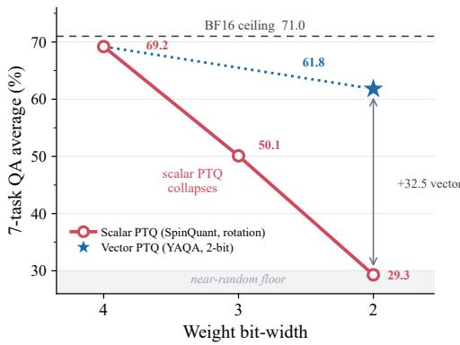  
(a) The 2-bit cliff.

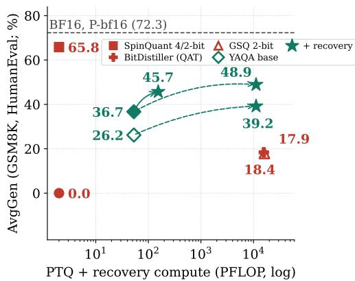  
(b) Recovery improves generation.  
Figure 1: Phi-4-mini at 2 bits. (a) Scalar PTQ (SpinQuant, Liu et al., 2025b) falls to the random floor on question-answering (QA) tasks as bitwidth decreases; a 2-bit vector representation (YAQA, Tseng et al., 2026) stays higher. (b) Generation (AvgGen, the GSM8K/HumanEval mean) versus compute: trained scalar baselines (BitDistiller, Du et al., 2024; GSQ, Dadgarnia et al., 2026) trail no-recovery vector PTQ, and short codebook-only recovery improves generation.

• Calibration and recovery data interact. Choosing them jointly improves Phi-4-mini’s accuracy on generation tasks from 11.1% (web calibration) to 45.7% (math calibration, web recovery); the best recovery data flips with calibration on all three dense models we study (Tables 1 and 2).

The proposed recipe is a vector representation with a task-aligned calibration mixture and a short codebook-only recovery stage. With recovery, it narrows the gap to 4-bit models while using 1.4 to 30× less compute than the strongest quantization-aware-training (QAT) baseline; a cheap per-model check handles model dependence (Section 5). Upon acceptance, we will release our code, Hessian mixtures, and quantized models.

## 2 RELATED WORK

Scalar PTQ. GPTQ (Frantar et al., 2023) sets the near-lossless 4-bit weight-only baseline via approximate second-order error minimization; AWQ (Lin et al., 2024) and SmoothQuant (Xiao et al., 2023) rescale salient channels, while QuaRot (Ashkboos et al., 2024) and SpinQuant (Liu et al., 2025b) rotate weights before rounding. The scalar PTQ configurations we evaluate collapse at 2 bits without any further quantization-aware training or recovery (Section 4.4).

Vector and ultra-low-bit quantization. Codebooks give better rate-distortion below 3 bits. QuIP (Chee et al., 2023) adds incoherence processing to adaptive scalar rounding; QuIP# (Tseng et al., 2024a) pairs it with lattice codebooks and fine-tuning. AQLM, GPTVQ, VPTQ, and QTIP (Egiazarian et al., 2024; Van Baalen et al., 2024; Liu et al., 2024a; Tseng et al., 2024b) use additive, hierarchical, or trellis-coded codebooks. YAQA (Tseng et al., 2026) adds a Fisher-weighted rounding objective. Non-uniform (Kim et al., 2024) and 1-bit (Huang et al., 2024; Yuan et al., 2024; Xu et al., 2024b) methods also target lower precision to go even beyond 2-bits.

Trained scalar quantization. OmniQuant (Shao et al., 2024) learns clipping thresholds blockwise, and GSQ (Dadgarnia et al., 2026) learns scalar-grid assignments through a Gumbel-Softmax relaxation; we use GSQ as an intermediate-cost scalar baseline between PTQ and QAT.

Calibration data. PTQ usually calibrates on a few hundred C4 or WikiText-2 sequences (Frantar et al., 2023; Lin et al., 2024; Shao et al., 2024; Egiazarian et al., 2024). Calibration data affect 4-bit models (Williams & Aletras, 2024) and pruning (Bandari et al., 2024; Ji et al., 2025), and self-generated text can replace curated corpora (Williams et al., 2025). We find that calibration data effects 2-bit PTQ methods much more than on 4-bit methods and this effect is consistent across representations and recipe grids (Appendix A.6).

Evaluating quantized LLMs. Quantization costs generation, reasoning, and knowledge-intensive tasks more than perplexity or multiple-choice QA as suggested by (Jaiswal et al., 2024; Li et al., 2024a; Jin et al., 2024; Kurtic et al., 2025; Liu et al., 2025a), and robustness depends on model size and token density (Dettmers & Zettlemoyer, 2023; Kumar et al., 2025; Ouyang et al., 2025). We confirm this gap at 2 bits and show that the degradation of generation quality depends on calibration, recovery data and model-scale.

Recovery for quantized models. Distillation-based recovery (Hinton et al., 2015) narrows the quantization gap without full QAT. LLM-QAT and BitDistiller (Liu et al., 2024b; Du et al., 2024) retrain all weights; LoRA and QLoRA (Hu et al., 2022; Dettmers et al., 2023) add high-precision parameters; closest to ours, EfficientQAT (Chen et al., 2025) trains all weights block-wise, then quantization parameters end to end; ParetoQ (Liu et al., 2026) studies extremely low-bit QAT. AQLM and QuIP# fine-tune codebooks or continuous parameters after quantization. PV-Tuning (Malinovskii et al., 2024) additionally also learns discrete assignments to the codebook vectors. In this work we use codebook-only recovery and show that its best data flips with the calibration data, so the two must be chosen jointly (Section 4.2).

## 3 BACKGROUND AND METHOD

We study post-training quantization followed by recovery fine-tuning at the same format and bitwidth.

## 3.1 SCALAR AND VECTOR QUANTIZATION

Scalar quantization maps each weight to one of $2 ^ { b }$ levels, $\hat { x } = s ( q - z )$ , with integer code $q ,$ per-group scale $s ,$ and optional zero-point z. Error-aware PTQ, such as GPTQ (Frantar et al., 2023), minimizes output error on a calibration distribution X with input Hessian $H _ { X } = \mathbb { E } _ { x \sim X } [ x x ^ { \top } ]$

$$
\operatorname* { m i n } _ { \hat { W } \in Q } \mathbb { E } _ { x \sim X } \big \| ( W - \hat { W } ) x \big \| _ { 2 } ^ { 2 } = \operatorname* { m i n } _ { \hat { W } \in \mathcal { Q } } \operatorname { T r } \big [ ( W - \hat { W } ) H _ { X } ( W - \hat { W } ) ^ { \top } \big ] ,\tag{1}
$$

where $\mathcal { Q }$ is the set of representable weights. Vector quantization maps each d-dimensional subvector $w _ { i }$ to an entry of a learned codebook $\mathcal { C } = \{ c _ { k } \} _ { k = 1 } ^ { K } , \hat { w } _ { i } = c _ { a _ { i } }$ , using weight correlations that scalar grids miss. VPTQ (Liu et al., 2024a) solves Equation 1 over codebooks. Structured-curvature methods such as KronQ (Lee et al., 2026) and YAQA (Tseng et al., 2026) use Kronecker-factored full-model KL curvature and YAQA rounds onto trellis-coded sets.

Calibration mixtures. The objective depends on the data only through HX. A mixture with weights $\begin{array} { r } { \alpha _ { j } \geq 0 , \sum _ { i } \alpha _ { j } = 1 } \end{array}$ , over domains with Hessians $H _ { j }$ has $\begin{array} { r } { H _ { \alpha } = \sum _ { j } \alpha _ { j } H _ { j } } \end{array}$ would allow one to approximate the hessian for different data distributions, cheaply. We sweep mixtures by reweighting precomputed Hessians without re-collecting hessians on actual dataset mixtures; each mixture still needs its own quantization pass. For YAQA we mix the Kronecker input and output factors separately, approximating re-estimation on different dataset mixtures.

## 3.2 RECOVERY FINE-TUNING

Recovery freezes the quantized backbone and trains only quantization parameters: the codebook C with assignments fixed, or the scales s (and z). QAT backpropagates through the quantizer with a straight-through estimator (Liu et al., 2024b) and keeps optimizer state for all weights (≈ 14P bytes for P parameters). Recovery keeps the bitwidth and needs only a teacher and student $( \approx 2 \dot { P } + b P / 8$ bytes. We distill from the full-precision model with ${ \mathcal { L } } = \alpha { \mathcal { L } } _ { \mathrm { C E } } + ( 1 -$ $\alpha ) \tau ^ { 2 } \mathrm { K L } \left( \sigma ( z _ { t } / \tau ) \parallel \sigma \mathrm { ( } z _ { s } / \tau ) \right)$ , where $z _ { t }$ and $z _ { s }$ are teacher and student logits, $\sigma$ is the softmax, τ the temperature, and $\alpha { = } 0 . 5$ unless noted. Our recovery pipeline involves codebook-only recovery. In the appendix we cover alternative losses and logit truncation (Appendix A.7), a scale-only recovery scalar control (Appendix A.7), and finetuning with low-rank adapters (Hu et al., 2022; Dettmers et al., 2023; Xu et al., 2024a; Li et al., 2024b), which add half-precision parameters (Appendix A.11).

## 4 EXPERIMENTS AND RESULTS

## 4.1 EXPERIMENTAL SETUP

Models and quantizers. We evaluate Phi-4-mini (Abouelenin et al., 2025) (3.8B, instruct), Llama-3.1-8B (Grattafiori et al., 2024) (base), and Qwen3-30B-A3B (Yang et al., 2025) (reasoning MoE, ∼3B active). Qwen3-8B (reasoning) checks the calibration and recovery choices; OLMoE-1B-7B (Muennighoff et al., 2025) (instruct MoE) and Qwen3-32B (reasoning, dense) extend the comparisons to smaller MoEs and large-scale dense models, respectively. The scalar baselines we use are SpinQuant (Liu et al., 2025b) and QuaRot (Ashkboos et al., 2024) at group size 128. Furthermore, we observe that learned rotations do not help at 2 bits (Appendix A.3). The vector-quantization base lines we study are VPTQ (Liu et al., 2024a) (216-entry codebook over 8-dimensional vectors) and YAQA (Tseng et al., 2026), a Fisher-weighted trellis quantizer, both in the same incoherence-rotated frame; we report native (unrotated) VPTQ where it is stronger. We also compare vector quantization against GSQ (Dadgarnia et al., 2026) (scalar PTQ with learned assignments) and BitDistiller (Du et al., 2024) (scalar QAT). In our experiments we quantize attention and MLP projections, including every MoE expert. Routers, embeddings, norms and the language modeling head stay in half precision. Our ablation on the router precision in Appendix A.10, suggests that the router is pretty robust to quantization. Counting indices, codebooks, and scales, every method uses 2.09–2.33 effective bits per weight. In the MoEs, VPTQ shares codebooks across experts, while YAQA operates with a single large codebook for all weights. We evaluate dequantized weights, report packed-size storage estimates, and count dominant model passes, amortizing Hessian collection over the calibration sweep. Configurations and protocols are in Appendices A.3, A.2.

Calibration and evaluation. For calibration data we primarily focus on web, instruction, math (OpenR1-Math), code, and their mixtures. We report an AvgQA metric which averages over seven QA tasks: MMLU (5-shot) (Hendrycks et al., 2020), WinoGrande (Sakaguchi et al., 2021), and LAMBADA (Paperno et al., 2016), scored by accuracy, and ARC-Easy, ARC-Challenge (Clark et al., 2018), HellaSwag (Zellers et al., 2019), and PIQA (Bisk et al., 2020), scored by lengthnormalized accuracy (all 0-shot except MMLU). We report an AvgGen metric which averages GSM8K (5-shot, strict match) (Cobbe et al., 2021) and HumanEval (0-shot, pass@1) (Chen et al., 2021); we also report IFEval (0-shot, prompt-strict) (Zhou et al., 2023). Results use bfloat16 evaluation (P-bf16) unless a table is marked P-fp16 (float16); the two differ only marginally in our analyses.

## 4.2 CALIBRATION AND RECOVERY DATA ARE NOT SEPARABLE

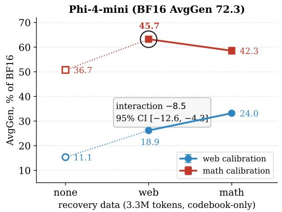

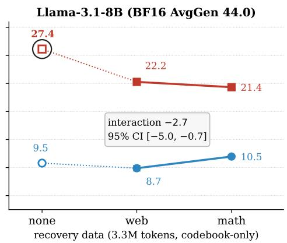  
Figure 2: Calibration and recovery data are not separable at 2 bits. 2-bit YAQA bases are calibrated on web or math text (OpenR1-Math), then unrecovered (hollow markers) or given short codebook-only recovery budget on web or math text (3,200 examples). The shared y-axis is AvgGen as a percentage of each model’s BF16 AvgGen; labels give absolute AvgGen. Means ± std over three recovery seeds (P-bf16). Circles mark the best cell. Boxes give the interaction contrast and its 95% hierarchical-bootstrap interval. Detailed results are in Table 1.

Table 1: The best recovery data depends on the calibration data (2-bit YAQA, P-bf16; mean of three recovery seeds, std in Table 21). Calibration: data used to compute the Hessians when quantizing. Recovery: data used for the short codebook-only fine-tuning after quantization (3,200 examples); none is the unrecovered base. The web data we use is FineWeb-Edu; and the math dataset is OpenR1-Math. Shaded bold: best AvgGen per model; red: recovery lowers AvgGen below its base. Follow-up evaluations on Qwen3-8B are in Table 23 in the Appendix.
<table><tr><td rowspan="2">Calibration</td><td rowspan="2">Recovery</td><td colspan="4">Phi-4-mini</td><td colspan="4">Llama-3.1-8B</td></tr><tr><td>AvgQA</td><td>GSM8K</td><td>HEval</td><td>AvgGen</td><td>AvgQA</td><td>GSM8K</td><td>HEval</td><td>AvgGen</td></tr><tr><td>web</td><td>none</td><td>63.1</td><td>15.5</td><td>6.7</td><td>11.1</td><td>65.1</td><td>11.6</td><td>7.3</td><td>9.5</td></tr><tr><td>web</td><td>web</td><td>63.3</td><td>24.2</td><td>13.6</td><td>18.9</td><td>64.1</td><td>6.6</td><td>10.8</td><td>8.7</td></tr><tr><td>web</td><td>math</td><td>62.8</td><td>33.8</td><td>14.2</td><td>24.0</td><td>63.7</td><td>9.9</td><td>11.2</td><td>10.5</td></tr><tr><td>math</td><td>none</td><td>58.3</td><td>53.2</td><td>20.1</td><td>36.7</td><td>62.0</td><td>33.4</td><td>21.3</td><td>27.4</td></tr><tr><td>math</td><td>web</td><td>60.0</td><td>56.9</td><td>34.6</td><td>45.7</td><td>62.4</td><td>27.4</td><td>17.1</td><td>22.2</td></tr><tr><td>math</td><td>math</td><td>58.7</td><td>60.1</td><td>24.6</td><td>42.3</td><td>61.4</td><td>28.2</td><td>14.6</td><td>21.4</td></tr><tr><td>BF16</td><td></td><td>70.8</td><td>81.7</td><td>62.8</td><td>72.3</td><td>73.2</td><td>50.2</td><td>37.8</td><td>44.0</td></tr></table>

The best recovery data depends on the calibration data. We quantize Phi-4-mini and Llama-3.1- 8B with web or math calibration data, then apply short codebook-only recovery (3,200 examples) on web or math data (Figure 2, Table 1). Math recovery helps the web-calibrated base but not the math-calibrated one, giving a negative interaction on both models with 95% intervals excluding zero (Table 2). Calibration is the larger factor and math calibration raises generation under either recovery source. Furthermore, whether to recover or not is model-dependent. Every recovery stage helps the instruction-tuned Phi-4-mini. However for the pretrained base Llama-3.1-8B, math calibration and no recovery procedure works best. The interaction sign also holds on a logit scale and these results cover one domain pair at a short budget (Table 8).

Table 2: Switching recovery data helps one calibration base and not the other (change in AvgGen points, P-bf16; 95% bootstrap intervals over recovery seeds and test items). Math vs. web recovery: AvgGen after math recovery minus after web recovery, on each base. Interaction: math-base minus web-base column (up to rounding); negative means the best recovery data flips with the calibration data. Calibration: math minus web calibration, averaged over both recovery sources. ∗ the held-out model our hypothesis is confirmed on.
<table><tr><td rowspan="2">Model</td><td colspan="2">Math vs. web recovery</td><td colspan="4">Interaction</td><td>Calibration</td></tr><tr><td>web base</td><td>math base</td><td>AvgGen</td><td></td><td>GSM8K</td><td></td><td>HumanEval math vs. web</td></tr><tr><td>Phi-4-mini</td><td>+5.1 [2.9, 7.4]</td><td>−3.4 [−6.9, 0.2]</td><td></td><td>-8.5 [−12.6, -4.3]</td><td>-6.4</td><td>-10.6</td><td>+22.5</td></tr><tr><td>Llama-3.1-8B</td><td>+1.8 [0.8, 3.6]</td><td>−0.8 [−2.7, 1.2]</td><td></td><td>−2.7[−5.0, −0.7]</td><td>-2.5</td><td>-2.9</td><td>+12.2</td></tr><tr><td>Qwen3-8B*</td><td>+3.6 [1.1, 5.8]</td><td>-5.8 [−9.0, -2.7]</td><td></td><td>–9.4 [−13.3, −5.3]</td><td>-3.8</td><td>-15.1</td><td>+16.5</td></tr></table>

Prospective confirmation. Before collecting Qwen3-8B data, we pre-registered its 2 × 2 design, analysis, and three predictions (Appendix A.9): a negative interaction, web recovery at least as good as math recovery on the math-calibrated base, and a larger interaction on HumanEval than on GSM8K. All of these predictions hold (Table 2) on this model. The interaction also stays negative on held-out tasks, with fresh Phi-4-mini calibration samples, and with disjoint recovery-data samples (Figure 3; Appendices A.9 and Table 25). On prompt-independent tasks alone (MBPP, MATH-500), the interaction effect is clear only on Phi-4-mini (Appendix A.9).

What the interaction does not imply. It is not a rule to “add the domain absent from calibration”: on Phi-4-mini every short recovery improves over its base, and calibration changes only which recovery source helps more.

## 4.3 SCALAR PTQ COLLAPSES IN THE TESTED PIPELINES

Scalar PTQ has a sharp 2-bit cliff. At 4 bits the best scalar method stays close to BF16; at 2 bits every tested scalar pipeline falls to the random QA floor with 0.0 accuracy on generation, on all three models (Table 3 and curves in Appendix A.15).

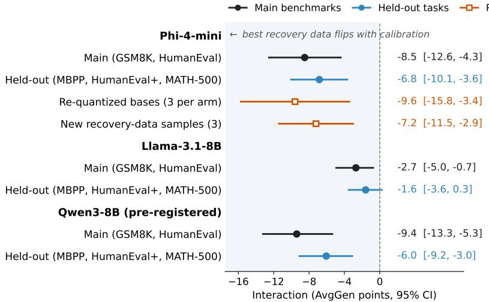  
Figure 3: The interaction stays negative across robustness checks. Interaction contrast with 95% intervals; left of zero, the best recovery data flips with the calibration data. Circles: bootstrap over recovery seeds and test items, on the main benchmarks or on held-out tasks (HumanEval+ reuses HumanEval prompts). Squares: intervals over three independently re-quantized bases per arm (Welch) or three disjoint recovery-data samples (t).

Table 3: Quantization ladder (web calibration, no recovery; P-fp16). Best QA and generation per precision; superscripts mark the winning method: SpinQuant (S), QuaRot (Q; expert-wise on the MoE), YAQA (Y), VPTQ (V). Red: collapse to the random floor; shaded: 2-bit vector pipelines.
<table><tr><td></td><td colspan="2">BF16</td><td colspan="2">Scalar 4-bit</td><td colspan="2">Scalar 2-bit</td><td colspan="2">Vector 2-bit</td></tr><tr><td>Model</td><td>QA</td><td>Gen</td><td>QA</td><td>Gen</td><td>QA</td><td>Gen</td><td>QA</td><td>Gen</td></tr><tr><td>Phi-4-mini</td><td>71.0</td><td>73.2</td><td>69.3Q</td><td>65.8s</td><td>29.3S</td><td>0.0</td><td>63.3Y</td><td>12.2Y</td></tr><tr><td>Llama-3.1-8B</td><td>73.1</td><td>42.9</td><td>71.8s</td><td>38.00</td><td>29.0Q</td><td>0.0</td><td>65.1Y</td><td>9.6Y</td></tr><tr><td>Qwen3-30B-A3B</td><td>72.6</td><td>61.8</td><td>70.3s</td><td>66.2s</td><td>29.4s</td><td>0.0</td><td>66.0Y</td><td>54.0Y</td></tr></table>

Vector codebooks revive 2-bit models. Vector pipelines raise 2-bit QA into the mid-60s from the 20s floor on all three families, and YAQA stays ahead in a matched-bit control (Table 13).

## 4.4 COMPARISONS WITH TRAINED SCALAR QUANTIZATION

On question answering, the vector pipelines match or beat GSQ and BitDistiller on every model; on generation, YAQA beats both (Table 4). Within our recipe grid and bit budget, YAQA leads on every model. GSQ collapses to the random-accuracy floor on the MoEs.

## 4.5 CALIBRATION CHIEFLY CONTROLS GENERATION

With the quantizer fixed, calibration data mainly moves generation: across recipes, AvgGen varies by 13.5–26.7 points per model, while AvgQA varies by only 3.9–7.5 (Table 5). At 4 bits, the same sweep moves scalar models by at most 1.6 QA and 7.9 generation points (Table 17). Math calibration gives the best generation on the dense models, a targeted mixture on Qwen3-MoE, and broad web-heavy data the best QA.

Generation retention is model-dependent. QA retention is similar across models, but HumanEval retention ranges from under half to over 80% (Figure 4). Within Qwen3 the dense 32B model retains far more generation than the dense 8B one, so model scale is necessary for strong retention. Furthermore, the precision of the MoE router barely changes accuracy (Appendix A.10).

Table 4: Cross-paradigm comparison at 2 bits (P-fp16; OLMoE row P-bf16). Best AvgQA (a) and AvgGen (b) per model. VPTQ and YAQA select the best recipe per metric from their recipe grids. GSQ: layer-wise scalar PTQ; BitDistiller: scalar QAT; VPTQ, YAQA: vector PTQ. Shaded bold marks the best per model. N Native (unrotated) VPTQ, P-bf16, where it beats rotated VPTQ (Appendix Table 27). SExperts share one codebook per layer and projection type (2.09/2.14 effective bits  
(a) QA (AvgQA ↑).
<table><tr><td rowspan="2">Model</td><td rowspan="2">BF16</td><td colspan="2">Trained scalar</td><td colspan="2">Vector PTQ</td></tr><tr><td>GSQ</td><td>BitDist.</td><td>VPTQ</td><td>YAQA</td></tr><tr><td>Phi-4-mini</td><td>71.0</td><td>52.6</td><td>53.0</td><td> $5 7 . 6 ^ { N }$ </td><td>63.3</td></tr><tr><td>Llama-3.1-8B</td><td>73.1</td><td>57.0</td><td>60.3</td><td> $6 3 . 3 ^ { N }$ </td><td>65.7</td></tr><tr><td>Qwen3-MoE</td><td>72.6</td><td>29.4</td><td>55.9</td><td> $6 4 . 8 ^ { S }$ </td><td>66.7</td></tr><tr><td>OLMoE-1B-7B</td><td>68.3</td><td>29.6</td><td>49.1</td><td> $6 3 . 0 ^ { S }$ </td><td>64.0</td></tr></table>

(b) Generation (AvgGen ↑).
<table><tr><td rowspan="2">Model</td><td rowspan="2">BF16</td><td colspan="2">Trained scalar</td><td colspan="2">Vector PTQ</td></tr><tr><td>GSQ</td><td>BitDist.</td><td>VPTQ</td><td>YAQA</td></tr><tr><td>Phi-4-mini</td><td>73.2</td><td>17.9</td><td>18.4</td><td> $2 9 . 5 ^ { N }$ </td><td>37.4</td></tr><tr><td>Llama-3.1-8B</td><td>42.9</td><td>18.1</td><td>16.2</td><td> $1 6 . 1$ </td><td>26.6</td></tr><tr><td>Qwen3-MoE</td><td>61.8</td><td>0.0</td><td>45.7</td><td> $5 3 . 0 ^ { S }$ </td><td>62.4</td></tr><tr><td>OLMoE-1B-7B</td><td>32.4</td><td>0.0</td><td>0.9</td><td> $1 5 . 2 ^ { S }$ </td><td>20.6</td></tr></table>

Table 5: Calibration mainly changes generation (2-bit YAQA, P-fp16; bold: best; ∆: range over the full sweep).
<table><tr><td rowspan=1 colspan=3>Phi-4-miniLlama-3.1Qwen3-MoERecipe         QA Gen QAGen QA  Gen</td></tr><tr><td rowspan=1 colspan=3>Web           63.312.265.1 9.6 66.0  54.0</td></tr><tr><td rowspan=1 colspan=2>Math           58.537.462</td><td rowspan=1 colspan=1>.126.664.5  61.8</td></tr><tr><td rowspan=1 colspan=2>Code           55.918.7</td><td rowspan=1 colspan=1>60.822.662.8  48.9</td></tr><tr><td rowspan=1 colspan=3>Math+web .5/.562.624.765.717.8 66.7  56.5</td></tr><tr><td rowspan=1 colspan=3>Web+math .7/.363.027.765.515.165.8  56.2</td></tr><tr><td rowspan=1 colspan=3>All-4.25 each  58.819.965.220.166.0  59.3MWI .4/.4/.2   59.517.162.712.266.5  62.4</td></tr><tr><td rowspan=1 colspan=3>∆              7.526.74.917.03.9  13.5</td></tr></table>

## 4.6 CODEBOOK-ONLY RECOVERY IS MODEL-DEPENDENT

Table 8 pairs each 2-bit base with long codebook-only recovery on the same recipe data. On Phi-4-mini, recovery changes QA little but roughly doubles HumanEval. On Qwen3-MoE it changes both little; on Llama-3.1-8B base model, QA decreases in all three long runs and generation has no consistent gain. IFEval falls on most Phi-4-mini recipes under completion prompts and is mostly, but not uniformly, preserved under the chat template (Appendix Table 35). Furthermore recovery does not help 2-bit models which hit the random floor. Scale-only recovery on a collapsed scalar 2-bit model leaves it near the floor (Appendix A.7).

Under the deployment prompt, short recovery need not cost instruction following. With the chat template, web recovery of the math-calibrated Phi-4-mini base raises GSM8K from 55.0 to 58.9, HumanEval from 34.1 to 43.9, and IFEval from 40.3 to 44.5 (four recovery seeds); math recovery raises GSM8K further (61.5) but lowers IFEval to 37.9 (Table 36). The best recovery data still flips with calibration and math recovery gives the highest AvgGen from the web base and web recovery from the math base.

Recovery data matter more than distillation hyperparameters. The type of knowledge distillation loss, the teacher precision, temperature, and top-k truncation change AvgQA little. A 4-bit teacher matches a BF16 one, and dropping the teacher keeps most generation gain (Appendix A.7). With fixed web recovery data, generation gains 6.3 points by 3,200 examples and then plateaus, while QA rises slowly with more data (Figure 5). Recovery with low-rank-adaptor is in Appendix A.11.

## 4.7 OVERTHINKING UNDER QUANTIZATION

We reproduce the overthinking failure mode of Lotfi et al. (2026) on Qwen3-30B-A3B, a reasoning model with an explicit thinking mode at 2-bits. On MATH-500 (Hendrycks et al., 2021) levels 4–5 with greedy decoding, we compare the BF16 ceiling with the best 4-bit checkpoint and the expert-shared 2-bit VPTQ web/mixed 0.7/0.3 checkpoint of Table 10 in the Appendix. Accuracy is exact match on the final answer. “Markers/1k” counts hesitation and branch-forking tokens (e.g., “Wait”, “But”, “Alternatively”) per 1,000 generated tokens. The loop score is the repeated 4-gram fraction. Table 6 shows that 2-bit quantization amplifies overthinking without collapse. Accuracy falls (0.675 → 0.45), and the hesitation-marker rate, loop score, and length-cap hit rate rise. A small repetition penalty reduces looping and improves 2-bit accuracy (Table 7). Figure 15 in the appendix shows the effect of a repetition penalty.

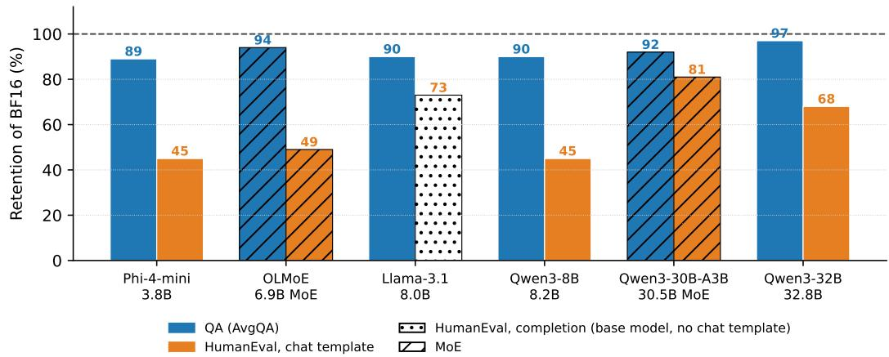  
Figure 4: 2-bit retention of QA and chat-template HumanEval by model. Models are ordered by total parameters (hatched: MoE). Best no-recovery VPTQ/YAQA checkpoint per metric on our recipe grid within the 2.5-bit budget (YAQA on the MoEs). The dotted Llama-3.1-8B bar is completion-style HumanEval (base model, no chat template); completion-prompt AvgGen is in Table 33.

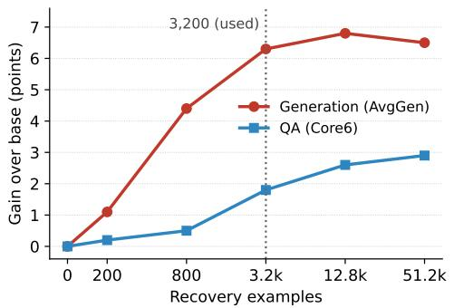  
Figure 5: Recovery gains saturate early. Gain over the unrecovered base as the recovery budget grows (Phi-4-mini, math-calibrated 2-bit YAQA, codebook-only recovery on web data; Table 22). Generation gains 6.3 points by 3,200 examples and then plateaus; QA rises slowly.

## 5 A PRACTICAL RECIPE FOR ACCURATE 2-BIT MODELS

Table 9 and the highlighted box below give the recipe. The representation default holds across six models, including two MoEs; the calibration defaults come from the three primary model families. Whether and how to recover depends on the model and the calibration data, so the recipe adds a cheap per-model check. Screening k calibrated bases costs k quantization passes, 2k short recoveries (≈100 PFLOP each for a 4B-parameter model and 3k evaluations, far less than QAT.

Table 6: Overthinking under 2-bit quantization (Qwen3-30B-A3B, MATH-500, greedy). 2-bit amplifies hesitation and looping and moderately lowers accuracy without collapsing. “Cap-hit” is the length-cap hit rate. “R-then-A” is the reached-then-abandoned rate among wrong answers. We use 40 problems, and the 2-bit model is expert-shared VPTQ (2.09 bits).
<table><tr><td>Precision</td><td>Accuracy</td><td>Mean CoT</td><td>Cap-hit</td><td>Markers/1k</td><td>Loop (4-gram)</td><td>R-then-A</td></tr><tr><td>BF16</td><td>0.675</td><td>4928</td><td>0.25</td><td>15.5</td><td>0.39</td><td>0.69</td></tr><tr><td>4-bit</td><td>0.650</td><td>5265</td><td>0.25</td><td>12.4</td><td>0.41</td><td>0.50</td></tr><tr><td>2-bit</td><td>0.450</td><td>5900</td><td>0.45</td><td>23.7</td><td>0.67</td><td>0.41</td></tr></table>

Table 7: Decoding penalties on the 2-bit model (Qwen3-30B-A3B, MATH-500, 2-bit). A repetition penalty reduces looping and chain-of-thought length and improves accuracy. The same penalty also helps BF16.
<table><tr><td>Rep. penalty</td><td>Marker penalty</td><td>Accuracy</td><td>Mean CoT</td><td>Cap-hit</td><td>Markers/1k</td><td>Loop (4-gram)</td></tr><tr><td>1.0</td><td>0</td><td>0.425</td><td>5884</td><td>0.475</td><td>23.0</td><td>0.66</td></tr><tr><td>1.0</td><td>2</td><td>0.475</td><td>5156</td><td>0.375</td><td>10.2</td><td>0.62</td></tr><tr><td>1.0</td><td>6</td><td>0.500</td><td>4726</td><td>0.350</td><td>2.2</td><td>0.59</td></tr><tr><td>1.2</td><td>0</td><td>0.575</td><td>5052</td><td>0.300</td><td>15.0</td><td>0.40</td></tr><tr><td>1.3</td><td>0</td><td>0.625</td><td>4799</td><td>0.250</td><td>13.0</td><td>0.30</td></tr></table>

Recipe: five steps to an accurate 2-bit model  
1. Use a vector codebook (e.g., YAQA); scalar PTQ collapses at 2 bits.  
2. Calibrate on target-domain data; mix in broad web text when QA matters.  
3. Choose recovery data together with calibration: for each calibrated base, compare no, web, and target-domain recovery.  
4. Keep recovery short and optional: codebook-only on 3,200 examples; keep it only if it clears a preset margin without losing QA or instruction following.  
5. Evaluate as deployed: Report QA and generation separately against a matched full-precision reference. Evaluate quantized model at higher repetition penalty to avoid overthinking behavior.

## 6 CONCLUSION AND FUTURE WORK

Conclusion At 2 bits, quality depends heavily on representation, calibration data, and recovery. A vector codebook restores most collapsed accuracy and a task-aligned calibration mixture and short codebook-only recovery stage narrow the generation gap at much less compute than QAT. The data choices are not separable at a short recovery budget: calibration domain drives generation, and the best recovery data depends on it. Across three models and a held-out composite, math recovery helps a web-calibrated base but not a math-calibrated one (clearest on Phi-4-mini). Tuning the two data choices separately can therefore select the wrong recovery data, and whether to recover must be validated per model. Most remaining loss is in generation, whose measurement depends on prompt format and numerical precision.

Limitations and Future Work. We measure base and data-sample variability only on Phi-4-mini, and replicate bases share one rotation and one recovery seed. The interaction covers one domain pair and one quantizer (YAQA) at a short budget; we did not re-run the 2 × 2 design at long budgets. We leave these studies for future work.

## USE OF AI TOOLS

All ideas presented in this paper are original to the authors or built upon the related work cited herein. AI-based tools were used only in an assistive capacity: to sharpen the clarity of the authors’ initial drafts, to prepare initial drafts, to help typeset the paper in LAT X, to rephrase sections, to improve the presentation of figures and tables, to correct grammatical errors and make sentences more salient, and to act as a coding assistant that implements the authors’ ideas. All technical content, claims, and conclusions were conceived, verified, and approved by the authors.

Table 8: Codebook recovery is model-dependent. Each row is a 2-bit YAQA model quantized with the listed calibration data. base: no recovery; +rec.: after long codebook-only recovery whose recovery data is the same mixture as the calibration data (forward KL, BF16 teacher). HumanEval uses each instruction-tuned model’s chat template (Phi-4-mini, Qwen3-MoE) and completion prompts for the base Llama-3.1-8B. Teal/red: change beyond two paired standard errors. P-bf16 except the Qwen3-MoE AvgQA, GSM8K, and IFEval cells (P-fp16). §P-bf16, mean of three evaluations.
<table><tr><td rowspan="2">Model Calibration recipe</td><td rowspan="2"></td><td colspan="2">AvgQA</td><td colspan="2">GSM8K</td><td colspan="2">HumanEval</td><td colspan="2">IFEval</td></tr><tr><td>base</td><td>+rec.</td><td>base</td><td>+rec.</td><td>base</td><td>+rec.</td><td>base</td><td>+rec.</td></tr><tr><td rowspan="6">Phi-4-mini</td><td>web</td><td>63.1</td><td>62.9</td><td>15.5</td><td>42.2</td><td>14.0</td><td>28.0</td><td>29.0</td><td>21.8</td></tr><tr><td>math</td><td>58.3</td><td>60.4</td><td>53.2</td><td>62.5</td><td>34.1</td><td>47.6</td><td>31.2</td><td>27.7</td></tr><tr><td>math+web (0.5/0.5)</td><td>62.5</td><td>63.2</td><td>38.8</td><td>53.5</td><td>17.7</td><td>33.5</td><td>33.1</td><td>33.1</td></tr><tr><td>web+math (0.7/0.3)</td><td>62.8</td><td>63.3</td><td>39.9</td><td>53.3</td><td>18.3</td><td>32.3</td><td>37.3</td><td>29.4</td></tr><tr><td>mw64: math+web (0.6/0.4)</td><td>61.7</td><td>63.2</td><td>44.0</td><td>58.3</td><td>17.1</td><td>39.0</td><td>32.2</td><td>29.9</td></tr><tr><td>BF16</td><td>70.8</td><td></td><td>81.7</td><td></td><td>75.0</td><td></td><td>55.8</td><td></td></tr><tr><td rowspan="4">Llama-3.1-8B</td><td>math+web (0.5/0.5)</td><td>65.6</td><td>64.8</td><td>22.7</td><td>21.2</td><td>14.0</td><td>14.6</td><td>7.8</td><td>5.9</td></tr><tr><td>web+math (0.7/0.3)</td><td>65.5</td><td>64.8</td><td>18.4</td><td>18.0</td><td>10.4</td><td>17.7</td><td>6.5</td><td>7.8</td></tr><tr><td>all-4 (equal four-way)</td><td>65.1</td><td>64.4</td><td>19.9</td><td>16.8</td><td>18.3</td><td>22.6</td><td>8.3</td><td>8.9</td></tr><tr><td>BF16</td><td>73.2</td><td></td><td>50.2</td><td></td><td>37.8</td><td></td><td></td><td>9.4</td></tr><tr><td rowspan="2">Qwen3-MoE</td><td>web</td><td>66.0 67.8</td><td></td><td>73.8 76.0</td><td></td><td>75.0 76.8</td><td></td><td></td><td>23.0§ 22.0</td></tr><tr><td>BF16</td><td>72.6</td><td></td><td>90.0</td><td></td><td></td><td>92.7</td><td></td><td>28.3</td></tr></table>

Table 9: 2-bit decision guide (Section 4; KD and teacher rows: Phi-4-mini).
<table><tr><td>Decision</td><td>Recommendation</td></tr><tr><td></td><td>Representation vector codebook (YAQA).</td></tr><tr><td>Calibration</td><td>task-aligned Hessian mixture</td></tr><tr><td>Recovery</td><td>short codebook-only KD, or none for base models.</td></tr><tr><td>Recovery data</td><td>choose jointly with calibration.</td></tr><tr><td>KD settings</td><td>defaults (τ=1).</td></tr><tr><td>Teacher</td><td>4-bit (matches BF16) or none.</td></tr><tr><td>MoE routers</td><td>keep in half precision.</td></tr><tr><td>Reporting</td><td>QA and generation separately with repetiton penalty applied.</td></tr></table>

## ACKNOWLEDGMENTS

We are deeply grateful to Hari VK and Andrey Rybalchenko (Microsoft Research, Cambridge) for their extensive work to make application of incoherence rotations automatic and robust. This work allowed us to reliably test the effect of incoherent rotations on a large number of dense and mixtureof-experts transformer models with different architectures. The work underpins our rotated scalar baselines and the incoherence-rotated frame in which our vector quantizers operate on the MoE models, and it was essential for extending this study from dense models to Qwen3-30B-A3B and OLMoE-1B-7B.

## REFERENCES

Abdelrahman Abouelenin, Atabak Ashfaq, Adam Atkinson, Hany Awadalla, Nguyen Bach, Jianmin Bao, Alon Benhaim, Martin Cai, Vishrav Chaudhary, Congcong Chen, et al. Phi-4-mini technical report: Compact yet powerful multimodal language models via mixture-of-loras. arXiv preprint arXiv:2503.01743, 2025.

Saleh Ashkboos, Amirkeivan Mohtashami, Maximilian L Croci, Bo Li, Pashmina Cameron, Martin Jaggi, Dan Alistarh, Torsten Hoefler, and James Hensman. Quarot: Outlier-free 4-bit inference in rotated llms. Advances in Neural Information Processing Systems, 37:100213–100240, 2024.

Abhinav Bandari, Lu Yin, Cheng-Yu Hsieh, Ajay Kumar Jaiswal, Tianlong Chen, Li Shen, Ranjay Krishna, and Shiwei Liu. Is c4 dataset optimal for pruning? an investigation of calibration data for llm pruning. In Proceedings of the 2024 Conference on Empirical Methods in Natural Language Processing, pp. 18089–18099, 2024.

Yonatan Bisk, Rowan Zellers, Jianfeng Gao, Yejin Choi, et al. Piqa: Reasoning about physical commonsense in natural language. In Proceedings of the AAAI conference on artificial intelligence, volume 34, pp. 7432–7439, 2020.

Jerry Chee, Yaohui Cai, Volodymyr Kuleshov, and Christopher De Sa. Quip: 2-bit quantization of large language models with guarantees. In A. Oh, T. Naumann, A. Globerson, K. Saenko, M. Hardt, and S. Levine (eds.), Advances in Neural Information Processing Systems, volume 36, pp. 4396–4429. Curran Associates, Inc., 2023. doi: 10.52202/ 075280-0196. URL https://proceedings.neurips.cc/paper\_files/paper/ 2023/file/0df38cd13520747e1e64e5b123a78ef8-Paper-Conference.pdf.

Mark Chen, Jerry Tworek, Heewoo Jun, Qiming Yuan, Henrique Ponde De Oliveira Pinto, Jared Kaplan, Harri Edwards, Yuri Burda, Nicholas Joseph, Greg Brockman, et al. Evaluating large language models trained on code. arXiv preprint arXiv:2107.03374, 2021.

Mengzhao Chen, Wenqi Shao, Peng Xu, Jiahao Wang, Peng Gao, Kaipeng Zhang, and Ping Luo. Efficientqat: Efficient quantization-aware training for large language models. In Proceedings of the 63rd Annual Meeting of the Association for Computational Linguistics (Volume 1: Long Papers), pp. 10081–10100, 2025.

Peter Clark, Isaac Cowhey, Oren Etzioni, Tushar Khot, Ashish Sabharwal, Carissa Schoenick, and Oyvind Tafjord. Think you have solved question answering? try arc, the ai2 reasoning challenge. arXiv preprint arXiv:1803.05457, 2018.

Karl Cobbe, Vineet Kosaraju, Mohammad Bavarian, Mark Chen, Heewoo Jun, Lukasz Kaiser, Matthias Plappert, Jerry Tworek, Jacob Hilton, Reiichiro Nakano, et al. Training verifiers to solve math word problems. arXiv preprint arXiv:2110.14168, 2021.

Alireza Dadgarnia, Soroush Tabesh, Mahdi Nikdan, Michael Helcig, Eldar Kurtic, Max Kleinegger,´ and Dan Alistarh. Gsq: Highly-accurate low-precision scalar quantization for llms via gumbelsoftmax sampling. arXiv preprint arXiv:2604.18556, 2026.

Tim Dettmers and Luke Zettlemoyer. The case for 4-bit precision: k-bit inference scaling laws. In International Conference on Machine Learning, pp. 7750–7774. PMLR, 2023.

Tim Dettmers, Artidoro Pagnoni, Ari Holtzman, and Luke Zettlemoyer. Qlora: Efficient finetuning of quantized llms. Advances in neural information processing systems, 36:10088–10115, 2023.

Dayou Du, Yijia Zhang, Shijie Cao, Jiaqi Guo, Ting Cao, Xiaowen Chu, and Ningyi Xu. Bitdistiller: Unleashing the potential of sub-4-bit llms via self-distillation. In Proceedings ofthe 62nd Annual Meeting of the Association for Computational Linguistics (Volume 1: Long Papers), pp. 102–116, 2024.

Vage Egiazarian, Andrei Panferov, Denis Kuznedelev, Elias Frantar, Artem Babenko, and Dan Alistarh. Extreme compression of large language models via additive quantization. In Proceedings of the 41st International Conference on Machine Learning. JMLR.org, 2024.

Elias Frantar, Saleh Ashkboos, Torsten Hoefler, and Dan Alistarh. Optq: Accurate quantization for generative pre-trained transformers. In The eleventh international conference on learning representations, 2023.

Leo Gao, Jonathan Tow, Stella Biderman, Sid Black, Anthony DiPofi, Charles Foster, Laurence Golding, Jeffrey Hsu, Kyle McDonell, Niklas Muennighoff, et al. A framework for few-shot language model evaluation. Zenodo, 2021.

Aaron Grattafiori, Abhimanyu Dubey, Abhinav Jauhri, Abhinav Pandey, Abhishek Kadian, Ahmad Al-Dahle, Aiesha Letman, Akhil Mathur, Alan Schelten, Alex Vaughan, et al. The llama 3 herd of models. arXiv preprint arXiv:2407.21783, 2024.

Dan Hendrycks, Collin Burns, Steven Basart, Andy Zou, Mantas Mazeika, Dawn Song, and Jacob Steinhardt. Measuring massive multitask language understanding. arXiv preprint arXiv:2009.03300, 2020.

Dan Hendrycks, Collin Burns, Saurav Kadavath, Akul Arora, Steven Basart, Eric Tang, Dawn Song, and Jacob Steinhardt. Measuring mathematical problem solving with the math dataset. NeurIPS, 2021.

Geoffrey Hinton, Oriol Vinyals, and Jeff Dean. Distilling the knowledge in a neural network. arXiv preprint arXiv:1503.02531, 2015.

Edward J Hu, yelong shen, Phillip Wallis, Zeyuan Allen-Zhu, Yuanzhi Li, Shean Wang, Lu Wang, and Weizhu Chen. LoRA: Low-rank adaptation of large language models. In International Conference on Learning Representations, 2022. URL https://openreview.net/forum? id=nZeVKeeFYf9.

Wei Huang, Yangdong Liu, Haotong Qin, Ying Li, Shiming Zhang, Xianglong Liu, Michele Magno, and Xiaojuan Qi. Billm: pushing the limit of post-training quantization for llms. In Proceedings of the 41st International Conference on Machine Learning, ICML’24. JMLR.org, 2024.

Ajay Jaiswal, Zhe Gan, Xianzhi Du, Bowen Zhang, Zhangyang Wang, and Yinfei Yang. Compressing llms: The truth is rarely pure and never simple. In International Conference on Learning Representations, volume 2024, pp. 36973–36993, 2024.

Yixin Ji, Yang Xiang, Juntao Li, Qingrong Xia, Ping Li, Xinyu Duan, Zhefeng Wang, and Min Zhang. Beware of calibration data for pruning large language models. In International Conference on Learning Representations, volume 2025, pp. 18604–18620, 2025.

Renren Jin, Jiangcun Du, Wuwei Huang, Wei Liu, Jian Luan, Bin Wang, and Deyi Xiong. A comprehensive evaluation of quantization strategies for large language models. In Findings of the association for computational linguistics: ACL 2024, pp. 12186–12215, 2024.

Sehoon Kim, Coleman Richard Charles Hooper, Amir Gholami, Zhen Dong, Xiuyu Li, Sheng Shen, Michael W. Mahoney, and Kurt Keutzer. SqueezeLLM: Dense-and-sparse quantization. In Fortyfirst International Conference on Machine Learning, 2024. URL https://openreview. net/forum?id=0jpbpFia8m.

Tanishq Kumar, Zachary Ankner, Benjamin Spector, Blake Bordelon, Niklas Muennighoff, Mansheej Paul, Cengiz Pehlevan, Christopher Re, and Aditi Raghunathan. Scaling laws for precision.´ In International Conference on Learning Representations, volume 2025, pp. 71833–71864, 2025.

Eldar Kurtic, Alexandre Noll Marques, Shubhra Pandit, Mark Kurtz, and Dan Alistarh. “give me bf16 or give me death”? accuracy-performance trade-offs in llm quantization. In Proceedings of the 63rd Annual Meeting of the Association for Computational Linguistics (Volume 1: Long Papers), pp. 26872–26886, 2025.

Donghyun Lee, Yuhang Li, Ruokai Yin, and Priyadarshini Panda. Kronq: Llm quantization via kronecker-factored hessian. arXiv preprint arXiv:2607.07964, 2026.

Shiyao Li, Xuefei Ning, Luning Wang, Tengxuan Liu, Xiangsheng Shi, Shengen Yan, Guohao Dai, Huazhong Yang, and Yu Wang. Evaluating quantized large language models. In Ruslan Salakhutdinov, Zico Kolter, Katherine Heller, Adrian Weller, Nuria Oliver, Jonathan Scarlett, and Felix Berkenkamp (eds.), Proceedings of the 41st International Conference on Machine Learning, volume 235 of Proceedings ofMachine Learning Research, pp. 28480–28524. PMLR, 2024a.

Yixiao Li, Yifan Yu, Chen Liang, Nikos Karampatziakis, Pengcheng He, Weizhu Chen, and Tuo Zhao. Loftq: Lora-fine-tuning-aware quantization for large language models. In International Conference on Learning Representations, volume 2024, pp. 13409–13424, 2024b.

Ji Lin, Jiaming Tang, Haotian Tang, Shang Yang, Wei-Ming Chen, Wei-Chen Wang, Guangxuan Xiao, Xingyu Dang, Chuang Gan, and Song Han. Awq: Activation-aware weight quantization for on-device llm compression and acceleration. Proceedings of machine learning and systems, 6:87–100, 2024.

Ruikang Liu, Yuxuan Sun, Manyi Zhang, Haoli Bai, Xianzhi Yu, Tiezheng Yu, Chun Yuan, and Lu Hou. Quantization hurts reasoning? an empirical study on quantized reasoning models. arXiv preprint arXiv:2504.04823, 2025a.

Yifei Liu, Jicheng Wen, Yang Wang, Shengyu Ye, Li Lyna Zhang, Ting Cao, Cheng Li, and Mao Yang. Vptq: Extreme low-bit vector post-training quantization for large language models. In Proceedings of the 2024 Conference on Empirical Methods in Natural Language Processing, pp. 8181–8196, 2024a.

Zechun Liu, Barlas Oguz, Changsheng Zhao, Ernie Chang, Pierre Stock, Yashar Mehdad, Yangyang Shi, Raghuraman Krishnamoorthi, and Vikas Chandra. Llm-qat: Data-free quantization aware training for large language models. In Findings of the association for computational linguistics: ACL 2024, pp. 467–484, 2024b.

Zechun Liu, Changsheng Zhao, Igor Fedorov, Bilge Soran, Dhruv Choudhary, Raghuraman Krishnamoorthi, Vikas Chandra, Yuandong Tian, and Tijmen Blankevoort. Spinquant: Llm quantization with learned rotations. In International Conference on Learning Representations, volume 2025, pp. 92009–92032, 2025b.

Zechun Liu, Changsheng Zhao, Hanxian Huang, Sijia Chen, Jing Zhang, Jiawei Zhao, Scott Roy, Lisa Jin, Yunyang Xiong, Yangyang Shi, et al. Paretoq: Improving scaling laws in extremely low-bit llm quantization. Advances in Neural Information Processing Systems, 38:91311–91336, 2026.

Sanae Lotfi, Polina Kirichenko, Steven Li, and Zechun Liu. Quantized reasoning models think they need to think longer, but they do not. In NeurIPS 2026 Poster, 2026. URL https:// neurips.cc/virtual/2026/poster/151668.

Vladimir Malinovskii, Denis Mazur, Ivan Ilin, Denis Kuznedelev, Konstantin Burlachenko, Kai Yi, Dan Alistarh, and Peter Richtarik. Pv-tuning: Beyond straight-through estimation for extreme llm compression. Advances in Neural Information Processing Systems, 37:5074–5121, 2024.

Niklas Muennighoff, Luca Soldaini, Dirk Groeneveld, Kyle Lo, Jacob Morrison, Sewon Min, Weijia Shi, Pete Walsh, Oyvind Tafjord, Nathan Lambert, et al. Olmoe: Open mixture-of-experts language models. In International Conference on Learning Representations, volume 2025, pp. 62061–62121, 2025.

Xu Ouyang, Tao Ge, Thomas Hartvigsen, Zhisong Zhang, Haitao Mi, and Dong Yu. Low-bit quantization favors undertrained llms. In Proceedings of the 63rd Annual Meeting of the Association for Computational Linguistics (Volume 1: Long Papers), pp. 32338–32348, 2025.

Denis Paperno, German Kruszewski, Angeliki Lazaridou, Ngoc-Quan Pham, Raffaella Bernardi,´ Sandro Pezzelle, Marco Baroni, Gemma Boleda, and Raquel Fernandez. The lambada dataset:´ Word prediction requiring a broad discourse context. In Proceedings of the 54th annual meeting of the association for computational linguistics (volume 1: Long papers), pp. 1525–1534, 2016.

Keisuke Sakaguchi, Ronan Le Bras, Chandra Bhagavatula, and Yejin Choi. Winogrande: An adversarial winograd schema challenge at scale. Communications ofthe ACM, 64(9):99–106, 2021.

Wenqi Shao, Mengzhao Chen, Zhaoyang Zhang, Peng Xu, Lirui Zhao, Zhiqian Li, Kaipeng Zhang, Gao Peng, Yu Qiao, and Ping Luo. Omniquant: Omnidirectionally calibrated quantization for large language models. In International Conference on Learning Representations, volume 2024, pp. 45472–45496, 2024.

Albert Tseng, Jerry Chee, Qingyao Sun, Volodymyr Kuleshov, and Christopher De Sa. Quip#: Even better llm quantization with hadamard incoherence and lattice codebooks. Proceedings of machine learning research, 235:48630, 2024a.

Albert Tseng, Qingyao Sun, David Hou, and Christopher De. Qtip: Quantization with trellises and incoherence processing. Advances in Neural Information Processing Systems, 37:59597–59620, 2024b.

Albert Tseng, Zhaofeng Sun, and Christopher De Sa. Model-preserving adaptive rounding. In International Conference on Machine Learning (ICML), 2026. YAQA: Yet Another Quantization Algorithm.

Mart Van Baalen, Andrey Kuzmin, Ivan Koryakovskiy, Markus Nagel, Peter Couperus, Cedric Bastoul, Eric Mahurin, Tijmen Blankevoort, and Paul Whatmough. Gptvq: The blessing of dimensionality for llm quantization. arXiv preprint arXiv:2402.15319, 2024.

Miles Williams and Nikolaos Aletras. On the impact of calibration data in post-training quantization and pruning. In Proceedings of the 62nd Annual Meeting of the Association for Computational Linguistics (Volume 1: Long Papers), pp. 10100–10118, 2024.

Miles Williams, George Chrysostomou, and Nikolaos Aletras. Self-calibration for language model quantization and pruning. In Conference ofthe Nations ofthe Americas Chapter ofthe Association for Computational Linguistics, 2025.

Guangxuan Xiao, Ji Lin, Mickael Seznec, Hao Wu, Julien Demouth, and Song Han. Smoothquant: Accurate and efficient post-training quantization for large language models. In International conference on machine learning, pp. 38087–38099. PMLR, 2023.

Yuhui Xu, Lingxi Xie, Xiaotao Gu, Xin Chen, Heng Chang, Hengheng Zhang, Zhengsu Chen, Xiaopeng Zhang, and Qi Tian. Qa-lora: Quantization-aware low-rank adaptation of large language models. In International Conference on Learning Representations, volume 2024, pp. 52401– 52418, 2024a.

Yuzhuang Xu, Xu Han, Zonghan Yang, Shuo Wang, Qingfu Zhu, Zhiyuan Liu, Weidong Liu, and Wanxiang Che. Onebit: Towards extremely low-bit large language models. Advances in Neural Information Processing Systems, 37:66357–66382, 2024b.

An Yang, Anfeng Li, Baosong Yang, Beichen Zhang, Binyuan Hui, Bo Zheng, Bowen Yu, Chang Gao, Chengen Huang, Chenxu Lv, et al. Qwen3 technical report. arXiv preprint arXiv:2505.09388, 2025.

Zhihang Yuan, Yuzhang Shang, and Zhen Dong. Pb-llm: Partially binarized large language models. In The Twelfth International Conference on Learning Representations, 2024.

Rowan Zellers, Ari Holtzman, Yonatan Bisk, Ali Farhadi, and Yejin Choi. Hellaswag: Can a machine really finish your sentence? In Proceedings of the 57th annual meeting of the association for computational linguistics, pp. 4791–4800, 2019.

Jeffrey Zhou, Tianjian Lu, Swaroop Mishra, Siddhartha Brahma, Sujoy Basu, Yi Luan, Denny Zhou, and Le Hou. Instruction-following evaluation for large language models. arXiv preprint arXiv:2311.07911, 2023.

## A ADDITIONAL EXPERIMENTAL DETAILS AND RESULTS

In this section we provide additional details about out pipeline, evaluations and ablation studies on different knobs of the 2-bit quantization pipeline.

## A.1 EVALUATION PROTOCOLS AND RESULT PROVENANCE

Our results use four protocols. All of them run with lm-evaluation-harness 0.4.12, transformers 4.53.3, and greedy decoding. They use 5-shot MMLU and GSM8K (strict match) and 0-shot HumanEval (pass@1) and IFEval (prompt-strict). Most controlled comparisons use one protocol. Table 4 mixes labeled native-VPTQ P-bf16 entries into a P-fp16 comparison.

P-fp16 (completion prompts, float16) covers the main sweeps in Tables 3, 4, and 5. It also covers the Qwen3-MoE row of Table 8, the calibration sweeps, the recovery budget curve, and the Core6 seed table.

P-fp32 repeats P-fp16 in float32 for the two Phi-4-mini checkpoints affected by float16 decoding (Appendix A.8).

P-bf16 is the canonical controlled protocol. It uses completion prompts, bfloat16, per-item logs, and a finite-logit probe. It covers the Phi-4-mini and Llama-3.1-8B 2 × 2 design (Figure 2 and Table 21) and the Phi-4-mini and Llama-3.1-8B rows of Table 8. It also covers teacher-free recovery, learned SpinQuant, calibration-side controls, and the dense-32B and OLMoE evaluations.

P-chat covers chat-template tables. It uses each model’s chat template with thinking disabled and at most 1,024 generated tokens. It runs in bfloat16 unless marked.

## A.2 EVALUATION DETAILS

Table 10: MoE VPTQ with expert-shared codebooks. One codebook per decoder layer and projection type, shared by all experts (2.09 / 2.14 effective bits; P-bf16). HumanEvalc uses the chat template. Parentheses give retention relative to BF16 under the same protocol. This protocol is bfloat16 for Qwen3-MoE (BF16 score 92.7) and float16 for OLMoE (BF16 score 34.8).

<table><tr><td>Model</td><td>Calibration</td><td>AvgQA</td><td>GSM8K</td><td>HumanEval</td><td>HumanEvalc</td></tr><tr><td rowspan="7">Qwen3-MoE</td><td>web</td><td>64.8</td><td>69.5</td><td>25.6</td><td>64.6 (70%)</td></tr><tr><td>instruction</td><td>64.8</td><td>67.5</td><td>19.5</td><td>67.7 (73%)</td></tr><tr><td>code</td><td>63.8</td><td>66.9</td><td>39.0</td><td>76.2 (82%)</td></tr><tr><td>math</td><td>59.8</td><td>72.2</td><td>17.7</td><td>59.8 (64%)</td></tr><tr><td>all-4 mixture</td><td>63.7</td><td>75.1</td><td>18.3</td><td>76.2 (82%)</td></tr><tr><td>web/math 0.7/0.3</td><td>66.0</td><td>76.3</td><td>22.6</td><td>67.1 (72%)</td></tr><tr><td>math+web 0.5/0.5</td><td>65.0</td><td>74.4</td><td>24.4</td><td>64.6 (70%)</td></tr><tr><td>web/mixed 0.7/0.3</td><td>67.2</td><td>75.6</td><td>34.8</td><td>72.6 (78%)</td></tr><tr><td rowspan="2">OLMoE-1B-7B</td><td>web</td><td>62.7</td><td>11.8</td><td>7.9</td><td>7.3 (21%)</td></tr><tr><td>math+web</td><td>63.0</td><td>18.7</td><td>11.6</td><td>12.2 (35%)</td></tr></table>

Evaluation and reproducibility. We score tasks with an lm-evaluation-harness-based split-task orchestrator (Gao et al., 2021). Multiple-choice tasks use log-likelihood scoring. MMLU and GSM8K use 5-shot prompting. GSM8K and HumanEval use greedy decoding with temperature 0 and no sampling. They are scored by strict match and pass@1. Compute accounting uses 128 scalar-calibration sequences and 128–2,048 vector-Hessian sequences per domain. Seed 42 is the default.

## A.3 PER-METHOD QUANTIZATION CONFIGURATIONS

Table 11 summarizes the quantization and recovery settings. Unless noted, methods target 2-bit weights at group size 128 and use the protocol of §A.2 with seed 42.

Table 11: Per-method configuration summary. Paradigm, effective bits per quantized weight including codebooks, trained parameters, and calibration or recovery data. All methods use group size 128 and the protocol of §A.2.
<table><tr><td>Method</td><td>Paradigm</td><td>Eff. b/w</td><td>Trained parameters</td><td>Calibration / recovery data</td></tr><tr><td>QuaRot</td><td>scalar PTQ (rotation)</td><td>2.12</td><td>none (GPTQ)</td><td>128 sequences</td></tr><tr><td>SpinQuant</td><td>scalar PTQ (rotation)</td><td>2.12</td><td>none (GPTQ)</td><td>128 sequences</td></tr><tr><td>GSQ</td><td>trained scalar</td><td>2.12</td><td>grid assignments</td><td>0.1B-token, 10 epochs</td></tr><tr><td>BitDistiller</td><td>full QAT</td><td>2.12</td><td>all weights</td><td>1-epoch mixture</td></tr><tr><td>VPTQ</td><td>vector PTQ</td><td>2.09–2.33</td><td>codebook (post-hoc)</td><td>per-domain Hessians</td></tr><tr><td>YAQA</td><td>vector PTQ</td><td>2.26–2.31</td><td>codebook (post-hoc)</td><td>per-domain Hessians</td></tr><tr><td>PTQ+RFT</td><td>codebook recovery</td><td>2.26–2.31</td><td>codebook only</td><td>task-aligned mixtures</td></tr></table>

Table 12: Learning SpinQuant’s rotations does not move the 2-bit floor. AvgQA (seven-task mean) and AvgGen (GSM8K/HumanEval mean) for Cayley-optimized $R _ { 1 } / R _ { 2 }$ (100 steps, learning rate η), shown as ranges over web, math, mixed, and code calibration. Fixed is the best-domain AvgQA of Hadamard-initialized SpinQuant used elsewhere (Table 37). Learned rows use bfloat16.
<table><tr><td colspan="3"></td><td colspan="2">Learned, η=1.5</td><td colspan="2">Learned, η=0.25</td></tr><tr><td>Model</td><td>Bits</td><td>AvgQA</td><td>AvgQA</td><td>AvgGen</td><td>AvgQA</td><td>AvgGen</td></tr><tr><td rowspan="2">Phi-4-mini</td><td>4</td><td>69.2</td><td>68.4–69.3</td><td>63.2–68.9</td><td>68.2–69.7</td><td>62.9–70.4</td></tr><tr><td>2</td><td>29.3</td><td>28.8–29.3</td><td>0.0</td><td>28.7–29.4</td><td>0.0</td></tr><tr><td rowspan="2">Llama-3.1-8B</td><td>4</td><td>71.8</td><td>70.4–71.6</td><td>36.5–40.5</td><td>70.9–71.9</td><td>37.1-41.8</td></tr><tr><td>2</td><td>29.8</td><td>28.7–29.4</td><td>0.0</td><td>29.3–29.7</td><td>0.0</td></tr></table>

QuaRot and SpinQuant (scalar PTQ). QuaRot and SpinQuant apply an incoherence rotation before scale-only ≈ 2.12-bit GPTQ quantization (Appendix A.2). QuaRot uses a fixed randomized Hadamard transform with activation ordering, Hessian-ordered columns, error feedback, and damping 0.1. SpinQuant uses residual-stream and per-head rotations $( R _ { 1 } , R _ { 2 } )$ at randomized-Hadamard initialization, with experts rotated separately on Qwen3-MoE. Both methods consume 128 calibration sequences and add no trained weights.

Learned-rotation in Spinquant. We test learned SpinQuant rotations on the two dense primary models (Table 12). We optimize $R _ { 1 }$ and $R _ { 2 }$ with Cayley SGD for 100 steps on the same 128 calibration sequences from each domain. We use learning rates 1.5 and 0.25, then the same GPTQ quantization. Learned rotations leave all 2-bit models at the random-accuracy floor and barely change best-domain 4-bit AvgQA (Table 12). The scalar cliff is not from the unoptimized rotation. We could not fit the full-precision copy needed for Qwen3-30B-A3B, so its SpinQuant entries keep the Hadamard initialization.

VPTQ (vector PTQ). VPTQ maps each 8-dimensional weight sub-vector to one of $6 5 { , } 5 3 6 ( 2 ^ { 1 6 } )$ codebook entries (2.00 index bits). Dense models use one 1 MiB FP16 codebook per linear layer (2.12–2.33 effective bits). MoEs use expert-shared codebooks (2.09–2.14). VPTQ uses channelindependent second-order optimization over a shared Hadamard frame with input Hessians collected by calibration domain. The rate control of §A.4 uses one model-wide 262,144-entry $( 2 ^ { 1 8 } )$ codebook, giving 2.25 index bits and 2.26 effective bits.

YAQA (vector PTQ). YAQA uses a trellis codebook with Fisher-weighted, Kronecker-factored curvature from the full-model KL objective and 2.25 index bits. Sign vectors and a shared lookup table bring the rate to 2.26–2.31 effective bits. YAQA also retains a fine-tuning-ready codebook under the same incoherence rotation, with curvature estimated from 128–2,048 sequences per calibration domain.

GSQ (trained scalar). GSQ learns discrete grid assignments through a Gumbel-softmax relaxation initialized with GPTQ (512 sequences). It optimizes one transformer block at a time with detached inputs. It runs 10 epochs over a 0.1B-token calibration set (48,828 sequences of length 2048) with group size 128 and a Lion optimizer.

Table 13: Vector-quantizer rate control (Phi-4-mini). Rows give index / effective bits per weight. Model-wide denotes one 218-entry codebook shared by all linear layers, matching YAQA’s effective bits (P-bf16). Its HumanEval is 0 on both recipes. AvgQA is the seven-task mean; AvgGen averages GSM8K and HumanEval (pass@1). Bold marks best per column.
<table><tr><td></td><td colspan="2">web</td><td colspan="2">math</td></tr><tr><td>Method (bits/weight)</td><td>AvgQA</td><td>AvgGen</td><td>AvgQA</td><td>AvgGen</td></tr><tr><td>VPTQ (2.00 / 2.33)</td><td>51.5</td><td>1.2</td><td>41.0</td><td>6.5</td></tr><tr><td>VPTQ, model-wide (2.25 / 2.26)</td><td>58.4</td><td>4.3</td><td>47.5</td><td>11.8</td></tr><tr><td>YAQA (2.25 / 2.27)</td><td>63.3</td><td>12.2</td><td>58.5</td><td>37.4</td></tr></table>

Table 14: AvgQA by vector quantizer and calibration domain. Bold marks the better method within each model/domain. SExpert-shared codebooks (2.09 effective bits, P-bf16).
<table><tr><td>Model</td><td>Method</td><td>Web</td><td>Instruct</td><td>Math</td><td>Code</td><td>Mixture</td></tr><tr><td rowspan="2">Phi-4-mini</td><td>VPTQ</td><td>51.5</td><td>53.9</td><td>41.0</td><td>44.4</td><td>47.8</td></tr><tr><td>YAQA</td><td>63.3</td><td>56.8</td><td>58.5</td><td>55.9</td><td>58.8</td></tr><tr><td rowspan="2">Llama-3.1-8B</td><td>VPTQ</td><td>57.6</td><td>59.8</td><td>45.7</td><td>53.4</td><td>54.5</td></tr><tr><td>YAQA</td><td>65.1</td><td>63.9</td><td>62.1</td><td>60.8</td><td>64.3</td></tr><tr><td rowspan="2">Qwen3-30B-A3B</td><td> $\mathrm { { V P T Q } } ^ { S }$ </td><td>64.8</td><td>64.8</td><td>59.8</td><td>63.8</td><td>63.7</td></tr><tr><td>YAQA</td><td>66.0</td><td>64.9</td><td>64.5</td><td>62.8</td><td>66.0</td></tr></table>

BitDistiller (full QAT). BitDistiller trains a Hadamard-rotated 2-bit model with asymmetric activation clipping and CAKLD $( \beta \approx 0 . 8 4 )$ . We run one FSDP full-shard epoch across 8 GPUs. We use sequence length 1024, per-device batch 1, gradient accumulation 8 (effective batch 64), learning rate $2 \times 1 0 ^ { - 5 }$ with cosine decay, and 10% warmup. The recovery mixture has ∼500k dense-model sequences and ∼50k Qwen3-MoE sequences.

Codebook-only recovery (PTQ+RFT). Recovery freezes the quantized backbone and discrete assignments, then updates only the continuous codebook, leaving the effective bitwidth unchanged. Scalar scale-only recovery is a limited control (Appendix A.7). We do not test zero-point recovery. This stage distills from a BF16 or a x4 times smaller 4-bit teacher. The objective optimized is a temperature-1 forward-KL loss plus next-token cross-entropy. We optimize it with AdamW at learning rate $1 0 ^ { - 4 }$ and a cosine schedule. Long Phi-4-mini runs (Table 8 and the main run) use 8 GPUs, per-device batch 1, gradient accumulation 2, sequence length 4,096 (65,536 tokens per optimizer step), 5,500 steps (≈360M tokens), and 550 warmup steps on the recipe mixture. Llama uses the same layout for ≈185M tokens. Qwen3-MoE uses sequence length 512, gradient accumulation 2, a device-sharded teacher, and ≈1.2M tokens. Controlled short runs cover the $2 \times 2$ design, budget curve, seeds, and teacher-free control. They run on one GPU with per-device batch 1, gradient accumulation 8, sequence length 1,024 (8 sequences per step), and 40 warmup steps. The 51,200- example point keeps 8 sequences per step with 8-GPU data parallelism. Ablations and LoRA are in §A.7 and §A.11.

## A.4 PER-DOMAIN VECTOR-QUANTIZER COMPARISON

Table 14 compares VPTQ and YAQA by calibration domain. YAQA wins all completed densemodel comparisons. Expert-shared VPTQ stays close on Qwen3-MoE web, instruction, and code, and on Phi-4-mini math and code.

YAQA’s advantage is not a bit-rate advantage. On Phi-4-mini, VPTQ trails YAQA even when it spends more bits. With per-linear $( 2 ^ { 1 6 } , 8 )$ codebooks, VPTQ uses 2.33 effective bits and YAQA uses 2.27. At matched bits, a model-wide $2 ^ { 1 8 }$ -entry VPTQ codebook (2.26 bits) narrows but does not close the web gap and trails further on math (Table 13).

Table 15: Vector PTQ versus trained scalar quantization at 2 bits. AvgQA (↑). “Best VQ” selects the strongest task-complete VPTQ or YAQA checkpoint for each model within the 2.5-bit budget. The last column is Best VQ minus the scalar baseline.
<table><tr><td>Model</td><td>Scalar baseline</td><td>AvgQA</td><td>Best VQ</td><td>AvgQA</td><td>∆</td></tr><tr><td>Phi-4-mini</td><td>GSQ</td><td>52.6</td><td>YAQA</td><td>63.3</td><td>+10.7</td></tr><tr><td>Phi-4-mini</td><td>BitDistiller</td><td>53.0</td><td>YAQA</td><td>63.3</td><td>+10.3</td></tr><tr><td>Llama-3.1-8B</td><td>GSQ</td><td>57.0</td><td>YAQA</td><td>65.7</td><td>+8.7</td></tr><tr><td>Llama-3.1-8B</td><td>BitDistiller</td><td>60.3</td><td>YAQA</td><td>65.7</td><td>+5.4</td></tr><tr><td>Qwen3-MoE</td><td>BitDistiller</td><td>55.9</td><td>YAQA</td><td>66.7</td><td>+10.8</td></tr></table>

Table 16: Task-complete 2-bit YAQA calibration sweep. QA and generation means from complete per-task evaluations. Blank weight entries mean absent sources. Dashes mark cells with only aggregate AvgQA/HEval. $\Delta _ { \mathrm { c o m p l e t e } }$ excludes dashed result cells.
<table><tr><td rowspan="2">Group</td><td rowspan="2">Recipe</td><td colspan="4">Hessian mixture weight</td><td colspan="2">Phi-4-mini</td><td colspan="2">Llama-3.1-8B</td><td colspan="2">Qwen3-30B-A3B</td></tr><tr><td>Code</td><td>Web</td><td>Math</td><td>Instr</td><td>QA</td><td>Gen</td><td>QA</td><td>Gen</td><td>QA</td><td>Gen</td></tr><tr><td rowspan="4">Single</td><td>Web</td><td></td><td>1</td><td></td><td></td><td>63.3</td><td>12.2</td><td>65.1</td><td>9.6</td><td>66.0</td><td>54.0</td></tr><tr><td>Instruct</td><td></td><td></td><td></td><td>1</td><td>56.8</td><td>10.7</td><td>63.9</td><td>11.8</td><td>64.9</td><td>49.8</td></tr><tr><td>Math</td><td></td><td></td><td>1</td><td></td><td>58.5</td><td>37.4</td><td>62.1</td><td>26.6</td><td>64.5</td><td>61.8</td></tr><tr><td>Code</td><td>1</td><td></td><td></td><td></td><td>55.9</td><td>18.7</td><td>60.8</td><td>22.6</td><td>62.8</td><td>48.9</td></tr><tr><td rowspan="8">Standard mix</td><td>math+web</td><td></td><td>0.5</td><td>0.5</td><td></td><td>62.6</td><td>24.7</td><td>65.7</td><td>17.8</td><td>66.7</td><td>56.5</td></tr><tr><td>web+math</td><td></td><td>0.7</td><td>0.3</td><td></td><td>63.0</td><td>27.7</td><td>65.5</td><td>15.1</td><td>65.8</td><td>56.2</td></tr><tr><td>web+instruct</td><td></td><td>0.6</td><td></td><td>0.4</td><td>58.7</td><td>14.6</td><td>65.7</td><td>16.5</td><td>66.6</td><td>51.4</td></tr><tr><td>math+instruct</td><td></td><td></td><td>0.6</td><td>0.4</td><td>57.3</td><td>18.2</td><td>64.6</td><td>17.6</td><td>64.2</td><td>53.8</td></tr><tr><td>code+web</td><td>0.6</td><td>0.4</td><td></td><td></td><td>58.0</td><td>18.2</td><td>64.3</td><td>21.6</td><td>65.2</td><td>59.4</td></tr><tr><td>code+math</td><td>0.6</td><td></td><td>0.4</td><td></td><td>56.2</td><td>19.4</td><td>61.6</td><td>23.5</td><td>63.9</td><td>53.7</td></tr><tr><td>code+math+web</td><td>0.4</td><td>0.3</td><td>0.3</td><td></td><td>57.8</td><td>23.4</td><td>64.6</td><td>22.0</td><td>65.9</td><td>61.8</td></tr><tr><td>all-4</td><td>0.25</td><td>0.25</td><td>0.25</td><td>0.25</td><td>58.8</td><td>19.9</td><td>65.2</td><td>20.1</td><td>66.0</td><td>59.3</td></tr><tr><td>Targeted</td><td>mwi442</td><td></td><td>0.4</td><td>0.4</td><td>0.2</td><td>59.5</td><td>17.1</td><td>62.7</td><td>12.2</td><td>66.5</td><td>62.4</td></tr><tr><td>∆complete</td><td></td><td></td><td></td><td></td><td></td><td>7.5</td><td>26.7</td><td>4.9</td><td>17.0</td><td>3.9</td><td>13.5</td></tr></table>

## A.5 CROSS-PARADIGM 2-BIT COMPARISON

Table 15 compares trained scalar checkpoints with the strongest in-budget vector PTQ result on the same model in AvgQA. The vector checkpoint leads across models. BitDistiller performs fullmodel QAT, GSQ performs layer-wise discrete optimization, and VPTQ and YAQA are PTQ without training the weights.

## A.6 COMPLETE CROSS-MODEL CALIBRATION SWEEP

Table 16 keeps recipes evaluated on all three main model families. The final row summarizes the task-complete spread. The per-domain scalar sweep measures calibration sensitivity at 4 bits. Table 17 reports the AvgQA and AvgGen spread across web, instruction, math, code, and mixed domains, alongside the 2-bit YAQA spread (Tables 16 and 5). The 4-bit scalar spreads are smaller. The comparison crosses representations and recipe grids because 2-bit scalar models are at the random floor for every domain. It does not isolate a bitwidth-only effect (Table 17).

Table 17: Spread across calibration domains, 4-bit scalar versus 2-bit vector. Max minus min over five calibration domains (4-bit) or the full recipe sweep (2-bit YAQA). AvgQA is the seven-task mean. AvgGen is the GSM8K/HumanEval mean.
<table><tr><td rowspan="2">Model</td><td colspan="3">4-bit scalar (QA / Gen spread)</td><td rowspan="2">2-bit YAQA (QA / Gen)</td></tr><tr><td>SpinQuant</td><td>QuaRot</td><td>KronQ</td></tr><tr><td>Phi-4-mini</td><td>1.4 / 2.9</td><td>0.5 / 6.5</td><td>1.3 / 5.0</td><td>7.5 / 26.7</td></tr><tr><td>Llama-3.1-8B</td><td>1.6 / 4.4</td><td>1.0 / 2.6</td><td>0.6/7.3</td><td>4.9/ 17.0</td></tr></table>

Table 18: Benchmark overlap (13-gram) with the first 20,000 rows of each calibration/recovery source. Entries give the percentage of evaluation items sharing at least one 13-gram with the source text.
<table><tr><td>Source</td><td>GSM8K (test)</td><td>HumanEval</td><td>MATH-500</td></tr><tr><td>web (FineWeb-Edu)</td><td>0.0</td><td>0.0</td><td>0.0</td></tr><tr><td>math (OpenR1-Math-220k)</td><td>0.0</td><td>0.6</td><td>4.8</td></tr><tr><td>code (Evol-Instruct-Code-80k)</td><td>0.0</td><td>5.5</td><td>1.0</td></tr><tr><td>instruction (Alpaca-cleaned)</td><td>0.0</td><td>2.4</td><td>0.6</td></tr></table>

Table 19: Codebook-only recovery ablations. Per-task accuracy on Phi-4-mini 2-bit YAQA. AvgQA is the mean of the seven QA tasks. GSM8K and HEval are reported separately.
<table><tr><td>Axis Setting</td><td>MMLU</td><td>WG</td><td>ARC-e</td><td>ARC-c</td><td>HS</td><td>LMB</td><td>PIQA</td><td>GSM8K</td><td></td><td>HEval AvgQA</td></tr><tr><td>References</td><td></td><td></td><td></td><td></td><td></td><td></td><td></td><td></td><td></td><td></td></tr><tr><td>BF16 ceiling</td><td>68.7</td><td>71.9</td><td>80.3</td><td>58.9</td><td>72.7</td><td>66.0</td><td>78.3</td><td>81.9</td><td>64.6</td><td>71.0</td></tr><tr><td>2-bit YAQA, no recovery</td><td>51.7</td><td>63.6</td><td>73.6</td><td>48.5</td><td>61.7</td><td>59.8</td><td>73.7</td><td>44.9</td><td>8.5</td><td>61.8</td></tr><tr><td colspan="9">Loss (soft cross-entropy uses teacher targets and equals forward KL up to the teacher entropy)</td><td></td></tr><tr><td>Forward KL</td><td>53.7</td><td>66.1</td><td>75.0</td><td>50.4</td><td>63.9</td><td>60.5</td><td>75.1</td><td>49.6</td><td>19.5</td><td>63.5</td></tr><tr><td>Reverse KL</td><td>53.6</td><td>65.7</td><td>74.7</td><td>50.4</td><td>63.8</td><td>60.1</td><td>74.9</td><td>50.2</td><td>20.1</td><td>63.3</td></tr><tr><td>Soft cross-entropy (teacher)</td><td>53.7</td><td>65.8</td><td>75.0</td><td>50.5</td><td>63.9</td><td>60.5</td><td>74.9</td><td>49.7</td><td>20.1</td><td>63.5</td></tr><tr><td>Teacher precision</td><td></td><td></td><td></td><td></td><td></td><td></td><td></td><td></td><td></td><td></td></tr><tr><td>BF16</td><td>53.7</td><td>66.1</td><td>75.0</td><td>50.4</td><td>63.9</td><td>60.5</td><td>75.1</td><td>49.6</td><td>19.5</td><td>63.5</td></tr><tr><td>4-bit matched</td><td>53.7</td><td>66.5</td><td>74.6</td><td>50.4</td><td>63.8</td><td>61.2</td><td>75.1</td><td>48.7</td><td>18.9</td><td>63.6</td></tr><tr><td>Temperature</td><td></td><td></td><td></td><td></td><td></td><td></td><td></td><td></td><td></td><td></td></tr><tr><td>τ = 0.5</td><td>53.4</td><td>66.4</td><td>75.0</td><td>50.7</td><td>63.8</td><td>60.3</td><td>74.8</td><td>48.4</td><td>19.5</td><td>63.5</td></tr><tr><td>τ = 1.0</td><td>53.7</td><td>66.1</td><td>75.0</td><td>50.4</td><td>63.9</td><td>60.5</td><td>75.1</td><td>49.6</td><td>19.5</td><td>63.5</td></tr><tr><td>τ = 2.0</td><td>53.7</td><td>66.1</td><td>74.8</td><td>50.3</td><td>63.5</td><td>60.1</td><td>74.9</td><td>50.2</td><td>19.5</td><td>63.3</td></tr><tr><td>Logit support</td><td></td><td></td><td></td><td></td><td></td><td></td><td></td><td></td><td></td><td></td></tr><tr><td>k = 128</td><td>53.6</td><td>65.7</td><td>75.0</td><td>50.4</td><td>63.9</td><td>60.7</td><td>75.1</td><td>49.4</td><td>20.1</td><td>63.5</td></tr><tr><td>k = 512</td><td>53.6</td><td>65.8</td><td>75.0</td><td>50.5</td><td>64.0</td><td>60.5</td><td>75.0</td><td>49.1</td><td>20.1</td><td>63.5</td></tr><tr><td>k = 1024</td><td>53.6</td><td>65.6</td><td>75.1</td><td>50.6</td><td>63.9</td><td>60.6</td><td>74.9</td><td>49.8</td><td>20.1</td><td>63.5</td></tr><tr><td>Full vocabulary</td><td>53.7</td><td>66.1</td><td>75.0</td><td>50.4</td><td>63.9</td><td>60.5</td><td>75.1</td><td>49.6</td><td>19.5</td><td>63.5</td></tr><tr><td>Recovery data</td><td></td><td></td><td></td><td></td><td></td><td></td><td></td><td></td><td></td><td></td></tr><tr><td>Web</td><td>53.7</td><td>66.1</td><td>75.0</td><td>50.4</td><td>63.9</td><td>60.5</td><td>75.1</td><td>49.6</td><td>19.5</td><td>63.5</td></tr><tr><td>Instruct</td><td>53.2</td><td>66.7</td><td>75.0</td><td>50.2</td><td>63.9</td><td>59.8</td><td>75.1</td><td>49.4</td><td>14.6</td><td>63.4</td></tr><tr><td>Math</td><td>53.6</td><td>65.3</td><td>73.2</td><td>48.7</td><td>63.3</td><td>60.0</td><td>74.2</td><td>58.4</td><td>10.4</td><td>62.6</td></tr><tr><td>Code</td><td>53.4</td><td>66.0</td><td>73.0</td><td>49.4</td><td>63.4</td><td>62.0</td><td>74.5</td><td>53.3</td><td>21.3</td><td>63.1</td></tr><tr><td>Mixture</td><td>53.7</td><td>66.1</td><td>74.8</td><td>50.3</td><td>64.0</td><td>60.3</td><td>74.8</td><td>55.0</td><td>17.7</td><td>63.4</td></tr><tr><td>Selected run (best QA/generation balance): mixture data</td><td>53.7</td><td>66.1</td><td>74.8</td><td>50.3</td><td>64.0</td><td>60.3</td><td>74.8</td><td>55.0</td><td>17.7</td><td>63.4</td></tr></table>

## A.7 CODEBOOK-ONLY RECOVERY ABLATIONS

The codebook-only ablation uses the Phi-4-mini 2-bit YAQA mw64 checkpoint with math+web calibration. The reference configuration is forward KL, τ = 1, full-vocabulary distillation, a BF16 teacher, and web recovery data. Each block varies one factor. Note that fixed-base reference differs from the web row of Table 8, which recovers the web-calibrated base.

Teacher-free recovery. We recovered the math-calibrated Phi-4-mini base of Appendix A.8 on the same 3,200 web examples with plain next-token cross-entropy and no teacher, keeping every other setting fixed (seed 42, bfloat16 evaluation). It reaches the same qualitative level as forward-KL distillation from a 4-bit teacher (three seeds, Table 21) and stays above the no-recovery base. In this single-seed Phi-4-mini setting, the teacher improves the result, but recovery data accounts for most of the effect.

Scale-only recovery of a scalar 2-bit model. We applied the same recovery recipe (forward KL, web data, 1,024-token context) to a scalar 2-bit Phi-4-mini model. This setup uses Hadamard rotation, GPTQ with activation ordering, group size 128, and scale-only recovery. We trained only the per-group scales, with the integer codes frozen (≈P/128 parameters). Recovery moves AvgQA only slightly off the floor, while GSM8K and HumanEval stay near zero. With fixed codes, rescaling does not rescue the scalar model. The same 3,200-example web-recovery recipe helps 2-bit codebook models of Phi-4-mini (Tables 1 and 8). BitDistiller trains all weights and still trails no-recovery vector PTQ in generation (Figure 1b).

Table 20: Calibration and recovery interact at matched budget. AvgGen is the mean of GSM8K and HumanEval. The final column is held out from recipe selection. Core6 averages 6 QA tasks (excluding MMLU)
<table><tr><td>Calibration</td><td>Recovery</td><td>Core6</td><td>GSM8K</td><td>HumanEval</td><td>AvgGen</td><td>IFEval</td></tr><tr><td>Web</td><td>Web</td><td>65.7</td><td>23.5</td><td>14.0</td><td>18.8</td><td>28.1</td></tr><tr><td>Web</td><td>Math</td><td>65.0</td><td>35.1</td><td>14.0</td><td>24.6</td><td>26.6</td></tr><tr><td>Math</td><td>Web</td><td>61.6</td><td>56.3</td><td>31.1</td><td>43.7</td><td>32.0</td></tr><tr><td>Math</td><td>Math</td><td>60.1</td><td>60.1</td><td>25.0</td><td>42.6</td><td>27.5</td></tr></table>

## A.8 CONTROLLED CALIBRATION–RECOVERY INTERACTION

To test additivity, we crossed web and math calibration bases with web and math recovery data on Phi-4-mini. All cells use codebook-only recovery with frozen assignments, 3,200 examples, context length 1,024, a 4-bit teacher, and seed 42. IFEval is held out from main-study AvgQA/AvgGen recipe selection. Core6 averages ARC-Easy, ARC-Challenge, PIQA, HellaSwag, WinoGrande, and LAMBADA and is not directly comparable to the paper’s seven-task AvgQA.

The recovery-data effect depends on the calibration base. Math recovery helps from the web base but not from the math base (Table 20; statistical summaries in Table 2). From the math base, math rather than web recovery trades higher GSM8K for lower HumanEval, Core6, and held-out IFEval (Table 20). Calibration and recovery data therefore cannot be tuned independently.

Quantity control. Holding the web base, FineWeb-Edu recovery source, context length, and all optimization settings fixed, increasing recovery data from 800 to 3,200 examples leaves Core6 nearly unchanged and improves AvgGen. The complete budget curve uses the math-calibrated base (Table 22).

Data-source control. At the same 3,200-example budget, with every other recovery setting fixed, replacing filtered FineWeb-Edu with unfiltered C4 leaves Core6 and held-out IFEval essentially unchanged but lowers both generation tasks and AvgGen. The generation benefit is not explained by recovery-set size alone. FineWeb-Edu and C4 differ in filtering, distribution, and collection history, so this control identifies a data-source effect rather than isolating filtering quality. Over the tested range, quality and quantity both matter for recovery data. The calibration-side analogue follows.

Calibration-side controls. We also varied the Hessian calibration set of the web-calibrated Phi-4-mini YAQA base (no recovery, bfloat16 evaluation, seven-task AvgQA). At a matched 256 sequences, filtered FineWeb-Edu and unfiltered C4 Hessians give similar QA and only small generation differences. Growing the FineWeb-Edu set from 256 to the 2,048 sequences of our web base mainly improves QA while leaving AvgGen unchanged. The source effect is small and generationside (the HumanEval gap is three problems), so we treat it only as initial experimental evidence.

Generalization to a second model family. Repeating the 2 × 2 design on Llama-3.1-8B reproduces the same sign with smaller magnitude than Phi-4-mini. Filtered FineWeb-Edu recovery im proves AvgGen while leaving Core6 essentially unchanged.

Recovery budget. All cells use 3,200 × 1,024 ≈ 3.3M recovery tokens. This is about 100 PFLOP at 8N per token on Phi-4-mini (N = 3.84×109) and roughly 1% of the ∼360M-token main recovery run. The math-calibrated, web-recovered cell reaches the same range as the mw64 (math web 0.6 and 0.4) checkpoint under comparable protocols). The budget curve in Table 22 shows generation saturating near 3,200 examples.

Seed replicates of the 2 × 2 design. We repeat every cell of the 2 × 2 design on both models with two further recovery seeds (1 and 2) under the protocol of Table 20. On Llama-3.1-8B the sign is stable across recovery seeds. On Phi-4-mini every cell is similarly stable.

Table 21: Single-protocol bfloat16 evaluation of the 2 × 2 design. Mean ± sample std over three recovery seeds per cell. Every row uses bfloat16 weights and activations and the seven-task AvgQA (with MMLU). none rows are the no-recovery 2-bit YAQA bases. The BF16 row averages two independent evaluations. See Table 2 for interaction statistics. “Math” is OpenR1-Math.
<table><tr><td>Calib.</td><td>Recovery</td><td>AvgQA</td><td>GSM8K</td><td>HEval</td><td>AvgGen</td><td>IFEval</td></tr><tr><td colspan="7">Phi-4-mini (three recovery seeds)</td></tr><tr><td>BF16</td><td></td><td>70.8</td><td>81.7</td><td>62.8</td><td>72.3</td><td>55.8</td></tr><tr><td>web web</td><td>none web</td><td>63.1</td><td>15.5</td><td>6.7</td><td>11.1</td><td>29.0</td></tr><tr><td>web</td><td>math</td><td>63.3±0.1 62.8±0.1</td><td>24.2±0.3 33.8±0.7</td><td>13.6±0.9 14.2±0.9</td><td>18.9±0.5 24.0±0.4</td><td>29.8±1.3 23.4±1.6</td></tr><tr><td></td><td></td><td></td><td></td><td></td><td></td><td></td></tr><tr><td>math math</td><td>none</td><td>58.3</td><td>53.2</td><td>20.1</td><td>36.7</td><td>31.2</td></tr><tr><td>math</td><td>web</td><td>60.0±0.1</td><td>56.9±0.6</td><td>34.6±0.7</td><td>45.7±0.1</td><td>31.3±0.6</td></tr><tr><td></td><td>math</td><td>58.7±0.1</td><td>60.1±0.5</td><td>24.6±2.5</td><td>42.3±1.0</td><td>27.0±0.5</td></tr><tr><td colspan="7">Llama-3.1-8B (seeds 42, 1, 2)</td></tr><tr><td>BF16</td><td></td><td>73.2</td><td>50.2</td><td>37.8</td><td>44.0</td><td>9.4</td></tr><tr><td>web</td><td>none</td><td>65.1</td><td>11.6</td><td>7.3</td><td>9.5</td><td>9.2</td></tr><tr><td>web</td><td>web</td><td>64.1±0.1</td><td>6.6±0.2</td><td>10.8±0.7</td><td>8.7±0.4</td><td>4.7±0.2</td></tr><tr><td>web</td><td>math</td><td>63.7±0.1</td><td>9.9±0.2</td><td>11.2±0.4</td><td>10.5±0.2</td><td>4.3±0.1</td></tr><tr><td>math</td><td>none</td><td>62.0</td><td>33.4</td><td>21.3</td><td>27.4</td><td>9.1</td></tr><tr><td>math</td><td>web</td><td>62.4±0.1</td><td>27.4±0.8</td><td>17.1±0.6</td><td>22.2±0.5</td><td>3.9±0.3</td></tr><tr><td>math</td><td>math</td><td>61.4±0.1</td><td>28.2±0.5</td><td>14.6±0.6</td><td>21.4±0.4</td><td>4.6±0.2</td></tr></table>

Table 22: Recovery accuracy versus data budget (Phi-4-mini, 2-bit YAQA, math-calibrated base, FineWeb-Edu codebook-only recovery, seed 42, P-fp16). Tokens are examples ×1,024. PFLOP assumes 8N per token. †No-recovery base (Table 8).
<table><tr><td>Examples</td><td>Tokens</td><td>PFLOP</td><td>AvgQA</td><td>AvgGen</td></tr><tr><td>0†</td><td>0</td><td>0</td><td>58.5</td><td>37.4</td></tr><tr><td>200</td><td>0.2M</td><td>6</td><td>58.8</td><td>38.5</td></tr><tr><td>800</td><td>0.8M</td><td>25</td><td>59.1</td><td>41.8</td></tr><tr><td>3,200</td><td>3.3M</td><td>101</td><td>60.3</td><td>43.7</td></tr><tr><td>12,800</td><td>13.1M</td><td>403</td><td>61.0</td><td>44.2</td></tr></table>

## A.9 HELD-OUT MODEL AND GENERATION BENCHMARKS

We verify our findings on interaction between calibration and recovery on the Qwen3-8B model in Table 23. We scored every 2 × 2 checkpoint and base on MBPP (3-shot), HumanEval+ (0-shot), and MATH-500 (4-shot, Minerva prompt). The three-task interaction is negative on all three models, with intervals excluding zero for Phi-4-mini and Qwen3-8B (Table 24). It is largest on HumanEval+, which reuses HumanEval’s prompts. The math-calibrated bases are much stronger than the webcalibrated ones, and on Llama-3.1-8B the no-recovery math base again beats both recovered cells. By benchmark (Table 24), the prompt-independent MBPP and MATH-500 contrast excludes zero only for Phi-4-mini. Llama’s MBPP contrast is positive, and MATH-500 shows no consistent effect.

Table 23: Pre-registered Qwen3-8B 2 × 2 design (2-bit YAQA, P-bf16; mean ± std over three recovery seeds). none denotes the no-recovery base.
<table><tr><td>Calib.</td><td>Recovery</td><td>AvgQA</td><td>GSM8K</td><td>HEval</td><td>AvgGen</td><td>IFEval</td></tr><tr><td>BF16</td><td></td><td>70.9</td><td>87.5</td><td>61.6</td><td>74.5</td><td>25.0</td></tr><tr><td>web</td><td>none</td><td>63.3</td><td>53.0</td><td>7.9</td><td>30.5</td><td>15.2</td></tr><tr><td>web</td><td>web</td><td>65.1±0.1</td><td>56.2±0.4</td><td>14.6±0.0</td><td>35.4±0.2</td><td>16.2±0.6</td></tr><tr><td>web</td><td>math</td><td>64.8±0.0</td><td>58.2±0.5</td><td>19.9±0.7</td><td>39.0±0.2</td><td>16.8±0.9</td></tr><tr><td>math</td><td>none</td><td>60.7</td><td>77.9</td><td>20.1</td><td>49.0</td><td>16.5</td></tr><tr><td>math</td><td>web</td><td>63.9±0.1</td><td>78.8±0.1</td><td>34.6±0.4</td><td>56.7±0.1</td><td>16.8±0.9</td></tr><tr><td>math</td><td>math</td><td>62.3±0.0</td><td>77.0±0.2</td><td>24.8±0.7</td><td>50.9±0.4</td><td>15.0±0.5</td></tr></table>

Table 24: Held-out interaction contrasts by benchmark (95% hierarchical bootstrap). HumanEval+ shares HumanEval’s prompts; MBPP and MATH-500 are independent. Bold marks intervals that exclude zero.
<table><tr><td>Benchmark</td><td>Phi-4-mini</td><td>Llama-3.1-8B</td><td>Qwen3-8B</td></tr><tr><td>MBPP</td><td> $- 5 . 6 \ [ - 9 . 7 , - 1 . 5 ]$ </td><td> $+ 0 . 9 \ [ - 3 . 0 , 4 . 5 ]$ </td><td> $- 6 . 8 \ [ - 1 0 . 8 , - 2 . 7 ]$ </td></tr><tr><td>HumanEval+</td><td>-12.2 [−19.7, -4.7]</td><td> $- 3 . 7 \ [ - 7 . 1 , - 0 . 4 ]$ </td><td> $- 1 3 . 0 \ [ - 2 0 . 5 , - 6 . 1 ]$ </td></tr><tr><td>MATH-500</td><td> $- 2 . 7 \ [ - 6 . 7 , 1 . 1 ]$ </td><td> $- 2 . 0 \ [ - 4 . 8 , 0 . 8 ]$ </td><td> $+ 1 . 7 \ [ - 2 . 5 , 5 . 9 ]$ </td></tr><tr><td>MBPP+MATH-500</td><td> $- 4 . 2 \ [ - 7 . 2 , - 1 . 3 ]$ </td><td> $- 0 . 6 \left[ - 2 . 9 , 1 . 8 \right]$ </td><td> $- 2 . 6 \ [ - 5 . 6 , 0 . 5 ]$ </td></tr><tr><td>All three</td><td> $- 6 . 8 \ [ - 1 0 . 1 , - 3 . 6 ]$ </td><td> $- 1 . 6 [ - 3 . 6 , 0 . 3 ]$ </td><td> $- 6 . 0 \ [ - 9 . 2 , - 3 . 0 ]$ </td></tr></table>

Table 25: Interaction across disjoint recovery-data samples (Phi-4-mini, original bases, P-bf16; GSM8K / HumanEval per cell, interaction on AvgGen). The original row is the 3,200-example sample of Table 1 (mean over three seeds). The 20k and 40k rows are samples drawn through the same shuffle buffer after skipping 20k/40k source rows (seed 42). They share no rows with the original.
<table><tr><td>Sample</td><td>web→web</td><td>web→math</td><td>math→web</td><td>math→math</td><td>Interaction</td></tr><tr><td>original</td><td>24.2 / 13.6</td><td>33.8 / 14.2</td><td>56.9 / 34.6</td><td>60.1 / 24.6</td><td>-8.5</td></tr><tr><td>+20k rows</td><td>23.2 / 13.4</td><td>33.6 / 12.2</td><td>56.3 / 35.4</td><td>60.1 / 25.0</td><td>-7.9</td></tr><tr><td>+40k rows</td><td>25.1 / 14.6</td><td>34.4 / 14.6</td><td>58.4 / 31.7</td><td>61.5 / 27.4</td><td>-5.3</td></tr></table>

## A.10 MOE ROUTER PRECISION

Router precision does not explain Qwen3-MoE’s strong 2-bit retention. Across two YAQA checkpoints, 2-bit routers remain essentially matched to fp16 routers (Table 29).

## A.11 LORA-BASED RECOVERY

LoRA (Hu et al., 2022) adapters raise attainable generation accuracy for codebook recovery but change the trainable and stored parameterization, so we report them separately. HumanEval uses adapters folded into materialized weights. Across recovery datasets, QA stays stable, while the best generation task depends on recovery domain, with the same pattern on Llama (Table 30). The best folded Phi checkpoint reaches 34.8 IFEval prompt-strict accuracy.

Table 31 reports the remaining one-factor-at-a-time ablation axes. On Phi-4-mini, changing loss, temperature, logit support, or teacher precision leaves AvgQA nearly unchanged, while HumanEval varies more (Table 31).

Table 26: Interaction across independently quantized bases (Phi-4-mini, 2-bit YAQA, P-bf16). Each row is one quantized base. The original row is the base of Table 1 (mean over three recovery seeds), and replicates use seed 42. The recovery-data effect is math minus web recovery (AvgGen).
<table><tr><td></td><td></td><td colspan="3">web recovery</td><td colspan="3">math recovery</td><td></td></tr><tr><td>Calib.</td><td>Base</td><td>GSM8K</td><td>HEval</td><td>AvgGen</td><td>GSM8K</td><td>HEval</td><td>AvgGen</td><td>Effect</td></tr><tr><td>web</td><td>original</td><td>24.2</td><td>13.6</td><td>18.9</td><td>33.8</td><td>14.2</td><td>24.0</td><td>+5.1</td></tr><tr><td>web</td><td>replicate 1</td><td>29.9</td><td>8.5</td><td>19.2</td><td>42.3</td><td>6.7</td><td>24.5</td><td>+5.3</td></tr><tr><td>web</td><td>replicate 2</td><td>25.7</td><td>10.4</td><td>18.0</td><td>39.6</td><td>17.1</td><td>28.3</td><td>+10.3</td></tr><tr><td>math</td><td>original</td><td>56.9</td><td>34.6</td><td>45.7</td><td>60.1</td><td>24.6</td><td>42.3</td><td>-3.4</td></tr><tr><td>math</td><td>replicate 1</td><td>57.3</td><td>33.5</td><td>45.4</td><td>61.0</td><td>27.4</td><td>44.2</td><td>-1.2</td></tr><tr><td>math</td><td>replicate 2</td><td>61.4</td><td>32.9</td><td>47.2</td><td>64.1</td><td>23.2</td><td>43.6</td><td>-3.6</td></tr></table>

Table 27: Native versus rotated VPTQ, and YAQA on the same calibration domain (AvgQA / AvgGen, P-bf16; †P-fp16). Effective bits are 2.33 / 2.27 for VPTQ (Phi-4-mini / Llama-3.1-8B) and 2.27 / 2.26 for YAQA.
<table><tr><td>Model</td><td>Method</td><td>Web</td><td>Instruct</td><td>Math</td><td>Code</td><td>Mixed</td></tr><tr><td rowspan="3">Phi-4-mini</td><td>VPTQ-rotated</td><td>51.4 / 1.5</td><td>53.7 / 7.5</td><td>40.9 / 6.4</td><td>44.6 / 11.4</td><td>47.6/ 7.8</td></tr><tr><td>VPTQ-native</td><td>57.4 / 7.6</td><td>57.6 / 12.9</td><td>47.8 / 13.2</td><td>51.0 / 29.5</td><td>56.2 / 26.0</td></tr><tr><td>YAQA-rotated</td><td>63.1 / 11.1</td><td>56.8 / 10.9</td><td>58.3 / 36.7</td><td>55.8 / 19.2</td><td>58.8† / 19.9†</td></tr><tr><td rowspan="3">Llama-3.1-8B</td><td>VPTQ-rotated</td><td>57.5 / 2.6</td><td>59.6 / 10.3</td><td>45.8 / 8.5</td><td>53.2 / 15.8</td><td>54.4 / 13.2</td></tr><tr><td>VPTQ-native</td><td>63.3 / 5.5</td><td>62.4 / 11.4</td><td>57.8 / 16.0</td><td>57.6 / 19.7</td><td>62.0 / 17.1</td></tr><tr><td>YAQA-rotated</td><td>65.1 / 9.5</td><td>63.7 / 12.3</td><td>62.0 / 27.4</td><td>60.7 / 22.9</td><td>64.2 / 18.5</td></tr></table>

Table 28: Calibration-domain sensitivity of BitDistiller on Llama-3.1-8B. AvgQA and HumanEval for the five base-domain checkpoints plus the larger Mixed-500k recipe.
<table><tr><td>Method</td><td>Domain</td><td>AvgQA</td><td>HEval</td></tr><tr><td rowspan="6">BitDistiller</td><td>Web</td><td>56.1</td><td>1.8</td></tr><tr><td>Instruct</td><td>35.9</td><td>0.0</td></tr><tr><td>Math</td><td>38.0</td><td>0.0</td></tr><tr><td>Code</td><td>32.4</td><td>0.6</td></tr><tr><td>Mixture</td><td>60.3</td><td>22.6</td></tr><tr><td>Mixed-500k</td><td>54.9</td><td>15.9</td></tr></table>

Table 29: Qwen3-MoE router-precision ablation. Expert weights remain at their vector-quantized 2-bit setting; only router precision changes. The checkpoint labels are those in the router-ablation runs, scored by their QA average. Compare only within-row precision deltas.
<table><tr><td>Checkpoint</td><td>fp16</td><td>8-bit</td><td>4-bit</td><td>2-bit</td></tr><tr><td>YAQA math+web</td><td>68.5</td><td>68.5</td><td>68.5</td><td>68.6</td></tr><tr><td>YAQA MWI442</td><td>68.2</td><td>68.1</td><td>68.0</td><td>68.0</td></tr></table>

Table 30: LoRA + codebook recovery by recovery dataset. Per-task accuracy after folding the adapters into each materialized checkpoint. AvgQA averages the seven QA tasks. The Phi-4-mini aggregates cover all reported configurations.
<table><tr><td>Model</td><td>Recovery data</td><td>MMLU</td><td>WG</td><td>ARC-e</td><td>ARC-c</td><td>HS</td><td>LMB</td><td>PIQA</td><td>GSM8K</td><td>AvgQA</td><td>HEval</td></tr><tr><td rowspan="5">Phi-4-mini</td><td>Web</td><td>55.8</td><td>65.7</td><td>76.3</td><td>51.0</td><td>65.5</td><td>61.5</td><td>75.3</td><td>45.3</td><td>64.4</td><td>17.7</td></tr><tr><td>Instruct</td><td>55.6</td><td>65.3</td><td>75.5</td><td>51.0</td><td>65.7</td><td>60.7</td><td>75.5</td><td>50.7</td><td>64.2</td><td>30.5</td></tr><tr><td>Math</td><td>54.8</td><td>64.3</td><td>76.3</td><td>50.0</td><td>65.1</td><td>60.5</td><td>74.4</td><td>63.3</td><td>63.6</td><td>19.5</td></tr><tr><td>Code</td><td>55.1</td><td>64.6</td><td>73.7</td><td>50.4</td><td>65.4</td><td>61.8</td><td>75.0</td><td>52.5</td><td>63.7</td><td>32.9</td></tr><tr><td>Mixture</td><td>56.0</td><td>64.6</td><td>75.0</td><td>50.9</td><td>65.0</td><td>60.5</td><td>75.2</td><td>56.9</td><td>63.9</td><td>29.3</td></tr><tr><td rowspan="4">Llama-3.1-8B</td><td>Web</td><td>49.7</td><td>69.9</td><td>76.6</td><td>48.8</td><td>73.4</td><td>69.0</td><td>78.7</td><td>23.3</td><td>66.6</td><td>13.4</td></tr><tr><td>Math</td><td>49.7</td><td>69.2</td><td>77.4</td><td>48.3</td><td>73.3</td><td>69.2</td><td>78.2</td><td>33.7</td><td>66.5</td><td>14.6</td></tr><tr><td>Code</td><td>48.7</td><td>69.1</td><td>76.8</td><td>48.6</td><td>73.7</td><td>68.4</td><td>78.2</td><td>26.1</td><td>66.2</td><td>26.2</td></tr><tr><td>Mixture</td><td>50.2</td><td>70.3</td><td>78.3</td><td>48.7</td><td>74.5</td><td>67.5</td><td>78.2</td><td>30.9</td><td>66.8</td><td>19.5</td></tr></table>

Table 31: LoRA + codebook one-factor-at-a-time ablations. Aggregate results for the non-data axes. The baseline uses forward KL, τ = 1, full-vocabulary logits, a BF16 teacher, and web recovery data. Dashes denote unavailable complete task aggregates.
<table><tr><td rowspan="2">Axis</td><td rowspan="2">Setting</td><td colspan="2">Phi-4-mini</td><td colspan="2">Llama-3.1-8B</td></tr><tr><td></td><td>AvgQA HEval</td><td>AvgQA HEval</td><td></td></tr><tr><td>Baseline</td><td>Forward KL, τ = 1, full vocab</td><td>64.4</td><td>17.7</td><td>66.6</td><td>13.4</td></tr><tr><td rowspan="2">Loss</td><td>Reverse KL</td><td>64.1</td><td>21.3</td><td>66.5</td><td>15.2</td></tr><tr><td>Cross-entropy</td><td>64.4</td><td>19.5</td><td>66.6</td><td>14.0</td></tr><tr><td rowspan="2">Temperature</td><td>τ = 0.5</td><td>64.1</td><td>16.5</td><td>66.3</td><td>14.0</td></tr><tr><td>τ = 2</td><td>64.0</td><td>18.9</td><td></td><td></td></tr><tr><td rowspan="3">Logit support k = 512</td><td>k = 128</td><td>64.4</td><td>17.7</td><td>66.3</td><td>14.0</td></tr><tr><td></td><td>64.5</td><td>17.7</td><td>66.5</td><td>13.4</td></tr><tr><td>k = 1024</td><td>64.5</td><td>16.5</td><td>66.5</td><td>13.4</td></tr><tr><td>Teacher</td><td>4-bit matched</td><td>64.3</td><td>15.9</td><td>66.3</td><td>13.4</td></tr></table>

Table 32: Qwen3-8B (dense) at 2 bits, math+web calibration. Entries are per-task accuracy. AvgQA averages the seven QA tasks. HumanEval reports pass@1. Bold marks the better of VPTQ and YAQA per column.
<table><tr><td>Method MMLU</td><td></td><td>WG</td><td>ARC-e</td><td>ARC-c</td><td>HS</td><td>LMB</td><td>PIQA</td><td>GSM8K</td><td>AvgQA</td><td>HEval</td></tr><tr><td>BF16</td><td>75.0</td><td>67.8</td><td>80.9</td><td>56.4</td><td>74.9</td><td>64.6</td><td>77.7</td><td>87.3</td><td>71.0</td><td>64.0</td></tr><tr><td>VPTQ</td><td>56.7</td><td>62.4</td><td>75.7</td><td>46.2</td><td>59.6</td><td>52.0</td><td>73.0</td><td>64.4</td><td>60.8</td><td>2.4</td></tr><tr><td>YAQA</td><td>63.7</td><td>65.7</td><td>74.1</td><td>48.3</td><td>65.4</td><td>55.6</td><td>73.2</td><td>68.6</td><td>63.7</td><td>7.9</td></tr></table>

## A.12 QWEN3-8B

We evaluate Qwen3-8B (Yang et al., 2025), a third dense model, at 2 bits with math+web calibration. YAQA beats VPTQ on aggregate and generation metrics, and on all evaluated tasks except ARC-Easy (Table 32). Appendix A.9 also reports web and math YAQA bases with crossed recovery.

## A.13 SEPARATING SPARSITY FROM MODEL SCALE WITH DENSE QWEN3-32B

As a size control for sparse Qwen3-30B-A3B, we quantize dense Qwen3-32B (Yang et al., 2025) with 2-bit VPTQ on web Hessians. The dense model retains nearly all QA and completion-style generation (Table 33). HumanEval retention rises with total size within the Qwen3 family. Qwen3- MoE is highest, dense Qwen3-32B is between it and Qwen3-8B, and OLMoE is close to the smaller dense models. IFEval retention is similar for the two ∼30B models. We also evaluate another MoE, the OLMoE (Muennighoff et al., 2025) model both the 2-bit vector variants recover most of the BF16 AvgQA score (Table 34).

## A.14 ADDITIONAL ANALYSES

Figures 6–7 summarize two cross-cutting trends from our 2-bit sweeps. Figures 8–10 and Table 37 add four supporting analyses. First, QA and next-word prediction survive 2-bit vector PTQ, while generation is fragile. Second, generation retention is model-dependent (Figure 9). Third, vector PTQ improves the nominal quality–rate trade-off. Fourth, the scalar 2-bit cliff holds across scalar PTQ methods and different models.

## A.15 GENERATION UNDER THE 2-BIT CLIFF

Figure 12 reproduces the main-paper generation teaser on Phi-4-mini. AvgGen is the mean of GSM8K and HumanEval. SpinQuant collapses by 3-bit and drops to zero at 2-bit, while a vector codebook (YAQA, mw64 base) restores part of the gap. Figure 1(b) adds recovery. Figures 13 and 14 extend Figure 1(b) to Llama-3.1-8B and Qwen3-30B-A3B. Each 2-bit method is plotted at its Table 4 score against training compute, with the 4-bit and 2-bit scalar ladder for reference. Vector

Table 33: Generation retention by model size and sparsity. The completion-style column gives the best 2-bit AvgGen relative to BF16. The HumanEval column gives the range of 2-bit HumanEval retention under the chat template. Parameters are total / active (billions). ∗Single recipe (VPTQ, web). †Llama-3.1-8B is a base model without a chat template, so HumanEval uses completion-style bfloat16 evaluation. §Math-calibrated base under P-bf16. The separate math+web checkpoint uses P-fp16.
<table><tr><td>Model</td><td>Type</td><td>Params (B)</td><td>Completion</td><td>HumanEval</td></tr><tr><td>Phi-4-mini</td><td>dense</td><td>3.8</td><td>51%</td><td>19-45%</td></tr><tr><td>OLMoE-1B-7B</td><td>MoE</td><td>6.9 / 1.3</td><td>64%</td><td>49%</td></tr><tr><td>Llama-3.1-8B</td><td>dense</td><td>8.0</td><td>62%</td><td>19-73%†</td></tr><tr><td>Qwen3-8B</td><td>dense</td><td>8.2</td><td>66%§</td><td>42-45%</td></tr><tr><td>Qwen3-32B</td><td>dense</td><td>32.8</td><td> $1 0 0 \% ^ { * }$ </td><td>68%*</td></tr><tr><td>Qwen3-30B-A3B</td><td>MoE</td><td>30.5 /3.3</td><td>101%</td><td>81%</td></tr></table>

Table 34: OLMoE-1B-7B-Instruct at 2 bits. The model has 64 non-fused experts. SExpert-shared codebooks (2.14 effective bits, P-bf16).
<table><tr><td>Configuration</td><td>AvgQA</td><td>GSM8K</td><td>HEval</td><td>PTB ppl</td></tr><tr><td>BF16 ceiling</td><td>68.3</td><td>33.7</td><td>31.1</td><td>14.7</td></tr><tr><td> $\mathrm { { V P T Q } } ^ { S }$  web</td><td>62.7</td><td>11.8</td><td>7.9</td><td>22.2</td></tr><tr><td>VPTQS web+math</td><td>63.0</td><td>18.7</td><td>11.6</td><td>21.7</td></tr><tr><td>YAQA web+math</td><td>64.0</td><td>26.0</td><td>15.2</td><td>19.3</td></tr></table>

PTQ (YAQA/VPTQ) matches or beats GSQ and BitDistiller at less compute. Dense Llama loses more generation at 2 bits, while Qwen3-MoE stays near its under-measured completion-prompt reference and retains more under the chat template.

## A.16 OVERTHINKING BEHAVIOR AT 2-BITS: ADDITIONAL DETAILS

Figure 15 presents the effect of repetition penaty on accuracy and 4-gram lopp score at bf16 and 2-bit precisions.

Qualitative examples. Two representative MATH-500 generations from the 2-bit Qwen3-MoE checkpoint illustrate bounded solving and looping under default greedy decoding.

## 2-bit, bounded and correct (Level-4, gold = √5)

“I need the radius of a right cylindrical tank filled at 20π m3/hr while the level rises 4 m/hr. Since $\begin{array} { r } { V = \pi r ^ { 2 } h , \frac { d V } { d t } = \bar { \pi } r ^ { 2 } \frac { d h } { d t } } \end{array}$ , so $2 0 \pi = \pi r ^ { 2 } \cdot 4 \Rightarrow r ^ { 2 } = 5 \Rightarrow r = { \sqrt { 5 } } . \nonumber$ The model emits a bounded 1,740-token chain and terminates with the correct \boxed{√5}.

## 2-bit, looping failure (Level-5, gold = 6 − 5i)

“I need to rotate z around c by π/4: $w = ( z - c ) e ^ { i \pi / 4 } + c .$ Let me compute $z - c . \ldots ^ { \prime \prime }$ The chain reasons coherently at first. It then collapses into a degenerate repetition of one algebraic line (loop score 0.94). It fills all 8,192 tokens without ever emitting a boxed answer, so it is scored wrong. With a repetition penalty of 1.3 the same model solves this problem.

Table 35: IFEval prompt-strict accuracy (completion prompts).
<table><tr><td>Model</td><td>Configuration</td><td>IFEval</td></tr><tr><td rowspan="2">Phi-4-mini-instruct</td><td>BF16</td><td>56.6</td></tr><tr><td>2-bit YAQA (math+web)</td><td>37.2</td></tr><tr><td rowspan="2">Llama-3.1-8B</td><td>+ codebook recovery</td><td>36.0</td></tr><tr><td>BF16 2-bit YAQA</td><td>8.9 7.4</td></tr><tr><td rowspan="2">Qwen3-30B-A3B</td><td></td><td></td></tr><tr><td>BF16 2-bit YAQA</td><td>28.3 24.4</td></tr><tr><td>OLMoE-1B-7B-instruct</td><td>2-bit YAQA</td><td>25.5</td></tr></table>

Table 36: Recovered checkpoints under the chat template (bfloat16; GSM8K 5-shot, humaneval instruct pass@1, IFEval prompt-strict).
<table><tr><td>Calib.</td><td>Recovery</td><td>GSM8K</td><td>HumanEval</td><td>IFEval</td></tr><tr><td>BF16</td><td>Phi-4-mini (YAQA)</td><td>81.4</td><td>73.8</td><td>69.7</td></tr><tr><td></td><td></td><td></td><td></td><td></td></tr><tr><td>web web</td><td>none</td><td>13.0 24.4</td><td>15.2 18.9</td><td>43.1 43.8</td></tr><tr><td>web</td><td>web math</td><td>36.5</td><td>21.3</td><td>44.2</td></tr><tr><td></td><td></td><td></td><td></td><td></td></tr><tr><td>math math</td><td>none</td><td>55.0</td><td>34.1</td><td>40.3</td></tr><tr><td></td><td>web</td><td>58.9</td><td>43.9</td><td>44.5</td></tr><tr><td>math</td><td>math</td><td>61.5</td><td>37.2</td><td>37.9</td></tr><tr><td></td><td>Qwen3-30B-A3B (YAQA, web calibration)</td><td></td><td></td><td></td></tr><tr><td>BF16</td><td></td><td>91.1</td><td>92.7</td><td>82.6</td></tr><tr><td>web</td><td>none</td><td>58.0</td><td>75.0</td><td>72.6</td></tr><tr><td>web</td><td>web</td><td>62.4</td><td>76.8</td><td>74.7</td></tr></table>

Calibration barely moves QA, strongly moves generation  
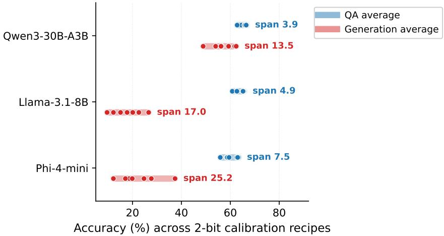  
Figure 6: Calibration composition primarily moves generation, not QA. Across 2-bit YAQA calibration recipes, QA varies modestly while generation moves more. The full sweep is in Table 5.

Recovery: data composition moves generation; KD hyperparameters do not  
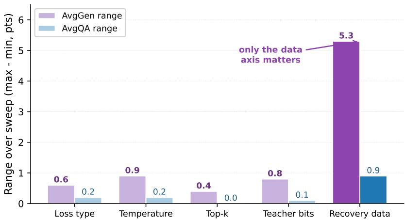  
Figure 7: In recovery, data composition dominates; KD hyperparameters move it little across the tested grid. Loss type, temperature, top-k, and teacher precision have smaller effects, especially for generation.

2-bit vector PTQ retains multiple-choice QA; generation is the fragile axis  
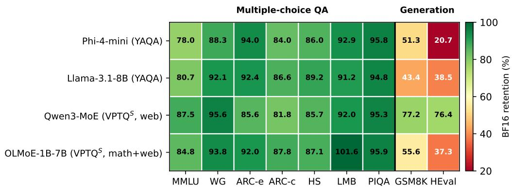  
Figure 8: Which capabilities survive 2-bit vector PTQ. Per-task retention of one representative balanced 2-bit vector checkpoint per model relative to BF16. QA and next-word prediction are largely retained, while generation (GSM8K, HumanEval) is fragile.

Table 37: The 2-bit scalar cliff is universal across rotation methods. Best-calibration-domain AvgQA at 16, 4, and 2 bits for two scalar PTQ methods (best calibration domain, so entries can exceed the web-only values of Table 3). All methods stay near BF16 at 4 bits and collapse at 2 bits. QuaRot is applied through expert-wise rotation on Qwen3-MoE.
<table><tr><td>Model</td><td>Method</td><td>BF16</td><td>4-bit</td><td>2-bit</td></tr><tr><td>Phi-4-mini</td><td>SpinQuant QuaRot</td><td>71.0 71.0</td><td>69.2 69.3</td><td>29.3 29.8</td></tr><tr><td>Llama-3.1-8B</td><td>SpinQuant QuaRot</td><td>73.1 73.1</td><td>71.8 71.7</td><td>29.8 29.3</td></tr><tr><td>Qwen3-MoE</td><td>SpinQuant QuaRot</td><td>72.6 72.6</td><td>70.8 70.3</td><td>29.4 29.3</td></tr></table>

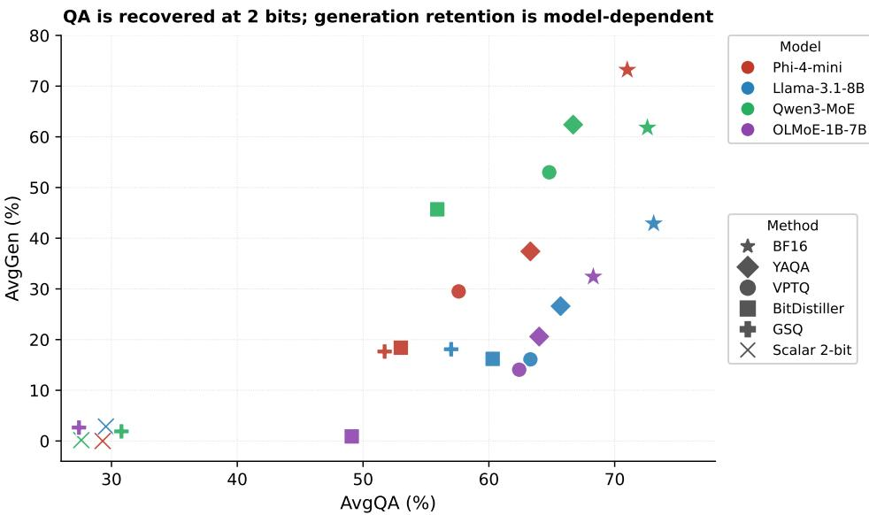  
Figure 9: QA and generation are distinct axes. AvgQA versus AvgGen for every method and model at 2 bits. Points are the per-metric best entries of Table 4 (QA and generation may come from different recipes). Vector PTQ recovers QA; generation stays near BF16 only for Qwen3-MoE. Scalar 2-bit PTQ collapses on both axes.

At \~2 bits/weight, vector codebooks sit far above the scalar floor (Phi-4-mini)  
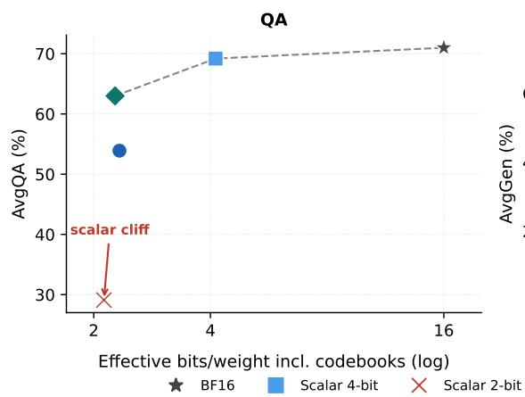

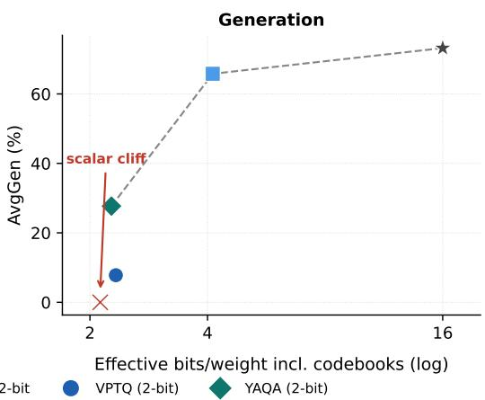  
Figure 10: The tested vector pipelines improve the nominal 2-bit quality–rate trade-off. Effective bits-per-weight versus AvgQA and AvgGen on Phi-4-mini. $\mathbf { A t } \sim 2$ bits/weight, a vector codebook (YAQA and VPTQ) sits far above the scalar 2-bit floor but below scalar 4-bit quality.

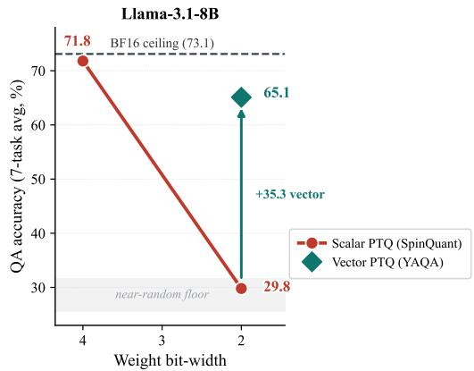  
(a) Llama-3.1-8B.

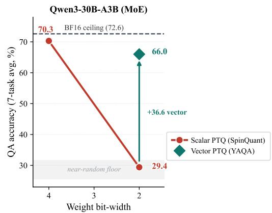  
(b) Qwen3-30B-A3B (MoE).

Figure 11: The 2-bit scalar cliff on the other models (analogs of Figure 1(a)). Scalar PTQ (Spin-Quant) AvgQA falls from near-lossless at 4 bits to the random-accuracy floor at 2 bits, while a 2-bit vector codebook (YAQA, web calibration) recovers much of the gap. AvgQA is the seven-task mean.  
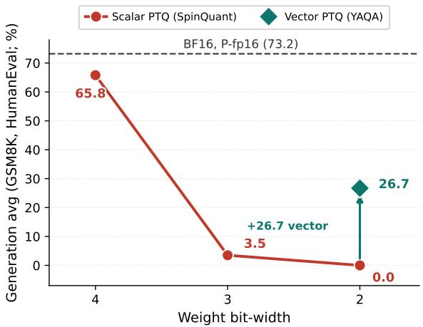  
Figure 12: Generation cliff on Phi-4-mini. Scalar SpinQuant generation collapses by 3-bit and vanishes at 2-bit. A vector codebook restores part of the gap. AvgGen averages GSM8K and HumanEval.

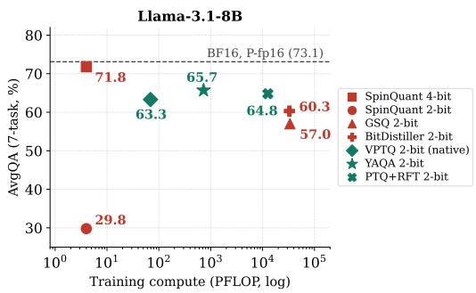  
(a) AvgQA (7-task).

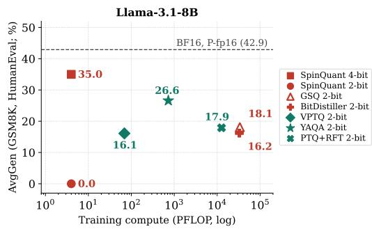  
(b) AvgGen (GSM8K, HumanEval).  
Figure 13: Llama-3.1-8B accuracy and generation vs. training compute (analog of Figure 1(b)). Scalar = crimson, vector = teal. The x-axis is training compute (log scale). PTQ+RFT is plotted at full-pipeline cost (YAQA plus recovery; the math+web long recovery of Table 8, P-bf16). VPTQ QA is native VPTQ, and BF16 references are P-fp16.

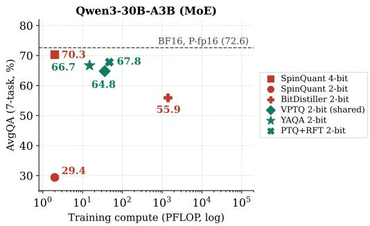  
(a) AvgQA (7-task).

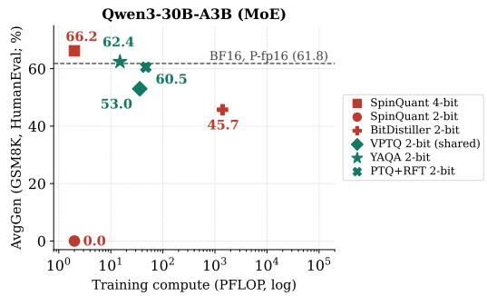  
(b) AvgGen (GSM8K, HumanEval).  
Figure 14: Qwen3-30B-A3B (MoE) accuracy and generation vs. training compute (analog of Figure 1(b)). The MoE stays near its under-measured completion-prompt reference. Under the chat template it retains more HumanEval than the smaller dense models. VPTQ uses expert-shared codebooks (2.09 effective bits). PTQ+RFT is plotted at full-pipeline cost $( 1 5 + 3 2 = 4 7 \mathrm { { P F L O P } ) }$

## Qwen3-30B-A3B, MATH-500 (n=40): the penalty helps BF16 and 2-bit alike

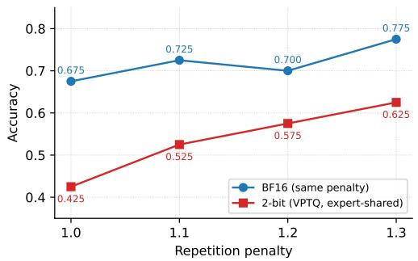

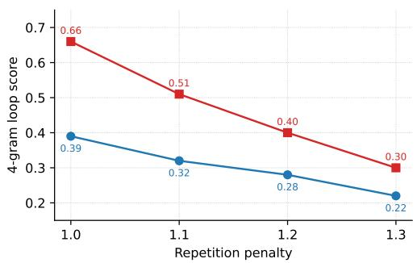  
Figure 15: A repetition penalty helps BF16 and 2-bit alike (Qwen3-30B-A3B, 40 MATH-500 level-4/5 problems, greedy, same penalty for both models; the 2-bit model is expert-shared VPTQ). The penalty improves both precisions and lowers the 4-gram loop score for both. The matcheddecoding gap remains (0.15 at 1.3).