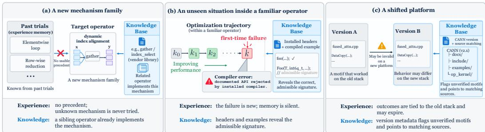
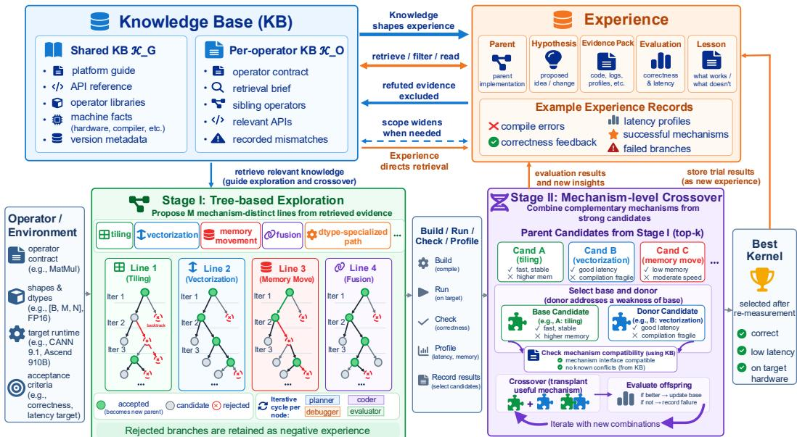

# BEYOND EXPERIENCE: KNOWLEDGE-GUIDED EVOLU-TION FOR NPU KERNEL GENERATION

Xi Chen1,2,∗ Ming Shen1,3,∗ Haotian Yan1,4 Ruoyu Sun5,1 Tianjun Yao1

1Shenzhen Loop Area Institute (SLAI)

2Guangzhou University

3Shanghai Jiao Tong University

4Southwestern University of Finance and Economics

5The Chinese University of Hong Kong, Shenzhen

\*Equal contribution

## ABSTRACT

LLM agents have become capable kernel engineers on mainstream GPU stacks, but they struggle on emerging accelerators such as Ascend NPUs, whose programming model is barely represented in pretraining data. Recent NPU agents address this gap largely through experience: they accumulate memory from their own generation and optimization trials and reuse it on later tasks. We argue that experience alone is not enough for kernel generation. An agent can only remember what it has tried, and it rarely tries a mechanism it does not know. As a result, such memory offers little help when a new operator calls for a different mechanism, and even familiar operators raise unseen situations as optimization proceeds. We present ASCENDEVOLVE, which grounds every step of an evolutionary kernel search in a large external knowledge base built from platform documentation, toolkit headers, and operator repositories. Because this corpus far exceeds any context window, ASCENDEVOLVE indexes it and routes each agent to a small, task-specific slice of evidence instead of the corpus itself. The retrieved knowledge seeds diverse implementation strategies, guides repair when a candidate fails, and constrains how strong candidates are recombined. On 53 Ascend C operators from CANN-Bench spanning four difficulty levels, ASCENDEVOLVE achieves an overall score of 71.39, improving over Reflexion and OpenEvolve by 11.6% and 17.2%.

## 1 INTRODUCTION

Trial-and-error agents learn from the programs they actually generate and evaluate. As a result, a memory built from past trials is naturally limited by what the agent has explored: it can reuse and refine discovered mechanisms, but does not guarantee access to mechanisms that have never appeared in its search. This motivates knowledge beyond self-generated experience.

Recent work has demonstrated substantial progress in LLM-based kernel generation and optimization for GPUs. On CUDA and related programming stacks, iterative workflows that combine generation with compilation, execution, and profiling feedback can progressively improve both correctness and performance (Ouyang et al., 2025; Zhang et al., 2025; Wei et al., 2025; Baronio et al., 2025). These results establish iterative execution feedback as an effective ingredient for kernel optimization on mature GPU ecosystems. The problem becomes considerably more challenging on specialized accelerator programming stacks for which general-purpose LLMs have demonstrated substantially lower capability—a difficulty well documented for domain-specific programming languages more broadly (Joel et al., 2025). On Huawei’s Ascend NPU (Liao et al., 2021), recent work reports that general-purpose LLMs achieve very low success rates on complex kernel-generation tasks without domain-specific adaptation (Cao et al., 2026).

Recent systems have addressed this difficulty in part by accumulating reusable experience from previous generation and optimization trajectories. Value-driven memory substantially improves functional correctness over zero-shot prompting (Zheng et al., 2026), and experience mined from optimization trajectories yields consistent speedups on existing operators (Wu et al., 2026; Zhang et al., 2026). These results provide strong evidence that reusable experience can substantially improve both feasibility and optimization efficiency. However, these systems necessarily construct their reusable evidence from trajectories that the agent has already proposed and evaluated. This suggests a complementary limitation: the usefulness of experience depends not only on how much is retained, but also on what the agent has managed to explore.

  
Figure 1: Three situations in which an agent’s own trials offer no usable precedent while primary platform sources do: (a) a mechanism family absent from past trials, (b) a first-time failure midway through optimization, and (c) a motif carried across toolkit versions. Illustrative, not measured.

We refer to this coverage constraint as experience closure: the reusable evidence in a selfgenerated memory is derived from trajectories the agent has actually proposed and evaluated. As a result, such memory may provide limited guidance for mechanisms that have not yet appeared in those trajectories—particularly on platforms where the model’s familiarity with the programming stack is limited to begin with.

Figure 1 shows three settings where self-generated experience provides limited guidance:

(i) Coverage gap. An operator may require a mechanism family that no previous trajectory has explored; since such a mechanism is rarely proposed, it is also unlikely to be recorded.

(ii) Repair gap. A familiar operator may encounter, midway through optimization, a constraint that has not appeared before—compiler diagnostics often identify the violated constraint without directly providing a valid alternative implementation.

(iii) Validity gap. Experience collected under one software or hardware configuration may not transfer unchanged to another.

Self-generated experience is not the only source of implementation evidence. Accelerator ecosystems expose additional information through programming guides, API definitions, installed headers, reference implementations, and vendor-maintained operator libraries (NVIDIA Corporation, 2017; Zhao et al., 2021). These sources can provide mechanism and constraint information before the agent has encountered the corresponding trajectory itself. We therefore view primary platform knowledge and execution experience as complementary: platform knowledge can broaden the set of mechanisms the agent considers, while execution experience provides empirical evidence about which candidates are correct and efficient on the target device (Wen et al., 2026). Our goal is not to replace trial-and-error with retrieval, but to inform it.

We present ASCENDEVOLVE, a system that grounds every stage of an evolutionary kernel search in primary platform sources. The design follows three principles:

① Hierarchical and version-aware. Platform information is organized hierarchically and with version awareness: a shared, versioned corpus of documentation, installed headers, and vendor operator libraries is distilled into per-operator evidence before search begins, avoiding repeated processing of a large heterogeneous corpus.

② Demand-driven retrieval. Rather than placing the corpus in context, ASCENDEVOLVE routes each concrete implementation or optimization question to a small set of relevant sources.

③ Bidirectional interaction. Retrieved platform evidence and execution experience interact bidirectionally: retrieved mechanisms seed candidate implementations, each trial records an empirical verdict on the knowledge it was grounded in, and outcomes influence subsequent retrieval.

Because retrieved evidence may suggest multiple plausible implementation mechanisms rather than a single canonical solution, ASCENDEVOLVE maintains several mechanism-distinct implementation lines and progressively selects and recombines promising design choices through evolutionary search.

On 53 Ascend C operators spanning four difficulty levels, ASCENDEVOLVE achieves an overall score of 71.39, improving over Reflexion (Shinn et al., 2023) and OpenEvolve (Sharma, 2025) by 11.6% and 17.2%, respectively, with the largest gains on the operator categories where prior agents have the lowest correctness coverage. On L4 operators, ASCENDEVOLVE reaches 35.0% correctness coverage compared with 4.38% for Reflexion and 1.25% for OpenEvolve. Removing the knowledge base nearly halves the L3 score, showing how platform knowledge helps generate correct kernels. Our contributions are as follows:

① Experience closure. We identify experience closure—a coverage limitation of experience-driven kernel agents on platforms outside the model’s familiarity—and characterize three settings where it is most pronounced.

② Method. We propose ASCENDEVOLVE, which couples primary platform knowledge with procedural experience through hierarchical, demand-driven retrieval and bidirectional feedback within an evolutionary search that maintains mechanism-diverse implementation lines.

③ Evaluation. We evaluate on 53 Ascend C operators from CANN-Bench (Gao et al., 2026) and show that knowledge grounding yields substantial gains, particularly on hard operators where experience-only methods have very low correctness coverage. We isolate the contribution of the knowledge base through ablation.

## 2 PROBLEM FORMULATION

Notation. Let o denote an operator specified by an executable reference implementation and a set of test cases $\mathcal { T } = \{ ( \mathbf { x } _ { i } , \mathbf { y } _ { i } ) \} _ { i = 1 } ^ { N ^ { \bullet } }$ , where each $\left( \mathbf { x } _ { i } , \mathbf { y } _ { i } \right)$ is an input–output pair. A candidate kernel x is a compilable Ascend C program that implements o. We write $C ( x ) \in [ 0 , 1 ]$ for the fraction of test cases that x passes under a fixed numerical-tolerance criterion, and $L ( x )$ for the wall-clock latency of x measured on the target device under a fixed profiling protocol. $\kappa _ { G }$ is a shared, static knowledge base of platform documentation, vendor libraries and machine-observed facts. $\scriptstyle { \mathcal { K } } _ { o }$ is a per-operator knowledge base that fixes the task contract and links it to ${ \boldsymbol { \mathcal { K } } } _ { G } . { \boldsymbol { \mathcal { E } } }$ is a dynamic experience store that accumulates trial records during search. $R ( q \mid K _ { o } , K _ { G } , { \mathcal { E } } )$ is a retrieval function that, given a concrete question q, returns a small evidence pack C from the knowledge bases, filtered by experience.

Problem setup. The goal is to produce a kernel $x ^ { \star }$ that is correct on all test cases and as fast as possible on the target device. We compare candidates with a correctness-first fitness

$$
F ( x ) = { \bigl ( } C ( x ) , - L ( x ) { \bigr ) } ,\tag{1}
$$

ordered lexicographically: latency is compared only between candidates of equal correctness. The search is conducted by an LLM-based agent that, at each step t, conditions on an evidence pack

$$
\mathcal { C } _ { t } = R \big ( q _ { t } \ | \ K _ { o } , \ K _ { G } , \mathcal { E } _ { < t } \big )\tag{2}
$$

to propose, evaluate and refine candidates. The agent must maximize $F$ within T LLM calls.

## 3 METHOD

## 3.1 OVERVIEW

Existing agents search the space of candidate kernels with an LLM policy conditioned on experience $\mathcal { E } _ { < t }$ gathered from earlier trials. On a platform the LLM barely knows, this conditioning is not enough: the policy can only revisit and recombine what it has already tried, and a mechanism that lies outside its prior is never sampled in the first place. ASCENDEVOLVE adds a second source of information that does not depend on the agent’s own behavior: every decision is conditioned on the evidence pack $\mathcal { C } _ { t }$ (Eq. 2), which retrieves version-checked platform facts and expert implementation patterns from the knowledge bases $\kappa _ { G }$ and $\scriptstyle { \mathcal { K } } _ { o }$ , filtered by accumulated experience. The rest of this section describes how the knowledge bases are built (§3.2), how $R$ retrieves from a corpus far larger than any context window (§3.3), how knowledge and experience interact (§3.4), and how both drive a two-stage evolutionary search (§3.5). Figure 2 gives an overview.

  
Figure 2: Overview of ASCENDEVOLVE. Retrieval draws a task-specific evidence pack from $\kappa _ { G }$ and $\kappa _ { o } .$ Stage I explores M mechanism-distinct lines as trees, keeping rejected branches as negative experience; Stage II transplants a donor mechanism into the best base after a compatibility check. Each trial writes a record that steers later retrieval.

## 3.2 KNOWLEDGE BASE CONSTRUCTION

Writing a kernel requires answers to three questions: what the operator must compute, what the platform permits, and how experts implement similar operators on it. The first is specific to each task. The other two are shared across tasks. We organize knowledge along this line.

Shared knowledge base. $\kappa _ { G }$ holds platform knowledge and is built from primary sources, not from hand-written summaries. It contains the official programming guide, API reference and compilable examples; the vendor’s open-source operator libraries, which expose production implementations across operator families; and facts recorded from the target machine, such as installed headers and the compiler in use. Each source d $\in { \cal K } _ { G }$ carries metadata $m ( d )$ that records its toolkit version, hardware scope and trust level; this metadata induces an authority order ≻ used during retrieval (§3.3). $\kappa _ { G }$ is immutable during search. Appendix A lists the sources and their statistics.

Per-operator knowledge base. $\scriptstyle { \mathcal { K } } _ { o }$ fixes the task and tells the agent where to look. It has two parts. The contract freezes the operator semantics, the executable reference, the shape and dtype inventory, the target environment and the acceptance criteria; it is the sole authority on what the kernel must compute. The retrieval brief links the operator to $\kappa _ { G } \mathrm { : }$ it names the operator family, the closest sibling implementations and the relevant API entries, and it records any disagreement found between these sources and the contract. $\scriptstyle { \mathcal { K } } _ { o }$ is produced fully automatically by a preparation pass that runs once per operator before search begins, with no human editing, and it stores references into $\kappa _ { G }$ never copies. In one of our tasks, for example, the pass found that a closely related vendor operator places a numerical-stability constant differently from the executable reference. The brief records this mismatch, so later agents borrow the vendor’s tiling without its arithmetic.

## 3.3 RETRIEVAL FROM A LARGE KNOWLEDGE BASE

$\kappa _ { G }$ exceeds the context window by orders of magnitude, and most of it is irrelevant to any single decision. Two properties of kernel code make standard dense retrieval (Lewis et al., 2021) a poor fit. Queries are frequently exact symbols, and a nearly identical passage from a mismatched toolkit version is actively harmful, since it leads to code that looks right and does not compile. We therefore design R as a hierarchical, demand-driven procedure with three steps.

① Route. Retrieval is triggered by one concrete question $q _ { t }$ , such as how a given API handles tail elements, and never by the task as a whole. The retrieval brief in $\kappa _ { o } ,$ , backed by a global index over $\kappa _ { G }$ , maps $q _ { t }$ to a short list of candidate sources. This step reduces the search space from the whole corpus to a handful of files.

② Filter. Candidates are checked against the target environment using $m ( d )$ . Sources of a mismatched version are either dropped or kept as explicitly labeled leads. When two candidates disagree, the authority order $\succ$ breaks the tie: facts observed on the target machine outrank official sources of the matching version, which outrank other versions and informal material. The disagreement itself is retained in the pack so that the agent is aware of it.

③ Read. The agent reads the surviving sources directly, locating the relevant region by exact symbol or path. Implementation patterns are returned with their surrounding code, because a tiling loop is meaningless without the declarations it relies on.

If a question remains unresolved after these steps, the scope widens one level along the index. Each item in $\mathcal { C } _ { t }$ keeps its source identity, so that decisions in the final kernel are traceable to evidence. Appendix B gives the full procedure and an example pack.

## 3.4 INTERACTION BETWEEN KNOWLEDGE AND EXPERIENCE

Knowledge and experience answer different questions. Knowledge states what is possible and legal; experience states what worked, on this operator and this device. Neither is sufficient alone. Knowledge without experience cannot say which of several legal mechanisms is fastest, and experience without knowledge is confined to the mechanisms the LLM already knows. ASCENDEVOLVE couples the two in both directions.

Knowledge shapes experience. Every trial starts from a hypothesis $h _ { t }$ that is grounded in an evidence pack, and the record written after evaluation keeps this link:

$$
e _ { t } = { \big ( } p _ { t } , ~ h _ { t } , ~ \mathcal { C } _ { t } , ~ F ( x _ { t } ) , ~ \ell _ { t } { \big ) } ,\tag{3}
$$

where $p _ { t }$ is the parent candidate and $\ell _ { t }$ is a short lesson. An experience record is thus more than a score attached to a code change. It is an empirical verdict on a piece of knowledge in a specific context, such as “the vectorized path from a sibling operator is valid here and reduces latency on large shapes” or “this API is documented but rejected by the installed compiler.” Because trials are seeded by retrieved mechanisms, the experience the agent accumulates covers regions of the design space that it would not have reached from its prior.

Experience directs retrieval. The retrieval function in Eq. 2 is conditioned on $\mathcal { E } _ { < t } \dot { : }$ : the outcome of the last trial determines the next question (a compilation error routes to headers, a numerical mismatch to the reference and dtype constraints, a regression to profiles); evidence refuted for this operator is excluded from later packs; and when accumulated failures show that the current evidence is insufficient, retrieval widens its scope. In this way experience handles situations that arise only during optimization and that no static brief could anticipate. When knowledge and measurement disagree, the on-device result overrides documentation for the task at hand; the verdict is written to the task-local experience, never to $\kappa _ { G }$ , keeping platform facts free of candidate-specific outcomes.

## 3.5 KNOWLEDGE-GROUNDED EVOLUTIONARY SEARCH

The search has two stages (Algorithm 1). Stage I explores mechanism-distinct implementation lines, and Stage II recombines the best of them.

Algorithm 1 ASCENDEVOLVE   
Require: operator $^ { O , }$ shared KB $\overline { { { \kappa _ { G } } } }$ , lines M, iterations K, crossover budget B   
1: $\begin{array} { r } { \mathcal { N } _ { o } \gets \bar { \mathrm { P R E P A R E } } ( o , \mathcal { K } _ { G } ) ; \quad \mathcal { E } \gets \emptyset } \end{array}$   
2: propose $M$ mechanism-distinct lines from $R ( \cdot \mid { \mathcal { K } } _ { o } , { \mathcal { K } } _ { G } , { \mathcal { E } } )$   
3: {Stage I: tree exploration}   
4: for each line $i = 1 , \dots , \dot { M }$ and $k = 1 , \ldots , K$ do   
5: select an accepted parent $p ;$ form question q from $\mathcal { E }$   
6: $\mathcal { C } \gets R ( q \mid \mathcal { K } _ { o } , \mathcal { K } _ { G } , \mathcal { E } )$ ▷ route, filter, read   
7: plan hypothesis h; generate child x; repair if needed   
8: evaluate ${ \cal F } ( x ) ; \quad \bar { \mathcal { E } } \gets \mathcal { E } \cup \{ ( p , h , \mathcal { C } , \bar { F } ( x ) , \ell ) \}$   
9: accept x as new parent if $F$ improves, else backtrack   
10: end for   
11: $x ^ { \star } \gets$ best candidate over all lines   
12: {Stage II: mechanism-level crossover}   
13: for $\bar { b = 1 , \ldots , B }$ do   
14: choose donor $x ^ { \prime }$ whose mechanism addresses a weakness of $x ^ { \star }$ ▷ from E   
15: if mechanisms are incompatible under $\kappa _ { o } , \kappa _ { G }$ then continue   
16: $x ^ { \prime \prime }  \operatorname { C R O S S O V E R } ( x ^ { \star } , \dot { x ^ { \prime } } ) ;$ evaluate; update $\mathcal { E }$   
17: if $F ( x ^ { \prime \prime } ) \succ F ( x ^ { \star } )$ then $x ^ { \star }  x ^ { \prime \prime }$   
18: end for   
19: return $x ^ { \star }$ after re-measurement

Stage I: tree exploration. The planner first proposes M implementation lines that differ in mechanism, for example in tiling scheme, vectorization strategy or dtype-specialized path. Diversity comes from the different mechanisms found in the retrieved evidence, not from prompt perturbation. Each line then runs for K iterations. In one iteration, following the role decomposition common to iterative code agents (Madaan et al., 2023; Shinn et al., 2023), a planner selects an accepted parent and states one falsifiable hypothesis with its expected effect; a coder realizes it as a child candidate; a debugger applies bounded repairs that preserve the hypothesis; and an evaluator runs the build, correctness and latency gates in order. If the child improves $F ,$ it becomes the next parent. Otherwise the line backtracks to an earlier accepted node and the planner forms a different hypothesis. The history of a line is therefore a tree. Rejected branches are kept as negative experience (Andrychowicz et al., 2017), which prevents a harmful change from contaminating later candidates and records which assumptions are already falsified.

Stage II: mechanism-level crossover. Stage I returns the best correct candidate of every line together with a summary of its mechanism, its per-case latency and its known weaknesses. Stage II treats these candidates as a population. The best candidate under $F$ serves as the base, and a donor is selected only if its mechanism addresses a specific weakness of the base, such as a slow shape regime or an inefficient tail path. Here the two information sources play complementary roles again: experience identifies which mechanism wins in which regime, and the knowledge base verifies whether the two mechanisms can coexist, in terms of tiling structure, dtype behavior and platform constraints. Crossover transplants the donor mechanism into the base instead of concatenating implementations. An offspring that improves F becomes the new base, and a failed combination is recorded so that the pairing is not tried again. The search ends when the budget B is spent or no compatible hypothesis remains, and the finalists are re-measured under the same protocol before the best kernel is returned.

## 4 EXPERIMENTS

## 4.1 EXPERIMENTAL SETUP

Dataset. We evaluate on CANN-Bench (Gao et al., 2026), using all 53 public operators across four difficulty levels, with 20 test cases per operator (1,060 cases in total). The benchmark progresses from relatively simple elementwise and Vector-Core operators (L1–L2) to increasingly complex fused Vector–Cube workloads (L3–L4), allowing us to examine how the methods behave as implementation requirements become more specialized.

Table 1: Main results on CANN-Bench. Build is reported over operators; runtime, correctness and performance coverage are reported over test cases. Best score per level in bold.
<table><tr><td>Level</td><td>Method</td><td>Build (%)</td><td>Runtime cases (%)</td><td>Correct cases (%)</td><td>Perf. cases (%)</td><td>Score ↑</td></tr><tr><td rowspan="3">L1 (8)</td><td>Reflexion</td><td>100.00</td><td>100.00</td><td>96.25</td><td>96.25</td><td>109.58</td></tr><tr><td>OpenEvolve</td><td>100.00</td><td>100.00</td><td>100.00</td><td>100.00</td><td>100.37</td></tr><tr><td>ASCENDEVOLVE</td><td>100.00</td><td>100.00</td><td>95.63</td><td>95.63</td><td>111.18</td></tr><tr><td rowspan="3">L2 (16)</td><td>Reflexion</td><td>100.00</td><td>100.00</td><td>99.06</td><td>91.56</td><td>81.38</td></tr><tr><td>OpenEvolve</td><td>100.00</td><td>100.00</td><td>77.50</td><td>65.94</td><td>71.27</td></tr><tr><td>ASCENDEVOLVE</td><td>100.00</td><td>100.00</td><td>85.63</td><td>78.75</td><td>87.84</td></tr><tr><td rowspan="3">L3 (21)</td><td>Reflexion</td><td>100.00</td><td>85.48</td><td>61.19</td><td>41.90</td><td>53.56</td></tr><tr><td>OpenEvolve</td><td>85.71</td><td>79.76</td><td>66.43</td><td>47.86</td><td>57.84</td></tr><tr><td>ASCENDEVOLVE</td><td>100.00</td><td>90.48</td><td>59.76</td><td>48.33</td><td>56.94</td></tr><tr><td rowspan="3">L4 (8)</td><td>Reflexion</td><td>87.50</td><td>48.13</td><td>4.38</td><td>0.00</td><td>10.94</td></tr><tr><td>OpenEvolve</td><td>50.00</td><td>41.25</td><td>1.25</td><td>0.63</td><td>8.78</td></tr><tr><td>ASCENDEVOLVE</td><td>87.50</td><td>86.88</td><td>35.00</td><td>35.00</td><td>36.63</td></tr><tr><td rowspan="3">Overall (53)</td><td>Reflexion</td><td>98.11</td><td>86.42</td><td>69.34</td><td>58.77</td><td>63.98</td></tr><tr><td>OpenEvolve</td><td>86.79</td><td>83.11</td><td>65.00</td><td>54.06</td><td>60.91</td></tr><tr><td>ASCENDEVOLVE</td><td>98.11</td><td>94.25</td><td>69.25</td><td>62.64</td><td>71.39</td></tr></table>

Baselines. We compare against two test-time search paradigms that form a natural progression. Reflexion (Shinn et al., 2023) represents sequential experience-based refinement using execution feedback. OpenEvolve (Sharma, 2025) represents population-based evolutionary search. All methods use GPT-5.5 with medium reasoning effort as the backbone, with Codex as Reflexion’s agent harness, and the same benchmark inputs and evaluator throughout.

Evaluation. We follow the staged evaluation logic of CANN-Bench (Gao et al., 2026) but recalibrate its performance component for our target NPU. Build is a binary result for each operator’s selected kernel. Runtime measures whether each test case executes without failure, and correctness checks its output against the reference implementation. A case receives performance credit only if it passes correctness and both the candidate and torch npu have valid positive latency measurements. Build coverage is operator-level; all other coverage is case-level.

Since the published CANN-Bench performance anchors are hardware-specific, we use the latency of the corresponding torch npu implementation as a common baseline. Let $b _ { o }$ indicate whether operator o builds, and let $r _ { o , i }$ and $c _ { o , i }$ indicate whether case i runs and passes correctness, respectively. We define $R _ { o , i } = b _ { o } r _ { o , i }$ and ${ \cal A } _ { o , i } = { \cal R } _ { o , i } c _ { o , i } ,$ , so a build failure gives all 20 cases zero credit. The first score component is $\textstyle \sum _ { i = 1 } ^ { 2 0 } R _ { o , i } :$ each case that runs after a successful build earns one point. The score for operator o is

$$
S _ { o } = 1 0 0 \left[ \frac { 1 } { 2 0 } \sum _ { i = 1 } ^ { 2 0 } \left( 0 . 2 R _ { o , i } + A _ { o , i } \left( 0 . 3 + 0 . 5 P _ { o , i } \right) \right) \right] ,\tag{4}
$$

where $P _ { o , i } = \mathrm { c l i p } ( \sqrt { T _ { \mathrm { t o r c h } , o , i } / T _ { \mathrm { c a n d } , o , i } } , \ 0 . 5 , \ 4 )$ when both latencies are valid and positive, and $P _ { o , i } = 0$ otherwise. Thus, 100 corresponds to full correctness with torch npu-level performance when all cases have valid latencies, while faster correct kernels may score above 100. We macroaverage operator scores so each contributes equally.

## 4.2 MAIN RESULTS

ASCENDEVOLVE achieves the highest overall score (71.39), improving over Reflexion and OpenEvolve by 11.6% and 17.2%, respectively (Table 1). The source of the gain changes with difficulty. On L1–L2, where executability is already high, improvements come from stronger optimization rather than broader coverage. On L4, the bottleneck shifts to implementation feasibility: ASCENDEVOLVE reaches 35.0% correctness coverage, compared with 4.38% for Reflexion and 1.25% for OpenEvolve. L3 is more mixed: OpenEvolve obtains a slightly higher final score, while ASCENDEVOLVE achieves substantially higher build and runtime coverage.

Table 2: Overall score decomposition. Successful runs contribute $\textstyle \sum _ { i } R _ { o , i }$ points per operator, one per case that runs after a successful build.
<table><tr><td>Method</td><td>Successful runs (pts)</td><td>Correct. score</td><td>Perf. score</td><td>Score ↑</td><td>Build (%)</td><td>Runtime cases (%)</td><td>Correct cases (%)</td><td>Perf. cases (%)</td></tr><tr><td>ASCENDEVOLVE</td><td>18.85</td><td>20.77</td><td>31.77</td><td>71.39</td><td>98.11</td><td>94.25</td><td>69.25</td><td>62.64</td></tr><tr><td>Reflexion</td><td>17.28</td><td>20.80</td><td>25.90</td><td>63.98</td><td>98.11</td><td>86.42</td><td>69.34</td><td>58.77</td></tr><tr><td>OpenEvolve</td><td>16.62</td><td>19.50</td><td>24.79</td><td>60.91</td><td>86.79</td><td>83.11</td><td>65.00</td><td>54.06</td></tr></table>

Table 3: Level 3 knowledge-base ablation.
<table><tr><td>Metric</td><td>No KB</td><td>With KB</td><td>∆</td></tr><tr><td>Build coverage</td><td>61.90%</td><td>100.00%</td><td>↑38.10</td></tr><tr><td>Runtime-case coverage</td><td>57.86%</td><td>90.48%</td><td>↑32.62</td></tr><tr><td>Correct-case coverage</td><td>40.24%</td><td>59.76%</td><td>↑19.52</td></tr><tr><td>Performance-case coverage</td><td>17.86%</td><td>48.33%</td><td>↑30.48</td></tr><tr><td>Score ↑</td><td>29.49</td><td></td><td>56.94↑27.45</td></tr></table>

Table 4: Stage-wise synthesis outcomes.
<table><tr><td>Stage 2 vs. Stage 1 Adoption Level relative gain (%) ↑ rate (%) ↑</td></tr><tr><td>L1 4.02 62.5</td></tr><tr><td>L2 3.26 87.5</td></tr><tr><td>L3 1.88 25.0</td></tr></table>

Observation 1. External knowledge becomes increasingly important when the challenge is no longer merely optimizing a valid implementation, but finding a valid implementation mechanism.

## 4.3 WHERE DO THE GAINS COME FROM?

The gain over Reflexion comes primarily from optimization rather than additional correctness: the two methods have nearly identical correctness coverage (69.25% vs. 69.34%), while ASCENDEVOLVE’s performance score increases from 25.90 to 31.77 and accounts for 79.2% of the overall improvement (Table 2). Against OpenEvolve, runtime, correctness and performance all improve.

Observation 2. Knowledge grounding serves two roles: it improves the quality of valid kernels and prevents search from being lost in invalid implementations.

## 4.4 DOES EXTERNAL KNOWLEDGE HELP BEYOND EXPERIENCE?

Removing the knowledge base causes failures throughout the evaluation pipeline: build coverage falls from 100% to 61.9%, and performance coverage from 48.3% to 17.9% (Table 3). The effect is therefore not limited to making correct kernels faster. External knowledge allows substantially more implementations to survive compilation, execution and correctness validation before performance optimization can even begin. As a result, the L3 score nearly doubles from 29.49 to 56.94.

This effect is also visible in strategy diversity (Table 6): the KB increases planned strategies only from 5.25 to 6.75 per operator, but increases full-correct strategies from 0.25 to 1.30—a more than 5× increase. Knowledge therefore does not merely make the agent propose more strategies; it makes a much larger fraction of distinct strategies survive platform and correctness constraints.

Observation 3. Knowledge improves effective, not merely nominal, exploration.

## 4.5 WHEN DOES MECHANISM-LEVEL SYNTHESIS HELP?

Stage 2 improves the final set over Stage 1 by 4.02% on L1, 3.26% on L2 and 1.88% on L3 (Table 4). Adoption is highest on L2 at 87.5%, followed by L1 at 62.5% and L3 at 25.0%. The results indicate that synthesis is most effective when optimization mechanisms can be transferred while preserving validated semantics.

Stage 2 is effective when a donor mechanism matches a recurring input regime and can be integrated without changing the validated computation. Cases outside that regime retain the Stage 1 path and show little change. Crossover can be neutral or harmful when it addresses only a narrow correctness edge case, replaces a parallel implementation with a less efficient path, or introduces no substantive mechanism change. This pattern is consistent with the high adoption rate at L2 and the lower adoption and limited uplift at L3. Appendix F gives representative stage-wise case studies.

Table 5: Archive-visible implementation diversity on 20 common Level 2–3 operators. ASCENDEVOLVE is evaluated using its Stage 1 warmup candidates.
<table><tr><td>Method</td><td>Strategy Kernel Pairwise sig./op src./op src. disagr. struct. dist. ↑</td><td>↑</td><td>↑</td><td>Pairwise ↑</td></tr><tr><td>ASCENDEVOLVE (S1)</td><td>6.75</td><td>13.90</td><td>95.1%</td><td>0.303</td></tr><tr><td>Reflexion</td><td>1.60</td><td>2.70</td><td>50.7%</td><td>0.081</td></tr><tr><td>OpenEvolve</td><td>1.30</td><td>1.65</td><td>19.6%</td><td>0.049</td></tr></table>

Table 6: Correctness-effective plannedstrategy diversity during warmup on 20 Level 3 operators.
<table><tr><td>With No Metric KB KB</td></tr><tr><td>Planned strategy sig. / op</td></tr><tr><td>6.75 5.25 1.30 0.25</td></tr><tr><td>Full-correct-eff. sig. / op Full-correct strategy survival 19.3% 4.8%</td></tr><tr><td>Ops with ≥ 1 full-correct 40.0% 20.0%</td></tr><tr><td></td></tr></table>

Observation 4. Synthesis is most effective when mechanisms can be composed without altering correctness-sensitive computation.

## 4.6 DOES KNOWLEDGE ENABLE MORE EFFECTIVE EXPLORATION?

ASCENDEVOLVE explores substantially more mechanism-distinct implementations than Reflexion and OpenEvolve (Table 5). More importantly, this diversity is not merely syntactic: with knowledge grounding, substantially more planned mechanisms survive correctness filtering (Table 6). The KB increases full-correct strategy survival from 4.8% to 19.3%, supporting the role of the knowledge base as a source of viable mechanisms rather than simply additional prompting context.

## 5 RELATED WORK

LLM-based kernel generation. LLM-based kernel generation has progressed rapidly on CUDA and Triton. KERNELBENCH (Ouyang et al., 2025) established a systematic benchmark for functional correctness and performance, while subsequent work explored multi-agent refinement (Zhang et al., 2025; Wei et al., 2025), reinforcement learning with execution feedback (Baronio et al., 2025; Li et al., 2025; Woo et al., 2025; Zhu et al., 2025), and evolutionary search (Novikov et al., 2025; Liao et al., 2025). Kernel generation is more challenging on specialized accelerator stacks such as Ascend C, where general-purpose LLMs show limited out-of-the-box capability (Cao et al., 2026). Recent work addresses this gap through domain adaptation (Cao et al., 2026), constrained intermediate representations (Wen et al., 2025), external knowledge augmentation (Wen et al., 2026; Qiu et al., 2026), and reusable experience accumulated from previous search trajectories (Zheng et al., 2026; Wu et al., 2026). Our work focuses on the complementarity between the latter two directions.

Test-time search and experience for code agents. Test-time scaling improves agent performance through additional refinement, search, memory, or population-based exploration (Madaan et al., 2023; Shinn et al., 2023; Yao et al., 2023; Wang et al., 2023; Novikov et al., 2025). For kernel generation, compilation and execution provide strong verification signals, motivating iterative and evolutionary search guided by previous outcomes (Liao et al., 2025; Zhang et al., 2026; Zheng et al., 2026). However, increasing the number of trials does not necessarily increase the diversity of mechanisms explored when new candidates are generated primarily from previously discovered trajectories. Our method complements experience-driven search with retrieved platform knowledge, using external evidence to seed mechanism-diverse implementation lines and execution feedback to evolve them. Appendix C relates our setting to automated kernel optimization before LLMs and to retrieval-augmented generation for code.

## 6 CONCLUSION AND LIMITATIONS

ASCENDEVOLVE combines trial experience with hierarchical, demand-driven platform knowledge for evolutionary kernel search. On 53 Ascend C operators, it improves over Reflexion and OpenEvolve by 11.6% and 17.2%; ablations show that knowledge expands both the pool of candidates eligible for optimization and the diversity of correct mechanisms.

Limitations. Performance varies by difficulty: on the hardest operators, retrieved knowledge improves executability more than numerical correctness, but cannot guarantee semantic correctness.

## AI USE STATEMENT

Large language models (LLMs) were used as general-purpose assistance tools in a limited capacity during the preparation of this work. Specifically, they assisted with grammar and spelling correction, implementation support for the proposed method and experiments, and manuscript formatting. The research ideas, methodological choices, experimental design, analysis and interpretation of results, and conclusions were developed and determined by the authors. All LLM-assisted code and textual revisions were independently reviewed, tested, and verified by the authors before being incorporated into this work. The authors take full responsibility for the scientific content and final presentation of the paper.

## REFERENCES

Marcin Andrychowicz, Filip Wolski, Alex Ray, Jonas Schneider, Rachel Fong, Peter Welinder, Bob McGrew, Josh Tobin, Pieter Abbeel, and Wojciech Zaremba. Hindsight experience replay. Advances in neural information processing systems, 30, 2017.

Riyadh Baghdadi, Jessica Ray, Malek Ben Romdhane, Emanuele Del Sozzo, Abdurrahman Akkas, Yunming Zhang, Patricia Suriana, Shoaib Kamil, and Saman Amarasinghe. Tiramisu: A polyhedral compiler for expressing fast and portable code. In 2019 IEEE/ACM International Symposium on Code Generation and Optimization (CGO), 2019.

Carlo Baronio, Pietro Marsella, Ben Pan, Simon Guo, and Silas Alberti. Kevin: Multi-turn RL for generating CUDA kernels. arXiv preprint arXiv:2507.11948, 2025.

Uday Bondhugula, Albert Hartono, J Ramanujam, and P Sadayappan. A practical automatic polyhedral parallelizer and locality optimizer. In The ACM SIGPLAN Conference on Programming Language Design and Implementation (PLDI), 2008.

Xinzi Cao, Jianyang Zhai, Pengfei Li, Zhiheng Hu, Cen Yan, Bingxu Mu, Guanghuan Fang, Bin She, Jiayu Li, Yihan Su, et al. AscendKernelGen: A systematic study of LLM-based kernel generation for neural processing units. arXiv preprint arXiv:2601.07160, 2026.

Tianqi Chen, Thierry Moreau, Ziheng Jiang, Lianmin Zheng, Eddie Yan, Haichen Shen, Meghan Cowan, Leyuan Wang, Yuwei Hu, Luis Ceze, et al. TVM: An automated end-to-end optimizing compiler for deep learning. In The 13th USENIX Symposium on Operating Systems Design and Implementation (OSDI), pp. 578–594, 2018.

Xue-Jian Gao, Deng Pan, Yueming Su, Jiasheng Li, Bin Du, Fengming Zhu, Chengdi Ma, Junyi Fan, Qichen Liao, Chengqiu Hu, et al. Cann bench: Benchmarking agent generated kernels against real npu and algorithmic limits. arXiv preprint arXiv:2607.20518, 2026.

Sathvik Joel, Jie JW Wu, and Fatemeh H. Fard. A survey on llm-based code generation for lowresource and domain-specific programming languages, 2025. URL https://arxiv.org/ abs/2410.03981.

Denis Kocetkov, Raymond Li, Loubna Ben Allal, Jia Li, Chenghao Mou, Carlos Munoz Ferrandis,˜ Yacine Jernite, Margaret Mitchell, Sean Hughes, Thomas Wolf, et al. The stack: 3 tb of permissively licensed source code. arXiv preprint arXiv:2211.15533, 2022.

Patrick Lewis, Ethan Perez, Aleksandra Piktus, Fabio Petroni, Vladimir Karpukhin, Naman Goyal, Heinrich Kuttler, Mike Lewis, Wen tau Yih, Tim Rockt¨ aschel, Sebastian Riedel, and Douwe¨ Kiela. Retrieval-augmented generation for knowledge-intensive NLP tasks, 2021. URL https: //arxiv.org/abs/2005.11401.

Shangzhan Li, Zefan Wang, Ye He, Yuxuan Li, Qi Shi, Jianling Li, Yonggang Hu, Wanxiang Che, Xu Han, Zhiyuan Liu, et al. AutoTriton: Automatic triton programming with reinforcement learning in LLMs. arXiv preprint arXiv:2507.05687, 2025.

Gang Liao, Hongsen Qin, Ying Wang, Alicia Golden, Michael Kuchnik, Yavuz Yetim, Jia Jiunn Ang, Chunli Fu, Yihan He, Samuel Hsia, et al. KernelEvolve: Scaling agentic kernel coding for heterogeneous AI accelerators at meta. arXiv preprint arXiv:2512.23236, 2025.

Heng Liao, Jiajin Tu, Jing Xia, Hu Liu, Xiping Zhou, Honghui Yuan, and Yuxing Hu. Ascend: a scalable and unified architecture for ubiquitous deep neural network computing : Industry track paper. In 2021 IEEE International Symposium on High-Performance Computer Architecture (HPCA), pp. 789–801, 2021. doi: 10.1109/HPCA51647.2021.00071.

Shuai Lu, Nan Duan, Hojae Han, Daya Guo, Seung won Hwang, and Alexey Svyatkovskiy. ReACC: A retrieval-augmented code completion framework, 2022. URL https://arxiv.org/abs/ 2203.07722.

Aman Madaan, Niket Tandon, Prakhar Gupta, Skyler Hallinan, Luyu Gao, Sarah Wiegreffe, Uri Alon, Nouha Dziri, Shrimai Prabhumoye, Yiming Yang, Shashank Gupta, Bodhisattwa Prasad Majumder, Katherine Hermann, Sean Welleck, Amir Yazdanbakhsh, and Peter Clark. Self-refine: Iterative refinement with self-feedback, 2023. URL https://arxiv.org/abs/2303.17651.

Alexander Novikov, Ngan Vˆ u, Marvin Eisenberger, Emilien Dupont, Po-Sen Huang, Adam Zsolt Wag-˜ ner, Sergey Shirobokov, Borislav Kozlovskii, Francisco J. R. Ruiz, Abbas Mehrabian, M. Pawan Kumar, Abigail See, Swarat Chaudhuri, George Holland, Alex Davies, Sebastian Nowozin, Pushmeet Kohli, and Matej Balog. Alphaevolve: A coding agent for scientific and algorithmic discovery, 2025. URL https://arxiv.org/abs/2506.13131.

NVIDIA Corporation. CUTLASS: CUDA templates for linear algebra subroutines. https:// github.com/NVIDIA/cutlass, 2017. Accessed: 2026-05-07.

Anne Ouyang, Simon Guo, Simran Arora, Alex L Zhang, William Hu, Christopher Re, and´ Azalia Mirhoseini. KernelBench: Can LLMs write efficient GPU kernels? arXiv preprint arXiv:2502.10517, 2025.

Md Rizwan Parvez, Wasi Ahmad, Saikat Chakraborty, Baishakhi Ray, and Kai-Wei Chang. Retrieval augmented code generation and summarization. In Marie-Francine Moens, Xuanjing Huang, Lucia Specia, and Scott Wen-tau Yih (eds.), Findings of the Association for Computational Linguistics: EMNLP 2021, pp. 2719–2734, Punta Cana, Dominican Republic, November 2021. Association for Computational Linguistics. doi: 10.18653/v1/2021.findings-emnlp.232. URL https://aclanthology.org/2021.findings-emnlp.232/.

Junhao Qiu, Zidong Wang, Yansong Sun, Zhitong Ma, Ping Guo, and Qingfu Zhang. Agenticcann: Automated ascend c operator generation via knowledge-augmented agentic evolution. arXiv preprint arXiv:2607.26661, 2026.

Jonathan Ragan-Kelley, Connelly Barnes, Andrew Adams, Sylvain Paris, Fredo Durand, and Saman´ Amarasinghe. Halide: A language and compiler for optimizing parallelism, locality, and recomputation in image processing pipelines. In The 34th ACM SIGPLAN Conference on Programming Language Design and Implementation (PLDI), 2013.

Asankhaya Sharma. OpenEvolve: An open-source evolutionary coding agent. https:// github.com/algorithmicsuperintelligence/openevolve, 2025. URL https: //github.com/algorithmicsuperintelligence/openevolve.

Noah Shinn, Federico Cassano, Ashwin Gopinath, Karthik Narasimhan, and Shunyu Yao. Reflexion: Language agents with verbal reinforcement learning. Advances in neural information processing systems, 36:8634–8652, 2023.

Sven Verdoolaege, Juan Carlos Juega, Albert Cohen, Jose Ignacio Gomez, Christian Tenllado, and Francky Catthoor. Polyhedral parallel code generation for CUDA. ACM Transactions on Architecture and Code Optimization (TACO), 9(4):1–23, 2013.

Guanzhi Wang, Yuqi Xie, Yunfan Jiang, Ajay Mandlekar, Chaowei Xiao, Yuke Zhu, Linxi Fan, and Anima Anandkumar. Voyager: An open-ended embodied agent with large language models. arXiv preprint arXiv:2305.16291, 2023.

Anjiang Wei, Tianran Sun, Yogesh Seenichamy, Hang Song, Anne Ouyang, Azalia Mirhoseini, Ke Wang, and Alex Aiken. Astra: A multi-agent system for GPU kernel performance optimization. arXiv preprint arXiv:2509.07506, 2025.

Junyi Wen, Ruiyan Zhuang, Yongjia Xu, Pengtu Li, Rui Zou, Hongyi Chen, Chingman Wan, Puxu Yang, Wuhui Chen, and Yanlin Wang. Hawk: Harnessing hardware-aware knowledge for highperformance npu kernel generation. arXiv preprint arXiv:2607.01590, 2026.

Zhongzhen Wen, Shudi Shao, Zhong Li, Yu Ge, Tongtong Xu, Yuanyi Lin, and Tian Zhang. Ascendcraft: Automatic ascend npu kernel generation via dsl-guided transcompilation. arXiv preprint arXiv:2601.22760, 2025.

Jiin Woo, Shaowei Zhu, Allen Nie, Zhen Jia, Yida Wang, and Youngsuk Park. TritonRL: Training LLMs to think and code triton without cheating. arXiv preprint arXiv:2510.17891, 2025.

Jiehao Wu, Zixiao Huang, Wenhao Li, Chuyun Shen, Junjie Sheng, and Xiangfeng Wang. Ascendoptimizer: Episodic agent for ascend npu operator optimization. arXiv preprint arXiv:2603.23566, 2026.

Shunyu Yao, Dian Yu, Jeffrey Zhao, Izhak Shafran, Thomas L. Griffiths, Yuan Cao, and Karthik Narasimhan. Tree of thoughts: Deliberate problem solving with large language models, 2023. URL https://arxiv.org/abs/2305.10601.

Yi Zhai, Yu Zhang, Shuo Liu, Xiaomeng Chu, Jie Peng, Jianmin Ji, and Yanyong Zhang. TLP: A deep learning-based cost model for tensor program tuning. In The 28th ACM International Conference on Architectural Supportfor Programming Languages and Operating Systems (ASPLOS), 2023.

Fengji Zhang, Bei Chen, Yue Zhang, Jacky Keung, Jin Liu, Daoguang Zan, Yi Mao, Jian-Guang Lou, and Weizhu Chen. RepoCoder: Repository-level code completion through iterative retrieval and generation. In Houda Bouamor, Juan Pino, and Kalika Bali (eds.), Proceedings ofthe 2023 Conference on Empirical Methods in Natural Language Processing, pp. 2471–2484, Singapore, December 2023. Association for Computational Linguistics. doi: 10.18653/v1/2023.emnlp-main. 151. URL https://aclanthology.org/2023.emnlp-main.151/.

Genghan Zhang, Shaowei Zhu, Anjiang Wei, Zhenyu Song, Allen Nie, Zhen Jia, Nandita Vijaykumar, Yida Wang, and Kunle Olukotun. Accelopt: A self-improving llm agentic system for ai accelerator kernel optimization. Proceedings ofMachine Learning and Systems, 8:541–568, 2026.

Zijian Zhang, Rong Wang, Shiyang Li, Yuebo Luo, Mingyi Hong, and Caiwen Ding. CudaForge: An agent framework with hardware feedback for cuda kernel optimization. arXiv preprint arXiv:2511.01884, 2025.

Jie Zhao, Bojie Li, Wang Nie, Zhen Geng, Renwei Zhang, Xiong Gao, Bin Cheng, Chen Wu, Yun Cheng, Zheng Li, et al. AKG: Automatic kernel generation for neural processing units using polyhedral transformations. In The 42nd ACM SIGPLAN International Conference on Programming Language Design and Implementation (PLDI), 2021.

Lianmin Zheng, Chengfan Jia, Minmin Sun, Zhao Wu, Cody Hao Yu, Ameer Haj-Ali, Yida Wang, Jun Yang, Danyang Zhuo, Koushik Sen, et al. Ansor: Generating high-performance tensor programs for deep learning. In The 14th USENIX symposium on operating systems design and implementation (OSDI), 2020.

Lianmin Zheng, Ruochen Liu, Junru Shao, Tianqi Chen, Joseph E Gonzalez, Ion Stoica, and Ameer Haj Ali. TenSet: A large-scale program performance dataset for learned tensor compilers. In The 35th Conference on Neural Information Processing Systems (NeurIPS) Datasets and Benchmarks Track, 2021.

Yujie Zheng, Zhuo Li, Shengtao Zhang, Hanjing Wang, Junjie Sheng, Jiaqian Wang, Junchi Yan, Weinan Zhang, Ying Wen, Bo Tang, et al. Towards cold-start drafting and continual refining: A value-driven memory approach with application to npu kernel synthesis. arXiv preprint arXiv:2603.10846, 2026.

Shuyan Zhou, Uri Alon, Frank F. Xu, Zhengbao Jiang, and Graham Neubig. Docprompting: Generating code by retrieving the docs. In The Eleventh International Conference on Learning Representations, 2023. URL https://openreview.net/forum?id=ZTCxT2t2Ru.

Xinguo Zhu, Shaohui Peng, Jiaming Guo, Yunji Chen, Qi Guo, Yuanbo Wen, Hang Qin, Ruizhi Chen, Qirui Zhou, Ke Gao, et al. QiMeng-Kernel: Macro-thinking micro-coding paradigm for llm-based high-performance GPU kernel generation. arXiv preprint arXiv:2511.20100, 2025.

Table 7: Main sources of knowledge used by the search agent.
<table><tr><td>Knowledge source</td><td>Role</td></tr><tr><td>Platform documentation and examples API semantics, code patterns and build rules Target environment</td><td></td></tr><tr><td>Operator implementations</td><td>Installed APIs, compiler behavior and versions Tiling, vectorization, dtype and boundary handling</td></tr><tr><td>Task and algorithm specifications</td><td>Workloads, semantics and correctness requirements</td></tr></table>

## A KNOWLEDGE BASE CONSTRUCTION DETAILS

Our knowledge base separates reusable platform knowledge from operator-specific context. The shared knowledge base $\kappa _ { G }$ contains information reusable across operators, while the per-operator knowledge base $\scriptstyle { \mathcal { K } } _ { o }$ specifies the target task and identifies the most relevant evidence in $\kappa _ { G }$

Shared knowledge base. $\kappa _ { G }$ contains 236 versioned sources drawn from four main categories (Table 7). These sources provide complementary information about platform APIs, implementation mechanisms, target-specific constraints and operator semantics. Each source is associated with its toolkit version and hardware scope. Version-mismatched sources can still provide useful implementation patterns, but are treated as leads rather than authoritative platform facts.

Authority and version consistency. We separate semantic authority from platform authority. The executable reference determines what the operator must compute, while the installed toolkit and compiler determine which platform mechanisms are valid on the target system. Matching official sources are used next, while sources from other toolkit versions are treated as lower-priority implementation leads. This allows the agent to reuse useful implementation structure without inheriting incompatible APIs or task semantics.

Per-operator knowledge. Before search, an automatic preparation step constructs an operatorspecific context $\kappa _ { o } .$ It contains a task contract, describing the operator semantics, input regimes, target environment and evaluation requirements, and a retrieval brief, which identifies relevant APIs, related implementations and known version or semantic conflicts in $\dot { \kappa } _ { G }$ . The preparation step requires no manual annotation and does not modify candidate kernels. This two-level organization keeps platform knowledge reusable while exposing only a small, task-relevant subset.

## B RETRIEVAL DETAILS

Retrieval is question-driven rather than operator-wide. At each search step, the agent formulates a concrete implementation question, such as whether an API supports a particular dtype or how a related operator handles a boundary condition. Retrieval then proceeds in three stages.

Route. The operator-specific retrieval brief maps the current question to a small set of relevant platform sources, related implementations and API entries.

Filter. Retrieved evidence is checked against the target toolkit and hardware. Version-mismatched sources may be retained as leads, but cannot override facts observed on the target.

Read. The agent reads the relevant source region directly, together with the local context required to interpret the implementation pattern. If needed, retrieval checks related sources.

The resulting evidence pack therefore contains a small set of source-grounded facts and implementation patterns relevant to the current decision, rather than a generic collection of documents that mention the operator.

Example. For apply adam w, retrieval identifies a closely related vendor implementation whose update rule differs from the executable reference in the placement of ε. The reference is treated as the authority for operator semantics, while the vendor implementation remains useful for its tiling and vectorization structure. The agent can therefore reuse the implementation mechanism without inheriting the semantic mismatch. This example illustrates why source identity and authority are preserved during retrieval: the agent borrows implementation structure from one source while adopting the arithmetic of another.

## C MORE RELATED WORK

Automated kernel optimization before LLMs. Generating fast kernels without a human expert is a long-standing goal. Scheduling languages separate what a kernel computes from how it is executed, and search over the resulting schedule space, guided by auto-scheduling and learned cost models, has produced strong tensor programs (Ragan-Kelley et al., 2013; Chen et al., 2018; Zheng et al., 2020; 2021; Zhai et al., 2023). Polyhedral compilers instead derive loop transformations analytically from a dependence model (Bondhugula et al., 2008; Verdoolaege et al., 2013; Baghdadi et al., 2019), an approach that has also been carried to neural processing units (Zhao et al., 2021). These systems search within a space of transformations that the compiler fixes in advance, and the platform constraints that make a transformation legal are encoded in the compiler itself—an encoding that takes considerable expert effort to build for each new backend. Our setting is the one where that encoding does not yet exist: the difficulty is less to tune a schedule that is already known to be valid than to find a valid implementation mechanism at all, and the space of candidate mechanisms is not enumerated in advance. ASCENDEVOLVE therefore recovers mechanisms and constraints from primary platform sources at search time, rather than from a transformation space defined beforehand.

Retrieval-augmented generation for code. Retrieval-augmented generation conditions a model on evidence fetched at inference time instead of relying on parametric memory alone (Lewis et al., 2021), and the idea transfers naturally to code: retrieving related snippets from a code base improves both generation and completion (Parvez et al., 2021; Lu et al., 2022). Two refinements are especially relevant here. Repository-level methods retrieve context scattered across files and iterate between retrieval and generation, using what has been written so far to drive the next query (Zhang et al., 2023). Documentation-level methods retrieve API descriptions rather than code, which lets a model use libraries and functions it never saw during training (Zhou et al., 2023). The second is the closer analogue to our setting: public code corpora are dominated by mainstream languages (Kocetkov et al., 2022), so a model’s parametric knowledge of an emerging programming model is thin, while the corresponding documentation, headers and vendor implementations do exist and can be consulted. Recent agents for Ascend accordingly inject external knowledge into generation (Wen et al., 2026; Qiu et al., 2026). Our use of retrieval departs from these formulations in three respects, each of which shapes the design in §3.3. Queries are frequently exact symbols, so lexical identity matters more than embedding similarity; a passage drawn from a mismatched toolkit version is actively harmful rather than merely unhelpful, so evidence has to be filtered against the target environment before it is used; and retrieval is driven not by the partial program, as in repository-level completion, but by an explicit search-time question informed by failed trials.

## D MECHANISMS ACROSS DIVERSE IMPLEMENTATIONS

Figures 3–6 show the concrete execution mechanisms materialized by different archived implementations. “Correct” is the number of benchmark cases passed. “Suite ms” is the stage-local geometric mean over the candidate’s passing cases, using 5 warmups and 20 timed samples.

## E ASCENDEVOLVE VS. REFLEXION AND OPENEVOLVE: CASE STUDIES

Figures 7–9 compare the generation trajectories and final scored outcomes of AscendEvolve, Reflexion, and OpenEvolve on three Level 2 operators for which both Stage 1 warmup and Stage 2 synthesis were actually materialized. Each case traces the mechanisms explored by AscendEvolve and reports whether the advantage comes from performance, correctness-first repair, or both.

<table><tr><td colspan="5">Level 2: gcd</td></tr><tr><td>Candidate</td><td>Materialized source mechanism</td><td>Correct</td><td>Suite ms ↓</td><td>vs. best</td></tr><tr><td>imp1_009</td><td></td><td></td><td></td><td></td></tr><tr><td>iter_002</td><td>Mode-specialized broadcast offsets for common patterns, with a general fallback; con- tiguous block partition with at least 4096 elements per core.</td><td>20/20</td><td>5.285</td><td>1.00×</td></tr><tr><td>impl_002 iter_002</td><td>Type-specific Euclidean remainder kernels and contiguous block partition; broadcast</td><td>20/20</td><td>5.594</td><td>1.06×</td></tr><tr><td></td><td>handling remains lightweight.</td><td></td><td></td><td></td></tr><tr><td>impl_004</td><td></td><td></td><td></td><td></td></tr><tr><td>iter_002</td><td>General rank-5 broadcast mapping: decompose every linear output index into coordi- nates, then reconstruct both input offsets.</td><td>20/20</td><td>8.680</td><td>1.64×</td></tr><tr><td>imp1_003</td><td></td><td></td><td></td><td></td></tr><tr><td>iter_002</td><td>Grid-stride execution with per-element divide/modulo broadcast mapping and promo- tion to int64 Euclidean arithmetic.</td><td>20/20</td><td>234.058</td><td>44.29×</td></tr></table>

Figure 3: Diverse implementation mechanisms for gcd.
<table><tr><td colspan="5">Level 2: gather</td></tr><tr><td>Candidate</td><td>Materialized source mechanism</td><td>Correct</td><td>Suite ms ↓</td><td>vs. 009</td></tr><tr><td>imp1_009 iter_002</td><td>Host dispatch precomputes inner size and distinct input/index prefix strides; the device performs one flat output loop and direct GM loads/stores, including negative-index</td><td>20/20</td><td>4.144</td><td>1.00×</td></tr><tr><td>impl_003</td><td>repair.</td><td></td><td></td><td></td></tr><tr><td>iter_002 imp1_002</td><td>Direct GM scalar path with compact nonzero-dimension stride arithmetic and at least 4096 output elements per core.</td><td>19/20</td><td>4.251</td><td>1.03×</td></tr><tr><td>iter_002</td><td>Fully generic rank logic on device; three queues and per-element DataCopyPad op- erations move indices and selected input values through UB.</td><td>20/20</td><td>14.120</td><td>3.41×</td></tr></table>

Figure 4: Diverse implementation mechanisms for gather.
<table><tr><td colspan="4">Level 2: cummin</td></tr><tr><td>Candidate</td><td>Materialized source mechanism</td><td>Correct</td><td>Suite ms ↓</td></tr><tr><td colspan="4">Stage 1</td></tr><tr><td>imp1_002 iter_002</td><td>One row per worker for contiguous last-axis scans; intentionally omits general non-last-axis traver-</td><td>13/20</td><td>2.750</td></tr><tr><td colspan="4"></td></tr><tr><td>Stage 1 impl_010</td><td></td><td></td><td></td></tr><tr><td>iter_004</td><td>General line mapping using outer, inner, and scan_size; direct GM prefix scan with dtype- specific comparison.</td><td>14/20</td><td>15.151</td></tr><tr><td colspan="4">Stage 1</td></tr><tr><td>imp1_005</td><td></td><td></td><td></td></tr><tr><td colspan="4">iter_003</td></tr><tr><td></td><td>Broader semantic path with raw FP16-bit comparison and explicit NaN handling after scalar-half compilation failures.</td><td></td><td></td></tr><tr><td colspan="4">Stage 2</td></tr><tr><td>synth_009</td><td>Dispatches eligible final-axis cases to a separate vector-core kernel with 8-way loop unrolling; keeps</td><td></td><td></td></tr></table>

Figure 5: Diverse implementation mechanisms for cummin.
<table><tr><td colspan="5">Level 2: dynamic_quant</td></tr><tr><td>Candidate</td><td>Materialized source mechanism</td><td>Correct</td><td>Suite ms ↓</td><td>VS. 009</td></tr><tr><td colspan="2">imp1_009</td><td></td><td></td><td></td></tr><tr><td>iter_002</td><td>UB row tile with Cast, Abs, WholeReduceMax, vector scaling/rounding, and padded copies; rows are aligned to 32 elements.</td><td>12/20</td><td>0.190</td><td>1.00×</td></tr><tr><td colspan="2">imp1_005</td><td></td><td></td><td></td></tr><tr><td colspan="2">iter_002</td><td>11/20</td><td>5.379</td><td>28.26×</td></tr><tr><td colspan="2"></td><td></td><td></td><td></td></tr><tr><td colspan="2">imp1_008</td><td></td><td></td><td></td></tr><tr><td colspan="2">iter_002</td><td>10/20</td><td>5.105</td><td>26.82×</td></tr><tr><td colspan="2"></td><td></td><td></td><td></td></tr><tr><td colspan="2">impl_004 iter_002</td><td></td><td></td><td></td></tr><tr><td colspan="2">Scalar row kernel repaired from reciprocal multiply to direct division to match the golden rounding path.</td><td>11/20</td><td>7.459</td><td>39.19×</td></tr></table>

Figure 6: Diverse implementation mechanisms for dynamic quant.

<table><tr><td colspan="7"></td></tr><tr><td colspan="7">AscendEvolve Stage 1 – warmup The selected parent was imp1_005/iter_003, an underutilization-aware line chosen from ten independent implementations. It records 15/20 correct cases and 17.412900 ms stage-local latency. The portfolio separates contiguous last-axis scans, generic prefix handling, shape specialization, dtype</td></tr><tr><td colspan="7">widening, and boundary-oriented fallbacks. Mechanisms across diverse Stage 1 implementations.</td></tr><tr><td></td><td>Line</td><td>Mechanism and search target</td><td></td><td></td><td>Warmup outcome</td><td></td></tr><tr><td></td><td>005</td><td>Small-shape launch-underutilization mitigation line; selected parent.</td><td></td><td></td><td>15/20; retained donor candidate</td></tr><tr><td>003</td><td>002</td><td>Shape-specialized direct-launch path for common contiguous rows.</td><td></td><td>alternative line</td><td></td></tr><tr><td>004</td><td></td><td>Explicit widening and tail handling for dtype-specialized scans.</td><td></td><td>alternative line</td><td></td></tr><tr><td>007</td><td></td><td>Official-sibling-guided implementation adapted from CANN evidence.</td><td></td><td>alternative line</td><td></td></tr><tr><td>009</td><td></td><td>Special-value and boundary-semantics-first path.</td><td></td><td>donor candidate</td><td></td></tr><tr><td></td><td></td><td>Mixed integer/floating ABI robustness and bounded prefix path.</td><td></td><td></td><td></td></tr><tr><td colspan="8">Stage 2 – synthesis Synthesis materialized ten trials from the Stage 1 parent and warmup donors. The first accepted transfer adds a contiguous last-axis vector path plus shape-aware dispatch; later trials tune unrolling and prefix tiles while preserving the generic fallback. The selected synth_009 records 16/20 and 3.603053 ms, improving both coverage and stage-local latency (4.832818×).</td></tr><tr><td colspan="8">Final mechanism. A vectorized contiguous-row path handles common last-axis cases, while a generic prefix-tile fallback remains available for other axes and shapes. The synthesis ledger records synth_009 as a compiled, accepted candidate; its benchmark is distinct from the Stage 1 imp1_005/iter_003 artifact. Reflexion</td></tr><tr><td colspan="8">Serial generation trajectory.</td></tr><tr><td colspan="8"></td></tr><tr><td>Step Iter. 1 Implements a generic scalar prefix scan from the task contract.</td><td colspan="2">Generated change</td><td colspan="2"></td><td colspan="4">Observed evaluator signal Builds and covers common shapes, but leaves large</td></tr><tr><td colspan="8"></td></tr><tr><td>Iter. 2</td><td colspan="4">Adds a contiguous-row fast path and host-side axis dispatch.</td><td colspan="4">Correctness improves on common cases; irregular prefixes remain incomplete. Runs 20/20, but the archived final score is 85.255.</td></tr><tr><td colspan="8">Iter. 3 Tunes tile size and loop unrolling for the fast path. Why it loses. The baseline reaches 20/20 in the final replay, but its performance component is 35.255, well below AscendEvolve&#x27;s 64.410. It does not combine the</td></tr><tr><td colspan="8">accepted vector path and bounded generic-prefix tuning as effectively.</td></tr><tr><td colspan="8">OpenEvolve</td></tr><tr><td colspan="8">Seed generation trajectory.</td></tr><tr><td>Step Sub. 1</td><td colspan="4">Generated change Generates a direct-launch scalar cummin kernel with one generic loop.</td><td colspan="4">Observed evaluator signal Builds and runs the suite, but only 8/20 cases pass.</td></tr><tr><td colspan="8">Sub. 2</td></tr><tr><td>Sub. 3</td><td colspan="8">Retunes block ownership and tail guards. Why it loses. Its final correctness component is only 12.000 and its performance is 30.705. AscendEvolve&#x27;s accepted Stage 2 path preserves more semantic coverage</td></tr><tr><td colspan="8">while also reducing the stage-local scan cost.</td></tr><tr><td colspan="8">Result</td></tr><tr><td colspan="8"></td></tr><tr><td></td><td>Method</td><td></td><td>Run</td><td>Correct</td><td>Build</td><td>Corr. Perf.</td><td>Total</td></tr><tr><td></td><td>AscendEvolve</td><td>20/20 20/20</td><td>20/20</td><td>20.000 20.000</td><td>30.000</td><td>64.410 35.255</td><td>114.410</td></tr><tr><td></td><td>Reflexion</td><td>20/20</td><td>20/20 8/20</td><td>20.000</td><td>30.000 12.000</td><td>30.705</td><td>85.255 62.705</td></tr><tr><td></td><td>OpenEvolve</td><td></td><td></td><td></td><td></td><td></td><td></td></tr></table>

Figure 7: Case study for Level 2 cummin: Stage 2 combines a contiguous vector path with genericprefix tuning.

## F STAGE-WISE CASE STUDIES OF WARMUP AND SYNTHESIS

Figures 10–16 trace how Stage 1 warmup constructs ten mechanism-specific implementation lineages and how Stage 2 synthesis selects a warmup parent, transfers a donor mechanism, and applies correctness-first arbitration. The cases cover performance refinement, semantic repair, safe scheduling transfer, rejection of a faster but less-correct candidate, and the absence of an eligible full-correct synthesis parent.

<table><tr><td>B. Level 2: dynamic_quant</td><td colspan="7"></td></tr><tr><td colspan="7">AscendEvolve</td></tr><tr><td colspan="7">Stage 1 – warmup The selected parent was imp1_009/iter_002, the mixed integer/floating ABI robustness line. Stage 1 records 12/20 and 0.190331 ms. Ten independent lines cover baseline arithmetic, shape-specialized launch, dtype widening, CANN-guided paths, small-shape occupancy, special values, stride normalization, and local repair.</td></tr><tr><td colspan="7">Mechanisms across diverse Stage 1 implementations. Line Mechanism and search target</td></tr><tr><td>009</td><td></td><td>Mixed integer/floating ABI robustness with explicit scalar paths.</td><td></td><td>12/20; retained</td><td></td></tr><tr><td>001</td><td></td><td>Baseline custom Ascend C implementation from the exact contract.</td><td></td><td></td><td>alternative line</td></tr><tr><td></td><td>002</td><td>Shape-specialized direct-launch implementation for contiguous cases.</td><td></td><td>alternative line</td><td></td></tr><tr><td></td><td>005</td><td>Small-shape launch-underutilization mitigation.</td><td></td><td>donor candidate</td><td></td></tr><tr><td></td><td>007</td><td></td><td></td><td>alternative line</td><td></td></tr><tr><td>008</td><td></td><td>Special-value and boundary-semantics-first path.</td><td></td><td>alternative line</td><td></td></tr><tr><td>Stage 2 – synthesis</td><td></td><td>Rank, axis, and stride normalization path.</td><td></td><td></td><td></td></tr><tr><td colspan="7">The ten-trial synthesis first imports a shape-scoped scalar crossover, then tests BF16 raw-bit division and reciprocal rounding only on the failing cases. Trial synth 007 accepts a case-12-scoped rounded-scale reciprocal: it reaches 17/20 from 12/20. Its 0.390406 ms latency is slower than warmup, so arbitration accepts it for correctness rather than speed.</td></tr><tr><td colspan="7">Final mechanism. The selected source keeps the general dynamic-scale path and dispatches a narrowly scoped reciprocal correction for the failing shape. The ledger records the Stage 1 parent, ten compiled synthesis trials, and a distinct Stage 2 benchmark at synt h_007; this is a real correctness-first synthesis gain, not a baseline rerun.</td></tr><tr><td colspan="7">Reflexion</td></tr><tr><td colspan="7">Serial generation trajectory.</td></tr><tr><td>Step Iter.</td><td colspan="3">Generated change Uses one generic quantization formula for all shapes and dtypes.</td><td colspan="4">Builds, but special BF16 and small-shape cases fail. Correctness reaches the full suite, but the final</td></tr><tr><td colspan="7">1 2 Iter. Adds dtype branches and host-side scale preparation. 3</td></tr><tr><td>Iter.</td><td colspan="6">Tunes launch granularity and reciprocal computation.</td></tr><tr><td>Why it loses. Reflexion is fully correct in the authoritative replay, but its performance score is only 25.000. AscendEvolve&#x27;s scoped reciprocal repair retains five</td><td colspan="7">additional correct Stage 2 cases and reaches 99.656 performance points under the same final scoring rule.</td></tr><tr><td colspan="7">OpenEvolve</td></tr><tr><td colspan="7">Seed generation trajectory.</td></tr><tr><td>Step Generated change</td><td colspan="4">Generates a scalar row-wise dynamic quantization kernel.</td><td colspan="3">Observed evaluator signal Builds and reaches 12/20 correctness.</td></tr><tr><td colspan="7">Sub. 1 Sub. 2 Adds a generic BF16 conversion helper and scale broadcast. 3</td></tr><tr><td colspan="7">Sub. Retunes the launch and quantization order. Why it loses. The final candidate leaves the same boundary cases unresolved and receives no performance points. AscendEvolve&#x27;s Stage 2 repair is slower locally, but</td></tr><tr><td colspan="7">the correctness-first gate makes the resulting total almost four times larger.</td></tr><tr><td>Result</td><td colspan="8"></td></tr><tr><td></td><td colspan="7">Method</td></tr><tr><td></td><td></td><td>Run 20/20</td><td>Correct 17/20</td><td>Build 20.000</td><td>Corr. 25.500</td><td>Perf. 99.656</td><td>Total 145.156</td></tr><tr><td></td><td>AscendEvolve Reflexion</td><td>20/20</td><td>20/20</td><td>20.000</td><td>30.000</td><td>25.000</td><td>75.000</td></tr><tr><td></td><td>OpenEvolve</td><td>20/20</td><td>12/20</td><td>20.000</td><td>18.000</td><td>0.000</td><td>38.000</td></tr><tr><td></td><td></td><td></td><td></td><td></td><td></td><td></td><td></td></tr></table>

Figure 8: Case study for Level 2 dynamic quant: Stage 2 accepts a correctness-first scoped reciprocal repair.

<table><tr><td colspan="7"></td></tr><tr><td colspan="7">Stage 1 – warmup The selected parent was imp1_009/iter_002. Stage 1 completes with 20/20 and 4.144127 ms. The ten-line portfolio covers contiguous</td></tr><tr><td colspan="7">fast paths, dtype widening, official-sibling adaptations, small-shape scheduling, special-value semantics, and stride/index normalization. Mechanisms across diverse Stage 1 implementations.</td></tr><tr><td>Line</td><td colspan="4">Mechanism and search target</td><td colspan="3">Warmup outcome</td></tr><tr><td></td><td>009</td><td colspan="4">Mixed integer/floating ABI robustness and index normalization.</td><td colspan="3">20/20; retained</td></tr><tr><td></td><td></td><td colspan="6">Baseline custom gather path from the exact task contract.</td></tr><tr><td>001 002</td><td colspan="6"></td></tr><tr><td>004</td><td colspan="6">Shape-specialized direct launch for common contiguous indices.</td></tr><tr><td>005</td><td colspan="6">CANN sibling-guided vectorized copy and bounds handling.</td></tr><tr><td>007</td><td colspan="6">Small-shape launch-underutilization mitigation. Special-value and boundary-semantics-first path.</td></tr><tr><td>Stage 2 – synthesis unroll and boundary-safe scheduling variants. The accepted iter_010 remains 20/20 and reduces stage-local latency from 4.144127 to 3.921478 ms (1.056777×).</td><td colspan="6">Synthesis runs ten trials from the validated parent. It combines a donor vector-copy path with a larger per-core output budget, then evaluates</td></tr><tr><td colspan="6">Final mechanism. The Stage 2 source keeps the validated index and bounds logic, while using a wider output grain and a two-way copy loop in the contiguous path. The archived Stage 1 and Stage 2 benchmark files are distinct, and the synthesis ledger records a compiled accepted trial rather than a source-unchanged rerun.</td><td colspan="3"></td></tr><tr><td colspan="6">Reflexion Serial generation trajectory.</td><td colspan="3"></td></tr><tr><td colspan="6">Step Generated change</td><td colspan="3">Observed evaluator signal</td></tr><tr><td>Iter. 1</td><td colspan="6">Generates a generic index-to-offset kernel with scalar loads.</td><td colspan="3">Builds and reaches full correctness, but is dominated by copy overhead.</td></tr><tr><td>Iter. 2</td><td colspan="6">Adds a contiguous-index fast path and wider launch partition</td><td colspan="3">Correctness remains 20/20; final performance is 40.377.</td></tr><tr><td>Iter.</td><td colspan="6">Tunes the copy loop and tail guards.</td><td colspan="3">Final total is 90.377, below AscendEvolve. Why it loses. Reflexion is correct, but its 40.377 performance points remain below AscendEvolve's 47.228. The difference is execution efficiency, not a correctness</td></tr><tr><td colspan="6">advantage.</td><td colspan="6"></td></tr><tr><td colspan="9">OpenEvolve</td></tr><tr><td colspan="9">Seed generation trajectory. Generated change</td></tr><tr><td>Step Sub. 1</td><td colspan="6">Generates a direct-launch gather kernel with scalar index conversion.</td><td colspan="3">Observed evaluator signal Builds and passes all 20 cases. Correctness remains 20/20 and performance</td></tr><tr><td>Sub. 2 Sub. 3</td><td colspan="6">Adds vectorized loads for contiguous index runs.</td><td colspan="3">improves. Final score is 95.691, still below AscendEvolve's</td></tr><tr><td></td><td colspan="6">Retunes block grain and tail handling.</td><td colspan="3">97.228. Why it loses. OpenEvolve is close and fully correct, but its final performance component is 45.691. The accepted Stage 2 grain and copy schedule give AscendEvolve a</td></tr><tr><td colspan="9">measurable advantage while keeping all cases correct.</td></tr><tr><td colspan="6">Result</td><td colspan="6">Corr. Perf. Total</td></tr><tr><td></td><td>Method</td><td></td><td>Run</td><td>Correct 20/20</td><td>Build 20.000</td><td>30.000</td><td>47.228</td><td></td><td>97.228</td></tr><tr><td></td><td>AscendEvolve Reflexion</td><td></td><td>20/20 20/20</td><td>20/20</td><td>20.000</td><td>30.000</td><td>40.377</td><td></td><td>90.377</td></tr><tr><td></td><td></td><td></td><td>20/20</td><td>20/20</td><td>20.000</td><td>30.000</td><td></td><td>45.691</td><td>95.691</td></tr><tr><td></td><td>OpenEvolve</td><td></td><td></td><td></td><td></td><td></td><td></td><td></td><td></td></tr><tr><td colspan="12">A. Level 1: exp — compositional performance refinement Stage 1 — warmup constructs a mechanism-diverse candidate pool.</td></tr><tr><td colspan="12">Warmup plans 10 mechanism-specific lineages (imp1_001–010) and refines each independently with compile, runtime, and correctness feedback; the archive also contains an initial baseline imp1_000. Thus the choice is not ten samples of one prompt: each lineage tests a different execution hypothesis before cross-lineage composition is allowed.</td></tr><tr><td>Line(s)</td><td colspan="3">Mechanism explored independently</td><td colspan="8">Warmup role / observed result</td></tr><tr><td>impl_000</td><td colspan="2">Composed NPU tensor operators, base-one shortcut, FP16/BF16 upcast</td><td>Archived baseline/semantic reference</td><td colspan="8"></td></tr><tr><td>imp1_002-003</td><td colspan="3">Natural-exp fast path with host coefficient folding; base-one materialization</td><td colspan="8">Special-case arithmetic alternatives</td></tr><tr><td>imp1 004-005</td><td colspan="3">UB lifetime/in-place reuse; compute-dtype path with depth-two queues</td><td colspan="8">Memory-lifetime and buffering alternatives</td></tr><tr><td>impl_006 + 008-010</td><td colspan="3">Tail-safe writes; repeat/mask scheduling; size-aware tiling; worker ownership</td><td colspan="8">Scheduling and partition alternatives</td></tr><tr><td>impl_007</td><td colspan="3">Generic guarded count/repeat scheduling with FP32 compute</td><td colspan="8">Selected parent: iter_009,20/20</td></tr><tr><td colspan="12">Stage 2 — synthesis transfers mechanisms onto the validated parent. Synthesis starts from imp1_007/iter_009. Each trial changes one transferable mechanism using another warmup lineage as donor; only after isolated trials does it compose compatible wins. Every candidate is compiled, run on the same 20 cases, and compared by paired latency only</td></tr><tr><td colspan="12">if correctness is preserved. Trial Parent / donor Transferred or modified mechanism Evaluator signal Decision</td></tr><tr><td>1 3</td><td>007 / 010 007 / 006</td><td colspan="2">Fold positive-base coefficients on the host Use local FP32 Dat aCopy</td><td>Unaligned local-copy</td><td>20/20, but slower</td><td colspan="6">Reject</td></tr><tr><td>4</td><td></td><td colspan="3">Introduce depth-two input/output queues</td><td>runtime failure 20/20; no paired win alone Retain as</td><td colspan="6">Reject</td></tr><tr><td></td><td>007 / 005</td><td colspan="4"></td><td colspan="6">donor 20/20; 101.884 → 72.759</td></tr><tr><td>10</td><td>007 / 010+005</td><td colspan="4">Compose coefficient folding and depth-two queues</td><td colspan="6">Adopt</td></tr><tr><td colspan="12"></td></tr><tr><td colspan="12"></td></tr><tr><td colspan="3">Stage</td><td>20/20</td><td>Latency</td><td colspan="7">Decision</td></tr><tr><td colspan="3">Warmup</td><td>45.7076</td><td>101.884 µs</td><td colspan="7">Replaced</td></tr><tr><td colspan="3">Synthesis 20/20</td><td>53.7242</td><td>72.759 µs</td><td colspan="7">Adopted</td></tr><tr><td colspan="12">B. Level 1: gelu — semantic repair before tuning Stage 1 — warmup compares ten independent implementation hypotheses.</td></tr><tr><td colspan="12">The 10 planned lineages separately explore library dispatch, explicit formulas, dtype stability, shape normalization, edge semantics, and buffer organization. Independent refinement lets the evaluator identify that the remaining failure is semantic rather than merely a launch or tiling problem.</td></tr><tr><td colspan="2">Line (s)</td><td colspan="4">Mechanism explored independently</td><td colspan="6">Warmup role / observed result</td></tr><tr><td colspan="2">impl_001-003</td><td colspan="2">Direct GELU functional path; dtype-stable wrapper; ATen dispatch</td><td colspan="2"></td><td colspan="6">Library/dispatch alternatives</td></tr><tr><td colspan="2">impl_004-005</td><td colspan="4">Attribute-specific local semantics; finite-range path preserving NaN/Inf</td><td colspan="6">Exactness and special-value handling Layout and invocation</td></tr><tr><td colspan="2"></td><td colspan="4">imp1_006-008 Flatten/restore; contiguous normalization; ABI wrapper</td><td>alternatives</td><td colspan="5">Formula/composition</td></tr><tr><td colspan="2"></td><td colspan="4">imp1_009–010 Explicit tanh formula with exact fallback; conservative composition seed</td><td>alternatives</td><td colspan="5">Selected Stage 1 path;</td></tr><tr><td colspan="2">imp1_002</td><td colspan="10">Dtype-stable functional wrapper Stage 2 — correctness is repaired before performance search resumes.</td></tr><tr><td colspan="8">trials keep that semantic repair fixed and vary only UB lifetime, mode-specific tiling, and local-copy organization. Trial Parent / donor Transferred or modified mechanism</td><td>Evaluator signal</td><td colspan="3">Decision</td></tr><tr><td>1</td><td colspan="2">Stage 1 parent</td><td colspan="4">Stable er fc exact formula plus explicit —∞/NaN handling</td><td colspan="5">18/20 → 20/20</td></tr><tr><td>2 3</td><td colspan="2">Trial 1</td><td colspan="4">Mode-specific UB lifetime; exact/tanh tile split</td><td colspan="5">20/20; faster</td></tr><tr><td>4</td><td colspan="2">Trial 2</td><td colspan="9">Increase low-precision tanh tile to 10240</td></tr><tr><td></td><td colspan="2"></td><td colspan="9">Trial 2 / exact Exact tile 4608, tanh tile 7168</td></tr><tr><td>5</td><td colspan="2">donor</td><td colspan="9"></td></tr><tr><td></td><td colspan="2">Trial 4</td><td colspan="9">Aligned FP32 local copy</td></tr><tr><td></td><td colspan="6"></td><td colspan="5"></td></tr><tr><td></td><td colspan="6">Stage</td><td colspan="5"></td></tr><tr><td></td><td colspan="6">Warmup</td><td colspan="5"></td></tr><tr><td></td><td colspan="6">Synthesis</td><td colspan="5"></td></tr><tr><td>Case conclusion. Stage 2 is not only a speed phase. It uses the failure pattern from warmup to repair the exact formula and special-value contract,</td><td colspan="6"></td><td colspan="5"></td></tr><tr><td colspan="12">then searches performance only inside the restored full-correct region. The archived 1.026× gain is an internal Stage 2 refinement, not a Stage 1 latency comparison.</td></tr><tr><td colspan="12">C. Level 2: apply_rotary_pos_emb — launch repair plus scheduling Stage 1 — ten lineages separate layout, launch, dtype, and scale hypotheses. Warmup gives each strategy its own lineage and local feedback loop. This preserves both a nearly correct shape-specialized parent and alternative</td></tr><tr><td colspan="12">donors whose useful pieces can later be recombined. Line (s) Mechanism explored independently</td></tr><tr><td>impl_001-002</td><td colspan="3">Exact baseline; shape-specialized direct launch</td><td colspan="8">result impl_002/iter_002</td></tr><tr><td colspan="2"></td><td colspan="2">imp1_003-004 Dtype widening/tail handling; official-sibling-guided path</td><td colspan="8">selected: 19/20 Numerical and API-grounded alternatives</td></tr><tr><td colspan="2"></td><td colspan="2">imp1_005-006 Small-shape utilization; large-shape GM/UB streaming</td><td colspan="8">Scale-specific schedules</td></tr><tr><td colspan="2"></td><td colspan="2">imp1_007–008 Boundary semantics; rank/axis normalization and stride arithmetic</td><td colspan="8">Correctness-sensitive alternatives Faster donor and fallback</td></tr><tr><td colspan="2"></td><td colspan="10">imp1_009–010 Mixed ABI robustness with row-wise work; repair/simplification</td></tr><tr><td colspan="12">Stage 2 — donor transfer is staged so failures can be attributed. The first two trials show that copying the BF16 materialization path changes too much. Trial 3 therefore transfers only the launch wrapper. After this isolated repair reaches 20/20, synthesis moves the validated wrapper to the faster row-wise warmup donor and performs a local work-granularity sweep.</td></tr><tr><td colspan="5">Trial Parent / donor Transferred or modified mechanism 1-2 002 / BF16</td><td colspan="7">Evaluator signal Decision 16/20 and 14/20</td></tr><tr><td>donors 3 002 / API donor</td><td colspan="4">BF16 conversion/materialization variants Transfer only RunOpApi wrapper</td><td colspan="7">Reject 20/20; 15.327 ms</td></tr><tr><td></td><td colspan="4"></td><td colspan="7">Accept repair</td></tr><tr><td>4 5-6</td><td colspan="4">Trial 3 / 009 Apply wrapper to faster row-wise kernel 4096 then 2048 outputs/core</td><td colspan="7">Accept 20/20; 6.365 then 6.276 ms Adopt trial</td></tr><tr><td>Trial 4</td><td colspan="4"></td><td colspan="7">6</td></tr><tr><td>7-10 Trial 6</td><td colspan="4">1024/3072, block-strided, fused q/k variants</td><td colspan="7">Reject</td></tr><tr><td></td><td colspan="4"></td><td colspan="7"></td></tr><tr><td>Stage</td><td>Correct</td><td>Performance</td><td>Latency</td><td>Decision</td><td colspan="7"></td></tr><tr><td>Warmup</td><td>19/20</td><td>23.7500</td><td>15.627 ms</td><td colspan="8"></td></tr><tr><td colspan="12"></td></tr><tr><td>Synthesis</td><td></td><td>25.4588</td><td>6.276 ms</td><td colspan="8">Replaced Adopted</td></tr><tr><td></td><td>20/20</td><td></td><td></td><td colspan="8"></td></tr><tr><td colspan="12">Case conclusion. Synthesis gains one correct case and yields a 2.49× historical latency speedup. The improvement is compositional: launch</td></tr><tr><td colspan="12">D. Level 2: apply_adam_w — correctness-first arbitration Stage 1 — ten lineages explore contract, scale, layout, and boundary behavior.</td></tr><tr><td colspan="12">search after the first strong candidate. Line(s) Mechanism explored independently</td></tr><tr><td>impl_001-002</td><td colspan="3">Exact scalar contract; shape-specialized path</td><td colspan="8">result impl 001/iter 004</td></tr><tr><td>imp1_003-004 Dtype widening/tails; official-sibling-guided implementation</td><td colspan="3"></td><td colspan="8">selected: 18/20 Numerical and API</td></tr><tr><td>imp1_005-006 Small-shape utilization; large-shape streaming</td><td colspan="3"></td><td colspan="8">alternatives Scale-specific schedules</td></tr><tr><td>imp1_007-008 impl_009-010</td><td colspan="3">Special-value/boundary handling; rank/axis/stride normalization</td><td colspan="8">Correctness-oriented lines Dispatch and fallback lines</td></tr><tr><td>Stage 2 — performance-only trials are superseded by a correctness repair.</td><td colspan="11">Shape/size dispatch; repair and simplification</td></tr><tr><td colspan="12">Synthesis begins from imp1_001/iter_004. Early trials change execution while preserving the same 18/20 coverage. Trial 5 imports a KB-grounded coefficient convention that repairs both missing cases; subsequent trials are compared against this new full-correct champion.</td></tr><tr><td colspan="12">Trial Parent / donor Transferred or modified mechanism 1</td></tr><tr><td>2</td><td>Parent Parent</td><td colspan="4">Two-element loop unroll Compile-time weight-decay specialization</td><td>18/20 and slower 18/20; 5.299 ms</td><td colspan="5">Reject Interim</td></tr><tr><td>3-4</td><td>Trial 2</td><td colspan="4">Maximal specialization; direct GM pointers</td><td>No valid improvement</td><td colspan="5">accept Reject</td></tr><tr><td>5 6-10</td><td>Trial 2 / KB</td><td colspan="4">Host-precompute signed learning rate; kernel consumes directly</td><td>20/20; 7.059 ms</td><td colspan="5">Adopt</td></tr><tr><td></td><td>Trial 5</td><td colspan="4">Signed decay, granularity 2048/4096/512, unroll4</td><td>20/20, no reproducible win Reject</td><td colspan="5"></td></tr><tr><td></td><td></td><td colspan="4"></td><td></td><td colspan="5"></td></tr><tr><td>Stage</td><td></td><td></td><td>Correct Performance</td><td>Latency</td><td>Decision</td><td></td><td colspan="5"></td></tr><tr><td colspan="12"></td></tr><tr><td></td><td colspan="11"></td></tr><tr><td>Warmup</td><td></td><td></td><td>18/20</td><td>16.2500</td><td>5.681 ms Replaced</td><td colspan="6"></td></tr><tr><td>Synthesis</td><td></td><td>20/20</td><td></td><td>18.7500</td><td>7.059 ms</td><td colspan="6">Adopted</td></tr><tr><td colspan="12"></td></tr><tr><td colspan="12">Case conclusion. The final kernel is 24.3% slower in raw suite latency, but correctness rises from 90% to 100% and the unified performance score gains 2.5 points. Arbitration therefore prioritizes a fully valid semantic path over a faster partial-correct candidate.</td></tr><tr><td colspan="12">E. Level 3: strided_slice — narrow synthesis around frozen indexing Stage 1 — ten lineages cover distinct slicing mechanisms.</td></tr><tr><td colspan="12">Warmup independently tests bulk copies, coalescing, hardware gather, host canonicalization, and generic scalar mapping. The validated parent maps every output element to an input offset, using tile 128 and at least 1024 elements per core. Line (s)</td></tr><tr><td colspan="2">impl_001-003</td><td colspan="3">Mechanism explored independently</td><td colspan="7">Warmup role / observed result</td></tr><tr><td colspan="2">imp1_004-005</td><td colspan="4">All-stride-one DMA; coalesced trailing axes; 2-D strided Dat aCopyPad Stride-2 compact-even-lane path; offset tile plus Gather</td><td colspan="6">Copy/coalescing alternatives Specialized gather alternatives</td></tr><tr><td colspan="2">imp1_006-008</td><td colspan="4">Shrink-axis; new-axis metadata; host ellipsis/mask canonicalization</td><td colspan="6">Semantic normalization alternatives</td></tr><tr><td colspan="2"></td><td colspan="4">imp1_009–010 Row/span core partition; dtype-byte-generic copy</td><td colspan="6">Work partition and generic copy</td></tr><tr><td colspan="2">impl_004 family</td><td colspan="4">Generic scalar offset mapping retained in strict rerun</td><td colspan="6">Selected parent: 20/20</td></tr><tr><td colspan="12">Stage 2 — the two-trial budget changes only scheduling constants. The synthesis prompt explicitly freezes index decomposition and boundary logic. Both trials stay within the selected warmup family, so the experiment asks a narrow question: which tile/core allocation improves the same validated mapping?</td></tr><tr><td colspan="12">Trial Parent / donor Transferred or modified mechanism Evaluator signal Decision</td></tr><tr><td>1</td><td>Parent / 004 iter4</td><td colspan="4">Tile 128→256; floor 1024→2048 elements/core</td><td colspan="2">20/20; 3.962 ms, slower</td><td colspan="4">Reject</td></tr><tr><td>2</td><td colspan="2">Parent / 004 iter5</td><td colspan="2">Tile 128→64; floor 1024→512 elements/core</td><td colspan="2"></td><td>20/20; 3.827→3.617 ms</td><td colspan="4">Adopt</td></tr><tr><td colspan="12"></td></tr><tr><td></td><td colspan="4">Stage</td><td>Performance</td><td colspan="2">Latency Decision 3.827 ms</td><td colspan="4"></td></tr><tr><td></td><td colspan="4">Warmup Synthesis</td><td>0.0000 0.0000</td><td colspan="2">Replaced 3.617 ms Adopted</td><td colspan="4"></td></tr><tr><td colspan="7">Case conclusion. Canonical performance remains zero because this operator has no performance-scored cases under the paper protocol, while</td><td colspan="5"></td></tr><tr><td colspan="12">paired internal latency improves 5.5%. The case isolates the Level 3 success condition: alter scheduling while leaving correctness-sensitive indexing untouched.</td></tr><tr><td colspan="12">F. Level 3: weight_quant_batch_matmul — faster synthesis rejected Stage 1 — ten lineages explore materially different GEMM organizations.</td></tr><tr><td colspan="12">Warmup ranges from conventional Cube GEMM to GEMV, split-K, adaptive partitioning, prepacking, and pipelining. None is broadly correct; the strict comparison therefore starts from the best available baseline rather than a trustworthy full-correct parent.</td></tr><tr><td>Line(s) impl_001-002</td><td colspan="3">Mechanism explored independently</td><td colspan="8">Warmup role / observed result</td></tr><tr><td>impl_003-005</td><td colspan="3">Cube GEMM with on-the-fly antiquant; N-first narrow-M schedule M=1 GEMV; MSD split-K; simpler FP32-workspace split-K</td><td colspan="8">Baseline Cube organizations Narrow-M and reduction alternatives</td></tr><tr><td></td><td colspan="3">imp1_006-007Adaptive M/N/K split; offset-present/absent epilogues</td><td colspan="8">Shape and quantization dispatch</td></tr><tr><td>imp1_008-010</td><td colspan="2">Fused bias/direct BF16; ND/NZ prepack; double buffering</td><td colspan="9">Epilogue, layout, and pipeline lines</td></tr><tr><td>Strict parent</td><td colspan="2">Scalar dequantized accumulation, K_UNROLL=1</td><td colspan="9">Final paired baseline: 4/20</td></tr><tr><td colspan="12">Stage 2 — one allocated trial transfers a local execution optimization. The only synthesis trial uses imp1_008/iter_005 as the donor and changes K-loop execution from scalar to two-way unrolling while retaining an odd-K guard. It is evaluated against the strict parent on the same suite.</td></tr><tr><td colspan="12">Trial Parent / donor Transferred or modified mechanism Evaluator signal Decision</td></tr><tr><td colspan="4">1 Strict parent / K_UNROLL=1→2 with guarded odd-K tail 008</td><td colspan="8">1116.151→813.445 ms, Reject but 4/20→3/20</td></tr><tr><td>Stage</td><td colspan="11"></td></tr><tr><td></td><td>Correct</td><td>Performance</td><td>Latency</td><td colspan="8">Decision</td></tr><tr><td>Warmup</td><td>4/20</td><td>5.0000 Not eligible</td><td>1116.151 ms 813.445 ms</td><td colspan="8">Retained</td></tr><tr><td colspan="4">Synthesis trial 3/20</td><td colspan="8">Rejected</td></tr><tr><td colspan="12">Case conclusion. The trial is 27.1% faster but loses one correct case. The archive does not isolate one numerical root cause, so the supported claim is limited to the observed regression after changing accumulation execution. Retaining Stage 1 prevents latency-only selection from lowering correctness.</td></tr></table>

Figure 9: Case study for Level 2 gather: Stage 2 preserves 20/20 correctness while improving copy scheduling.

Figure 10: Stage-wise case study for Level 1 exp: synthesis composes coefficient folding and depth-two queues on a full-correct warmup parent.

Figure 11: Stage-wise case study for Level 1 gelu: synthesis first repairs exact-mode semantics and then tunes within the full-correct region.

Figure 12: Stage-wise case study for Level 2 apply rotary pos emb: a launch-path repair is combined with a faster row-wise donor and scheduling sweep.

Figure 13: Stage-wise case study for Level 2 apply adam w: arbitration accepts a full-correct synthesis candidate despite higher raw latency.

Figure 14: Stage-wise case study for Level 3 strided slice: synthesis changes scheduling constants while preserving validated indexing and boundary logic.

Figure 15: Stage-wise case study for Level 3 weight quant batch matmul: a faster synthesis trial is rejected after losing correctness coverage.
<table><tr><td colspan="4">G. Level 4: grouped_matmul_swiglu_quant — no eligible synthesis parent Stage 1 — ten independent lineages span the fused operator design space. The lines are not repeated samples: they isolate adapter, layout, scheduling, epilogue, workspace, and scale-regime choices. The best line reaches</td></tr><tr><td colspan="4">18/20, but no line establishes a fully correct semantic anchor. Line (s) Mechanism explored independently</td></tr><tr><td>impl 001-002</td><td colspan="2">Exact reduced CANN 8.5 adapter; ND int8 Cube path</td><td>result API baseline and direct</td></tr><tr><td>impl_003-004</td><td colspan="2">Internal ND→NZ conversion; empty/imbalanced expert scheduler</td><td colspan="2">Cube Layout and expert</td></tr><tr><td></td><td colspan="3">imp1_005-006 Fused dequant+SwiGLU epilogue; two-pass token amax/requant workspace</td><td colspan="2">scheduling imp1_006/iter_001is best: 18/20</td></tr><tr><td>imp1 007-008</td><td colspan="3">Persistent small-expert path; split-workspace large-DSv3 path</td><td colspan="2">Scale-specific algorithms Boundary and dispatch</td></tr><tr><td>Stage 2 — synthesis is gated before source generation.</td><td colspan="4">imp1_009–010 Tail-safe grouped Cube; group/shape dispatcher with epilogue parity</td><td colspan="2">alternatives</td></tr><tr><td colspan="7">The protocol first enumerates compatible full-correct parents, because donor transfer must be evaluated while preserving a validated semantic anchor. Here that set is empty. The expected budget is ten trials, but the gate stops synthesis before any candidate source is materialized.</td></tr><tr><td colspan="7">Trial Parent / donor Transferred or modified mechanism Evaluator signal Decision</td></tr><tr><td colspan="2">Gate Warmup archive Budget</td><td colspan="2">Search for compatible parent with 20/20 correctness Planned synthesis attempts</td><td colspan="2">Eligible parent count = 0 0/10 trials consumed</td><td>Stop Unused</td></tr><tr><td colspan="7"></td></tr><tr><td rowspan="4"></td><td>Stage</td><td>Correct</td><td>Trials consumed</td><td colspan="2"></td></tr><tr><td>Warmup</td><td>18/20</td><td></td><td colspan="2">Result</td></tr><tr><td>Synthesis</td><td>Not run</td><td>0/10</td><td colspan="2">Best archived candidate No eligible parent</td></tr><tr><td colspan="7">Case conclusion. This is not evidence that Stage 2 has zero optimization potential. It shows that synthesis deliberately refuses to compose</td></tr></table>

Figure 16: Stage-wise case study for Level 4 grouped matmul swiglu quant: synthesis is skipped because warmup provides no compatible full-correct parent.