# Beyond Trajectory Statistics: Community-Consistent Human Mobility Generation via Evolving User–Location Graphs

Bo Liu   
liubo317@hnu.edu.cn   
National Supercomputing Center in   
Changsha   
Hunan University   
Changsha, China   
Zhu Xiao   
zhxiao@hnu.edu.cn   
National Supercomputing Center in   
Changsha   
Hunan University   
Changsha, China   
Tong Li   
tliay@hnu.edu.cn   
National Supercomputing Center in   
Changsha   
Hunan University   
Changsha, China   
Zhuo Tang   
ztang@hnu.edu.cn   
National Supercomputing Center in   
Changsha   
Hunan University   
Changsha, China   
Jiapeng Zhang   
zhangjp@hnu.edu.cn   
National Supercomputing Center in   
Changsha   
Hunan University   
Changsha, China   
Kenli Li   
lkl@hnu.edu.cn   
National Supercomputing Center in   
Changsha   
Hunan University   
Changsha, China

## ABSTRACT

Human mobility data are fundamental to Web-based location services and broader urban applications, and mobility generation provides synthetic trajectories when real data are costly or inaccessible. Although recent mobility generators have incorporated collective mobility patterns, they primarily focus on individual trajectories and aggregate population dynamics, leaving evolving community structures formed by user-location interactions insuficiently modeled. In this paper, we study community-consistent human mobility generation. To this end, we formulate mobility generation as the generation of dynamic user-location graphs to model community structures and propose MOTION, a Multi-agent framework for cOmmuniTy-consIstent human mObility geNeration. MOTION consists of user agents, location agents, and a global manager agent. MOTION first detects coherent communities from historical mobil ity using the Leiden algorithm and extracts community-conditioned interaction priors to guide the generation process. Guided by these priors, the user agents plan mobility, search destination candidates, and infer user movements from the individual view. In parallel, se lectively activated location agents infer likely user arrivals from the community view. The manager coordinates both views, diagnoses interactions causing deviations, and attributes targeted reflection signals to revise user decisions, location attraction, and sourceuser selection. Experiments on two real-world datasets show that MOTION outperforms baselines by at least 4.05% across reported metrics of individual trajectories, population and flow distributions, and community and graph structures. Further analyses confirm its robustness, privacy preservation, and downstream utility. The code is available at https://anonymous.4open.science/r/MOTION-04C4.

## KEYWORDS

Mobility Generation, Multi-Agent, Graph Generation, Community-Consistent.

## 1 INTRODUCTION

Human mobility reveals how people move through and interact with urban spaces [24, 37] and is fundamental to transportation planning [25, 48], Web-based location services [17, 45], and land-use optimization. Since collecting and sharing large-scale trajectories is costly and constrained by privacy and access restrictions [1, 38], human mobility generation has become an important way to provide realistic synthetic data [23, 30].

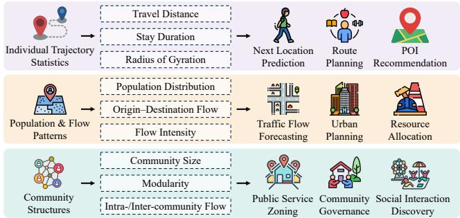  
Figure 1: Human mobility’s three layer patterns and corresponding properties and downstream applications.

In practice, human mobility can be characterized by three layers of patterns [2, 7, 31, 39]. As illustrated in Fig. 1, at the individual layer, trajectory statistics such as travel distance and stay duration describe the behavioral regularities of a single user, supporting tasks that predict or optimize individual mobility decisions [9, 19]. At the population and flow layer, spatial distributions and origindestination flows aggregate trajectories into citywide mobility demand, supporting tasks such as trafic flow forecasting, urban planning, and resource allocation [20, 46]. At the community structure layer, community organization and intra- and inter-community interactions capture the mesoscopic relationships among users and locations, supporting the identification and management ofsocially or functionally connected urban units, including public-service zoning, community governance, and social-interaction discovery [16, 42].

Existing studies have devoted considerable efort to generating human mobility. Mechanism-based methods, such as DRTISA [28], and deep learning methods, such as MoveSim [9] and TrajGDM [5], capture individual routines, transition preferences, and spatiotemporal dependencies. Large Language Model [13, 14, 21]-based methods [10, 34, 36, 40] further model activity semantics and destination choices. Meanwhile, d-EPR [27] exploits population-level location attractiveness, AgentMove [8] extracts shared mobility patterns across users, MobAgent [18] represents heterogeneous population profiles at an urban scale, and CoDifMob [47] and DeepMobility [43] leverage population distributions and collective flows. Despite these advances, existing methods primarily emphasize individual trajectory realism and aggregate population and flow patterns. Although recent collective-aware generators incorporate interactions between individual and population-level mobility, preserving the evolving community structures formed by user-location interactions remains challenging. These structures capture mesoscopic relationships among users and locations, including shared destinations, co-mobility patterns, and hierarchical organization [11, 16]. Therefore, mobility generation should go beyond matching individual trajectory statistics and population-level distributions to preserve community structures.

In this paper, we aim to study community-consistent human mobility generation. To model community structures, we formulate mobility generation as the problem of generating dynamic user-location graphs, where users and locations are represented as nodes, and their interactions are represented as edges. This uni fied representation explicitly captures the dependencies among users, locations, and mobility decisions, while tracking how these interactions and the resulting community structures evolve over time [26, 39]. Achieving this objective requires addressing the following three core challenges:

• How to represent dynamic community structures for mobility generation? Community-consistent mobility generation requires priors that characterize dynamic community structures and interaction patterns as user-location interactions evolve over time. These priors should preserve temporal and structural regularities without reproducing exact historical realizations. The first challenge is therefore to construct representations that capture temporally coherent communities and extract interaction patterns that can serve as mobility generation priors.

• How to generate user-location interactions eficiently for large-scale mobility datasets? Under the graph-based formulation, each mobility decision corresponds to the creation of an interaction between a user and a location. Such a decision should reflect both the user’s mobility intention and the location’s role. However, reasoning over all possible user-location pairs is computationally prohibitive, requiring over one million inferences to generate a single day of hourly mobility for only 100 users. The second challenge is therefore to design an eficient generation process that considers complementary user-side and location-side evidence.

• How to bridge generated user-location graphs with realistic mobility structures? Even when each user-location interaction is individually plausible, their graph-level aggregation may still deviate from realistic community structures. Correcting such deviations requires not only identifying structural discrepancies at the graph level, but also tracing them back to the specific user and location decisions responsible and determining how these decisions should be revised. The third challenge is therefore to bridge generated user-location graphs with realistic mobility structures.

To address these challenges, we propose MOTION, a Multi-agent framework for cOmmuniTy-consIstent human mObility geNeration.

MOTION consists of a user agent assigned to each target, a location agent associated with each location, and a global manager agent. Rather than learning previously unknown collective patterns through a trained predictor, we extract community-conditioned priors from historical mobility and use them to guide and itera tively refine generated user-location interactions toward realistic community structures. Specifically, MOTION first extracts com munity structures and generalizable community-conditioned in teraction priors. MOTION transforms historical mobility trajectories into user-location graphs and applies a Leiden-based dynamic community detection algorithm to identify coherent communit structures. Within each community, MOTION performs metagraph based temporal template matching to abstract recurring mobility motifs, population and flow dynamics, and co-mobility patterns. These extracted priors summarize recurring community structures and interaction patterns without reproducing exact historical real izations, and serve as explicit guidance for subsequent multi-agent generation and structural targets for reflection, addressing the first challenge. Based on these priors, the user agents and location agents generate user-location interactions from the individual and com munity views, respectively. Each user agent constructs a mobility plan based on mobility motifs. For each planned movement, the user agent performs a destination candidate search to narrow the reasoning space and then reasons over the mobility plan, candidate location contexts, and reflection signals to determine the user’s movement, generating an individual-view graph. In parallel, location agents are selectively activated through an active location selection mechanism based on population and flow deviations and moving users in nearby locations. Each activated location agent reasons about which users are likely to arrive based on surrounding user contexts, population and flow dynamics, co-mobility patterns, and reflection signals, generating a community-view graph and addressing the second challenge. The manager agent then coordi nates the two views by reasoning over their supporting evidence and constructs an intermediate graph. It further diagnoses which interactions cause deviations from realistic community structures and population and flow patterns, attributes these deviations to the responsible agents, and generates targeted reflection signals to revise user agents’ plans and destination preferences, as well as location agents’ attraction estimates and source-user selections. Only the afected agents regenerate their proposals, addressing the third challenge.

The main contributions can be summarized as follows:

• We study community-consistent human mobility generation and formulate mobility generation as the generation of dynamic user-location graphs.

• We propose MOTION, a prior-guided multi-agent framework that coordinates individual- and community-view generation through user and location agents, and employs manager-driven targeted reflection to improve structural consistency.

• We conduct extensive experiments on two real-world datasets. MOTION outperforms baselines by at least 4.05% across the reported metrics. Additional experiments evaluate robustness, privacy preservation, and the utility of the generated mobility.

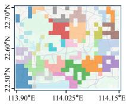

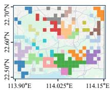  
(a) Real Data  
(b) CoDifMob

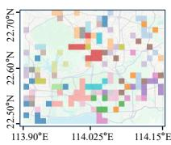  
(c) LLMob  
Figure 2: Community structures detected from real and generated mobility. Diferent colors represent diferent communities on the same gridded map.

## 2 PRELIMINARY STUDY

## 2.1 Community Structure Consistency

A mobility community consists of users and locations connected through shared destinations, synchronized movements, and interdependent population flows [16], providing a mesoscopic view of how individual movements jointly form spatially coherent activity regions and interaction boundaries [11]. Although recent mobility generators have incorporated collective mobility patterns, preserv ing the community structures emerging from user-location interactions remains challenging. To illustrate this limitation, we compare real mobility with trajectories generated by CoDifMob [47] and LLMob [36], representing collective-aware and LLM-based mobility generators, respectively. We apply the same dynamic community detection procedure to all datasets and project the detected communities onto the same gridded urban map. As shown in Fig. 2, real mobility forms several large and spatially coherent communities, whereas CoDifMob recovers some coherent regions but exhibits more fragmented community assignments, while LLMob produces more scattered communities. These observations suggest that modeling individual mobility patterns and aggregate population dynamics does not necessarily ensure the preservation of community-level organization. Therefore, realistic mobility generation should explicitly model and preserve evolving interaction and community structures.

## 2.2 Problem Definition

Given real-world mobility data and the initial mobility states of a set of target users, human mobility generation aims to generate realistic future mobility trajectories. Mathematically, let $\mathcal { U } = \{ u _ { i } \} _ { i = 1 } ^ { N }$ and $\mathcal { L } = \{ \ell _ { j } \} _ { j = 1 } ^ { M }$ denote the user and location sets. The historical mobility dataset is ${ \cal { S } } = \{ s _ { i } \} _ { i = 1 } ^ { N }$ , where $s _ { i } = [ ( \ell _ { 0 } ^ { i } , t _ { 0 } ^ { i } ) , \dots , ( \ell _ { T _ { i } } ^ { i } , t _ { T _ { i } } ^ { i } ) ]$ is the trajectory of user $u _ { i } .$ . Given a set of target users $\hat { \mathcal { U } } = \{ \hat { u } _ { i } \} _ { i = 1 } ^ { N ^ { * } }$ and their initial states $X _ { 0 } = \{ ( \ell _ { 0 } ^ { i } , t _ { 0 } ^ { i } ) \} _ { i = 1 } ^ { N ^ { * } }$ , let $\mathcal { G }$ denote a mobility generation model. The generated trajectories are formulated as:

$$
\begin{array} { r } { \hat { S } = \{ \hat { s } _ { i } \} _ { i = 1 } ^ { N ^ { * } } = \mathcal { G } ( S , \chi _ { 0 } ) . } \end{array}\tag{1}
$$

## 3 METHODOLOGY

## 3.1 Framework Overview

The overall framework of MOTION is illustrated in Fig. 3. MOTION consists of a user agent to each target user, a location agent to each location, and a global manager agent. During initialization, MOTION transforms historical trajectories into dynamic userlocation graphs and applies temporally smoothed Leiden-based dynamic community detection and metagraph-based prior mining to extract coherent communities and community-conditioned interaction priors. Rather than training a predictor to discover new collective patterns, MOTION uses these extracted priors to guide agent decisions and provide structural reference targets for subsequent reflection. During generation, user agent constructs a mobility plan and performs destination candidate search, and infers the user’s movement from the individual-view. Meanwhile, active location selection mechanism activates structurally relevant location agents to infer plausible arriving users from the community view. The manager agent coordinates these complementary proposals, identifies deviations between the generated graph and the extracted structural priors, and traces these deviations to the responsible user and location decisions. Targeted reflection signals are then sent to the afected agents for regeneration, and the refined graph update is used to condition the next time step.

## 3.2 Mobility Prior Initialization

To represent the interaction and community structures emerging across users, MOTION models historical mobility as dynamic userlocation graphs, and then extracts temporally coherent communities and community-conditioned interaction priors.

3.2.1 Dynamic User-Location Graph Construction. MOTION represents human mobility as a sequence of dynamic user-location graph snapshots. In each snapshot, time-varying user-location edges record users’ current locations, while the location-location edges capture stable geographic accessibility and historical mobility connectivity. Specifically, let U and $\mathcal { L }$ denote the historical user and location sets. After discretizing trajectories into � time intervals, MOTION constructs:

$$
\mathbb { H } = \{ \mathcal { H } _ { 1 } , . . . , \mathcal { H } _ { T } \} , \qquad \mathcal { H } _ { t } = \left( \mathcal { U } \cup \mathcal { L } , \mathcal { E } _ { t } ^ { U L } \cup \mathcal { E } ^ { L L } \right) ,\tag{2}
$$

where $( u _ { i } , \ell _ { j } ) \in \mathcal { E } _ { t } ^ { U L }$ indicates that user $u _ { i }$ is located at $\ell _ { j }$ at time �. The static edge set $\varepsilon ^ { L L }$ connects locations according to geographic proximity and aggregate historical flows, providing a spatial backbone shared across snapshots. Changes from $\mathcal { E } _ { t - 1 } ^ { U L }$ to $\bar { \mathcal { E } } _ { t } ^ { U L }$ encode individual movements and jointly determine location populations and inter-location flows. Therefore, human mobility is represented as sequential user-location graphs rather than isolated location transitions. Notably, to protect user privacy, we replace exact location identifiers with semantic POI types and discretize travel distances and stay durations into interval bins.

3.2.2 Community-ConditionedInteraction PriorMining. To capture community structures and interaction patterns, MOTION applies a temporally smoothed Leiden-based algorithm to detect coherent communities. Let $C _ { t }$ denote the community partition of $\mathcal { H } _ { t }$ For $t > 1$ , Leiden optimizes the Constant Potts Model (CPM) [35] objective, initialized with the preceding partition $C _ { t - 1 } ^ { * }$ . Temporal smoothness is further encouraged through stochastic retention of each location’s previous community assignment. This approach preserves temporal continuity while allowing community memberships to adapt to changing user-location interactions. After each partition is obtained, every user is assigned to the community of its current location. MOTION then employs metagraph-based temporal template matching to extract community-conditioned interaction priors. Individual-level priors include mobility motifs, motif transitions, and activity rhythms, while community-level priors include community memberships and sizes, population and flow dynamics, and co-mobility patterns. Together, these priors describe how individual movements form evolving community structures and guide subsequent mobility generation. Representative examples of the extracted priors are provided in Appendix C.

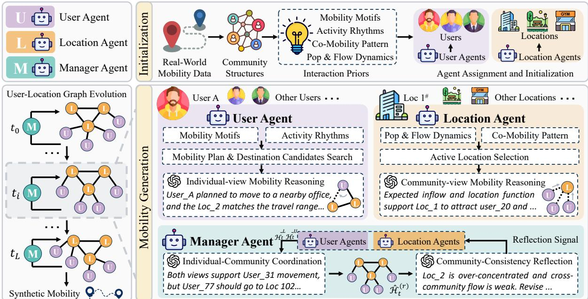  
Figure 3: Overview of MOTION. MOTION first extracts community structures and interaction priors from real-world mobility. During generation, the user agent and the location agent propose user-location graphs from the individual and receiver-side community views. The manager coordinates these proposals and uses the extracted priors to identify structural deviations and guide targeted reflection.

## 3.3 User Agent

MOTION assigns one user agent to each target user. Each user agent maintains the user’s mobility state, constructs a mobility plan, performs destination candidates search, and proposes the next location from the individual view.

3.3.1 Individual Mobility Planning. To organize mobility decisions over the entire day, the user agent first assigns $\hat { u } _ { i }$ to a mobility community according to the initial location $\ell _ { 0 } ^ { i }$ and the learned afiliation distribution $p ( c \mid \ell _ { 0 } ^ { i } )$ . The user agent then samples a sequence of mobility motifs conditioned on the assigned community, time ofday, and motif transition patterns. The transition between consecutive motifs is modeled as follows:

$$
m _ { r + 1 } ^ { i } \sim p \left( m _ { r + 1 } \mid m _ { r } ^ { i } , c _ { i } , h _ { r } \right) ,\tag{3}
$$

where $m _ { r } ^ { i }$ denotes the current motif, $c _ { i }$ denotes the assigned community, and $h _ { r }$ denotes its activation time. Each motif is instantiated as a sequence of stay and move actions using the extracted activity rhythms, destination semantics, travel-distance ranges, and return patterns. The resulting mobility plan specifies when the user moves, the intended type of destination, and the expected move ment structure. Users with compatible plans and community memberships are further associated with co-mobility patterns, providing synchronized-movement evidence for location-side reasoning. During generation, targeted reflection signals may revise the planned action, execution time, travel range, or destination intention.

3.3.2 Individual-view Mobility Reasoning. At each time step, the user agent executes the active segment of its daily mobility plan and determines the next location from the individual view. For a stay action, the current user-location edge is retained. For a return action, the agent revisits the recorded location to preserve the corresponding mobility motif. To reason eficiently and reliably about a non-return movement, MOTION conducts destination candidate search within the planned travel-distance range and evaluates the semantic compatibility, geographic distance, regional attraction, and community flow evidence of the retrieved locations. The user agent then jointly interpret these signals and reflection signal to select the next location. The decisions of all user agents are aggregated into the individual-view graph $\widetilde { \mathcal { H } } _ { t } ^ { U }$

## 3.4 Location Agent

MOTION associates a location agent with each location to model mobility from a receiver-side community view. MOTION applies active location selection and invokes only the location agents that are most relevant to the current graph update. Each active location agent then infers which users are likely to arrive. This receiver-side reasoning complements the destination decisions of user agents and guides the generation of user-location edges toward realistic collective interaction patterns.

3.4.1 Active Location Selection. To eficiently reason over relevant locations, MOTION first identifies active locations according to deviations between current and expected location populations, moving users in nearby or graph-connected source locations, and prior-supported incoming flows and co-mobility patterns. MOTION forms a local set by merging the identified active locations and neighboring locations, as illustrated in Fig. 4. For each local set, MOTION randomly samples at most ������\_� locations and activates their location agents. The sampled locations from all local sets are then merged to form the active location set. This strategy maintains coverage across diferent local mobility regions while avoiding repeated activation of only the most popular locations.

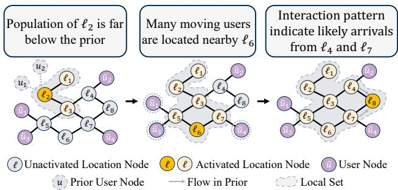  
Figure 4: Local-set formation. Locations and their neigh borhoods are activated according to population dynamics, nearby moving users, and prior-supported incoming flows and are then merged into a local set.

3.4.2 Community-view Mobility Reasoning. At each time step, each activated location agent infers user-location interactions from the receiver-side community view. The location agent identifies candi date users from graph-connected source locations and reasons over their current locations, mobility plans, intended activities, community memberships, and co-mobility relations, together with the semantic role, expected population, and characteristic incoming flows of the target location. The location agent then selects users whose arrivals are consistent with plausible graph connections, individual activity intentions, and community-conditioned interaction patterns. Co-mobility evidence further supports synchronized movements toward shared destinations. When multiple active locations select the same user, MOTION retains the proposal that is better supported by the population, flow, and co-mobility priors. The proposals of all active location agents are aggregated into the community-view graph $\widetilde { \mathcal { H } } _ { t } ^ { L }$ , which is subsequently coordinated with the individual-view graph by the manager agent.

## 3.5 Manager Agent

The manager agent coordinates the individual- and communityview user-location graphs and evaluates structural deviations to attribute targeted reflection signals to the relevant agents. Through iterative coordination and community-consistency reflection, MO-TION preserves individual mobility intentions while bridging the graph with realistic community structures.

3.5.1 Individual-Community Coordination. At each time step, the manager agent coordinates the individual-view graph $\mathcal { \widetilde { H } } _ { t } ^ { U }$ and the community-view graph $\widetilde { \mathcal { H } } _ { t } ^ { L }$ . For each user, MOTION jointly considers the mobility plan, movement history, intended activity, proposed destination, and stated rationale provided by the user agent, together with the location attraction, expected population and flow states, community role, co-mobility evidence, and corresponding rationale provided by the location agent. When the two views agree, their shared proposal is retained. When they conflict, the manager agent uses LLM reasoning to weigh the proposals and rationales from both views and determine a final decision that balances individual intention and temporal continuity with community-conditioned interaction evidence. The resolved user-location edges form the intermediate graph $\widehat { \mathcal { H } } _ { t } ^ { ( r ) }$ at coordination round �, which is subsequently evaluated through community-consistency reflection.

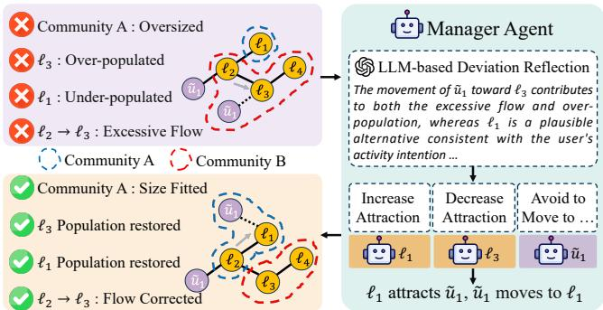  
Figure 5: Community-consistency reflection. MOTION bridges generated and real communities, diagnoses deviations, attributes them to related decisions, and sends reflection signals to regenerate the afected proposals.

3.5.2 Community-Consistency Reflection. A single coordination round may produce plausible user-location interactions while still deviating from realistic population, flow, and community structures. Formally, iterative coordinations and reflections can be formed as:

$$
\begin{array} { r } { \widehat { \mathcal { H } } _ { t } ^ { ( r ) } = \operatorname { C o o r d } \left( \mathcal { \widetilde { H } } _ { t } ^ { U } , \mathcal { \widetilde { H } } _ { t } ^ { L } \right) , \widehat { \mathcal { H } } _ { t } ^ { ( r + 1 ) } = \operatorname { R e f l e c t } \left( \mathcal { \widehat { H } } _ { t } ^ { ( r ) } , \mathcal { P } _ { t } \right) , } \end{array}\tag{4}
$$

where P� denotes the interaction priors. To diagnose structural deviations, MOTION applies the same temporally smoothed community detection procedure to the intermediate graph $\widehat { \mathcal { H } } _ { t } ^ { ( r ) }$ and aligns each generated community with the temporally corresponding real community using location-node Jaccard similarity. Based on the aligned communities, MOTION compares their location memberships and community sizes, together with location populations and intra- and inter-community flows. As illustrated in Fig. 5, MOTION identifies locations with mismatched community memberships or substantial population and flow deviations. For each deviating location, the manager agent collects the related users that stay at, depart from, or arrive at the location, together with the flow-connected source and destination locations. The manager agent then diagnoses which interaction decisions contribute to the deviations. Based on the diagnosis, the manager agent sends targeted reflection signals to the corresponding agents. User agents may revise their planned actions, execution times, travel ranges, or destination intentions, while location agents may increase or decrease their attraction and adjust their preferred source locations or candidate users. Only the afected agents regenerate their proposals, which are coordinated again to obtain $\widehat { \mathcal { H } } _ { t } ^ { ( r + 1 ) }$

## 4 EXPERIMENTS

## 4.1 Experimental Setup

4.1.1 Datasets and Experimental Setings. We evaluate MOTION on two real-world datasets. Private car dataset [22] consists of two weeks of GPS traces collected from 2,342 private vehicles. Mobile phone dataset [34] contains two weeks of GPS location traces from 5,352 mobile users. Both datasets are de-identified and were collected with the explicit authorization ofindividual users and data providers. Train and test users are strictly disjoint, and all pre-test day trajectories of test users are excluded from prior construction and model training. During generation, each test user is provided only with the initial location on the test day, which is used as the common conditioning state for MOTION and all applicable baselines. We also use an open-source POI database to represent regional functional semantics. Detailed dataset statistics, ethical statement, POI construction, and experimental settings are provided in Appendices A, B, and E.

Table 1: Evaluation metrics of three pattern layers.
<table><tr><td rowspan=1 colspan=1>Pattern Layer</td><td rowspan=1 colspan=1>Evaluation Metrics</td></tr><tr><td rowspan=1 colspan=1>Individual TrajectoryStatistics</td><td rowspan=1 colspan=1>Distance, Radius, LocNum</td></tr><tr><td rowspan=1 colspan=1>Population and FlowDistributions</td><td rowspan=1 colspan=1>Pop-EMD, Flow-EMD, G-Rank</td></tr><tr><td rowspan=1 colspan=1>Community and Graph-Structural Consistency</td><td rowspan=1 colspan=1>Comm-Size, Comm-Mem,Motif, W-Degree</td></tr></table>

4.1.2 Baselines and Metrics. We compare MOTION with nine representative mobility generators, including the mechanistic method DRTISA [28], GAN-based generative models SeqGAN [41] and MoveSim [9], the collaborative generator DeepMobility [43], the difusion-based model CoDifMob [47], LLM-based methods LL-Mob [36] and LLM-COD [40], and the agent-based models TrajLLM [12] and AgentMove [8]. Detailed descriptions of the baselines are provided in Appendix D. We evaluate MOTION at the three pattern layers summarized in Table 1. Detailed metric definitions are provided in Appendix F.

## 4.2 Overall Performance

The overall mobility generation performance on the private car and mobile phone datasets is reported in Table 2. MOTION performs best across all metrics, showing that preserving evolving interaction and community structures does not compromise trajectory realism. At the individual trajectory statistics level, MOTION reduces Distance by 11.36% over LLMob on the private car dataset and by 12.87% over DeepMobility on the mobile phone dataset, the strongest baselines for this metric. This improvement results from combining community-conditioned interaction patterns with useragent reasoning over individual intentions and spatial preferences. At the population and flow distributions level, MOTION reduces Flow-EMD by 4.05% over CoDifMob on the private car dataset and by 16.83% over TrajLLM on the mobile phone dataset. Locationagent modeling of regional attraction and population-flow dynamics, together with manager coordination, aligns collective mobility with user intentions. At the community and graph-structural consistency level, MOTION reduces Comm-Size by 6.95% and improves Comm-Mem by 7.47% over CoDifMob on the private car dataset. On the mobile phone dataset, it improves Comm-Mem by 8.04% over LLMob, reduces Motif by 11.38% relative to AgentMove, and reduces W-Degree by 10.39% over DeepMobility. These results confirm that modeling mobility as user-location graph evolution and applying community-consistency reflection better preserve community organization and graph connectivity.

## 4.3 Ablation Analysis

We evaluate three role-removal variants, w/o user, w/o location, and w/o manager, and two controls supplied with the same information as MOTION. The single-agent variant performs unified reasoning over all available information, while the deterministic generator combines the same decision factors using fixed weights.

As shown in Table 3, MOTION achieves the best result on all five reported metrics in both datasets. Removing the user agent worsens individual spatial statistics and population-community consistency, while removing the location agent weakens population and community consistency. Among the role-removal variants, removing the location agent yields the largest Pop-EMD on both datasets, while removing the manager degrades every metric on both datasets, supporting the importance of location-side reasoning and coordinated refinement. MOTION also outperforms both sameinformation controls on every reported metric in both datasets, indicating that its gains arise not only from access to collective information but also from role-specific reasoning and coordinated refinement.

## 4.4 Generalization Analysis

Specifically, user mobility motifs from the source dataset are used to construct daily mobility plans, while interaction priors are extracted from the target dataset to guide generation and evaluation on that target dataset. This setting evaluates the recombination of source mobility motifs and target structural priors, rather than target-prior-free cross-city generalization. As shown in Fig. 15 in Appendix I, Distance and Radius exhibit relatively large discrepancies because of diferent mobility characteristics and spatial scales. Nevertheless, MOTION closely preserves the community structures and interaction priors.

## 4.5 Community Structure Visualization

To qualitatively examine whether generated mobility preserves the community structures emerging across users, we apply the community detection procedure to the real and generated userlocation graphs and visualize the resulting location communities in Fig 6. CoDifMob produces scattered communities on the private car dataset, while LLMob yields excessively mixed communities on the mobile phone dataset. In contrast, MOTION recovers spatially coherent communities with geographic extents, relative sizes, and boundaries closely resembling the real structures in both datasets. This result confirms that MOTION preserves mesoscopic community organization beyond individual trajectory statistics.

## 4.6 LLM Backbone Analysis

We evaluate the impact of LLM backbone choice on MOTION by replacing the default GPT-4o with representative models. Fig. 7 shows that backbone choice afects both individual mobility realism and community consistency, reflecting the importance of semantic understanding and coordination reasoning in MOTION. Overall, MOTION remains efective across LLM models. Considering the generation quality, we use GPT-4o as the default backbone in the mobility generation performance of OURS. Specifically, top\_k determines the number of destination candidates presented to each user agent during destination reasoning, while active\_m determines the maximum number of considered neighbors for an activated location agent. As shown in Fig. 8, Distance and Pop-EMD generally improve until both parameters reach 10 but degrade with larger values because weakly relevant evidence introduces reasoning noise. The consistent optimum around 10 indicates that MOTION benefits from balancing evidence coverage with focused agent reasoning rather than activating as many candidates or agents as possible.

Table 2: Overall performance on the private car and mobile phone datasets (mean ± standard deviation over five runs where available; otherwise, mean only). Higher Comm-Mem and lower values of all other metrics indicate better performance. Bold indicates the best result, and underline denotes the second-best.
<table><tr><td rowspan="2">Methods</td><td colspan="3">Individual Trajectory Statistics</td><td colspan="3">Population and Flow Distributions</td><td colspan="4">Community and Graph-Structural Consistency</td></tr><tr><td>Distance↓</td><td>Radius↓</td><td>LocNum↓</td><td>Pop-EMD↓</td><td>Flow-EMD↓</td><td>G-Rank↓</td><td>Comm-Size↓ Comm-Mem↑</td><td></td><td>Motif↓</td><td>W-Degree↓</td></tr><tr><td colspan="13">Private Car Dataset</td></tr><tr><td>DRTISA</td><td> $0 . 2 6 4 5 { \scriptstyle \pm 0 . 0 0 3 8 }$ </td><td> $0 . 1 9 5 1 { \scriptstyle \pm 0 . 0 0 3 1 }$ </td><td> $0 . 1 5 1 8 { \scriptstyle \pm 0 . 0 0 2 7 }$ </td><td> $0 . 0 5 3 4 { \scriptstyle \pm 0 . 0 0 1 1 }$ </td><td> $0 . 0 5 1 1 { \scriptstyle \pm 0 . 0 0 1 2 }$ </td><td> $0 . 2 7 4 1 { \scriptstyle \pm 0 . 0 0 4 2 }$ </td><td> $0 . 0 8 7 6 { \scriptstyle \pm 0 . 0 0 1 5 }$ </td><td> $0 . 2 6 6 1 { \scriptstyle \pm 0 . 0 0 3 3 }$ </td><td> $0 . 2 7 4 4 { \scriptstyle \pm 0 . 0 0 4 1 }$ </td><td> $0 . 3 6 3 7 { \scriptstyle \pm 0 . 0 0 5 0 }$ </td></tr><tr><td>SeqGAN</td><td> $0 . 2 6 8 0 _ { \pm 0 . 0 0 4 0 }$ </td><td> $0 . 2 0 5 0 _ { \pm 0 . 0 0 3 5 }$ </td><td> $0 . 1 8 9 6 _ { \pm 0 . 0 0 3 0 }$ </td><td> $0 . 0 5 9 7 _ { \pm 0 . 0 0 1 3 }$ </td><td> $0 . 0 5 9 0 _ { \pm 0 . 0 0 1 4 }$ </td><td> $0 . 2 8 8 9 _ { \pm 0 . 0 0 4 5 }$ </td><td> $0 . 0 7 2 5 _ { \pm 0 . 0 0 1 4 }$ </td><td> $0 . 4 3 8 8 _ { \pm 0 . 0 0 7 8 }$ </td><td> $\underline { { 0 . 1 5 1 7 } } { \scriptstyle \pm 0 . 0 0 2 4 }$ </td><td> $0 . 2 8 9 8 _ { \pm 0 . 0 0 4 2 }$ </td></tr><tr><td>MoveSim</td><td> $0 . 2 2 5 7 { \scriptstyle \pm 0 . 0 0 3 4 }$ </td><td> $0 . 1 7 8 1 { \scriptstyle \pm 0 . 0 0 2 9 }$ </td><td> $0 . 2 5 7 5 { \scriptstyle \pm 0 . 0 0 3 8 }$ </td><td> $0 . 1 0 3 7 { \scriptstyle \pm 0 . 0 0 2 0 }$ </td><td> $0 . 1 0 1 4 { \scriptstyle \pm 0 . 0 0 1 9 }$ </td><td> $0 . 3 4 7 5 { \scriptstyle \pm 0 . 0 0 5 1 }$ </td><td> $0 . 2 2 0 3 _ { \pm 0 . 0 0 3 5 }$ </td><td> $0 . 2 7 5 6 { \scriptstyle \pm 0 . 0 0 3 3 }$ </td><td> $0 . 2 9 1 8 { \scriptstyle \pm 0 . 0 0 4 4 }$ </td><td> $0 . 3 1 3 4 { \scriptstyle \pm 0 . 0 0 4 7 }$ </td></tr><tr><td>DeepMobility</td><td> $0 . 2 0 8 6 { \scriptstyle \pm 0 . 0 0 5 3 }$ </td><td> $0 . 1 1 8 5 { \scriptstyle \pm 0 . 0 0 1 9 }$ </td><td> $0 . 2 1 9 0 { \scriptstyle \pm 0 . 0 0 3 2 }$ </td><td> $0 . 0 5 6 5 { \scriptstyle \pm 0 . 0 0 1 8 }$ </td><td> $0 . 0 5 5 5 { \scriptstyle \pm 0 . 0 0 2 4 }$ </td><td> $0 . 2 6 1 4 { \scriptstyle \pm 0 . 0 0 3 0 }$ </td><td> $0 . 0 9 7 7 { \scriptstyle \pm 0 . 0 0 1 2 }$ </td><td> $0 . 5 3 3 5 { \scriptstyle \pm 0 . 0 0 4 1 }$ </td><td> $0 . 2 2 6 3 _ { \pm 0 . 0 0 3 8 }$ </td><td> $0 . 3 0 0 7 { \scriptstyle \pm 0 . 0 0 4 4 }$ </td></tr><tr><td>CoDiffMob</td><td> $0 . 2 1 0 6 _ { \pm 0 . 0 0 3 5 }$ </td><td> $0 . 1 1 7 6 _ { \pm 0 . 0 0 1 6 }$ </td><td> $0 . 2 4 9 4 { \scriptstyle \pm 0 . 0 0 3 4 }$ </td><td> $0 . 0 4 2 2 { \scriptstyle \pm 0 . 0 0 0 9 }$ </td><td> $\underline { { 0 . 0 4 2 0 _ { \pm 0 . 0 0 1 1 } } }$ </td><td> $0 . 2 8 5 1 _ { \pm 0 . 0 0 4 2 }$ </td><td> $\underline { { 0 . 0 6 7 6 _ { \pm 0 . 0 0 1 0 } } }$ </td><td> $\underline { { 0 . 5 3 6 5 } } { \scriptstyle \pm 0 . 0 0 2 2 }$ </td><td> $0 . 2 1 8 0 _ { \pm 0 . 0 0 1 7 }$ </td><td> $0 . 2 7 7 3 _ { \pm 0 . 0 0 2 9 }$ </td></tr><tr><td>LLMob</td><td> $\underline { { 0 . 1 9 2 8 } } { \scriptstyle \pm 0 . 0 0 1 8 }$ </td><td> $\underline { { 0 . 1 1 7 5 } } { \scriptstyle \pm 0 . 0 0 1 7 }$ </td><td> $\underline { { 0 . 1 4 6 3 } } { \scriptstyle \pm 0 . 0 0 1 8 }$ </td><td> $0 . 0 4 2 8 _ { \pm 0 . 0 0 0 5 }$ </td><td> $0 . 0 4 5 8 { \scriptstyle \pm 0 . 0 0 0 9 }$ </td><td> $0 . 2 5 5 8 { \scriptstyle \pm 0 . 0 0 3 7 }$ </td><td> $0 . 0 7 2 3 _ { \pm 0 . 0 0 1 0 }$ </td><td> $0 . 4 9 9 5 _ { \pm 0 . 0 0 4 1 }$ </td><td> $0 . 1 9 2 0 _ { \pm 0 . 0 0 3 0 }$ </td><td> $\underline { { 0 . 2 7 4 0 _ { \pm 0 . 0 0 3 4 } } }$ </td></tr><tr><td>LLM-COD</td><td> $0 . 2 3 7 4 { \scriptstyle \pm 0 . 0 0 2 9 }$ </td><td> $0 . 2 2 3 2 { \scriptstyle \pm 0 . 0 0 3 4 }$ </td><td> $0 . 1 9 7 6 { \scriptstyle \pm 0 . 0 0 3 0 }$ </td><td> $0 . 0 7 5 9 _ { \pm 0 . 0 0 1 5 }$ </td><td> $0 . 0 7 2 9 _ { \pm 0 . 0 0 1 5 }$ </td><td> $0 . 2 2 5 9 _ { \pm 0 . 0 0 3 4 }$ </td><td> $0 . 0 7 5 4 { \scriptstyle \pm 0 . 0 0 1 3 }$ </td><td> $0 . 4 6 8 4 { \scriptstyle \pm 0 . 0 0 5 5 }$ </td><td> $0 . 1 9 1 9 _ { \pm 0 . 0 0 2 9 }$ </td><td> $0 . 3 6 8 2 { \scriptstyle \pm 0 . 0 0 5 2 }$ </td></tr><tr><td>TrajLLM</td><td> $0 . 2 3 6 4 _ { \pm 0 . 0 0 3 1 }$ </td><td> $0 . 1 8 8 0 _ { \pm 0 . 0 0 3 0 }$ </td><td> $0 . 2 2 0 7 _ { \pm 0 . 0 0 3 3 }$ </td><td> $0 . 0 7 9 7 _ { \pm 0 . 0 0 1 6 }$ </td><td> $0 . 0 7 6 7 _ { \pm 0 . 0 0 1 7 }$ </td><td> $0 . 2 2 6 1 _ { \pm 0 . 0 0 3 2 }$ </td><td> $0 . 0 9 3 9 _ { \pm 0 . 0 0 1 7 }$ </td><td> $0 . 3 7 5 0 _ { \pm 0 . 0 0 1 8 }$ </td><td> $0 . 2 0 8 4 _ { \pm 0 . 0 0 3 2 }$ </td><td> $0 . 3 4 1 0 _ { \pm 0 . 0 0 4 8 }$ </td></tr><tr><td>AgentMove</td><td> $0 . 2 6 1 1 { \scriptstyle \pm 0 . 0 0 3 7 }$ </td><td> $0 . 2 2 5 7 _ { \pm 0 . 0 0 3 8 }$ </td><td> $0 . 2 4 7 9 _ { \pm 0 . 0 0 3 5 }$ </td><td> $0 . 0 4 3 6 _ { \pm 0 . 0 0 0 9 }$ </td><td> $0 . 1 7 5 3 _ { \pm 0 . 0 0 2 8 }$ </td><td> $\underline { { 0 . 2 2 3 3 } } _ { \pm 0 . 0 0 2 1 }$ </td><td> $0 . 0 6 8 0 _ { \pm 0 . 0 0 0 9 }$ </td><td> $0 . 5 1 9 4 _ { \pm 0 . 0 0 2 9 }$ </td><td> $0 . 2 9 3 3 _ { \pm 0 . 0 0 4 5 }$ </td><td> $0 . 3 0 6 9 _ { \pm 0 . 0 0 4 0 }$ </td></tr><tr><td>MOTION</td><td> $\mathbf { 0 . 1 7 0 9 _ { \pm 0 . 0 0 1 5 } }$ </td><td> $\mathbf { 0 . 0 9 5 8 { \scriptstyle \pm 0 . 0 0 1 4 } }$ </td><td> $\mathbf { 0 . 1 2 5 8 { \scriptstyle \pm 0 . 0 0 1 5 } }$ </td><td> $\mathbf { 0 . 0 4 0 2 { \scriptstyle \pm 0 . 0 0 0 4 } }$ </td><td> $\mathbf { 0 . 0 4 0 3 _ { \pm 0 . 0 0 0 7 } }$ </td><td> $\mathbf { 0 . 2 0 7 9 { \scriptstyle \pm 0 . 0 0 1 8 } }$ </td><td> $\mathbf { 0 . 0 6 2 9 _ { \pm 0 . 0 0 0 7 } }$ </td><td> $\mathbf { 0 . 5 7 6 6 { \scriptstyle \pm 0 . 0 0 1 2 } }$ </td><td> $\mathbf { 0 . 1 3 4 0 { \scriptstyle \pm 0 . 0 0 1 8 } }$ </td><td> $\mathbf { 0 . 2 3 4 7 { \scriptstyle \pm 0 . 0 0 2 5 } }$ </td></tr><tr><td>Improvement</td><td>11.36%</td><td>18.47%</td><td>14.01%</td><td>4.74%</td><td>4.05%</td><td>6.90%</td><td>6.95%</td><td>7.47%</td><td>11.67%</td><td>14.34%</td></tr></table>

<table><tr><td colspan="10">Mobile Phone Dataset</td></tr><tr><td>DRTISA</td><td> $0 . 2 9 1 5 { \scriptstyle \pm 0 . 0 0 4 1 }$ </td><td> $0 . 1 9 9 5 _ { \pm 0 . 0 0 3 2 }$ </td><td> $0 . 1 5 9 3 { \scriptstyle \pm 0 . 0 0 2 8 }$ </td><td> $0 . 1 6 0 2 { \scriptstyle \pm 0 . 0 0 2 8 }$ </td><td> $0 . 1 6 0 0 { \scriptstyle \pm 0 . 0 0 2 9 }$ </td><td> $0 . 3 9 1 7 { \scriptstyle \pm 0 . 0 0 5 8 }$ </td><td> $0 . 2 0 5 7 { \scriptstyle \pm 0 . 0 0 4 2 }$ </td><td> $0 . 4 5 2 2 { \scriptstyle \pm 0 . 0 0 5 3 }$ </td><td> $0 . 2 8 7 2 _ { \pm 0 . 0 0 4 3 }$ </td><td> $0 . 3 9 0 5 _ { \pm 0 . 0 0 5 2 }$ </td></tr><tr><td>SeqGAN</td><td> $0 . 1 6 3 6 _ { \pm 0 . 0 0 2 7 }$ </td><td> $0 . 1 6 2 6 _ { \pm 0 . 0 0 2 8 }$ </td><td> $0 . 1 5 0 9 _ { \pm 0 . 0 0 2 6 }$ </td><td> $0 . 1 1 9 6 _ { \pm 0 . 0 0 2 2 }$ </td><td> $0 . 1 1 9 4 _ { \pm 0 . 0 0 2 3 }$ </td><td> $0 . 3 4 4 9 _ { \pm 0 . 0 0 5 0 }$ </td><td> $0 . 1 9 9 2 _ { \pm 0 . 0 0 3 8 }$ </td><td> $0 . 4 2 4 7 _ { \pm 0 . 0 0 2 8 }$ </td><td> $0 . 2 7 0 6 _ { \pm 0 . 0 0 4 1 }$ </td><td>0.2932±0.0042</td></tr><tr><td>MoveSim</td><td> $0 . 2 3 8 2 { \scriptstyle \pm 0 . 0 0 3 5 }$ </td><td> $0 . 1 9 2 0 { \scriptstyle \pm 0 . 0 0 3 2 }$ </td><td> $0 . 3 1 5 1 { \scriptstyle \pm 0 . 0 0 4 5 }$ </td><td> $0 . 1 8 0 4 { \scriptstyle \pm 0 . 0 0 3 0 }$ </td><td> $0 . 1 7 7 7 { \scriptstyle \pm 0 . 0 0 3 1 }$ </td><td> $0 . 3 0 1 8 { \scriptstyle \pm 0 . 0 0 4 7 }$ </td><td> $0 . 2 2 3 1 { \scriptstyle \pm 0 . 0 0 4 2 }$ </td><td> $0 . 4 3 6 6 { \scriptstyle \pm 0 . 0 0 5 0 }$ </td><td> $0 . 3 3 8 7 { \scriptstyle \pm 0 . 0 0 5 0 }$ </td><td>0.3739±0.0054</td></tr><tr><td>DeepMobility</td><td> $\underline { { 0 . 1 5 6 9 } } { \pm 0 . 0 0 1 8 }$ </td><td> $0 . 1 4 2 6 { \scriptstyle \pm 0 . 0 0 1 9 }$ </td><td> $0 . 1 9 9 6 { \scriptstyle \pm 0 . 0 0 2 6 }$ </td><td> $0 . 1 2 7 8 { \scriptstyle \pm 0 . 0 0 1 4 }$ </td><td> $0 . 1 2 6 4 { \scriptstyle \pm 0 . 0 0 5 6 }$ </td><td> $0 . 3 5 0 5 { \scriptstyle \pm 0 . 0 0 5 9 }$ </td><td> $0 . 1 8 5 5 { \scriptstyle \pm 0 . 0 0 2 7 }$ </td><td> $0 . 4 5 5 0 { \scriptstyle \pm 0 . 0 0 2 9 }$ </td><td> $0 . 2 8 9 2 _ { \pm 0 . 0 0 3 4 }$ </td><td>0.2685±0.0030</td></tr><tr><td>CoDiffMob</td><td> $0 . 2 6 3 5 _ { \pm 0 . 0 0 3 9 }$ </td><td> $0 . 1 4 9 6 _ { \pm 0 . 0 0 2 7 }$ </td><td> $0 . 1 9 1 1 { \scriptstyle \pm 0 . 0 0 2 5 }$ </td><td> $0 . 1 1 6 5 _ { \pm 0 . 0 0 1 3 }$ </td><td> $0 . 1 1 6 3 _ { \pm 0 . 0 0 1 3 }$ </td><td> $0 . 3 4 7 8 _ { \pm 0 . 0 0 3 7 }$ </td><td> $\underline { { 0 . 1 3 2 0 _ { \pm 0 . 0 0 4 1 } } }$ </td><td> $0 . 4 5 9 1 _ { \pm 0 . 0 0 6 7 }$ </td><td> $0 . 2 6 6 9 _ { \pm 0 . 0 0 5 1 }$ </td><td>0.2731±0.0034</td></tr><tr><td>LLMob</td><td> $0 . 1 7 7 8 _ { \pm 0 . 0 0 2 9 }$ </td><td> $0 . 1 8 3 4 _ { \pm 0 . 0 0 3 0 }$ </td><td> $\underline { { 0 . 1 1 1 6 _ { \pm 0 . 0 0 1 8 } } }$ </td><td> $0 . 1 2 7 7 _ { \pm 0 . 0 0 2 5 }$ </td><td> $0 . 1 2 7 4 { \scriptstyle \pm 0 . 0 0 2 6 }$ </td><td> $0 . 3 5 4 4 _ { \pm 0 . 0 0 5 2 }$ </td><td> $0 . 2 1 4 3 _ { \pm 0 . 0 0 4 5 }$ </td><td> $\underline { { 0 . 4 6 0 1 _ { \pm 0 . 0 0 6 2 } } }$ </td><td>0.2803±0.0043</td><td>0.2749±0.0032</td></tr><tr><td>LLM-COD</td><td> $0 . 1 5 9 8 { \scriptstyle \pm 0 . 0 0 2 6 }$ </td><td> $0 . 1 5 1 2 _ { \pm 0 . 0 0 2 5 }$ </td><td> $0 . 2 0 0 7 { \scriptstyle \pm 0 . 0 0 3 1 }$ </td><td> $0 . 1 1 3 9 _ { \pm 0 . 0 0 2 2 }$ </td><td> $0 . 1 1 3 4 { \scriptstyle \pm 0 . 0 0 2 2 }$ </td><td> $0 . 2 9 8 2 { \scriptstyle \pm 0 . 0 0 4 3 }$ </td><td> $0 . 1 5 0 4 { \scriptstyle \pm 0 . 0 0 3 2 }$ </td><td> $0 . 4 5 9 3 _ { \pm 0 . 0 0 4 1 }$ </td><td>0.2904±0.0045</td><td>0.2803±0.0036</td></tr><tr><td>TrajLLM</td><td> $0 . 1 9 1 7 _ { \pm 0 . 0 0 3 1 }$ </td><td> $0 . 1 9 5 5 _ { \pm 0 . 0 0 3 3 }$ </td><td> $0 . 1 8 5 2 _ { \pm 0 . 0 0 3 0 }$ </td><td> $\underline { { 0 . 1 1 0 5 } } { \scriptstyle \pm 0 . 0 0 2 0 }$ </td><td> $\underline { { 0 . 1 1 0 5 _ { \pm 0 . 0 0 2 0 } } }$ </td><td> $\underline { { 0 . 2 9 6 0 _ { \pm 0 . 0 0 2 8 } } }$ </td><td> $0 . 2 3 1 7 _ { \pm 0 . 0 0 4 8 }$ </td><td> $0 . 4 5 1 7 _ { \pm 0 . 0 0 4 9 }$ </td><td>0.2691±0.0038</td><td>0.3574±0.0049</td></tr><tr><td>AgentMove</td><td> $0 . 2 2 5 7 _ { \pm 0 . 0 0 3 6 }$ </td><td> $0 . 1 4 4 3 _ { \pm 0 . 0 0 2 2 }$ </td><td> $0 . 2 8 1 8 _ { \pm 0 . 0 0 4 0 }$ </td><td> $0 . 1 2 9 7 _ { \pm 0 . 0 0 2 6 }$ </td><td> $0 . 1 2 9 5 _ { \pm 0 . 0 0 2 7 }$ </td><td> $0 . 3 5 0 8 _ { \pm 0 . 0 0 5 1 }$ </td><td> $0 . 1 9 2 1 _ { \pm 0 . 0 0 4 0 }$ </td><td> $0 . 4 3 6 7 _ { \pm 0 . 0 0 6 2 }$ </td><td> $\underline { { 0 . 2 4 2 6 _ { \pm 0 . 0 0 3 2 } } }$ </td><td>0.3270±0.0044</td></tr><tr><td>MOTION</td><td> $\mathbf { 0 . 1 3 6 7 { \scriptstyle \pm 0 . 0 0 2 0 } }$ </td><td> $\mathbf { 0 . 1 2 6 3 _ { \pm 0 . 0 0 1 8 } }$ </td><td> $\mathbf { 0 . 0 9 5 5 { \scriptstyle \pm 0 . 0 0 1 4 } }$ </td><td> $\mathbf { 0 . 0 9 2 5 { \scriptstyle \pm 0 . 0 0 1 5 } }$ </td><td> $\mathbf { 0 . 0 9 1 9 { \scriptstyle \pm 0 . 0 0 1 5 } }$  </td><td> $\mathbf { 0 . 2 7 7 3 { \scriptstyle \pm 0 . 0 0 2 2 } }$ </td><td> $\mathbf { 0 . 1 1 7 0 { \scriptstyle \pm 0 . 0 0 2 5 } }$ </td><td> $\mathbf { 0 . 4 9 7 1 { \scriptstyle \pm 0 . 0 0 2 5 } }$ </td><td> $\mathbf { 0 . 2 1 5 0 { \scriptstyle \pm 0 . 0 0 2 4 } }$ </td><td>0.2406±0.0026</td></tr><tr><td>Improvement</td><td>12.87%</td><td>11.43%</td><td>14.43%</td><td>16.29%</td><td>16.83%</td><td>6.32%</td><td>11.36%</td><td>8.04%</td><td>11.38%</td><td>10.39%</td></tr></table>

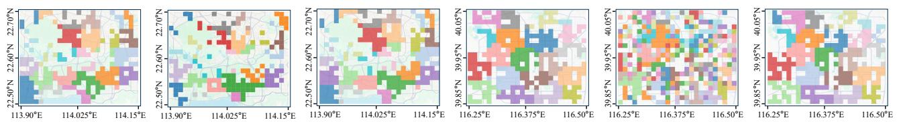  
(a) Real Private Car Dataset(b) CoDifMob on Private(c) MOTION on Private Car(d) Real Mobile Phone(e) LLMob on Mobile Phone(f) MOTION on Mobile Car Dataset Dataset Dataset Dataset Phone Dataset

Figure 6: Community structures detected from real and generated mobility on the private car and mobile phone datasets. The panels compare real mobility and MOTION with CoDifMob on the private car dataset and LLMob on the mobile phone dataset; each color distinguishes a detected community.  
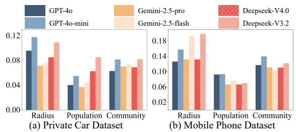  
Figure 7: Impact of diferent LLM backbones on the private car and mobile phone datasets.

main experiments, while stronger backbones can provide further gains for particular mobility properties.

## 4.8 Case Study

## 4.7 Hyperparameter Analysis

We further analyze how the key hyperparameters controlling individualview candidate retrieval and community-view reasoning afect the

We present a representative within-step graph update in Fig. 9. The user agent proposes a move according to the mobility plan, destination semantics, travel range, and candidate attraction. Independently, the corresponding location agent examines whether the arrival is compatible with the region’s population, incoming flow, and community context. The manager agent compares both views, retains mutually supported decisions, and resolves inconsistent proposals and then identifies structurally deviating locations and issues targeted reflection signals to revise only the afected user or location decisions. Detailed prompts are provided in Appendix L.

Table 3: Ablation results on both datasets. The single-agent and deterministic controls use the same information as MO-TION. Bold indicates the best result.
<table><tr><td>Variants</td><td>| Dist.↓</td><td></td><td></td><td></td><td>Radius↓ | Pop-EMD↓ | Comm-Size↓ Comm-Mem↑</td></tr><tr><td colspan="6">Private Car Dataset</td></tr><tr><td>w/o user w/o location</td><td>0.1939</td><td>0.1918</td><td>0.0459</td><td>0.0887</td><td>0.4868</td></tr><tr><td></td><td>0.1817</td><td>0.1050</td><td>0.0524</td><td>0.0881</td><td>0.5320</td></tr><tr><td>w/o manager</td><td>0.2054</td><td>0.1331</td><td>0.0486</td><td>0.0831</td><td>0.4677</td></tr><tr><td>single-agent</td><td>0.2367</td><td>0.1174</td><td>0.0548</td><td>0.0792</td><td>0.5247</td></tr><tr><td>deterministic</td><td>0.2511</td><td>0.1219</td><td>0.0665</td><td>0.0841</td><td>0.4925</td></tr><tr><td>MOTION</td><td>0.1709</td><td>0.0958</td><td>0.0402</td><td>0.0629</td><td>0.5766</td></tr><tr><td colspan="6">Mobile Phone Dataset</td></tr><tr><td>w/o user</td><td>0.1767</td><td>0.2367</td><td>0.1025</td><td>0.1608</td><td>0.4358</td></tr><tr><td>w/o location</td><td>0.1678</td><td>0.1674</td><td>0.1657</td><td>0.1975</td><td>0.4132</td></tr><tr><td>w/o manager</td><td>0.1863</td><td>0.1763</td><td>0.1327</td><td>0.1462</td><td>0.4682</td></tr><tr><td>single-agent</td><td>0.1848</td><td>0.1769</td><td>0.1246</td><td>0.1735</td><td>0.4666</td></tr><tr><td>deterministic</td><td>0.2201</td><td>0.1930</td><td>0.1903</td><td>0.1368</td><td>0.4771</td></tr><tr><td>MOTION</td><td>0.1367</td><td>0.1263</td><td>0.0925</td><td>0.1170</td><td>0.4971</td></tr></table>

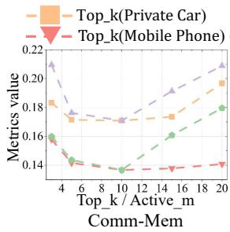

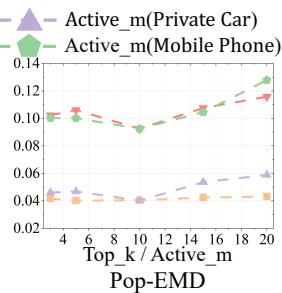  
Figure 8: Sensitivity of Distance (left) and Pop-EMD (right) to top\_k and active\_m on the private car and mobile phone datasets.

## 4.9 Privacy Analysis

We conduct uniqueness testing [4, 44] by comparing each generated with the real trajectories in the training set using normalized Levenshtein similarity [15] and report the cumulative distributions. Fig. 10(a) shows an intermediate median similarity on the private car dataset, with a similar trend on the mobile phone dataset (Appendix G). This indicates that MOTION captures reusable mobility regularities without reproducing specific training trajectories. We further conduct membership inference attack test [4, 44]. We use Random Forest (RF) [3], Multi-Layer Perceptron (MLP) [32], and Logistic Regression (LR) [6] to distinguish training trajectories from held-out samples. As shown in Fig. 10(b), the strongest attack provide only a limited advantage over random guessing, indicating that the generated mobility retains few distinctive signatures of individual training samples.

Table 4: End-to-end token consumption and latency per generated user-day.
<table><tr><td rowspan="2">Methods</td><td colspan="2">Private Car Dataset</td><td colspan="2">Mobile Phone Dataset</td></tr><tr><td>Tokens</td><td>Latency</td><td>Tokens</td><td>Latency</td></tr><tr><td>MOTION</td><td>40,662</td><td>229 s</td><td>43,132</td><td>224 s</td></tr><tr><td>LLMob</td><td>40,647</td><td>255 s</td><td>45,023</td><td>230 s</td></tr><tr><td>AgentMove</td><td>42,331</td><td>264 s</td><td>48,159</td><td>244 s</td></tr></table>

## 4.10 Downstream Task Analysis

We evaluate generated mobility on community-aware CDGP [11] prediction using Average Precision (AP), Normalized Mutual Information (NMI), and Purity. We compare CDGP trained without community information (No-Com), on real data (Real), and with mobility generated by LLMob or MOTION. In the 100% setting, MOTION outperforms LLMob and approaches Real, while community information consistently improves over No-Com. In the 50% setting, LLMob and MOTION augment half of the real data with an equal amount of generated data, whereas Real and No-Com use only the real half. MOTION performs best on all metrics, showing that community-consistent synthetic mobility provides useful interaction structures when observations are scarce.

## 4.11 Complexity Analysis

We report end-to-end token consumption and latency per generated user-day in Table 5. Compared with LLMob, MOTION achieves lower latency on both datasets while using a similar number of tokens on the private car dataset and fewer tokens on the mobile phone dataset. MOTION also outperforms AgentMove on both measures, showing that preserving community and interaction structures does not incur higher generation costs. The componentlevel breakdown is provided in Appendix J.

## 5 RELATED WORK

Human mobility generation has evolved from mechanistic models to deep generators and LLM-based agents. Early rule-based methods such as DRTISA [28] and d-EPR [27] encode routines, exploration, and preferential return but rely on simplified behavioral assumptions. Deep models such as SeqGAN [41] and MoveSim [9] instead learn user preferences and spatiotemporal transitions through adversarial generation. The emergence of large language models (LLMs) introduced strong semantic understanding and contextual reasoning into mobility modeling. LLMob [36] verbalizes trajectory histories and contextual information for autoregressive nextlocation inference, whereas LLM-COD [40] conditions destination generation on departure time, origin, and regional POI semantics. An LLM-based agent further equips an LLM with memory, planning, tool use, and iterative feedback, enabling interpretable multi-step decisions and the integration of heterogeneous urban knowledge. Ju et al. [12] developed TrajLLM to hierarchically generate personas, activities, and destinations; Feng et al. [8] introduced AgentMove, which combines spatiotemporal memory, world knowledge, and collective patterns for zero-shot next-location reasoning. Future research is expected to leverage multi-agent collaboration to simulate interactions among individuals, uncovering deeper relational structures underlying human mobility [16, 29].

## Example of Multi-Agent Reasoning, Coordination and Reflection

User Agent 418: User 418 at 8:00 plans to MOVE to a Science & Education & Culture Area within 1km\~1.5km). Candidate Locations are [loc 298, Shopping & Consumer Goods, dist=1.11km, gravity=12.660 flow\_out=17.9; loc 317 Science & Education & Culture dist=1.11km gravity=6.242 flow\_out=9.1, …]. Agent Decision: {"next\_location\_id": 317, "reason": "Best match for 'Science & Education & Culture' with good gravity and flow\_out, and ideal distance. $\because \frac { 9 } { 3 } ( \frac { 9 } { 3 } ) > 1$ User Agent 452: … Location Agent 317: Loc 317 is a Science & Education & Culture activity center with 12 users here now. Scaled history population and flow at 8:00 are 12.9 and 16.62. Surrounding Locations with moving users are [Loc 209, Hotels & Accommodations area, moving\_user\_num: 29, hist\_flow\_in: 22.46; Loc $3 0 6 , \ldots ] .$ Surrounding MOVING Users are [User 418, Daily Plan is…, co-mob users are…, now is in Loc 209, moving to a Science & Education & Culture Area; ….]. Agent Decision: {"users\_to\_attract": $[ " 4 1 8 " , " 2 2 0 " ]$ , "reason": "Population is under-populated, so only attract strong matches. Prioritize users from Hotels & Accommodations (loc $2 0 9 ) . " \} { \mathbb { C } } ^ { \frac { 9 } { \infty } } )$ Location Agent 298: …   
Manager Agent: Scaled history movement at 8:00 $\mathrm { i s } 1 3 . 8 { \sim } 2 5 . 7 .$ [User 418, User Agent Decision and reason are Location Agent Decision and reason are…., User 258, …]. Agent Decision is {{"user\_id": 418, "resolved\_to\_loc": 317,"action": "MOVE","reason": "Both agents agree on MOVE to 317; loc 317 is under-populated."}{"user\_id": 901,"resolved\_to\_loc": 107,"action": "STAY","reason": "User agent proposes STAY; no strong real-data signal to override $\therefore \ Y _ { j } , \ldots \}$ Reflections: {"location\_signals": [{"loc\_id": 106,"signal\_type": "decrease\_attraction","detail": "Location 106 (Hotels & Accommodations) is over-populated; reduce attraction."},…], [{"user\_id": "183","signal\_type": "modify\_plan\_action","detail": "Switch planned action to STAY at Shopping & Consumer Good to reduce overpopulation. $" \} , \ldots \}$

Figure 9: An example of multi-agent reasoning. Colored regions highlight the key inputs and outputs of each agent role.  
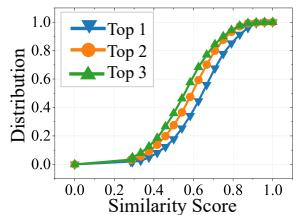

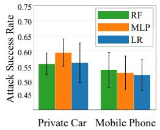  
(a) Uniqueness Testing on Private Car (b) Membership Inference Attacks

Table 5: End-to-end token consumption and latency per generated user-day.
<table><tr><td rowspan="2">Methods</td><td colspan="2">Private Car Dataset</td><td colspan="2">Mobile Phone Dataset</td></tr><tr><td>Tokens</td><td>Latency</td><td>Tokens</td><td>Latency</td></tr><tr><td>MOTION</td><td>40,662</td><td>229 s</td><td>43,132</td><td>224 s</td></tr><tr><td>LLMob</td><td>40,647</td><td>255 s</td><td>45,023</td><td>230 s</td></tr><tr><td>AgentMove</td><td>42,331</td><td>264 s</td><td>48,159</td><td>244 s</td></tr></table>

Figure 10: Privacy results: (a) nearest-training-trajectory similarities on the private car dataset and (b) membership inference attack success rates on both datasets.  
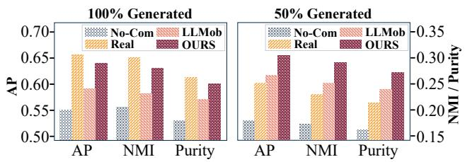

Figure 11: Downstream prediction performance on the pri vate car dataset under the 100% (left) and 50% (right) training settings. Higher values indicate better performance.  
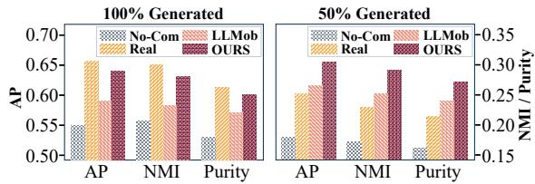  
Figure 12: Downstream prediction performance on the pri vate car dataset under the 100% (left) and 50% (right) training settings. Higher values indicate better performance.

## 6 CONCLUSION

In this paper, we presented MOTION, a Multi-agent framework for cOmmuniTy-consIstent human mObility geNeration. MOTION extracts community-conditioned interaction priors, employs user agents and location agents to propose complementary graph updates, and uses a manager agent for coordination and communityconsistency reflection. Experiments on two real-world datasets demonstrate improvements across individual, population, and community levels, while further analyses confirm cross-city generalization, privacy preservation, and downstream utility.

## REFERENCES

[1] Aleix Bassolas, Hugo Barbosa-Filho, Brian Dickinson, Xerxes Dotiwalla, Paul Eastham, Riccardo Gallotti, Gourab Ghoshal, Bryant Gipson, Surendra A Hazarie, Henry Kautz, et al. 2019. Hierarchical organization of urban mobility and its connection with city livability. Nature communications 10, 1 (2019), 4817.

[2] Aleksandar Bojchevski, Oleksandr Shchur, Daniel Zügner, and Stephan Günnemann. 2018. Netgan: Generating graphs via random walks. In International conference on machine learning. PMLR, 610–619.

[3] Leo Breiman. 2001. Random forests. Machine learning 45, 1 (2001), 5–32.

[4] Zhongcai Cao, Kang Liu, Xin Jin, Li Ning, Ling Yin, and Feng Lu. 2025. Stage: a spatiotemporal-knowledge enhanced multi-task generative adversarial network (gan) for trajectory generation. International Journal ofGeographical Information Science 39, 5 (2025), 1100–1127.

[5] Chen Chu, Hengcai Zhang, Peixiao Wang, and Feng Lu. 2024. Simulating human mobility with a trajectory generation framework based on difusion model. International Journal ofGeographical Information Science 38, 5 (2024), 847–878.

[6] David R Cox. 1958. The regression analysis of binary sequences. Journal ofthe Royal Statistical Society Series B: Statistical Methodology 20, 2 (1958), 215–232.

[7] Bangchao Deng, Xin Jing, Tianyue Yang, Bingqing Qu, Dingqi Yang, and Philippe Cudre-Mauroux. 2025. Revisiting synthetic human trajectories: Imitative generation and benchmarks beyond datasaurus. In Proceedings ofthe 31st ACM SIGKDD Conference on Knowledge Discovery and Data Mining V. 1. 201–212.

[8] Jie Feng, Yuwei Du, Jie Zhao, and Yong Li. 2025. Agentmove: A large language model based agentic framework for zero-shot next location prediction. In Proceedings ofthe 2025 Conference ofthe Nations ofthe Americas Chapter ofthe Association for Computational Linguistics: Human Language Technologies (Volume 1: Long Papers). 1322–1338.

[9] Jie Feng, Zeyu Yang, Fengli Xu, Haisu Yu, Mudan Wang, and Yong Li. 2020. Learning to simulate human mobility. In Proceedings of the 26th ACM SIGKDD international conference on knowledge discovery & data mining. 3426–3433.

[10] Letian Gong, Yan Lin, Xinyue Zhang, Yiwen Lu, Xuedi Han, Yichen Liu, Sheng nan Guo, Youfang Lin, and Huaiyu Wan. 2024. Mobility-llm: Learning visiting intentions and travel preference from human mobility data with large language models. Advances in Neural Information Processing Systems 37 (2024), 36185– 36217.

[11] Shuo Ji, Xiaodong Lu, Mingzhe Liu, Leilei Sun, Chuanren Liu, Bowen Du, and Hui Xiong. 2023. Community-based dynamic graph learning for popularity prediction. In Proceedings of the 29th ACM SIGKDD conference on knowledge discovery and data mining. 930–940.

[12] Chenlu Ju, Jiaxin Liu, Shobhit Sinha, Hao Xue, and Flora Salim. 2025. Trajllm: A modular llm-enhanced agent-based framework for realistic human trajectory simulation. In Companion Proceedings ofthe ACM on Web Conference 2025. 2847– 2850.

[13] Takeshi Kojima, Shixiang Shane Gu, Machel Reid, Yutaka Matsuo, and Yusuke Iwasawa. 2022. Large language models are zero-shot reasoners. Advances in neural information processing systems 35 (2022), 22199–22213.

[14] Xiaochong Lan, Jie Feng, Yizhou Sun, Chen Gao, Jiahuan Lei, Xinleishi Xinleishi, Hengliang Luo, and Yong Li. 2025. Open-set living need prediction with large language models. In Findings of the Association for Computational Linguistics: ACL 2025. 5454–5472.

[15] Vladimir I Levenshtein et al. 1966. Binary codes capable of correcting deletions, insertions, and reversals. In Sovietphysics doklady, Vol. 10. Soviet Union, 707–710.

[16] Jiachen Li, Fan Yang, Masayoshi Tomizuka, and Chiho Choi. 2020. Evolvegraph: Multi-agent trajectory prediction with dynamic relational reasoning. Advances in neural information processing systems 33 (2020), 19783–19794.

[17] Tong Li and Yong Li. 2023. Artificial intelligence for reducing the carbon emissions of 5G networks in China. 1522–1523 pages.

[18] Xuchuan Li, Fei Huang, Jianrong Lv, Zhixiong Xiao, Guolong Li, and Yang Yue. 2024. Be more real: Travel diary generation using llm agents and individual profiles. arXiv preprint arXiv:2407.18932 (2024).

[19] Defu Lian, Yongji Wu, Yong Ge, Xing Xie, and Enhong Chen. 2020. Geographyaware sequential location recommendation. In Proceedings of the 26th ACM SIGKDD international conference on knowledge discovery & data mining. 2009– 2019.

[20] Yuxuan Liang, Kun Ouyang, Lin Jing, Sijie Ruan, Ye Liu, Junbo Zhang, David S Rosenblum, and Yu Zheng. 2019. Urbanfm: Inferring fine-grained urban flows. In Proceedings ofthe 25th ACM SIGKDD international conference on knowledge discovery & data mining. 3132–3142.

[21] Jianghao Lin, Rong Shan, Chenxu Zhu, Kounianhua Du, Bo Chen, Shigang Quan, Ruiming Tang, Yong Yu, and Weinan Zhang. 2024. Rella: Retrieval-enhanced large language models for lifelong sequential behavior comprehension in recommendation. In Proceedings ofthe ACM Web Conference 2024. 3497–3508.

[22] Bo Liu, Tong Li, Zhu Xiao, Wenjie Chen, Yongqiang Hei, Jingtao Ding, and Guo Chen. 2026. A multi-granularity self-guiding graph difusion model for predicting private car activity. IEEE Transactions on Intelligent Transportation Systems (2026).

[23] Chenxi Liu, Zhu Xiao, Wangchen Long, Tong Li, Hongbo Jiang, and Keqin Li. 2025. Vehicle trajectory data processing, analytics, and applications: A survey. Comput. Surveys 57, 9 (2025), 1–36.

[24] Hao Liu, Ying Li, Yanjie Fu, Huaibo Mei, Jingbo Zhou, Xu Ma, and Hui Xiong. 2020. Polestar: An intelligent, eficient and national-wide public transportation routing engine. In Proceedings of the 26th ACM SIGKDD International Conference on Knowledge Discovery & Data Mining. 2321–2329.

[25] Massimiliano Luca, Gianni Barlacchi, Bruno Lepri, and Luca Pappalardo. 2021. A survey on deep learning for human mobility. ACM Computing Surveys (CSUR) 55, 1 (2021), 1–44.

[26] Giovanni Mauro, Massimiliano Luca, Antonio Longa, Bruno Lepri, and Luca Pappalardo. 2022. Generating mobility networks with generative adversarial networks. EPJ data science 11, 1 (2022), 58.

[27] Luca Pappalardo, Salvatore Rinzivillo, and Filippo Simini. 2016. Human mobility modelling: exploration and preferential return meet the gravity model. Procedia Computer Science 83 (2016), 934–939.

[28] Luca Pappalardo and Filippo Simini. 2018. Data-driven generation of spatiotemporal routines in human mobility. Data Mining and Knowledge Discovery 32, 3 (2018), 787–829.

[29] Joon Sung Park, Joseph O’Brien, Carrie Jun Cai, Meredith Ringel Morris, Percy Liang, and Michael S Bernstein. 2023. Generative agents: Interactive simulacra of human behavior. In Proceedings of the 36th annual acm symposium on user interface software and technology. 1–22

[30] Roberto Pellungrini, Luca Pappalardo, Francesca Pratesi, and Anna Monreale. 2017. A data mining approach to assess privacy risk in human mobility data. ACM Transactions on Intelligent Systems and Technology (TIST) 9, 3 (2017), 1–27.

[31] Can Rong, Jingtao Ding, and Yong Li. 2024. An interdisciplinary survey on origin-destination flows modeling: Theory and techniques. Comput. Surveys 57, 1 (2024), 1–49.

[32] Frank Rosenblatt. 1958. The perceptron: a probabilistic model for information storage and organization in the brain. Psychological review 65, 6 (1958), 386.

[33] Yossi Rubner, Carlo Tomasi, and Leonidas J Guibas. 1998. A metric for distributions with applications to image databases. In Sixth international conference on computer vision (IEEE Cat. No. 98CH36271). IEEE, 59–66.

[34] Chenyang Shao, Fengli Xu, Bingbing Fan, Jingtao Ding, Yuan Yuan, Meng Wang, and Yong Li. 2024. Chain-of-planned-behaviour workflow elicits few-shot mobil ity generation in llms. arXiv preprint arXiv:2402.09836 (2024).

[35] Vincent A Traag, Ludo Waltman, and Nees Jan Van Eck. 2019. From Louvain to Leiden: guaranteeing well-connected communities. Scientific reports 9, 1 (2019), 5233.

[36] Jiawei Wang, Renhe Jiang, Chuang Yang, Zengqing Wu, Makoto Onizuka, Ryosuke Shibasaki, Noboru Koshizuka, and Chuan Xiao. 2024. Large language models as urban residents: An llm agent framework for personal mobility generation. Advances in Neural Information Processing Systems 37 (2024), 124547– 124574.

[37] Hua Wei, Guanjie Zheng, Huaxiu Yao, and Zhenhui Li. 2018. Intellilight: A reinforcement learning approach for intelligent trafic light control. In Proceedings ofthe 24th ACM SIGKDD international conference on knowledge discovery & data mining. 2496–2505.

[38] Yanyan Xu, Luis E Olmos, David Mateo, Alberto Hernando, Xiaokang Yang, and Marta C González. 2023. Urban dynamics through the lens of human mobility. Nature computational science 3, 7 (2023), 611–620.

[39] Jiaxuan You, Rex Ying, Xiang Ren, William Hamilton, and Jure Leskovec. 2018. Graphrnn: Generating realistic graphs with deep auto-regressive models. In International conference on machine learning. PMLR, 5708–5717.

[40] Chenyang Yu, Xinpeng Xie, Yan Huang, and Chenxi Qiu. 2024. Harnessing llms for cross-city od flow prediction. In Proceedings ofthe 32nd ACM International Conference on Advances in Geographic Information Systems. 384–395.

[41] Lantao Yu, Weinan Zhang, Jun Wang, and Yong Yu. 2017. Seqgan: Sequence generative adversarial nets with policy gradient. In Proceedings of the AAAI conference on artificial intelligence, Vol. 31.

[42] Jing Yuan, Yu Zheng, and Xing Xie. 2012. Discovering regions of diferent functions in a city using human mobility and POIs. In Proceedings ofthe 18th ACM SIGKDD international conference on Knowledge discovery and data mining. 186–194.

[43] Yuan Yuan, Jingtao Ding, Depeng Jin, and Yong Li. 2025. Learning the complexity of urban mobility with deep generative network. PNAS nexus 4, 5 (2025), pgaf081.

[44] Yuan Yuan, Jingtao Ding, Huandong Wang, and Depeng Jin. 2024. Generating daily activities with need dynamics. ACM Transactions on Intelligent Systems and Technology 15, 2 (2024), 1–28.

[45] Shiyuan Zhang, Tong Li, Shuodi Hui, Guangyu Li, Yanping Liang, Li Yu, Depeng Jin, and Yong Li. 2023. Deep transfer learning for city-scale cellular trafic generation through urban knowledge graph. In Proceedings of the 29th ACM SIGKDD conference on knowledge discovery and data mining. 4842–4851.

[46] Tianlong Zhang, Xiaoxi He, Yuxiang Wang, Yi Xu, Rendi Wu, Zhifei Wang, and Yongxin Tong. 2025. FedMetro: Eficient Metro Passenger Flow Prediction via Federated Graph Learning. In Proceedings of the 31st ACM SIGKDD Conference on Knowledge Discovery and Data Mining V. 2. 5215–5224.

[47] Yuheng Zhang, Yuan Yuan, Jingtao Ding, Jian Yuan, and Yong Li. 2025. Noise matters: Difusion model-based urban mobility generation with collaborative noise priors. In Proceedings ofthe ACM on Web Conference 2025. 5352–5363.

[48] Yu Zheng, Licia Capra, Ouri Wolfson, and Hai Yang. 2014. Urban computing: concepts, methodologies, and applications. ACM Transactions on Intelligent Systems and Technology (TIST) 5, 3 (2014), 1–55.

## SUPPLEMENTARY MATERIAL

## A DATASET STATISTICS AND ETHICAL STATEMENT

The private car dataset consists of two weeks of GPS traces collected from 2,342 private vehicles. The mobile phone dataset contains two weeks of GPS-based location traces collected from 5,352 mobile users. To protect user privacy, coordinate-level locations are mapped to region-level identifiers, and each mobility record contains only a de-identified user or vehicle identifier, a timestamp, and the corresponding region identifier. All data used in this study were collected with the explicit authorization ofthe individual users and data providers and were anonymized before we accessed them. Table 6 summarizes the resulting dataset statistics.

## B POI PROFILES

To capture the functional semantics of each region, we construct a POI profile using an open-source POI database containing geographic coordinates, category labels, and place names. As shown in Table 7,there are 14 top-level POI categories, while the underlying POI database contains finer-grained subcategories. For each region, we compute the proportion of POIs belonging to each category, resulting in a 14-dimensional distribution vector that represents its functional semantics. These regional POI profiles are associated with the mobility records and are used by MOTION for semantic mobility planning, destination retrieval, and location-side reasoning.

## C DETAILS OF MOTIFS MINING

This section defines the mobility motifs extracted through metagraphbased prior mining and provides representative examples using POI semantics and discretized travel distances. STAY represents a continuous period during which a user remains at the same location without an inter-location movement. MOVE\_AB represents a oneway movement from a source location to a diferent destination without a return within the motif. ROUND\_ABA describes a visit to another location followed by a return to the original source. CHAIN\_ABC captures a sequence of visits to three distinct locations without revisiting an earlier location. RETURN\_ABCB describes a movement through three locations followed by a return to the intermediate location rather than the original source. FULL\_ABCBA captures a nested return pattern in which a user revisits the intermediate location and subsequently returns to the original source. Each movement is represented by its source and destination POI semantics together with one of seven travel-distance bins: 0–1 km, 1–2 km, 2–3 km, 3–5 km, 5–8 km, 8–12 km, and >12 km. Table 8 provides concrete examples, where a repeated POI label within an example denotes a revisit to the same location instance; STAY has no distance bin because it contains no movement.

## D BASELINE DESCRIPTIONS

DRTISA. [28] DRTISA is a mechanistic mobility generator that decouples temporal routines from spatial movements. It first learns a diary model from real trajectories to determine when a user follows or departs from a recurrent routine, and then translates the diary into physical locations through exploration and preferential return mechanisms. This design allows DRTISA to reproduce both regular activity schedules and occasional visits to new locations.

Table 6: Statistics of the private car and mobile phone datasets.
<table><tr><td>Dataset</td><td>Period</td><td># Locations</td><td># Users</td><td># POIs</td><td># POI Categories</td><td># Records</td><td>Avg. Moves per User</td><td>Avg. Daily Moves per User</td></tr><tr><td>Private car dataset</td><td>2 weeks</td><td>500</td><td>2,342</td><td>717,461</td><td>14</td><td>678,341</td><td>8.75</td><td>0.88</td></tr><tr><td>Mobile phone dataset</td><td>2 weeks</td><td>500</td><td>5,352</td><td>679,413</td><td>14</td><td>1,235,619</td><td>18.60</td><td>1.28</td></tr></table>

Table 7: The 14 high-level POI semantic categories.
<table><tr><td colspan="2">POI Semantic Categories</td></tr><tr><td>Transportation Facilities</td><td>Leisure &amp; Entertainment</td></tr><tr><td>Companies &amp; Enterprises</td><td>Healthcare</td></tr><tr><td>Commercial &amp; Residential</td><td>Tourist Attractions</td></tr><tr><td>Automotive</td><td>Life Services</td></tr><tr><td>Science &amp; Education &amp; Culture</td><td>Shopping &amp; Consumer Goods</td></tr><tr><td>Sports &amp; Fitness</td><td>Hotels &amp; Accommodations</td></tr><tr><td>Financial Institutions</td><td>Dining &amp; Cuisine</td></tr></table>

SeqGAN. [41] SeqGAN is a general adversarial sequence-generation model that treats trajectory construction as a sequential decisionmaking process. Its recurrent generator produces one location at a time as a stochastic policy, while a discriminator evaluates whether complete sequences resemble real observations. Policy-gradient learning propagates the discriminator reward to intermediate generation steps, enabling adversarial optimization over discrete mobility sequences.

MoveSim. [9] MoveSim is a mobility-specific generative adversarial network that conditions trajectory generation on user identity and historical movements. It learns latent representations of users and trajectories to capture semantic similarities among mobility behaviors, allowing generated sequences to reflect individual destination preferences and spatial transition patterns. Domainspecific mobility regularities are incorporated into the adversarial generation process to improve trajectory realism.

DeepMobility. [43] DeepMobility is a deep generative collaboration network that jointly models individual mobility behaviors and population-level flows. It employs a generative adversarial imitation learning framework with two collaborative mechanisms: bottom-up interaction modeling and top-down feedback refinement. The former incorporates population movement information into individual mobility decisions, while the latter uses aggregated flow patterns to guide the learning of individual behaviors. Through this bidirectional collaboration, DeepMobility generates individual trajectories that reproduce collective mobility dynamics.

CoDifMob. [47] CoDifMob is a difusion-based urban mobility generation model that incorporates collaborative noise priors to capture both individual movement characteristics and collective mobility patterns. It first constructs location transition sequences using population-level mobility flows and individual movement preferences. These sequences are then mapped into the noise space and combined with Gaussian noise to guide the difusion process, enabling the generation of realistic individual trajectories while preserving collective flow patterns.

LLMob. [36] LLMob formulates human mobility generation as an instruction-guided language modeling task. It converts a user’s historical trajectory and contextual information, such as time and location semantics, into textual prompts and autoregressively predicts subsequent movements. This formulation exploits the sequential modeling and semantic reasoning capabilities of large language models to generate personalized mobility trajectories.

LLM-COD. LLM-COD formulates destination prediction as a conditional language generation problem. Its prompts encode the departure location, travel time, and regional point-of-interest context, enabling the language model to infer the semantic type of a plausible destination. The predicted destination semantics are subsequently matched to candidate regions, allowing the model to use functional urban knowledge when generating origin–destination movements.

TrajLLM. [12] TrajLLM is a modular large-language-modelenhanced agent framework for daily trajectory simulation. It organizes mobility generation into hierarchical stages that construct user personas, select activities, and determine corresponding destinations. By incorporating demographic and behavioral context into these stages, TrajLLM generates interpretable daily routines that connect individual characteristics with activity and location choices.

AgentMove. [8] AgentMove is a large-language-model-based agentic framework for next-location prediction. It decomposes mobility reasoning into a spatiotemporal memory module for individual patterns, a world-knowledge module for multi-scale urban structure, and a collective-knowledge module for shared population patterns. The outputs of these modules are jointly interpreted by the language model to produce the final destination decision.

## E DETAILED EXPERIMENTAL SETTINGS

We implement MOTION in Python and use LangGraph to orchestrate the three agent types. Mobility records are discretized hourly over 500 POI-enriched regions. We split users into training and test sets at a ratio of 8:2, use the days preceding the final day to construct mobility priors, and evaluate 24-step generation from each test user’s location at 00:00 on the final day. We use GPT-4o with top\_k=10, active\_m=10, and at most 5 reflection rounds. The LLM temperature is set to 0.2, and all experiments use a random seed of 42. The same target users and initial locations are supplied to all methods whenever a baseline supports conditional initialization.

For dynamic graph construction, the spatial decay scale is set to 3 km, location edges longer than 10 km are removed, and the top 20% of the remaining location-location edges are retained according to their combined spatial-flow weights. For dynamic community detection, the Leiden resolution is set to 0.2; the initial graph is optimized for 20 iterations, subsequent snapshots are warm-started for 5 iterations, and the temporal smoothing coeficient is set to 0.4.

Table 8: Representative mobility motif examples using POI semantics and discretized travel distances.  
Motif Representative Examples   
STAY Commercial & Residential (no movement); Companies & Enterprises (no movement).   
MOVE\_AB Commercial & Residential 3-5 km Companies & Enterprises: Science & Education & Culture 8–12 km Tourist Attractions.   
2–3 km $\xrightarrow { 2 - 3 \mathrm { k m } }$   
ROUND\_ABA Commercial & Residential Shopping & Consumer Goods Commercial & Residential.   
CHAIN\_ABC Commercial & Residential 1–2 km Transportation Facilities $\xrightarrow { 5 - 8 \mathrm { k m } }$ Companies & Enterprises.   
0–1 km−−−−→ Dining & Cuisine 3–5 km 3–5 km   
RETURN\_ABCB Hotels & Accommodations Leisure & Entertainment Dining & Cuisine.   
FULL\_ABCBA Commercial & Residential 1–2 km Transportation Facilities $\xrightarrow { > 1 2 \mathrm { k m } }$ Tourist Attractions >12 km Transportation Facilities 1–2 km   
Commercial & Residential.

For destination retrieval, the population exponent is set to 1.0, the POI compatibility multiplier to 2.0, the minimum distance used by the gravity score to 0.1 km, and the long-distance exploration probability to 0.05. Location agents prioritize locations with high incoming activity. The co-mobility threshold is set to 0.6. The manager agent compares intermediate graphs with priors extracted only from the training data and restricts each reflection round to afected users and locations within the current time step.

## F DETAILS OF EVALUATION METRICS

Let S and $\widehat { s }$ denote the real and generated trajectory sets, respectively, and let $d ( \cdot , \cdot )$ denote geographic distance. Following prior mobility-generation evaluations [9, 26], we organize the metrics into individual trajectory statistics, population and flow distributions, and community and graph-structural consistency. For distributional comparisons, we use the square root of the base-2 Jensen– Shannon Divergence (JSD), defined using the base-2 Kullback– Leibler (KL) divergence as

$$
\begin{array} { c l c r } { { \mathrm { J S D } ( P , Q ) = \displaystyle \sqrt { \frac { 1 } { 2 } { \mathrm { K L } } _ { 2 } ( P \| M ) + \frac { 1 } { 2 } { \mathrm { K L } } _ { 2 } ( Q \| M ) } , } } \\ { { { } } } & { { { } } } \\ { { M = \displaystyle \frac { P + Q } { 2 } , } } \end{array}\tag{5}
$$

where $\mathrm { J S D } ( P , Q ) \in [ 0 , 1 ] .$

## F.1 Individual Trajectory Statistics

This level evaluates whether each generated trajectory preserves realistic spatial ranges and visitation diversity, using mobility statistics commonly adopted in trajectory generation [9, 28].

Distance. Distance measures the average geographic displacement between consecutive time steps in a trajectory $s _ { i } = [ \ell _ { 1 } ^ { i } , \ldots , \ell _ { T } ^ { i } ] \mathrm { { : } }$

$$
D _ { i } = \frac { 1 } { T - 1 } \sum _ { t = 2 } ^ { T } d ( \ell _ { t - 1 } ^ { i } , \ell _ { t } ^ { i } ) .\tag{6}
$$

We compute JSD between the empirical distributions of $D _ { i }$ in $s$ and ${ \widehat { s } } .$

Radius. Radius measures the spatial extent of an individual’s movements using the radius of gyration. Let $\mathbf { x } _ { t } ^ { i }$ be the coordinate of $\ell _ { t } ^ { i }$ and $\begin{array} { r } { \bar { \mathbf { x } } _ { i } = T ^ { - 1 } \sum _ { t } \mathbf { x } _ { t } ^ { i } } \end{array}$ be the trajectory center; then

$$
R _ { i } = \sqrt { \frac { 1 } { T } \sum _ { t = 1 } ^ { T } d ( \mathbf { x } _ { t } ^ { i } , \bar { \mathbf { x } } _ { i } ) ^ { 2 } } .\tag{7}
$$

Radius is the JSD between the real and generated distributions of $R _ { i }$

Number of Locations (LocNum). LocNum measures the number of distinct locations visited by a user:

$$
L _ { i } = \left| \{ \ell _ { t } ^ { i } \} _ { t = 1 } ^ { T } \right| .\tag{8}
$$

We compare the distributions of $L _ { i }$ using JSD to evaluate the diversity of visited locations.

## F.2 Population and Flow Distributions

This level aggregates users and movements to evaluate whether generated mobility recovers the spatial organization of regional populations and origin–destination flows [31]. We use Earth Mover’s Distance (EMD) [33] because it accounts for the geographic cost of transporting probability mass between spatially diferent regions.

Population Earth Mover’s Distance (Pop-EMD). Pop-EMD evaluates whether users are distributed over geographically similar locations at each time step. For two discrete spatial distributions $P$ and $Q ,$ Earth Mover’s Distance (EMD) under geographic ground distance � is

$$
\mathrm { E M D } _ { d } ( P , Q ) = \operatorname* { m i n } _ { \pi \in \Pi ( P , Q ) } \sum _ { x , y } \pi ( x , y ) d ( x , y ) ,\tag{9}
$$

where $\Pi ( P , Q )$ denotes the set of transport plans whose marginals are $P$ and �. Let $P _ { t } ^ { \mathrm { p o p } }$ and $\widehat { P } _ { t } ^ { \mathrm { p o p } }$ denote the real and generated population distributions at time �; Pop-EMD is

$$
\mathrm { P o p - E M D } = \frac { 1 } { T } \sum _ { t = 1 } ^ { T } \mathrm { E M D } _ { d } ( P _ { t } ^ { \mathrm { p o p } } , \widehat { P } _ { t } ^ { \mathrm { p o p } } ) .\tag{10}
$$

Flow Earth Mover’s Distance (Flow-EMD). Flow-EMD measures whether generated origin–destination movements reproduce the spatial organization of real population flows. Each mobility event is represented by $e \ = \ ( o , d )$ , including a stay event when $o = d ,$ , and the distance between two events is

$$
d _ { F } ( e , e ^ { \prime } ) = \frac { d ( o , o ^ { \prime } ) + d ( d , d ^ { \prime } ) } { 2 } .\tag{11}
$$

Let $P _ { t } ^ { \mathrm { f l o w } }$ and $\widehat { P } _ { t } ^ { \mathrm { f l o w } }$ denote the corresponding event distributions; Flow-EMD is

$$
\mathrm { F l o w - E M D } = \frac { 1 } { T } \sum _ { t = 1 } ^ { T } \mathrm { E M D } _ { d _ { F } } ( P _ { t } ^ { \mathrm { f l o w } } , \widehat { P } _ { t } ^ { \mathrm { f l o w } } ) .\tag{12}
$$

G-Rank. G-Rank evaluates whether generated mobility preserves the popularity distribution of major locations. Let $\mathcal { L } _ { 1 0 0 }$ be the 100 most visited locations in the real data, and let $n _ { \ell }$ and $\widehat { n } _ { \ell }$

denote their real and generated visit counts. Their normalized distributions are

$$
\hat { p } _ { \ell } = \frac { n _ { \ell } } { \sum _ { j \in \mathcal { L } _ { 1 0 0 } } n _ { j } } , \qquad \widehat { \mathcal { P } } _ { \ell } = \frac { \widehat { n } _ { \ell } } { \sum _ { j \in \mathcal { L } _ { 1 0 0 } } \widehat { n } _ { j } } .\tag{13}
$$

G-Rank is defined as $\mathrm { J S D } ( \mathbf { p } , \widehat { \mathbf { p } } )$ over the shared set $\mathcal { L } _ { 1 0 0 }$

## F.3 Community and Graph-Structural Consistency

This level evaluates whether the generated graph sequence preserves the mesoscopic community organization and higher-order interaction structures emerging across users [1, 11]. It complements trajectory and aggregate-flow metrics with graph properties that characterize community scale and membership, recurring mobility structures, and local interaction intensity [2, 26].

Comm-Size. Comm-Size evaluates whether generated graph evolution reproduces the scale organization and fragmentation patterns of real mobility communities by comparing their communitysize distributions. We independently apply the same dynamic community detection procedure to the real and generated graph sequences, obtaining community partitions $C _ { t }$ and $\widehat { C } _ { t }$ over the shared user-location node set $\mathcal { V } = \mathcal { U } \cup \mathcal { L }$ at each time step. Given a shared set of normalized community-size bins B, their empirical size distributions are

$$
\mathcal { P } _ { t } ^ { C } ( b ) = \frac { 1 } { | C _ { t } | } \sum _ { C \in C _ { t } } \mathbb { I } \left[ \frac { | C \cap \mathcal { U } | + | C \cap \mathcal { L } | } { | \mathcal { V } | } \in b \right] , \quad b \in \mathcal { B } ,\tag{14}
$$

with $\widehat { p } _ { t } ^ { C }$ defined analogously for $\widehat { C } _ { t }$ . Comm-Size is then computed as

$$
\mathrm { C o m m - S i z e } = \frac { 1 } { T } \sum _ { t = 1 } ^ { T } \mathrm { J S D } \left( p _ { t } ^ { C } , \widehat { p } _ { t } ^ { C } \right) .\tag{15}
$$

Because the metric compares community sizes rather than community IDs, it does not require label alignment between the two partitions.

Comm-Mem. Comm-Mem measures agreement between real and generated community memberships using normalized mutual information (NMI). At each hour, we independently apply Leiden with weighted modularity (resolution 1.0) to the full user-location graphs, using unit-weight user-location edges and a shared undirected location backbone with reciprocal weights summed. We compare labels only on ID-aligned common users and locations occupied in both graphs, with equal node weights. Let $A _ { t , k }$ and $B _ { t , k }$ be these restricted labels from real and generated partitions using seeds � and 100 + �, respectively; then

$$
\mathrm { C o m m - M e m } = \frac { 1 } { 1 1 5 } \sum _ { t = 1 } ^ { 2 3 } \sum _ { k = 0 } ^ { 4 } \frac { 2 I ( A _ { t , k } ; B _ { t , k } ) } { H ( A _ { t , k } ) + H ( B _ { t , k } ) } ,\tag{16}
$$

where � and � denote mutual information and entropy. This score uses arithmetic mean normalization, lies in [0, 1] (higher is better) and excludes the shared initial hour $t = 0$

Mobility MotifJSD (Motif). Motifevaluates whether generated trajectories preserve recurring higher-order movement structures. It identifies five non-stay mobility structures—direct movement, round trip, chained visit, intermediate return, and full return—and computes JSD between their normalized occurrence distributions.

Weighted-Degree JSD. W-Degree evaluates whether generated graphs preserve node-level interaction intensity and local connectivity. Let $w _ { t } ( v , u )$ denote the weight of edge (�, �) in graph snapshot $\mathcal { H } _ { t } ;$ the weighted degree of node � is

$$
d _ { t } ^ { w } ( v ) = \sum _ { u : ( v , u ) \in \mathscr { E } _ { t } } w _ { t } ( v , u ) .\tag{17}
$$

Let $p _ { t } ^ { D }$ and $\widehat { p } _ { t } ^ { D }$ denote the empirical weighted-degree distributions of the real and generated graph snapshots, respectively. The metric is

$$
\mathrm { W - D e g r e e } = \frac { 1 } { T } \sum _ { t = 1 } ^ { T } \mathrm { J S D } ( p _ { t } ^ { D } , \widehat { p } _ { t } ^ { D } ) .\tag{18}
$$

## G ADDITIONAL PRIVACY RESULTS

To complement the private car dataset results in the main text, we repeat the uniqueness test on the mobile phone dataset. For each generated 24-hour trajectory, we compute its normalized Levenshtein similarity [15] to every real trajectory in the training split and retain the Top-1, Top-2, and Top-3 nearest matches, following prior privacy evaluations of generated mobility [4, 44]. Fig. 13 reports the cumulative distributions of these similarities. The Top-1 similarities are concentrated in an intermediate range, showing that generated trajectories retain recognizable daily mobility regularities, while the Top-2 and Top-3 curves shift toward lower similarity. Only a small tail approaches exact matching, and similarity consistently decreases as more neighbors are considered. This pattern agrees with the private car dataset and suggests that MOTION does not repeatedly reproduce a small set of training trajectories. Together with the membership inference results in the main text, the analysis provides empirical evidence that MOTION learns reusable mobility patterns while limiting sample-specific memorization.

## H REFLECTION ROUND ANALYSIS

We examine how the maximum number of within-step reflection rounds afects generation quality. Zero rounds disables reflection after the initial individual-community coordination, while each additional round allows the manager agent to diagnose the remaining node-population and edge-flow discrepancies, issue targeted signals to the afected agents, and coordinate their revised proposals again. As shown in Fig. 14, the metrics on the private car dataset consistently decrease during the first five rounds. On the mobile phone dataset, Distance and Motif show the same overall trend, while Radius and Pop-EMD remain comparatively stable around the middle settings. Increasing the limit beyond five rounds provides no consistent benefit and causes several metrics to rebound. This deterioration indicates that excessive revisions may over-adjust already coherent graph updates or introduce compensating movements that disturb previously matched patterns. We therefore set the maximum number of reflection rounds to five, which balances structural refinement with stable individual decisions and avoids unnecessary reasoning cost.

## I ADDITIONAL GENERALIZATION RESULTS

Fig. 15 reports cross-dataset generalization when user mobility motifs are transferred from a source dataset and interaction priors are extracted from the target dataset. Rows indicate the source of the mobility motifs used to construct daily plans, whereas columns indicate the target dataset from which the interaction priors are extracted and on which generation is evaluated. The diagonal cells correspond to within-dataset generation, and the of-diagonal cells evaluate recombination across datasets. Distance and Radius show larger cross-dataset gaps, particularly when private-car motifs are transferred to mobile-phone mobility, because the two datasets capture diferent travel modes, activity ranges, and spatial scales. In contrast, Pop-EMD, Flow-EMD, Comm-Size, and Motif remain substantially more stable. For example, when transferring private-car motifs to the mobile phone dataset, Flow-EMD changes only from 0.0919 to 0.0944 and Comm-Size from 0.1170 to 0.1260. These results show that target-specific interaction priors can anchor population-flow organization and community structure even when the transferred individual mobility scale difers from that of the target dataset.

(b) Mobile Phone Dataset  
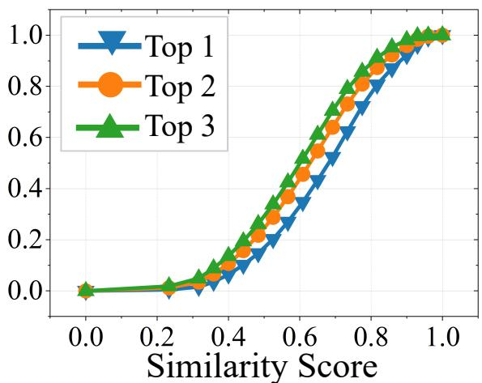  
Mobile Phone Dataset

Figure 13: Cumulative distributions of the Top-1, Top-2, and Top-3 similarities between generated trajectories and their nearest real trajectories in the training split of the mobile phone dataset.  
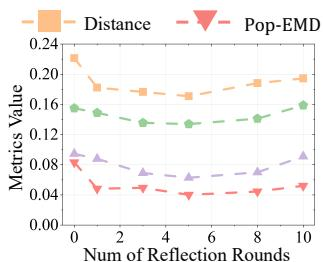  
(a) Private Car Dataset

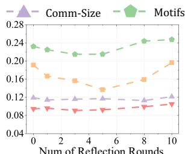  
Figure 14: Impact of the maximum number of within-step reflection rounds on the private car and mobile phone datasets. Lower values indicate better performance.

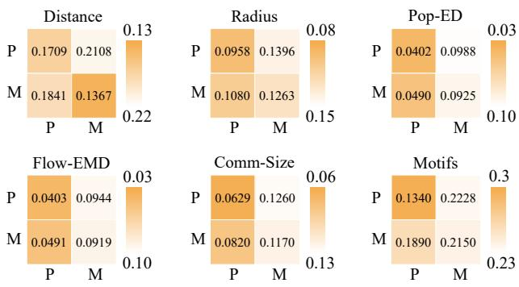  
Figure 15: Cross-dataset generalization between the private car dataset (P) and mobile phone dataset (M). Rows indicate the source dataset, while columns indicate the target dataset.

Table 9: Component-level token consumption and latency per reasoning call.
<table><tr><td rowspan="2">Component</td><td colspan="2">Private Car Dataset</td><td colspan="2">Mobile Phone Dataset</td></tr><tr><td>Tokens</td><td>Latency</td><td>Tokens</td><td>Latency</td></tr><tr><td>user agent</td><td>436.1</td><td>1.57 s</td><td>372.3</td><td>2.21 s</td></tr><tr><td>location agent</td><td>1,345.0</td><td>2.15 s</td><td>1,462.0</td><td>1.98 s</td></tr><tr><td>coordination</td><td>720.5</td><td>2.07 s</td><td>806.3</td><td>2.06 s</td></tr><tr><td>reflection</td><td>866.4</td><td>3.77 s</td><td>981.0</td><td>3.11 s</td></tr></table>

## J COMPONENT-LEVEL COMPLEXITYANALYSIS

Table 9 reports the average token consumption and latency of each reasoning component per call under the same LLM backbone and experimental configuration. The user agent has the lightest context because it selects among a compact destination set conditioned on one user’s mobility plan, requiring 372–436 tokens and 1.57–2.21 seconds per call. The location agent consumes the most tokens because it jointly reasons over regional semantics, expected population and flow states, nearby users, and co-mobility evidence. Coordination uses a moderate context containing only the conflicting individual- and community-view proposals and therefore maintains a latency of approximately two seconds on both datasets. Reflection has the highest latency despite using fewer tokens than location reasoning because it diagnoses several node and edge discrepancies and converts them into structured, agent-specific correction signals. The component costs are similar across the two datasets, indicating that the reasoning burden is determined mainly by agent roles rather than a particular mobility source. These per-call costs do not directly sum to the end-to-end user-day cost: active location selection limits location-agent invocations, and targeted reflection reactivates only agents associated with detected discrepancies. This selective execution keeps the overall complexity comparable to user-centric LLM generators, as reported in the main text.

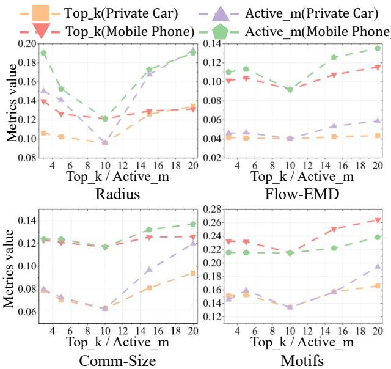  
Figure 16: Additional sensitivity results of top\_k and active\_m on the private car and mobile phone datasets. Lower values indicate better performance.

## K ADDITIONAL HYPERPARAMETER RESULTS

We further evaluate top\_k and active\_m using Radius, Flow-EMD, Comm-Size, and Motif, complementing the Distance and Pop-EMD results in the main text. The former controls how many destination candidates are provided to each user agent, while the latter limits the number of locations sampled from each structurally relevant local set for location-agent activation. We vary one parameter at a time and keep all other settings fixed. As shown in Fig. 16, most curves follow a U-shaped trend and reach their minimum near 10 on both datasets. Small values provide insuficient coverage of plausible destinations or receiver-side community evidence, which is particularly visible for Radius and Flow-EMD. Conversely, increasing either parameter to 15 or 20 introduces weakly relevant candidates and locations, degrading Comm-Size and Motif consistency and increasing reasoning cost. The similar behavior across individual, aggregate, and structural metrics indicates that focused evidence is more useful than an unrestricted reasoning context. We therefore use top\_k=10 and active\_m=10 in all main experiments.

## L AGENT PROMPT TEMPLATES

Figs. 17–20 present the complete prompt templates used by the three agent roles. All templates follow a shared structure consisting of a role definition, time-step context, structured mobility evidence, decision constraints, and a JSON-only output schema. Bracketed fields are instantiated at runtime using the current mobility state and community-conditioned interaction priors, ensuring that agents receive only evidence relevant to the current graph update.

The user-agent prompt specifies the user’s current location, planned POI semantics and distance range, community profile, and retrieved destination candidates with attraction and flow evidence. The location-agent prompt provides the target location’s semantic function, population status, historical and simulated incoming flows, connected source locations, nearby users, and active co-mobility groups. These two prompts generate complementary destinationside and receiver-side proposals rather than asking a single agent to reason over the entire evolving graph.

The manager-agent coordination prompt presents only records for which the two views require resolution, together with expected movement volume and deviations from historical population-flow patterns. The reflection prompt summarizes node-population and edge-flow discrepancies, afected users’ daily plans, and temporal movement conditions, and requests bounded correction signals for the implicated user and location agents. Reflection signals are appended to subsequent agent prompts as explicit corrections rather than unconstrained additional context. Restricting every response to a predefined JSON schema enables deterministic parsing, validates identifiers against the supplied candidate sets, and prevents free-form outputs from directly modifying the graph state.

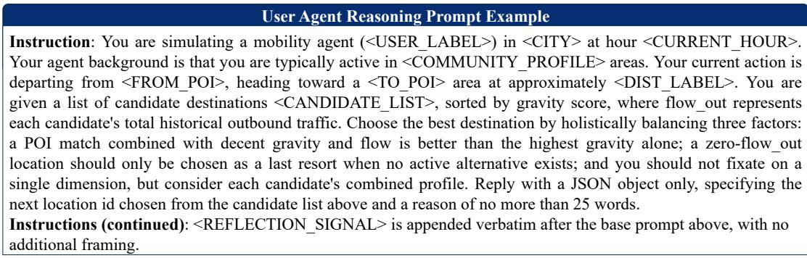

Figure 17: Prompt template for individual-view destination reasoning by a user agent.
<table><tr><td>Location Agent Reasoning Prompt Example</td></tr><tr><td>to decide which nearby &lt;USER LABEL&gt; are likely to move to your location this hour. Your location profile is as follows: POI types &lt;POI TYPES&gt; (ranked by POI density), current population status  ${ \mathrm { < P O P \ { \underline { { S } } T A T U S > } } }$  a simulated inbound flow of &lt;SIM FLOW IN&gt; &lt;USER LABEL&gt; currently waiting at source locations, and a historical inbound flow of approximately &lt;HIST FLOW IN&gt; &lt;USER LABEL&gt; per hour at this time of day, which serves as a rough ceiling on how many you can realistically attract. Your main historical source locations, ranked by importance, are &lt;SOURCE LOCATIONS&gt;. The &lt;USER LABEL&gt; currently at those source locations in the previous timestep are &lt;NEARBY USERS&gt;, and the co-mobility groups active in this neighborhood — pairs of &lt;USER LABEL&gt; who tend to travel together—are &lt;CO MOBILITY GROUPS&gt;. When deciding whom to attract, respect the population signal above for whether to attract at all this hour; among those you do consider, prioritize &lt;USER LABEL&gt; whose planned destination POI matches your own POI types, then &lt;USER  $\_ { \mathrm { L A B E L } } >$  coming from higher-ranked source locations with more people currently present, and try to keep co-mobile pairs together</td></tr><tr><td>when both are moving. &lt;USER LABEL&gt; currently planning to stay are equally valid attraction targets, not just those already planning to move. Please analyze the situation and return your decision as a JSON object, listing only</td></tr><tr><td>user ids drawn from the nearby &lt;USER LABEL&gt; list above together with a brief reasoning of no more than 25 words.</td></tr></table>

Figure 18: Prompt template for receiver-side community reasoning by a location agent.

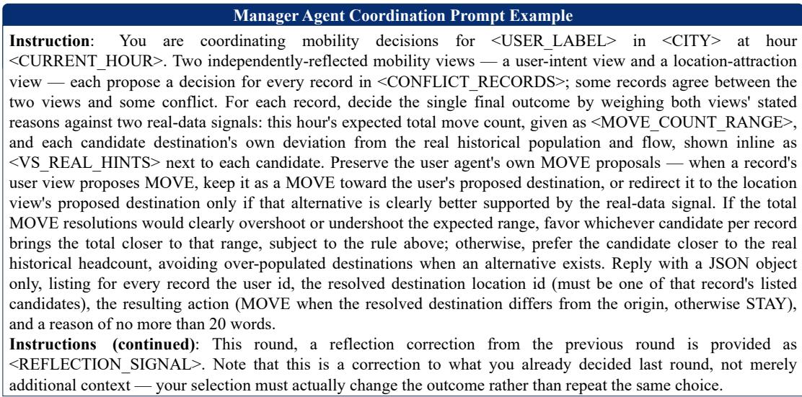

Figure 19: Prompt template for individual-community coordination by the manager agent.
<table><tr><td>Manage Agent Reflection Prompt Example</td></tr><tr><td>Instruction: You are a mobility simulation quality analyst for &lt;CITY&gt;, reflecting hour by hour. Each round you are shown the simulation&#x27;s remaining deviations from the real historical pattern — node population differences &lt;NODE DIFFS&gt;, edge flow differences &lt;EDGE_DIFFS&gt;, and the daily plans of affected users &lt;USER DAILY PLANS&gt; — for that round&#x27;s hour, together with the real move-volume reference by hour &lt;PEAK OFFPEAK HOURS&gt; and this hour&#x27;s own expected move-volume status &lt;HOUR MOVE STATUS&gt;.</td></tr><tr><td>Your task is to generate targeted reflection signals that correct the worst discrepancies for this round, following these interpretation rules. 1. An EDGE MISSING diff (generated flow approximately zero, real flow positive) means the real data has a flow</td></tr><tr><td>from source A to destination B that the simulation fails to generate. 2. An EDGE_SPURIOUS diff (generated flow positive, real flow approximately zero) means the simulation over-</td></tr><tr><td>generates a flow that does not exist in real data. 3. EDGE FLOW OVER and EDGE FLOW UNDER diffs, where a flow between A and B exists in both real and simulated data but their shares diverge.</td></tr></table>

Figure 20: Prompt template for community-consistency reflection by the manager agent.