# CRYSTALAR: AUTOREGRESSIVE MODELING FOR SYMMETRIC CRYSTAL GENERATION

Ziqiao Meng<sup>1,2∗</sup>, Rongsheng Chen<sup>3∗</sup>, Zhi Zheng<sup>1∗</sup>, Nikita Kazeev<sup>2</sup>, Zhenkun Wang<sup>3†</sup> Andrey Ustyuzhanin<sup>2</sup>, Wee Sun Lee<sup>1†</sup>

<sup>1</sup>Institute for Functional Intelligent Materials (IFIM), National University of Singapore

<sup>2</sup>School of Computing, National University of Singapore

<sup>3</sup>Southern University of Science and Technology

## ABSTRACT

Deep generative modeling has achieved remarkable progress in crystal generation. Given the rich symmetries inherent in crystalline structures, recent work has sought to explicitly incorporate space-group symmetry into generative models, enabling more effective exploration of novel symmetry templates. Yet introducing symmetry templates increases the combinatorial complexity of stoichiometric relationships between atomic species and crystallographic sites, while creating a fundamental tension between flexible exploration of discrete crystallographic templates and faithful realization of these templates as continuous three-dimensional structures. To address these challenges, we propose CrystalAR, a unified autoregressive framework that models Wyckoff symmetry templates and complete crystal structures within a single generative sequence. Specifically, CrystalAR reformulates continuous coordinate generation as a symmetry-conditioned hierarchy of discrete spatial localization decisions, autoregressively refining the positions of all symmetry-inequivalent sites across resolution levels while jointly modeling their spatial configuration within each level. This discrete hierarchical formulation further enables constraint-aware search over both crystallographic templates and geometric realizations. As a result, CrystalAR retains strong symmetry-template generation capability while achieving competitive de novo generation performance and template-free crystal structure prediction (CSP) accuracy. These results suggest that symmetry-template generation can be retained alongside broadly competitive de novo generation performance and competitive CSP without reliance on symmetry templates retrieved from prior data, providing a promising alternative paradigm for symmetry-preserving crystal generation.

## 1 INTRODUCTION

Discovering new crystal structures is fundamental to materials innovation. However, the vast combinatorial space spanning chemical compositions and atomic configurations makes exhaustive exploration of stable and novel crystals prohibitively expensive (Curtarolo et al., 2013; Pickard & Needs, 2011), motivating computational approaches that can efficiently navigate this enormous search space (Jain et al., 2013; Curtarolo et al., 2012). In recent years, deep generative modeling for crystal generation (Zeni et al., 2023; Jiao et al., 2023; Miller et al., 2024; Xie et al., 2022) has attracted increasing attention due to its strong potential to efficiently explore this vast design space and accelerate the discovery of novel materials. By learning the underlying distribution of experimentally observed or computationally characterized crystal structures, generative models (Ho et al., 2020; Lipman et al., 2023; Albergo & Vanden-Eijnden, 2023) have achieved initial success in directly proposing diverse and physically plausible candidates.

Crystalline materials are fundamentally characterized by rich crystallographic symmetries (Nye, 1985; Aroyo et al., 2006), which organize atomic configurations into space groups and strongly constrain their structural and physical properties (Aroyo, 2016; Bradlyn et al., 2017). Accordingly, recent crystal generative models incorporate symmetry either through explicit crystallographic constraints in specialized symmetry-template-constrained models (Jiao et al., 2024; Puny et al., 2025), or through softer space-group conditioning in more general-purpose generative frameworks, such as MatterGen (Zeni et al., 2023). However, symmetry-constrained generation alone does not necessarily imply meaningful exploration of crystallographic structure space. Recent studies have highlighted that conventional structural novelty can coexist with substantial reuse of previously observed symmetry templates, motivating template-level novelty as a complementary measure of structural exploration (Negishi & Walsh, 2026; Kazeev et al., 2025; Levy et al., 2025). This observation has motivated a growing line of work that explicitly generates Wyckoff configurations, including WyFormer (Kazeev et al., 2025), WyckoffDiff (Kelvinius et al., 2025), SymmCD (Levy et al., 2025), SGEquiDiff (Chang et al., 2025), and CrystalFormer (Cao et al., 2024). By directly modeling the discrete Wyckoff-template space, these approaches enable explicit exploration of crystallographic configurations beyond selecting or conditioning on predefined symmetry patterns. We refer to this class of methods as symmetry-native models.

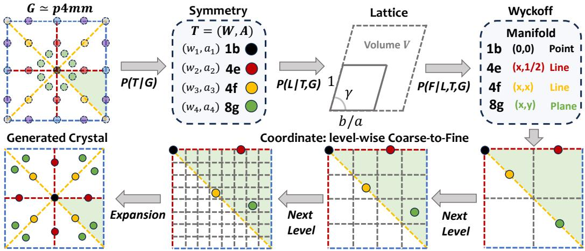  
Figure 1: Overview of CrystalAR. Given a symmetry group G, CrystalAR autoregressively generates the element-decorated Wyckoff template $T = ( W , A )$ , lattice parameters L, and free Wyckoff coordinates F. Each inequivalent site is restricted to its corresponding Wyckoff manifold. The free coordinates are then generated through level-wise coarse-to-fine refinement, and symmetry operations expand them into the complete crystal structure.

Explicit template generation, however, introduces new challenges for both de novo generation and crystal structure prediction (CSP). First, the combinatorial Wyckoff-template space must be reconciled with the strict geometric constraints imposed by each template, making it difficult to preserve flexible template exploration while consistently realizing valid and stable crystal geometries. This tension can manifest as degraded de novo generation performance (Cao et al., 2024; Levy et al., 2025) or necessitate external relaxation procedures for complete geometric realization (Orio et al., 2009; Deng et al., 2023). Second, CSP imposes stricter requirements: the generated template must exactly satisfy the prescribed composition through Wyckoff multiplicities, while the resulting geometry must closely recover the target structure. Consequently, symmetry-native models may either rely on retrieved templates and external lattice samplers to narrow the search space (Chang et al., 2025) or struggle to accurately recover the ground-truth structure while retaining flexible template generation (Kazeev et al., 2025; Cao et al., 2024; Levy et al., 2025; Kelvinius et al., 2025).

In this work, we propose CrystalAR, a unified autoregressive framework that hierarchically generates crystals from discrete symmetry configurations to three-dimensional geometry. Given a space group, CrystalAR first generates an element-decorated Wyckoff template and then realizes it through symmetry-conditioned, coarse-to-fine localization of fractional coordinates, jointly resolving all symmetry-inequivalent sites at each resolution level, as illustrated in Figure 1. This formulation naturally supports structured decoding, combining constraint-guided template search with hierarchical exploration of geometric realizations. On LeMat-GenBench (Betala et al., 2025), CrystalAR achieves strong S.U.N. performance both with and without pre-relaxation, together with competitive S.S.U.N. scores under symmetry-aware evaluation. It also achieves competitive CSP accuracy without relying on Wyckoff-template retrieval. Overall, CrystalAR retains strong template-generation capability while achieving broadly competitive de novo generation performance and template-free CSP accuracy, representing a substantial step forward in both the practical performance and generative flexibility of symmetry-native crystal generation. Collectively, these capabilities motivate a paradigm of autoregressive crystallographic search, where symmetry templates and their geometric realizations are explored within a single generative process, providing a promising alternative direction for symmetry-preserving crystal generation.

## 2 RELATED WORKS

Crystal Generation. Deep generative modeling for crystal structure generation has attracted considerable attention in recent years. Diffusion-based models (Xie et al., 2022; Jiao et al., 2023; Zeni et al., 2023; Joshi et al., 2025; Yang et al., 2024; Cornet et al., 2025) have emerged as the dominant paradigm, with numerous extensions tailored to the periodic and three-dimensional nature of crystalline materials. In parallel, flow-matching approaches (Miller et al., 2024; Sriram et al., 2024; Hollmer et al., 2025; Luo et al., 2025; Seong et al., 2026) have been actively explored, offering¨ improved training and sampling efficiency as well as greater flexibility in model design. Motivated by the success of large language models (LLMs) (Brown et al., 2020; OpenAI, 2023), several recent works have further investigated crystal generation through CIF-based language modeling (Zhang et al., 2025; Xia et al., 2025; Antunes et al., 2024; Xu et al., 2025), specialized tokenization schemes, and preference-aligned post-training. Despite strong performance on standard generation bench marks, these generic approaches often capture crystallographic symmetry only implicitly, and their apparent structural novelty can largely arise from elemental substitutions of known structural prototypes rather than the discovery of genuinely novel symmetry templates (Negishi & Walsh, 2026).

Symmetric Crystal Generation. Wyckoff positions (Aroyo, 2016) introduce additional discreteness into crystal representations, yielding a heterogeneous space that combines discrete variables, such as elements and Wyckoff positions, with continuous lattice and coordinate variables. Existing methods address this heterogeneity in different ways. DiffCSP++ (Jiao et al., 2024) and SGFM (Puny et al., 2025) retrieve or sample Wyckoff templates from training data and focus primarily on template-conditioned geometry generation, whereas WyCryst (Zhu et al., 2024), WyFormer (Kazeev et al., 2025), and WyckoffDiff (Kelvinius et al., 2025) mainly generate elementdecorated Wyckoff templates and rely on external relaxation or geometry refinement to obtain complete structures. SGEquiDiff (Chang et al., 2025) models both components but learns the discrete template and continuous geometry separately. CrystalFormer (Cao et al., 2024) and SymmCD (Levy et al., 2025), by contrast, jointly model these heterogeneous variables within a single generative process using autoregressive modeling and discrete diffusion, respectively. Our CrystalAR takes a different approach by discretizing Wyckoff-constrained fractional coordinates and jointly modeling symmetry templates and crystal geometry in an end-to-end autoregressive framework.

## 3 PRELIMINARY

Crystal Representations. A periodic crystal structure can be represented by its lattice, atomic species, and atomic coordinates. Let $\mathbf { L } \in \mathbb { R } ^ { \mathbf { \check { 3 } } \times \mathbf { 3 } }$ denote the lattice matrix and $\{ ( e _ { i } , \mathbf { f } _ { i } ) \} _ { i = 1 } ^ { N }$ the atomic species and fractional coordinates, where $\mathbf { f } _ { i } \in [ 0 , 1 ) ^ { 3 }$ specifies the position of atom i within the periodic unit cell. The corresponding Cartesian coordinate is given by $\mathbf { x } _ { i } = \mathbf { L } \mathbf { f } _ { i }$ , with L determining the physical shape and scale of the cell. Equivalently, the lattice can be described by the three lattice lengths and three interaxial angles, $( a , b , c , \alpha , \beta , \gamma )$ . For modeling, we further reparameterize these variables as $\ell = ( V , r _ { b } , r _ { c } , \alpha , \bar { \beta } , \gamma )$ , where V is the unit-cell volume, $r _ { b } = b / a$ and $r _ { c } = c / a$ encode the relative lattice lengths, and $\alpha , \beta , \gamma$ denote the lattice angles. This parameterization separates the global lattice scale from its shape while preserving the full six degrees of freedom of the unit cell. Further details are provided in the Appendix A.1.

Space-Group Symmetry & Wyckoff Positions. A space group G specifies a collection of affine symmetry operations $g = ( \mathbf { R } _ { g } , \mathbf { t } _ { g } )$ acting on a fractional coordinate as $g ( \mathbf { f } ) = \mathbf { R } _ { g } \mathbf { f } + \mathbf { t } _ { g }$ (mod 1). Starting from a representative site f, these operations generate a set of symmetry-equivalent positions, ${ \bar { \mathrm { O r b } } } _ { G } ( \mathbf { f } ) \ { \stackrel { \cdot } { = } } \ \{ g ( \mathbf { f } ) | g \in G \}$ . The local symmetry of the representative site is described by the subgroup ${ \mathrm { S t a b } } _ { G } ( \mathbf { f } ) = \{ g \in G \mid g ( \mathbf { f } ) \equiv \mathbf { f }$ (mod 1)}, which contains the operations that preserve the site modulo lattice translations. Wyckoff positions group sites with equivalent stabilizer structure and therefore provide a discrete characterization of the symmetry constraints imposed on atomic locations. For a Wyckoff position w, its multiplicity $m ( w )$ gives the number of sites generated in the corresponding orbit, while its positional degree of freedom $d ( w ) \in \{ 0 , 1 , 2 , 3 \}$ specifies the number of independent fractional-coordinate parameters required to locate its representative site. Consequently, a crystal can be reduced to M symmetry-inequivalent representatives, $\{ ( e _ { i } , w _ { i } , \mathbf { f } _ { i } ) \} _ { i = 1 } ^ { M }$ , from which all atoms in the unit cell are reconstructed by symmetry expansion. We define $\bar { T } = \bar { ( A , W ) } = \{ ( e _ { i } , w _ { i } ) \} _ { i = 1 } ^ { M }$ as the element-decorated Wyckoff template, separating the discrete crystallographic configuration from its coordinate realization.

## 4 METHODOLOGY: CRYSTALAR

## 4.1 AUTOREGRESSIVE MODELING FOR SYMMETRIC CRYSTAL STRUCTURES

Symmetry-Constrained Geometry. Crystallographic symmetry restricts crystal geometry at both the lattice and coordinate levels. The space group G determines the admissible lattice family; for example, a tetragonal lattice satisfies $a = b \neq c$ c and $\alpha = \beta = \gamma = 9 0 ^ { \circ }$ , while a cubic lattice further requires $a = b = c .$ . At the atomic level, each Wyckoff position $w \in W$ constrains its representative fractional coordinate f to a symmetry-defined manifold. A special position may be fixed at ${ \textbf { f } } =$ $( 0 , 0 , 0 )$ , whereas line- and plane-constrained positions retain only one or two free parameters, such as $( x , { \frac { 1 } { 2 } } , { \frac { 1 } { 2 } } )$ and $( x , y , 0 )$ . Thus, symmetry progressively reduces the feasible geometric space, from the lattice family specified by $G$ to the coordinate manifolds specified by $W$

These constraints naturally induce a directional dependency among the crystal variables. Given $G ,$ the model first determines the element-decorated Wyckoff template $T = \overset { \cdot } { ( } A , W )$ , which specifies the chemical occupancy and symmetry manifolds of the inequivalent sites. The lattice parameters L are then generated within the lattice family permitted by $G ,$ conditioned on $T$ to determine a specific lattice realization. Finally, the fractional coordinates F are localized within the manifolds defined by W. We place L before F because the lattice determines the metric geometry—and hence interatomic distances—associated with fractional coordinates. This directional structure motivates the autoregressive factorization

$$
\begin{array} { r } { p ( G , A , W , \mathbf { L } , \mathbf { F } ) = p _ { \mathrm { e m p } } ( G ) p ( T \mid G ) p ( \mathbf { L } \mid T , G ) p ( \mathbf { F } \mid \mathbf { L } , T , G ) , } \end{array}\tag{1}
$$

where $p _ { \mathrm { e m p } } ( G )$ denotes the empirical space-group distribution estimated from the training data. We begin by constructing the discrete symmetry skeleton of the crystal through the element-decorated template $T = ( A , \bar { W } )$ . Each generated site fixes both a chemical identity and a symmetry orbit, progressively narrowing the remaining combinatorial space. Within each site, we first predict the element $e _ { i }$ and then its Wyckoff position $w _ { i } .$ , conditioning the symmetry assignment on the current chemical choice. To reduce permutation ambiguity, sites are ordered from higher to lower Wyckoff site symmetry, with special positions preceding less constrained line- and plane-like manifolds. A learned stopping decision determines when the template is complete:

$$
p ( T \mid G ) = \prod _ { i = 1 } ^ { M } p ( e _ { i } \mid e _ { < i } , w _ { < i } , G ) p ( w _ { i } \mid e _ { \leq i } , w _ { < i } , G ) p ( s _ { i } = \mathbb { I } [ i = M ] \mid e _ { \leq i } , w _ { \leq i } , G ) .\tag{2}
$$

Once the symmetry skeleton T is fixed, the lattice L determines the global metric in which this skeleton is geometrically realized. We generate the six lattice variables autoregressively, allowing each parameter to condition on both the symmetry context and previously determined lattice geometry:

$$
p ( \mathbf { L } \mid T , G ) = \prod _ { j = 1 } ^ { 6 } p ( \ell _ { j } \mid \ell _ { < j } , T , G ) , \qquad ( \ell _ { 1 } , \ldots , \ell _ { 6 } ) = \left( V , { \frac { b } { a } } , { \frac { c } { a } } , \alpha , \beta , \gamma \right) .\tag{3}
$$

With the symmetry skeleton and lattice established, the remaining problem is to localize each symmetry-inequivalent site within its admissible Wyckoff manifold.

Coarse-to-Fine Coordinate Generation. Directly predicting precise fractional coordinates is challenging because Wyckoff positions lie on manifolds of different dimensionalities and small coordinate errors can substantially alter interatomic geometry. We therefore replace one-shot continuous prediction with progressive localization, recursively refining the feasible manifold through increasingly precise discrete spatial decisions.

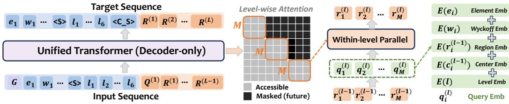  
Figure 2: Unified Transformer architecture of CrystalAR. A single decoder-only Transformer jointly models the Wyckoff template, lattice, and hierarchical coordinates. Template and lattice tokens follow standard next-token prediction, while coordinates are refined level by level with causal attention across levels and parallel site interaction within each level. Each site query combines its element, Wyckoff constraint, previous region, region center, and refinement level.

For site i with Wyckoff position $w _ { i } .$ we parameterize its fractional coordinate as $\mathbf { f } _ { i } = \phi _ { w _ { i } } ( \mathbf { u } _ { i } ) , \mathbf { u } _ { i } \in$ $[ 0 , 1 ) ^ { d _ { i } }$ , where $\bar { d _ { i } } = \bar { d ( w _ { i } ) }$ is the number of positional degrees of freedom and $\phi _ { w _ { \mathrm { i } } }$ maps the free parameters to the corresponding symmetry-constrained fractional coordinate. At each refinement level, we bisect every dimension of the current region in the free-parameter space of $\mathbf { u } _ { i } .$ , producing $2 ^ { d _ { i } }$ candidate subregions. Thus, a general position with $d _ { i } = 3$ yields eight candidates, a planeconstrained position with $d _ { i } = 2$ yields four, a line-constrained position with $d _ { i } = 1$ yields two, and a fixed position with $d _ { i } = 0$ requires no refinement. For example, for $w _ { i } = ( x , \textstyle \frac { 1 } { 2 } , \frac { 1 } { 2 } )$ , we have $\mathbf { u } _ { i } = x$ and $d _ { i } = 1$ . The first level partitions $x \in [ 0 , 1 )$ into $[ 0 , \textstyle { \frac { 1 } { 2 } } )$ and $[ \textstyle { \frac { 1 } { 2 } } , 1 )$ ; selecting the former leads the next level to refine it into $[ 0 , { \frac { 1 } { 4 } } )$ and $\textstyle { \left[ { \frac { 1 } { 4 } } , { \frac { 1 } { 2 } } \right) }$

Extending this refinement to all symmetry-inequivalent sites, let ${ \bf r } _ { i } ^ { ( \ell ) }$ denote the subregion-selection decision for site i at level $\ell ,$ relative to its region at the previous level, and let ${ \bf R } ^ { ( \ell ) } = \{ { \bf r } _ { i } ^ { ( \ell ) } \} _ { i = 1 } ^ { M }$ The complete refinement path is then $\mathbf { R } ^ { ( 1 : L ) } = \{ \mathbf { R } ^ { ( 1 ) } , \ldots , \mathbf { R } ^ { ( L ) } \}$ , whose conditional distribution is factorized level-wise as

$$
p \left( \mathbf { R } ^ { \left( 1 : L \right) } \mid \mathbf { L } , T , G \right) = \prod _ { \ell = 1 } ^ { L } p \left( \mathbf { R } ^ { \left( \ell \right) } \mid \mathbf { R } ^ { \left( < \ell \right) } , \mathbf { L } , T , G \right) .\tag{4}
$$

Within each level, the refinement decisions for all symmetry-inequivalent sites are predicted jointly, while successive levels recursively narrow their feasible regions. After L refinements, the complete decision paths determine the free Wyckoff parameters, from which the fractional coordinates are decoded as $\mathbf { \bar { F } } = \mathcal { D } \big ( \mathbf { R } ^ { ( 1 : L ) } , T \big )$ . Thus, continuous coordinate generation is represented as a structured, symmetry-aware sequence of discrete spatial decisions.

## 4.2 UNIFIED TRANSFORMER ARCHITECTURE

The factorization above induces two dependency patterns: template and lattice variables are generated sequentially, whereas coordinate refinement jointly localizes all symmetry-inequivalent sites within each level. We therefore use a single decoder-only Transformer that preserves the full symmetry context while transitioning from sequential crystallographic decisions to level-wise geometric refinement through block-causal attention, as illustrated in Figure 2.

From Symmetry Tokens to Geometric Queries. Template and lattice variables follow next-token autoregression, ${ \bf \dot { \boldsymbol { G } } } \to T \to { \bf L } \to \langle { \bf C } { \bf \mathcal { \dot { \boldsymbol { S } } } } \rangle$ . Rather than introducing a separate generation stage, the ⟨C S⟩ token initiates a set of site-specific query tokens that connect the generated symmetry context to coordinate refinement within the same decoder. For each symmetry-inequivalent site $i ,$ we define a query $\mathbf { q } _ { i } ^ { ( \ell ) }$ at refinement level $\ell ,$ and collect them as ${ \bf Q } ^ { ( \ell ) } = \{ { \bf q } _ { i } ^ { ( \ell ) } \} _ { i = 1 } ^ { M }$ . During training, these queries are instantiated from the known site identities in the ground-truth template; during inference, they are instantiated from the previously generated template $T = \{ ( e _ { i } , w _ { i } ) \} _ { i = 1 } ^ { M }$ . Each query therefore carries the site’s crystallographic identity together with its current localization state:

$$
\begin{array} { r } { \mathbf { q } _ { i } ^ { ( \ell ) } = \mathbf { E } _ { \mathrm { e l e m } } ( e _ { i } ) + \mathbf { E } _ { \mathrm { w y c } } ( w _ { i } ) + \mathbf { E } _ { \mathrm { r e g } } \left( R _ { i } ^ { ( \ell - 1 ) } \right) + \mathbf { E } _ { \mathrm { l e v e l } } ( \ell ) + \mathrm { P E } \left( \mathbf { c } _ { i } ^ { ( \ell - 1 ) } \right) . } \end{array}\tag{5}
$$

Here, $\mathbf { E } _ { \mathrm { e l e m } }$ encodes the chemical identity, ${ \bf { E } } _ { \mathrm { { w y c } } }$ specifies the Wyckoff constraint, $\mathbf { E } _ { \mathrm { r e g } }$ records the region selected at the previous refinement level, and $\mathbf { E } _ { \mathrm { l e v e l } }$ distinguishes different spatial resolutions. $\mathbf { c } _ { i } ^ { ( \check { \ell } - 1 ) }$ is the decoded center of the current region, whose positional encoding provides its coarse geometric location. For $\ell = 1 , R _ { i } ^ { ( 0 ) }$ denotes the initial feasible region defined by $w _ { i }$

Level-Wise Block-Causal Attention. The transition from discrete generation to geometric refinement requires a different attention pattern. Template and lattice tokens use standard causal attention, whereas coordinate tokens are causal only across refinement levels: sites within the same level can interact and attend to the full template, lattice, and previous refinement history, while future levels remain masked. Formally, a query at level ℓ may attend to $G , T , \mathbf { L } \cup \mathbf { R } ^ { ( < \ell ) }$ and all site queries $\mathbf { Q } ^ { ( l ) }$ at the current level. This block-causal design lets each site refine its location conditioned on the current spatial hypotheses of all others, enabling joint modeling of pairwise and higher-order geometry. Compared with site-by-site generation in CrystalFormer (Cao et al., 2024), it more directly captures inter-site geometry while preserving autoregressive refinement across levels.

Joint Training Objective. All components are optimized jointly through the same Transformer. Following the autoregressive factorization above, the total training objective is

$$
\mathcal { L } = \lambda _ { e } \mathcal { L } _ { e } + \lambda _ { w } \mathcal { L } _ { w } + \lambda _ { s } \mathcal { L } _ { s } + \lambda _ { \mathbf { L } } \mathcal { L } _ { \mathbf { L } } + \lambda _ { \mathbf { R } } \mathcal { L } _ { \mathbf { R } }\tag{6}
$$

where $\mathcal { L } _ { e } , \mathcal { L } _ { w }$ , and $\mathcal { L } _ { s }$ supervise element, Wyckoff-position, and stopping-token prediction, respectively; ${ \mathcal { L } } _ { \mathbf { L } }$ L supervises autoregressive lattice generation; and $\mathcal { L } _ { \mathbf { R } }$ supervises hierarchical coordinate refinement across all symmetry-inequivalent sites and resolution levels. The coefficients λ balance the relative contributions of the corresponding training objectives. Further details of the joint optimization procedure for this unified Transformer are provided in Appendix A.3.

## 4.3 SEARCHING OVER SYMMETRIC CRYSTAL SPACE

A key advantage of our autoregressive formulation is that crystallographic constraints can be enforced during generation. Each step defines a partial crystal state with an associated likelihood, allowing plausible hypotheses to be retained while infeasible ones are pruned. This turns crystal generation into a controllable search over progressively constrained symmetry and geometry spaces.

Constrained Template Search. For CSP, let $T _ { < i } = \{ ( e _ { j } , w _ { j } ) \} _ { j < i }$ denote a partial template and $\textbf { n } = ~ \{ n _ { e } \}$ the target composition. After generating $T _ { < i }$ , the remaining budget of element e is $\begin{array} { r } { r _ { e } ^ { ( i ) } = n _ { e } - \sum _ { j < i } \mathbb { I } [ e _ { j } = e ] m ( w _ { j } ) } \end{array}$ , where $m ( w _ { j } )$ is the multiplicity of Wyckoff position $w _ { j }$ . We restrict the next assignment $( e _ { i } , w _ { i } )$ to the feasible set $\mathcal { A } ( T _ { < i } , G , \mathbf { r } ^ { ( i ) } )$ , containing only choices that respect the space group and can still complete the remaining composition. The autoregressive factorization therefore enables constrained search over $T ^ { * } = \arg \operatorname* { m a x } _ { T \in { \mathcal { T } } ( G , \mathbf { n } ) } \log p ( T \mid G )$ , while infeasible partial templates are eliminated before completion. This makes template-free CSP a direct combinatorial search over valid symmetry templates rather than template retrieval followed by geometry generation, while retaining probabilistic ranking over multiple feasible crystallographic hypotheses throughout the decoding process.

Hierarchical Geometric Search. The coarse-to-fine representation induces an analogous search over geometry. A hypothesis at level ℓ is represented by its nested refinement path $\bar { \mathbf { R } ^ { ( 1 : \ell ) } }$ , where $\mathbf { R } ^ { ( \ell ) } = \{ R _ { i } ^ { ( \ell ) } \} _ { i = 1 } ^ { M }$ and $R _ { i } ^ { ( \ell ) } \subset R _ { i } ^ { ( \ell - 1 ) }$ . Each path is scored by both its autoregressive likelihood and the geometric consistency of the jointly localized sites:

$$
S \Bigl ( \mathbf { R } ^ { ( 1 : \ell ) } \Bigr ) = \sum _ { t = 1 } ^ { \ell } \log p \Bigl ( \mathbf { R } ^ { ( t ) } \mid \mathbf { R } ^ { ( < t ) } , \mathbf { L } , T , G \Bigr ) + \lambda \mathcal { G } \Bigl ( \mathbf { R } ^ { ( \ell ) } , \mathbf { L } \Bigr ) , \qquad \mathbf { R } ^ { ( 1 ) } \supset \dots \supset \mathbf { R } ^ { ( \ell ) } .\tag{7}
$$

To compute ${ \mathcal { G } } ,$ we decode the center of each current region into a fractional coordinate and expand all symmetry-equivalent atoms according to the corresponding Wyckoff positions. Let $\bar { \mathbf { f } } _ { a } ^ { ( \ell ) }$ denote the resulting fractional coordinate of atom a. For every distinct atom pair $( a , b )$ we compute the minimum-image Cartesian distance $\begin{array} { r l r } { d _ { a b } ^ { ( \ell ) } } & { = } & { \operatorname* { m i n } _ { { \bf k } \in \mathbb { Z } ^ { 3 } } \left\| { \bf L } \left( \bar { \bf f } _ { a } ^ { ( \ell ) } - \bar { \bf f } _ { b } ^ { ( \ell ) } + { \bf k } \right) \right\| _ { 2 } } \end{array}$ We aggregate these pairwise distances using a short-range violation penalty, $\mathcal { G } \big ( \mathbf { R } ^ { ( \ell ) } , \mathbf { L } \big ) =$ $\begin{array} { r } { - \frac { 1 } { | \mathcal { P } | } \sum _ { ( a , b ) \in \mathcal { P } } \left[ \operatorname* { m a x } \Bigl ( 0 , d _ { \operatorname* { m i n } } - d _ { a b } ^ { ( \ell ) } \Bigr ) \right] ^ { 2 } } \end{array}$ , where P contains all distinct symmetry-expanded atom pairs and $d _ { \mathrm { m i n } }$ is the minimum allowed interatomic distance. Hypotheses with mi $\mathbb { 1 } _ { ( a , b ) \in \mathcal { P } } d _ { a b } ^ { ( \ell ) } ~ <$ $d _ { \mathrm { p r u n e } }$ are removed immediately, while the remaining hypotheses are ranked by $S ( \mathbf { R } ^ { ( 1 : \ell ) } )$

Table 1: De novo crystal generation on LeMat-GenBench under with and without pre-relaxation settings. We evaluate generation quality by validity, uniqueness, and novelty; energetic quality by formation energy $E _ { f }$ , hull energy $E _ { \mathrm { h u l l } }$ , and relaxation RMSD; and material discovery quality by stability, $\mathsf { S . U . N . }$ , metastability, and M.S.U.N. Symmetry-native models are highlighted in red. CrystalFormer<sup>†</sup> is evaluated using the 1,000 publicly available generated samples, whereas the other methods use the standard evaluation set. PLaID++ differs from the remaining baselines in that it further applies post-training to improve generation quality. Bold denotes the best result among symmetry-native models, while underline denotes the best result among models without explicit template generation within each setting.
<table><tr><td rowspan="2">Model</td><td rowspan="2">Method</td><td rowspan="2"></td><td rowspan="2"># Params Valid (%) ↑ Unique (%) ↑ Novel (%) ↑</td><td rowspan="2"></td><td rowspan="2"></td><td colspan="3">Energy-based</td><td colspan="2">Stability</td><td colspan="2">Metastability</td></tr><tr><td> $\overline { { E _ { f } \left( \mathrm { e V } \right) \downarrow } }$ </td><td> $E _ { \mathrm { h u l l } } \left( \mathrm { e V } \right) \downarrow$ </td><td>RMSD (Å) ↓</td><td></td><td>Stable (%) ↑ SUN (%) ↑</td><td>Meta (%) ↑ MSUN (%) ↑</td><td></td></tr><tr><td colspan="3">With pre-relaxation</td><td></td><td></td><td></td><td></td><td></td><td></td><td></td><td></td><td></td><td></td></tr><tr><td>MatterGen</td><td>Diffusion</td><td>47M</td><td>95.7</td><td>95.1</td><td>70.5</td><td> $- 0 . 7 0 \pm 0 . 7 9$ </td><td> $0 . 1 8 \pm 0 . 1 8$ </td><td> $0 . 3 9 \pm 0 . 5 0$ </td><td>2.0</td><td>0.2 (6)</td><td>33.4</td><td>15.0</td></tr><tr><td>PLaID++</td><td>LLM+RL</td><td>7B</td><td>96.0</td><td>77.8</td><td>24.2</td><td> $- 0 . 5 0 \pm 0 . 4 4$ </td><td> $\underline { { 0 . 0 9 \pm 0 . 1 6 } }$ </td><td> $\underline { { 0 . 1 3 \pm 0 . 2 9 } }$ </td><td>12.4</td><td>1.0 (26)</td><td>60.7</td><td>7.6</td></tr><tr><td>WyFormer</td><td>AR+Diff</td><td>8B</td><td>93.4</td><td>93.0</td><td>66.4</td><td>−0.43 ± 0.95</td><td> $0 . 5 0 \pm 0 . 5 1$ </td><td>0.81 ± 0.98</td><td>0.5</td><td>0.1 (3)</td><td>15.7</td><td>1.9</td></tr><tr><td>WyFormer-DFT</td><td>AR+Diff</td><td>8B</td><td>95.2</td><td>95.0</td><td>66.4</td><td> $- 0 . 6 7 \pm 0 . 9 1$ </td><td> $0 . 2 7 \pm 0 . 3 6$ </td><td> $0 . 4 2 \pm 0 . 6 0$ </td><td>3.7</td><td>0.4 (9)</td><td>24.8</td><td>7.8</td></tr><tr><td>CrystalAR (Ours)</td><td>AR</td><td>33M</td><td>91.4</td><td>89.0</td><td>39.3</td><td> $\mathbf { - 0 . 7 8 \pm 0 . 8 7 }$ </td><td> $\mathbf { 0 . 1 5 \pm 0 . 2 6 }$ </td><td> $\mathbf { 0 . 2 3 \pm 0 . 4 6 }$ </td><td>13.7</td><td>0.9 (22)</td><td>42.6</td><td>7.3</td></tr><tr><td colspan="3">Without pre-relaxation</td><td></td><td></td><td></td><td></td><td></td><td></td><td></td><td></td><td></td><td></td></tr><tr><td>Crystal-GFN</td><td>GFlowNet</td><td>1M</td><td>51.7</td><td>51.7</td><td>51.7</td><td> $- 1 . 3 0 \pm 2 . 6 3$ </td><td> $2 . 0 9 \pm 2 . 3 8$ </td><td> $1 . 8 7 \pm 0 . 9 7$ </td><td>0.0</td><td>0.0 (0)</td><td>0.0</td><td>0.0</td></tr><tr><td>ADiT</td><td>Diffusion</td><td>180M</td><td>90.6</td><td>87.8</td><td>26.0</td><td> $- 0 . 7 3 \pm 0 . 9 3$ </td><td> $0 . 3 3 \pm 0 . 4 5$ </td><td> $\underline { { 0 . 3 8 \pm 0 . 4 0 } }$ </td><td>0.4</td><td>0.0 (0)</td><td>36.5</td><td>1.0</td></tr><tr><td>DiffCSP</td><td>Diffusion</td><td>12M</td><td>95.7</td><td>94.8</td><td>66.2</td><td> $- 0 . 6 4 \pm 0 . 9 6$ </td><td> $\underline { { 0 . 2 8 \pm 0 . 5 6 } }$ </td><td> $\overline { { 0 . 5 9 \pm 0 . 6 3 } }$ </td><td>2.3</td><td>0.1 (3)</td><td>29.8</td><td>8.5</td></tr><tr><td>DiffCSP++</td><td>Diffusion</td><td>12M</td><td>95.3</td><td>95.1</td><td>62.0</td><td> $- 0 . 5 2 \pm 0 . 8 7$ </td><td> $\overline { { 0 . 4 1 \pm 0 . 4 4 } }$ </td><td>0.69 ± 0.82</td><td>1.0</td><td>0.2 (4)</td><td>26.4</td><td>5.0</td></tr><tr><td>LLaMat2-CIF</td><td>LLM</td><td>7B</td><td>84.4</td><td>81.4</td><td>30.0</td><td> $- 0 . 4 7 \pm 1 . 0 1$ </td><td> $0 . 4 4 \pm 0 . 7 1$ </td><td> $0 . 5 4 \pm 0 . 7 1$ </td><td>0.7</td><td>0.1 (3)</td><td>34.7</td><td>2.1</td></tr><tr><td>LLaMat3-CIF</td><td>LLM</td><td>8B</td><td>15.4</td><td>15.2</td><td>10.5</td><td> $- 0 . 7 4 \pm 2 . 6 9$ </td><td> $1 . 7 1 \pm 2 . 4 8$ </td><td> $1 . 0 1 \pm 1 . 1 0$ </td><td>0.1</td><td>0.0 (0)</td><td>2.1</td><td>0.2</td></tr><tr><td>CrystalFormerf</td><td>AR</td><td>5M</td><td>69.9</td><td>69.4</td><td>31.8</td><td> $- 0 . 1 \bar { 7 } \pm \bar { 1 } . \bar { 4 } 8$ </td><td> $\mathbf { \bar { 0 . 7 0 \pm 1 . 3 3 } }$ </td><td> $\mathbf { 0 . 6 6 \pm 1 . 0 5 }$ </td><td>1.4</td><td>0.0 (0)</td><td>28.8</td><td>3.1</td></tr><tr><td>SymmCD</td><td>Diffusion</td><td>12M</td><td>73.4</td><td>73.0</td><td>47.0</td><td> $- 0 . 0 2 \pm 1 . 2 2$ </td><td> $0 . 8 8 \pm 1 . 0 7$ </td><td> $0 . 8 7 \pm 1 . 0 9$ </td><td>1.4</td><td>0.1 (2)</td><td>18.6</td><td>2.4</td></tr><tr><td>CrystalAR (Ours)</td><td>AR</td><td>33M</td><td>91.4</td><td>89.1</td><td>42.8</td><td> ${ \bf - 0 . 2 3 \pm 1 . 2 7 }$ </td><td> $0 . 7 1 \pm 1 . 0 8$ </td><td> $0 . 7 7 \pm 1 . 2 5$ </td><td>6.0</td><td>0.3 (7)</td><td>39.2</td><td>2.7</td></tr></table>

Table 2: Symmetry evaluation on MP-20 using 2,500 generated structures per method. We group methods into models with and without explicit Wyckoff-template generation, with symmetry-native models highlighted in red. We evaluate template exploration by the number of novel unique templates, distributionfidelity by P1 ratio, SG $\chi ^ { 2 }$ $W _ { N _ { \mathrm { e l } } } ,$ and $\mathrm { J S D } _ { \mathrm { W y c k o f f } } .$ , and material discovery quality by S.U.N. and S.S.U.N. Symmetry statistics are computed over novel templates. Bold and underline denote the best and second-best results, respectively. CrystalAR (SV) denotes the flexible-size vari ant that explicitly predicts both the number of atoms and the number of symmetry-inequivalent sites.
<table><tr><td>Model</td><td>Method</td><td>Novel Unique Templates (#)↑</td><td> $\begin{array} { r } { \mathrm { P l } \left( \% \right) } \\ { \mathrm { r e f } = 2 . 2 3 } \end{array}$ </td><td> $\mathrm { S G } \chi ^ { 2 } \downarrow$ </td><td> $W _ { N _ { \mathrm { e l } } } \downarrow$ </td><td> $\mathrm { J S D } _ { \mathrm { W y c k o f f } } \downarrow$ </td><td>S.U.N. (%)↑</td><td>S.S.U.N. (%)↑</td></tr><tr><td colspan="9">Models without Explicit Template Generation</td></tr><tr><td>DiffCSP</td><td>Diffusion</td><td>48</td><td>70.66</td><td>23.8303</td><td>0.3762</td><td>0.5185</td><td>0.12</td><td>0.05</td></tr><tr><td>DiffCSP++</td><td>Diffusion</td><td>5</td><td>2.19</td><td>0.1049</td><td>0.4787</td><td>0.0343</td><td>0.19</td><td>0.19</td></tr><tr><td>Symmetry-native Models</td><td></td><td></td><td></td><td></td><td></td><td></td><td></td><td></td></tr><tr><td colspan="9"></td></tr><tr><td>WyFormerDiffCSP++ SĠEquiDiff</td><td>AR + Diffusion AR + Diffusion</td><td>190 386</td><td>1.56 2.02</td><td>0.2238 0.2112</td><td>0.1087 0.1641</td><td>0.0248 0.0218</td><td>0.13 0.11</td><td>0.13 0.11</td></tr><tr><td></td><td>Diffusion</td><td>215</td><td>2.38</td><td>0.1276</td><td>0.5116</td><td>0.0290</td><td>0.09</td><td>0.09</td></tr><tr><td>SymmCD CrystalFormer</td><td>Autoregressive</td><td>89</td><td>1.26</td><td>0.3138</td><td>0.1697</td><td>0.0399</td><td>0.00</td><td>0.00</td></tr><tr><td>CrystalAR (SV)</td><td>Autoregressive</td><td>268</td><td>1.94</td><td>0.2584</td><td>0.0973</td><td>0.0323</td><td>0.19</td><td>0.19</td></tr><tr><td>CrystalAR (Ours)</td><td>Autoregressive</td><td>161</td><td>2.42</td><td>0.3469</td><td>0.0611</td><td>0.0414</td><td>0.28</td><td>0.28</td></tr><tr><td></td><td></td><td></td><td></td><td></td><td></td><td></td><td></td><td></td></tr></table>

## 5 EXPERIMENTAL RESULTS

## 5.1 EXPERIMENTAL SETUP

Tasks. We consider two complementary tasks: de novo crystal generation and crystal structure prediction (CSP). For de novo generation, we follow standard benchmarks to evaluate general material-discovery quality, including stable, unique, and novel (S.U.N.) structures. We further introduce a symmetry-aware evaluation that measures adherence to prescribed crystallographic symmetry and exploration of unseen Wyckoff templates. Template novelty is stricter than structure-level novelty, since a structurally novel crystal may still reuse a template seen during training, and thus better reflects whether models discover genuinely new crystallographic configurations. For CSP, we evaluate whether the model can recover the ground-truth structure from a given composition, providing a stringent test of geometric precision.

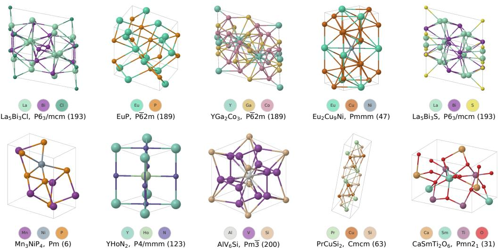  
Figure 3: Representative S.S.U.N. crystal structures generated by CrystalAR, illustrating diverse chemical compositions, space groups, and crystallographic configurations.

Datasets & Baselines. We conduct experiments on two widely used crystal-generation benchmarks, MP-20 and MPTS-52. MP-20 contains experimentally observed inorganic crystals with at most 20 atoms in the primitive cell and serves as our primary benchmark for both tasks, while MPTS-52 contains larger and more structurally complex crystals and is used for CSP to evaluate scalability and generalization. We compare CrystalAR with two broad classes of methods. The first consists of symmetry-native approaches that explicitly model crystallographic templates, including WyFormer (Kazeev et al., 2025), SGEquiDiff (Chang et al., 2025), CrystalFormer (Cao et al., 2024), and SymmCD (Levy et al., 2025); CrystalAR also falls into this category. The second includes more general crystal generative models without explicit template generation, including MatterGen (Zeni et al., 2023), PLaiD (Xu et al., 2025), Crystal-GFN (Hernandez-Garc´ ´ıa et al., 2023), ADiT (Joshi et al., 2025), DiffCSP (Jiao et al., 2023), DiffCSP++ (Jiao et al., 2024), LLaMat-CIF (Mishra et al., 2024), FlowMM (Miller et al., 2024), CDVAE (Xie et al., 2022), CrystalFlow (Luo et al., 2025), and OMatG (Hollmer et al., 2025). For each setting, we select task-appropriate baselines and restrict¨ comparisons to methods with publicly available implementations for reproducibility.

## 5.2 DE NOVO GENERATION

Table 1 evaluates whether explicit symmetry modeling can maintain strong material-discovery performance on the standard de novo generation benchmark. Existing symmetry-native methods show a noticeable gap from models without explicit template generation, particularly on stability-oriented metrics, suggesting that enforcing crystallographic symmetry alone is insufficient for high-quality generation. CrystalAR substantially narrows this gap. Without pre-relaxation, it achieves a stability rate of 6.0% and an S.U.N. rate of 0.3%, compared with 1.4%/0.0% for CrystalFormer and 1.4%/0.1% for SymmCD. These results are already competitive with strong models without explicit template generation, whose best reported stability and S.U.N. rates are 2.3% and 0.2%, respectively. After pre-relaxation, CrystalAR further improves to 13.7% stability and 0.9% S.U.N., substantially outperforming WyFormer-DFT (3.7% and 0.4%) and approaching the post-trained PLaID++ (12.4% and 1.0%). CrystalAR also achieves the strongest energetic quality among symmetry-native models, with $E _ { f } \stackrel { \cdot } { = } - 0 . 7 8 \mathrm { e V }$ and $E _ { \mathrm { h u l l } } = 0 . 1 5 \ \mathrm { { e V } }$ after pre-relaxation. Overall, these results show that symmetry-native generation need not trade material quality for explicit crystallographic modeling: CrystalAR brings material-discovery performance into the regime of broader crystal generators while preserving explicit symmetry structure, establishing symmetry-native generation as a competitive paradigm for practical materials discovery.

## 5.3 SYMMETRY-AWARE EVALUATION FOR CRYSTAL GENERATION

Table 2 provides a stricter symmetry-aware view of de novo generation by evaluating not only whether generated structures are novel, but whether they arise from genuinely novel crystallographic templates. This distinction is important because structural novelty can still be achieved within symmetry patterns already seen during training, whereas template novelty requires exploration of previously unseen Wyckoff configurations. Models without explicit template generation show clear limitations under this criterion: DiffCSP discovers only 48 novel unique templates and exhibits large deviations from the reference space-group and Wyckoff distributions, while DiffCSP++ closely matches the symmetry distribution but discovers only five novel templates. In contrast, symmetrynative models substantially expand the accessible template space. CrystalAR (SV) discovers 268 novel unique templates, exceeding SymmCD (215), while maintaining strong symmetry fidelity, with a P1 ratio of 1.94 (reference: 2.23), $W _ { N _ { \mathrm { e l } } } = 0 . 0 9 7 3$ , and $\mathrm { J S D } _ { \mathrm { W y c k o f f } } = 0 . 0 3 2 3$ . More importantly, this broader template exploration remains effective for material discovery: CrystalAR (SV) reaches 0.19% S.S.U.N., more than doubling SymmCD (0.09%). In comparison, the default CrystalAR samples atom and site counts from the empirical joint distribution, yielding fewer novel templates but higher S.U.N. and S.S.U.N. rates of 0.28%. This comparison highlights a size-modeling trade-off: sampling atom and site counts from the empirical joint distribution provides a stronger stability prior, whereas explicitly generating both quantities broadens the explored size space and improves template novelty.

## 5.4 CRYSTAL STRUCTURE PREDICTION (CSP)

We next evaluate CrystalAR on template-free CSP, where only the chemical composition and space group are provided and the Wyckoff template must be inferred by the model. This setting directly tests whether symmetry-native models can recover both the latent Wyckoff configuration and the corresponding geometry without relying on template retrieval. SGEquiDiff and SymmCD are excluded because their formulations do not support template-free CSP inference; “–” denotes settings for which results are not reported due to prohibitively long inference time. As shown in Table 3, CrystalAR achieves a singlehypothesis match rate of 62.92% with an RMSE of 0.0585 on MP-20, closely matching the strongest diffusion- and flow-based CSP models while substantially outperforming

Table 3: Crystal structure prediction on MP-20 and MPTS-52 under single-hypothesis (1) and multi-hypothesis (20) generation. We evaluate structure recovery by match rate (MR, ↑) and geometric accuracy by RMSE (↓). CrystalAR performs template-free CSP without supplying a retrieved Wyckoff template. Bold denotes the best result in each column, while underline denotes the best singlehypothesis result.
<table><tr><td rowspan="2">Model</td><td colspan="2">MP-20</td><td colspan="2">MPTS-52</td></tr><tr><td>MR (%) ↑</td><td>RMSE↓</td><td>MR (%) ↑</td><td>RMSE↓</td></tr><tr><td>CDVAE (1)</td><td>33.90</td><td>0.1045</td><td>5.34</td><td>0.2106</td></tr><tr><td>DiffCSP (1)</td><td>51.49</td><td>0.0631</td><td>12.19</td><td>0.1786</td></tr><tr><td>FlowMM (1)</td><td>61.39</td><td>0.0566</td><td>17.54</td><td>0.1726</td></tr><tr><td>CrystalFlow (1)</td><td>62.02</td><td>0.0710</td><td>21.00</td><td>0.1613</td></tr><tr><td>OMatG (1)</td><td>63.75</td><td>0.0720</td><td>25.15</td><td>0.1931</td></tr><tr><td>CrystalAR (1)</td><td>62.92</td><td>0.0585</td><td>25.25</td><td>0.1305</td></tr><tr><td>CrystalFormer (1)</td><td>29.62</td><td>0.0619</td><td></td><td></td></tr><tr><td>WyFormer (1)</td><td>10.25</td><td>0.0522 (NA)</td><td></td><td></td></tr><tr><td>DiffCSP (20)</td><td>77.93</td><td>0.0492</td><td>34.02</td><td>0.1749</td></tr><tr><td>CrystalFlow (20)</td><td>78.34</td><td>0.0577</td><td>37.81</td><td>0.1584</td></tr><tr><td>CrystalAR (20)</td><td>74.55</td><td>0.0655</td><td>35.71</td><td>0.1454</td></tr><tr><td>CrystalFormer (20)</td><td>64.56</td><td>0.0835</td><td></td><td></td></tr><tr><td>WyFormer (20)</td><td>40.90</td><td>0.0472 (NA)</td><td></td><td></td></tr></table>

previous symmetry-native approaches. The advantage is more pronounced on the larger MPTS-52 benchmark, where CrystalAR achieves the best single-hypothesis results in both structure recovery (25.25% MR) and geometric accuracy (0.1305 RMSE). Multi-hypothesis decoding further improves the match rate to 74.55% on MP-20 and 35.71% on MPTS-52 by exploring alternative symmetrycompatible structures. These results show that CrystalAR can retain explicit Wyckoff-template generation while achieving competitive geometric precision in template-free CSP, including on more complex crystal structures. “NA” denotes results excluded from the ranking due to the low MR.

## 6 CONCLUSION

We present CrystalAR, a unified autoregressive framework for symmetry-native crystal generation. CrystalAR factorizes generation into Wyckoff templates, lattice parameters, and symmetryconstrained coordinates, following the hierarchical dependencies imposed by crystallographic symmetry. Its level-wise coarse-to-fine representation further casts continuous coordinate generation as structured search over progressively refined Wyckoff-constrained regions. Across symmetryconstrained generation, de novo generation, and crystal structure prediction, CrystalAR balances template novelty and structural stability while improving geometric accuracy over prior symmetrynative methods. It achieves competitive template-free CSP without retrieved Wyckoff templates and brings symmetry-native de novo generation to a performance level comparable to general crystal generators. These results highlight autoregressive crystallographic search as a unified paradigm for exploring novel symmetry configurations and high-quality crystal structures.

## AI USE STATEMENT

In this work, we used generative AI tools to assist with writing and language polishing. Generative AI was not used for reference retrieval, and automated research tools were not used in this work. We additionally used generative AI to assist with method implementation. All AI-assisted outputs, including implementation support and writing suggestions, were carefully reviewed and verified by the authors. The authors take full responsibility for the final content of this work, including all text, claims, implementations, and other artifacts produced with the assistance of generative AI.

## ETHICS STATEMENT

This work develops generative models for inorganic crystal structures and does not involve human subjects, personal data, or other sensitive information. The proposed approach is designed to advance computational materials discovery by enabling more effective exploration of symmetryconstrained crystal structures. As with other generative materials models, predicted structures should undergo appropriate computational and experimental validation before practical deployment. We do not identify any direct ethical concerns associated with the datasets, methods, or experiments used in this study.

## REPRODUCIBILITY STATEMENT

We benchmark CrystalAR on widely used crystal-generation datasets, including MP-20, MPTS-52, and LeMat-GenBench, following established evaluation protocols where applicable. The manuscript provides the key methodological details needed for reproduction, including the autoregressive factorization, symmetry-constrained coordinate modeling, decoding strategy, and evaluation metrics. We plan to release the implementation, model configurations, trained checkpoints, generation scripts, and evaluation code, together with the generated structures reported in our experiments. Preprocessing procedures and benchmark-specific decoding settings will also be documented.

## ACKNOWLEDGMENT

This research/project is supported by the National Research Foundation, Singapore under its AI Singapore Programme (AISG Award No: AISG3-RP-2022-028).

## REFERENCES

Michael S. Albergo and Eric Vanden-Eijnden. Building normalizing flows with stochastic interpolants. In The Eleventh International Conference on Learning Representations, ICLR 2023, Kigali, Rwanda, May 1-5, 2023. OpenReview.net, 2023.

Luis M. Antunes, Keith T. Butler, and Ricardo Grau-Crespo. Crystal structure generation with autoregressive large language modeling. Nature Communications, 15:10570, 2024. doi: 10.1038/ s41467-024-54639-7. URL https://doi.org/10.1038/s41467-024-54639-7.

Mois I. Aroyo (ed.). International Tables for Crystallography, Volume A: Space-Group Symmetry. International Union of Crystallography, 2nd online edition edition, 2016. doi: 10.1107/ 97809553602060000114.

Mois I Aroyo, Asen Kirov, Cesar Capillas, JM Perez-Mato, and Hans Wondratschek. Bilbao crystallographic server. ii. representations of crystallographic point groups and space groups. Foundations ofCrystallography, 62(2):115–128, 2006.

Siddharth Betala, Samuel P Gleason, Ali Ramlaoui, Andy Xu, Georgia Channing, Daniel Levy, Clementine Fourrier, Nikita Kazeev, Chaitanya K Joshi, S´ ekou-Oumar Kaba, et al. Lemat-´ genbench: A unified evaluation framework for crystal generative models. arXiv preprint arXiv:2512.04562, 2025.

Barry Bradlyn, Luis Elcoro, Jennifer Cano, Maia G Vergniory, Zhijun Wang, Claudia Felser, Mois I Aroyo, and B Andrei Bernevig. Topological quantum chemistry. Nature, 547(7663):298–305, 2017.

Tom B. Brown, Benjamin Mann, Nick Ryder, Melanie Subbiah, Jared Kaplan, Prafulla Dhariwal, Arvind Neelakantan, Pranav Shyam, Girish Sastry, Amanda Askell, Sandhini Agarwal, Ariel Herbert-Voss, Gretchen Krueger, Tom Henighan, Rewon Child, Aditya Ramesh, Daniel M. Ziegler, Jeffrey Wu, Clemens Winter, Christopher Hesse, Mark Chen, Eric Sigler, Mateusz Litwin, Scott Gray, Benjamin Chess, Jack Clark, Christopher Berner, Sam McCandlish, Alec Radford, Ilya Sutskever, and Dario Amodei. Language models are few-shot learners. In Advances in Neural Information Processing Systems 33: Annual Conference on Neural Information Processing Systems 2020, NeurIPS 2020, December 6-12, 2020, virtual, 2020.

Zhendong Cao, Xiaoshan Luo, Jian Lv, and Lei Wang. Space group informed transformer for crystalline materials generation. CoRR, abs/2403.15734, 2024.

Rees Chang, Angela Pak, Alex Guerra, Ni Zhan, Nick Richardson, Elif Ertekin, and Ryan P. Adams. Space group equivariant crystal diffusion. CoRR, abs/2505.10994, 2025.

Franc¸ois R. J. Cornet, Federico Bergamin, Arghya Bhowmik, Juan Maria Garcia Lastra, Jes Frellsen, and Mikkel N. Schmidt. Kinetic langevin diffusion for crystalline materials generation. In Fortysecond International Conference on Machine Learning, ICML 2025, Vancouver, BC, Canada, July 13-19, 2025. OpenReview.net, 2025.

Stefano Curtarolo, Wahyu Setyawan, Gus LW Hart, Michal Jahnatek, Roman V Chepulskii, Richard H Taylor, Shidong Wang, Junkai Xue, Kesong Yang, Ohad Levy, et al. Aflow: An automatic framework for high-throughput materials discovery. Computational Materials Science, 58:218–226, 2012.

Stefano Curtarolo, Gus LW Hart, Marco Buongiorno Nardelli, Natalio Mingo, Stefano Sanvito, and Ohad Levy. The high-throughput highway to computational materials design. Nature materials, 12(3):191–201, 2013.

Bowen Deng, Peichen Zhong, KyuJung Jun, Janosh Riebesell, Kevin Han, Christopher J Bartel, and Gerbrand Ceder. Chgnet as a pretrained universal neural network potential for charge-informed atomistic modelling. Nature Machine Intelligence, 5(9):1031–1041, 2023.

Zhengyang Geng, Mingyang Deng, Xingjian Bai, Zico Kolter, and Kaiming He. Mean flows for one-step generative modeling. Advances in Neural Information Processing Systems, 38:75460– 75482, 2025.

Ian Goodfellow, Jean Pouget-Abadie, Mehdi Mirza, Bing Xu, David Warde-Farley, Sherjil Ozair, Aaron Courville, and Yoshua Bengio. Generative adversarial networks. Communications of the ACM, 63(11):139–144, 2020.

Alex Graves, Rupesh Kumar Srivastava, Timothy Atkinson, and Faustino Gomez. Bayesian flow networks. arXiv preprint arXiv:2308.07037, 2023.

Alex Hernandez-Garc´ ´ıa, Alexandre Duval, Alexandra Volokhova, Yoshua Bengio, Divya Sharma, Pierre Luc Carrier, Michal Koziarski, and Victor Schmidt. Crystal-gfn: sampling crystals with desirable properties and constraints. CoRR, abs/2310.04925, 2023.

Jonathan Ho, Ajay Jain, and Pieter Abbeel. Denoising diffusion probabilistic models. In Advances in Neural Information Processing Systems 33: Annual Conference on Neural Information Pro cessing Systems 2020, NeurIPS 2020, December 6-12, 2020, virtual, 2020.

Philipp Hollmer, Thomas Egg, Maya M. Martirossyan, Eric Fuemmeler, Amit Gupta, Zeren Shui,¨ Pawan Prakash, Adrian Roitberg, Mingjie Liu, George Karypis, Mark K. Transtrum, Richard G. Hennig, Ellad B. Tadmor, and Stefano Martiniani. Open materials generation with stochastic interpolants. CoRR, abs/2502.02582, 2025.

Moritz Ibing, Gregor Kobsik, and Leif Kobbelt. Octree transformer: Autoregressive 3d shape generation on hierarchically structured sequences. In 2023 IEEE/CVF Conference on Computer Vision and Pattern Recognition Workshops (CVPRW), pp. 2698–2707. IEEE, 2023.

Anubhav Jain, Shyue Ping Ong, Geoffroy Hautier, Wei Chen, William Davidson Richards, Stephen Dacek, Shreyas Cholia, Dan Gunter, David Skinner, Gerbrand Ceder, and Kristin A. Persson. The materials project: A materials genome approach to accelerating materials innovation. APL Materials, 1(1):011002, jul 2013. doi: 10.1063/1.4812323. URL https://doi.org/10. 1063/1.4812323.

Rui Jiao, Wenbing Huang, Peijia Lin, Jiaqi Han, Pin Chen, Yutong Lu, and Yang Liu. Crystal structure prediction by joint equivariant diffusion. In Advances in Neural Information Processing Systems 36: Annual Conference on Neural Information Processing Systems 2023, NeurIPS 2023, New Orleans, LA, USA, December 10 - 16, 2023, 2023.

Rui Jiao, Wenbing Huang, Yu Liu, Deli Zhao, and Yang Liu. Space group constrained crystal generation. In The Twelfth International Conference on Learning Representations, ICLR 2024, Vienna, Austria, May 7-11, 2024. OpenReview.net, 2024.

Chaitanya K. Joshi, Xiang Fu, Yi-Lun Liao, Vahe Gharakhanyan, Benjamin Kurt Miller, Anuroop Sriram, and Zachary W. Ulissi. All-atom diffusion transformers: Unified generative modelling of molecules and materials. CoRR, abs/2503.03965, 2025.

Nikita Kazeev, Wei Nong, Ignat Romanov, Ruiming Zhu, Andrey Ustyuzhanin, Shuya Yamazaki, and Kedar Hippalgaonkar. Wyckoff transformer: Generation of symmetric crystals. CoRR, abs/2503.02407, 2025.

Filip Ekstrom Kelvinius, Oskar B. Andersson, Abhijith S. Parackal, Dong Qian, Rickard Armiento,¨ and Fredrik Lindsten. Wyckoffdiff - A generative diffusion model for crystal symmetry. CoRR, abs/2502.06485, 2025.

Diederik P Kingma and Max Welling. Auto-encoding variational bayes. arXiv preprint arXiv:1312.6114, 2013.

Daniel Levy, Siba Smarak Panigrahi, Sekou-Oumar Kaba, Qiang Zhu, Kin Long Kelvin Lee,´ Mikhail Galkin, Santiago Miret, and Siamak Ravanbakhsh. Symmcd: Symmetry-preserving crystal generation with diffusion models. In The Thirteenth International Conference on Learning Representations, ICLR 2025, Singapore, April 24-28, 2025. OpenReview.net, 2025.

Qi Li, Rui Jiao, Liming Wu, Tiannian Zhu, Wenbing Huang, Shifeng Jin, Yang Liu, Hongming Weng, and Xiaolong Chen. Powder diffraction crystal structure determination using generative models. Nature Communications, 16(1):7428, 2025.

Yaron Lipman, Ricky T. Q. Chen, Heli Ben-Hamu, Maximilian Nickel, and Matthew Le. Flow matching for generative modeling. In The Eleventh International Conference on Learning Representations, ICLR 2023, Kigali, Rwanda, May 1-5, 2023. OpenReview.net, 2023.

Jinlai Liu, Jian Han, Bin Yan, Hui Wu, Fengda Zhu, Xing Wang, Yi Jiang, Bingyue Peng, and Zehuan Yuan. Infinitystar: Unified spacetime autoregressive modeling for visual generation. Advances in Neural Information Processing Systems, 38:170054–170072, 2025.

Xingchao Liu, Chengyue Gong, and Qiang Liu. Flow straight and fast: Learning to generate and transfer data with rectified flow. In The Eleventh International Conference on Learning Representations, ICLR 2023, Kigali, Rwanda, May 1-5, 2023. OpenReview.net, 2023.

X. Luo, Z. Wang, Q. Wang, et al. Crystalflow: a flow-based generative model for crystalline materials. Nature Communications, 16:9267, 2025. doi: 10.1038/s41467-025-64364-4. URL https://doi.org/10.1038/s41467-025-64364-4.

Ziqiao Meng, Qichao Wang, Zhiyang Dou, Zixing Song, Zhipeng Zhou, Irwin King, and Peilin Zhao. Pointnsp: Autoregressive 3d point cloud generation with next-scale level-of-detail prediction. In Proceedings of the IEEE/CVF Conference on Computer Vision and Pattern Recognition, pp. 31450–31461, 2026.

Benjamin Kurt Miller, Ricky T. Q. Chen, Anuroop Sriram, and Brandon M. Wood. Flowmm: Generating materials with riemannian flow matching. In Forty-first International Conference on Ma chine Learning, ICML 2024, Vienna, Austria, July 21-27, 2024. OpenReview.net, 2024.

Vaibhav Mishra, Somaditya Singh, Dhruv Ahlawat, Mohd Zaki, Vaibhav Bihani, Hargun Singh Grover, Biswajit Mishra, Santiago Miret, Mausam, and N. M. Anoop Krishnan. Foundational large language models for materials research. CoRR, abs/2412.09560, 2024. doi: 10.48550/ ARXIV.2412.09560. URL https://doi.org/10.48550/arXiv.2412.09560.

Masahiro Negishi and Aron Walsh. Substitution-based analysis of structural novelty for generative models of materials. arXiv preprint arXiv:2606.23166, 2026.

Asma Nouira, Nataliya Sokolovska, and Jean-Claude Crivello. Crystalgan: learning to discover crystallographic structures with generative adversarial networks. arXiv preprint arXiv:1810.11203, 2018.

John Frederick Nye. Physical properties of crystals: their representation by tensors and matrices. Oxford university press, 1985.

OpenAI. GPT-4 technical report. CoRR, abs/2303.08774, 2023.

Maylis Orio, Dimitrios A Pantazis, and Frank Neese. Density functional theory. Photosynthesis research, 102(2):443–453, 2009.

Hyunsoo Park and Aron Walsh. Guiding generative models to uncover diverse and novel crystals via reinforcement learning. Nature Machine Intelligence, pp. 1–13, 2026.

Martin Hoffmann Petersen, Ruiming Zhu, Haiwen Dai, Savyasanchi Aggarwal, Nong Wei, Andy Paul Chen, Arghya Bhowmik, Juan Maria Garcia Lastra, and Kedar Hippalgaonkar. Disgen: Disordered crystal structure generation. arXiv preprint arXiv:2507.18275, 2025.

Chris J Pickard and RJ Needs. Ab initio random structure searching. Journal ofPhysics: Condensed Matter, 23(5):053201, 2011.

Omri Puny, Yaron Lipman, and Benjamin Kurt Miller. Space group conditional flow matching, 2025. URL https://arxiv.org/abs/2509.23822.

Rafael Rafailov, Archit Sharma, Eric Mitchell, Christopher D Manning, Stefano Ermon, and Chelsea Finn. Direct preference optimization: Your language model is secretly a reward model. Advances in neural information processing systems, 36:53728–53741, 2023.

Laura Ruple, Luca Torresi, Henrik Schopmans, and Pascal Friederich. Symmetry-aware bayesian flow networks for crystal generation. npj Computational Materials, 12(1):182, 2026.

Kiyoung Seong, Sungsoo Ahn, Sehui Han, and Changyoung Park. Multimodal crystal flow: Anyto-any modality generation for unified crystal modeling. CoRR, abs/2602.20210, 2026.

Zhihong Shao, Peiyi Wang, Qihao Zhu, Runxin Xu, Junxiao Song, Xiao Bi, Haowei Zhang, Mingchuan Zhang, YK Li, Yang Wu, et al. Deepseekmath: Pushing the limits of mathematical reasoning in open language models. arXiv preprint arXiv:2402.03300, 2024.

Jiaming Song, Chenlin Meng, and Stefano Ermon. Denoising diffusion implicit models. In 9th International Conference on Learning Representations, ICLR 2021, Virtual Event, Austria, May 3-7, 2021. OpenReview.net, 2021a.

Yang Song and Stefano Ermon. Generative modeling by estimating gradients of the data distribution. In Advances in Neural Information Processing Systems 32: Annual Conference on Neural Information Processing Systems 2019, NeurIPS 2019, December 8-14, 2019, Vancouver, BC, Canada, pp. 11895–11907, 2019.

Yang Song, Jascha Sohl-Dickstein, Diederik P. Kingma, Abhishek Kumar, Stefano Ermon, and Ben Poole. Score-based generative modeling through stochastic differential equations. In 9th International Conference on Learning Representations, ICLR 2021, Virtual Event, Austria, May 3-7, 2021. OpenReview.net, 2021b.

Anuroop Sriram, Benjamin K Miller, Ricky T Chen, and Brandon Wood. Flowllm: Flow matching for material generation with large language models as base distributions. Advances in Neural Information Processing Systems, 37:46025–46046, 2024.

Ilya Sutskever, Oriol Vinyals, and Quoc V. Le. Sequence to sequence learning with neural networks. In Advances in Neural Information Processing Systems 27: Annual Conference on Neural Information Processing Systems 2014, December 8-13 2014, Montreal, Quebec, Canada, pp. 3104–3112, 2014.

Keyu Tian, Yi Jiang, Zehuan Yuan, Bingyue Peng, and Liwei Wang. Visual autoregressive modeling: Scalable image generation via next-scale prediction. In Advances in Neural Information Processing Systems 37: Annual Conference on Neural Information Processing Systems 2024, NeurIPS 2024, Vancouver, BC, Canada, December 10 - 15, 2024, 2024.

Si-Tong Wei, Rui-Huan Wang, Chuan-Zhi Zhou, Baoquan Chen, and Peng-Shuai Wang. Octgpt: Octree-based multiscale autoregressive models for 3d shape generation. In Proceedings of the Special Interest Group on Computer Graphics and Interactive Techniques Conference Conference Papers, pp. 1–11, 2025.

Hanlin Wu, Yuxuan Song, Jingjing Gong, Ziyao Cao, Yawen Ouyang, Jianbing Zhang, Hao Zhou, Wei-Ying Ma, and Jingjing Liu. A periodic bayesian flow for material generation. In International Conference on Learning Representations, volume 2025, pp. 11741–11770, 2025.

Liming Wu, Rui Jiao, Qi Li, Mingze Li, Songyou Li, Shifeng Jin, and Wenbing Huang. Dmflow: Disordered materials generation by flow matching. In Proceedings of the 32nd ACM SIGKDD Conference on Knowledge Discovery and Data Mining V. 2, pp. 12444–12455, 2026.

Yingce Xia, Peiran Jin, Shufang Xie, Liang He, Chuan Cao, Renqian Luo, Guoqing Liu, Yue Wang, Zequn Liu, Yuan-Jyue Chen, Zekun Guo, Yeqi Bai, Pan Deng, Yaosen Min, Ziheng Lu, Hongxia Hao, Han Yang, Jielan Li, Chang Liu, Jia Zhang, Jianwei Zhu, Kehan Wu, Wei Zhang, Kaiyuan Gao, Qizhi Pei, Qian Wang, Xixian Liu, Yanting Li, Houtian Zhu, Yeqing Lu, Mingqian Ma, Zun Wang, Tian Xie, Krzysztof Maziarz, Marwin H. S. Segler, Zhao Yang, Zilong Chen, Yu Shi, Shuxin Zheng, Lijun Wu, Chen Hu, Peggy Dai, Tie-Yan Liu, Haiguang Liu, and Tao Qin. Naturelm: Deciphering the language of nature for scientific discovery. CoRR, abs/2502.07527, 2025.

Tian Xie, Xiang Fu, Octavian-Eugen Ganea, Regina Barzilay, and Tommi S. Jaakkola. Crystal diffusion variational autoencoder for periodic material generation. In The Tenth International Conference on Learning Representations, ICLR 2022, Virtual Event, April 25-29, 2022. OpenReview.net, 2022.

Andy Xu, Rohan Desai, Larry Wang, Ethan Ritz, and Gabriel Hope. Plaid++: A preference aligned language model for targeted inorganic materials design. arXiv preprint arXiv:2509.07150, 2025.

Sherry Yang, KwangHwan Cho, Amil Merchant, Pieter Abbeel, Dale Schuurmans, Igor Mordatch, and Ekin Dogus Cubuk. Scalable diffusion for materials generation. In The Twelfth International Conference on Learning Representations, ICLR 2024, Vienna, Austria, May 7-11, 2024. OpenReview.net, 2024.

Claudio Zeni, Robert Pinsler, Daniel Zugner, Andrew Fowler, Matthew Horton, Xiang Fu, Sasha¨ Shysheya, Jonathan Crabbe, Lixin Sun, Jake Smith, Ryota Tomioka, and Tian Xie. Mattergen: a´ generative model for inorganic materials design. CoRR, abs/2312.03687, 2023.

Gongbo Zhang, Yanting Li, Renqian Luo, Pipi Hu, Zeru Zhao, Lingbo Li, Guoqing Liu, Zun Wang, Ran Bi, Kaiyuan Gao, Liya Guo, Yu Xie, Chang Liu, Jia Zhang, Tian Xie, Robert Pinsler, Claudio Zeni, Ziheng Lu, Yingce Xia, Marwin H. S. Segler, Maik Riechert, Li Yuan, Lei Chen, Haiguang Liu, and Tao Qin. Unigenx: Unified generation of sequence and structure with autoregressive diffusion. CoRR, abs/2503.06687, 2025.

Ruiming Zhu, Wei Nong, Shuya Yamazaki, and Kedar Hippalgaonkar. Wycryst: Wyckoff inorganic crystal generator framework. Matter, 7(10):3469–3488, 2024.

## A APPENDIX

## A.1 LATTICE VOLUME–SHAPE DECOMPOSITION.

We transform the lattice matrix $\mathbf { L } \in \mathbb { R } ^ { 3 \times 3 }$ into a six-dimensional representation that explicitly separates the unit-cell volume from its shape. Let $\mathbf { a } , \mathbf { b } , \mathbf { \cdot }$ c denote the three lattice vectors, with lengths $a = \| \mathbf { a } \| , b = \| \mathbf { b } \|$ , and $c = \| \mathbf { c } \|$ . We decompose the lattice as

$$
\mathbf { L } \longleftrightarrow \ell = ( V , r _ { b } , r _ { c } , \alpha , \beta , \gamma ) ,
$$

where

$$
V = | \operatorname* { d e t } ( \mathbf { L } ) | , \qquad r _ { b } = { \frac { b } { a } } , \qquad r _ { c } = { \frac { c } { a } } ,
$$

and $\alpha = \angle ( { \bf b } , { \bf c } ) , \beta = \angle ( { \bf a } , { \bf c } )$ , and $\gamma = \angle ( { \bf a } , { \bf b } )$ are the three lattice angles. Here, V captures the overall scale of the unit cell, while $( r _ { b } , r _ { c } , \alpha , \beta , \gamma )$ characterize its shape independently of absolute size. The transformation is invertible: defining

$$
q = \sqrt { 1 + 2 \cos \alpha \cos \beta \cos \gamma - \cos ^ { 2 } \alpha - \cos ^ { 2 } \beta - \cos ^ { 2 } \gamma } ,
$$

the lattice lengths are recovered as

$$
a = \left( \frac { V } { r _ { b } r _ { c } q } \right) ^ { 1 / 3 } , \qquad b = r _ { b } a , \qquad c = r _ { c } a ,
$$

after which the lattice matrix can be reconstructed under the standard crystallographic convention.

## A.2 MORE ALGORITHM DETAILS

Stopping Criterion. The stopping rule depends on how the template size is specified. For the SV variant, the model directly predicts the atom and symmetry-inequivalent site counts, and template decoding terminates once the predicted number of sites has been generated. For the non-SV variant of CrystalAR, these size variables are sampled from the empirical joint distribution of space group, symmetry-inequivalent site count, atom count and element count $( \mathbf { \dot { G } } , M , N , K )$ , estimated from the training data. Given the sampled size variables, decoding terminates once the corresponding site count is reached. In the free setting, no template size is provided in advance. During training, we append a STOP token $\langle \dot { S } \rangle$ to the end of each template sequence, so that the model learns to infer the template length autoregressively. At inference time, following a strategy similar to SGEquiDiff and WyFormer, generation terminates once the model predicts this binary STOP action. For CSP, the prescribed composition provides a deterministic stopping criterion: decoding ends once the multiplicity-weighted site assignments exactly exhaust the target elemental counts.

Coordinate Decoding. Each coordinate token $r _ { i } ^ { ( \ell ) }$ specifies a child region relative to the region selected at the previous refinement level. Starting from the full fractional-coordinate cell $\mathcal { C } _ { i } ^ { ( 0 ) } =$ $[ 0 , 1 ) ^ { 3 }$ , the complete refinement path recursively determines $\mathcal { C } _ { i } ^ { ( \ell ) } = \mathrm { C h i l d } \Big ( \mathcal { C } _ { i } ^ { ( \ell - 1 ) } , r _ { i } ^ { ( \ell ) } \Big )$ $\ell =$ $1 , \ldots , L$ Only child cells intersecting the Wyckoff manifold of $w _ { i }$ are admissible. After L refinements, the complete path $r _ { i } ^ { ( 1 : L ) }$ therefore specifies a finest feasible region on this manifold. We recover the corresponding free Wyckoff parameters from this region and map them through the Wyckoff parameterization, $\hat { \mathbf { f } } _ { i } ~ = ~ \phi _ { w _ { i } } ( \hat { \mathbf { u } } _ { i } )$ , yielding a fractional coordinate that satisfies the prescribed site symmetry by construction. Applying this procedure to all inequivalent sites gives $\mathbf { F } = \mathcal { D } ( \mathbf { R } ^ { ( 1 : L ) } , T )$ ; the full crystal is then obtained by applying the symmetry operations of G.

Token Embedding. All input variables are embedded into a common D-dimensional hidden space before entering the Transformer. Discrete crystallographic variables use separate learned lookup tables: the space group is represented by ${ \bf E } _ { G } ( \dot { G } )$ , the element identity by $\mathbf { E } _ { \mathrm { e l e m } } ( e _ { i } )$ , and the Wyckoff information by ${ \bf E } _ { \mathrm { w y c } } ( w _ { i } )$ , which encodes the corresponding site-symmetry type and coordinateform index. Special control tokens, such as ⟨C S⟩, are assigned independent learned embeddings. Continuous lattice variables are first normalized according to the crystal family and then projected into the hidden space together with embeddings indicating their positions in the lattice-generation sequence. For coordinate refinement, we use the site-specific query embedding defined in Eq. 5. Here, $\mathbf { E } _ { \mathrm { e l e m } } ( e _ { i } )$ and ${ \bf E } _ { \mathrm { w y c } } ( w _ { i } )$ preserve the chemical and crystallographic identity of site $i ; { \bf E } _ { \mathrm { r e g } } ( r _ { i } ^ { ( \ell - 1 ) } )$ embeds the child-region decision from the previous refinement level; and $\mathbf { E } _ { \mathrm { l e v e l } } ( \ell )$ identifies the current spatial resolution. The previous refinement path determines the current feasible region, whose decoded center $\mathbf { c } _ { i } ^ { ( \ell - 1 ) } \in [ 0 , \bar { 1 } ) ^ { 3 }$ is further encoded by $\mathrm { P E } ( \mathbf { c } _ { i } ^ { ( \ell - 1 ) } )$ to provide its coarse spatial location. For $\ell = 1 , r _ { i } ^ { ( 0 ) }$ and ${ \bf c } _ { i } ^ { ( 0 ) }$ are initialized from the feasible region specified by $w _ { i } .$ . Together, these embeddings allow each query to carry both the fixed symmetry context and the evolving geometric state throughout hierarchical refinement.

Variable Prediction Heads. CrystalAR employs variable-specific output heads on top of the shared Transformer representation, using categorical projections for discrete crystallographic decisions and conditional density heads for continuous lattice variables. The hidden width is $\bar { D } = 3 8 4$ for MP-20 and $\begin{array} { r } { D \ = \ 5 1 2 } \end{array}$ for MPTS-52. For each discrete variable v, an affine projection ${ \bf z } _ { v } = { \bf W } _ { v } { \bf h } + { \bf b } _ { v }$ produces its logits, with inadmissible actions masked $\mathrm { { t o \mathrm { ~ - \infty } } }$ before normalization. Template generation predicts the element, site-symmetry type, and coordinate-form index using shared categorical heads with 89, 75, and 8 outputs, respectively; together with the space group, the latter two identify the corresponding Wyckoff orbit.

Lattice variables are predicted using conditional neural spline flow (NSF) heads. We first transform and standardize the lattice according to its crystal family, leaving 1, 2, 3, 4, or 6 active variables for cubic, tetragonal/hexagonal, orthorhombic, monoclinic, and triclinic systems, respectively. Each active scalar is generated autoregressively by a separate NSF conditioned on the Transformer state and previously generated lattice variables. The NSF parameter network has dimensions $( D + 6 ) $ $2 5 6  2 5 6  2 3$ , where the 23 outputs parameterize an eight-bin rational-quadratic spline. Inverse normalization and the family-specific geometric decoder subsequently recover the physical lattice parameters while preserving the corresponding lattice symmetry.

For coordinate refinement, a single shared linear head $\mathbb { R } ^ { D } \to \mathbb { R } ^ { 8 }$ predicts the eight octree child cells for every inequivalent site and refinement level. The same head is shared across all sites and all $L = 9$ levels, with a Wyckoff-dependent mask removing child cells incompatible with the site’s symmetry manifold. The model further includes task-specific auxiliary heads for CSP multiplicity prediction, orbit-count prediction, and composition-conditioned space-group, crystal-family, and centering-type prediction.

## A.3 TRAINING & INFERENCE

The following pseudocode makes explicit the two training paths and the two inference paths. In all four algorithms, $T = ( A , W ) = ^ { ^ { \bullet } } \{ ( e _ { i } , w _ { i } ) \} _ { i = 1 } ^ { M }$ is the element-decorated Wyckoff template, ye is the family-normalized lattice vector, and $\mathbf { R } ^ { ( 1 : L ) }$ is the level-wise coordinate-refinement path. Algorithms 1 and 4 present the detailed training and inference procedures for CSP, respectively, while Algorithms 2 and 3 describe the corresponding procedures for de novo crystal generation.

## A.4 MORE RELATED WORK DISCUSSION

Generative models A variety of generative paradigms have been explored for crystal generation. Early studies employed variational autoencoders (Kingma & Welling, 2013; Zhu et al., 2024) and generative adversarial networks (Goodfellow et al., 2020; Nouira et al., 2018) to model the distribution of crystalline structures. More recently, diffusion models (Ho et al., 2020; Song et al., 2021a; Song & Ermon, 2019; Song et al., 2021b; Jiao et al., 2023; 2024; Yang et al., 2024) and flowmatching approaches (Miller et al., 2024; Liu et al., 2023; Geng et al., 2025) have emerged as dominant frameworks, achieving strong performance in both crystal generation and structure prediction. Related continuous-time formulations, such as stochastic interpolants (Albergo & Vanden-Eijnden, 2023; Hollmer et al., 2025), have also been explored as flexible alternatives within this family of¨ generative methods. By contrast, autoregressive modeling (Sutskever et al., 2014), despite its re markable success in language modeling (Brown et al., 2020; OpenAI, 2023), remains comparatively underexplored for crystal generation. Several recent works have directly adapted large language models to crystal generation (Xia et al., 2025; Antunes et al., 2024; Zhang et al., 2025); however, such sequence-based formulations often face difficulties in effectively exploring novel crystal structures and in modeling precise continuous geometry. In this work, we instead adopt a coarse-to-fine autoregressive formulation for continuous geometric generation, inspired by hierarchical autoregressive paradigms developed for image generation (Tian et al., 2024), video generation (Liu et al., 2025) and 3D point-cloud modeling (Meng et al., 2026; Wei et al., 2025; Ibing et al., 2023).

Algorithm 1 CSP training of CrystalAR   
1: Input: CSP training set $\overline { { \mathcal { D } _ { \mathrm { C S P } } = \{ ( { \bf n } , G , C ) \} } }$ , pretrained parameters $\theta _ { \mathrm { b a s e } }$   
2: Initialize: freeze $\theta _ { \mathrm { b a s e } }$ and attach a rank-32 adapter $\theta _ { \mathrm { C S P } }$ and orbit-count head $q _ { \psi } ( M \mid \mathbf { n } , G )$   
3: while not converged do   
4: Sample $( \mathbf { n } , G , C )$ and symmetry-decompose C into $T ^ { \star } = ( A ^ { \star } , W ^ { \star } ) , \widetilde { \mathbf { y } } ^ { \star }$ , and $\scriptstyle \mathbf { R } ^ { \star ( 1 : L ) }$   
5: for $i = 1 , \dots , M$ do   
6: Compute remaining composition $\begin{array} { r } { r _ { e } ^ { ( i ) } = n _ { e } - \sum _ { j < i } \mathbb { I } [ e _ { j } = e ] m ( w _ { j } ) } \end{array}$ and feasible actions   
$\mathcal { A } _ { i } = \mathcal { A } ( T _ { < i } , G , \mathbf { r } ^ { ( i ) } )$   
7: end for   
8: Teacher-force $( G , \mathbf { n } , T ^ { \star } , \widetilde { \mathbf { y } } ^ { \star } , \mathbf { R } ^ { \star ( 1 : L ) } )$ with causal template/lattice attention and level-wise   
block-causal coordinate attention   
9: Evaluate masked template loss $\mathcal { L } _ { T } ^ { A }$ only over $A _ { i }$ , lattice loss ${ \mathcal { L } } _ { \mathbf { L } }$ , coordinate region loss   
$\begin{array} { r } { \mathcal { L } _ { \mathbf { R } } = \sum _ { \ell = 1 } ^ { L } \mathcal { L } _ { \mathbf { R } } ^ { ( \ell ) } } \end{array}$ , and orbit-count loss ${ \mathcal { L } } _ { M }$   
10: Update only $( \theta _ { \mathrm { C S P } } , \psi )$ using ${ \mathcal { L } } _ { \mathrm { C S P } } = 2 \lambda _ { T } { \mathcal { L } } _ { T } ^ { A } + \lambda _ { \mathbf { L } } { \mathcal { L } } _ { \mathbf { L } } + \lambda _ { \mathbf { R } } { \mathcal { L } } _ { \mathbf { R } } + \lambda _ { M } { \mathcal { L } } _ { M }$   
11: end while   
12: Output: $\theta _ { \mathrm { C S P } }$ for composition- and space-group-conditioned inference

```latex
Algorithm 2 De novo training of CrystalAR
1: Input: Crystal dataset $\overline { { \mathcal { D } ; } }$ model parameters θ
2: while not converged do
3: Sample $C = \mathsf { \bar { ( } } G , \mathbf { n } , \mathbf { L } , T , \mathbf { F } )$ from D and record $\begin{array} { r } { ( N , M , K ) = ( \sum _ { e } n _ { e } , | T | , | \{ e : e \in \mathbf { n } \} | ) } \end{array}$
4: Encode L as $\widetilde { \mathbf { y } }$ and encode the free Wyckoff coordinates as $\mathbf { R } ^ { \star ( 1 : L ) }$
5: Construct the teacher-forced sequence $( G , T ^ { \star } , \widetilde { \mathbf { y } } ^ { \star } , \mathbf { R } ^ { \star ( 1 : L ) } )$ ; use the Wyckoff-manifold
mask for every coordinate level
6: Predict $e _ { i } \to w _ { i }$ autoregressively, the six active lattice variables with NSF heads, and all
sites’ child regions jointly at each level
7: Compute $\mathcal { L } _ { T } = \mathcal { L } _ { e } + \mathcal { L } _ { w } + \mathcal { L } _ { \mathrm { s t o p } } , \mathcal { L } _ { \mathbf { L } } ,$ , and $\begin{array} { r } { \mathcal { L } _ { \mathbf { R } } = \sum _ { \ell = 1 } ^ { L } \mathcal { L } _ { \mathbf { R } } ^ { ( \ell ) } } \end{array}$
8: Update all parameters with $\mathcal { L } = \dot { \lambda } _ { T } \mathcal { L } _ { T } + \lambda _ { \mathrm { L } } \mathcal { L } _ { \mathrm { L } } + \overline { { \lambda } } _ { \mathrm { R } } ^ { \mathrm { ~ \scriptsize ~ \cdot ~ } } \overline { { \mathcal { L } } } _ { \mathrm { R } } \overset {  } { + } \lambda _ { \mathrm { a u x } } \mathcal { L } _ { \mathrm { a u x } }$
9: end while
10: Output: θ and the empirical prior $p _ { \mathrm { t r a i n } } ( G , N , M , K )$ used for MP-20 de novo sampling
```

More Crystal Generation Works Beyond the approaches discussed above, several other directions have also been explored for crystal generation. CrysBFN (Wu et al., 2025) introduces Bayesian flow networks (Graves et al., 2023) to crystal generation, while SymmBFN (Ruple et al., 2026) further incorporates crystallographic symmetry into this framework. PXRD (Li et al., 2025) studies conditional crystal generation from powder X-ray diffraction patterns. More recently, several works (Park & Walsh, 2026; Xu et al., 2025) have begun to investigate post-training strategies, including preference-optimization methods such as DPO (Rafailov et al., 2023) and GRPO (Shao et al., 2024), to further improve the quality and discovery capability of crystal generative models. Another emerging direction focuses on the generation of disordered crystal structures (Petersen et al., 2025; Wu et al., 2026), extending generative modeling beyond perfectly ordered crystalline systems.

## A.5 EVALUATION METRICS

For denovo generation: Validity. measures the percentage of generated crystals that pass the structural and chemical validity checks defined by LeMat-GenBench, including physically reasonable geometries and chemically admissible compositions. It reflects the basic feasibility of generated crystal structures. Uniqueness. measures the fraction of generated structures that are structurally distinct from the other generated samples, based on crystal structure matching. A higher value indicates less duplication and greater structural diversity within the generated set. Novelty. measures the fraction of generated structures that cannot be matched to structures in the reference database. It therefore evaluates the ability of a model to explore structures beyond known materials rather than reproducing the training or reference data. Formation energy $( E _ { f } )$ measures the energetic preference of a crystal relative to its constituent elemental reference phases. Lower, and particularly more negative, formation energies generally indicate more energetically favorable structures, although they do not alone determine thermodynamic stability against competing compounds. Energy above hull $\left( E _ { \mathrm { { h u l l } } } \right)$ measures the energetic distance between a generated material and the convex hull formed by competing phases at the same composition. Lower values indicate greater thermodynamic stability, with structures on the convex hull regarded as stable. Relaxation RMSD. measures the structural displacement between the initially generated crystal and its geometry after energy minimization. A smaller RMSD indicates that the generated structure is already close to a local energy minimum and requires less geometric correction. Stable rate is the percentage of generated structures classified as thermodynamically stable according to their energy above hull. Following LeMat-GenBench, structures with $E _ { \mathrm { h u l l } } \leq 0$ are considered stable. Metastable (Meta) rate measures the percentage of generated structures lying slightly above the convex hull but within the benchmark’s metastability window $( 0 < E _ { \mathrm { h u l l } } \le 0 . 1 \mathrm { e V / a t o m } )$ . It captures potentially synthesizable materials that are not strictly ground-state stable. S.U.N. denotes Stable, Unique, and Novel structures. A generated sample is counted only when it is simultaneously thermodynamically stable, structurally distinct from other generated samples, and absent from the reference database, providing a stringent measure of useful material discovery. M.S.U.N. extends S.U.N. to Metastable, Unique, and Novel structures. It measures the fraction of generated candidates that are unique and novel while falling within the predefined metastability window.

Algorithm 3 De novo inference with simulation-guided beam search   
1: Input: $\overline { { \theta , p _ { \mathrm { t r a i n } } ( G , N , M , K ) } }$ , and number of attempts $\overline { { S = 2 5 0 0 } }$   
2: for $s = 1 , \ldots , S$ do   
3: Sample $( \bar { G } , N , M , K ) \ \sim \ p _ { \mathrm { t r a i n } } ;$ generate $T$ and $\widetilde { \mathbf { y } }$ autoregressively with temperatures   
$( \tau _ { T } , \tau _ { L } ) \dot { = } ( \dot { 1 } , 1 )$   
4: Initialize the coordinate beam $\boldsymbol { B } _ { 0 } = \{ \boldsymbol { \mathcal { O } } \}$ and prefix budget $Q = 2 0 4 9$   
5: for $\ell = 1 , \ldots , L = 9$ do   
6: Expand every prefix in $B _ { \ell - 1 }$ to at most $E = 5 6$ masked child assignments for all sites   
jointly, using coordinate temperature $\tau _ { F } = 0 . 7$   
7: Greedily complete each expanded prefix to level $L ;$ apply Wyckoff masks and symmetry  
expand each completed path to $\widehat { C } \big ( \mathbf { R } ^ { ( 1 : L ) } \big )$   
8: For every complete rollout, compute capped clearance $c ( \pi ) = \operatorname* { m i n } \{ c _ { \mathrm { m a x } } , \operatorname { c l r } ( { \widehat C } ( \pi ) ) \}$   
from minimum-image interatomic distances, with $c _ { \mathrm { m a x } } = 1 . 2 8 9 9$   
9: Rank complete rollouts by $( c ( \pi )$ , log $p _ { \theta } ( \pi ) )$ ; retain the top beam $B = 4$ prefixes and   
charge every model prefix evaluation to the global budget Q   
10: if $\boldsymbol { B } _ { \ell } = \boldsymbol { \mathcal { O } }$ or the budget is exhausted then   
11: break   
12: end if   
13: end for   
14: Decode the best F from the retained path and apply $G " s$ symmetry operations to obtain the   
full crystal $\widehat { C } _ { s }$   
15: end for   
16: Optionally apply DiffCSP++ pre-relaxation and evaluate the three-MLIP mean energy; retain   
failed attempts in the denominator   
17: Output: $\{ \hat { \widehat { C } } _ { s } \} _ { s = 1 } ^ { 2 5 0 0 }$

Algorithm 4 Template-free CSP inference with template and coordinate search   
1: Input: composition n, space group G, trained $\theta _ { \mathrm { C S P } }$ , and hypothesis count $K \in \{ 1 , 2 0 \}$   
2: Initialize a template beam ${ B _ { T } ^ { 0 } = \{ \bar { \varrho } \} }$   
3: for $i = 1 , \ldots , \bar { M }$ do   
4: Expand each partial template with local width 4 using only $( e _ { i } , w _ { i } ) \in A ( T _ { < i } , G , \mathbf { r } ^ { ( i ) } )$   
5: Keep the top 32 partial templates by model score   
6: end for   
7: Complete and rank feasible templates by $s _ { T } ( T ) = \log p _ { \theta } ( T \mid { \bf n } , G ) + \log q _ { \psi } ( M \mid { \bf n } , G ) ;$ ; cycle   
through the available templates only if fewer than K are complete   
8: for $j = 1 , \dots , K$ do   
9: Select ranked template $T _ { j }$ and sample $\widetilde { \mathbf { y } } _ { j } \sim p _ { \boldsymbol { \theta } } ( \widetilde { \mathbf { y } } \mid T _ { j } , \mathbf { n } , G )$ with lattice seed $j + 1 ;$ initialize   
$\begin{array} { r } { B _ { \mathrm { 0 } } = \left\{ \mathcal { O } \right\} } \end{array}$   
10: for $\ell = 1 , \ldots , L = 9$ do   
11: Expand each prefix to at most 32 child paths; mask Wyckoff-incompatible children and   
any periodic contact below $0 . 5 \mathrm { \AA } ;$ spend at most $Q = 5 1 2$ global prefix evaluations   
12: Greedily roll out each inspected prefix to level L, symmetry-expand it, and compute   
capped clearance $c ( \pi ) = \operatorname* { m i n } \{ 1 . 2 8 9 9 , \operatorname { c l r } ( \widehat { C } ( \pi ) ) \}$   
13: If $T _ { j }$ has repeated free orbits, rank by log $p _ { \theta } ( \pi ) + 8 c ( \pi )$ ; otherwise rank lexicographi   
cally by $( c ( \pi ) , \log { \bar { p } } _ { \theta } ( \pi ) )$ ; retain the top 16 prefixes   
14: end for   
15: Decode $\mathbf { F } _ { j }$ from the best complete path and construct $\widehat { C } _ { j } = \mathrm { E x p a n d } _ { G } ( T _ { j } , { \bf L } _ { j } , { \bf F } _ { j } )$   
16: end for   
17: Output: K symmetry-consistent crystal structures

Table 4: “Generative Model” denotes the underlying generative modeling backbone employed by each method. “Unified” indicates whether the model is trained and performs inference over the complete crystal geometry in an end-to-end fashion using a single unified model. “Symmetry” specifies whether Wyckoff symmetry is explicitly modeled at the level of individual atomic sites. “Template-Gen” indicates whether Wyckoff positions are generated by the model itself, rather than retrieved from predefined symmetry templates or sampled from the empirical distribution of the training data. “Template-Free CSP” indicates whether the method supports crystal structure prediction without template retrieval. “Inter-Geom” indicates whether the model explicitly and effectively captures interatomic geometry. “-” denotes that the item is not applicable.
<table><tr><td>Model</td><td>Generative Model</td><td>Unified</td><td>Symmetry</td><td>Template-Gen</td><td>Template-free CSP</td><td>Inter-Geom</td></tr><tr><td>CDVAE (Xie et al., 2022)</td><td>VAE+Diff.</td><td>√</td><td></td><td></td><td>√</td><td></td></tr><tr><td>DiffCSP (Jiao et al., 2023)</td><td>Diff.</td><td>√</td><td></td><td></td><td></td><td></td></tr><tr><td>MatterGen (Zeni et al., 2023)</td><td>Diff.</td><td>√</td><td></td><td></td><td>√</td><td></td></tr><tr><td>KLDM (Cornet et al., 2025)</td><td>Diff.</td><td>√</td><td></td><td></td><td>√</td><td></td></tr><tr><td>ADiT (Joshi et al., 2025)</td><td>Diff.</td><td>√</td><td></td><td></td><td></td><td></td></tr><tr><td>FlowMM (Miller et al., 2024)</td><td>Flow</td><td>√</td><td></td><td></td><td></td><td></td></tr><tr><td>FlowLLM (Sriram et al., 2024)</td><td>LLM+Flow</td><td>V</td><td></td><td></td><td></td><td></td></tr><tr><td>CrystalFlow (Luo et al., 2025)</td><td>Flow</td><td>√</td><td></td><td></td><td>√</td><td></td></tr><tr><td>OMatG (Höllmer et al., 2025)</td><td>Flow</td><td>√</td><td></td><td></td><td>√</td><td></td></tr><tr><td>MCFlow (Seong et al., 2026)</td><td>Flow</td><td>√</td><td></td><td></td><td>√</td><td></td></tr><tr><td>WyCrys (Zhu et al., 2024)</td><td>VAE</td><td></td><td></td><td></td><td></td><td></td></tr><tr><td>DiffCSP++ (Jiao et al., 2024)</td><td>Diff.</td><td>√</td><td>V</td><td></td><td>√</td><td></td></tr><tr><td>WyckoffDiff (Kelvinius et al., 2025)</td><td>Diff.</td><td></td><td></td><td>V</td><td></td><td></td></tr><tr><td>SGEquiDiff (Chang et al., 2025)</td><td>AR+Diff</td><td></td><td></td><td>√</td><td></td><td></td></tr><tr><td>WyFormer (Kazeev et al., 2025)</td><td>AR+Diff</td><td></td><td></td><td>√</td><td></td><td></td></tr><tr><td>SGFM (Puny et al., 2025)</td><td>Flow</td><td></td><td></td><td></td><td></td><td></td></tr><tr><td>SymmCD (Levy et al., 2025)</td><td>Diff.</td><td>√</td><td>V</td><td>√</td><td></td><td>5</td></tr><tr><td>CrystalFormer (Cao et al., 2024)</td><td>AR</td><td>V</td><td>V</td><td></td><td></td><td></td></tr><tr><td>CrystalAR (ours)</td><td>AR</td><td></td><td></td><td></td><td></td><td></td></tr></table>

Fo symmetry and template metrics: Novel Unique Templates. counts the number of distinct generated Wyckoff templates that do not appear in the reference dataset. Templates are compared independently of elemental identities, such that simply substituting elements into an existing symmetry template does not create a new template. It directly measures the model’s ability to explore novel crystallographic arrangements. P1 ratio. reports the percentage of generated structures assigned to space group P1, which contains no nontrivial crystallographic symmetry. Since the corresponding MP-20 reference ratio is 2.23%, values close to this reference indicate a realistic balance between low- and high-symmetry structures, whereas a large P1 ratio suggests collapse toward asymmetric structures. Space-group $\chi ^ { 2 } ( \mathbf { S G } \chi ^ { 2 } )$ measures the discrepancy between the generated and reference space-group distributions using a chi-squared statistic. Lower values indicate that the model better reproduces the overall distribution of crystallographic symmetries observed in the reference data. $W _ { \mathbf {  { N _ { \mathrm { e l } } } } }$ is the Wasserstein distance between the generated and reference distributions of the number of distinct chemical elements per crystal. It measures whether generated structures exhibit a realistic level of compositional complexity, with lower values indicating better distributional agreement. $\mathbf { J S D _ { W y c k o f f } }$ measures the Jensen–Shannon divergence between the generated and reference distributions of occupied Wyckoff positions. Lower values indicate that the model better reproduces the characteristic Wyckoff-site statistics of real crystal structures. S.U.N. in symmetry evaluation.

We additionally report S.U.N. in the symmetry analysis to connect crystallographic exploration with material quality. This metric measures how many generated samples are simultaneously stable, unique, and novel rather than merely exhibiting novel symmetry patterns. S.S.U.N. denotes Symmetric, Stable, Unique, and Novel structures. It further requires an S.U.N. candidate to possess nontrivial crystallographic symmetry, i.e., a space group other than P1. S.S.U.N. therefore measures the model’s ability to discover genuinely symmetric and energetically viable new materials.

## A.6 MORE CLARIFICATIONS ON BASELINE COMPARISONS

De novo generation. For de novo generation, we primarily follow the baseline suite provided by LeMat-GenBench to ensure a standardized and reproducible comparison under a common evaluation protocol. We do not include MCFlow because, at the time of our evaluation, we could not identify a reproducible public implementation or released checkpoints that would allow us to generate samples under the same benchmark setting. SGFM is also omitted from the main comparison because it was still available as a preprint rather than an established peer-reviewed publication at the time of evaluation. Moreover, its de novo generation setting is conceptually closer to templateconditioned approaches such as $\mathrm { D i f f C S P + + : }$ SGFM conditions structure generation on Wyckoff positions, and its empirical configuration obtains these symmetry templates by sampling from the distribution observed in the training data rather than generating them jointly with the crystal structure. We acknowledge that additional generic crystal generative models could also be included; however, given the rapidly growing number of diffusion- and flow-based generators with largely similar problem formulations, exhaustively benchmarking every such model is beyond the scope of this work. Our main objective is instead to establish a standardized comparison against representative generic generators while more comprehensively evaluating symmetry-native methods, where CrystalAR introduces its primary methodological contribution and demonstrates substantial improvements in symmetry-template exploration and material generation quality.

CSP. We restrict the symmetry-native CSP comparison in Table 3 to methods that can natively perform composition- and space-group-conditioned CSP without external template retrieval or separately introduced CSP-specific modules. SymmCD is excluded because its asymmetric-unit formulation jointly generates element types and site symmetries, such that the final stoichiometry depend on the multiplicities of the generated Wyckoff orbits. Consequently, enforcing an arbitrary prescribed composition requires satisfying a global discrete constraint over jointly generated symmetry variables, which is not naturally supported by its diffusion formulation; the authors explicitly identify composition-conditioned CSP as a limitation of the framework. SGEquiDiff likewise does not natively support template-free CSP: its reported CSP pipeline augments the pretrained model with a separate lattice sampler and CSPML-based Wyckoff-template retrieval followed by element substitution, rather than performing CSP through the original generative formulation. The authors further note that native CSP would require modifying the model factorization or introducing composition conditioning during training. SGFM similarly assumes externally supplied Wyckoff information rather than generating the symmetry template from the target composition, with its CSP evaluation relying on ground-truth or CSPML-retrieved Wyckoff positions. We therefore compare against CrystalFormer and WyFormer, whose released implementations provide native composition- and space-group-conditioned CSP pipelines with explicit symmetry-template generation.

## A.7 REPRODUCIBILITY SETTINGS

Data and model configurations. We use three task-specific models for MP-20 de novo generation, MP-20 CSP, and MPTS-52 CSP. Symmetry preprocessing uses a positional tolerance of 0.01 A<sup>˚</sup> and an angular tolerance of 5<sup>◦</sup>. Structures that cannot be represented with a verified symmetry reconstruction are retained through a P1 representation. Table 5 summarizes the three configurations. The two MP-20 models share architectural dimensions but use separately trained base weights.

Base training. We use AdamW with learning rate $3 \times 1 0 ^ { - 4 } , ( \beta _ { 1 } , \beta _ { 2 } ) = ( 0 . 9 , 0 . 9 5 )$ , weight decay 0.01, and gradient-norm clipping at 1.0. The learning-rate schedule combines a 500-step linear warm-up with cosine decay to $3 \times 1 0 ^ { - 5 }$ . Training uses BF16 mixed precision and an effective batch size of 128.

Table 5: Configurations of the three models used for the reported results.
<table><tr><td>Setting</td><td>De novo</td><td>CSP: MP-20</td><td>CSP: MPTS-52</td></tr><tr><td>Parameters (M)</td><td>32.804</td><td>33.968</td><td>91.807</td></tr><tr><td>Hidden width</td><td>384</td><td>384</td><td>512</td></tr><tr><td>Template/coordinate layers</td><td>5/5</td><td>5/5</td><td>8/8</td></tr><tr><td>Attention heads</td><td>6</td><td>6</td><td>8</td></tr><tr><td>Feed-forward width</td><td>1,536</td><td>1,536</td><td>2,048</td></tr><tr><td>Lattice-encoder layers</td><td>4</td><td>4</td><td>6</td></tr><tr><td>Base-training updates</td><td>20,000</td><td>20,000</td><td>40,000</td></tr><tr><td>CSP loss weight in base training</td><td>0.25</td><td>0.25</td><td>1.0</td></tr><tr><td>CSP adapter updates</td><td></td><td>4,000</td><td>3,000</td></tr><tr><td>Orbit-count-head updates</td><td></td><td>4,000</td><td>4,000</td></tr><tr><td>Coordinate beam/expansion width</td><td>4/56</td><td>16/32</td><td>16/32</td></tr><tr><td>Coordinate prefix-evaluation budget</td><td>2,049</td><td>512</td><td>256</td></tr></table>

De novo generation. It conditions generation on an empirical joint prior over the space group, total atom count, number of inequivalent sites, and number of distinct elements, estimated from the training split. This configuration fixes the template length through the sampled prior. We generate 2,500 fixed attempts with template and lattice temperatures of 1.0, and coordinate temperature 0.7. Coordinate decoding uses simulation-guided beam search with the budget in Table 5 and greedy legal completions of partial paths.

Relaxation and de novo evaluation. The raw and pre-relaxed results use the same 2,500 attempts, with unsuccessful attempts retained in the denominator. The reported energy and stability statistics first average the three MLIP energies for each structure. Stable structures satisfy $E _ { \mathrm { h u l l } } \leq 0 .$ , and the metastable interval is $0 < E _ { \mathrm { h u l l } } \le 0 . 1$ eV/atom. Energy and relaxation-RMSD statistics are computed over available valid structures, whereas all percentages retain the original attempt denominator.

CSP adaptation. We freeze their base weights and train rank-32 CSP adapters using a loss that doubles the template cross-entropy over ambiguous, composition-feasible choices while retaining the lattice and coordinate losses. Adapter training uses AdamW with learning rate $3 \times 1 0 ^ { - 4 }$ , 100- step warm-up, $( \beta _ { 1 } , \beta _ { 2 } ) \ : = \ : ( 0 . 9 , 0 . 9 5 )$ , weight decay 0.01, gradient clipping at 1.0, and effective batch size 128. An auxiliary head predicts the number M of inequivalent sites from the template context. This head has hidden width 128 and is trained for 4,000 updates with batch size 256, learning rate $1 0 ^ { - 3 }$ , AdamW coefficients (0.9, 0.999), and weight decay 0.01.

We will open-source an implementation of CrystalAR, together with model configurations, inference scripts, evaluation code, and generation results, in https://crssbl.github.io/ Project-CrystalAR/#results

## A.8 ABLATION STUDIES OF DE NOVO

We group the de novo ablations into count and search policy, representation and module components, and fixed-skeleton chemistry interventions. All rates below use 2,500 attempted structures. Validity, uniqueness, and structural novelty are computed on the submitted structures. Stability and S.U.N. use the mean $E _ { \mathrm { h u l l } }$ from Orb, MACE, and UMA; failed attempts remain in the denominator.

Count prior and constrained search. Table 6 compares the empirical count prior used by Crys talAR with a learned stopping policy. The empirical prior raises the SGBS stable rate from 3.52% to 6.00% and S.U.N. from 4 to 7 structures, while the learned stopping policy gives higher structural novelty (48.92% versus 42.76%). SGBS increases the CrystalAR valid rate from 64.40% to 91.44% and structural novelty from 18.76% to 42.76%; S.U.N. increases from 5 to 7 structures. Orb pre relaxation applied to the same CrystalAR SGBS cohort raises the stable rate to 13.68% and S.U.N. to 22 structures (0.88%).

Table 6: Count prior and search ablation for de novo generation. All entries are percentages over 2,500 attempts; S.U.N. counts are shown in parentheses.
<table><tr><td>Count policy</td><td>Search</td><td>Valid</td><td>Unique</td><td>Novel</td><td>Stable</td><td>S.U.N.</td></tr><tr><td>Empirical prior (CrystalAR)</td><td>Sampling</td><td>64.40</td><td>62.24</td><td>18.76</td><td>5.44</td><td>0.20 (5)</td></tr><tr><td>Empirical prior (CrystalAR)</td><td>SGBS</td><td>91.44</td><td>89.08</td><td>42.76</td><td>6.00</td><td>0.28 (7)</td></tr><tr><td>Learned STOP</td><td>Sampling</td><td>59.96</td><td>58.72</td><td>21.72</td><td>3.48</td><td>0.16 (4)</td></tr><tr><td>Learned STOP</td><td>SGBS</td><td>90.12</td><td>88.64</td><td>48.92</td><td>3.52</td><td>0.16 (4)</td></tr><tr><td>Composition prefix</td><td>SGBS</td><td>91.44</td><td>89.52</td><td>41.32</td><td>5.40</td><td>0.20 (5)</td></tr></table>

Table 7: Representative representation and module ablations. Rates are percentages over 2,500 attempts; S.U.N. counts are shown in parentheses.
<table><tr><td>Configuration</td><td>Valid</td><td>Unique</td><td>Novel</td><td>Stable</td><td>S.U.N.</td></tr><tr><td>Learned STOP reference</td><td>90.12</td><td>88.64</td><td>48.92</td><td>3.52</td><td>0.16 (4)</td></tr><tr><td>Full-cell AR</td><td>49.12</td><td>48.88</td><td>35.04</td><td>0.72</td><td>0.00 (0)</td></tr><tr><td>Wyckoff-letter coordinates</td><td>89.80</td><td>88.08</td><td>51.36</td><td>4.16</td><td>0.08 (2)</td></tr><tr><td>Flat 512-bin coordinates</td><td>68.16</td><td>66.48</td><td>29.12</td><td>4.24</td><td>0.00 (0)</td></tr><tr><td>Continuous coordinates</td><td>41.64</td><td>40.84</td><td>17.12</td><td>1.72</td><td>0.08 (2)</td></tr><tr><td>No periodic encoding</td><td>89.96</td><td>88.04</td><td>50.00</td><td>4.12</td><td>0.00 (0)</td></tr><tr><td>No condition query</td><td>90.52</td><td>89.08</td><td>49.72</td><td>3.72</td><td>0.12 (3)</td></tr><tr><td>No template-state bridge</td><td>96.28</td><td>90.96</td><td>19.32</td><td>8.68</td><td>0.04 (1)</td></tr></table>

Representation and key modules. Table 7 reports representative interventions. Full-cell autoregressive generation directly models every atom and reaches 49.12% validity, 48.88% uniqueness, 35.04% novelty, 0.72% stability, and no S.U.N. structure. The Wyckoff-letter coordinate representation retains 89.80% validity and reaches 51.36% novelty, while the flat and continuous coordinate heads reduce validity to 68.16% and 41.64%, respectively. Removing the template-state bridge produces 96.28% validity and 8.68% stability together with 19.32% novelty and one S.U.N. structure. This separation between geometric validity and stable novelty highlights the role of state coupling in the generation process. Removing periodic encoding gives 0 S.U.N. structures, and removing the condition query gives 3.

Fixed-skeleton chemistry trade-off. We preserve each generated space-group and Wyckoff skeleton and vary the element sampling temperature. Increasing the temperature from 1.0 to 2.5 raises novelty from 41.84% to 57.92%, including an increase in structures with formulas absent from the reference set from 489 to 802. Validity falls from 87.44% to 78.72%, and stability falls from 5.56% to 1.60%. The corresponding S.U.N. count changes from 1 to 3. Removing the clearance cap at the higher temperature raises novelty to 58.44% while reducing stability to 0.96%; S.U.N. remains at 3. These results describe a chemical exploration–stability trade-off at fixed symmetry support.

## A.9 ABLATION STUDIES OF CSP

CSP training objective and adapter capacity. We examine how supervision, adaptation capacity, and decoding affect composition- and space-group-conditioned CSP on MP-20. The training comparisons in Table 9 use autoregressive template ranking and a fixed coordinate-search budget. Both adapter objectives retain the lattice and coordinate losses and double the template-loss weight. Standard cross-entropy (CE) uses the full output vocabulary. The feasible-set objective normalizes ove composition-feasible choices and supervises ambiguous element, site-symmetry, and coordinateform decisions. At 2,000 updates, this objective improves MR over CE by 1.36, 1.85, and 2.43 percentage points at ranks 8, 16, and 64, respectively (Figure 6). The gains correspond to 123, 167, and 220 additional recovered structures, supporting the benefit of aligning supervision with the feasible choices encountered during generation.

Adaptation budget and parameter sharing. Doubling the rank-32 CE budget from 2,000 to 4,000 updates increases MR from 58.42% to 58.57%, a gain of 0.14 percentage points with a paired 95% interval of [−0.24, 0.53]. The rank-32 feasible-set configuration reaches 61.35% MR and

Table 8: Fixed-skeleton chemistry interventions. All arms use the same generated symmetry skeleton and 2,500 attempts; rates are percentages and S.U.N. counts are shown in parentheses.
<table><tr><td>Chemistry intervention</td><td>Valid</td><td>Unique</td><td>Novel</td><td>Stable</td><td>S.U.N.</td></tr><tr><td>Original elements</td><td>88.36</td><td>86.00</td><td>39.68</td><td>5.92</td><td>0.28 (7)</td></tr><tr><td>Element redraw,  $T _ { E } = 1 . 0$ </td><td>87.44</td><td>85.24</td><td>41.84</td><td>5.56</td><td>0.04 (1)</td></tr><tr><td>Element redraw,  $T _ { E } = 2 . 5$ </td><td>78.72</td><td>78.60</td><td>57.92</td><td>1.60</td><td>0.12 (3)</td></tr><tr><td> $T _ { E } = 2 . 5$  with uncapped clearance</td><td>78.72</td><td>78.60</td><td>58.44</td><td>0.96</td><td>0.12 (3)</td></tr></table>

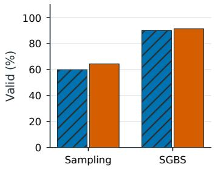

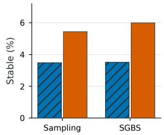

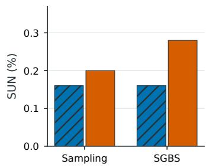  
Figure 4: Count prior and constrained search. The panels show validity, stability, and S.U.N. for sampling and SGBS. CrystalAR uses the empirical count prior; the learned-STOP reference uses a learned stopping policy. All values are computed over 2,500 attempts, and the exact percentages and counts appear in Table 6.

0.05586 RMSE at 4,000 updates. Full-model joint optimization of de novo and CSP objectives yields 56.89% and 57.13% MR at the two budgets, compared with 57.95% for the unadapted model. Under these optimization settings, CSP-only feasible-set adaptation provides the strongest structure recovery while keeping the shared model parameters fixed. The joint and adapter configurations use their respective loss weighting and learning-rate settings; these results characterize the complete adaptation strategies.

Coordinate-search controls. We vary coordinate decoding while fixing the model parameters and template ranking, including the auxiliary orbit-count score (Table 10). Reducing the coordinate beam width from 16 to 4 or 1 changes MR from 62.92% to 62.79% or 62.61%, respectively (Figure 7A). All beam widths retain simulation rollouts and the same expansion and search budgets. Removing the distance mask changes MR by +0.03 percentage points, with a paired 95% interval of [−0.03, 0.10], and decreases structural validity from 99.44% to 98.91%. These results indicate modest sensitivity to coordinate beam width and a contribution of distance constraints to geometric validity.

Number of generated hypotheses. Increasing the candidate budget from 1 to 4, 8, and 20 hypotheses raises MR from 62.92% to 70.35%, 72.52%, and 74.55%, respectively (Figure 7B). The 20-hypothesis setting recovers 6,744 structures, adding 1,052 recoveries over single-hypothesis generation. Multi-hypothesis MR measures the fraction of inputs with at least one accepted match among these candidates. The curve shows diminishing returns as the candidate budget increases, with eight hypotheses reaching 72.52% MR.

## A.10 FURTHER CLARIFICATIONS ON TEMPLATE-FREE CRYSTAL STRUCTURE PREDICTION

We clarify the distinction between conventional composition-conditioned CSP and template-free CSP under symmetry-native generation. Generic generative models, such as DiffCSP and FlowMM, predict crystal structures conditioned only on chemical composition, whereas symmetry-native models explicitly incorporate crystallographic symmetry into their generative formulations and are typically evaluated with a specified space group G. Since specifying G provides additional crystallographic information, the two settings are not strictly equivalent in terms of conditioning. However, the purpose of this comparison is not to establish information-equivalent performance between generic and symmetry-native models, but rather to investigate how much crystallographic prior information can be relaxed for symmetry-native CSP.

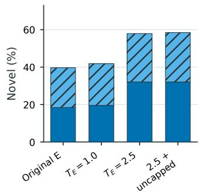

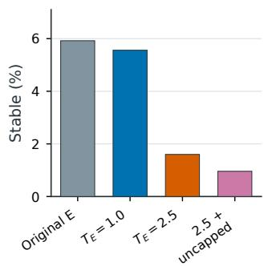

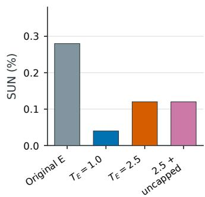  
Figure 5: Novelty–stability trade-off under fixed symmetry support. The panels show novelty, stability, and S.U.N. for the four chemistry interventions in Table 8. The element sampling temperature changes chemical exploration while the generated symmetry skeleton is held fixed.

Table 9: CSP adaptation with fixed single-hypothesis decoding on MP-20. All configurations use autoregressive template scores and the same coordinate-search settings. Updates denote the adaptation budget, and rank denotes adapter capacity. RMSE is averaged over matched structures.
<table><tr><td>Adaptation Rank Reference</td></tr><tr><td>Updates MR (%) RMSE 0 57.95 0.05699</td></tr><tr><td>Unadapted model Standard template CE</td></tr><tr><td>CE adapter 8 2,000 58.38 0.05863</td></tr><tr><td>CE adapter 16 2,000 58.35 0.05797</td></tr><tr><td>CE adapter 32 2,000 58.42 0.05733 CE adapter 64 2,000 58.68 0.05830</td></tr><tr><td>CE adapter 32 4,000 58.57 0.05750</td></tr><tr><td>Feasible-set supervision</td></tr><tr><td>Feasible-set adapter 8 2,000 59.74 0.05751 Feasible-set adapter 16 2,000 60.19 0.05767</td></tr><tr><td>Feasible-set adapter 64 2,000 61.11 0.05851</td></tr><tr><td>Feasible-set adapter 32 4,000 61.35 0.05586</td></tr><tr><td></td></tr><tr><td>Joint optimization of de novo and CSP objectives</td></tr><tr><td>Full-model joint 2,000 56.89 0.05938 Full-model joint 4,000 57.13 0.06013</td></tr></table>

In particular, previous symmetry-native approaches, such as DiffCSP++ and SGEquiDiff, rely on template retrieval to provide both the space group G and the Wyckoff template W. The latter specifies the symmetry-inequivalent atomic sites, their Wyckoff multiplicities, and associated positional constraints, thereby substantially restricting the space of possible crystal structures. In contrast, specifying only G defines the underlying symmetry constraints without determining how atomic species are distributed across Wyckoff positions. Consequently, inferring W from chemical composition and G remains a nontrivial combinatorial problem involving stoichiometric compatibility, site multiplicities, and crystallographic constraints.

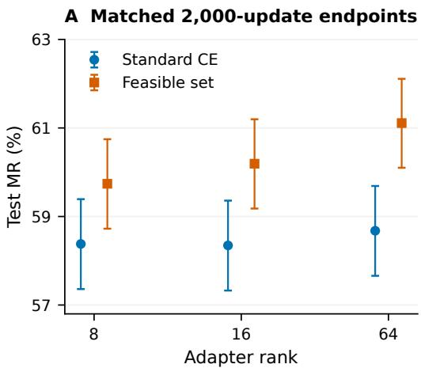

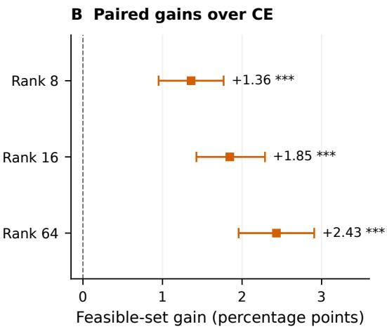  
Figure 6: Feasible-set supervision improves CSP across adapter capacities. Both panels use 2,000 adaptation updates and 9,046 structures. (A) MR for standard CE and feasible-set supervision, with Wilson 95% confidence intervals. (B) Paired MR gains, with bootstrap 95% confidence intervals; <sup>∗∗∗</sup> indicates $p < 0 . 0 0 1$ under exact McNemar tests with Holm correction.

Table 10: Coordinate-search ablations for MP-20 CSP. Model parameters, template ranking, and the remaining decoding settings are fixed. Structural validity measures geometric validity and composition consistency. MR additionally applies the composition-validity criteria used in the CSP evaluation.
<table><tr><td>Coordinate decoding</td><td>MR (%)</td><td>RMSE</td><td>Structural valid (%)</td></tr><tr><td>Beam 16 (default)</td><td>62.92</td><td>0.05847</td><td>99.44</td></tr><tr><td>Beam 4</td><td>62.79</td><td>0.05864</td><td>99.56</td></tr><tr><td>Beam 1</td><td>62.61</td><td>0.05850</td><td>99.60</td></tr><tr><td>Beam 16, distance mask removed</td><td>62.96</td><td>0.05860</td><td>98.91</td></tr></table>

Importantly, relaxing the requirement for a predefined Wyckoff template is not merely a reduction in prior information, but also has practical implications for crystal discovery. For previously unexplored compositions, suitable Wyckoff templates may be unavailable in existing crystal databases, limiting the applicability of retrieval-based approaches. Moreover, even for a given composition and space group, multiple symmetry-compatible Wyckoff configurations may exist, potentially corresponding to distinct crystal structures or polymorphs. Restricting CSP to retrieved templates may therefore bias structural exploration toward previously observed crystallographic configurations and overlook alternative arrangements. By explicitly modeling the generation of W, CrystalAR removes this dependency and enables the exploration of diverse symmetry-compatible templates jointly with their corresponding crystal geometries. This represents a meaningful step toward more flexible symmetry-native CSP, extending its potential applicability to previously unexplored material systems and polymorph discovery while preserving crystallographic symmetry throughout generation.

## A.11 LIMITATIONS

Despite its strong performance, CrystalAR has two main limitations. First, we observe a noticeable stability degradation when generating crystals with highly novel Wyckoff templates. This reflects a broader challenge shared by symmetry-native generative models that explicitly explore novel crystallographic templates: moving beyond templates well represented in the training distribution substantially enlarges the structural search space, making it more difficult to identify energetically favorable realizations. Improving the discovery of stable structures under novel symmetry templates therefore remains an important direction for future work. Second, the autoregressive formulation of CrystalAR naturally supports beam search, providing a flexible mechanism for exploring multiple high-probability structural hypotheses that is less straightforward for diffusion-based generation. However, this advantage introduces a quality–efficiency trade-off: increasing the beam size generally improves search quality while proportionally increasing inference cost. Future work could reduce this dependence on exhaustive search through post-training techniques, such as reinforcement learning or preference-based optimization, to better concentrate probability mass on high-quality candidates and achieve more efficient decoding with smaller search budgets.

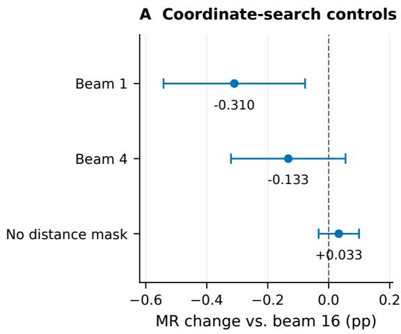

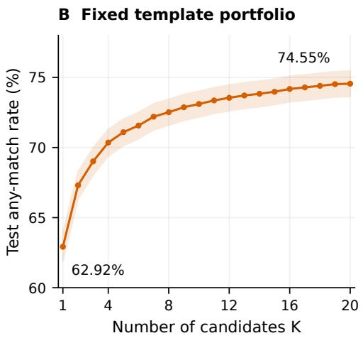  
Figure 7: Effect of coordinate search and hypothesis count on CSP. (A) MR changes relative to coordinate beam 16 with the distance mask, with paired bootstrap 95% confidence intervals. (B) MR as the number of generated hypotheses increases, with a Wilson 95% confidence band over 9,046 structures.

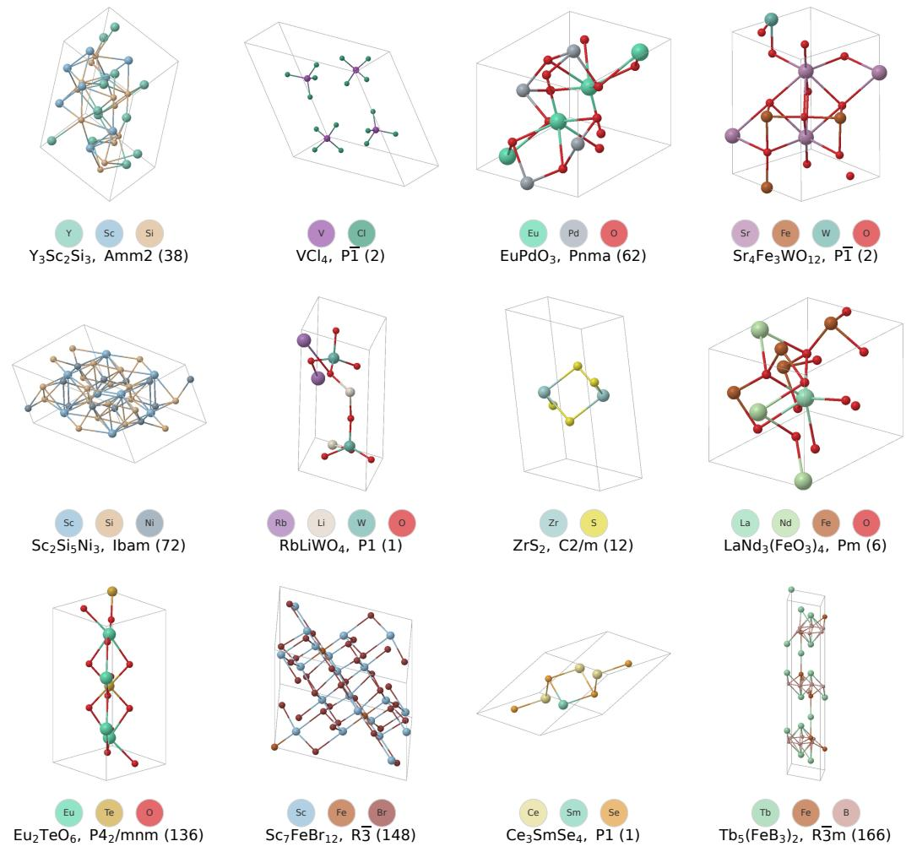  
Figure 8: Visualization. More S.U.N structures generated by CrystalAR.