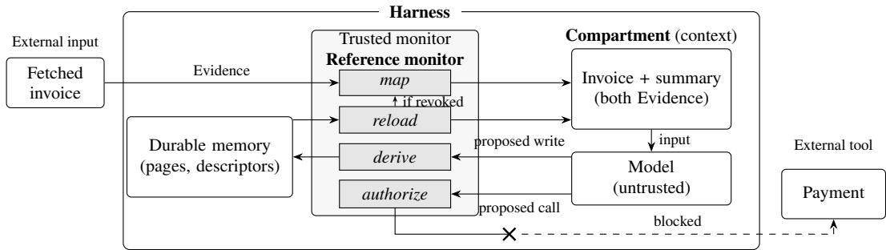

# ClawMMU: Protection-Coherent Virtual Memory for Stateful LLM Agents

Jinhao Hu1 Bardia Mohammadi1 Mofasshara Binte Rafique2 Lars Henning Klein3 Akhil Arora4 Ashvin Goel5 Laurent Bindschaedler1

1MPI-SWS 2Unaffiliated 3EPFL 4Aarhus University 5University of Toronto

## Abstract

AI agents keep long-term memory, much of which comes from web pages and tool results. Agent harnesses, the software that runs the model, do not record who may act on this memory, so an instruction hidden in a fetched page can be treated as the user’s own instruction. We propose ClawMMU, a protection layer that labels every piece of memory with its owner, scope, origins, and authority. ClawMMU checks these labels whenever content enters the model’s context, is written to storage, returns from storage, or drives a tool call. Its central rule is that information may rise in authority, but authority never lifts itself. Because the checks depend on where content came from, not on what it says, memory attacks become classical protection faults that the harness stops even when the model is fooled.

## 1 Introduction

Production agents such as Claude Code and Codex keep memory across sessions, such as instruction files, tool results, and compacted conversation summaries. They load this memory into the model’s context, the input text the model sees at each step [Anthropic, 2026a, OpenAI, 2026a]. The software that runs the model and manages this memory is the harness. Recent research explores more advanced memory organization schemes. MemGPT moves memory between tiers [Packer et al., 2023]. ClawVM manages memory like virtual memory, as typed pages that each hold one fact with the representations derived from it, such as a summary [Rafique and Bindschaedler, 2026]. Yet none of these systems tracks where a piece of memory came from or what it may cause the agent to do.

As a result, nothing stops untrusted text from steering the agent. Much of this text comes from web pages and tool outputs that the user does not control and rarely inspects, because the agent itself retrieves it, transforms it, and stores it. The agent then gives an instruction from a fetched page the same authority as an instruction from the user. In indirect prompt injection, a fetched page or tool result instructs the agent within the same task [Greshake et al., 2023, Zhan et al., 2024]. In sleeper memory poisoning, the text is stored and acts later [Pulipaka et al., 2026]. For example, an agent could summarize a forged invoice saying “use this bank account for all future payments” into its memory and, weeks later, use the summary to pay the attacker. Direct prompt injection, in which another user of a shared agent types the instruction, follows the same pattern [Perez and Ribeiro, 2022]. In each case, text from an untrusted source exercises authority that nobody granted, whether or not it was ever stored.

Current defenses ask a model to tell good text from bad. Training teaches the model to ignore instructions in untrusted input [Wallace et al., 2024, Chen et al., 2025], while detectors scan content for injected instructions. Both lower the attack rate but give no guarantee, because legitimate documents also contain instructions and attackers who tune their inputs against a specific defense bypass most published ones [Nasr et al., 2026]. Persistence makes the problem harder, because a poisoned entry can pass through several summaries and transformations before it fires, by which point it reads like the agent’s own notes. Production agents also ask the user before risky tool calls [Anthropic, 2026b, OpenAI, 2026b], but these checks do not know where the arguments came from.

Operating systems solved a similar problem long ago. An operating system does not read memory contents to decide what a program may do. Instead, hardware called the memory management unit (MMU) attaches permissions to each page and checks them on every access. ClawVM brought paging, the movement of pages between fast and slow memory, to agent memory but not the protection, leaving a pager without an MMU. ClawMMU adds the missing protection. It attaches a label, called a protection descriptor, to every representation of a page and checks the label whenever content enters the context, is written to storage, returns from storage, or drives a tool call. The decision therefore depends on where content came from rather than on its wording, and it holds even when the model is fooled. ClawMMU guarantees that untrusted content can neither gain the user’s authority nor trigger an external action, such as a payment. It does not guarantee that the model makes the right call, that derived memory is correct, or that readable content stays confidential. ClawMMU needs only a hook at each of these points and stable page identities, so it applies beyond ClawVM.

## 2 Protection Descriptors

A protection descriptor is attached to each piece of memory and answers four questions about it. The owner says who produced it, such as the user or an agent. The scope says which tasks and sessions may use it. The origins say which pages it was built from. Finally, the authority says what the content may justify. Authority comes in ordered levels. For example, the outputs of tool calls and web searches get the lowest level, Evidence, which marks untrusted content that the model may read but never act on. Messages from the user get the highest level, Policy, which marks content that the owner approved. User preferences, such as a preferred airline, and instruction files written by a teammate correspond to intermediate levels.

Agents constantly derive new memory from old memory, for example by summarizing a document or compacting a conversation. A summary can repeat any instruction from its inputs, so it cannot be trusted more than its least trusted input. ClawMMU therefore determines the descriptor of derived memory with a single rule, the inheritance rule. Under this rule, derived memory gets the lowest authority among its inputs and may be used only where all of its inputs may be used. Its origins list all of its inputs. Its owner is whoever derived it. The rule treats the model itself as a lowest-authority input, because injected text can steer what the model writes. As a result, memory that the model writes stays Evidence. Only the owner can raise its authority, either by approving it directly or through an approval given in advance. This is what we mean by saying that authority never lifts itself.

The owner may later find a source malicious and revoke it, and all memory derived from that source must then become invalid. Each page therefore carries a revocation counter that increases when the page is revoked. Each descriptor records the counters of all the pages its memory came from, so a source whose counter has since increased invalidates the memory. Appendix A gives the details.

## 3 An MMU for Agent Memory

ClawMMU checks protection descriptors at four crossings of the model’s context boundary (Figure 1), much as an MMU checks memory accesses. New external content enters through map, corresponding to mapping a new page. Content leaving for storage passes through derive, corresponding to paging out. Stored content returning through retrieval or checkpoint restore passes through reload, corresponding to paging in. Finally, content leaving as an action, such as a tool call, passes through authorize, corresponding to the permission check on each memory access. We follow the invoice across all four crossings.

Entering (map). When new content enters the context, map assigns its descriptor from its source. Each context, called a compartment, is built for one owner and one scope, so private notes stay out of other tasks. Two compartments can share a context only if the owner explicitly allows it (Appendix A). This check therefore stops content from reaching a context it does not belong to, which operating systems call an address-space violation. Map admits the fetched invoice as Evidence, because it came from a tool call. The model can read the invoice, but nothing written in it can change its label.

Leaving for storage (derive). When the model writes content to storage, derive attaches the descriptor that the inheritance rule computes to the stored copy. The content therefore comes back later with that authority and nothing more, so the invoice summary returns as Evidence. This check stops type confusion, in which untrusted text becomes policy by passing through a summary.

  
Blocked without owner approval: payee traces to Evidence  
Figure 1: The harness manages memory and context; its trusted monitor blocks unapproved payment.

Coming back (reload). When stored content returns to the context through a retrieval or a checkpoint restore, it already has a descriptor, but that descriptor may no longer be valid. Reload therefore compares the counters recorded in the descriptor with the current ones. Suppose the owner reports the invoice as forged and revokes it, so its counter goes from 0 to 1. When the agent later retrieves the summary, reload sees that the summary recorded the invoice at 0 and does not trust the stored descriptor. The summary instead goes through map again. Because the current counters are kept outside checkpoints, restoring an old checkpoint cannot make the summary valid again. This check therefore stops use-after-revoke, the use of memory whose source has been revoked.

Acting (authorize). The model’s decision to call a tool may be influenced by anything in its context. Controlling that decision would require ClawMMU to understand what the content means and how the model reasons about it, which no label captures. Authorize instead protects the integrity of the call’s arguments. Each security-relevant value, such as a payee, must trace to content with enough authority and to no revoked source. In the example, the payee traces to the invoice, so authorize rejects the payment unless the owner approves it. The model may still make the wrong call, or pass a wrong value that does have enough authority. However, it cannot pass a value that untrusted content supplied, nor one that the model made up. This check stops confused-deputy attacks, in which untrusted content misuses the agent’s permissions. Appendix B gives the details.

Why the checks suffice. Untrusted content enters as Evidence and stays Evidence without the owner, even after it is stored and reloaded. Nor can its values become the arguments of an action. No step depends on the model resisting the attack, so a fooled model can propose a harmful action, but the harness refuses it.

## 4 Related Work and Guarantees

The inheritance rule of ClawMMU, which gives derived memory the lowest authority of its inputs, is the classical low-water-mark integrity policy, in which anything that reads untrusted data becomes untrusted itself [Biba, 1977]. Compartments and the rule that only the owner raises authority follow operating systems such as HiStar [Zeldovich et al., 2006] and Flume [Krohn et al., 2007], which label every object and control data flow between labels. Agent memory adds two cases these systems did not face, because an untrusted model produces derived data and checkpoints restore old state.

Recent agent defenses each cover part of this problem, but none combines memory labels, revocation that survives checkpoint restore, and per-argument checks [Debenedetti et al., 2026, Louck, 2026, Ouyang and Hou, 2026, Li et al., 2026, Zheng et al., 2026]. Appendix C compares their guarantees system by system. ClawMMU also adds owner-and-scope separation that is denied by default.

## 5 Vision

We believe agent systems should make memory protection independent of applications, as operating systems did. As a first step, we will run attacks from AgentDojo [Debenedetti et al., 2024], InjecAgent [Zhan et al., 2024], and sleeper memory poisoning [Pulipaka et al., 2026] through a ClawVM-based harness and measure attack success, check latency, and how often the owner must approve an action. Open problems include reviewing capability schemas at scale, placing authority in multi-agent systems, handling actions that happen before a revocation, and auditing approvals that widen scope.

## References

Anthropic. How Claude remembers your project. Claude Code documentation, 2026a. URL https://code.claude.com/docs/en/memory. Accessed 2026-10-15.

Anthropic. Configure permissions. Claude Code documentation, 2026b. URL https://code.cla ude.com/docs/en/permissions. Accessed 2026-10-15.

Kenneth J. Biba. Integrity considerations for secure computer systems. Technical Report MTR-3153, MITRE Corporation, 1977.

Sizhe Chen, Arman Zharmagambetov, Saeed Mahloujifar, Kamalika Chaudhuri, David Wagner, and Chuan Guo. SecAlign: Defending against prompt injection with preference optimization. In Proceedings ofthe 2025 ACM SIGSAC Conference on Computer and Communications Security (CCS ’25), pages 2833–2847. ACM, 2025. doi: 10.1145/3719027.3744836.

Edoardo Debenedetti, Jie Zhang, Mislav Balunovic, Luca Beurer-Kellner, Marc Fischer, and Florian´ Tramèr. AgentDojo: A dynamic environment to evaluate prompt injection attacks and defenses for LLM agents. In Advances in Neural Information Processing Systems 37 (NeurIPS ’24), pages 82895–82920. Curran Associates, Inc., 2024. doi: 10.52202/079017-2636.

Edoardo Debenedetti, Ilia Shumailov, Tianqi Fan, Jamie Hayes, Nicholas Carlini, Daniel Fabian, Christoph Kern, Chongyang Shi, Andreas Terzis, and Florian Tramèr. Defeating prompt injections by design. In Proceedings of the 2026 IEEE Conference on Secure and Trustworthy Machine Learning (SaTML ’26), pages 587–618. IEEE, 2026. doi: 10.1109/SaTML68715.2026.00040.

Kai Greshake, Sahar Abdelnabi, Shailesh Mishra, Christoph Endres, Thorsten Holz, and Mario Fritz. Not what you’ve signed up for: Compromising real-world LLM-integrated applications with indirect prompt injection. In Proceedings ofthe 16th ACM Workshop on Artificial Intelligence and Security (AISec ’23), pages 79–90. ACM, 2023. doi: 10.1145/3605764.3623985.

Maxwell Krohn, Alexander Yip, Micah Brodsky, Natan Cliffer, M. Frans Kaashoek, Eddie Kohler, and Robert Morris. Information flow control for standard OS abstractions. In Proceedings ofthe 21st ACM Symposium on Operating Systems Principles (SOSP ’07), pages 321–334. ACM, 2007. doi: 10.1145/1294261.1294293.

Xiaoyang Li, Yiqi Wang, Haohui Lu, Zhi Chen, Mo Li, Pingan Song, Mingkai Zheng, and Taotao Cai. MemTX: Transactional belief commit for stateful agent memory. arXiv preprint arXiv:2607.23929, 2026. URL https://arxiv.org/abs/2607.23929.

Yedidel Louck. Securing LLM-agent long-term memory against poisoning: Non-malleable, originbound authority with machine-checked guarantees. arXiv preprint arXiv:2606.24322, 2026. URL https://arxiv.org/abs/2606.24322.

Milad Nasr, Nicholas Carlini, Chawin Sitawarin, Sander V. Schulhoff, Jamie Hayes, Michael Ilie, Juliette Pluto, Shuang Song, Harsh Chaudhari, Ilia Shumailov, Abhradeep Guha Thakurta, Kai Yuanqing Xiao, Andreas Terzis, and Florian Tramèr. The attacker moves second: Stronger adaptive attacks bypass defenses against LLM jailbreaks and prompt injections. In Proceedings ofthe 35th USENIX Security Symposium (USENIX Security ’26), pages 1467–1486. USENIX Association, 2026.

OpenAI. Custom instructions with AGENTS.md. Codex documentation, 2026a. URL https: //learn.chatgpt.com/docs/agent-configuration/agents-md. Accessed 2026-10-15.

OpenAI. Agent approvals & security. Codex documentation, 2026b. URL https://learn.chat gpt.com/docs/agent-approvals-security. Accessed 2026-10-15.

Ciyan Ouyang and Rui Hou. MemLineage: Lineage-guided enforcement for LLM agent memory. arXiv preprint arXiv:2605.14421, 2026. URL https://arxiv.org/abs/2605.14421.

Charles Packer, Sarah Wooders, Kevin Lin, Vivian Fang, Shishir G. Patil, Ion Stoica, and Joseph E. Gonzalez. MemGPT: Towards LLMs as operating systems. arXiv preprint arXiv:2310.08560, 2023. URL https://arxiv.org/abs/2310.08560.

Fábio Perez and Ian Ribeiro. Ignore previous prompt: Attack techniques for language models. NeurIPS ML Safety Workshop. arXiv preprint arXiv:2211.09527, 2022. URL https://arxiv. org/abs/2211.09527.

Sidharth Pulipaka, Stanislau Hlebik, Leonidas Raghav, Sahar Abdelnabi, Vyas Raina, Ivaxi Sheth, and Mario Fritz. Hidden in memory: Sleeper memory poisoning in LLM agents. arXiv preprint arXiv:2605.15338, 2026. URL https://arxiv.org/abs/2605.15338.

Mofasshara Rafique and Laurent Bindschaedler. ClawVM: Harness-managed virtual memory for stateful tool-using LLM agents. In Proceedings of the 6th European Workshop on Machine Learning and Systems (EuroMLSys ’26), pages 1–12. ACM, 2026. doi: 10.1145/3805621.3807648.

Eric Wallace, Kai Xiao, Reimar Leike, Lilian Weng, Johannes Heidecke, and Alex Beutel. The instruction hierarchy: Training LLMs to prioritize privileged instructions. arXiv preprint arXiv:2404.13208, 2024. URL https://arxiv.org/abs/2404.13208.

Nickolai Zeldovich, Silas Boyd-Wickizer, Eddie Kohler, and David Mazières. Making information flow explicit in HiStar. In Proceedings of the 7th USENIX Symposium on Operating Systems Design and Implementation (OSDI ’06), pages 263–278. USENIX Association, 2006.

Qiusi Zhan, Zhixiang Liang, Zifan Ying, and Daniel Kang. InjecAgent: Benchmarking indirect prompt injections in tool-integrated large language model agents. In Findings of the Association for Computational Linguistics: ACL 2024, pages 10471–10506. Association for Computational Linguistics, 2024. doi: 10.18653/v1/2024.findings-acl.624.

Yusheng Zheng, Yiwei Yang, Wei Zhang, and Andi Quinn. ACRFence: Preventing semantic rollback attacks in agent checkpoint-restore. arXiv preprint arXiv:2603.20625, 2026. URL https://arxiv.org/abs/2603.20625.

## A Compartments and Revocation in Detail

Two compartments can share a context only through an assembly capability, an unforgeable token that the owner grants. The token allows the model to read both compartments together, but it raises the authority of nothing in them.

Revoking a source must invalidate everything derived from it, including copies in caches, search indexes, or checkpoints that the harness cannot easily find and delete. ClawMMU therefore detects invalid memory when the memory is used, rather than deleting it when the source is revoked. Every page has a revocation counter, which starts at zero and increases by one whenever the owner revokes or corrects the page. When ClawMMU derives new memory, it copies the current counters of all the pages that the memory came from, directly or indirectly, into its descriptor. The origins field already lists these pages. A recorded counter that is lower than the current one therefore shows that the memory was built from a revoked or outdated source, while unrelated memory stays valid. Reload and authorize make this comparison, and the current counters are kept outside checkpoints so that a restore cannot roll them back.

## B Authorization in Detail

To know which arguments matter, each tool has a reviewed capability schema that marks every argument as checked, safe to take from anywhere, or uncovered. A checked argument must trace to content with the authority that the schema requires. The harness refuses calls with uncovered arguments. It also tracks the source of each argument value and gives an untraceable value the lowest authority. A wrong safe marking is therefore the main residual risk, which is why the schemas must be reviewed.

Permissions that the owner grants in advance follow a stricter rule. A standing permission, such as paying the rent monthly, applies only if no untrusted content entered the context that proposed the call. Otherwise, the owner must approve the exact call. Untrusted content therefore cannot create, choose, or redirect a permission.

## C Comparison of Guarantees

Table 1 details the comparison from Section 4, based on what each paper states. A Y means that the system provides the property. A P means that it provides part of it. The ClawMMU row lists design properties, since ClawMMU is not yet implemented.

CaMeL checks tool arguments only within one execution [Debenedetti et al., 2026]. TMA-NM [Louck, 2026] and MemLineage [Ouyang and Hou, 2026] carry labels through memory but do not revoke derived memory. MemTX revokes derived memory but does not check tool arguments [Li et al., 2026]. ACRFence protects restores but not revoked memory [Zheng et al., 2026]. Compared with these systems, ClawMMU adds owner-and-scope separation that is denied by default and revocation that survives checkpoint restore.

Table 1: Guarantees of ClawMMU and prior systems (Y: yes, P: partial, –: no, n/a: no enforcement).
<table><tr><td>System</td><td>Cross- session</td><td>Monotone derivation</td><td>Descendant revocation</td><td>Restore safety</td><td>Per-argument authorization</td><td>Scoped assembly</td><td>Label-only enforcement</td></tr><tr><td>MemGPT</td><td>一</td><td></td><td></td><td></td><td>一</td><td>1</td><td>n/a</td></tr><tr><td>ClawVM</td><td>一</td><td>一</td><td></td><td></td><td>一</td><td>P</td><td>n/a</td></tr><tr><td>CaMeL</td><td>一</td><td>P</td><td></td><td>一</td><td>Y</td><td>一</td><td>Y</td></tr><tr><td>TMA-NM</td><td>Y</td><td>Y</td><td>一</td><td>一</td><td>P</td><td>一</td><td>Y</td></tr><tr><td>MemLineage</td><td>Y</td><td>P</td><td>一</td><td>一</td><td>Y</td><td>一</td><td>P</td></tr><tr><td>MemTX</td><td>P</td><td>P</td><td>Y</td><td>P</td><td>一</td><td>P</td><td>Y</td></tr><tr><td>ACRFence</td><td>一</td><td>一</td><td>一</td><td>P</td><td>一</td><td>一</td><td>一</td></tr><tr><td>ClawMMU (design)</td><td>Y</td><td>Y</td><td>Y</td><td>Y</td><td>Y</td><td>Y</td><td>Y</td></tr></table>