# DANCING DIFFUSION: LEARNING CONTINUOUS PROGRAMS FOR IMAGE GENERATION AND EDITING

Cui Enhe1,2 Jinyue Yang2 Bojian Yin2 Guoqi Li2

1Renmin University of China

2Institute of Automation, Chinese Academy of Sciences

## ABSTRACT

Diffusion models generate samples through a multi-step denoising trajectory, yet condition every step on the same instruction, so the trajectory cannot be addressed at the level of individual operations. We introduce Dancing Diffusion, which assigns each span of timesteps a dedicated continuous condition block and thereby turns conditioning into a latent program. A compiler maps text features into this program, and a fixed pretrained generator executes its blocks over successive sampling intervals. The trajectory can then dance, keeping its executed history while its continuation is redirected. A shared prefix is executed once and reused, and a later operation is rewritten while content fixed by earlier operations is preserved. The compiler is trained through the images it produces, with visual feedback on both the requested change and the retained content. On SANA, reusing an executed prefix preserves markedly more of the scene than regenerating from noise at a similar strength of edit, learned conditions preserve more background than native prompt switching from the same saved state, and the learned program improves generation quality over native SANA. Later branches weaken the edit, which leaves semantic control over individual operations limited. By converting a single-instruction trajectory into a program of addressable operations, Dancing Diffusion lays a foundation for structured intermediate computation in diffusion models.

## 1 INTRODUCTION

Diffusion models generate samples through a multi-step denoising trajectory, yet condition every step on the same instruction. Consequently, the trajectory is not addressable at the level of individual operations. In practice, variants that share early operations must recompute them, an edit to one attribute propagates to content the request never mentioned, and intermediate operations can be neither inspected nor corrected.

We introduce Dancing Diffusion, which assigns each span of timesteps a dedicated continuous condition block, turning conditioning into a latent program. A compiler maps text features into this program, and a fixed pretrained generator executes its blocks over successive sampling intervals (Figure 1b). The trajectory thereby becomes addressable at the level of individual operations, and it can dance, keeping its executed history while its continuation is redirected. A shared prefix can be executed once and reused, a later operation can be rewritten while content fixed by earlier operations is preserved, and each block can be intervened on in isolation to test what it controls (Figure 1a).

We formalize when resuming a saved state reproduces the executed history exactly and when a change to future conditions leaves declared background content bounded. The compiler is trained through the images it produces. A visual observer assesses both the requested change and the retention of unrelated content, gradients update only the compiler, and the observer is absent at inference. Temporal conditioning and learned connectors have substantial precedents, including stage-specific prompt representations and timestep-aware language interfaces (Zhang et al., 2023b; Hu et al., 2024; Huberman et al., 2026). Our contribution is the combined compiler–executor formulation and its study under paired edit feedback and controlled suffix interventions.

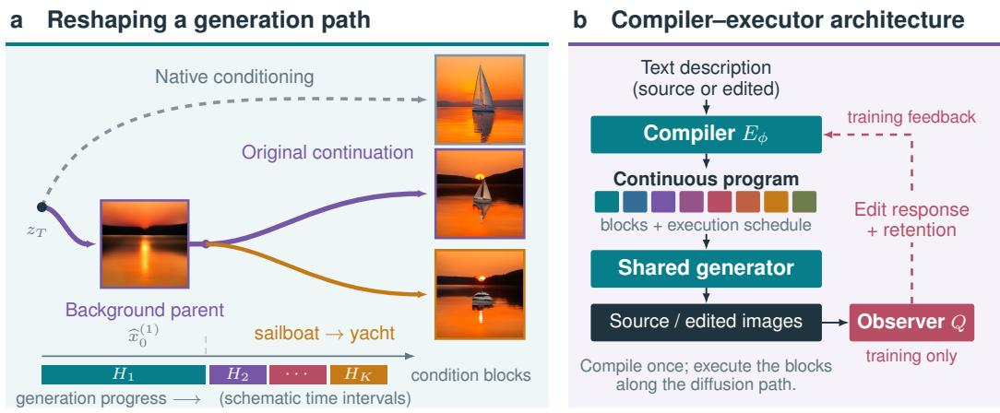  
Figure 1: Dancing: editing the generation path. (a) A background-only first block produces a common parent, shown as a predicted-clean readout. Both continuations reuse the same saved noisy state and introduce a sailboat or yacht through future conditions. A native same-noise generation is shown for orientation. Curves and intervals are schematic; the images illustrate the operation and are not a final-checkpoint comparison or evidence of native-method superiority. (b) A compiler produces conditions for a shared generator, with training-only feedback from a visual observer.

Our experiments test each of these properties directly. In a controlled setting, learned conditioning changes when content appears, halving the early subject error of a single-expert baseline while deferring background detail. On SANA, resuming a saved state reproduces the source exactly, and rewriting later operations leaves the executed history intact. At an early branch, background LPIPS falls by up to 36% relative to full regeneration, from 0.321 to 0.227 at 6/12/12, while the semantic change is nearly unchanged (0.088 versus 0.092). The reduction holds in every schedule under paired family-bootstrap intervals and is confirmed on all 2376 outputs by independent detector regions that the training observer never sees. From the same saved state, learned conditions preserve more background than native prompt switching in all three schedules, with comparable replacement counts in two of them. These edits do not cost image quality. The learned program lowers FID below native SANA, from 7.349 to 7.145 at 6/12/12, and a shared prefix is computed once for all its continuations. Semantic control over individual operations, however, remains limited, since later branches weaken the edit and interventions on blocks confirm routing rather than a learned semantic factorization. By converting a single-instruction trajectory into a program of addressable operations, Dancing Diffusion lays a foundation for structured intermediate computation in diffusion models.

## 2 RELATED WORK

Temporal conditioning and generation trajectories. Expert denoisers allocate capacity across noise regimes (Balaji et al., 2022), while stage-specific embeddings, successive proxy prompts, and timestep-aware connectors organize the information supplied to a generator (Zhang et al., 2023b; Huberman et al., 2026; Hu et al., 2024). ProSpect optimizes stage-specific embeddings for reference-image attributes; SAP provides training-free stage-aware prompting; ELLA learns a language connector to a fixed diffusion model. These works show that the timing of conditioning and a learned connector can each shape generation. Prompt-conditioned interventions also study when concepts influence generation (Görgün et al., 2026). We instead learn a caption-dependent continuous program from paired editing feedback and use its saved intermediate states as points at which generation can be redirected, comparing learned and native responses at identical states.

Learned control interfaces and visual feedback. Prefix and prompt tuning adapt continuous inputs to language models; concept embeddings and semantic connectors extend this approach to image models (Li & Liang, 2021; Lester et al., 2021; Gal et al., 2023; Hu et al., 2024). Spatial branches and gated grounding layers provide additional visual control (Zhang et al., 2023a; Li et al., 2023). Policy-gradient and differentiable-reward methods instead learn from generated outputs (Black et al., 2024; Fan et al., 2023; Clark et al., 2024; Prabhudesai et al., 2024). We combine interface adaptation with feedback through a fixed generator, using edit-response and retention objectives. The observer supplies training gradients and is absent at inference, unlike sampling-time semantic guidance (Chefer et al., 2023). Fixed generator weights define the adaptation setting; they do not prove that the complete behavior existed before interface training.

Image editing and semantic interventions. Perturbation and inversion methods start from an input image, attention control constrains modified-caption generation, and instruction-conditioned models learn paired transformations (Meng et al., 2022; Mokady et al., 2023; Hertz et al., 2023; Brooks et al., 2023). FlowEdit constructs an inversion-free mapping between source- and targetconditioned distributions (Kulikov et al., 2025). Our interface resumes generated trajectories and replaces future conditions; it does not accept arbitrary photographs through an inversion module. We distinguish same-state suffix controls from image-input FlowEdit/SDEdit adaptations, including their source access and compute. The SANA adaptations do not reproduce published SD3/FLUX results. Interchange interventions motivate testing whether low-level replacements realize high-level changes (Geiger et al., 2022); exact prefix reuse alone verifies execution, not semantics.

Evaluating semantic change and preservation. Generation benchmarks separate object presence, attribute binding, and spatial relations (Ghosh et al., 2023; Huang et al., 2023). Editing benchmarks additionally distinguish instruction adherence, content retention, and perceptual quality through multimodal or regional assessments (Ku et al., 2024; Yang et al., 2025; Ye et al., 2025; Jiang et al., 2026; Qian et al., 2025). Tool-assisted evaluations also document omissions and hallucinated changes (Wang et al., 2025; Yosef et al., 2025). We report semantics and preservation separately, retain missing-output and order-disagreement rates for the adapted VLM, and treat CLIP and grounding as proxies, particularly where they overlap the training observer (Radford et al., 2021; Liu et al., 2024). CleanFID controls distribution-quality preprocessing (Parmar et al., 2022); it cannot establish editing correctness.

## 3 METHOD

We edit a generation path by changing its future conditions while retaining its executed history. This is the path’s “dancing”: temporal conditioning becomes a program learned through execution and modified before resumption. The formulation keeps three objects apart, namely a request, the conditions compiled from it, and the sampler state reached under those conditions.

## 3.1 COMPILING A CONTINUOUS PROGRAM

For a request c, let $H ( c ) \in \mathbb { R } ^ { L \times d }$ and $A ( c )$ denote the text features and attention mask accepted by the generator. A compiler maps them to K condition blocks and validity masks:

$$
\begin{array} { r } { ( Z , M ) = E _ { \phi } ( H ( c ) , A ( c ) ) , \qquad Z \in \mathbb { R } ^ { K \times L \times d } , \quad M \in \{ 0 , 1 \} ^ { K \times L } . } \end{array}\tag{1}
$$

Each block retains the native token axis and enters the generator through its conditioning interface. The program is $P ( c ) = ( Z , M , \tau )$ , where $0 = \tau _ { 0 } < \cdot \cdot \cdot < \tau _ { K } = 1$ specifies successive execution intervals. The representation permits arbitrary block counts and interval lengths; the concrete architecture and schedule belong to the experimental instantiation. Role-based supervision can initialize the blocks, but contextualized token features need not contain exclusively the concepts assigned to their masks. We therefore test block responses rather than assume semantic independence.

## 3.2 EXECUTING AND OBSERVING A PATH

A shared generator applies N sampling updates from initial noise $x _ { 0 } = \xi \colon$

$$
x _ { n + 1 } = f _ { \theta , n } ( x _ { n } ; Z _ { k ( n ) } , M _ { k ( n ) } ) , \quad k ( n ) = k { \mathrm { ~ w h e n ~ } } n / N \in [ \tau _ { k - 1 } , \tau _ { k } ) .\tag{2}
$$

The final update belongs to the last interval. The compiler runs once per request; execution determines which block is used at each step. We write $F _ { a : N } ( x _ { a } ; P )$ for the remaining sampler updates and D for image decoding. A saved state $x _ { a }$ contains sampling noise. To visualize a velocity-model trajectory we instead decode its predicted-clean latent, $\widehat { x } _ { 0 , n } = \overline { { x } } _ { n } - \sigma _ { n } v _ { \theta } ( x _ { n } , \sigma _ { n } ; Z _ { k ( n ) } , \dot { M _ { k ( n ) } } )$ . This readout describes the current prediction; it is not the state used to resume the sampler.

## 3.3 INTERVENING ON FUTURE CONDITIONS

Let a reference source program $\bar { P } ( c )$ produce a source image $I _ { s }$ and saved state $\bar { x } _ { b }$ after b updates. For a target request $c ^ { \prime } .$ , compile $P _ { \phi } ( \boldsymbol { c } ^ { \prime } )$ and replace conditions used from step b onward:

$$
I _ { e } ^ { ( b ) } = D \big ( F _ { b : N } \big ( \mathrm { s g } [ \bar { x } _ { b } ] ; P _ { \phi } ( c ^ { \prime } ) \big ) \big ) , \qquad I _ { s } = D \big ( F _ { b : N } \big ( \bar { x } _ { b } ; \bar { P } ( c ) \big ) \big ) .\tag{3}
$$

Blocks that have already finished cannot affect the resumed computation. An intervention can occur at a block boundary or a declared step within a block; in the latter case it also replaces the remainder of the active block. For $b = 0$ , the target program executes from the original noise, giving full regeneration. For $b > 0$ , the source has already fixed a common history.

Under identical materialized inputs and deterministic execution, replaying the source suffix reproduces the source endpoint exactly (Appendix C). This protects the executed state, not future pixels, since a new suffix can still move objects, change the background, or fail to realize the target. Exact resumption and semantic preservation are therefore separate tests. Native prompt switching can use the same saved state, making it a direct control for the effect of learned suffix conditioning. Appendix C.1 formalizes background–subject independence as selective endpoint response, distinct from statistical independence of encoded features.

## 3.4 LEARNING FROM AN EDIT AND ITS PRESERVATION COST

Training uses the intervention in Eq. (3). The source image, source state and preservation region are fixed references. A visual observer Q assesses the edited image and the detached source. For example, with old- and new-entity evidence $q _ { \mathrm { o l d } } , q _ { \mathrm { n e w } }$ and margin m, response terms can take the form

$$
\ell _ { \mathrm { g a i n } } = [ m - ( q _ { \mathrm { n e w } } ( I _ { e } ) - \mathrm { s g } [ q _ { \mathrm { n e w } } ( I _ { s } ) ] ) ] + ,\tag{4}
$$

$$
\ell _ { \mathrm { r e m o v e } } = [ m - ( \mathrm { s g } [ q _ { \mathrm { o l d } } ( I _ { s } ) ] - q _ { \mathrm { o l d } } ( I _ { e } ) ) ] + \cdot\tag{5}
$$

Terminal content terms assess the target endpoint, while preservation terms penalize changes outside a declared source edit region. The objective is

$$
\mathcal { L } _ { \mathrm { e d i t } } = \sum _ { r \in \mathcal { R } } \lambda _ { r } \ell _ { r } / s _ { r } , \qquad \lambda _ { r } \geq 0 , \quad s _ { r } > 0 .\tag{6}
$$

The coefficients and scales are fixed before the formal optimization run. “Edit-only” includes both requested change and content retention. It names the adaptation objective, not an assumption about how the encoder was initialized. Full-rollout paired training is the special case $b = 0 ;$ ; the SANA experiments instead train on immutable source-prefix replays.

Where learning occurs. With the schedule and Boolean masks held fixed, continuous values carry the learning signal through execution:

$$
\nabla _ { \phi } \mathcal { L } = \sum _ { k \mathrm { ~ a c t i v e ~ a f t e r ~ } b } \left( \frac { \partial Z _ { k } } { \partial \phi } \right) ^ { \top } \nabla _ { Z _ { k } } \mathcal { L } .\tag{7}
$$

The generator, image decoder and observer can remain fixed while their input derivatives train the compiler. The cached prefix is detached; discrete masks and switching times receive no claimed gradient. Shared compiler parameters mean that an update through a future block can also change the compiler’s earlier outputs on a fresh rollout. This motivates separate checks of same-prompt drift and generation quality.

## 3.5 DEPLOYMENT AND EXTENSIONS

At deployment, compile the request and run the generator, optionally caching a prefix for several target continuations. No observer is queried. The same interface can also receive trajectory supervision, $\mathcal { L } _ { \mathrm { j o i n t } } = \mathcal { L } _ { \mathrm { e d i t } } + \lambda _ { \mathrm { t r a j } } \mathcal { L } _ { \mathrm { t r a j } } / s _ { \mathrm { t r a j } } ^ { \mathrm { } } ,$ but the primary adaptation sets $\lambda _ { \mathrm { t r a j } } = 0$ . The optional extension and the current initialization history are documented in Appendix B; they are not assumed to improve editing. The mechanism study separates consequences of the execution interface from consequences of learning its conditions.

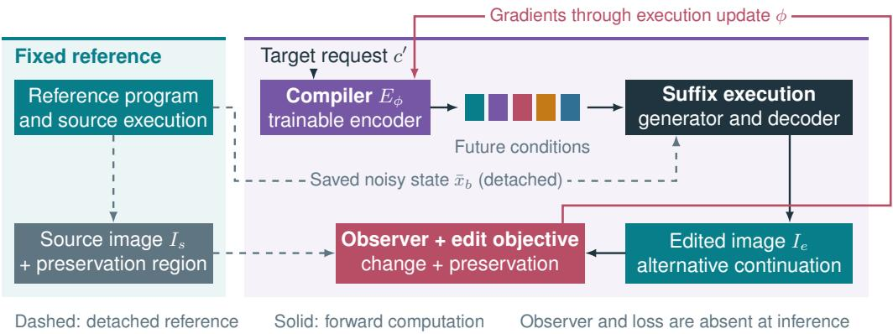  
Figure 2: Training the conditions used after a saved prefix. The reference path supplies a detached sampler state and source image. The target compiler provides future conditions; the suffix output receives observer feedback for change and retention. Only compiler parameters are optimized. The source reference cannot move to make the edit loss easier. At deployment the observer and loss are absent.

## 4 EXPERIMENTS

We first test in a controlled setting whether learned conditioning can change when content appears, then ask on SANA what changes when future conditions are replaced. The two settings differ in data, supervision and readouts, so their numbers are not pooled.

## 4.1 A CONTROLLED SETTING: WHEN CONTENT APPEARS

Question and controlled setting. Can learned conditioning change when scene content becomes visible? We study Patterned-Sphere3D, a controlled Shapes3D (Burgess & Kim, 2018) derivative with exact foreground masks and independently varied object and wall patterns. The dataset contains 120,000 images at 64 × 64 resolution. We compare an archived single-expert baseline, the original shared-denoiser two-block model, a hard factor-mask variant, and the observer-guided two-block model with texture supervision. All curves use the same single-expert reference; these are historical model variants, not a one-variable ablation series.

Learning stage behavior through feedback. The observer-guided model shares one denoiser across stages and keeps the full factor input available to its learned conditioning slots, with hard factor visibility masks disabled. A frozen factor observer supplies semantic feedback, with its factor-loss gradients restricted to the conditioning encoder. Thus the encoder can learn stage-dependent semantic behavior without manually removing factors from its input. The stage schedule and supervised responsibilities are specified by the training objective; regional reconstruction and texture losses additionally encourage early object reconstruction and later wall detail. This is learned semantic allocation under explicit supervision, rather than an independently verified claim that observer feedback is its sole cause.

Region-wise evaluation. For 1,024 validation images and 41 noise levels, both methods receive the same noised reference (xt, t) and noise realization. We compare their clipped predicted-clean images with the clean reference, using the exact sphere mask for subject MSE and its complement for background MSE. Errors are averaged over RGB channels and region pixels in the [−1, 1] image range. The horizontal axis is reverse-process position s = 199 − t; these curves are matched-state reconstruction diagnostics, not errors accumulated along a generated trajectory. Separate pure-noise DDPM-200 (Ho et al., 2020) readouts (Figure 3b) show how the corresponding models generate a scene over time.

a Region error along the trajectory  
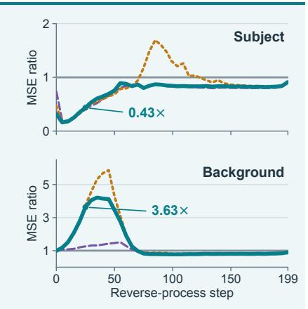

b Generated trajectories  
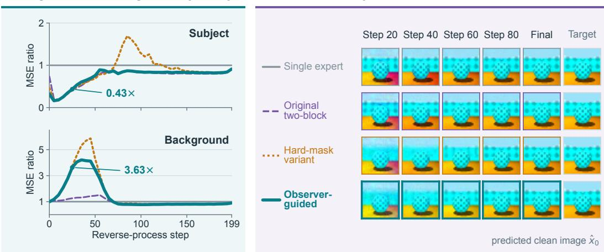  
Figure 3: Learning when to reconstruct foreground and background. (a) Exact-mask subject and background MSE on 1,024 validation images, normalized pointwise by the single-expert MSE, so that one denotes parity and lower is better. Every measured point is retained, and absolute curves are in Appendix F. (b) Predicted-clean ${ \hat { x } } _ { 0 }$ readouts of separate pure-noise DDPM-200 trajectories with common initial and per-step noise, followed by the target condition image. Row colors match the curves in (a). The observer-guided model delays wall texture while keeping a recognizable sphere. These trajectories are not samples from the noised-reference evaluation in (a), and the example was selected post hoc for correct colors, so it does not estimate how often colors are correct.

Result and implication. The two regions follow different error profiles (Figure 3). At step 25, the observer-guided model’s subject MSE is 0.435× the single-expert baseline, whereas its background MSE is 3.629× the baseline. By step 85, these ratios are 0.870 and 0.791, respectively; at step 199 they are 0.912 and 0.897. The early background penalty is consistent with delayed detail, not an early quality improvement. The trajectory rows make the intended effect visible, as the sphere is established before the wall pattern sharpens. The displayed example has consistent final colors, but was selected for that property; background-color failures elsewhere remain, and low reconstruction error at late noise levels does not rule them out. The controlled study therefore supports changing the temporal allocation of visual content through learned conditioning and explicit feedback. It motivates the SANA prefix-reuse experiments without establishing universal generation quality or attributing the effect to the observer alone.

## 4.2 EDITING TEXT-TO-IMAGE GENERATION WITH SANA

Setup and primary comparison. We use SANA-600M (Xie et al., 2025) with a 273.1M-parameter compiler and three condition blocks. The primary method is edit-only training, evaluated for the 3/9/18, 6/12/12, and 9/12/9 execution schedules. The final checkpoints are fixed when training completed, before the present evaluation. The 3/9/18 arm starts edit-only adaptation from initialization; the other two arms inherit a 40-update joint warm start. This difference limits causal comparisons across schedules. Their initialization histories are retained in Appendix B. The generator is fixed; the observer does not participate in generation.

The principal comparison isfull regeneration: apply the target conditions from the initial noise, using the same trained compiler, sampler, schedule, and seed as the editing arm. This is branch point zero. Our intervention instead resumes the stored source state and changes only future conditions. Comparing these arms asks whether reusing an executed prefix preserves scene structure while achieving the requested change. It does not, by itself, isolate the benefit of compiler training. Initialized programs test the effect of adaptation; native full-caption suffixes test the conditions used at a matched state (Appendix I). These controls answer different questions from full regeneration. The source paths in the matched comparisons come from the frozen initial compiler, not the target-trained compiler.

Evaluation and interpretation. The training-disjoint evaluation uses 24 request families and three common seeds, with branch points 0, 9, 15, and 21; all branch points are retained rather than selected by their results. Identity resumption must reproduce the uninterrupted source. Background LPIPS (Zhang et al., 2018) and pixel measurements compare each edit with its actual generated source, outside a fixed source-derived edit region. Every conditional metric retains its acceptedmask denominator. Semantic CLIP measurements are observer-family proxies, while the local VLM protocol supplies explicitly adapted automated judgments, not human preferences. Better preservation is useful only together with adequate instruction following. Complete final measurements and their coverage are collected in Appendix G. Additional image-input controls and independent detector measurements are separated by source access and validation status in Appendix E.

At branch 9, prefix reuse lowers background LPIPS relative to full regeneration for all three schedules, while retaining a similar mean semantic margin change. For example, at 6/12/12, LPIPS decreases from 0.321 to 0.227 and the CLIP margin change moves from 0.092 to 0.088. Later branching strengthens preservation but eventually weakens the edit: at branch 21, LPIPS is 0.033 and the margin change is 0.029. These means support a controllable preservation–change tradeoff, not superiority of the trained encoder over all conditioning controls. Paired family-bootstrap analysis confirms lower background LPIPS at branch 9 for all three schedules (Appendix H); the reductions in valid-attempt means are 36.0%, 29.1%, and 23.6%, respectively. The semantic proxy decreases for the first two schedules. Its interval includes zero for 9/12/9, which does not establish equal editing success. Independent category checks on 12 eligible families likewise show no uniform ordering across schedules and detectors (Appendix E).

Table 1 places the image-input controls alongside regeneration and learned suffixes on the same category cohort. At start 9, learned suffixes retain more background than SDEdit–SANA in all three schedules; FlowEdit–SANA retains still more, with different replacement counts. These are operating-point tradeoffs across different source access, not an overall ranking. All starts and paired uncertainty remain in Appendix E. An independent source-box check over all 2376 outputs confirms the same preservation ordering at three region paddings. Learned branch 9 changes less background than regeneration and SDEdit, but more than FlowEdit (Appendix J.1). These source-only Grounding DINO regions do not use the training observer and are box complements, not segmentations.

What changes beyond ordinary prompt switching? At exactly the same saved source state, native full-caption conditions already support substantial subject replacement. Both use the same path-editing operation; this comparison isolates the effect of learned conditions on the resulting preservation–change balance. The completed native extension covers all three schedules (432 additional outputs with exact source and prefix matches). At branch 9, source-box background LPIPS is lower with learned conditions by 0.017, 0.022 and 0.030 for 3/9/18, 6/12/12 and 9/12/9 (5% padding; 65/72, 62/72 and 62/72 backgrounds). The descriptive family-bootstrap intervals are below zero; all paddings and branches are retained in Appendix J.2. Late branching reverses this preservation advantage. At branch 9 on the fixed 36-attempt category cohort, learned/native replacement counts are 14/14, 15/14 and 14/17 for Grounding DINO, and 29/28, 27/26 and 25/27 for OWLv2, in schedule order. Thus the first two schedules have similar category counts, while 9/12/9 favors native conditions. The evidence supports an early-branch preservation benefit at comparable replacement counts. The branch-point curves (Figures 7 and 5) make this partial separation of background retention and subject change visible. It is a behavioral property, not proof that encoder pretraining caused a disentangled representation.

Table 1: Matched category-cohort comparison: 12 families, three seeds, 36 attempts per schedule. Cells give BG LPIPS↓ / DINO replacement count↑ / OWLv2 replacement count↑. Mask coverage is 32/36, 33/36 and 33/36; counts use all attempts. Regeneration starts at 0; others at 9. Native uses the saved state; SANA-adapted image editors use the source PNG. Counts are proxies, not full-caption success; all starts appear in Appendix E.
<table><tr><td>Method</td><td>3/9/18</td><td>6/12/12</td><td>9/12/9</td></tr><tr><td>Full regeneration</td><td>0.383 / 13 / 27</td><td>0.334 / 11 / 29</td><td>0.307 / 14 / 29</td></tr><tr><td>Learned suffix</td><td>0.254 / 14 / 29</td><td>0.247 / 15 / 27</td><td>0.242 / 14 / 25</td></tr><tr><td>Native suffix</td><td>0.269 / 14 / 28</td><td>0.274 / 14 / 26</td><td>0.269 / 17 / 27</td></tr><tr><td>SDEdit-SANA</td><td>0.284 / 16 / 28</td><td>0.288 / 16 / 27</td><td>0.293 / 12 / 27</td></tr><tr><td>FlowEdit-SANA</td><td>0.143 / 13 / 27</td><td>0.138 / 12 / 25</td><td>0.142 / 12 / 24</td></tr></table>

Qualitative comparison. Figure 4 adds matched image-input controls to the regeneration/prefix comparison. The avenue and street-lamp geometry make preservation visible alongside the requested replacement. Appendix P gives more examples and describes failures, including a kayak edit that misses the requested holding relation. Aggregate comparisons are reported above.

What the mechanism tests establish. Block interventions distinguish routing from specialization. Across all measured branches, 1200 interventions on already inactive blocks leave the latent endpoint exactly unchanged relative to the same-compiler continuation. Active-block semantic responses change with execution timing, but similar patterns are present at initialization. Schedule crossing also changes the relation between execution time and the compiler’s learned clock. These tests verify controllable routing without isolating a training-induced semantic factorization. The complete schedule, source-path and block comparisons are in Appendix L.

Caching a common prefix also reduces the cost of four continuations by 22.0–23.4% with identical endpoints, a benefit available to native prompt switching as well (Appendix K).

Generation quality. All entries use MJHQ-30K (Li et al., 2024), CleanFID 0.1.35 clean, 512 pixels, 30 steps, CFG 4, the same metadata ordering and CPU noise rule. Initializations are role-fitted encoders without edit-only adaptation. Final checkpoints are taken at training completion (update 1423).

Editing does not come at the expense of generation quality. The learned program lowers FID below native SANA (7.349) by 0.204 at 6/12/12 (2.78%) and by 0.034 at 3/9/18, and stays within 0.026 at 9/12/9. Relative to each initialization, changes are +0.067, −0.123 and −0.036, respectively. Thus quality relative to the native generator and the effect of edit training are distinct. These single-run results use terminal checkpoints, not FID-selected checkpoints. FID measures generation quality, not editing success.

Full regeneration

Learned suffix

FlowEdit–SANA

SDEdit–SANA  
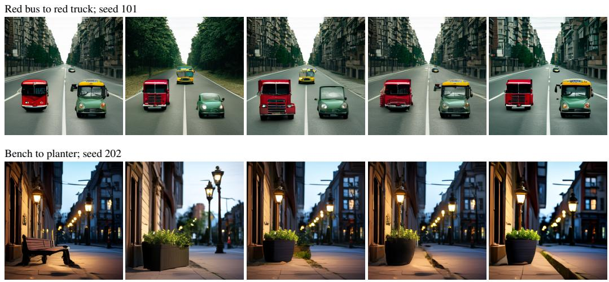  
Figure 4: Editing with visible scene retention. Genuine, uncropped outputs for the same source and request: final checkpoint, schedule 6/12/12, branch/start 9 (regeneration: 0). The learned suffix retains avenue and building structure; image-input SANA adaptations also retain substantial context. Their source access differs (saved state versus PNG). These selected illustrations do not estimate success rates; failure cases are described in Appendix P.

Table 2: Generation FID versus native SANA and across training stages. Negative final-minus-native differences indicate improvement. All entries use the same noise set; no training-seed uncertainty is inferred.
<table><tr><td>Method / schedule</td><td>Initialization</td><td>Update 600</td><td>Final 1423</td><td>∆ vs. native</td></tr><tr><td>Native SANA</td><td></td><td>7.349 (no adaptation)</td><td></td><td></td></tr><tr><td>3/9/18</td><td>7.248</td><td>7.203</td><td>7.315</td><td>-0.034</td></tr><tr><td>6/12/12</td><td>7.268</td><td>7.247</td><td>7.145</td><td>-0.204</td></tr><tr><td>9/12/9</td><td>7.411</td><td>7.466</td><td>7.375</td><td>+0.026</td></tr></table>

## 5 DISCUSSION AND CONCLUSION

Dancing Diffusion makes the generation path itself editable, with learned stage conditions as a trainable interface for redirecting its future. The controlled study demonstrates stage behavior under explicit supervision. In SANA, early prefix reuse preserves more background than full regeneration; later branching restricts the requested change. Native suffix comparisons expose a preservation– replacement tradeoff, and the learned program lowers FID below native SANA in two of three schedules. Caching saves computation with identical endpoints, as it would for ordinary prompt switching.

Capability access through a trainable interface. The behavior belongs to the compiler–generator system, and fixed generator weights cannot distinguish learned control from improved access to existing behavior. Appendix C.1 specifies tests for these alternatives and discusses the hypothesis connecting interface training to LLM post-training (Yue et al., 2025; Liu et al., 2025). Organizing sampling as a learned sequence of decisions motivates the method; reasoning ability is not evaluated here.

Scope. The compiler runs once per caption, and the SANA results come from a training-disjoint evaluation set with one training run per schedule. CLIP and source masks share their family with the training observer, so we complement them with independent detectors and observer-independent regions. Extending the program to be recompiled during generation, and to image inputs through inversion, are natural next steps.

## REPRODUCIBILITY STATEMENT

The appendix specifies sampling settings, model revisions, training weights, checkpoint hashes, route definitions, and the family-level bootstrap unit. Measured numerical figures are generated directly from archived machine-readable reports. The preliminary long-run study separates selection diagnostics from independent reporting; unmeasured results are not assumed. Schematic figures are labeled separately from measured results. Model/data access and the complete experiment environment remain necessary to reproduce generation; the manuscript does not report a fresh rerun of the archived experiments.

## AI USE STATEMENT

Generative AI tools assisted with implementation, research discussion, formal arguments, interpretation of experiment reports, manuscript drafting and revision, literature lookup, and creation of vector diagrams and plotting code. A Qwen model supplied role-span pseudo-labels for the compiler’s program data, and a local Qwen vision–language model served as the automated pairwise judge in the appendix evaluation. All displayed numerical values come from experiment reports. The schematic diagrams are not generated-image evidence. Responsibility for the paper’s claims, citations, and artifacts rests with the authors.

## ETHICS STATEMENT

The method inherits the content and bias risks of its pretrained generator and visual evaluators. It provides no guarantee of factuality or fair performance across concepts. Our experiments concern generated trajectories; we do not evaluate manipulation of photographs of identifiable people.

## REFERENCES

Yogesh Balaji, Seungjun Nah, Xun Huang, Arash Vahdat, Jiaming Song, Qinsheng Zhang, Karsten Kreis, Miika Aittala, Timo Aila, Samuli Laine, Bryan Catanzaro, Tero Karras, and Ming-Yu Liu. eDiff-I: Text-to-image diffusion models with an ensemble of expert denoisers. arXiv preprint arXiv:2211.01324, 2022.

Kevin Black, Michael Janner, Yilun Du, Ilya Kostrikov, and Sergey Levine. Training diffusion models with reinforcement learning. In International Conference on Learning Representations, 2024.

Tim Brooks, Aleksander Holynski, and Alexei A. Efros. InstructPix2Pix: Learning to follow image editing instructions. In Proceedings of the IEEE/CVF Conference on Computer Vision and Pattern Recognition, pp. 18392–18402, 2023.

Chris Burgess and Hyunjik Kim. 3D shapes dataset. https://github.com/ google-deepmind/3d-shapes, 2018.

Hila Chefer, Yuval Alaluf, Yael Vinker, Lior Wolf, and Daniel Cohen-Or. Attend-and-excite: Attention-based semantic guidance for text-to-image diffusion models. ACM Transactions on Graphics, 42(4):1–10, 2023.

Kevin Clark, Paul Vicol, Kevin Swersky, and David J. Fleet. Directly fine-tuning diffusion models on differentiable rewards. In International Conference on Learning Representations, 2024.

Ying Fan, Olivia Watkins, Yuqing Du, Hao Liu, Moonkyung Ryu, Craig Boutilier, Pieter Abbeel, Mohammad Ghavamzadeh, Kangwook Lee, and Kimin Lee. DPOK: Reinforcement learning for fine-tuning text-to-image diffusion models. In Advances in Neural Information Processing Systems, volume 36, pp. 79858–79885, 2023.

Rinon Gal, Yuval Alaluf, Yuval Atzmon, Or Patashnik, Amit H. Bermano, Gal Chechik, and Daniel Cohen-Or. An image is worth one word: Personalizing text-to-image generation using textual inversion. In International Conference on Learning Representations, 2023.

Atticus Geiger, Zhengxuan Wu, Hanson Lu, Josh Rozner, Elisa Kreiss, Thomas Icard, Noah D. Goodman, and Christopher Potts. Inducing causal structure for interpretable neural networks. In Proceedings ofthe 39th International Conference on Machine Learning, volume 162 of Proceedings ofMachine Learning Research, pp. 7324–7338, 2022.

Dhruba Ghosh, Hannaneh Hajishirzi, and Ludwig Schmidt. GenEval: An object-focused framework for evaluating text-to-image alignment. In Advances in Neural Information Processing Systems, Datasets and Benchmarks Track, volume 36, pp. 52132–52152, 2023.

Ada Görgün, Fawaz Sammani, Nikos Deligiannis, Bernt Schiele, and Jonas Fischer. Temporal concept dynamics in diffusion models via prompt-conditioned interventions. In International Conference on Learning Representations, 2026.

Amir Hertz, Ron Mokady, Jay Tenenbaum, Kfir Aberman, Yael Pritch, and Daniel Cohen-Or. Promptto-prompt image editing with cross-attention control. In International Conference on Learning Representations, 2023.

Jonathan Ho, Ajay Jain, and Pieter Abbeel. Denoising diffusion probabilistic models. In Advances in Neural Information Processing Systems, volume 33, pp. 6840–6851, 2020.

Xiwei Hu, Rui Wang, Yixiao Fang, Bin Fu, Pei Cheng, and Gang Yu. ELLA: Equip diffusion models with LLM for enhanced semantic alignment. arXiv preprint arXiv:2403.05135, 2024.

Kaiyi Huang, Kaiyue Sun, Enze Xie, Zhenguo Li, and Xihui Liu. T2I-CompBench: A comprehensive benchmark for open-world compositional text-to-image generation. In Advances in Neural Information Processing Systems, Datasets and Benchmarks Track, volume 36, pp. 78723–78747, 2023.

Saar Huberman, Or Patashnik, Omer Dahary, Ron Mokady, and Daniel Cohen-Or. Image generation from contextually-contradictory prompts. In Proceedings of the IEEE/CVF Conference on Computer Vision and Pattern Recognition, pp. 14885–14894, 2026.

Zhangqi Jiang, Zheng Sun, Xianfang Zeng, Yufeng Yang, Xuanyang Zhang, Yongliang Wu, Wei Cheng, Gang Yu, Xu Yang, and Bihan Wen. GEditBench v2: A human-aligned benchmark for general image editing. arXiv preprint arXiv:2603.28547, 2026.

Max Ku, Dongfu Jiang, Cong Wei, Xiang Yue, and Wenhu Chen. VIEScore: Towards explainable metrics for conditional image synthesis evaluation. In Proceedings of the 62nd Annual Meeting of the Association for Computational Linguistics (Volume 1: Long Papers), pp. 12268–12290, 2024.

Vladimir Kulikov, Matan Kleiner, Inbar Huberman-Spiegelglas, and Tomer Michaeli. FlowEdit: Inversion-free text-based editing using pre-trained flow models. In Proceedings ofthe IEEE/CVF International Conference on Computer Vision, pp. 19721–19730, 2025.

Brian Lester, Rami Al-Rfou, and Noah Constant. The power of scale for parameter-efficient prompt tuning. In Proceedings of the 2021 Conference on Empirical Methods in Natural Language Processing, pp. 3045–3059, 2021.

Daiqing Li, Aleks Kamko, Ehsan Akhgari, Ali Sabet, Linmiao Xu, and Suhail Doshi. Playground v2.5: Three insights towards enhancing aesthetic quality in text-to-image generation. arXiv preprint arXiv:2402.17245, 2024.

Xiang Lisa Li and Percy Liang. Prefix-tuning: Optimizing continuous prompts for generation. In Proceedings ofthe 59th Annual Meeting ofthe Associationfor Computational Linguistics and the 11th International Joint Conference on Natural Language Processing (Volume 1: Long Papers), pp. 4582–4597, 2021.

Yuheng Li, Haotian Liu, Qingyang Wu, Fangzhou Mu, Jianwei Yang, Jianfeng Gao, Chunyuan Li, and Yong Jae Lee. GLIGEN: Open-set grounded text-to-image generation. In Proceedings ofthe IEEE/CVF Conference on Computer Vision and Pattern Recognition, pp. 22511–22521, 2023.

Mingjie Liu, Shizhe Diao, Ximing Lu, Jian Hu, Xin Dong, Yejin Choi, Jan Kautz, and Yi Dong. ProRL: Prolonged reinforcement learning expands reasoning boundaries in large language models. In Advances in Neural Information Processing Systems, volume 38, pp. 20475–20508, 2025.

Shilong Liu, Zhaoyang Zeng, Tianhe Ren, Feng Li, Hao Zhang, Jie Yang, Qing Jiang, Chunyuan Li, Jianwei Yang, Hang Su, Jun Zhu, and Lei Zhang. Grounding DINO: Marrying DINO with grounded pre-training for open-set object detection. In European Conference on Computer Vision, pp. 38–55, 2024.

Chenlin Meng, Yutong He, Yang Song, Jiaming Song, Jiajun Wu, Jun-Yan Zhu, and Stefano Ermon. SDEdit: Guided image synthesis and editing with stochastic differential equations. In International Conference on Learning Representations, 2022.

Matthias Minderer, Alexey Gritsenko, and Neil Houlsby. Scaling open-vocabulary object detection. In Advances in Neural Information Processing Systems, volume 36, pp. 72983–73007, 2023.

Ron Mokady, Amir Hertz, Kfir Aberman, Yael Pritch, and Daniel Cohen-Or. Null-text inversion for editing real images using guided diffusion models. In Proceedings ofthe IEEE/CVF Conference on Computer Vision and Pattern Recognition, pp. 6038–6047, 2023.

Gaurav Parmar, Richard Zhang, and Jun-Yan Zhu. On aliased resizing and surprising subtleties in GAN evaluation. In Proceedings ofthe IEEE/CVF Conference on Computer Vision and Pattern Recognition, pp. 11410–11420, 2022.

Mihir Prabhudesai, Russell Mendonca, Zheyang Qin, Katerina Fragkiadaki, and Deepak Pathak. Video diffusion alignment via reward gradients. arXiv preprint arXiv:2407.08737, 2024.

Yusu Qian, Jiasen Lu, Tsu-Jui Fu, Xinze Wang, Chen Chen, Yinfei Yang, Wenze Hu, and Zhe Gan. GIE-Bench: Towards grounded evaluation for text-guided image editing. arXiv preprint arXiv:2505.11493, 2025.

Alec Radford, Jong Wook Kim, Chris Hallacy, Aditya Ramesh, Gabriel Goh, Sandhini Agarwal, Girish Sastry, Amanda Askell, Pamela Mishkin, Jack Clark, Gretchen Krueger, and Ilya Sutskever. Learning transferable visual models from natural language supervision. In Proceedings of the 38th International Conference on Machine Learning, volume 139 of Proceedings ofMachine Learning Research, pp. 8748–8763, 2021.

Jifang Wang, Xue Yang, Longyue Wang, Zhenran Xu, Yiyu Wang, Yaowei Wang, Weihua Luo, Kaifu Zhang, Baotian Hu, and Min Zhang. A unified agentic framework for evaluating conditional image generation. In Proceedings of the 63rd Annual Meeting of the Association for Computational Linguistics (Volume 1: Long Papers), pp. 12626–12646, 2025.

Enze Xie, Junsong Chen, Junyu Chen, Han Cai, Haotian Tang, Yujun Lin, Zhekai Zhang, Muyang Li, Ligeng Zhu, Yao Lu, and Song Han. SANA: Efficient high-resolution text-to-image synthesis with linear diffusion transformers. In International Conference on Learning Representations, 2025.

Siwei Yang, Mude Hui, Bingchen Zhao, Yuyin Zhou, Nataniel Ruiz, and Cihang Xie. Complex-Edit: CoT-like instruction generation for complexity-controllable image editing benchmark. arXiv preprint arXiv:2504.13143, 2025.

Yang Ye, Xianyi He, Zongjian Li, Bin Lin, Shenghai Yuan, Zhiyuan Yan, Bohan Hou, and Li Yuan. ImgEdit: A unified image editing dataset and benchmark. In Advances in Neural Information Processing Systems, Datasets and Benchmarks Track, volume 38, pp. 146002–146032, 2025.

Ron Yosef, Yonatan Bitton, Dani Lischinski, and Moran Yanuka. EditInspector: A benchmark for evaluation of text-guided image edits. In Proceedings of the 63rd Annual Meeting of the Association for Computational Linguistics (Volume 1: Long Papers), pp. 29503–29530, 2025.

Yang Yue, Zhiqi Chen, Rui Lu, Andrew Zhao, Zhaokai Wang, Yang Yue, Shiji Song, and Gao Huang. Does reinforcement learning really incentivize reasoning capacity in LLMs beyond the base model? In Advances in Neural Information Processing Systems, volume 38, pp. 64304–64339, 2025.

Lvmin Zhang, Anyi Rao, and Maneesh Agrawala. Adding conditional control to text-to-image diffusion models. In Proceedings of the IEEE/CVF International Conference on Computer Vision, pp. 3836–3847, 2023a.

Richard Zhang, Phillip Isola, Alexei A. Efros, Eli Shechtman, and Oliver Wang. The unreasonable effectiveness of deep features as a perceptual metric. In Proceedings of the IEEE/CVF Conference on Computer Vision and Pattern Recognition, pp. 586–595, 2018.

Yuxin Zhang, Weiming Dong, Fan Tang, Nisha Huang, Haibin Huang, Chongyang Ma, Tong-Yee Lee, Oliver Deussen, and Changsheng Xu. ProSpect: Prompt spectrum for attribute-aware personalization of diffusion models. ACM Transactions on Graphics, 42(6):1–14, 2023b.

## A APPENDIX ROADMAP

Part I records the implementation, the execution and trainability guarantees, and the comparison protocols. Part II gives absolute errors for the controlled setting. Part III reports the SANA editing evaluation, including paired uncertainty, the native-suffix control, observer-independent regions and prefix-reuse cost. Part IV examines schedules, blocks and an explicit-background input variant. Part V contains a bidirectional stress test and additional examples.

In the SANA measurements, detector counts and CLIP margins are proxies, source boxes are not segmentations, and intervals carry no multiplicity correction. Two outcomes are negative. The automatic scene compiler fails the input-equality gate (Appendix N), so no FID is claimed for that variant, and the large-subject stratum is empty on the recomputed sources, so that comparison is unavailable.

## Part I Setup: implementation, guarantees and protocols

## B CURRENT IMPLEMENTATION AND EXPERIMENTAL PROVENANCE

Compiler and executor. The SANA study uses three continuous blocks at native feature width 2304. The 273.1M-parameter compiler is initialized from role-mask fitting at update 800. A frozen copy of that initial compiler predicts the validity masks and generates the source images and saved states, so the training target does not move with later compiler updates. The SANA-600M 512-pixel generator uses 30 steps and guidance 4. No trained decoder adapter is loaded for the comparisons.

Training and warm start. The replay cohort has 9226 source-image identities, shared across the three schedules. The 3/9/18 run starts at update zero from the role-fitted compiler, without a joint parent or optimizer state. The 6/12/12 and 9/12/9 runs resume their joint checkpoints at update 40, including Adam state, and continue with zero trajectory weight to update 1423, giving 1383 edit-only updates. We refer to the terminal update-1423 checkpoint as the final checkpoint. Cross-schedule differences therefore combine schedule and initialization history. The main comparisons use the terminal checkpoint; update 600 is an intermediate diagnostic. The encoder learning rate is $2 \times 1 0 ^ { - 6 }$ with global batch 16, microbatch 4, weight decay 0 and training seed 20260930. Each configuration is a single training run.

Training branches after the first block, at steps 3, 6 and 9 for schedules 3/9/18, 6/12/12 and 9/12/9. The two remaining blocks receive the target conditions, and all 27, 24 and 21 suffix updates are differentiated with activation checkpointing. The source image, prefix, source-region mask and frozen validity masks are detached. Evaluation at steps 9, 15 and 21 is a separate common-step comparison, not three training branch points.

Objective. Terminal and response terms use the frozen observer, and each raw term is divided by its recorded frozen scale. The weights are target presence 2, old absence 1, preservation 4, caption 0.4, background retention 1, response presence 0.1, response absence 0.05, response heat 0.5 and response heat absence 0.5. Relation and trajectory weights are zero. The source region uses a 0.15 detection threshold and 0.02 padding, and accepted edit-area fractions lie between 0.002 and 0.8. Exact configurations, recorded loss scales and checkpoint identities are indexed in the reproducibility bundle.

Data and reporting scope. Training and evaluation indices are distinct, and identity checks compare source-image identifiers rather than file positions. The 24-family evaluation set uses seed 101, 202 and 303. Every attempt is retained for semantic proxies, and missing source masks stay in the coverage count. Automatically substituted target captions can retain inappropriate actions or attributes, so category presence alone cannot certify full-caption compliance.

Optional joint extension. The joint objective adds a normalized velocity loss on a declared source path with a detached target. The final edit-only results do not use it. Historical joint runs and earlier pilots are archived separately and are not pooled with the current comparisons.

## C EXECUTION GUARANTEES AND WHAT THEY DO NOT IMPLY

Proposition 1 (Protected-prefix equality). With identical initial state, materialized prefix conditions, model parameters, schedule and deterministic numerical execution, two runs agree at every step of their common prefix. Saving and restoring the complete sampler state reproduces the endpoint under the unchanged suffix.

Proof. Each update in Eq. (2) has identical inputs in both runs, so induction gives equality of the next state. The same induction starts at a restored state for identity continuation. A stochastic sampler additionally requires the same random state, and a multistep solver its history. Equality across numerical runtimes is not asserted. □

The guarantee applies equally to native prompt switching. It is a computational invariant and says nothing about preservation under a changed suffix. Our endpoint-equality and inactive-block tests check it in the deterministic implementation.

Differentiating a resumed program. The reference state in Eq. (3) is detached, so the loss differentiates the executed suffix and its continuous conditions but cannot change the cached source path. A block whose interval ends before b has no direct effect on the loss, although shared encoder parameters can still change its output after optimization. Frozen Boolean masks remove mask selection from the learning path but not derivatives through valid continuous features.

## C.1 BACKGROUND–SUBJECT INDEPENDENCE UNDER PATH EDITS

Fix a source state ${ \bar { x } } _ { b } .$ , schedule, masks and numerical randomness, collectively c. Let z contain the continuous suffix conditions, and define the endpoint and its declared background and subject readouts by

$$
\begin{array} { r } { G _ { b } ( z ; c ) = D ( F _ { b : N } ( \bar { x } _ { b } ; z ) ) , \qquad h _ { B } ( z ; c ) = \rho _ { B } ( G _ { b } ( z ; c ) ) , \quad h _ { S } ( z ; c ) = \rho _ { S } ( G _ { b } ( z ; c ) ) . } \end{array}\tag{8}
$$

The readouts specify the factors under test and need not exhaust image semantics. Occlusion, shadows or relations can couple the two factors, so independence is relative to the task, not a universal property of scenes.

Statistical and interventional independence. For a hypothesized factorization $z = \left( z _ { B } , z _ { S } \right)$ statistical independence $p ( z _ { B } , z _ { S } \mid c ) = p ( z _ { B } \mid c ) p ( z _ { S } \mid c )$ says nothing by itself about which image features depend on each component. Independent scalars can still give the entangled readout $h _ { B } ( z ) = z _ { B } + z _ { S }$ , and correlated coordinates can drive separate output factors. Our temporal blocks are not assumed to be $z _ { B }$ and $z _ { S }$

What matters for a subject edit is a small background response together with a realized target. For source conditions z and edited conditions $z ^ { \prime } ,$ let

$$
\begin{array} { r } { e _ { B } = \| h _ { B } ( z ^ { \prime } ; c ) - h _ { B } ( z ; c ) \| , \qquad e _ { S } = d _ { S } ( h _ { S } ( z ^ { \prime } ; c ) , s ^ { \star } ) , } \end{array}\tag{9}
$$

where $s ^ { \star }$ is the declared subject target. Selective editing requires $e _ { B } \leq \epsilon _ { B }$ and $e _ { S } \leq \epsilon _ { S }$ for thresholds fixed in advance. An unchanged image makes $e _ { B }$ zero while failing the target, so background retention alone is insufficient.

Proposition 2 (Bounded cross-factor response). Suppose $h _ { B }$ is continuously differentiable along the admissible segment $( z _ { B } , z _ { S } + t \delta _ { S } ) , t \in [ 0 , 1 ]$ , and its cross-factor Jacobian has operator norm at most $\kappa _ { B S }$ on that segment. Then

$$
\| h _ { B } ( z _ { B } , z _ { S } + \delta _ { S } ; c ) - h _ { B } ( z _ { B } , z _ { S } ; c ) \| \le \kappa _ { B S } \| \delta _ { S } \| .\tag{10}
$$

The analogous bound with $\kappa _ { S B }$ holds for the subject response to a background edit, and vanishing cross-factor Jacobians on a convex product domain make each readout invariant to the other coordinate.

Proof. The background difference equals $\begin{array} { r } { \int _ { 0 } ^ { 1 } ( \partial h _ { B } / \partial z _ { S } ) ( z _ { B } , z _ { S } + t \delta _ { S } ; c ) \delta _ { S } d t } \end{array}$ , and the operatornorm bound gives Eq. (10). Interchanging the factors gives the second bound. □

The statement bounds leakage, not attainment of $s ^ { \star }$ , and holds only at a fixed source state. Background LPIPS and subject-replacement proxies approximate the two sides of Eq. (9) at the endpoint, rather than measuring a cross-factor Jacobian directly.

Interpreting capability access. A fixed generator and a trained interface form a new composite system. Separating improved access to a pretrained behavior from newly learned control relies on a verified fixed executor together with native-prompt and initialized-interface controls, both of which our experiments include. Finite native-prompt search cannot show that an unobserved behavior is absent, and the analogy to post-training in language models is a motivation rather than a tested mechanism.

## D TRAINABILITY OF THE COMPILED INTERFACE

The results below concern optimizing the interface rather than executing it (Appendix C). They show that the learning problem is well posed and that its reported objective cannot be gamed by its own normalization. They do not by themselves predict that optimization succeeds.

Setting. Fix the generator θ, decoder $D ,$ observer $Q ,$ schedule $0 = \tau _ { 0 } < \cdot \cdot \cdot < \tau _ { K } = 1$ and Boolean masks $M ,$ , and optimize only the compiler parameters ϕ. For a replay with source state ${ \bar { x } } _ { b } ,$ source image $I _ { s }$ and keep-mask $m ,$ , the edited endpoint is $I _ { e } = D ( F _ { b : N } \mathrm { \bar { ( s g } } [ \bar { x } _ { b } ] ; Z _ { \phi } , M ) )$ ) as in Eq. (3), and the objective is Eq. (6) with weights $\lambda _ { r } > 0$ and scales $s _ { r } > 0$ fixed before the run.

## D.1 THE OBJECTIVE IS WELL POSED

Proposition 3 (Nonnegativity and a uniform lower bound). Every deployed term is nonnegative, hence $\mathcal { L } _ { \mathrm { e d i t } } \geq 0$ uniformly in $\phi .$ Each hinge term is exactly 0 when its margin is met, and each presence term is bounded above by − log ε.

Proof. The deployed terms $\operatorname { a r e } - \log p \operatorname { a n d } - \log ( 1 - p )$ with p clamped to $[ \varepsilon , 1 - \varepsilon ] , \varepsilon = 1 0 ^ { - 6 } ;$ a masked mean squared error; softplus(·); relu(m − g); and $( 1 - s _ { t } ) + \mathrm { r e l u } ( 0 . 0 5 + s _ { s } - s _ { t } )$ with $s _ { \bullet } \in [ - 1 , 1 ]$ inner products of unit-normalized CLIP features. Each is nonnegative, and a positive combination of nonnegative terms is nonnegative, independently of $\phi .$ The hinge vanishes iff $g \geq m .$ and the clamp bounds presence $\mathbf { b y } - \log \varepsilon \approx 1 3 . 8 2$ (the caption term by 4.05). □

The proposition concerns the loss surface, not reachability. The terms compete, so a common minimizer need not exist, and the softplus relation term is never exactly zero (though of order $1 0 ^ { - 1 2 }$ at the best attainable margin). What it rules out is an apparent decrease caused by an unbounded term.

Where the gradient can live. Eq. (7) sums only over blocks active after b. The next lemma makes this exclusion exact.

Lemma 1 (Exact gradient support). Let block k have execution interval $[ \tau _ { k - 1 } , \tau _ { k } ) . ~ I f \tau _ { k } N \leq b ,$ then $\mathcal { L } _ { \mathrm { e d i t } }$ is constant in $Z _ { k }$ , so $\begin{array} { r } { \dot { \nabla } _ { Z _ { k } } \mathcal { L } _ { \mathrm { e d i t } } = 0 } \end{array}$ identically.

Proof. By Eq. (2) step n reads only $Z _ { k ( n ) } . { \mathrm { I f } } \tau _ { k } N \leq b$ then $k ( n ) \neq k$ for every $n \geq b ,$ , and the prefix is detached, so nothing in the loss depends on $Z _ { k }$ □

For the $6 / 1 2 / 1 2$ schedule at $N = 3 0$ the block boundaries are steps 6, 18 and 30, so at $b = 6$ the first block receives exactly zero gradient. This is the formal counterpart of the observation in Appendix N that a background change requested after the boundary must be expressed by the suffix. Because $\phi$ is shared, the lemma does not imply that block k’s output is unchanged after an update, so same-prompt drift is measured separately.

## D.2 WHY THE OBJECTIVE IS FROZEN BEFORE TRAINING

The scales $s _ { r }$ are measured once before training and then held fixed (Appendix B).

Proposition 4 (Adaptive normalization admits no fixed objective). Ifterm r is reported as $\ell _ { r } ^ { ( t ) } / s _ { r } ^ { ( t ) }$ with $s _ { r } ^ { ( t ) } > 0$ a statistic of the optimization history, there exist sequences in which $\ell _ { r } ^ { ( t ) }$ strictly increases while the reported value strictly decreases to 0. A monotone decrease of the reported value then certifies nothing about the modelled quantity.

Proof. Take $\ell _ { r } ^ { ( t ) } = t$ and $s _ { r } ^ { ( t ) } = t ^ { 2 }$ . The raw sequence grows without bound while the reported sequence $1 / t$ decreases to 0. Since the objective changes whenever $s _ { r } ^ { ( t ) }$ does, the updates are not gradient steps on one fixed function. □

Corollary 1 (Frozen scales preserve the ordering). ${ \cal { I f s } } _ { r }$ is a positive constant, the reported term decreases ifand only ifthe raw term decreases, and $\mathcal { L } _ { \mathrm { e d i t } }$ is onefixedfunction ofϕ.

Raw training terms are therefore checked from the first checkpoint against preregistered directions, and a run whose raw preservation rises is stopped. The same reasoning explains why preservation is scored against the paired counterfactual from the source program rather than against a photograph. Against a photograph the term has a floor that no edit can remove, measured at 0.1405 before the encoder has moved and 0.150 after 700 updates, which reflects the gap between a generator and a camera rather than edit damage.

## D.3 WHAT THE DETACHED PREFIX DOES AND DOES NOT PROTECT

Proposition 5 (No reference-moving shortcut). The source state ${ \bar { x } } _ { b } ,$ , source image $I _ { s } ,$ keep-mask m and observer textfeatures enter ${ \mathcal { L } } _ { \mathrm { e d i t } }$ only through $\mathrm { s g } [ \cdot ]$ ], so no gradient step can reduce the loss $b y$ moving the target it is scored against.

Proof. Immediate from $\partial \mathrm { s g } [ u ] / \partial \phi = 0$ . Preservation against sg $[ I _ { s } ] _ { \ast }$ , the response hinges against $\mathrm { s g } [ q ( I _ { s } ) ]$ and the caption term against detached text features all have fixed second arguments.

Three further shortcuts are excluded by construction. The keep-mask is not re-derived from the edited image, which would let the optimizer shrink the penalized region by hiding the subject. The response terms hinge on a gain relative to the detached source, so inflating presence everywhere does not help. When both ends of a relation resolve to the same detector anchor, the pair is dropped and reported as relation\_degenerate\_fraction.

## D.4 COST ACCOUNTING

Lemma 2 (Suffix denoiser calls). With N steps, classifier-free guidance as one conditional and one unconditional pass, and a branch at step $b ,$ resuming a saved prefix costs $2 ( N - b )$ denoiser evaluations. The FlowEdit adaptation evaluates guided velocitiesfor a source and a target condition and costs $4 ( N - b )$ , twice as many at every b.

Proof. Each remaining step performs one guided evaluation (two passes), or two for FlowEdit (four passes). □

At $b \in \{ 0 , 6 , 9 , 1 5 , 2 1 \}$ with $N = 3 0$ this gives $6 0 / 4 8 / 4 2 / 3 0 / 1 8$ against $1 2 0 / 9 6 / 8 4 / 6 0 / 3 6$ . These are suffix costs only; source generation, text encoding and VAE encode/decode are excluded. Native shared-state reuse has the same $2 ( N - b )$ cost, and call counts do not translate directly into wall-clock time.

## D.5 SCOPE

These results are structural. They concern the objective, its gradient support, its normalization and its arithmetic, and assert no convergence, rate or stationary point. The map $\phi \mapsto { \mathcal { L } } _ { \mathrm { e d i t } }$ runs through a deep sampler, a decoder and a detector-based observer with clamps, hinges and a hard mask, and is neither convex nor globally smooth. A standalone arithmetic script released with the code checks every numeric bound, the counterexample and the call counts without executing the model.

## E COMPARISON PROTOCOLS AND INDEPENDENT EVALUATION

Source access defines the comparison. Full regeneration and learned prefix editing use identical target conditions and noise, and differ only in how much source history is retained. The native suffix control starts from the same saved state and changes the conditioning representation. Image-input methods receive the source PNG and native captions, without the stored sampler state.

Table 3: Roles of the comparison methods.
<table><tr><td>Method</td><td>Source access</td><td>Question</td></tr><tr><td>Full regeneration</td><td>Same initial noise</td><td>Value of retaining source history</td></tr><tr><td>Native suffix</td><td>Same saved state</td><td>Value of learned future conditions</td></tr><tr><td>Initialized compiler</td><td>Same saved state</td><td>Effect of adaptation</td></tr><tr><td>SDEdit-SANA adaptation</td><td>Source PNG, re-noising</td><td>Image-input denoising control</td></tr><tr><td>FlowEdit-SANA adaptation</td><td>Source PNG, source/target ve- locities</td><td>Image-input flow editing control</td></tr></table>

Image-input adaptations. We implement SDEdit-style re-noising and the FlowEdit velocitydifference update on the same SANA generator (Meng et al., 2022; Kulikov et al., 2025). The source PNG is VAE-encoded deterministically, and native source and target captions use guidance 4 with the same 30-step schedule. Start indices 9, 15 and 21 are all retained. FlowEdit uses one noise sample per update and no terminal target-only interval $( n _ { \mathrm { a v g } } = 1 , n _ { \mathrm { m i n } } = 0 , n _ { \mathrm { m a x } } = 2 1 , 1 5 , 9 )$ with the reference implementation pinned to commit 2620a9364f0f. These adaptations are not reproductions of the published SD3/FLUX benchmarks. All 216 source cases were edited by both methods at all three strengths, giving 1296 edited images and 216 VAE reconstructions, with no output filtering. Call counts follow Lemma 2.

Independent detector calibration. Two frozen category detectors, Grounding DINO tiny (Liu et al., 2024) and an OWLv2 base ensemble (Minderer et al., 2023), are distinct from the training YOLO observer. On COCO val2017, image identities are hash-split into 1327 fit and 1352 audit queries over 23 categories, with up to 30 positives and 30 negatives per category and split. The global threshold maximizes fit localization F1 subject to precision at least 0.90. A positive requires a top detection with IoU at least 0.5 against an annotated object, and a wrongly localized positive counts as both a false positive and a false negative. Both detectors fall short for banana, bench, bicycle,

Table 4: Independent detector calibration on public images, not generated-editing accuracy.
<table><tr><td>Detector</td><td>Threshold</td><td>Audit precision</td><td>Audit recall</td></tr><tr><td>Grounding DINO tiny</td><td>0.40</td><td>0.886</td><td>0.819</td></tr><tr><td>OWLv2 base ensemble</td><td>0.31</td><td>0.900</td><td>0.861</td></tr></table>

toaster, traffic light and truck, and Grounding DINO also for cat and tennis racket. Calibration on photographs does not establish accuracy on generated hybrids, attributes or relations.

Generated-image category evidence. The image/query manifest was fixed before scoring and contains 2592 logical records, giving 4752 raw calls per detector after deduplication. The two new native schedules add 432 outputs and 1584 raw calls, reusing the frozen source scores, and all new outputs are checksum-matched to the original images. Source and target names that map to the same category, and out-of-vocabulary replacements, are kept in the raw reports but not counted as validated replacements. The measures are source detection, target detection, old category absence and their replacement conjunction.

Behavioral separation. We use separation in an operational sense, namely retaining one aspect of the image while modifying another. At the same early saved state, learned conditions change the background less than native conditioning (Appendix J.2), with similar category counts in the first two schedules. This is a localized improvement in the retention–change balance, not a uniformly better frontier, and it does not identify encoder pretraining as the cause, since temporal responses also occur at initialization.

Complete category and preservation comparison. The category cohort contains 12 families and three seeds (36 attempts per schedule) whose source and target categories are distinct and in the calibration vocabulary. The other 12 families (eight out of vocabulary, four within-category attribute edits) stay in the raw reports. Background LPIPS uses the unchanged historical source keep-masks and spatial AlexNet weights, recomputed on the same 36 attempts, with missing masks kept in the denominator. We report target detection (T) and the replacement conjunction (R), which requires the old category in the source, the target in the edit and the old category absent from the edit. Undetected source objects count as failures.

Detector disagreement and paired uncertainty. Before editing, Grounding DINO already detects the target category in 12, 13 and 13 of the 36 sources across schedules, against 1, 0 and 0 for OWLv2, and misses the source category in 3, 3 and 4 cases that OWLv2 detects. We therefore report both detectors. At branch 9, the learned-minus-native replacement differences in percentage points, with descriptive 95% family-bootstrap intervals over 10000 resamples of the 12 family means, are as follows. For 3/9/18, DINO +0.00 [−8.33, +8.33] and OWLv2 +2.78 [−5.56, +11.11]. For 6/12/12, DINO +2.78 [−11.11, +19.44] and OWLv2 +2.78 [−5.56, +11.11]. For 9/12/9, DINO −8.33 [−22.22, +0.00] and OWLv2 −5.56 [−16.67, +5.56]. The ordering changes across detector and schedule, and none of these intervals establishes noninferiority.

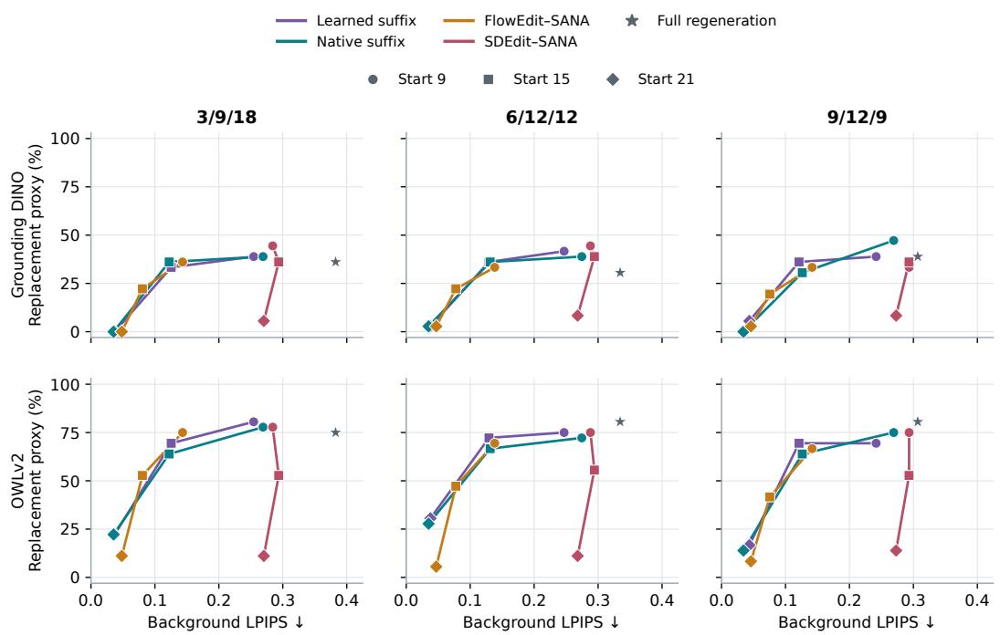  
Figure 5: Preservation and category change on a common evaluation cohort. Each point uses the same 12 category families and three seeds. Replacement proxies use all 36 attempts, and background LPIPS is defined for 32, 33 and 33 source masks across the schedules. Colors identify methods, marker shapes identify starts 9, 15 and 21, and the star denotes full regeneration. Curves connect descriptive means, not fitted frontiers, and the two detectors can order methods differently.

Table 5: Category proxies and preservation, schedule 3/9/18. T/R are counts out of 36 per detector; coverage is defined/36. Start is a saved-state branch for suffix methods and a re-noising or flow start for image-input methods.
<table><tr><td>Method</td><td>Start</td><td>BG LPIPS↓</td><td>Coverage</td><td>DINO T/R</td><td>OWLv2 T/R</td></tr><tr><td>Full regeneration</td><td>0</td><td>0.383</td><td>32/36</td><td>35/13</td><td>36/27</td></tr><tr><td>Learned suffix</td><td>9</td><td>0.254</td><td>32/36</td><td>36/14</td><td>36/29</td></tr><tr><td>Learned suffix</td><td>15</td><td>0.125</td><td>32/36</td><td>34/12</td><td>35/25</td></tr><tr><td>Learned suffix</td><td>21</td><td>0.037</td><td>32/36</td><td>30/0</td><td>17/8</td></tr><tr><td>Native suffix</td><td>9</td><td>0.269</td><td>32/36</td><td>36/14</td><td>36/28</td></tr><tr><td>Native suffix</td><td>15</td><td>0.122</td><td>32/36</td><td>34/13</td><td>35/23</td></tr><tr><td>Native suffix</td><td>21</td><td>0.035</td><td>32/36</td><td>30/0</td><td>16/8</td></tr><tr><td>SDEdit-SANA</td><td>9</td><td>0.284</td><td>32/36</td><td>35/16</td><td>36/28</td></tr><tr><td>SDEdit-SANA</td><td>15</td><td>0.294</td><td>32/36</td><td>33/13</td><td>30/19</td></tr><tr><td>SDEdit-SANA</td><td>21</td><td>0.270</td><td>32/36</td><td>27/2</td><td>13/4</td></tr><tr><td>FlowEdit-SANA</td><td>9</td><td>0.143</td><td>32/36</td><td>34/13</td><td>35/27</td></tr><tr><td>FlowEdit-SANA</td><td>15</td><td>0.080</td><td>32/36</td><td>31/8</td><td>32/19</td></tr><tr><td>FlowEdit-SANA</td><td>21</td><td>0.048</td><td>32/36</td><td>24/0</td><td>15/4</td></tr></table>

Table 6: As Table 5, schedule 6/12/12.
<table><tr><td>Method</td><td>Start</td><td>BG LPIPS↓</td><td>Coverage</td><td>DINO T/R</td><td>OWLv2 T/R</td></tr><tr><td>Full regeneration</td><td>0</td><td>0.334</td><td>33/36</td><td>34/11</td><td>35/29</td></tr><tr><td>Learned suffix</td><td>9</td><td>0.247</td><td>33/36</td><td>35/15</td><td>36/27</td></tr><tr><td>Learned suffix</td><td>15</td><td>0.129</td><td>33/36</td><td>34/13</td><td>33/26</td></tr><tr><td>Learned suffix</td><td>21</td><td>0.038</td><td>33/36</td><td>31/1</td><td>23/11</td></tr><tr><td>Native suffix</td><td>9</td><td>0.274</td><td>33/36</td><td>35/14</td><td>36/26</td></tr><tr><td>Native suffix</td><td>15</td><td>0.131</td><td>33/36</td><td>35/13</td><td>33/24</td></tr><tr><td>Native suffix</td><td>21</td><td>0.035</td><td>33/36</td><td>31/1</td><td>21/10</td></tr><tr><td>SDEdit-SANA</td><td>9</td><td>0.288</td><td>33/36</td><td>35/16</td><td>36/27</td></tr><tr><td>SDEdit-SANA</td><td>15</td><td>0.294</td><td>33/36</td><td>34/14</td><td>30/20</td></tr><tr><td>SDEdit-SANA</td><td>21</td><td>0.268</td><td>33/36</td><td>29/3</td><td>19/4</td></tr><tr><td>FlowEdit-SANA</td><td>9</td><td>0.138</td><td>33/36</td><td>33/12</td><td>34/25</td></tr><tr><td>FlowEdit-SANA</td><td>15</td><td>0.078</td><td>33/36</td><td>33/8</td><td>30/17</td></tr><tr><td>FlowEdit-SANA</td><td>21</td><td>0.047</td><td>33/36</td><td>27/1</td><td>18/2</td></tr></table>

Table 7: As Table 5, schedule 9/12/9.
<table><tr><td>Method</td><td>Start</td><td>BG LPIPS↓</td><td>Coverage</td><td>DINO T/R</td><td>OWLv2 T/R</td></tr><tr><td>Full regeneration</td><td>0</td><td>0.307</td><td>33/36</td><td>35/14</td><td>35/29</td></tr><tr><td>Learned suffix</td><td>9</td><td>0.242</td><td>33/36</td><td>35/14</td><td>34/25</td></tr><tr><td>Learned suffix</td><td>15</td><td>0.121</td><td>33/36</td><td>35/13</td><td>34/25</td></tr><tr><td>Learned suffix</td><td>21</td><td>0.043</td><td>33/36</td><td>30/2</td><td>21/6</td></tr><tr><td>Native suffix</td><td>9</td><td>0.269</td><td>33/36</td><td>36/17</td><td>36/27</td></tr><tr><td>Native suffix</td><td>15</td><td>0.126</td><td>33/36</td><td>36/11</td><td>34/23</td></tr><tr><td>Native suffix</td><td>21</td><td>0.034</td><td>33/36</td><td>31/0</td><td>19/5</td></tr><tr><td>SDEdit-SANA</td><td>9</td><td>0.293</td><td>33/36</td><td>35/12</td><td>36/27</td></tr><tr><td>SDEdit-SANA</td><td>15</td><td>0.293</td><td>33/36</td><td>32/13</td><td>29/19</td></tr><tr><td>SDEdit-SANA</td><td>21</td><td>0.273</td><td>33/36</td><td>27/3</td><td>17/5</td></tr><tr><td>FlowEdit-SANA</td><td>9</td><td>0.142</td><td>33/36</td><td>34/12</td><td>33/24</td></tr><tr><td>FlowEdit-SANA</td><td>15</td><td>0.075</td><td>33/36</td><td>30/7</td><td>29/15</td></tr><tr><td>FlowEdit-SANA</td><td>21</td><td>0.046</td><td>33/36</td><td>28/1</td><td>13/3</td></tr></table>

Table 8: Background LPIPS of image-input SANA adaptations over all 72 source cases per schedule, using the historical source masks.
<table><tr><td>Schedule</td><td>Method</td><td>Start 9</td><td>Start 15</td><td>Start 21</td><td>Coverage</td></tr><tr><td>3/9/18</td><td>SDEdit-SANA</td><td>0.265</td><td>0.288</td><td>0.269</td><td>63/72</td></tr><tr><td>3/9/18</td><td>FlowEdit-SANA</td><td>0.122</td><td>0.066</td><td>0.041</td><td>63/72</td></tr><tr><td>6/12/12</td><td>SDEdit-SANA</td><td>0.273</td><td>0.291</td><td>0.273</td><td>61/72</td></tr><tr><td>6/12/12</td><td>FlowEdit-SANA</td><td>0.122</td><td>0.067</td><td>0.042</td><td>61/72</td></tr><tr><td>9/12/9</td><td>SDEdit-SANA</td><td>0.282</td><td>0.296</td><td>0.282</td><td>60/72</td></tr><tr><td>9/12/9</td><td>FlowEdit-SANA</td><td>0.127</td><td>0.066</td><td>0.042</td><td>60/72</td></tr></table>

Image-input controls on all evaluation cases. VAE reconstruction alone gives background LPIPS 0.0315, 0.0325 and 0.0330 for 3/9/18, 6/12/12 and 9/12/9. At the same nominal start, FlowEdit often retains more background than the learned suffix, while intermediate learned suffixes can reach higher replacement counts, and SDEdit changes more background. These are tradeoffs across different source-access protocols, not an overall ranking.

Automated multimodal judgments. The pairwise evaluation is a local adaptation of the GEditBench v2 instruction, consistency and quality rubrics (Jiang et al., 2026), with a Qwen judge in place of PVC-Judge and GPT. We report both image orders and keep order disagreement, ties and missing calls separate. The 10368 completed calls show no consistent trained-compiler advantage and substantial order disagreement (Appendix G).

## Part II Controlled setting

## F ABSOLUTE REGION ERRORS IN THE TOY CASE

Figure 6 retains the absolute measurements underlying the pointwise ratios in Figure 3. Normalization is performed separately at each noise level using the same single-expert reference. No data points are removed or smoothed. The additional trajectory frames below the absolute curves show the same selected condition.

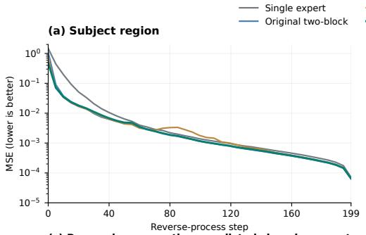

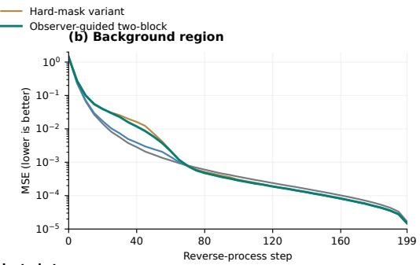

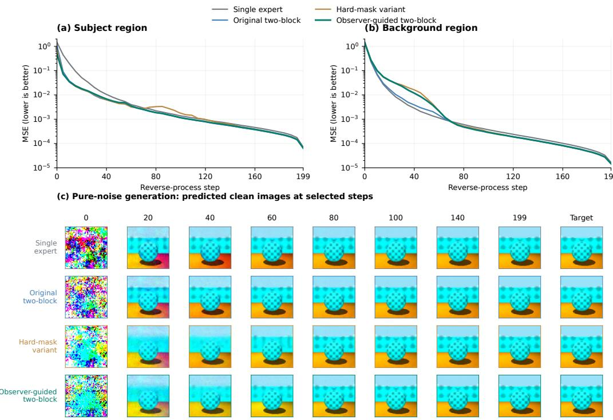  
Figure 6: Absolute subject and background MSE on logarithmic scales, before normalization, with the fuller eight-step qualitative trajectory. The quantitative noised-reference evaluation and the selected pure-noise trajectory are separate experiments.

## Part III Editing with SANA

## G FINAL EDIT-ONLY EVALUATION

This section reports the three final checkpoints on the main evaluation set and a challenge set.

## G.1 OBJECTIVE MEASUREMENTS

CLIP shares the training observer family, and background metrics are conditional on accepted source masks. Each entry shows the defined count against the attempted count, and family-bootstrap uncertainty is kept in the archived summary.

## G.2 AUTOMATED PAIRWISE JUDGMENTS

The local GEditBench-style judge scores instruction following (IF), visual consistency (VC) and visual quality (VQ) in both image orders. These are automated judgments, not human preferences, and order disagreement is reported separately from ties. A staged-text suffix control was also judged for 9/12/9, but it differs from the native suffix only in B0, which has finished executing at every reported branch. Its 216 outputs are byte-identical to the native-suffix outputs, so it is omitted. Repeated judge calls on these identical pairs differ in a single branch-21 consistency outcome.

Table 9: Final edit-only 24-family diagnostics: means (defined/attempted cases). Three seeds per request; step 0 is full regeneration. PSNR with zero MSE is undefined numerically and excluded from its mean.
<table><tr><td>Schedule; branch</td><td>CLIP ∆</td><td>BG LPIPS↓</td><td>BG PSNR↑</td><td>BG SSIM↑</td></tr><tr><td>3/9/18; 0</td><td>0.097 (72/72)</td><td>0.352 (63/72)</td><td>15.652 (63/72)</td><td>0.572 (63/72)</td></tr><tr><td>3/9/18;9</td><td>0.092 (72/72)</td><td>0.225 (63/72)</td><td>19.073 (63/72)</td><td>0.701 (63/72)</td></tr><tr><td>3/9/18; 15</td><td>0.076 (72/72)</td><td>0.108 (63/72)</td><td>24.316 (63/72)</td><td>0.837 (63/72)</td></tr><tr><td>3/9/18; 21</td><td>0.028 (72/72)</td><td>0.030 (63/72)</td><td>31.710 (63/72)</td><td>0.946 (63/72)</td></tr><tr><td>6/12/12; 0</td><td>0.092 (72/72)</td><td>0.321 (61/72)</td><td>16.500 (61/72)</td><td>0.599 (61/72)</td></tr><tr><td>6/12/12; 9</td><td>0.088 (72/72)</td><td>0.227 (61/72)</td><td>19.096 (61/72)</td><td>0.697 (61/72)</td></tr><tr><td>6/12/12; 15</td><td>0.076 (72/72)</td><td>0.113 (61/72)</td><td>24.322 (61/72)</td><td>0.827 (61/72)</td></tr><tr><td>6/12/12; 21</td><td>0.029 (72/72)</td><td>0.033 (61/72)</td><td>31.156 (61/72)</td><td>0.940 (61/72)</td></tr><tr><td>9/12/9; 0</td><td>0.086 (72/72)</td><td>0.301 (60/72)</td><td>17.407 (60/72)</td><td>0.625 (60/72)</td></tr><tr><td>9/12/9; 9</td><td>0.086 (72/72)</td><td>0.230 (60/72)</td><td>19.477 (60/72)</td><td>0.703 (60/72)</td></tr><tr><td>9/12/9; 15</td><td>0.073 (72/72)</td><td>0.113 (60/72)</td><td>24.517 (60/72)</td><td>0.828 (60/72)</td></tr><tr><td>9/12/9; 21</td><td>0.028 (72/72)</td><td>0.040 (60/72)</td><td>30.372 (60/72)</td><td>0.929 (60/72)</td></tr></table>

Table 10: As Table 9, for the 24-case challenge pool.
<table><tr><td>Schedule; branch</td><td>CLIP∆</td><td>BG LPIPS↓</td><td>BG PSNR↑</td><td>BG SSIM↑</td></tr><tr><td>3/9/18; 0</td><td>0.049 (72/72)</td><td>0.415 (10/72)</td><td>15.553 (10/72)</td><td>0.561 (10/72)</td></tr><tr><td>3/9/18; 9</td><td>0.042 (72/72)</td><td>0.198 (10/72)</td><td>21.826 (10/72)</td><td>0.780 (10/72)</td></tr><tr><td>6/12/12; 0</td><td>0.048 (72/72)</td><td>0.451 (11/72)</td><td>15.372 (11/72)</td><td>0.538 (11/72)</td></tr><tr><td>6/12/12; 9</td><td>0.041 (72/72)</td><td>0.244 (11/72)</td><td>20.267 (11/72)</td><td>0.729 (11/72)</td></tr><tr><td>9/12/9; 0</td><td>0.047 (72/72)</td><td>0.425 (12/72)</td><td>16.233 (12/72)</td><td>0.598 (12/72)</td></tr><tr><td>9/12/9; 9</td><td>0.042 (72/72)</td><td>0.252 (12/72)</td><td>20.327 (12/72)</td><td>0.745 (12/72)</td></tr></table>

Table 11: Same-prompt drift at the final checkpoint: eight evaluation families, three seeds. No target edit is requested; these distances measure change from the frozen-source continuation.
<table><tr><td>Schedule; branch</td><td>Whole LPIPS</td><td>PNG MSE</td><td>Latent MSE</td></tr><tr><td>3/9/18; 9</td><td>0.050 (24/24)</td><td>0.003 (24/24)</td><td>0.020 (24/24)</td></tr><tr><td>3/9/18; 15</td><td>0.018 (24/24)</td><td>0.001 (24/24)</td><td>0.004 (24/24)</td></tr><tr><td>3/9/18; 21</td><td>0.005 (24/24)</td><td>0.000 (24/24)</td><td>0.000 (24/24)</td></tr><tr><td>6/12/12; 9</td><td>0.057 (24/24)</td><td>0.003 (24/24)</td><td>0.019 (24/24)</td></tr><tr><td>6/12/12; 15</td><td>0.031 (24/24)</td><td>0.001 (24/24)</td><td>0.006 (24/24)</td></tr><tr><td>6/12/12; 21</td><td>0.012 (24/24)</td><td>0.000 (24/24)</td><td>0.001 (24/24)</td></tr><tr><td>9/12/9; 9</td><td>0.088 (24/24)</td><td>0.005 (24/24)</td><td>0.037 (24/24)</td></tr><tr><td>9/12/9; 15</td><td>0.037 (24/24)</td><td>0.002 (24/24)</td><td>0.008 (24/24)</td></tr><tr><td>9/12/9; 21</td><td>0.026 (24/24)</td><td>0.001 (24/24)</td><td>0.004 (24/24)</td></tr></table>

Table 12: Final 3/9/18 automated comparison: percentages win/loss/order-disagreement/tie/missing for the final checkpoint versus each control. Each cell has 72 planned pairs, 24 families and both image orders. Missing judgments are retained in the denominator.
<table><tr><td>Branch</td><td>Control</td><td>IF</td><td>VC</td><td>VQ</td></tr><tr><td>9</td><td>Initial</td><td>11.1/6.9/22.2/59.7/0.0</td><td>9.7/12.5/34.7/43.1/0.0</td><td>9.7/22.2/41.7/26.4/0.0</td></tr><tr><td>9</td><td>Update 600</td><td>9.7/9.7/11.1/69.4/0.0</td><td>8.3/8.3/25.0/58.3/0.0</td><td>11.1/12.5/44.4/31.9/0.0</td></tr><tr><td>15</td><td>Initial</td><td>0.0/5.6/13.9/80.6/0.0</td><td>2.8/12.5/19.4/65.3/0.0</td><td>4.2/9.7/20.8/65.3/0.0</td></tr><tr><td>15</td><td>Update 600</td><td>0.0/5.6/9.7/84.7/0.0</td><td>0.0/5.6/18.1/76.4/0.0</td><td>2.8/8.3/18.1/70.8/0.0</td></tr><tr><td>21</td><td>Initial</td><td>0.0/0.0/0.0/100.0/0.0</td><td>0.0/0.0/0.0/100.0/0.0</td><td>0.0/0.0/0.0/100.0/0.0</td></tr><tr><td>21</td><td>Update 600</td><td>0.0/0.0/0.0/100.0/0.0</td><td>0.0/0.0/1.4/98.6/0.0</td><td>0.0/0.0/0.0/100.0/0.0</td></tr></table>

Table 13: As Table 12, schedule 6/12/12.
<table><tr><td>Branch</td><td>Control</td><td>IF</td><td>VC</td><td>VQ</td></tr><tr><td>9</td><td>Initial</td><td>11.1/4.2/22.2/62.5/0.0</td><td>12.5/6.9/38.9/41.7/0.0</td><td>11.1/27.8/48.6/12.5/0.0</td></tr><tr><td>9</td><td>Update 600</td><td>6.9/2.8/23.6/66.7/0.0</td><td>6.9/9.7/27.8/55.6/0.0</td><td>16.7/11.1/40.3/31.9/0.0</td></tr><tr><td>15</td><td>Initial</td><td>6.9/4.2/16.7/72.2/0.0</td><td>5.6/11.1/27.8/55.6/0.0</td><td>5.6/16.7/19.4/58.3/0.0</td></tr><tr><td>15</td><td>Update 600</td><td>4.2/2.8/6.9/86.1/0.0</td><td>2.8/5.6/20.8/70.8/0.0</td><td>2.8/15.3/13.9/68.1/0.0</td></tr><tr><td>21</td><td>Initial</td><td>0.0/0.0/5.6/94.4/0.0</td><td>1.4/2.8/18.1/77.8/0.0</td><td>0.0/0.0/11.1/88.9/0.0</td></tr><tr><td>21</td><td>Update 600</td><td>0.0/0.0/1.4/98.6/0.0</td><td>1.4/0.0/9.7/88.9/0.0</td><td>0.0/1.4/2.8/95.8/0.0</td></tr></table>

Table 14: As Table 12, schedule 9/12/9.
<table><tr><td>Branch</td><td>Control</td><td>IF</td><td>VC</td><td>VQ</td></tr><tr><td>9</td><td>Initial</td><td>5.6/22.2/26.4/45.8/0.0</td><td>11.1/26.4/36.1/26.4/0.0</td><td>16.7/36.1/40.3/6.9/0.0</td></tr><tr><td>9</td><td>Update 600</td><td>6.9/9.7/23.6/59.7/0.0</td><td>11.1/22.2/25.0/41.7/0.0</td><td>8.3/23.6/51.4/16.7/0.0</td></tr><tr><td>9</td><td>Native suffix</td><td>25.0/33.3/22.2/19.4/0.0</td><td>33.3/29.2/31.9/5.6/0.0</td><td>22.2/37.5/40.3/0.0/0.0</td></tr><tr><td>15</td><td>Initial</td><td>2.8/12.5/15.3/69.4/0.0</td><td>4.2/22.2/31.9/41.7/0.0</td><td>4.2/19.4/41.7/34.7/0.0</td></tr><tr><td>15</td><td>Update 600</td><td>4.2/6.9/18.1/70.8/0.0</td><td>4.2/18.1/30.6/47.2/0.0</td><td>5.6/16.7/34.7/43.1/0.0</td></tr><tr><td>15</td><td>Native suffix</td><td>6.9/23.6/29.2/40.3/0.0</td><td>18.1/22.2/43.1/16.7/0.0</td><td>18.1/37.5/31.9/12.5/0.0</td></tr><tr><td>21</td><td>Initial</td><td>2.8/1.4/11.1/84.7/0.0</td><td>2.8/19.4/38.9/38.9/0.0</td><td>8.3/13.9/25.0/52.8/0.0</td></tr><tr><td>21</td><td>Update 600</td><td>2.8/1.4/4.2/91.7/0.0</td><td>1.4/9.7/33.3/55.6/0.0</td><td>6.9/4.2/15.3/73.6/0.0</td></tr><tr><td>21</td><td>Native suffix</td><td>4.2/1.4/11.1/83.3/0.0</td><td>2.8/23.6/33.3/40.3/0.0</td><td>6.9/11.1/30.6/51.4/0.0</td></tr></table>

## H PAIRED UNCERTAINTY FOR PREFIX REUSE

This post-hoc analysis uses all 24 evaluation families and their three seeds. For each family we average the paired branch-9-minus-regeneration differences over seeds, then bootstrap families with replacement (10,000 resamples, seed 20260924). Preservation uses seeds with a valid source mask in both arms, and the semantic change uses all attempts. Background measurements cover 22, 21

Table 15: Paired branch-9-minus-regeneration differences with family-bootstrap 95% intervals. Negative LPIPS differences indicate better preservation; negative semantic differences indicate a smaller CLIP margin change.
<table><tr><td>Schedule</td><td>Valid masks</td><td>∆BG LPIPS [95% CI]</td><td>∆semantic proxy [95% CI]</td></tr><tr><td>3/9/18</td><td>63/72</td><td>-0.1248 [-0.1588, -0.0936]</td><td>-0.0046 [-0.0086, -0.0010]</td></tr><tr><td>6/12/12</td><td>61/72</td><td>-0.0924 [-0.1115, -0.0740]</td><td>-0.0037 [-0.0070, -0.0005]</td></tr><tr><td>9/12/9</td><td>60/72</td><td>-0.0696 [-0.0948, -0.0458]</td><td>-0.0007 [-0.0039, 0.0029]</td></tr></table>

and 21 families, and semantic measurements all 24. The table weights families equally, so it can differ slightly from the valid-attempt means in the main text. The preservation interval excludes zero for every schedule. The semantic proxy also decreases for 3/9/18 and 6/12/12, while for 9/12/9 its interval includes zero, which does not prove equal edit effectiveness. Moving the edit point changes which history is retained and which future can still be redirected, and reduced background change can also accompany a weaker subject edit.

Preservation–change tradeoff • 24 families × 3 seeds  
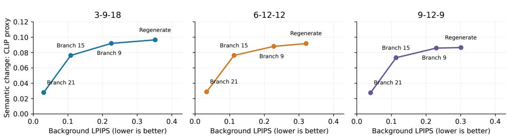  
Figure 7: All pre-specified branch points under the final edit-only checkpoints. Each curve shows a preservation–semantic-proxy tradeoff, not a validated success frontier. Background means are conditional on valid source masks; semantic means use all attempts.

## I LEARNED AND NATIVE CONDITIONS AT AN IDENTICAL PREFIX

This comparison fixes the saved source state and changes only the suffix conditions, using the final 9/12/9 compiler, 24 evaluation families, three seeds and all three branch points. The native control repeats the native target-caption features across the suffix, and source-image and prefix hashes match within every pair. Because the common prefix comes from the frozen initial compiler, this is an intervention on conditions at a matched state, not a comparison of complete native and compiled trajectories.

Table 16: Matched-prefix preservation at the final checkpoint. Background LPIPS uses historical source masks: 60/72 cases from 21 families per branch. Lower is better. The difference and interval give an equally weighted family estimate, whereas the two means average valid attempts.
<table><tr><td>Branch</td><td>Native</td><td>Trained</td><td>Lower in</td><td>∆ [descriptive 95% interval]</td></tr><tr><td>9</td><td>0.2528</td><td>0.2296</td><td>41/60</td><td> $- 0 . 0 2 1 6 \left[ - 0 . 0 4 6 1 , - 0 . 0 0 3 6 \right]$ </td></tr><tr><td>15</td><td>0.1134</td><td>0.1134</td><td>28/60</td><td> $+ 0 . 0 0 0 0 \left[ - 0 . 0 0 6 9 , + 0 . 0 0 6 9 \right]$ </td></tr><tr><td>21</td><td>0.0305</td><td>0.0398</td><td>8/60</td><td> $+ 0 . 0 0 9 0 \left[ + 0 . 0 0 6 2 , + 0 . 0 1 1 9 \right]$ </td></tr></table>

The branch-9 valid-attempt mean decreases by 9.16%, branch 15 is essentially unchanged and branch 21 worsens. Intervals bootstrap the 21 family means (10000 repetitions, seed 20260924). The masks overlap the training observer, and enlarged or moved targets can enter their nominal background, so this does not establish equal editing effectiveness.

Bicycle to motorcycle; seed 303, branch 9  
Native suffix  
Trained suffix  
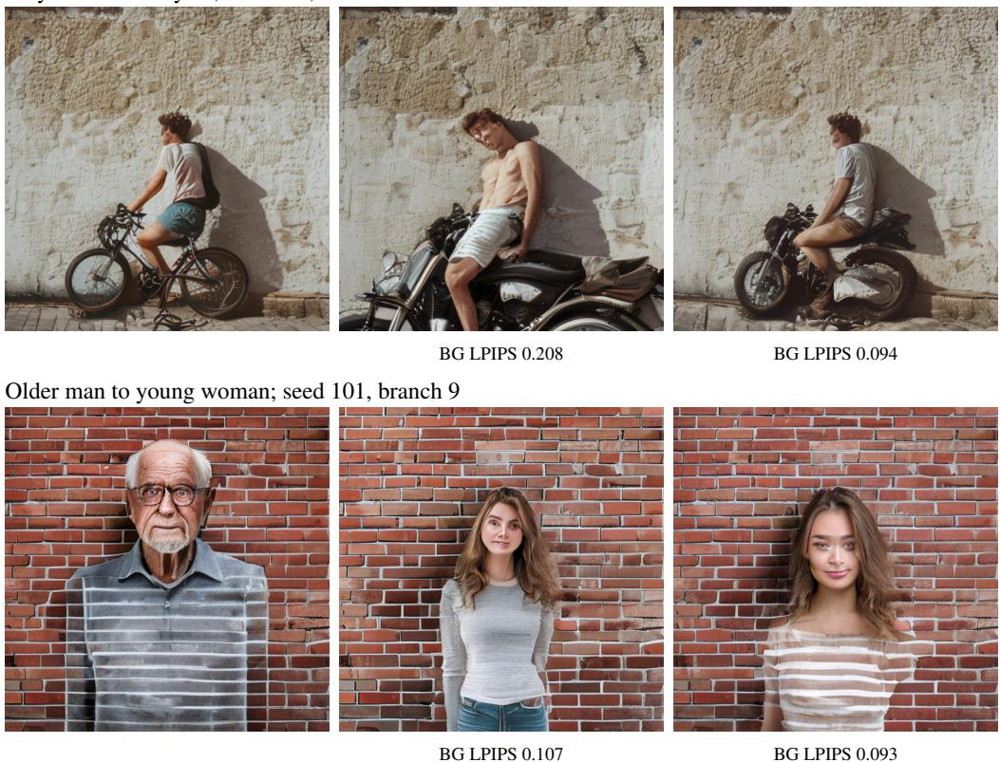  
Figure 8: Selected differences beyond prefix reuse. Both suffixes start from the same state. The trained output better retains the person’s scale and the wall in the first row, and the striped clothing and portrait scale in the second. The bicycle caption also requests napping, which neither edit realizes. Post-hoc examples from the final 9/12/9 compiler, uncropped and unretouched.

Inspection coverage and counterexamples. All 72 source cases and 216 branch comparisons were inspected. Hydrant-to-lamp and bench-to-planter edits often behave similarly under both methods. In an elephant-to-giraffe case both outputs alter the trees despite lower LPIPS for the trained output, and the target caption still contains “trunk”. Other examples preserve the source by failing a requested action or omitting a requested phone.

## J OBSERVER-INDEPENDENT REGION COMPARISONS

The training preservation metric shares its observer with the compiler. This appendix therefore rescores the same outputs on regions defined only by a frozen external detector.

## J.1 INDEPENDENT SOURCE-BOX REGIONS

Protocol. We score the complement of the union of source-only Grounding DINO boxes at the frozen 0.40 threshold, with 0, 5 or 10% padding per box, and use the same region for every method editing a given source. Spatial AlexNet LPIPS is averaged over the defined background pixels. Attempts without a usable box stay in the attempted count. The full cohort has 72 attempts per schedule (24 families, three seeds) and the category-eligible cohort 36 (12 families). Differences are paired by family, seed, schedule and source, and intervals resample families 10,000 times (seed 20260924).

Table 17: Source-box background LPIPS on the full evaluation cohort. Entries are paired mean differences (ours branch 9 minus comparator; lower is better). n is defined/attempted, with missing cases retained.
<table><tr><td>Schedule</td><td>pad</td><td>n</td><td>Regen.</td><td>FlowEdit</td><td>SDEdit</td><td>Native</td></tr><tr><td>3-9-18</td><td>0%</td><td>68/72</td><td>-0.122</td><td>+0.100</td><td>-0.040</td><td>-0.016</td></tr><tr><td>3-9-18</td><td>5%</td><td>65/72</td><td>-0.129</td><td>+0.097</td><td>-0.052</td><td>-0.017</td></tr><tr><td>3-9-18</td><td>10%</td><td>62/72</td><td>-0.127</td><td>+0.097</td><td>-0.056</td><td>-0.016</td></tr><tr><td>6-12-12</td><td>0%</td><td>66/72</td><td>-0.092</td><td>+0.105</td><td>-0.043</td><td>-0.024</td></tr><tr><td>6-12-12</td><td>5%</td><td>62/72</td><td>-0.094</td><td>+0.104</td><td>-0.055</td><td>-0.022</td></tr><tr><td>6-12-12</td><td>10%</td><td>60/72</td><td>-0.090</td><td>+0.100</td><td>-0.064</td><td>-0.023</td></tr><tr><td>9-12-9</td><td>0%</td><td>64/72</td><td>-0.070</td><td>+0.098</td><td>-0.055</td><td>-0.030</td></tr><tr><td>9-12-9</td><td>5%</td><td>62/72</td><td>-0.068</td><td>+0.096</td><td>-0.067</td><td>-0.030</td></tr><tr><td>9-12-9</td><td>10%</td><td>60/72</td><td>-0.066</td><td>+0.092</td><td>-0.075</td><td>-0.027</td></tr></table>

Table 18: As Table 17, on the eligible cohort.
<table><tr><td>Schedule</td><td>pad</td><td>n</td><td>Regen.</td><td>FlowEdit</td><td>SDEdit</td><td>Native</td></tr><tr><td>3-9-18</td><td>0%</td><td>33/36</td><td>-0.114</td><td>+0.114</td><td>-0.023</td><td>-0.011</td></tr><tr><td>3-9-18</td><td>5%</td><td>30/36</td><td>-0.124</td><td>+0.111</td><td>-0.043</td><td>-0.014</td></tr><tr><td>3-9-18</td><td>10%</td><td>30/36</td><td>-0.127</td><td>+0.107</td><td>-0.048</td><td>-0.012</td></tr><tr><td>6-12-12</td><td>0%</td><td>33/36</td><td>-0.083</td><td>+0.109</td><td>-0.035</td><td>-0.029</td></tr><tr><td>6-12-12</td><td>5%</td><td>30/36</td><td>-0.083</td><td>+0.106</td><td>-0.058</td><td>-0.031</td></tr><tr><td>6-12-12</td><td>10%</td><td>30/36</td><td>-0.083</td><td>+0.097</td><td>-0.070</td><td>-0.032</td></tr><tr><td>9-12-9</td><td>0%</td><td>32/36</td><td>-0.062</td><td>+0.094</td><td>-0.050</td><td>-0.031</td></tr><tr><td>9-12-9</td><td>5%</td><td>30/36</td><td>-0.061</td><td>+0.089</td><td>-0.067</td><td>-0.031</td></tr><tr><td>9-12-9</td><td>10%</td><td>29/36</td><td>-0.061</td><td>+0.082</td><td>-0.082</td><td>-0.031</td></tr></table>

Summary. For every schedule and padding, ours at branch 9 has lower source-box background LPIPS than full regeneration and higher LPIPS than FlowEdit–SANA. The SDEdit–SANA and native comparisons depend more on cohort and padding, and the eligible 9/12/9 native intervals at 5 and 10% include zero. The metric does not account for missed source boxes or for edit success.

Table 19: Selected 95% family-bootstrap intervals for the full evaluation cohort. All comparator intervals and RGB MSE are available in the analysis artifact.
<table><tr><td>Comparator</td><td>Schedule</td><td>pad</td><td>n</td><td>∆ [95% interval]</td><td></td></tr><tr><td>Regeneration</td><td>3-9-18</td><td>0%</td><td>68/72</td><td>-0.122</td><td>[-0.155, -0.092]</td></tr><tr><td>Regeneration</td><td>3-9-18</td><td>5%</td><td>65/72</td><td>-0.129</td><td>-0.168, -0.095]</td></tr><tr><td>Regeneration</td><td>3-9-18</td><td>10%</td><td>62/72</td><td>-0.127</td><td>-0.170, -0.090]</td></tr><tr><td>Regeneration</td><td>6-12-12</td><td>0%</td><td>66/72</td><td>-0.092</td><td>[-0.113, -0.073]</td></tr><tr><td>Regeneration</td><td>6-12-12</td><td>5%</td><td>62/72</td><td>-0.094</td><td>-0.116, −0.072]</td></tr><tr><td>Regeneration</td><td>6-12-12</td><td>10%</td><td>60/72</td><td>-0.090</td><td>[-0.110, -0.070]</td></tr><tr><td>Regeneration</td><td>9-12-9</td><td>0%</td><td>64/72</td><td>-0.070</td><td>-0.093, -0.048]</td></tr><tr><td>Regeneration</td><td>9-12-9</td><td>5%</td><td>62/72</td><td>-0.068</td><td>-0.091, -0.047]</td></tr><tr><td>Regeneration</td><td>9-12-9</td><td>10%</td><td>60/72</td><td>-0.066</td><td>[−0.091, −0.043]</td></tr><tr><td>Native shared</td><td>9-12-9</td><td>0%</td><td>64/72</td><td>-0.030</td><td>[−0.054, -0.012]</td></tr><tr><td>Native shared</td><td>9-12-9</td><td>5%</td><td>62/72</td><td>-0.030</td><td>[-0.057, -0.009]</td></tr><tr><td>Native shared</td><td>9-12-9</td><td>10%</td><td>60/72</td><td></td><td>-0.027 [-0.054, -0.006]</td></tr></table>

## J.2 NATIVE SHARED-PATH COMPARISON ACROSS BRANCH POINTS

The protocol follows Appendix J.1. Each entry is the paired mean difference in source-box background LPIPS, ours minus native shared path, so negative values favor ours. Native outputs for 3/9/18 and 6/12/12 are new, and 9/12/9 reuses the existing outputs.

Table 20: Native shared-path source-box LPIPS comparison, full evaluation cohort. Point differences are ours minus native; n is defined/attempted.
<table><tr><td>Schedule</td><td>Branch</td><td>pad 0%</td><td>pad 5%</td><td>pad 10%</td></tr><tr><td>3-9-18</td><td>9</td><td>-0.016 (68/72)</td><td>-0.017 (65/72)</td><td>-0.016 (62/72)</td></tr><tr><td>3-9-18</td><td>15</td><td>+0.003 (68/72)</td><td>+0.003 (65/72)</td><td>+0.003 (62/72)</td></tr><tr><td>3-9-18</td><td>21</td><td>+0.001 (68/72)</td><td>+0.001 (65/72)</td><td>+0.001 (62/72)</td></tr><tr><td>6-12-12</td><td>9</td><td>-0.024 (66/72)</td><td>−0.022 (62/72)</td><td>-0.023 (60/72)</td></tr><tr><td>6-12-12</td><td>15</td><td>−0.002 (66/72)</td><td>-0.001 (62/72)</td><td>-0.000 (60/72)</td></tr><tr><td>6-12-12</td><td>21</td><td>+0.003 (66/72)</td><td>+0.003 (62/72)</td><td>+0.003 (60/72)</td></tr><tr><td>9-12-9</td><td>9</td><td>-0.030 (64/72)</td><td>-0.030 (62/72)</td><td>-0.027 (60/72)</td></tr><tr><td>9-12-9</td><td>15</td><td>−0.005 (64/72)</td><td>-0.004 (62/72)</td><td>-0.002 (60/72)</td></tr><tr><td>9-12-9</td><td>21</td><td>+0.008 (64/72)</td><td>+0.009 (62/72)</td><td>+0.009 (60/72)</td></tr></table>

Table 21: As Table 20, on the eligible cohort.
<table><tr><td>Schedule</td><td>Branch</td><td>pad 0%</td><td>pad 5%</td><td>pad 10%</td></tr><tr><td>3-9-18</td><td>9</td><td>-0.011 (33/36)</td><td>-0.014 (30/36)</td><td>-0.012 (30/36)</td></tr><tr><td>3-9-18</td><td>15</td><td>+0.003 (33/36)</td><td>+0.003 (30/36)</td><td>+0.003 (30/36)</td></tr><tr><td>3-9-18</td><td>21</td><td>+0.002 (33/36)</td><td>+0.002 (30/36)</td><td>+0.002 (30/36)</td></tr><tr><td>6-12-12</td><td>9</td><td>-0.029 (33/36)</td><td>-0.031 (30/36)</td><td>-0.032 (30/36)</td></tr><tr><td>6-12-12</td><td>15</td><td>-0.002 (33/36)</td><td>-0.002 (30/36)</td><td>-0.002 (30/36)</td></tr><tr><td>6-12-12</td><td>21</td><td>+0.003 (33/36)</td><td>+0.003 (30/36)</td><td>+0.003 (30/36)</td></tr><tr><td>9-12-9</td><td>9</td><td>-0.031 (32/36)</td><td>-0.031 (30/36)</td><td>-0.031 (29/36)</td></tr><tr><td>9-12-9</td><td>15</td><td>-0.008 (32/36)</td><td>-0.007 (30/36)</td><td>-0.006 (29/36)</td></tr><tr><td>9-12-9</td><td>21</td><td>+0.008 (32/36)</td><td>+0.009 (30/36)</td><td>+0.010 (29/36)</td></tr></table>

At branch 9 with 5% padding on the full cohort, the paired intervals are $[ - 0 . 0 4 0 7 , - 0 . 0 0 1 6 ]$ [−0.0397, −0.0081] and [−0.0567, −0.0087] for 3/9/18, 6/12/12 and 9/12/9. Every branch point is shown so that branch 9 is not selected after the fact; the remaining intervals are in the analysis artifact.

## K COST OF REUSING A COMMON PREFIX

We compare caching one branch-9 state with recomputing the same prefix before each target continu ation, using four scenes, four target prompts per scene, one noise seed and three timing repetitions on an NVIDIA A800-SXM4-80GB. Both modes include condition encoding, prefix and suffix execution and decoding, and exclude model loading and file writes. Mode order alternates across repetitions. Each saved latent occupies 32 KiB. For m continuations with $N = 3 0$ and $b = 9$ , the two modes cost

Table 22: Mean time over four scenes and three repetitions to produce four target continuations. Every cached endpoint matches its recomputed counterpart exactly.
<table><tr><td>Schedule</td><td>Recomputed (s)</td><td>Cached (s)</td><td>Speedup</td><td>Time saved</td></tr><tr><td>3/9/18</td><td>9.28</td><td>7.19</td><td>1.29×</td><td>22.6%</td></tr><tr><td>6/12/12</td><td>9.20</td><td>7.18</td><td>1.28×</td><td>22.0%</td></tr><tr><td>9/12/9</td><td>9.39</td><td>7.19</td><td>1.31×</td><td>23.4%</td></tr></table>

mN and $b + m ( N - b )$ denoising steps, so four continuations need 93 steps instead of 120 (22.5% fewer). All 144 paired endpoints (three compilers, four scenes, three repetitions, four targets) pass the equality check. Native prompt switching can cache a prefix in the same way, so the saving is a property of the interface rather than of training.

## Part IV Mechanism and interventions

## L SCHEDULE, SOURCE-PATH AND BLOCK INTERVENTIONS

Mechanism tests at the final edit-only checkpoints. We ask whether training changes the response to future conditions, and whether that response depends on the execution schedule or the source path. We use the final checkpoints and the first eight families of the evaluation set with its three seeds.

Training schedule versus inference schedule. A 3 × 3 crossing applies each trained compiler, and its initialization, under all three inference schedules. Within each schedule, all methods resume identical frozen-source prefixes at steps 0, 9, 15 and 21, where step 0 is full regeneration. Each compiler keeps its original encoder clock, so off-diagonal cells test a mismatch between execution and encoder timing. Without repeated training seeds, differences between checkpoints do not establish a causal schedule effect. Across all four branches, 1200 inactive interventions passed exact

Table 23: Complete crossing, shown at branch 15. Cells report CLIP paired margin change / background LPIPS, with defined denominators in parentheses (24 attempted). These proxies do not establish edit success.
<table><tr><td>Training schedule</td><td>3/9/18</td><td>6/12/12</td><td>9/12/9</td></tr><tr><td>3/9/18</td><td>0.074 (24) / 0.129 (24)</td><td>0.070 (24) / 0.133 (23)</td><td>0.075 (24) / 0.139 (22)</td></tr><tr><td>6/12/12</td><td>0.076 (24) / 0.138 (24)</td><td>0.073 (24) / 0.138 (23)</td><td>0.078 (24) / 0.144 (22)</td></tr><tr><td>9/12/9</td><td>0.077 (24) / 0.160 (24)</td><td>0.070 (24) / 0.144 (23)</td><td>0.074 (24) / 0.143 (22)</td></tr><tr><td>Initialization</td><td>0.072 (24) / 0.126 (24)</td><td>0.073 (24) / 0.134 (23)</td><td>0.076 (24) / 0.143 (22)</td></tr></table>

latent equality to their same-compiler source-condition continuation. This is a routing gate, not a learned-specialization result

Matched source versus own source. Three further diagonal conditions generate the source with the trained compiler used for editing. Matched sources isolate the suffix intervention at a fixed state, whereas own sources test the complete path but also change the source image and prefix. Background retention is measured against each condition’s actual source.

Table 24: Diagonal source-path comparison. CLIP paired margin change / background LPIPS (defined denominators); different source modes use different source images.
<table><tr><td>Schedule; branch</td><td>Matched source</td><td>Own source</td></tr><tr><td>3/9/18; 0</td><td>0.101 (24) / 0.399 (24)</td><td>0.101 (24) / 0.390 (22)</td></tr><tr><td>3/9/18; 9</td><td>0.091 (24) / 0.266 (24)</td><td>0.092 (24) / 0.254 (22)</td></tr><tr><td>3/9/18; 15</td><td>0.074 (24) / 0.129 (24)</td><td>0.074 (24) / 0.126 (22)</td></tr><tr><td>3/9/18; 21</td><td>0.019 (24) / 0.036 (24)</td><td>0.022 (24) / 0.038 (22)</td></tr><tr><td>6/12/12; 0</td><td>0.095 (24) / 0.375 (23)</td><td>0.095 (24) / 0.369 (22)</td></tr><tr><td>6/12/12; 9</td><td>0.089 (24) / 0.272 (23)</td><td>0.088 (24) / 0.260 (22)</td></tr><tr><td>6/12/12; 15</td><td>0.073 (24) / 0.138 (23)</td><td>0.077 (24) / 0.131 (22)</td></tr><tr><td>6/12/12; 21</td><td>0.027 (24) / 0.042 (23)</td><td>0.024 (24) / 0.035 (22)</td></tr><tr><td>9/12/9; 0</td><td>0.093 (24) / 0.336 (22)</td><td>0.093 (24) / 0.331 (21)</td></tr><tr><td>9/12/9; 9</td><td>0.091 (24) / 0.264 (22)</td><td>0.088 (24) / 0.248 (21)</td></tr><tr><td>9/12/9; 15</td><td>0.074 (24) / 0.143 (22)</td><td>0.071 (24) / 0.124 (21)</td></tr><tr><td>9/12/9; 21</td><td>0.025 (24) / 0.049 (22)</td><td>0.027 (24) / 0.034 (21)</td></tr></table>

Table 25: Block interventions at branch 0, where all blocks are active. CLIP paired margin change / background LPIPS (defined denominators). Initial and trained methods share the frozen source; these are descriptive measurements.
<table><tr><td>Compiler</td><td>B0</td><td>B1</td><td>B2</td><td>all</td><td>nochange</td></tr><tr><td rowspan="2">Trained 3/9/18</td><td>0.001 (24)</td><td>0.015 (24)</td><td>0.090 (24)</td><td>0.101 (24)</td><td>-0.000 (24)</td></tr><tr><td>0.179 (24)</td><td>0.306 (24)</td><td>0.237 (24)</td><td>0.399 (24)</td><td>0.147 (24)</td></tr><tr><td>Trained 6/12/12</td><td>0.001 (24) 0.204 (23)</td><td>0.040 (24) 0.301 (23)</td><td>0.048 (24)</td><td>0.095 (24)</td><td>0.000 (24)</td></tr><tr><td>Trained 9/12/9</td><td>0.004 (24)</td><td>0.059 (24)</td><td>0.114 (23) 0.027 (24)</td><td>0.375 (23) 0.093 (24)</td><td>0.070 (23) 0.000 (24)</td></tr><tr><td></td><td>0.221 (22) 0.000 (24)</td><td>0.245 (22) 0.012 (24)</td><td>0.094 (22) 0.087 (24)</td><td>0.336 (22) 0.099 (24)</td><td>0.078 (22) 0.000 (24)</td></tr><tr><td>Init. 3/9/18</td><td>0.088 (24) -0.000 (24)</td><td>0.319 (24) 0.039 (24)</td><td>0.191 (24) 0.047 (24)</td><td>0.411 (24) 0.093 (24)</td><td>0.000 (24) 0.000 (24)</td></tr><tr><td>Init. 6/12/12</td><td>0.190 (23) 0.006 (24)</td><td>0.312 (23) 0.060 (24)</td><td>0.078 (23)</td><td>0.382 (23)</td><td>0.000 (23)</td></tr><tr><td>Init. 9/12/9</td><td>0.208 (22)</td><td>0.256 (22)</td><td>0.026 (24) 0.039 (22)</td><td>0.094 (24) 0.343 (22)</td><td>0.000 (24) 0.000 (22)</td></tr></table>

Block-specific interventions. Source and target conditions share a common sequence length with zero-valued masked padding, and a padding-only control (“nochange”) records the resulting numerical drift. For the initialization and the three trained compilers, at a common saved prefix, we replace the source conditions by target conditions in $B _ { 0 } , B _ { 1 } , B _ { 2 }$ , all blocks or none, at branches 0, 9, 15 and 21. Replacing a block whose execution has ended must have no effect, which is a routing check rather than evidence of specialization. Specialization would additionally require differentiated effects among active blocks relative to initialization.

## M STAGE READOUTS AND SINGLE-BLOCK INTERVENTIONS

The model’s own generation path. Here we generate from noise with the final 6/12/12 compiler itself, rather than editing a frozen reference path. Eight fixed evaluation families at close framing and seed 101 are compared with the role-fitted initialization. Each model receives the source caption, subject-only and background-only changes, and six single-block substitutions, for 144 trajectorie and 576 archived images. The displayed case is the first family, not a selected winner.

B0 - step 6  
B1 - step 18  
B2 - step 30  
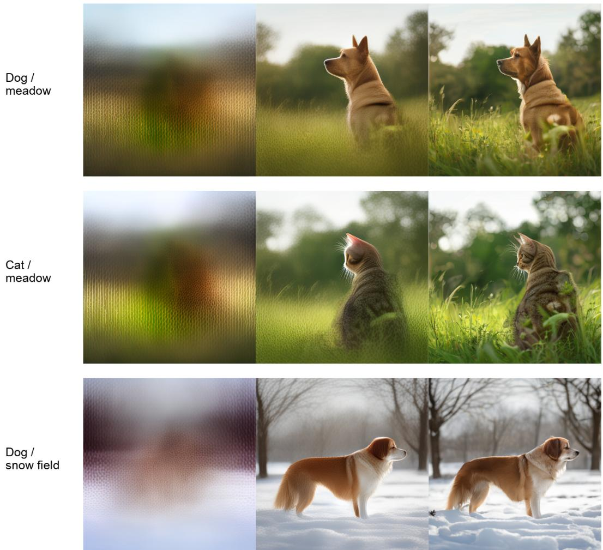  
Figure 9: Generation along the learned path. Final compiler, identical initial noise, with source, subject-changed and background-changed captions. Columns show ${ \widehat { x } } _ { 0 } = x _ { t } - \sigma _ { t } v _ { \theta } ( x _ { t } , c _ { k } )$ from the last executed denoiser evaluation in each block (steps 6, 18, 30), not decodes of noisy states. B0 exposes coarse scene appearance, B1 makes the subject recognizable and B2 completes the image. Changing the scene also changes pose and appearance, so stage progression alone is not factor independence.

Which block controls the change? Each substitution replaces exactly one source block and its mask with those compiled from the target caption, holding all other conditions, masks and noise fixed. In the displayed case, replacing B0 with the cat-conditioned block leaves the dog largely unchanged, whereas replacing B2 changes its category. A scene-conditioned B0 changes the dog and composition without producing snow, and replacing B1 produces snow but also changes pose. Later blocks can therefore still determine scene content, and B2 can change semantics rather than only texture.

Interpretation and limits. The eight-family gallery shows a useful temporal organization but not a universal scene-only B0, since the zebra-on-beach caption already produces an animal-shaped silhouette in its B0 readout, and single-block substitutions can create hybrid anatomy such as elephant–giraffe mixtures.

Several features of the implementation let temporal organization and strict independence differ. Role fitting masks a full-caption encoding whose unmasked token features may retain subject context. The masks are cumulative and the compiler shares a context trunk, so suffix training can change early-block outputs. All blocks also act through the same spatial state and denoiser. For fixed masks, with $x _ { t + 1 } = x _ { t } + \Delta \sigma _ { t } v ( x _ { t } , c _ { k } )$ , a condition perturbation propagates as

$$
\delta x _ { t + 1 } = \left( I + \Delta \sigma _ { t } D _ { x } v \right) \delta x _ { t } + \Delta \sigma _ { t } D _ { c } v \delta c _ { k } \quad \mathrm { t o ~ f i r s t ~ o r d e r } .\tag{11}
$$

Temporal routing alone does not force the background projection of this response to vanish, consistent with the criterion in Appendix C.1. Source-box metrics add their own coupling, as they count legitimate changes outside the old silhouette as background damage, and foreground rectangles contain background pixels.

## N AN EXPLICIT-BACKGROUND INPUT-ISOLATION VARIANT

Intervention and its scope. The full-caption compiler masks contextual text features, so B0 can retain subject information even when its direct token channel is masked. We therefore test a training free input intervention on the final 6/12/12 checkpoint. An explicit background sentence, taken from structured scenario metadata and describing the scene and lighting, is encoded separately through the text encoder, compiler and frozen mask predictor, and its B0 replaces the full-caption B0. B1 and B2 are unchanged and carry the subject, framing and viewpoint instructions, so the early composition prior changes as well. For a suffix resumed at step 6 or later the target B0 is no longer executed, and a background change requested after that point must be expressed by the suffix.

A precise invariance, rather than full-image independence. Write $c _ { 0 } = F _ { 0 } ( E ( b ) )$ and $m _ { 0 } =$ $M _ { 0 } ( E ( b ) )$ for the separately compiled background b, and let s denote the subject description. For fixed model, noise z and deterministic sampler, the state at the B0 boundary satisfies

$$
x _ { 6 } ( b , s , z ) = \Phi _ { 0 } ( z ; F _ { 0 } ( E ( b ) ) , M _ { 0 } ( E ( b ) ) ) = x _ { 6 } ( b , s ^ { \prime } , z ) .\tag{12}
$$

This invariance to subject input follows from the routing, not from training. It does not make foreground and background pixels independent after B1/B2, which still act on a shared spatial state.

Initial mechanism check. All eight fixed evaluation families at seed 101 and close framing were tested, giving 48 trajectories and 192 stage and endpoint images. Under subject replacement, the isolated B0 condition, clean prediction and post-block latent are exactly unchanged in 8/8 cases, against 0/8 for the original compiler. Changing the background changes the isolated B0 state in 8/8 cases, which rules out a constant state. Under the full-caption compiler, by contrast, the step-6 state already carries the replaced subject, with leak magnitudes from 0.081 to 0.510 in state and from 1.02 to 9.50 in the clean prediction. In the reviewed galleries the target categories stay recognizable, but subject scale and composition change.

Complete matched evaluation. Because the check above fixes one seed and framing, we also ran the full frozen protocol on the same checkpoint, with 48 sources (8 scene families, 2 framings, 3 seeds), both edit directions, five starts {0, 6, 9, 15, 21} and six methods. This gives 2,880 outputs plus 96 source and reconstruction images. Every source is regenerated by the B0-isolated compiler and all controls are rerun on it, with detector thresholds, source-box masks and the CLIP evaluator reused without retuning.

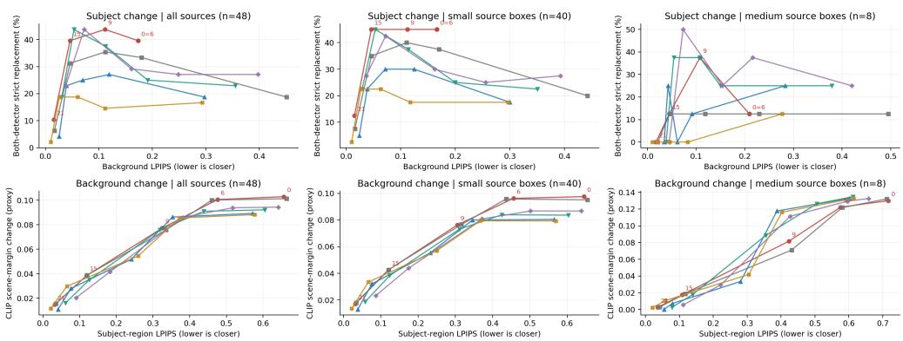  
B0-isolated learnedNative shared stateFlowEdit PNG CFG4FlowEdit PNG CFG6FlowEdit PNG CFG8 FlowEdit latent CFG4  
8 families x 2 requested framings x 3 seeds; starts 0/6/9/15/21. Boxes are not segmentation. Source size is measured anew; curves do not equate editing success or prove independence. Strata with no sources on this cohort are omitted here and reported as empty in the text: large, unknown.

Figure 10: Edit strength against source closeness, all five starts. Each curve traces one method across starts 0, 6, 9, 15 and 21, for the whole cohort and the two non-empty source-size strata. Later starts stay closer to the source but edit less, so low LPIPS at a late start indicates a weak edit. Subject panels use both-detector strict replacement, and background panels the uncalibrated CLIP scene margin. The medium stratum holds only eight sources.

Matched subject-replacement comparison. Native suffixes receive exactly the same saved state, all five starts are retained, and source category failures stay in the denominator. Start 0 is full regeneration only for learned and native conditions, and for FlowEdit it is the start of its imageconditioned ODE. Isolated start 0 and start 6 give identical images in all 48 cases because their B0 prefix is identical.

Table 26: B0-isolated source cohort: subject replacement. Strict category replacement requires source category present in the source, target present after editing and source category absent after editing. Counts use all 48 attempts; Both requires both calibrated detectors. BG LPIPS uses 5% source-box padding; parentheses give defined backgrounds. Lower LPIPS is useful only with successful editing.
<table><tr><td>Start</td><td>Method</td><td>DINO</td><td>OWLv2</td><td>Both</td><td>BG LPIPS (n)</td></tr><tr><td>0</td><td>B0-isolated learned</td><td>19</td><td>48</td><td>19</td><td>0.173 (48)</td></tr><tr><td>0</td><td>Native shared state</td><td>9</td><td>48</td><td>9</td><td>0.451 (48)</td></tr><tr><td>0</td><td>FlowEdit PNG, CFG4</td><td>9</td><td>48</td><td>9</td><td>0.297 (48)</td></tr><tr><td>0</td><td>FlowEdit PNG, CFG6</td><td>11</td><td>48</td><td>11</td><td>0.355 (48)</td></tr><tr><td>0</td><td>FlowEdit PNG, CFG8</td><td>13</td><td>48</td><td>13</td><td>0.397 (48)</td></tr><tr><td>0</td><td>FlowEdit latent, CFG4</td><td>8</td><td>48</td><td>8</td><td>0.293 (48)</td></tr><tr><td>6</td><td>BO-isolated learned</td><td>19</td><td>48</td><td>19</td><td>0.173 (48)</td></tr><tr><td>6</td><td>Native shared state</td><td>16</td><td>48</td><td>16</td><td>0.180 (48)</td></tr><tr><td>6</td><td>FlowEdit PNG, CFG4</td><td>13</td><td>48</td><td>13</td><td>0.119 (48)</td></tr><tr><td>6</td><td>FlowEdit PNG, CFG6</td><td>12</td><td>48</td><td>12</td><td>0.191 (48)</td></tr><tr><td>6</td><td>FlowEdit PNG, CFG8</td><td>13</td><td>48</td><td>13</td><td>0.249 (48)</td></tr><tr><td>6</td><td>FlowEdit latent, CFG4</td><td>7</td><td>48</td><td>7</td><td>0.112 (48)</td></tr><tr><td>9</td><td>B0-isolated learned</td><td>21</td><td>48</td><td>21</td><td>0.111 (48)</td></tr><tr><td>9</td><td>Native shared state</td><td>17</td><td>48</td><td>17</td><td>0.112 (48)</td></tr><tr><td>9</td><td>FlowEdit PNG, CFG4</td><td>12</td><td>47</td><td>12</td><td>0.070 (48)</td></tr><tr><td>9</td><td>FlowEdit PNG, CFG6</td><td>18</td><td>48</td><td>18</td><td>0.113 (48)</td></tr><tr><td>9</td><td>FlowEdit PNG, CFG8</td><td>14</td><td>48</td><td>14</td><td>0.161 (48)</td></tr><tr><td>9</td><td>FlowEdit latent, CFG4</td><td>9</td><td>47</td><td>9</td><td>0.060 (48)</td></tr><tr><td>15</td><td>BO-isolated learned</td><td>19</td><td>48</td><td>19</td><td>0.046 (48)</td></tr><tr><td>15</td><td>Native shared state</td><td>15</td><td>48</td><td>15</td><td>0.046 (48)</td></tr><tr><td>15</td><td>FlowEdit PNG, CFG4</td><td>11</td><td>48</td><td>11</td><td>0.039 (48)</td></tr><tr><td>15</td><td>FlowEdit PNG, CFG6</td><td>21</td><td>48</td><td>21</td><td>0.053 (48)</td></tr><tr><td>15</td><td>FlowEdit PNG, CFG8</td><td>21</td><td>47</td><td>21</td><td>0.072 (48)</td></tr><tr><td>15</td><td>FlowEdit latent, CFG4</td><td>9</td><td>48</td><td>9</td><td>0.026 (48)</td></tr><tr><td>21</td><td>B0-isolated learned</td><td>5</td><td>38</td><td>5</td><td>0.016 (48)</td></tr><tr><td>21</td><td>Native shared state</td><td>3</td><td>41</td><td>3</td><td>0.017 (48)</td></tr><tr><td>21</td><td>FlowEdit PNG, CFG4</td><td>2</td><td>36</td><td>2</td><td>0.026 (48)</td></tr><tr><td>21</td><td>FlowEdit PNG, CFG6</td><td>9</td><td>45</td><td>9</td><td>0.031 (48)</td></tr><tr><td>21</td><td>FlowEdit PNG, CFG8</td><td>11</td><td>48</td><td>11</td><td>0.038 (48)</td></tr><tr><td>21</td><td>FlowEdit latent, CFG4</td><td>1</td><td>40</td><td>1</td><td>0.010 (48)</td></tr></table>

Matched background-change comparison. Subject-category retention is measured separately from the requested background change, the CLIP scene margin is an uncalibrated directional proxy, and region LPIPS is computed inside the source subject boxes, which also contain background pixels.

Table 27: B0-isolated source cohort: background changes. Retained counts require the original subject category in both source and output, using all 48 attempts. CLIP denotes scene-margin change; FG LPIPS uses 5% padded source boxes, with defined-region counts in parentheses.
<table><tr><td>Start</td><td>Method</td><td>DINO</td><td>OWLv2</td><td>CLIP</td><td>FG LPIPS (n)</td></tr><tr><td>0</td><td>B0-isolated learned</td><td>48</td><td>48</td><td>0.103</td><td>0.657 (48)</td></tr><tr><td>0</td><td>Native shared state</td><td>48</td><td>48</td><td>0.101</td><td>0.664 (48)</td></tr><tr><td>0</td><td>FlowEdit PNG, CFG4</td><td>48</td><td>48</td><td>0.089</td><td>0.572 (48)</td></tr><tr><td>0</td><td>FlowEdit PNG, CFG6</td><td>48</td><td>48</td><td>0.092</td><td>0.605 (48)</td></tr><tr><td>0</td><td>FlowEdit PNG, CFG8</td><td>48</td><td>48</td><td>0.094</td><td>0.642 (48)</td></tr><tr><td>0</td><td>FlowEdit latent, CFG4</td><td>48</td><td>48</td><td>0.088</td><td>0.577 (48)</td></tr><tr><td>6</td><td>B0-isolated learned</td><td>48</td><td>48</td><td>0.101</td><td>0.476 (48)</td></tr><tr><td>6</td><td>Native shared state</td><td>48</td><td>48</td><td>0.100</td><td>0.460 (48)</td></tr><tr><td>6</td><td>FlowEdit PNG, CFG4</td><td>48</td><td>47</td><td>0.086</td><td>0.353 (48)</td></tr><tr><td>6</td><td>FlowEdit PNG, CFG6</td><td>48</td><td>48</td><td>0.091</td><td>0.439 (48)</td></tr><tr><td>6</td><td>FlowEdit PNG, CFG8</td><td>48</td><td>48</td><td>0.094</td><td>0.517 (48)</td></tr><tr><td>6</td><td>FlowEdit latent, CFG4</td><td>48</td><td>48</td><td>0.086</td><td>0.373 (48)</td></tr><tr><td>9</td><td>B0-isolated learned</td><td>48</td><td>48</td><td>0.077</td><td>0.325 (48)</td></tr><tr><td>9</td><td>Native shared state</td><td>48</td><td>48</td><td>0.076</td><td>0.336 (48)</td></tr><tr><td>9</td><td>FlowEdit PNG, CFG4</td><td>48</td><td>48</td><td>0.052</td><td>0.241 (48)</td></tr><tr><td>9</td><td>FlowEdit PNG, CFG6</td><td>48</td><td>48</td><td>0.076</td><td>0.319 (48)</td></tr><tr><td>9</td><td>FlowEdit PNG, CFG8</td><td>48</td><td>48</td><td>0.086</td><td>0.381 (48)</td></tr><tr><td>9</td><td>FlowEdit latent, CFG4</td><td>48</td><td>48</td><td>0.054</td><td>0.259 (48)</td></tr><tr><td>15</td><td>B0-isolated learned</td><td>48</td><td>48</td><td>0.039</td><td>0.119 (48)</td></tr><tr><td>15</td><td>Native shared state</td><td>48</td><td>48</td><td>0.039</td><td>0.120 (48)</td></tr><tr><td>15</td><td>FlowEdit PNG, CFG4</td><td>48</td><td>48</td><td>0.028</td><td>0.077 (48)</td></tr><tr><td>15</td><td>FlowEdit PNG, CFG6</td><td>48</td><td>48</td><td>0.035</td><td>0.126 (48)</td></tr><tr><td>15</td><td>FlowEdit PNG, CFG8</td><td>48</td><td>48</td><td>0.041</td><td>0.182 (48)</td></tr><tr><td>15</td><td>FlowEdit latent, CFG4</td><td>48</td><td>48</td><td>0.030</td><td>0.065 (48)</td></tr><tr><td>21</td><td>B0-isolated learned</td><td>48</td><td>48</td><td>0.015</td><td>0.032 (48)</td></tr><tr><td>21</td><td>Native shared state</td><td>48</td><td>48</td><td>0.016</td><td>0.035 (48)</td></tr><tr><td>21</td><td>FlowEdit PNG, CFG4</td><td>48</td><td>48</td><td>0.011</td><td>0.041 (48)</td></tr><tr><td>21</td><td>FlowEdit PNG, CFG6</td><td>48</td><td>48</td><td>0.016</td><td>0.061 (48)</td></tr><tr><td>21</td><td>FlowEdit PNG, CFG8</td><td>48</td><td>48</td><td>0.020</td><td>0.090 (48)</td></tr><tr><td>21</td><td>FlowEdit latent, CFG4</td><td>48</td><td>48</td><td>0.012</td><td>0.021 (48)</td></tr></table>

What exact invariance does and does not buy. Equation 12 holds bit-exactly, so the B0 boundary state is free of subject input. The rendered background can nevertheless change substantially. With the same seed, background sentence and B0 state, and only the subject text changed, the mean background-region LPIPS against the source is 0.1735 at 5% padding (48/48 defined). This residual comes from B1/B2 acting on a shared spatial state. Isolating the input makes the early program subject-independent but does not by itself preserve the background, which is what resuming a saved prefix does.

Recomputed source-size strata. Source size is recomputed on the new sources, since the intervention can change subject scale. At zero padding the frozen Grounding DINO boxes place 40/48 sources in the small stratum, 8/48 in the medium stratum and none in the large stratum. No largesource contrast is therefore available, and earlier large-source findings are neither reproduced nor contradicted.

Paired differences against the native shared-state control. Each row pairs the same case, direction and start; intervals are descriptive family bootstrap percentiles over the eight families, with no multiplicity or prior-search correction. At start 0 the native control regenerates rather than resuming a suffix, so its large LPIPS gap is not an editing result. From start 6 onward the two share the saved state, and most remaining differences are small relative to their intervals. The background rows are zero because both methods retain the source subject in all 48 cases, a ceiling of the retention proxy.

Table 28: B0-isolated learned minus native shared state, all 48 paired cases. Detector entries are percentage-point differences in strict replacement (subject) or source-subject retention (background); LPIPS entries are differences in the 5% padded region metric, where a negative value is closer to the source. Intervals are unadjusted descriptive family bootstrap percentiles.
<table><tr><td>Direction</td><td>Start</td><td>Both/retained (pp)</td><td>95% interval</td><td>Region LPIPS</td></tr><tr><td>subject</td><td>0</td><td>+20.8</td><td>[+4.2, +45.8]</td><td>-0.277</td></tr><tr><td>subject</td><td>6</td><td>+6.2</td><td>[+0.0, +18.8]</td><td>-0.007</td></tr><tr><td>subject</td><td>9</td><td>+8.3</td><td>[+2.1, +14.6]</td><td>-0.001</td></tr><tr><td>subject</td><td>15</td><td>+8.3</td><td>[+2.1, +16.7]</td><td>-0.001</td></tr><tr><td>subject</td><td>21</td><td>+4.2</td><td>[+0.0, +10.4]</td><td>-0.001</td></tr><tr><td>background</td><td>0</td><td>+0.0</td><td>[+0.0, +0.0]</td><td>-0.007</td></tr><tr><td>background</td><td>6</td><td>+0.0</td><td>[+0.0, +0.0]</td><td>+0.016</td></tr><tr><td>background</td><td>9</td><td>+0.0</td><td>[+0.0, +0.0]</td><td>-0.010</td></tr><tr><td>background</td><td>15</td><td>+0.0</td><td>[+0.0, +0.0]</td><td>-0.001</td></tr><tr><td>background</td><td>21</td><td>+0.0</td><td>[+0.0, +0.0]</td><td>-0.003</td></tr></table>

Distribution-quality scope. MJHQ-30K supplies full captions but no background descriptions, so the FID table does not cover this variant and no earlier value is reused for it. A preflight of the frozen automatic scene compiler found one empty B0 text among the first 32 sorted MJHQ captions, and only 3/8 subject-replacement pairs yielded identical scene text. The automatic route therefore fails the input-invariance contract, and no FID is reported for the variant.

## Part V Stress tests and example galleries

## O BIDIRECTIONAL EDITING STRESS TEST

Frozen design. We also build 48 sources from four subject pairs (dog–cat, cow–horse, elephant– giraffe, horse–zebra), two scene pairs (meadow–snow field, beach–rocky desert), two framings and three seeds. Each source receives a subject-only and a background-only edit under six methods at branches 9, 15 and 21, for 1728 outputs. The learned route uses the final 6/12/12 checkpoint, sources come from the frozen reference compiler, and native continuation shares the saved state. FlowEdit–SANA uses source CFG 4 and target CFG 4, 6 or 8, and a latent-input CFG 4 control removes the PNG/VAE round trip.

Measurements. Strict replacement uses the frozen DINO (0.40) and OWLv2 (0.31) thresholds separately and jointly. Source-box regions with 5% padding give background LPIPS for subject edits and subject-region LPIPS for background edits, and all 48 sources have defined regions. The scene-direction CLIP margin is a continuous proxy, not a calibrated success rate. Subject retention under background edits is 48/48 for every method and branch, so it cannot distinguish methods.

Table 29: Complete bidirectional grid, 48 attempts per direction and row. D/O/B are strict replacement counts for DINO, OWLv2 and both. BG and FG are non-target LPIPS for subject and background edits (lower is better), and Scene ∆ is the CLIP margin change.
<table><tr><td>Branch</td><td>Method</td><td>D/O/B</td><td>BG↓</td><td>FG↓</td><td>Scene ∆</td></tr><tr><td>9</td><td>Learned suffix</td><td>13/48/13</td><td>0.1195</td><td>0.2953</td><td>0.0844</td></tr><tr><td>9</td><td>Native shared-state</td><td>8/48/8</td><td>0.1210</td><td>0.3095</td><td>0.0826</td></tr><tr><td>9</td><td>FlowEdit PNG, CFG 4</td><td>10/48/10</td><td>0.0762</td><td>0.1890</td><td>0.0597</td></tr><tr><td>9</td><td>FlowEdit PNG, CFG 6</td><td>14/48/14</td><td>0.1059</td><td>0.2424</td><td>0.0816</td></tr><tr><td>9</td><td>FlowEdit PNG, CFG 8</td><td>12/48/12</td><td>0.1407</td><td>0.3065</td><td>0.0869</td></tr><tr><td>9</td><td>FlowEdit latent, CFG 4</td><td>10/48/10</td><td>0.0697</td><td>0.2002</td><td>0.0637</td></tr><tr><td>15</td><td>Learned suffix</td><td>9/45/9</td><td>0.0548</td><td>0.1030</td><td>0.0394</td></tr><tr><td>15</td><td>Native shared-state</td><td>6/46/6</td><td>0.0550</td><td>0.0995</td><td>0.0386</td></tr><tr><td>15</td><td>FlowEdit PNG, CFG 4</td><td>6/43/6</td><td>0.0398</td><td>0.0658</td><td>0.0252</td></tr><tr><td>15</td><td>FlowEdit PNG, CFG 6</td><td>10/48/10</td><td>0.0534</td><td>0.1057</td><td>0.0322</td></tr><tr><td>15</td><td>FlowEdit PNG, CFG 8</td><td>12/47/12</td><td>0.0707</td><td>0.1570</td><td>0.0389</td></tr><tr><td>15</td><td>FlowEdit latent, CFG 4</td><td>5/44/5</td><td>0.0295</td><td>0.0572</td><td>0.0254</td></tr><tr><td>21</td><td>Learned suffix</td><td>2/25/2</td><td>0.0177</td><td>0.0331</td><td>0.0149</td></tr><tr><td>21</td><td>Native shared-state</td><td>3/26/3</td><td>0.0172</td><td>0.0309</td><td>0.0157</td></tr><tr><td>21</td><td>FlowEdit PNG, CFG 4</td><td>3/22/3</td><td>0.0249</td><td>0.0366</td><td>0.0104</td></tr><tr><td>21</td><td>FlowEdit PNG, CFG 6</td><td>4/31/4</td><td>0.0299</td><td>0.0542</td><td>0.0161</td></tr><tr><td>21</td><td>FlowEdit PNG, CFG 8</td><td>4/35/4</td><td>0.0376</td><td>0.0801</td><td>0.0210</td></tr><tr><td>21</td><td>FlowEdit latent, CFG 4</td><td>2/23/2</td><td>0.0113</td><td>0.0176</td><td>0.0106</td></tr></table>

Interpretation. At branch 9, learned versus native continuation yields 13 versus 8 strict joint replacements, with similar background LPIPS (0.1195 versus 0.1210). The paired replacement difference is 10.4 percentage points, with a 95% family-bootstrap interval of [2.1,22.9]; the background-LPIPS difference is −0.0015 with interval [−0.0044, 0.0014]. For background edits at the same branch, subject-region LPIPS is 0.2953 versus 0.3095 (difference −0.0142, interval [−0.0289, −0.0034]), while the scene-direction proxy is slightly higher. Intervals use 10,000 resamples of the eight families. These are local improvements over native continuation. FlowEdit CFG 6 obtains 14 joint replacements with lower background LPIPS (0.1059) at branch 9, so they do not establish superiority over the full FlowEdit grid.

Source size and visual checks. Source-box areas define small $( < 1 0 \% , n = 1 1 )$ , medium (10–25%, n = 14) and large $( \geq 2 5 \% , n = 2 3 )$ strata. At branch 9 the large-group joint counts are 2, 2, 1, 3, 3 and 2 in table order, so a larger-subject advantage is not supported. OWLv2 replacement saturates at branch 9, and DINO has a calibration shortfall for the target class in 12/48 cases (8/23 large). Visual inspection finds stronger late subject changes, but also hybrid anatomy, background edits that alter pose and late scene edits with little visible effect.

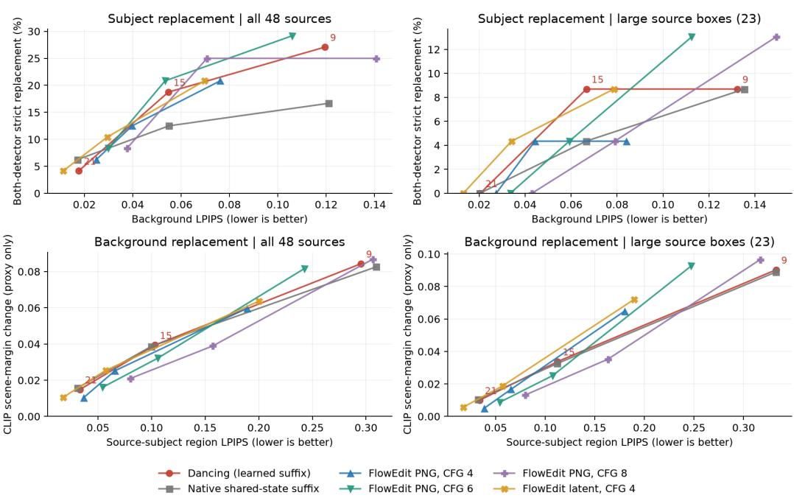  
Bidirectional editing: complete frozen method and branch grid  
Synthetic development stress test; 8 families × 2 framings × 3 seeds. Branches 9/15/21 (Dancing labels)  
Box regions are not segmentation; CLiP is not verified background success. Curves are descriptive, not matched-success comparisons.

Figure 11: Bidirectional stress-test tradeoffs for all sources and for large source boxes. Lines connect the three measured branch points. Upper panels use strict replacement, lower panels the scenedirection CLIP change.

## P ADDITIONAL FINAL-CHECKPOINT EXAMPLES

The examples below use the final compiler with schedule 6/12/12 at branch 9. In each row both target outputs share the compiler and initial noise, and prefix reuse resumes the saved source state. They were selected after reviewing 120 source/regeneration/edit triplets (all 72 family–seed pairs for this schedule and seed 101 for the other two) to show where prefix reuse visibly retains context that full regeneration loses. Images are uncropped and unretouched, and the selection does not estimate success frequency. Failures also occur. In a surfboard-to-kayak edit the person stands on the kayak instead of holding it, as do the image-input controls, and a racket-to-bat edit alters the court and duplicates the implement.

Ours: prefix reuse  
Full regeneration  
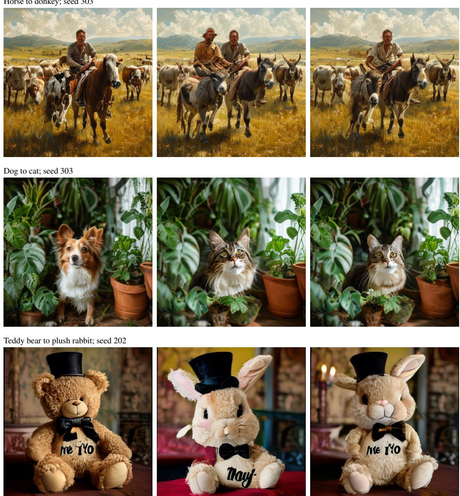  
Figure 12: Prefix reuse retains what regeneration discards. Regeneration adds a second rider, reframes the plants and replaces the room and the lettering. Prefix reuse keeps the single rider and herd, the potted plants and their layout, and the candlelit room, the bow tie and the “me to you” lettering, while changing the requested subject.