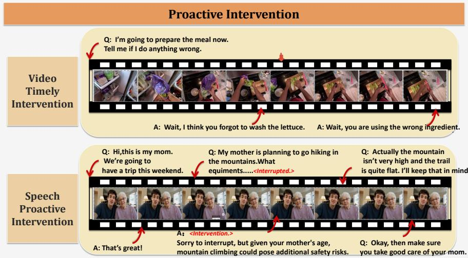
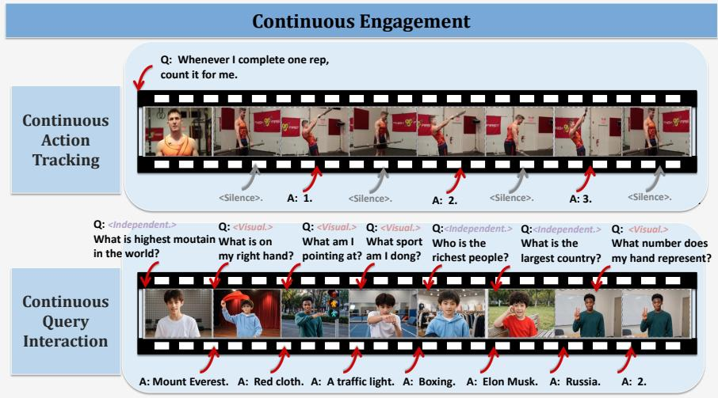
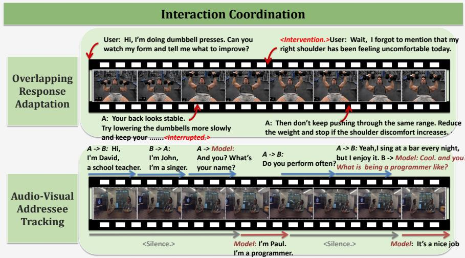
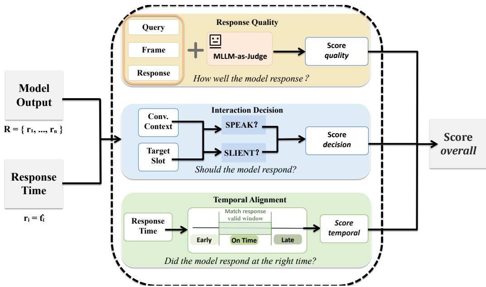

# DIVE: BENCHMARKING FULL-DUPLEX INTERAC-TION WITH VISUAL ENGAGEMENT IN CONTINUOUS STREAMS

Yuhang Chen<sup>1∗</sup> Guangyue Liu<sup>1∗</sup> Shilong Liu<sup>2</sup> <sup>1</sup>Huazhong University of Science and Technology <sup>2</sup>Princeton University thisiscyh@gmail.com

## ABSTRACT

Recent advances in multimodal large language models (MLLMs) have substantially improved spoken interaction and video understanding. Existing online and streaming benchmarks primarily assess causal multimodal perception through timestamped question answering, whereas real-world interaction requires models to continuously identify task-relevant multimodal cues and decide whether, when, and how to respond. This leaves open how well current models can sustain real-time interaction throughout an evolving multimodal stream. To address this gap, we introduce DIVE, a benchmark for evaluating full-duplex interaction with visual engagement under continuous and realistic multimodal streams. Our benchmark organizes six tasks into three complementary interaction scenarios. (1) Proactive Intervention evaluates whether models can identify emerging visual or semantic cues and intervene at the appropriate moment. (2) Continuous Engagement evaluates sustained participation through continuous visual tracking and visually grounded query interaction. (3) Interaction Coordination evaluates how models coordinate listening and speaking under overlapping and multi-party interactions. DIVE contains 525 audio/video samples with fine-grained human annotations and precise temporal metadata, covering six task-oriented interaction settings grounded in realistic scenarios. Its evaluation protocol separates response quality, participation decisions, and response timing. We evaluate representative real-time models using response quality, window response rates, and reaction latency. Experiments show that leading real-time models achieve sub-second average response latency, yet their average window response rates remain at or below 53.77%. Response quality varies substantially across models and tasks, with adapting ongoing responses to newly arriving information remaining particularly challenging. We hope DIVE facilitates progress toward more natural and capable real-time multimodal interactive systems.

## 1 INTRODUCTION

Multimodal large language models (MLLMs) have made substantial progress in video understanding and multimodal reasoning. Representative systems such as GPT-4o Hurst et al. (2024), Gemini Team et al. (2023), and a growing number of open-source MLLMs have demonstrated strong capabilities in understanding multimodal inputs. Correspondingly, widely used benchmarks such as Video-MME Fu et al. (2025) and LVBench Wang et al. (2025a) evaluate increasingly diverse and long-context video understanding capabilities, yet they largely follow an offline evaluation paradigm. This setting differs fundamentally from real-world interaction. This limitation has motivated growing interest in streaming multimodal understanding. Recent models are designed to process continuously arriving inputs and determine when a response should be produced. Meanwhile, benchmarks such as StreamingBench Lin et al. (2026b) and OVO-Bench Niu et al. (2025) assess models in real-time settings. In parallel, another line of research has focused on full-duplex interaction, where perception and generation can overlap in time. Early full-duplex systems were predominantly centered on speech interaction. Moshi Defossez et al. (2024) models dialogue as par-´ allel speech-to-speech streams. Correspondingly, the Full-Duplex-Bench Lin et al. (2025; 2026a) series evaluates a range of interactive speech behaviors. More recently, full-duplex interaction has been extended to joint visual and audio perception together with native multimodal output, with TML Interaction Models Lab (2026) and MiniCPM-o 4.5 Cui et al. (2026) serving as representative examples. Recent benchmarks such as Omni-DuplexEval He et al. (2026) have also begun to eval uate real-time duplex omni-modal interaction through continuous and proactive response scenarios. These benchmarks increasingly cover proactive response, continuous monitoring, and interruption handling, but often assess these capabilities within isolated response windows rather than over the course of sustained interaction.

Table 1: Comparison of DIVE with representative offline, streaming, and full-duplex interaction benchmarks. V and A denote video and audio, respectively. Duplex indicates concurrent perception and generation, while Video Cue indicates that task-relevant visual cues explicitly determine when or how the model should respond during an ongoing interaction. The six task dimensions correspond to our interaction taxonomy: VTI denotes Video Timely Intervention, SPI Speech Proactive Intervention, CQI Continuous Query Interaction, ORA Overlapping Response Adaptation, AVAT Audio-Visual Addressee Tracking, and CAT Continuous Action Tracking.
<table><tr><td rowspan="2">Benchmark</td><td rowspan="2">Modality Duplex</td><td rowspan="2"></td><td rowspan="2">Video Cue</td><td colspan="2">Proactive Intervention</td><td colspan="2">Continuous Engagement</td><td colspan="2">Interaction Continuous Coordination Engagement</td></tr><tr><td>VTI</td><td>SPI</td><td>CQI</td><td>ORA</td><td>AVAT</td><td>CAT</td></tr><tr><td>Offline Benchmarks</td><td></td><td></td><td></td><td></td><td></td><td></td><td></td><td></td><td></td></tr><tr><td>MVBench Li et al. (2024)</td><td>V</td><td>x</td><td>X</td><td>X</td><td>X</td><td>x</td><td>X</td><td>X</td><td>X</td></tr><tr><td>Video-MME Fu et al. (2025)</td><td>V</td><td>x</td><td>X</td><td>x</td><td>x</td><td>x</td><td>x</td><td>x</td><td>x</td></tr><tr><td>MLVU Zhou et al. (2025)</td><td>V</td><td>x</td><td>X</td><td>X</td><td>x</td><td>x</td><td>x</td><td>x</td><td>x</td></tr><tr><td>LongVideoBench Wu et al. (2024)</td><td>V</td><td>x</td><td>x</td><td>X</td><td>x</td><td>x</td><td>x</td><td>x</td><td>x</td></tr><tr><td>WorldSense Hong et al. (2026)</td><td>V, A</td><td>x</td><td>x</td><td>x</td><td>x</td><td>x</td><td>x</td><td>x</td><td>x</td></tr><tr><td>Online / Streaming Benchmarks</td><td></td><td></td><td></td><td></td><td></td><td></td><td></td><td></td><td></td></tr><tr><td>StreamingBench Lin et al. (2026b)</td><td>V, A</td><td>x</td><td></td><td></td><td>X</td><td></td><td>X</td><td>x</td><td>X</td></tr><tr><td>OVO-Bench Niu et al. (2025)</td><td>V</td><td>x</td><td></td><td>X</td><td>X</td><td>x</td><td>X</td><td>x</td><td></td></tr><tr><td>OmniMMI Wang et al. (2025c)</td><td>V, A</td><td>x</td><td></td><td>V</td><td>X</td><td></td><td>x</td><td>x</td><td>X</td></tr><tr><td>ProactiveVideoQA Wang et al. (2025b)</td><td>V, A</td><td>x</td><td></td><td>V</td><td>x</td><td>x</td><td>X</td><td>x</td><td>X</td></tr><tr><td>PhoStream Lu et al. (2026a)</td><td>V, A</td><td>x</td><td></td><td>x</td><td>x</td><td>x</td><td>x</td><td>x</td><td>x</td></tr><tr><td>RIVER Shi et al. (2026)</td><td>V</td><td>x</td><td></td><td>x</td><td>x</td><td>x</td><td>x</td><td>x</td><td>x</td></tr><tr><td>Full-Duplex Interaction Benchmarks</td><td></td><td></td><td></td><td></td><td></td><td></td><td></td><td></td><td></td></tr><tr><td>FD-Bench Lin et al. (2025; 2026a)</td><td>A</td><td></td><td>X</td><td>X</td><td>X</td><td>x</td><td></td><td>x</td><td>X</td></tr><tr><td>FLEXI Ge et al. (2025)</td><td>A</td><td></td><td>X</td><td>X</td><td></td><td>x</td><td></td><td>x</td><td>x</td></tr><tr><td>HumDial-FDBench Wang et al. (2026a)</td><td>A</td><td></td><td>X</td><td>X</td><td>X</td><td>x</td><td></td><td>x</td><td>x</td></tr><tr><td>VideoFDB Mazumdar et al. (2026)</td><td>V, A</td><td></td><td></td><td>X</td><td>X</td><td>x</td><td></td><td>x</td><td>X</td></tr><tr><td>Omni-DuplexEval He et al. (2026)</td><td>V, A</td><td></td><td></td><td>V</td><td>X</td><td>x</td><td>X</td><td>x</td><td>X</td></tr><tr><td>OmniInteract Lu et al. (2026b)</td><td>V, A</td><td></td><td></td><td></td><td>x</td><td></td><td></td><td>x</td><td>V</td></tr><tr><td>DIVE</td><td>V, A</td><td></td><td></td><td></td><td></td><td></td><td></td><td></td><td></td></tr></table>

Table 2: Task-wise distribution of DIVE evaluation instances. ORA and AVAT each contain 56 base scenarios with two conditions per scenario, yielding 112 instances per task. In total, DIVE comprises 525 evaluation instances constructed from 413 base scenarios.
<table><tr><td>Task</td><td>VTI</td><td>SPI</td><td>CQI</td><td>ORA</td><td>AVAT</td><td>CAT</td><td>Total</td></tr><tr><td>Instances</td><td>164</td><td>50</td><td>50</td><td>112</td><td>112</td><td>37</td><td>525</td></tr></table>

To study these interaction requirements, we introduce DIVE, a benchmark for full-duplex audio visual interaction under continuous and realistic multimodal streams. Our benchmark systemati cally evaluates three complementary capabilities. DIVE contains 525 audio and video samples with fine-grained annotations and precise temporal information, covering diverse task-oriented scenarios grounded in realistic interactions. Its coverage of both audio and visual settings enables the evaluation of native full-duplex models as well as modality-specific streaming systems. Our experiments reveal that fast responses alone do not ensure reliable full-duplex interaction. Although leading realtime systems achieve sub-second average response latency, their window response rates leave considerable room for improvement, particularly for speech-driven proactive intervention. Meanwhile, response quality varies substantially across models and tasks, and adapting ongoing responses to newly arriving information remains challenging. These findings highlight the importance of evaluating response timing and content quality together under continuous multimodal streams.

## 2 RELATED WORKS

## 2.1 DUPLEX MULTIMODAL MODELS

Duplex modeling has been explored most extensively in real-time speech interaction. The GPT-Realtime series OpenAI (2025) and Gemini 3.1 Flash Live Google DeepMind (2026b) provide low-latency end-to-end speech interaction. Moshi Defossez et al. (2024) and MoshiRAG Chien´ et al. (2026) support simultaneous listening and speaking, and OmniFlatten Zhang et al. (2025) enables seamless full-duplex spoken dialogue within a unified autoregressive framework. Related efforts extend real-time speech modeling in complementary directions: MoshiVis Royer et al. (2025) augments duplex speech interaction with visual context, while Voxtral Realtime Liu et al. (2026a) develops stream-synchronous modeling for low-latency speech recognition. More recent systems move toward multimodal duplex interaction. Proprietary systems such as TML Interaction Models Lab (2026) and SeedRealtime Seeddance (2026) advance real-time interaction to full-duplex multimodal settings, continuously processing audio, video, and text inputs while producing concurrent outputs over ongoing interaction streams. In parallel, openly released models such as DuplexOmni Huang et al. (2026b) and Aero Realtime Zhang et al. (2026b) pursue the same paradigm. Together, these systems represent a shift from turn-based multimodal interaction toward continuous full-duplex modeling, where incoming multimodal observations and model responses are jointly coordinated throughout the interaction.

## 2.2 STREAMING AND DUPLEX BENCHMARKS

Recent benchmarks have increasingly evaluated real-time and full-duplex interaction beyond conventional offline understanding. Full-Duplex-Bench Lin et al. (2025; 2026a), FLEXI Ge et al. (2025), HumDial-FDBench Wang et al. (2026a), EchoChain Modi et al. (2026), DuplexSLA Zhang et al. (2026a), and DuplexWorld Bhosale et al. (2026) primarily focus on spoken interaction, covering turn-taking, interruption, conversational state tracking, and response timing. More recently, evaluation has expanded toward multimodal settings. VideoFDB Mazumdar et al. (2026) evaluates audio-visual conversational capabilities, while Omni-DuplexEval He et al. (2026) and OmniInteract Lu et al. (2026b) further broaden the scope of evaluation to include proactive response, continuous monitoring, and interruption-aware interaction over streaming multimodal inputs. In contrast, DIVE complements these settings with explicit task-level requirements for risk intervention, response revision, repeated action counting, and addressee-dependent participation.

## 3 DIVE

## 3.1 TAXONOMY

Real-time full-duplex interaction requires a model to maintain an evolving understanding of the audio inputs and visual cues, identify task-relevant evidence as it emerges, and integrate it with ongoing speech to decide how to behave in real time. DIVE therefore organizes interaction into three complementary scenarios. Proactive Intervention evaluates whether models can recognize emerging visual or semantic evidence that calls for timely intervention. Continuous Engagement evaluates whether models can maintain visual context over time to track recurring actions and answer successive, visually grounded queries. Interaction Coordination evaluates whether models can use ongoing audio-visual cues to adapt responses under overlap and determine when an utterance is directed toward the model. Together, these scenarios cover six tasks that examine how models perceive, reason over, and act upon continually evolving multimodal context. DIVE comprises 525 evaluation instances across six tasks, constructed from 413 base scenarios (Table 2). ORA and AVAT each contain 56 scenarios with two condition-specific variants, yielding 112 instances per task. The other four tasks contribute 301 instances in total, with one instance per scenario.



Figure 1: Examples of the tasks in Proactive Intervention. <Interrupted.> marks where the ongoing utterance is interrupted, whereas <Intervention.> marks where the model proactively intervenes.  
  
Figure 2: Examples of the tasks in Continuous Engagement. <Visual.> indicates visually grounded queries, while <Independent.> indicates general queries independent of the visual content.

## 3.2 PROACTIVE INTERVENTION

Proactive Intervention evaluates whether a model can identify emerging mistakes or risks from an ongoing interaction and intervene at an appropriate moment. We consider two complementary settings with visual- and speech-driven triggers.

Video Timely Intervention. We construct this task from egocentric procedural datasets that provide temporally localized annotations of execution and procedural errors across diverse activities, including PIE-V Loginova & Keller (2026), MATT Li et al. (2026), Ego-EXTRA Ragusa et al. (2026), and CaptainCook4D Peddi et al. (2024). Specifically, the model receives a persistent instruction before the activity begins and is expected to intervene once sufficient visual evidence of the mistake becomes available. We further annotate the earliest moment at which the mistake becomes visually identifiable, providing a reference point for evaluating intervention timing.

Speech Proactive Intervention. We construct speech-driven proactive intervention scenarios from LLaVAShield Huang et al. (2026a) and LlamaPIE Chen et al. (2025), supplemented with manually authored cases. We convert unsafe situations into natural spoken narratives and generate corresponding videos with Wan 3.0 Wan et al. (2025) for scenarios containing visual cues. Risk information is progressively revealed through audio-visual cues, requiring timely intervention once sufficient evidence emerges.

  
Figure 3: Example of each task in Interaction Coordination. <Silence.> indicates that the model remains silent.

## 3.3 CONTINUOUS ENGAGEMENT

Continuous Engagement evaluates whether a model can maintain active participation in an evolving interaction and produce repeated or successive responses over time. We consider two settings involving ongoing action tracking and interleaved query answering.

Continuous Action Tracking. We construct this task from repetitive-action datasets including Rep-Count Hu et al. (2022), Multi-RepCount Zhao et al. (2025), and CPR-rac Liu et al. (2026b). Their repetition-level annotations are converted into temporally aligned counting interactions, where the model receives a persistent instruction: it must generate a response upon completion of each target action, and stay silent between repetitions. This setup evaluates both continuous visual tracking and precise response timing.

Continuous Query Interaction. We construct sequential query sequences from Live-Aid Lei et al. (2026), supplemented with manually authored scenarios. Each sequence alternates between two categories of questions: visually grounded questions, whose answers depend on the current video content, and video-independent questions that can be answered without visual evidence. For manually designed cases, we generate the corresponding videos with Wan 3.0 Wan et al. (2025). The model must dynamically switch between visual grounding and general reasoning as successive queries arrive.

## 3.4 INTERACTION COORDINATION

Interaction Coordination evaluates a model’s ability to produce well-timed responses that coordinate with incoming user behavior in overlapping and multi-party interactions. We consider two distinct settings: adapting its responses when interruptions occur, and determining appropriate moments for the model itself to engage in the conversation.

Overlapping Response Adaptation. We adapt interruptions and state-update scenarios from EchoChain Modi et al. (2026) and HumDial-FDBench Wang et al. (2026a). We rewrite interruptions to introduce meaningful corrections, new constraints, or contextual updates; we also augment the original dialogues with visually relevant information. Corresponding videos are then generated to form audio-visual interactions, requiring the model to continue perceiving incoming context while speaking and adapt its ongoing response accordingly.

Audio-Visual Addressee Tracking. We construct participation patterns from multi-party dialogue resources such as Speak or Stay Silent Bhagtani et al. (2026) and When2Speak Nama et al. (2026), where a target participant must decide whether to speak or remain silent at each interaction point. We augment these textual conversations with manually crafted visual cues, and additionally incorporate natural multi-party videos from Multi-TPC Lee & Deng (2026) and EasyCom Donley et al. (2021). The resulting samples require the model to combine conversational context with cues such as gaze and speaker orientation to determine whether it is being addressed and should respond.

  
Figure 4: Overview of the DIVE evaluation framework. Interaction Decision, which measures whether the model responds when required and remains silent when appropriate; Temporal Alignment, which categorizes required responses as early, on-time, late, or missed relative to the annotated response windows; and Response Quality, which assesses whether the first response assigned to each required interaction event satisfies its task-specific content requirements.

## 3.5 EVALUATION

Conventional multimodal evaluation primarily focuses on whether a model produces a semantically correct response, while continuous full-duplex interaction additionally requires the model to decide whether and when to respond. A response may be content-correct yet interactionally inappropriate: the model may speak when it should remain silent, respond prematurely before sufficient evidence is gathered, or reply after the proper interaction window has passed. We therefore introduce a unified evaluation framework along three complementary dimensions: Interaction Decision, Temporal Alignment, and Response Quality. An overview of the evaluation pipeline is shown in Fig. 4. Consider a model output sequence

$$
R = \{ r _ { i } = ( y _ { i } , \hat { t } _ { i } ) \} _ { i = 1 } ^ { N } ,\tag{1}
$$

where $y _ { i }$ denotes the generated response and $\hat { t } _ { i }$ denotes its response timestamp; for each annotated interaction slot $j ,$ DIVE provides the expected interaction decision $d _ { j } \in \{ \bar { \mathrm { S P E A K } } , \mathrm { S I L E N T } \}$ and, when a response is expected, a valid response window

$$
W _ { j } = [ t _ { j } ^ { \mathrm { s t a r t } } , t _ { j } ^ { \mathrm { e n d } } ) .\tag{2}
$$

Interaction Decision. For each task, let $\mathcal { P }$ denote the set of annotated response-required events. For each $j \in \mathcal { P }$ , let $m _ { j } \in \{ 0 , 1 \}$ indicate whether the fixed event-matching procedure assigns a model response to that event, independently of its content correctness or temporal alignment. An event without an assigned response has $m _ { j } = 0$ . The assigned responses are subsequently evaluated for temporal alignment and response quality.

Temporal Alignment. Temporal Alignment evaluates when the model responds relative to the availability of sufficient evidence. For each response-required event $j ,$ the valid response window is

Table 3: Window response rate (%) on the six DIVE tasks. Higher is better. Avg. is the unweighted mean across the six tasks.
<table><tr><td>Model</td><td>VTI↑</td><td>SPI↑</td><td>CQI↑</td><td>ORA ↑</td><td>AVAT ↑</td><td>CAT ↑</td><td>Avg. ↑</td></tr><tr><td colspan="8">Native Audio-Visual Models</td></tr><tr><td>Aero-Realtime-4B</td><td>53.7</td><td>12.3</td><td>8.7</td><td>8.2</td><td>19.9</td><td>20.3</td><td>20.52</td></tr><tr><td>MiniCPM-o 4.5</td><td>14.6</td><td>24.8</td><td>13.1</td><td>7.6</td><td>9.9</td><td>19.7</td><td>14.95</td></tr><tr><td>DuplexOmni</td><td>21.1</td><td>10.6</td><td>28.6</td><td>9.1</td><td>11.8</td><td>23.4</td><td>17.43</td></tr><tr><td>Qwen3-Omni-30B-A3B-Instruct</td><td>19.8</td><td>20.3</td><td>21.2</td><td>10.1</td><td>18.5</td><td>10.0</td><td>16.65</td></tr><tr><td>GPT-Realtime-2.1</td><td>100.0</td><td>20.0</td><td>44.3</td><td>56.5</td><td>41.9</td><td>59.9</td><td>53.77</td></tr><tr><td>Gemini-3.1-Flash-Live</td><td>89.6</td><td>20.9</td><td>34.2</td><td>39.7</td><td>25.7</td><td>33.4</td><td>40.58</td></tr><tr><td>Qwen3.5-Omni-Plus-Realtime</td><td>100.0</td><td>19.8</td><td>31.6</td><td>37.6</td><td>31.1</td><td>28.5</td><td>41.43</td></tr><tr><td colspan="8">Streaming Visual Models with Timestamp-Aligned Text</td></tr><tr><td>StreamingVLM</td><td>19.4</td><td>11.1</td><td>12.5</td><td>16.8</td><td>17.4</td><td>21.5</td><td>16.45</td></tr><tr><td>Mage-VL</td><td>46.5</td><td>14.6</td><td>22.7</td><td>18.8</td><td>24.7</td><td>23.9</td><td>25.20</td></tr><tr><td>JoyAI-VL-Interaction</td><td>17.5</td><td>21.9</td><td>17.8</td><td>34.7</td><td>23.3</td><td>26.2</td><td>23.57</td></tr><tr><td>MOSS-VL-Realtime</td><td>10.6</td><td>15.4</td><td>18.2</td><td>14.5</td><td>8.5</td><td>26.3</td><td>15.58</td></tr></table>

$W _ { j } = [ t _ { j } ^ { \mathrm { s t a r t } } , t _ { j } ^ { \mathrm { e n d } } )$ . Let $\hat { t } _ { j }$ denote the observable onset of its assigned response on the output channel specified for that model configuration. We assign every required event to exactly one temporal category:

$$
z _ { j } = \left\{ \begin{array} { l l } { \mathrm { M i s s e d , } } & { m _ { j } = 0 , } \\ { \mathrm { E a r l y , } } & { m _ { j } = 1 \wedge \hat { t } _ { j } < t _ { j } ^ { \mathrm { s t a r t } } , } \\ { \mathrm { O n \mathrm { - } T i m e , } } & { m _ { j } = 1 \wedge t _ { j } ^ { \mathrm { s t a r t } } \leq \hat { t } _ { j } < t _ { j } ^ { \mathrm { e n d } } , } \\ { \mathrm { L a t e , } } & { m _ { j } = 1 \wedge \hat { t } _ { j } \geq t _ { j } ^ { \mathrm { e n d } } . } \end{array} \right.\tag{3}
$$

All four category rates use $| \mathcal { P } |$ as their denominator and sum to one. In particular, the window response rate is

$$
\mathrm { W R R } = \frac { \sum _ { j \in \mathcal { P } } [ z _ { j } = \mathrm { O n } \cdot T i m e ] } { | \mathcal { P } | } .\tag{4}
$$

Content correctness is evaluated separately. We report $\ell _ { j } = \hat { t } _ { j } - t _ { j } ^ { \mathrm { s t a r t } }$ only for response-required time windows.

Response Quality. We use GPT-5.6 Terra to assign a binary content-quality label $v _ { c , k } \in \{ 0 , 1 \}$ to each model response k assigned to response-required event c in task $\tau .$ Each response is evaluated against the event-specific instruction, reference requirement, and applicable context. Let $\mathcal { C } _ { \tau }$ denote the set of annotated response-required events in task τ, and let $n _ { c }$ denote the number of responses assigned to event $c .$ We compute response quality as a response-level micro-average over all assigned responses:

$$
S _ { \mathrm { q u a l i t y } } ^ { ( \tau ) } = \frac { \sum _ { c \in \mathcal { C } _ { \tau } } \sum _ { k = 1 } ^ { n _ { c } } v _ { c , k } } { \sum _ { c \in \mathcal { C } _ { \tau } } n _ { c } } .\tag{5}
$$

Events with no assigned responses do not contribute to this score, while missed responses are evaluated separately by Interaction Decision and Temporal Alignment. The same aggregation procedure is applied separately to all six tasks.

## 4 EXPERIMENTS

We evaluate a set of recent real-time multimodal models with native support for both visual and audio inputs, including DuplexOmni Huang et al. (2026b), Aero Realtime Zhang et al. (2026b), MiniCPM-o 4.5 Cui et al. (2026), Qwen3-Omni Xu et al. (2025), Qwen3.5- Omni-Plus-Realtime Team (2026), Gemini 3.1 Flash Live Google DeepMind (2026a) and GPT-Realtime-2.1 OpenAI (2026). For these models, we preserve the original audio and video streams and follow their native streaming or full-duplex inference protocols, allowing them to continuously perceive the evolving audio-visual context and generate responses in real time.

Table 4: Response quality on the six DIVE tasks. Scores are scaled by ×100 for readability (higher is better). Avg. is the unweighted mean across the six tasks.
<table><tr><td>Model</td><td>VTI↑</td><td>SPI↑</td><td>CQI↑</td><td>ORA ↑</td><td>AVAT ↑</td><td>CAT ↑</td><td>Avg. ↑</td></tr><tr><td colspan="8">Native Audio-Visual Models</td></tr><tr><td>Aero-Realtime-4B</td><td>2.6</td><td>13.4</td><td>9.8</td><td>2.3</td><td>0.9</td><td>4.8</td><td>5.63</td></tr><tr><td>MiniCPM-o 4.5</td><td>13.2</td><td>18.7</td><td>11.6</td><td>8.8</td><td>2.3</td><td>10.3</td><td>10.82</td></tr><tr><td>DuplexOmni</td><td>11.2</td><td>16.5</td><td>9.5</td><td>7.3</td><td>14.2</td><td>8.7</td><td>11.23</td></tr><tr><td>Qwen3-Omni-30B-A3B-Instruct</td><td>16.6</td><td>21.5</td><td>17.2</td><td>12.3</td><td>21.2</td><td>14.1</td><td>17.15</td></tr><tr><td>GPT-Realtime-2.1</td><td>65.3</td><td>59.7</td><td>43.2</td><td>37.8</td><td>71.2</td><td>34.4</td><td>51.93</td></tr><tr><td>Gemini-3.1-Flash-Live</td><td>59.6</td><td>61.3</td><td>42.1</td><td>33.2</td><td>88.4</td><td>53.7</td><td>56.38</td></tr><tr><td>Qwen3.5-Omni-Plus-Realtime</td><td>51.2</td><td>54.2</td><td>39.5</td><td>34.2</td><td>70.4</td><td>32.9</td><td>47.07</td></tr><tr><td colspan="8">Streaming Visual Models with Timestamp-Aligned Text</td></tr><tr><td>StreamingVLM</td><td>10.7</td><td>16.4</td><td>25.9</td><td>11.4</td><td>25.7</td><td>23.4</td><td>18.92</td></tr><tr><td>Mage-VL</td><td>12.8</td><td>14.9</td><td>16.8</td><td>17.3</td><td>45.7</td><td>37.9</td><td>24.23</td></tr><tr><td>JoyAI-VL-Interaction</td><td>27.2</td><td>18.3</td><td>17.6</td><td>20.1</td><td>22.5</td><td>29.3</td><td>22.50</td></tr><tr><td>MOSS-VL-Realtime</td><td>23.5</td><td>10.9</td><td>11.5</td><td>14.7</td><td>18.5</td><td>19.2</td><td>16.38</td></tr></table>

For streaming visual models without native audio input, including JoyAI-VL-Interaction Yao et al. (2026), Mage-VL Yang et al. (2026), MOSS-VL-Realtime Wang et al. (2026b), and StreamingVLM Xu et al. (2026), we retain the video and provide timestamp-aligned transcripts in place of the original audio. Transcript content is revealed incrementally along the speech timeline. Results for this input setting are reported separately from those for native audio-visual models.

## 4.1 MAIN RESULTS

Response Quality Remains Uneven Across Models and Tasks. As shown in Table 4, Gemini-3.1-Flash-Live achieves the highest average response quality score of 56.38, followed by GPT-Realtime-2.1 and Qwen3.5-Omni-Plus-Realtime with 51.93 and 47.07, respectively. Among the evaluated open models, Mage-VL obtains the highest average score of 24.23, indicating a pronounced performance gap between the leading proprietary and open models. The leading models also exhibit different strengths: Gemini performs best on SPI, AVAT, and CAT, while GPT-Realtime-2.1 leads on VTI, CQI, and ORA. Nevertheless, the three highest-scoring models all score lower on ORA than on VTI and SPI, highlighting the difficulty of adapting response content when new information arrives during an ongoing response. These results suggest that current models still struggle to produce consistently high-quality responses across diverse and evolving interaction contexts.

Low Average Latency Does Not Ensure Consistent Window Compliance. Table 3 shows that low average latency does not necessarily translate into consistently responding within the valid interaction windows. GPT-Realtime-2.1 achieves the highest average window response rate of 53.77%, followed by Qwen3.5-Omni-Plus-Realtime at 41.43% and Gemini-3.1-Flash-Live at 40.58%. Despite their sub-second average response latencies, these models still leave considerable room for improvement in meeting the annotated response windows. Performance also varies considerably across tasks. GPT-Realtime-2.1 and Qwen3.5-Omni-Plus-Realtime both reach 100.0% on VTI, but achieve only 20.0% and 19.8% on SPI, respectively. Even the best-performing model on SPI, MiniCPM-o 4.5, reaches only 24.8%. This disparity highlights speech-driven proactive intervention as a particularly demanding setting, and underscores the need to evaluate window compliance alongside average response latency.

Substantial Response Delays Persist in Open Models. Proprietary models markedly outperform open models in terms of response latency (Table 5). Among all evaluated open models, the best-performing Aero-Realtime-4B still has an average response latency of 2.567 s; several other models take more than 5 s to respond after the earliest appropriate interaction moment. In contrast, recent proprietary real-time interaction systems substantially reduce this delay. Qwen3.5-Omni-Plus-Realtime, GPT-Realtime-2.1, and Gemini 3.1 Flash Live all achieve an average latency below 1 second. This gap suggests that real-time multimodal understanding alone does not guarantee timely interaction, and dedicated real-time interaction systems can significantly improve responsiveness through optimized end-to-end streaming inference.

Table 5: Response latency (seconds) on the six DIVE tasks. Latency is measured relative to the earliest valid response time, and lower is better.
<table><tr><td>Model</td><td>VTI↓</td><td>SPI↓</td><td>CQI↓</td><td>ORA↓</td><td>AVAT ↓</td><td>CAT↓</td><td>Avg. ↓</td></tr><tr><td>Native Audio-Visual Models</td><td></td><td></td><td></td><td></td><td></td><td></td><td></td></tr><tr><td>Aero-Realtime-4B</td><td>2.475</td><td>2.583</td><td>1.912</td><td>3.206</td><td>3.502</td><td>1.724</td><td>2.567</td></tr><tr><td>MiniCPM-o 4.5</td><td>1.811</td><td>0.692</td><td>7.798</td><td>2.784</td><td>4.297</td><td>1.453</td><td>3.139</td></tr><tr><td>DuplexOmni</td><td>3.108</td><td>4.775</td><td>2.110</td><td>9.918</td><td>7.380</td><td>4.772</td><td>5.344</td></tr><tr><td>Qwen3-Omni-30B-A3B-Instruct</td><td>1.155</td><td>0.701</td><td>2.301</td><td>2.566</td><td>6.137</td><td>8.466</td><td>3.554</td></tr><tr><td>ĠPT-Realtime-2.1</td><td>0.552</td><td>0.413</td><td>0.395</td><td>1.393</td><td>1.671</td><td>0.561</td><td>0.831</td></tr><tr><td>Gemini-3.1-Flash-Live</td><td>0.628</td><td>0.799</td><td>0.803</td><td>1.858</td><td>0.595</td><td>0.591</td><td>0.879</td></tr><tr><td>Qwen3.5-Omni-Plus-Realtime</td><td>0.487</td><td>0.626</td><td>0.704</td><td>1.113</td><td>0.867</td><td>0.613</td><td>0.735</td></tr><tr><td colspan="8">Streaming Visual Models with Timestamp-Aligned Text</td></tr><tr><td>StreamingVLM</td><td>2.042</td><td>4.632</td><td>3.119</td><td>3.138</td><td>5.864</td><td>2.983</td><td>3.630</td></tr><tr><td>Mage-VL</td><td>8.248</td><td>5.689</td><td>7.764</td><td>8.086</td><td>3.519</td><td>9.722</td><td>7.171</td></tr><tr><td>JoyAI-VL-Interaction</td><td>2.949</td><td>5.321</td><td>3.407</td><td>3.822</td><td>6.692</td><td>2.909</td><td>4.183</td></tr><tr><td>MOSS-VL-Realtime</td><td>9.578</td><td>4.913</td><td>8.247</td><td>7.979</td><td>4.164</td><td>7.405</td><td>7.048</td></tr></table>

Beyond Event Recognition: The Challenge of Timely Proactive Intervention DIVE further evaluates whether models can respond promptly once sufficient visual or auditory evidence for intervention becomes available. In the Video Timely Intervention (VTI) task, we measure the temporal offset from the earliest moment at which an error or risk becomes visually identifiable. Open models perform disparately, with response latencies ranging from 1.155 s for Qwen3-Omni to 9.578 s for MOSS-VL-Realtime. These results highlight a challenge beyond conventional streaming understanding: models must not only recognize relevant events, but also determine when the accumulated evidence is sufficient to trigger a proactive response. Timely interaction decisions therefore remain a key bottleneck for current real-time multimodal models.

## 5 LIMITATIONS

Although DIVE provides a comprehensive evaluation of continuous audio-visual interaction, several important capabilities fall outside its current scope. First, DIVE does not explicitly evaluate agentic interaction beyond verbal responses. Recent real-time interaction systems have begun to support concurrent tool use and proactive actions during ongoing conversations. In such settings, even without an explicit user request, a model may need to autonomously determine when to retrieve external information, invoke tools, or draw on previously observed context, and then appropriately incorporate the resulting information into the ongoing interaction.

Second, despite DIVE’s emphasis on continuous interaction, the current samples remain limited in duration. Therefore, they do not fully capture challenges that arise over longer time horizons, such as persistent multimodal memory, long-range dependencies, and context accumulation across extended interactions. In addition, controlled within-model comparisons isolating the effects of visual input and concurrent perception are left for future work.

## 6 CONCLUSION

We introduce DIVE, a benchmark for evaluating full-duplex multimodal interaction with visual engagement under continuous audio-visual streams. With 525 samples covering six tasks across three complementary interaction scenarios, DIVE assesses interaction decisions, temporal alignment, and response quality. Our experiments show that low response latency alone is insufficient for reliable interaction: substantial room for improvement remains in responding within valid window and consistently producing high-quality responses across tasks. Speech-driven proactive intervention and response adaptation during overlapping interactions continue to pose particular challenges. DIVE provides a testbed for investigating these limitations and advancing multimodal models toward sustained, timely, and contextually appropriate interaction.

## AI USE STATEMENT

We used large language models to assist with English language editing, drafting and revising selected manuscript passages, and literature retrieval and summarization. AI assistance was also used to prepare LaTeX tables and calculate summary statistics from experimental results provided by the authors. As described in the methodology, generative models were used to construct part of the video data, and an LLM-as-a-Judge was used to evaluate response quality. The authors take full responsibility for the accuracy, originality, and scientific integrity of the final manuscript, including all AI-assisted text, data, and analyses.

## REFERENCES

Kratika Bhagtani, Mrinal Anand, Yu Chen Xu, and Amit Kumar Singh Yadav. Speak or stay silent: Context-aware turn-taking in multi-party dialogue. arXiv preprint arXiv:2603.11409, 2026.

Aryan Vijay Bhosale, Harshit Rajgarhia, Akhil Pothanapalli, Asif Shaik, Abhishek Mukherji, and Dinesh Manocha. Duplexworld: Can voice agents help you get through the day? arXiv preprint arXiv:2608.10716, 2026.

Tuochao Chen, Nicholas Scott Batchelder, Alisa Liu, Noah A Smith, and Shyamnath Gollakota. Llamapie: Proactive in-ear conversation assistants. In Findings of the Association for Computational Linguistics: ACL 2025, pp. 13801–13824, 2025.

Chung-Ming Chien, Manu Orsini, Eugene Kharitonov, Neil Zeghidour, Karen Livescu, and Alexandre Defossez. Moshirag: Asynchronous knowledge retrieval for full-duplex speech language ´ models. arXiv preprint arXiv:2604.12928, 2026.

Junbo Cui, Bokai Xu, Chongyi Wang, Tianyu Yu, Weiyue Sun, Yingjing Xu, Tianran Wang, Zhihui He, Wenshuo Ma, Tianchi Cai, et al. Minicpm-o 4.5: Towards real-time full-duplex omni-modal interaction. arXiv preprint arXiv:2604.27393, 2026.

Alexandre Defossez, Laurent Mazar´ e, Manu Orsini, Am´ elie Royer, Patrick P´ erez, Herv´ e J´ egou,´ Edouard Grave, and Neil Zeghidour. Moshi: a speech-text foundation model for real-time dialogue. arXiv preprint arXiv:2410.00037, 2024.

Jacob Donley, Vladimir Tourbabin, Jung-Suk Lee, Mark Broyles, Hao Jiang, Jie Shen, Maja Pantic, Vamsi Krishna Ithapu, and Ravish Mehra. Easycom: An augmented reality dataset to support algorithms for easy communication in noisy environments. arXiv preprint arXiv:2107.04174, 2021.

Chaoyou Fu, Yuhan Dai, Yongdong Luo, Lei Li, Shuhuai Ren, Renrui Zhang, Zihan Wang, Chenyu Zhou, Yunhang Shen, Mengdan Zhang, et al. Video-mme: The first-ever comprehensive evaluation benchmark of multi-modal llms in video analysis. In 2025 IEEE/CVF Conference on Computer Vision and Pattern Recognition (CVPR), pp. 24108–24118. IEEE, 2025.

Yuan Ge, Saihan Chen, Jingqi Xiao, Xiaoqian Liu, Tong Xiao, Yan Xiang, Zhengtao Yu, and Jingbo Zhu. Flexi: Benchmarking full-duplex human-llm speech interaction. arXiv preprint arXiv:2509.22243, 2025.

Google DeepMind. Gemini 3.1 flash audio (flash live, tts), March 2026a. Model Card.

Google DeepMind. Gemini 3.1 flash live: Making audio ai more natural and reliable. Google Deep-Mind Model Card, March 2026b. URL https://blog.google/innovation-and-ai/ models-and-research/gemini-models/gemini-3-1-flash-live/.

Chaoqun He, Mingyang Xiang, Yingjing Xu, Bokai Xu, Junbo Cui, Jie Zhou, Yuan Yao, and Lijie Wen. Omni-duplexeval: Evaluating real-time duplex omni-modal interaction. arXiv preprint arXiv:2605.17360, 2026.

Jack Hong, Shilin Yan, Jiayin Cai, Xiaolong Jiang, Yao Hu, and Weidi Xie. Worldsense: Evaluating real-world omnimodal understanding for multimodal llms. In International Conference on Learning Representations, volume 2026, pp. 52423–52443, 2026.

Huazhang Hu, Sixun Dong, Yiqun Zhao, Dongze Lian, Zhengxin Li, and Shenghua Gao. Transrac: Encoding multi-scale temporal correlation with transformers for repetitive action counting. In 2022 IEEE/CVF Conference on Computer Vision and Pattern Recognition (CVPR), pp. 18991– 19000. IEEE, 2022.

Guolei Huang, Qinzhi Peng, Gan Xu, Yao Huang, Yuxuan Lu, and Yongjun Shen. Llavashield: Safeguarding multimodal multi-turn dialogues in vision-language models. In Proceedings of the IEEE/CVF Conference on Computer Vision and Pattern Recognition, pp. 30130–30140, 2026a.

Muye Huang, Lingling Zhang, Xingyu Yu, Lei Shi, Zhanyu Ma, Jun Xu, Jiuchong Gao, Jinghua Hao, Renqing He, and Jun Liu. Duplexomni: Real-time listening, seeing, thinking, and speaking for full-duplex interaction. arXiv preprint arXiv:2606.09186, 2026b.

Aaron Hurst, Adam Lerer, Adam P Goucher, Adam Perelman, Aditya Ramesh, Aidan Clark, AJ Ostrow, Akila Welihinda, Alan Hayes, Alec Radford, et al. Gpt-4o system card. arXiv preprint arXiv:2410.21276, 2024.

Thinking Machines Lab. Interaction models: A scalable approach to human-ai collaboration. Thinking Machines Lab: Connectionism, May 2026. doi: 10.64434/tml.20260511. https://thinkingmachines.ai/blog/interaction-models/.

Meng-Chen Lee and Zhigang Deng. Multi-tpc: A multimodal dataset for three-party conversations with speech, motion, and gaze. Scientific Data, 13(1):429, 2026.

Yiming Lei, Yize Fan, Zeming Liu, Jiaji Dong, Hui Qiu, Haitao Leng, Qingjie Liu, Kehai Chen, Tingting Gao, and Yunhong Wang. Live-aid: A large-scale dialogue dataset and benchmark for interleaved multi-party interactions in live streaming. In Findings of the Association for Computational Linguistics: ACL 2026, pp. 23813–23850, 2026.

Kunchang Li, Yali Wang, Yinan He, Yizhuo Li, Yi Wang, Yi Liu, Zun Wang, Jilan Xu, Guo Chen, Ping Luo, et al. Mvbench: A comprehensive multi-modal video understanding benchmark. In Proceedings ofthe IEEE/CVF conference on computer vision andpattern recognition, pp. 22195– 22206, 2024.

Yayuan Li, Aadit Jain, Filippos Bellos, and Jason J Corso. Mistake attribution: Fine-grained mistake understanding in egocentric videos. In Proceedings of the IEEE/CVF Conference on Computer Vision and Pattern Recognition, pp. 23966–23976, 2026.

Guan-Ting Lin, Jiachen Lian, Tingle Li, Qirui Wang, Gopala Anumanchipalli, Alexander H Liu, and Hung-yi Lee. Full-duplex-bench: A benchmark to evaluate full-duplex spoken dialogue models on turn-taking capabilities. In 2025 IEEE Automatic Speech Recognition and Understanding Workshop (ASRU), pp. 1–8. IEEE, 2025.

Guan-Ting Lin, Shih-Yun Shan Kuan, Qirui Wang, Jiachen Lian, Tingle Li, Shinji Watanabe, and Hung-yi Lee. Full-duplex-bench v1. 5: Evaluating overlap handling for full-duplex speech models. In ICASSP 2026-2026 IEEE International Conference on Acoustics, Speech and Signal Processing (ICASSP), pp. 19447–19451. IEEE, 2026a.

Junming Lin, Zheng Fang, Chi Chen, Haoxuan Cheng, Zihao Wan, Fuwen Luo, Ziyue Wang, Peng Li, Yang Liu, and Maosong Sun. Streamingbench: Assessing the gap for mllms to achieve streaming video understanding. In ICASSP 2026-2026 IEEE International Conference on Acoustics, Speech and Signal Processing (ICASSP), pp. 12147–12151. IEEE, 2026b.

Alexander H Liu, Andy Ehrenberg, Andy Lo, Chen-Yo Sun, Guillaume Lample, Jean-Malo Delignon, Khyathi Raghavi Chandu, Patrick von Platen, Pavankumar Reddy Muddireddy, Rohin Arora, et al. Voxtral realtime. arXiv preprint arXiv:2602.11298, 2026a.

Huaiyang Liu, Jun Ruan, and Haifeng Zheng. Mmaca-rac: A multi-stage multimodal fusion framework with auto-correlation attention for repetitive action counting. Computer Vision and Image Understanding, pp. 104846, 2026b.

Olga Loginova and Frank Keller. How to correctly make mistakes: A framework for constructing and benchmarking mistake aware egocentric procedural videos. arXiv preprint arXiv:2604.15134, 2026.

Xudong Lu, Huankang Guan, Yang Bo, Jinpeng Chen, Xintong Guo, Shuhan Li, Fang Liu, Peiwen Sun, Xueying Li, Wei Zhang, et al. Phostream: Benchmarking real-world streaming for omnimodal assistants in mobile scenarios. arXiv preprint arXiv:2601.22575, 2026a.

Xudong Lu, Xueying Li, Annan Wang, Yang Bo, Jinpeng Chen, Zengliang Li, Nianzu Yang, Rui Liu, Xue Yang, Jingwen Hou, et al. Omniinteract: Benchmarking real-world streaming interaction for real-time omnimodal assistants. arXiv preprint arXiv:2605.26485, 2026b.

Amrita Mazumdar, Seonwook Park, Rajarshi Roy, Nikhil Srihari, Shengze Wang, Yuhao Zhou, Julia Wang, Koki Nagano, and Shalini De Mello. Videofdb: Evaluating full-duplex vision-speech capabilities in conversational agents. arXiv preprint arXiv:2605.30256, 2026.

Smit Nautambhai Modi, Gandharv Mahajan, Marc Wetter, and Randall Welles. Echochain: A full-duplex benchmark for state-update reasoning under interruptions. arXiv preprint arXiv:2604.16456, 2026.

Vihaan Nama, Shreya Mendi, Zian Ye, and Brinnae Bent. When2speak: A dataset for temporal participation and turn-taking in multi-party conversations for large language models. arXiv preprint arXiv:2605.05626, 2026.

Junbo Niu, Yifei Li, Ziyang Miao, Chunjiang Ge, Yuanhang Zhou, Qihao He, Xiaoyi Dong, Haodong Duan, Shuangrui Ding, Rui Qian, et al. Ovo-bench: How far is your video-llms from real-world online video understanding? In 2025 IEEE/CVF Conference on Computer Vision and Pattern Recognition (CVPR), pp. 18902–18913. IEEE, 2025.

OpenAI. Advancing voice intelligence with new models in the api. OpenAI, 2025. URL https: //openai.com/index/introducing-gpt-realtime/.

OpenAI. Gpt-realtime-2.1, 2026. URL https://developers.openai.com/api/docs/ models/gpt-realtime-2.1.

Rohith Peddi, Shivvrat Arya, Bharath Challa, Likhitha Pallapothula, Akshay Vyas, Bhavya Gouripeddi, Qifan Zhang, Jikai Wang, Vasundhara Komaragiri, Eric Ragan, et al. Captaincook4d: A dataset for understanding errors in procedural activities. Advances in Neural Information Processing Systems, 37:135626–135679, 2024.

Francesco Ragusa, Michele Mazzamuto, Rosario Forte, Irene D’Ambra, James Fort, Jakob Engel, Antonino Furnari, and Giovanni Maria Farinella. Ego-extra: video-language egocentric dataset for expert-trainee assistance. In Proceedings ofthe IEEE/CVF Winter Conference on Applications ofComputer Vision, pp. 4438–4450, 2026.

Amelie Royer, Moritz B ´ ohle, Gabriel de Marmiesse, Laurent Mazar ¨ e, Neil Zeghidour, Alexandre´ Defossez, and Patrick P ´ erez. Vision-speech models: Teaching speech models to converse about ´ images, 2025. URL https://arxiv.org/abs/2503.15633.

Seeddance. Seedrealtime: An audio-visual full-duplex llm. Seeddance, August 2026. https://seed.bytedance.com/en/SeedRealtime.

Yansong Shi, Qingsong Zhao, Tianxiang Jiang, Xiangyu Zeng, Yi Wang, and Limin Wang. River: A real-time interaction benchmark for video llms. arXiv preprint arXiv:2603.03985, 2026.

Gemini Team, Rohan Anil, Sebastian Borgeaud, Jean-Baptiste Alayrac, Jiahui Yu, Radu Soricut, Johan Schalkwyk, Andrew M Dai, Anja Hauth, Katie Millican, et al. Gemini: a family of highly capable multimodal models. arXiv preprint arXiv:2312.11805, 2023.

Qwen Team. Qwen3.5-omni: Scaling up, toward native omni-modal agi, March 2026. URL https://qwen.ai/blog?id=qwen3.5-omni.

Team Wan, Ang Wang, Baole Ai, Bin Wen, Chaojie Mao, Chen-Wei Xie, Di Chen, Feiwu Yu, Haiming Zhao, Jianxiao Yang, et al. Wan: Open and advanced large-scale video generative models. arXiv preprint arXiv:2503.20314, 2025.

Chengyou Wang, Hongfei Xue, Guojian Li, Zhixian Zhao, Shuiyuan Wang, Shuai Wang, Xin Xu, Hui Bu, and Lei Xie. Full-duplex interaction in spoken dialogue systems: A comprehensive study from the icassp 2026 humdial challenge. arXiv preprint arXiv:2604.21406, 2026a.

Pengyu Wang, Chenkun Tan, Shaojun Zhou, Wei Huang, Qirui Zhou, Zhan Huang, Zhen Ye, Jijun Cheng, Xiaomeng Qian, Yanxin Chen, et al. Moss-video-preview: Toward real-time video understanding via cross-attention. arXiv preprint arXiv:2606.07639, 2026b.

Weihan Wang, Zehai He, Wenyi Hong, Yean Cheng, Xiaohan Zhang, Ji Qi, Ming Ding, Xiaotao Gu, Shiyu Huang, Bin Xu, et al. Lvbench: An extreme long video understanding benchmark. In 2025 IEEE/CVF International Conference on Computer Vision (ICCV), pp. 22958–22967. IEEE, 2025a.

Yueqian Wang, Xiaojun Meng, Yifan Wang, Huishuai Zhang, and Dongyan Zhao. Proactivevideoqa: A comprehensive benchmark evaluating proactive interactions in video large language models. arXiv preprint arXiv:2507.09313, 2025b.

Yuxuan Wang, Yueqian Wang, Bo Chen, Tong Wu, Dongyan Zhao, and Zilong Zheng. Omnimmi: A comprehensive multi-modal interaction benchmark in streaming video contexts. In 2025 IEEE/CVF Conference on Computer Vision and Pattern Recognition (CVPR), pp. 18925–18935. IEEE, 2025c.

Haoning Wu, Dongxu Li, Bei Chen, and Junnan Li. Longvideobench: A benchmark for long-context interleaved video-language understanding. Advances in Neural Information Processing Systems, 37:28828–28857, 2024.

Jin Xu, Zhifang Guo, Hangrui Hu, Yunfei Chu, Xiong Wang, Jinzheng He, Yuxuan Wang, Xian Shi, Ting He, Xinfa Zhu, et al. Qwen3-omni technical report. arXiv preprint arXiv:2509.17765, 2025.

Ruyi Xu, Guangxuan Xiao, Yukang Chen, Liuning He, Kelly Peng, Yao Lu, and Song Han. Streamingvlm: Real-time understanding for infinite video streams. In International Conference on Learning Representations, volume 2026, pp. 61463–61475, 2026.

Senqiao Yang, Kaichen Zhang, Zhaoyang Jia, Jinghao Guo, Yifei Shen, Xinjie Zhang, Xiaoyi Zhang, Haoqing Wang, Xiao Li, Peng Zhang, et al. Mage-vl: An efficient codec-native streaming multimodal foundation model. arXiv preprint arXiv:2607.24904, 2026.

Dingyu Yao, Junhao Zhou, Chenxu Yang, Chuanyu Qin, Haowen Hou, Zheming Liang, Congcong Wang, Yuhang Cao, Shenglong Ye, Shuai Xie, et al. Joyai-vl-interaction: Real-time visionlanguage interaction intelligence. arXiv preprint arXiv:2606.14777, 2026.

Haoyang Zhang, Jun Chen, Donghang Wu, Yuxin Li, Yuxin Zhang, Xiangyu Tony Zhang, Che Liu, Qingjian Lin, Yizhou Peng, Hexin Liu, et al. Duplexsla: A full-duplex spoken language mode with synchronized speech, language, and action. arXiv preprint arXiv:2605.20755, 2026a.

Kaichen Zhang, Wei Huang, Keming Wu, Bo Li, and Xiaojuan Qi. Aero realtime: Fully aligned input-output streams for low-latency streaming multimodal generation. arXiv preprint arXiv:2608.08469, 2026b.

Qinglin Zhang, Luyao Cheng, Chong Deng, Qian Chen, Wen Wang, Siqi Zheng, Jiaqing Liu, Hai Yu, Chao-Hong Tan, Zhihao Du, et al. Omniflatten: An end-to-end gpt model for seamless voice conversation. In Proceedings of the 63rd Annual Meeting of the Association for Computational Linguistics (Volume 1: Long Papers), pp. 14570–14580, 2025.

Zhengqi Zhao, Xiaohu Huang, Hao Zhou, Kun Yao, Errui Ding, Jingdong Wang, Xinggang Wang, Wenyu Liu, and Feng Bin. Skim then focus: Integrating contextual and fine-grained views for repetitive action counting. International Journal ofComputer Vision, 133(9):6347–6361, 2025.

Junjie Zhou, Yan Shu, Bo Zhao, Boya Wu, Zhengyang Liang, Shitao Xiao, Minghao Qin, Xi Yang, Yongping Xiong, Bo Zhang, et al. Mlvu: Benchmarking multi-task long video understanding. In 2025 IEEE/CVF Conference on Computer Vision and Pattern Recognition (CVPR), pp. 13691– 13701. IEEE, 2025.

## A DETAILS OF LLM AS A JUDGE

## A.1 MODEL ACCESS AND DEPLOYMENT

We evaluate the cloud-based models, including GPT-Realtime-2.1<sup>1</sup>, Gemini-3.1-Flash-Live<sup>2</sup>, and Qwen3.5-Omni-Plus-Realtime<sup>3</sup>, through their respective providers’ official platforms.

## A.2 STREAMING INPUT PROTOCOL

For native audio-visual models, we preserve the original audio and visual content and its temporal ordering, supplying these inputs through each model’s supported interface. For streaming visual models, we retain the video and replace the audio with timestamp-aligned transcripts. Transcript content is revealed incrementally according to the original speech timeline, so that future utterances are not exposed in advance. The underlying videos, task instructions, and temporal references remain the same across the two evaluation settings.

## A.3 EVALUATION PROMPTS

Following the evaluation protocol in the main text, we use GPT-5.6 Terra as the judge for binary response-quality evaluation. The task-specific judge prompts used in our experiments are provided below. Fields enclosed in braces are populated with instance-specific inputs.

## Task1 VTI — Procedural Intervention

Please determine whether the model’s output correctly completes the intervention task at the annotated event.

## Task Description:

A first-person procedure contains an annotated operation error. Judge whether the reply performs a useful intervention on that error. The user’s instruction need not be wrong; the observed operation described by the reference may be wrong. This benchmark has one reference marker per Task1 case, so this is one point-level decision.

## Input:

User instruction: {instruction}   
Ground-truth correction: {ground answer}   
Reference annotation and context: {reference annotation}   
Model output selected for this event: "{response}"

## Criteria:

1. Core-error identification: The reply must identify the core operation error from the instruction and reference, or give a correction that makes that error unambiguous. Generic encouragement, vague caution, or correcting only another problem fails.

2. Context consistency: Preserve the correct action, object/tool, and necessary constraints. A concise correction such as “use the butter knife instead” suffices when the context makes the intended problem and correction clear.

3. Essential correction coverage: Accept reasonable equivalent remedies and omit optional explanations or secondary details. If several corrections are necessary to resolve the core problem, all those necessary corrections must be covered.

4. Extra-information handling: Harmless additional information does not affect success. Approval of the erroneous operation, advice contradicting the required correction, or advice that would continue the core error is a failure.

5. Non-answer handling: When the reference states the operation error, merely requesting the procedure, asking for more observations, or claiming no procedure was provided fails to intervene and receives 0. This does not make the reference unassessable.

Scoring:

1 = The core operation error is clearly identified/corrected with a useful intervention.   
0 = The core error is missed, the intervention is materially wrong/incomplete, or no reply is provided.   
Output Format:   
Only output a JSON object in the following format, replacing the placeholders with the score and expla  
nation:   
{   
"success score": <0 or 1>,   
"reasoning": "<explanation>"   
}

## Task2 SPI — Proactive Warning

Please determine whether the model’s output correctly completes the warning or response task at each annotated event.

## Task Description:

An audio-visual conversation progressively reveals risk. At each reference marker, evaluate the warning or conversational response required at that particular point. Some reference turns acknowledge a safe plan or answer an ordinary request; do not invent a danger that the current reference does not require the model to warn about.

## Input:

User instruction and current request: {instruction}   
Ground-truth warning or response: {ground answer}   
Reference annotation and prior dialogue: {reference annotation}   
Model output selected for this event: "{response}"

## Criteria:

1. Required response type: Use the current reference and prior context to determine whether this point requires a risk warning, an ordinary answer, or a safe-plan acknowledgment. A brief relevant answer or acknowledgment can satisfy the latter two types; do not invent a danger that the reference does not require.

2. Risk-specific intervention: At a risk point, identify the relevant danger or provide a specific safer action that unambiguously addresses it. “Do not mix those cleaners” can suffice without a chemistry explanation. Vague concern or a warning about only another danger fails to address the required risk.

3. Scenario consistency: Preserve the essential people, action, and circumstances. Do not confuse a proposed risky action with an actual accident when that changes the appropriate advice.

4. Safety requirements: Accept alternative safe advice and concise warnings without optional examples or secondary explanation. Safety-critical conditions must still be covered; approving the dangerous action or giving materially contradictory or unsafe advice is a failure.

## Scoring:

1 = Completes this point’s core warning or conversational purpose.

0 = Misses or misidentifies that purpose, gives materially unsafe/inconsistent advice, or provides no reply.

## Output Format:

Only output a JSON object in the following format, replacing the placeholders with the success sequence and explanation:

```twig
{
"success sequence": "<01 sequence in input marker
order>",
"reasoning": "<explanation>"
}
```

## Task3 CQI — Continuous Query Interaction

<table><tr><td>Please determine whether the model&#x27;s output correctly answers the current question at each annotated event.</td></tr><tr><td>Task Description: A continuous interaction contains successive questions, whose speech may overlap. At each reference marker, evaluate the answer to that marker&#x27;s question using the applicable instruction, reference answer, and supplied context. Questions may depend on visual evidence or be independent of it; use the supplied annotations to determine what is required. Timing and output-to-marker association are handled by the</td></tr><tr><td>program. Input:</td></tr><tr><td>Current user question or interaction instruction: {inst ruct ion} Ground-truth answer to the current question: {ground_answer}</td></tr><tr><td>Reference annotation, available visual context, and prior dialogue: {reference_annotation} Model output selected for this event: &quot;{response} &quot;</td></tr><tr><td>Criteria: 1. Current-question alignment: Answer the question assigned to this marker. A correct answer to an earlier, later, or different question does not satisfy the current one. Use prior dialogue</td></tr><tr><td>only where needed to resolve references or an applicable request; do not import later questions, updates, or answers into the current event. 2. Answer fulfillment: Provide the essential answer requested at this point. Accept semanti- cally equivalent wording, concise answers, and valid alternatives supported by the supplied</td></tr><tr><td>reference. A name, number, or short phrase can suffice when it fully answers the question. Mere acknowledgment, repetition of the question, or a promise to answer is insufficient when a substantive answer is required. 3. Contextual grounding: For a visually grounded question, preserve the essential objects, ac-</td></tr><tr><td>tions, attributes, counts, or relations established by the reference and the applicable scene annotations. Do not accept a generic plausible answer that conflicts with them. For a video- independent question, evaluate its requested factual or reasoning content without imposing an unnecessary visual requirement. Do not infer unseen visual evidence from the candidate&#x27;s own</td></tr><tr><td>claims. 4. Completeness and consistency: Satisfy all essential parts of the current request without re- quiring optional detail or an explanation that was not requested. An explicit self-correction</td></tr><tr><td>may replace an earlier mistake when the final intended answer is clear. An unresolved contra- diction or a materially incorrect claim about the requested answer is a failure. 5. Reference limits: Missing question transcription, raw media, or an optional context field alone does not block judgment when the supplied reference establishes the required answer.</td></tr><tr><td>If essential question content, reference-answer information, or contextual facts are unavailable and prevent a judgment, apply the shared missing-reference exception. Do not reconstruct the question or reference answer from the candidate output, timestamps, or audio-file names. An incorrect, vague, or absent candidate answer is 0 when the reference is sufficient.</td></tr><tr><td>Scoring: 1 = Correctly answers the current question and satisfies its essential reference-supported requirements. 0 = Answers the wrong question, omits or contradicts essential answer content, fails the request, or provides no reply.</td></tr><tr><td>Output Format: Only output a JSON object in the following format, replacing the placeholders with the success sequence</td></tr><tr><td>and explanation: {</td></tr><tr><td>&quot;success_sequence&quot;:&quot;&lt;01 sequence in input marker order&gt;&quot;, &quot;reasoning&quot;:&quot;&lt;explanation&gt;&quot;</td></tr></table>

## Task4 ORA — Response Adaptation

Please determine whether the model’s output correctly adapts its response to the applicable request or update at each annotated event.

## Task Description:

Evaluate assistant-audio cases only. A dialogue may be interrupted by a corrected fact, new constraint, or changed request. At each reference point, judge the actual response requirement and any update already applicable at that time.

```yaml
Input:
Current user instruction or request: {instruction}
Ground-truth updated answer: {ground answer}
Reference annotation, prior dialogue, and applicable interruption: {reference annotation}
Model output selected for this event: "{response}"
```

## Criteria:

1. Applicable update: Identify the request or update already in effect at this point, preserving its subject, object, and scope. Do not apply a later update to an earlier reply. Ordinary turns without an update use their own reference-supported request.

2. Answer fulfillment: A short revised answer succeeds if it incorporates the essential update and answers the core request. Mere “understood” is insufficient when a substantive answer is required. Announcing the interruption, explaining the revision, or repeating the full old answer is unnecessary.

3. Self-correction and consistency: An explicit correction may replace an earlier mistake when the final intended answer is clear. Continuing to use a superseded fact or constraint, or leaving contradictory advice unresolved, is a failure.

4. Reference limits: Do not require optional details or a continuation absent from an interrupted reference. Missing user transcription alone does not block judgment when the reference establishes the requirement; never invent missing audio content or an update.

## Scoring:

1 = Incorporates the applicable update and fulfills the point’s core answer requirement.

0 = Ignores or misapplies an essential update, fails the request, or provides no reply.

## Output Format:

Only output a JSON object in the following format, replacing the placeholders with the success sequence and explanation:

```twig
{
"success sequence": "<01 sequence in input marker
order>",
"reasoning": "<explanation>"
}
```

## Task5 AVAT — Per-Event Response Quality

Please determine whether the first model response assigned to the current response-required event fulfills the conversational act and content requirements of that event.

## Task Description:

Evaluate only the first model response assigned to the current response-required event, using that event’s reference information and applicable conversational context. A response succeeds only if it fulfills the current event’s required conversational act and essential content requirements.

## Input:

User instruction or scene description: {instruction}   
Current event reference answer: {ground answer}   
Current event reference, including marker number (one-based), reference window in seconds, transcrip  
tion, participant ID, and target of speech: {reference annotation}   
First model response assigned to this event: "{response}"

## Criteria:

1. Event-level fulfillment: Give 1 only if the assigned response fulfills the current event’s required conversational act and essential content requirements, according to the event reference and applicable context.

2. Content grounding: The response must address the current event itself. Merely quoting or summarizing another participant’s utterance, or making a correct observation about the conversation, is insufficient unless the current request explicitly asks for that content or analysis.

3. Semantic equivalence: Accept equivalent wording, paraphrases, and harmless additional details when the required meaning is preserved. A material contradiction concerning the required answer results in 0.

4. Response scope: Evaluate only the first response assigned to the current event. Do not use another response elsewhere in the case to compensate for an incorrect or missing response at this event. A missing assigned response receives 0.

5. Separate dimensions: Response timing and speak/silence decisions are evaluated separately. Do not include whether the response was early, on-time, or late, or whether other events were answered or left silent, in this content-quality judgment.

6. Judgment evidence: Base the judgment only on the supplied instruction, current-event reference, applicable context, and assigned response.

## Scoring:

1 = The assigned response fulfills the current event’s required conversational act and essential content requirements.

0 = The response fails to fulfill the current event, materially contradicts the required answer, or no response is assigned.

## Output Format:

Only output a JSON object in the following format, replacing the placeholders with the score and explanation:

```twig
{
"success score": <0 or 1>,
"reasoning": "<explanation>"
}
```

## Task6 CAT — Per-Marker Action Count

Please determine whether the model’s output correctly reports the action count at each annotated event.

## Task Description:

Each completed target action has its own reference count marker. Judge only the reply assigned by the benchmark to this marker and selected by the program. A final total is not a substitute for earlier counting responses. Missing points are already scored 0.

## Input:

Action-counting instruction: {instruction}   
Expected count at this marker: {ground answer}   
Reference marker and task context: {reference annotation}   
Model output assigned to this marker: "{response}"

## Criteria:

1. Count grounding: Determine the instructed action and expected count at this marker. The reply must report that action count, not merely mention the number for another purpose.

2. Accepted expression: Accept digits, equivalent number words, and brief natural wording. The correct count alone suffices; an action description or explanation is unnecessary, and harmless filler does not affect the decision.

3. Count disambiguation: A wrong number, a neighboring count alone, or guessing several alternatives fails. When multiple numbers appear, the intended count for this marker must be unambiguous; merely including the expected number in a list is insufficient.

4. Self-correction: An explicit correction succeeds when it clearly replaces an incorrect count with the expected one. Unresolved conflicting counts for this marker fail.

## Scoring:

1 = Clearly reports the expected count for this assigned marker.

0 = Missing, wrong, unrelated, or ambiguous count, or no reply at this marker.   
Output Format:   
Only output a JSON object in the following format, replacing the placeholders with the success sequence   
and explanation:   
{   
"success sequence": "<01 sequence in input marker   
order>",   
"reasoning": "<explanation>"   
}

## B HUMAN ANNOTATION DETAILS

## B.1 ANNOTATION PROCEDURE

All human annotations in DIVE were obtained by consolidating annotations from four independent annotators. The temporal annotations cover both the earliest valid response points and task-specific response windows. The former identify when a response first becomes appropriate, while the latter specify the intervals during which the model is expected to respond.

## B.2 EARLIEST RESPONSE POINTS

For Continuous Action Tracking (CAT), each annotator identifies the timestamp at which a target action is completed and the corresponding count can first be reported. The final reference timestamp is the arithmetic mean of the four annotations:

$$
t _ { j } ^ { \mathrm { r e f } } = \frac { 1 } { 4 } \sum _ { k = 1 } ^ { 4 } t _ { j } ^ { ( k ) } ,\tag{6}
$$

where $t _ { j } ^ { ( k ) }$ is the timestamp assigned by annotator $k$ to the j-th completed action. This timestamp serves as the earliest response reference for the corresponding counting event.

For Video Timely Intervention (VTI), annotators also identify the earliest moment at which the error becomes visually recognizable, providing the reference point for evaluating intervention latency.

## B.3 TASK-SPECIFIC RESPONSE WINDOWS

Following the notation in the main text, we denote a valid response window by $W _ { j } = [ t _ { j } ^ { \mathrm { s t a r t } } , t _ { j } ^ { \mathrm { e n d } } )$ Its boundaries are determined by the interaction requirements of each task:

Video Timely Intervention (VTI): The response window extends from the occurrence of an error to the completion of the corresponding erroneous action.

Speech Proactive Intervention (SPI): For scenarios involving auditory or visual cues, the response window is the gap between two relevant consecutive utterances by the speaker in the video. It begins when the first utterance ends and closes when the next utterance begins.

Overlapping Response Adaptation (ORA): The response window begins when the information requiring a response first becomes fully available in the video and ends when the person in the video initiates their own reaction.

Audio-Visual Addressee Tracking (AVAT): For slots requiring a model response, the response window is the gap between utterances by the other participants, from the end of one utterance to the onset of the next. Conversational context and visual addressee cues determine whether the model should speak within that gap.

Continuous Query Interaction (CQI): The response window for a question begins when that question ends and closes when the subsequent question ends. Specifically, if $e _ { j }$ denotes the end time of question j, the window for its response is $W _ { j } = [ e _ { j } , e _ { j + 1 } )$