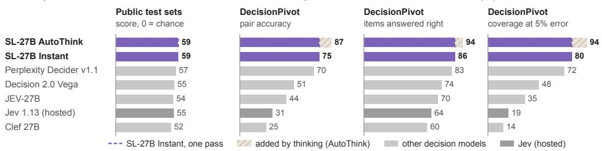
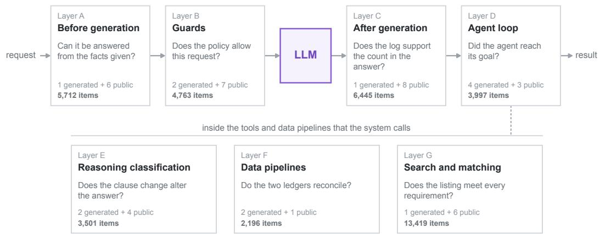
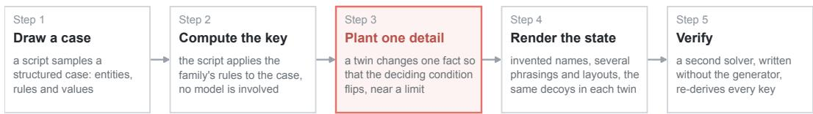
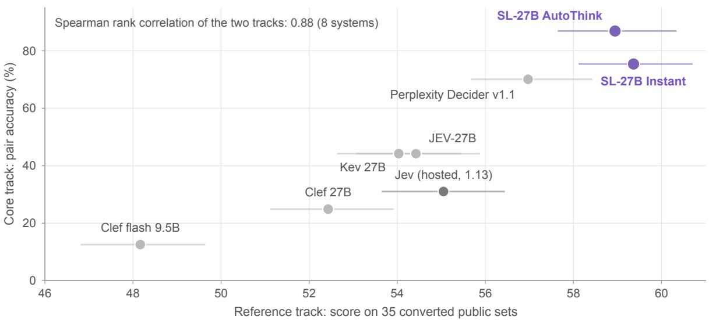
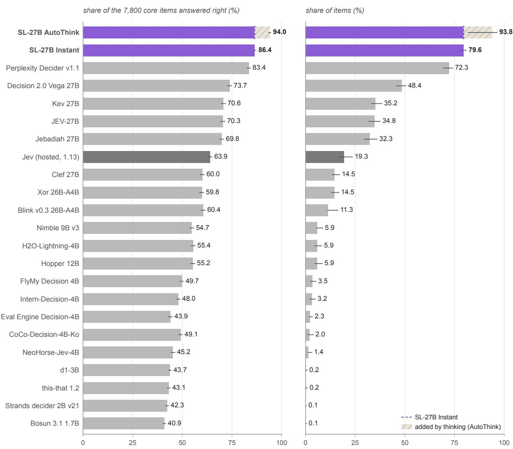
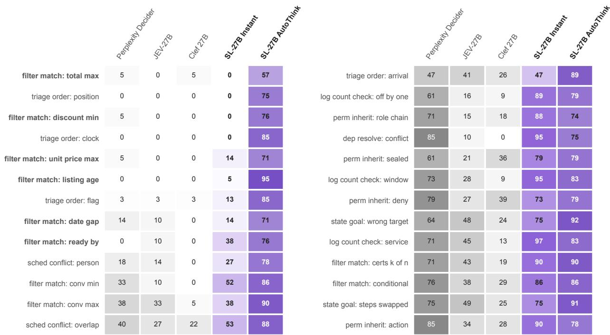
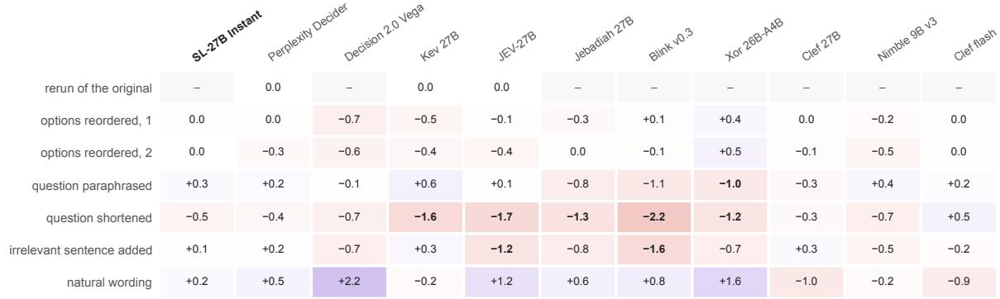
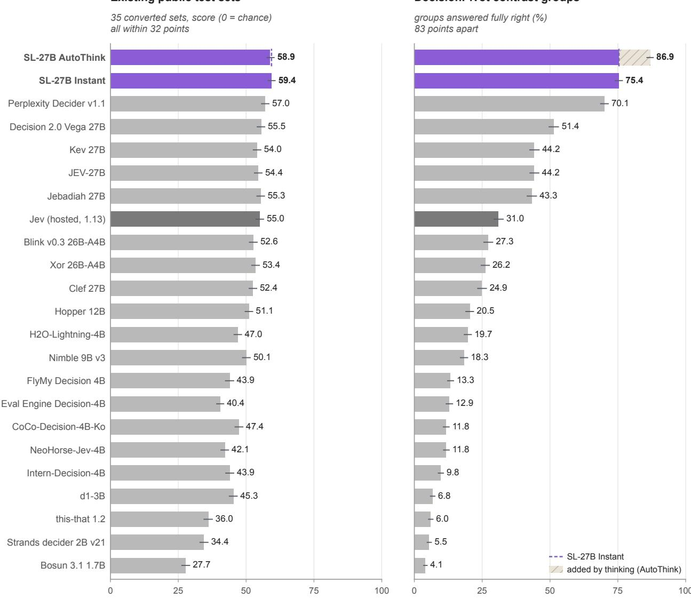
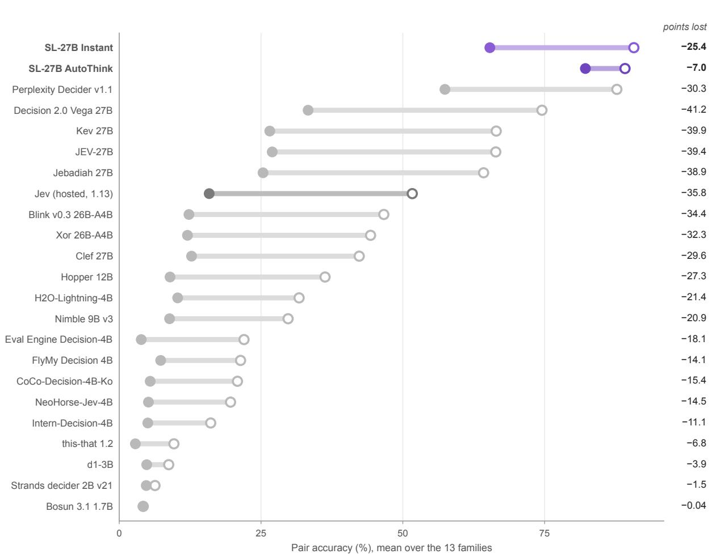

# DecisionPivot: A Diagnostic Benchmark for Decision Models in LLM Systems

Xialie Zhuang Mingcong Lei Zunhai Su Ri Liu Jianjin Li Peixian Ma Jia Pan Ngai Wong Guanhua Chen\* Chuan-Wei Kuo

StartLux

Abstract: Decision models support routing, guardrails, and output verification in LLM systems. However, item accuracy alone cannot establish whether models make correct decisions across controlled variations or assign reliable confidence to their predictions. We introduce DecisionPivot, a diagnostic benchmark comprising 48 tasks and 40,033 items across seven decision roles. Its core track contains 7,800 items from 13 generated task families, organized into contrast groups with computed answers verified by independently implemented solvers. The complementary reference track contains 32,233 items from 35 public test sets, preserving their original evaluation metrics. We evaluate 40 decision models and 14 general models using documented, model-specific protocols, assessing item and contrast-group accuracy, probability ordering, calibration, and empirical selective coverage. Our results reveal substantial differences obscured by aggregate scores: two 27B models separated by only 2.6 points on the reference track achieve contrast-group accuracies of 70.1% and 44.2%. Across 2,400 binary contrast pairs, Perplexity Decider correctly ranks the positive member above the negative member in 92.3% of pairs but answers both members correctly in only 74.1%, exposing a gap between probability ordering and decision correctness. Models with similar item accuracy also differ in the reliability of their high-confidence predictions. On a separate 1,296-item subset, GLM-5.3 achieves 93.5% contrast-group accuracy at a higher reasoning setting, compared with 81.5% at its lowest effort. By linking errors to pivotal details and difficulty levels, DecisionPivot provides fine-grained diagnostics of decision failures that aggregate evaluation alone cannot reveal.

Data: Hugging Face Code: GitHub

## 1. Introduction

LLM systems make decisions throughout the processing of a request: which model should handle it, whether a tool call is permitted, whether a generated output is correct, and whether an agent has achieved its goal. A decision model takes a state, a typed question, and a finite set of options as input and assigns a probability to each option. Many such models produce these predictions in a single forward pass, enabling systems to act directly or defer uncertain cases for further reasoning or review. Reliable evaluation must therefore assess not only decision correctness but also sensitivity to decisive evidence and the reliability of predicted confidence.

Existing evaluations adapt public test sets into decision tasks and assess calibration and selective prediction [2]. While these evaluations provide valuable comparisons, aggregate item accuracy does not reveal whether a model correctly handles all members of a controlled contrast group. Moreover, superficial cues can inflate performance: a content-blind rule achieves 73.0% accuracy on llmbar, compared with a 50% chance baseline (Table C2). Potential training overlap further complicates interpretation, as public documentation may identify training data sources without specifying which evaluation items were included. These limitations motivate combining established public benchmarks with controlled, independently verifiable decision cases.

We introduce DecisionPivot, a diagnostic benchmark spanning seven decision roles and comprising two complementary tracks. The core track contains 7,800 items from 13 generated task families, organized into contrast groups. In most families, modifying a pivotal detail changes the correct decision while preserving the surrounding context, enabling controlled evaluation across related cases. Independently implemented solvers verify every core answer. The reference track contains 32,233 items from 35 public test sets, preserving their original evaluation metrics and available training-overlap information. Together, these tracks support controlled diagnosis while maintaining comparability with established evaluations.

a A contrast pair from state\_goal: did the agent reach its goal?
<table><tr><td>Goal</td><td>after the last step archive/customers_2026.csv exists, tmp/ is empty, and backup/ and data/raw/ hold the same customers_2026.csv</td></tr><tr><td>Trace A</td><td>1 copy data/raw/customers_2026.csv → .../customers_2026_v2.csv</td></tr><tr><td></td><td>2 set .../customers_2026_v2.csv to &quot;v2&quot; 3 copy backup/customers_2026.csv → data/raw/customers_2026.csv</td></tr><tr><td></td><td>4 delete tmp/partial.tmp 5 move data/raw/customers_2026.csv → archive/</td></tr><tr><td>Trace B</td><td>gold: no</td></tr><tr><td></td><td>the same steps with 3 and 5 swapped gold: yes</td></tr><tr><td>Question</td><td>After these steps, are all goal conditions met? Options: yes, no In A, step 5 moves the copy of step 3 away, so the last goal fails.</td></tr></table>

<table><tr><td>System</td><td>A</td><td>B</td><td>Pair</td></tr><tr><td>Perplexity Decider v1.1</td><td>yes 1.00</td><td>yes 1.00</td><td>wrong</td></tr><tr><td>Jev 1.13 (hosted)</td><td>no 0.65</td><td>no 0.72</td><td>wrong</td></tr><tr><td>JEV-27B</td><td>no 0.78</td><td>no 1.00</td><td>wrong</td></tr><tr><td>Kev 27B</td><td>no 0.73</td><td>no 0.83</td><td>wrong</td></tr><tr><td>Clef 27B</td><td>yes 0.56</td><td>no 0.88</td><td>wrong</td></tr><tr><td>SL-27B Instant</td><td>no 0.82</td><td>yes 1.00</td><td>right</td></tr><tr><td>SL-27B AutoThink</td><td>no 0.75</td><td>yes 0.81</td><td>right</td></tr></table>

The answer and its probability; coral: wrong. Perplexity Decider says yes to both at 1.00, the next three say no to both.

b Six open decision models of 27B and the hosted Jev, on the public test sets and on DecisionPivot (%)  
  
Figure 1. Controlled contrasts reveal errors obscured by aggregate scores. (a) A level-1 state\_goal contrast pair differing only in the order of steps 3 and 5. In A, step 5 removes the file copied in step 3, violating a final goal condition; in B, the goal is satisfied. Predictions and probabilities are shown, with incorrect predictions highlighted in red. Only the two SL-27B variants among the displayed models correctly answer both members. (b) Comparison of six open 27B decision models and the hosted Jev reference across four metrics: reference score (0 = chance), core pair accuracy, core item accuracy, and empirical core coverage at a 5% error rate. The displayed models span approximately 6.9 reference-score points and 62 percentage points in core pair accuracy. Results for all 40 decision models are reported in Table 4.

DecisionPivot evaluates three complementary aspects of decision quality: whether individual predictions are correct, whether all members of a contrast group are answered correctly, and whether predicted confidence reliably reflects correctness. We measure group-level correctness using pair accuracy, which requires every member of a contrast group to be correct, including groups containing more than two items. We further assess probability ordering, calibration, and selective coverage to distinguish correct relative rankings from correct decisions and evaluate confidence reliability.

We evaluate 40 decision models and 11 open general models on both tracks, plus three API chat models on the core track, using documented, model-specific protocols. Our results reveal substantial differences that aggregate scores alone do not capture (Figure 1). Perplexity Decider and JEV-27B achieve similar reference scores but differ markedly in core pair accuracy. Kev 27B and JEV-27B exhibit nearly identical item accuracy yet differ in the frequency and correctness of high-confidence predictions. Binary contrast analysis further reveals that correct probability ordering does not necessarily translate into correct decisions. Comparisons across reasoning settings show improvements on selected cases, highlighting the value of evaluating decision behavior beyond aggregate accuracy.

## We make three contributions:

• A controlled benchmark with independently verified answers. We introduce DecisionPivot, comprising 13 generated task families across seven decision roles and 35 complementary public test sets. Controlled contrast groups, annotations of pivotal variations, and independent answer verification enable fine-grained diagnosis of decision failures (Section 3).

• A unified framework for diagnosing decision reliability. We jointly evaluate item and contrast-group correctness, relative probability ordering, calibration, and selective coverage. These complementary metrics distinguish failures in decision correctness, probability ranking, and confidence reliability that aggregate accuracy alone cannot fully characterize (Section 3.6).

• Empirical insights into decision-model failures. Evaluating 40 decision models and 14 general models, we reveal substantial differences in controlled-contrast performance, confidence reliability, and sensitivity to task difficulty, reasoning settings, and input presentation. Fresh samples from seven generators further assess the stability of model rankings across sampled cases (Sections 4 and 5).

## 2. Related work

Decision-model and task-specific evaluation. Deußer et al. [2] evaluate a hosted decision model on 37 public datasets, examining calibration, selective prediction, and option-order sensitivity, with bootstrap confidence intervals. The Decision Index aggregates public benchmarks into a chance-corrected index, while JevBench evaluates calibration, speed, and cost on its own items. These evaluations provide useful comparisons, while DecisionPivot complements them with programmatically verified cases and group-level tests of controlled outcome changes (Table 1). Task-specific benchmarks address routing [9], guardrails [1], reward modeling [12], response judging [18], abstention [11], legal reasoning [6], and retrieval [19]. Our reference track adapts selected public tasks to a common decision interface while preserving their original scoring criteria.

Generated cases and controlled contrasts. Programmatically constructed tasks such as bAbI [20] provide answers known by construction, while LiveBench [21] refreshes evaluation questions to limit contamination. GSM-Symbolic [14] examines performance variation across instances of mathematical templates. Contrast sets [3] and counterfactually augmented data [10] study model behavior under label-changing modifications. Partial-input baselines [8] and heuristic diagnostics [13] reveal shortcuts that can inflate conventional evaluation scores. DecisionPivot brings these complementary ideas together in typed decision tasks, combining controlled contrasts, independently verified answers, group-level evaluation, and annotations of pivotal variations.

Confidence and behavioral robustness. Calibration analysis [7] and selective classification [5] provide established methods for assessing confidence reliability and abstention. We combine these measures with contrast-group correctness and probability ordering to characterize complementary aspects of decision reliability. Our inputsensitivity analyses build on studies of option-order effects [22], irrelevant context [16], and behavioral testing [15]. These analyses examine whether stable aggregate scores also imply stable individual predictions.

Table 1. Comparison of evaluation features across related benchmarks. ✓ supported, (✓) partially supported, ✗ not documented in the reviewed sources. Typed decisions use a fixed set of options and return a probability for each option. Probability scoring includes calibration or other probability-based metrics. Selective decisions assess abstention or coverage at a specified erro rate. Contamination control denotes measures to limit prior exposure, such as private, refreshed, or generated items; it does not establish the absence of all training overlap. Features may apply to only part of a benchmark; DecisionPivot’s computed answers and controlled contrasts refer to its core track.
<table><tr><td>benchmark</td><td>typcd deons</td><td>coned aoers</td><td>rrus conast</td><td>Ileve[s dilty</td><td>probsy ored</td><td>sele decons</td><td>conttn cotol</td><td>inuprnt nunts</td></tr><tr><td>Deußer et al. [2]</td><td>√</td><td>X</td><td>X</td><td>X</td><td>√</td><td>√</td><td>(S)</td><td>()</td></tr><tr><td>Decision Index 0.3</td><td>√</td><td>X</td><td>X</td><td>X</td><td>√</td><td>X</td><td>√</td><td>x</td></tr><tr><td>JevBench 1.6</td><td>√</td><td>X</td><td>x</td><td>√</td><td>√</td><td>(S)</td><td>√</td><td>X</td></tr><tr><td>AbstentionBench [11]</td><td>X</td><td>X</td><td>X</td><td>X</td><td>X</td><td>√</td><td>X</td><td>X</td></tr><tr><td>Contrast sets [3]</td><td>X</td><td>X</td><td>√</td><td>X</td><td>X</td><td>X</td><td>X</td><td>X</td></tr><tr><td>GSM-Symbolic [14]</td><td>X</td><td>√</td><td>x</td><td>√</td><td>X</td><td>X</td><td>(S)</td><td>√</td></tr><tr><td>LiveBench [21]</td><td>X</td><td>(S)</td><td>X</td><td>X</td><td>X</td><td>X</td><td>√</td><td>X</td></tr><tr><td>DecisionPivot (this work)</td><td></td><td>√</td><td>L</td><td>√</td><td></td><td>√</td><td>J</td><td></td></tr></table>

## 3. DecisionPivot

DecisionPivot comprises two complementary tracks under a common typed decision interface: a generated core track for controlled diagnosis and a public reference track for comparison on established tasks. Both tracks span seven functional decision roles (Figure 2).

## 3.1 Items and decision layers

Each item consists of a state s, a typed question q, a finite option set O, and an answer label. Core items have a gold option $y \in O$ , while reference tasks may also provide success-rate labels or ranking judgments evaluated using their original metrics. A model produces a probability distribution $p ( o \mid s , q , O )$ over the options, with the predicted answer given by $\hat { y } = \arg \operatorname* { m a x } _ { o \in O } p ( o \mid s , q , O )$ . Core items additionally record their contrast-group membership, difficulty level, and, where available, the type of pivotal variation.

We organize tasks into seven functional roles within LLM systems (Figure 2). Layers A–D span the request-to-result workflow: answerability and routing (A), policy-based guardrails (B), output verification (C), and tool validation or goal checking in agent loops (D). Layers E–G cover reasoning-based classification (E), record integrity and reconciliation (F), and constraint-based search and matching (G) within tools and data pipelines. These layers characterize functional roles rather than prescribing a specific system architecture.

## 3.2 Core track

For each core task family, a Python generator samples a structured case, computes its answer, and renders the state using invented entities and varied wording (Figure 3). The released items are fixed for evaluation, while seven generators also support fresh samples drawn with configurable seeds. Items are organized into contrast groups containing related cases with different correct answers. In most families, a decisive fact is varied while preserving the surrounding context and distractors. In policy\_case, cases with different outcomes instead share a common policy. Appendix A documents the contrast-group construction for each family.

For threshold-based decisions, positive and negative cases are constructed near the decision boundary. For example, Box 1 illustrates how changing only the shipping fee moves the total price from one cent below to one cent above the specified limit. Each family contains 600 items, evenly distributed across three difficulty levels (Table 2). Higher levels increase case size or the complexity of rule application, including the number of entities, conditions, or required computations. Because these factors vary together, the difficulty levels do not isolate context length from reasoning demands.

  
48 tasks and 40,033 items: 13 generated families (7,800 items) and 35 public test sets (32,233 items)  
Figure 2. DecisionPivot covers 48 tasks across seven decision roles. Layers A–D span the request-to-result workflow, while layers E–G cover functions within tools and data pipelines. Each box illustrates a representative decision question and reports the numbers of generated task families, public test sets, and items.

<table><tr><td colspan="2">Box 1. A level-1 contrast pair from filter_match, abridged. The two members differ only in the shipping fee, placing the total price one cent below or above the specified limit.</td></tr><tr><td>part content</td><td></td></tr><tr><td>Request</td><td>The listing must satisfy every point below. Its warranty is not below 36 months. The price plus the shipping fee is less than 500.84 SEK. The price per unit is 415.77 SEK or less. ..</td></tr><tr><td>Record Member A</td><td>Lumrov Mini-404 by Melzim, price 476.80 SEK, 10 units for 4,157.70 SEK, warranty 37 months, 32 fields in all shipping fee 24.03 SEK, price plus shipping 500.83 SEK, answer yes</td></tr><tr><td>Member B</td><td>shipping fee 24.05 SEK, price plus shipping 500.85 SEK, answer no</td></tr><tr><td colspan="2">Probability of yes for member A / member B 0.86 / 0.84</td></tr><tr><td>Perplexity Decider</td><td></td></tr><tr><td>SL-27B Instant</td><td>0.90 / 0.83</td></tr><tr><td>Clef 27B</td><td>0.09 / 0.09</td></tr><tr><td>GLM-5.3, lowest effort 1.00 / 0.00</td><td>None of the displayed one-pass models correctly answers both members. GLM-5.3 answers both correctly at its lowest</td></tr></table>

## 3.3 Reference track

The reference track comprises 35 public test sets spanning all seven decision layers (Table C1). Conversion scripts reconstruct evaluation items from official source files while preserving each task’s original scoring metric. We use fixed-seed sampling, targeting at most 1,000 items per task, except for two reranking tasks that target 100 queries with 50 candidates each. Final item counts after filtering are reported in Table C2. Of the 35 tasks, 21 use human-annotated labels, six use programmatically computed labels, and eight draw on mixed label sources. The two capability-boundary tasks use success-rate labels derived from sampled responses of specified public chat models, evaluating predicted success probabilities rather than correctness against a single gold option.

Table 2. Core task families and reported content-blind baselines. Contrast groups contain related cases with controlled outcome changes; policy\_case instead groups cases under a shared policy. The content-blind column reports baseline values from the task summaries, in percent; Appendix E provides separate shortcut-audit results. State length is the median number of characters. Each family contains 200 items per difficulty level, and an independent solver agrees with all 600 answers. Higher levels increase case size or complexity (Appendix A).
<table><tr><td></td><td></td><td></td><td>contrast</td><td>content-</td><td></td><td>state,</td></tr><tr><td>family</td><td>question</td><td>options</td><td>groups</td><td>blind rule</td><td>chance</td><td>characters</td></tr><tr><td colspan="7">A. Before generation</td></tr><tr><td>answerable_facts</td><td>can the facts answer the question</td><td>2</td><td>300</td><td>50.7</td><td>50.0</td><td>2,470</td></tr><tr><td>B. Guards</td><td></td><td></td><td>300</td><td>50.3</td><td></td><td></td></tr><tr><td>perm_inherit policy_case</td><td>may the user act on the folder approve, deny or escalate</td><td>23</td><td>201</td><td>33.3</td><td>50.0 33.3</td><td>3,926 1,703</td></tr><tr><td>C. After generation</td><td></td><td></td><td></td><td></td><td></td><td></td></tr><tr><td colspan="7">is the claimed event count right</td></tr><tr><td>log_count_check D. Agent loop</td><td></td><td>2</td><td>300</td><td>50.5</td><td>50.0</td><td>2,291</td></tr><tr><td colspan="7">can the booking be confirmed</td></tr><tr><td>sched_conflict</td><td>does the trace reach the goal</td><td></td><td>300</td><td>50.2</td><td>50.0</td><td>3,029</td></tr><tr><td>state_goal toolcall_valid</td><td>is the tool call valid</td><td>２２２５</td><td>300 300</td><td>50.5 50.7</td><td>50.0 50.0</td><td>2,475</td></tr><tr><td>triage_order</td><td>which case is at the asked place</td><td></td><td>201</td><td>20.0</td><td></td><td>4,975</td></tr><tr><td>E. Reasoning classification</td><td></td><td></td><td></td><td></td><td>20.0</td><td>2,256</td></tr><tr><td colspan="7"></td></tr><tr><td>clause_change</td><td>does the edit change the answer</td><td>3</td><td>201</td><td>33.3</td><td>33.3</td><td>3,730</td></tr><tr><td>dep_resolve</td><td>do the pinned versions install</td><td>2</td><td>300</td><td>50.3</td><td>50.0</td><td>3,348</td></tr><tr><td colspan="7">F. Data pipelines</td></tr><tr><td>ledger_reconcile</td><td>which entry fails, or none</td><td>6</td><td>201</td><td>16.7</td><td>16.7</td><td>2,764</td></tr><tr><td>record_rule</td><td>which rule is broken, or none</td><td>7 to 10</td><td>150</td><td>12.2</td><td>12.0</td><td>4,751</td></tr><tr><td colspan="7">G. Search and matching</td></tr><tr><td>filter_match</td><td>does the record pass every filter</td><td>2</td><td>300</td><td>50.5</td><td>50.0</td><td>1,647</td></tr></table>

## 3.4 Quality, diversity and coverage

Answer verification and review. We distinguish computational answer verification from textual quality review. For each family, an author who had not read the generator independently implemented a solver that agrees with all 600 gold answers. The three families unchanged since version 1.0 were also checked on a second draw (Table E1). Generator assertions check structural consistency and intended variations. All 7,800 core items were independently screened by at least two human reviewers, with additional AI-assisted screening; flagged items were revised or removed. Independent solvers verify agreement on computed answers, while textual review assesses whether each case is clearly specified (Appendix E).

Shortcut audits. We examine potential shortcuts using option-only, question-wording, state-length, line-count, and bag-of-words probes (Tables 2 and E1). Reported content-blind baselines remain close to chance; for example, the options-only probe achieves 21.3% accuracy on triage\_order, compared with a 20.0% chance baseline. The seven families with configurable seeds balance answer classes and gold-option positions, and no core state is repeated. However, partial-information heuristics can still succeed: checking only the schema achieves 91.7% item accuracy on toolcall\_valid (Appendix E). These audits distinguish surface cues from shortcuts that exploit only part of a case, without ruling out all possible shortcuts. Reference tasks retain their source artifacts, including the 0.730 content-blind baseline on llmbar.

Revision and fresh-sample evaluation. Version 1.1, dated 8 October 2026, revises ten task families to address identified item defects (Table E2). The reported evaluation combines version-1.1 core items with the filtered version-1.3 reference track. Across 20 configurations evaluated on core versions 1.0 and 1.1, rankings remain highly correlated (Spearman $\rho = 0 . 9 8 6 )$ . Seven generators with configurable seeds also produced 4,200 fresh items after the initial evaluations. For the 34 decision models included in this analysis, rankings across draws show a Spearman correlation of 0.994, and score-change confidence intervals include zero for 32 models (Table E3). These results assess sensitivity to fresh samples within the same generator designs, rather than generalization to independently designed cases.

a Core construction and verification  
  
Out: contrast groups of 2 to 4 members with controlled outcome changes · 3 levels of 200 items per family · 13 families, 7,800 items Checks: the solver agrees with all 600 keys of every family · reported content-blind baselines are close to chance

b What each generator plants, with one real pair per family (level 1)
<table><tr><td>family</td><td>kinds of planted detail</td><td>member A → member B</td><td>keys A → B</td></tr><tr><td>A. Before generation</td><td></td><td></td><td></td></tr><tr><td>answerable_facts</td><td>a needed fact → another attribute or look-alike</td><td>parent&#x27;s home region Javwick → location count 38</td><td>yes → no</td></tr><tr><td>B. Guards</td><td></td><td></td><td></td></tr><tr><td>perm_inherit</td><td>one link of the only granting path (6 kinds)</td><td>role allows purge (includes amend) → export</td><td>yes → no</td></tr><tr><td>policy_case</td><td>one case per outcome under one policy</td><td>case 1: rule 2· case 2: rule 1 also holds, wins</td><td>approve, deny</td></tr><tr><td>C. After generation</td><td></td><td></td><td></td></tr><tr><td>log_count_check</td><td>the claimed count ±1 or ±2, window or service</td><td>claim: exactly 4 → 2 WARN events</td><td>yes → no</td></tr><tr><td>D. Agent loop</td><td></td><td></td><td></td></tr><tr><td>sched_conflict</td><td>overlap, person, hours, seats or equipment</td><td>ends 17:25 → 17:35, room closes 17:30</td><td>yes → no</td></tr><tr><td>state_goal</td><td>wrong target, wrong content, swap, missing step</td><td>step 3 writes final → v2, goal: final</td><td>yes → no</td></tr><tr><td>toolcall_valid</td><td>extra, missing, enum, type, value or rule</td><td>passenger aged 15: age 15 → 16</td><td>yes → no</td></tr><tr><td>triage_order</td><td>arrival, clock, flag, class or position asked</td><td>D-2857 entered 11:57 →11:47, D-2870 11:50</td><td>D-2870 → D-2857</td></tr><tr><td>E. Reasoning classification</td><td></td><td></td><td></td></tr><tr><td>clause_change</td><td>the fact between old and new limit, or outside</td><td>deposit 25% → 26%, &#x27;25% or more&#x27; vs &#x27;&gt; 25%&#x27;</td><td>only B → same</td></tr><tr><td>dep_resolve</td><td>bound, missing pin, requirement, runtime, conflict</td><td>pin 3.0.3 → 3.0.4, a package needs != 3.0.4</td><td>yes → no</td></tr><tr><td>F. Data pipelines</td><td></td><td></td><td></td></tr><tr><td>ledger_reconcile</td><td>missing line, amount, sign, date, split, fee, batch</td><td>B01 -2809 → -2409 against A06 -2809</td><td>none →A06</td></tr><tr><td>record_rule</td><td>near miss of one of 13 rule kinds, or none</td><td>break_min 42 → 46, rule R1: 20 to 45</td><td>none → R1</td></tr><tr><td>G. Search and matching</td><td></td><td></td><td></td></tr><tr><td>filter_match</td><td>one of 20 constraint kinds, 10 of them computed</td><td>shipped 10 → 11 days after making, limit 10</td><td>yes → no</td></tr></table>

Figure 3. Core items combine controlled variations with independent answer verification. (a) A generator samples a structured case, computes its answer, constructs contrast cases, and renders their states. An independently implemented solver verifies the computed answers. Most families vary a decisive fact while preserving the surrounding context. (b) One level-1 example from each family, showing member-A values in violet, member-B values in red, and their corresponding answers. In policy\_case, different cases share a policy; rule 1 also applies to the second example and takes precedence over rule 2.

Training overlap. We removed 3,016 reference items (8.5%) detected in the training files of our final 27B models, together with affected groups. This filtering removes detected overlap for our models only. For other models, we record whether public training documentation names a task source or related data family, marking missing or inconclusive information as unknown. These source-level flags provide provenance context, not item-level proof of exposure or its absence (Appendix C).

Task coverage. Both tracks cover all seven decision roles, with their distributions shown in Figure 2 and Table C1. Core items have two to ten options, with median state lengths ranging from 1,647 to 4,975 characters across families. Recorded domain variation spans up to eight domains per family. Decisive variations include twenty constraint types in filter\_match and thirteen integrity-rule types in record\_rule (Appendix A).

## 3.5 Provenance, licenses and use

Core items contain no third-party text and are released under CC BY 4.0, while the accompanying code is licensed under Apache-2.0. Reference items remain subject to their original source-specific terms. The release combines

evaluation data with reconstruction support, including scripts for 13 reference tasks. Appendix C documents provenance, source-specific terms, and release routes. Access conditions restrict the items to evaluation use. Appendix F provides a dataset datasheet following Gebru et al. [4].

## 3.6 Scoring

Requests and predictions. Each item is presented as a state, a typed question, and an ordered option set. Decision models are evaluated through their documented interfaces; general-model prompting and probability readout are described in Appendix B. The option order is fixed in the evaluation files, and the predicted label is the option with the highest returned probability. Failed or missing predictions count as incorrect rather than being excluded from the accuracy denominator. Run validation checks item coverage and, for core families, the hash of the evaluated item file. Model-specific input restrictions are documented in Table B1.

Group-level correctness. Let $\mathcal { G } _ { f }$ denote the set of contrast groups in family $f .$ We define

$$
\mathrm { P a i r A c c } _ { f } = \frac { 1 } { \left| \mathcal { G } _ { f } \right| } \sum _ { g \in \mathcal { G } _ { f } } \prod _ { i \in g } \mathbf { 1 } [ \hat { y } _ { i } = y _ { i } ] .\tag{1}
$$

Pair accuracy requires every member of a contrast group to be answered correctly, including groups containing more than two items. A change in prediction is insufficient if any group member remains incorrect. For example, a model predicting yes for both members of Box 1 achieves 50% item accuracy but zero pair accuracy. Because all members must be correct, the chance baseline depends on group size and option count: independent uniform guessing succeeds with probability $\textstyle \prod _ { i \in g } | O _ { i } | ^ { - 1 }$ . We report the corresponding aggregate chance baseline alongside model scores. Pair accuracy measures joint correctness but does not, by itself, identify why a group fails.

Pair direction. For a binary contrast, define $p ^ { + } = p ( \mathsf { y e s } \mid s ^ { + } , q , O )$ and $p ^ { - } = p ( \mathsf { y e s } \mid s ^ { - } , q , O )$ , where the respective gold labels are yes and no. Pair direction measures the fraction of pairs satisfying $p ^ { + } > p ^ { - }$ . Away from ties, correct predictions on both members require $p ^ { + } > 0 . 5 > p ^ { - }$ . The probabilities 0.86 and 0.84 in Box 1 therefore yield correct direction but two yes predictions. Pair-direction diagnostics cover 2,400 pairs from eight binary families (Table D6), whereas the headline pair-accuracy metric covers all 13 families. These diagnostics distinguish observed probability ordering from label correctness without identifying an internal reasoning mechanism.

Confidence-based evaluation. Let $c _ { i } = \operatorname* { m a x } _ { o \in O _ { i } } p ( o \mid s _ { i } , q _ { i } , O _ { i } )$ , and order the n items in each family by decreasing confidence. For a prefix of length $k ,$ empirical risk and coverage are defined as

$$
\widehat { R } ( k ) = \frac { 1 } { k } \sum _ { j = 1 } ^ { k } \mathbf { 1 } [ \widehat { y } _ { ( j ) } \neq y _ { ( j ) } ] , \qquad \widehat { C } ( \epsilon ) = \operatorname* { m a x } \left( \{ 0 \} \cup \left\{ \frac { k } { n } : 1 \leq k \leq n , \ \widehat { R } ( k ) \leq \epsilon \right\} \right) .\tag{2}
$$

Eligible prefixes end at confidence-tie boundaries, so equal-confidence items enter together. We report ${ \widehat C } ( 0 . 0 5 )$ as automation at 5% in the tables. This is retrospective coverage computed using evaluation labels. Because coverage is computed separately for each family, the definition permits family-specific confidence cutoffs rather than a single threshold shared across tasks. Selecting an operating threshold for future requests requires independent calibration. We also report accuracy and coverage at confidence 0.90 and calibration error over 15 bins.

Aggregation and uncertainty. Core headline scores are macro-averaged over 13 families; Table D1 identifies confidence metrics computed on pooled items. For reference task t, a score $v _ { t }$ with chance baseline $b _ { t }$ is transformed to $1 0 0 ( v _ { t } - b _ { t } ) / ( 1 - b _ { t } )$ . Scores are floored at zero before within-layer averaging, and the overall reference score averages the seven layers; Table D4 retains negative task scores for inspection. We report 95% percentile bootstrap intervals, resampling groups where available and individual items otherwise, with matched resamples for paired comparisons (Appendix B.4). Uniform guessing yields 16.1% core pair accuracy.

Table 3. Metrics for correctness and probability quality. The first three criteria assess predicted answers, while the remaining four evaluate probability quality. The predicted answer is the option assigned the highest probability. Abbreviated metric names are shown in parentheses.
<table><tr><td>criterion</td><td>what it measures</td><td>what it catches</td></tr><tr><td>The answers</td><td></td><td></td></tr><tr><td>accuracy</td><td>items whose top option is correct</td><td>incorrect predictions failure to distinguish related outcomes:</td></tr><tr><td>pair accuracy</td><td>contrast groups with every member correct</td><td>predicting yes for both members of Box 1 gives item accuracy 50 and pair accuracy 0</td></tr><tr><td>level 3</td><td>pair accuracy at the highest difficulty level</td><td>performance decline as case size or complexity increases</td></tr><tr><td>The probabilities pair direction</td><td>binary contrast pairs whose positive member receives a</td><td>correct relative ordering without necessarily</td></tr><tr><td>automation at 5% (auto at 5%)</td><td>higher probability of yes</td><td>correct predictions on both members</td></tr><tr><td></td><td>maximum empirical coverage of a confidence-ranked prefix with error at most 5%</td><td>limited separation of correct and incorrect predictions by confidence</td></tr><tr><td>accuracy at 0.90 (acc. at 0.90)</td><td>accuracy among items with top probability at least 0.90, and their share</td><td>high-confidence errors</td></tr><tr><td>calibration error</td><td>mean gap between predicted confidence and observed accuracy over 15 bins [7]</td><td>overconfidence or underconfidence</td></tr></table>

## 4. Experiments

Our experiments investigate three aspects of decision-model performance: what controlled contrasts reveal beyond aggregate scores, how confidence relates to prediction correctness, and how performance changes across reasoning settings. We evaluate 40 decision models, including two StartLux-Decision-27B variants [17], 37 open models from 20 other groups, and jev-1.13.0 (the hosted reference). Instant operates in a single pass, while AutoThink generates a reasoning trace when its highest one-pass probability falls below 0.9. The six Decision 3.0 models are included only in the main comparison. We additionally evaluate 11 open general models using one-pass option-key probabilities on both tracks and three API chat models using stated probabilities on the core track (Table D10). Appendix B details model revisions, inference interfaces, and input restrictions.

## 4.1 Main results

Similar reference scores, different core performance. Perplexity Decider and JEV-27B achieve reference scores of 57.0 and 54.4, respectively, yet differ substantially in core pair accuracy (70.1% versus 44.2%; Table 4). Across the eight models in Figure 4, rankings broadly agree (Spearman ρ = 0.88), despite ranges of 11 reference-score points and 74 percentage points in core pair accuracy. Because the tracks differ in both task content and scoring, these differences cannot be attributed to group-level evaluation alone.

Complete contrast groups remain challenging for many models. Among one-pass decision models, Instant achieves 75.4% pair accuracy, followed by Decision 3.0 d3 at 71.3% and Perplexity Decider at 70.1%. Of the 40 evaluated decision models, 19 fall below the 16.1% uniform-guess baseline in overall pair accuracy, while 30 fall below 16.1% at difficulty level 3. These results include failures caused by input restrictions and therefore reflect both input compatibility and decision performance. Performance also varies substantially across task families: Perplexity Decider achieves 97.5% pair accuracy on policy\_case, compared with 33.8% on triage\_order (Table D2).

Reference tasks provide complementary comparisons. On the reference track, Instant achieves a score of 59.4, exceeding Perplexity Decider by 2.4 points [1.6, 3.2] in the paired comparison. Its point estimate is higher in six of the seven decision layers, although confidence intervals for some layer-wise differences include zero (Table D3). Thus, the aggregate advantage does not establish superior performance across every decision role.

Table 4. Main results for 40 decision models. Core metrics are reported as percentages, macro-averaged over 13 task families. Models are sorted by pair accuracy, with 95% bootstrap intervals for that metric. Level 3 denotes the highest difficulty level; auto at 5% measures retrospective confidence-ranked coverage at a 5% empirical error rate. The reference score aggregates 35 public tasks (0 = chance). Uniform guessing yields 39.6% item accuracy and 16.1% pair accuracy. † Input restrictions cause missing or truncated predictions; missing predictions count as incorrect (Table B1). ‡ Decision 3.0 models appear only in this main comparison. Table D10 reports general models.
<table><tr><td colspan="5"></td><td rowspan="2">level 3</td><td rowspan="2">auto at 5%</td><td rowspan="2">reference</td></tr><tr><td>decision model</td><td>organization</td><td>size</td><td>accuracy</td><td>pair accuracy</td></tr><tr><td>SL-27B AutoThink</td><td>StartLux (ours)</td><td>27B</td><td>94.0</td><td>86.9 [85.7, 88.0]</td><td>82.2</td><td>93.8</td><td>58.9</td></tr><tr><td>SL-27B Instant</td><td>StartLux (ours)</td><td>27B</td><td>86.4</td><td>75.4 [74.1, 76.7]</td><td>65.3</td><td>79.6</td><td>59.4</td></tr><tr><td>Decision 3.0 d3</td><td>vLLM Semantic Router</td><td>27B</td><td>83.9</td><td>71.3 [69.9, 72.8]</td><td>59.0</td><td>75.1</td><td>56.7</td></tr><tr><td>Perplexity Decider v1.1</td><td>Perplexity</td><td>27B</td><td>83.4</td><td>70.1 [68.7, 71.5]</td><td>57.4</td><td>72.3</td><td>57.0</td></tr><tr><td>Decision 2.0 Vega</td><td>vLLM Semantic Router</td><td>27B</td><td>73.7</td><td>51.4 [49.7, 53.1]</td><td>33.3</td><td>48.4</td><td>55.5</td></tr><tr><td>Kev 27B</td><td>Jared Palmer</td><td>27B</td><td>70.6</td><td>44.2 [42.6, 46.0]</td><td>26.5</td><td>35.2</td><td>54.0</td></tr><tr><td>JEV-27B</td><td>AutoTrust AI Lab</td><td>27B</td><td>70.3</td><td>44.2 [42.6, 45.9]</td><td>27.0</td><td>34.8</td><td>54.4</td></tr><tr><td>Jebadiah 27B</td><td>Frontier Infra</td><td>27B</td><td>69.8</td><td>43.3 [41.6, 45.0]</td><td>25.4</td><td>32.3</td><td>55.3</td></tr><tr><td>Decision 3.0 d3-flash‡</td><td>vLLM Semantic Router</td><td>9B</td><td>67.6</td><td>43.3 [41.8, 44.9]</td><td>27.6</td><td>36.9</td><td>52.6</td></tr><tr><td>Decision 3.0 d3-mini‡</td><td>vLLM Semantic Router</td><td>4B</td><td>64.3</td><td>38.0 [36.5, 39.6]</td><td>21.9</td><td>23.3</td><td>51.3</td></tr><tr><td>Jev 1.13 (hosted)</td><td>TypeSafe</td><td></td><td>63.9</td><td>31.0 [29.4, 32.7]</td><td>15.9</td><td>19.3</td><td>55.0</td></tr><tr><td>Blink v0.3</td><td>Pixilab.ai</td><td>26B-A4B</td><td>60.4</td><td>27.3 [25.6, 28.9]</td><td>12.3</td><td>11.3</td><td>52.6</td></tr><tr><td>Xor 1.0</td><td>Juspay</td><td>26B-A4B</td><td>59.8</td><td>26.2 [24.7, 27.7]</td><td>12.0</td><td>14.5</td><td>53.4</td></tr><tr><td>GEV-26B-Decide</td><td>AutoTrust AI Lab</td><td>26B-A4B</td><td>59.1</td><td>25.2 [23.7, 26.7]</td><td>11.1</td><td>9.0</td><td>50.9</td></tr><tr><td>Clef</td><td>Cloudflare</td><td>27B</td><td>60.0</td><td>24.9 [23.3, 26.6]</td><td>12.8</td><td>14.5</td><td>52.4</td></tr><tr><td>Hopper 12B</td><td>Hopit</td><td>12B</td><td>55.2</td><td>20.5 [19.0, 21.8]</td><td>9.0</td><td>5.9</td><td>51.1</td></tr><tr><td>H2O-Lightning-4B</td><td>H2O.ai</td><td>4B</td><td>55.4</td><td>19.7 [18.4, 21.0]</td><td>10.3</td><td>5.9</td><td>47.0</td></tr><tr><td>Decision 2.0 Lux</td><td>vLLM Semantic Router</td><td>9B</td><td>54.1</td><td>19.6 [18.3, 20.8]</td><td>11.1</td><td>5.1</td><td>50.3</td></tr><tr><td>Nimble v3</td><td>Bespoke Labs</td><td>9B</td><td>54.7</td><td>18.3 [17.0, 19.6]</td><td>8.9</td><td>5.9</td><td>50.1</td></tr><tr><td>Decision 2.0 Nox</td><td>vLLM Semantic Router</td><td>4B</td><td>52.0</td><td>16.4 [15.1, 17.6]</td><td>7.8</td><td>1.8</td><td>47.6</td></tr><tr><td>JEV-9B</td><td>AutoTrust AI Lab</td><td>9B</td><td>52.4</td><td>16.1 [14.8, 17.3]</td><td>7.4</td><td>2.8</td><td>48.7</td></tr><tr><td>FlyMy Decision 4B v1.2†</td><td>FlyMy.AI</td><td>4B</td><td>49.7</td><td>13.3 [12.3, 14.4]</td><td>7.3</td><td>3.5</td><td>43.9</td></tr><tr><td>Eval Engine Decision-4B†</td><td>Eval Engine (Chromia)</td><td>4B</td><td>43.9</td><td>12.9 [11.8, 14.1]</td><td>3.9</td><td>2.3</td><td>40.4</td></tr><tr><td>Clef flash</td><td>Cloudflare</td><td>9.5B</td><td>50.7</td><td>12.5 [11.5, 13.6]</td><td>6.2</td><td>3.0</td><td>48.2</td></tr><tr><td>CoCo-Decision-4B-Ko†</td><td>Corners</td><td>4B</td><td>49.1</td><td>11.8 [10.7, 12.8]</td><td>5.5</td><td>2.0</td><td>47.4</td></tr><tr><td>NeoHorse-Jev-4B†</td><td>TokenRhythm</td><td>4B</td><td>45.2</td><td>11.8 [10.8, 12.9]</td><td>5.2</td><td>1.4</td><td>42.1</td></tr><tr><td>Decision 3.0 d3-nano</td><td>vLLM Semantic Router</td><td>2B</td><td>48.1</td><td>11.7 [10.6, 12.8]</td><td>5.3</td><td>1.2</td><td>44.8</td></tr><tr><td>Hopper (G) 1.2</td><td>Hopit</td><td>4B</td><td>49.5</td><td>10.5 [9.5, 11.6]</td><td>3.8</td><td>3.1</td><td>47.1</td></tr><tr><td>Intern-Decision-4B†</td><td>InternLM</td><td>4B</td><td>48.0</td><td>9.8 [8.9, 10.7]</td><td>5.0</td><td>3.2</td><td>43.9</td></tr><tr><td>Decision 3.0 d3-lite</td><td>vLLM Semantic Router</td><td>0.8B</td><td>44.3</td><td>7.4 [6.6, 8.3]</td><td>4.0</td><td>0.6</td><td>37.7</td></tr><tr><td>Intern-Decision-2B†</td><td>InternLM</td><td>2B</td><td>43.7</td><td>7.1 [6.4, 7.9]</td><td>6.2</td><td>0.4</td><td>32.8</td></tr><tr><td>d1-3B</td><td>Liquid AI</td><td>3B</td><td>43.7</td><td>6.8 [6.0, 7.6]</td><td>4.8</td><td>0.2</td><td>45.3</td></tr><tr><td>Decision 2.0 Sol</td><td>vLLM Semantic Router</td><td>2B</td><td>43.3</td><td>6.2 [5.6, 7.0]</td><td>4.8</td><td>0.4</td><td>33.7</td></tr><tr><td>this-that 1.2†</td><td>FLock.io</td><td>2B</td><td>43.1</td><td>6.0 [5.3, 6.9]</td><td>2.8</td><td>0.2</td><td>36.0</td></tr><tr><td>Strands decider 2B v21</td><td>Strands Agents (AWS)</td><td>2B</td><td>42.3</td><td>5.5 [4.8, 6.3]</td><td>4.8</td><td>0.1</td><td>34.4</td></tr><tr><td>Decision 2.0 Eos</td><td>vLLM Semantic Router</td><td>0.8B</td><td>41.8</td><td>4.4 [3.7, 5.1]</td><td>2.7</td><td>0.2</td><td>24.8</td></tr><tr><td>Bosun 3.1 1.7B</td><td>Hanno Labs</td><td>1.7B</td><td>40.9</td><td>4.1 [3.4, 4.7]</td><td>4.2</td><td>0.1</td><td>27.7</td></tr><tr><td>d1-omni-600M</td><td>Liquid AI</td><td>0.6B</td><td>39.8</td><td>3.7 [3.2, 4.3]</td><td>3.2</td><td>0.1</td><td>16.2</td></tr><tr><td>Decision 2.0 Kai†</td><td>vLLM Semantic Router</td><td>0.6B</td><td>40.6</td><td>3.6 [3.1, 4.2]</td><td>2.6</td><td>0.1</td><td>25.2</td></tr><tr><td>Decision 3.0 d3-edge</td><td>vLLM Semantic Router</td><td>0.6B</td><td>41.1</td><td>3.5 [2.9, 4.1]</td><td>2.4</td><td>0.2</td><td>28.6</td></tr></table>

  
Figure 4. Core and reference rankings broadly agree. Core pair accuracy versus reference aggregate score for eight selected models, with 95% intervals. Spearman rank correlation is 0.88. Score ranges are not directly comparable because the tracks differ in task content and scoring.

## 4.2 Reliability beyond accuracy

Similar accuracy, different confidence reliability. Kev 27B and JEV-27B achieve nearly identical core item accuracy (70.6% and 70.3%, respectively), yet differ in the reliability of their high-confidence predictions. Among predictions with confidence at least 0.90, Kev 27B achieves 93.8% accuracy on 34.1% of items, compared with 88.9% accuracy on 47.4% of items for JEV-27B (Table D1). JEV-27B produces high-confidence predictions more frequently, but a larger proportion of these predictions are incorrect. This distinction is not captured by overall item accuracy.

Selective coverage provides a complementary view of confidence reliability. At a common empirical error target of 5%, Kev 27B and JEV-27B achieve similar family-averaged coverage of 35.2% and 34.8%, respectively. Perplexity Decider and Instant achieve substantially higher coverage of 72.3% and 79.6%, respectively, with non-overlapping confidence intervals (Figure 5). Thus, similar selective coverage can coexist with different accuracy and prediction frequency at a fixed confidence threshold, highlighting the complementary information provided by these metrics.

Empirical coverage at 5% error

  
Figure 5. Confidence-based coverage differs from item accuracy. Left: core item accuracy. Right: retrospective coverage of confidence-ranked predictions at a 5% empirical error rate, macro-averaged across families. Models with approximately 70% item accuracy achieve coverage of only about one-third of items at this error target. The plotted subset follows Figure D1.

<table><tr><td></td><td>Perplexity Decider</td><td>JEV-27B</td><td>Clef 27B</td><td>SL-27B Instant SL-27B AutoThinl</td></tr><tr><td>filter match: total max</td><td>5</td><td>0</td><td>5</td><td>0 57</td></tr><tr><td>triage order: position</td><td>0</td><td>0 0</td><td>0</td><td>75</td></tr><tr><td>filter match: discount min</td><td>5</td><td>0</td><td>0 0</td><td>76</td></tr><tr><td>triage order: clock</td><td>0</td><td>0</td><td>0 0</td><td>85</td></tr><tr><td>filter match: unit price max</td><td>5</td><td>0</td><td>0</td><td>14 71</td></tr><tr><td>filter match: listing age</td><td>0</td><td>0</td><td>0</td><td>5 95</td></tr><tr><td>triage order: flag</td><td>3</td><td>3</td><td>3 13</td><td>85</td></tr><tr><td>filter match: date gap</td><td>14</td><td>10</td><td>0</td><td>14 71</td></tr><tr><td>filter match: ready by</td><td>0</td><td>10</td><td>0 38</td><td>76</td></tr><tr><td>sched conflict: person</td><td>18</td><td>14</td><td>0</td><td>27 78</td></tr><tr><td>filter match: conv min</td><td>33</td><td>10</td><td>0</td><td>52 86</td></tr><tr><td>filter match: conv max</td><td>38</td><td>33</td><td>5 38</td><td>90</td></tr><tr><td>sched conflict: overlap</td><td>40</td><td>27</td><td>22 53</td><td>88</td></tr></table>

<table><tr><td></td><td>Perplexity Decider</td><td>JEV-27B</td><td>Clef 27B</td><td>SL-27B Instant</td><td>SL-27B AutoThink</td></tr><tr><td>triage order: arrival</td><td>47</td><td>41</td><td>26</td><td>47</td><td>89</td></tr><tr><td>log count check: off by one</td><td>61</td><td>16</td><td>9</td><td>89</td><td>79</td></tr><tr><td>perm inherit: role chain</td><td>71</td><td>15</td><td>18</td><td>88</td><td>74</td></tr><tr><td>dep resolve: conflict</td><td>85</td><td>10</td><td>0</td><td>95</td><td>75</td></tr><tr><td>perm inherit: sealed</td><td>61</td><td>21</td><td>36</td><td>79</td><td>79</td></tr><tr><td>log count check: window</td><td>73</td><td>28</td><td>9</td><td>95</td><td>83</td></tr><tr><td>perm inherit: deny</td><td>79</td><td>27</td><td>39</td><td>73</td><td>79</td></tr><tr><td>state goal: wrong target</td><td>64</td><td>48</td><td>24</td><td>75</td><td>92</td></tr><tr><td>log count check: service</td><td>71</td><td>45</td><td>13</td><td>97</td><td>83</td></tr><tr><td>filter match: certs k of n</td><td>71</td><td>43</td><td>19</td><td>90</td><td>90</td></tr><tr><td>filter match: conditional</td><td>76</td><td>38</td><td>29</td><td>86</td><td>86</td></tr><tr><td>state goal: steps swapped</td><td>75</td><td>49</td><td>25</td><td>75</td><td>91</td></tr><tr><td>perm inherit: action</td><td>85</td><td>34</td><td>28</td><td>90</td><td>78</td></tr></table>

Figure 6. Selected arithmetic and temporal contrasts expose large performance gaps. Pair accuracy for the 26 variation types with the lowest mean across the five displayed models, restricted to types with at least 20 groups. The final column shows SL-27B AutoThink with adaptive reasoning. Bold labels mark the six filter\_match variation types requiring arithmetic on prices or dates.

## 4.3 Performance with reasoning

Higher reasoning settings are associated with improved performance on sampled core cases. On a 1,296-item subset containing complete contrast groups with balanced difficulty levels, GLM-5.3 achieves 93.5% [91.7, 95.3] pair accuracy at the higher setting, compared with 81.5% [78.4, 84.6] at its lowest setting (Table D5). Average reasoning length increases from 121 to 265 tokens per item, although even the lowest setting involves hidden reasoning. On the same subset, AutoThink achieves 85.9% pair accuracy with an average of 297 reasoning tokens per item, compared with 75.6% for Instant and 70.4% for Perplexity Decider. The higher-effort chat runs also use a larger output budget and the provider’s default sampling, whereas the lower-effort runs use temperature 0 (Appendix B.3). These comparisons therefore reflect differences in sampling and output budget as well as reasoning effort.

Across the full evaluation tracks, AutoThink achieves 86.9% core pair accuracy, compared with 75.4% for Instant, while their reference scores are 58.9 [57.7, 60.3] and 59.4, respectively. AutoThink generates a reasoning trace on approximately two-thirds of reference items. These results highlight that improvements on controlled contrasts do not necessarily translate into higher aggregate scores on established public tasks.

Aggregate stability can also conceal changes in individual predictions. A second AutoThink run achieves 87.2% core pair accuracy, close to the original 86.9%, while changing 5.6% of individual answers. Thus, similar aggregate scores do not necessarily imply stable item-level decisions.

## 5. Diagnostic analysis

We use difficulty labels and annotations of decisive variations across 12 task families to examine where decision models fail. Our analysis distinguishes probability ordering from label correctness, examines errors by case type and difficulty, and tests whether aggregate scores reflect changes in individual predictions.

a Change of pair accuracy (points)  

b Items whose answer changes (%)
<table><tr><td rowspan="2"></td><td colspan="2">SL-27B Instant</td><td colspan="2">Decision 2.0 Vega</td><td rowspan="2">JEV-27B</td><td colspan="2">Jebadiah 27B Blink v0.3</td><td colspan="2">Xor 26B-A4B</td><td colspan="2">Nimble 9B v3</td></tr><tr><td></td><td>Perplexity Decider</td><td></td><td>Kev 27B</td><td></td><td></td><td></td><td>Clef 27B</td><td></td><td>Clef flash</td></tr><tr><td>rerun of the original</td><td>一</td><td>0.0</td><td>一</td><td>0.0</td><td>0.0</td><td>-</td><td>1</td><td>1</td><td>一</td><td>I</td><td>一</td></tr><tr><td>options reordered, 1</td><td>1.5</td><td>2.3</td><td>5.1</td><td>4.9</td><td>4.9</td><td>5.0</td><td>8.0</td><td>8.2</td><td>0.3</td><td>6.6</td><td>0.3</td></tr><tr><td>options reordered, 2</td><td>1.9</td><td>2.3</td><td>4.9</td><td>4.6</td><td>4.8</td><td>5.3</td><td>7.9</td><td>8.2</td><td>0.3</td><td>6.4</td><td>0.3</td></tr><tr><td>question paraphrased</td><td>1.5</td><td>1.9</td><td>4.2</td><td>4.7</td><td>3.8</td><td>3.8</td><td>7.2</td><td>5.9</td><td>3.6</td><td>5.1</td><td>4.0</td></tr><tr><td>question shortened</td><td>1.8</td><td>1.7</td><td>4.5</td><td>6.3</td><td>5.3</td><td>5.3</td><td>9.2</td><td>8.5</td><td>6.5</td><td>8.6</td><td>8.1</td></tr><tr><td>irrelevant sentence added</td><td>1.8</td><td>2.9</td><td>5.5</td><td>6.6</td><td>5.4</td><td>5.3</td><td>11.2</td><td>9.8</td><td>4.8</td><td>7.2</td><td>6.7</td></tr><tr><td>natural wording</td><td>5.8</td><td>6.4</td><td>11.8</td><td>13.9</td><td>13.6</td><td>12.1</td><td>19.1</td><td>19.0</td><td>13.5</td><td>20.7</td><td>19.7</td></tr></table>

Figure 7. Small score changes can conceal changes in individual predictions. Version-1.0 input variants for the displayed models. (a) Pair-accuracy changes, ranging from −2.2 to +2.2 percentage points. (b) Percentage of predictions that change, reaching 20.7% for natural wording. Variant names follow the figure labels. Dashes denote unavailable entries; zero-valued reruns refer only to models with reported rerun results. Tables D8 and D9 describe the four-model input-sensitivity analyses.

Correct probability ordering can coexist with incorrect predictions. Across 2,400 contrast pairs from eight binary task families, Perplexity Decider assigns a higher probability of yes to the positive member in 92.3% of pairs, yet correctly classifies both members in only 74.1%. Clef 27B achieves 78.6% pair direction but only 25.0% pair accuracy (Table D6). As illustrated in Box 1, correctly ordered probabilities can still fall on the same side of the 0.5 decision boundary. Selecting a single global threshold on the evaluation pairs increases pair accuracy to 74.2% and 30.6% for the two models, respectively. Even this optimistic choice closes only part of the gap and does not establish held-out calibration performance or the effectiveness of more flexible calibration methods.

Error asymmetry varies across models. Across the 12 annotated families, Kev 27B achieves 56.5% accuracy on cases marked “no planted problem” and 77.5% on those with a planted problem, while Clef 27B achieves 32.7% and 76.7%, respectively (Table D7). In contrast, Perplexity Decider achieves 80.9% accuracy in both categories. These differences motivate evaluating both valid and invalid cases under a specified distribution before interpreting errors as false rejections or false acceptances in guard applications.

Arithmetic and temporal contrasts expose specific weaknesses. Figure 6 highlights substantial performance differences on selected arithmetic and temporal variations. The four displayed one-pass models achieve at most 5% pair accuracy on total-price and minimum-discount contrasts, compared with 57% and 76% for AutoThink. On current-time contrasts in triage\_order, all four one-pass models score 0%, whereas AutoThink reaches 85%. The figure selects the 26 variation types with the lowest mean performance across the five displayed models. These results characterize selected difficult cases rather than average effects across all tasks or models.

Performance declines as case size and complexity increase. From level 1 to level 3, Perplexity Decider’s pair accuracy falls from 87.7% to 57.4%, while Instant’s falls from 90.7% to 65.3%. AutoThink shows a smaller decline, from 89.2% to 82.2% (Table D6; Figure D2). Because difficulty levels increase both case size and complexity, these differences do not isolate either factor.

Models differ in confidence assigned to errors. Among incorrect predictions, Perplexity Decider assigns confidence of at least 0.90 to 33.2%, compared with 14.6% for Instant (Table D7). This measures the proportion of errors made with high confidence, whereas Section 4.2 examines correctness among high-confidence predictions.

Aggregate stability can conceal changes in individual predictions. In the version-1.0 option-order study, Kev 27B changes 4.9% of predictions under the first option-reordering variant. Correct-to-incorrect changes affect 2.0% of items, while incorrect-to-correct changes affect 1.5%, resulting in a net accuracy decline of only 0.5 percentage points (Table D9). Thus, small aggregate score changes can mask more frequent changes in individual predictions. Across the broader input-presentation study, pair-accuracy changes range from −2.2 to +2.2 points, while natural wording changes up to 20.7% of predictions (Figure 7). These analyses use version-1.0 items and do not establish robustness on the revised version 1.1.

Together, these analyses distinguish probability-ordering errors from incorrect decisions, identify weaknesses across case types and difficulty levels, and reveal changes in individual predictions. Combined with confidence-based coverage, they provide a more detailed account of decision-model behavior than aggregate rankings alone.

## 6. Limitations

Scope and realism. DecisionPivot evaluates written cases across seven decision roles rather than end-to-end system operation. Generated cases prioritize controlled, verifiable answers, while real-world deployment, multilingual performance, and inference efficiency remain outside the current scope. Difficulty levels vary case size and complexity together.

Evaluation protocols and uncertainty. Models are evaluated through their documented interfaces, which differ in probability readout, input limits, and reasoning settings. Most evaluations use a single run, and input-sensitivity analyses are based on version-1.0 items. Empirical selective coverage is retrospective and requires independent calibration for deployment. Reference tasks retain their original metrics, with potential uncertainty in source labels.

Data exposure and benchmark design. Training-data overlap cannot be fully assessed for models without detailed training records; our filtering addresses detected overlap in our own models. Fresh-sample evaluations assess stability within the existing generator designs rather than across independently constructed cases. As DecisionPivot and StartLux-Decision are developed by the same team, independent evaluation and additional case designs would provide valuable complementary evidence.

## 7. Conclusion

We introduce DecisionPivot, a diagnostic benchmark that combines controlled contrast groups with independently verified answers and complementary public evaluation tasks. By jointly assessing item correctness, contrast-group correctness, probability ordering, and confidence reliability, DecisionPivot provides a more comprehensive view of decision-model performance. Our evaluation reveals that models with similar reference scores can differ substantially on controlled contrasts, while stable aggregate scores can mask changes in individual predictions. Comparisons across reasoning settings further reveal improvements on sampled core cases, with different performance patterns across evaluation tracks. Together, these findings highlight the value of fine-grained diagnostics for identifying decision failures and guiding the evaluation of reliable decision models.

## References

[1] Elias Bassani and Ignacio Sanchez. GuardBench: A large-scale benchmark for guardrail models. In Proceedings of the 2024 Conference on Empirical Methods in Natural Language Processing, pages 18393–18409, Miami, Florida, USA, November 2024. Association for Computational Linguistics. doi: 10.18653/v1/2024.emnlp-main.1022.

[2] Tobias Deußer, Lorenz Sparrenberg, and Rafet Sifa. Evaluating and benchmarking the system one model Jev. arXiv preprint arXiv:2609.37647, 2026.

[3] Matt Gardner, Yoav Artzi, Victoria Basmova, Jonathan Berant, Ben Bogin, Sihao Chen, Pradeep Dasigi, Dheeru Dua, Yanai Elazar, Ananth Gottumukkala, Nitish Gupta, Hanna Hajishirzi, Gabriel Ilharco, Daniel Khashabi, Kevin Lin, Jiangming Liu, Nelson F. Liu, Phoebe Mulcaire, Qiang Ning, Sameer Singh, Noah A. Smith, Sanjay Subramanian, Reut Tsarfaty, Eric Wallace, Ally Zhang, and Ben Zhou. Evaluating models’ local decision boundaries via contrast sets. arXiv preprint arXiv:2004.02709, 2020.

[4] Timnit Gebru, Jamie Morgenstern, Briana Vecchione, Jennifer Wortman Vaughan, Hanna Wallach, Hal Daumé III, and Kate Crawford. Datasheets for datasets. Communications of the ACM, 64(12):86–92, 2021. doi: 10.1145/3458723.

[5] Yonatan Geifman and Ran El-Yaniv. Selective classification for deep neural networks. In Advances in Neural Information Processing Systems 30, 2017.

[6] Neel Guha, Julian Nyarko, Daniel E. Ho, Christopher Ré, Adam Chilton, Aditya Narayana, Alex Chohlas-Wood, Austin Peters, Brandon Waldon, Daniel N. Rockmore, Diego Zambrano, Dmitry Talisman, Enam Hoque, Faiz Surani, Frank Fagan, Galit Sarfaty, Gregory M. Dickinson, Haggai Porat, Jason Hegland, Jessica Wu, Joe Nudell, Joel Niklaus, John Nay, Jonathan H. Choi, Kevin Tobia, Margaret Hagan, Megan Ma, Michael Livermore, Nikon Rasumov-Rahe, Nils Holzenberger, Noam Kolt, Peter Henderson, Sean Rehaag, Sharad Goel, Shang Gao, Spencer Williams, Sunny Gandhi, Tom Zur, Varun Iyer, and Zehua Li. LegalBench: A collaboratively built benchmark for measuring legal reasoning in large language models. arXiv preprint arXiv:2308.11462, 2023.

[7] Chuan Guo, Geoff Pleiss, Yu Sun, and Kilian Q. Weinberger. On calibration of modern neural networks. In Proceedings of the 34th International Conference on Machine Learning, 2017.

[8] Suchin Gururangan, Swabha Swayamdipta, Omer Levy, Roy Schwartz, Samuel R. Bowman, and Noah A. Smith. Annotation artifacts in natural language inference data. arXiv preprint arXiv:1803.02324, 2018. NAACL 2018.

[9] Qitian Jason Hu, Jacob Bieker, Xiuyu Li, Nan Jiang, Benjamin Keigwin, Gaurav Ranganath, Kurt Keutzer, and Shriyash Kaustubh Upadhyay. RouterBench: A benchmark for multi-LLM routing system. arXiv preprint arXiv:2403.12031, 2024.

[10] Divyansh Kaushik, Eduard Hovy, and Zachary C. Lipton. Learning the difference that makes a difference with counterfactually-augmented data. arXiv preprint arXiv:1909.12434, 2019. Published at ICLR 2020.

[11] Polina Kirichenko, Mark Ibrahim, Kamalika Chaudhuri, and Samuel J. Bell. AbstentionBench: Reasoning LLMs fail on unanswerable questions. arXiv preprint arXiv:2506.09038, 2025.

[12] Nathan Lambert, Valentina Pyatkin, Jacob Morrison, LJ Miranda, Bill Yuchen Lin, Khyathi Chandu, Nouha Dziri, Sachin Kumar, Tom Zick, Yejin Choi, Noah A. Smith, and Hannaneh Hajishirzi. RewardBench: Evaluating reward models for language modeling. arXiv preprint arXiv:2403.13787, 2024.

[13] R. Thomas McCoy, Ellie Pavlick, and Tal Linzen. Right for the wrong reasons: Diagnosing syntactic heuristics in natural language inference. arXiv preprint arXiv:1902.01007, 2019. Camera-ready for ACL 2019.

[14] Iman Mirzadeh, Keivan Alizadeh, Hooman Shahrokhi, Oncel Tuzel, Samy Bengio, and Mehrdad Farajtabar. GSM-Symbolic: Understanding the limitations of mathematical reasoning in large language models. arXiv preprint arXiv:2410.05229, 2024.

[15] Marco Tulio Ribeiro, Tongshuang Wu, Carlos Guestrin, and Sameer Singh. Beyond accuracy: Behavioral testing of NLP models with CheckList. arXiv preprint arXiv:2005.04118, 2020. Association for Computational Linguistics (ACL), 2020.

[16] Freda Shi, Xinyun Chen, Kanishka Misra, Nathan Scales, David Dohan, Ed Chi, Nathanael Schärli, and Denny Zhou. Large language models can be easily distracted by irrelevant context. arXiv preprint arXiv:2302.00093, 2023. Published in ICML 2023.

[17] StartLux. StartLux-Decision: Auto-think decision models, 2026. Companion report.

[18] Sijun Tan, Siyuan Zhuang, Kyle Montgomery, William Y. Tang, Alejandro Cuadron, Chenguang Wang, Raluca Ada Popa, and Ion Stoica. JudgeBench: A benchmark for evaluating LLM-based judges. arXiv preprint arXiv:2410.12784, 2024.

[19] Nandan Thakur, Nils Reimers, Andreas Rücklé, Abhishek Srivastava, and Iryna Gurevych. BEIR: A heterogenous benchmark for zero-shot evaluation of information retrieval models. arXiv preprint arXiv:2104.08663, 2021.

[20] Jason Weston, Antoine Bordes, Sumit Chopra, Alexander M. Rush, Bart van Merriënboer, Armand Joulin, and Tomas Mikolov. Towards AI-complete question answering: A set of prerequisite toy tasks. arXiv preprint arXiv:1502.05698, 2015.

[21] Colin White, Samuel Dooley, Manley Roberts, Arka Pal, Ben Feuer, Siddhartha Jain, Ravid Shwartz-Ziv, Neel Jain, Khalid Saifullah, Sreemanti Dey, Shubh-Agrawal, Sandeep Singh Sandha, Siddartha Naidu, Chinmay Hegde, Yann LeCun, Tom Goldstein, Willie Neiswanger, and Micah Goldblum. LiveBench: A challenging, contamination-limited LLM benchmark. arXiv preprint arXiv:2406.19314, 2024. ICLR 2025 Spotlight.

[22] Chujie Zheng, Hao Zhou, Fandong Meng, Jie Zhou, and Minlie Huang. Large language models are not robust multiple choice selectors. arXiv preprint arXiv:2309.03882, 2023. ICLR 2024 Spotlight.

## Appendix contents

A. Task cards of the 13 core families . . . . . . . . . . . . . . . . . . . . . . . . . . . . . . . . . . . . . . . . . . . . . . . . . . . . . . . . . . . . . . . . . . . . . . . . 19   
B. Protocol . . . . . . . . . . . . . . . . . . . . . . . . . . . . . . . . . . . . . . . . . . . . . . . . . . . . . . . . . . . . . . . . . . . . . . . . . . . . . . . . . . . . . . . . . . 21   
C. Reference tasks and exposure . . . . . . . . . . . . . . . . . . . . . . . . . . . . . . . . . . . . . . . . . . . . . . . . . . . . . . . . . . . . . . . . . . . . . . . . . . . 26   
D. Full results . . . . . . . . . . . . . . . . . . . . . . . . . . . . . . . . . . . . . . . . . . . . . . . . . . . . . . . . . . . . . . . . . . . . . . . . . . . . . . . . . . . . . 30   
E. Audit of the generators . . . . . . . . . . . . . . . . . . . . . . . . . . . . . . . . . . . . . . . . . . . . . . . . . . . . . . . . . . . . . . . . . . . . . . . . . . . . . . . . . . 37

## Appendix A. Task cards of the 13 core families

Each family contains 600 items, with 200 per difficulty level and a shared instruction. The generator computes each answer from a structured case and renders the state using invented entities, varied wording, and explicit task conventions. Answer classes and gold-option positions are balanced in the seven families with configurable seeds. Distractors appear in each class, and members of a contrast group have the same number of lines. Generator assertions check intended violations and structural consistency, while textual ambiguity is assessed separately through review. In six families (answerable\_facts, policy\_case, log\_count\_check, state\_goal, toolcall\_ valid, filter\_match), difficulty levels determine case size. Each generator also produces a task README with one complete example per level, and Table E1 summarizes the shared checks.

## A.1 answerable\_facts (layer A)

Question. “Can the question be answered from the facts listed?” (yes, no). State. A table of facts about invented organizations, interpretation rules, and a question requiring two to four rows. Levels. Two required facts among 20 rows, three among 40, and four among 80. Groups. The negative member replaces one required row with another attribute or a look-alike organization (150 pairs each).

## A.2 perm\_inherit (layer B)

Question. “Is the request allowed?” (yes, no). State. The written rules of an invented access system, including users, groups, roles, a folder tree, and an access request. Levels. From a tree of depth 2 to a tree of depth 4 with nested groups, sealed folders, and deny entries. Groups. The negative member breaks exactly one link in the only path granting access. Notes. Combining fourteen hand-crafted structural counts yields 0.561 accuracy.

## A.3 policy\_case (layer B)

Question. “What does the policy require for this case?” (approve, deny, escalate). State. A numbered policy containing 4, 8, or 12 rules with exceptions, a precedence statement, a default outcome, and a case record. Levels. The number of rules. Groups. 201 policies, most with one case per outcome, balanced by outcome, difficulty level, and required interpretation (plain, exception, or precedence statement; 200 items each).

## A.4 log\_count\_check (layer C)

Question. “Is the claim correct for this log?” (yes, no). State. A one-day event log containing 30, 60, or 90 lines, together with a claim about the exact number of events matching a specified service and level within a time window. Levels. The number of log lines. Groups. The negative member changes one field of a true claim: the count by one or two, the time window, or the service (75 pairs each).

## A.5 sched\_conflict (layer D)

Question. “Can the requested booking be confirmed as it stands?” (yes, no). State. Rooms with seating capacities, equipment, and opening hours; booking conventions; confirmed bookings; and a booking request. Levels. From 2 rooms and 6 to 8 bookings to 5 to 6 rooms and 20 to 28 bookings across 2 to 3 days. Groups. The positive member lies exactly at a limit that the negative member crosses, most often through a booking overlap (112 pairs) or a double-booked person (77). Notes. The heuristic “the room is exactly full, so yes” achieves 0.665 accuracy at level 1

## A.6 state\_goal (layer D)

Question. “After these operations, are all goal conditions satisfied?” (yes, no). State. A small file store from one of five domains, a description of operation semantics, a goal with 3, 5, or 7 conditions, and a numbered operation trace. Levels. Traces of 5, 15, or 25 steps. Groups. A single changed step causes exactly one goal condition to fail, through a wrong target, wrong content, swapped steps, or a replaced step (75 pairs each).

## A.7 toolcall\_valid (layer D)

Question. “Is the proposed call correct for the request under this schema?” (yes, no). State. A JSON tool schema with 6, 9, or 12 top-level properties and rules in its description, a user request specifying values directly or indirectly, and the proposed call. Levels. The number of properties. Groups. One planted deviation per negative member, with 50 items per deviation type.

## A.8 triage\_order (layer D)

Question. “Which waiting case do the rules put at the position asked for in the state?” Options are five tickets from the queue. State. The current time, numbered ordering rules, the queue, and the requested position. Levels. Level 1 contains 6 cases and 2 to 3 rules, while level 3 contains 12 to 14 cases, 5 to 6 rules, and two class adjustments. Groups. Members differ in one element, most often an arrival time (217 items) or the current time (119). Notes. The heuristic “lowest listed class, then earliest arrival” identifies the correct answer for 12.5% and 7.5% of items at levels 2 and 3, respectively.

## A.9 clause\_change (layer E)

Question. “Does the change between the two versions alter the answer to the point at issue?” (same, yes\_only\_A, yes\_only\_B; 200 items each). State. Interpretation rules, two versions of an agreement, and a case with facts. Levels. From 8 clauses per version to 12 to 14 clauses. Groups. Members place a fact between the old and new limits of the stricter clause, between those of the looser clause, or outside both. Notes. A reader who ignores the facts achieves 0.667 item accuracy but solves only 1 of 201 contrast groups.

## A.10 dep\_resolve (layer E)

Question. “Does the proposed set install cleanly in the target environment?” (yes, no). State. Version-ordering conventions (e.g., 3.10.0 is later than 3.9.9), the target environment, an invented package index, and pinned package versions. Levels. From 4 to 5 pins in the smallest cases to 9 to 12 in the largest, with runtime requirements and conflicts at higher levels. Groups. Members differ in one pin, most often through a narrowly missed version bound (79 pairs), a missing pin (78), or an unmet requirement (78). Notes. Level 1 has a median of three checks per positive item.

## A.11 ledger\_reconcile (layer F)

Question. “Which entry of ledger A does not reconcile with ledger B?” Options are five entries from ledger A and none. State. Two ledgers covering the same period and their matching conventions. Levels. Ledgers containing 8, 14, or 22 entries, with date tolerances, split lines, fees, and batch lines at higher levels. Groups. Members differ in the modified lines of ledger B, most often through a missing line (142 items) or a changed amount (140), and none is the gold answer for 100 items.

## A.12 record\_rule (layer F)

Question. “Which rule does the batch violate?” Options are one key per listed rule and none. State. A record type, 6 to 9 numbered integrity rules, reference lists, and a batch of records with at most one rule violated. Levels. Batches of 10, 16, or 24 records. Groups. 150 groups of four items each, including near-miss violations and, in 72 groups, the untouched batch. Each of thirteen rule types has 40 or 41 violating items.

## A.13 filter\_match (layer G)

Question. “Does the record satisfy every constraint of the request?” (yes, no). State. A request with 6, 9, or 12 constraints of twenty types, ten of which require a small computation, and one catalog record in JSON. Levels. The number of constraints. Groups. In both members, the compared quantity lies at the limit or one step away, with 21 negative items per computed type and 9 for each remaining type.

## Appendix B. Protocol

## B.1 Systems

Table B1. Evaluated models, inference protocols, and source-exposure flags. The table covers 40 decision models and 14 general models; additional reasoning settings are reported in Table D5. Open models from other groups use the listed revisions and bf16 precision on H200 GPUs, except for Blink’s FP8 build and the recommended float16 setting for d1-omni-600M. Exposure flags count named reference sources or related data families; for our models, they count tasks with at least 3% detected training overlap before filtering. Jebadiah refers to Kev’s sources without listing them, leaving nine tasks with unknown exposure status. Bracketed names indicate table abbreviations.

<table><tr><td>system</td><td>parameters</td><td>type</td><td>inference protocol</td><td>release status</td><td colspan="3">exposure flags</td></tr><tr><td>Perplexity Decider v1.1</td><td>27B</td><td>decision model</td><td>open weights, revision 3b45dea, using the model-card inference protocol</td><td>released</td><td colspan="3">16 (2 unknown)</td></tr><tr><td>Kev 27B</td><td>27B</td><td>decision model</td><td>open weights, revision af0e6d5, the authors' code at commit 5e42a7a</td><td>released</td><td colspan="3">9</td></tr><tr><td>JEV-27B</td><td>27B</td><td>decision model; model card identifies it as a student of the hosted reference</td><td>open weights, revision 51740a8, backbone, adapter and decision head</td><td>released</td><td colspan="3">no list</td></tr><tr><td>Clef 27B</td><td>27B</td><td>decision model</td><td>open weights, revision 2f3de3d, using the authors' serving implementation</td><td>released</td><td colspan="3">no list</td></tr><tr><td>Clef flash</td><td>9.5B</td><td>decision model</td><td>open weights, revision 17f0b0a, using the authors'</td><td>released</td><td colspan="3">no list</td></tr><tr><td>Decision 2.0 Vega 27B [Decision 2.0 Vega]</td><td>27B</td><td>decision model, an adapter and decision head on Qwen3.8-27B</td><td>serving implementation open weights, revision 7aec49a with the base at revision 1d4bf0f, using the authors'</td><td>released</td><td colspan="3">no list</td></tr><tr><td>Jebadiah 27B</td><td>27B</td><td>decision model, a merged LoRA on Qwen3.8-27B</td><td>decision2 inference package open weights, revision dfa3697, the scripts of the model repository</td><td>released</td><td colspan="3">0 (9 unknown)</td></tr><tr><td>Blink v0.3 26B-A4B [Blink v0.3]</td><td>26B-A4B</td><td>decision model, a full fine-tune of Gemma-4-26B-A4B-it</td><td>the authors' FP8 build, revision a3b0331 (the published leaderboard uses the NVFP4 build of the same weights), the surogate</td><td>released</td><td colspan="3">no list</td></tr><tr><td>Xor 26B-A4B 1.0 [Xor]</td><td>26B-A4B</td><td>decision model, two merged LoRA lineages on</td><td>decisions v1 protocol through vLLM open weights, revision 8afd439 (tag v1), the authors' serving</td><td>released</td><td colspan="3">no list</td></tr><tr><td>Bespoke Nimble 9B v3 [Nimble v3]</td><td>9B</td><td>Gemma-4-26B-A4B-it decision model, a LoRA adapter on Qwen3.5-9B</td><td>bundle on SGLang open weights, revision 8e927b9 with the base at revision c202236, the inference</td><td>released</td><td colspan="3">no list</td></tr><tr><td>GEV-26B-Decide</td><td>26B-A4B</td><td>decision model, a LoRA adapter and decision head on Gemma-4-26B-A4B-it</td><td>engine used for the authors' Decision Index evaluation open weights, revision 7c89590, System 1 inference with the model-card</td><td>released</td><td colspan="3">no list</td></tr><tr><td>H2O-Lightning-4B</td><td>4B</td><td>decision model, a fine-tune of Qwen3.5-4B</td><td>Transformers configuration and reasoning disabled open weights, revision 457f9d3, the authors' inference wrapper, its label probabilities</td><td>released</td><td colspan="3">no list</td></tr><tr><td>Decision 2.0 Lux 9B [Decision 2.0 Lux]</td><td>9B</td><td>decision model, a fine-tune of Qwen3.5-9B with a decision head</td><td>open weights, revision 78bf3c0, using the authors' decision2 inference package; the 2 items longer than its 16,384-token limit unanswered</td><td>released</td><td colspan="3">no list</td></tr><tr><td>Decision 2.0 Nox 4B [Decision 2.0 Nox]</td><td>4B</td><td>decision model, a decision head on Qwen3.5-4B-Base</td><td>open weights, revision 25e8f67, released using the authors' decision2 inference package; the 2 items longer than its 16,384-token</td><td></td><td colspan="3">no list</td></tr><tr><td>JEV-9B</td><td>9B</td><td>decision model; model card identifies it as a student of the hosted reference</td><td>limit unanswered open weights, revision b63f651, backbone, adapter and decision head</td><td>released</td><td colspan="3">no list</td></tr><tr><td>d1-3B</td><td>3B</td><td>decision model, a fine-tune of LFM2.5-VL-3B</td><td>open weights, revision 051bcc4, the inference engine provided in the model repository</td><td>released</td><td colspan="3">no list</td></tr><tr><td>Decision 2.0 Sol 2B [Decision 2.0 Sol]</td><td>2B head</td><td>decision model, a fine-tune of Qwen3.5-2B with a decision</td><td>open weights, revision 64235be, using the authors' decision2 inference package; the 2 items longer than its 16,384-token limit unanswered</td><td>released</td><td colspan="3">no list</td></tr><tr><td>Hopper 12B (trained) [Hopper 12B]</td><td></td><td>12B decision model, a LoRA adapter on Gemma-4-12B-it</td><td>open weights, adapter revision 4b605f2 with the base at revision 707f0a3, the authors' serving code (tag 12b-1.1.0), the adapter kept unmerged</td><td>released</td><td colspan="3">4</td></tr><tr><td>Decision 4B v1.2 (FlyMyJev-4B, preview) [FlyMy Decision 4B]</td><td>4B</td><td>decision model, a LoRA adapter on Qwen3.5-4B</td><td>open weights, revision 79792bf released with the base at revision 851bf6e, the model repository's inference implementation; 6 items unanswered (4 with more options than its 26 letters, 2</td><td></td><td colspan="3">no list</td></tr><tr><td>NeoHorse-Jev-4B</td><td>4B</td><td>decision model, a fine-tune of NeoHorse-1-4B (from Qwen3.5-4B) with a pointer head</td><td>longer than its 16,384-token limit) open weights, revision 434cb21, the inference package provided in the model repository, at its default limits; the 2,627 items whose state is</td><td>released</td><td colspan="3">no list</td></tr><tr><td>Hopper (G) 1.2</td><td>4B</td><td>decision model, a LoRA adapter on Qwen3.5-4B</td><td>longer than its 2,048-token limit unanswered open weights, adapter revision released d60a1d6 with the base at revision 851bf6e, the authors'</td><td></td><td colspan="3">4</td></tr><tr><td>Intern-Decision-4B</td><td>4B</td><td>decision model, a fine-tune of Qwen3.5-4B</td><td>serving code (tag g-1.2.0) with its calibration map open weights, revision Oe5e6aa, the inference code of the model repository; the 473 items longer than its</td><td>released</td><td colspan="3">no list</td></tr><tr><td>Intern-Decision-2B</td><td></td><td>2B decision model, a fine-tune of Qwen3.5-2B</td><td>8,192-token limit unanswered (its engine does not truncate) open weights, revision 8797836, the inference code of the model repository; the 473 items longer than its 8,192-token limit unanswered</td><td>released</td><td colspan="3">no list</td></tr><tr><td colspan="6" rowspan="1">system                    parameters type                           inference protocol             release      exposurestatus      flags</td></tr><tr><td></td><td></td><td></td><td></td><td colspan="1" rowspan="1">decider-2b (Qwen3.5-2B</td><td></td></tr><tr><td></td><td></td><td></td><td></td><td colspan="1" rowspan="1">lineage)</td><td></td></tr><tr><td></td><td></td><td></td><td></td><td colspan="1" rowspan="1"></td><td colspan="1" rowspan="1">which truncates the state to its</td></tr><tr><td></td><td></td><td></td><td></td><td colspan="1" rowspan="1"></td><td colspan="1" rowspan="1">first 1,536 tokens</td></tr><tr><td></td><td></td><td></td><td></td><td colspan="1" rowspan="1">decision model, a fine-tune of</td><td colspan="1" rowspan="1">open weights, revision</td></tr><tr><td></td><td></td><td></td><td></td><td colspan="1" rowspan="1">Qwen3.5-0.8B with a decision</td><td colspan="1" rowspan="1">3594047, using the authors'</td></tr><tr><td></td><td></td><td></td><td></td><td colspan="1" rowspan="1">head</td><td colspan="1" rowspan="1">decision2 inference package;</td></tr><tr><td></td><td></td><td></td><td></td><td colspan="1" rowspan="1"></td><td colspan="1" rowspan="1">the 2 items longer than its</td></tr><tr><td></td><td></td><td></td><td></td><td colspan="1" rowspan="1"></td><td colspan="1" rowspan="1">16,384-token limit unanswered</td></tr><tr><td></td><td></td><td></td><td></td><td colspan="1" rowspan="1">decision model, a fine-tune of</td><td colspan="1" rowspan="1">released</td></tr><tr><td></td><td></td><td></td><td></td><td colspan="1" rowspan="1">LFM2.5-Encoder-350M with</td><td colspan="1" rowspan="1">02b55d7, the inference engine</td></tr><tr><td></td><td></td><td></td><td></td><td colspan="1" rowspan="1">image and audio front ends</td><td colspan="1" rowspan="1">provided in the model</td></tr><tr><td></td><td></td><td></td><td></td><td colspan="1" rowspan="2"></td><td colspan="1" rowspan="1">repository, in float16 as</td></tr><tr><td></td><td></td><td></td><td></td><td colspan="1" rowspan="1">recommended in the model</td></tr><tr><td></td><td></td><td></td><td></td><td colspan="1" rowspan="1"></td><td colspan="1" rowspan="1"></td></tr><tr><td></td><td></td><td></td><td></td><td colspan="1" rowspan="1"></td><td colspan="1" rowspan="1"></td></tr><tr><td></td><td></td><td></td><td></td><td colspan="1" rowspan="1">decision model, a fine-tune of</td><td colspan="1" rowspan="1">open weights, revision</td></tr><tr><td colspan="4" rowspan="1">0.6B [Decision 2.0</td><td colspan="1" rowspan="1">Qwen3-0.6B-Base with a</td><td colspan="1" rowspan="1">cd49ea3, using the authors'</td></tr><tr><td colspan="4" rowspan="4">Kai]Decision-4B (Eval                   4B</td><td colspan="1" rowspan="1">decision head</td><td colspan="1" rowspan="1">decision2 inference package;</td></tr><tr><td colspan="1" rowspan="1"></td><td colspan="1" rowspan="1"></td></tr><tr><td colspan="1" rowspan="1"></td><td colspan="1" rowspan="1">8,192-token limit unanswered</td></tr><tr><td colspan="1" rowspan="1">decision model, a LoRA</td><td colspan="1" rowspan="1">open weights, revision</td></tr><tr><td colspan="1" rowspan="1"></td><td colspan="3" rowspan="3">Engine) [EvalEngine</td><td colspan="1" rowspan="1">adapter on Qwen3.5-4B</td><td colspan="1" rowspan="1">aadc555 with the base at</td></tr><tr><td></td><td colspan="1" rowspan="1"></td><td colspan="1" rowspan="1">revision 851bf6e, the</td></tr><tr><td colspan="4" rowspan="8"></td><td colspan="1" rowspan="1"></td><td colspan="1" rowspan="1">model-card inference</td></tr><tr><td colspan="1" rowspan="1"></td><td colspan="1" rowspan="1">implementation, one prompt</td></tr><tr><td colspan="1" rowspan="1"></td><td colspan="1" rowspan="1">at a time; 3,366 items</td></tr><tr><td colspan="1" rowspan="1"></td><td colspan="1" rowspan="1">unanswered under the card's</td></tr><tr><td colspan="1" rowspan="1"></td><td colspan="1" rowspan="1">limits (3,360 prompts longer</td></tr><tr><td colspan="1" rowspan="1"></td><td colspan="1" rowspan="1">than its 2,048-token context, 6</td></tr><tr><td colspan="2" rowspan="2"></td><td colspan="1" rowspan="2"></td><td colspan="1" rowspan="1">questions with more than its</td></tr><tr><td colspan="1" rowspan="1">24 options)</td></tr><tr><td></td><td colspan="2" rowspan="1">CoCo-Decision-4B-</td><td colspan="2" rowspan="1">4B</td><td colspan="1" rowspan="1">decision model, a LoRA</td><td colspan="1" rowspan="1">open weights, revision</td></tr><tr><td colspan="4" rowspan="8">Kostrands-decider-2B-                 2B dehobson-v21</td><td colspan="1" rowspan="1"></td><td colspan="1" rowspan="1">adapter on Qwen3.5-4B</td></tr><tr><td colspan="1" rowspan="1"></td><td colspan="1" rowspan="1">base at revision 851bf6e, the</td></tr><tr><td colspan="1" rowspan="1"></td><td colspan="1" rowspan="1">model-card inference</td></tr><tr><td colspan="1" rowspan="1"></td><td colspan="1" rowspan="1"></td></tr><tr><td colspan="1" rowspan="1"></td><td colspan="1" rowspan="1">with more options than its 26</td></tr><tr><td colspan="1" rowspan="1"></td><td colspan="1" rowspan="1">letters unanswered</td></tr><tr><td colspan="1" rowspan="1">cision model, a LoRA</td><td colspan="1" rowspan="1">open weights, revision</td></tr><tr><td colspan="1" rowspan="1">adapter and pointer head on</td><td colspan="1" rowspan="1">2b52a62 with the base at</td></tr><tr><td colspan="4" rowspan="1">[Strands decider 2B</td><td colspan="1" rowspan="1">Qwen3.5-2B-Base</td><td colspan="1" rowspan="1">revision b1485b2, the authors'</td></tr><tr><td colspan="4" rowspan="19">v21]Bosun 3.1 1.7B                    1.7BDecision 3.0 d3                    27BDecision 3.0                        9Bd3-flash</td><td colspan="1" rowspan="1"></td><td colspan="1" rowspan="1">package (GitHub commit</td></tr><tr><td colspan="1" rowspan="1"></td><td colspan="1" rowspan="1">Oac22a9), which truncates the</td></tr><tr><td colspan="1" rowspan="1"></td><td colspan="1" rowspan="1">state to the checkpoint's</td></tr><tr><td colspan="1" rowspan="1"></td><td colspan="1" rowspan="1">4,096-token window</td></tr><tr><td colspan="1" rowspan="1">decision model, a LoRA</td><td colspan="1" rowspan="1">open weights, revision</td></tr><tr><td colspan="1" rowspan="1">adapter and trained decision</td><td colspan="1" rowspan="1">1d8dc82 with the base at</td></tr><tr><td colspan="1" rowspan="1">tokens on Qwen3-1.7B</td><td colspan="1" rowspan="1">revision 70d244c, the code of</td></tr><tr><td colspan="1" rowspan="1"></td><td colspan="1" rowspan="1">the model repository (its</td></tr><tr><td colspan="1" rowspan="2"></td><td colspan="1" rowspan="1">predict function, candidates</td></tr><tr><td colspan="1" rowspan="1"></td></tr><tr><td colspan="1" rowspan="1"></td><td colspan="1" rowspan="1"></td></tr><tr><td colspan="1" rowspan="1">decision model, on</td><td colspan="1" rowspan="4">open weights, revision cbff3a3, releasedthe authors' runtime in themodel repository(D3. system_one), no input limit</td></tr><tr><td colspan="1" rowspan="1">Qwen3.8-27B with a decision</td></tr><tr><td colspan="1" rowspan="1">head and a vision encoder</td></tr><tr><td colspan="1" rowspan="1"></td></tr><tr><td colspan="1" rowspan="1">decision model, on</td><td colspan="1" rowspan="1">open weights, revision</td></tr><tr><td colspan="1" rowspan="1">Qwen3.5-9B with a decision</td><td colspan="1" rowspan="1">521525e, the authors' runtime</td></tr><tr><td colspan="1" rowspan="1">head and a vision encoder</td><td></td></tr><tr><td colspan="1" rowspan="1"></td><td></td></tr></table>

<table><tr><td rowspan=1 colspan=18>system                    parameters type                           inference protocol             release      exposurestatus      flags</td></tr><tr><td rowspan=13 colspan=18>Decision 3.0                        4B decision model, on             open weights, revision         released    no listd3-mini                                 Qwen3.5-4B with a decision   a475367, the authors&#x27; runtime(D3. system_one), no input limitreleased     no listd3-nanoreleased     no listQwen3.5-0.8B with a decision  a8d25a9, the authors&#x27; runtime(D3. system_one), no input limitreleased    no list</td></tr><tr><td rowspan=4 colspan=6></td><td rowspan=1 colspan=1></td><td rowspan=1 colspan=4></td><td rowspan=2 colspan=6></td></tr><tr><td rowspan=2 colspan=4></td><td rowspan=2 colspan=5></td></tr><tr><td rowspan=1 colspan=2>(D3. system_one), no input limit</td></tr><tr><td rowspan=2 colspan=3></td><td rowspan=1 colspan=5>decision model, on</td><td rowspan=1 colspan=2>open weights, revision</td></tr><tr><td rowspan=8 colspan=7></td><td rowspan=1 colspan=2></td><td rowspan=1 colspan=2></td><td rowspan=1 colspan=2>Qwen3.5-2B with a decision</td><td rowspan=2 colspan=5></td></tr><tr><td rowspan=1 colspan=5>head and a vision encoder</td></tr><tr><td rowspan=1 colspan=5></td><td rowspan=2 colspan=2>open weights reviontlimit</td></tr><tr><td rowspan=1 colspan=5>decision model, on</td></tr><tr><td rowspan=1 colspan=5>Qwen3.5-0.8B with a decision</td><td rowspan=1 colspan=2>a8d25a9, the authors' runtime</td></tr><tr><td rowspan=1 colspan=5>head and a vision encoder</td><td rowspan=1 colspan=2>in the model repository</td></tr><tr><td rowspan=1 colspan=5></td><td rowspan=1 colspan=2>(D3. system_one), no input limit</td></tr><tr><td rowspan=1 colspan=5>decision model, 12 of the 24</td><td rowspan=1 colspan=2>open weights, revision</td></tr><tr><td></td><td rowspan=1 colspan=6>d3-edge</td><td rowspan=1 colspan=5>text layers of Qwen3.5-0.8B</td><td rowspan=1 colspan=2>18d61df, the authors&#x27; runtime</td><td rowspan=6 colspan=4>no listunknown</td></tr><tr><td></td><td rowspan=2 colspan=6></td><td rowspan=1 colspan=5>with a decision head and a</td><td rowspan=1 colspan=2>in the model repository</td></tr><tr><td></td><td rowspan=1 colspan=2></td><td rowspan=1 colspan=5>vision encoder</td><td rowspan=1 colspan=2>(D3. system_one), no input limit</td></tr><tr><td></td><td rowspan=1 colspan=4>hosted reference</td><td rowspan=1 colspan=4></td><td rowspan=1 colspan=4>hosted decision model</td><td rowspan=2 colspan=2>API, called on 7 and 9 October2026</td><td rowspan=1 colspan=3></td></tr><tr><td></td><td rowspan=1 colspan=6>(jev-1.13.0)</td><td rowspan=1 colspan=5></td></tr><tr><td></td><td rowspan=1 colspan=6>DeepSeek-V4-Pro</td><td rowspan=1 colspan=5>general chat model</td><td rowspan=1 colspan=2>API, no reasoning, all 7,800core items</td><td rowspan=1 colspan=3></td></tr><tr><td rowspan=6 colspan=7>GLM-5.3</td><td></td><td></td><td></td><td></td><td></td><td></td><td></td><td></td><td></td><td></td><td></td></tr><tr><td rowspan=1 colspan=5>general chat model</td><td rowspan=1 colspan=2>API, lowest effort on all 7,800</td><td rowspan=5 colspan=4>API only    unknownunknown</td></tr><tr><td rowspan=1 colspan=5></td><td rowspan=1 colspan=2>core items, reasoning on the</td><td rowspan=1 colspan=3></td><td rowspan=1 colspan=1></td></tr><tr><td rowspan=3 colspan=6>Flash</td><td rowspan=1 colspan=5></td><td rowspan=1 colspan=2>sample of 1,296</td><td rowspan=1 colspan=3></td></tr><tr><td rowspan=2 colspan=5>general chat model</td><td rowspan=2 colspan=2>API, no reasoning, all 7,800core items</td></tr><tr><td rowspan=1 colspan=3></td></tr><tr><td rowspan=33 colspan=14>one pass, probabilities of the995ad96, one pass,keys, thinking offGemma-4-31B-it                   31B842da37, one pass,keys, thinking offGemma-4-26B-A4B-          26B-A4Bit                                                                        4d7ae49, one pass,keys, thinking offPhi-4                              14Bgeneral open model2db69c1, one pass,Gemma-3-12B-it                   12Bgeneral open modelQwen3.5-9B                        9Bgeneral open modelGranite-3.3-8B-                     8Bgeneral open modelInstructQwen3.5-4B                        4B general open model</td><td rowspan=4 colspan=4></td></tr><tr><td rowspan=1 colspan=5></td><td rowspan=1 colspan=2>one pass, probabilities of the</td><td rowspan=1 colspan=2></td></tr><tr><td rowspan=1 colspan=5></td><td rowspan=1 colspan=2>option keys, thinking off</td><td rowspan=1 colspan=3></td></tr><tr><td rowspan=1 colspan=5>general open model</td><td rowspan=1 colspan=2>open weights, revision</td><td rowspan=1 colspan=3>released</td></tr><tr><td rowspan=1 colspan=5></td><td rowspan=1 colspan=2>995ad96, one pass,</td><td rowspan=12 colspan=4>unknownreleased     unknownreleased     unknown</td></tr><tr><td rowspan=1 colspan=5></td><td rowspan=1 colspan=2>probabilities of the option</td></tr><tr><td rowspan=1 colspan=5></td><td rowspan=1 colspan=2>keys, thinking off</td><td rowspan=1 colspan=3></td></tr><tr><td rowspan=1 colspan=5>general open model</td><td rowspan=1 colspan=2>open weights, revision</td><td rowspan=1 colspan=3>released</td></tr><tr><td rowspan=1 colspan=5></td><td rowspan=1 colspan=2>842da37, one pass,</td></tr><tr><td rowspan=2 colspan=5></td><td rowspan=1 colspan=2>probabilities of the option</td></tr><tr><td rowspan=1 colspan=2>keys, thinking off</td><td rowspan=1 colspan=1></td></tr><tr><td rowspan=1 colspan=5>general open model</td><td rowspan=1 colspan=2>open weights, revision</td></tr><tr><td rowspan=3 colspan=5></td><td rowspan=1 colspan=2>4d7ae49, one pass,</td></tr><tr><td rowspan=1 colspan=2>probabilities of the option</td></tr><tr><td rowspan=1 colspan=1></td><td rowspan=1 colspan=2>keys, thinking off</td></tr><tr><td rowspan=1 colspan=1></td><td rowspan=1 colspan=2>open weights, revision</td></tr><tr><td rowspan=1 colspan=1></td><td rowspan=17 colspan=6>released     unknownreleased     unknownreleased     unknownopen weights, revision 851bf6e, released     unknown</td></tr><tr><td rowspan=2 colspan=1></td><td rowspan=1 colspan=1>probabilities of the option</td></tr><tr><td rowspan=1 colspan=1>keys; the 12 items longer t</td><td rowspan=1 colspan=1>han</td><td rowspan=1 colspan=2></td></tr><tr><td rowspan=1 colspan=3></td><td rowspan=1 colspan=1></td><td rowspan=1 colspan=2>its 16,384-token context</td><td rowspan=1 colspan=3></td></tr><tr><td rowspan=1 colspan=1></td><td rowspan=2 colspan=2></td></tr><tr><td rowspan=1 colspan=1></td></tr><tr><td rowspan=1 colspan=1></td><td rowspan=1 colspan=1>weights, revision 9478e66,</td><td rowspan=1 colspan=1>one</td></tr><tr><td rowspan=1 colspan=1></td><td rowspan=1 colspan=1>pass, probabilities of the</td><td rowspan=1 colspan=1></td></tr><tr><td rowspan=1 colspan=1></td><td rowspan=1 colspan=1>option keys</td><td rowspan=1 colspan=1></td></tr><tr><td rowspan=1 colspan=1></td></tr><tr><td rowspan=1 colspan=2>probabilities of the option</td></tr><tr><td rowspan=1 colspan=1>keys, thinking off</td><td rowspan=1 colspan=1></td></tr><tr><td rowspan=1 colspan=1>open weights, revision</td><td rowspan=1 colspan=1></td></tr><tr><td rowspan=1 colspan=1>51dd4bc, one pass,</td><td rowspan=1 colspan=1></td></tr><tr><td rowspan=1 colspan=1>probabilities of the option</td><td rowspan=1 colspan=1>keys</td></tr><tr><td rowspan=1 colspan=1>eral op</td><td rowspan=1 colspan=2>open weights, revision 851bf6e</td></tr><tr><td rowspan=1 colspan=2></td><td rowspan=1 colspan=2>one pass, probabilities of the</td></tr></table>

<table><tr><td>system</td><td>parameters</td><td>type</td><td>inference protocol</td><td>release status</td><td>exposure flags</td></tr><tr><td>Qwen3.5-2B</td><td>2B</td><td>general open model</td><td>open weights, revision 15852e8, one pass, probabilities of the option</td><td>released</td><td>unknown</td></tr><tr><td>Qwen3.5-0.8B</td><td>0.8B</td><td>general open model</td><td>keys, thinking off open weights, revision 2fc0636, released one pass, probabilities of the option keys, thinking off</td><td></td><td>unknown</td></tr><tr><td>StartLux-Decision- 27B-Instant [SL-27B Instant]</td><td>27B</td><td>decision model (ours)</td><td>one pass with bidirectional prompt processing</td><td>released</td><td>16</td></tr><tr><td>StartLux-Decision- 27B-AutoThink [SL-27B AutoThink]</td><td></td><td>27B decision model (ours)</td><td>one pass, with a reasoning trace of at most 4,096 tokens when the top probability is below 0.9</td><td>released</td><td>16</td></tr></table>

GLM-5.3 does not support disabling reasoning; even its lowest-effort setting uses a hidden reasoning trace, averaging 121 tokens per item on the subset in Table D5. The three API chat models report a top probability of at least 0.99 in 63% to 93% of their responses. We report their accuracy and pair accuracy as reference points, without treating stated probabilities as directly comparable to decision-head or option-key probabilities. Confidence metrics for open general models are reported separately in Table D10 and depend on the probability-readout protocol.

## B.2 Requests and answer files

Answer files. Each system has one answer file per task at runs/<system>/<task>.jsonl. A representative record is {"id": "policy\_case:00007", "p": {"approve": 0.12, "deny": 0.80, "escalate": 0.08}}. The runners store the SHA-256 hash of the evaluated items file alongside the answers. Reasoning runs may also record tokens and closed; the latter indicates whether the model ended its reasoning trace itself.

Task inclusion requires records (answers or explicit errors) for at least 99% of items; this is distinct from successfulprediction coverage. Failed or missing predictions count as incorrect and use a uniform option distribution for confidence-based scoring. The scorer normalizes valid probabilities over the listed options and breaks top-option ties in the listed order.

## B.3 Prompt format for chat models

General chat models receive the state under STATE, the instruction under QUESTION, and the options as key: meaning lines under OPTIONS (key: meaning). Structured states are formatted as indented JSON. The system message is reproduced below. The user message ends with “Reply with the JSON object, in this form:”, followed by an object containing the item’s option keys.

You answer one typed question about the state you are given . Reply with the key of exactly one   
option , copied as it is written , and a probability for every option , as one JSON object and nothing   
else : {" choice ": " < the key of the option you pick >" , " probabilities ": {" < key >": < probability > , ...}}.   
" probabilities " has one number between 0 and 1 for every option key , the numbers add up to 1 , and   
each number is how likely you think it is that this option is the right one.

The predicted option is the one with the highest stated probability. At the lower-effort settings, requests used temperature 0 and output budgets of 2,048 tokens for DeepSeek-V4-Pro with reasoning disabled, or 8,192 tokens for GLM-5.3 at its lowest reasoning effort. Higher-effort runs used the provider’s default sampling, high effort, and an output budget of 32,768 tokens. Replies for the three families unchanged since version 1.0 were reused, and all 18,192 replies underlying version 1.1 were parsed successfully.

## B.4 Worked examples and intervals

Worked examples. If every item has a top probability of 0.90 and 70% of predictions are correct, the calibration error is 20.0. If 5 of 10 items have a top probability of 0.90 and 4 of these are correct, accuracy at 0.90 is 80.0 with a share of 50.0.

Intervals. Bootstrap resampling uses groups for grouped tasks and individual items otherwise, with matched resamples for paired comparisons and seed 20261007. Reranking tasks resample queries, keeping each query’s candidates together. Each resample recomputes task metrics, chance correction, zero flooring, layer averages, and the reference total; core metrics retain their stated family-macro or pooled-item aggregation. Analysis-specific resample counts are reported in the corresponding captions. Calibration error uses 15 equal-width confidence bins and is reported as a point estimate; its sampling uncertainty is not quantified. Unit tests for the scoring implementation are provided in the benchmark code repository.

## Appendix C. Reference tasks and exposure

Table C1 summarizes coverage across the seven decision layers, and Table C2 details all 35 converted reference tasks. In Table C2, Rule denotes the best content-blind baseline for accuracy-based tasks, while StartLux reports the proportion of items detected in our training data before filtering; tasks with at least 3% overlap are flagged as exposed. For Perplexity and Kev, own indicates that the training list names the dataset, family indicates a related dataset, – indicates neither, and ? denotes unavailable or inconclusive documentation. Release identifies the stated item-release route (I), share-alike route (SA), or availability of reconstruction scripts (R). Reconstruction support does not itself establish permission to redistribute converted items. Table C4 records source-specific terms and qualifications.

Perplexity Decider v1.1 lists 13 procedural families in its training manifest, including arithmetic, policy applicability, and table lookup. Kev 27B describes generated policy and rule records and seven generated families without releasing the generators. JEV-27B describes 498,010 synthetic scenarios labeled with the hosted reference’s output distributions, alongside 94,801 programmatic rows.

Table C1. Reference-track coverage across seven decision layers. The track contains 32,233 items from 35 tasks, including 21 with human labels. Labels gives the numbers of tasks with human, programmatic, or mixed labels. Exposed counts tasks with at least 3% detected item overlap before filtering for our models, and tasks whose sources or related data families are named in public training documentation for Perplexity Decider v1.1 and Kev 27B.
<table><tr><td>layer</td><td>tasks</td><td>items</td><td>two of its decisions</td><td>labels</td><td>exposed: StartLux / Perplexity / Kev</td></tr><tr><td>A before generation</td><td>6</td><td>5,112</td><td>is the question ambiguous / will a named model answer it correctly</td><td>4/2/0</td><td>2 /2/4</td></tr><tr><td>B guards</td><td>7</td><td>3,563</td><td>is the prompt unsafe / does the web page carry an injected instruction</td><td>4 / 2 / 1</td><td>3 /  4 / 1</td></tr><tr><td>C after generation</td><td>8</td><td>5,845</td><td>which response is better / which step of a solution is the first wrong one</td><td>4/1/3</td><td>7 /  4 / 1</td></tr><tr><td>D agent loop</td><td>3</td><td>1,597</td><td>which page element to act on next / did the web agent complete its task</td><td>2 / 0 / 1</td><td>2 / 0 /0</td></tr><tr><td>E reasoning classification</td><td>4</td><td>2,301</td><td>does the contract hold a clause of this kind / is the conclusion true, false or undetermined</td><td>2 / 1 / 1</td><td>2 / 3 /2</td></tr><tr><td>F data pipelines G search and</td><td>1 6</td><td>996</td><td>is the label that the data set gives this text correct do the two records describe the same product / which</td><td>1 / 0 / 0</td><td>0 / 1 / 1</td></tr><tr><td>matching</td><td></td><td>12,819</td><td>of two documents that differ by a negation is relevant</td><td>4 /0 /2</td><td>0 / 2 /0</td></tr><tr><td>all</td><td>35</td><td>32,233</td><td></td><td>21 /  6 / 8</td><td>16 / 16 / 9</td></tr></table>

Table C2. Reference tasks retain their source labels and evaluation metrics. AUROC denotes area under the receiver operating characteristic curve; nDCG@10 denotes normalized discounted cumulative gain at rank 10.
<table><tr><td rowspan=1 colspan=13>task               decision                   itemslabels         metric         rule     StartLuxPerplexity   Kev   release(chance)</td></tr><tr><td rowspan=1 colspan=1>A ambigqa</td><td rowspan=1 colspan=2>does the question have        990several readings</td><td rowspan=1 colspan=1>human</td><td rowspan=1 colspan=4>accuracy      0.554(0.500)</td><td rowspan=1 colspan=4>− (0.8%) 1</td><td rowspan=1 colspan=1>SA</td></tr><tr><td rowspan=1 colspan=1>A cap_boundary_card</td><td rowspan=1 colspan=2>will the named chat model     911answer correctly</td><td rowspan=1 colspan=1>programmatic</td><td rowspan=1 colspan=2>skill (0.000)</td><td rowspan=1 colspan=2></td><td rowspan=1 colspan=1>exposed(8.0%)</td><td rowspan=2 colspan=2>family</td><td rowspan=2 colspan=1>family</td><td rowspan=2 colspan=1>R</td></tr><tr><td rowspan=3 colspan=1>A cap_boundary_record</td><td></td><td></td><td></td><td></td><td></td><td></td><td></td><td></td></tr><tr><td rowspan=2 colspan=1>the same, with the model&#x27;srecord on related questions</td><td></td><td></td><td></td><td></td><td></td><td></td><td></td><td></td><td></td><td></td><td></td></tr><tr><td rowspan=1 colspan=1>774</td><td rowspan=1 colspan=1>programmatic</td><td rowspan=1 colspan=2>skill (0.000)</td><td rowspan=1 colspan=2></td><td rowspan=1 colspan=1>exposed(21.8%)</td><td rowspan=1 colspan=3>family       family</td><td rowspan=1 colspan=1>R</td></tr><tr><td rowspan=1 colspan=1>A freshqa_premise</td><td rowspan=1 colspan=1>does the question rest on afalse premise</td><td rowspan=1 colspan=1>495</td><td rowspan=1 colspan=1>human</td><td rowspan=1 colspan=2>AUROC(0.500)</td><td rowspan=1 colspan=2></td><td rowspan=1 colspan=1>− (1.0%)</td><td rowspan=1 colspan=2></td><td rowspan=1 colspan=1></td><td rowspan=1 colspan=1>R</td></tr><tr><td rowspan=1 colspan=1>A known_unknown</td><td rowspan=1 colspan=1>does the question have aknown answer</td><td rowspan=1 colspan=1>972</td><td rowspan=1 colspan=1>human</td><td rowspan=1 colspan=2>accuracy(0.500)</td><td rowspan=1 colspan=2>0.580</td><td rowspan=1 colspan=1>− (1.7%)</td><td rowspan=1 colspan=2></td><td rowspan=1 colspan=1>family</td><td rowspan=1 colspan=1>I</td></tr><tr><td rowspan=1 colspan=1>A selfaware</td><td rowspan=1 colspan=1>can the question beanswered at all</td><td rowspan=1 colspan=1>970</td><td rowspan=1 colspan=1>human</td><td rowspan=1 colspan=2>accuracy(0.500)</td><td rowspan=1 colspan=2>0.571</td><td rowspan=1 colspan=1>− (1.6%)</td><td rowspan=1 colspan=2></td><td rowspan=1 colspan=1>family</td><td rowspan=1 colspan=1>SA</td></tr><tr><td rowspan=1 colspan=1>B aegis2_prompt</td><td rowspan=1 colspan=1>is the prompt unsafe</td><td rowspan=1 colspan=1>836</td><td rowspan=1 colspan=1>human</td><td rowspan=1 colspan=2>accuracy(0.500)</td><td rowspan=1 colspan=2>0.584</td><td rowspan=1 colspan=1>exposed(13.7%)</td><td rowspan=1 colspan=2>family</td><td rowspan=1 colspan=1>own</td><td rowspan=1 colspan=1>I</td></tr><tr><td rowspan=1 colspan=1>B bipia_injection</td><td rowspan=1 colspan=1>does the e-mail carry aninserted instruction</td><td rowspan=1 colspan=1>88</td><td rowspan=1 colspan=1>programmatic</td><td rowspan=1 colspan=2>accuracy(0.500)</td><td rowspan=1 colspan=2>0.602</td><td rowspan=1 colspan=1>− (0.0%)</td><td rowspan=1 colspan=2>family</td><td rowspan=1 colspan=1></td><td rowspan=1 colspan=1>I</td></tr><tr><td rowspan=1 colspan=1>B browsesafe</td><td rowspan=1 colspan=1>does the web page carry aninjected instruction</td><td rowspan=1 colspan=1>1,000</td><td rowspan=1 colspan=1>programmatic</td><td rowspan=1 colspan=2>accuracy(0.500)</td><td rowspan=1 colspan=2>0.506</td><td rowspan=1 colspan=1>− (0.0%)</td><td rowspan=1 colspan=1>?</td><td rowspan=1 colspan=2></td><td rowspan=1 colspan=1>I</td></tr><tr><td rowspan=1 colspan=1>B cosapien_policy</td><td rowspan=1 colspan=1>allowed, disallowed or</td><td rowspan=1 colspan=1>148</td><td rowspan=1 colspan=1>human</td><td rowspan=1 colspan=2>accuracy</td><td rowspan=1 colspan=2>0.432</td><td rowspan=1 colspan=1>− (0.0%)</td><td rowspan=1 colspan=1></td><td rowspan=1 colspan=2></td><td rowspan=4 colspan=1>I</td></tr><tr><td rowspan=1 colspan=1></td><td rowspan=1 colspan=1>partly allowed under a</td><td rowspan=1 colspan=1></td><td rowspan=1 colspan=1></td><td rowspan=1 colspan=2>(0.333)</td><td rowspan=1 colspan=2></td><td></td><td></td><td></td><td></td></tr><tr><td rowspan=2 colspan=1>B jailbreak_wild</td><td rowspan=2 colspan=1>is the prompt a jailbreakattempt</td><td rowspan=2 colspan=1>796</td><td rowspan=2 colspan=1>mixed</td><td rowspan=2 colspan=2>accuracy(0.500)</td><td></td><td></td><td></td><td></td><td></td><td></td></tr><tr><td rowspan=1 colspan=2>0.528</td><td rowspan=1 colspan=1>exposed(6.5%)</td><td rowspan=1 colspan=1>family</td><td rowspan=1 colspan=2></td></tr><tr><td rowspan=1 colspan=1>B jbb_judge</td><td rowspan=1 colspan=1>does the response give</td><td rowspan=1 colspan=1>250</td><td rowspan=1 colspan=1>human</td><td rowspan=1 colspan=2>AUROC</td><td rowspan=1 colspan=2></td><td rowspan=1 colspan=1>exposed</td><td rowspan=1 colspan=1></td><td rowspan=2 colspan=1></td><td rowspan=2 colspan=1></td><td rowspan=2 colspan=1>I</td></tr><tr><td rowspan=1 colspan=1></td><td rowspan=1 colspan=1>harmful content</td><td rowspan=1 colspan=1></td><td rowspan=1 colspan=1></td><td rowspan=1 colspan=2>(0.500)</td><td rowspan=1 colspan=2></td><td rowspan=1 colspan=1>(16.7%)</td><td rowspan=1 colspan=1></td></tr><tr><td rowspan=1 colspan=1>B xstest</td><td rowspan=1 colspan=1>should the request berefused</td><td rowspan=1 colspan=1>445</td><td rowspan=1 colspan=1>human</td><td rowspan=1 colspan=2>AUROC</td><td rowspan=1 colspan=2></td><td rowspan=1 colspan=1>− (1.1%)</td><td rowspan=1 colspan=1>family</td><td rowspan=1 colspan=1></td><td rowspan=1 colspan=1></td><td rowspan=1 colspan=1>I</td></tr><tr><td rowspan=1 colspan=1>C contextual_judge</td><td rowspan=1 colspan=1>which response is better for</td><td rowspan=1 colspan=1>877</td><td rowspan=1 colspan=1>mixed</td><td rowspan=1 colspan=2>accuracy(0.500)</td><td rowspan=1 colspan=1>0.502</td><td rowspan=1 colspan=1></td><td rowspan=1 colspan=1>exposed(12.1%)</td><td rowspan=1 colspan=1></td><td rowspan=1 colspan=1></td><td rowspan=1 colspan=1></td><td rowspan=1 colspan=1>I</td></tr><tr><td rowspan=1 colspan=1>C faithbench</td><td rowspan=1 colspan=1>is the summary faithful toits source</td><td rowspan=1 colspan=1>298</td><td rowspan=1 colspan=1>human</td><td rowspan=1 colspan=2>accuracy(0.500)</td><td rowspan=1 colspan=2>0.550</td><td rowspan=1 colspan=1>exposed(5.5%)</td><td rowspan=1 colspan=1></td><td rowspan=1 colspan=1></td><td rowspan=2 colspan=1></td><td rowspan=2 colspan=1>RI</td></tr><tr><td rowspan=1 colspan=1>C judgebench</td><td rowspan=1 colspan=1>which response is correct</td><td rowspan=1 colspan=1>619</td><td rowspan=1 colspan=1>programmatic</td><td rowspan=1 colspan=1>accuracy(0.500)</td><td rowspan=1 colspan=1></td><td rowspan=1 colspan=2>0.549</td><td rowspan=1 colspan=1>− (0.0%)</td><td rowspan=1 colspan=1></td><td rowspan=1 colspan=1></td></tr><tr><td rowspan=1 colspan=1>C 11mbar</td><td rowspan=1 colspan=1>which output follows theinstruction better</td><td rowspan=1 colspan=1>355</td><td rowspan=1 colspan=1>human</td><td rowspan=1 colspan=1>accuracy(0.500)</td><td rowspan=1 colspan=1></td><td rowspan=1 colspan=2>0.730</td><td rowspan=1 colspan=1>exposed(14.8%)</td><td rowspan=1 colspan=1>family</td><td rowspan=1 colspan=1></td><td rowspan=1 colspan=1></td><td rowspan=2 colspan=1>II</td></tr><tr><td rowspan=1 colspan=1>C processbench</td><td rowspan=1 colspan=1>which step is the firstwrong one, or none</td><td rowspan=1 colspan=1>939</td><td rowspan=1 colspan=1>human</td><td rowspan=1 colspan=1>accuracy(0.142)</td><td rowspan=1 colspan=1></td><td rowspan=1 colspan=2>0.366</td><td rowspan=1 colspan=1>exposed(3.8%)</td><td rowspan=1 colspan=1>family</td><td rowspan=1 colspan=1></td><td rowspan=1 colspan=1>family</td></tr><tr><td rowspan=1 colspan=1>C rewardbench</td><td rowspan=1 colspan=1>which response is better</td><td rowspan=1 colspan=1>888</td><td rowspan=1 colspan=1>mixed</td><td rowspan=1 colspan=1>accuracy(0.500)</td><td rowspan=1 colspan=1></td><td rowspan=1 colspan=2>0.561</td><td rowspan=1 colspan=1>exposed(10.9%)</td><td rowspan=1 colspan=1>family</td><td rowspan=1 colspan=1></td><td rowspan=1 colspan=1></td><td rowspan=1 colspan=1>R</td></tr><tr><td rowspan=1 colspan=1>C rewardbench2</td><td rowspan=1 colspan=1>which of four responses isbest</td><td rowspan=1 colspan=1>953</td><td rowspan=1 colspan=1>mixed</td><td rowspan=1 colspan=1>accuracy(0.250)</td><td rowspan=1 colspan=1></td><td rowspan=1 colspan=2>0.346</td><td rowspan=1 colspan=1>exposed(4.7%)</td><td rowspan=1 colspan=1>family</td><td rowspan=1 colspan=1></td><td rowspan=1 colspan=1></td><td rowspan=1 colspan=1>I</td></tr><tr><td rowspan=1 colspan=1>C squad2 answerable</td><td rowspan=1 colspan=1>can the question be</td><td rowspan=1 colspan=1>916</td><td rowspan=1 colspan=1>human</td><td rowspan=1 colspan=1>accuracy</td><td rowspan=1 colspan=1></td><td rowspan=1 colspan=2>0.546</td><td rowspan=2 colspan=1>exposed(5.1%)</td><td rowspan=2 colspan=1>?</td><td rowspan=1 colspan=1></td><td rowspan=1 colspan=1></td><td rowspan=1 colspan=1>SA</td></tr><tr><td rowspan=1 colspan=1></td><td rowspan=1 colspan=1>answered from the passage</td><td rowspan=1 colspan=1></td><td></td><td></td><td></td><td></td><td></td><td></td><td></td><td></td></tr><tr><td rowspan=1 colspan=1>D agentreward_success</td><td rowspan=1 colspan=1>did the web agent completeits task</td><td rowspan=1 colspan=1>552</td><td rowspan=1 colspan=1>human</td><td rowspan=1 colspan=1>accuracy(0.500)</td><td rowspan=1 colspan=1></td><td rowspan=1 colspan=2>0.549</td><td rowspan=1 colspan=1>− (0.2%)</td><td rowspan=1 colspan=1></td><td rowspan=1 colspan=1></td><td rowspan=1 colspan=1></td><td rowspan=1 colspan=1>R</td></tr><tr><td rowspan=1 colspan=1>D bfcl_relevance</td><td rowspan=1 colspan=1>does any listed functionserve the request</td><td rowspan=1 colspan=1>144</td><td rowspan=1 colspan=1>mixed</td><td rowspan=1 colspan=1>accuracy(0.500)</td><td rowspan=1 colspan=1></td><td rowspan=1 colspan=1>0.562</td><td rowspan=1 colspan=1></td><td rowspan=1 colspan=1>exposed(35.3%)</td><td rowspan=1 colspan=1></td><td rowspan=1 colspan=1></td><td rowspan=1 colspan=1></td><td rowspan=1 colspan=1>I</td></tr><tr><td rowspan=1 colspan=1>D mind2web_element</td><td rowspan=1 colspan=1>which of ten page elementsto act on next</td><td rowspan=1 colspan=1>901</td><td rowspan=1 colspan=1>human</td><td rowspan=1 colspan=1>accuracy(0.100)</td><td rowspan=1 colspan=1></td><td rowspan=1 colspan=2>0.114</td><td rowspan=1 colspan=1>exposed(9.9%)</td><td rowspan=1 colspan=1></td><td rowspan=1 colspan=1></td><td rowspan=1 colspan=1></td><td rowspan=1 colspan=1>R</td></tr><tr><td rowspan=1 colspan=1>E cuad_clause</td><td rowspan=1 colspan=1>does the contract hold a</td><td rowspan=1 colspan=1>192</td><td rowspan=1 colspan=1>human</td><td rowspan=1 colspan=1>accuracy</td><td rowspan=1 colspan=1></td><td rowspan=1 colspan=2>0.562</td><td rowspan=1 colspan=1>exposed</td><td rowspan=1 colspan=1>family</td><td rowspan=1 colspan=1></td><td rowspan=1 colspan=1>family</td><td rowspan=4 colspan=1>ISA</td></tr><tr><td rowspan=1 colspan=1></td><td rowspan=1 colspan=1>clause of the named</td><td rowspan=1 colspan=1></td><td rowspan=1 colspan=1></td><td rowspan=1 colspan=1>(0.500)</td><td rowspan=1 colspan=1></td><td rowspan=1 colspan=2></td><td rowspan=1 colspan=1>(94.1%)</td><td rowspan=1 colspan=1></td><td rowspan=1 colspan=1></td><td rowspan=1 colspan=1></td></tr><tr><td rowspan=2 colspan=1>E folio_validation</td><td rowspan=2 colspan=1>is the conclusion true, falseor undetermined</td><td></td><td></td><td></td><td></td><td></td><td></td><td></td><td></td><td></td><td></td></tr><tr><td rowspan=1 colspan=1>203</td><td rowspan=1 colspan=1>human</td><td rowspan=1 colspan=2>accuracy(0.333)</td><td rowspan=1 colspan=2>0.355</td><td rowspan=1 colspan=1>− (0.5%)</td><td rowspan=1 colspan=1>own</td><td rowspan=1 colspan=1></td><td rowspan=1 colspan=1></td></tr><tr><td rowspan=1 colspan=1>E legalbench_mix</td><td rowspan=1 colspan=1>ten legal classificationsub-tasks</td><td rowspan=1 colspan=1>910</td><td rowspan=1 colspan=1>mixed</td><td rowspan=1 colspan=2>accuracy(0.429)</td><td rowspan=1 colspan=2>0.455</td><td rowspan=1 colspan=1>exposed(6.6%)</td><td rowspan=1 colspan=1>family</td><td rowspan=1 colspan=1></td><td rowspan=1 colspan=1>family</td><td rowspan=1 colspan=1>I</td></tr><tr><td rowspan=1 colspan=1>E primevul_pair</td><td rowspan=1 colspan=1>is the function vulnerable</td><td rowspan=1 colspan=1>996</td><td rowspan=1 colspan=1>programmatic</td><td rowspan=1 colspan=2>pair accuracy</td><td rowspan=2 colspan=2></td><td rowspan=2 colspan=1>− (0.4%)</td><td rowspan=2 colspan=2></td><td rowspan=2 colspan=1></td><td rowspan=2 colspan=1>I</td></tr><tr><td rowspan=1 colspan=1></td><td rowspan=1 colspan=1>(asked for a function and itspatch)</td><td rowspan=1 colspan=1></td><td rowspan=1 colspan=1></td><td rowspan=1 colspan=2>(0.250)</td></tr><tr><td rowspan=1 colspan=1>F label_errors</td><td rowspan=1 colspan=1>is the label of the textcorrect</td><td rowspan=1 colspan=1>996</td><td rowspan=1 colspan=1>human</td><td rowspan=1 colspan=1>accuracy(0.500)</td><td rowspan=1 colspan=1></td><td rowspan=1 colspan=2>0.524</td><td rowspan=1 colspan=1>− (2.0%)</td><td rowspan=1 colspan=1>family</td><td rowspan=1 colspan=1></td><td rowspan=1 colspan=1>own</td><td rowspan=1 colspan=1>R</td></tr><tr><td rowspan=1 colspan=1>G entity_match_abt_buy</td><td rowspan=1 colspan=1>do the two records describethe same product</td><td rowspan=1 colspan=1>996</td><td rowspan=1 colspan=1>mixed</td><td rowspan=1 colspan=2>AUROC(0.500)</td><td rowspan=1 colspan=2></td><td rowspan=1 colspan=1>− (0.4%)</td><td rowspan=1 colspan=1></td><td rowspan=1 colspan=2></td><td rowspan=1 colspan=1>R</td></tr><tr><td rowspan=1 colspan=1>G entity_match_amazon_google</td><td rowspan=1 colspan=1>do the two records describethe same product</td><td rowspan=1 colspan=1>999</td><td rowspan=1 colspan=1>mixed</td><td rowspan=1 colspan=2>AUROC(0.500)</td><td rowspan=1 colspan=2></td><td rowspan=1 colspan=1>− (0.1%)</td><td rowspan=1 colspan=1></td><td rowspan=1 colspan=2></td><td rowspan=1 colspan=1>R</td></tr><tr><td rowspan=1 colspan=1>G nevir</td><td rowspan=1 colspan=1>which of two documents</td><td rowspan=1 colspan=1>998</td><td rowspan=1 colspan=1>human</td><td rowspan=1 colspan=2>pair accuracy</td><td rowspan=3 colspan=7>− (0.2%)family               I</td></tr><tr><td rowspan=1 colspan=1></td><td rowspan=1 colspan=1>that differ by a negation is</td><td rowspan=1 colspan=1></td><td rowspan=1 colspan=1></td><td rowspan=1 colspan=2>(0.250)</td></tr><tr><td rowspan=1 colspan=1></td><td rowspan=1 colspan=1>relevant</td><td rowspan=1 colspan=2></td><td></td><td></td></tr></table>

<table><tr><td colspan="9">Table C2 (continued)</td></tr><tr><td>task</td><td>decision</td><td>items</td><td>labels</td><td>metric (chance)</td><td>rule</td><td>StartLux</td><td>Perplexity</td><td>Kev</td><td>release</td></tr><tr><td>G paws</td><td>do the two sentences mean the same</td><td>976</td><td>human</td><td>accuracy (0.500)</td><td>0.537</td><td>− (1.5%)</td><td></td><td></td><td>R</td></tr><tr><td>G rerank_nfcorpus</td><td>how well does the passage answer the query</td><td>4,950</td><td>human</td><td>nDCG@10 (0.142)</td><td>1</td><td>− (1.0%)</td><td></td><td></td><td>R</td></tr><tr><td>G rerank_scifact</td><td>how well does the passage answer the query</td><td>3,900</td><td>human</td><td>nDCG@10 (0.088)</td><td>一</td><td>− (0.5%)</td><td>family</td><td></td><td>R</td></tr></table>

Training-source flags do not establish item exposure or its effects. Table C3 compares performance on tasks whose sources are named or not named in available training documentation. After adjusting for the corresponding gap among four selected control models, only Kev 27B has an interval excluding zero. For our final models, after filtering detected item overlap, the adjusted gaps are +0.6 [−4.3, +6.0] for Instant and +1.7 [−3.1, +7.1] for AutoThink. These intervals do not rule out training effects. The comparison remains observational: source naming may correlate with task difficulty or model specialization, and the controls are not known to be unexposed. Conversely, strong performance on a generated task does not establish prior exposure; Perplexity Decider performs well on dep\_resolve although this task type is absent from its published list.

Table C3. Observational comparison by training-source flags. Named tasks have a source or related family listed in training documentation; for our models, the flag denotes at least 3% detected item overlap before filtering. Gap is the difference between mean floored, chance-corrected task scores on named and unlisted sources, with 95% intervals from 1,000 task resamples Adjusted gap subtracts the corresponding gap for four selected controls: the hosted model, Clef 27B, Clef flash, and JEV-27B. Their exposure is unknown, so adjustment does not identify a causal training effect. Two Perplexity tasks are unknown.
<table><tr><td colspan="3">tasks</td><td rowspan="2">mean named</td><td rowspan="2">mean</td><td colspan="3">gap of the</td></tr><tr><td>system</td><td>list</td><td>named / not named</td><td>not named</td><td>gap controls</td><td>adjusted gap</td></tr><tr><td>Perplexity Decider v1.1 27B</td><td>manifest</td><td>16 / 17</td><td>63.7</td><td>58.7</td><td>+5.1 [-15.0, +27.1]</td><td>+3.5</td><td>+1.6 [−4.0, +7.8]</td></tr><tr><td>Kev 27B</td><td>model card</td><td>9/26</td><td>47.7</td><td>61.0</td><td>-13.2 [-30.8, +3.5]</td><td>-18.7</td><td>+5.4 [+0.5, +11.0]</td></tr><tr><td>SL-27B Instant</td><td>our data</td><td>16 / 19</td><td>62.8</td><td>64.8</td><td>-2.0 [-20.4, +17.4]</td><td>-2.6</td><td>+0.6 [-4.3, +6.0]</td></tr><tr><td>SL-27B AutoThink</td><td>our data</td><td>16 /19</td><td>62.9</td><td>63.8</td><td>–0.9 [-19.1, +18.1]</td><td>-2.6</td><td>+1.7 [−3.1, +7.1]</td></tr></table>

Table C4. Recorded source terms for the 35 reference tasks. Licence statements follow source cards or license files, with unresolved or source-specific qualifications shown explicitly. I and SA denote the stated item-release routes; R denotes reconstruction-script availability, not an independent statement of redistribution status. Sampling targets at most 1,000 items per task, or 100 queries with 50 candidates for reranking. Final counts follow the filtering described in Section 3.4. Core items are generated without third-party text and use CC BY 4.0.
<table><tr><td>task</td><td>source</td><td>license as stated</td><td>use</td></tr><tr><td>A ambigqa</td><td>AmbigQA (AmbigNQ)</td><td>CC BY-SA 3.0</td><td>SA</td></tr><tr><td>A cap_boundary_card</td><td>questions of NQ, PopQA, WebQuestions, TriviaQA, BBH, StrategyQA, FOLIO, ProofWriter, DROP, SVAMP, ASDiv,</td><td>labels ours, question texts under the licenses of their sources</td><td>R, labels from our sampled answers of Gemma 3 4B and 12B, Phi-4-mini and Phi-4</td></tr><tr><td>A cap_boundary_record</td><td>GSM-Hard, GSM-Plus and MAWPS as above, with the model's record on</td><td>as above</td><td>R, as above</td></tr><tr><td>A freshqa_premise</td><td>related questions FreshQA, sheet of 21 April 2026</td><td>Apache-2.0 (repository), no statement on</td><td>R</td></tr><tr><td>A known_unknown</td><td>Known-Unknown Questions</td><td>the question sheet MIT</td><td>I</td></tr><tr><td>A selfaware</td><td>SelfAware</td><td>CC BY-SA 4.0</td><td>SA</td></tr><tr><td>B aegis2_prompt</td><td>Aegis 2.0 (Nemotron Content Safety V2)</td><td>CC BY 4.0</td><td>I</td></tr><tr><td>Bbipia_injection</td><td>BIPIA</td><td>MIT</td><td>I</td></tr><tr><td>B browsesafe</td><td>BrowseSafe-Bench</td><td>MIT</td><td>I</td></tr><tr><td>B cosapien_policy</td><td>CoSApien</td><td>CDLA-Permissive-2.0</td><td>I</td></tr><tr><td>B jailbreak_wild</td><td>In-the-Wild Jailbreak Prompts</td><td>MIT</td><td>I</td></tr><tr><td>B jbb_judge</td><td>JailbreakBench, judge comparison</td><td>MIT</td><td>I</td></tr><tr><td>B xstest</td><td>XSTest</td><td>CC BY 4.0</td><td>I</td></tr><tr><td>C contextual_judge</td><td>ContextualJudgeBench</td><td>CC BY 4.0</td><td>I</td></tr><tr><td>C faithbench</td><td>FaithBench</td><td>CC BY-NC-SA 4.0</td><td>R</td></tr><tr><td colspan="4">lable C4 (continuea) task</td></tr><tr><td></td><td>source</td><td>license as stated</td><td>use</td></tr><tr><td>C judgebench</td><td>JudgeBench</td><td>MIT MIT</td><td>I I</td></tr><tr><td>C 11mbar</td><td>LLMBar</td><td>Apache-2.0</td><td>I</td></tr><tr><td>C processbench C rewardbench</td><td>ProcessBench RewardBench, filtered split</td><td>ODC-BY, parts under their own licenses,</td><td></td></tr><tr><td></td><td></td><td>some non-commercial</td><td>R</td></tr><tr><td>C rewardbench2</td><td>RewardBench 2</td><td>ODC-BY, for research and educational use CC BY-SA 4.0</td><td>I</td></tr><tr><td>C squad2_answerable D agentreward_success</td><td>SQuAD 2.0 AgentRewardBench</td><td>no license tag, research use under the</td><td>SA R</td></tr><tr><td></td><td></td><td>terms of the card</td><td></td></tr><tr><td>D bfcl_relevance D mind2web_element</td><td>Berkeley Function Calling Leaderboard Multimodal-Mind2Web, text columns</td><td>Apache-2.0 OpenRAIL tag (the Mind2Web card says</td><td>I R</td></tr><tr><td></td><td></td><td>CC BY 4.0)</td><td></td></tr><tr><td>E cuad_clause E folio_validation</td><td>CUAD v1 FOLIO</td><td>CC BY 4.0 CC BY-SA 4.0 (repository), MIT tag on the</td><td>I SA</td></tr><tr><td>E legalbench_mix</td><td></td><td>gated card CC BY 4.0 (seven sub-tasks), MIT (three)</td><td></td></tr><tr><td>E primevul_pair</td><td>LegalBench, ten sub-tasks PrimeVul</td><td>MIT</td><td>I I</td></tr><tr><td>F label_errors</td><td>cleanlab label-errors (IMDB, Amazon</td><td>Apache-2.0 (annotations), texts under the</td><td>R</td></tr><tr><td>G entity_match_abt_buy</td><td>reviews, 20 Newsgroups) Abt-Buy, DeepMatcher version</td><td>terms of their sources, not stated none stated by DeepMatcher, CC BY 4.0 on R</td><td></td></tr><tr><td>G entity_match_amazon_google</td><td>Amazon-Google, DeepMatcher version</td><td>the page of the original records</td><td></td></tr><tr><td>G nevir</td><td>NevIR</td><td>as above MIT</td><td>R I</td></tr><tr><td>G paws</td><td>PAWS</td><td>free use, acknowledgement of Google</td><td>R</td></tr><tr><td>G rerank_nfcorpus</td><td>system1-rerank-bench, BEIR NFCorpus</td><td>requested MIT (candidate lists), texts and judgments</td><td>R</td></tr><tr><td>G rerank_scifact</td><td></td><td>not confirmed</td><td></td></tr><tr><td></td><td>system1-rerank-bench, BEIR SciFact</td><td>MIT (candidate lists), CC BY-NC 2.0 (texts and judgments, as listed by BEIR)</td><td>R</td></tr></table>

## C.1 Provenance and release routes

The 7,800 core items contain generated text and invented entities, with no third-party text, and are released under CC BY 4.0; the code uses Apache-2.0. The 32,233 reference items remain subject to their original copyright and source-specific terms. Task cards document sources, versions, and licenses (Tables C5 and C4). The 35 reference sources include twenty with permissive licenses, four with share-alike licenses, two with non-commercial licenses, two with OpenRAIL or research-use terms, and seven with partly unstated or unconfirmed text licenses. The two capability-boundary tasks pair public questions with labels derived from sampled answers of four public chat models; the sampled answers are not released.

The stated release includes generated core items, converted reference data, and reconstruction scripts, with dataset access available on request through Hugging Face. For 13 reference tasks, scripts reconstruct items from official source files and verify their counts and hashes, including tasks with restrictive or partly unstated terms. Reconstruction support and redistribution permission are distinct; Tables C5 and C4 document the recorded source terms and release routes. The stated access conditions limit the items to evaluation and prohibit model training. Layer B includes harmful text as classification input, while core items use invented entities and contain no persona data. Appendix F provides the datasheet [4].

Table C5. Source terms and reconstruction support. The table groups the 35 reference sources by their recorded terms and lists the generated core track separately. I denotes the stated item-release route, SA the share-alike route, and R the availability of a reconstruction script. R alone does not specify redistribution status. Table C4 lists individual sources and qualifications.
<table><tr><td>terms</td><td>licenses as stated</td><td>tasks</td><td>tasks or families</td><td>release</td></tr><tr><td>Generated by us</td><td>CC BY 4.0 (items), Apache-2.0 (code)</td><td>13</td><td>the 13 core families of Table 2</td><td>I</td></tr><tr><td colspan="3">Converted public test sets</td><td>aegis2_prompt, xstest, contextual_judge, cuad_clause,</td><td>I, R</td></tr><tr><td>Permissive</td><td>CC BY 4.0, MIT, Apache-2.0, CDLA-Permissive-2.0, ODC-BY, a free-use notice</td><td>20</td><td>legalbench_mix, known_unknown, bipia_injection, browsesafe, jailbreak_wild, jbb_judge, judgebench, llmbar, nevir, primevul_pair, processbench, bfcl_relevance, cosapien_policy, rewardbench2 (I), rewardbench and paws</td><td></td></tr><tr><td>Share-alike</td><td>CC BY-SA 3.0, CC BY-SA 4.0</td><td>4</td><td>(R) ambigqa, selfaware, squad2_answerable, folio_validation</td><td>SA</td></tr><tr><td>Non-commercial</td><td>CC BY-NC-SA 4.0, CC BY-NC 2.0 (texts)</td><td>2</td><td>faithbench, rerank_scifact</td><td>R</td></tr><tr><td>Use terms only</td><td>OpenRAIL tag, research-use terms of use</td><td>2</td><td>mind2web_element, agentreward_success</td><td>R</td></tr><tr><td>Partly unstated</td><td>no license stated or confirmed for part of the text</td><td>7</td><td>freshqa_premise, label_errors, entity_match_abt_buy, entity_match_amazon_google, rerank_nfcorpus,</td><td>R</td></tr></table>

## Appendix D. Full results

This appendix presents detailed results for core-track version 1.1 and reference-track version 1.3, together with the version-1.0 input-sensitivity analyses identified below. Tables D1–D4 present confidence metrics and results by task family, decision layer, and reference task. Table D5 compares inference configurations on a core subset; Tables D6 and D7 report diagnostic analyses, while Tables D8 and D9 examine input sensitivity. Model names follow the abbreviations in Table 4.

Table D1. Confidence-based metrics on the core track. Values are percentages, with 95% intervals where available. Auto at 5% is retrospective empirical coverage macro-averaged across 13 families; accuracy and coverage at 0.90 are computed on pooled items. Calibration error uses 15 bins and is reported without an interval (Appendix B.4). API chat models are excluded because their stated probabilities use a different readout protocol.
<table><tr><td colspan="5"></td></tr><tr><td>system</td><td>auto at 5%</td><td>acc. at 0.90</td><td>share at 0.90</td><td>calibration error</td></tr><tr><td>Perplexity Decider v1.1 27B</td><td>72.3 [69.5, 74.1]</td><td>92.9 [92.1, 93.6]</td><td>77.1 [76.1, 78.2]</td><td>9.3</td></tr><tr><td>SL-27B Instant</td><td>79.6 [78.0, 80.9]</td><td>97.4 [96.8, 97.9]</td><td>75.3 [74.3, 76.4]</td><td>5.8</td></tr><tr><td>SL-27B AutoThink</td><td>93.8 [81.9, 96.4]</td><td>96.9 [96.3, 97.4]</td><td>58.3 [57.2, 59.5]</td><td>6.6</td></tr><tr><td>Kev 27B</td><td>35.2 [33.2, 38.4]</td><td>93.8 [93.0, 94.7]</td><td>34.1 [33.0, 35.5]</td><td>9.2</td></tr><tr><td>JEV-27B</td><td>34.8 [31.9, 37.6]</td><td>88.9 [87.9, 89.8]</td><td>47.4 [46.2, 48.8]</td><td>13.0</td></tr><tr><td>Clef 27B</td><td>14.5 [13.4, 17.1]</td><td>70.1 [68.7, 71.4]</td><td>40.8 [39.6, 42.1]</td><td>22.2</td></tr><tr><td>Clef flash 9.5B</td><td>3.0 [2.4, 4.1]</td><td>58.2 [57.1, 59.2]</td><td>33.2 [32.2, 34.2]</td><td>24.0</td></tr></table>

Table D2. Core pair accuracy by task family for selected models. GLM-5.3’s lowest-effort setting includes reasoning. The selected models exhibit different strengths across families, including cases where AutoThink scores below Instant. AF answerable\_ facts, CC clause\_change, DR dep\_resolve, FM filter\_match, LC log\_count\_check, LR ledger\_reconcile, PC policy\_case, PI perm\_ inherit, RR record\_rule, SC sched\_conflict, SG state\_goal, TO triage\_order, TV toolcall\_valid. Hosted-model aggregates appear in Table 4.
<table><tr><td>system</td><td>AF</td><td>CC</td><td>DR</td><td>FM</td><td>LC</td><td>LR</td><td>PC</td><td>PI</td><td>RR</td><td>SC</td><td>SG</td><td>TO</td><td>TV</td></tr><tr><td>GLM-5.3 (chat model), low reasoning effort</td><td>92.7</td><td>93.0</td><td>91.7</td><td>96.0</td><td>74.0</td><td>69.7</td><td>81.6</td><td>69.3</td><td>78.7</td><td>72.3</td><td>78.7</td><td>74.6</td><td>97.0</td></tr><tr><td>Perplexity Decider v1.1 27B</td><td>92.0</td><td>96.0</td><td>94.7</td><td>37.3</td><td>72.0</td><td>41.3</td><td>97.5</td><td>78.7</td><td>50.0</td><td>51.3</td><td>76.7</td><td>33.8</td><td>90.0</td></tr><tr><td>SL-27B Instant</td><td>95.3</td><td>97.5</td><td>99.7</td><td>46.0</td><td>95.3</td><td>42.8</td><td>100.0</td><td>85.0</td><td>54.7</td><td>58.3</td><td>81.3</td><td>35.8</td><td>88.7</td></tr><tr><td>SL-27B AutoThink</td><td>93.0</td><td>80.6</td><td>84.7</td><td>83.7</td><td>84.0</td><td>87.6</td><td>86.1</td><td>80.3</td><td>94.0</td><td>85.0</td><td>93.7</td><td>83.6</td><td>93.7</td></tr><tr><td>Kev 27B</td><td>68.3</td><td>60.7</td><td>38.7</td><td>20.7</td><td>36.7</td><td>39.3</td><td>44.3</td><td>42.3</td><td>41.3</td><td>28.7</td><td>51.0</td><td>24.4</td><td>78.7</td></tr><tr><td>JEV-27B</td><td>72.0</td><td>59.2</td><td>41.7</td><td>26.0</td><td>31.7</td><td>36.3</td><td>35.8</td><td>34.0</td><td>34.7</td><td>36.0</td><td>56.3</td><td>24.4</td><td>86.7</td></tr><tr><td>Clef 27B</td><td>39.3</td><td>26.4</td><td>12.3</td><td>14.3</td><td>10.7</td><td>31.3</td><td>27.9</td><td>29.0</td><td>22.7</td><td>21.7</td><td>27.7</td><td>15.4</td><td>45.0</td></tr><tr><td>DeepSeek-V4-Pro (chat model), no reasoning</td><td>31.7</td><td>0.0</td><td>13.3</td><td>18.7</td><td>1.0</td><td>28.9</td><td>9.5</td><td>13.3</td><td>15.3</td><td>2.7</td><td>12.3</td><td>6.5</td><td>33.3</td></tr><tr><td>Clef flash 9.5B</td><td>23.7</td><td>9.0</td><td>6.0</td><td>3.7</td><td>0.0</td><td>13.4</td><td>19.9</td><td>21.3</td><td>0.7</td><td>5.0</td><td>11.3</td><td>8.5</td><td>40.7</td></tr></table>

Table D3. Reference scores by layer. Task scores are chance-corrected and floored at zero before layer averaging (0 = chance, 100 = perfect). The total averages the seven layers. For the hosted model, the two reranking results use the source authors published rankings rather than our rerun. The final row reports paired Perplexity-minus-Instant differences with 95% intervals from 600 bootstrap resamples.
<table><tr><td>system</td><td>A</td><td>B</td><td>C</td><td>D</td><td>E</td><td>F</td><td>G</td><td>total</td></tr><tr><td>SL-27B Instant</td><td>40.6</td><td>79.6</td><td>62.5</td><td>76.7</td><td>53.9</td><td>25.1</td><td>77.2</td><td>59.4</td></tr><tr><td>SL-27B AutoThink</td><td>40.4</td><td>80.2</td><td>62.4</td><td>74.9</td><td>54.4</td><td>25.7</td><td>74.6</td><td>58.9</td></tr><tr><td>Perplexity Decider v1.1 27B</td><td>35.6</td><td>77.1</td><td>61.7</td><td>73.6</td><td>50.6</td><td>21.9</td><td>78.4</td><td>57.0</td></tr><tr><td>hosted reference (jev-1.13.0)</td><td>36.5</td><td>79.6</td><td>59.4</td><td>66.5</td><td>49.8</td><td>21.3</td><td>72.3</td><td>55.0</td></tr><tr><td>JEV-27B</td><td>41.7</td><td>71.4</td><td>57.2</td><td>69.7</td><td>46.2</td><td>23.1</td><td>71.6</td><td>54.4</td></tr><tr><td>Kev 27B</td><td>39.1</td><td>70.2</td><td>52.9</td><td>69.7</td><td>48.3</td><td>24.9</td><td>73.1</td><td>54.0</td></tr><tr><td>Clef 27B</td><td>33.1</td><td>76.3</td><td>50.7</td><td>64.1</td><td>44.2</td><td>26.7</td><td>72.0</td><td>52.4</td></tr><tr><td>Clef flash 9.5B</td><td>32.5</td><td>68.2</td><td>39.8</td><td>63.0</td><td>40.2</td><td>25.7</td><td>67.7</td><td>48.2</td></tr><tr><td>Perplexity minus</td><td>-5.0 [-6.5,</td><td>-2.5 [-4.0,</td><td>-0.8 [-2.3,</td><td>-3.0 [-5.7,</td><td>-3.3 [-5.7,</td><td>-3.2 [-6.6,</td><td>+1.2 [+0.2,</td><td>-2.4 [−3.2,</td></tr><tr><td>SL-27B Instant, paired</td><td>-3.3]</td><td>−0.8]</td><td>+0.7]</td><td>−0.8]</td><td>−0.6]</td><td>+0.0]</td><td>+2.2]</td><td>-1.6]</td></tr></table>

Table D4. Chance-corrected score per reference task for six systems (0 = chance, 100 = perfect, negative values kept). Skill: the skill score against success-rate labels. Hosted: the hosted reference.
<table><tr><td colspan="3">SL-27B</td><td colspan="4"></td><td rowspan="2">Clef 27B</td></tr><tr><td>task</td><td>metric</td><td>Instant</td><td>Perplexity</td><td>hosted</td><td>JEV-27B</td><td>Kev</td></tr><tr><td>A ambigqa</td><td>accuracy</td><td>35.2</td><td>4.0</td><td>29.3</td><td>26.5</td><td>5.7</td><td>5.5</td></tr><tr><td>A cap_boundary_card</td><td>skill</td><td>12.3</td><td>9.3</td><td>4.8</td><td>23.2</td><td>21.3</td><td>-2.5</td></tr><tr><td>A cap_boundary_record</td><td>skill</td><td>20.8</td><td>17.4</td><td>23.8</td><td>29.7</td><td>27.8</td><td>6.2</td></tr><tr><td>A freshqa_premise</td><td>auroc</td><td>91.3</td><td>91.1</td><td>88.2</td><td>85.0</td><td>84.1</td><td>84.4</td></tr><tr><td>A known_unknown</td><td>accuracy</td><td>71.8</td><td>72.4</td><td>54.9</td><td>57.6</td><td>70.2</td><td>71.2</td></tr><tr><td>A selfaware</td><td>accuracy</td><td>12.4</td><td>19.2</td><td>17.9</td><td>28.2</td><td>25.8</td><td>31.3</td></tr><tr><td>B aegis2_prompt</td><td>accuracy</td><td>68.4</td><td>69.6</td><td>65.6</td><td>65.8</td><td>73.0</td><td>68.2</td></tr><tr><td>B bipia_injection</td><td>accuracy</td><td>79.5</td><td>84.1</td><td>95.5</td><td>50.0</td><td>36.4</td><td>93.2</td></tr><tr><td>B browsesafe</td><td>accuracy</td><td>67.6</td><td>61.0</td><td>60.2</td><td>59.4</td><td>55.4</td><td>54.2</td></tr><tr><td>B cosapien_policy</td><td>accuracy</td><td>82.8</td><td>81.8</td><td>84.8</td><td>75.7</td><td>72.6</td><td>69.6</td></tr><tr><td>B jailbreak_wild</td><td>accuracy</td><td>64.6</td><td>48.7</td><td>56.5</td><td>57.8</td><td>60.8</td><td>58.5</td></tr><tr><td>B jbb_judge</td><td>auroc</td><td>95.1</td><td>95.1</td><td>96.2</td><td>93.9</td><td>95.0</td><td>93.8</td></tr><tr><td>B xstest</td><td>auroc</td><td>99.2</td><td>99.2</td><td>98.6</td><td>97.5</td><td>97.9</td><td>96.3</td></tr><tr><td>C contextual_judge</td><td>accuracy</td><td>21.6</td><td>20.0</td><td>28.8</td><td>20.0</td><td>16.5</td><td>18.4</td></tr><tr><td>C faithbench</td><td>accuracy</td><td>20.1</td><td>11.4</td><td>24.2</td><td>17.4</td><td>12.1</td><td>6.7</td></tr><tr><td>C judgebench</td><td>accuracy</td><td>69.0</td><td>64.8</td><td>55.4</td><td>44.7</td><td>52.5</td><td>50.9</td></tr><tr><td>C 11mbar</td><td>accuracy</td><td>63.4</td><td>76.3</td><td>65.1</td><td>70.7</td><td>68.5</td><td>47.6</td></tr><tr><td>C processbench</td><td>accuracy</td><td>71.2</td><td>70.9</td><td>67.0</td><td>64.1</td><td>60.9</td><td>60.0</td></tr><tr><td>C rewardbench</td><td>accuracy</td><td>89.6</td><td>90.3</td><td>92.8</td><td>88.1</td><td>87.6</td><td>88.5</td></tr><tr><td>C rewardbench2</td><td>accuracy</td><td>74.1</td><td>76.4</td><td>75.0</td><td>77.3</td><td>74.7</td><td>68.8</td></tr><tr><td>C squad2_answerable</td><td>accuracy</td><td>91.0</td><td>83.2</td><td>67.2</td><td>75.5</td><td>50.4</td><td>64.6</td></tr><tr><td>D agentreward_success</td><td>accuracy</td><td>55.8</td><td>56.2</td><td>38.8</td><td>55.1</td><td>56.5</td><td>46.0</td></tr><tr><td>D bfcl_relevance</td><td>accuracy</td><td>81.9</td><td>76.4</td><td>81.9</td><td>75.0</td><td>69.4</td><td>70.8</td></tr><tr><td>D mind2web_element</td><td>accuracy</td><td>92.2</td><td>88.3</td><td>78.7</td><td>78.9</td><td>83.1</td><td>75.3</td></tr><tr><td>E cuad_clause</td><td>accuracy</td><td>75.0</td><td>64.6</td><td>61.5</td><td>63.5</td><td>63.5</td><td>63.5</td></tr><tr><td>E folio_validation</td><td>accuracy</td><td>77.8</td><td>76.4</td><td>74.1</td><td>60.8</td><td>67.5</td><td>55.7</td></tr><tr><td>E legalbench_mix</td><td>accuracy</td><td>62.7</td><td>61.3</td><td>63.5</td><td>60.6</td><td>62.3</td><td>57.7</td></tr><tr><td>E primevul_pair</td><td>pair accuracy</td><td>-22.1</td><td>-24.5</td><td>-27.4</td><td>-23.2</td><td>-29.3</td><td>-26.6</td></tr><tr><td>F label_errors</td><td>accuracy</td><td>25.1</td><td>21.9</td><td>21.3</td><td>23.1</td><td>24.9</td><td>26.7</td></tr><tr><td>G entity_match_abt_buy</td><td>auroc</td><td>99.3</td><td>99.3</td><td>97.9</td><td>99.1</td><td>98.8</td><td>98.8</td></tr><tr><td>G entity_match_amazon_google</td><td>auroc</td><td>93.7</td><td>94.1</td><td>92.2</td><td>92.8</td><td>92.6</td><td>91.5</td></tr><tr><td>G nevir</td><td>pair accuracy</td><td>71.7</td><td>73.5</td><td>57.0</td><td>61.3</td><td>65.0</td><td>63.9</td></tr><tr><td>G paws</td><td>accuracy</td><td>84.2</td><td>88.5</td><td>71.5</td><td>67.8</td><td>67.2</td><td>66.0</td></tr><tr><td>G rerank_nfcorpus</td><td>ndcg@10</td><td>34.3</td><td>35.1</td><td>33.3</td><td>30.3</td><td>33.2</td><td>33.2</td></tr><tr><td>G rerank_scifact</td><td>ndcg@10</td><td>80.0</td><td>79.9</td><td>81.8</td><td>78.3</td><td>82.0</td><td>78.4</td></tr></table>

Table D5. Reasoning settings on a 1,296-item core subset. Sampling preserves complete contrast groups and balanced levels: 100 items per family, or 99 for three-member groups. GLM-5.3 uses reasoning at both settings; Instant and Perplexity use one pass. The chat-model reasoning settings also differ in sampling and output budget. Reasoning tokens are averaged per item; a dash denotes no reasoning trace.
<table><tr><td colspan="5">reasoning</td></tr><tr><td>system</td><td>accuracy</td><td>pair accuracy</td><td>level 3</td><td>tokens per item</td></tr><tr><td>GLM-5.3 (chat model), reasoning on</td><td>97.2</td><td>93.5 [91.7, 95.3]</td><td>88.3</td><td>265</td></tr><tr><td>GLM-5.3 (chat model), low reasoning effort</td><td>91.7</td><td>81.5 [78.4, 84.6]</td><td>73.1</td><td>121</td></tr><tr><td>Perplexity Decider v1.1 27B, one pass</td><td>83.6</td><td>70.4 [66.9, 74.0]</td><td>56.7</td><td>一</td></tr><tr><td>SL-27B Instant, one pass</td><td>87.1</td><td>75.6 [71.9, 79.2]</td><td>65.6</td><td>一</td></tr><tr><td>SL-27B AutoThink, reasoning below 0.9</td><td>93.5</td><td>85.9 [82.9, 88.8]</td><td>80.4</td><td>297</td></tr></table>

Table D6. Probability ordering, label correctness, and difficulty. For the selected models, the first five columns cover 2,400 pairs from eight binary families; level-1 and level-3 scores average all 13 families. The best single threshold is selected on the evaluation pairs and provides an optimistic diagnostic bound rather than held-out calibration performance.
<table><tr><td colspan="4">ranked</td><td colspan="4">pair accuracy,</td></tr><tr><td>system</td><td>direction</td><td>pair accuracy</td><td>right, not both right</td><td>yes member answered no</td><td>best single threshold</td><td>level 1</td><td>level 3</td></tr><tr><td></td><td></td><td></td><td></td><td></td><td></td><td></td><td></td></tr><tr><td>Perplexity Decider v1.1 27B SL-27B Instant</td><td>92.3 96.2</td><td>74.1 81.2</td><td>18.2 15.0</td><td>7.9 6.8</td><td>74.2 82.3</td><td>87.7 90.7</td><td>57.4 65.3</td></tr><tr><td>SL-27B AutoThink</td><td>97.5</td><td>87.2</td><td>10.2</td><td>5.3</td><td>87.8</td><td>89.2</td><td>82.2</td></tr><tr><td>Kev 27B</td><td>84.0</td><td>45.6</td><td>38.4</td><td>26.8</td><td>47.5</td><td>66.5</td><td>26.5</td></tr><tr><td>JEV-27B</td><td>82.9</td><td>48.0</td><td>34.8</td><td>18.5</td><td>48.3</td><td>66.4</td><td>27.0</td></tr><tr><td>Clef 27B</td><td>78.6</td><td>25.0</td><td>53.6</td><td>44.8</td><td>30.6</td><td>42.3</td><td>12.8</td></tr><tr><td></td><td></td><td></td><td></td><td></td><td></td><td></td><td></td></tr></table>

Table D7. Error distributions for selected decision models. The first two columns give accuracy on cases annotated as having no planted problem or a planted problem, across the 12 annotated families. Gap has a paired 95% interval. Kinds below 50 counts variation types with pair accuracy below 50%, among 46 types meeting the inclusion criteria. The Errors column counts incorrect predictions among all 7,800 core items. The final column reports the percentage of incorrect predictions assigned confidence at least 0.90; its denominator is all incorrect predictions.
<table><tr><td rowspan="2"></td><td rowspan="2">no planted</td><td rowspan="2">planted problem</td><td colspan="2">kinds below</td><td rowspan="2"></td><td rowspan="2">errors at 0.90 or more (share</td></tr><tr><td>gap</td><td>50 (pair accuracy)</td></tr><tr><td>system Perplexity Decider v1.1 27B</td><td>problem 80.9</td><td>80.9</td><td>+0.1 [−1.8, +2.2]</td><td>14 of 46</td><td>errors 1,294</td><td>of errors) 33.2 [30.5, 36.3]</td></tr><tr><td>SL-27B Instant</td><td>79.3</td><td>85.6</td><td>+6.3 [+4.4, +8.2]</td><td>12 of 46</td><td>1,064</td><td>14.6 [11.9, 17.7]</td></tr><tr><td>SL-27B AutoThink</td><td>94.0</td><td>93.9</td><td>–0.1 [−1.2, +1.1]</td><td>0 of 46</td><td>470</td><td>30.2 [25.9, 34.7]</td></tr><tr><td>Kev 27B</td><td>56.5</td><td>77.5</td><td>+20.9 [+18.5, +23.4]</td><td>31 of 46</td><td>2,297</td><td>7.1 [6.2, 8.1]</td></tr><tr><td>JEV-27B</td><td>63.0</td><td>71.9</td><td>+8.8 [+6.3, +11.4]</td><td>32 of 46</td><td>2,316</td><td>17.8 [16.3, 19.3]</td></tr><tr><td>Clef 27B</td><td>32.7</td><td>76.7</td><td>+43.9 [+41.7, +46.1]</td><td>44 of 46</td><td>3,119</td><td>30.6 [29.0, 32.1]</td></tr><tr><td>Clef flash 9.5B</td><td>28.6</td><td>65.3</td><td>+36.7 [+34.8, +38.6]</td><td>43 of 46</td><td>3,846</td><td>28.1 [27.0, 29.5]</td></tr></table>

Table D8. Input sensitivity on version-1.0 core items. Systems are Perplexity Decider, Kev 27B, JEV-27B, and SL-27B Instant; Instant uses its own rerun of the original items as the baseline. Pair-accuracy changes are ranges across systems. Intervals include zero for all 4 systems under question paraphrasing; they exclude zero for 1 of 4 with the irrelevant paragraph and 2 of 4 with bare option labels. Results use version-1.0 core items, excluding reordered log\_count\_check runs.
<table><tr><td>variant</td><td>what changes</td><td>what it tests</td><td>pair accuracy change</td><td>top option changes</td></tr><tr><td>option order (two files)</td><td>the order of the options</td><td>position bias</td><td>−0.5 to 0.0</td><td>1.5% to 4.9%</td></tr><tr><td>paraphrased question</td><td>the instruction, one paraphrase per family</td><td>wording</td><td>+0.1 to +0.6</td><td>1.5% to 4.7%</td></tr><tr><td>irrelevant paragraph</td><td>three sentences without facts added to the state</td><td>distraction</td><td>−1.2 to +0.3</td><td>1.8% to 6.6%</td></tr><tr><td>bare option labels natural text</td><td>option texts cut to labels such as “Yes&quot; (12 families) states of 8 families rewritten by an LLM as e-mails,</td><td>option texts form</td><td>−1.7 to −0.4 −0.2 to +1.2</td><td>1.7% to 6.3% 5.8% to 13.9%</td></tr><tr><td>repeat run</td><td>tickets or memos, every fact checked none</td><td>run-to-run</td><td>0.0</td><td></td></tr></table>

Table D9. Option-order sensitivity for four models. Two option-order variants of version-1.0 core items cover 12 families. Pair-accuracy changes have 95% intervals from 300 group bootstrap resamples. Flips reports the percentage of items whose predicted option changes; the final column separates correct-to-incorrect and incorrect-to-correct changes under the first option-order variant. Intervals containing zero do not demonstrate equivalence.
<table><tr><td colspan="4">accuracy</td><td rowspan="2">flips (1</td><td rowspan="2">right to wrong / wrong to</td></tr><tr><td>system</td><td>pair accuracy change, order 1</td><td>pair accuracy change, order 2</td><td>change (1/2)</td></tr><tr><td>Perplexity Decider v1.1 27B</td><td>0.0 [-0.6, +0.5]</td><td>−0.3 [−1.0, +0.4]</td><td>-0.1 / 0.0</td><td>/2) 2.3 / 2.3</td><td>right (1) 0.9 / 0.8</td></tr><tr><td>SL-27B Instant</td><td>0.0 [–0.5, +0.6]</td><td>0.0 [−0.6, +0.7]</td><td>-0.1 / -0.1</td><td>1.5 / 1.9</td><td>0.7 / 0.5</td></tr><tr><td>Kev 27B</td><td>-0.5 [−1.5, +0.6]</td><td>−0.4 [−1.4, +0.5]</td><td>-0.5 / -0.4</td><td>4.9 ／ 4.6</td><td>2.0 / 1.5</td></tr><tr><td>JEV-27B</td><td>−0.1 [-1.1, +0.8]</td><td>−0.4 [−1.4, +0.4]</td><td>+0.1 / −0.2</td><td>4.9 / 4.8</td><td>1.8 / 1.9</td></tr><tr><td></td><td></td><td></td><td></td><td></td><td></td></tr></table>

Table D10. General models as reference points: in one pass, the open general models solve 1.5% to 37.2% of the contrast groups. Same columns as Table 4. API chat models are evaluated on the core track only; confidence-based coverage is omitted because their probabilities are verbally stated. The open models are read out in one pass from the probabilities of the option keys. §Phi-4 assigns a median of 0.30 of its probability mass to the exact keys, so its scores are based on a renormalized share. ¶Gemma-4-31B-it assigns less than half of its probability mass to the exact keys on 12% of the items. ‡Gemma-3-12B-it is the Unsloth upload of the weights.
<table><tr><td></td><td>provider</td><td>size</td><td>accuracy</td><td>pair accuracy</td><td>level 3</td><td>auto at 5%</td><td></td></tr><tr><td colspan="6">model</td><td></td><td>reference</td></tr><tr><td>General chat models through an API, stated probabilities GLM-5.3, lowest reasoning effort</td><td>Z.ai</td><td></td><td>91.7</td><td>82.2 [80.8, 83.7]</td><td>75.6</td><td>一</td><td></td></tr><tr><td>DeepSeek-V4-Pro, no reasoning</td><td>DeepSeek</td><td>一</td><td>52.7</td><td>14.3 [13.2, 15.5]</td><td>5.7</td><td>一</td><td>一</td></tr><tr><td>DeepSeek-V4.1-Flash, no reasoning</td><td>DeepSeek</td><td></td><td>53.1</td><td>14.2 [13.0, 15.5]</td><td>4.4</td><td>一</td><td>一</td></tr><tr><td colspan="6">Open general models, one pass, probabilities of the option keys</td><td></td><td></td></tr><tr><td>Qwen3.8-27B</td><td>Qwen</td><td>27B</td><td></td><td>53.6 12.9 [11.6, 14.2]</td><td>3.2</td><td>12.1</td><td>51.6</td></tr><tr><td>Qwen3.6-35B-A3B</td><td>Qwen</td><td>35B-A3B</td><td>49.1</td><td>9.9 [8.9, 10.9]</td><td>4.0</td><td>6.4</td><td>49.9</td></tr><tr><td>Gemma-4-31B-it¶</td><td>Google</td><td>31B</td><td>67.5</td><td>37.2 [35.5, 39.0]</td><td>15.8</td><td>22.3</td><td>54.4</td></tr><tr><td>Gemma-4-26B-A4B-it</td><td>Google</td><td>26B-A4B</td><td>56.6</td><td>20.4 [18.9, 21.7]</td><td>7.9</td><td>10.9</td><td>51.6</td></tr><tr><td>Phi-4§</td><td>Microsoft</td><td>14B</td><td>46.5</td><td>8.2 [7.4, 9.2]</td><td>4.1</td><td>0.9</td><td>42.9</td></tr><tr><td>Gemma-3-12B-it‡</td><td>Google</td><td>12B</td><td>44.7</td><td>8.5 [7.7, 9.3]</td><td>6.5</td><td>1.0</td><td>40.2</td></tr><tr><td>Qwen3.5-9B</td><td>Qwen</td><td>9B</td><td>47.9</td><td>11.4 [10.3, 12.4]</td><td>7.6</td><td>2.9</td><td>47.8</td></tr><tr><td>Granite-3.3-8B-Instruct</td><td>IBM</td><td>8B</td><td>42.0</td><td>4.8 [4.2, 5.5]</td><td>3.3</td><td>0.3</td><td>38.3</td></tr><tr><td>Qwen3.5-4B</td><td>Qwen</td><td>4B</td><td>46.6</td><td>9.6 [8.8, 10.4]</td><td>6.2</td><td>2.2</td><td>41.7</td></tr><tr><td>Qwen3.5-2B</td><td>Qwen</td><td>2B</td><td>40.8</td><td>3.6 [3.1, 4.2]</td><td>3.5</td><td>0.7</td><td>25.9</td></tr><tr><td>Qwen3.5-0.8B</td><td>Qwen</td><td>0.8B</td><td>40.0</td><td>1.5 [1.1, 1.8]</td><td>1.7</td><td>0.1</td><td>11.0</td></tr></table>

Existing public test sets

DecisionPivot contrast groups

  
Figure D1. Reference and core scores for a selected model subset. One selected model per organization, plus both SL-27B variants. Left: aggregate reference score (0 = chance). Right: core pair accuracy. Models appear in the same order with 95% intervals. The plotted models span approximately 32 reference-score points and 83 percentage points in core pair accuracy; the tracks differ in task content and scoring. The full main comparison is in Table 4.

Level 1, smallest cases Level 3, largest cases  
  
Figure D2. Performance declines with increased task difficulty. Level-1 and level-3 pair accuracy, averaged over 13 families, for the selected models shown. Open markers denote level 1 and filled markers level 3; labels give the change in percentage points. Higher levels jointly increase case size and complexity. For example, sched\_conflict grows from 2 rooms and 6–8 bookings to 5–6 rooms and 20–28 bookings.

## Appendix E. Audit of the generators

Table E1. Generator audit results for version 1.1. Ref denotes the maximum of the majority-class rate, the most frequent gold-position share, and uniform-guess accuracy. Options, question + options, and state words are cross-validated bag-of-words probes. Length and lines use the best single threshold for yes/no tasks. These probes assess specific shortcuts rather than all possible heuristics. Solver reports agreement with gold answers; a second entry indicates an additional draw for each of the three unchanged families
<table><tr><td colspan="7">question</td></tr><tr><td></td><td>ref</td><td></td><td>+</td><td></td><td></td><td>state</td><td>domains</td><td></td></tr><tr><td>family</td><td></td><td>options</td><td>options</td><td>length</td><td>lines</td><td>words</td><td></td><td>solver</td></tr><tr><td>perm_inherit</td><td>0.500</td><td>0.472</td><td>0.472</td><td>0.503</td><td>0.500</td><td>0.500</td><td>5</td><td>600 / 600, 600 / 600</td></tr><tr><td>sched_conflict</td><td>0.500</td><td>0.464</td><td>0.464</td><td>0.502</td><td>0.500</td><td>0.527</td><td>5</td><td>600 / 600</td></tr><tr><td>triage_order</td><td>0.200</td><td>0.213</td><td>0.213</td><td>一</td><td>一</td><td>0.193</td><td>6</td><td>600 /  600</td></tr><tr><td>clause_change</td><td>0.333</td><td>0.253</td><td>0.253</td><td>一</td><td>一</td><td>0.305</td><td>6</td><td>600 / 600, 600 / 600</td></tr><tr><td>dep_resolve</td><td>0.500</td><td>0.469</td><td>0.469</td><td>0.503</td><td>0.500</td><td>0.500</td><td>5</td><td>600 / 600, 600 / 600</td></tr><tr><td>ledger_reconcile</td><td>0.167</td><td>0.146</td><td>0.144</td><td>1</td><td>一</td><td>0.128</td><td>5</td><td>600 /  600</td></tr><tr><td>record_rule</td><td>0.122</td><td>0.111</td><td>0.110</td><td>一</td><td>一</td><td>0.116</td><td>8</td><td>600 ／ 600</td></tr><tr><td>answerable_facts</td><td>0.500</td><td>0.469</td><td>0.469</td><td>0.507</td><td>0.500</td><td>0.489</td><td>一</td><td>600 / 600</td></tr><tr><td>policy_case</td><td>0.333</td><td>0.260</td><td>0.260</td><td>一</td><td></td><td>0.238</td><td>4</td><td>600 ／ 600</td></tr><tr><td>log_count_check</td><td>0.500</td><td>0.460</td><td>0.460</td><td>0.503</td><td>0.500</td><td>0.457</td><td>一</td><td>600 /  600</td></tr><tr><td>state_goal</td><td>0.500</td><td>0.500</td><td>0.500</td><td>0.505</td><td>0.500</td><td>0.500</td><td>5</td><td>600 / 600</td></tr><tr><td>toolcall_valid</td><td>0.500</td><td>0.500</td><td>0.500</td><td>0.507</td><td>0.508</td><td>0.527</td><td>一</td><td>600 /  600</td></tr><tr><td>filter_match</td><td>0.500</td><td>0.473</td><td>0.473</td><td>0.503</td><td>0.500</td><td>0.511</td><td>4</td><td>600 / 600</td></tr></table>

The audit implementation and supporting audit report are available in the benchmark code repository. No state is repeated. Across the binary and three-way families, no word appearing at least 20 times is more than twice as frequent in one class as in another.

AI-assisted item audit. Two AI reviewers independently answered 65 version-1.0 items without access to the gold labels and their answers agreed with all 65 gold labels. They flagged two filter\_match items as potentially ambiguous and rated 53–55 items as only partly natural.

Changes in version 1.1. The identified issues involve ambiguous or artificial wording and exploitable shortcuts rather than changes to the intended gold answers. Ten families were revised accordingly (Table E2). Partialinformation heuristics can still succeed: in policy\_case, selecting the least risky-looking case identifies the approve case in 44% of triples, compared with 33% chance; in toolcall\_valid, checking the schema alone achieves 0.917 item accuracy. These findings qualify the shortcut-audit results.

Rank stability. Across 20 configurations evaluated on core versions 1.0 and 1.1, the Spearman rank correlation is 0.986, with pair-accuracy changes ranging from −2.3 to +4.2 percentage points. This comparison includes checkpoints outside the main evaluation roster. Two subsets of this comparison, comprising seven external configurations and eleven StartLux checkpoints, have median gains of 1.3 and 0.3 points, respectively. On a fresh draw of 4,200 items (Table E3), pair-accuracy changes across 34 decision models range from −2.0 to +1.9 points, and 550 of 561 model pairs retain their relative ordering. Changes for the eleven open general models range from −0.5 to +0.9 points. These results characterize version and sampling sensitivity within the existing generator designs, rather than ruling out design bias.

Table E2. Measured item defects and revisions from version 1.0 to 1.1. Ten families were revised to address wording, consistency, and shortcut issues. These revisions do not establish that all potential ambiguities or shortcuts have been eliminated. Measurements use the same audit procedure on both versions.
<table><tr><td>family</td><td>defect in version 1.0</td><td>change in version 1.1</td></tr><tr><td>filter_match</td><td>unspecified day-count conventions, ambiguous field references, and implausible records such as a list price below the price</td><td>explicit day-count rules, unambiguous field references, and prices and specifications within their category ranges</td></tr><tr><td>state_goal</td><td>step descriptions inconsistent with some steps in most items, pseudo-word names, and a shortcut in 66 negatives whose failing condition no step touched</td><td>consistent step descriptions, ordinary names in five domains, goal-directed traces, the shortcut removed, and pairs annotated as groups</td></tr><tr><td>policy_case</td><td>rules against the direction of risk (approve because consent is missing), dead and near-duplicate rules, inconsistent case records</td><td>conditions aligned with rule outcomes, no dead or duplicate rules, and consistent records</td></tr><tr><td>record_rule</td><td>derived fields that disagree outside the planted violation, the status convention of reference lists left implicit</td><td>consistent background records, the status convention written in every state that needs it</td></tr><tr><td>triage_order</td><td>time columns that contradict each other, a class-first reading that gave the key in 37% of the level-1 items</td><td>consistent times, the class as the first written rule at level 1, the shortcut capped at levels 2 and 3</td></tr><tr><td>log_count_check</td><td>claims such as &quot;exactly 1 ERROR entries&quot; and claims open to an at-least reading</td><td>explicit exact-count wording, correct noun agreement, and stated counts balanced within each level</td></tr><tr><td>sched_conflict</td><td>60% of the negatives at levels 2 and 3 resolved by a simple check of hours, seats, or equipment</td><td>30% at level 2 and 15% at level 3, remaining violations placed in booking records</td></tr><tr><td>answerable_ facts</td><td>a quarter of the founding years at one clamped value, two crossed difficulty factors rather than an ordered difficulty</td><td>founding years spread over a wide range, with three ordered difficulty levels</td></tr><tr><td>ledger_</td><td>progression a ledger named in two ways within one item, no rule for</td><td>one name per ledger, the deduction rule stated for</td></tr><tr><td>reconcile toolcall_valid</td><td>negative amounts request words equal to a parameter name without referring to it, a few filler sentences repeated across many items</td><td>both signs parameter-name cues removed, neutral filler wording diversified, and pairs annotated as groups</td></tr></table>

Table E3. Fresh-sample stability within seven seeded generators. Pair accuracy (%) on version-1.1 items and 4,200 fresh items (600 per family) for clause\_change, dep\_resolve, ledger\_reconcile, perm\_inherit, record\_rule, sched\_conflict, and triage\_order. Fresh items were generated with a new seed after the initial evaluations and were not subsequently revised. Change denotes second-draw minus version-1.1 pair accuracy, with 95% percentile intervals from 2,000 bootstrap resamples of contrast groups within each family, sampled independently for the two sets. Unanswered items count as wrong. The analysis covers a subset of 34 decision models from Table 4. Spearman correlation is 0.994, and 550 of 561 model pairs retain their ordering. These results assess sampling sensitivity within the same generator designs.
<table><tr><td>decision model</td><td>version 1.1</td><td>second draw</td><td>change</td><td>95% interval</td></tr><tr><td>SL-27B AutoThink</td><td>85.1</td><td>84.9</td><td>-0.2</td><td>[-2.8, +2.1]</td></tr><tr><td>SL-27B Instant</td><td>67.7</td><td>67.9</td><td>+0.3</td><td>[–2.6, +3.2]</td></tr><tr><td>Perplexity Decider v1.1</td><td>63.7</td><td>65.0</td><td>+1.4</td><td>[−1.5, +4.4]</td></tr><tr><td>Decision 2.0 Vega</td><td>42.2</td><td>44.1</td><td>+1.9</td><td>[−1.5, +5.1]</td></tr><tr><td>Kev 27B</td><td>39.3</td><td>41.1</td><td>+1.7</td><td>[−1.5, +5.0]</td></tr><tr><td>JEV-27B</td><td>38.0</td><td>37.8</td><td>-0.2</td><td>[-3.6, +3.0]</td></tr><tr><td>Jebadiah 27B</td><td>35.6</td><td>35.2</td><td>-0.4</td><td>[−3.8, +2.9]</td></tr><tr><td>Jev 1.13 (hosted)</td><td>28.8</td><td>30.2</td><td>+1.4</td><td>[−1.7, +4.4]</td></tr><tr><td>Blink v0.3</td><td>25.2</td><td>25.6</td><td>+0.4</td><td>[−2.7, +3.3]</td></tr><tr><td>Clef</td><td>22.7</td><td>22.9</td><td>+0.3</td><td>[−2.6, +3.2]</td></tr><tr><td>Xor 1.0</td><td>21.5</td><td>22.2</td><td>+0.7</td><td>[−2.3, +3.6]</td></tr><tr><td>GEV-26B-Decide</td><td>21.5</td><td>21.5</td><td>+0.0</td><td>[−2.7, +2.8]</td></tr><tr><td>Hopper 12B</td><td>17.0</td><td>17.1</td><td>+0.1</td><td>[−2.4, +2.7]</td></tr><tr><td>H2O-Lightning-4B</td><td>15.0</td><td>15.1</td><td>+0.1</td><td>[−2.4, +2.4]</td></tr><tr><td>JEV-9B</td><td>14.6</td><td>14.1</td><td>-0.4</td><td>[−2.8, +2.1]</td></tr><tr><td>Nimble v3</td><td>13.2</td><td>13.0</td><td>-0.2</td><td>[-2.5, +2.0]</td></tr><tr><td>Decision 2.0 Lux</td><td>12.2</td><td>12.1</td><td>-0.1</td><td>[−2.4, +2.1]</td></tr><tr><td>Decision 2.0 Nox</td><td>11.0</td><td>9.0</td><td>-2.0</td><td>[−4.1, −0.1]</td></tr><tr><td>Eval Engine Decision-4B</td><td>10.4</td><td>9.7</td><td>-0.7</td><td>[−2.8, +1.2]</td></tr><tr><td>FlyMy Decision 4B v1.2</td><td>10.3</td><td>10.1</td><td>-0.3</td><td>[−2.1, +1.7]</td></tr><tr><td>CoCo-Decision-4B-Ko</td><td>9.9</td><td>9.0</td><td>-1.0</td><td>[−2.9, +1.0]</td></tr><tr><td>Hopper (G) 1.2</td><td>9.3</td><td>9.7</td><td>+0.5</td><td>[−1.4, +2.4]</td></tr><tr><td>Clef flash</td><td>9.1</td><td>8.4</td><td>-0.7</td><td>[−2.4, +1.1]</td></tr><tr><td>NeoHorse-Jev-4B</td><td>8.0</td><td>8.6</td><td>+0.6</td><td>[−1.2, +2.4]</td></tr><tr><td>Intern-Decision-4B</td><td>6.7</td><td>7.1</td><td>+0.5</td><td>[−1.2, +2.1]</td></tr><tr><td>Strands decider 2B v21</td><td>4.0</td><td>4.5</td><td>+0.5</td><td>[−0.7, +1.7]</td></tr><tr><td>d1-3B</td><td>4.0</td><td>4.6</td><td>+0.7</td><td>[−0.5, +1.9]</td></tr><tr><td>this-that 1.2</td><td>3.9</td><td>3.9</td><td>+0.0</td><td>[−1.2, +1.3]</td></tr><tr><td>Decision 2.0 Sol</td><td>3.8</td><td>3.8</td><td>+0.0</td><td>[−1.1, +1.2]</td></tr><tr><td>d1-omni-600M</td><td>3.4</td><td>2.8</td><td>-0.6</td><td>[−1.7, +0.4]</td></tr><tr><td>Intern-Decision-2B</td><td>3.0</td><td>3.0</td><td>-0.1</td><td>[−1.1, +1.0]</td></tr><tr><td>Decision 2.0 Eos</td><td>3.0</td><td>2.5</td><td>-0.5</td><td>[−1.5, +0.5]</td></tr><tr><td>Bosun 3.1 1.7B</td><td>2.4</td><td>1.4</td><td>-1.1</td><td>[−1.9, −0.3]</td></tr><tr><td>Decision 2.0 Kai</td><td>2.0</td><td>2.2</td><td>+0.2</td><td>[−0.6, +1.1]</td></tr></table>

## Appendix F. Datasheet

Table F1 presents the datasheet for the evaluated DecisionPivot release, with version-1.1 core items and version-1.3 reference items, following the framework of Gebru et al. [4]. It summarizes the benchmark’s construction, composition, evaluation scope, and intended uses, with references to further details in the paper.

Table F1. Datasheet for the evaluated DecisionPivot release. Questions follow the categories of Gebru et al. [4], with answers and references to supporting details in this paper.
<table><tr><td>question</td><td>answer</td></tr><tr><td colspan="2">Motivation Why was the benchmark</td></tr><tr><td>created?</td><td>To diagnose decision correctness, sensitivity to decisive changes, and confidence reliability across seven decision roles in LLM systems. Public evaluations provide useful comparisons but do not alone establish consistent performance across controlled contrasts (Section 1).</td></tr><tr><td>Who created it?</td><td>StartLux Labs, which also develops the StartLux-Decision models (Section 6).</td></tr><tr><td colspan="2">Composition</td></tr><tr><td>What does an item represent?</td><td>A state, a typed question, an option set, and an answer label. Core items have a gold option and record their contrast group, difficulty level, and, where available, variation type. Reference tasks may also use success-rate</td></tr><tr><td>How many items are</td><td>labels or ranking judgments (Section 3.1). 40,033 items across 48 tasks: 7,800 items from 13 generated core families (600 per family) and 32,233 items from</td></tr><tr><td>there? Are the items a sample of a larger set?</td><td>35 public reference test sets. Core items are generated, with 200 items per family at each difficulty level. Seven generators support fresh draws with configurable seeds. Reference tasks use fixed-seed sampling with task-specific limits, and final</td></tr><tr><td>What does an item contain?</td><td>counts reflect filtering (Sections 3.2 and 3.3). Written content comprising a state in text or structured form, a question, an option set, and an answer label. Core items additionally include the annotations described above. Median core state lengths range from 1,647 to</td></tr><tr><td>Is there a label?</td><td>4,975 characters across families (Table 2). Yes. Core answers are computed from structured cases, with independent solvers agreeing with all 600 gold answers in each family. Reference labels are human-annotated for 21 tasks, programmatically computed for six,</td></tr><tr><td>Are there recommended</td><td>and derived from mixed sources for eight (Table C1). No. All items are intended for evaluation, with no training split.</td></tr><tr><td>splits? Are there errors, noise or redundancies?</td><td>Residual errors in reference labels have not been quantified. Content-blind baselines exceed chance on some reference tasks (Section 3.4). No core state is repeated (Appendix E).</td></tr><tr><td>Is it self-contained?</td><td>The release combines generated core items, converted reference data, and reconstruction support. Scripts for 13 reference tasks reconstruct inputs from official source files; source-specific terms and release routes are</td></tr><tr><td>Does it hold personal, confidential or offensive</td><td>documented separately (Tables C2 and C4). Core items use invented entities and contain no personal data. Layer B includes harmful reference text as classification inputs (Section 3.5).</td></tr><tr><td colspan="2">data? Collection process</td></tr><tr><td>How were the items made?</td><td>Python generators compute core answers from structured cases and render related cases as contrast groups. Most groups vary a decisive detail, while policy_case groups different cases under a shared policy. Reference items are reconstructed from official source files (Sections 3.2 and 3.3).</td></tr><tr><td>Who was involved?</td><td>The authors developed the generators, and for each family, an author unfamiliar with the generator independently implemented a solver. All 7,800 final core items were independently screened by at least two human reviewers, with additional AI-assisted screening. A separate AI audit examined 65 version-1.0 items</td></tr><tr><td>Over what time frame?</td><td>(Appendix E). Core version 1.1 is dated 8 October 2026; the filtered reference version 1.3 is dated 10 October 2026. Revisions and subsequent fresh-sample evaluations are described in Section 3.4.</td></tr><tr><td colspan="2">Preprocessing What preprocessing was</td></tr><tr><td>done?</td><td>We removed 3,016 reference items (8.5%) detected in the training files of our final 27B models, together with affected groups. Each task was converted into a typed decision interface with a fixed option order, preserving its original evaluation metric and recording source-exposure flags (Sections 3.3 and 3.6). Version 1.1 also revised ten core families to address identified defects (Table E2).</td></tr><tr><td>Is the raw data kept?</td><td>Original reference data remain available through their official sources. Reconstruction scripts are provided for 13 tasks, with counts and hashes checked against the evaluated files (Section 3.5).</td></tr><tr><td>Is the software available?</td><td>The release includes generators, independent solvers, audit scripts, and scoring code.</td></tr><tr><td colspan="2">question answer</td></tr><tr><td colspan="2"></td></tr><tr><td>Uses What has it been used</td><td>Evaluating 40 decision models and 14 general models in this study (Section 4).</td></tr><tr><td>for? What else could it be</td><td>Comparing decision and general models under documented probability-readout protocols, and analyzing</td></tr><tr><td>used for? What could limit future uses?</td><td>contrast-group correctness, confidence reliability, decision errors, and empirical selective coverage (Sections 3.6 and 5). Core cases are generated rather than sampled from live traffic. Coverage varies across decision roles, and probability interfaces differ across models. Empirical selective coverage does not guarantee deployment</td></tr><tr><td>What should it not be</td><td>performance. Multilingual evaluation, standardized inference costs, and end-to-end system effects remain outside the current scope (Section 6). The stated access conditions prohibit using evaluation items for model training (Section 3.5).</td></tr><tr><td colspan="2">used for? Distribution</td></tr><tr><td>How is it distributed?</td><td rowspan="3">The release combines generated core items, converted reference data, reconstruction scripts, generators, solvers, audits, scoring code, and evaluation records. Code: https://github.com/StartLuxLabs/DecisionPivot; data access is granted on request at https://huggingface.co/datasets/startlux-models/DecisionPivot. Source terms and reconstruction routes are documented in Table C4. Core items and documentation are released under CC BY 4.0, and code under Apache-2.0. Reference items retain their original copyrights and source-specific licenses, as documented in Tables C5 and C4.</td></tr><tr><td>Under which license?</td></tr><tr><td>Do third parties restrict</td></tr><tr><td colspan="2">its use? Maintenance</td></tr><tr><td>Who maintains it, and how can they be</td><td>StartLux Labs. Questions and issue reports can be submitted through the benchmark's GitHub issue tracker.</td></tr><tr><td>reached? Will it be updated?</td><td>Future updates may include additional models and fresh evaluation samples from the seven generators with configurable seeds. Each core family is identified by the hash of its items file, and the scorer validates this hash against the evaluated files (Section 3.6).</td></tr></table>