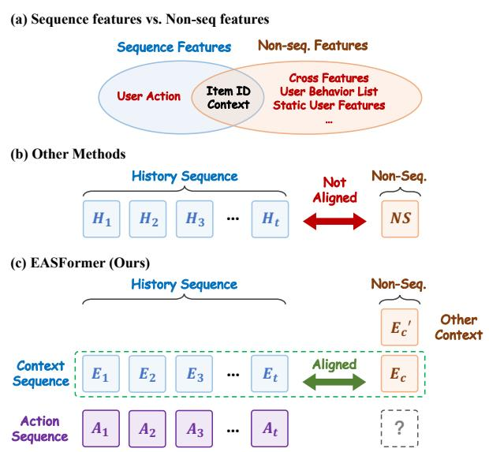
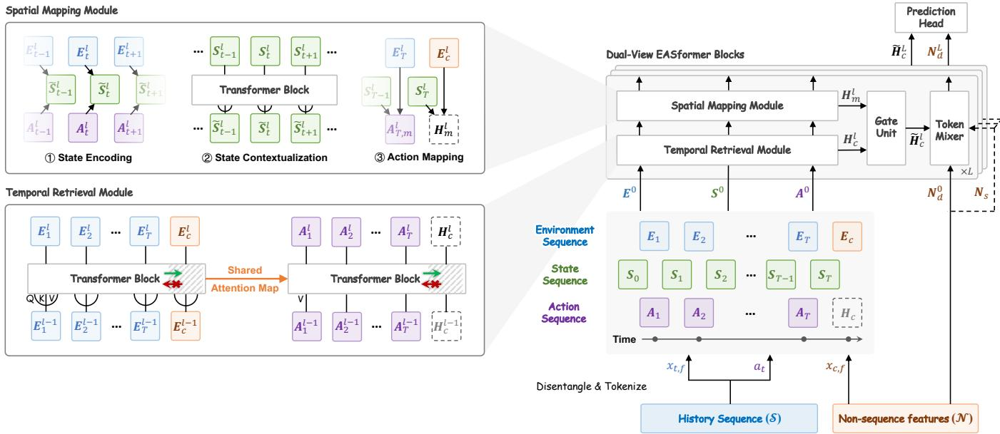
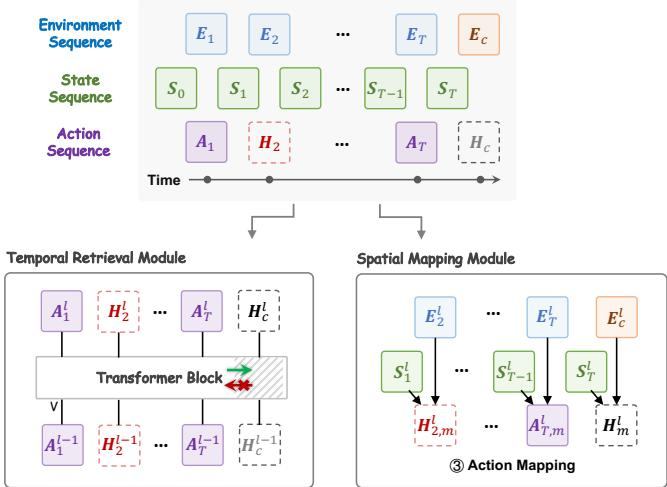
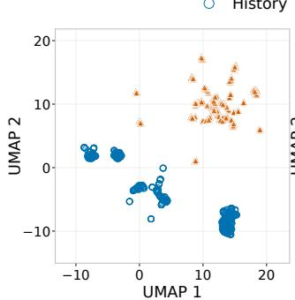
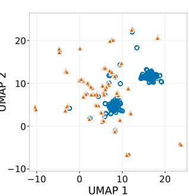
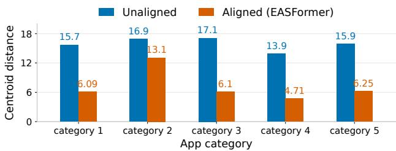
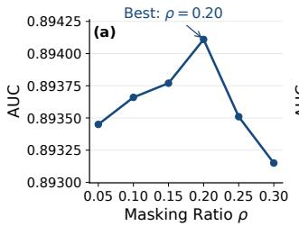
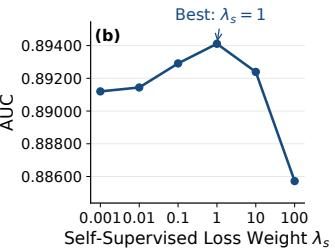

# EASformer: Environment-Action-State Alignment for Industrial Generative Ranking

Bohao Li∗   
libh@buaa.edu.cn   
Beihang University   
Beijing, China   
Yingda Tang∗   
ttttang2002@gmail.com   
Independent Researcher   
Shanghai, China   
Jilei Fu   
grayfu@gmail.com   
Independent Researcher   
Shanghai, China   
Heng Chang   
heng.chang@huawei.com   
Independent Researcher   
Beijing, China   
Dinglun Cao∗   
cdinglun@buaa.edu.cn   
Beihang University   
Beijing, China

Zhiting Zhao 24S151185@stu.hit.edu.cn Harbin Institute of Technology Shenzhen, China

Miao Yan   
erin.mia.yan@gmail.com   
Independent Researcher   
Shanghai, China

Pengcheng Huang∗ 24s151025@stu.hit.edu.cn Harbin Institute of Technology Shenzhen, China

Bowen Du†   
dubowen@buaa.edu.cn   
Beihang University   
Beijing, China   
Yi Cao†   
ycaoxd@163.com   
Independent Researcher   
Shanghai, China   
Tianying Liu   
tianying\_liu@outlook.com   
Independent Researcher   
Shanghai, China

## Abstract

Modern industrial ranking systems increasingly adopt generative recommendation (GR) paradigms, in which user behavior sequences and non-sequential (NS) features are tokenized and jointly modeled by Transformer-style backbones. This unified formulation provides a scalable interface for modeling long histories and heterogeneous features. However, sequence and NS representations often carry asymmetric semantics: historical representations may combine environment context with observed-action semantics, whereas candidate-side NS representations contain no observed action but incorporate richer supplementary context, such as user-item inter action features and recent behavior lists. Direct interaction between such representations can make query-key dot products compare diferent semantic objects, limiting meaningful cross-token interaction. To fill this gap, we propose EASformer, an Environment-Action-State disentangled architecture for industrial app ranking. EASformer constructs an explicitly aligned context environment space shared by historical and non-sequence tokens, while disentangling user actions from historical token and candidate-specific context form non-sequence tokens. Based on this aligned space, EASformer enables complementary historical action retrieval and state-conditioned action prediction. Furthermore, the disentangled design supports a Cloze-style self-supervised objective by masking historical actions and reusing the candidate prediction pathway. On an ofline benchmark from a real-world industrial app marketplace, EASformer achieves an AUC of 0.89411, yielding a 0.88% relative improvement over the deployed baseline. Online A/B tests further

support this advantage, with relative eCPM lifts of 1.26% and 3.94% across two real-world ranking scenarios.

CCS Concepts

• Information systems → Recommender systems.

## Keywords

industrial recommendation, generative recommendation, semantic alignment, feature interaction, self-supervised learning

## 1 Introduction

Modern industrial recommender systems are shifting from conventional feature-engineered ranking models toward generative recommendation (GR) paradigms [4, 12, 34]. Unlike traditional architectures built on manually designed feature interactions, GR models represent diverse information sources as tokens and process them with Transformer-based backbones. This unified formulation provides a scalable interface for jointly modeling long user behavior sequences, candidate information, and heterogeneous side features, making it increasingly attractive for large-scale industrial ranking.

Recent studies have advanced token-based recommendation along several directions. Sequential methods, such as SASRec and BERT4Rec, model user behaviors as ordered token sequences [15, 25], while later works enrich sequence representations with user actions or item-level semantics [12, 26, 31]. HSTU reformulates industrial ranking as generative sequential transduction, while MTGR adapts its backbone with candidate-side cross features and discriminative training [11, 34]. In parallel, heterogeneous feature interaction has been explored through self-attention, co-action mod eling, and token mixing [1, 24, 39]. Industrial rankers also integrate sequential behaviors and non-sequential (NS) features through unified or modular architectures, such as OneTrans, InterFormer, HyFormer, MixFormer, HeMix, and EST [13, 14, 19, 29, 33, 36]. Con sequently, integrating sequence and NS tokens has become a central research problem in token-based industrial ranking.

However, existing token-based GR methods mainly emphasize token expressiveness and fusion capacity, while overlooking a fundamental requirement for token interaction: semantic alignment. Query-key similarity in self-attention is meaningful only when the compared representations are semantically comparable [28]. This condition naturally holds for linguistic tokens in NLP [5], visual patches in computer vision [6], and explicitly aligned representations in multimodal learning [21]. In industrial GR, however, heterogeneous semantics may be combined during token construction or entangled through subsequent model interactions. The resulting tokens therefore lack a consistent semantic basis for comparison, making their query-key dot products dificult to interpret as semantic similarity.

Taking app recommendation as an example, a ranking model must jointly leverage historical app interactions, candidate attributes, user-item interaction features, and contextual signals such as device, time, and location. As illustrated in Figure 1, a historical interaction comprises an environment context and an observed user action. In contrast, the candidate-side NS representation contains the corresponding current context environment but no observed action, while also incorporating candidate-specific supplementary context, such as user-item cross features, recent behavior lists, and user attributes. Sequence and NS representations therefore have asymmetric semantic compositions, with each containing information absent from the other. Directly interacting such representations can cause query-key dot products to compare diferent semantic objects, thereby limiting the ability of Transformer-based architectures to model meaningful cross-token interactions.

  
Figure 1: Semantic misalignment between sequence and NS representations. EASformer separates aligned context environment $E ,$ candidate-specific supplementary context $E _ { c } ^ { \prime } ,$ and user action before interaction.

Motivated by this limitation, we seek to disentangle heterogeneous semantics before token interaction while preserving a shared embedding space for aligned fields. Specifically, each historical interaction is separated into an aligned environment representation and an observed user action, while candidate-side information is divided into the corresponding current environment and candidate-specific supplementary context. Historical and candidate environments are constructed from semantically matched fields and embedded in a shared environment space.

Building on this alignment-and-disentanglement design, we propose EASformer for industrial GR ranking. EASformer models user responses from two complementary views. The temporal retrieval view matches the current environment with historical environments and retrieves their associated actions as personalized evidence. The spatial mapping view models a state-conditioned context-to-action relationship from the current environment and routed user state. The two views are complementary: temporal retrieval uses concrete historical evidence, while spatial mapping captures contextdependent behavior beyond direct historical matches. Their outputs are adaptively fused, and supplementary context is incorporated through a separate pathway for final ranking. The explicit separation of actions further enables a natural Cloze-style masked-action objective. During training, selected historical actions are masked and reconstructed through the same dual-view pathway and ranking head. This objective leverages historical environment-to-action relationships as additional supervision for both prediction views. We evaluate EASformer on an industrial app-ranking task. On a 25-day ofline benchmark, EASformer achieves an AUC of 0.89411, corresponding to a 0.88% relative improvement over the production baseline (HyFormer). Further online A/B tests of the lightweight EASformer demonstrate consistent gains in two real-world industrial ranking scenarios.

Our main contributions are summarized as follows:

• We identify semantic misalignment between sequence and NS representations as a practical limitation in industrial GR ranking and formulate aligned environment modeling as a design principle for their interaction.

• We propose EASformer, an Environment-Action-State disentangled architecture that constructs an aligned environment space from semantically matched historical and candidate fields. EASformer combines temporal retrieval of historical action evidence with spatial, state-conditioned context-to-action mapping for candidate prediction.

• We introduce a Cloze-style masked-action objective that reuses the dual-view candidate prediction pathway and leverages logged environment-to-action relationships as additional supervision.

• We evaluate EASformer in real-world industrial app-ranking settings, achieving an AUC of 0.89411 and a 0.88% relative improvement over the deployed baseline ofline, while the lightweight version of EASformer yields relative eCPM lifts of 1.26% and 3.94% in two online A/B tests.

EASformer: Environment-Action-State Alignment for Industrial Generative Ranking

preprint, -, -

  
Figure 2: Overview of the proposed framework.

## 2 Preliminary: Industrial Generative Ranking

For each ranking request of user �, let

$$
{ \cal S } _ { u } = \left( x _ { 1 } , x _ { 2 } , \ldots , x _ { T } \right) ,\tag{1}
$$

denote the sequential features, where $S _ { u }$ is an ordered sequence of � historical interactions. Each interaction $\pmb { x } _ { t }$ contains its contextual information, such as item and scenario attributes, together with the observed user action.

Given a recalled candidate set $C _ { u } ,$ each candidate $c \in C _ { u }$ is associated with non-sequential features $N _ { u , c }$ . These features include candidate attributes, user static information, user-item cross statistics, and auxiliary behavior lists.

Industrial generative ranking jointly models $S _ { u }$ and $N _ { u , c }$ to estimate the user’s response to each candidate:

$$
\hat { y } _ { u , c } = P \big ( y _ { u , c } = 1 \mid S _ { u } , N _ { u , c } \big ) , \qquad c \in C _ { u } ,\tag{2}
$$

where $y _ { u , c } \in \{ 0 , 1 \}$ is the supervision label and $\hat { y } _ { u , c } \in \left( 0 , 1 \right)$ is the predicted ranking score. The candidates are ranked according to their predicted scores. As candidates are modeled independently, we focus on a single candidate and, for simplicity, omit the subscripts hereafter, using S, N, �, and �ˆ.

## 3 Method

EASformer follows a disentanglement-and-alignment principle, aiming to construct an aligned context-environment space for measuring the relevance between historical interactions and the current candidate. As illustrated in Figure 2, it extracts semantically matched context-environment fields from the sequential and candidate-side non-sequential (NS) inputs, while separately encod ing observed actions and the complete candidate-side NS tokens. EASformer then progressively refines a candidate-conditioned useraction representation through � stacked blocks, each comprising temporal retrieval, spatial mapping, and heterogeneous information fusion. The disentangled Action stream further enables a Clozestyle masked-action objective that reuses the same prediction pathway to provide auxiliary supervision.

## 3.1 Aligned and Disentangled Tokenization

We assume that history–candidate relevance should be measured through context-environment fields with aligned semantics. Let $\mathcal { F } _ { E }$ denote the set of such fields shared by the historical interactions and the current candidate.

Context Environment. For each historical interaction, we extract its context-environment fields to construct an Environment token. The corresponding fields are also extracted from the candidate-side non-sequential input to construct the current Environment token:

$$
E _ { i } ^ { 0 } = f _ { E } \big ( [ \phi _ { f } ( x _ { i , f } ) ] _ { f \in \mathcal { F } _ { E } } \big ) , \qquad i \in \{ 1 , . . . , T , c \} ,\tag{3}
$$

where $\phi _ { f } ( \cdot )$ is the field-specific transformation, brackets denote concatenation, and $f _ { E }$ is shared across the historical and candidate sides. The historical Environment sequence is denoted by $E ^ { 0 } \ =$ $[ E _ { 1 } ^ { 0 } , \dots , E _ { T } ^ { 0 } , E _ { c } ^ { 0 } ]$ , while �0 denotes the context of the candidate.

Action. After separating the environment fields, we independently encode the observed user action $a _ { t }$ of each interaction as

$$
A _ { t } ^ { 0 } = e _ { A } ( a _ { t } ) , \qquad t = 1 , . . . , T ,\tag{4}
$$

where $e _ { A } ( \cdot )$ is a learnable action embedding table. Since the action associated with the current candidate is unobserved and is the target to be inferred, we initialize it with a learnable placeholder, $H _ { c } ^ { 0 } =$ $\pmb { h } _ { \mathrm { u n k } }$ . The resulting Action sequence is $A ^ { 0 } = [ A _ { 1 } ^ { \bar { 0 } } , \ldots , A _ { T } ^ { 0 } , H _ { c } ^ { 0 } ]$

User State. To model how user preferences evolve along the interaction sequence, we introduce a temporally staggered State sequence $S ^ { 0 } = \bar { [ } S _ { 0 } ^ { 0 } , \ldots , S _ { T } ^ { 0 } ]$ , as illustrated in Figure 2. All state tokens are initialized by the same embedding of static user features, such as device attributes:

$$
S _ { t } ^ { 0 } = f _ { U } ( N _ { U } ) , \quad t = 0 , . . . , T ,\tag{5}
$$

where $N _ { U } \subset N$ denotes the user-static feature subset.

Non-Sequential Information. Although the aligned candidate fields are extracted to construct $E _ { c } ^ { 0 } ,$ , the complete non-sequential input remains useful for ranking. We therefore independently map the full N into � static NS tokens:

$$
\begin{array} { r } { \pmb { N } _ { s } = f _ { N } ( \pmb { N } ) = [ \pmb { N } _ { s , 1 } , \ldots , \pmb { N } _ { s , K } ] \in \mathbb { R } ^ { K \times \mathcal { D } _ { \mathrm { N S } } } , \qquad \pmb { N } _ { d } ^ { 0 } = \pmb { N } _ { s } , } \end{array}\tag{6}
$$

where, $N _ { s }$ remains fixed across all blocks, whereas $N _ { d } ^ { \ell }$ denotes the dynamically updated NS tokens after the ℓ-th block. The Environ ment, Action and State representations lie in $\mathbb { R } ^ { \mathcal { D } }$ , while each NS token lies in $\mathbb { R } ^ { \mathcal { D } _ { \mathrm { N S } } }$

## 3.2 Dual-View EASformer Block

EASformer stacks � blocks to progressively update the Environment, Action, State, and dynamic NS representations. Each block consists of a Temporal Retrieval Module, a Spatial Mapping Module, and a heterogeneous information fusion module. The first two modules produce complementary candidate-action representations, which are subsequently fused to interact with the NS tokens.

3.2.1 Temporal Retrieval. We assume that actions under similar context environments provide direct evidence for predicting the current candidate action. Therefore, the Temporal Retrieval Module computes attention solely from the Environment sequence and shares the resulting attention map with the Action sequence.

At the ℓ-th block, let $E ^ { \ell - 1 }$ and $A ^ { \ell - 1 }$ denote the complete Environment and Action sequences, whose candidate slots are $E _ { c } ^ { \ell - 1 }$ and $H _ { c } ^ { \ell - 1 }$ , respectively. The shared attention map is

$$
P ^ { \ell } = \mathrm { S o f t m a x } \left( \frac { ( E ^ { \ell - 1 } W _ { Q } ^ { \ell } ) ( E ^ { \ell - 1 } W _ { K } ^ { \ell } ) ^ { \top } } { \sqrt { d _ { h } } } + M \right) ,\tag{7}
$$

where $d _ { h }$ is the head dimension, $W _ { \mathrm { { O } } } ^ { \ell }$ and $\mathbf { } W _ { K } ^ { \ell }$ are learnable projection matrices, and � is an asymmetric visibility mask. Historical tokens attend only to valid historical positions and cannot access the candidate slot, whereas the candidate token attends to itself and all eligible preceding interactions. Then, the Environment and Action streams use separate value projections but share $P ^ { \ell } { : }$

$$
\widetilde { E } ^ { \ell } = P ^ { \ell } E ^ { \ell - 1 } W _ { V _ { E } } ^ { \ell } , \qquad \widetilde { A } ^ { \ell } = P ^ { \ell } A ^ { \ell - 1 } W _ { V _ { A } } ^ { \ell } ,\tag{8}
$$

where $W _ { V _ { E } } ^ { \ell }$ and $W _ { V _ { A } } ^ { \ell }$ are independent value projection matrices. The two streams are then independently updated through residual attention and feed-forward sublayers:

$$
\begin{array} { r l } & { \widehat { \boldsymbol { E } } ^ { \ell } = \mathrm { R N } \Big ( \boldsymbol { E } ^ { \ell - 1 } + \widetilde { \boldsymbol { E } } ^ { \ell } \Big ) , \qquad \boldsymbol { E } ^ { \ell } = \mathrm { R N } \Big ( \widehat { \boldsymbol { E } } ^ { \ell } + \mathrm { F F N } _ { \boldsymbol { E } } ^ { \ell } \Big ( \widehat { \boldsymbol { E } } ^ { \ell } \Big ) \Big ) , } \\ & { \widehat { \boldsymbol { A } } ^ { \ell } = \mathrm { R N } \Big ( \boldsymbol { A } ^ { \ell - 1 } + \widetilde { \boldsymbol { A } } ^ { \ell } \Big ) , \qquad \boldsymbol { A } ^ { \ell } = \mathrm { R N } \Big ( \widehat { \boldsymbol { A } } ^ { \ell } + \mathrm { F F N } _ { \boldsymbol { A } } ^ { \ell } \Big ( \widehat { \boldsymbol { A } } ^ { \ell } \Big ) \Big ) . } \end{array}\tag{9}
$$

Here, RN(·) denotes RMS normalization, FFNℓ (·) and $\mathrm { F F N } _ { A } ^ { \ell } ( \cdot )$ are the feed-forward networks [28], and diferent occurrences use independent parameters.

The candidate slot $H _ { c } ^ { \ell } \in A ^ { \ell }$ serves as the output of the temporal retrieval module. In this way, the Environment stream determines where to retrieve, while the Action stream provides the corresponding behavioral evidence.

3.2.2 Spatial Mapping. Temporal retrieval provides explicit behavioral evidence from similar historical environments, but it relies on the assumption that similar contexts lead to consistent user actions. However, user behavior can evolve over time as the underlying user state changes. Therefore, EASformer introduces a spatial mapping module to learn a state-conditioned action representation, which captures how the current context leads to diferent action tendencies under diferent user states.

State Encoding. The State sequence captures the evolving user behavioral state by aggregating information from historical interactions. At the ℓ-th block, each historical Environment-Action pair is first projected into the corresponding state position:

$$
\widetilde { \boldsymbol { S } } _ { t } ^ { \ell } = \operatorname { R N } \left( \boldsymbol { S } _ { t } ^ { \ell - 1 } + f _ { E A } ^ { \ell } ( [ \boldsymbol { E } _ { t } ^ { \ell } ; \boldsymbol { A } _ { t } ^ { \ell } ] ) \right) , \qquad t = 0 , \ldots , T ,\tag{10}
$$

where $f _ { E A } ^ { \ell } ( \cdot )$ is a learnable mapping function that encodes the interaction-level context and action information into the user state.

State Contextualization. Since user behavioral states evolve across interactions, the encoded state sequence is further contextualized by a Transformer encoder block:

$$
S ^ { \ell } = \mathrm { T r a n s f o r m e r } _ { S } ^ { \ell } ( \widetilde { S } ^ { \ell } ) ,\tag{11}
$$

where each state token captures dependencies among historical states. The latest state token after contextualization, denoted as $S _ { T } ^ { \ell } \in S ^ { \ell }$ , summarizes the user’s current behavioral state.

Action Mapping. The spatial mapping module then predicts the candidate action tendency conditioned on the current context environment and routed user state:

$$
H _ { m } ^ { \ell } = \mathrm { R N } \left( H _ { m } ^ { \ell - 1 } + f _ { M } ^ { \ell } ( [ E _ { c } ^ { \ell } ; S _ { T } ^ { \ell } ] ) \right) ,\tag{12}
$$

where $f _ { M } ^ { \ell } ( \cdot )$ is a learnable mapping function. The resulting $H _ { m } ^ { \ell }$ captures how the current context and user state jointly determine the candidate action beyond direct historical retrieval.

3.2.3 Dual-View Fusion. The Temporal Retrieval and Spatial Mapping modules capture candidate actions from complementary perspectives. The temporal view provides explicit behavioral evidence retrieved from similar historical environments, while the spatial view models state-conditioned action tendencies.

Before fusion, the two representations are projected into the NS token space via $\overline { { H } } _ { c } ^ { \ell } = \pi _ { T } ^ { \ell } \left( H _ { c } ^ { \ell } \right)$ and $\overline { { H } } _ { m } ^ { \ell } = \pi _ { M } ^ { \ell } \left( H _ { m } ^ { \ell } \right)$ , where $\pi _ { T } ^ { \ell } , \pi _ { M } ^ { \ell }$ $\mathbb { R } ^ { \mathcal { D } } \to \mathbb { R } ^ { \mathcal { D } _ { \mathrm { N S } } }$ are learnable linear projections. When $\mathcal { D } = \mathcal { D } _ { \mathrm { N S } }$ , they can be implemented as identity mappings.

The projected representations are then combined through a vector-wise gating mechanism:

$$
\begin{array} { r l } & { \gamma ^ { \ell } = \sigma \left( W _ { g } ^ { \ell } [ \overline { { H } } _ { m } ^ { \ell } ; \overline { { H } } _ { c } ^ { \ell } ] + b _ { g } ^ { \ell } \right) , } \\ & { } \\ & { \widetilde { H } _ { c } ^ { \ell } = \mathrm { R N } \left( \gamma ^ { \ell } \odot \overline { { H } } _ { m } ^ { \ell } + ( 1 - \gamma ^ { \ell } ) \odot \overline { { H } } _ { c } ^ { \ell } \right) . } \end{array}\tag{13}
$$

The fused representation $\widetilde { H } _ { c } ^ { \ell } \in \mathbb { R } ^ { D _ { \mathrm { N S } } }$ adaptively combines stateconditioned action mapping and retrieved historical evidence for the current candidate.

3.2.4 Heterogeneous Token Interaction. Candidate-side NS features provide additional rich serving-time information, but they are not included in the aligned environment space. Therefore, EASformer further incorporates the NS token.

  
Figure 3: Masked-action self-supervision in EASformer. Masked historical Action tokens are replaced with a learnable placeholder and processed normally by both the Temporal Retrieval and Spatial Mapping modules.

Specifically, the dynamic NS tokens are updated by interacting with the current candidate representation and static NS tokens:

$$
N _ { d } ^ { \ell } = \mathrm { T o k e n M i x e r } ^ { \ell } \left( \left[ { \cal N } _ { d } ^ { \ell - 1 } ; \widetilde { \cal H } _ { c } ^ { \ell } ; { \cal N } _ { s } \right] \right) ,\tag{14}
$$

where $N _ { s }$ denotes static NS tokens generated during tokenization and $N _ { d } ^ { \ell }$ denotes dynamically updated NS representations. TokenMixer(·) [27, 39] performs token-level interaction among heterogeneous NS representations and candidate state.

This design allows rich candidate-side information to enhance final ranking while preserving the semantic purity of the aligned context-environment space.

## 3.3 Prediction Head and Main Objective

After � EASformer blocks, the final candidate representation and dynamic NS tokens are concatenated and fed into a residual MLP prediction head:

$$
\hat { y } = \sigma \Bigl ( f _ { P } \left( \left[ \widetilde { H } _ { c } ^ { L } ; \mathrm { v e c } ( N _ { d } ^ { L } ) \right] \right) \Bigr ) ,\tag{15}
$$

where $\mathrm { v e c } ( \cdot )$ concatenates the dynamic NS tokens, $f _ { P } ( \cdot )$ denotes the prediction head, and $\sigma ( \cdot )$ is the sigmoid function. The main ranking objective is

$$
\mathcal { L } _ { \mathrm { r a n k } } = \mathrm { B C E } ( y , \hat { y } ) ,\tag{16}
$$

which is averaged over valid candidates during training.

## 3.4 Masked-Action Self-Supervision

The disentangled Action stream provides a natural way to exploit the environment-to-action relations contained in historical interactions. Specifically, EASformer masks selected historical actions while retaining their corresponding Context Environment tokens, thereby turning these positions into pseudo-candidates with known environments but unknown actions.

Let $\rho$ denote the masking ratio, and let $M \subseteq \{ 1 , \dots , T \}$ be the sampled positions, where $| { \mathcal { M } } | \approx \rho T$ . For each $t \in M$ , the original

Action token is replaced with the same learnable placeholder used for the candidate:

$$
A _ { t } ^ { 0 } = H _ { t } ^ { 0 } = h _ { \mathrm { u n k } } , \qquad t \in M .\tag{17}
$$

The masked position is then processed by the same � EASformer blocks. At each block $\ell ,$ the masked Action sequence is processed by the same backbone as the original Action sequence: 1) In the Temporal Retrieval Module, the attention maps derived from the Environment sequence update the masked action slot, producing the temporal representation $H _ { t } ^ { \ell }$ . 2) In the Spatial Mapping Module, the masked Action token also participates in the state encoding, while the corresponding Environment token $E _ { t } ^ { \ell }$ and its latest State token $S _ { t - } ^ { \ell }$ are mapped to the spatial representation $H _ { t , m } ^ { \ell } .$ . Since the observed action has been replaced by $\pmb { h } _ { \mathrm { u n k } }$ , these computations do not expose the target action.

Across the � blocks, temporal and spatial evidence is accumulated through residual updates, yielding $H _ { t } ^ { L }$ and $H _ { t , m } ^ { L } ,$ , respectively. The two final representations are then fused using the same dualview gate defined in Eq. 13:

$$
\widetilde { \cal H } _ { t } ^ { L } = \mathrm { G a t e } ^ { L } \left( { \cal H } _ { t } ^ { L } , { \cal H } _ { t , m } ^ { L } \right) .\tag{18}
$$

Since historical positions do not contain complete candidate-side NS features, we concatenate $\widetilde { H } _ { t } ^ { L }$ with � learnable NS placeholder tokens $N _ { \mathrm { p h } } \in \mathbb { R } ^ { K \times \mathcal { D } }$ and reuse the main prediction head, �� (·):

$$
\hat { y } _ { t } ^ { \mathrm { a u x } } = \sigma \Bigl ( f _ { P } \left( [ \widetilde { H } _ { t } ^ { L } ; \mathrm { v e c } ( N _ { \mathrm { p h } } ) ] \right) \Bigr ) .\tag{19}
$$

The overall training objective is

$$
\mathcal { L } = \mathcal { L } _ { \mathrm { t a s k } } + \frac { \lambda _ { s } } { \vert \mathcal { M } \vert } \sum _ { t \in \mathcal { M } } \mathrm { B C E } \left( a _ { t } , \hat { y } _ { t } ^ { \mathrm { a u x } } \right) ,\tag{20}
$$

where $\lambda _ { s }$ denotes the weight of the self-supervised loss and $a _ { t }$ is the original action at position �.

## 4 Experiments

We evaluate EASformer under a real-world industrial app-ranking benchmark and compare it with recent baselines. We further present ablation studies, case studies, parameter sensitivity analyses, and online A/B tests to further examine our method.

## 4.1 Experimental Setup

Here, we describe the dataset, evaluation protocol, baselines, and implementation details.

4.1.1 Industrial App-Ranking Dataset. We conduct experiments on a large-scale anonymized dataset collected from a real-world industrial app marketplace. Unlike conventional request-level ranking datasets, the data are organized at the user level, preserving each user’s ordered interaction history across requests. The dataset is partitioned by day, with each partition containing interactions generated on that day, and spans more than 150 daily partitions.

To reduce data redundancy and training cost, negative exposure records are randomly sampled at a rate of 0.2. All user information is anonymized to protect privacy.

4.1.2 Evaluation Protocol. We adopt a two-stage evaluation protocol. We first compare all models ofline under identical data and input settings. After confirming the ofline advantage of EAS for me r, we further conduct online A/B testing to evaluate its efectiveness in the production environment.

For ofline evaluation, all models use the same temporal split: 25 consecutive daily partitions for training and the immediately following partition for evaluation. The Area Under the ROC Curve (AUC) is used as the primary ofline evaluation metric.

For online A/B testing, EASformer is compared only against HyFormer, the incumbent production model, due to practical deployment and trafic constraints. Online performance is evaluated using eCPM (efective cost per mille), a monetization metric normal ized per thousand impressions. Due to commercial confidentiality, we report only the relative eCPM lift over the control group.

4.1.3 Baselines. We select representative baseline methods and group them into three categories according to their primary modeling focus:

• Feature interaction models. DCNv2 [30], RankMixer [39], and Wukong [35] focus on learning interactions among feature rep resentations to capture cross-feature dependencies for ranking.

• Sequential models. SASRec [15] and LONGER [2] model dependencies within user behavior histories to extract interest representations for candidate prediction.

• Unified architectures. MTGR [11], HyFormer [14], OneTrans [14], Mixformer [13] and UniMixer [9] organize heterogeneous infor mation within a unified modeling framework and learn interac tions across information sources for ranking.

In our evaluation, sequential interaction models are cascaded with feature interaction models to form complete ranking pipelines, while unified architectures are evaluated as integrated ranking models.

4.1.4 Implementation Details. EASFormer is implemented in PyTorch and optimized at the operator level for the target deploy ment hardware. We apply standard field-specific transformations $\phi _ { f } ( \cdot )$ to the input fields and concatenate the resulting representations before projection. The same encoding pipeline is used for EASFormer and all baselines to ensure a fair comparison, while detailed field definitions are omitted for confidentiality.

EASformer is optimized using AdamW with $( \beta _ { 1 } , \beta _ { 2 } ) = ( 0 . 9 , 0 . 9 8 )$ We use a batch size of 64, learning rates of $1 \times 1 0 ^ { - 4 }$ and $5 \times 1 0 ^ { - 5 }$ for embedding and dense parameters, respectively, and a weight decay of 0.01 for dense parameters. EASformer consists of $L = 5$ blocks with 8 attention heads per block and uses � = 3 NS tokens. The masked-action ratio and self-supervised loss weight are set to $\rho = 0 . 2$ and $\lambda _ { s } = 1$ , respectively. Training and evaluation are conducted in FP32 on Ascend 910B3 NPUs.

We instantiate two variants of EASformer. Both use NS tokens with $\mathcal { D } _ { \mathrm { N S } } = 5 1 2 .$ . The full EASformer sets the Environment, Action, and State representation dimension to D = 512, whereas the lightweight version EASformer− reduces D to 128. The maximum history length is set to � = 500 for all ofline experiments; for online deployment, we use � = 500 for EASFormer− and � = 1,000 for the production HyFormer baseline.

Table 1: Overall performance.
<table><tr><td>Sequence Modeling</td><td>Feature Interaction</td><td>AUC↑ ΔAUC</td></tr><tr><td colspan="3">Two-Stage Models</td></tr><tr><td>LONGER</td><td>RankMixer 0.88895</td><td>+0.30</td></tr><tr><td>LONGER</td><td>DCNv2 0.88660</td><td>+0.04</td></tr><tr><td>LONGER</td><td>Wukong 0.88859</td><td>+0.26</td></tr><tr><td>SASRec</td><td>RankMixer 0.87410</td><td>-1.37</td></tr><tr><td>SASRec</td><td>DCNv2 0.86540 Wukong</td><td>-2.36</td></tr><tr><td>SASRec</td><td>0.87710</td><td>-1.04</td></tr><tr><td colspan="3">Unified Architectures</td></tr><tr><td>OneTrans</td><td>0.88599</td><td>-0.03</td></tr><tr><td>HyFormer (Baseline)</td><td>0.88628</td><td>0.00</td></tr><tr><td>UniMixer</td><td>0.87984</td><td>-0.73</td></tr><tr><td>MixFormer</td><td>0.88671</td><td>+0.05</td></tr><tr><td>MTGR</td><td>0.88833</td><td>+0.23</td></tr><tr><td>EASformer~</td><td>0.89301</td><td>+0.76</td></tr><tr><td>EASformer (Ours)</td><td>0.89411</td><td>+0.88</td></tr></table>

## 4.2 Main Results

We compare EASformer with representative baselines on a 25-day ofline benchmark from a real-world industrial app marketplace, with results reported in Table 1. HyFormer, the deployed production model, serves as the reference for computing ΔAUC, and the best result is highlighted in bold. We make the following observations.

(i) EASformer achieves the highest AUC of 0.89411, corresponding to relative improvements of 0.88% over HyFormer, 0.58% over the strongest two-stage baseline (LONGER+RankMixer), and 0.65% over the strongest unified baseline (MTGR). These results support our semantic alignment design. Existing architectures may still directly interact sequence and NS representations with asymmetric semantics, whereas EASformer performs history–candidate matching in an aligned environment space, enabling more targeted retrieval of relevant historical feedback.

(ii) The comparison with MTGR further demonstrates the benefit of EASformer’s structured interaction. Although our MTGR implementation also separates environment and action tokens, EASformer assigns them distinct roles: Environment representations determine history–candidate matching weights, Action representations provide the retrieved behavioral evidence, and the State stream complements direct retrieval. The improvement over MTGR indicates that explicit role-specific interaction provides benefits beyond input-level token separation.

(iii) We also report EASformer−, a lightweight variant with 128- dimensional Environment, Action, and State representations, yielding an aggregate width of 384 across the three streams, compared with the 512-dimensional sequence representation in the baseline setting. Despite its reduced width, EASformer− achieves an AUC of 0.89301 and a 0.76% relative improvement over HyFormer. This result suggests that the gain mainly arises from the aligned and disentangled modeling strategy rather than increased representation width, while also demonstrating its potential for lightweight online deployment.

(a) Unaligned  
Table 2: Ablation results. ΔAUC denotes the relative change with respect to the full EASformer model.
<table><tr><td>Variant</td><td>AUC</td><td>∆AUC (%)</td></tr><tr><td>EASformer (full)</td><td>0.89411</td><td></td></tr><tr><td>w/o SSL</td><td>0.89146</td><td>-0.30</td></tr><tr><td>w/o EAS</td><td>0.88832</td><td>-0.65</td></tr><tr><td>w/o Spatial Mapping</td><td>0.89262</td><td>-0.17</td></tr><tr><td>w/o Temporal Retrieval</td><td>0.89084</td><td>-0.37</td></tr></table>

## 4.3 Ablation Study

We evaluate four variants of EASformer: w/o SSL removes maskedaction self-supervision; w/o EAS replaces the aligned and disentangled modeling with unified interaction over mixed historical and candidate representations; w/o Spatial Mapping retains only the Temporal Retrieval branch; and w/o Temporal Retrieval retains the Environment-stream self-attention and Spatial Mapping branch. All relative AUC changes are measured against the full model.

Despite using the same input features, w/o EAS causes the largest relative AUC drop of 0.65%, supporting the importance of disentangling historical context from observed actions and aligning history– candidate semantics before interaction.

Removing either Temporal Retrieval or Spatial Mapping degrades performance, confirming the contribution of both views. The larger relative AUC drop without Temporal Retrieval indicates that retrieving historical actions from similar context provides more di rect behavioral evidence, while state-conditioned action mapping contributes complementary signals by adapting prediction to the current user state. Combining the two views therefore achieves the best performance.

Removing masked-action self-supervision reduces AUC by 0.30%, indicating that historical environment–action pairs provide useful auxiliary supervision. By treating masked interactions as pseudo candidates and reusing the main prediction pathway, this objective remains aligned with the ranking task and improves performance.

## 4.4 Qualitative Analysis of Semantic Alignment

To examine environment–action disentanglement and semantic alignment, we compare EASformer (Aligned) with a model without environment–action field separation (Unaligned). The UMAP visualizations in Figure 4(a) show clear separation between historical and candidate representations in Unaligned, whereas the two sources lie closer together in Aligned. We also group representations by category and compute history–candidate centroid distances within each category in the two-dimensional projection space. As shown in Figure 4(b), Aligned exhibits smaller projected distances across all displayed categories. These observations are consistent with EASformer’s use of semantically corresponding environment fields and a shared encoder to support history–candidate matching.

We further examine how candidates allocate attention across historical categories. We average attention weights across heads in the first layer, compute the mean for each historical category, and normalize these means across categories to reduce the influence of category frequencies. In both candidate cases shown in Figure 5,

  
(b) Aligned (EASFormer)

  
(c) History-candidate centroid distance

Figure 4: Ablation of semantic alignment.
<table><tr><td rowspan=1 colspan=1>category 1</td><td rowspan=1 colspan=1>0.38</td><td rowspan=1 colspan=1>0.61</td><td rowspan=1 colspan=1></td><td rowspan=1 colspan=1>0.15</td><td rowspan=1 colspan=1>0.19</td></tr><tr><td rowspan=1 colspan=1>category 2</td><td rowspan=1 colspan=1>0.068</td><td rowspan=1 colspan=1>0.063</td><td rowspan=1 colspan=1></td><td rowspan=1 colspan=1>0.41</td><td rowspan=1 colspan=1>0.55</td></tr><tr><td rowspan=1 colspan=1>category 3</td><td rowspan=1 colspan=1>0.0081</td><td rowspan=1 colspan=1>0.0057</td><td rowspan=1 colspan=1></td><td rowspan=1 colspan=1>0.022</td><td rowspan=1 colspan=1>0.0042</td></tr><tr><td rowspan=1 colspan=1>category 4</td><td rowspan=1 colspan=1>0.02</td><td rowspan=1 colspan=1>0.032</td><td rowspan=1 colspan=1></td><td rowspan=1 colspan=1>0.028</td><td rowspan=1 colspan=1>0.022</td></tr><tr><td rowspan=1 colspan=1>category 5</td><td rowspan=1 colspan=1>0.02</td><td rowspan=1 colspan=1>0.034</td><td rowspan=1 colspan=1></td><td rowspan=1 colspan=1>0.03</td><td rowspan=1 colspan=1>0.066</td></tr><tr><td rowspan=1 colspan=1>category 6</td><td rowspan=1 colspan=1>0.045</td><td rowspan=1 colspan=1>0.014</td><td rowspan=1 colspan=1></td><td rowspan=1 colspan=1>0.023</td><td rowspan=1 colspan=1>0.0095</td></tr><tr><td rowspan=1 colspan=1>category 7</td><td rowspan=1 colspan=1>0.089</td><td rowspan=1 colspan=1>0.043</td><td rowspan=1 colspan=1></td><td rowspan=1 colspan=1>0.052</td><td rowspan=1 colspan=1>0.027</td></tr><tr><td rowspan=1 colspan=1>category 8</td><td rowspan=1 colspan=1>0.074</td><td rowspan=1 colspan=1>0.028</td><td rowspan=1 colspan=1></td><td rowspan=1 colspan=1>0.036</td><td rowspan=1 colspan=1>0.025</td></tr><tr><td rowspan=1 colspan=1>category 9</td><td rowspan=1 colspan=1>0.031</td><td rowspan=1 colspan=1>0.0088</td><td rowspan=1 colspan=1></td><td rowspan=1 colspan=1>0.046</td><td rowspan=1 colspan=1>0.007</td></tr><tr><td rowspan=1 colspan=1>category 10</td><td rowspan=1 colspan=1>0.055</td><td rowspan=1 colspan=1>0.017</td><td rowspan=1 colspan=1></td><td rowspan=1 colspan=1>0.033</td><td rowspan=1 colspan=1>0.014</td></tr><tr><td rowspan=1 colspan=1>category 11</td><td rowspan=1 colspan=1>0.032</td><td rowspan=1 colspan=1>0.019</td><td rowspan=1 colspan=1></td><td rowspan=1 colspan=1>0.02</td><td rowspan=1 colspan=1>0.012</td></tr><tr><td rowspan=1 colspan=1>category 12</td><td rowspan=1 colspan=1>0.0044</td><td rowspan=1 colspan=1>0.017</td><td rowspan=1 colspan=1></td><td rowspan=1 colspan=1>0.014</td><td rowspan=1 colspan=1>0.0074</td></tr><tr><td rowspan=1 colspan=1>category 13</td><td rowspan=1 colspan=1>0.037</td><td rowspan=1 colspan=1>0.02</td><td rowspan=1 colspan=1></td><td rowspan=1 colspan=1>0.029</td><td rowspan=1 colspan=1>0.012</td></tr><tr><td rowspan=1 colspan=1>category 14</td><td rowspan=1 colspan=1>0.051</td><td rowspan=1 colspan=1>0.034</td><td rowspan=1 colspan=1></td><td rowspan=1 colspan=1>0.035</td><td rowspan=1 colspan=1>0.021</td></tr><tr><td rowspan=1 colspan=1>category 15</td><td rowspan=1 colspan=1>0.04</td><td rowspan=1 colspan=1>0.031</td><td rowspan=1 colspan=1></td><td rowspan=1 colspan=1>0.029</td><td rowspan=1 colspan=1>0.015</td></tr><tr><td rowspan=2 colspan=1>category 16category 17</td><td rowspan=1 colspan=1>0.019</td><td rowspan=1 colspan=1>0.017</td><td rowspan=1 colspan=1></td><td rowspan=1 colspan=1>0.017</td><td rowspan=1 colspan=1>0.011</td></tr><tr><td rowspan=1 colspan=1>0.028</td><td rowspan=1 colspan=1>0.01</td><td rowspan=1 colspan=1></td><td rowspan=1 colspan=1>0.028</td><td rowspan=1 colspan=1>0.0068</td></tr></table>

Normalized category-mean attention  
U: Unaligned A: Aligned (EASFormer)

Figure 5: Ablation of semantic alignment. Bold headers denote candidate categories; rows denote history categories.

Aligned assigns higher normalized mean attention than Unaligned to historical interactions in the candidate’s own category. This behavior is consistent with EASformer’s interaction mechanism, where environment representations determine history–candidate matching weights that guide the aggregation of historical action representations.

## 4.5 Parameter sensitivity analyses

We conduct a hyperparameter sensitivity analysis on the masking ratio � and the self-supervised loss weight $\lambda _ { s } .$ . As shown in Figure 6, EASformer achieves the best performance at $\rho = 0 . 2 0$ and $\lambda _ { s } = 1$

  
Figure 6: Parameter sensitivity of the masked-action selfsupervised objective. (a) Masking ratio $\rho .$ (b) Self-supervised loss weight $\lambda _ { s }$

A small masking ratio provides insuficient self-supervised signals, whereas an excessively large ratio masks too much historical action information and weakens history–candidate interaction. Similarly, a small $\lambda _ { s }$ underutilizes the auxiliary objective, while an overly large value causes it to dominate the primary ranking task. We therefore set $\rho = 0 . 2 0$ and $\lambda _ { s } = 1$ in the following experiments.

## 4.6 Eficiency Analysis

We analyze the efects of history length and hidden dimension on the eficiency–efectiveness trade-of of EASformer. Table 3 reports AUC and model-only inference latency under the same serving environment. The latency is averaged over 10 inference samples.

Table 3: Eficiency analysis of EASformer. D denotes the hidden dimension of each Environment, Action, and State stream, and $\mathcal { D } _ { \mathrm { N S } } = 5 1 2$ for all settings.
<table><tr><td>D</td><td>History Length (T) |</td><td>AUC↑</td><td>Latency (ms)↓</td></tr><tr><td>512</td><td>500</td><td>0.89411</td><td>39.40</td></tr><tr><td>512</td><td>375</td><td>0.893 45</td><td>39.23</td></tr><tr><td>512</td><td>250</td><td>0.893 08</td><td>37.20</td></tr><tr><td>512</td><td>125</td><td>0.89135</td><td>35.14</td></tr><tr><td>128</td><td>500</td><td>0.893 01</td><td>27.71</td></tr></table>

Shortening the history provides moderate latency savings at the cost of ranking accuracy. For example, reducing the history length from 500 to 250 lowers latency by 5.6% with a 0.12% relative AUC decrease, while a length of 125 produces a larger accuracy drop. Reducing D to 128 is more efective: EASformer− decreases latency by 29.7% while retaining an AUC of 0.89301, only 0.12% lower than the full model. We therefore adopt EASformer− with a history length of 500 for online deployment.

## 4.7 Online Evaluation

Following the ofline evaluation, we deploy EASformer− in two real-world industrial app-ranking scenarios and conduct online A/B tests against the production baseline model (HyFormer) over one evaluation period. Due to commercial confidentiality, the scenario names and absolute metric values are anonymized, and only relative eCPM lifts are reported.

As shown in Table 4, EASformer− achieves positive eCPM lifts of 1.26% and 3.94% in the two ranking scenarios, respectively. These results demonstrate that its ofline improvements can translate into practical gains in real-world online serving.

Table 4: Relative eCPM lifts of EASformer− over the production HyFormer baseline during one online evaluation period.
<table><tr><td>Scenario</td><td>eCPM Lift↑</td></tr><tr><td>Ranking Scenario 1</td><td>+1.26%</td></tr><tr><td>Ranking Scenario 2</td><td>+3.94%</td></tr></table>

We further report model-only latency. Under the deployed configurations, EASformer− uses a history length of 500 and achieves an average latency of 27.71 ms, whereas HyFormer uses a history length of 1,000 and requires 33.68 ms. At the same history length of 500, HyFormer is faster at 21.11 ms. These results show that EASformer− provides a practical quality–latency trade-of: despite using a shorter history, it satisfies online latency requirements while delivering the positive performance gains reported above.

## 5 Related Work

We review prior work most relevant to EASFormer from three perspectives: generative recommendation, feature interaction, and historical supervision.

## 5.1 Sequential and Generative Recommendation

Wide & Deep combines memorization and generalization; DIN and DIEN model candidate-conditioned interests and temporal interest evolution, respectively [3, 37, 38]. TWIN V2 handles ultra-long histories through hierarchical clustering and cluster-aware target attention [23]. SASRec and BERT4Rec use self-attentive and bidirectional modeling, respectively; TransAct models real-time action histories with Transformers [15, 25, 31].

Conventional rankers often separate history encoding from feature interaction and reprocess shared histories [11, 34, 36]. HSTU reformulates retrieval and ranking as generative sequential transduction with history reuse and empirical power-law scaling with training compute [34]. MTGR adapts HSTU with candidate-side cross features and discriminative training [11]. OneTrans jointly models sequential and non-sequential (NS) tokens within Transformer blocks [36].

## 5.2 Heterogeneous Feature Interaction

Factorization Machines model pairwise interactions; DeepFM adds neural feature learning [7, 22]. xDeepFM and DCNv2 learn explicit crosses, while FCN fuses linear and exponential cross networks [17, 18, 30]. AutoInt uses self-attention, CAN conditions network parameters on input features, and Wukong scales stacked interaction blocks [1, 24, 35]; SFG regenerates features under click supervision [32].

Feature heterogeneity also shapes interaction design [13, 39]. RankMixer uses parameter-free multi-head token mixing with token-specific FFNs [39]; MTGR uses group-layer normalization for heterogeneous token groups [11]. InterFormer exchanges selective summaries between sequence and non-sequence branches, whereas OneTrans uses a unified Transformer [33, 36]. HyFormer and MixFormer couple query mixing with cross-attention [13, 14];

HeMix extracts interests using dynamic and learned fixed queries before heterogeneous mixing [29]. EST combines lightweight crossattention with content-guided sparse intra-sequence interactions [19].

EASformer uses shared encoders for corresponding historical and candidate Environment fields, separates Actions, and reserves a fusion pathway for supplementary NS context. Environmentderived attention retrieves Action evidence.

## 5.3 Historical Auxiliary Supervision

To augment CTR training, DIEN discriminates next clicked items from negatives, MISS adds interest-level contrastive supervision, and AT4CTR adds user–item matching and next-item prediction [8, 20, 37]. SRP4CTR transfers bidirectional masked-item and maskedbehavior pretraining to CTR [10]. UniPinRec masks historical actions while retaining item information and predicts historical and candidate responses with shared action-specific heads under causal history attention [16]. EASformer jointly trains candidate ranking and auxiliary masked historical action reconstruction, retaining the corresponding Environment fields.

## 6 Conclusion

In this work, we identify semantic misalignment between historical sequence representations and candidate-side non-sequential features as a key challenge in industrial generative ranking. We propose EASformer, which constructs an aligned context-environment space while disentangling observed actions and supplementary NS information.

Building on this design, EASformer combines environment-guided temporal retrieval with state-conditioned spatial mapping, and further exploits historical environment–action relations through masked-action self-supervision.

Experiments on a real-world industrial app-ranking benchmark show that EASformer achieves an AUC of 0.89411, corresponding to a 0.88% relative improvement over the deployed baseline. The light weight EASformer− provides a practical eficiency–efectiveness trade-of, while online A/B tests yield relative eCPM lifts of 1.26% and 3.94% across two real-world ranking scenarios. These results demonstrate the practical value of semantic alignment, role-specific interaction, and historical auxiliary supervision for industrial rec ommendation.

## References

[1] Weijie Bian, Kailun Wu, Lejian Ren, Qi Pi, Yujing Zhang, Can Xiao, Xiang-Rong Sheng, Yong-Nan Zhu, Zhangming Chan, Na Mou, Xinchen Luo, Shiming Xiang, Guorui Zhou, Xiaoqiang Zhu, and Hongbo Deng. 2022. CAN: Feature Co-Action Network for Click-Through Rate Prediction. In Proceedings ofthe 15th ACM International Conference on Web Search and Data Mining. Association for Computing Machinery, New York, NY, USA, 57–65. doi:10.1145/3488560.3498435

[2] Zheng Chai, Qin Ren, Xijun Xiao, Huizhi Yang, Bo Han, Sijun Zhang, Di Chen, Hui Lu, Wenlin Zhao, Lele Yu, et al. 2025. Longer: Scaling up long sequence modeling in industrial recommenders. In Proceedings of the Nineteenth ACM Conference on Recommender Systems. 247–256.

[3] Heng-Tze Cheng, Levent Koc, Jeremiah Harmsen, Tal Shaked, Tushar Chandra, Hrishi Aradhye, Glen Anderson, Greg Corrado, Wei Chai, Mustafa Ispir, Rohan Anil, Zakaria Haque, Lichan Hong, Vihan Jain, Xiaobing Liu, and Hemal Shah. 2016. Wide & Deep Learning for Recommender Systems. In Proceedings ofthe 1st Workshop on Deep Learning for Recommender Systems. Association for Computing Machinery, New York, NY, USA, 7–10. doi:10.1145/2988450.2988454

[4] Jiaxin Deng, Shiyao Wang, Kuo Cai, Lejian Ren, Qigen Hu, Weifeng Ding, Qiang Luo, and Guorui Zhou. 2025. OneRec: Unifying Retrieve and Rank with Generative

Recommender and Iterative Preference Alignment. arXiv:2502.18965 [cs.IR] https://arxiv.org/abs/2502.18965

[5] Jacob Devlin, Ming-Wei Chang, Kenton Lee, and Kristina Toutanova. 2019. BERT: Pre-training of Deep Bidirectional Transformers for Language Understanding. In Proceedings of the 2019 Conference of the North American Chapter of the Association for Computational Linguistics: Human Language Technologies, Volume 1 (Long and Short Papers). Association for Computational Linguistics, Minneapolis, Minnesota, 4171–4186. doi:10.18653/v1/N19-1423

[6] Alexey Dosovitskiy, Lucas Beyer, Alexander Kolesnikov, Dirk Weissenborn, Xiaohua Zhai, Thomas Unterthiner, Mostafa Dehghani, Matthias Minderer, Georg Heigold, Sylvain Gelly, Jakob Uszkoreit, and Neil Houlsby. 2021. An Image is Worth 16x16 Words: Transformers for Image Recognition at Scale. In International Conference on Learning Representations.

[7] Huifeng Guo, Ruiming Tang, Yunming Ye, Zhenguo Li, and Xiuqiang He. 2017. DeepFM: A Factorization-Machine based Neural Network for CTR Prediction. In Proceedings ofthe Twenty-Sixth International Joint Conference on Artificial Intelligence. International Joint Conferences on Artificial Intelligence, 1725–1731. doi:10.24963/ijcai.2017/239

[8] Wei Guo, Can Zhang, Zhicheng He, Jiarui Qin, Huifeng Guo, Bo Chen, Ruiming Tang, Xiuqiang He, and Rui Zhang. 2022. MISS: Multi-Interest Self-Supervised Learning Framework for Click-Through Rate Prediction. In Proceedings ofthe 2022 IEEE 38th International Conference on Data Engineering. IEEE, 727–740. https://arxiv.org/abs/2111.15068

[9] Jaeyong Ha et al. 2026. UniMixer: A Unified Architecture for Scaling Laws in Recommendation Systems. arXiv:2604.00590 [cs.IR]

[10] Ruidong Han, Qianzhong Li, He Jiang, Rui Li, Yurou Zhao, Xiang Li, and Wei Lin. 2024. Enhancing CTR Prediction through Sequential Recommendation Pretraining: Introducing the SRP4CTR Framework. In Proceedings ofthe 33rd ACM International Conference on Information and Knowledge Management. Association for Computing Machinery, New York, NY, USA, 3777–3781. doi:10.1145/3627673. 3679914

[11] Ruidong Han, Bin Yin, Shangyu Chen, He Jiang, Fei Jiang, Xiang Li, Chi Ma, Mincong Huang, Xiaoguang Li, Chunzhen Jing, Yueming Han, Menglei Zhou, Lei Yu, Chuan Liu, and Wei Lin. 2025. MTGR: Industrial-Scale Generative Recommendation Framework in Meituan. In Proceedings ofthe 34th ACM International Conference on Information and Knowledge Management. Association for Comput ing Machinery, New York, NY, USA, 5731–5738. doi:10.1145/3746252.3761565

[12] Yupeng Hou, Jianmo Ni, Zhankui He, Noveen Sachdeva, Wang-Cheng Kang, Ed H. Chi, Julian McAuley, and Derek Zhiyuan Cheng. 2025. ActionPiece: Contextually Tokenizing Action Sequences for Generative Recommendation. In Proceedings of the 42nd International Conference on Machine Learning (Proceedings of Machine Learning Research, Vol. 267). PMLR, 24004–24024. https://proceedings.mlr.press/ v267/hou25f.html

[13] Xu Huang, Hao Zhang, Zhifang Fan, Yunwen Huang, Zhuoxing Wei, Zheng Chai, Jinan Ni, Yuchao Zheng, and Qiwei Chen. 2026. MixFormer: Co-Scaling Up Dense and Sequence in Industrial Recommenders. In Proceedings ofthe 32nd ACM SIGKDD Conference on Knowledge Discovery and Data Mining. Association for Computing Machinery, New York, NY, USA. doi:10.1145/3770855.3818447

[14] Yunwen Huang, Shiyong Hong, Xijun Xiao, Jinqiu Jin, Xuanyuan Luo, Zhe Wang, Zheng Chai, Shikang Wu, Yuchao Zheng, and Jingjian Lin. 2026. HyFormer: Revisiting the Roles of Sequence Modeling and Feature Interaction in CTR Prediction. arXiv:2601.12681 [cs.IR] https://arxiv.org/abs/2601.12681

[15] Wang-Cheng Kang and Julian McAuley. 2018. Self-Attentive Sequential Recommendation. In Proceedings ofthe 2018 IEEE International Conference on Data Mining. IEEE, 197–206. doi:10.1109/ICDM.2018.00035

[16] Hanyu Li, Yi-Ping Hsu, Aditya Mantha, Prabhat Agarwal, Laksh Bhasin, Jialu Wang, Hongtao Lin, Bella Huang, Yaxin Li, Xinyi Li, Chuxi Wang, Kousik Rajesh, Hooshmand Shokri Razaghi, Shunyao Li, Zongyue Qin, Jaewon Yang, James Li, Dhruvil Deven Badani, Jiajing Xu, and Charles Rosenberg. 2026. UniPinRec: Unifying Generative Retrieval and Ranking at Pinterest Scale. In Proceedings of the 20th ACM Conference on Recommender Systems. Association for Computing Machinery, New York, NY, USA. doi:10.1145/3773078.3831921

[17] Honghao Li, Yiwen Zhang, Yi Zhang, Hanwei Li, Lei Sang, and Jieming Zhu. 2026. FCN: Fusing Exponential and Linear Cross Network for Click-Through Rate Prediction. In Proceedings of the 32nd ACM SIGKDD Conference on Knowledge Discovery and Data Mining, Vol. 1. Association for Computing Machinery, New York, NY, USA, 681–691. doi:10.1145/3770854.3780177

[18] Jianxun Lian, Xiaohuan Zhou, Fuzheng Zhang, Zhongxia Chen, Xing Xie, and Guangzhong Sun. 2018. xDeepFM: Combining Explicit and Implicit Feature Interactions for Recommender Systems. In Proceedings ofthe 24th ACM SIGKDD International Conference on Knowledge Discovery and Data Mining. Association for Computing Machinery, New York, NY, USA, 1754–1763. doi:10.1145/3219819. 3220023

[19] Mingyang Liu, Yong Bai, Zhangming Chan, Sishuo Chen, Xiang-Rong Sheng, Han Zhu, Jian Xu, and Xinyang Chen. 2026. EST: Towards Eficient Scaling Laws in Click-Through Rate Prediction via Unified Modeling. arXiv:2602.10811 [cs.IR] https://arxiv.org/abs/2602.10811

[20] Qi Liu, Xuyang Hou, Defu Lian, Zhe Wang, Haoran Jin, Jia Cheng, and Jun Lei. 2024. AT4CTR: Auxiliary Match Tasks for Enhancing Click-Through Rate Prediction. In Proceedings ofthe AAAI Conference on Artificial Intelligence, Vol. 38. AAAI Press, 8787–8795. doi:10.1609/aaai.v38i8.28725

[21] Alec Radford, Jong Wook Kim, Chris Hallacy, Aditya Ramesh, Gabriel Goh, Sandhini Agarwal, Girish Sastry, Amanda Askell, Pamela Mishkin, Jack Clark, Gretchen Krueger, and Ilya Sutskever. 2021. Learning Transferable Visual Models From Natural Language Supervision. In Proceedings ofthe 38th International Conference on Machine Learning (Proceedings ofMachine Learning Research, Vol. 139). PMLR, 8748–8763. https://proceedings.mlr.press/v139/radford21a.html

[22] Stefen Rendle. 2010. Factorization Machines. In Proceedings of the 2010 IEEE International Conference on Data Mining. IEEE, 995–1000. doi:10.1109/ICDM.2010. 127

[23] Zihua Si, Lin Guan, Zhongxiang Sun, Xiaoxue Zang, Jing Lu, Yiqun Hui, Xingchao Cao, Zeyu Yang, Yichen Zheng, Dewei Leng, Kai Zheng, Chenbin Zhang, Yanan Niu, Yang Song, and Kun Gai. 2024. TWIN V2: Scaling Ultra-Long User Behavior Sequence Modeling for Enhanced CTR Prediction at Kuaishou. In Proceedings of the 33rd ACM International Conference on Information and Knowledge Management. Association for Computing Machinery, New York, NY, USA, 4890–4897. doi:10. 1145/3627673.3680030

[24] Weiping Song, Chence Shi, Zhiping Xiao, Zhijian Duan, Yewen Xu, Ming Zhang, and Jian Tang. 2019. AutoInt: Automatic Feature Interaction Learning via Self-Attentive Neural Networks. In Proceedings ofthe 28th ACM International Conference on Information and Knowledge Management. Association for Computing Machinery, New York, NY, USA, 1161–1170. doi:10.1145/3357384.3357925

[25] Fei Sun, Jun Liu, Jian Wu, Changhua Pei, Xiao Lin, Wenwu Ou, and Peng Jiang. 2019. BERT4Rec: Sequential Recommendation with Bidirectional Encoder Representations from Transformer. In Proceedings of the 28th ACM International Conference on Information and Knowledge Management. Association for Computing Machinery, New York, NY, USA, 1441–1450. doi:10.1145/3357384.3357895

[26] Zhu Sun et al. 2026. Beyond Item IDs: Scaling Short-Form-Video Recommendation via Semantic-Native Long Sequence Modeling. arXiv:2606.07546 [cs.IR]

[27] Ilya O Tolstikhin, Neil Houlsby, Alexander Kolesnikov, Lucas Beyer, Xiaohua Zhai, Thomas Unterthiner, Jessica Yung, Andreas Steiner, Daniel Keysers, Jakob Uszkoreit, et al. 2021. Mlp-mixer: An all-mlp architecture for vision. Advances in neural information processing systems 34 (2021), 24261–24272.

[28] Ashish Vaswani, Noam Shazeer, Niki Parmar, Jakob Uszkoreit, Llion Jones, Aidan N. Gomez, Lukasz Kaiser, and Illia Polosukhin. 2017. Attention Is Al You Need. In Advances in Neural Information Processing Systems.

[29] Fangye Wang, Guowei Yang, Xiaojiang Zhou, Song Yang, and Pengjie Wang. 2026. HeMix: Scaling Industrial Ranking Models with Heterogeneous Token Mixing. arXiv:2602.09387 [cs.IR] https://arxiv.org/abs/2602.09387

[30] Ruoxi Wang, Rakesh Shivanna, Derek Z. Cheng, Sagar Jain, Dong Lin, Lichan Hong, and Ed H. Chi. 2021. DCN V2: Improved Deep & Cross Network and Practical Lessons for Web-scale Learning to Rank Systems. In Proceedings ofthe Web Conference 2021. Association for Computing Machinery, New York, NY, USA, 1785–1797. doi:10.1145/3442381.3450078

[31] Xue Xia, Pong Eksombatchai, Nikil Pancha, Dhruvil Deven Badani, Po-Wei Wang, Neng Gu, Saurabh Vishwas Joshi, Nazanin Farahpour, Zhiyuan Zhang, and An drew Zhai. 2023. TransAct: Transformer-based Realtime User Action Model for Recommendation at Pinterest. In Proceedings ofthe 29th ACM SIGKDD Conference on Knowledge Discovery and Data Mining. Association for Computing Machinery, New York, NY, USA, 5249–5259. doi:10.1145/3580305.3599918

[32] Mingjia Yin, Junwei Pan, Hao Wang, Ximei Wang, Shangyu Zhang, Jie Jiang, Defu Lian, and Enhong Chen. 2025. From Feature Interaction to Feature Generation: A Generative Paradigm of CTR Prediction Models. In Proceedings ofthe 42nd International Conference on Machine Learning (Proceedings ofMachine Learning Research, Vol. 267). PMLR, 72393–72413. https://proceedings.mlr.press/v267/ yin25c.html

[33] Zhichen Zeng, Xiaolong Liu, Mengyue Hang, Xiaoyi Liu, Qinghai Zhou, Chaofei Yang, Yiqun Liu, Yichen Ruan, Laming Chen, Yuxin Chen, Yujia Hao, Jiaqi Xu, Jade Nie, Xi Liu, Buyun Zhang, Wei Wen, Siyang Yuan, Hang Yin, Xin Zhang, Kai Wang, Wen-Yen Chen, Yiping Han, Huayu Li, Chunzhi Yang, Bo Long, Philip S. Yu, Hanghang Tong, and Jiyan Yang. 2025. InterFormer: Efective Heterogeneous Interaction Learning for Click-Through Rate Prediction. In Proceedings ofthe 34th ACM International Conference on Information and Knowledge Management. Association for Computing Machinery, New York, NY, USA, 6225–6233. doi:10. 1145/3746252.376152

[34] Jiaqi Zhai, Lucy Liao, Xing Liu, Yueming Wang, Rui Li, Xuan Cao, Leon Gao, Zhaojie Gong, Fangda Gu,Jiayuan He, Yinghai Lu, and Yu Shi. 2024. Actions Speak Louder than Words: Trillion-Parameter Sequential Transducers for Generative Recommendations. In Proceedings ofthe 41st International Conference on Machine Learning (Proceedings ofMachine Learning Research, Vol. 235). PMLR, 58484–58509. https://proceedings.mlr.press/v235/zhai24a.html

[35] Buyun Zhang, Liang Luo, Yuxin Chen, Jade Nie, Xi Liu, Shen Li, Yanli Zhao, Yuchen Hao, Yantao Yao, Ellie Dingqiao Wen, Jongsoo Park, Maxim Naumov, and Wenlin Chen. 2024. Wukong: Towards a Scaling Law for Large-Scale Recommendation. In Proceedings ofthe 41st International Conference on Machine

Learning (Proceedings ofMachine Learning Research, Vol. 235). PMLR, 59421– 59434. https://proceedings.mlr.press/v235/zhang24ao.html

[36] Zhaoqi Zhang, Haolei Pei, Jun Guo, Tianyu Wang, Yufei Feng, Hui Sun, Shaowei Liu, and Aixin Sun. 2026. OneTrans: Unified Feature Interaction and Sequence Modeling with One Transformer in Industrial Recommender. In Proceedings of the ACM Web Conference 2026. Association for Computing Machinery, New York, NY, USA. https://arxiv.org/abs/2510.26104

[37] Guorui Zhou, Na Mou, Ying Fan, Qi Pi, Weijie Bian, Chang Zhou, Xiaoqiang Zhu, and Kun Gai. 2019. Deep Interest Evolution Network for Click-Through Rate Prediction. In Proceedings ofthe AAAI Conference on Artificial Intelligence, Vol. 33. AAAI Press, 5941–5948. doi:10.1609/aaai.v33i01.33015941

[38] Guorui Zhou, Xiaoqiang Zhu, Chenru Song, Ying Fan, Han Zhu, Xiao Ma, Yanghui Yan, Junqi Jin, Han Li, and Kun Gai. 2018. Deep Interest Network for Click-Through Rate Prediction. In Proceedings ofthe 24th ACM SIGKDD International Conference on Knowledge Discovery and Data Mining. Association for Computing Machinery, New York, NY, USA, 1059–1068. doi:10.1145/3219819.3219823

[39] Jie Zhu, Zhifang Fan, Xiaoxie Zhu, Yuchen Jiang, Hangyu Wang, Xintian Han, Haoran Ding, Xinmin Wang, Wenlin Zhao, Zhen Gong, Huizhi Yang, Zheng Chai, Zhe Chen, Yuchao Zheng, Qiwei Chen, Feng Zhang, Xun Zhou, Peng Xu, Xiao Yang, Di Wu, and Zuotao Liu. 2025. RankMixer: Scaling Up Ranking Models in Industrial Recommenders. In Proceedings ofthe 34th ACM International Conference on Information and Knowledge Management. Association for Computing Machinery, New York, NY, USA, 6309–6316. doi:10.1145/3746252.3761507