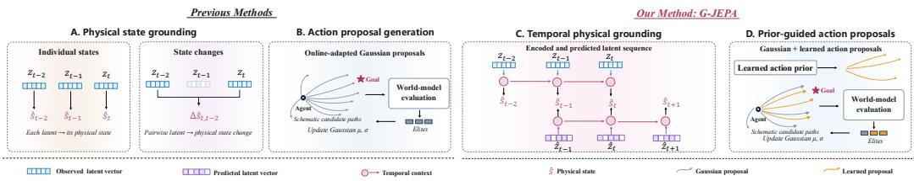
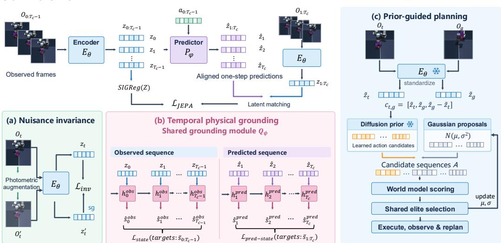
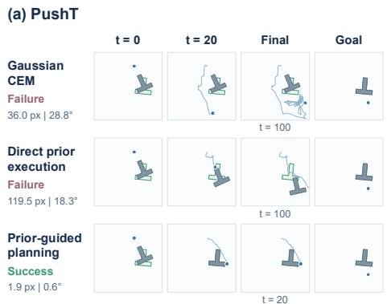
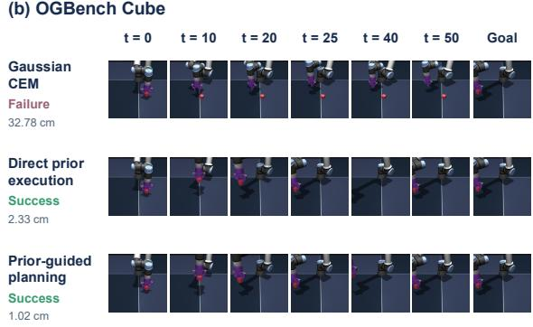
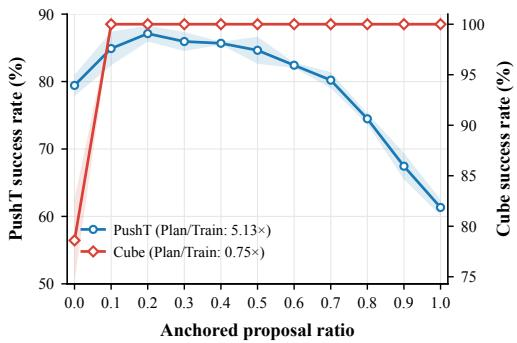

# EXPLORING TEMPORAL CONTEXT-AWARE PHYSICAL GROUNDING IN LATENT WORLD MODELS

Yilei Man1, Yang Chen1, Jingcai Guo1,2∗

1Department of Computing, The Hong Kong Polytechnic University

2Department of Land Surveying and Geospatial Science, The Hong Kong Polytechnic University jc-jingcai.guo@polyu.edu.hk

## ABSTRACT

Learning latent dynamics is fundamental to building action-conditioned world models for planning. Among existing families, Joint Embedding Predictive Architectures (JEPAs) offer a natural framework by modeling transitions directly in latent space rather than at the pixel level. However, two issues remain in JEPAbased world models: (i) physical grounding lacks explicit aggregation of temporal context and (ii) action planning always overly relies on generic sampling distributions. To this end, we propose G-JEPA, which incorporates temporal context into physical grounding for latent world models and couples the learned models with prior-guided action planning. Specifically, during learning, we incorporate a shared causal temporal module that aggregates temporal context within observation and prediction sequences under physical state supervision, grounding both in task-relevant physical states. When planning, we further introduce action inference through stepwise conditioning of a generative action distribution on the current and goal latent representations together with their evolving discrepancy, yielding anchored proposals that guide model-based online refinement. Together, physical state supervision guides temporal representation learning, while the action prior guides search through the learned world model. Experiments demonstrate improved planning performance on manipulation tasks, including tasks with increasing temporal separation between initial and goal observations. Code is publicly available at https://github.com/myl11045/G-JEPA.

## 1 INTRODUCTION

World models learn action-conditioned environment dynamics, enabling agents to anticipate and evaluate the consequences of candidate actions. For learning from visual observations, an important design choice is whether to generate future observations or predict their representations. Generative approaches synthesize future observations directly in pixel space (Lee et al., 2025) or through latent representations learned for visual reconstruction (Huang et al., 2026), requiring the preservation of appearance information beyond what may be necessary for control. Representation-predictive approaches instead learn action-conditioned dynamics by predicting the embeddings of future observations (Zhou et al., 2025a; Assran et al., 2025). Removing the reconstruction requirement offers the potential to learn representations that emphasize task-relevant dynamics over incidental visual detail.

Joint-Embedding Predictive Architectures (JEPAs) provide a natural framework for this approach by predicting target embeddings from context representations without reconstructing the observations (Assran et al., 2023; Bardes et al., 2024). World models such as DINO-WM and V-JEPA 2-AC train action-conditioned predictors on frozen DINOv2 and video-pretrained JEPA features, respectively (Oquab et al., 2023; Zhou et al., 2025a; Assran et al., 2025). Although visual pretraining provides strong perceptual priors, freezing the encoders prevents interaction data from shaping representations around the task-specific physical structure needed for control and policy learning. LeWorldModel (LeWM) trains its visual encoder and action-conditioned predictor end to end from raw pixels using only future-embedding prediction and a distributional regularizer (Maes et al.,

  
Figure 1: Temporal physical grounding and prior-guided planning. (A) PhyLatent (Zeng et al., 2026) grounds individual latents in physical states, while PSG-JEPA (Yan et al., 2026) additionally supervises state changes between latent pairs. (B) Gaussian CEM generates action candidates from a proposal distribution adapted through online elite updates. (C) G-JEPA uses a shared causal grounding module to aggregate temporal context within encoded and predicted latent sequences under physical state supervision. (D) Learned action proposals supplement Gaussian candidates, with joint world-model evaluation and shared elite selection guiding subsequent Gaussian updates. Curves illustrate schematic candidate motion paths.

2026). Its predictive objective aligns predicted embeddings with those of future observations, but does not explicitly identify or prioritize control-relevant physical information.

Recent approaches introduce physical supervision to make this information explicit. PhyLatent (Zeng et al., 2026) grounds individual latents in physical states, while PSG-JEPA (Yan et al., 2026) also supervises state changes between latent pairs (Figure 1 A). Physical state estimation can also draw on information distributed across time, but these grounding heads do not explicitly accumulate this temporal context. For action selection, many JEPA-based world models (Zhou et al., 2025a; Assran et al., 2025; Maes et al., 2026) adopt model predictive control with the cross-entropy method (CEM). Conventional CEM refines a generic proposal distribution through online elite updates, without directly incorporating behavioral priors learned from offline trajectories (Figure 1 B). Under a limited candidate budget, this can leave task-relevant action sequences insufficiently represented in the candidate set.

To this end, we propose G-JEPA, which incorporates temporal context into physical grounding for latent world models and combines the learned models with prior-guided action planning. The shared temporal physical grounding module is built on S4D (Gu et al., 2022b), a diagonal structured state-space model. Its observation and prediction branches separately aggregate temporal context from encoded observations and action-conditioned predicted latents through causal updates to estimate the corresponding physical states (Figure 1 C). Physical state supervision on both branches complements latent matching, guiding the encoder and predictor to retain task-relevant physical information. Nuisance-invariant representation learning further reduces sensitivity to appearance variations that preserve physical states. We then freeze the world model and learn a conditional generative action prior from offline trajectories to propose action sequences based on the current and goal latent representations. These proposals are mixed with Gaussian CEM candidates and evalu ated using the same latent objective (Figure 1 D). A shared elite set updates the Gaussian search distribution, connecting the learned action prior with online refinement. After action execution, the updated observation conditions the next round of proposal generation and planning.

Our contributions are:

• We introduce temporal physical grounding for JEPA world models. A shared causal S4D module aggregates context within observation and prediction sequences, using physical state supervision to jointly guide representation learning and latent prediction.

• We develop prior-guided action planning that integrates a learned latent-conditioned action prior with Gaussian CEM. Unified world-model scoring and shared elite updates connect offline behavioral priors with model-based online refinement.

• We evaluate G-JEPA on PushT and OGBench Cube through planning comparisons and ablations of physical grounding and action selection, with additional PushT evaluations at increasing goal distances. The results support the effectiveness of combining temporal physical grounding with prior-guided action proposals for JEPA planning.

## 2 RELATED WORK AND BACKGROUND

## 2.1 JOINT EMBEDDING PREDICTIVE ARCHITECTURES

JEPA has been applied to image representation learning with I-JEPA (Assran et al., 2023), video understanding with V-JEPA (Bardes et al., 2024), vision-language tasks with VL-JEPA (Chen et al., 2025), and robotic control with VLA-JEPA (Sun et al., 2026). Building on V-JEPA 2 (Assran et al., 2025), pretrained on over one million hours of internet video, V-JEPA 2.1 (Mur-Labadia et al., 2026) improves fine-grained visual understanding for tasks such as depth estimation, object tracking, and robotic planning. LeWM (Maes et al., 2026) introduces a lightweight JEPA world model trained end to end from pixels for action-conditioned prediction and planning. Subsequent work incorporates physical supervision, temporal progress, and online adaptation to strengthen these predictive models. PhyLatent (Zeng et al., 2026) combines physical state grounding of encoded and predicted latents with appearance invariance and counterfactual dynamics constraints. PSG-JEPA (Yan et al., 2026) grounds individual latents in robot proprioceptive states and latent pairs in multi-horizon joint-angle changes. Beyond physical state supervision, TD-JEPA (Bai & Xiong, 2026) learns directed temporal progress from offline trajectories to shape representations and planning costs, while AdaJEPA (Wang et al., 2026) adapts the world model using newly observed transitions during planning. Our work introduces temporal aggregation into physical grounding and integrates learned action proposals with model-based online refinement.

## 2.2 STRUCTURED STATE-SPACE MODELS

Structured state-space models provide a framework for modeling temporal dependencies with compact recurrent memory. HiPPO (Gu et al., 2020) formulates online history compression through projections onto polynomial bases. S4 (Gu et al., 2022a) develops structured state-space layers for long-range sequence modeling, while S4D (Gu et al., 2022b) simplifies their parameterization through diagonal state transitions. More recent architectures, including Mamba-2 (Dao & Gu, 2024), Gated DeltaNet (Yang et al., 2025), and Gated DeltaNet-2 (Hatamizadeh et al., 2026), further explore efficient sequence modeling with recurrent memory. We use a shared S4D module to aggregate temporal context separately within observation and prediction sequences for physical state estimation.

## 2.3 DIFFUSION POLICIES AND MODEL-BASED PLANNING

Diffusion models have been used for both action generation and trajectory planning. Diffusion Policy (Chi et al., 2024) learns observation-conditioned action sequences for robotic manipulation, while Diffuser (Janner et al., 2022) generates trajectories guided by goals or rewards. Further work combines diffusion-generated candidates with online planning. D-MPC (Zhou et al., 2025b) learns separate diffusion models for action proposals and future dynamics, using predicted outcomes to select actions within an MPC loop. Diffusion-ES (Yang et al., 2024) combines trajectory generation with evolutionary search for autonomous driving. More closely related to hybrid planning, MODIP (El Asri et al., 2026) mixes diffusion proposals with Gaussian candidates for latent model predictive control and uses the resulting trajectories to improve the policy. Our approach combines proposals from a learned latent-conditioned action prior with Gaussian CEM candidates, evaluated by a physically grounded JEPA world model using a latent goal-matching objective. The action prior remains fixed, while a shared elite set updates the Gaussian sampling distribution for online refinement.

## 3 METHODOLOGY

In this section, we introduce G-JEPA (Figure 2). We first present the necessary preliminaries. Then, we introduce a shared causal module for temporal physical grounding of observation and prediction sequences. Finally, we present prior-guided planning that combines latent-conditioned diffusion proposals with the generic CEM search.

  
Figure 2: Overview of G-JEPA. World-model learning combines latent matching and SIGReg with (a) nuisance invariance under photometric augmentation and (b) temporal physical grounding. A shared S4D module aggregates temporal context separately within observed latents and aligned onestep predictions, supervising physical state estimates from both sequences. (c) During planning, the learned action prior is instantiated as a latent-conditioned diffusion policy that generates action proposals alongside Gaussian candidates. The frozen world model scores both sources using latent goal-matching costs, and a shared elite set updates the Gaussian search distribution. The policy remains fixed, while action execution provides new observations for subsequent planning rounds.

## 3.1 LEWORLDMODEL PRELIMINARY

LeWorldModel (Maes et al., 2026) consists of an encoder $E _ { \theta }$ and an action-conditioned predictor $P _ { \varphi } . \mathrm { ~ A ~ }$ trajectory segment contains $T + 1$ image observations $\mathbf { o } _ { 0 : T }$ and $T$ actions ${ \bf a } _ { 0 : T - 1 }$ , where $\mathbf { a } _ { t }$ is executed between $\mathbf { o } _ { t }$ and $\mathbf { o } _ { t + 1 }$ . The encoder maps each observation $\mathbf { o } _ { t }$ to a latent representation $\mathbf { z } _ { t } = E _ { \theta } ( \mathbf { o } _ { t } )$ . Conditioned on the current latent and action, the predictor estimates the latent representation of the subsequent observation as $\hat { \mathbf { z } } _ { t + 1 } = P _ { \varphi } ( \mathbf { z } _ { t } , \mathbf { a } _ { t } )$ . For a history of N observations, the resulting latent representations are stacked into $\mathbf { Z } \in \mathbb { R } ^ { N \times d }$ , where d denotes the latent dimensionality. An anti-collapse regularizer SIGReg(Z) is applied to encourage feature diversity. The overall training objective is then defined as follows:

$$
\mathcal { L } _ { \mathrm { J E P A } } = \frac { 1 } { N } \sum _ { t = 0 } ^ { N - 1 } \left. \hat { \mathbf { z } } _ { t + 1 } - \mathbf { z } _ { t + 1 } \right. _ { 2 } ^ { 2 } + \lambda _ { \mathrm { r e g } } \mathrm { S I G R e g } ( \mathbf { Z } ) .\tag{1}
$$

## 3.2 LEARNING IN OBSERVED AND IMAGINED LATENT SPACE

Observed Physical State Grounding. To incorporate temporal context beyond individual latents or isolated latent pairs, the observation branch causally aggregates encoded observations to estimate task-relevant physical states. Let $\mathbf { s } _ { t }$ denote the ground-truth physical state and $\bar { \bf s } _ { t }$ its normalized form, with dimension $d _ { s }$ . The shared grounding module $Q _ { \psi }$ (Figure 2(b)) consists of two stacked S4D-based layers (Gu et al., 2022b), followed by a nonlinear physical state estimator. The observation branch updates its memory and estimates the physical state as

$$
\begin{array} { r } { ( \hat { \bar { \bf s } } _ { t } ^ { \mathrm { o b s } } , \mathbf { h } _ { t } ^ { \mathrm { o b s } } ) = Q _ { \psi } ( { \bf z } _ { t } , \mathbf { h } _ { t - 1 } ^ { \mathrm { o b s } } ) , \qquad \mathbf { h } _ { - 1 } ^ { \mathrm { o b s } } = \mathbf { 0 } . } \end{array}\tag{2}
$$

Here $\hat { \mathbf { s } } _ { t } ^ { \mathrm { o b s } }$ is the physical state estimate in the same normalized space as $\bar { \bf s } _ { t }$ , and $\mathbf { h } _ { t } ^ { \mathrm { o b s } }$ contains the updated recurrent memories. Within each S4D layer, the memory is updating as follows:

$$
\mathbf { h } _ { t } = \pmb { \alpha } \odot \mathbf { h } _ { t - 1 } + B \mathbf { v } _ { t } ,\tag{3}
$$

where $\odot$ denotes elementwise multiplication. The normalized input $\mathbf { v } _ { t }$ enters the memory through a learned projection B. The $\pmb { \alpha } = ( \bar { \alpha _ { 0 } } , \dots , \bar { \alpha _ { N _ { \alpha } - 1 } } ) ^ { \top }$ contains fixed decay coefficients:

$$
\alpha _ { i } = \exp \left[ - \Delta \left( i + \textstyle { \frac { 1 } { 2 } } \right) \right] , \qquad i = 0 , \ldots , N _ { \alpha } - 1 ,\tag{4}
$$

where $N _ { \alpha }$ is the memory dimension and $\Delta > 0$ controls the decay rate. Larger coefficients preserve historical contributions longer, while smaller coefficients emphasize recent inputs. A learned output projection transforms each layer’s memory into features for the next layer or the physical state estimator. For fixed model dimensions, this recurrence maintains a fixed-size hidden state and requires computation linear in sequence length.

We ground the observation representations by matching the estimated physical states to their normalized targets:

$$
\mathcal { L } _ { \mathrm { s t a t e } } = \frac { 1 } { T _ { C } d _ { s } } \sum _ { t = 0 } ^ { T _ { C } - 1 } \left. \hat { \mathbf { s } } _ { t } ^ { \mathrm { o b s } } - \bar { \mathbf { s } } _ { t } \right. _ { 2 } ^ { 2 } ,\tag{5}
$$

where $T _ { C }$ is the observation history length.

Predicted Physical State Grounding. Following LeWM (Maes et al., 2026), the predictor $P _ { \varphi }$ generates aligned one-step predictions $\hat { \mathbf { z } } _ { 1 : T _ { C } }$ from the observation context and recorded actions. To supervise these predictions in physical state space, we process this sequence with the shared grounding module $Q _ { \psi }$ . Starting from $\mathbf { h } _ { 0 } ^ { \mathrm { p r e d } } = \mathbf { 0 }$ , the module aggregates temporal context and estimates the corresponding physical states:

$$
( \hat { \mathbf { s } } _ { k } ^ { \mathrm { p r e d } } , \mathbf { h } _ { k } ^ { \mathrm { p r e d } } ) = Q _ { \psi } ( \hat { \mathbf { z } } _ { k } , \mathbf { h } _ { k - 1 } ^ { \mathrm { p r e d } } ) , \qquad k = 1 , \ldots , T _ { C } .\tag{6}
$$

The superscript pred identifies the prediction branch. We supervise the predicted physical states using their corresponding normalized targets:

$$
\mathcal { L } _ { \mathrm { p r e d - s t a t e } } = \frac { 1 } { T _ { C } d _ { s } } \sum _ { k = 1 } ^ { T _ { C } } \left. \hat { \mathbf { s } } _ { k } ^ { \mathrm { p r e d } } - \bar { \mathbf { s } } _ { k } \right. _ { 2 } ^ { 2 } .\tag{7}
$$

Nuisance-Invariant Physical State. To reduce the influence of appearance-related nuisance factors on physical-state recovery, we encourage the encoder to learn representations that are invariant to photometric perturbations (Figure 2(a)). Specifically, for each observation $\mathbf { o } _ { t } .$ , we construct an augmented view $\mathbf { o } _ { t } ^ { \prime }$ by randomly adjusting its brightness, color, and saturation and adding Gaussian noise in pixel space. We encode the original and augmented observations as $\mathbf { z } _ { t } = E _ { \theta } ( \mathbf { o } _ { t } )$ and $\mathbf { z } _ { t } ^ { \prime } = E _ { \theta } ( \mathbf { o } _ { t } ^ { \prime } )$ , respectively, and define the following invariance objective:

$$
\mathcal { L } _ { \mathrm { i n v } } = \frac { 1 } { T _ { c } + 1 } \sum _ { t = 0 } ^ { T _ { c } } \left[ 1 - \cos \bigl ( \mathbf { z } _ { t } , \mathrm { s g } ( \mathbf { z } _ { t } ^ { \prime } ) \bigr ) \right] ,\tag{8}
$$

where $\cos ( \cdot , \cdot )$ denotes cosine similarity and $\operatorname { s g } ( \cdot )$ denotes the stop-gradient operator.

Training Objective. We jointly optimize the visual encoder, action-conditioned predictor, and grounding module as follows:

$$
\mathcal { L } = \mathcal { L } _ { \mathrm { J E P A } } + \lambda _ { s } \mathcal { L } _ { \mathrm { s t a t e } } + \lambda _ { p } \mathcal { L } _ { \mathrm { p r e d - s t a t e } } + \lambda _ { i } \mathcal { L } _ { \mathrm { i n v } } .\tag{9}
$$

We set $\lambda _ { \mathrm { r e g } } = \lambda _ { s } = 0 . 0 9$ and $\lambda _ { p } = \lambda _ { i } = 0 . 0 5$

## 3.3 PRIOR-GUIDED LATENT PLANNING

Action Prior Acquisition. A latent-conditioned generative action prior is learned from offline trajectories using latent representations produced by the frozen encoder. Each training sample pairs a current image $\mathbf { o } _ { t }$ with a goal image ${ \bf o } _ { g }$ located $\check { K }$ action chunks later in the same offline trajectory. The intervening action sequence $\mathbf { A } = \left( \mathbf { a } _ { t } , \ldots , \mathbf { a } _ { t + K - 1 } \right)$ provides supervision. The frozen encoder maps both images to latent embeddings. These embeddings are standardized using the mean and standard deviation of the policy-training embeddings, yielding $\tilde { \mathbf { z } } _ { t }$ and $\tilde { \mathbf { z } } _ { g }$ . The conditioning input is

$$
\mathbf { c } _ { t , g } = [ \widetilde { \mathbf { z } } _ { t } , \widetilde { \mathbf { z } } _ { g } , \widetilde { \mathbf { z } } _ { g } - \widetilde { \mathbf { z } } _ { t } ] ,\tag{10}
$$

where the brackets denote feature concatenation. The learned action prior defines a distribution $\pi _ { \mathrm { p r i o r } } ( \mathbf { A } \mid \mathbf { c } _ { t , g } )$ over candidate action sequences A. Sampling from this distribution provides action proposals for planning. In this work, the prior is instantiated as a diffusion policy following Diffusion Policy (Chi et al., 2024), conditioned on $\mathbf { c } _ { t , g } .$ . The policy is trained with a noise-prediction objective $\mathcal { L } _ { \mathrm { { a c t } } } .$ , defined as the mean squared error between the predicted noise and the Gaussian noise added to the recorded action sequences.

Model-Based Online Refinement. Planning uses mixed-proposal CEM to combine the learned action prior with online refinement guided by the physically grounded world model (Figure 2(c)). At each planning round, the latest observation and the fixed goal define $\mathbf { c } _ { t , g }$ to condition the action prior for proposal generation. At each CEM iteration, proposals sampled from $\pi _ { \mathrm { p r i o r } } \bigl ( \cdot \mid \mathbf { c } _ { t , g } \bigr )$ occupy $\rho N _ { \mathrm { c a n d } }$ slots in a fixed population of $N _ { \mathrm { c a n d } }$ candidates. The remaining slots contain samples from the evolving CEM Gaussian and its retained mean candidate.

Let K denote the number of model steps in each planning rollout. For each candidate sequence A, the frozen predictor recursively generates future embeddings $\hat { \mathbf { z } } _ { t + k | t }$ under its action chunks. Given the goal embedding $\mathbf { z } _ { g } = E _ { \theta } ( \mathbf { o } _ { g } )$ ), we rank candidates from both proposal sources using

$$
J ( \mathbf { A } ) = \sum _ { k = 1 } ^ { K } w _ { k } \mathrm { M S E } \left( \hat { \mathbf { z } } _ { t + k | t } , \mathbf { z } _ { g } \right) ,\tag{11}
$$

where $w _ { k } \geq 0$ is the weight assigned to prediction step k.

The lowest-cost candidates form a shared elite set, whose statistics update the Gaussian mean and variance. Prior-generated candidates entering this set guide subsequent Gaussian search, coupling learned action proposals with model-based online refinement. Fresh samples from the learned action prior are introduced at every CEM iteration, while its parameters remain fixed.

After optimization, we execute the prescribed action segment and obtain a new observation. This observation updates the conditioning input to the action prior and initiates the next planning round.

## 4 EXPERIMENTS

We evaluate temporal physical grounding and prior-guided action planning through cross-method comparisons and controlled ablations.

## 4.1 EXPERIMENTAL SETUP

Tasks and data. We consider PushT manipulation, OGBench Cube pick-and-place (Park et al., 2025), and TwoRooms navigation using LeWM’s visual datasets (Maes et al., 2026). World-model training uses a 90/10 training–validation split at the window level for PushT and at the episode level for OGBench Cube and TwoRooms. Grounding targets are seven-dimensional agent–block states for PushT, 18-dimensional robot–object states for OGBench Cube, and two-dimensional agent positions for TwoRooms.

For PushT planning, we use reference tasks and tasks with increasing goal distances. PushT-Ada contains 256 fixed tasks from AdaJEPA’s planning pool (Wang et al., 2026). PushT-Distance follows the goal-distance evaluation in HWM (Zhang et al., 2026), which extends DINO-WM’s goalconditioned PushT setting (Zhou et al., 2025a). We construct this set from validation windows spanning 256 distinct episodes. Each episode provides a shared goal and starting points 25, 50, and 75 recorded environment steps before that goal, yielding 256 tasks per distance. PushT-Challenging is a more challenging subset of PushT-Distance. It contains 126, 209, and 240 tasks at the respective distances. We also evaluate planning in robot manipulation and navigation. OGBench Cube uses TD-JEPA’s fixed 50-task reference set (Bai & Xiong, 2026), and TwoRooms uses 100 tasks drawn from validation episodes. Data preparation and task construction are detailed in Appendix A.1.

Models and training. G-JEPA builds on LeWM with a ViT-tiny encoder and 192-dimensional latent representations. The temporal physical grounding module uses two S4D-based layers with memory dimension $N _ { \alpha } ~ = ~ 6 4$ and fixed decay scale $\Delta \ = \ 0 . 1$ The observation context and latent-prediction setup follow LeWM’s training protocol. World models are trained on NVIDIA

Table 1: Cross-method planning comparison. — denotes not evaluated.
<table><tr><td>Method</td><td></td><td>PushT-Ada OGBench Cube TwoRooms</td><td></td></tr><tr><td>G-JEPA w/o AD</td><td> $7 9 . 4 3 { \scriptstyle \pm 1 . 5 8 }$ </td><td> $7 8 . 6 0 { \scriptstyle \pm 4 . 1 2 }$ </td><td> $9 7 . 0 0 { \scriptstyle \pm 1 . 0 0 }$ </td></tr><tr><td>G-JEPA</td><td> ${ \bf 8 7 . 1 1 _ { \pm 1 . 1 7 } }$ </td><td> $\mathbf { 1 0 0 . 0 0 } _ { \pm 0 . 0 0 }$ </td><td></td></tr><tr><td>LeWM</td><td> $5 6 . 9 0 { \scriptstyle \pm 2 . 3 5 }$ </td><td> $7 2 . 8 0 { \scriptstyle \pm 2 . 5 3 }$ </td><td> $\mathbf { 9 9 . 0 0 } _ { \pm 0 . 0 0 }$ </td></tr><tr><td>TD-JEPA</td><td> $5 6 . 6 4 { \scriptstyle \pm 2 . 7 1 }$ </td><td> $7 8 . 0 0 { \scriptstyle \pm 3 . 1 3 }$ </td><td></td></tr><tr><td>PSG-JEPA</td><td> $1 7 . 3 2 { \scriptstyle \pm 1 . 5 8 }$ </td><td> $7 5 . 4 0 { \scriptstyle \pm 2 . 5 0 }$ </td><td></td></tr></table>

H200 GPUs for PushT and TwoRooms, and NVIDIA H100 GPUs for OGBench Cube. Each main configuration uses one training seed; the temporal-module comparison uses three training replicates. LeWM, TD-JEPA, and PSG-JEPA are retrained and evaluated for comparison under common dataset-specific planning protocols. World model optimization and baseline adaptations are detailed in Appendix A.2, and diffusion-policy training in Appendix A.3.

Planning and metrics. Planning uses latent goal-matching costs computed from the frozen world model. The temporal physical grounding module is used only during training. The full planner combines action diffusion (AD) proposals with Gaussian CEM search for model-based online refinement. We use $\rho = 0 . 2$ for G-JEPA on PushT-Ada, OGBench Cube, PushT-Distance, and PushT-Challenging, following the proposal-ratio sweep in Figure 4. Without AD, $\rho = 0$ and planning uses Gaussian CEM alone. For PushT-Ada, OGBench Cube, and TwoRooms, the planning horizon is 25 environment steps $( K = 5 )$ . Each model step spans five environment steps and is conditioned on the corresponding five-action chunk. PushT-Ada follows AdaJEPA’s temporal weighting rule (Wang et al., 2026), while OGBench Cube and TwoRooms use terminal latent matching throughout. All methods follow the dataset-specific comparison protocols in Appendix A.4. Table 6 in $\mathsf { A p - }$ pendix A.4 lists execution budgets, success thresholds, and diffusion sampling settings. Success is measured by reaching the goal within the execution budget. We report mean success rates (%) over three planning seeds for PushT and TwoRooms and ten for OGBench Cube. In tables, subscripts indicate ± one sample standard deviation across planning seeds, or across training replicates for the temporal-module comparison.

## 4.2 PERFORMANCE COMPARISON

Cross-method comparison. Table 1 compares $\mathcal { G } \mathrm { - J E P A }$ with LeWM, TD-JEPA, and PSG-JEPA across datasets under matched planning budgets. On PushT-Ada, G-JEPA without AD reaches 79.43% success, exceeding LeWM’s 56.90% and TD-JEPA’s 56.64%. Adding AD further raises success to 87.11%, showing that learned action proposals complement the grounded world model on this task. On OGBench Cube, G-JEPA without AD achieves 78.60%, comparable to TD-JEPA’s 78.00% and above LeWM’s 72.80%. Adding AD raises success to 100%, demonstrating a substantial gain from incorporating learned proposals into planning. On TwoRooms, G-JEPA without AD reaches 97.00%, compared with 99.00% for LeWM. Both methods achieve near-saturated success on this reference set, with closely matched success rates. We therefore focus the detailed comparisons on the manipulation tasks.

Increasing goal distances. We evaluate long-horizon planning performance on tasks with increasing temporal separation between the initial and goal observations. Table 2 reports results on PushT-Distance and PushT-Challenging. On PushT-Distance, G-JEPA with and without AD exceeds LeWM at all three goal distances. Although adding AD slightly reduces success at 25 steps, it im proves performance at both 50 and 75 steps. At 75 steps, the full planner reaches 55.21%, compared with 47.53% without AD and 16.54% for LeWM. PushT-Challenging shows the same trend, with the full planner reaching 52.22% at 75 steps. These results show larger benefits from learned proposals at greater start–goal separations under this protocol.

## 4.3 ABLATION STUDY

Grounding objectives. We ablate the training objectives to assess their contributions to planning performance. Table 3 compares observed physical state grounding (S), nuisance invariance (I), and predicted physical state grounding $( P ) ,$ using Gaussian CEM throughout. The full training configuration $( S { \bar { + } } { \bar { I + P ) } }$ achieves 79.43% success on PushT-Ada and 78.60% on OGBench Cube, compared with 56.90% and 72.80% for the respective baselines. Removing predicted physical state grounding reduces success on OGBench Cube to 76.20%, while PushT-Ada retains 79.43%. Using observation grounding alone yields 55.73% on PushT-Ada and 75.40% on OGBench Cube. These results support the combined grounding objective, with its components contributing differently across tasks.

Table 2: Planning with increasing goal distances. We evaluate goal-reaching success with start– goal separations of 25, 50, and 75 environment steps along recorded trajectories.
<table><tr><td></td><td colspan="3">PushT-Distance</td><td colspan="3">PushT-Challenging</td></tr><tr><td>Method</td><td>25 steps</td><td>50 steps</td><td>75 steps</td><td>25 steps</td><td> $5 0 \ \mathrm { s t e p s }$ </td><td>75 steps</td></tr><tr><td>LeWM</td><td> $9 0 . 4 9 { \scriptstyle \pm 0 . 8 1 }$ </td><td> $5 2 . 9 9 { \scriptstyle \pm 0 . 6 0 }$ </td><td> $1 6 . 5 4 { \scriptstyle \pm 0 . 6 0 }$ </td><td> $8 0 . 6 9 { \scriptstyle \pm 1 . 6 5 }$ </td><td> $4 2 . 4 2 _ { \pm 0 . 7 3 }$ </td><td> $1 0 . 9 7 { \scriptstyle \pm 0 . 6 4 }$ </td></tr><tr><td>G-JEPA w/o AD</td><td> $\mathbf { 9 6 . 0 9 _ { \pm 1 . 1 7 } }$ </td><td> $8 0 . 3 4 { \scriptstyle \pm 0 . 8 1 }$ </td><td> $4 7 . 5 3 { \scriptstyle \pm 1 . 6 3 }$ </td><td> $\mathbf { 9 2 . 0 6 _ { \pm 2 . 3 8 } }$ </td><td> $7 5 . 9 2 _ { \pm 1 . 0 0 }$ </td><td> $4 4 . 0 3 { \scriptstyle \pm 1 . 7 3 }$ </td></tr><tr><td>G-JEPA</td><td> $9 1 . 8 0 { \scriptstyle \pm 1 . 1 7 } $ </td><td> $\mathbf { 8 5 . 5 5 } \pm \mathrm { 0 . 3 9 }$ </td><td> ${ \bf 5 5 . 2 1 } _ { \pm 0 . 9 0 }$ </td><td> $8 3 . 3 3 { \scriptstyle \pm 2 . 3 8 }$ </td><td> $\mathbf { 8 2 . 3 0 } \pm \mathbf { 0 . 4 8 }$ </td><td> ${ \bf 5 2 . 2 2 _ { \pm 0 . 9 6 } }$ </td></tr></table>

Table 3: Grounding-objective ablations. S, I, and P denote observed state grounding, nuisance invariance, and predicted physical state grounding.
<table><tr><td>State (S)</td><td></td><td>Invariance (I) Predicted state (P)</td><td></td><td>PushT-Ada OGBench Cube</td></tr><tr><td>x</td><td>x</td><td>x</td><td> $5 6 . 9 0 { \scriptstyle \pm 2 . 3 5 }$ </td><td> $7 2 . 8 0 { \scriptstyle \pm 2 . 5 3 }$ </td></tr><tr><td>√</td><td>x</td><td>x</td><td> $5 5 . 7 3 { \scriptstyle \pm 1 . 5 8 }$ </td><td> $7 5 . 4 0 { \scriptstyle \pm 1 . 6 5 }$ </td></tr><tr><td>√</td><td>√</td><td>x</td><td> $\mathbf { 7 9 . 4 3 _ { \pm 0 . 9 0 } }$ </td><td> $7 6 . 2 0 { \scriptstyle \pm 2 . 5 7 }$ </td></tr><tr><td>√</td><td>√</td><td>√</td><td> $\mathbf { 7 9 . 4 3 _ { \pm 1 . 5 8 } }$ </td><td> $\mathbf { 7 8 . 6 0 _ { \pm 4 . 1 2 } }$ </td></tr></table>

Temporal modules. We compare temporal architectures for the temporal grounding module to assess their effect on downstream planning. Table 4 evaluates S4D, GRU, Causal Transformer, and Attention-only under the same training objective in Eq. 9 and comparable parameter budgets. Each module processes the observation and prediction sequences separately with shared parameters. Our S4D-based grounding module contains 55.4K parameters, including the physical state estimator, and serves as the reference budget for configuring the alternatives. Across three training replicates on PushT-Ada, S4D achieves the highest mean success, 78.12%, compared with 69.14% for GRU and 61.46% for Causal Transformer. Appendix A.5 details the training protocol and parameter accounting.

Table 4: Temporal grounding architectures. Mean success on PushT-Ada across three training replicates with a fixed planning seed.
<table><tr><td>Architecture</td><td>Grounding params. (K)</td><td>Success (%)</td></tr><tr><td>S4D</td><td>55.431</td><td> ${ \bf 7 8 . 1 2 _ { \pm 3 . 3 4 } }$ </td></tr><tr><td>GRU</td><td>54.279</td><td> $6 9 . 1 4 _ { \pm 1 4 . 8 9 }$ </td></tr><tr><td>Causal Transformer</td><td>55.607</td><td> $6 1 . 4 6 _ { \pm 1 0 . 6 1 }$ </td></tr><tr><td>Attention-only</td><td>55.555</td><td> $5 3 . 3 9 { \scriptstyle \pm 3 4 . 0 2 }$ </td></tr></table>

Action selection. We compare action-selection strategies to assess the benefit of combining learned proposals with model-based search. Table 5 compares Gaussian CEM, direct policy execution, and mixed-proposal CEM. The three G-JEPA variants share the same frozen world model. The two variants using AD also share the same trained policy. Without CEM, one sampled action sequence is executed directly without world-model scoring. On PushT-Ada, mixed-proposal planning reaches 87.11%, compared with 79.43% for Gaussian CEM and 25.91% for direct execution. On OGBench Cube, direct execution already reaches 99.80%, leaving little room for the mixed planner’s 100%. Direct policies trained on LeWM representations similarly reach 25.65% on PushT-Ada and 99.00% on OGBench Cube. The benefit of combining learned proposals with online search is more pronounced on PushT-Ada. Figure 3 illustrates this contrast: only prior-guided planning succeeds in the PushT example, while both direct prior execution and prior-guided planning succeed in Cube.

(b) OGBench Cube  

Figure 3: Qualitative comparison of action selection. Execution examples from the same initial state and goal within each task. (a) PushT shows recorded states, with goal poses in green and pusher paths in blue. (b) Cube shows simulator observations. Labels report success and final position/orientation errors (pixels/degrees) for PushT or cube–goal distance (cm) for Cube. t counts environment steps, and Final marks each method’s stopping state in PushT.  
Table 5: Action-selection ablations.  

<table><tr><td>Method</td><td>PushT-Ada</td><td>Cube</td></tr><tr><td>LeWM</td><td> $5 6 . 9 0 { \scriptstyle \pm 2 . 3 5 }$ </td><td> $7 2 . 8 0 { \scriptstyle \pm 2 . 5 3 }$ </td></tr><tr><td>LeWM + AD w/o CEM</td><td> $2 5 . 6 5 { \scriptstyle \pm 0 . 4 5 }$ </td><td> $9 9 . 0 0 { \scriptstyle \pm 1 . 7 0 } $ </td></tr><tr><td> $\mathrm { L e W M + A D }$ </td><td> $5 7 . 2 9 _ { \pm 1 . 3 7 }$ </td><td> $\mathbf { 1 0 0 . 0 0 } _ { \pm 0 . 0 0 }$ </td></tr><tr><td>G-JEPA w/o AD</td><td> $7 9 . 4 3 { \scriptstyle \pm 1 . 5 8 }$ </td><td> $7 8 . 6 0 { \scriptstyle \pm 4 . 1 2 }$ </td></tr><tr><td>G-JEPA w/o CEM G-JEPA</td><td> $2 5 . 9 1 { \scriptstyle \pm 1 . 3 7 }$ </td><td> $9 9 . 8 0 { \scriptstyle \pm 0 . 6 3 }$ </td></tr><tr><td></td><td> ${ \bf 8 7 . 1 1 _ { \pm 1 . 1 7 } }$ </td><td> $\mathbf { 1 0 0 . 0 0 } _ { \pm 0 . 0 0 }$ </td></tr></table>

Figure 4: Anchored proposal ratio. Mean success on PushT-Ada and OGBench Cube with ±1 sample SD bands.

Proposal ratio. We vary the anchored proposal ratio to examine the balance between learned action proposals and Gaussian search. Figure 4 reports success rates with the world model, action prior, and total candidate budget fixed. On PushT-Ada, success peaks at $\rho = 0 . 2$ with 87.11% and decreases to 61.33% at $\rho = 1$ , supporting a mixture of learned proposals and adaptive Gaussian search under this protocol. On OGBench Cube, every tested nonzero ratio reaches 100%, consistent with the high success of direct execution. To put this difference in context, the Plan/Train ratio divides median object displacement in planning tasks by that in action-prior training windows. It is 5.13 for PushT-Ada and 0.75 for OGBench Cube. The larger displacement shift on PushT-Ada is consistent with the benefit of retaining adaptive Gaussian search.

## 5 CONCLUSION

We introduced G-JEPA, which combines temporal physical grounding with prior-guided action planning. A shared temporal physical grounding module aggregates temporal context within observation and prediction sequences under physical state supervision, while learned diffusions proposals guide model-based online refinement through mixed-proposal CEM. Experiments on PushT and OGBench Cube demonstrate improved planning performance over the evaluated baselines. Ablation studies support the effectiveness of temporal grounding and the combination of learned proposals with online search, while additional PushT evaluations demonstrate improved long-horizon planning performance. Together, these results support integrating temporal physical supervision and behavioral priors into JEPA-based planning.

## AI USE STATEMENT

AI tools assisted with manuscript polishing and checking.

## REFERENCES

Mahmoud Assran, Quentin Duval, Ishan Misra, Piotr Bojanowski, Pascal Vincent, Michael Rabbat, Yann LeCun, and Nicolas Ballas. Self-supervised learning from images with a joint-embedding predictive architecture. In Proceedings of the IEEE/CVF Conference on Computer Vision and Pattern Recognition, 2023. URL https://openaccess.thecvf.com/content/ CVPR2023/html/Assran\_Self-Supervised\_Learning\_From\_Images\_With\_ a\_Joint-Embedding\_Predictive\_Architecture\_CVPR\_2023\_paper.html.

Mahmoud Assran, Adrien Bardes, David Fan, Quentin Garrido, Russell Howes, Mojtaba Komeili, Matthew Muckley, Ammar Rizvi, Claire Roberts, Koustuv Sinha, Artem Zholus, Sergio Arnaud, Abha Gejji, Ada Martin, Francois Robert Hogan, Daniel Dugas, Piotr Bojanowski, Vasil Khalidov, Patrick Labatut, Francisco Massa, Marc Szafraniec, Kapil Krishnakumar, Yong Li, Xiaodong Ma, Sarath Chandar, Franziska Meier, Yann LeCun, Michael Rabbat, and Nicolas Ballas. V-JEPA 2: Self-supervised video models enable understanding, prediction and planning. arXiv preprint arXiv:2506.09985, 2025. URL https://arxiv.org/abs/2506.09985.

Jiaxin Bai and Jiaxuan Xiong. Temporal-distance JEPA: Plan-aware representation learning for latent world model predictive control. arXiv preprint arXiv:2607.25337, 2026. URL https: //arxiv.org/abs/2607.25337.

Adrien Bardes, Quentin Garrido, Jean Ponce, Xinlei Chen, Michael Rabbat, Yann LeCun, Mido Assran, and Nicolas Ballas. Revisiting feature prediction for learning visual representations from video. Transactions on Machine Learning Research, 2024. ISSN 2835-8856. URL https: //openreview.net/forum?id=QaCCuDfBk2.

Delong Chen, Mustafa Shukor, Theo Moutakanni, Willy Chung, Jade Yu, Tejaswi Kasarla, Yejin Bang, Allen Bolourchi, Yann LeCun, and Pascale Fung. VL-JEPA: Joint embedding predictive architecture for vision-language. arXiv preprint arXiv:2512.10942, 2025. URL https: //arxiv.org/abs/2512.10942.

Cheng Chi, Zhenjia Xu, Siyuan Feng, Eric Cousineau, Yilun Du, Benjamin Burchfiel, Russ Tedrake, and Shuran Song. Diffusion policy: Visuomotor policy learning via action diffusion. The International Journal of Robotics Research, 2024. URL https://diffusion-policy.cs. columbia.edu/.

Tri Dao and Albert Gu. Transformers are SSMs: Generalized models and efficient algorithms through structured state space duality. In Proceedings of the 41st International Conference on Machine Learning, volume 235 of Proceedings ofMachine Learning Research, pp. 10041–10071. PMLR, 2024. URL https://proceedings.mlr.press/v235/dao24a.html.

Zakariae El Asri, Philippe Gratias-Quiquandon, Nicolas Thome, and Olivier Sigaud. MODIP: Efficient model-based optimization for diffusion policies, 2026. URL https://arxiv.org/ abs/2606.10825.

Albert Gu, Tri Dao, Stefano Ermon, Atri Rudra, and Christopher Re. HiPPO: Recurrent memory´ with optimal polynomial projections. In Advances in Neural Information Processing Systems, volume 33, 2020. URL https://proceedings.neurips.cc/paper/2020/hash/ 102f0bb6efb3a6128a3c750dd16729be-Abstract.html.

Albert Gu, Karan Goel, and Christopher Re. Efficiently modeling long sequences with structured ´ state spaces. In International Conference on Learning Representations, 2022a. URL https: //openreview.net/forum?id=uYLFoz1vlAC.

Albert Gu, Ankit Gupta, Karan Goel, and Christopher Re. On the parameterization and initial-´ ization of diagonal state space models. In Advances in Neural Information Processing Systems, volume 35, 2022b. URL https://arxiv.org/abs/2206.11893.

Ali Hatamizadeh, Yejin Choi, and Jan Kautz. Gated DeltaNet-2: Decoupling erase and write in linear attention. arXiv preprint arXiv:2605.22791, 2026. doi: 10.48550/arXiv.2605.22791. URL https://arxiv.org/abs/2605.22791.

Siqiao Huang, Jialong Wu, Qixing Zhou, Shangchen Miao, and Mingsheng Long. Vid2World: Crafting video diffusion models to interactive world models. In International Conference on Learning Representations, 2026. URL https://arxiv.org/abs/2505.14357.

Michael Janner, Yilun Du, Joshua Tenenbaum, and Sergey Levine. Planning with diffusion for flexible behavior synthesis. In Proceedings of the 39th International Conference on Machine Learning, volume 162 of Proceedings of Machine Learning Research, pp. 9902–9915. PMLR, 2022. URL https://proceedings.mlr.press/v162/janner22a.html.

Jia-Hua Lee, Bor-Jiun Lin, Wei-Fang Sun, and Chun-Yi Lee. EDELINE: Enhancing memory in diffusion-based world models via linear-time sequence modeling. arXiv preprint arXiv:2502.00466, 2025. URL https://arxiv.org/abs/2502.00466.

Lucas Maes, Quentin Le Lidec, Damien Scieur, Yann LeCun, and Randall Balestriero. LeWorld Model: Stable end-to-end joint-embedding predictive architecture from pixels. arXiv preprint arXiv:2603.19312, 2026. URL https://arxiv.org/abs/2603.19312.

Lorenzo Mur-Labadia, Matthew Muckley, Amir Bar, Mido Assran, Koustuv Sinha, Mike Rabbat, Yann LeCun, Nicolas Ballas, and Adrien Bardes. V-JEPA 2.1: Unlocking dense features in video self-supervised learning. arXiv preprint arXiv:2603.14482, 2026. URL https://arxiv. org/abs/2603.14482.

Maxime Oquab, Timothee Darcet, Th´ eo Moutakanni, Huy Vo, Marc Szafraniec, Vasil Khalidov,´ Pierre Fernandez, Daniel Haziza, Francisco Massa, Alaaeldin El-Nouby, Mahmoud Assran, Nicolas Ballas, Wojciech Galuba, Russell Howes, Po-Yao Huang, Shang-Wen Li, Ishan Misra, Michael Rabbat, Vasu Sharma, Gabriel Synnaeve, Hu Xu, Herve J´ egou, Julien Mairal, Patrick Labatut,´ Armand Joulin, and Piotr Bojanowski. DINOv2: Learning robust visual features without supervision. arXiv preprint arXiv:2304.07193, 2023. URL https://arxiv.org/abs/2304. 07193.

Seohong Park, Kevin Frans, Benjamin Eysenbach, and Sergey Levine. OGBench: Benchmarking offline goal-conditioned RL. In International Conference on Learning Representations, 2025. URL https://openreview.net/forum?id=M992mjgKzI.

Jingwen Sun, Wenyao Zhang, Zekun Qi, Shaojie Ren, Zezhi Liu, Hanxin Zhu, Guangzhong Sun, Xin Jin, and Zhibo Chen. VLA-JEPA: Enhancing vision-language-action model with latent world model. arXiv preprint arXiv:2602.10098, 2026. URL https://arxiv.org/abs/2602. 10098.

Ying Wang, Oumayma Bounou, Yann LeCun, and Mengye Ren. AdaJEPA: An adaptive latent world model. arXiv preprint arXiv:2606.32026, 2026. URL https://arxiv.org/abs/ 2606.32026.

Haodong Yan, Jiaguan Zhu, Mingyuan Jia, Ruiqing Yin, Junjie He, Zhide Zhong, Junfeng Li, Jinxuan Lu, Hengtao Li, Tianran Zhang, Jiayi Chen, Wenxuan Song, Wen Chen, Yuxiang Gao, and Haoang Li. Is forward prediction enough? physical state grounding for JEPA world models. arXiv preprint arXiv:2608.06799, 2026. URL https://arxiv.org/abs/2608.06799.

Brian Yang, Huangyuan Su, Nikolaos Gkanatsios, Tsung-Wei Ke, Ayush Jain, Jeff Schneider, and Katerina Fragkiadaki. Diffusion-ES: Gradient-free planning with diffusion for autonomous and instruction-guided driving. In Proceedings of the IEEE/CVF Conference on Computer Vision and Pattern Recognition, 2024. URL https://openaccess.thecvf.com/content/ CVPR2024/papers/Yang\_Diffusion-ES\_Gradient-free\_Planning\_with\_ Diffusion\_for\_Autonomous\_and\_Instruction-guided\_Driving\_CVPR\_ 2024\_paper.pdf.

Songlin Yang, Jan Kautz, and Ali Hatamizadeh. Gated delta networks: Improving Mamba2 with delta rule. In The Thirteenth International Conference on Learning Representations, 2025. URL https://openreview.net/forum?id=r8H7xhYPwz.

Xi Zeng, Haojie Ren, and Ziying Song. PhyLatent: Learning dynamics-relevant representations for JEPA world models. arXiv preprint arXiv:2608.05720, 2026. URL https://arxiv.org/ abs/2608.05720.

Wancong Zhang, Basile Terver, Artem Zholus, Soham Chitnis, Harsh Sutaria, Mido Assran, Randall Balestriero, Amir Bar, Adrien Bardes, Yann LeCun, and Nicolas Ballas. Hierarchical planning with latent world models. arXiv preprint arXiv:2604.03208, 2026. URL https://arxiv. org/abs/2604.03208.

Gaoyue Zhou, Hengkai Pan, Yann LeCun, and Lerrel Pinto. DINO-WM: World models on pretrained visual features enable zero-shot planning. In Proceedings of the 42nd International Conference on Machine Learning, volume 267 of Proceedings of Machine Learning Research, pp. 79115–79135. PMLR, 2025a. URL https://proceedings.mlr.press/v267/ zhou25t.html.

Guangyao Zhou, Sivaramakrishnan Swaminathan, Rajkumar Vasudeva Raju, J. Swaroop Guntupalli, Wolfgang Lehrach, Joseph Ortiz, Antoine Dedieu, Miguel Lazaro-Gredilla, and Kevin Murphy.´ Diffusion model predictive control. Transactions on Machine Learning Research, 2025b. ISSN 2835-8856. URL https://openreview.net/forum?id=pvtgffHtJm.

## A IMPLEMENTATION AND EVALUATION DETAILS

## A.1 DATA AND TASK CONSTRUCTION

PushT-Distance construction. A fixed random seed determines episode ordering and goal selection. Each selected episode supplies one shared goal and three starting contexts, ending 25, 50, and 75 environment steps before that goal. We select 256 distinct episodes with sufficient trajectory length and all three starting context windows in the validation split. Recorded actions are replayed to verify that each starting context reaches the shared goal within 10 pixels and 5◦. Task selection is completed before model evaluation. PushT-Challenging filters out tasks that meet the success criteria at initialization, leaving 126, 209, and 240 tasks at the respective distances.

Policy-data splits. PushT uses an episode-level 90/10 split for policy training and validation. OG-Bench Cube uses 8,500 training and 500 validation episodes drawn from the 9,000 world-model training episodes. These policy splits are separate from the world-model splits specified in Section 4.1.

Physical targets and normalization. PushT targets comprise agent position and velocity, block position, and block angle, using LeWM’s state and action normalization. OGBench Cube targets comprise six joint positions, end-effector position and yaw sine/cosine, gripper opening, contact, and cube position and yaw sine/cosine. OGBench Cube states and actions are standardized using statistics computed from the world-model training episodes. TwoRooms agent coordinates are divided by the image width 224.

## A.2 WORLD-MODEL TRAINING

Optimization. G-JEPA uses AdamW with learning rate $5 \times 1 0 ^ { - 5 }$ , weight decay $1 0 ^ { - 3 }$ , and LeWM’s warm-up/cosine schedule. PushT is trained for 20 epochs with a batch size of 32 and 10,000 minibatches per epoch. OGBench Cube is trained for ten epochs with a batch size of 128. Loss weights are given in Section 3.2.

Grounding implementation. Each S4D layer produces 128-dimensional features for the next layer or the physical state estimator. Training uses four-frame windows, with encoded observations at times 0–2 and aligned one-step predictions at times 1–3. The two branches share parameters and independently aggregate temporal context from zero-initialized recurrent states.

Appearance perturbations. Across PushT, OGBench Cube, and TwoRooms, appearance augmentation is applied with probability 0.9 for nuisance-invariant representation learning. Brightness, contrast, and saturation factors are sampled from [0.5, 1.5] and shared across frames within each clip. Independent Gaussian pixel noise with standard deviation 0.05 is also added.

Baseline adaptations. TD-JEPA’s temporal-distance head is used during training but excluded from candidate scoring. For PushT, we add a task configuration to PSG-JEPA, which is not provided by its original implementation. All baseline results are obtained under our common planning protocols.

## A.3 DIFFUSION-POLICY TRAINING

Architecture and optimization. For the policy defined in Section 3.3, we use width 512, three FiLM residual MLP blocks, and a 64-dimensional diffusion-time embedding. The training target spans 25 environment actions. Both PushT and OGBench Cube policies use 100 forward diffusion steps, batch size 2,048, and 50 epochs. AdamW uses learning rate $1 0 ^ { - 4 }$ , weight decay $1 0 ^ { - 4 }$ , 1,000 warm-up updates, and cosine decay. Gradient clipping is set to 1 and exponential moving average decay to 0.995. Checkpoints are selected by validation noise-prediction loss. Both policies are trained using a fixed random seed. Policy-data splits are specified in Appendix A.1.

## A.4 PLANNING PROTOCOLS AND METRICS

Cross-dataset planning settings. Within each dataset, planning comparisons use the same task sets, scoring rules, candidate budgets, and execution limits. Planning starts from one current image and retains up to three latents during recursive prediction. For PushT-Ada, the first five replanning rounds use terminal latent matching; later rounds weight goal-matching errors proportionally to

$2 ^ { k } , k = 1 , \ldots , K$ . Table 6 summarizes the dataset-specific planning settings. Generating learned proposals incurs additional sampling cost beyond candidate evaluation.

Table 6: Cross-dataset planning settings. CEM budgets denote candidates / elites / iterations.
<table><tr><td>Setting</td><td>PushT-Ada</td><td>OGBench Cube</td><td>TwoRooms</td></tr><tr><td>CEM budget</td><td>100 / 10 / 10</td><td>300 / 30 / 10</td><td>300 / 30 / 30</td></tr><tr><td>Executed environment steps / replan</td><td>5</td><td>25</td><td>25</td></tr><tr><td>Total environment-step budget</td><td>100</td><td>50</td><td>50</td></tr><tr><td>Position success threshold</td><td>20 px</td><td>4 cm</td><td>16 px</td></tr><tr><td>Additional angle threshold</td><td>20°</td><td></td><td></td></tr><tr><td>DDIM inference steps</td><td>100</td><td>10</td><td></td></tr><tr><td>Anchored / Gaussian / mean candidates</td><td>20 / 79 / 1</td><td>60 / 239 / 1</td><td></td></tr></table>

Success criteria. PushT requires both block-position and wrapped-angle errors to meet their thresholds at five-step execution endpoints. OGBench Cube and TwoRooms check object-position and agent-position errors, respectively, at environment steps. Tasks satisfying the success criteria at initialization are included in the evaluation, except in PushT-Challenging. PushT and TwoRooms are evaluated using three fixed planning seeds (42, 43, 44) shared across methods.

Proposal-ratio sweep. We sweep ρ from 0 to 1 in increments of 0.1 on the reported PushT-Ada and OGBench Cube tasks and planning seeds, holding the world model, action prior, candidate budget, and scoring rule fixed. We select $\rho = 0 . 2$ after the sweep for G-JEPA. It gives the highest mean on PushT-Ada; all nonzero ratios tie on OGBench Cube. Figure 4 shows the results.

Direct-policy evaluation. Each frozen world model is paired with its own trained diffusion policy. Direct execution uses one sampled sequence per decision, without world-model scoring or CEM, on PushT-Ada and OGBench Cube, under the same execution limits and success criteria as the corresponding planners.

PushT-Distance protocol. For the task sets constructed in Appendix A.1, planning uses $K =$ 5, 10, 15 for the 25-, 50-, and 75-step offsets, respectively, with 300 candidates, 30 elites, and 30 CEM iterations. All three distances use terminal latent cost, execute 15 environment actions per replan, and allow total budgets of 50, 100, and 150 actions. Success thresholds match PushT-Ada, with checks at initialization and five-step execution endpoints. All methods are evaluated using the fixed three planning seeds. The AD experiments use $\rho \ = \ 0 . 2 .$ , with 60 learned candidates, 239 Gaussian samples, and one retained mean candidate per iteration. For $K > 5 ,$ , the action prior provides the first five action chunks of each learned proposal. The remaining chunks are provided by CEM. Table 2 reports results for both PushT-Distance and PushT-Challenging. PushT-Challenging results are computed from the same evaluated tasks after excluding those that satisfy the success criteria at initialization.

## A.5 TEMPORAL-MODULE COMPARISON

Training and evaluation. All modules in Table 4 are trained with the same objective in Eq. 9. Each module processes observation and prediction sequences separately, with parameters shared between the two branches. S4D and GRU memories start from zero; attention operates causally within each sequence. Encoder initialization and data splits are matched within each replicate. Initialization/data seeds 3072–3074 are paired with training seeds 0–2. Training follows the PushT settings in Appendix A.2, with validation limited to 200 batches. Final checkpoints are evaluated on PushT-Ada using Gaussian CEM with a fixed planning seed (42), following the protocol in Appendix A.4.

Parameter counts. The counts in Table 4 include the temporal module and its physical state estimator, excluding the visual encoder and JEPA predictor. The alternative modules are configured to match the S4D grounding branch’s parameter budget as closely as their architectures permit.