# Evolving Agent Interfaces

Saaket Agashe<sup>\*†</sup>, Yuzhe Yang<sup>\*†</sup>, Gonzalo Gonzalez-Pumariega<sup>‡</sup>, Bhuvan Koduru<sup>§</sup>, Chih-Lun Li, Jiachen Yang, Ang Li, Xin Eric Wang

Computer-use agents are limited by the interfaces humans give them. An agent may type a spreadsheet cell by cell when a single line of code would do, or print all two thousand lines of a file through a shell to find one function. Both the interfaces and the knowledge of when to use each are built by hand, which cannot keep pace with new applications, workflows, and models. We argue that interface design should itself be an agent capability. We introduce Agent S4, an autonomous computer-use scientist that builds Evolving Agent Interfaces from task experience. A meta-agent examines task agents’ trajectories on synthetic training tasks, without success labels, and constructs and revises interfaces and usage knowledge in a repository. Population-based evolution then selects which repositories to develop further by their performance on validation tasks the meta-agent never sees, favoring changes that generalize beyond the seen tasks. On OSWorld V2, Agent S4, with Qwen3.8-27B and the evolved repository of interfaces, sets a new state of the art in open-source computer-use agents, reaching 21.3% binary score, 3.8 times the same model with fixed interfaces. This is above both GPT-5.5 (13.0%) and Claude Opus 4.8 (20.6%), at about 4.3% and 1.5% of their respective costs. On ScienceBoard, the evolved interfaces improve the success rate from 41.4% to 58.6% with the same model. These results suggest that useful interfaces can be evolved from experience, making autonomous interface design a source of improvement complementary to advances in models and harnesses. We open-source our code at https://github.com/simular-ai/agent-s

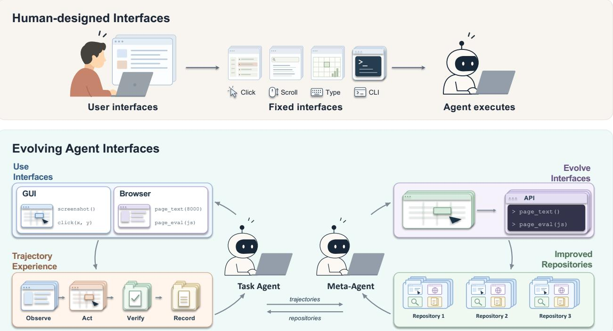  
Figure 1 | Conventional computer-use agents execute tasks through fixed, human-designed interfaces. A<sub>g</sub>ent S4 evolves interfaces as software re<sub>p</sub>ositories throu<sub>g</sub>h ex<sub>p</sub>erience. A task a<sub>g</sub>ent attem<sub>p</sub>ts synthetic tasks, and a meta-agent studies its trajectories to construct and refine the repositories. E<sub>ac</sub>h <sub>repos</sub>it<sub>ory com</sub>bi<sub>nes</sub> i<sub>n</sub>t<sub>er</sub>f<sub>aces, suc</sub>h <sub>as</sub> GUI i<sub>n</sub>t<sub>erac</sub>ti<sub>ons,</sub> fil<sub>e opera</sub>ti<sub>ons an</sub>d <sub>app</sub>li<sub>ca</sub>ti<sub>on-spec</sub>ifi<sub>c</sub> <sub>wor</sub>kfl<sub>ows,</sub> <sub>w</sub>ith k<sub>now</sub>l<sub>e</sub>d<sub>ge</sub> <sub>o</sub>f <sub>w</sub>h<sub>en</sub> t<sub>o</sub> <sub>use</sub> th<sub>em.</sub>

## 1. Introduction

We want AI agents that can discover like we can, not which contain what we have discovered.

— Ric<sup>h</sup>ard S. Sutton, The Bitter Lesson

Com<sub>p</sub>uter-use a<sub>g</sub>ents (CUAs) carr<sub>y</sub> out tasks b<sub>y</sub> observin<sub>g</sub> and actin<sub>g</sub> on di<sub>g</sub>ital environments. Their i<sub>n</sub>t<sub>er</sub>f<sub>aces</sub> d<sub>e</sub>t<sub>erm</sub>i<sub>ne w</sub>h<sub>a</sub>t th<sub>ey can o</sub>b<sub>serve an</sub>d <sub>w</sub>hi<sub>c</sub>h <sub>opera</sub>ti<sub>ons</sub> th<sub>ey can reques</sub>t<sub>.</sub> C<sub>urren</sub>t <sub>compu</sub>t<sub>er-</sub> use frameworks focus on GUI interaction, su<sub>pp</sub>lemented b<sub>y</sub> dedicated tools (Xie et al., 2024; Yan<sub>g</sub> et al., 2024; Zhou et al., 2024). These interfaces are desi<sub>g</sub>ned b<sub>y</sub> humans and fixed before task <sub>execu</sub>ti<sub>on.</sub> E<sub>ven</sub> th<sub>oug</sub>h th<sub>ese</sub> i<sub>n</sub>t<sub>er</sub>f<sub>aces are</sub> b<sub>u</sub>ilt <sub>spec</sub>ifi<sub>ca</sub>ll<sub>y</sub> f<sub>or agen</sub>t<sub>s,</sub> th<sub>ey s</sub>till d<sub>epen</sub>d <sub>on</sub> h<sub>uman</sub> judgments about what those agents need.

Thi<sub>s prac</sub>ti<sub>ce crea</sub>t<sub>es</sub> th<sub>ree pro</sub>bl<sub>ems</sub> f<sub>or compu</sub>t<sub>er-use.</sub> Fi<sub>rs</sub>t<sub>,</sub> it ti<sub>es progress</sub> t<sub>o manua</sub>l l<sub>a</sub>b<sub>or.</sub> C<sub>ompu</sub>t<sub>er</sub> <sub>use</sub> i<sub>s open-en</sub>d<sub>e</sub>d<sub>, an</sub>d <sub>eac</sub>h <sub>new</sub> f<sub>am</sub>il<sub>y o</sub>f t<sub>as</sub>k<sub>s or mo</sub>d<sub>e</sub>l <sub>re</sub>l<sub>ease exposes new</sub> f<sub>a</sub>il<sub>ure mo</sub>d<sub>es.</sub> A human researcher must read trajectories, diagnose failures, and use them to write new primitives, <sub>o</sub>b<sub>serva</sub>ti<sub>on</sub> f<sub>orma</sub>t<sub>s, or memory mec</sub>h<sub>an</sub>i<sub>sms, an</sub>d th<sub>en re</sub>l<sub>ease</sub> th<sub>e resu</sub>lt <sub>as a new agen</sub>t f<sub>ramewor</sub>k <sub>w</sub>ith <sub>a new prese</sub>t i<sub>n</sub>t<sub>er</sub>f<sub>ace.</sub> Thi<sub>s</sub> l<sub>oop</sub> d<sub>oes no</sub>t <sub>sca</sub>l<sub>e w</sub>ith t<sub>as</sub>k di<sub>vers</sub>it<sub>y.</sub> S<sub>econ</sub>d<sub>, a s</sub>t<sub>a</sub>ti<sub>c</sub> i<sub>n</sub>t<sub>er</sub>f<sub>ace</sub> <sub>o</sub>ft<sub>en m</sub>i<sub>sma</sub>t<sub>c</sub>h<sub>es</sub> th<sub>e</sub> t<sub>as</sub>k<sub>, an</sub>d <sub>curren</sub>t <sub>me</sub>th<sub>o</sub>d<sub>s compensa</sub>t<sub>e w</sub>ith t<sub>es</sub>t<sub>-</sub>ti<sub>me compu</sub>t<sub>e</sub> i<sub>ns</sub>t<sub>ea</sub>d <sub>o</sub>f <sub>a</sub> b<sub>e</sub>tt<sub>er</sub> i<sub>n</sub>t<sub>er</sub>f<sub>ace.</sub> F<sub>or examp</sub>l<sub>e, an agen</sub>t <sub>may comp</sub>l<sub>e</sub>t<sub>e a s</sub>h<sub>e</sub>ll t<sub>as</sub>k b<sub>y c</sub>li<sub>c</sub>ki<sub>ng</sub> t<sub>o open a</sub> t<sub>erm</sub>i<sub>na</sub>l <sub>w</sub>i<sub>n</sub>d<sub>ow,</sub> t<sub>yp</sub>i<sub>ng comman</sub>d<sub>s one c</sub>h<sub>arac</sub>t<sub>er a</sub>t <sub>a</sub> ti<sub>me, an</sub>d <sub>rea</sub>di<sub>ng screens</sub>h<sub>o</sub>t<sub>s o</sub>f <sub>a par</sub>tl<sub>y occ</sub>l<sub>u</sub>d<sub>e</sub>d terminal for feedback, when a direct shell interface would be faster and more reliable (Jia et al., 2026; Lu et al., 2025; Yuan et al., 2026). Additional sam<sub>p</sub>lin<sub>g</sub> can raise benchmark scores under <sub>suc</sub>h <sub>m</sub>i<sub>sma</sub>t<sub>c</sub>h<sub>es,</sub> b<sub>u</sub>t th<sub>roug</sub>h <sub>was</sub>t<sub>e</sub>f<sub>u</sub>l <sub>an</sub>d b<sub>r</sub>ittl<sub>e s</sub>t<sub>ra</sub>t<sub>eg</sub>i<sub>es.</sub> Thi<sub>r</sub>d<sub>, me</sub>th<sub>o</sub>d<sub>s</sub> th<sub>a</sub>t <sub>compose</sub> t<sub>es</sub>t<sub>-</sub>ti<sub>me</sub> ex<sub>p</sub>erience into reusable skills or routines inherit the same limit (A<sub>g</sub>ashe et al., 2025a; Wan<sub>g</sub> et al., 2025b). Each skill is a com<sub>p</sub>osition of the <sub>p</sub>reset observations and actions. Distillation can reorder <sub>w</sub>h<sub>a</sub>t th<sub>e</sub> i<sub>n</sub>t<sub>er</sub>f<sub>ace a</sub>ll<sub>ows,</sub> b<sub>u</sub>t it <sub>canno</sub>t <sub>ex</sub>t<sub>en</sub>d it<sub>.</sub> Th<sub>ese pro</sub>bl<sub>ems ar</sub>i<sub>se</sub> b<sub>ecause</sub> th<sub>e</sub> i<sub>n</sub>t<sub>er</sub>f<sub>ace</sub> i<sub>s</sub> treated as a design decision that humans make before deployment, and not as an object that can be <sub>s</sub>t<sub>u</sub>di<sub>e</sub>d <sub>an</sub>d i<sub>mprove</sub>d f<sub>rom</sub> th<sub>e agen</sub>t’<sub>s own exper</sub>i<sub>ence.</sub>

I<sub>ns</sub>t<sub>ea</sub>d<sub>,</sub> <sub>compu</sub>t<sub>er-use</sub> i<sub>n</sub>t<sub>er</sub>f<sub>aces</sub> <sub>s</sub>h<sub>ou</sub>ld <sub>evo</sub>l<sub>ve</sub> f<sub>rom</sub> th<sub>e agen</sub>t’<sub>s own exper</sub>i<sub>ence.</sub> Th<sub>ere</sub>f<sub>ore, we</sub> introduce Agent S4<sup>1</sup> an autonomous CUA scienti<sub>s</sub>t th<sub>a</sub>t <sub>s</sub>t<sub>u</sub>di<sub>es</sub> <sub>compu</sub>t<sub>er-use</sub> <sub>agen</sub>t<sub>s</sub> <sub>an</sub>d b<sub>u</sub>ild<sub>s</sub> Evolving Agent Interfaces t<sup>h</sup>roug<sup>h</sup> popu<sup>l</sup>ationb<sub>ase</sub>d <sub>evo</sub>l<sub>u</sub>ti<sub>on.</sub> It<sub>s</sub> <sub>ou</sub>t<sub>pu</sub>t i<sub>s</sub> <sub>a</sub> <sub>repos</sub>it<sub>ory</sub> <sub>o</sub>f <sub>m</sub>i<sub>xe</sub>d i<sub>n</sub>t<sub>er</sub>f<sub>aces an</sub>d k<sub>now</sub>l<sub>e</sub>d<sub>ge a</sub>b<sub>ou</sub>t <sub>w</sub>h<sub>en</sub> <sub>an</sub>d h<sub>ow</sub> t<sub>o</sub> <sub>use</sub> th<sub>em.</sub> Th<sub>e</sub> t<sub>as</sub>k <sub>agen</sub>t’<sub>s</sub> <sub>mo</sub>d<sub>e</sub>l <sub>an</sub>d h<sub>arness rema</sub>i<sub>n</sub> fi<sub>xe</sub>d<sub>, w</sub>ith th<sub>e</sub> h<sub>arness</sub> <sub>govern</sub>i<sub>ng mo</sub>d<sub>e</sub>l i<sub>nvoca</sub>ti<sub>on, execu</sub>ti<sub>on, perm</sub>i<sub>s-</sub> <sub>s</sub>i<sub>ons, an</sub>d t<sub>as</sub>k b<sub>u</sub>d<sub>ge</sub>t<sub>s.</sub>

Th<sub>e</sub> t<sub>as</sub>k <sub>agen</sub>t <sub>uses</sub> <sub>can</sub>did<sub>a</sub>t<sub>e</sub> <sub>repos</sub>it<sub>or</sub>i<sub>es</sub> <sub>o</sub>f Evolvin<sub>g</sub> A<sub>g</sub>ent Interfaces to attem<sub>p</sub>t s<sub>y</sub>nthetic tasks, producing trajectories without groundt<sub>ru</sub>th <sub>success</sub> l<sub>a</sub>b<sub>e</sub>l<sub>s.</sub> A <sub>me</sub>t<sub>a-agen</sub>t <sub>s</sub>t<sub>u</sub>di<sub>es</sub> these trajectories and forms hypotheses about h<sub>ow</sub> <sub>c</sub>h<sub>anges</sub> t<sub>o</sub> <sub>ac</sub>ti<sub>ons,</sub> <sub>o</sub>b<sub>serva</sub>ti<sub>ons,</sub> <sub>or</sub> <sub>usage</sub> k<sub>now</sub>l<sub>e</sub>d<sub>ge cou</sub>ld h<sub>e</sub>l<sub>p</sub> th<sub>e</sub> t<sub>as</sub>k <sub>agen</sub>t<sub>.</sub> It <sub>con-</sub>

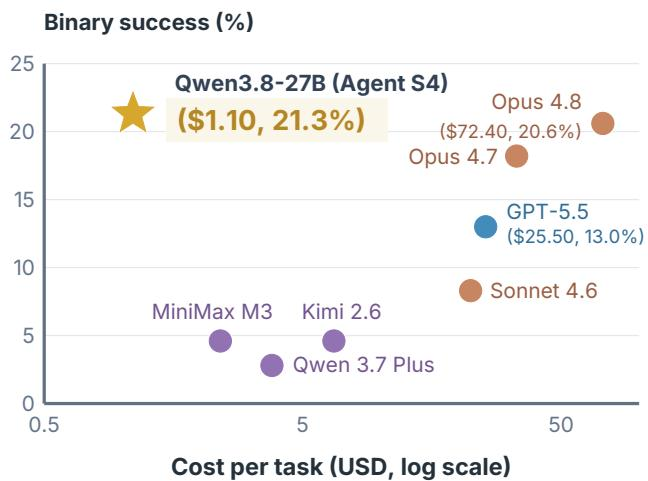  
Figure 2 | With Evolving Agent Interfaces built by Agent S4, Qwen3.8-27B exceeds GPT-5.5 and Opus 4.8 in binary success <sub>on</sub> th<sub>e</sub> <sub>c</sub>h<sub>a</sub>ll<sub>eng</sub>i<sub>ng</sub> OSW<sub>or</sub>ld V2 b<sub>enc</sub>h<sub>mar</sub>k <sub>a</sub>t <sub>a</sub> <sub>sma</sub>ll f<sub>rac</sub>ti<sub>on</sub> <sub>o</sub>f th<sub>e</sub>i<sub>r cos</sub>t<sub>.</sub>

<sub>s</sub>t<sub>ruc</sub>t<sub>s</sub> d<sub>escen</sub>d<sub>an</sub>t<sub>s</sub> th<sub>roug</sub>h <sub>mu</sub>t<sub>a</sub>ti<sub>on o</sub>f <sub>one repos</sub>it<sub>ory or crossover</sub> b<sub>e</sub>t<sub>ween</sub> t<sub>wo.</sub> D<sub>escen</sub>d<sub>an</sub>t<sub>s can</sub> <sub>a</sub>dd<sub>, rev</sub>i<sub>se, or remove</sub> i<sub>n</sub>t<sub>er</sub>f<sub>aces an</sub>d k<sub>now</sub>l<sub>e</sub>d<sub>ge, an</sub>d th<sub>e popu</sub>l<sub>a</sub>ti<sub>on re</sub>t<sub>a</sub>i<sub>ns a</sub>lt<sub>erna</sub>ti<sub>ve</sub> d<sub>es</sub>i<sub>gns</sub> f<sub>or</sub> f<sub>ur</sub>th<sub>er</sub> d<sub>eve</sub>l<sub>opmen</sub>t <sub>an</sub>d <sub>recom</sub>bi<sub>na</sub>ti<sub>on.</sub>

T<sub>o</sub> li<sub>m</sub>it <sub>spec</sub>i<sub>a</sub>li<sub>za</sub>ti<sub>on</sub> t<sub>o</sub> th<sub>e</sub> t<sub>as</sub>k<sub>s</sub> th<sub>a</sub>t <sub>mo</sub>ti<sub>va</sub>t<sub>e</sub>d th<sub>ese c</sub>h<sub>anges,</sub> A<sub>gen</sub>t S4 <sub>separa</sub>t<sub>es</sub> th<sub>e ev</sub>id<sub>ence</sub> used for construction from that used for selection. The meta-agent receives training trajectories, while validation instructions, trajectories, diagnostics, and scores remain hidden from it. Validation <sub>per</sub>f<sub>ormance gu</sub>id<sub>es paren</sub>t <sub>se</sub>l<sub>ec</sub>ti<sub>on.</sub> W<sub>e eva</sub>l<sub>ua</sub>t<sub>e</sub> th<sub>e</sub> fi<sub>na</sub>l <sub>se</sub>l<sub>ec</sub>t<sub>e</sub>d <sub>repos</sub>it<sub>ory on</sub> th<sub>e</sub> f<sub>u</sub>ll b<sub>enc</sub>h<sub>mar</sub>k<sub>.</sub> Th<sub>e me</sub>t<sub>a-agen</sub>t <sub>never o</sub>b<sub>serves any</sub> b<sub>enc</sub>h<sub>mar</sub>k t<sub>as</sub>k <sub>w</sub>hil<sub>e cons</sub>t<sub>ruc</sub>ti<sub>ng</sub> i<sub>n</sub>t<sub>er</sub>f<sub>aces, an</sub>d th<sub>e va</sub>lid<sub>a</sub>ti<sub>on</sub> t<sub>as</sub>k<sub>s</sub> i<sub>n</sub>fl<sub>uence on</sub>l<sub>y w</sub>hi<sub>c</sub>h <sub>repos</sub>it<sub>or</sub>i<sub>es are se</sub>l<sub>ec</sub>t<sub>e</sub>d d<sub>ur</sub>i<sub>ng evo</sub>l<sub>u</sub>ti<sub>on.</sub>

We evaluate A<sub>g</sub>ent S4 on OSWorld V2 (Yuan et al., 2026) and ScienceBoard (Sun et al., 2025). On the full 108-task OSWorld V2 set, Qwen3.8-27B with the evolved repository reaches 21.3% binary success, above both GPT-5.5 (13.0%) and Claude O<sub>p</sub>us 4.8 (20.6%) at about 4.3% and 1.5% of their res<sub>p</sub>ective <sub>cos</sub>t<sub>s.</sub> I<sub>n a separa</sub>t<sub>e evo</sub>l<sub>u</sub>ti<sub>on run on</sub> S<sub>c</sub>i<sub>ence</sub>B<sub>oar</sub>d<sub>, w</sub>hi<sub>c</sub>h <sub>covers n</sub>i<sub>c</sub>h<sub>e sc</sub>i<sub>en</sub>tifi<sub>c app</sub>li<sub>ca</sub>ti<sub>ons,</sub> th<sub>e</sub> <sub>evo</sub>l<sub>ve</sub>d <sub>repos</sub>it<sub>ory reac</sub>h<sub>es a</sub> 58<sub>.</sub>6% <sub>success ra</sub>t<sub>e, compare</sub>d <sub>w</sub>ith 41<sub>.</sub>4% f<sub>or</sub> th<sub>e</sub> h<sub>uman-</sub>d<sub>es</sub>i<sub>gne</sub>d interface of Qwen CUA. These results show that agents can evolve their own computer-use interfaces f<sub>rom</sub> <sub>pure</sub>l<sub>y</sub> <sub>syn</sub>th<sub>e</sub>ti<sub>c,</sub> <sub>ver</sub>ifi<sub>er-</sub>f<sub>ree</sub> t<sub>as</sub>k <sub>exper</sub>i<sub>ence</sub> <sub>an</sub>d <sub>ou</sub>t<sub>per</sub>f<sub>orm</sub> h<sub>uman-</sub>d<sub>es</sub>i<sub>gne</sub>d i<sub>n</sub>t<sub>er</sub>f<sub>aces.</sub> W<sub>e</sub> <sub>compare our se</sub>t<sub>up aga</sub>i<sub>ns</sub>t <sub>evo</sub>l<sub>u</sub>ti<sub>onary</sub> b<sub>ase</sub>li<sub>nes suc</sub>h <sub>as</sub> li<sub>near evo</sub>l<sub>u</sub>ti<sub>on an</sub>d <sub>measure</sub> th<sub>e e</sub>f<sub>ec</sub>t <sub>o</sub>f <sub>g</sub>i<sub>v</sub>i<sub>ng</sub> th<sub>e</sub> <sub>me</sub>t<sub>a-agen</sub>t <sub>a</sub> <sub>scra</sub>t<sub>c</sub>h <sub>v</sub>i<sub>r</sub>t<sub>ua</sub>l <sub>mac</sub>hi<sub>ne</sub> t<sub>o</sub> t<sub>es</sub>t it<sub>s</sub> <sub>evo</sub>l<sub>ve</sub>d i<sub>n</sub>t<sub>er</sub>f<sub>aces.</sub> Fi<sub>na</sub>ll<sub>y,</sub> <sub>we</sub> <sub>qua</sub>lit<sub>a</sub>ti<sub>ve</sub>l<sub>y</sub> <sub>compare agen</sub>t<sub>s</sub> th<sub>a</sub>t <sub>ac</sub>t th<sub>roug</sub>h <sub>evo</sub>l<sub>ve</sub>d i<sub>n</sub>t<sub>er</sub>f<sub>aces w</sub>ith <sub>agen</sub>t<sub>s</sub> th<sub>a</sub>t <sub>use</sub> fi<sub>xe</sub>d<sub>,</sub> h<sub>uman-</sub>d<sub>es</sub>i<sub>gne</sub>d i<sub>n</sub>t<sub>er</sub>f<sub>aces.</sub>

## O<sub>ur con</sub>t<sub>r</sub>ib<sub>u</sub>ti<sub>ons are:</sub>

• Evolving Agent Interfaces from synthetic, verifier-free experience. We introduce Agent S4, <sub>w</sub>hi<sub>c</sub>h <sub>evo</sub>l<sub>ves a repos</sub>it<sub>ory o</sub>f i<sub>n</sub>t<sub>er</sub>f<sub>aces an</sub>d <sub>usage</sub> k<sub>now</sub>l<sub>e</sub>d<sub>ge</sub> f<sub>rom syn</sub>th<sub>e</sub>ti<sub>c</sub> t<sub>as</sub>k <sub>exper</sub>i<sub>ence,</sub> <sub>w</sub>ith<sub>ou</sub>t <sub>success</sub> l<sub>a</sub>b<sub>e</sub>l<sub>s or</sub> t<sub>as</sub>k <sub>ver</sub>ifi<sub>ers, w</sub>hil<sub>e</sub> th<sub>e</sub> t<sub>as</sub>k <sub>agen</sub>t’<sub>s mo</sub>d<sub>e</sub>l <sub>an</sub>d h<sub>arness s</sub>t<sub>ay</sub> fi<sub>xe</sub>d<sub>.</sub> V<sub>a</sub>lid<sub>a</sub>ti<sub>on</sub> t<sub>as</sub>k<sub>s</sub> th<sub>e me</sub>t<sub>a-agen</sub>t <sub>never sees</sub> d<sub>ec</sub>id<sub>e w</sub>hi<sub>c</sub>h <sub>repos</sub>it<sub>or</sub>i<sub>es</sub> t<sub>o</sub> d<sub>eve</sub>l<sub>op</sub> f<sub>ur</sub>th<sub>er.</sub>

• Evolving interfaces outperform fixed ones. Wit<sup>h</sup> a repository o<sup>f</sup> inter<sup>f</sup>aces evo<sup>l</sup>ved <sup>b</sup>y Agent S4, Qwen3.8-27B exceeds both GPT-5.5 and Claude Opus 4.8 in binary success on OSWorld V2 at a <sub>sma</sub>ll f<sub>rac</sub>ti<sub>on o</sub>f th<sub>e</sub>i<sub>r cos</sub>t<sub>, an</sub>d i<sub>mproves</sub> S<sub>c</sub>i<sub>ence</sub>B<sub>oar</sub>d <sub>success over a</sub> fi<sub>xe</sub>d<sub>-</sub>i<sub>n</sub>t<sub>er</sub>f<sub>ace agen</sub>t <sub>w</sub>ith th<sub>e same mo</sub>d<sub>e</sub>l<sub>.</sub>

• Analysis of evolved interfaces. Repository and trajectory ana<sup>l</sup>yses s<sup>h</sup>ow t<sup>h</sup>at evo<sup>l</sup>ved inter<sup>f</sup>aces <sub>c</sub>h<sub>ange</sub> b<sub>o</sub>th <sub>w</sub>h<sub>a</sub>t th<sub>e agen</sub>t <sub>o</sub>b<sub>serves an</sub>d h<sub>ow</sub> it <sub>ac</sub>t<sub>s, across</sub> d<sub>es</sub>kt<sub>op-w</sub>id<sub>e, app</sub>li<sub>ca</sub>ti<sub>on-spec</sub>ifi<sub>c,</sub> <sub>cross-app</sub>li<sub>ca</sub>ti<sub>on an</sub>d t<sub>as</sub>k<sub>-spec</sub>ifi<sub>c</sub> i<sub>n</sub>t<sub>er</sub>f<sub>aces.</sub> W<sub>e a</sub>l<sub>so compare evo</sub>l<sub>u</sub>ti<sub>on s</sub>t<sub>ra</sub>t<sub>eg</sub>i<sub>es, w</sub>ith <sub>an</sub>d <sub>w</sub>ith<sub>ou</sub>t <sub>a</sub> <sub>scra</sub>t<sub>c</sub>h <sub>env</sub>i<sub>ronmen</sub>t f<sub>or</sub> th<sub>e</sub> <sub>me</sub>t<sub>a-agen</sub>t<sub>.</sub>

## 2. Problem Formulation

W<sub>e s</sub>t<sub>u</sub>d<sub>y</sub> h<sub>ow</sub> th<sub>e</sub> i<sub>n</sub>t<sub>er</sub>f<sub>aces o</sub>f <sub>a compu</sub>t<sub>er-use agen</sub>t <sub>can</sub> b<sub>e evo</sub>l<sub>ve</sub>d f<sub>rom</sub> t<sub>as</sub>k <sub>exper</sub>i<sub>ence.</sub> A<sub>n agen</sub>t <sub>up</sub>d<sub>a</sub>ti<sub>ng a sprea</sub>d<sub>s</sub>h<sub>ee</sub>t th<sub>roug</sub>h <sub>screens</sub>h<sub>o</sub>t<sub>s mus</sub>t id<sub>en</sub>tif<sub>y v</sub>i<sub>s</sub>ibl<sub>e ce</sub>ll<sub>s, en</sub>t<sub>er va</sub>l<sub>ues, an</sub>d i<sub>nspec</sub>t th<sub>e</sub> di<sub>sp</sub>l<sub>ay</sub> t<sub>o c</sub>h<sub>ec</sub>k th<sub>e resu</sub>lt<sub>.</sub> A <sub>s</sub>t<sub>ruc</sub>t<sub>ure</sub>d i<sub>n</sub>t<sub>er</sub>f<sub>ace can expose</sub> th<sub>e re</sub>l<sub>evan</sub>t <sub>rows an</sub>d f<sub>ormu</sub>l<sub>as, accep</sub>t <sub>a</sub> bulk edit, and return the chan<sub>g</sub>ed values. Both interfaces can achieve the same sub<sub>g</sub>oal (Coutaz et al., 1995), but the<sub>y</sub> re<sub>q</sub>uire diferent decisions and <sub>p</sub>rovide diferent feedback. Their cost and reliabilit<sub>y</sub> <sub>can a</sub>l<sub>so</sub> dif<sub>er.</sub> T<sub>as</sub>k <sub>exper</sub>i<sub>ence can revea</sub>l <sub>w</sub>hi<sub>c</sub>h <sub>opera</sub>ti<sub>ons are m</sub>i<sub>ss</sub>i<sub>ng, w</sub>hi<sub>c</sub>h <sub>o</sub>b<sub>serva</sub>ti<sub>ons are</sub> difi<sub>cu</sub>lt t<sub>o use, an</sub>d <sub>w</sub>h<sub>ere a</sub> dif<sub>eren</sub>t i<sub>n</sub>t<sub>er</sub>f<sub>ace wou</sub>ld h<sub>e</sub>l<sub>p.</sub>

We ca<sup>ll</sup> reusa<sup>bl</sup>e inter<sup>f</sup>aces t<sup>h</sup>at are constructed and improved <sup>f</sup>rom tas<sup>k</sup> experience Evolving Agent Interfaces. To ma<sup>k</sup>e inter<sup>f</sup>aces and <sup>k</sup>now<sup>l</sup>edge avai<sup>l</sup>a<sup>bl</sup>e across tas<sup>k</sup>s, we represent t<sup>h</sup>em in a per-<sub>s</sub>i<sub>s</sub>t<sub>en</sub>t <sub>repos</sub>it<sub>ory</sub> �<sub>.</sub> It <sub>con</sub>t<sub>a</sub>i<sub>ns</sub> <sub>execu</sub>t<sub>a</sub>bl<sub>e</sub> i<sub>n</sub>t<sub>er</sub>f<sub>aces</sub> <sub>an</sub>d <sub>suppor</sub>ti<sub>ng</sub> k<sub>now</sub>l<sub>e</sub>d<sub>ge</sub> <sub>suc</sub>h <sub>as</sub> <sub>capa</sub>bilit<sub>y</sub> d<sub>escr</sub>i<sub>p</sub>ti<sub>ons, reusa</sub>bl<sub>e wor</sub>kfl<sub>ows, con</sub>fi<sub>gura</sub>ti<sub>on, an</sub>d <sub>no</sub>t<sub>es a</sub>b<sub>ou</sub>t <sub>w</sub>h<sub>en an</sub>d h<sub>ow</sub> t<sub>o use</sub> th<sub>em.</sub>

Let D be the tar<sub>g</sub>et distribution of tasks and � the a<sub>g</sub>ent that uses the re<sub>p</sub>ositor<sub>y</sub>. Let $J ( A , R , x )$ d<sub>eno</sub>t<sub>e</sub> th<sub>e expec</sub>t<sub>e</sub>d t<sub>as</sub>k <sub>score w</sub>h<sub>en</sub> � <sub>uses repos</sub>it<sub>ory</sub> � t<sub>o a</sub>tt<sub>emp</sub>t t<sub>as</sub>k <sub>�.</sub> W<sub>e see</sub>k <sub>a repos</sub>it<sub>ory cons</sub>t<sub>ruc</sub>t<sub>e</sub>d f<sub>rom</sub> t<sub>as</sub>k <sub>exper</sub>i<sub>ence</sub> th<sub>a</sub>t <sub>max</sub>i<sub>m</sub>i<sub>zes</sub> thi<sub>s score across</sub> t<sub>as</sub>k<sub>s,</sub>

$$
R ^ { \star } \in \arg \operatorname* { m a x } _ { R } \mathbb { E } _ { x \sim \mathcal { D } } \left[ J ( A , R , x ) \right] .\tag{1}
$$

This objective concerns performance beyond the experience used to construct the repository. We next d<sub>e</sub>fi<sub>ne</sub> th<sub>e agen</sub>t<sub>,</sub> i<sub>n</sub>t<sub>er</sub>f<sub>aces, an</sub>d i<sub>n</sub>t<sub>erac</sub>ti<sub>on process</sub> th<sub>a</sub>t d<sub>e</sub>t<sub>erm</sub>i<sub>ne</sub> �<sub>.</sub>

Computer and task. A computer � <sup>h</sup>as a state $s \in S$ <sub>compr</sub>i<sub>s</sub>i<sub>ng</sub> it<sub>s</sub> fil<sub>es, runn</sub>i<sub>ng app</sub>li<sub>ca</sub>ti<sub>ons,</sub> di<sub>sp</sub>l<sub>ays,</sub> <sub>serv</sub>i<sub>ces,</sub> <sub>an</sub>d <sub>reac</sub>h<sub>a</sub>bl<sub>e</sub> <sub>ne</sub>t<sub>wor</sub>k <sub>en</sub>d<sub>po</sub>i<sub>n</sub>t<sub>s.</sub> A t<sub>as</sub>k $\boldsymbol { x } = \left( g , s _ { 0 } , V _ { x } , B _ { x } \right)$ <sub>cons</sub>i<sub>s</sub>t<sub>s o</sub>f <sub>an</sub> i<sub>ns</sub>t<sub>ruc</sub>ti<sub>on</sub> $^ { g , }$ <sub>an</sub> i<sub>n</sub>iti<sub>a</sub>l <sub>s</sub>t<sub>a</sub>t<sub>e</sub> $s _ { 0 } ,$ <sub>, an eva</sub>l<sub>ua</sub>t<sub>or</sub> $V _ { x }$ th<sub>a</sub>t <sub>scores</sub> th<sub>e ou</sub>t<sub>come, an</sub>d <sub>a</sub> b<sub>u</sub>d<sub>ge</sub>t $B _ { x }$

Interface. An interface $I = \langle c _ { I } , \mathcal { A } _ { I } , { \cal O } _ { I } \rangle$ co<sup>nn</sup>ec<sup>t</sup>s a<sup>n</sup> age<sup>nt t</sup>o o<sup>n</sup>e o<sup>r m</sup>o<sup>r</sup>e pa<sup>rt</sup>s $c _ { I }$ <sub>o</sub>f th<sub>e compu</sub>t<sub>er</sub> t<sup>h</sup>rou<sub>g</sub><sup>h</sup> a <sup>l</sup>an<sub>g</sub>ua<sub>g</sub>e o<sup>f</sup> re<sub>q</sub>uests $\mathcal { A } _ { I }$ <sub>an</sub>d <sub>a</sub> l<sub>anguage o</sub>f <sub>o</sub>b<sub>serva</sub>ti<sub>ons</sub> ${ \cal O } _ { I }$ . Execut<sup>i</sup>ng a request can c<sup>h</sup>ange th<sub>e</sub> <sub>s</sub>t<sub>a</sub>t<sub>e</sub> <sub>an</sub>d <sub>re</sub>t<sub>urns</sub> <sub>an</sub> <sub>o</sub>b<sub>serva</sub>ti<sub>on,</sub> $( s ^ { \prime } , o ) \sim T _ { I } ( \cdot \mid s , a )$ <sub>.</sub> A GUI i<sub>n</sub>t<sub>er</sub>f<sub>ace,</sub> f<sub>or</sub> <sub>examp</sub>l<sub>e,</sub> <sub>accep</sub>t<sub>s</sub> <sub>c</sub>li<sub>c</sub>k<sub>s</sub> <sub>an</sub>d k<sub>eys</sub>t<sub>ro</sub>k<sub>es an</sub>d <sub>re</sub>t<sub>urns screens</sub>h<sub>o</sub>t<sub>s.</sub> A <sub>s</sub>h<sub>e</sub>ll i<sub>n</sub>t<sub>er</sub>f<sub>ace accep</sub>t<sub>s</sub> b<sub>as</sub>h <sub>comman</sub>d<sub>s an</sub>d <sub>re</sub>t<sub>urns a s</sub>t<sub>r</sub>i<sub>ng</sub> <sub>w</sub>ith th<sub>e</sub> <sub>reques</sub>t<sub>e</sub>d i<sub>n</sub>f<sub>orma</sub>ti<sub>on,</sub> <sub>re</sub>t<sub>urn</sub> <sub>va</sub>l<sub>ues</sub> <sub>or</sub> <sub>error</sub> <sub>message.</sub>

Model, harness, and agent. A model � is a <sup>l</sup>anguage mode<sup>l</sup> t<sup>h</sup>at generates responses and requests conditioned on its input context. A harness � manages mode<sup>l</sup> invocation, request execution, tas<sup>k</sup> b<sub>u</sub>d<sub>ge</sub>t<sub>s,</sub> <sub>perm</sub>i<sub>ss</sub>i<sub>ons</sub> $P _ { H }$ <sub>,</sub> <sub>an</sub>d <sub>prepara</sub>ti<sub>on</sub> <sub>o</sub>f th<sub>e</sub> <sub>mo</sub>d<sub>e</sub>l’<sub>s</sub> <sub>con</sub>t<sub>ex</sub>t<sub>,</sub> i<sub>nc</sub>l<sub>u</sub>di<sub>ng</sub> <sub>any</sub> <sub>con</sub>t<sub>ex</sub>t <sub>compac</sub>ti<sub>on.</sub> An agent $A = \left( M , H \right)$ i<sub>s</sub> th<sub>e mo</sub>d<sub>e</sub>l <sub>opera</sub>ti<sub>ng</sub> th<sub>roug</sub>h thi<sub>s</sub> h<sub>arness.</sub> Th<sub>e agen</sub>t i<sub>n</sub>iti<sub>a</sub>ll<sub>y</sub> h<sub>as access</sub> t<sub>o</sub> a base set of interfaces I. The harness executes re<sub>q</sub>uests throu<sub>g</sub>h these interfaces and <sub>p</sub>laces the <sub>resu</sub>lti<sub>ng o</sub>b<sub>serva</sub>ti<sub>ons</sub> i<sub>n</sub> th<sub>e mo</sub>d<sub>e</sub>l’<sub>s con</sub>t<sub>ex</sub>t<sub>.</sub> F<sub>or examp</sub>l<sub>e,</sub> th<sub>e</sub> h<sub>arness can execu</sub>t<sub>e a sprea</sub>d<sub>s</sub>h<sub>ee</sub>t h<sub>e</sub>l<sub>per un</sub>d<sub>er a</sub> ti<sub>me</sub> li<sub>m</sub>it <sub>an</sub>d <sub>perm</sub>i<sub>ss</sub>i<sub>on</sub> b<sub>oun</sub>d<sub>ary.</sub> Th<sub>e</sub> h<sub>e</sub>l<sub>per</sub> d<sub>e</sub>fi<sub>nes</sub> th<sub>e reques</sub>t<sub>s</sub> f<sub>or rea</sub>di<sub>ng or</sub> <sub>e</sub>diti<sub>ng ce</sub>ll <sub>ranges an</sub>d th<sub>e va</sub>l<sub>ues re</sub>t<sub>urne</sub>d t<sub>o</sub> th<sub>e agen</sub>t<sub>.</sub> Th<sub>e</sub> h<sub>arness governs execu</sub>ti<sub>on, w</sub>hil<sub>e</sub> th<sub>e</sub> i<sub>n</sub>t<sub>er</sub>f<sub>ace</sub> <sub>spec</sub>ifi<sub>es</sub> th<sub>e</sub> <sub>ava</sub>il<sub>a</sub>bl<sub>e</sub> <sub>opera</sub>ti<sub>ons</sub> <sub>an</sub>d f<sub>ee</sub>db<sub>ac</sub>k<sub>.</sub>

Computer use. Computer use is t<sup>h</sup>e process t<sup>h</sup>roug<sup>h</sup> w<sup>h</sup>ic<sup>h</sup> an agent o<sup>b</sup>serves and acts on a computer th<sub>roug</sub>h <sub>ava</sub>il<sub>a</sub>bl<sub>e</sub> i<sub>n</sub>t<sub>er</sub>f<sub>aces</sub> t<sub>o accomp</sub>li<sub>s</sub>h <sub>a</sub> t<sub>as</sub>k<sub>.</sub> Th<sub>e</sub> i<sub>n</sub>t<sub>erac</sub>ti<sub>on</sub> hi<sub>s</sub>t<sub>ory</sub> $h _ { t }$ <sub>recor</sub>d<sub>s</sub> th<sub>e</sub> i<sub>n</sub>t<sub>er</sub>f<sub>aces,</sub> <sub>reques</sub>t<sub>s, an</sub>d <sub>o</sub>b<sub>serva</sub>ti<sub>ons</sub> f<sub>rom ear</sub>li<sub>er s</sub>t<sub>eps.</sub> At <sub>s</sub>t<sub>ep</sub> $t ,$ th<sub>e agen</sub>t <sub>c</sub>h<sub>ooses an</sub> i<sub>n</sub>t<sub>er</sub>f<sub>ace an</sub>d <sub>a reques</sub>t b<sub>ase</sub>d <sub>on</sub> th<sub>e</sub> i<sub>ns</sub>t<sub>ruc</sub>ti<sub>on an</sub>d thi<sub>s</sub> hi<sub>s</sub>t<sub>ory, w</sub>ith <sub>con</sub>t<sub>ex</sub>t <sub>prepara</sub>ti<sub>on</sub> b<sub>y</sub> � l<sub>e</sub>ft i<sub>mp</sub>li<sub>c</sub>it<sub>,</sub>

$$
\begin{array} { r } { ( I _ { t } , a _ { t } ) \sim M ( \cdot \mid g , h _ { t } , { \cal J } ) , \qquad ( s _ { t + 1 } , o _ { t } ) \sim T _ { I _ { t } } ( \cdot \mid s _ { t } , a _ { t } ) . } \end{array}\tag{2}
$$

Th<sub>e ava</sub>il<sub>a</sub>bl<sub>e</sub> i<sub>n</sub>t<sub>er</sub>f<sub>aces s</sub>h<sub>ape w</sub>hi<sub>c</sub>h <sub>opera</sub>ti<sub>ons</sub> th<sub>e agen</sub>t <sub>can reques</sub>t <sub>an</sub>d <sub>w</sub>h<sub>a</sub>t <sub>ev</sub>id<sub>ence</sub> it <sub>rece</sub>i<sub>ves</sub> <sub>a</sub>b<sub>ou</sub>t th<sub>e</sub>i<sub>r e</sub>f<sub>ec</sub>t<sub>s.</sub>

F<sub>o</sub>rmall<sub>y,</sub> $R = ( \mathcal { I } ( R ) , K ( R ) )$ <sub>, w</sub>h<sub>ere</sub> ${ \boldsymbol { \mathcal { T } } } ( R )$ <sub>con</sub>t<sub>a</sub>i<sub>ns</sub> it<sub>s execu</sub>t<sub>a</sub>bl<sub>e</sub> i<sub>n</sub>t<sub>er</sub>f<sub>aces an</sub>d $K ( R )$ <sup>it</sup>s suppo<sup>rtin</sup>g k<sub>now</sub>l<sub>e</sub>d<sub>ge.</sub> Th<sub>e</sub> <sub>repos</sub>it<sub>ory</sub> <sub>supp</sub>li<sub>es</sub> i<sub>n</sub>t<sub>er</sub>f<sub>aces</sub> ${ \mathcal { I } } _ { R } = { \mathcal { I } } \cup { \mathcal { I } } ( R )$ <sub>an</sub>d k<sub>now</sub>l<sub>e</sub>d<sub>ge</sub> th<sub>a</sub>t i<sub>n</sub>f<sub>orms</sub> th<sub>e agen</sub>t’<sub>s</sub> <sub>c</sub>h<sub>o</sub>i<sub>ces,</sub>

$$
( I _ { t } , a _ { t } ) \sim M ( \cdot \mid g , h _ { t } , \mathcal { I } _ { R } , K ( R ) ) .\tag{3}
$$

Each attempt is subject to the task budget $B _ { x }$ <sub>an</sub>d h<sub>arness</sub> <sub>perm</sub>i<sub>ss</sub>i<sub>ons</sub> $P _ { H }$ <sub>.</sub> Th<sub>e</sub> <sub>sco</sub>r<sub>e</sub> $J ( A , R , x )$ a<sup>v</sup>e<sup>r</sup>ages th<sub>e eva</sub>l<sub>ua</sub>t<sub>or</sub>’<sub>s score over</sub> th<sub>ese</sub> i<sub>n</sub>t<sub>erac</sub>ti<sub>ons.</sub>

Interface evolution. Inter<sup>f</sup>aces imp<sup>l</sup>emented as programs can <sup>b</sup>e revised <sup>l</sup>i<sup>k</sup>e any ot<sup>h</sup>er so<sup>f</sup>tware. A <sub>program can expor</sub>t <sub>a ma</sub>t<sub>er</sub>i<sub>a</sub>l <sub>sc</sub>h<sub>e</sub>d<sub>u</sub>l<sub>e</sub> th<sub>roug</sub>h Bl<sub>en</sub>d<sub>er</sub>’<sub>s</sub> P<sub>y</sub>th<sub>on</sub> API<sub>, ex</sub>t<sub>rac</sub>t <sub>se</sub>l<sub>ec</sub>t<sub>e</sub>d <sub>rows</sub> f<sub>rom a</sub> C<sub>a</sub>l<sub>c</sub> <sub>wor</sub>kb<sub>oo</sub>k<sub>,</sub> <sub>or</sub> <sub>re</sub>t<sub>urn</sub> <sub>supp</sub>li<sub>er</sub> <sub>pr</sub>i<sub>ces</sub> <sub>ga</sub>th<sub>ere</sub>d th<sub>roug</sub>h <sub>a</sub> <sub>sequence</sub> <sub>o</sub>f b<sub>rowser</sub> <sub>opera</sub>ti<sub>ons.</sub> E<sub>ac</sub>h defines its own re<sub>q</sub>uests and observations (Lian<sub>g</sub> et al., 2023; Wan<sub>g</sub> et al., 2024). Because these interfaces are code, an agent that can read trajectories and write code can redesign them. It can d<sub>ec</sub>id<sub>e</sub> <sub>w</sub>hi<sub>c</sub>h <sub>opera</sub>ti<sub>ons</sub> t<sub>o</sub> <sub>com</sub>bi<sub>ne,</sub> <sub>w</sub>h<sub>a</sub>t i<sub>n</sub>f<sub>orma</sub>ti<sub>on</sub> t<sub>o</sub> <sub>re</sub>t<sub>urn,</sub> <sub>an</sub>d h<sub>ow</sub> <sub>a</sub> <sub>resu</sub>lt <sub>can</sub> b<sub>e</sub> <sub>c</sub>h<sub>ec</sub>k<sub>e</sub>d<sub>.</sub> We ca<sup>ll</sup> t<sup>h</sup>is process interface evolution. Given a repository $R _ { k }$ and the trajectories $\mathcal { T } _ { k }$ <sub>o</sub>f th<sub>e agen</sub>t <sub>us</sub>i<sub>ng</sub> $\mathrm { i t } ,$ <sub>an</sub> <sub>evo</sub>l<sub>u</sub>ti<sub>on</sub> <sub>s</sub>t<sub>ep</sub> <sub>pro</sub>d<sub>uces</sub> <sub>a</sub> <sub>rev</sub>i<sub>se</sub>d <sub>repos</sub>it<sub>ory,</sub>

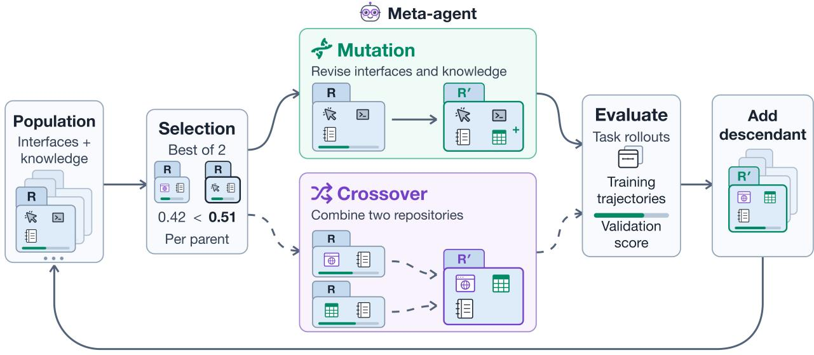  
Figure 3 | Agent S4 turns task experience into an evolving repository of interfaces and knowledge. Starting from parents selected by held-out validation, the meta-agent studies their task trajectories t<sub>o</sub> id<sub>en</sub>tif<sub>y</sub> li<sub>m</sub>it<sub>a</sub>ti<sub>ons,</sub> th<sub>en rev</sub>i<sub>ses one repos</sub>it<sub>ory</sub> th<sub>roug</sub>h <sub>mu</sub>t<sub>a</sub>ti<sub>on or com</sub>bi<sub>nes</sub> id<sub>eas</sub> f<sub>rom</sub> t<sub>wo</sub> through crossover. Task agents then use the descendant to produce trajectories on synthetic tasks and a separate score on held-out validation tasks. Each descendant joins the population alongside its <sub>paren</sub>t<sub>s,</sub> <sub>a</sub>ll<sub>ow</sub>i<sub>ng</sub> <sub>ear</sub>li<sub>er</sub> d<sub>es</sub>i<sub>gns</sub> t<sub>o</sub> b<sub>e</sub> <sub>rev</sub>i<sub>s</sub>it<sub>e</sub>d <sub>an</sub>d <sub>recom</sub>bi<sub>ne</sub>d <sub>over</sub> <sub>success</sub>i<sub>ve</sub> it<sub>era</sub>ti<sub>ons.</sub>

$$
\begin{array} { r } { R _ { k + 1 } = E ( R _ { k } , \mathcal { T } _ { k } ) . } \end{array}\tag{4}
$$

T<sub>as</sub>k <sub>exper</sub>i<sub>ence gu</sub>id<sub>es eac</sub>h <sub>s</sub>t<sub>ep.</sub> R<sub>epea</sub>t<sub>e</sub>d <sub>recons</sub>t<sub>ruc</sub>ti<sub>on o</sub>f th<sub>e same ca</sub>l<sub>cu</sub>l<sub>a</sub>ti<sub>on across</sub> t<sub>as</sub>k<sub>s</sub> <sub>can mo</sub>ti<sub>va</sub>t<sub>e a reusa</sub>bl<sub>e opera</sub>ti<sub>on, an</sub>d <sub>a repea</sub>t<sub>e</sub>d i<sub>na</sub>bilit<sub>y</sub> t<sub>o ver</sub>if<sub>y a c</sub>h<sub>ange can mo</sub>ti<sub>va</sub>t<sub>e a new</sub> observation. Trajectories with the revised repository then provide evidence for further revision. S<sub>ec</sub>ti<sub>on</sub> 3 i<sub>ns</sub>t<sub>an</sub>ti<sub>a</sub>t<sub>es</sub> � <sub>w</sub>ith <sub>popu</sub>l<sub>a</sub>ti<sub>on-</sub>b<sub>ase</sub>d <sub>evo</sub>l<sub>u</sub>ti<sub>on.</sub>

## 3. Agent S4

A<sub>gen</sub>t S4 b<sub>u</sub>ild<sub>s</sub> E<sub>vo</sub>l<sub>v</sub>i<sub>ng</sub> A<sub>gen</sub>t I<sub>n</sub>t<sub>er</sub>f<sub>aces</sub> <sub>an</sub>d <sub>usage</sub> k<sub>now</sub>l<sub>e</sub>d<sub>ge</sub> th<sub>roug</sub>h <sub>popu</sub>l<sub>a</sub>ti<sub>on-</sub>b<sub>ase</sub>d <sub>evo</sub>l<sub>u</sub>ti<sub>on</sub> <sub>o</sub>f <sub>repos</sub>it<sub>or</sub>i<sub>es,</sub> k<sub>eep</sub>i<sub>ng</sub> th<sub>e</sub> t<sub>as</sub>k <sub>agen</sub>t’<sub>s</sub> <sub>mo</sub>d<sub>e</sub>l � <sub>an</sub>d h<sub>arness</sub> � fi<sub>xe</sub>d<sub>.</sub> E<sub>ac</sub>h it<sub>era</sub>ti<sub>on</sub> <sub>se</sub>l<sub>ec</sub>t<sub>s</sub> <sub>paren</sub>t<sub>s</sub> f<sub>rom a popu</sub>l<sub>a</sub>ti<sub>on, cons</sub>t<sub>ruc</sub>t<sub>s a</sub> d<sub>escen</sub>d<sub>an</sub>t th<sub>roug</sub>h <sub>mu</sub>t<sub>a</sub>ti<sub>on or crossover, eva</sub>l<sub>ua</sub>t<sub>es</sub> it<sub>, an</sub>d <sub>a</sub>dd<sub>s</sub> it to the <sub>p</sub>o<sub>p</sub>ulation while retainin<sub>g</sub> its <sub>p</sub>arents (Fi<sub>g</sub>ure 3). Trainin<sub>g</sub> ex<sub>p</sub>erience <sub>g</sub>uides the re<sub>p</sub>ositor<sub>y</sub> <sub>c</sub>h<sub>anges, an</sub>d h<sub>e</sub>ld<sub>-ou</sub>t <sub>va</sub>lid<sub>a</sub>ti<sub>on gu</sub>id<sub>es su</sub>b<sub>sequen</sub>t <sub>se</sub>l<sub>ec</sub>ti<sub>on.</sub> Thi<sub>s op</sub>ti<sub>m</sub>i<sub>zes</sub> E<sub>qua</sub>ti<sub>on</sub> 1 f<sub>or</sub> th<sub>e</sub> fi<sub>xe</sub>d t<sub>as</sub>k <sub>agen</sub>t �<sub>.</sub> Al<sub>gor</sub>ith<sub>m</sub> 1 <sub>g</sub>i<sub>ves</sub> th<sub>e</sub> <sub>proce</sub>d<sub>ure.</sub>

## 3.1. Population and selection

Th<sub>e</sub> <sub>popu</sub>l<sub>a</sub>ti<sub>on</sub> <sub>con</sub>t<sub>a</sub>i<sub>ns</sub> <sub>repos</sub>it<sub>ory</sub> <sub>var</sub>i<sub>an</sub>t<sub>s,</sub> <sub>eac</sub>h <sub>w</sub>ith it<sub>s</sub> <sub>own</sub> i<sub>n</sub>t<sub>er</sub>f<sub>aces</sub> <sub>an</sub>d k<sub>now</sub>l<sub>e</sub>d<sub>ge.</sub> W<sub>e</sub> i<sub>n</sub>iti<sub>a</sub>li<sub>ze</sub> $\mathcal { R } _ { 0 } = \{ R _ { 0 } \}$ from a seed re<sub>p</sub>ositor<sub>y</sub> (A<sub>pp</sub>endix A.2) and evaluate it to obtain trainin<sub>g</sub> trajectories and a <sub>va</sub>lid<sub>a</sub>ti<sub>on</sub> <sub>score.</sub> Th<sub>ese</sub> <sub>recor</sub>d<sub>s</sub> <sub>are</sub> <sub>re</sub>t<sub>a</sub>i<sub>ne</sub>d <sub>w</sub>ith <sub>eac</sub>h <sub>can</sub>did<sub>a</sub>t<sub>e</sub> <sub>as</sub> th<sub>e</sub> <sub>popu</sub>l<sub>a</sub>ti<sub>on</sub> <sub>grows.</sub>

At <sub>eac</sub>h <sub>s</sub>t<sub>ep, an opera</sub>t<sub>or sc</sub>h<sub>e</sub>d<sub>u</sub>l<sub>e c</sub>h<sub>ooses mu</sub>t<sub>a</sub>ti<sub>on or crossover.</sub> M<sub>u</sub>t<sub>a</sub>ti<sub>on requ</sub>i<sub>res one paren</sub>t<sub>,</sub> <sub>an</sub>d <sub>crossover</sub> <sub>requ</sub>i<sub>res</sub> t<sub>wo</sub> di<sub>s</sub>ti<sub>nc</sub>t <sub>paren</sub>t<sub>s.</sub> F<sub>or</sub> <sub>eac</sub>h <sub>paren</sub>t<sub>,</sub> bi<sub>nary</sub> t<sub>ournamen</sub>t <sub>se</sub>l<sub>ec</sub>ti<sub>on</sub> d<sub>raws</sub> t<sub>wo e</sub>li<sub>g</sub>ibl<sub>e var</sub>i<sub>an</sub>t<sub>s un</sub>if<sub>orm</sub>l<sub>y an</sub>d <sub>c</sub>h<sub>ooses</sub> th<sub>e one w</sub>ith th<sub>e</sub> hi<sub>g</sub>h<sub>er va</sub>lid<sub>a</sub>ti<sub>on score.</sub> A <sub>so</sub>l<sub>e e</sub>li<sub>g</sub>ibl<sub>e</sub> <sub>can</sub>did<sub>a</sub>t<sub>e</sub> i<sub>s se</sub>l<sub>ec</sub>t<sub>e</sub>d di<sub>rec</sub>tl<sub>y.</sub> F<sub>or crossover,</sub> th<sub>e</sub> fi<sub>rs</sub>t <sub>se</sub>l<sub>ec</sub>t<sub>e</sub>d <sub>paren</sub>t i<sub>s exc</sub>l<sub>u</sub>d<sub>e</sub>d f<sub>rom</sub> th<sub>e secon</sub>d selection. The selected repositories and their saved training trajectories provide the starting point for th<sub>e nex</sub>t d<sub>escen</sub>d<sub>an</sub>t<sub>.</sub>

## 3.2. Mutation and crossover

T<sup>h</sup>e meta-agent $A _ { \mathrm { { m e t a } } } \ = \ \left( M _ { \mathrm { { m e t a } } } , H _ { \mathrm { { m e t a } } } \right)$ <sub>cons</sub>t<sub>ruc</sub>t<sub>s</sub> d<sub>escen</sub>d<sub>an</sub>t<sub>s us</sub>i<sub>ng a</sub> fi<sub>xe</sub>d <sub>mo</sub>d<sub>e</sub>l <sub>an</sub>d h<sub>arness.</sub> Its computer $C _ { \mathrm { m e t a } }$ holds the selected parent repositories, their training trajectories, and a lineage <sub>no</sub>t<sub>e</sub>b<sub>oo</sub>k i<sub>n</sub> it<sub>s</sub> fil<sub>esys</sub>t<sub>em.</sub> It <sub>s</sub>t<sub>u</sub>di<sub>es</sub> th<sub>e</sub> <sub>recor</sub>d<sub>e</sub>d b<sub>e</sub>h<sub>av</sub>i<sub>or</sub> <sub>an</sub>d <sub>o</sub>b<sub>serva</sub>ti<sub>ons</sub> t<sub>o</sub> di<sub>agnose</sub> <sub>apparen</sub>t f<sub>a</sub>il<sub>ures an</sub>d i<sub>ne</sub>fi<sub>c</sub>i<sub>enc</sub>i<sub>es an</sub>d f<sub>orm</sub> h<sub>ypo</sub>th<sub>eses a</sub>b<sub>ou</sub>t <sub>use</sub>f<sub>u</sub>l <sub>c</sub>h<sub>anges.</sub> F<sub>or examp</sub>l<sub>e, repea</sub>t<sub>e</sub>d <sub>ce</sub>ll<sub>-</sub> b<sub>y-ce</sub>ll <sub>e</sub>dit<sub>s</sub> <sub>can</sub> <sub>mo</sub>ti<sub>va</sub>t<sub>e</sub> <sub>a</sub> b<sub>u</sub>lk <sub>sprea</sub>d<sub>s</sub>h<sub>ee</sub>t i<sub>n</sub>t<sub>er</sub>f<sub>ace,</sub> <sub>w</sub>hil<sub>e</sub> <sub>poor</sub> <sub>use</sub> <sub>o</sub>f <sub>an</sub> <sub>ex</sub>i<sub>s</sub>ti<sub>ng</sub> i<sub>n</sub>t<sub>er</sub>f<sub>ace</sub> <sub>can</sub> <sub>mo</sub>ti<sub>va</sub>t<sub>e rev</sub>i<sub>se</sub>d <sub>usage</sub> k<sub>now</sub>l<sub>e</sub>d<sub>ge.</sub> It i<sub>mp</sub>l<sub>emen</sub>t<sub>s</sub> th<sub>ese</sub> h<sub>ypo</sub>th<sub>eses</sub> th<sub>roug</sub>h fil<sub>e, s</sub>h<sub>e</sub>ll<sub>, an</sub>d <sub>co</sub>d<sub>e</sub> i<sub>n</sub>t<sub>er</sub>f<sub>aces us</sub>i<sub>ng one o</sub>f t<sub>wo opera</sub>t<sub>ors.</sub>

Mutation. Starting <sup>f</sup>rom one parent $R _ { p } .$ <sub>,</sub> th<sub>e me</sub>t<sub>a-agen</sub>t <sub>a</sub>dd<sub>s, rev</sub>i<sub>ses, or removes</sub> i<sub>n</sub>t<sub>er</sub>f<sub>aces an</sub>d k<sub>now</sub>l<sub>e</sub>d<sub>ge.</sub> Ch<sub>anges can a</sub>f<sub>ec</sub>t <sub>opera</sub>ti<sub>ons, re</sub>t<sub>urne</sub>d <sub>o</sub>b<sub>serva</sub>ti<sub>ons, an</sub>d <sub>reusa</sub>bl<sub>e wor</sub>kfl<sub>ows,</sub> i<sub>nc</sub>l<sub>u</sub>di<sub>ng</sub> <sub>capa</sub>biliti<sub>es</sub> i<sub>n</sub>h<sub>er</sub>it<sub>e</sub>d f<sub>rom</sub> th<sub>e see</sub>d<sub>.</sub>

Crossover. Given two distinct parents $R _ { a }$ <sub>an</sub>d $R _ { b }$ <sub>,</sub> th<sub>e</sub> <sub>me</sub>t<sub>a-agen</sub>t <sub>cons</sub>t<sub>ruc</sub>t<sub>s</sub> <sub>one</sub> <sub>co</sub>h<sub>eren</sub>t d<sub>escen</sub>d<sub>an</sub>t b<sub>y</sub> <sub>c</sub>h<sub>oos</sub>i<sub>ng</sub> b<sub>e</sub>t<sub>ween</sub> <sub>over</sub>l<sub>app</sub>i<sub>ng</sub> i<sub>n</sub>t<sub>er</sub>f<sub>aces,</sub> <sub>por</sub>ti<sub>ng</sub> <sub>comp</sub>l<sub>emen</sub>t<sub>ary</sub> <sub>capa</sub>biliti<sub>es,</sub> <sub>or</sub> <sub>com</sub>bi<sub>n</sub>i<sub>ng</sub> th<sub>e</sub>i<sub>r</sub> id<sub>eas</sub> i<sub>n</sub>t<sub>o new co</sub>d<sub>e an</sub>d k<sub>now</sub>l<sub>e</sub>d<sub>ge.</sub> Th<sub>e</sub> d<sub>escen</sub>d<sub>an</sub>t <sub>nee</sub>d <sub>no</sub>t <sub>con</sub>t<sub>a</sub>i<sub>n</sub> th<sub>e un</sub>i<sub>on o</sub>f it<sub>s paren</sub>t<sub>s.</sub>

B<sub>o</sub>th <sub>opera</sub>t<sub>ors</sub> <sub>pro</sub>d<sub>uce</sub> <sub>a</sub> <sub>s</sub>i<sub>ng</sub>l<sub>e</sub> d<sub>escen</sub>d<sub>an</sub>t <sub>repos</sub>it<sub>ory</sub> $R ^ { \prime }$ . The fixed base access I remains unchan<sub>g</sub>ed <sub>as</sub> th<sub>e repos</sub>it<sub>ory</sub>’<sub>s</sub> i<sub>n</sub>t<sub>er</sub>f<sub>aces</sub> ${ \boldsymbol { \mathcal { T } } } ( R )$ <sub>an</sub>d k<sub>now</sub>l<sub>e</sub>d<sub>ge</sub> $K ( R )$ <sub>evo</sub>l<sub>ve.</sub>

## 3.3. Evaluation and population update

Aft<sub>er cons</sub>t<sub>ruc</sub>ti<sub>on, we</sub> f<sub>reeze</sub> $R ^ { \prime }$ <sub>an</sub>d <sub>run</sub> th<sub>e</sub> fi<sub>xe</sub>d t<sub>as</sub>k <sub>agen</sub>t � <sub>on syn</sub>th<sub>e</sub>ti<sub>c</sub> t<sub>ra</sub>i<sub>n</sub>i<sub>ng</sub> t<sub>as</sub>k<sub>s</sub> ${ \mathcal { T } } _ { \mathrm { t r a i n } }$ and disjoint validation tasks $\mathcal { T } _ { \mathrm { v a l } }$ <sub>.</sub> Th<sub>e repos</sub>it<sub>ory</sub> i<sub>s ava</sub>il<sub>a</sub>bl<sub>e</sub> i<sub>n</sub> th<sub>e</sub> t<sub>as</sub>k <sub>agen</sub>t’<sub>s</sub> fil<sub>esys</sub>t<sub>em, an</sub>d <sub>a</sub> fi<sub>xe</sub>d <sub>promp</sub>t id<sub>en</sub>tifi<sub>es</sub> it<sub>s</sub> l<sub>oca</sub>ti<sub>on</sub> <sub>an</sub>d <sub>exp</sub>l<sub>a</sub>i<sub>ns</sub> h<sub>ow</sub> t<sub>o</sub> di<sub>scover</sub> it<sub>s</sub> <sub>capa</sub>biliti<sub>es.</sub> Th<sub>e</sub> <sub>agen</sub>t <sub>can</sub> <sub>consu</sub>lt it<sub>s</sub> d<sub>ocumen</sub>t<sub>a</sub>ti<sub>on an</sub>d <sub>source co</sub>d<sub>e an</sub>d i<sub>nvo</sub>k<sub>e</sub> th<sub>e</sub> i<sub>n</sub>t<sub>er</sub>f<sub>aces</sub> it <sub>se</sub>l<sub>ec</sub>t<sub>s</sub> th<sub>roug</sub>h th<sub>e</sub> h<sub>arness</sub>’<sub>s</sub> existin<sub>g</sub> code-execution tool (A<sub>pp</sub>endix A.2). Each rollout � ∼ Rollout $( A , R ^ { \prime } , C , x )$ <sub>s</sub>t<sub>ar</sub>t<sub>s</sub> f<sub>rom</sub> t<sub>as</sub>k <sub>�</sub>’<sub>s</sub> i<sub>n</sub>iti<sub>a</sub>l <sub>s</sub>t<sub>a</sub>t<sub>e</sub> <sub>w</sub>ithi<sub>n</sub> it<sub>s</sub> b<sub>u</sub>d<sub>ge</sub>t <sub>an</sub>d <sub>recor</sub>d<sub>s</sub> th<sub>e</sub> i<sub>ns</sub>t<sub>ruc</sub>ti<sub>on,</sub> i<sub>n</sub>t<sub>er</sub>f<sub>aces,</sub> <sub>reques</sub>t<sub>s,</sub> <sub>an</sub>d <sub>o</sub>b<sub>serva</sub>ti<sub>ons.</sub> Th<sub>e</sub> <sub>repos</sub>it<sub>ory rema</sub>i<sub>ns</sub> fi<sub>xe</sub>d d<sub>ur</sub>i<sub>ng execu</sub>ti<sub>on.</sub> T<sub>emporary programs wr</sub>itt<sub>en</sub> b<sub>y</sub> th<sub>e agen</sub>t d<sub>o no</sub>t <sub>pers</sub>i<sub>s</sub>t <sub>across</sub> t<sub>as</sub>k<sub>s.</sub>

Training experience and validation score. Training trajectories <sup>h</sup>ave no ground-trut<sup>h</sup> success <sup>l</sup>a<sup>b</sup>e<sup>l</sup>s. W<sub>e</sub> <sub>save</sub> th<sub>em</sub> <sub>as</sub> <sub>ev</sub>id<sub>ence</sub> f<sub>or</sub> f<sub>u</sub>t<sub>ure</sub> <sub>repos</sub>it<sub>ory</sub> <sub>c</sub>h<sub>anges</sub> <sub>an</sub>d <sub>reuse</sub> th<sub>em</sub> <sub>w</sub>h<sub>enever</sub> th<sub>e</sub> d<sub>escen</sub>d<sub>an</sub>t b<sub>ecomes a paren</sub>t<sub>.</sub> V<sub>a</sub>lid<sub>a</sub>ti<sub>on ro</sub>ll<sub>ou</sub>t<sub>s prov</sub>id<sub>e a separa</sub>t<sub>e se</sub>l<sub>ec</sub>ti<sub>on score</sub> f<sub>or eac</sub>h <sub>can</sub>did<sub>a</sub>t<sub>e</sub> $R ,$

$$
F _ { \mathrm { v a l } } ( R ) = \frac { 1 } { | \mathcal { T } _ { \mathrm { v a l } } | } \sum _ { x \in \mathcal { T } _ { \mathrm { v a l } } } V _ { x } ( \mathrm { R o l l o u t } ( A , R , C , x ) ) .\tag{5}
$$

Asymmetric evaluation. On<sup>l</sup>y training trajectories are exposed to t<sup>h</sup>e meta-agent. Va<sup>l</sup>idation tasks, trajectories, diagnostics, and scores remain inaccessible to it. Validation therefore influences <sub>cons</sub>t<sub>ruc</sub>ti<sub>on</sub> th<sub>roug</sub>h <sub>paren</sub>t <sub>se</sub>l<sub>ec</sub>ti<sub>on,</sub> <sub>w</sub>ith<sub>ou</sub>t <sub>supp</sub>l<sub>y</sub>i<sub>ng</sub> di<sub>rec</sub>t f<sub>ee</sub>db<sub>ac</sub>k f<sub>or</sub> <sub>repos</sub>it<sub>ory</sub> <sub>e</sub>dit<sub>s.</sub>

Algorithm 1 Agent S4 evo<sup>l</sup>ves repositories <sup>b</sup>y se<sup>l</sup>ecting parents, constructing descendants <sup>f</sup>rom tas<sup>k</sup>   
<sub>exper</sub>i<sub>ence, an</sub>d <sub>re</sub>t<sub>urn</sub>i<sub>ng eva</sub>l<sub>ua</sub>t<sub>e</sub>d d<sub>escen</sub>d<sub>an</sub>t<sub>s</sub> t<sub>o</sub> th<sub>e popu</sub>l<sub>a</sub>ti<sub>on.</sub>   
Require: Seed repository $R _ { 0 } { } .$ , tas<sup>k</sup> a<sub>g</sub>ent $A ,$ <sup>m</sup>e<sup>t</sup>a<sup>-</sup>age<sup>nt</sup> $A _ { \mathrm { { m e t a } } } .$ <sub>,</sub> t<sub>ra</sub>i<sub>n</sub>i<sub>ng</sub> t<sub>as</sub>k<sub>s</sub> $\mathcal { T } _ { \mathrm { t r a i n : } }$ <sub>, va</sub>lid<sub>a</sub>ti<sub>on</sub> t<sub>as</sub>k<sub>s</sub>   
${ \mathcal { T } } _ { \mathrm { v a l } } ,$ <sub>, opera</sub>t<sub>or sc</sub>h<sub>e</sub>d<sub>u</sub>l<sub>e</sub> $\sigma ,$ <sub>evo</sub>l<sub>u</sub>ti<sub>on</sub> b<sub>u</sub>d<sub>ge</sub>t �   
1: $\mathcal { R } _ { 0 }  \{ R _ { 0 } \}$   
2<sub>:</sub> R<sub>un</sub> � <sub>w</sub>ith $R _ { 0 }$ on $\mathcal { T } _ { \mathrm { t r a i n } }$ <sub>an</sub>d $\mathcal { T } _ { \mathrm { v a l } }$   
3: for $k = 1 , \ldots , N$ do   
4: $z \gets \sigma ( k )$ <sub>⊲</sub> Mutation or Crossover   
5: S<sub>e</sub>l<sub>e</sub>ct <sub>o</sub>n<sub>e o</sub>r tw<sub>o p</sub>ar<sub>e</sub>nt<sub>s</sub> fr<sub>o</sub>m $\mathcal { R } _ { k } .$ <sub>1</sub> b<sub>y va</sub>lid<sub>a</sub>ti<sub>on</sub> t<sub>ournamen</sub>t   
6: � <sub>t</sub> ← the parents, their training trajectories, and lineage notebook   
7: $R ^ { \prime } \gets$ d<sub>escen</sub>d<sub>an</sub>t <sub>cons</sub>t<sub>ruc</sub>t<sub>e</sub>d b<sub>y</sub> $A _ { \mathrm { { m e t a } } }$ on $C _ { \mathrm { m e t a } }$ us<sup>i</sup>n<sub>g</sub> �   
8: Freeze $R ^ { \prime }$ <sub>an</sub>d <sub>run</sub> � <sub>w</sub>ith it <sub>on</sub> $\mathcal { T } _ { \mathrm { t r a i n } }$ <sub>an</sub>d $\mathcal { T } _ { \mathrm { v a l } }$   
9: $\mathcal { R } _ { k }  \mathcal { R } _ { k - 1 } \cup \{ R ^ { \prime } \}$   
10: R<sub>ecor</sub>d <sub>paren</sub>t li<sub>n</sub>k<sub>s an</sub>d <sub>app</sub>l<sub>y popu</sub>l<sub>a</sub>ti<sub>on con</sub>t<sub>ro</sub>l<sub>,</sub> if <sub>con</sub>fi<sub>gure</sub>d   
11: end for   
12<sub>:</sub> S<sub>e</sub>l<sub>ec</sub>t �<sup>ˆ</sup> f<sub>rom</sub> $\mathcal { R } _ { N }$ b<sub>y va</sub>lid<sub>a</sub>ti<sub>on score</sub>   
13: return $\hat { R } , \mathcal { R } _ { N } .$ <sub>, an</sub>d th<sub>e</sub> li<sub>neage recor</sub>d

Adding the descendant. We add $R ^ { \prime }$ t<sub>o</sub> th<sub>e popu</sub>l<sub>a</sub>ti<sub>on a</sub>l<sub>ongs</sub>id<sub>e</sub> it<sub>s paren</sub>t<sub>s regar</sub>dl<sub>ess o</sub>f it<sub>s va</sub>lid<sub>a</sub>ti<sub>on</sub> <sub>score.</sub> Thi<sub>s re</sub>t<sub>a</sub>i<sub>ns a</sub>lt<sub>erna</sub>ti<sub>ve</sub> d<sub>es</sub>i<sub>gns</sub> f<sub>or</sub> f<sub>ur</sub>th<sub>er</sub> d<sub>eve</sub>l<sub>opmen</sub>t <sub>an</sub>d <sub>recom</sub>bi<sub>na</sub>ti<sub>on.</sub> P<sub>aren</sub>t li<sub>n</sub>k<sub>s</sub> f<sub>orm a</sub> di<sub>rec</sub>t<sub>e</sub>d <sub>acyc</sub>li<sub>c grap</sub>h<sub>, w</sub>ith <sub>one paren</sub>t <sub>per mu</sub>t<sub>a</sub>ti<sub>on an</sub>d t<sub>wo per crossover.</sub> O<sub>p</sub>ti<sub>ona</sub>l <sub>prun</sub>i<sub>ng removes</sub> <sub>paren</sub>t <sub>e</sub>li<sub>g</sub>ibilit<sub>y w</sub>hil<sub>e preserv</sub>i<sub>ng</sub> li<sub>neage recor</sub>d<sub>s.</sub> Th<sub>e up</sub>d<sub>a</sub>t<sub>e</sub>d <sub>popu</sub>l<sub>a</sub>ti<sub>on supp</sub>li<sub>es can</sub>did<sub>a</sub>t<sub>es</sub> f<sub>or</sub> th<sub>e</sub> <sub>nex</sub>t it<sub>era</sub>ti<sub>on.</sub> Aft<sub>er</sub> � <sub>s</sub>t<sub>eps,</sub> <sub>we</sub> <sub>se</sub>l<sub>ec</sub>t <sub>a</sub> <sub>mem</sub>b<sub>er</sub> <sub>o</sub>f $\mathcal { R } _ { N }$ b<sub>y</sub> <sub>va</sub>lid<sub>a</sub>ti<sub>on</sub> <sub>per</sub>f<sub>ormance,</sub> <sub>us</sub>i<sub>ng</sub> a benchmark-s<sub>p</sub>ecific criterion (Section 4), and freeze it for evaluation on tar<sub>g</sub>et tasks $\mathcal { T } _ { \mathrm { t e s t } }$ <sub>.</sub> Th<sub>e</sub> <sub>me</sub>t<sub>a-agen</sub>t <sub>o</sub>b<sub>serves none o</sub>f th<sub>ese</sub> t<sub>as</sub>k<sub>s</sub> d<sub>ur</sub>i<sub>ng cons</sub>t<sub>ruc</sub>ti<sub>on, an</sub>d <sub>va</sub>lid<sub>a</sub>ti<sub>on</sub> t<sub>as</sub>k<sub>s</sub> d<sub>rawn</sub> f<sub>rom</sub> th<sub>e</sub> <sub>same</sub> b<sub>enc</sub>h<sub>mar</sub>k <sub>a</sub>f<sub>ec</sub>t <sub>on</sub>l<sub>y se</sub>l<sub>ec</sub>ti<sub>on.</sub>

## 4. Experimental Setup

Benchmarks and task sets. OSWor<sup>l</sup>d V2 (Yuan et a<sup>l</sup>., 2026) is our primary <sup>b</sup>enc<sup>h</sup>mar<sup>k</sup>, and ScienceBoard (Sun et al., 2025) tests <sub>g</sub>eneralization to niche scientific com<sub>p</sub>uter-use a<sub>pp</sub>lications <sub>an</sub>d <sub>wor</sub>kfl<sub>ows.</sub> R<sub>e os</sub>it<sub>or evo</sub>l<sub>u</sub>ti<sub>on uses</sub> 30 <sub>s n</sub>th<sub>e</sub>ti<sub>c</sub> t<sub>ra</sub>i<sub>n</sub>i<sub>n</sub> t<sub>as</sub>k<sub>s</sub> f<sub>or</sub> OSW<sub>or</sub>ld V2 <sub>an</sub>d 48 f<sub>or</sub> ScienceBoard, plus 15 oficial validation tasks for each. Synthetic task attempts yield trajectories without ground-truth success labels. The meta-agent receives these training trajectories. Validation scores guide selection, but validation trajectories and evaluators remain outside its evidence. Fullb<sub>enc</sub>h<sub>mar</sub>k <sub>resu</sub>lt<sub>s cover</sub> 108 OSW<sub>or</sub>ld V2 <sub>an</sub>d 169 S<sub>c</sub>i<sub>ence</sub>B<sub>oar</sub>d t<sub>as</sub>k<sub>s,</sub> i<sub>nc</sub>l<sub>u</sub>di<sub>ng</sub> th<sub>e</sub> 15 <sub>va</sub>lid<sub>a</sub>ti<sub>on</sub> t<sub>as</sub>k<sub>s</sub> <sub>o</sub>f <sub>eac</sub>h<sub>.</sub> B<sub>enc</sub>h<sub>mar</sub>k d<sub>e</sub>t<sub>a</sub>il<sub>s</sub> <sub>appear</sub> i<sub>n</sub> A<sub>ppen</sub>di<sub>x</sub> A<sub>,</sub> <sub>an</sub>d <sub>syn</sub>th<sub>e</sub>ti<sub>c</sub> t<sub>as</sub>k <sub>cons</sub>t<sub>ruc</sub>ti<sub>on</sub> i<sub>s</sub> d<sub>escr</sub>ib<sub>e</sub>d b<sub>e</sub>l<sub>ow an</sub>d i<sub>n</sub> A<sub>ppen</sub>di<sub>x</sub> D<sub>.</sub>

Model and harness. On <sup>b</sup>ot<sup>h b</sup>enc<sup>h</sup>mar<sup>k</sup>s, t<sup>h</sup>e tas<sup>k</sup> agent and meta-agent use Qwen3.8-27B (Qwen Team, 2026) in a modified Prime A<sub>g</sub>ent harness (Karten et al., 2026) that executes code in a <sub>p</sub>ersistent IP<sub>y</sub>thon kernel<sub>,</sub> with Medium reasonin<sub>g,</sub> a 131<sub>,</sub>072-token context window<sub>,</sub> a 32<sub>,</sub>000-token out<sub>p</sub>ut li<sub>m</sub>it<sub>, an</sub>d <sub>au</sub>t<sub>oma</sub>ti<sub>c con</sub>t<sub>ex</sub>t <sub>compac</sub>ti<sub>on.</sub> Th<sub>e mo</sub>d<sub>e</sub>l <sub>an</sub>d h<sub>arness rema</sub>i<sub>n</sub> fi<sub>xe</sub>d <sub>w</sub>ithi<sub>n eac</sub>h <sub>searc</sub>h<sub>.</sub> A<sub>pp</sub>endix A <sub>g</sub>ives the harness version<sub>,</sub> sam<sub>p</sub>lin<sub>g</sub> <sub>p</sub>arameters<sub>,</sub> and com<sub>p</sub>action settin<sub>g</sub>s<sub>;</sub> A<sub>pp</sub>endix C <sub>g</sub>i<sub>ves</sub> i<sub>mp</sub>l<sub>emen</sub>t<sub>a</sub>ti<sub>on cons</sub>t<sub>ra</sub>i<sub>n</sub>t<sub>s an</sub>d b<sub>u</sub>ild<sub>er promp</sub>t<sub>s.</sub>

Baselines. On OSWor<sup>l</sup>d V2, we eva<sup>l</sup>uate t<sup>h</sup>e tas<sup>k</sup> agent wit<sup>h</sup> no repository, t<sup>h</sup>e seed repository, and the evolved repository, and compare against Qwen CUA.<sup>2</sup> On ScienceBoard, we compare the seed and evolved repositories with Qwen CUA. Qwen3.8-27B results come from our own evaluations. Results f<sub>or</sub> <sub>o</sub>th<sub>er</sub> <sub>mo</sub>d<sub>e</sub>l<sub>s</sub> i<sub>n</sub> Fi<sub>gure</sub> 2 <sub>an</sub>d T<sub>a</sub>bl<sub>e</sub> 2<sub>,</sub> i<sub>nc</sub>l<sub>u</sub>di<sub>ng</sub> <sub>per-</sub>t<sub>as</sub>k <sub>cos</sub>t<sub>s,</sub> <sub>are</sub> t<sub>a</sub>k<sub>en</sub> f<sub>rom</sub> T<sub>a</sub>bl<sub>e</sub> 3 <sub>o</sub>f Y<sub>uan</sub> et al. (2026).

Evolution baselines. Ta<sup>bl</sup>e 1 summarizes t<sup>h</sup>e <sup>f</sup>our evo<sup>l</sup>ution <sup>b</sup>ase<sup>l</sup>ines, a<sup>ll</sup> starting <sup>f</sup>rom t<sup>h</sup>e same <sub>see</sub>d <sub>repos</sub>it<sub>ory.</sub> E<sub>ac</sub>h <sub>cons</sub>t<sub>ruc</sub>ti<sub>on s</sub>t<sub>ep pro</sub>d<sub>uces one</sub> d<sub>escen</sub>d<sub>an</sub>t<sub>.</sub> S<sub>ee</sub>d <sub>eva</sub>l<sub>ua</sub>ti<sub>on an</sub>d <sub>va</sub>lid<sub>a</sub>ti<sub>on</sub> <sub>re-eva</sub>l<sub>ua</sub>ti<sub>ons are no</sub>t <sub>cons</sub>t<sub>ruc</sub>ti<sub>on s</sub>t<sub>eps.</sub> Th<sub>e</sub> OSW<sub>or</sub>ld V2 <sub>searc</sub>h<sub>es s</sub>h<sub>are</sub> th<sub>e same</sub> t<sub>ra</sub>i<sub>n</sub>i<sub>ng an</sub>d <sub>va</sub>lid<sub>a</sub>ti<sub>on se</sub>t<sub>s.</sub>

Table 1 | Repository-evolution runs. Training tasks are synthetic and ungraded, and validation tasks <sub>are</sub> <sub>o</sub>fi<sub>c</sub>i<sub>a</sub>l<sub>.</sub> D<sub>escen</sub>d<sub>an</sub>t <sub>coun</sub>t<sub>s</sub> <sub>exc</sub>l<sub>u</sub>d<sub>e</sub> th<sub>e</sub> <sub>see</sub>d<sub>.</sub> S<sub>cra</sub>t<sub>c</sub>h VM <sub>access</sub> <sub>app</sub>li<sub>es</sub> t<sub>o</sub> th<sub>e</sub> <sub>me</sub>t<sub>a-agen</sub>t d<sub>ur</sub>i<sub>ng</sub> <sub>cons</sub>t<sub>ruc</sub>ti<sub>on.</sub>
<table><tr><td>Benchmark</td><td>Search</td><td>Scratch VM</td><td>Train</td><td>Val.</td><td>Descendants</td></tr><tr><td>OSWorld V2</td><td>Population</td><td>No</td><td>30</td><td>15</td><td>30</td></tr><tr><td>OSWorld V2</td><td>Population</td><td>Yes</td><td>30</td><td>15</td><td>30</td></tr><tr><td>OSWorld V2</td><td>Linear</td><td>Yes</td><td>30</td><td>15</td><td>30</td></tr><tr><td>ScienceBoard</td><td>Population</td><td>No</td><td>48</td><td>15</td><td>30</td></tr></table>

Po<sub>p</sub>ulation search alternates mutation (one <sub>p</sub>arent) and crossover (two distinct <sub>p</sub>arents), startin<sub>g</sub> <sub>w</sub>ith <sub>mu</sub>t<sub>a</sub>ti<sub>on.</sub> Bi<sub>nary</sub> t<sub>ournamen</sub>t<sub>s</sub> <sub>c</sub>h<sub>oose</sub> <sub>paren</sub>t<sub>s</sub> f<sub>rom</sub> th<sub>e</sub> <sub>e</sub>li<sub>g</sub>ibl<sub>e</sub> <sub>popu</sub>l<sub>a</sub>ti<sub>on</sub> <sub>us</sub>i<sub>ng</sub> <sub>mean</sub> <sub>par</sub>ti<sub>a</sub>l <sub>va</sub>lid<sub>a</sub>ti<sub>on score on</sub> OSW<sub>or</sub>ld V2 <sub>an</sub>d <sub>va</sub>lid<sub>a</sub>ti<sub>on success on</sub> S<sub>c</sub>i<sub>ence</sub>B<sub>oar</sub>d<sub>.</sub> Aft<sub>er</sub> 10 <sub>s</sub>t<sub>eps,</sub> th<sub>e</sub> fi<sub>ve</sub> l<sub>owes</sub>t<sub>-scor</sub>i<sub>ng</sub> <sub>var</sub>i<sub>an</sub>t<sub>s</sub> <sub>are</sub> <sub>remove</sub>d f<sub>rom</sub> <sub>paren</sub>t <sub>e</sub>li<sub>g</sub>ibilit<sub>y.</sub> Li<sub>near</sub> <sub>evo</sub>l<sub>u</sub>ti<sub>on</sub> <sub>mu</sub>t<sub>a</sub>t<sub>es</sub> th<sub>e</sub> l<sub>a</sub>t<sub>es</sub>t d<sub>escen</sub>d<sub>an</sub>t <sub>a</sub>t <sub>every s</sub>t<sub>ep, w</sub>ith<sub>ou</sub>t t<sub>ournamen</sub>t <sub>se</sub>l<sub>ec</sub>ti<sub>on or crossover.</sub>

A <sub>scra</sub>t<sub>c</sub>h VM <sub>w</sub>ith th<sub>e same</sub> AMI <sub>as</sub> th<sub>e</sub> b<sub>enc</sub>h<sub>mar</sub>k t<sub>as</sub>k<sub>s</sub> l<sub>e</sub>t<sub>s</sub> th<sub>e me</sub>t<sub>a-agen</sub>t i<sub>nspec</sub>t <sub>runn</sub>i<sub>ng</sub> <sub>app</sub>li<sub>ca</sub>ti<sub>ons an</sub>d t<sub>ry</sub> i<sub>n</sub>t<sub>er</sub>f<sub>ace co</sub>d<sub>e</sub> d<sub>ur</sub>i<sub>ng cons</sub>t<sub>ruc</sub>ti<sub>on.</sub> With<sub>ou</sub>t it<sub>,</sub> th<sub>e me</sub>t<sub>a-agen</sub>t <sub>wor</sub>k<sub>s</sub> f<sub>rom</sub> repository code and saved training trajectories. In all four settings, task agents execute in benchmark VM<sub>s.</sub> E<sub>ac</sub>h <sub>me</sub>t<sub>a-agen</sub>t <sub>cons</sub>t<sub>ruc</sub>ti<sub>on</sub> h<sub>as a</sub> t<sub>wo-</sub>h<sub>our wa</sub>ll<sub>-c</sub>l<sub>oc</sub>k b<sub>u</sub>d<sub>ge</sub>t f<sub>or</sub> OSW<sub>or</sub>ld <sub>v</sub>2 <sub>an</sub>d 1 h<sub>our</sub> <sub>wa</sub>ll <sub>c</sub>l<sub>oc</sub>k b<sub>u</sub>d<sub>ge</sub>t f<sub>or</sub> S<sub>c</sub>i<sub>ence</sub>B<sub>oar</sub>d<sub>.</sub>

Validation and repository selection. On OSWor<sup>l</sup>d V2, we se<sup>l</sup>ect t<sup>h</sup>e repository t<sup>h</sup>at <sup>f</sup>u<sup>ll</sup>y so<sup>l</sup>ves th<sub>e mos</sub>t <sub>va</sub>lid<sub>a</sub>ti<sub>on</sub> t<sub>as</sub>k<sub>s an</sub>d b<sub>rea</sub>k ti<sub>es</sub> b<sub>y mean par</sub>ti<sub>a</sub>l <sub>va</sub>lid<sub>a</sub>ti<sub>on score, s</sub>i<sub>nce</sub> bi<sub>nary success</sub> i<sub>s</sub> th<sub>e</sub> h<sub>ar</sub>d<sub>er me</sub>t<sub>r</sub>i<sub>c</sub> t<sub>o</sub> i<sub>mprove.</sub> O<sub>n</sub> S<sub>c</sub>i<sub>ence</sub>B<sub>oar</sub>d<sub>, w</sub>h<sub>ose eva</sub>l<sub>ua</sub>t<sub>or repor</sub>t<sub>s on</sub>l<sub>y success, we se</sub>l<sub>ec</sub>t th<sub>e</sub> <sub>repos</sub>it<sub>ory w</sub>ith th<sub>e</sub> hi<sub>g</sub>h<sub>es</sub>t <sub>va</sub>lid<sub>a</sub>ti<sub>on success ra</sub>t<sub>e.</sub>

I<sub>n</sub> th<sub>e</sub> <sub>case</sub> <sub>o</sub>f S<sub>c</sub>i<sub>ence</sub>b<sub>oar</sub>d<sub>,</sub> <sub>we</sub> <sub>a</sub>l<sub>so</sub> <sub>run</sub> <sub>a</sub> D<sub>eno</sub>i<sub>se</sub> <sub>opera</sub>ti<sub>on</sub> <sub>a</sub>ft<sub>er</sub> <sub>every</sub> 5 <sub>s</sub>t<sub>eps.</sub> Thi<sub>s</sub> <sub>p</sub>i<sub>c</sub>k<sub>s</sub> th<sub>e</sub> t<sub>op-</sub>3 <sub>var</sub>i<sub>an</sub>t<sub>s</sub> i<sub>n</sub> th<sub>e o u</sub>l<sub>a</sub>ti<sub>on an</sub>d <sub>reeva</sub>l<sub>ua</sub>t<sub>es</sub> th<sub>em.</sub> Th<sub>e re os</sub>it<sub>or</sub>i<sub>es va</sub>lid<sub>a</sub>ti<sub>on score</sub> i<sub>s</sub> th<sub>en re</sub> l<sub>ace</sub>d b th<sub>e up</sub>d<sub>a</sub>t<sub>e</sub>d <sub>runn</sub>i<sub>ng average.</sub> W<sub>e ana</sub>l<sub>yze</sub> th<sub>e e</sub>f<sub>ec</sub>t <sub>o</sub>f thi<sub>s</sub> d<sub>eno</sub>i<sub>s</sub>i<sub>ng s</sub>t<sub>ep</sub> i<sub>n</sub> S<sub>ec</sub>ti<sub>on</sub> 7<sub>.</sub>3<sub>.</sub> W<sub>e</sub> d<sub>o no</sub>t <sub>run</sub> th<sub>e</sub> d<sub>eno</sub>i<sub>s</sub>i<sub>ng</sub> <sub>s</sub>t<sub>ep</sub> f<sub>or</sub> OSW<sub>or</sub>ld<sub>-v</sub>2 d<sub>ue</sub> t<sub>o</sub> <sub>muc</sub>h l<sub>onger</sub> ti<sub>me</sub> <sub>an</sub>d <sub>cos</sub>t <sub>o</sub>f <sub>evo</sub>l<sub>u</sub>ti<sub>on</sub> <sub>an</sub>d <sub>repea</sub>t<sub>e</sub>d <sub>eva</sub>l<sub>ua</sub>ti<sub>ons.</sub>

Evaluation budgets and cost. Prime Agent tas<sup>k</sup> ro<sup>ll</sup>outs <sup>h</sup>ave a 300-step <sup>b</sup>udget on <sup>b</sup>ot<sup>h b</sup>enc<sup>h</sup>mar<sup>k</sup>s, <sub>w</sub>h<sub>ere</sub> <sub>a</sub> <sub>s</sub>t<sub>ep</sub> i<sub>s</sub> <sub>one</sub> <sub>comp</sub>l<sub>e</sub>t<sub>e</sub>d <sub>ass</sub>i<sub>s</sub>t<sub>an</sub>t <sub>response</sub> <sub>an</sub>d <sub>can</sub> <sub>con</sub>t<sub>a</sub>i<sub>n</sub> <sub>mu</sub>lti<sub>p</sub>l<sub>e</sub> <sub>ac</sub>ti<sub>ons.</sub> N<sub>ew</sub> OSW<sub>or</sub>ld V2 t<sub>ra</sub>i<sub>n</sub>i<sub>ng an</sub>d <sub>va</sub>lid<sub>a</sub>ti<sub>on ro</sub>ll<sub>ou</sub>t<sub>s a</sub>l<sub>so</sub> h<sub>ave a</sub> t<sub>wo-</sub>h<sub>our wa</sub>ll<sub>-c</sub>l<sub>oc</sub>k li<sub>m</sub>it<sub>.</sub> Th<sub>e</sub> fi<sub>na</sub>l <sub>eva</sub>l<sub>ua</sub>ti<sub>on</sub> k<sub>eeps</sub> th<sub>e</sub> <sub>s</sub>t<sub>ep</sub> b<sub>u</sub>d<sub>ge</sub>t b<sub>u</sub>t h<sub>as</sub> <sub>no</sub> <sub>per-</sub>t<sub>as</sub>k <sub>wa</sub>ll<sub>-c</sub>l<sub>oc</sub>k li<sub>m</sub>it<sub>.</sub> S<sub>c</sub>i<sub>ence</sub>B<sub>oar</sub>d <sub>app</sub>li<sub>es</sub> <sub>a</sub> 60<sub>-m</sub>i<sub>nu</sub>t<sub>e</sub> <sub>wa</sub>ll<sub>-c</sub>l<sub>oc</sub>k li<sub>m</sub>it t<sub>o</sub> t<sub>ra</sub>i<sub>n</sub>i<sub>ng, va</sub>lid<sub>a</sub>ti<sub>on, va</sub>lid<sub>a</sub>ti<sub>on repea</sub>t<sub>s, an</sub>d f<sub>u</sub>ll <sub>eva</sub>l<sub>ua</sub>ti<sub>on.</sub>

We re<sub>p</sub>ort binar<sub>y</sub> success and <sub>p</sub>artial score on OSWorld V2 and success rate on ScienceBoard. OSWorld V2 t<sub>as</sub>k<sub>-so</sub>l<sub>v</sub>i<sub>ng cos</sub>t<sub>s are es</sub>ti<sub>ma</sub>t<sub>e</sub>d f<sub>rom mo</sub>d<sub>e</sub>l<sub>-</sub>t<sub>o</sub>k<sub>en usage a</sub>t P<sub>arasa</sub>il’<sub>s</sub> i<sub>npu</sub>t <sub>an</sub>d <sub>ou</sub>t<sub>pu</sub>t <sub>ra</sub>t<sub>es,</sub> <sub>assum</sub>i<sub>ng an</sub> 80% i<sub>npu</sub>t<sub>-cac</sub>h<sub>e</sub> hit <sub>ra</sub>t<sub>e, an</sub>d <sub>exc</sub>l<sub>u</sub>d<sub>e repos</sub>it<sub>ory cons</sub>t<sub>ruc</sub>ti<sub>on an</sub>d <sub>run</sub>ti<sub>me</sub> i<sub>n</sub>f<sub>ras</sub>t<sub>ruc</sub>t<sub>ure.</sub> A<sub>ppen</sub>di<sub>x</sub> A li<sub>s</sub>t<sub>s</sub> th<sub>e</sub> <sub>ra</sub>t<sub>es</sub> <sub>an</sub>d <sub>rema</sub>i<sub>n</sub>i<sub>ng</sub> <sub>run</sub>ti<sub>me</sub> <sub>se</sub>tti<sub>ngs.</sub>

Synthetic task construction. We constructed 30 synt<sup>h</sup>etic tas<sup>k</sup>s <sup>f</sup>or OSWor<sup>l</sup>d V2 and 50 <sup>f</sup>or ScienceBoard, of which 48 are used (A<sub>pp</sub>endix E), <sub>g</sub>ivin<sub>g</sub> A<sub>g</sub>ent S4 task ex<sub>p</sub>erience for evolvin<sub>g</sub> A<sub>g</sub>ent I<sub>n</sub>t<sub>er</sub>f<sub>aces an</sub>d <sub>usage</sub> k<sub>now</sub>l<sub>e</sub>d<sub>ge w</sub>ith<sub>ou</sub>t <sub>groun</sub>d<sub>-</sub>t<sub>ru</sub>th <sub>success</sub> l<sub>a</sub>b<sub>e</sub>l<sub>s.</sub> T<sub>as</sub>k<sub>s</sub> f<sub>o</sub>ll<sub>ow eac</sub>h b<sub>enc</sub>h<sub>mar</sub>k’<sub>s</sub> methodolo<sub>gy</sub> but use inde<sub>p</sub>endentl<sub>y</sub> authored scenarios. For OSWorld V2 (Yuan et al., 2026), we <sub>s</sub>t<sub>u</sub>di<sub>e</sub>d it<sub>s</sub> t<sub>as</sub>k<sub>-cons</sub>t<sub>ruc</sub>ti<sub>on pr</sub>i<sub>nc</sub>i<sub>p</sub>l<sub>es an</sub>d <sub>c</sub>h<sub>a</sub>ll<sub>enge-p</sub>h<sub>enomenon</sub> t<sub>axonomy, an</sub>d <sub>sca</sub>l<sub>e</sub>d th<sub>e repor</sub>t<sub>e</sub>d <sub>coun</sub>t<sub>s</sub> <sub>o</sub>f <sub>over</sub>l<sub>app</sub>i<sub>ng</sub> <sub>p</sub>h<sub>enomena</sub> i<sub>n</sub>t<sub>o</sub> <sub>approx</sub>i<sub>ma</sub>t<sub>e</sub> t<sub>arge</sub>t<sub>s</sub> f<sub>or</sub> <sub>our</sub> 30 t<sub>as</sub>k<sub>s.</sub> Th<sub>ese</sub> t<sub>arge</sub>t<sub>s</sub> <sub>gu</sub>id<sub>e</sub>d th<sub>e</sub> <sub>represen</sub>t<sub>a</sub>ti<sub>on o</sub>f <sub>capa</sub>biliti<sub>es suc</sub>h <sub>as cross-source reason</sub>i<sub>ng, v</sub>i<sub>sua</sub>l<sub>-spa</sub>ti<sub>a</sub>l <sub>prec</sub>i<sub>s</sub>i<sub>on, an</sub>d i<sub>mp</sub>li<sub>c</sub>it<sub>-s</sub>t<sub>a</sub>t<sub>e</sub> inference. For ScienceBoard (Sun et al., 2025), we followed a <sub>p</sub>lanned distribution across six scientific <sub>app</sub>li<sub>ca</sub>ti<sub>ons an</sub>d <sub>preserve</sub>d it<sub>s compac</sub>t t<sub>as</sub>k<sub>s, usua</sub>ll<sub>y cen</sub>t<sub>ere</sub>d <sub>on one app</sub>li<sub>ca</sub>ti<sub>on an</sub>d <sub>one mean</sub>i<sub>ng</sub>f<sub>u</sub>l outcome.

Tasks were created a<sub>g</sub>enticall<sub>y</sub> b<sub>y</sub> a coordinator (GPT-6 Astra), authors (GPT-5.6-Sol), and inde<sub>p</sub>endent reviewers (GPT-5.6-Sol). The coordinator tracked acce<sub>p</sub>ted tasks a<sub>g</sub>ainst the <sub>p</sub>lanned counts and <sub>ass</sub>i<sub>gne</sub>d <sub>new</sub> t<sub>as</sub>k<sub>s</sub> t<sub>o p</sub>h<sub>enomena or app</sub>li<sub>ca</sub>ti<sub>ons</sub> b<sub>e</sub>l<sub>ow</sub> t<sub>arge</sub>t<sub>.</sub> E<sub>ac</sub>h <sub>au</sub>th<sub>or s</sub>t<sub>ar</sub>t<sub>e</sub>d f<sub>rom a</sub> f<sub>res</sub>h <sub>con</sub>t<sub>ex</sub>t <sub>w</sub>ith <sub>app</sub>li<sub>ca</sub>ti<sub>on</sub> d<sub>ocumen</sub>t<sub>a</sub>ti<sub>on,</sub> d<sub>es</sub>i<sub>gn requ</sub>i<sub>remen</sub>t<sub>s, an</sub>d <sub>summar</sub>i<sub>es o</sub>f <sub>accep</sub>t<sub>e</sub>d <sub>syn</sub>th<sub>e</sub>ti<sub>c</sub> tasks, but without access to oficial task instances, evaluators, or task-agent trajectories. Authors <sub>pro</sub>d<sub>uce</sub>d i<sub>ns</sub>t<sub>ruc</sub>ti<sub>ons,</sub> i<sub>npu</sub>t <sub>ar</sub>tif<sub>ac</sub>t<sub>s, an</sub>d <sub>env</sub>i<sub>ronmen</sub>t <sub>se</sub>t<sub>up spec</sub>ifi<sub>ca</sub>ti<sub>ons,</sub> d<sub>ocumen</sub>ti<sub>ng provenance</sub> <sub>an</sub>d <sub>capa</sub>bilit<sub>y assump</sub>ti<sub>ons.</sub>

R<sub>ev</sub>i<sub>ewers c</sub>h<sub>ec</sub>k<sub>e</sub>d <sub>or</sub>i<sub>g</sub>i<sub>na</sub>lit<sub>y, co</sub>h<sub>erence,</sub> f<sub>eas</sub>ibilit<sub>y, an</sub>d <sub>appropr</sub>i<sub>a</sub>t<sub>e comp</sub>l<sub>ex</sub>it<sub>y.</sub> T<sub>o ensure</sub> th<sub>a</sub>t <sub>no</sub> <sub>syn</sub>th<sub>e</sub>ti<sub>c</sub> t<sub>as</sub>k <sub>over</sub>l<sub>aps</sub> <sub>w</sub>ith <sub>an</sub> <sub>ex</sub>i<sub>s</sub>ti<sub>ng</sub> b<sub>enc</sub>h<sub>mar</sub>k t<sub>as</sub>k<sub>,</sub> th<sub>ey</sub> <sub>compare</sub>d <sub>eac</sub>h <sub>can</sub>did<sub>a</sub>t<sub>e</sub>’<sub>s</sub> <sub>purpose,</sub> d<sub>epen</sub>d<sub>enc</sub>i<sub>es, opera</sub>ti<sub>ons, an</sub>d d<sub>e</sub>li<sub>vera</sub>bl<sub>es aga</sub>i<sub>ns</sub>t <sub>o</sub>fi<sub>c</sub>i<sub>a</sub>l i<sub>ns</sub>t<sub>ruc</sub>ti<sub>on an</sub>d <sub>se</sub>t<sub>up me</sub>t<sub>a</sub>d<sub>a</sub>t<sub>a an</sub>d <sub>aga</sub>i<sub>ns</sub>t th<sub>e</sub> <sub>accep</sub>t<sub>e</sub>d <sub>syn</sub>th<sub>e</sub>ti<sub>c</sub> <sub>se</sub>t<sub>.</sub> E<sub>ac</sub>h <sub>c</sub>l<sub>a</sub>i<sub>me</sub>d <sub>c</sub>h<sub>a</sub>ll<sub>enge</sub> h<sub>a</sub>d t<sub>o</sub> b<sub>e</sub> <sub>suppor</sub>t<sub>e</sub>d b<sub>y</sub> th<sub>e</sub> <sub>ac</sub>t<sub>ua</sub>l <sub>ma</sub>t<sub>er</sub>i<sub>a</sub>l<sub>s.</sub> Th<sub>e</sub> coordinator returned concrete defects for up to two revision rounds, rejected overlapping designs, and k<sub>ep</sub>t <sub>o</sub>fi<sub>c</sub>i<sub>a</sub>l <sub>compar</sub>i<sub>sons</sub> <sub>ou</sub>t <sub>o</sub>f <sub>au</sub>th<sub>or</sub> f<sub>ee</sub>db<sub>ac</sub>k<sub>.</sub> A<sub>u</sub>t<sub>oma</sub>t<sub>e</sub>d i<sub>npu</sub>t <sub>an</sub>d <sub>se</sub>t<sub>up</sub> <sub>c</sub>h<sub>ec</sub>k<sub>s</sub> <sub>supp</sub>l<sub>emen</sub>t<sub>e</sub>d th<sub>ese</sub> <sub>rev</sub>i<sub>ews,</sub> <sub>an</sub>d <sub>on</sub>l<sub>y</sub> <sub>accep</sub>t<sub>e</sub>d <sub>vers</sub>i<sub>ons</sub> <sub>en</sub>t<sub>ere</sub>d th<sub>e</sub> t<sub>ra</sub>i<sub>n</sub>i<sub>ng</sub> <sub>se</sub>t<sub>.</sub> N<sub>o</sub> <sub>s</sub>t<sub>ep</sub> <sub>gra</sub>d<sub>e</sub>d t<sub>as</sub>k<sub>-agen</sub>t <sub>a</sub>tt<sub>emp</sub>t<sub>s</sub> <sub>or pro</sub>d<sub>uce</sub>d <sub>re</sub>f<sub>erence so</sub>l<sub>u</sub>ti<sub>ons.</sub>

## 5. Main Results

With a repository of interfaces evolved by Agent S4, a 27B open-source model reaches the highest binary success on open-source models at a small fraction of frontier-model cost. Ta<sup>bl</sup>e 2 <sub>compares resu</sub>lt<sub>s on</sub> th<sub>e</sub> f<sub>u</sub>ll OSW<sub>or</sub>ld V2 b<sub>enc</sub>h<sub>mar</sub>k<sub>.</sub> W<sub>e repor</sub>t th<sub>e</sub> b<sub>es</sub>t <sub>repos</sub>it<sub>or</sub>i<sub>es</sub> f<sub>rom popu</sub>l<sub>a</sub>ti<sub>on</sub> evolution with and without a scratch VM, alongside the Qwen CUA baseline and reported open-source <sub>an</sub>d <sub>c</sub>l<sub>ose</sub>d<sub>-source resu</sub>lt<sub>s</sub> f<sub>rom</sub> OSW<sub>or</sub>ld V2<sub>, w</sub>hi<sub>c</sub>h <sub>re</sub>t<sub>a</sub>i<sub>n</sub> th<sub>e s</sub>i<sub>ng</sub>l<sub>e-ac</sub>ti<sub>on an</sub>d b<sub>a</sub>t<sub>c</sub>h<sub>e</sub>d<sub>-ac</sub>ti<sub>on se</sub>tti<sub>ngs</sub> <sub>o</sub>f th<sub>e re</sub>f<sub>erence eva</sub>l<sub>ua</sub>ti<sub>ons.</sub> Bi<sub>nary success measures comp</sub>l<sub>e</sub>t<sub>e</sub> t<sub>as</sub>k <sub>execu</sub>ti<sub>on, par</sub>ti<sub>a</sub>l <sub>score measures</sub> i<sub>n</sub>t<sub>erme</sub>di<sub>a</sub>t<sub>e progress, an</sub>d <sub>cos</sub>t <sub>covers</sub> t<sub>as</sub>k<sub>-so</sub>l<sub>v</sub>i<sub>ng mo</sub>d<sub>e</sub>l <sub>ca</sub>ll<sub>s.</sub> Bi<sub>nary ga</sub>i<sub>ns are</sub> th<sub>e</sub> h<sub>ar</sub>d<sub>es</sub>t t<sub>o o</sub>bt<sub>a</sub>i<sub>n</sub> on OSWorld V2. Stron<sub>g</sub> a<sub>g</sub>ents reach similar <sub>p</sub>artial <sub>p</sub>ro<sub>g</sub>ress<sub>,</sub> and what se<sub>p</sub>arates them is turnin<sub>g</sub> that <sub>p</sub>ro<sub>g</sub>ress into full<sub>y</sub> com<sub>p</sub>leted tasks (Yuan et al., 2026). With the re<sub>p</sub>ositor<sub>y</sub> evolved without a scratch VM, Qwen3.8-27B achieves 21.30% binar<sub>y</sub> success at \$1.10 <sub>p</sub>er task, above the 13.00% of GPT-5.5 and the 20.60% of Claude O<sub>p</sub>us 4.8 with batched actions<sub>,</sub> at 4.3% and 1.5% of their \$25.50 and \$72.40 costs. With the re<sub>p</sub>ositor<sub>y</sub> evolved with a scratch VM<sub>,</sub> it reaches a <sub>p</sub>artial score of 51.06%

Table 2 | Results on the full OSWorld-v2 Benchmark. With the same Qwen3.8-27B model, repositories of interfaces evolved by Agent S4 outperform the fixed interfaces of the Qwen CUA at lower cost. E<sub>vo</sub>l<sub>ve</sub>d <sub>rows</sub> <sub>use</sub> th<sub>e</sub> b<sub>es</sub>t <sub>repos</sub>it<sub>ory</sub> f<sub>rom</sub> <sub>popu</sub>l<sub>a</sub>ti<sub>on</sub> <sub>evo</sub>l<sub>u</sub>ti<sub>on</sub> <sub>w</sub>ith <sub>an</sub>d <sub>w</sub>ith<sub>ou</sub>t <sub>a</sub> <sub>scra</sub>t<sub>c</sub>h VM f<sub>or</sub> th<sub>e me</sub>t<sub>a-agen</sub>t<sub>.</sub> S<sub>ec</sub>ti<sub>on</sub> 7<sub>.</sub>1 <sub>compares</sub> th<sub>em w</sub>ith th<sub>e see</sub>d <sub>repos</sub>it<sub>ory an</sub>d <sub>o</sub>th<sub>er evo</sub>l<sub>u</sub>ti<sub>on s</sub>t<sub>ra</sub>t<sub>eg</sub>i<sub>es.</sub>
<table><tr><td>Model / Method</td><td>Interface Type</td><td>Parameters</td><td>Binary (%)↑</td><td>Partial (%) ↑</td><td>Cost/task ($) ↓</td></tr><tr><td>Open-source models</td><td></td><td></td><td></td><td></td><td></td></tr><tr><td>MiniMax M3 (single)</td><td>Fixed</td><td>428B (23B)</td><td>4.60</td><td>22.30</td><td>2.40</td></tr><tr><td>Kimi K2.6 (single)</td><td>Fixed</td><td>1T (32B)</td><td>4.60</td><td>22.10</td><td>6.60</td></tr><tr><td>Qwen CUA (Qwen3.8-27B)</td><td>Fixed</td><td>27B</td><td>5.56</td><td>20.69</td><td>1.39</td></tr><tr><td>Evolved repo. (w/ scratch VM)</td><td>Evolving</td><td>27B</td><td>19.44</td><td>51.06</td><td>1.27</td></tr><tr><td>Evolved repo. (w/o scratch VM)</td><td>Evolving</td><td>27B</td><td>21.30</td><td>46.90</td><td>1.10</td></tr><tr><td>Closed-source models</td><td></td><td></td><td></td><td></td><td></td></tr><tr><td>Claude Opus 4.8 (batched)</td><td>Fixed</td><td></td><td>20.60</td><td>54.80</td><td>72.40</td></tr><tr><td>Claude Opus 4.7 (batched)</td><td>Fixed</td><td></td><td>18.20</td><td>48.91</td><td>33.60</td></tr><tr><td>GPT-5.5 (batched)</td><td>Fixed</td><td></td><td>13.00</td><td>49.50</td><td>25.50</td></tr><tr><td>Claude Opus 4.8 (single)</td><td>Fixed</td><td></td><td>18.50</td><td>49.30</td><td>76.10</td></tr><tr><td>Claude Opus 4.7 (single)</td><td>Fixed</td><td></td><td>13.90</td><td>49.10</td><td>35.80</td></tr><tr><td>Claude Sonnet 4.6 (single)</td><td>Fixed</td><td></td><td>8.30</td><td>41.50</td><td>22.30</td></tr><tr><td>Qwen3.7-Plus (single)</td><td>Fixed</td><td></td><td>2.80</td><td>21.50</td><td>3.80</td></tr></table>

at \$1.27 <sub>p</sub>er task.

Evolving interfaces improve the same model. Agents wit<sup>h fi</sup>xed inter<sup>f</sup>aces a<sup>l</sup>ready see<sup>k</sup> programmatic access (Yuan et al., 2026). Terminal commands account for 24.7% of their actions, and GPT-5.5 devotes 78% of its bud<sub>g</sub>et to code, API, or file o<sub>p</sub>erations (Yuan et al., 2026, Section 4). Under a fixed i<sub>n</sub>t<sub>er</sub>f<sub>ace, eac</sub>h <sub>suc</sub>h <sub>program</sub> i<sub>s</sub> t<sub>ype</sub>d th<sub>roug</sub>h th<sub>e</sub> d<sub>es</sub>kt<sub>op an</sub>d it<sub>s resu</sub>lt i<sub>s rea</sub>d f<sub>rom a screens</sub>h<sub>o</sub>t<sub>.</sub> A<sub>c</sub>ti<sub>ng</sub> th<sub>roug</sub>h <sub>agen</sub>t <sub>evo</sub>l<sub>ve</sub>d i<sub>n</sub>t<sub>er</sub>f<sub>aces</sub> <sub>removes</sub> thi<sub>s</sub> i<sub>n</sub>di<sub>rec</sub>ti<sub>on,</sub> <sub>an</sub>d th<sub>e</sub> <sub>evo</sub>l<sub>ve</sub>d <sub>repos</sub>it<sub>ory</sub> <sub>supp</sub>li<sub>es</sub> interfaces for the applications and data that recur across tasks. Compared with the Qwen CUA baseline, which runs the same Qwen3.8-27B model with fixed interfaces, this raises binary success from 5<sub>.</sub>56% to 21<sub>.</sub>30% and <sub>p</sub>artial score from 20<sub>.</sub>69% to 46<sub>.</sub>90%<sub>,</sub> or to 51<sub>.</sub>06% with the re<sub>p</sub>ositor<sub>y</sub> <sub>evo</sub>l<sub>ve</sub>d <sub>w</sub>ith <sub>a scra</sub>t<sub>c</sub>h VM<sub>, w</sub>hil<sub>e</sub> l<sub>ower</sub>i<sub>ng</sub> t<sub>as</sub>k<sub>-so</sub>l<sub>v</sub>i<sub>ng cos</sub>t f<sub>rom</sub> 1<sub>.</sub>39�<sub>�</sub>1<sub>.</sub>10 <sub>per</sub> t<sub>as</sub>k<sub>.</sub>

## 6. Generalization

We next ask whether A<sub>g</sub>ent S4 carries over to a diferent domain. ScienceBoard (Sun et al., 2025) contains 169 tasks across six scientific <sub>app</sub>li<sub>ca</sub>ti<sub>ons.</sub> Th<sub>ese are</sub> C<sub>e</sub>l<sub>es</sub>ti<sub>a</sub> f<sub>or as</sub>t<sub>ronomy,</sub> Chi<sub>mera</sub>X f<sub>or mo</sub>l<sub>ecu</sub>l<sub>ar v</sub>i<sub>sua</sub>li<sub>za</sub>ti<sub>on,</sub> GRASS GIS for <sub>g</sub>eo<sub>g</sub>ra<sub>p</sub>hic anal<sub>y</sub>sis<sub>,</sub> KAl<sub>g</sub>ebra for al-<sub>ge</sub>b<sub>ra an</sub>d <sub>p</sub>l<sub>o</sub>tti<sub>ng,</sub> L<sub>ean</sub> f<sub>or</sub> th<sub>eorem prov-</sub> in<sub>g</sub> and TeXstudio for t<sub>yp</sub>esettin<sub>g</sub>. General <sub>compu</sub>t<sub>er-use</sub> i<sub>n</sub>t<sub>er</sub>f<sub>aces rare</sub>l<sub>y cover</sub> th<sub>ese ap-</sub> <sub>p</sub>li<sub>ca</sub>ti<sub>ons,</sub> <sub>an</sub>d <sub>many</sub> <sub>o</sub>f th<sub>e</sub>i<sub>r</sub> <sub>opera</sub>ti<sub>ons</sub> <sub>are</sub> h<sub>ar</sub>d t<sub>o carry ou</sub>t th<sub>roug</sub>h <sub>c</sub>li<sub>c</sub>k<sub>s a</sub>l<sub>one.</sub> W<sub>e</sub>

Table 3 | Results on the full ScienceBoard benchmark. Agent S4 rows use Qwen3.8-27B in Prime Agent with th<sub>e see</sub>d <sub>or</sub> th<sub>e evo</sub>l<sub>ve</sub>d <sub>repos</sub>it<sub>ory.</sub>
<table><tr><td>Method</td><td>Success (%) ↑</td></tr><tr><td>Qwen CUA</td><td>41.4</td></tr><tr><td>Agent S4 Seed repository</td><td>55.03</td></tr><tr><td>Agent S4 Evolved repository</td><td>58.58</td></tr></table>

run a fresh evolution with the same task agent, Qwen3.8-27B in Prime Agent, starting from the same seed re<sub>p</sub>ositor<sub>y</sub> as on OSWorld V2. The meta-a<sub>g</sub>ent learns from 48 s<sub>y</sub>nthetic trainin<sub>g</sub> tasks across the six a<sub>pp</sub>lications (A<sub>pp</sub>endix E), and 15 validation tasks <sub>g</sub>uide selection over 30 construction ste<sub>p</sub>s.

T<sub>a</sub>bl<sub>e</sub> 3 <sub>repor</sub>t<sub>s resu</sub>lt<sub>s on</sub> th<sub>e</sub> f<sub>u</sub>ll b<sub>enc</sub>h<sub>mar</sub>k<sub>.</sub> E<sub>vo</sub>l<sub>u</sub>ti<sub>on ra</sub>i<sub>ses success</sub> f<sub>rom</sub> 55<sub>.</sub>03% <sub>w</sub>ith th<sub>e see</sub>d re<sub>p</sub>ositor<sub>y</sub> to 58<sub>.</sub>58%<sub>,</sub> solvin<sub>g</sub> 99 of 169 tasks com<sub>p</sub>ared with 93<sub>,</sub> and reduces the avera<sub>g</sub>e number of m<sub>o</sub>d<sub>e</sub>l <sub>ca</sub>ll<sub>s pe</sub>r t<sub>as</sub>k fr<sub>o</sub>m 61<sub>.</sub>7 t<sub>o</sub> 58<sub>.</sub>9<sub>.</sub> Th<sub>e se</sub>l<sub>ec</sub>t<sub>e</sub>d r<sub>epos</sub>it<sub>o</sub>r<sub>y g</sub>r<sub>o</sub>w<sub>s</sub> fr<sub>o</sub>m 15 f<sub>u</sub>n<sub>c</sub>ti<sub>o</sub>n<sub>s</sub> in th<sub>e see</sub>d t<sub>o</sub> 64<sub>.</sub> Th<sub>e a</sub>dditi<sub>ons</sub> i<sub>nc</sub>l<sub>u</sub>d<sub>e a</sub> Chi<sub>mera</sub>X <sub>comman</sub>d i<sub>n</sub>t<sub>er</sub>f<sub>ace,</sub> GRASS GIS <sub>mo</sub>d<sub>u</sub>l<sub>es</sub> th<sub>a</sub>t <sub>run</sub> i<sub>n</sub> th<sub>e</sub> li<sub>ve</sub> <sub>sess</sub>i<sub>on an</sub>d <sub>a</sub> KAl<sub>ge</sub>b<sub>ra ca</sub>l<sub>cu</sub>l<sub>a</sub>t<sub>or</sub> th<sub>a</sub>t <sub>eva</sub>l<sub>ua</sub>t<sub>es many express</sub>i<sub>ons</sub> i<sub>n one ca</sub>ll<sub>.</sub> Th<sub>e ga</sub>i<sub>ns are</sub> l<sub>arges</sub>t on KAl<sub>g</sub>ebra<sub>,</sub> where success rises from 48% to 68%. These results show that A<sub>g</sub>ent S4 can evolve <sub>use</sub>f<sub>u</sub>l i<sub>n</sub>t<sub>er</sub>f<sub>aces</sub> f<sub>or</sub> <sub>spec</sub>i<sub>a</sub>li<sub>ze</sub>d <sub>sc</sub>i<sub>en</sub>tifi<sub>c</sub> <sub>so</sub>ft<sub>ware</sub> f<sub>rom</sub> <sub>syn</sub>th<sub>e</sub>ti<sub>c</sub> t<sub>ra</sub>i<sub>n</sub>i<sub>ng</sub> <sub>exper</sub>i<sub>ence.</sub>

## 7. Analysis

## 7.1. Evolution Dynamics

Table 4 | Efect of the seed repository and comparison of evolution strategies on the full OSWorld V2 benchmark. All rows use Qwen3.8-27B in Prime Agent. Each evolution row reports the best repository <sub>se</sub>l<sub>ec</sub>t<sub>e</sub>d b<sub>y</sub> th<sub>a</sub>t <sub>s</sub>t<sub>ra</sub>t<sub>egy.</sub> A<sub>ppen</sub>di<sub>x</sub> A<sub>.</sub>2 li<sub>s</sub>t<sub>s</sub> th<sub>e con</sub>t<sub>en</sub>t<sub>s o</sub>f th<sub>e see</sub>d <sub>repos</sub>it<sub>ory.</sub> With <sub>a scra</sub>t<sub>c</sub>h VM<sub>,</sub> th<sub>e</sub> <sub>me</sub>t<sub>a-agen</sub>t <sub>can</sub> <sub>open</sub> <sub>app</sub>li<sub>ca</sub>ti<sub>ons</sub> <sub>an</sub>d t<sub>es</sub>t i<sub>n</sub>t<sub>er</sub>f<sub>aces</sub> <sub>w</sub>hil<sub>e</sub> b<sub>u</sub>ildi<sub>ng</sub> th<sub>e</sub> <sub>repos</sub>it<sub>ory.</sub>

<table><tr><td>Condition</td><td>Binary (%) ↑</td><td>Partial (%) ↑</td></tr><tr><td>No Repository</td><td>15.74</td><td>44.93</td></tr><tr><td>Agent S4 Seed Repository</td><td>19.44</td><td>44.90</td></tr><tr><td>Evolution strategy</td><td></td><td></td></tr><tr><td>Linear, scratch VM</td><td>19.44</td><td>47.17</td></tr><tr><td>Population, scratch VM</td><td>19.44</td><td>51.06</td></tr><tr><td>Population, no scratch VM</td><td>21.30</td><td>46.90</td></tr></table>

Seed repository and evolution. T<sup>h</sup>e <sup>fi</sup>rst two rows o<sup>f</sup> Ta<sup>bl</sup>e 4 s<sup>h</sup>ow t<sup>h</sup>e tas<sup>k</sup> agent wit<sup>h</sup> no repository <sub>an</sub>d <sub>w</sub>ith th<sub>e see</sub>d <sub>repos</sub>it<sub>ory.</sub> Th<sub>e see</sub>d <sub>ra</sub>i<sub>ses</sub> bi<sub>nary success</sub> f<sub>rom</sub> 15<sub>.</sub>74% t<sub>o</sub> 19<sub>.</sub>44% <sub>w</sub>hil<sub>e</sub> l<sub>eav</sub>i<sub>ng</sub> <sub>p</sub>artial score nearl<sub>y</sub> unchan<sub>g</sub>ed (44.93% versus 44.90%), and lowers task-solvin<sub>g</sub> cost from \$1.36 to \$1.11 <sub>p</sub>er task. Evolution without a scratch VM then raises binar<sub>y</sub> success to 21.30% and <sub>p</sub>artial score to 46.90% at nearl<sub>y</sub> the same cost (\$1.10). The seed therefore <sub>p</sub>rovides a useful startin<sub>g p</sub>oint, <sub>an</sub>d <sub>evo</sub>l<sub>u</sub>ti<sub>on</sub> i<sub>mproves</sub> it <sub>on</sub> bi<sub>nary success an</sub>d <sub>par</sub>ti<sub>a</sub>l <sub>score.</sub>

Evolution strategies. We compare t<sup>h</sup>ree ways o<sup>f</sup> evo<sup>l</sup>ving t<sup>h</sup>e repository. T<sup>h</sup>e <sup>fi</sup>rst is popu<sup>l</sup>ation-<sup>b</sup>ased evolution with a scratch virtual machine (VM), in which the meta-a<sub>g</sub>ent can o<sub>p</sub>en a<sub>pp</sub>lications and t<sub>es</sub>t i<sub>n</sub>t<sub>er</sub>f<sub>aces.</sub> Th<sub>e secon</sub>d i<sub>s popu</sub>l<sub>a</sub>ti<sub>on-</sub>b<sub>ase</sub>d <sub>evo</sub>l<sub>u</sub>ti<sub>on w</sub>ith<sub>ou</sub>t th<sub>e scra</sub>t<sub>c</sub>h VM<sub>.</sub> Th<sub>e</sub> thi<sub>r</sub>d i<sub>s</sub> li<sub>near</sub> <sub>evo</sub>l<sub>u</sub>ti<sub>on w</sub>ith <sub>a scra</sub>t<sub>c</sub>h VM<sub>,</sub> i<sub>n w</sub>hi<sub>c</sub>h th<sub>e me</sub>t<sub>a-agen</sub>t k<sub>eeps re</sub>fi<sub>n</sub>i<sub>ng eac</sub>h <sub>new c</sub>hild <sub>repos</sub>it<sub>ory.</sub> With <sub>a</sub> scratch VM, <sub>p</sub>o<sub>p</sub>ulation-based evolution reaches the same binar<sub>y</sub> success as linear evolution (19.44%) and a hi<sub>g</sub>her <sub>p</sub>artial score (51.06% versus 47.17%). Without a scratch VM, <sub>p</sub>o<sub>p</sub>ulation-based evolution reaches the hi<sub>g</sub>hest binar<sub>y</sub> success (21.30%) but a lower <sub>p</sub>artial score (46.90%). The scratch VM th<sub>ere</sub>f<sub>ore</sub> i<sub>mproves par</sub>ti<sub>a</sub>l <sub>progress, w</sub>hil<sub>e</sub> th<sub>e</sub> b<sub>es</sub>t bi<sub>nary success comes</sub> f<sub>rom evo</sub>l<sub>u</sub>ti<sub>on w</sub>ith<sub>ou</sub>t it<sub>.</sub>

## 7.2. Qualitative Study of Evolved Interfaces

A taxonomy of evolved interfaces. To compare runs, we <sup>l</sup>a<sup>b</sup>e<sup>l</sup> eac<sup>h</sup> inter<sup>f</sup>ace <sup>b</sup>y t<sup>h</sup>e part o<sup>f</sup> t<sup>h</sup>e <sub>compu</sub>t<sub>er</sub> it <sub>covers an</sub>d th<sub>e purpose</sub> it <sub>serves.</sub> Th<sub>e</sub> f<sub>our</sub> l<sub>a</sub>b<sub>e</sub>l<sub>s can over</sub>l<sub>ap:</sub>

• System-wide inter<sup>f</sup>aces cover t<sup>h</sup>e des<sup>k</sup>top and operating system as a w<sup>h</sup>o<sup>l</sup>e, suc<sup>h</sup> as inspecting <sub>w</sub>i<sub>n</sub>d<sub>ows</sub> <sub>or</sub> l<sub>aunc</sub>hi<sub>ng</sub> <sub>an</sub>d <sub>mon</sub>it<sub>or</sub>i<sub>ng</sub> b<sub>ac</sub>k<sub>groun</sub>d <sub>processes.</sub>

• App-specific inter<sup>f</sup>aces expose t<sup>h</sup>e o<sup>b</sup>jects o<sup>f</sup> one named app<sup>l</sup>ication, suc<sup>h</sup> as spreads<sup>h</sup>eet ranges in LibreOfice, tracks in a REAPER audio project, or molecules in ChimeraX.

• Cross-App inter<sup>f</sup>aces wor<sup>k</sup> on data or p<sup>l</sup>at<sup>f</sup>orms s<sup>h</sup>ared <sup>b</sup>y many app<sup>l</sup>ications, suc<sup>h</sup> as reading and <sub>ren</sub>d<sub>er</sub>i<sub>ng</sub> PDF fil<sub>es</sub> <sub>regar</sub>dl<sub>ess</sub> <sub>o</sub>f <sub>w</sub>hi<sub>c</sub>h <sub>app</sub>li<sub>ca</sub>ti<sub>on</sub> <sub>crea</sub>t<sub>e</sub>d th<sub>em,</sub> <sub>or</sub> <sub>rea</sub>di<sub>ng</sub> <sub>pages</sub> <sub>on</sub> <sub>any</sub> <sub>we</sub>b<sub>s</sub>it<sub>e.</sub>

• Task-specific inter<sup>f</sup>aces pac<sup>k</sup>age a procedure <sup>f</sup>or a particu<sup>l</sup>ar goa<sup>l</sup> toget<sup>h</sup>er wit<sup>h</sup> a c<sup>h</sup>ec<sup>k</sup> o<sup>f</sup> w<sup>h</sup>et<sup>h</sup>er it i<sub>s</sub> <sub>ac</sub>hi<sub>eve</sub>d<sub>,</sub> <sub>suc</sub>h <sub>as</sub> <sub>c</sub>h<sub>ec</sub>ki<sub>ng</sub> <sub>a</sub> L<sub>ean</sub> <sub>proo</sub>f<sub>,</sub> <sub>comp</sub>ili<sub>ng</sub> it<sub>,</sub> <sub>up</sub>d<sub>a</sub>ti<sub>ng</sub> th<sub>e</sub> <sub>e</sub>dit<sub>or</sub> <sub>an</sub>d <sub>repor</sub>ti<sub>ng</sub> <sub>comp</sub>l<sub>e</sub>ti<sub>on.</sub>

I<sub>n</sub>t<sub>er</sub>f<sub>aces a</sub>l<sub>so grow a</sub>ft<sub>er</sub> th<sub>ey are</sub> i<sub>n</sub>t<sub>ro</sub>d<sub>uce</sub>d<sub>, so we</sub> l<sub>a</sub>b<sub>e</sub>l <sub>eac</sub>h <sub>a</sub>dd<sub>e</sub>d <sub>opera</sub>ti<sub>on separa</sub>t<sub>e</sub>l<sub>y.</sub> F<sub>or</sub> <sub>examp</sub>l<sub>e,</sub> th<sub>e o</sub>fi<sub>ce-</sub>d<sub>ocumen</sub>t i<sub>n</sub>t<sub>er</sub>f<sub>ace</sub> i<sub>s</sub> A<sub>pp-spec</sub>ifi<sub>c</sub> b<sub>ecause</sub> it <sub>e</sub>dit<sub>s</sub> d<sub>ocumen</sub>t<sub>s</sub> th<sub>roug</sub>h Lib<sub>re</sub>Ofi<sub>ce</sub> it<sub>se</sub>lf<sub>,</sub> b<sub>u</sub>t <sub>an</sub> <sub>opera</sub>ti<sub>on</sub> <sub>a</sub>dd<sub>e</sub>d t<sub>o</sub> it l<sub>a</sub>t<sub>er</sub> th<sub>a</sub>t <sub>e</sub>dit<sub>s</sub> O<sub>pen</sub>D<sub>ocumen</sub>t fil<sub>es</sub> di<sub>rec</sub>tl<sub>y,</sub> <sub>w</sub>ith<sub>ou</sub>t th<sub>e</sub> <sub>app</sub>li<sub>ca</sub>ti<sub>on,</sub> i<sub>s</sub> C<sub>ross-</sub>A<sub>pp.</sub> Fi<sub>gure</sub> 4 <sub>coun</sub>t<sub>s new</sub> i<sub>n</sub>t<sub>er</sub>f<sub>aces an</sub>d th<sub>ese</sub> l<sub>a</sub>t<sub>er ex</sub>t<sub>ens</sub>i<sub>ons separa</sub>t<sub>e</sub>l<sub>y.</sub> T<sub>a</sub>bl<sub>e</sub> 7 i<sub>n</sub> A<sub>ppen</sub>di<sub>x</sub> B<sub>.</sub>3 <sub>g</sub>i<sub>ves examp</sub>l<sub>es o</sub>f <sub>evo</sub>l<sub>ve</sub>d i<sub>n</sub>t<sub>er</sub>f<sub>aces, w</sub>ith <sub>w</sub>h<sub>a</sub>t <sub>eac</sub>h l<sub>e</sub>t<sub>s</sub> th<sub>e agen</sub>t <sub>o</sub>b<sub>serve an</sub>d d<sub>o.</sub>

a New interfaces

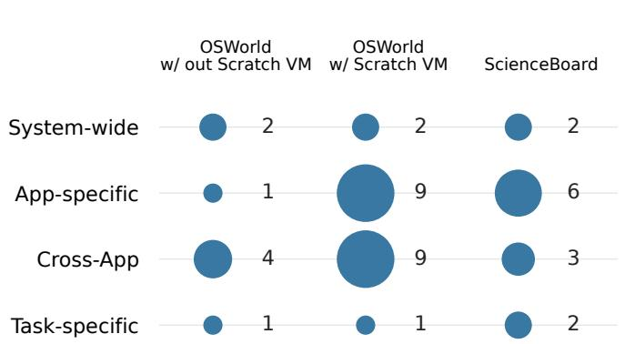  
b Interface extensions

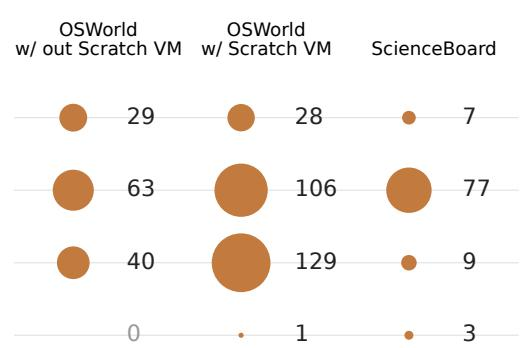  
Figure 4 | Interface discovery and extension across 30 candidates per population run. a, New interfaces (blue): distinct coherent interfaces absent from the seed, labeled b<sub>y</sub> their im<sub>p</sub>lemented scope across the run. b, Interface extensions (orange): newly introduced operations first recorded <sub>a</sub>ft<sub>er</sub> th<sub>e</sub>i<sub>r</sub> i<sub>n</sub>t<sub>er</sub>f<sub>ace</sub>’<sub>s</sub> i<sub>n</sub>t<sub>ro</sub>d<sub>uc</sub>ti<sub>on, eac</sub>h l<sub>a</sub>b<sub>e</sub>l<sub>e</sub>d i<sub>n</sub>d<sub>epen</sub>d<sub>en</sub>tl<sub>y</sub> b<sub>y</sub> it<sub>s own</sub> b<sub>e</sub>h<sub>av</sub>i<sub>or.</sub>

O<sub>n</sub> OSW<sub>or</sub>ld V2 <sub>w</sub>ith<sub>ou</sub>t <sub>a scra</sub>t<sub>c</sub>h VM<sub>, evo</sub>l<sub>u</sub>ti<sub>on</sub> i<sub>n</sub>t<sub>ro</sub>d<sub>uces</sub> f<sub>our new</sub> i<sub>n</sub>t<sub>er</sub>f<sub>aces an</sub>d 127 <sub>ex</sub>t<sub>ens</sub>i<sub>ons,</sub> includin<sub>g</sub> 29 S<sub>y</sub>stem-wide<sub>,</sub> 63 A<sub>pp</sub>-s<sub>p</sub>ecific and 40 Cross-A<sub>pp</sub> extensions. An interface or extension <sub>can carry more</sub> th<sub>an one</sub> l<sub>a</sub>b<sub>e</sub>l<sub>, so</sub> th<sub>e coun</sub>t<sub>s per</sub> l<sub>a</sub>b<sub>e</sub>l <sub>can a</sub>dd <sub>up</sub> t<sub>o more</sub> th<sub>an</sub> th<sub>e</sub> t<sub>o</sub>t<sub>a</sub>l<sub>.</sub> M<sub>os</sub>t <sub>o</sub>f it<sub>s grow</sub>th th<sub>ere</sub>f<sub>ore</sub> d<sub>eepens</sub> i<sub>n</sub>t<sub>er</sub>f<sub>aces</sub> th<sub>e agen</sub>t <sub>a</sub>l<sub>rea</sub>d<sub>y</sub> h<sub>as.</sub> With <sub>a scra</sub>t<sub>c</sub>h VM<sub>, w</sub>h<sub>ere</sub> th<sub>e</sub> <sub>me</sub>t<sub>a-agen</sub>t <sub>can</sub> <sub>open</sub> <sub>app</sub>li<sub>ca</sub>ti<sub>ons</sub> <sub>an</sub>d t<sub>es</sub>t it<sub>s</sub> <sub>co</sub>d<sub>e,</sub> th<sub>e</sub> <sub>popu</sub>l<sub>a</sub>ti<sub>on</sub> i<sub>n</sub>t<sub>ro</sub>d<sub>uces</sub> 12 <sub>new</sub> i<sub>n</sub>t<sub>er</sub>f<sub>aces</sub> and 253 extensions. Nine of the new interfaces are A<sub>pp</sub>-s<sub>p</sub>ecific and nine are Cross-A<sub>pp</sub>. Seven carry both labels, such as the interfaces for editing musical scores, audio projects and 3D scenes, <sub>w</sub>hi<sub>c</sub>h <sub>opera</sub>t<sub>e one app</sub>li<sub>ca</sub>ti<sub>on w</sub>hil<sub>e rea</sub>di<sub>ng an</sub>d <sub>wr</sub>iti<sub>ng</sub> fil<sub>e</sub> f<sub>orma</sub>t<sub>s</sub> th<sub>a</sub>t <sub>o</sub>th<sub>er app</sub>li<sub>ca</sub>ti<sub>ons s</sub>h<sub>are.</sub> C<sub>ross-</sub>A<sub>pp ex</sub>t<sub>ens</sub>i<sub>ons r</sub>i<sub>se</sub> t<sub>o</sub> 129<sub>.</sub> Th<sub>ese a</sub>dditi<sub>ona</sub>l <sub>app</sub>li<sub>ca</sub>ti<sub>on</sub> i<sub>n</sub>t<sub>er</sub>f<sub>aces are a</sub> lik<sub>e</sub>l<sub>y exp</sub>l<sub>ana</sub>ti<sub>on</sub> f<sub>or</sub> th<sub>e</sub> hi<sub>g</sub>h<sub>er</sub> <sub>par</sub>ti<sub>a</sub>l <sub>score</sub> <sub>o</sub>f th<sub>e</sub> b<sub>es</sub>t <sub>repos</sub>it<sub>ory</sub> <sub>evo</sub>l<sub>ve</sub>d <sub>w</sub>ith <sub>a</sub> <sub>scra</sub>t<sub>c</sub>h VM<sub>.</sub>

O<sub>n</sub> S<sub>c</sub>i<sub>ence</sub>B<sub>oar</sub>d<sub>, evo</sub>l<sub>u</sub>ti<sub>on</sub> i<sub>n</sub>t<sub>ro</sub>d<sub>uces seven new</sub> i<sub>n</sub>t<sub>er</sub>f<sub>aces an</sub>d 91 <sub>ex</sub>t<sub>ens</sub>i<sub>ons.</sub> Si<sub>x o</sub>f th<sub>e new</sub> i<sub>n</sub>t<sub>er</sub>f<sub>aces an</sub>d 77 <sub>o</sub>f th<sub>e ex</sub>t<sub>ens</sub>i<sub>ons are</sub> A<sub>pp-spec</sub>ifi<sub>c,</sub> f<sub>or sc</sub>i<sub>en</sub>tifi<sub>c app</sub>li<sub>ca</sub>ti<sub>ons suc</sub>h <sub>as</sub> Chi<sub>mera</sub>X<sub>,</sub> KAl<sub>g</sub>ebra<sub>,</sub> GRASS GIS and Lean. Its three Task-s<sub>p</sub>ecific extensions <sub>p</sub>acka<sub>g</sub>e <sub>p</sub>rocedures for dis<sub>p</sub>la<sub>y</sub>in<sub>g</sub> a ma<sub>p</sub> in GRASS GIS and com<sub>p</sub>letin<sub>g</sub> a <sub>p</sub>roof in Lean.

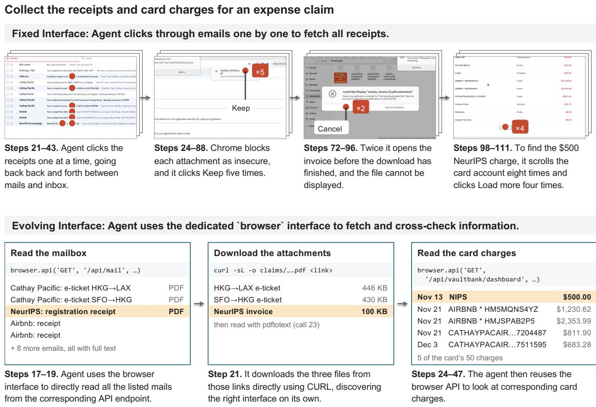  
Figure 5 | Human-curated versus Evolved Interface. Top: the Qwen CUA baseline uses a fixed, h<sub>uman-</sub>d<sub>es</sub>i<sub>gne</sub>d i<sub>n</sub>t<sub>er</sub>f<sub>ace pr</sub>i<sub>or</sub>iti<sub>z</sub>i<sub>ng</sub> f<sub>requen</sub>t <sub>screens</sub>h<sub>o</sub>t<sub>s w</sub>ith <sub>mouse an</sub>d k<sub>ey</sub>b<sub>oar</sub>d <sub>ac</sub>ti<sub>ons.</sub> It reads the recei<sub>p</sub>ts and searches the card char<sub>g</sub>es throu<sub>g</sub>h re<sub>p</sub>eated GUI interactions (ste<sub>p</sub>s 21–111). B<sub>o</sub>tt<sub>om:</sub> P<sub>r</sub>i<sub>me</sub> A<sub>gen</sub>t <sub>w</sub>ith th<sub>e repos</sub>it<sub>ory evo</sub>l<sub>ve</sub>d b<sub>y</sub> A<sub>gen</sub>t S4<sub>.</sub> It <sub>rea</sub>d<sub>s</sub> th<sub>e ma</sub>ilb<sub>ox an</sub>d th<sub>e</sub> b<sub>an</sub>k recor<sup>d</sup>s t<sup>h</sup>roug<sup>h</sup> t<sup>h</sup>e evo<sup>l</sup>ve<sup>d</sup> browser <sup>i</sup>nter<sup>f</sup>ace, w<sup>h</sup>ose browser.api sen<sup>d</sup>s requests <sup>f</sup>rom <sup>i</sup>ns<sup>id</sup>e the alread<sub>y</sub> lo<sub>gg</sub>ed-in tab and returns the data as text (calls 17 and 44). It fetches the attachments w<sup>i</sup>t<sup>h</sup> curl, an<sup>d</sup> rea<sup>d</sup>s t<sup>h</sup>em w<sup>i</sup>t<sup>h</sup> pdftotext.

Across all three runs, evolved interfaces let the agent observe the desktop, an application’s own objects, d<sub>a</sub>t<sub>a s</sub>h<sub>are</sub>d <sub>across app</sub>li<sub>ca</sub>ti<sub>ons, an</sub>d <sub>w</sub>h<sub>e</sub>th<sub>er a goa</sub>l h<sub>as</sub> b<sub>een me</sub>t<sub>, an</sub>d <sub>ac</sub>t <sub>on eac</sub>h <sub>o</sub>f th<sub>ese</sub> i<sub>n a s</sub>i<sub>ng</sub>l<sub>e</sub> <sub>ca</sub>ll<sub>.</sub> E<sub>vo</sub>l<sub>u</sub>ti<sub>on</sub> th<sub>ere</sub>f<sub>ore w</sub>id<sub>ens</sub> th<sub>e ran e o</sub>f <sub>so</sub>ft<sub>ware</sub> th<sub>e a en</sub>t <sub>can o era</sub>t<sub>e an</sub>d <sub>ra</sub>i<sub>ses</sub> th<sub>e</sub> l<sub>eve</sub>l <sub>a</sub>t <sub>w</sub>hi<sub>c</sub>h it <sub>sees, ac</sub>t<sub>s an</sub>d <sub>c</sub>h<sub>ec</sub>k<sub>s</sub> it<sub>s progress.</sub>

Case Study: Using the evolved browser interface to handle web data search and fetching instead of a fixed interface. Figure 5 <sup>f</sup>o<sup>ll</sup>ows t<sup>h</sup>e in<sup>f</sup>ormation-gat<sup>h</sup>ering portion o<sup>f</sup> OSWor<sup>l</sup>d V2 tas<sup>k</sup> 008, <sub>w</sub>hi<sub>c</sub>h <sub>requ</sub>i<sub>res rece</sub>i<sub>p</sub>t<sub>s an</sub>d <sub>correspon</sub>di<sub>ng car</sub>d <sub>c</sub>h<sub>arges</sub> f<sub>or an expense c</sub>l<sub>a</sub>i<sub>m.</sub> Th<sub>e</sub> fi<sub>xe</sub>d<sub>-</sub>i<sub>n</sub>t<sub>er</sub>f<sub>ace</sub> Qwen CUA agent opens receipt emails one at a time, handles five browser download warnings, and twice tries to o<sub>p</sub>en an invoice before its download has finished. Findin<sub>g</sub> the \$500 NeurIPS char<sub>g</sub>e also requires eig<sup>h</sup>t scro<sup>ll</sup>s and <sup>f</sup>our c<sup>l</sup>ic<sup>k</sup>s on Load more. Wit<sup>h</sup> t<sup>h</sup>e evo<sup>l</sup>ved repository, t<sup>h</sup>e tas<sup>k</sup> agent uses browser.api to retr<sup>i</sup>eve ma<sup>ilb</sup>ox contents an<sup>d</sup> attac<sup>h</sup>ment URLs as structure<sup>d d</sup>ata. It <sup>d</sup>own<sup>l</sup>oa<sup>d</sup>s t<sup>h</sup>ree PDFs w<sup>i</sup>t<sup>h</sup> curl, rea<sup>d</sup>s t<sup>h</sup>em w<sup>i</sup>t<sup>h</sup> pdftotext, an<sup>d</sup> reuses t<sup>h</sup>e <sup>b</sup>rowser <sup>i</sup>nter<sup>f</sup>ace to query t<sup>h</sup>e b<sub>an</sub>k d<sub>as</sub>hb<sub>oar</sub>d <sub>an</sub>d <sub>cross-c</sub>h<sub>ec</sub>k th<sub>e c</sub>h<sub>arges.</sub> Th<sub>e agen</sub>t <sub>com</sub>bi<sub>nes a reusa</sub>bl<sub>e</sub> b<sub>rowser</sub> i<sub>n</sub>t<sub>er</sub>f<sub>ace</sub> <sub>w</sub>ith <sub>ex</sub>i<sub>s</sub>ti<sub>ng</sub> <sub>comman</sub>d<sub>-</sub>li<sub>ne</sub> t<sub>oo</sub>l<sub>s</sub> t<sub>o</sub> <sub>ga</sub>th<sub>er</sub> <sub>ev</sub>id<sub>ence</sub> <sub>across</sub> <sub>app</sub>li<sub>ca</sub>ti<sub>ons,</sub> <sub>re</sub>d<sub>uc</sub>i<sub>ng</sub> <sub>repea</sub>t<sub>e</sub>d <sub>v</sub>i<sub>sua</sub>l

<sub>nav</sub>i<sub>ga</sub>ti<sub>on</sub> <sub>an</sub>d <sub>manua</sub>l d<sub>own</sub>l<sub>oa</sub>d h<sub>an</sub>dli<sub>ng.</sub>

A<sub>ppen</sub>di<sub>x</sub> B<sub>.</sub>5 <sub>prov</sub>id<sub>es</sub> th<sub>e</sub> <sub>more</sub> ill<sub>us</sub>t<sub>ra</sub>t<sub>e</sub>d <sub>examp</sub>l<sub>es</sub> <sub>o</sub>f <sub>agen</sub>t<sub>s</sub> b<sub>ene</sub>fitti<sub>ng</sub> f<sub>rom</sub> <sub>us</sub>i<sub>ng</sub> <sub>an</sub> <sub>evo</sub>l<sub>ve</sub>d i<sub>n</sub>t<sub>er</sub>f<sub>ace</sub> f<sub>or app</sub>li<sub>ca</sub>ti<sub>ons</sub> lik<sub>e</sub> M<sub>a</sub>ilH<sub>u</sub>b<sub>,</sub> XMi<sub>n</sub>d<sub>,</sub> Z<sub>o</sub>t<sub>ero,</sub> R<sub>ev</sub>i<sub>ew</sub>S<sub>p</sub>h<sub>ere, an</sub>d W<sub>or</sub>d t<sub>rac</sub>k<sub>e</sub>d <sub>c</sub>h<sub>anges.</sub>

## 7.3. Repeated Validation during Evolution

L<sub>ong-</sub>h<sub>or</sub>i<sub>zon compu</sub>t<sub>er-use</sub> t<sub>as</sub>k<sub>s s</sub>h<sub>ow su</sub>b<sub>s</sub>t<sub>an</sub>ti<sub>a</sub>l <sub>run-</sub> to-run variance (Gonzalez-Pumarie<sub>g</sub>a et al., 2026), so a <sub>s</sub>i<sub>ng</sub>l<sub>e va</sub>lid<sub>a</sub>ti<sub>on run can overra</sub>t<sub>e a repos</sub>it<sub>ory.</sub> O<sub>n</sub> S<sub>c</sub>i<sub>ence-</sub> B<sub>oar</sub>d<sub>, we</sub> th<sub>ere</sub>f<sub>ore re-eva</sub>l<sub>ua</sub>t<sub>e</sub> th<sub>e</sub> th<sub>ree</sub> hi<sub>g</sub>h<sub>es</sub>t<sub>-scor</sub>i<sub>ng</sub> <sub>repos</sub>it<sub>or</sub>i<sub>es every</sub> fi<sub>ve s</sub>t<sub>eps an</sub>d <sub>score eac</sub>h b<sub>y</sub> th<sub>e mean o</sub>f its evaluations (Section 4). Fi<sub>g</sub>ure 6 shows wh<sub>y</sub> this matters. Repositories if-003 an<sup>d</sup> if-004 reac<sup>h</sup> t<sup>h</sup>e <sup>h</sup>ig<sup>h</sup>est first score<sub>,</sub> 73<sub>.</sub>33%<sub>,</sub> at ste<sub>p</sub>s 3 and 4. A second evaluation lowers their means to 60<sub>.</sub>00% and 66<sub>.</sub>67%. The selected repository, if-016, scores 73.33%, 66.67%, 73.33% an<sup>d</sup> 73<sub>.</sub>33% across four evaluations<sub>,</sub> for a mean of 71<sub>.</sub>67%. A <sup>fi</sup>rst score a<sup>l</sup>one wou<sup>ld h</sup>ave ran<sup>k</sup>e<sup>d</sup> if-003 among t<sup>h</sup>e b<sub>es</sub>t r<sub>epos</sub>it<sub>o</sub>ri<sub>es</sub> <sub>e</sub>v<sub>e</sub>n th<sub>oug</sub>h it<sub>s</sub> m<sub>ea</sub>n i<sub>s</sub> 60<sub>.</sub>00%<sub>.</sub>

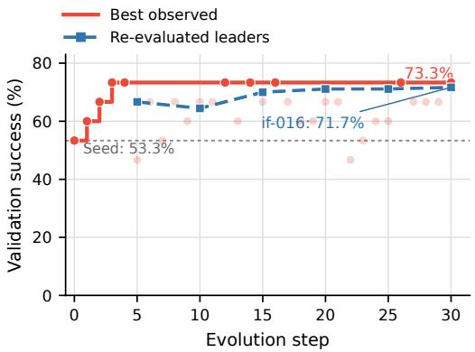  
Figure 6 | Repeated validation separates a high first score from consistent performance. Red s<sup>h</sup>ows t<sup>h</sup>e <sup>b</sup>est <sup>fi</sup>rst-<sub>eva</sub>l<sub>ua</sub>ti<sub>on score on</sub> S<sub>c</sub>i<sub>ence</sub>B<sub>oar</sub>d <sub>an</sub>d bl<sub>ue</sub> th<sub>e</sub> b<sub>es</sub>t <sub>mean</sub> <sub>over</sub> <sub>repea</sub>t<sub>e</sub>d <sub>eva</sub>l<sub>u-</sub> <sub>a</sub>ti<sub>ons.</sub>

## 8. Related Work

Computer-use agents and interaction design. Computer-use systems di<sup>f</sup>er in <sup>h</sup>ow t<sup>h</sup>ey expose <sub>o</sub>b<sub>serva</sub>ti<sub>ons an</sub>d <sub>ac</sub>ti<sub>ons, an</sub>d SWE<sub>-agen</sub>t <sub>s</sub>h<sub>owe</sub>d th<sub>a</sub>t thi<sub>s agen</sub>t<sub>-compu</sub>t<sub>er</sub> i<sub>n</sub>t<sub>er</sub>f<sub>ace s</sub>h<sub>apes per-</sub> formance (Yan<sub>g</sub> et al., 2024). A<sub>g</sub>ent S and A<sub>g</sub>ent S2 or<sub>g</sub>anize <sub>p</sub>lannin<sub>g</sub>, <sub>p</sub>erce<sub>p</sub>tion, and action throu<sub>g</sub>h en<sub>g</sub>ineered a<sub>g</sub>ent com<sub>p</sub>onents (A<sub>g</sub>ashe et al., 2025a,b), while UI-TARS learns <sub>p</sub>olicies for GUI interaction (Qin et al., 2025; Wan<sub>g</sub> et al., 2025a). Other s<sub>y</sub>stems add <sub>p</sub>ro<sub>g</sub>rammatic access beside GUI actions, throu<sub>g</sub>h a<sub>pp</sub>lication APIs (Lu et al., 2025; Son<sub>g</sub> et al., 2025b; Zhan<sub>g</sub> et al., 2026a), code execution (Son<sub>g</sub> et al., 2025a), or tool calls (Jia et al., 2026; Yan<sub>g</sub> et al., 2025). A<sub>g</sub>ent S3 and its behavior judge improve task completion by selecting among multiple rollouts (Gonzalez-Pumariega et al., 2025). In these s<sub>y</sub>stems, code and tools, when available, are one action amon<sub>g</sub> a <sub>p</sub>redefined set. A<sub>gen</sub>t<sub>s</sub> th<sub>a</sub>t <sub>ac</sub>t <sub>on</sub>l<sub>y</sub> b<sub>y wr</sub>iti<sub>ng an</sub>d <sub>runn</sub>i<sub>ng co</sub>d<sub>e can ou</sub>t<sub>per</sub>f<sub>orm agen</sub>t<sub>s</sub> th<sub>a</sub>t <sub>c</sub>h<sub>oose</sub> f<sub>rom pre</sub>d<sub>e</sub>fi<sub>ne</sub>d actions (Lu et al., 2026; Wan<sub>g</sub> et al., 2024). These interfaces are desi<sub>g</sub>ned b<sub>y</sub> <sub>p</sub>eo<sub>p</sub>le or written within <sub>a s</sub>i<sub>n</sub> l<sub>e</sub> t<sub>as</sub>k<sub>.</sub> A <sub>en</sub>t S4 i<sub>ns</sub>t<sub>ea</sub>d <sub>evo</sub>l<sub>ves</sub> th<sub>em across</sub> t<sub>as</sub>k<sub>s an</sub>d <sub>re</sub>t<sub>a</sub>i<sub>ns</sub> th<sub>e resu</sub>lti<sub>n o era</sub>ti<sub>ons an</sub>d <sub>usage</sub> k<sub>now</sub>l<sub>e</sub>d<sub>ge</sub> i<sub>n a repos</sub>it<sub>ory</sub> th<sub>a</sub>t <sub>can</sub> b<sub>e</sub> d<sub>eve</sub>l<sub>ope</sub>d b<sub>eyon</sub>d th<sub>e</sub> t<sub>as</sub>k th<sub>a</sub>t <sub>mo</sub>ti<sub>va</sub>t<sub>e</sub>d <sub>a c</sub>h<sub>ange.</sub>

Skills, memory, and tool construction. Re<sup>fl</sup>exion stores textua<sup>l f</sup>eed<sup>b</sup>ac<sup>k f</sup>or <sup>l</sup>ater attempts (S<sup>h</sup>inn et al., 2023), and A<sub>g</sub>ent Workflow Memor<sub>y</sub> induces reusable <sub>p</sub>rocedures from ex<sub>p</sub>erience (Wan<sub>g</sub> et al., 2025b). Reuse can also take executable form. LLMs as Tool Makers se<sub>p</sub>arates tool construction from subse<sub>q</sub>uent tool use (Cai et al., 2024), and SkillWeaver discovers and <sub>p</sub>ractices web interactions to build APIs that other a<sub>g</sub>ents can reuse (Zhen<sub>g</sub> et al., 2025). CUA-Skill instead <sub>p</sub>rovides an en<sub>g</sub>ineered librar<sub>y</sub> of <sub>p</sub>arameterized com<sub>p</sub>uter-use skills and com<sub>p</sub>osition <sub>g</sub>ra<sub>p</sub>hs (Chen et al., 2026). These <sub>me</sub>th<sub>o</sub>d<sub>s es</sub>t<sub>a</sub>bli<sub>s</sub>h th<sub>a</sub>t <sub>agen</sub>t<sub>s can</sub> b<sub>ene</sub>fit f<sub>rom pers</sub>i<sub>s</sub>t<sub>en</sub>t k<sub>now</sub>l<sub>e</sub>d<sub>ge an</sub>d <sub>execu</sub>t<sub>a</sub>bl<sub>e</sub> t<sub>oo</sub>l<sub>s.</sub> O<sub>ur searc</sub>h <sub>opera</sub>t<sub>es over comp</sub>l<sub>e</sub>t<sub>e repos</sub>it<sub>ory vers</sub>i<sub>ons con</sub>t<sub>a</sub>i<sub>n</sub>i<sub>ng</sub> i<sub>n</sub>t<sub>er</sub>f<sub>aces, o</sub>b<sub>serva</sub>ti<sub>on rou</sub>ti<sub>nes, con</sub>fi<sub>gura</sub>ti<sub>on,</sub> <sub>an</sub>d <sub>usage</sub> k<sub>now</sub>l<sub>e</sub>d<sub>ge.</sub> M<sub>u</sub>t<sub>a</sub>ti<sub>on</sub> <sub>an</sub>d <sub>crossover</sub> <sub>can</sub> <sub>c</sub>h<sub>ange</sub> th<sub>ese</sub> <sub>componen</sub>t<sub>s</sub> t<sub>oge</sub>th<sub>er,</sub> <sub>w</sub>ith <sub>se</sub>l<sub>ec</sub>ti<sub>on</sub> b<sub>ase</sub>d <sub>on</sub> th<sub>e</sub>i<sub>r com</sub>bi<sub>ne</sub>d <sub>e</sub>f<sub>ec</sub>t <sub>on</sub> t<sub>as</sub>k<sub>-agen</sub>t <sub>per</sub>f<sub>ormance.</sub>

Automated agent design and evolutionary search. ADAS searc<sup>h</sup>es <sup>f</sup>or agent designs expressed in code (Hu et al., 2025), and the Darwin Gödel Machine modifies its own codin<sub>g</sub> a<sub>g</sub>ent while maintainin<sub>g</sub> an archive of alternatives (Zhan<sub>g</sub> et al., 2025). Self-Harness studies execution traces, <sub>p</sub>ro<sub>p</sub>oses harness chan<sub>g</sub>es, and validates them throu<sub>g</sub>h re<sub>g</sub>ression tests (Zhan<sub>g</sub> et al., 2026b). Al<sub>p</sub>haEvolve <sub>an</sub>d Shi<sub>n</sub>k<sub>a</sub>E<sub>vo</sub>l<sub>ve com</sub>bi<sub>ne mo</sub>d<sub>e</sub>l<sub>-genera</sub>t<sub>e</sub>d <sub>co</sub>d<sub>e c</sub>h<sub>anges w</sub>ith <sub>evo</sub>l<sub>u</sub>ti<sub>onary searc</sub>h <sub>an</sub>d <sub>execu</sub>t<sub>a</sub>bl<sub>e</sub> evaluation (Lan<sub>g</sub>e et al., 2025; Novikov et al., 2025), while GEPA uses trajector<sub>y</sub> reflection to evolve <sub>p</sub>rom<sub>p</sub>ts and combine com<sub>p</sub>lementar<sub>y</sub> im<sub>p</sub>rovements (A<sub>g</sub>rawal et al., 2025). Validation-based control <sub>o</sub>f <sub>over</sub>fitti<sub>ng a</sub>l<sub>so pre</sub>d<sub>a</sub>t<sub>es</sub> l<sub>anguage-mo</sub>d<sub>e</sub>l <sub>agen</sub>t<sub>s,</sub> i<sub>nc</sub>l<sub>u</sub>di<sub>ng evo</sub>l<sub>u</sub>ti<sub>onary cur</sub>t<sub>a</sub>il<sub>men</sub>t i<sub>n gene</sub>ti<sub>c</sub> <sub>p</sub>ro<sub>g</sub>rammin<sub>g</sub> (Fitz<sub>g</sub>erald and R<sub>y</sub>an, 2011). A<sub>g</sub>ent S4 evolves re<sub>p</sub>ositories of interfaces and knowled<sub>g</sub>e th<sub>roug</sub>h <sub>popu</sub>l<sub>a</sub>ti<sub>on-</sub>b<sub>ase</sub>d <sub>searc</sub>h <sub>w</sub>ith <sub>asymme</sub>t<sub>r</sub>i<sub>c access</sub> t<sub>o eva</sub>l<sub>ua</sub>ti<sub>on ev</sub>id<sub>ence.</sub> Th<sub>e me</sub>t<sub>a-agen</sub>t studies synthetic-task trajectories without ground-truth success labels and implements changes to <sub>app</sub>li<sub>ca</sub>ti<sub>on-spec</sub>ifi<sub>c opera</sub>ti<sub>ons, capa</sub>bilit<sub>y</sub> d<sub>escr</sub>i<sub>p</sub>ti<sub>ons, an</sub>d <sub>reusa</sub>bl<sub>e wor</sub>kfl<sub>ows.</sub> Th<sub>e</sub> fi<sub>xe</sub>d h<sub>arness</sub> <sub>re</sub>t<sub>a</sub>i<sub>ns con</sub>t<sub>ro</sub>l <sub>o</sub>f <sub>mo</sub>d<sub>e</sub>l i<sub>nvoca</sub>ti<sub>on execu</sub>ti<sub>on erm</sub>i<sub>ss</sub>i<sub>ons an</sub>d b<sub>u</sub>d <sub>e</sub>t<sub>s.</sub> K<sub>ee</sub> i<sub>n ca a</sub>biliti<sub>es</sub> i<sub>n</sub> th<sub>e</sub> <sub>repos</sub>it<sub>ory ma</sub>k<sub>es</sub> th<sub>em ava</sub>il<sub>a</sub>bl<sub>e</sub> f<sub>or rev</sub>i<sub>s</sub>i<sub>on, se</sub>l<sub>ec</sub>ti<sub>on, recom</sub>bi<sub>na</sub>ti<sub>on, an</sub>d <sub>reuse w</sub>ith <sub>compa</sub>tibl<sub>e</sub> agents and harnesses. Validation tasks, trajectories, diagnostics, and scores remain with the controller <sub>an</sub>d <sub>are</sub> hidd<sub>en</sub> f<sub>rom</sub> th<sub>e me</sub>t<sub>a-agen</sub>t<sub>.</sub> H<sub>e</sub>ld<sub>-ou</sub>t <sub>per</sub>f<sub>ormance</sub> d<sub>e</sub>t<sub>erm</sub>i<sub>nes w</sub>hi<sub>c</sub>h <sub>var</sub>i<sub>an</sub>t<sub>s</sub> b<sub>ecome</sub> <sub>paren</sub>t<sub>s, app</sub>l<sub>y</sub>i<sub>ng se</sub>l<sub>ec</sub>ti<sub>on pressure</sub> b<sub>eyon</sub>d th<sub>e</sub> t<sub>as</sub>k<sub>s use</sub>d t<sub>o cons</sub>t<sub>ruc</sub>t th<sub>e so</sub>ft<sub>ware.</sub>

## 9. Conclusion

W<sub>e</sub> <sub>presen</sub>t<sub>e</sub>d A<sub>gen</sub>t S4<sub>,</sub> <sub>w</sub>hi<sub>c</sub>h t<sub>rea</sub>t<sub>s</sub> i<sub>n</sub>t<sub>er</sub>f<sub>ace</sub> d<sub>es</sub>i<sub>gn</sub> <sub>as</sub> <sub>an</sub> <sub>agen</sub>t <sub>capa</sub>bilit<sub>y:</sub> <sub>a</sub> <sub>me</sub>t<sub>a-agen</sub>t <sub>s</sub>t<sub>u</sub>di<sub>es</sub> computer-use trajectories to construct and evolve reusable interfaces and knowledge about when and h<sub>ow</sub> t<sub>o use</sub> th<sub>em.</sub> Th<sub>e exper</sub>i<sub>ence use</sub>d f<sub>or</sub> i<sub>n</sub>t<sub>er</sub>f<sub>ace cons</sub>t<sub>ruc</sub>ti<sub>on comes en</sub>ti<sub>re</sub>l<sub>y</sub> f<sub>rom syn</sub>th<sub>e</sub>ti<sub>c</sub> t<sub>as</sub>k<sub>s,</sub> <sub>w</sub>ith<sub>ou</sub>t <sub>groun</sub>d<sub>-</sub>t<sub>ru</sub>th <sub>success</sub> l<sub>a</sub>b<sub>e</sub>l<sub>s</sub> <sub>or</sub> t<sub>as</sub>k <sub>ver</sub>ifi<sub>ers;</sub> <sub>separa</sub>t<sub>e</sub> h<sub>e</sub>ld<sub>-ou</sub>t <sub>va</sub>lid<sub>a</sub>ti<sub>on</sub> <sub>gu</sub>id<sub>es</sub> <sub>repos</sub>it<sub>ory</sub> selection. Qwen3.8-27B with a repository of interfaces evolved by Agent S4 reaches 21.3% binary success on the full 108-task OSWorld V2 benchmark<sub>,</sub> above both GPT-5.5 and Claude O<sub>p</sub>us 4.8<sub>,</sub> <sub>a</sub>t <sub>a</sub>b<sub>ou</sub>t 4<sub>.</sub>3% <sub>a</sub>nd 1<sub>.</sub>5% <sub>o</sub>f th<sub>e</sub>ir r<sub>epo</sub>rt<sub>e</sub>d t<sub>as</sub>k-<sub>so</sub>lvin<sub>g cos</sub>t<sub>s.</sub> On th<sub>e</sub> f<sub>u</sub>ll 169-t<sub>as</sub>k S<sub>c</sub>i<sub>e</sub>n<sub>ce</sub>B<sub>oa</sub>rd benchmark, a separate evolution run reaches 58.58% success, compared with 41.4% for Qwen CUA. Repository and trajectory analyses show how evolution constructs application interfaces and refines th<sub>e opera</sub>ti<sub>ons an</sub>d <sub>o</sub>b<sub>serva</sub>ti<sub>ons ava</sub>il<sub>a</sub>bl<sub>e</sub> t<sub>o su</sub>b<sub>sequen</sub>t t<sub>as</sub>k <sub>agen</sub>t<sub>s.</sub> Th<sub>ese</sub> fi<sub>n</sub>di<sub>ngs suppor</sub>t l<sub>earn</sub>i<sub>ng</sub> i<sub>n</sub>t<sub>er</sub>f<sub>aces</sub> f<sub>rom syn</sub>th<sub>e</sub>ti<sub>c exper</sub>i<sub>ence as a way</sub> t<sub>o</sub> i<sub>mprove compu</sub>t<sub>er use w</sub>hil<sub>e</sub> k<sub>eep</sub>i<sub>ng</sub> th<sub>e</sub> t<sub>as</sub>k <sub>agen</sub>t’<sub>s</sub> <sub>mo</sub>d<sub>e</sub>l <sub>an</sub>d h<sub>arness</sub> fi<sub>xe</sub>d<sub>, comp</sub>l<sub>emen</sub>t<sub>ary</sub> t<sub>o a</sub>d<sub>vances</sub> i<sub>n</sub> b<sub>o</sub>th<sub>.</sub>

## References

S. A<sub>g</sub>ashe<sub>,</sub> J. Han<sub>,</sub> S. Gan<sub>,</sub> J. Yan<sub>g,</sub> A. Li<sub>,</sub> and X. E. Wan<sub>g</sub>. A<sub>g</sub>ent S: an o<sub>p</sub>en a<sub>g</sub>entic framework that uses computers <sup>l</sup>i<sup>k</sup>e a <sup>h</sup>uman. In The Thirteenth International Conference on Learning Representations, ICLR 2025, Singapore, April 24-28, 2025. OpenReview.net, 2025a. URL https://openreview.n et/forum?id=lIVRgt4nLv.

S. A<sub>g</sub>ashe<sub>,</sub> K. Won<sub>g,</sub> V. Tu<sub>,</sub> J. Yan<sub>g,</sub> A. Li<sub>,</sub> and X. E. Wan<sub>g</sub>. A<sub>g</sub>ent S2: A com<sub>p</sub>ositional <sub>g</sub>eneralistspecia<sup>l</sup>ist <sup>f</sup>ramewor<sup>k f</sup>or computer use agents. CoRR, a<sup>b</sup>s/2504.00906, 2025<sup>b</sup>. doi: 10.48550/ARX IV.2504.00906. URL https://doi.org/10.48550/arXiv.2504.00906.

L. A. A<sub>g</sub>rawal<sub>,</sub> S. Tan<sub>,</sub> D. So<sub>y</sub>lu<sub>,</sub> N. Ziems<sub>,</sub> R. Khare<sub>,</sub> K. O<sub>p</sub>sahl-On<sub>g,</sub> A. Sin<sub>g</sub>hvi<sub>,</sub> H. Shandil<sub>y</sub>a<sub>,</sub> M. J. R<sub>y</sub>an<sub>,</sub> M. Jian<sub>g,</sub> C. Potts<sub>,</sub> K. Sen<sub>,</sub> A. G. Dimakis<sub>,</sub> I. Stoica<sub>,</sub> D. Klein<sub>,</sub> M. Zaharia<sub>,</sub> and O. Khattab. GEPA: re<sup>fl</sup>ective prompt evo<sup>l</sup>ution can outper<sup>f</sup>orm rein<sup>f</sup>orcement <sup>l</sup>earning. CoRR, a<sup>b</sup>s/2507.19457, 2025. <sup>d</sup>oi: 10.48550/ARXIV.2507.19457. URL https://doi.org/10.48550/arXiv.2507.19457.

T. Cai, X. Wang, T. Ma, X. C<sup>h</sup>en, and D. Z<sup>h</sup>ou. Large <sup>l</sup>anguage mode<sup>l</sup>s as too<sup>l</sup> ma<sup>k</sup>ers. In The Twelfth International Conference on Learning Representations, ICLR 2024, Vienna, Austria, May 7-11, 2024. OpenRev<sup>i</sup>ew.net, 2024. URL https://openreview.net/forum?id=qV83K9d5WB.

T. Chen<sub>,</sub> Y. Li<sub>,</sub> M. Solodko<sub>,</sub> S. Wan<sub>g,</sub> N. Jian<sub>g,</sub> T. Cui<sub>,</sub> J. Hao<sub>,</sub> J. Ko<sub>,</sub> S. Abdali<sub>,</sub> S. Zhen<sub>g,</sub> L. Xu<sub>,</sub> H. Fan<sub>,</sub> P. Cameron, J. Wag<sup>l</sup>e, and K. Kois<sup>h</sup>ida. Cua-s<sup>k</sup>i<sup>ll</sup>: Deve<sup>l</sup>op s<sup>k</sup>i<sup>ll</sup>s <sup>f</sup>or computer using agent. CoRR, a<sup>b</sup>s/2601.21123, 2026. <sup>d</sup>oi: 10.48550/ARXIV.2601.21123. URL https://doi.org/10.48550 /arXiv.2601.21123.

J. Coutaz<sub>,</sub> L. Ni<sub>g</sub>a<sub>y,</sub> D. Salber<sub>,</sub> A. Blandford<sub>,</sub> J. Ma<sub>y,</sub> and R. M. Youn<sub>g</sub>. Four eas<sub>y</sub> <sub>p</sub>ieces for assessin<sub>g</sub> th<sub>e usa</sub>bilit<sub>y o</sub>f <sub>mu</sub>lti<sub>mo</sub>d<sub>a</sub>l i<sub>n</sub>t<sub>erac</sub>ti<sub>on:</sub> th<sub>e</sub> CARE <sub>proper</sub>ti<sub>es.</sub> I<sub>n</sub> K<sub>.</sub> N<sub>or</sub>db<sub>y,</sub> P<sub>.</sub> H<sub>.</sub> H<sub>e</sub>l<sub>mersen,</sub> D. J. Gi<sup>l</sup>more, and S. A. Arnesen, editors, Human-Computer Interaction, INTERACT ’95, IFIP TC13 Interantional Conference on Human-Computer Interaction, 27-29 June 1995, Lillehammer, Norway, IFIP Conference Proceedin<sub>g</sub>s<sub>, p</sub>a<sub>g</sub>es 115–120. Cha<sub>p</sub>man & Hall<sub>,</sub> 1995.

J<sub>.</sub> Fit<sub>zgera</sub>ld <sub>an</sub>d C<sub>.</sub> R<sub>yan.</sub> V<sub>a</sub>lid<sub>a</sub>ti<sub>on</sub> <sub>se</sub>t<sub>s</sub> f<sub>or</sub> <sub>evo</sub>l<sub>u</sub>ti<sub>onary</sub> <sub>cur</sub>t<sub>a</sub>il<sub>men</sub>t <sub>w</sub>ith i<sub>mprove</sub>d <sub>genera</sub>li<sub>sa</sub>ti<sub>on.</sub> In G. Lee, D. Howard, and D. <sup>Śl</sup>ęza<sup>k</sup>, editors, Convergence and hybrid information technology, pages 282–289<sub>,</sub> Berlin<sub>,</sub> Heidelber<sub>g,</sub> 2011. S<sub>p</sub>rin<sub>g</sub>er Berlin Heidelber<sub>g</sub>. ISBN 978-3-642-24082-9.

G. Gonzalez-Pumarie<sub>g</sub>a<sub>,</sub> V. Tu<sub>,</sub> C. Lee<sub>,</sub> J. Yan<sub>g,</sub> A. Li<sub>,</sub> and X. E. Wan<sub>g</sub>. The unreasonable efectiveness of sca<sup>l</sup>ing agents <sup>f</sup>or computer use. CoRR, a<sup>b</sup>s/2510.02250, 2025. doi: 10.48550/ARXIV.2510.02250. URL https://doi.org/10.48550/arXiv.2510.02250.

G. Gonzalez-Pumarie<sub>g</sub>a<sub>,</sub> S. A<sub>g</sub>ashe<sub>,</sub> J. Yan<sub>g,</sub> A. Li<sub>,</sub> and X. E. Wan<sub>g</sub>. On the reliabilit<sub>y</sub> of com<sub>p</sub>uter use agents. CoRR, a<sup>b</sup>s/2<sup>6</sup>04.17849, 202<sup>6</sup>. <sup>d</sup>o<sup>i</sup>: 10.48550/ARXIV.2<sup>6</sup>04.17849. URL https: //doi.org/10.48550/arXiv.2604.17849.

S. Hu, C. Lu, and J. C<sup>l</sup>une. Automated design o<sup>f</sup> agentic systems. In The Thirteenth International Conference on Learning Representations, ICLR 2025, Singapore, April 24-28, 2025. OpenReview.net, 2025. URL https://openreview.net/forum?id=t9U3LW7JVX.

H. Jia<sub>,</sub> J. Liao<sub>,</sub> X. Zhan<sub>g,</sub> H. Xu<sub>,</sub> T. Xie<sub>,</sub> C. Jian<sub>g,</sub> M. Yan<sub>,</sub> S. Liu<sub>,</sub> W. Ye<sub>,</sub> and F. Huan<sub>g</sub>. Osworldmc<sub>p</sub>: Benchmarkin<sub>g</sub> MCP tool invocation in com<sub>p</sub>uter-use a<sub>g</sub>ents. In C. Vondrick<sub>,</sub> B. Hariharan<sub>,</sub> C. Ra<sup>f</sup>e<sup>l</sup>, L. Pinto, D. Yang, and A. Faust, editors, The Fourteenth International Conference on Learning Representations, ICLR 2026, Rio de Janeiro, Brazil, April 23-27, 2026. proceedings.ic<sup>l</sup>r.cc, 2026. URL https://proceedings.iclr.cc/paper\_files/paper/2026/hash/67d57c32 e20fd0a7a302cb81d36e40d5-Abstract-Conference.html.

S. Karten<sub>,</sub> A. L. Zhan<sub>g,</sub> K. Thomas<sub>,</sub> S. Müller<sub>,</sub> E. Bakouch<sub>,</sub> D. Auras<sub>,</sub> M. Sen<sub>g</sub>haas<sub>,</sub> F. Obeid<sub>,</sub> K. Dunas<sub>,</sub> J. Hagemann, and S. Jag<sup>h</sup>ouar. Prime agent: A se<sup>lf</sup>-improving RLM <sup>h</sup>arness. CoRR, a<sup>b</sup>s/2608.23552, 2026. <sup>d</sup>oi: 10.48550/ARXIV.2608.23552. URL https://doi.org/10.48550/arXiv.2608. 23552.

R. T. Lange, Y. Imajuku, and E. Cetin. Shinkaevolve: Towards open-ended and sample-eficient program evo<sup>l</sup>ution. CoRR, a<sup>b</sup>s/2509.19349, 2025. doi: 10.48550/ARXIV.2509.19349. URL https://doi.org/10.48550/arXiv.2509.19349.

J. Lian<sub>g,</sub> W. Huan<sub>g,</sub> F. Xia<sub>,</sub> P. Xu<sub>,</sub> K. Hausman<sub>,</sub> B. Ichter<sub>,</sub> P. Florence<sub>,</sub> and A. Zen<sub>g</sub>. Code as <sub>p</sub>olicies: Language mode<sup>l</sup> programs <sup>f</sup>or em<sup>b</sup>odied contro<sup>l</sup>. In IEEE International Conference on Robotics and Automation, ICRA 2023, London, UK, May 29 - June 2, 2023, pages 9493–9500. IEEE, 2023. doi: 10.1109/ICRA48891.2023.10160591. URL https://doi.org/10.1109/ICRA48891.2023.1 0160591.

J. Lu, Z. Zhang, F. Yang, J. Zhang, L. Wang, C. Du, Q. Lin, S. Rajmohan, D. Zhang, and Q. Zhang. AXIS: <sub>e</sub>fi<sub>c</sub>i<sub>en</sub>t h<sub>uman-agen</sub>t<sub>-compu</sub>t<sub>er</sub> i<sub>n</sub>t<sub>erac</sub>ti<sub>on w</sub>ith <sub>ap</sub>i<sub>-</sub>fi<sub>rs</sub>t ll<sub>m-</sub>b<sub>ase</sub>d <sub>agen</sub>t<sub>s.</sub> I<sub>n</sub> W<sub>.</sub> Ch<sub>e,</sub> J<sub>.</sub> N<sub>a</sub>b<sub>en</sub>d<sub>e,</sub> E. S<sup>h</sup>utova, and M. T. Pi<sup>l</sup>e<sup>h</sup>var, editors, Proceedings of the 63rd Annual Meeting of the Association for Computational Linguistics (Volume 1: Long Papers), ACL 2025, Vienna, Austria, July 27 - August 1, 2025, pages 7711–7743. Association <sup>f</sup>or Computational Linguistics, 2025. doi: 10.18653/V1/2025 .ACL-LONG.381. URL https://doi.org/10.18653/v1/2025.acl-long.381.

Y<sub>.</sub> L<sub>u,</sub> L<sub>.</sub> X<sub>u,</sub> C<sub>.</sub> H<sub>uang,</sub> <sub>an</sub>d A<sub>.</sub> A<sub>wa</sub>d<sub>a</sub>ll<sub>a</sub>h<sub>.</sub> W<sub>e</sub>b<sub>wr</sub>i<sub>g</sub>ht<sub>:</sub> A t<sub>erm</sub>i<sub>na</sub>l i<sub>s</sub> <sub>a</sub>ll <sub>you</sub> <sub>nee</sub>d f<sub>or</sub> <sub>we</sub>b <sub>agen</sub>t<sub>s.</sub> https://github.com/microsoft/Webwright, 202<sup>6</sup>. G<sup>i</sup>tHu<sup>b</sup> repos<sup>i</sup>tory.

A. Novikov<sub>,</sub> N. Vu<sub>,</sub> M. Eisenber<sub>g</sub>er<sub>,</sub> E. Du<sub>p</sub>ont<sub>,</sub> P. Huan<sub>g,</sub> A. Z. Wa<sub>g</sub>ner<sub>,</sub> S. Shirobokov<sub>,</sub> B. Kozlovskii<sub>,</sub> F. J. R. Ruiz<sub>,</sub> A. Mehrabian<sub>,</sub> M. P. Kumar<sub>,</sub> A. See<sub>,</sub> S. Chaudhuri<sub>,</sub> G. Holland<sub>,</sub> A. Davies<sub>,</sub> S. Nowozin<sub>,</sub> P. Ko<sup>hl</sup>i, and M. Ba<sup>l</sup>og. A<sup>l</sup>p<sup>h</sup>aevo<sup>l</sup>ve: A coding agent <sup>f</sup>or scienti<sup>fi</sup>c and a<sup>l</sup>gorit<sup>h</sup>mic discovery. CoRR, a<sup>b</sup>s/2506.13131, 2025. <sup>d</sup>oi: 10.48550/ARXIV.2506.13131. URL https://doi.org/10.48550 /arXiv.2506.13131.

Y. Qin, Y. Ye, J. Fang, H. Wang, S. Liang, S. Tian, J. Zhang, J. Li, Y. Li, S. Huang, W. Zhong, K. Li, J. Yang, Y. Miao, W. Lin, L. Liu, X. Jiang, Q. Ma, J. Li, X. Xiao, K. Cai, C. Li, Y. Zheng, C. Jin, C. Li, X. Zhou<sub>,</sub> M. Wan<sub>g,</sub> H. Chen<sub>,</sub> Z. Li<sub>,</sub> H. Yan<sub>g,</sub> H. Liu<sub>,</sub> F. Lin<sub>,</sub> T. Pen<sub>g,</sub> X. Liu<sub>,</sub> and G. Shi. Ui-tars: Pioneering automated gui interaction with native agents, 2025. URL https://arxiv.org/abs/ 2501.12326.

Qwen Team. Qwen3.8-27B mo<sup>d</sup>e<sup>l</sup> car<sup>d</sup>. Hugg<sup>i</sup>ng Face, 202<sup>6</sup>. URL https://huggingface.co/Q wen/Qwen3.8-27B.

N. Shinn<sub>,</sub> F. Cassano<sub>,</sub> E. Berman<sub>,</sub> A. Go<sub>p</sub>inath<sub>,</sub> K. Narasimhan<sub>,</sub> and S. Yao. Reflexion: Lan<sub>g</sub>ua<sub>g</sub>e a<sub>g</sub>ents wit<sup>h</sup> ver<sup>b</sup>a<sup>l</sup> rein<sup>f</sup>orcement <sup>l</sup>earning, 2023. URL https://arxiv.org/abs/2303.11366.

L. Son<sub>g,</sub> Y. Dai<sub>,</sub> V. Prabhu<sub>,</sub> J. Zhan<sub>g,</sub> T. Shi<sub>,</sub> L. Li<sub>,</sub> J. Li<sub>,</sub> S. Savarese<sub>,</sub> Z. Chen<sub>,</sub> J. Zhao<sub>,</sub> R. Xu<sub>,</sub> and C. Xiong. Coact-1: Computer-using agents wit<sup>h</sup> coding as actions. CoRR, a<sup>b</sup>s/2508.03923, 2025a. <sup>d</sup>oi: 10.48550/ARXIV.2508.03923. URL https://doi.org/10.48550/arXiv.2508.03923.

Y. Son<sub>g,</sub> F. F. Xu<sub>,</sub> S. Zhou<sub>,</sub> and G. Neubi<sub>g</sub>. Be<sub>y</sub>ond browsin<sub>g</sub>: A<sub>p</sub>i-based web a<sub>g</sub>ents. In W. Che<sub>,</sub> J. Na<sup>b</sup>ende, E. S<sup>h</sup>utova, and M. T. Pi<sup>l</sup>e<sup>h</sup>var, editors, Findings of the Associationfor Computational Linguistics, ACL 2025, Vienna, Austria, July 27 - August 1, 2025, vo<sup>l</sup>ume ACL 2025 o<sup>f</sup> Findings of ACL, pages 11066–11085. Association <sup>f</sup>or Computationa<sup>l</sup> Linguistics, 2025<sup>b</sup>. doi: 10.18653/V1/20 25.FINDINGS-ACL.577. URL https://doi.org/10.18653/v1/2025.findings-acl.577.

Q. Sun, Z. Liu, C. Ma, Z. Ding, F. Xu, Z. Yin, H. Zhao, Z. Wu, K. Cheng, Z. Liu, J. Wang, Q. Li, X. Tang, T. Xie, X. Feng, X. Li, B. Kao, W. Wang, B. Qi, L. Kong, and Z. Wu. Scienceboard: Evaluating mu<sup>l</sup>timoda<sup>l</sup> autonomous agents in rea<sup>l</sup>istic scienti<sup>fi</sup>c wor<sup>kfl</sup>ows. CoRR, a<sup>b</sup>s/2505.19897, 2025. doi: 10.48550/ARXIV.2505.19897. URL https://doi.org/10.48550/arXiv.2505.19897.

H. Wang, H. Zou, H. Song, J. Feng, J. Fang, J. Lu, L. Liu, Q. Luo, S. Liang, S. Huang, et al. Ui-tars-2 tec<sup>h</sup>nica<sup>l</sup> report: Advancing gui agent wit<sup>h</sup> mu<sup>l</sup>ti-turn rein<sup>f</sup>orcement <sup>l</sup>earning. arXiv preprint arXiv:2509.02544, 2025a.

X. Wan<sub>g,</sub> Y. Chen<sub>,</sub> L. Yuan<sub>,</sub> Y. Zhan<sub>g,</sub> Y. Li<sub>,</sub> H. Pen<sub>g,</sub> and H. Ji. Executable code actions elicit better <sup>ll</sup>m agents, 2024. URL https://arxiv.org/abs/2402.01030.

Z. Z. Wan<sub>g,</sub> J. Mao<sub>,</sub> D. Fried<sub>,</sub> and G. Neubi<sub>g</sub>. A<sub>g</sub>ent workflow memor<sub>y</sub>. In A. Sin<sub>g</sub>h<sub>,</sub> M. Fazel<sub>,</sub> D. Hsu, S. Lacoste-Ju<sup>l</sup>ien, F. Ber<sup>k</sup>en<sup>k</sup>amp, T. Ma<sup>h</sup>araj, K. Wagsta<sup>f</sup>, and J. Z<sup>h</sup>u, editors, Forty-second International Conference on Machine Learning, ICML 2025, Vancouver, BC, Canada, July 13-19, 2025,

vo<sup>l</sup>ume 267 o<sup>f</sup> Proceedings of Machine Learning Research. PMLR / OpenReview.net, 2025<sup>b</sup>. URL https://proceedings.mlr.press/v267/wang25bx.html.

T. Xie<sub>,</sub> D. Zhan<sub>g,</sub> J. Chen<sub>,</sub> X. Li<sub>,</sub> S. Zhao<sub>,</sub> R. Cao<sub>,</sub> T. J. Hua<sub>,</sub> Z. Chen<sub>g,</sub> D. Shin<sub>,</sub> F. Lei<sub>,</sub> Y. Liu<sub>,</sub> Y. Xu<sub>,</sub> S. Zhou<sub>,</sub> S. Savarese<sub>,</sub> C. Xion<sub>g,</sub> V. Zhon<sub>g,</sub> and T. Yu. Osworld: Benchmarkin<sub>g</sub> multimodal a<sub>g</sub>ents for o<sub>p</sub>en-ended tasks in real com<sub>p</sub>uter environments<sub>,</sub> 2024.

J. Yan<sub>g,</sub> C. E. Jimenez<sub>,</sub> A. Wetti<sub>g,</sub> K. Lieret<sub>,</sub> S. Yao<sub>,</sub> K. R. Narasimhan<sub>,</sub> and O. Press. SWE-a<sub>g</sub>ent: A<sub>g</sub>entcomputer inter<sup>f</sup>aces ena<sup>bl</sup>e automated so<sup>f</sup>tware engineering. In The Thirty-eighth Annual Conference on Neural Information Processing Systems, 2024. URL https://arxiv.org/abs/2405.15793.

Y. Yan<sub>g,</sub> Z. Yan<sub>g,</sub> Z. Dou<sub>,</sub> A. N<sub>g</sub>u<sub>y</sub>en<sub>,</sub> K. You<sub>,</sub> O. Attia<sub>,</sub> A. Szot<sub>,</sub> M. Fen<sub>g,</sub> R. Ramrakh<sub>y</sub>a<sub>,</sub> A. Toshev<sub>,</sub> C. Huan<sub>g,</sub> Y. Yan<sub>g,</sub> and Z. Gan. Ultracua: A foundation model for com<sub>p</sub>uter use a<sub>g</sub>ents with <sup>h</sup>y<sup>b</sup>r<sup>id</sup> act<sup>i</sup>on. CoRR, a<sup>b</sup>s/2510.17790, 2025. <sup>d</sup>o<sup>i</sup>: 10.48550/ARXIV.2510.17790. URL https: //doi.org/10.48550/arXiv.2510.17790.

M. Yuan<sub>,</sub> Z. Zhou<sub>,</sub> X. Xion<sub>g,</sub> W. Wu<sub>,</sub> J. Sun<sub>,</sub> J. Son<sub>g,</sub> K. Cui<sub>,</sub> B. Wan<sub>g,</sub> H. Wu<sub>,</sub> Y. Li<sub>,</sub> D. Lu<sub>,</sub> H. Lu<sub>,</sub> Q. Zhen, X. Wang, J. Deng, Y. Yang, C. Chen, B. Zheng, A. Su, X. Yu, H. Zou, S. Agashe, X. H. Lu, M. Kaur, Z. Qi, V. S. Chen, F. Sala, D. Liu, J. Lin, Z. Yu, Y. Su, S. Reddy, X. E. Wang, P. Qi, T. Xie, <sub>an</sub>d T<sub>.</sub> Y<sub>u.</sub> OSW<sub>or</sub>ld 2<sub>.</sub>0<sub>:</sub> B<sub>enc</sub>h<sub>mar</sub>ki<sub>ng compu</sub>t<sub>er use agen</sub>t<sub>s on</sub> l<sub>ong-</sub>h<sub>or</sub>i<sub>zon rea</sub>l<sub>-wor</sub>ld t<sub>as</sub>k<sub>s,</sub> 2026. URL https://arxiv.org/abs/2606.29537.

C. Zhang, H. Huang, C. Ni, J. Mu, S. Qin, S. He, L. Wang, F. Yang, P. Zhao, B. Qiao, C. Du, L. Li, Y. Kang, P. Jiang, S. Zheng, R. Wang, J. Qian, M. Ma, J. Lou, Q. Lin, S. Rajmohan, and Y. Zhang. UFO2: the desktop agentos. Trans. Mach. Learn. Res., 2026, 2026a. URL https://openreview .net/forum?id=iAuZVWCduc.

H. Zhan<sub>g,</sub> S. Zhan<sub>g,</sub> K. Li<sub>,</sub> C. Zhan<sub>g,</sub> Y. Chen<sub>,</sub> Y. Zhan<sub>g,</sub> L. Bai<sub>,</sub> and S. Hu. Self-harness: Harnesses t<sup>h</sup>at im rove t<sup>h</sup>emse<sup>l</sup>ves. CoRR, a<sup>b</sup>s/2606.09498, 2026<sup>b</sup>. doi: 10.48550/ARXIV.2606.09498. URL https://doi.org/10.48550/arXiv.2606.09498.

J. Zhan<sub>g,</sub> S. Hu<sub>,</sub> C. Lu<sub>,</sub> R. T. Lan<sub>g</sub>e<sub>,</sub> and J. Clune. Darwin <sub>g</sub>odel machine: O<sub>p</sub>en-ended evolution of se<sup>lf</sup>-improving agents. CoRR, a<sup>b</sup>s/2505.22954, 2025. doi: 10.48550/ARXIV.2505.22954. URL https://doi.org/10.48550/arXiv.2505.22954.

B. Zhen<sub>g,</sub> M. Y. Fatemi<sub>,</sub> X. Jin<sub>,</sub> Z. Z. Wan<sub>g,</sub> A. Gandhi<sub>,</sub> Y. Son<sub>g,</sub> Y. Gu<sub>,</sub> J. Srinivasa<sub>,</sub> G. Liu<sub>,</sub> G. Neubi<sub>g,</sub> and Y. Su. S<sup>k</sup>i<sup>ll</sup>weaver: We<sup>b</sup> agents can se<sup>lf</sup>-improve <sup>b</sup>y discovering and <sup>h</sup>oning s<sup>k</sup>i<sup>ll</sup>s. CoRR, a<sup>b</sup>s/2504.07079, 2025. <sup>d</sup>oi: 10.48550/ARXIV.2504.07079. URL https://doi.org/10.48550 /arXiv.2504.07079.

S. Zhou<sub>,</sub> F. F. Xu<sub>,</sub> H. Zhu<sub>,</sub> X. Zhou<sub>,</sub> R. Lo<sub>,</sub> A. Sridhar<sub>,</sub> X. Chen<sub>g,</sub> T. Ou<sub>,</sub> Y. Bisk<sub>,</sub> D. Fried<sub>,</sub> U. Alon<sub>,</sub> and G. Neu<sup>b</sup>ig. We<sup>b</sup>arena: A rea<sup>l</sup>istic we<sup>b</sup> environment <sup>f</sup>or <sup>b</sup>ui<sup>l</sup>ding autonomous agents. In The Twelfth International Conference on Learning Representations, ICLR 2024, Vienna, Austria, May 7-11, 2024. OpenRev<sup>i</sup>ew.net, 2024. URL https://openreview.net/forum?id=oKn9c6ytLx.

## A. Experimental Design

## A.1. Benchmark Detail

OSWorld V2. OSWor<sup>l</sup>d V2 (Yuan et a<sup>l</sup>., 2026) eva<sup>l</sup>uates computer-use agents on 108 <sup>l</sup>ong-<sup>h</sup>orizon <sub>wor</sub>kfl<sub>ows spann</sub>i<sub>ng every</sub>d<sub>ay an</sub>d <sub>pro</sub>f<sub>ess</sub>i<sub>ona</sub>l <sub>ac</sub>ti<sub>v</sub>iti<sub>es</sub> i<sub>n rea</sub>l d<sub>es</sub>kt<sub>op an</sub>d <sub>we</sub>b <sub>app</sub>li<sub>ca</sub>ti<sub>ons.</sub> T<sub>as</sub>k<sub>s</sub> <sub>requ</sub>i<sub>re</sub> <sub>agen</sub>t<sub>s</sub> t<sub>o</sub> <sub>com</sub>bi<sub>ne</sub> i<sub>n</sub>f<sub>orma</sub>ti<sub>on</sub> <sub>across</sub> <sub>sources,</sub> t<sub>rac</sub>k <sub>app</sub>li<sub>ca</sub>ti<sub>on</sub> <sub>s</sub>t<sub>a</sub>t<sub>e,</sub> <sub>an</sub>d <sub>a</sub>d<sub>ap</sub>t t<sub>o</sub> <sub>c</sub>h<sub>anges</sub> d<sub>ur</sub>i<sub>ng</sub> <sub>execu</sub>ti<sub>on.</sub> Th<sub>e</sub> b<sub>enc</sub>h<sub>mar</sub>k <sub>repor</sub>t<sub>s</sub> b<sub>o</sub>th bi<sub>nary</sub> t<sub>as</sub>k <sub>comp</sub>l<sub>e</sub>ti<sub>on</sub> <sub>an</sub>d <sub>par</sub>ti<sub>a</sub>l <sub>scores,</sub> <sub>measur</sub>i<sub>ng</sub> <sub>w</sub>h<sub>e</sub>th<sub>er agen</sub>t<sub>s can comp</sub>l<sub>e</sub>t<sub>e an en</sub>ti<sub>re wor</sub>kfl<sub>ow an</sub>d h<sub>ow muc</sub>h <sub>o</sub>f it<sub>s requ</sub>i<sub>remen</sub>t<sub>s</sub> th<sub>ey sa</sub>ti<sub>s</sub>f<sub>y.</sub> W<sub>e</sub> <sub>use</sub> it <sub>as our pr</sub>i<sub>mary</sub> b<sub>enc</sub>h<sub>mar</sub>k f<sub>or eva</sub>l<sub>ua</sub>ti<sub>ng repos</sub>it<sub>ory evo</sub>l<sub>u</sub>ti<sub>on on comp</sub>l<sub>ex compu</sub>t<sub>er-use</sub> t<sub>as</sub>k<sub>s.</sub>

ScienceBoard. ScienceBoard (Sun et a<sup>l</sup>., 2025) eva<sup>l</sup>uates autonomous agents in rea<sup>l</sup>istic scienti<sup>fi</sup>c <sub>wor</sub>kfl<sub>ows</sub> i<sub>nvo</sub>l<sub>v</sub>i<sub>ng pro</sub>f<sub>ess</sub>i<sub>ona</sub>l <sub>so</sub>ft<sub>ware.</sub> It <sub>con</sub>t<sub>a</sub>i<sub>ns</sub> 169 h<sub>uman-cura</sub>t<sub>e</sub>d t<sub>as</sub>k<sub>s across sc</sub>i<sub>en</sub>tifi<sub>c</sub> d<sub>oma</sub>i<sub>ns</sub> <sub>suc</sub>h <sub>as</sub> bi<sub>oc</sub>h<sub>em</sub>i<sub>s</sub>t<sub>ry,</sub> <sub>as</sub>t<sub>ronomy,</sub> <sub>an</sub>d <sub>geo</sub>i<sub>n</sub>f<sub>orma</sub>ti<sub>cs.</sub> Th<sub>ese</sub> t<sub>as</sub>k<sub>s</sub> <sub>com</sub>bi<sub>ne</sub> <sub>sc</sub>i<sub>en</sub>tifi<sub>c</sub> <sub>reason</sub>i<sub>ng</sub> <sub>w</sub>ith <sub>so</sub>ft<sub>ware opera</sub>ti<sub>on</sub> th<sub>roug</sub>h <sub>grap</sub>hi<sub>ca</sub>l <sub>an</sub>d <sub>comman</sub>d<sub>-</sub>li<sub>ne</sub> i<sub>n</sub>t<sub>er</sub>f<sub>aces,</sub> t<sub>es</sub>ti<sub>ng w</sub>h<sub>e</sub>th<sub>er agen</sub>t<sub>s can</sub> t<sub>rans</sub>l<sub>a</sub>t<sub>e</sub> d<sub>oma</sub>i<sub>n-s ec</sub>ifi<sub>c</sub> i<sub>ns</sub>t<sub>ruc</sub>ti<sub>ons</sub> i<sub>n</sub>t<sub>o success</sub>f<sub>u</sub>l <sub>execu</sub>ti<sub>on</sub> i<sub>n sc</sub>i<sub>en</sub>tifi<sub>c env</sub>i<sub>ronmen</sub>t<sub>s.</sub> W<sub>e use</sub> S<sub>c</sub>i<sub>ence</sub>B<sub>oar</sub>d t<sub>o</sub> <sub>eva</sub>l<sub>ua</sub>t<sub>e</sub> <sub>w</sub>h<sub>e</sub>th<sub>er</sub> <sub>repos</sub>it<sub>ory</sub> <sub>evo</sub>l<sub>u</sub>ti<sub>on</sub> <sub>ex</sub>t<sub>en</sub>d<sub>s</sub> t<sub>o</sub> <sub>spec</sub>i<sub>a</sub>li<sub>ze</sub>d <sub>sc</sub>i<sub>en</sub>tifi<sub>c</sub> <sub>app</sub>li<sub>ca</sub>ti<sub>ons.</sub>

## A.2. Settings

Task subsets. T<sup>h</sup>e <sup>f</sup>our evo<sup>l</sup>ution runs and t<sup>h</sup>eir construction <sup>b</sup>udgets are summarized in Ta<sup>bl</sup>e 1. OSW<sub>or</sub>ld V2 <sub>uses a</sub>ll 30 <sub>au</sub>th<sub>ore</sub>d <sub>s n</sub>th<sub>e</sub>ti<sub>c</sub> t<sub>as</sub>k<sub>s.</sub> S<sub>c</sub>i<sub>ence</sub>B<sub>oar</sub>d <sub>uses</sub> 48 <sub>o</sub>f th<sub>e</sub> 50 <sub>au</sub>th<sub>ore</sub>d t<sub>as</sub>k<sub>s:</sub> we exc<sup>l</sup>u<sup>d</sup>e sb\_grassgis\_010, w<sup>h</sup>ose <sup>i</sup>n<sup>i</sup>t<sup>i</sup>a<sup>li</sup>zat<sup>i</sup>on <sup>f</sup>a<sup>il</sup>s a reg<sup>i</sup>on c<sup>h</sup>ec<sup>k</sup>, an<sup>d</sup> sb\_chimerax\_006, <sub>w</sub>h<sub>ose</sub> i<sub>npu</sub>t fil<sub>e</sub> f<sub>a</sub>il<sub>s</sub> t<sub>o open</sub> i<sub>n</sub> Chi<sub>mera</sub>X<sub>.</sub> Th<sub>ese exc</sub>l<sub>us</sub>i<sub>ons concern</sub> t<sub>as</sub>k i<sub>n</sub>iti<sub>a</sub>li<sub>za</sub>ti<sub>on,</sub> b<sub>e</sub>f<sub>ore</sub> t<sub>as</sub>k<sub>-</sub> <sub>agen</sub>t <sub>execu</sub>ti<sub>on.</sub> E<sub>ac</sub>h b<sub>enc</sub>h<sub>mar</sub>k <sub>uses</sub> 15 <sub>o</sub>fi<sub>c</sub>i<sub>a</sub>l t<sub>as</sub>k<sub>s</sub> f<sub>or va</sub>lid<sub>a</sub>ti<sub>on.</sub> Th<sub>e</sub> f<sub>u</sub>ll <sub>repor</sub>t<sub>e</sub>d <sub>se</sub>t<sub>s con</sub>t<sub>a</sub>i<sub>n</sub> 108 OSW<sub>or</sub>ld V2 t<sub>as</sub>k<sub>s an</sub>d 169 S<sub>c</sub>i<sub>ence</sub>B<sub>oar</sub>d t<sub>as</sub>k<sub>s,</sub> i<sub>nc</sub>l<sub>u</sub>di<sub>ng</sub> th<sub>ose va</sub>lid<sub>a</sub>ti<sub>on</sub> t<sub>as</sub>k<sub>s.</sub>

Comparison interfaces and harnesses. T<sup>h</sup>e inter<sup>f</sup>ace co<sup>l</sup>umn in Ta<sup>bl</sup>e 2 descri<sup>b</sup>es t<sup>h</sup>e execution <sub>access expose</sub>d t<sub>o</sub> th<sub>e</sub> t<sub>as</sub>k <sub>agen</sub>t<sub>.</sub> All <sub>ex</sub>t<sub>erna</sub>l <sub>re</sub>f<sub>erence resu</sub>lt<sub>s use</sub> th<sub>e</sub> OSW<sub>or</sub>ld V2 <sub>re</sub>f<sub>erence</sub> h<sub>arness</sub> with screenshot observations and a 500-ste<sub>p</sub> bud<sub>g</sub>et (Yuan et al., 2026, Section 3.1). Claude O<sub>p</sub>us and Sonnet use the native Claude com<sub>p</sub>uter-use interface<sub>;</sub> GPT-5.5<sub>,</sub> MiniMax M3<sub>,</sub> Kimi K2.6<sub>,</sub> and Qwen3.7-Plus use the benchmark’s PyAutoGUI action backend. The released GPT and MiniMax <sub>a</sub>d<sub>a</sub> t<sub>ers</sub> t<sub>rans</sub>l<sub>a</sub>t<sub>e s</sub>t<sub>ruc</sub>t<sub>ure</sub>d <sub>com u</sub>t<sub>er ac</sub>ti<sub>ons</sub> i<sub>n</sub>t<sub>o</sub> P A<sub>u</sub>t<sub>o</sub>GUI <sub>comman</sub>d<sub>s</sub> thi<sub>s</sub> b<sub>ac</sub>k<sub>en</sub>d d<sub>oes no</sub>t i<sub>mp</sub>l<sub>y an unres</sub>t<sub>r</sub>i<sub>c</sub>t<sub>e</sub>d P<sub>y</sub>th<sub>on execu</sub>ti<sub>on</sub> t<sub>oo</sub>l<sub>.</sub><sup>3</sup> Th<sub>e paper es</sub>t<sub>a</sub>bli<sub>s</sub>h<sub>es</sub> th<sub>e ac</sub>ti<sub>on</sub> b<sub>ac</sub>k<sub>en</sub>d f<sub>or</sub> Ki<sub>m</sub>i K2<sub>.</sub>6 and Qwen3.7-Plus, but the public sources do not establish their exact scored-run adapters. We label t<sup>h</sup>ese re<sup>f</sup>erence inter<sup>f</sup>aces Fixed: t<sup>h</sup>eir requests and o<sup>b</sup>servations are set <sup>b</sup>e<sup>f</sup>ore t<sup>h</sup>e tas<sup>k</sup>. T<sup>h</sup>is descri<sup>b</sup>es th<sub>e</sub> i<sub>n</sub>t<sub>erac</sub>ti<sub>on sur</sub>f<sub>ace, no</sub>t <sub>a pro</sub>hibiti<sub>on on runn</sub>i<sub>ng programs</sub> th<sub>roug</sub>h d<sub>es</sub>kt<sub>op app</sub>li<sub>ca</sub>ti<sub>ons; suc</sub>h <sub>programs are en</sub>t<sub>ere</sub>d th<sub>roug</sub>h th<sub>e</sub> GUI <sub>an</sub>d th<sub>e</sub>i<sub>r ou</sub>t<sub>pu</sub>t i<sub>s o</sub>b<sub>serve</sub>d i<sub>n screens</sub>h<sub>o</sub>t<sub>s.</sub>

Our Qwen CUA <sup>b</sup>ase<sup>li</sup>ne uses t<sup>h</sup>e upstream Qwen <sup>h</sup>arness, w<sup>i</sup>t<sup>h</sup> structure<sup>d</sup> computer\_use act<sup>i</sup>ons f<sub>or mouse,</sub> k<sub>ey</sub>b<sub>oar</sub>d<sub>, an</sub>d <sub>screens</sub>h<sub>o</sub>t <sub>con</sub>t<sub>ro</sub>l t<sub>rans</sub>l<sub>a</sub>t<sub>e</sub>d i<sub>n</sub>t<sub>o</sub> P<sub>y</sub>A<sub>u</sub>t<sub>o</sub>GUI<sub>.</sub> O<sub>ur</sub> P<sub>r</sub>i<sub>me</sub> A<sub>gen</sub>t <sub>con</sub>diti<sub>ons</sub> i<sub>ns</sub>t<sub>ea</sub>d <sub>expose pers</sub>i<sub>s</sub>t<sub>en</sub>t IP<sub>y</sub>th<sub>on execu</sub>ti<sub>on, suppor</sub>ti<sub>ng</sub> P<sub>y</sub>th<sub>on an</sub>d <sub>s</sub>h<sub>e</sub>ll <sub>co</sub>d<sub>e</sub> f<sub>or</sub> GUI<sub>,</sub> fil<sub>e, an</sub>d API operations. We <sup>l</sup>a<sup>b</sup>e<sup>l</sup> t<sup>h</sup>ese inter<sup>f</sup>aces Extensible: programs t<sup>h</sup>e agent writes during a tas<sup>k b</sup>ecome <sub>a</sub>dditi<sub>ona</sub>l i<sub>n</sub>t<sub>er</sub>f<sub>aces w</sub>h<sub>ose ou</sub>t<sub>pu</sub>t <sub>re</sub>t<sub>urns</sub> di<sub>rec</sub>tl<sub>y</sub> t<sub>o</sub> th<sub>e agen</sub>t<sub>.</sub> Th<sub>e see</sub>d <sub>an</sub>d <sub>evo</sub>l<sub>ve</sub>d <sub>con</sub>diti<sub>ons</sub> <sub>a</sub>dd <sub>repos</sub>it<sub>ory</sub> i<sub>n</sub>t<sub>er</sub>f<sub>aces access</sub>ibl<sub>e</sub> th<sub>roug</sub>h thi<sub>s same</sub> t<sub>oo</sub>l<sub>, as</sub> d<sub>escr</sub>ib<sub>e</sub>d b<sub>e</sub>l<sub>ow.</sub>

Harness. For our OSWor<sup>l</sup>d V2 and ScienceBoard repository-evo<sup>l</sup>ution experiments, we use a modi<sup>fi</sup>ed <sup>h</sup>arness <sup>b</sup>ase<sup>d</sup> on Pr<sup>i</sup>me Agent vers<sup>i</sup>on 0.8.0-beta.546.1.a9b5d88,<sup>4</sup> an IPyt<sup>h</sup>on-<sup>b</sup>ac<sup>k</sup>e<sup>d</sup> co<sup>di</sup>ng <sub>agen</sub>t<sub>.</sub> Th<sub>e</sub> h<sub>arness</sub> <sub>promp</sub>t<sub>s</sub> <sub>are</sub> <sub>repro</sub>d<sub>uce</sub>d i<sub>n</sub> A<sub>ppen</sub>di<sub>x</sub> C<sub>.</sub> Th<sub>e</sub> <sub>mo</sub>d<sub>e</sub>l i<sub>ssues</sub> t<sub>oo</sub>l <sub>ca</sub>ll<sub>s</sub> <sub>con</sub>t<sub>a</sub>i<sub>n</sub>i<sub>ng</sub> P<sub>y</sub>th<sub>on co</sub>d<sub>e, w</sub>hi<sub>c</sub>h th<sub>e</sub> h<sub>arness execu</sub>t<sub>es</sub> i<sub>n a pers</sub>i<sub>s</sub>t<sub>en</sub>t IP<sub>y</sub>th<sub>on</sub> k<sub>erne</sub>l <sub>an</sub>d <sub>re</sub>t<sub>urns</sub> th<sub>e execu</sub>ti<sub>on</sub> <sub>ou</sub>t<sub>pu</sub>t<sub>s</sub> t<sub>o</sub> th<sub>e mo</sub>d<sub>e</sub>l f<sub>or</sub> th<sub>e nex</sub>t <sub>s</sub>t<sub>ep.</sub> V<sub>ar</sub>i<sub>a</sub>bl<sub>es,</sub> i<sub>mpor</sub>t<sub>s, an</sub>d f<sub>unc</sub>ti<sub>on</sub> d<sub>e</sub>fi<sub>n</sub>iti<sub>ons pers</sub>i<sub>s</sub>t <sub>across ca</sub>ll<sub>s,</sub> <sub>a</sub>ll<sub>ow</sub>i<sub>ng</sub> th<sub>e agen</sub>t t<sub>o reuse</sub> i<sub>n</sub>t<sub>erme</sub>di<sub>a</sub>t<sub>e resu</sub>lt<sub>s an</sub>d i<sub>nvo</sub>k<sub>e repos</sub>it<sub>ory</sub> i<sub>n</sub>t<sub>er</sub>f<sub>aces</sub> th<sub>roug</sub>h<sub>ou</sub>t <sub>a</sub> t<sub>as</sub>k<sub>.</sub> P<sub>r</sub>i<sub>me</sub> A<sub>gen</sub>t’<sub>s na</sub>ti<sub>ve</sub> th<sub>res</sub>h<sub>o</sub>ld<sub>-</sub>b<sub>ase</sub>d <sub>con</sub>t<sub>ex</sub>t <sub>compac</sub>ti<sub>on</sub> i<sub>s ena</sub>bl<sub>e</sub>d <sub>w</sub>ithi<sub>n</sub> th<sub>e</sub> 131<sub>,</sub>072<sub>-</sub>t<sub>o</sub>k<sub>en con</sub>t<sub>ex</sub>t window. The harness reserves 36<sub>,</sub>096 tokens for the 32<sub>,</sub>000-token o<sub>u</sub>t<sub>pu</sub>t b<sub>u</sub>d<sub>g</sub>et and a 4<sub>,</sub>096-token <sub>over</sub>h<sub>ea</sub>d <sub>marg</sub>i<sub>n.</sub> C<sub>ompac</sub>ti<sub>on</sub> i<sub>s</sub> t<sub>r</sub>i<sub>ggere</sub>d <sub>w</sub>h<sub>en</sub> th<sub>e</sub> l<sub>as</sub>t <sub>o</sub>b<sub>serve</sub>d t<sub>o</sub>k<sub>en usage p</sub>l<sub>us</sub> th<sub>e es</sub>ti<sub>ma</sub>t<sub>e</sub>d t<sub>ra</sub>ili<sub>ng</sub> <sub>messages</sub> <sub>excee</sub>d<sub>s</sub> 94<sub>,</sub>976 t<sub>o</sub>k<sub>ens.</sub> It <sub>summar</sub>i<sub>zes</sub> <sub>o</sub>ld<sub>er</sub> <sub>conversa</sub>ti<sub>on</sub> hi<sub>s</sub>t<sub>ory</sub> <sub>w</sub>hil<sub>e</sub> <sub>re</sub>t<sub>a</sub>i<sub>n</sub>i<sub>ng</sub> th<sub>e mos</sub>t <sub>recen</sub>t 20<sub>,</sub>000 t<sub>o</sub>k<sub>ens ver</sub>b<sub>a</sub>ti<sub>m.</sub> P<sub>r</sub>i<sub>me</sub> A<sub>gen</sub>t <sub>a</sub>l<sub>so au</sub>t<sub>oma</sub>ti<sub>ca</sub>ll<sub>y resca</sub>l<sub>es overs</sub>i<sub>ze</sub>d i<sub>mages</sub> t<sub>o</sub> fit within 2000 × 2000 <sub>p</sub>ixels while <sub>p</sub>reservin<sub>g</sub> as<sub>p</sub>ect ratio, with further com<sub>p</sub>ression or downscalin<sub>g</sub> <sub>as nee</sub>d<sub>e</sub>d t<sub>o</sub> k<sub>eep</sub> th<sub>e</sub> b<sub>ase</sub>64<sub>-enco</sub>d<sub>e</sub>d <sub>pay</sub>l<sub>oa</sub>d b<sub>e</sub>l<sub>ow</sub> 4<sub>.</sub>5 MiB<sub>.</sub> W<sub>e</sub> di<sub>sa</sub>bl<sub>e</sub> P<sub>r</sub>i<sub>me</sub> A<sub>gen</sub>t’<sub>s au</sub>t<sub>oma</sub>ti<sub>c</sub> h<sub>arness re</sub>fi<sub>nemen</sub>t<sub>.</sub> Th<sub>e</sub> t<sub>as</sub>k <sub>a en</sub>t <sub>can s</sub>till <sub>recor</sub>d <sub>no</sub>t<sub>es</sub> i<sub>n</sub> th<sub>e</sub> h<sub>arness s</sub>t<sub>a</sub>t<sub>e</sub> d<sub>ur</sub>i<sub>n a</sub> t<sub>as</sub>k<sub>,</sub> b<sub>u</sub>t thi<sub>s</sub> <sub>s</sub>t<sub>a</sub>t<sub>e</sub> i<sub>s</sub> d<sub>e</sub>l<sub>e</sub>t<sub>e</sub>d b<sub>e</sub>f<sub>ore every</sub> t<sub>as</sub>k<sub>, so</sub> th<sub>e repos</sub>it<sub>ory</sub> i<sub>s</sub> th<sub>e on</sub>l<sub>y s</sub>t<sub>a</sub>t<sub>e</sub> th<sub>a</sub>t <sub>carr</sub>i<sub>es over</sub> b<sub>e</sub>t<sub>ween</sub> t<sub>as</sub>k<sub>s.</sub>

Repository access. For OSWorld V2, each candidate repository is installed at /home/user/sha dow\_interface/. A <sup>fi</sup>xe<sup>d</sup> tas<sup>k</sup>-agent prompt supp<sup>li</sup>es t<sup>hi</sup>s pat<sup>h</sup>, <sup>di</sup>rects t<sup>h</sup>e agent to <sup>i</sup>nspect t<sup>h</sup>e too<sup>lki</sup>t, an<sup>d</sup> encourages <sup>i</sup>ts use as t<sup>h</sup>e pr<sup>i</sup>mary approac<sup>h</sup>. T<sup>h</sup>e agent <sup>i</sup>nvo<sup>k</sup>es python3 -m shadow\_interface t<sup>h</sup>roug<sup>h</sup> t<sup>h</sup>e <sup>h</sup>arness<sup>’</sup>s IPyt<sup>h</sup>on too<sup>l</sup>. T<sup>h</sup>e capabilities su<sup>b</sup>comman<sup>d li</sup>sts <sup>i</sup>nter<sup>f</sup>aces w<sup>i</sup>t<sup>h</sup> s<sup>i</sup>gnatures an<sup>d</sup> s<sup>h</sup>ort <sup>d</sup>escr<sup>i</sup>pt<sup>i</sup>ons; doc <module>.<function> <sup>di</sup>sp<sup>l</sup>ays <sup>f</sup>u<sup>ll d</sup>ocumentat<sup>i</sup>on, an<sup>d</sup> call <module>.<function> [args ...] <sup>i</sup>nvo<sup>k</sup>es an <sup>i</sup>nter<sup>f</sup>ace. T<sup>h</sup>e prompt <sub>a</sub>l<sub>so</sub> di<sub>rec</sub>t<sub>s</sub> th<sub>e agen</sub>t t<sub>o rea</sub>d th<sub>e source co</sub>d<sub>e w</sub>h<sub>en</sub> th<sub>e</sub> d<sub>ocumen</sub>t<sub>a</sub>ti<sub>on</sub> i<sub>s</sub> i<sub>nsu</sub>fi<sub>c</sub>i<sub>en</sub>t<sub>.</sub> Th<sub>ese</sub> fil<sub>es</sub> <sub>expose</sub> th<sub>e</sub> <sub>repos</sub>it<sub>ory</sub>’<sub>s</sub> i<sub>n</sub>t<sub>er</sub>f<sub>aces</sub> <sub>an</sub>d <sub>usage</sub> k<sub>now</sub>l<sub>e</sub>d<sub>ge</sub> <sub>w</sub>ith<sub>ou</sub>t <sub>c</sub>h<sub>ang</sub>i<sub>ng</sub> th<sub>e</sub> h<sub>arness</sub>’<sub>s</sub> t<sub>oo</sub>l <sub>se</sub>t<sub>.</sub>

Seed repository. A<sup>ll</sup> t<sup>h</sup>ree evo<sup>l</sup>ution runs in t<sup>h</sup>is paper, on OSWor<sup>l</sup>d V2 wit<sup>h</sup> and wit<sup>h</sup>out a scratc<sup>h</sup> VM <sub>an</sub>d <sub>on</sub> S<sub>c</sub>i<sub>ence</sub>B<sub>oar</sub>d<sub>, s</sub>t<sub>ar</sub>t f<sub>rom</sub> th<sub>e same see</sub>d <sub>repos</sub>it<sub>ory.</sub> It h<sub>as a</sub>b<sub>ou</sub>t 550 li<sub>nes o</sub>f P<sub>y</sub>th<sub>on an</sub>d shell and ofers 15 basic interfaces in four modules (Table 5). The<sub>y</sub> wra<sub>p</sub> common deskto<sub>p</sub> tools and th<sub>e</sub> Ch<sub>rome</sub> D<sub>ev</sub>T<sub>oo</sub>l<sub>s en</sub>d<sub>po</sub>i<sub>n</sub>t<sub>, an</sub>d <sub>none</sub> i<sub>s spec</sub>ifi<sub>c</sub> t<sub>o a</sub> b<sub>enc</sub>h<sub>mar</sub>k <sub>app</sub>li<sub>ca</sub>ti<sub>on.</sub> A <sub>se</sub>t<sub>up scr</sub>i<sub>p</sub>t i<sub>ns</sub>t<sub>a</sub>ll<sub>s</sub> t<sup>h</sup>e too<sup>l</sup>s t<sup>h</sup>ese <sup>i</sup>nter<sup>f</sup>aces re<sup>l</sup>y on, an<sup>d</sup> a comman<sup>d</sup>-<sup>li</sup>ne entry po<sup>i</sup>nt prov<sup>id</sup>es t<sup>h</sup>e capabilities, doc an<sup>d</sup> call su<sup>b</sup>comman<sup>d</sup>s <sup>d</sup>escr<sup>ib</sup>e<sup>d</sup> a<sup>b</sup>ove. Every <sup>i</sup>nter<sup>f</sup>ace, mo<sup>d</sup>u<sup>l</sup>e an<sup>d</sup> usage note <sup>i</sup>n an evo<sup>l</sup>ve<sup>d</sup> <sub>repos</sub>it<sub>ory</sub> b<sub>eyon</sub>d th<sub>ese</sub> <sub>was</sub> <sub>a</sub>dd<sub>e</sub>d d<sub>ur</sub>i<sub>ng</sub> <sub>evo</sub>l<sub>u</sub>ti<sub>on.</sub>

Model Service. We access Qwen3.8-27B t<sup>h</sup>roug<sup>h</sup> Parasai<sup>l</sup> provider. We set temperature to 1, top-� to 0.9<sub>,</sub> and thinkin<sub>g</sub> efort to Medium<sub>,</sub> with a 131<sub>,</sub>072-token context window and a 32<sub>,</sub>000-token <sub>ou</sub>t<sub>pu</sub>t li<sub>m</sub>it<sub>.</sub> Th<sub>e same mo</sub>d<sub>e</sub>l i<sub>s use</sub>d f<sub>or</sub> th<sub>e</sub> t<sub>as</sub>k <sub>agen</sub>t<sub>,</sub> GUI <sub>groun</sub>di<sub>ng, an</sub>d th<sub>e</sub> i<sub>n</sub>t<sub>er</sub>f<sub>ace</sub> b<sub>u</sub>ild<sub>er.</sub> W<sub>e</sub> estimate task-solvin<sub>g</sub> costs usin<sub>g</sub> Parasail’s rates of \$0.24 <sub>p</sub>er million uncached in<sub>p</sub>ut tokens<sub>,</sub> \$2.20 <sub>p</sub>er million out<sub>p</sub>ut tokens<sub>,</sub> and \$0.05 <sub>p</sub>er million cached in<sub>p</sub>ut tokens. The cost estimates assume an 80% input-cache hit rate. The Qwen3.8-27B cost estimates in Table 2 use these rates. These estimates <sub>cover</sub> t<sub>as</sub>k<sub>-so</sub>l<sub>v</sub>i<sub>ng mo</sub>d<sub>e</sub>l <sub>ca</sub>ll<sub>s; repos</sub>it<sub>ory-evo</sub>l<sub>u</sub>ti<sub>on an</sub>d <sub>run</sub>ti<sub>me</sub> i<sub>n</sub>f<sub>ras</sub>t<sub>ruc</sub>t<sub>ure cos</sub>t<sub>s are exc</sub>l<sub>u</sub>d<sub>e</sub>d<sub>.</sub>

Cloud infrastructure. For OSWor<sup>l</sup>d V2, eac<sup>h</sup> tas<sup>k</sup> episode runs in a <sup>f</sup>res<sup>hl</sup>y initia<sup>l</sup>ized virtua<sup>l</sup> mac<sup>h</sup>ine on AWS usin<sub>g</sub> the same benchmark release ima<sub>g</sub>e, with a screen resolution of 1920 × 1080 <sub>p</sub>ixels. Th<sub>e v</sub>i<sub>r</sub>t<sub>ua</sub>l <sub>mac</sub>hi<sub>ne</sub> i<sub>s</sub> t<sub>erm</sub>i<sub>na</sub>t<sub>e</sub>d <sub>a</sub>ft<sub>er</sub> th<sub>e ep</sub>i<sub>so</sub>d<sub>e.</sub> M<sub>o</sub>d<sub>e</sub>l i<sub>n</sub>f<sub>erence</sub> i<sub>s accesse</sub>d th<sub>roug</sub>h th<sub>e</sub> API d<sub>escr</sub>ib<sub>e</sub>d <sub>a</sub>b<sub>ove.</sub>

Runtime settings. Our Prime Agent tas<sup>k</sup> ro<sup>ll</sup>outs use a <sup>b</sup>udget o<sup>f</sup> 300 comp<sup>l</sup>eted assistant responses <sub>per</sub> t<sub>as</sub>k<sub>, w</sub>ith <sub>a</sub> ti<sub>meou</sub>t <sub>o</sub>f 720 <sub>secon</sub>d<sub>s</sub> f<sub>or eac</sub>h <sub>mo</sub>d<sub>e</sub>l API <sub>ca</sub>ll<sub>.</sub> A <sub>response may</sub> i<sub>nvo</sub>k<sub>e co</sub>d<sub>e</sub> th<sub>a</sub>t <sub>per</sub>f<sub>orms mu</sub>lti<sub>p</sub>l<sub>e</sub> GUI <sub>or app</sub>li<sub>ca</sub>ti<sub>on ac</sub>ti<sub>ons.</sub> N<sub>ew</sub> OSW<sub>or</sub>ld V2 t<sub>ra</sub>i<sub>n</sub>i<sub>ng an</sub>d <sub>va</sub>lid<sub>a</sub>ti<sub>on ro</sub>ll<sub>ou</sub>t<sub>s</sub> h<sub>ave</sub> <sub>a</sub> t<sub>wo-</sub>h<sub>our wa</sub>ll<sub>-c</sub>l<sub>oc</sub>k li<sub>m</sub>it<sub>.</sub> OSW<sub>or</sub>ld V2 f<sub>u</sub>ll <sub>eva</sub>l<sub>ua</sub>ti<sub>on re</sub>t<sub>a</sub>i<sub>ns</sub> th<sub>e</sub> API<sub>-ca</sub>ll ti<sub>meou</sub>t <sub>an</sub>d 300<sub>-s</sub>t<sub>ep</sub> b<sub>u</sub>d<sub>ge</sub>t with<sub>ou</sub>t <sub>a</sub> <sub>pe</sub>r-t<sub>as</sub>k w<sub>a</sub>ll-<sub>c</sub>l<sub>oc</sub>k limit<sub>.</sub> S<sub>c</sub>i<sub>e</sub>n<sub>ce</sub>B<sub>oa</sub>rd <sub>uses</sub> <sub>a</sub> 60-min<sub>u</sub>t<sub>e</sub> w<sub>a</sub>ll-<sub>c</sub>l<sub>oc</sub>k limit in tr<sub>a</sub>inin<sub>g,</sub>

Table 5 | Contents of the seed repository shared by all evolution runs.
<table><tr><td>File</td><td>Interfaces</td><td>What they do</td></tr><tr><td>gui</td><td>take_screenshot, click_at, key_press, get_active_window, call_grounding_model</td><td>Capture the screen, click a point, send keys, read the focused window title, and locate a described element on a screenshot</td></tr><tr><td>atree</td><td> $\mathsf { g e t \_ a c c e s s i b i l i t y \_ t r e e , }$   $\mathrm { g e t \_ w i n d o w \_ l i s t } ,$   $\mathsf { g e t \_ f o c u s e d \_ e l e m e n t }$ </td><td>Read the accessibility tree, list open windows, and get the role of the focused element</td></tr><tr><td>browser</td><td> $\mathsf { g e t \_ c h r o m e \_ t a r g e t s } ,$   $\mathsf { c h r o m e \_ a c t i v e \_ t a b , }$ </td><td>List Chrome tabs, get the active tab, and open a URL in a new tab</td></tr><tr><td>cli_ops</td><td> $\mathsf { o p e n \_ n e w \_ t a b }$   $\mathrm { g s e t t i n g s \mathrm { _ - g e t , g s e t t i n g s \mathrm { _ - } s e t , } }$   $\mathtt { g e t \_ o o x m l \_ s t r u c t u r e , }$   $\mathtt { g e t \_ o o x m l \_ t e x t }$ </td><td>Read and write GNOME settings, and list the parts and extract the text of Office files</td></tr><tr><td>cli.py</td><td>capabilities, doc, call</td><td>List interfaces, show the documentation of one, and call one</td></tr><tr><td>setup.sh</td><td></td><td>Install scrot, xdotool, xclip, curl and wmctrl</td></tr><tr><td>context_ compaction.json</td><td></td><td>Context-compaction settings for the task agent</td></tr></table>

i<sub>n</sub>iti<sub>a</sub>l <sub>va</sub>lid<sub>a</sub>ti<sub>on, va</sub>lid<sub>a</sub>ti<sub>on re-eva</sub>l<sub>ua</sub>ti<sub>ons, an</sub>d f<sub>u</sub>ll <sub>eva</sub>l<sub>ua</sub>ti<sub>on.</sub> Th<sub>e me</sub>t<sub>a-agen</sub>t h<sub>as a separa</sub>t<sub>e</sub> t<sub>wo-</sub> h<sub>our</sub> <sub>wa</sub>ll<sub>-c</sub>l<sub>oc</sub>k li<sub>m</sub>it f<sub>or</sub> <sub>eac</sub>h <sub>repos</sub>it<sub>ory</sub> <sub>cons</sub>t<sub>ruc</sub>ti<sub>on.</sub> I<sub>n</sub>f<sub>ras</sub>t<sub>ruc</sub>t<sub>ure</sub> f<sub>a</sub>il<sub>ures</sub> <sub>may</sub> t<sub>r</sub>i<sub>gger</sub> <sub>recovery</sub> runs.

## B. Experimental Analysis

## B.1. Evolution Lineage

Fi<sub>gure</sub> 7 <sub>s</sub>h<sub>ows</sub> th<sub>e repos</sub>it<sub>ory</sub> li<sub>neage</sub> f<sub>or</sub> th<sub>e</sub> 30<sub>-s</sub>t<sub>ep</sub> OSW<sub>or</sub>ld V2 <sub>popu</sub>l<sub>a</sub>ti<sub>on run w</sub>ith <sub>a</sub> b<sub>u</sub>ild<sub>er scra</sub>t<sub>c</sub>h VM<sub>.</sub> St<sub>ar</sub>ti<sub>n</sub> f<sub>rom</sub> th<sub>e see</sub>d<sub>, cons</sub>t<sub>ruc</sub>ti<sub>on a</sub>lt<sub>erna</sub>t<sub>es</sub> b<sub>e</sub>t<sub>ween mu</sub>t<sub>a</sub>ti<sub>on o</sub>f <sub>one aren</sub>t <sub>an</sub>d <sub>crossover</sub> <sub>o</sub>f t<sub>wo</sub> di<sub>s</sub>ti<sub>nc</sub>t <sub>paren</sub>t<sub>s.</sub> Bi<sub>nary</sub> t<sub>ournamen</sub>t<sub>s</sub> b<sub>ase</sub>d <sub>on mean par</sub>ti<sub>a</sub>l <sub>va</sub>lid<sub>a</sub>ti<sub>on score se</sub>l<sub>ec</sub>t <sub>paren</sub>t<sub>s</sub> f<sub>rom</sub> th<sub>e</sub> <sub>e</sub>li<sub>g</sub>ibl<sub>e</sub> <sub>popu</sub>l<sub>a</sub>ti<sub>on;</sub> <sub>a</sub>ft<sub>er</sub> <sub>s</sub>t<sub>ep</sub> 10<sub>,</sub> th<sub>e</sub> fi<sub>ve</sub> l<sub>owes</sub>t<sub>-scor</sub>i<sub>ng</sub> <sub>var</sub>i<sub>an</sub>t<sub>s</sub> l<sub>ose</sub> <sub>paren</sub>t <sub>e</sub>li<sub>g</sub>ibilit<sub>y.</sub> Th<sub>e</sub> <sub>resu</sub>lti<sub>ng</sub> <sub>grap</sub>h b<sub>ranc</sub>h<sub>es</sub> f<sub>rom</sub> <sub>ear</sub>li<sub>er</sub> <sub>repos</sub>it<sub>or</sub>i<sub>es</sub> <sub>an</sub>d <sub>com</sub>bi<sub>nes</sub> b<sub>ranc</sub>h<sub>es</sub> th<sub>roug</sub>h <sub>crossover,</sub> <sub>a</sub>ll<sub>ow</sub>i<sub>ng</sub> <sub>pr</sub>i<sub>or</sub> <sub>var</sub>i<sub>an</sub>t<sub>s</sub> t<sub>o</sub> <sub>con</sub>t<sub>r</sub>ib<sub>u</sub>t<sub>e</sub> b<sub>eyon</sub>d th<sub>e</sub> <sub>nex</sub>t <sub>cons</sub>t<sub>ruc</sub>ti<sub>on</sub> <sub>s</sub>t<sub>ep.</sub> V<sub>a</sub>lid<sub>a</sub>ti<sub>on</sub> <sub>per</sub>f<sub>ormance</sub> d<sub>oes</sub> <sub>no</sub>t i<sub>mprove</sub> <sub>mono</sub>t<sub>on</sub>i<sub>ca</sub>ll<sub>y.</sub> At <sub>s</sub>t<sub>ep</sub> 24<sub>,</sub> <sub>crossover</sub> <sub>com</sub>bi<sub>nes</sub> <sub>repos</sub>it<sub>or</sub>i<sub>es</sub> f<sub>rom</sub> <sub>s</sub>t<sub>eps</sub> 2 <sub>an</sub>d 6 t<sub>o</sub> <sub>o</sub>bt<sub>a</sub>i<sub>n</sub> th<sub>e</sub> hi<sub>g</sub>h<sub>es</sub>t <sub>mean par</sub>ti<sub>a</sub>l <sub>score,</sub> 50<sub>.</sub>2%<sub>, compare</sub>d <sub>w</sub>ith 35<sub>.</sub>8% f<sub>or</sub> th<sub>e see</sub>d<sub>.</sub> It<sub>s</sub> bi<sub>nary success ra</sub>t<sub>e</sub> i<sub>s</sub> 26<sub>.</sub>7%<sub>,</sub> t<sub>y</sub>in<sub>g</sub> <sub>s</sub>t<sub>eps</sub> 5<sub>,</sub> 25<sub>,</sub> <sub>a</sub>nd 29<sub>,</sub> <sub>co</sub>m<sub>pa</sub>r<sub>e</sub>d with 6<sub>.</sub>7% f<sub>o</sub>r th<sub>e</sub> <sub>see</sub>d<sub>.</sub> Th<sub>us,</sub> <sub>ea</sub>rli<sub>e</sub>r br<sub>a</sub>n<sub>c</sub>h<sub>es</sub> r<sub>e</sub>m<sub>a</sub>in <sub>use</sub>f<sub>u</sub>l <sub>we</sub>ll b<sub>eyon</sub>d th<sub>e</sub>i<sub>r cons</sub>t<sub>ruc</sub>ti<sub>on s</sub>t<sub>ep, an</sub>d th<sub>e</sub> t<sub>wo va</sub>lid<sub>a</sub>ti<sub>on me</sub>t<sub>r</sub>i<sub>cs</sub> di<sub>s</sub>ti<sub>ngu</sub>i<sub>s</sub>h dif<sub>eren</sub>t <sub>aspec</sub>t<sub>s</sub> o<sup>f</sup> re<sub>p</sub>os<sup>i</sup>tor<sub>y p</sub>er<sup>f</sup>ormance.

Fi<sub>gure</sub> 8 <sub>s</sub>h<sub>ows</sub> th<sub>e correspon</sub>di<sub>ng</sub> 30<sub>-s</sub>t<sub>ep</sub> S<sub>c</sub>i<sub>ence</sub>B<sub>oar</sub>d <sub>run w</sub>ith <sub>a</sub> 60<sub>-m</sub>i<sub>nu</sub>t<sub>e ep</sub>i<sub>so</sub>d<sub>e</sub> li<sub>m</sub>it<sub>.</sub> P<sub>aren</sub>t <sub>se</sub>l<sub>ec</sub>ti<sub>on uses va</sub>lid<sub>a</sub>ti<sub>on success average</sub>d <sub>over</sub> th<sub>e</sub> i<sub>n</sub>iti<sub>a</sub>l <sub>eva</sub>l<sub>ua</sub>ti<sub>on an</sub>d <sub>any repea</sub>t<sub>e</sub>d <sub>eva</sub>l<sub>ua</sub>ti<sub>ons,</sub> <sub>w</sub>ith d<sub>eno</sub>i<sub>s</sub>i<sub>ng every</sub> fi<sub>ve cons</sub>t<sub>ruc</sub>ti<sub>on s</sub>t<sub>eps as</sub> d<sub>escr</sub>ib<sub>e</sub>d i<sub>n</sub> S<sub>ec</sub>ti<sub>on</sub> 7<sub>.</sub>3<sub>.</sub> Th<sub>e</sub> hi<sub>g</sub>h<sub>es</sub>t <sub>mean</sub> b<sub>e</sub>l<sub>ongs</sub> to if-016, a crossover o<sup>f</sup> if-014 an<sup>d</sup> if-009: it ac<sup>h</sup>ieves 71.7% success over <sup>f</sup>our eva<sup>l</sup>uations o<sup>f</sup> th<sub>e</sub> 15 <sub>va</sub>lid<sub>a</sub>ti<sub>on</sub> t<sub>as</sub>k<sub>s, compare</sub>d <sub>w</sub>ith th<sub>e see</sub>d’<sub>s</sub> i<sub>n</sub>iti<sub>a</sub>l 53<sub>.</sub>3%<sub>.</sub> It<sub>s paren</sub>t<sub>s</sub> h<sub>ave mean scores o</sub>f 66<sub>.</sub>7% <sub>an</sub>d 60<sub>.</sub>0%<sub>, respec</sub>ti<sub>ve</sub>l<sub>y.</sub> L<sub>a</sub>t<sub>er var</sub>i<sub>an</sub>t<sub>s con</sub>ti<sub>nue</sub> t<sub>o</sub> d<sub>raw on ear</sub>li<sub>er</sub> b<sub>ranc</sub>h<sub>es,</sub> b<sub>u</sub>t <sub>none excee</sub>d<sub>s</sub> mutation crossover parent A parent B seed (shaded: ±1 SE) eliminated (dashed)

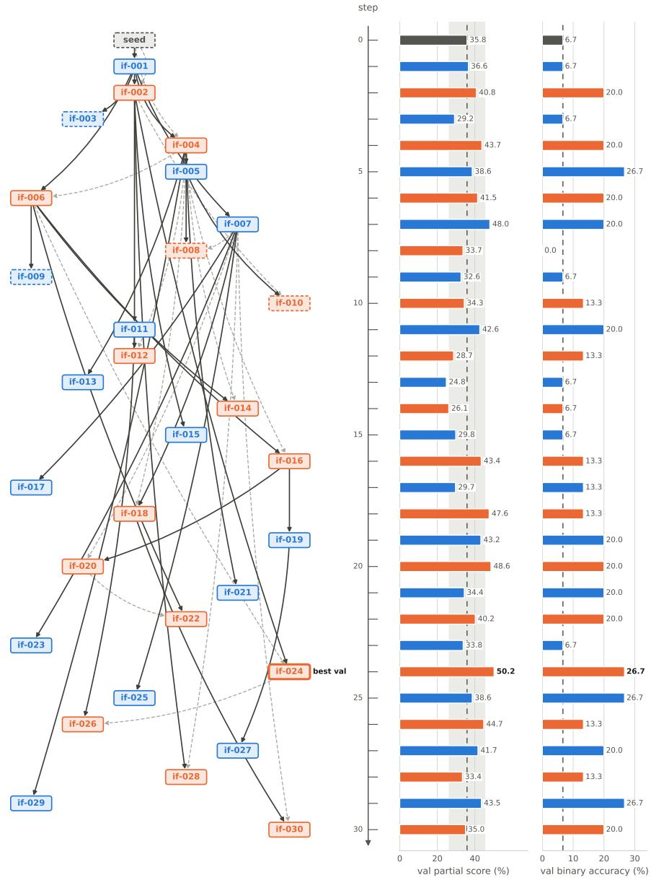  
Figure 7 | Useful repositories can emerge by returning to an earlier branch. OSWor<sup>l</sup>d V2 <sup>l</sup>ineage <sub>over</sub> 30 <sub>cons</sub>t<sub>ruc</sub>ti<sub>on s</sub>t<sub>eps w</sub>ith <sub>scra</sub>t<sub>c</sub>h<sub>-</sub>VM <sub>access.</sub> Bl<sub>ue no</sub>d<sub>es</sub> d<sub>eno</sub>t<sub>e mu</sub>t<sub>a</sub>ti<sub>on an</sub>d <sub>orange no</sub>d<sub>es</sub> <sub>crossover; so</sub>lid <sub>an</sub>d d<sub>as</sub>h<sub>e</sub>d <sub>e</sub>d<sub>ges</sub> id<sub>en</sub>tif<sub>y</sub> th<sub>e</sub> fi<sub>rs</sub>t <sub>an</sub>d <sub>secon</sub>d <sub>paren</sub>t<sub>s.</sub> D<sub>as</sub>h<sub>e</sub>d <sub>no</sub>d<sub>e ou</sub>tli<sub>nes mar</sub>k <sub>e</sub>li<sub>m</sub>i<sub>na</sub>t<sub>e</sub>d <sub>var</sub>i<sub>an</sub>t<sub>s.</sub> Th<sub>e</sub> b<sub>ars repor</sub>t <sub>mean par</sub>ti<sub>a</sub>l <sub>score an</sub>d bi<sub>nary success on</sub> 15 <sub>va</sub>lid<sub>a</sub>ti<sub>on</sub> t<sub>as</sub>k<sub>s.</sub> Ste<sub>p</sub> 24 combines ste<sub>p</sub>s 2 and 6 and reaches the hi<sub>g</sub>hest <sub>p</sub>artial score (50.2%), while t<sub>y</sub>in<sub>g</sub> the best binar<sub>y</sub> success (26.7%). Vertical dashed lines mark the seed scores; the shaded band uses the ±1 <sub>s</sub>t<sub>an</sub>d<sub>ar</sub>d <sub>error es</sub>ti<sub>ma</sub>t<sub>e</sub>d f<sub>rom</sub> th<sub>e same va</sub>lid<sub>a</sub>ti<sub>on se</sub>t <sub>an</sub>d <sub>mo</sub>d<sub>e</sub>l i<sub>n</sub> th<sub>e run w</sub>ith<sub>ou</sub>t <sub>scra</sub>t<sub>c</sub>h<sub>-</sub>VM access.

if-016’s mean wit<sup>h</sup>in t<sup>h</sup>e 30 steps. T<sup>h</sup>e <sup>l</sup>ineage i<sup>ll</sup>ustrates <sup>h</sup>ow crossover can com<sup>b</sup>ine <sup>b</sup>ranc<sup>h</sup>es wit<sup>h</sup> dif<sub>eren</sub>t <sub>va</sub>lid<sub>a</sub>ti<sub>on</sub> hi<sub>s</sub>t<sub>or</sub>i<sub>es w</sub>hil<sub>e repea</sub>t<sub>e</sub>d <sub>eva</sub>l<sub>ua</sub>ti<sub>on</sub> i<sub>n</sub>f<sub>orms w</sub>hi<sub>c</sub>h <sub>repos</sub>it<sub>or</sub>i<sub>es rema</sub>i<sub>n prom</sub>i<sub>s</sub>i<sub>ng.</sub>

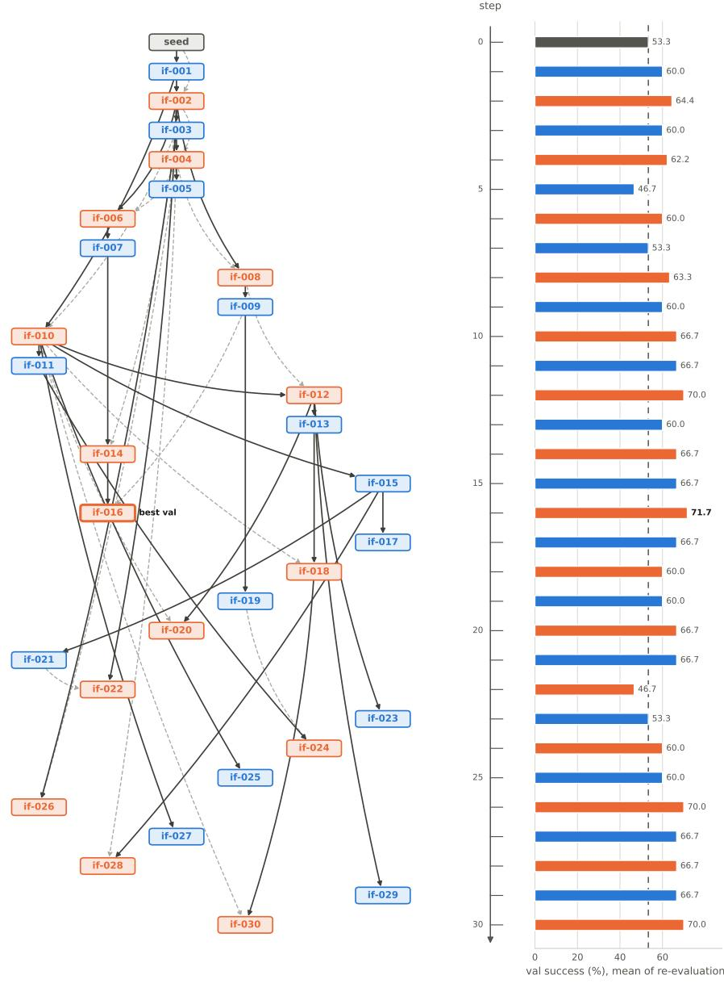

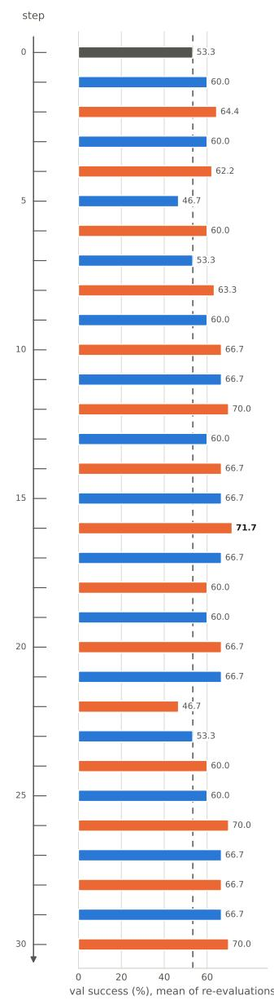  
mutation crossover parent A parent B seed

Figure 8 | ScienceBoard evolution combines branches under repeated validation. Repository li<sub>neage over</sub> 30 <sub>cons</sub>t<sub>ruc</sub>ti<sub>on s</sub>t<sub>eps w</sub>ith <sub>a</sub> 60<sub>-m</sub>i<sub>nu</sub>t<sub>e ep</sub>i<sub>so</sub>d<sub>e</sub> li<sub>m</sub>it<sub>.</sub> C<sub>o</sub>l<sub>ors an</sub>d <sub>e</sub>d<sub>ge s</sub>t<sub>y</sub>l<sub>es</sub> f<sub>o</sub>ll<sub>ow</sub> Fi<sub>gure</sub> 7<sub>.</sub> B<sub>ars</sub> <sub>s</sub>h<sub>ow</sub> <sub>eac</sub>h <sub>repos</sub>it<sub>ory</sub>’<sub>s</sub> <sub>mean</sub> <sub>success</sub> <sub>across</sub> it<sub>s</sub> <sub>ava</sub>il<sub>a</sub>bl<sub>e</sub> <sub>eva</sub>l<sub>ua</sub>ti<sub>ons</sub> <sub>on</sub> 15 <sub>va</sub>lid<sub>a</sub>ti<sub>on</sub> t<sub>as</sub>k<sub>s,</sub> i<sub>nc</sub>l<sub>u</sub>di<sub>ng repea</sub>t<sub>s w</sub>h<sub>ere ava</sub>il<sub>a</sub>bl<sub>e;</sub> th<sub>ey nee</sub>d <sub>no</sub>t <sub>equa</sub>l th<sub>e scores ava</sub>il<sub>a</sub>bl<sub>e w</sub>h<sub>en</sub> th<sub>e repos</sub>it<sub>ory</sub> <sub>was se</sub>l<sub>ec</sub>t<sub>e</sub>d <sub>as a paren</sub>t<sub>.</sub> Th<sub>e</sub> d<sub>as</sub>h<sub>e</sub>d li<sub>ne mar</sub>k<sub>s</sub> th<sub>e see</sub>d’<sub>s</sub> i<sub>n</sub>iti<sub>a</sub>l 53<sub>.</sub>3% <sub>success.</sub> Th<sub>e crossover a</sub>t <sub>s</sub>t<sub>ep</sub> 16 h<sub>as</sub> th<sub>e</sub> hi<sub>g</sub>h<sub>es</sub>t m<sub>ea</sub>n<sub>,</sub> 71<sub>.</sub>7% <sub>o</sub>v<sub>e</sub>r f<sub>ou</sub>r <sub>e</sub>v<sub>a</sub>l<sub>ua</sub>ti<sub>o</sub>n<sub>s.</sub>

## B.2. Execution Eficiency

Table 6 com<sub>p</sub>ares the seed and evolved re<sub>p</sub>ositor<sub>y</sub> across 108 OSWorld V2 tasks. On each re<sub>p</sub>ositor<sub>y</sub>’s f<sub>u</sub>ll<sub>-cre</sub>dit t<sub>as</sub>k<sub>s,</sub> th<sub>e evo</sub>l<sub>ve</sub>d <sub>agen</sub>t <sub>uses</sub> 7<sub>.</sub>1% f<sub>ewer</sub> t<sub>oo</sub>l <sub>ca</sub>ll<sub>s on average w</sub>hil<sub>e rece</sub>i<sub>v</sub>i<sub>ng</sub> f<sub>u</sub>ll <sub>cre</sub>dit <sub>on</sub> <sub>more</sub> t<sub>as</sub>k<sub>s.</sub> T<sub>oge</sub>th<sub>er</sub> <sub>w</sub>ith th<sub>e</sub> CDP <sub>case</sub> i<sub>n</sub> A<sub>ppen</sub>di<sub>x</sub> B<sub>.</sub>4<sub>,</sub> thi<sub>s</sub> <sub>sugges</sub>t<sub>s</sub> <sub>a</sub> <sub>use</sub>f<sub>u</sub>l <sub>ro</sub>l<sub>e</sub> f<sub>or</sub> h<sub>e</sub>l<sub>per</sub> f<sub>unc</sub>ti<sub>ons:</sub> <sub>reusa</sub>bl<sub>e</sub> <sub>opera</sub>ti<sub>ons</sub> <sub>can</sub> <sub>re</sub>d<sub>uce</sub> <sub>repea</sub>t<sub>e</sub>d <sub>se</sub>t<sub>up</sub> <sub>an</sub>d <sub>com</sub>bi<sub>ne</sub> <sub>mu</sub>lti<sub>p</sub>l<sub>e</sub> l<sub>ow-</sub>l<sub>eve</sub>l i<sub>n</sub>t<sub>erac</sub>ti<sub>ons</sub> <sub>w</sub>ithi<sub>n a s</sub>i<sub>ng</sub>l<sub>e</sub> t<sub>oo</sub>l <sub>ca</sub>ll<sub>.</sub> S<sub>uc</sub>h <sub>sav</sub>i<sub>ngs can</sub> f<sub>ree s</sub>t<sub>eps</sub> f<sub>or</sub> t<sub>as</sub>k<sub>-spec</sub>ifi<sub>c reason</sub>i<sub>ng an</sub>d <sub>execu</sub>ti<sub>on.</sub>

Ta<sup>bl</sup>e 6 | The evolved repository uses fewer calls on its full-credit tasks, while the all-task average remains similar. Mean executed IP t<sup>h</sup>on too<sup>l</sup> ca<sup>ll</sup>s across 108 tas<sup>k</sup>s and eac<sup>h</sup> re ositor ’s <sup>f</sup>u<sup>ll</sup>-credit <sub>su</sub>b<sub>se</sub>t<sub>.</sub> P<sub>aren</sub>th<sub>eses g</sub>i<sub>ve</sub> t<sub>as</sub>k <sub>coun</sub>t<sub>s.</sub> F<sub>u</sub>ll <sub>cre</sub>dit <sub>means a score o</sub>f 1<sub>.</sub>0<sub>;</sub> th<sub>e su</sub>b<sub>se</sub>t<sub>s con</sub>t<sub>a</sub>i<sub>n</sub> dif<sub>eren</sub>t t<sub>as</sub>k<sub>s.</sub> C<sub>oun</sub>t<sub>s</sub> i<sub>nc</sub>l<sub>u</sub>d<sub>e</sub> f<sub>a</sub>il<sub>e</sub>d <sub>ca</sub>ll<sub>s an</sub>d <sub>use</sub> th<sub>e</sub> fi<sub>na</sub>l <sub>re</sub>t<sub>a</sub>i<sub>ne</sub>d <sub>a</sub>tt<sub>emp</sub>t<sub>,</sub> i<sub>nc</sub>l<sub>u</sub>di<sub>ng</sub> th<sub>e</sub> i<sub>n</sub>t<sub>errup</sub>t<sub>e</sub>d <sub>evo</sub>l<sub>ve</sub>d <sub>a</sub>tt<sub>e</sub>m<sub>p</sub>t <sub>o</sub>n t<sub>as</sub>k 063<sub>,</sub> b<sub>u</sub>t <sub>e</sub>x<sub>c</sub>l<sub>u</sub>d<sub>e ea</sub>rli<sub>e</sub>r infr<sub>as</sub>tr<sub>uc</sub>t<sub>u</sub>r<sub>e</sub> r<sub>e</sub>tri<sub>es.</sub>
<table><tr><td>Task subset</td><td>Seed</td></tr><tr><td>All tasks</td><td>163.2 (n = 108) 162.1 (n = 108)</td></tr><tr><td>Each repository&#x27;s full-credit tasks</td><td>111.6 (n = 21)</td></tr></table>

The aggregate comparison also shows why helper-level improvements need not shorten every trajectory. A<sub>cross a</sub>ll t<sub>as</sub>k<sub>s, mean ca</sub>ll <sub>coun</sub>t<sub>s rema</sub>i<sub>n near</sub>l<sub>y unc</sub>h<sub>ange</sub>d<sub>.</sub> Th<sub>e</sub> f<sub>u</sub>ll<sub>-cre</sub>dit <sub>su</sub>b<sub>se</sub>t<sub>s</sub> dif<sub>er, an</sub>d <sub>on</sub> th<sub>e</sub> 11 t<sub>as</sub>k<sub>s w</sub>h<sub>ere</sub> b<sub>o</sub>th <sub>repos</sub>it<sub>or</sub>i<sub>es rece</sub>i<sub>ve</sub> f<sub>u</sub>ll <sub>cre</sub>dit<sub>,</sub> th<sub>e mean r</sub>i<sub>ses</sub> f<sub>rom</sub> 87<sub>.</sub>8 t<sub>o</sub> 103<sub>.</sub>2 <sub>ca</sub>ll<sub>s.</sub> Excludin<sub>g</sub> the interru<sub>p</sub>ted evolved attem<sub>p</sub>t likewise leaves similar all-task means (163.2 for the seed and 163.4 for the evolved re<sub>p</sub>ositor<sub>y</sub>). Thus, the shorter full-credit avera<sub>g</sub>e describes each re<sub>p</sub>ositor<sub>y</sub>’s successful trajectories rather than a uniform speedup on matched tasks. The CDP trace supplies <sub>concre</sub>t<sub>e</sub> <sub>ev</sub>id<sub>ence</sub> <sub>o</sub>f <sub>re</sub>d<sub>uce</sub>d <sub>se</sub>t<sub>up</sub> <sub>an</sub>d b<sub>u</sub>lk<sub>-rea</sub>di<sub>ng</sub> <sub>over</sub>h<sub>ea</sub>d<sub>;</sub> th<sub>e</sub> <sub>aggrega</sub>t<sub>e</sub> <sub>resu</sub>lt<sub>s</sub> <sub>s</sub>h<sub>ow</sub> th<sub>a</sub>t th<sub>ese</sub> l<sub>oca</sub>l <sub>sav</sub>i<sub>ngs coex</sub>i<sub>s</sub>t <sub>w</sub>ith <sub>o</sub>th<sub>er sources o</sub>f t<sub>as</sub>k<sub>-</sub>l<sub>eve</sub>l <sub>var</sub>i<sub>a</sub>ti<sub>on.</sub>

## B.3. Examples of Evolved Interfaces

Fi<sub>gu</sub>r<sub>e</sub> 9 <sub>s</sub>h<sub>o</sub>w<sub>s</sub> h<sub>o</sub>w th<sub>e</sub> t<sub>as</sub>k <sub>age</sub>nt <sub>uses a</sub>n <sub>e</sub>v<sub>o</sub>lv<sub>e</sub>d r<sub>epos</sub>it<sub>o</sub>r<sub>y</sub> d<sub>u</sub>rin<sub>g a</sub> t<sub>as</sub>k <sub>a</sub>nd wh<sub>a</sub>t it<sub>s</sub> int<sub>e</sub>rf<sub>aces</sub> <sub>con</sub>t<sub>a</sub>i<sub>n.</sub> T<sub>a</sub>bl<sub>e</sub> 7 li<sub>s</sub>t<sub>s</sub> i<sub>n</sub>t<sub>er</sub>f<sub>aces</sub> f<sub>rom</sub> th<sub>e evo</sub>l<sub>ve</sub>d <sub>repos</sub>it<sub>or</sub>i<sub>es</sub> d<sub>escr</sub>ib<sub>e</sub>d i<sub>n</sub> S<sub>ec</sub>ti<sub>on</sub> 7<sub>, w</sub>ith <sub>w</sub>h<sub>a</sub>t <sub>eac</sub>h l<sub>e</sub>t<sub>s</sub> th<sub>e</sub> <sub>agen</sub>t <sub>o</sub>b<sub>serve</sub> <sub>an</sub>d d<sub>o.</sub>

## B.4. Additional Case Study

We examine how a reusable Chrome DevTools Protocol (CDP) interface chan<sub>g</sub>es browser interaction i<sub>n a c</sub>li<sub>en</sub>t <sub>p</sub>h<sub>o</sub>t<sub>o-</sub>d<sub>e</sub>li<sub>very</sub> t<sub>as</sub>k<sub>.</sub> Th<sub>e agen</sub>t <sub>mus</sub>t <sub>rea</sub>d i<sub>ns</sub>t<sub>ruc</sub>ti<sub>ons</sub> i<sub>n</sub> T<sub>eam</sub>Ch<sub>a</sub>t<sub>, reconc</sub>il<sub>e</sub> i<sub>nvo</sub>i<sub>ces</sub> <sub>w</sub>ith <sub>paymen</sub>t<sub>s</sub> i<sub>n</sub> V<sub>au</sub>ltB<sub>an</sub>k<sub>,</sub> <sub>an</sub>d <sub>prepare</sub> <sub>an</sub>d <sub>ema</sub>il <sub>e</sub>ith<sub>er</sub> fi<sub>n</sub>i<sub>s</sub>h<sub>e</sub>d <sub>p</sub>h<sub>o</sub>t<sub>os</sub> <sub>or</sub> <sub>wa</sub>t<sub>ermar</sub>k<sub>e</sub>d <sub>prev</sub>i<sub>ews.</sub> We compare t<sup>h</sup>e see<sup>d</sup> repository wit<sup>h</sup> evo<sup>l</sup>ve<sup>d</sup> variant if-011 on t<sup>h</sup>e same tas<sup>k</sup>. T<sup>h</sup>e see<sup>d</sup> provi<sup>d</sup>es b<sub>rowser</sub> t<sub>arge</sub>t di<sub>scovery</sub> b<sub>u</sub>t l<sub>ac</sub>k<sub>s</sub> <sub>a</sub> <sub>page-eva</sub>l<sub>ua</sub>ti<sub>on</sub> h<sub>e</sub>l<sub>per,</sub> <sub>w</sub>h<sub>ereas</sub> th<sub>e</sub> <sub>evo</sub>l<sub>ve</sub>d <sub>repos</sub>it<sub>ory</sub> <sub>exposes</sub> browser.page\_eval an<sup>d</sup> browser.page\_text <sup>f</sup>or execut<sup>i</sup>ng JavaScr<sup>i</sup>pt an<sup>d</sup> retr<sup>i</sup>ev<sup>i</sup>ng page text throu<sub>g</sub>h CDP.

Fi<sub>gure</sub> 10 <sub>s</sub>h<sub>ows</sub> th<sub>e</sub> <sub>reques</sub>t<sub>e</sub>d <sub>conversa</sub>ti<sub>on</sub> <sub>an</sub>d th<sub>e</sub> h<sub>e</sub>l<sub>per</sub> <sub>opera</sub>ti<sub>ons</sub> <sub>use</sub>d t<sub>o</sub> <sub>re</sub>t<sub>r</sub>i<sub>eve</sub> it<sub>s</sub> t<sub>ex</sub>t<sub>.</sub>

Reusing browser access. T<sup>h</sup>e seed agent imp<sup>l</sup>ements its own CDP c<sup>l</sup>ient during t<sup>h</sup>e tas<sup>k</sup>, encount<sub>er</sub>i<sub>ng</sub> <sub>m</sub>i<sub>ss</sub>i<sub>ng</sub> d<sub>epen</sub>d<sub>enc</sub>i<sub>es,</sub> <sub>an</sub> i<sub>ncorrec</sub>t t<sub>arge</sub>t id<sub>en</sub>tifi<sub>er,</sub> <sub>an</sub>d <sub>connec</sub>ti<sub>on</sub> <sub>an</sub>d <sub>message-</sub>h<sub>an</sub>dli<sub>ng</sub> f<sub>a</sub>il<sub>ures</sub> b<sub>e</sub>f<sub>ore</sub> <sub>o</sub>bt<sub>a</sub>i<sub>n</sub>i<sub>ng</sub> th<sub>e</sub> <sub>reques</sub>t<sub>e</sub>d di<sub>rec</sub>t <sub>message.</sub> Th<sub>e</sub> <sub>evo</sub>l<sub>ve</sub>d i<sub>n</sub>t<sub>er</sub>f<sub>ace</sub> <sub>encapsu</sub>l<sub>a</sub>t<sub>es</sub> t<sub>arge</sub>t <sub>se</sub>l<sub>ec</sub>ti<sub>on an</sub>d W<sub>e</sub>bS<sub>oc</sub>k<sub>e</sub>t <sub>commun</sub>i<sub>ca</sub>ti<sub>on, a</sub>ll<sub>ow</sub>i<sub>ng</sub> th<sub>e agen</sub>t t<sub>o nav</sub>i<sub>ga</sub>t<sub>e an</sub>d <sub>rea</sub>d th<sub>e message us</sub>i<sub>ng</sub> <sub>ex</sub>i<sub>s</sub>ti<sub>ng</sub> h<sub>e</sub>l<sub>pers.</sub> Th<sub>e same message</sub> i<sub>s re</sub>t<sub>r</sub>i<sub>eve</sub>d b<sub>y</sub> t<sub>oo</sub>l <sub>ce</sub>ll 11 <sub>w</sub>ith th<sub>e evo</sub>l<sub>ve</sub>d <sub>repos</sub>it<sub>ory, compare</sub>d <sub>w</sub>ith <sub>ce</sub>ll 37 f<sub>or</sub> th<sub>e see</sub>d<sub>.</sub> Thi<sub>s</sub> ill<sub>us</sub>t<sub>ra</sub>t<sub>es</sub> h<sub>ow repos</sub>it<sub>ory evo</sub>l<sub>u</sub>ti<sub>on can move</sub> b<sub>rowser se</sub>t<sub>up an</sub>d debugging out of the task trajectory and into reusable code.

Figure 11 contrasts the selected milestones leading to the same message in the two trajectories.

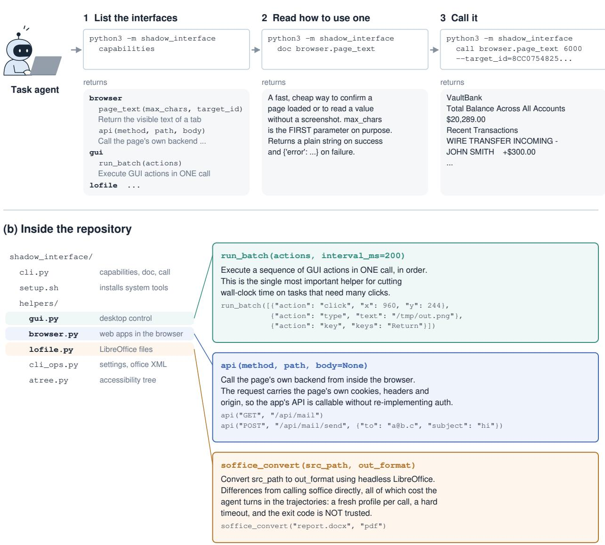  
Figure 9 | How the task agent uses an evolved repository. (a) On an OSWorld V2 task, the task agent li<sub>s</sub>t<sub>s</sub> th<sub>e ava</sub>il<sub>a</sub>bl<sub>e</sub> i<sub>n</sub>t<sub>er</sub>f<sub>aces, rea</sub>d<sub>s</sub> th<sub>e usage no</sub>t<sub>es o</sub>f <sub>one an</sub>d <sub>ca</sub>ll<sub>s</sub> it f<sub>rom</sub> it<sub>s co</sub>d<sub>e.</sub> O<sub>u</sub>t<sub>pu</sub>t<sub>s are</sub> shortened. (b) The repository selected without a scratch VM (Table 2) is a Python package. Each i<sub>n</sub>t<sub>er</sub>f<sub>ace</sub> i<sub>s</sub> <sub>a</sub> <sub>mo</sub>d<sub>u</sub>l<sub>e</sub> <sub>o</sub>f f<sub>unc</sub>ti<sub>ons</sub> <sub>w</sub>h<sub>ose</sub> d<sub>ocs</sub>t<sub>r</sub>i<sub>ngs</sub> <sub>say</sub> h<sub>ow</sub> <sub>an</sub>d <sub>w</sub>h<sub>en</sub> t<sub>o</sub> <sub>use</sub> th<sub>em,</sub> i<sub>nc</sub>l<sub>u</sub>di<sub>ng</sub> l<sub>essons</sub> <sup>f</sup>rom ear<sup>li</sup>er trajector<sup>i</sup>es. Docstr<sup>i</sup>ngs are s<sup>h</sup>ortene<sup>d</sup>. run\_batch, api an<sup>d</sup> t<sup>h</sup>e lofile mo<sup>d</sup>u<sup>l</sup>e were <sub>a</sub>dd<sub>e</sub>d d<sub>ur</sub>i<sub>ng</sub> <sub>evo</sub>l<sub>u</sub>ti<sub>on.</sub>

Table 7 | Examples of interfaces created or extended by evolution. Each changes what the agent <sub>o</sub>b<sub>serves a</sub>b<sub>ou</sub>t <sub>par</sub>t <sub>o</sub>f th<sub>e compu</sub>t<sub>er an</sub>d <sub>w</sub>h<sub>a</sub>t th<sub>e agen</sub>t <sub>can</sub> d<sub>o</sub> t<sub>o</sub> it i<sub>n one ca</sub>ll<sub>.</sub> Th<sub>e</sub> d<sub>es</sub>kt<sub>op-con</sub>t<sub>ro</sub>l <sub>an</sub>d <sub>we</sub>b<sub>-app</sub> i<sub>n</sub>t<sub>er</sub>f<sub>aces</sub> b<sub>eg</sub>i<sub>n</sub> i<sub>n</sub> th<sub>e see</sub>d <sub>w</sub>ith b<sub>as</sub>i<sub>c opera</sub>ti<sub>ons an</sub>d <sub>are ex</sub>t<sub>en</sub>d<sub>e</sub>d d<sub>ur</sub>i<sub>ng evo</sub>l<sub>u</sub>ti<sub>on,</sub> <sub>an</sub>d th<sub>e o</sub>th<sub>ers are new.</sub> A fi<sub>xe</sub>d<sub>-</sub>i<sub>n</sub>t<sub>er</sub>f<sub>ace agen</sub>t <sub>o</sub>b<sub>serves a</sub>ll <sub>o</sub>f th<sub>ese</sub> th<sub>roug</sub>h <sub>screens</sub>h<sub>o</sub>t<sub>s an</sub>d <sub>ac</sub>t<sub>s on</sub> th<sub>em</sub> th<sub>roug</sub>h <sub>c</sub>li<sub>c</sub>k<sub>s</sub> <sub>an</sub>d k<sub>eys</sub>t<sub>ro</sub>k<sub>es.</sub>
<table><tr><td>Interface</td><td>What the agent observes</td><td>What the agent can do</td></tr><tr><td>ground jobs</td><td>Desktop control and back- Windows and their accessible controls; Run a list of GUI actions and get back the status and logs of programs run- how many ran and any error; launch, ning in the background</td><td>monitor and wait for long jobs such as video renders</td></tr><tr><td>browser</td><td>Web-app access in the The text and data of pages in the user&#x27;s Run code inside a page; send requests els</td><td>logged-in session, rather than their pix- from the logged-in tab, reused across email, banking and chat sites</td></tr><tr><td>(LibreOffice)</td><td>Office-document editing Cells, formulas, paragraphs, slides and Write a block of cells at once; edit doc- shapes of an open document</td><td>ument objects; export to PDF</td></tr><tr><td>the application</td><td>Document reading without Text, metadata and rendered pages of Extract and search content; check a file, without opening the application whether an exported PDF is complete that made it</td><td></td></tr><tr><td></td><td>Score editing (MusicXML) Parts, measures and notes with pitch Add notes and rests; change pitch and and duration</td><td>duration; add dynamics; validate the score</td></tr><tr><td>(ChimeraX)</td><td>Molecular-viewer control Which atoms and residues a selection Send viewer commands directly, such or command affects</td><td>as coloring one residue of one chain</td></tr><tr><td>pletion (Lean)</td><td>Proof checking and com- Whether a proof checks and compiles Check, compile, update the editor and</td><td>report whether the proof is finished</td></tr></table>

  
Figure 10 | Reusable browser helpers expose the instructions needed for the rest of the task. Cr<sub>oppe</sub>d fr<sub>a</sub>m<sub>e</sub> fr<sub>o</sub>m th<sub>e</sub> <sub>e</sub>v<sub>o</sub>lv<sub>e</sub>d t<sub>as</sub>k-046 r<sub>eco</sub>rdin<sub>g</sub> <sub>s</sub>h<sub>o</sub>win<sub>g</sub> th<sub>e</sub> T<sub>ea</sub>mCh<sub>a</sub>t dir<sub>ec</sub>t m<sub>essage.</sub> It <sub>as</sub>k<sub>s</sub> th<sub>e agen</sub>t t<sub>o c</sub>h<sub>ec</sub>k <sub>paymen</sub>t<sub>s an</sub>d d<sub>e</sub>li<sub>ver p</sub>h<sub>o</sub>t<sub>os or prev</sub>i<sub>ews accor</sub>di<sub>ng</sub>l<sub>y.</sub> Th<sub>e</sub> b<sub>ox a</sub>bb<sub>rev</sub>i<sub>a</sub>t<sub>es</sub> th<sub>e</sub> h<sub>e</sub>l<sub>per</sub> <sub>names</sub> <sub>an</sub>d <sub>argumen</sub>t<sub>s</sub> <sub>passe</sub>d th<sub>roug</sub>h th<sub>e</sub> CLI i<sub>n</sub> t<sub>oo</sub>l <sub>ce</sub>ll 11<sub>.</sub> Th<sub>e</sub> f<sub>rame</sub> ill<sub>us</sub>t<sub>ra</sub>t<sub>es</sub> th<sub>e</sub> <sub>page</sub> content; operation timing is measured from the trajectory, independently of the recording.

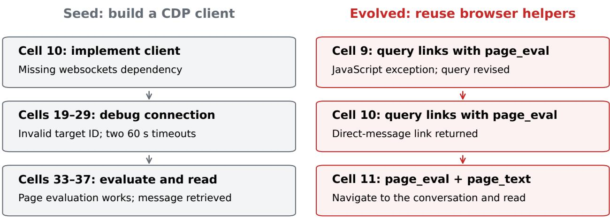  
Same message reached: cell 37 · 7.40 min  
Same message reached: cell 11 · 0.94 min

Figure 11 | Reusing CDP access reduces the setup needed to read the same message. Se<sup>l</sup>ected <sub>m</sub>il<sub>es</sub>t<sub>ones</sub> f<sub>rom</sub> t<sub>as</sub>k 046 <sub>compare</sub> th<sub>e see</sub>d’<sub>s c</sub>li<sub>en</sub>t i<sub>mp</sub>l<sub>emen</sub>t<sub>a</sub>ti<sub>on an</sub>d d<sub>e</sub>b<sub>ugg</sub>i<sub>ng w</sub>ith th<sub>e evo</sub>l<sub>ve</sub>d <sub>repos</sub>it<sub>ory</sub>’<sub>s ex</sub>i<sub>s</sub>ti<sub>ng</sub> b<sub>rowser</sub> h<sub>e</sub>l<sub>pers.</sub> B<sub>o</sub>th <sub>re</sub>t<sub>r</sub>i<sub>eve</sub> th<sub>e reques</sub>t<sub>e</sub>d di<sub>rec</sub>t <sub>message, a</sub>t t<sub>oo</sub>l <sub>ce</sub>ll<sub>s</sub> 37 <sub>an</sub>d 11 <sub>respec</sub>ti<sub>ve</sub>l<sub>y.</sub> Ti<sub>mes</sub> <sub>run</sub> f<sub>rom</sub> th<sub>e</sub> i<sub>n</sub>iti<sub>a</sub>l t<sub>as</sub>k <sub>message</sub> t<sub>o</sub> th<sub>e</sub> t<sub>oo</sub>l <sub>resu</sub>lt <sub>con</sub>t<sub>a</sub>i<sub>n</sub>i<sub>ng</sub> th<sub>a</sub>t <sub>message.</sub> B<sub>oxes summar</sub>i<sub>ze recor</sub>d<sub>e</sub>d <sub>even</sub>t<sub>s an</sub>d <sub>are no</sub>t <sub>propor</sub>ti<sub>ona</sub>l t<sub>o e</sub>l<sub>apse</sub>d ti<sub>me;</sub> th<sub>e evo</sub>l<sub>ve</sub>d <sub>agen</sub>t <sub>a</sub>l<sub>so</sub> <sub>encoun</sub>t<sub>ers an</sub>d <sub>correc</sub>t<sub>s an</sub> i<sub>n</sub>iti<sub>a</sub>l J<sub>ava</sub>S<sub>cr</sub>i<sub>p</sub>t <sub>error.</sub>

Reading structured page content. T<sup>h</sup>e evo<sup>l</sup>ved agent a<sup>l</sup>so uses JavaScript to <sup>l</sup>oad additiona<sup>l b</sup>an<sup>k</sup> transactions and extract 81 table rows from the <sub>p</sub>a<sub>g</sub>e DOM. It then a<sub>gg</sub>re<sub>g</sub>ates <sub>p</sub>a<sub>y</sub>ments b<sub>y</sub> client <sub>name</sub> i<sub>n</sub> P<sub>y</sub>th<sub>on.</sub> R<sub>e</sub>t<sub>urn</sub>i<sub>ng page</sub> t<sub>ex</sub>t <sub>an</sub>d <sub>s</sub>t<sub>ruc</sub>t<sub>ure</sub>d <sub>recor</sub>d<sub>s</sub> l<sub>e</sub>t<sub>s</sub> th<sub>e agen</sub>t <sub>process mu</sub>lti<sub>p</sub>l<sub>e en</sub>t<sub>r</sub>i<sub>es</sub> i<sub>n</sub> <sub>one</sub> <sub>opera</sub>ti<sub>on,</sub> <sub>re</sub>d<sub>uc</sub>i<sub>ng</sub> th<sub>e</sub> <sub>nee</sub>d f<sub>or</sub> <sub>repea</sub>t<sub>e</sub>d <sub>v</sub>i<sub>sua</sub>l i<sub>nspec</sub>ti<sub>on</sub> <sub>an</sub>d t<sub>ranscr</sub>i<sub>p</sub>ti<sub>on.</sub> Th<sub>e</sub> <sub>resu</sub>lti<sub>ng</sub> i<sub>n</sub>t<sub>er</sub>f<sub>ace suppor</sub>t<sub>s</sub> b<sub>o</sub>th <sub>nav</sub>i<sub>ga</sub>ti<sub>on an</sub>d b<sub>u</sub>lk <sub>rea</sub>di<sub>ng</sub> th<sub>roug</sub>h th<sub>e same</sub> b<sub>rowser sess</sub>i<sub>on.</sub>

Table 8 | Observed trajectories for the same client <sub>p</sub>hoto-deliver<sub>y</sub> task (task 046). Tool cells count <sub>execu</sub>t<sub>e</sub>d IP<sub>y</sub>th<sub>on</sub> <sub>ca</sub>ll<sub>s;</sub> i<sub>mage-</sub>b<sub>ear</sub>i<sub>ng</sub> <sub>resu</sub>lt<sub>s</sub> <sub>coun</sub>t <sub>ce</sub>ll<sub>s</sub> <sub>re</sub>t<sub>urn</sub>i<sub>ng</sub> i<sub>mages.</sub> R<sub>ecor</sub>d<sub>e</sub>d d<sub>ura</sub>ti<sub>on</sub> <sub>spans</sub> the initial task message to the last recorded message. Each column represents one trajectory.
<table><tr><td>Measure</td><td>Seed</td><td>Evolved (if-011)</td></tr><tr><td>Executed tool cells</td><td>299</td><td>167</td></tr><tr><td>Image-bearing tool results</td><td>68</td><td>14</td></tr><tr><td>Recorded duration (min)</td><td>97.5</td><td>51.1</td></tr><tr><td>Task score</td><td>0.50</td><td>1.00</td></tr></table>

Table 8 shows a shorter trajectory with fewer tool calls and image-bearing results, alongside a higher t<sub>as</sub>k <sub>score.</sub> Th<sub>e c</sub>l<sub>eares</sub>t <sub>mec</sub>h<sub>an</sub>i<sub>sm</sub> i<sub>s re</sub>d<sub>uce</sub>d b<sub>rowser se</sub>t<sub>up over</sub>h<sub>ea</sub>d <sub>an</sub>d di<sub>rec</sub>t <sub>access</sub> t<sub>o page</sub> <sub>con</sub>t<sub>en</sub>t<sub>.</sub> B<sub>o</sub>th <sub>agen</sub>t<sub>s even</sub>t<sub>ua</sub>ll<sub>y use</sub> CDP<sub>, so</sub> th<sub>e</sub> b<sub>ene</sub>fit ill<sub>us</sub>t<sub>ra</sub>t<sub>e</sub>d h<sub>ere</sub> i<sub>s ma</sub>ki<sub>ng</sub> th<sub>a</sub>t <sub>capa</sub>bilit<sub>y</sub> <sub>rea</sub>dil<sub>y reusa</sub>bl<sub>e.</sub> Th<sub>e</sub> f<sub>u</sub>ll t<sub>as</sub>k <sub>a</sub>l<sub>so</sub> i<sub>nc</sub>l<sub>u</sub>d<sub>es</sub> fil<sub>e,</sub> i<sub>mage, an</sub>d <sub>ema</sub>il <sub>opera</sub>ti<sub>ons, an</sub>d th<sub>e repos</sub>it<sub>or</sub>i<sub>es</sub> dif<sub>er</sub> i<sub>n o</sub>th<sub>er</sub> i<sub>n</sub>t<sub>er</sub>f<sub>aces;</sub> th<sub>e overa</sub>ll d<sub>ura</sub>ti<sub>on</sub> dif<sub>erence</sub> i<sub>s</sub> th<sub>ere</sub>f<sub>ore an o</sub>b<sub>serve</sub>d <sub>case ou</sub>t<sub>come ra</sub>th<sub>er</sub> th<sub>an an</sub> i<sub>so</sub>l<sub>a</sub>t<sub>e</sub>d <sub>es</sub>ti<sub>ma</sub>t<sub>e o</sub>f CDP’<sub>s e</sub>f<sub>ec</sub>t<sub>.</sub>

## B.5. Tasks With and Without Evolved Interfaces

OSWorld V2 evolution comparison. Figures 12–16 compare t<sup>h</sup>e seed repository wit<sup>h</sup> an evo<sup>l</sup>ved <sub>repos</sub>it<sub>ory on</sub> th<sub>e same</sub> t<sub>as</sub>k<sub>.</sub> Th<sub>e</sub> t<sub>op row o</sub>f <sub>eac</sub>h fi<sub>gure</sub> f<sub>o</sub>ll<sub>ows</sub> th<sub>e see</sub>d <sub>ep</sub>i<sub>so</sub>d<sub>e</sub> th<sub>roug</sub>h th<sub>e agen</sub>t’<sub>s</sub> <sub>own screens</sub>h<sub>o</sub>t<sub>s,</sub> i<sub>n or</sub>d<sub>er.</sub> R<sub>e</sub>d d<sub>o</sub>t<sub>s mar</sub>k <sub>c</sub>li<sub>c</sub>k<sub>s a</sub>t th<sub>e coor</sub>di<sub>na</sub>t<sub>es</sub> i<sub>n</sub> th<sub>e agen</sub>t’<sub>s co</sub>d<sub>e,</sub> d<sub>rawn on a</sub> <sub>screens</sub>h<sub>o</sub>t f<sub>rom</sub> th<sub>e ca</sub>ll<sub>s name</sub>d <sub>un</sub>d<sub>er eac</sub>h <sub>pane</sub>l<sub>.</sub> A <sub>s</sub>t<sub>ac</sub>k <sub>o</sub>f f<sub>rames mar</sub>k<sub>s repea</sub>t<sub>e</sub>d <sub>a</sub>tt<sub>emp</sub>t<sub>s.</sub> I<sub>n</sub> th<sub>e</sub> W<sub>or</sub>d <sub>case, w</sub>h<sub>ere</sub> th<sub>e see</sub>d <sub>agen</sub>t <sub>wor</sub>k<sub>s a</sub>l<sub>mos</sub>t <sub>en</sub>ti<sub>re</sub>l<sub>y</sub> i<sub>n co</sub>d<sub>e,</sub> th<sub>e</sub> l<sub>a</sub>t<sub>er pane</sub>l<sub>s quo</sub>t<sub>e</sub> it<sub>s co</sub>d<sub>e an</sub>d <sub>ou</sub>t<sub>pu</sub>t<sub>.</sub> Th<sub>e</sub> b<sub>o</sub>tt<sub>om row s</sub>h<sub>ows</sub> th<sub>e evo</sub>l<sub>ve</sub>d <sub>ep</sub>i<sub>so</sub>d<sub>e:</sub> th<sub>e</sub> i<sub>n</sub>t<sub>er</sub>f<sub>ace</sub> d<sub>ocumen</sub>t<sub>a</sub>ti<sub>on</sub> th<sub>e agen</sub>t <sub>rea</sub>d<sub>,</sub> th<sub>e</sub> call it made and the out ut it received. The call and out ut are uoted from the trajector shortened <sub>w</sub>h<sub>ere</sub> <sub>mar</sub>k<sub>e</sub>d <sub>w</sub>ith <sub>an</sub> <sub>e</sub>lli<sub>ps</sub>i<sub>s.</sub> Th<sub>e</sub> d<sub>ocumen</sub>t<sub>a</sub>ti<sub>on</sub> i<sub>s</sub> <sub>con</sub>d<sub>ense</sub>d<sub>:</sub> f<sub>unc</sub>ti<sub>on</sub> <sub>names</sub> <sub>an</sub>d <sub>s</sub>i<sub>gna</sub>t<sub>ures</sub> <sub>are</sub> <sub>exac</sub>t<sub>,</sub> th<sub>e</sub> d<sub>escr</sub>i<sub>p</sub>ti<sub>ons</sub> <sub>parap</sub>h<sub>rase</sub> th<sub>e</sub> d<sub>ocs</sub>t<sub>r</sub>i<sub>ngs</sub> th<sub>e</sub> <sub>agen</sub>t <sub>pr</sub>i<sub>n</sub>t<sub>e</sub>d<sub>,</sub> <sub>an</sub>d th<sub>e</sub> f<sub>unc</sub>ti<sub>ons</sub> th<sub>e</sub> <sub>agen</sub>t <sub>use</sub>d <sub>are</sub> hi<sub>g</sub>hli<sub>g</sub>ht<sub>e</sub>d<sub>.</sub>

Th<sub>e ep</sub>i<sub>so</sub>d<sub>es were se</sub>l<sub>ec</sub>t<sub>e</sub>d t<sub>o</sub> ill<sub>us</sub>t<sub>ra</sub>t<sub>e</sub> th<sub>ese mec</sub>h<sub>an</sub>i<sub>sms an</sub>d <sub>are no</sub>t <sub>con</sub>t<sub>ro</sub>ll<sub>e</sub>d <sub>compar</sub>i<sub>sons.</sub> S<sub>evera</sub>l <sub>evo</sub>l<sub>ve</sub>d <sub>repos</sub>it<sub>or</sub>i<sub>es come</sub> f<sub>rom separa</sub>t<sub>e evo</sub>l<sub>u</sub>ti<sub>on runs w</sub>ith th<sub>e same</sub> t<sub>as</sub>k<sub>s an</sub>d <sub>mo</sub>d<sub>e</sub>l<sub>.</sub> C<sub>a</sub>ll <sub>coun</sub>t<sub>s</sub> exc<sup>l</sup>u<sup>d</sup>e t<sup>h</sup>e cost o<sup>f b</sup>u<sup>ildi</sup>ng t<sup>h</sup>e <sup>i</sup>nter<sup>f</sup>ace, an<sup>d</sup> t<sup>h</sup>e synt<sup>h</sup>et<sup>i</sup>c s\_\* tas<sup>k</sup>s are ungra<sup>d</sup>e<sup>d</sup>. F<sup>i</sup>gure 17 a<sup>dd</sup>itiona<sup>ll</sup>y compares t<sup>h</sup>e <sup>b</sup>are agent wit<sup>h</sup> if-024 on OSWor<sup>ld</sup> V2 tas<sup>k</sup> 038.

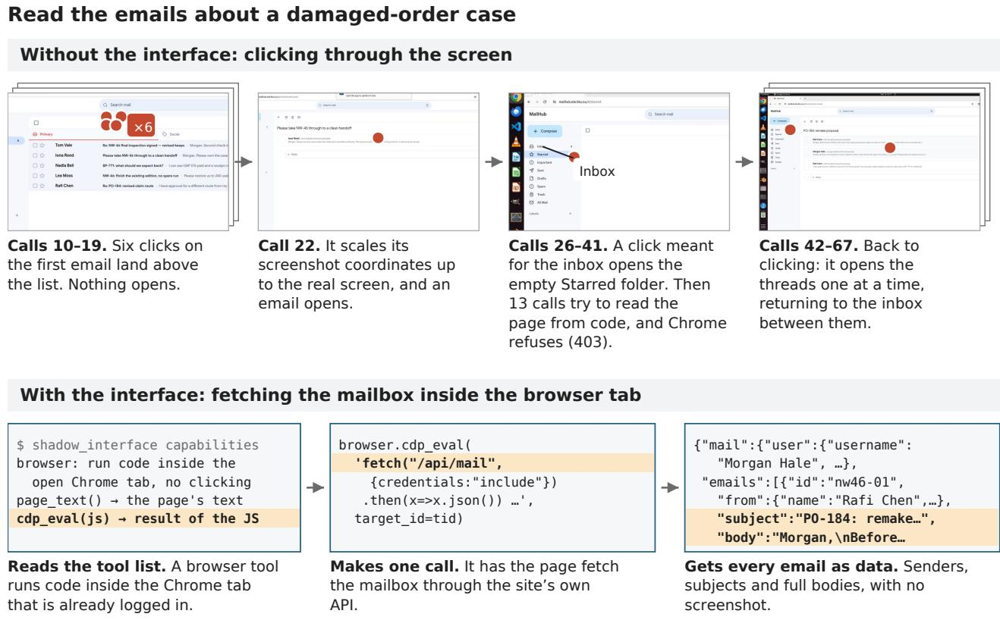  
Figure 12 | Reading a mailbox in MailHub (s\_010). T<sup>h</sup>e seed agent reads t<sup>h</sup>e case emai<sup>l</sup>s t<sup>h</sup>roug<sup>h</sup> the GUI in 60 calls (8–67). Its first six clicks land above the email list because it uses coordinates f<sub>rom</sub> it<sub>s</sub> 1200<sub>-p</sub>i<sub>xe</sub>l <sub>screens</sub>h<sub>o</sub>t<sub>s as screen coor</sub>di<sub>na</sub>t<sub>es.</sub> A <sub>c</sub>li<sub>c</sub>k <sub>mean</sub>t f<sub>or</sub> th<sub>e</sub> i<sub>n</sub>b<sub>ox opens</sub> St<sub>arre</sub>d<sub>, an</sub>d <sup>i</sup>ts attempt to rea<sup>d</sup> t<sup>h</sup>e page <sup>f</sup>rom co<sup>d</sup>e <sup>i</sup>s re<sup>f</sup>use<sup>d</sup> w<sup>i</sup>t<sup>h</sup> 403 Forbidden. W<sup>i</sup>t<sup>h</sup> if-011, page\_text <sup>li</sup>sts t<sup>h</sup>e <sup>i</sup>n<sup>b</sup>ox an<sup>d</sup> one cdp\_eval ca<sup>ll f</sup>etc<sup>h</sup>es t<sup>h</sup>e ma<sup>ilb</sup>ox w<sup>i</sup>t<sup>h f</sup>u<sup>ll</sup> ema<sup>il b</sup>o<sup>di</sup>es <sup>i</sup>ns<sup>id</sup>e t<sup>h</sup>e <sup>l</sup>ogge<sup>d</sup>-<sup>i</sup>n t<sub>a</sub>b<sub>,</sub> i<sub>n</sub> 12 <sub>ca</sub>ll<sub>s an</sub>d <sub>w</sub>ith<sub>ou</sub>t <sub>a screens</sub>h<sub>o</sub>t<sub>.</sub>

Export a finished XMind mind map as a PNG image Without the interface: clicking through the screen  


With the interface: rendering the map with one call  
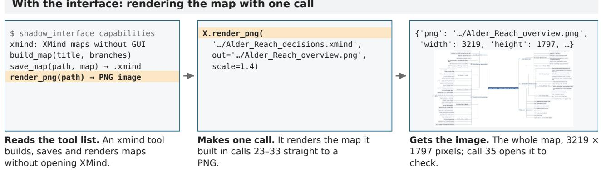  
Figure 13 | Exporting an XMind map (s\_005). T<sup>h</sup>e seed agent tries to export a PNG t<sup>h</sup>roug<sup>h</sup> XMind’s menus in calls 249–299. Its click on the Ex<sub>p</sub>ort submenu lands between PNG and JPEG<sub>,</sub> <sub>an</sub>d <sub>an</sub> “E<sub>xpor</sub>t t<sub>o</sub> JPEG” <sub>pane</sub>l <sub>opens.</sub> It<sub>s</sub> <sub>c</sub>li<sub>c</sub>k<sub>s</sub> <sub>on</sub> C<sub>ance</sub>l <sub>m</sub>i<sub>ss,</sub> <sub>an</sub>d th<sub>e</sub> <sub>ep</sub>i<sub>so</sub>d<sub>e</sub> <sub>en</sub>d<sub>s</sub> <sub>a</sub>t th<sub>e</sub> <sub>ca</sub>ll <sup>l</sup>imit wit<sup>h</sup>out an image. Wit<sup>h</sup> if-029 <sup>f</sup>rom a separate evo<sup>l</sup>ution run, t<sup>h</sup>e agent <sup>b</sup>ui<sup>ld</sup>s t<sup>h</sup>e map wit<sup>h</sup> xmind.build\_map an<sup>d</sup> save\_map, an<sup>d</sup> one ca<sup>ll</sup> to xmind.render\_png wr<sup>i</sup>tes t<sup>h</sup>e <sup>i</sup>mage.

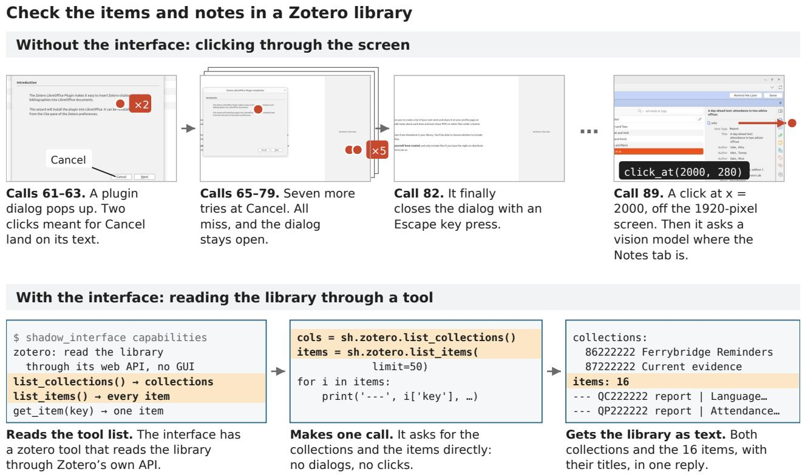  
Figure 14 | Reading a Zotero library (s\_007). T<sup>h</sup>e seed agent c<sup>h</sup>ec<sup>k</sup>s items and notes t<sup>h</sup>roug<sup>h</sup> the GUI in 42 calls (59–100). Nine clicks meant for the Cancel button of a <sub>p</sub>lu<sub>g</sub>in dialo<sub>g</sub> miss (calls 61–79), and the a<sub>g</sub>ent closes the dialo<sub>g</sub> with an Esca<sub>p</sub>e ke<sub>y</sub> <sub>p</sub>ress at call 82. Later it clicks outside the screen an<sup>d</sup> as<sup>k</sup>s a vision mo<sup>d</sup>e<sup>l</sup> to <sup>l</sup>ocate t<sup>h</sup>e Notes ta<sup>b</sup>. Wit<sup>h</sup> if-029 <sup>f</sup>rom a separate evo<sup>l</sup>ution run, zotero.list\_collections an<sup>d</sup> list\_items return t<sup>h</sup>e <sup>lib</sup>rary as <sup>d</sup>ata <sup>i</sup>n one ca<sup>ll</sup>. T<sup>h</sup>e <sup>i</sup>nter<sup>f</sup>ace covers reading only: on this build the API rejects writes.

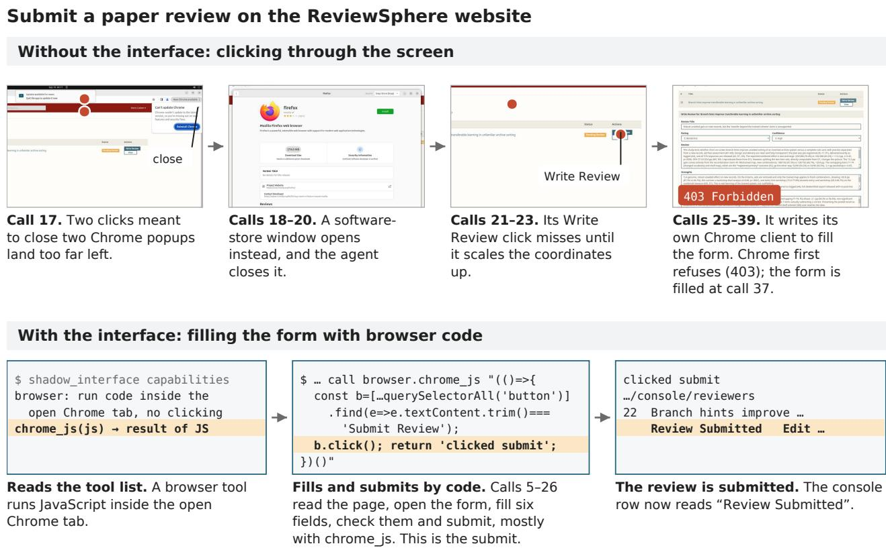  
Figure 15 | Submitting a review in ReviewSphere (s\_022). T<sup>h</sup>e seed agent’s c<sup>l</sup>ic<sup>k</sup>s meant to c<sup>l</sup>ose t<sub>wo</sub> <sub>popups</sub> <sub>open</sub> <sub>a</sub> <sub>so</sub>ft<sub>ware-s</sub>t<sub>ore</sub> <sub>w</sub>i<sub>n</sub>d<sub>ow,</sub> <sub>an</sub>d it<sub>s</sub> <sub>c</sub>li<sub>c</sub>k <sub>on</sub> W<sub>r</sub>it<sub>e</sub> R<sub>ev</sub>i<sub>ew</sub> <sub>m</sub>i<sub>sses</sub> <sub>un</sub>til it <sub>resca</sub>l<sub>es</sub> th<sub>e</sub> <sub>coor</sub>di<sub>na</sub>t<sub>es.</sub> It th<sub>en wr</sub>it<sub>es</sub> it<sub>s own</sub> Ch<sub>rome c</sub>li<sub>en</sub>t t<sub>o</sub> fill th<sub>e</sub> f<sub>orm;</sub> Ch<sub>rome</sub> fi<sub>rs</sub>t <sub>re</sub>f<sub>uses</sub> th<sub>e connec</sub>ti<sub>on</sub> w<sup>i</sup>t<sup>h</sup> 403 Forbidden, an<sup>d</sup> t<sup>h</sup>e <sup>f</sup>orm <sup>i</sup>s <sup>fill</sup>e<sup>d</sup> at ca<sup>ll</sup> 37. W<sup>i</sup>t<sup>h</sup> if-026 <sup>f</sup>rom a separate evo<sup>l</sup>ut<sup>i</sup>on <sub>run, ca</sub>ll<sub>s</sub> 5<sub>–</sub>26 <sub>rea</sub>d th<sub>e page, open</sub> th<sub>e</sub> f<sub>orm,</sub> fill <sub>s</sub>i<sub>x</sub> fi<sub>e</sub>ld<sub>s, c</sub>h<sub>ec</sub>k th<sub>em, an</sub>d <sub>su</sub>b<sub>m</sub>it<sub>, mos</sub>tl<sub>y</sub> th<sub>roug</sub>h browser.chrome\_js, w<sup>i</sup>t<sup>h</sup> no <sup>f</sup>a<sup>il</sup>e<sup>d</sup> ca<sup>ll</sup>s.

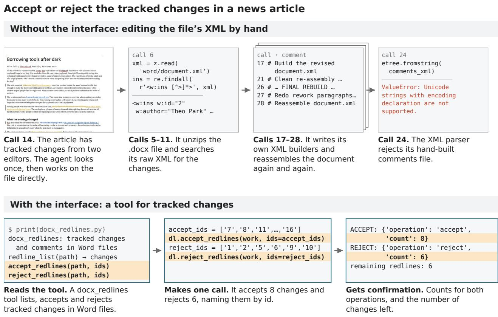  
Figure 16 | Resolving tracked changes in a Word document (s\_026). T<sup>h</sup>e seed agent reads t<sup>h</sup>e raw d<sub>ocumen</sub>t XML <sub>an</sub>d <sub>re</sub>b<sub>u</sub>ild<sub>s</sub> i<sub>nser</sub>ti<sub>on an</sub>d d<sub>e</sub>l<sub>e</sub>ti<sub>on e</sub>l<sub>emen</sub>t<sub>s</sub> b<sub>y</sub> h<sub>an</sub>d i<sub>n ca</sub>ll<sub>s</sub> 17<sub>–</sub>28<sub>;</sub> it<sub>s commen</sub>t<sub>s</sub> XML <sup>f</sup>ai<sup>l</sup>s to parse at ca<sup>ll</sup> 24. Wit<sup>h</sup> if-030 <sup>f</sup>rom a separate evo<sup>l</sup>ution run, t<sup>h</sup>e agent <sup>l</sup>ists t<sup>h</sup>e c<sup>h</sup>anges wit<sup>h</sup> redline\_list, t<sup>h</sup>en accepts e<sup>i</sup>g<sup>h</sup>t an<sup>d</sup> rejects s<sup>i</sup>x w<sup>i</sup>t<sup>h</sup> accept\_redlines an<sup>d</sup> reject\_redlines i<sub>n one ca</sub>ll<sub>.</sub>

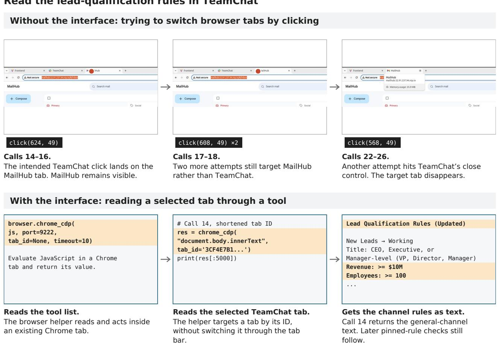  
Figure 17 | Accessing a TeamChat tab (OSWor<sup>l</sup>d V2 tas<sup>k</sup> 038). T<sup>h</sup>e <sup>b</sup>are agent repeated<sup>l</sup>y c<sup>l</sup>ic<sup>k</sup>s t<sup>h</sup>e Mai<sup>l</sup>Hu<sup>b</sup> ta<sup>b</sup> w<sup>h</sup>i<sup>l</sup>e trying to activate TeamC<sup>h</sup>at, t<sup>h</sup>en <sup>h</sup>its TeamC<sup>h</sup>at’s c<sup>l</sup>ose contro<sup>l</sup>. Wit<sup>h</sup> if-024, ca<sup>ll</sup> 14 uses browser.chrome\_cdp w<sup>i</sup>t<sup>h</sup> a ta<sup>b</sup> ID to rea<sup>d</sup> t<sup>h</sup>e genera<sup>l</sup>-c<sup>h</sup>anne<sup>l</sup> ru<sup>l</sup>es w<sup>i</sup>t<sup>h</sup>out sw<sup>i</sup>tc<sup>hi</sup>ng t<sub>a</sub>b<sub>s</sub> th<sub>roug</sub>h th<sub>e screen.</sub> L<sub>a</sub>t<sub>er p</sub>i<sub>nne</sub>d<sub>-ru</sub>l<sub>e c</sub>h<sub>ec</sub>k<sub>s an</sub>d CRM <sub>up</sub>d<sub>a</sub>t<sub>es rema</sub>i<sub>n.</sub> Th<sub>e</sub> f<sub>u</sub>ll <sub>ep</sub>i<sub>so</sub>d<sub>es</sub> t<sub>a</sub>k<sub>e</sub> 94 and 95 model ste<sub>p</sub>s and receive task scores of 0.6517 and 0.70<sub>,</sub> res<sub>p</sub>ectivel<sub>y</sub>.

ScienceBoard evolution comparison. Figures 18–20 compare t<sup>h</sup>e seed repository wit<sup>h</sup> t<sup>h</sup>e se<sup>l</sup>ected evo<sup>l</sup>ve<sup>d</sup> repository, if-016, on t<sup>h</sup>e same ScienceBoar<sup>d</sup> tas<sup>k</sup>s using t<sup>h</sup>e same tas<sup>k</sup> mo<sup>d</sup>e<sup>l</sup> an<sup>d</sup> eva<sup>l</sup>uation harness. The to<sub>p</sub> row (“Without the interface”) follows GUI interactions in the seed e<sub>p</sub>isode; the bottom row (“With the interface”) shows the evolved hel<sub>p</sub>er documentation, calls, and returned <sub>o</sub>b<sub>serva</sub>ti<sub>ons.</sub> B<sub>o</sub>th <sub>ep</sub>i<sub>so</sub>d<sub>es pass</sub> i<sub>n eac</sub>h <sub>case.</sub> M<sub>o</sub>d<sub>e</sub>l <sub>s</sub>t<sub>eps coun</sub>t <sub>comp</sub>l<sub>e</sub>t<sub>e</sub>d <sub>ass</sub>i<sub>s</sub>t<sub>an</sub>t <sub>responses,</sub> i<sub>nc</sub>l<sub>u</sub>di<sub>ng</sub> <sub>re</sub>t<sub>r</sub>i<sub>es,</sub> f<sub>a</sub>il<sub>e</sub>d <sub>a</sub>tt<sub>emp</sub>t<sub>s,</sub> <sub>ver</sub>ifi<sub>ca</sub>ti<sub>on,</sub> <sub>an</sub>d th<sub>e</sub> fi<sub>na</sub>l <sub>answer;</sub> <sub>one</sub> <sub>s</sub>t<sub>ep</sub> <sub>may</sub> <sub>con</sub>t<sub>a</sub>i<sub>n</sub> <sub>mu</sub>lti<sub>p</sub>l<sub>e</sub> <sub>ac</sub>ti<sub>ons.</sub> E<sub>ac</sub>h <sub>con</sub>diti<sub>on</sub> h<sub>as one ep</sub>i<sub>so</sub>d<sub>e per</sub> t<sub>as</sub>k<sub>.</sub> Th<sub>ese qua</sub>lit<sub>a</sub>ti<sub>ve cases</sub> ill<sub>us</sub>t<sub>ra</sub>t<sub>e</sub> i<sub>n</sub>t<sub>er</sub>f<sub>ace use</sub> <sub>ra</sub>th<sub>er</sub> th<sub>an es</sub>ti<sub>ma</sub>ti<sub>ng a</sub> t<sub>rea</sub>t<sub>men</sub>t <sub>e</sub>f<sub>ec</sub>t <sub>or</sub> i<sub>so</sub>l<sub>a</sub>ti<sub>ng an</sub> i<sub>n</sub>di<sub>v</sub>id<sub>ua</sub>l h<sub>e</sub>l<sub>per</sub>’<sub>s</sub> b<sub>ene</sub>fit<sub>.</sub>

Plot y = ln(x)^2 in KAlgebra  
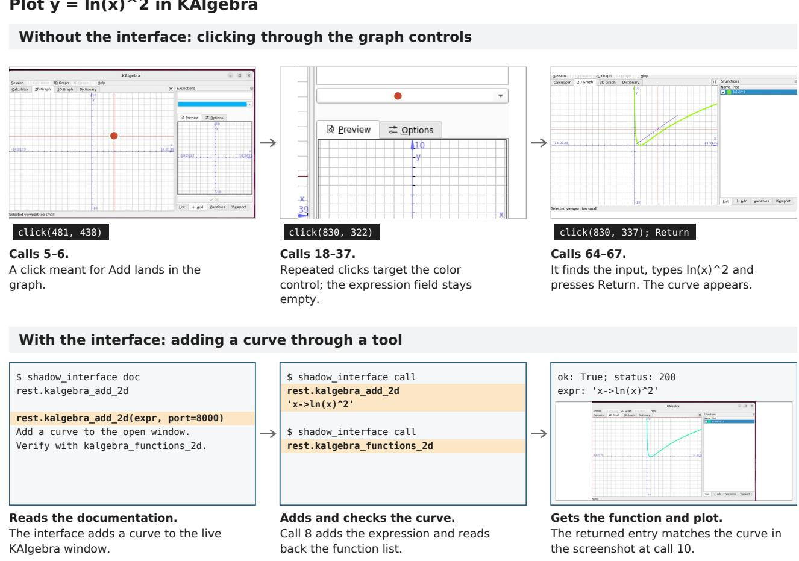  
Figure 18 | Plotting a function in KAlgebra (KAlgebra:A-02). T<sup>h</sup>e seed agent’s Add c<sup>l</sup>ic<sup>k</sup> l<sub>an</sub>d<sub>s</sub> i<sub>n</sub> th<sub>e grap</sub>h<sub>, an</sub>d <sub>repea</sub>t<sub>e</sub>d <sub>c</sub>li<sub>c</sub>k<sub>s</sub> t<sub>arge</sub>t th<sub>e co</sub>l<sub>or con</sub>t<sub>ro</sub>l i<sub>ns</sub>t<sub>ea</sub>d <sub>o</sub>f th<sub>e express</sub>i<sub>on</sub> i<sub>npu</sub>t<sub>.</sub> It <sub>even</sub>t<sub>ua</sub>ll<sub>y</sub> fi<sub>n</sub>d<sub>s</sub> th<sub>e</sub> i<sub>npu</sub>t <sub>an</sub>d <sub>p</sub>l<sub>o</sub>t<sub>s</sub> $y \ = \ \ln ( x ) ^ { 2 }$ in ca<sup>ll</sup>s 64–67. Wit<sup>h</sup> if-016, ca<sup>ll</sup> 8 uses rest.kalgebra\_add\_2d to a<sup>dd</sup> t<sup>h</sup>e curve an<sup>d</sup> rest.kalgebra\_functions\_2d to rea<sup>d</sup> <sup>i</sup>t <sup>b</sup>ac<sup>k</sup>; <sub>ca</sub>ll 10 <sub>s</sub>h<sub>ows</sub> th<sub>e</sub> <sub>resu</sub>lti<sub>ng</sub> <sub>p</sub>l<sub>o</sub>t<sub>.</sub> B<sub>o</sub>th <sub>ep</sub>i<sub>so</sub>d<sub>es</sub> <sub>pass,</sub> i<sub>n</sub> 68 <sub>an</sub>d 11 <sub>mo</sub>d<sub>e</sub>l <sub>s</sub>t<sub>eps,</sub> <sub>respec</sub>ti<sub>ve</sub>l<sub>y.</sub>

Calculate log₂(3) and store it in p in KAlgebra Without the interface: finding the calculator input by clicking

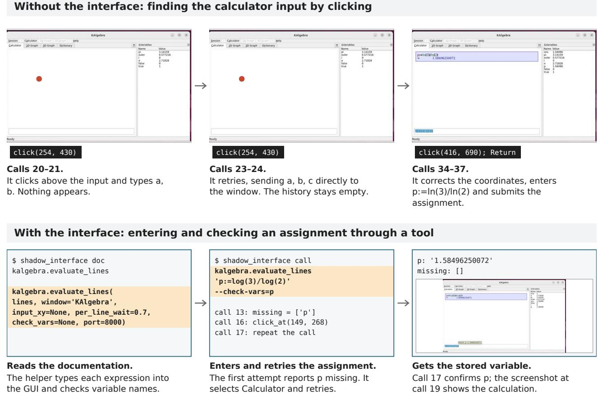  
Figure 19 | Storing a calculation in KAlgebra (KAlgebra:C-01). T<sup>h</sup>e seed agent repeated<sup>l</sup>y c<sup>l</sup>ic<sup>k</sup>s <sub>a</sub>b<sub>ove</sub> th<sub>e</sub> <sub>ca</sub>l<sub>cu</sub>l<sub>a</sub>t<sub>or</sub> i<sub>npu</sub>t <sub>an</sub>d <sub>sen</sub>d<sub>s</sub> t<sub>es</sub>t <sub>c</sub>h<sub>arac</sub>t<sub>ers</sub> b<sub>e</sub>f<sub>ore</sub> <sub>correc</sub>ti<sub>ng</sub> th<sub>e</sub> <sub>coor</sub>di<sub>na</sub>t<sub>es</sub> <sub>an</sub>d <sub>s</sub>t<sub>or</sub>i<sub>ng</sub> $\log _ { 2 } ( 3 )$ <sup>i</sup>n p. W<sup>i</sup>t<sup>h</sup> if-016, kalgebra.evaluate\_lines enters t<sup>h</sup>e express<sup>i</sup>on t<sup>h</sup>roug<sup>h</sup> t<sup>h</sup>e GUI an<sup>d</sup> c<sup>h</sup>ec<sup>k</sup>s t<sup>h</sup>e var<sup>i</sup>a<sup>bl</sup>e. Its <sup>fi</sup>rst attempt reports p m<sup>i</sup>ss<sup>i</sup>ng; t<sup>h</sup>e agent se<sup>l</sup>ects t<sup>h</sup>e Ca<sup>l</sup>cu<sup>l</sup>ator ta<sup>b</sup> an<sup>d</sup> retries, con<sup>fi</sup>rming p=1.58496250072 at ca<sup>ll</sup> 17. Bot<sup>h</sup> episo<sup>d</sup>es pass, in 40 an<sup>d</sup> 21 mo<sup>d</sup>e<sup>l</sup> steps, res<sub>p</sub>ect<sup>i</sup>ve<sup>l</sup><sub>y</sub>.

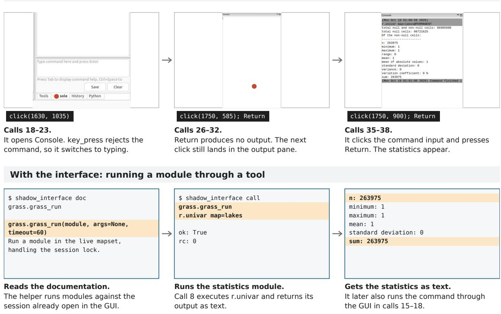  
Figure 20 | Computing raster statistics in GRASS GIS (GrassGIS:B-12). T<sup>h</sup>e seed agent <sup>l</sup>ocates th<sub>e</sub> GUI <sub>conso</sub>l<sub>e, correc</sub>t<sub>s</sub> it<sub>s</sub> t<sub>yp</sub>i<sub>ng me</sub>th<sub>o</sub>d<sub>, an</sub>d <sub>re</sub>t<sub>r</sub>i<sub>es</sub> R<sub>e</sub>t<sub>urn un</sub>til it f<sub>ocuses</sub> th<sub>e comman</sub>d i<sub>npu</sub>t <sub>an</sub>d o<sup>b</sup>ta<sup>i</sup>ns t<sup>h</sup>e stat<sup>i</sup>st<sup>i</sup>cs. W<sup>i</sup>t<sup>h</sup> if-016, ca<sup>ll</sup> 8 runs r.univar map=lakes t<sup>h</sup>roug<sup>h</sup> grass.grass\_run against t<sup>h</sup>e <sup>l</sup>ive mapset an<sup>d</sup> returns t<sup>h</sup>e statistics as text, inc<sup>l</sup>u<sup>d</sup>ing n=263975 an<sup>d</sup> sum=263975. T<sup>h</sup>e <sub>evo</sub>l<sub>ve</sub>d <sub>agen</sub>t <sub>a</sub>l<sub>so runs</sub> th<sub>e comman</sub>d th<sub>roug</sub>h th<sub>e</sub> GUI i<sub>n ca</sub>ll<sub>s</sub> 15<sub>–</sub>18<sub>.</sub> B<sub>o</sub>th <sub>ep</sub>i<sub>so</sub>d<sub>es pass,</sub> i<sub>n</sub> 40 <sub>an</sub>d 21 model ste<sub>p</sub>s<sub>,</sub> res<sub>p</sub>ectivel<sub>y</sub>.

## C. Harness Prompts

W<sub>e</sub> <sub>repro</sub>d<sub>uce</sub> th<sub>e</sub> <sub>ma</sub>i<sub>n</sub> b<sub>u</sub>ild<sub>er</sub> <sub>promp</sub>t<sub>s</sub> <sub>use</sub>d f<sub>or</sub> <sub>repos</sub>it<sub>ory</sub> <sub>evo</sub>l<sub>u</sub>ti<sub>on.</sub> P<sub>romp</sub>t C<sub>.</sub>1 <sub>prov</sub>id<sub>es</sub> th<sub>e</sub> standing instructions for mutation from ungraded synthetic-task trajectories, and Prompt C.2 starts each mutation ste<sub>p</sub>. Prom<sub>p</sub>t C.3 describes how to combine two <sub>p</sub>arent re<sub>p</sub>ositories<sub>,</sub> and Prom<sub>p</sub>t C.4 <sub>spec</sub>ifi<sub>es</sub> th<sub>e</sub> b<sub>u</sub>ild<sub>er</sub>’<sub>s execu</sub>ti<sub>on pro</sub>t<sub>oco</sub>l<sub>.</sub> Th<sub>ese promp</sub>t<sub>s are</sub> fi<sub>xe</sub>d b<sub>y</sub> th<sub>e</sub> h<sub>arness ra</sub>th<sub>er</sub> th<sub>an evo</sub>l<sub>ve</sub>d <sub>w</sub>ith th<sub>e repos</sub>it<sub>ory.</sub>

Prompt C.1: Mutation prompt: synthetic training tasks   
# Shadow Interface Builder   
You improve software that helps AI agents complete computer tasks on Ubuntu 22.04.   
## Evaluation evidence: synthetic tasks without verifiers   
These 30 synthetic training tasks (s\_001 through s\_030) have NO verifiers.   
Their dummy evaluators always return 0.0. Zero does NOT mean failure, and   
scores/averages do NOT measure task success. Never optimize those numbers,   
use them as rewards, or classify all attempts as failures. Raw result.txt   
and diagnostic score fields are compatibility placeholders only.   
Read the TRAIN trajectories under eval\_results/ recursively. Each task folder   
contains instruction.txt, claude\_trajectory.jsonl (a historical filename also   
used for Qwen/Prime traces), and any available diagnostics/screenshots.   
The aggregate latest\_summary.json and validation trajectories are intentionally   
not supplied to the builder. Do not try to access validation data.   
Use instructions, actions, tool outputs, screenshots, errors and observed   
artifacts to identify repeated work, missing capabilities and fragile workflows.   
An agent’s claim that it completed a task is not verified success. Distinguish   
observed evidence from hypotheses, and record both in notebook.jsonl. Do not   
invent a verifier or labels. Improve the evolving software from trajectories.   
## What you can modify   
- ‘shadow\_interface/‘ — all your code goes here   
- ‘shadow\_interface/context\_compaction.json‘ — evolvable mini-SWE context-window, reserve, keep  
recent, and checkpoint-summary policy   
- ‘notebook.jsonl‘ — append observations (persists across mutations)   
## Constraints   
- Python stdlib only — pip is disabled on VMs   
- VMs are fresh — no state persists between tasks   
- Task agents are autonomous — they may or may not use your tools   
- Do NOT modify files outside shadow\_interface/ and notebook.jsonl   
- Do NOT create or modify SYSTEM\_PROMPT.md — the task agent’s system prompt is controlled by the   
orchestrator   
- You do NOT run evals — the orchestrator evaluates after you finish   
## Goal   
Build general, reusable tools that help agents complete tasks more reliably and efficiently,   
using trajectory evidence. The orchestrator separately measures each version on the older   
validation set; synthetic scores remain ungraded.   
Two qualities to keep in mind as you build:   
- \*\*Generality.\*\* Prefer helpers that work across many tasks. A helper that only addresses one   
specific task is a sign you stopped one level too early — keep abstracting until the same helper   
would serve the next, related task.   
- \*\*Discoverability.\*\* Write clear signatures and docstrings. Agents find your tools via ‘python   
-m shadow\_interface capabilities‘ and ‘python -m shadow\_interface doc <name>‘; helpers without   
docstrings get passed over for less specialized ones the agent can read.

T<sup>h</sup>e mutat<sup>i</sup>on turn <sup>i</sup>nstruct<sup>i</sup>on re<sup>f</sup>ers t<sup>h</sup>e <sup>b</sup>u<sup>ild</sup>er to t<sup>h</sup>e stan<sup>di</sup>ng <sup>i</sup>nstruct<sup>i</sup>ons <sup>i</sup>n CLAUDE.md repro<sup>d</sup>uce<sup>d</sup> <sub>a</sub>b<sub>ove.</sub>

## Prompt C.2: Mutation turn instruction

Mutation step. Read CLAUDE.md for instructions. Study eval\_results/ trajectories to identify   
difficulties and opportunities. Interpret scores according to CLAUDE.md. Improve shadow\_interface   
/. Write observations to notebook.jsonl.

## Prompt C.3: Builder template: crossover

```markdown
# Shadow Interface Builder — Crossover
You have two interface implementations that took different approaches.
## Parents
- **Parent A** (‘crossover_parent_a/‘): eval results in ‘eval_results/parent_a/‘
**Parent B** (‘crossover_parent_b/‘): eval results in ‘eval_results/parent_b/‘
## Your Job
Combine the best of both into ‘shadow_interface/‘ (starts with Parent B’s code).
1. Capabilities in A but not B — port them
2. Capabilities in B but not A — keep them
3. Different approaches to same thing — pick what works better per eval results
4. Ensure merged code is coherent
## Constraints
- Python stdlib only
Modify only shadow_interface/ and notebook.jsonl
You do NOT run evals
```

## Prompt C.4: Builder system prompt

You are the autonomous builder inside a shadow-interface evolution run.   
Follow the task exactly, inspect the available evaluation evidence, make the   
requested changes directly in the allowed files, verify them, and finish   
without asking the user questions.   
Your only model-facing tool is a persistent IPython kernel. Run shell commands   
from IPython subprocess APIs or a %%bash cell. To inspect the GUI visually,   
first use a subprocess to run the shadow interface screenshot command, for   
example:   
subprocess.run(["python3", "-m", "shadow\_interface", "call",   
"gui.take\_screenshot", "/tmp/screenshot.png"], check=True)   
Then, in a subsequent IPython cell, load the image into model context with:   
print(await attach\_image("/tmp/screenshot.png"))   
Do not Base64-encode screenshots or infer their visual contents from file   
metadata. Prime Agent owns the agent loop, session history, and configured   
context compaction; continue working through compaction when it occurs.

## D. OSWorld V2 Synthetic Training Tasks

We use 30 s<sub>y</sub>nthetic tasks to <sub>p</sub>rovide construction ex<sub>p</sub>erience for A<sub>g</sub>ent S4. The set contains 21 tasks th<sub>a</sub>t <sub>use</sub> d<sub>es</sub>kt<sub>op</sub> <sub>app</sub>li<sub>ca</sub>ti<sub>ons</sub> <sub>an</sub>d <sub>n</sub>i<sub>ne</sub> th<sub>a</sub>t i<sub>nvo</sub>l<sub>ve</sub> l<sub>oca</sub>l <sub>moc</sub>k <sub>we</sub>b<sub>s</sub>it<sub>es,</sub> <sub>some</sub>ti<sub>mes</sub> t<sub>oge</sub>th<sub>er</sub> <sub>w</sub>ith d<sub>es</sub>kt<sub>op app</sub>li<sub>ca</sub>ti<sub>ons.</sub> E<sub>ac</sub>h t<sub>as</sub>k i<sub>nc</sub>l<sub>u</sub>d<sub>es an</sub> i<sub>ns</sub>t<sub>ruc</sub>ti<sub>on,</sub> i<sub>npu</sub>t <sub>ma</sub>t<sub>er</sub>i<sub>a</sub>l<sub>s, an</sub>d <sub>an</sub> i<sub>n</sub>iti<sub>a</sub>l <sub>app</sub>li<sub>ca</sub>ti<sub>on</sub> <sub>s</sub>t<sub>a</sub>t<sub>e.</sub> Th<sub>e</sub> t<sub>as</sub>k<sub>s</sub> <sub>cover</sub> d<sub>ocumen</sub>t <sub>an</sub>d <sub>sprea</sub>d<sub>s</sub>h<sub>ee</sub>t <sub>wor</sub>k<sub>,</sub> <sub>me</sub>di<sub>a</sub> <sub>e</sub>diti<sub>ng,</sub> 3D <sub>mo</sub>d<sub>e</sub>li<sub>ng,</sub> <sub>researc</sub>h<sub>,</sub> fil<sub>e</sub> <sub>managemen</sub>t<sub>, an</sub>d <sub>we</sub>b <sub>wor</sub>kfl<sub>ows.</sub> T<sub>a</sub>bl<sub>e</sub> 9 li<sub>s</sub>t<sub>s a</sub>ll t<sub>as</sub>k ID<sub>s, goa</sub>l<sub>s, an</sub>d <sub>app</sub>li<sub>ca</sub>ti<sub>ons.</sub> S<sub>ec</sub>ti<sub>on</sub> D<sub>.</sub>1 <sub>g</sub>i<sub>ves</sub> th<sub>e</sub>i<sub>r</sub> f<sub>u</sub>ll t<sub>as</sub>k<sub>-spec</sub>ifi<sub>c</sub> i<sub>ns</sub>t<sub>ruc</sub>ti<sub>ons.</sub>

Construction and use. We use<sup>d</sup> gpt-6-astra <sup>f</sup>or tas<sup>k</sup> aut<sup>h</sup>oring an<sup>d</sup> gpt-5.6-sol <sup>f</sup>or in<sup>d</sup>epend<sub>en</sub>t t<sub>as</sub>k <sub>rev</sub>i<sub>ew.</sub> A<sub>u</sub>th<sub>or agen</sub>t<sub>s crea</sub>t<sub>e</sub>d <sub>or</sub>i<sub>g</sub>i<sub>na</sub>l <sub>scenar</sub>i<sub>os an</sub>d <sub>ma</sub>t<sub>er</sub>i<sub>a</sub>l<sub>s</sub> f<sub>rom env</sub>i<sub>ronmen</sub>t <sub>an</sub>d <sub>coverage</sub> b<sub>r</sub>i<sub>e</sub>f<sub>s.</sub> I<sub>n</sub>d<sub>epen</sub>d<sub>en</sub>t <sub>rev</sub>i<sub>ewer agen</sub>t<sub>s assesse</sub>d <sub>or</sub>i<sub>g</sub>i<sub>na</sub>lit<sub>y aga</sub>i<sub>ns</sub>t th<sub>e</sub> b<sub>enc</sub>h<sub>mar</sub>k <sub>an</sub>d th<sub>e</sub> <sub>accep</sub>t<sub>e</sub>d <sub>syn</sub>th<sub>e</sub>ti<sub>c</sub> b<sub>an</sub>k<sub>, co</sub>h<sub>erence,</sub> f<sub>eas</sub>ibilit<sub>y, an</sub>d th<sub>e c</sub>h<sub>a</sub>ll<sub>enge suppor</sub>t<sub>e</sub>d b<sub>y</sub> th<sub>e ma</sub>t<sub>er</sub>i<sub>a</sub>l<sub>s.</sub> Thi<sub>s</sub> <sub>rev</sub>i<sub>ew</sub> <sub>assesse</sub>d t<sub>as</sub>k d<sub>es</sub>i<sub>gn.</sub> It did <sub>no</sub>t l<sub>a</sub>b<sub>e</sub>l <sub>agen</sub>t <sub>a</sub>tt<sub>emp</sub>t<sub>s</sub> <sub>or</sub> <sub>crea</sub>t<sub>e</sub> <sub>re</sub>f<sub>erence</sub> <sub>so</sub>l<sub>u</sub>ti<sub>ons.</sub> Th<sub>e</sub> t<sub>ra</sub>i<sub>n</sub>i<sub>ng</sub> <sub>pac</sub>k<sub>age uses a cons</sub>t<sub>an</sub>t<sub>-zero eva</sub>l<sub>ua</sub>t<sub>or</sub> f<sub>or compa</sub>tibilit<sub>y w</sub>ith th<sub>e runner;</sub> thi<sub>s p</sub>l<sub>ace</sub>h<sub>o</sub>ld<sub>er</sub> i<sub>s no</sub>t <sub>a</sub> success label or a training reward. The meta-agent receives the resulting training trajectories, while h<sub>e</sub>ld<sub>-ou</sub>t <sub>va</sub>lid<sub>a</sub>ti<sub>on</sub> d<sub>e</sub>t<sub>erm</sub>i<sub>nes se</sub>l<sub>ec</sub>ti<sub>on as</sub> d<sub>escr</sub>ib<sub>e</sub>d i<sub>n</sub> S<sub>ec</sub>ti<sub>on</sub> 3<sub>.</sub>3<sub>.</sub>

Ta<sup>bl</sup>e 9 | Synthetic tasks provide the experience from which Agent S4 discovers interfaces. Th<sub>e</sub> 30 t<sub>as</sub>k<sub>s span</sub> d<sub>es</sub>kt<sub>op app</sub>li<sub>ca</sub>ti<sub>ons an</sub>d l<sub>oca</sub>l <sub>we</sub>b <sub>wor</sub>kfl<sub>ows, o</sub>ft<sub>en requ</sub>i<sub>r</sub>i<sub>ng</sub> th<sub>e agen</sub>t t<sub>o wor</sub>k across applications. Their trajectories expose interaction failures and ineficient workflows that the <sub>me</sub>t<sub>a-agen</sub>t <sub>can s</sub>t<sub>u</sub>d<sub>y</sub> t<sub>o rev</sub>i<sub>se</sub> i<sub>n</sub>t<sub>er</sub>f<sub>aces an</sub>d <sub>usage</sub> k<sub>now</sub>l<sub>e</sub>d<sub>ge, w</sub>ith<sub>ou</sub>t <sub>groun</sub>d<sub>-</sub>t<sub>ru</sub>th <sub>success</sub> l<sub>a</sub>b<sub>e</sub>l<sub>s.</sub>

<table><tr><td>ID</td><td>Task</td><td>Applications</td></tr><tr><td>s_001</td><td>Update a visitor map and event timetable.</td><td>LibreOffice Impress, LibreOf- fice Writer</td></tr><tr><td>s_002</td><td>Edit a thank-you video with captions and music.</td><td>Shotcut</td></tr><tr><td>s_003</td><td>Assign repair jobs using current staff, parts and equipment.</td><td>TeamChat, LibreOffice Calc</td></tr><tr><td>s_004</td><td>Mix several audio tracks and control volume changes.</td><td>REAPER</td></tr><tr><td>s_005</td><td>Build a decision map for choosing seed sources.</td><td>XMind</td></tr><tr><td>s_006</td><td>Correct cooling-test measurements and plot the results.</td><td>LabPlot, Text editor</td></tr><tr><td>s_007</td><td>Clean up research references and link findings to sources.</td><td>Zotero, Obsidian</td></tr><tr><td>s_008</td><td>Model a pump enclosure with enough room for servicing.</td><td>Blender, Text editor</td></tr><tr><td>s_009</td><td>Finish a trio arrangement and prepare each musician's part.</td><td>MuseScore Studio 4.6</td></tr><tr><td>s_010</td><td>Resolve a damaged-order claim and confirm replacement costs. MailHub, Text editor</td><td></td></tr><tr><td>s_011</td><td>Update customer renewal records and assign follow-up work. CloudCRM, Text editor</td><td></td></tr><tr><td>s_012</td><td>Draw a tool-return mat with outlines at actual size.</td><td>LibreOffice Draw</td></tr><tr><td>s_013</td><td>Launch a service with a company page, job post and customer CareerLink, Text editor reply.</td><td></td></tr><tr><td>s_014</td><td>Fix a handbook's headings, page layout and references.</td><td>LibreOffice Writer</td></tr><tr><td>s_015</td><td>Model cup returns, washing and daily stock levels.</td><td>LibreOffice Calc, Text editor</td></tr><tr><td>s_016</td><td>Submit a path-diversion proposal using the latest site informa- FormCraft, MailHub, Text edi- tion.</td><td>tor</td></tr><tr><td>s_017</td><td>Package the latest maps and forms for an offline field inspec- Default file manager, Terminal, tion.</td><td>Local text editor</td></tr><tr><td>s_018</td><td>Animate a gripper lifting, moving and releasing a box.</td><td>Blender</td></tr><tr><td>s_019</td><td>Map how audio and transcripts move through publication.</td><td>Obsidian</td></tr><tr><td>s_020</td><td>Rebuild a recording-day calendar around people and equip- Calendar, Text editor ment.</td><td></td></tr><tr><td>s_021</td><td>Build a clickable help guide for library scanner problems.</td><td>LibreOffice Impress</td></tr><tr><td>s_022</td><td>Review a research paper and submit a recommendation.</td><td>ReviewSphere, Local text edi-</td></tr><tr><td>s_023</td><td>Create an equipment request form that can be filled in on LibreOffice Writer, PDF viewer screen.</td><td>tor</td></tr><tr><td>s_024</td><td>Synchronize two test videos for a fair motion comparison.</td><td>Shotcut</td></tr><tr><td>s_025</td><td>Calculate water-service outages and summarize their impact. LibreOffice Calc, Text editor</td><td></td></tr><tr><td>s_026</td><td>Check a news article's facts and resolve suggested edits.</td><td>LibreOffice Writer, Local text editor</td></tr><tr><td>s_027</td><td>Compare drying experiments and write an evidence-based W&amp;B mock, Local text editor report.</td><td></td></tr><tr><td>s_028</td><td>Book suitable seats for a group within access and budget limits. Eventix, Local text editor</td><td></td></tr><tr><td>s_029</td><td>Illustrate how rain runs off, soaks in and collects.</td><td>LibreOffice Draw, PDF viewer</td></tr><tr><td>s_030</td><td>Generate personal practice letters from learners' assessment LibreOffice Writer, LibreOffice results.</td><td>Calc</td></tr></table>

## D.1. Task Instructions

Th<sub>e</sub> f<sub>o</sub>ll<sub>ow</sub>i<sub>ng</sub> i<sub>ns</sub>t<sub>ruc</sub>ti<sub>ons re</sub>t<sub>a</sub>i<sub>n</sub> th<sub>e</sub> t<sub>as</sub>k <sub>wor</sub>di<sub>ng an</sub>d <sub>ma</sub>t<sub>er</sub>i<sub>a</sub>l <sub>pa</sub>th<sub>s.</sub> Th<sub>e runner appen</sub>d<sub>s</sub> th<sub>e same</sub> <sub>execu</sub>ti<sub>on rem</sub>i<sub>n</sub>d<sub>er</sub> t<sub>o every</sub> i<sub>ns</sub>t<sub>ruc</sub>ti<sub>on:</sub>

Thi<sub>s</sub> i<sub>ns</sub>t<sub>ruc</sub>ti<sub>on</sub> i<sub>s</sub> i<sub>n</sub> th<sub>e</sub> <sub>con</sub>t<sub>ex</sub>t <sub>o</sub>f <sub>w</sub>h<sub>a</sub>t<sub>ever</sub> i<sub>s</sub> <sub>curren</sub>tl<sub>y</sub> <sub>open</sub> <sub>or</sub> <sub>runn</sub>i<sub>ng</sub> <sub>on</sub> th<sub>e</sub> <sub>compu</sub>t<sub>er.</sub> Y<sub>ou may nee</sub>d t<sub>o</sub> i<sub>nves</sub>ti<sub>ga</sub>t<sub>e</sub> th<sub>a</sub>t f<sub>or yourse</sub>lf<sub>.</sub> D<sub>o no</sub>t <sub>as</sub>k <sub>user any</sub> f<sub>o</sub>ll<sub>ow-up ques</sub>ti<sub>ons.</sub>

## D.1.1. s\_001 Finish the Quay Works visitor guide

Applications. Li<sup>b</sup>reO<sup>fi</sup>ce Impress, Li<sup>b</sup>reO<sup>fi</sup>ce Writer.

Finish the two-page visitor guide for Quay Works Open Studios on Saturday 17 October 2026. The source pac<sup>k</sup>et is in /home/user/CUESTraining/cues\_r001/. Start <sup>f</sup>rom guide-draft-07-oct.odp, an e<sup>di</sup>ta<sup>bl</sup>e <sup>b</sup>ut out<sup>d</sup>ate<sup>d l</sup>ayout, an<sup>d</sup> use 01-booking-record-07-oct.txt, 02-change-register-throu gh-16-oct.txt an<sup>d</sup> 03-facilities-notice-16-oct.txt to <sup>b</sup>r<sup>i</sup>ng <sup>i</sup>t current t<sup>h</sup>roug<sup>h</sup> t<sup>h</sup>e reg<sup>i</sup>ster<sup>’</sup>s 1<sup>6</sup> October<sub>,</sub> 16:00 ex<sub>p</sub>ort.

Kee<sub>p</sub> the <sub>g</sub>uide to two landsca<sub>p</sub>e A4 <sub>p</sub>a<sub>g</sub>es. Pa<sub>g</sub>e 1 must contain the ma<sub>p</sub> and a com<sub>p</sub>act studio director<sub>y</sub>. P<sub>reserve</sub> th<sub>e map</sub>’<sub>s or</sub>i<sub>en</sub>t<sub>a</sub>ti<sub>on, room pos</sub>iti<sub>ons, room co</sub>d<sub>es, p</sub>h<sub>ys</sub>i<sub>ca</sub>l <sub>room names, corr</sub>id<sub>or geome</sub>t<sub>ry an</sub>d d<sub>oorway gaps.</sub> U<sub>p</sub>d<sub>a</sub>t<sub>e eac</sub>h <sub>occup</sub>i<sub>e</sub>d <sub>room w</sub>ith th<sub>e correc</sub>t <sub>curren</sub>t <sub>s</sub>t<sub>u</sub>di<sub>o name an</sub>d <sub>rep</sub>l<sub>ace</sub> th<sub>e o</sub>ld di<sub>rec</sub>t<sub>ory</sub> <sub>w</sub>ith <sub>eac</sub>h <sub>curren</sub>t <sub>s</sub>t<sub>u</sub>di<sub>o</sub>’<sub>s name, ac</sub>ti<sub>v</sub>it<sub>y</sub> d<sub>escr</sub>i<sub>p</sub>ti<sub>on, room co</sub>d<sub>e an</sub>d <sub>room name.</sub> A<sub>pp</sub>l<sub>y</sub> th<sub>e</sub> f<sub>ac</sub>iliti<sub>es no</sub>ti<sub>ce</sub> t<sub>o</sub> th<sub>e v</sub>i<sub>s</sub>it<sub>or en</sub>t<sub>rance, s</sub>t<sub>a</sub>f <sub>access,</sub> i<sub>n</sub>f<sub>orma</sub>ti<sub>on</sub> d<sub>es</sub>k<sub>, arr</sub>i<sub>va</sub>l <sub>rou</sub>t<sub>e an</sub>d l<sub>egen</sub>d<sub>.</sub> Th<sub>e arr</sub>i<sub>va</sub>l <sub>rou</sub>t<sub>e mus</sub>t l<sub>ea</sub>d t<sub>o</sub> th<sub>e</sub> <sub>s</sub>t<sub>u</sub>di<sub>o runn</sub>i<sub>ng</sub> P<sub>oc</sub>k<sub>e</sub>t <sub>no</sub>t<sub>e</sub>b<sub>oo</sub>k<sub>, us</sub>i<sub>ng</sub> th<sub>e curren</sub>t <sub>a</sub>ll<sub>oca</sub>ti<sub>on.</sub> K<sub>eep</sub> th<sub>e rou</sub>t<sub>e</sub> i<sub>n</sub> th<sub>e corr</sub>id<sub>or, pass</sub> b<sub>e</sub>l<sub>ow</sub> th<sub>e</sub> d<sub>es</sub>k<sub>,</sub> fi<sub>n</sub>i<sub>s</sub>h <sub>a</sub>t th<sub>e correc</sub>t d<sub>oorway an</sub>d <sub>avo</sub>id <sub>cross</sub>i<sub>ng wa</sub>ll<sub>s or</sub> l<sub>a</sub>b<sub>e</sub>l<sub>s.</sub> K<sub>eep</sub> th<sub>ese e</sub>l<sub>emen</sub>t<sub>s e</sub>dit<sub>a</sub>bl<sub>e as na</sub>ti<sub>ve</sub> <sub>s</sub>h<sub>apes an</sub>d t<sub>ex</sub>t<sub>.</sub>

P<sub>age</sub> 2 <sub>mus</sub>t <sub>s</sub>h<sub>ow every curren</sub>tl<sub>y pu</sub>bli<sub>s</sub>h<sub>a</sub>bl<sub>e</sub> d<sub>emons</sub>t<sub>ra</sub>ti<sub>on</sub> i<sub>n s</sub>t<sub>ar</sub>t<sub>-</sub>ti<sub>me or</sub>d<sub>er, w</sub>ith it<sub>s curren</sub>t <sub>pu</sub>bli<sub>c</sub> titl<sub>e,</sub> <sub>s</sub>t<sub>u</sub>di<sub>o, room co</sub>d<sub>e an</sub>d <sub>room name, an</sub>d <sub>a s</sub>t<sub>ar</sub>t<sub>–en</sub>d ti<sub>me range ca</sub>l<sub>cu</sub>l<sub>a</sub>t<sub>e</sub>d f<sub>rom</sub> it<sub>s curren</sub>t d<sub>ura</sub>ti<sub>on.</sub> U<sub>se a na</sub>ti<sub>ve</sub> <sub>e</sub>dit<sub>a</sub>bl<sub>e</sub> t<sub>a</sub>bl<sub>e.</sub> F<sub>o</sub>ll<sub>ow</sub> th<sub>e</sub> <sub>source</sub> <sub>recor</sub>d<sub>s</sub>’ <sub>approva</sub>l <sub>an</sub>d id<sub>en</sub>tit<sub>y</sub> <sub>ru</sub>l<sub>es,</sub> i<sub>nc</sub>l<sub>u</sub>di<sub>ng</sub> i<sub>n</sub>h<sub>er</sub>it<sub>e</sub>d <sub>s</sub>t<sub>u</sub>di<sub>o-room</sub> <sub>c</sub>h<sub>anges,</sub> <sub>w</sub>ithd<sub>rawa</sub>l<sub>s, cance</sub>ll<sub>a</sub>ti<sub>ons an</sub>d <sub>reques</sub>t<sub>s.</sub> D<sub>o no</sub>t <sub>expose</sub> i<sub>n</sub>t<sub>erna</sub>l b<sub>oo</sub>ki<sub>ng</sub> ID<sub>s or unapprove</sub>d <sub>sugges</sub>ti<sub>ons</sub> i<sub>n</sub> th<sub>e</sub> <sub>pu</sub>bli<sub>c gu</sub>id<sub>e.</sub> P<sub>reserve genu</sub>i<sub>ne over</sub>l<sub>aps</sub> b<sub>e</sub>t<sub>ween sess</sub>i<sub>ons ra</sub>th<sub>er</sub> th<sub>an</sub> i<sub>nven</sub>ti<sub>ng new</sub> ti<sub>mes.</sub>

O<sub>n</sub> th<sub>e gu</sub>id<sub>e, re</sub>t<sub>a</sub>i<sub>n</sub> th<sub>e even</sub>t d<sub>a</sub>t<sub>e an</sub>d <sub>open</sub>i<sub>ng</sub> h<sub>ours, s</sub>t<sub>a</sub>t<sub>e</sub> th<sub>e curren</sub>t d<sub>emons</sub>t<sub>ra</sub>ti<sub>on v</sub>i<sub>s</sub>it<sub>or po</sub>li<sub>cy, an</sub>d <sub>app</sub>l<sub>y</sub> th<sub>e</sub> f<sub>ac</sub>iliti<sub>es no</sub>ti<sub>ce</sub>’<sub>s v</sub>i<sub>s</sub>it<sub>or</sub> f<sub>oo</sub>t<sub>er</sub> t<sub>o</sub> b<sub>o</sub>th <sub>pages.</sub> R<sub>emove</sub> d<sub>ra</sub>ft <sub>no</sub>ti<sub>ces, p</sub>l<sub>ace</sub>h<sub>o</sub>ld<sub>ers an</sub>d <sub>o</sub>b<sub>so</sub>l<sub>e</sub>t<sub>e v</sub>i<sub>s</sub>it<sub>or</sub> wording. Keep the existing restrained cream, dark-ink and teal style, adjusting text sizes, spacing and table di<sub>mens</sub>i<sub>ons</sub> t<sub>o ma</sub>k<sub>e</sub> b<sub>o</sub>th <sub>pages rea</sub>d<sub>a</sub>bl<sub>e w</sub>ith<sub>ou</sub>t <sub>c</sub>li<sub>pp</sub>i<sub>ng.</sub> Th<sub>e map mus</sub>t <sub>rema</sub>i<sub>n sc</sub>h<sub>ema</sub>ti<sub>c ra</sub>th<sub>er</sub> th<sub>an</sub> b<sub>e</sub> <sub>re</sub>d<sub>rawn as a</sub> dif<sub>eren</sub>t b<sub>u</sub>ildi<sub>ng.</sub>

Create /home/user/CUESTraining/cues\_r001/output/ an<sup>d</sup> save t<sup>h</sup>e <sup>fi</sup>nis<sup>h</sup>e<sup>d</sup> e<sup>d</sup>ita<sup>bl</sup>e gui<sup>d</sup>e as quay-works-visitor-guide.odp. Export t<sup>h</sup>e same two pages as quay-works-visitor-guide.pdf. L<sub>eave</sub> th<sub>e</sub> <sub>supp</sub>li<sub>e</sub>d <sub>source</sub> fil<sub>es</sub> i<sub>n</sub>t<sub>ac</sub>t<sub>.</sub>

## D.1.2. s\_002 Edit Paper Bridge’s learning-kit thank-you video

## Applications. S<sup>h</sup>otcut.

Use S<sup>h</sup>otcut to ma<sup>k</sup>e Paper Bri<sup>d</sup>ge<sup>’</sup>s vo<sup>l</sup>unteer t<sup>h</sup>an<sup>k</sup>-you vi<sup>d</sup>eo <sup>f</sup>rom t<sup>h</sup>e <sup>fil</sup>es in /home/user/CUESTrain ing/cues\_r002. Fo<sup>ll</sup>ow recor<sup>d</sup>s/client\_brief.txt, reconc<sup>il</sup>e t<sup>h</sup>e re<sup>l</sup>ease <sup>l</sup>e<sup>d</sup>ger w<sup>i</sup>t<sup>h</sup> t<sup>h</sup>e pac<sup>ki</sup>ng car<sup>d</sup> an<sup>d</sup> c<sup>li</sup>p <sup>l</sup>og, an<sup>d</sup> a<sup>d</sup>apt shotcut\_workbench\_guide.txt to t<sup>h</sup>ese mater<sup>i</sup>a<sup>l</sup>s. Create t<sup>h</sup>e <sup>f</sup>u<sup>ll</sup> e<sup>di</sup>te<sup>d</sup> t<sup>i</sup>me<sup>li</sup>ne, captions, simu<sup>l</sup>taneous comparison an<sup>d</sup> au<sup>d</sup>io treatment requeste<sup>d</sup> in t<sup>h</sup>e <sup>b</sup>rie<sup>f</sup>. Save /home/user/CUEST raining/cues\_r002/output/paper\_bridge.mlt an<sup>d</sup> /home/user/CUESTraining/cues\_r002/ou tput/paper\_bridge.mp4. Keep t<sup>h</sup>e project e<sup>di</sup>ta<sup>bl</sup>e an<sup>d li</sup>n<sup>k</sup>e<sup>d</sup> to t<sup>h</sup>e supp<sup>li</sup>e<sup>d l</sup>oca<sup>l</sup> me<sup>di</sup>a. Rev<sup>i</sup>ew t<sup>h</sup>e <sub>expor</sub>t<sub>e</sub>d <sub>v</sub>id<sub>eo</sub> b<sub>e</sub>f<sub>ore</sub> fi<sub>n</sub>i<sub>s</sub>hi<sub>ng.</sub>

## D.1.3. s\_003 Reconcile Willow Repair’s shift handof

Applications. TeamC<sup>h</sup>at, Li<sup>b</sup>reO<sup>fi</sup>ce Ca<sup>l</sup>c.

Prepare t<sup>h</sup>e Wi<sup>ll</sup>ow Repair Cooperative <sup>h</sup>an<sup>d</sup>o<sup>f f</sup>or 19 Octo<sup>b</sup>er 2026. Wor<sup>k f</sup>rom /home/user/CUESTrain ing/cues\_r003 an<sup>d</sup> t<sup>h</sup>e Wi<sup>ll</sup>ow TeamC<sup>h</sup>at wor<sup>k</sup>space. Use Li<sup>b</sup>reO<sup>fi</sup>ce Ca<sup>l</sup>c to turn handoff\_start.xlsx <sup>i</sup>nto an operat<sup>i</sup>ona<sup>l</sup> a<sup>ll</sup>ocat<sup>i</sup>on trac<sup>k</sup>er, <sup>f</sup>o<sup>ll</sup>ow<sup>i</sup>ng operations.txt an<sup>d</sup> reconc<sup>ili</sup>ng t<sup>h</sup>e current <sup>i</sup>nta<sup>k</sup>e, s<sup>hif</sup>t, <sub>equ</sub>i<sub>pmen</sub>t <sub>an</sub>d <sub>par</sub>t<sub>s</sub> <sub>ev</sub>id<sub>ence.</sub> K<sub>eep</sub> it <sub>curren</sub>t <sub>w</sub>ith <sub>coor</sub>di<sub>na</sub>t<sub>or</sub> i<sub>n</sub>f<sub>orma</sub>ti<sub>on</sub> <sub>rece</sub>i<sub>ve</sub>d d<sub>ur</sub>i<sub>ng</sub> <sub>your</sub> <sub>wor</sub>k<sub>.</sub> R<sub>eso</sub>l<sub>ve</sub> d<sub>ec</sub>i<sub>s</sub>i<sub>on-cr</sub>iti<sub>ca</sub>l <sub>uncer</sub>t<sub>a</sub>i<sub>n</sub>t<sub>y</sub> b<sub>e</sub>f<sub>ore comm</sub>itti<sub>ng a</sub>f<sub>ec</sub>t<sub>e</sub>d <sub>a</sub>ll<sub>oca</sub>ti<sub>ons.</sub>

Save t<sup>h</sup>e e<sup>d</sup>ita<sup>bl</sup>e resu<sup>l</sup>t as /home/user/CUESTraining/cues\_r003/repair\_handoff.ods. Account f<sub>or every</sub> i<sub>n</sub>t<sub>a</sub>k<sub>e</sub> ID <sub>w</sub>ith it<sub>s a</sub>ll<sub>oca</sub>ti<sub>on or exp</sub>li<sub>c</sub>it h<sub>o</sub>ld/d<sub>e</sub>f<sub>er reason an</sub>d <sub>nex</sub>t <sub>ac</sub>ti<sub>on</sub>/<sub>owner;</sub> i<sub>nc</sub>l<sub>u</sub>d<sub>e</sub> f<sub>ormu</sub>l<sub>a-</sub> b<sub>ase</sub>d <sub>vo</sub>l<sub>un</sub>t<sub>eer</sub>/bl<sub>oc</sub>k<sub>,</sub> t<sub>es</sub>t<sub>-s</sub>t<sub>a</sub>ti<sub>on</sub>/bl<sub>oc</sub>k <sub>an</sub>d <sub>par</sub>t<sub>s</sub> b<sub>a</sub>l<sub>ances an</sub>d <sub>a</sub> b<sub>r</sub>i<sub>e</sub>f d<sub>ec</sub>i<sub>s</sub>i<sub>on</sub>/<sub>source</sub> l<sub>og.</sub> P<sub>reserve source</sub> <sub>recor</sub>d<sub>s.</sub> S<sub>en</sub>d <sub>a conc</sub>i<sub>se</sub> fi<sub>na</sub>l <sub>summary</sub> i<sub>n</sub> #<sub>repa</sub>i<sub>r-</sub>h<sub>an</sub>d<sub>o</sub>f <sub>cover</sub>i<sub>ng</sub> th<sub>e wor</sub>k<sub>a</sub>bl<sub>e p</sub>l<sub>an, resource cons</sub>t<sub>ra</sub>i<sub>n</sub>t<sub>s,</sub> held/deferred jobs with follow-up ownership, material corrections and the saved workbook path. This is <sub>p</sub>l<sub>ann</sub>i<sub>ng on</sub>l<sub>y;</sub> d<sub>o no</sub>t <sub>mar</sub>k <sub>repa</sub>i<sub>rs comp</sub>l<sub>e</sub>t<sub>e</sub>d <sub>or con</sub>t<sub>ac</sub>t it<sub>em owners.</sub>

## D.1.4. s\_004 Shape the Tidal Relay installation rehearsal mix

Applications. REAPER.

In REAPER, <sup>fi</sup>nis<sup>h</sup> t<sup>h</sup>e Ti<sup>d</sup>a<sup>l</sup> Re<sup>l</sup>ay visua<sup>l</sup> tec<sup>h</sup>nica<sup>l</sup> re<sup>h</sup>earsa<sup>l</sup> in /home/user/CUESTraining/cues\_r004. Rea<sup>d</sup> COMMISSION.txt, CUE\_SHEET.txt an<sup>d</sup> STUDIO\_TECHNIQUE.txt. Arrange t<sup>h</sup>e supp<sup>li</sup>e<sup>d i</sup>mport-<sup>bi</sup>n <sub>sess</sub>i<sub>on, se</sub>t th<sub>e spec</sub>ifi<sub>e</sub>d l<sub>eve</sub>l<sub>s, s</sub>t<sub>ereo w</sub>idth <sub>an</sub>d <sub>en</sub>di<sub>ng</sub> f<sub>a</sub>d<sub>es, an</sub>d <sub>se</sub>l<sub>ec</sub>t <sub>e</sub>i<sub>g</sub>ht <sub>su</sub>it<sub>a</sub>bl<sub>e</sub> f<sub>oregroun</sub>d <sub>gaps us</sub>i<sub>ng</sub> th<sub>e wr</sub>itt<sub>en wave</sub>f<sub>orm ru</sub>l<sub>e.</sub> Sh<sub>ape</sub> th<sub>e</sub> W<sub>as</sub>h <sub>vo</sub>l<sub>ume enve</sub>l<sub>ope us</sub>i<sub>ng e</sub>ith<sub>er</sub> di<sub>rec</sub>t <sub>enve</sub>l<sub>ope-po</sub>i<sub>n</sub>t <sub>e</sub>diti<sub>ng or</sub> L<sub>a</sub>t<sub>c</sub>h <sub>cap</sub>t<sub>ure</sub> d<sub>ur</sub>i<sub>ng p</sub>l<sub>ay</sub>b<sub>ac</sub>k<sub>.</sub> F<sub>o</sub>ll<sub>ow</sub> th<sub>e comm</sub>i<sub>ss</sub>i<sub>on</sub>’<sub>s con</sub>t<sub>ro</sub>l b<sub>an</sub>d<sub>s an</sub>d <sub>ramp gu</sub>id<sub>ance us</sub>i<sub>ng v</sub>i<sub>s</sub>ibl<sub>e wave</sub>f<sub>orms,</sub> <sub>enve</sub>l<sub>ope va</sub>l<sub>ues an</sub>d <sub>me</sub>t<sub>ers.</sub> R<sub>e</sub>t<sub>a</sub>i<sub>n e</sub>dit<sub>a</sub>bl<sub>e au</sub>t<sub>oma</sub>ti<sub>on an</sub>d <sub>sa</sub>f<sub>e p</sub>l<sub>ay</sub>b<sub>ac</sub>k <sub>mo</sub>d<sub>es.</sub> Vi<sub>sua</sub>ll<sub>y c</sub>h<sub>ec</sub>k l<sub>eve</sub>l<sub>s an</sub>d <sub>expor</sub>t <sub>proper</sub>ti<sub>es,</sub> th<sub>en pu</sub>t th<sub>e sess</sub>i<sub>on w</sub>ith <sub>requ</sub>i<sub>re</sub>d <sub>me</sub>di<sub>a,</sub> th<sub>e spec</sub>ifi<sub>e</sub>d 2<sub>:</sub>24 WAV <sub>an</sub>d <sub>opera</sub>t<sub>or no</sub>t<sub>e</sub> i<sub>n</sub> /home/user/CUESTraining/cues\_r004/Deliverables. T<sup>hi</sup>s <sup>i</sup>s a v<sup>i</sup>sua<sup>l</sup> tec<sup>h</sup>n<sup>i</sup>ca<sup>l</sup> re<sup>h</sup>earsa<sup>l</sup>; art<sup>i</sup>st<sup>i</sup>c <sub>room rev</sub>i<sub>ew</sub> i<sub>s ou</sub>t<sub>s</sub>id<sub>e</sub> th<sub>e ass</sub>i<sub>gnmen</sub>t<sub>.</sub>

## D.1.5. s\_005 Rebuild Alder Reach’s seed-source decision map

## Applications. XMind.

You are preparing A<sup>ld</sup>er Reac<sup>h</sup> See<sup>d</sup> Li<sup>b</sup>rary’s source review <sup>f</sup>or 12 Octo<sup>b</sup>er 2026. Wor<sup>k f</sup>rom /home/user/CUE STraining/cues\_r005. Rea<sup>d</sup> 00\_README.txt an<sup>d</sup> t<sup>h</sup>e pac<sup>k</sup>et, t<sup>h</sup>en <sup>i</sup>mport 01\_department\_draft.opml <sup>i</sup>nto XM<sup>i</sup>n<sup>d</sup> an<sup>d</sup> re<sup>b</sup>u<sup>ild i</sup>t as a <sup>d</sup>ec<sup>i</sup>s<sup>i</sup>on-or<sup>i</sup>ente<sup>d</sup> map us<sup>i</sup>ng t<sup>h</sup>e met<sup>h</sup>o<sup>d i</sup>n 08\_mapping\_method.txt. T<sup>hi</sup>s <sup>i</sup>s <sub>a</sub> fi<sub>c</sub>ti<sub>ona</sub>l i<sub>n</sub>t<sub>erna</sub>l <sub>p</sub>l<sub>ann</sub>i<sub>ng</sub> <sub>exerc</sub>i<sub>se;</sub> <sub>use</sub> <sub>on</sub>l<sub>y</sub> th<sub>e</sub> <sub>supp</sub>li<sub>e</sub>d <sub>ev</sub>id<sub>ence.</sub>

Th<sub>e</sub> fi<sub>e</sub>ld <sub>an</sub>d <sub>co</sub>ll<sub>ec</sub>ti<sub>ons</sub> l<sub>ea</sub>d<sub>s nee</sub>d t<sub>o see w</sub>h<sub>a</sub>t i<sub>s wor</sub>th <sub>pursu</sub>i<sub>ng</sub> thi<sub>s campa</sub>i<sub>gn, w</sub>h<sub>a</sub>t <sub>can</sub> h<sub>appen now, w</sub>h<sub>a</sub>t <sub>nee</sub>d<sub>s ev</sub>id<sub>ence</sub> fi<sub>rs</sub>t <sub>an</sub>d <sub>w</sub>h<sub>a</sub>t <sub>mus</sub>t <sub>s</sub>t<sub>a ou</sub>t<sub>s</sub>id<sub>e</sub> t<sub>r</sub>i<sub>a</sub>l <sub>s</sub>t<sub>oc</sub>k<sub>.</sub> R<sub>e</sub> l<sub>ace</sub> th<sub>e</sub> d<sub>e ar</sub>t<sub>men</sub>t<sub>a</sub>l <sub>or an</sub>i<sub>za</sub>ti<sub>on w</sub>ith th<sub>ree</sub> t<sub>o</sub> fi<sub>ve s</sub>h<sub>or</sub>t<sub>, ver</sub>b<sub>-</sub>l<sub>e</sub>d d<sub>ec</sub>i<sub>s</sub>i<sub>on</sub> b<sub>ranc</sub>h<sub>es</sub> i<sub>n wor</sub>kfl<sub>ow or</sub>d<sub>er, p</sub>l<sub>us a compac</sub>t <sub>ev</sub>id<sub>ence</sub>/<sub>re</sub>f<sub>erence</sub> b<sub>ranc</sub>h<sub>.</sub> P<sub>reserve eac</sub>h <sub>o</sub>f th<sub>e</sub> f<sub>our s</sub>t<sub>an</sub>d ID<sub>s an</sub>d f<sub>our</sub> l<sub>o</sub>t ID<sub>s</sub> i<sub>n one</sub> d<sub>e</sub>t<sub>a</sub>il<sub>e</sub>d h<sub>ome ap</sub>i<sub>ece.</sub> S<sub>epara</sub>t<sub>e source su</sub>it<sub>a</sub>bilit<sub>y,</sub> <sub>access</sub>/<sub>co</sub>ll<sub>ec</sub>ti<sub>on perm</sub>i<sub>ss</sub>i<sub>on an</sub>d l<sub>o</sub>t<sub>-re</sub>l<sub>ease s</sub>t<sub>a</sub>t<sub>e;</sub> d<sub>o no</sub>t <sub>re</sub>d<sub>uce</sub> th<sub>em</sub> t<sub>o one rea</sub>d<sub>y</sub>/<sub>no</sub>t<sub>-rea</sub>d<sub>y</sub> fl<sub>ag.</sub> F<sub>or every</sub> <sub>s</sub>t<sub>an</sub>d <sub>s</sub>h<sub>ow curren</sub>t <sub>ev</sub>id<sub>ence,</sub> th<sub>e campa</sub>i<sub>gn</sub> d<sub>ec</sub>i<sub>s</sub>i<sub>on an</sub>d <sub>nex</sub>t <sub>ac</sub>ti<sub>on or reason no</sub> f<sub>ur</sub>th<sub>er ac</sub>ti<sub>on</sub> i<sub>s warran</sub>t<sub>e</sub>d<sub>.</sub> F<sub>or ever</sub> l<sub>o</sub>t <sub>s</sub>h<sub>ow</sub> t<sub>r</sub>i<sub>a</sub>l<sub>-re</sub>l<sub>ease or se ara</sub>t<sub>e-re</sub>t<sub>en</sub>ti<sub>on s</sub>t<sub>a</sub>t<sub>e,</sub> li<sub>ve rere u</sub>i<sub>s</sub>it<sub>es, an</sub>d <sub>an reso</sub>l<sub>ve</sub>d hi<sub>s</sub>t<sub>or</sub>i<sub>ca</sub>l i<sub>ssue.</sub>

Gi<sub>ve eac</sub>h li<sub>ve nex</sub>t <sub>ac</sub>ti<sub>on an accoun</sub>t<sub>a</sub>bl<sub>e ro</sub>l<sub>e us</sub>i<sub>ng</sub> th<sub>e pac</sub>k<sub>e</sub>t’<sub>s ro</sub>l<sub>e gu</sub>id<sub>ance;</sub> d<sub>o no</sub>t i<sub>nven</sub>t d<sub>a</sub>t<sub>es, perm</sub>i<sub>ss</sub>i<sub>ons</sub> <sub>or</sub> <sub>m</sub>i<sub>ss</sub>i<sub>ng</sub> <sub>measuremen</sub>t<sub>s.</sub>

K<sub>eep</sub> t<sub>op</sub>i<sub>c</sub> titl<sub>es s</sub>h<sub>or</sub>t <sub>enoug</sub>h t<sub>o nav</sub>i<sub>ga</sub>t<sub>e.</sub> U<sub>se cons</sub>i<sub>s</sub>t<sub>en</sub>t l<sub>a</sub>b<sub>e</sub>l<sub>s</sub> f<sub>or</sub> d<sub>ec</sub>i<sub>s</sub>i<sub>on</sub> f<sub>ace</sub>t<sub>s an</sub>d <sub>p</sub>l<sub>ace</sub> d<sub>a</sub>t<sub>e</sub>d <sub>ev</sub>id<sub>ence,</sub> source IDs and reasons for rejecting stale claims in topic notes. Resolve the inherited claims against the <sub>correc</sub>t <sub>au</sub>th<sub>or</sub>it<sub>y,</sub> i<sub>nc</sub>l<sub>u</sub>di<sub>ng coun</sub>t <sub>coverage, or</sub>i<sub>g</sub>i<sub>n, perm</sub>i<sub>ss</sub>i<sub>on scope,</sub> hi<sub>s</sub>t<sub>or</sub>i<sub>ca</sub>l <sub>co</sub>ll<sub>ec</sub>ti<sub>on r</sub>i<sub>g</sub>ht<sub>s, c</sub>h<sub>a</sub>i<sub>n recovery</sub> <sub>an</sub>d d<sub>ry</sub>i<sub>ng ev</sub>id<sub>ence.</sub> M<sub>a</sub>k<sub>e re</sub>t<sub>a</sub>i<sub>ne</sub>d d<sub>emons</sub>t<sub>ra</sub>ti<sub>on ma</sub>t<sub>er</sub>i<sub>a</sub>l <sub>v</sub>i<sub>s</sub>ibl<sub>y</sub> di<sub>s</sub>ti<sub>nc</sub>t f<sub>rom</sub> t<sub>r</sub>i<sub>a</sub>l <sub>s</sub>t<sub>oc</sub>k<sub>.</sub> Add <sub>a</sub>t l<sub>eas</sub>t th<sub>ree name</sub>d<sub>,</sub> di<sub>rec</sub>t<sub>e</sub>d <sub>re</sub>l<sub>a</sub>ti<sub>ons</sub>hi<sub>ps</sub> th<sub>a</sub>t <sub>expose rea</sub>l d<sub>epen</sub>d<sub>enc</sub>i<sub>es across</sub> th<sub>e</sub> d<sub>ec</sub>i<sub>s</sub>i<sub>on</sub> b<sub>ranc</sub>h<sub>es,</sub> i<sub>nc</sub>l<sub>u</sub>di<sub>ng</sub> th<sub>e</sub> d<sub>epen</sub>d<sub>ence o</sub>f l<sub>o</sub>t <sub>re</sub>l<sub>ease on</sub> it<sub>s source</sub>/<sub>co</sub>ll<sub>ec</sub>ti<sub>on ev</sub>id<sub>ence.</sub> U<sub>se</sub> t<sub>wo mean</sub>i<sub>ng</sub>f<sub>u</sub>l b<sub>oun</sub>d<sub>ar</sub>i<sub>es aroun</sub>d <sub>s</sub>ibli<sub>ng</sub> action groups sharing an operational gate; their captions should explain the gate, not just say ’group’. Adapt th<sub>e</sub> <sub>gu</sub>id<sub>e</sub>’<sub>s</sub> <sub>me</sub>th<sub>o</sub>d t<sub>o</sub> thi<sub>s</sub> <sub>pac</sub>k<sub>e</sub>t <sub>ra</sub>th<sub>er</sub> th<sub>an</sub> <sub>copy</sub>i<sub>ng</sub> it<sub>s</sub> <sub>p</sub>h<sub>o</sub>t<sub>o-arc</sub>hi<sub>ve</sub> <sub>examp</sub>l<sub>e.</sub>

A<sub>rrange</sub> th<sub>e expan</sub>d<sub>e</sub>d <sub>ac</sub>ti<sub>on v</sub>i<sub>ew so</sub> d<sub>ec</sub>i<sub>s</sub>i<sub>on or</sub>d<sub>er</sub> i<sub>s c</sub>l<sub>ear, a</sub>ll f<sub>our s</sub>t<sub>an</sub>d<sub>s an</sub>d <sub>a</sub>ll f<sub>our</sub> l<sub>o</sub>t h<sub>omes can</sub> b<sub>e</sub> f<sub>oun</sub>d<sub>,</sub> <sub>an</sub>d <sub>re</sub>l<sub>a</sub>ti<sub>ons</sub>hi<sub>p</sub> l<sub>a</sub>b<sub>e</sub>l<sub>s</sub> d<sub>o no</sub>t <sub>over</sub>l<sub>ap unre</sub>l<sub>a</sub>t<sub>e</sub>d t<sub>op</sub>i<sub>c</sub> t<sub>ex</sub>t <sub>or o</sub>b<sub>scure</sub> b<sub>oun</sub>d<sub>ar</sub>i<sub>es.</sub> K<sub>eep ev</sub>id<sub>ence</sub> d<sub>e</sub>t<sub>a</sub>il i<sub>n no</sub>t<sub>es</sub> w<sup>h</sup>ere t<sup>h</sup>at <sup>i</sup>mproves t<sup>h</sup>e overv<sup>i</sup>ew. Save t<sup>h</sup>e e<sup>di</sup>ta<sup>bl</sup>e resu<sup>l</sup>t as output/Alder\_Reach\_decisions.xmind. Export a <sup>l</sup>eg<sup>ibl</sup>e overv<sup>i</sup>ew to output/Alder\_Reach\_overview.pdf or .png <sup>if</sup> an ava<sup>il</sup>a<sup>bl</sup>e <sup>l</sup>oca<sup>l</sup> export <sub>suppor</sub>t<sub>s</sub> it <sub>w</sub>ith<sub>ou</sub>t l<sub>og</sub>i<sub>n</sub>/<sub>paymen</sub>t<sub>.</sub> If <sub>ne</sub>ith<sub>er</sub> i<sub>s ava</sub>il<sub>a</sub>bl<sub>e, expor</sub>t <sub>.opm</sub>l <sub>or .m</sub>d <sub>as</sub> th<sub>e rev</sub>i<sub>ew compan</sub>i<sub>on</sub> i<sub>ns</sub>t<sub>ea</sub>d an<sup>d</sup> exp<sup>l</sup>a<sup>i</sup>n t<sup>h</sup>e export <sup>li</sup>m<sup>i</sup>tat<sup>i</sup>on <sup>i</sup>n output/handoff.txt. In t<sup>h</sup>at s<sup>h</sup>ort <sup>h</sup>an<sup>d</sup>o<sup>f</sup>, <sup>id</sup>ent<sup>if</sup>y t<sup>h</sup>e c<sup>h</sup>osen export, <sub>any app</sub>li<sub>ca</sub>ti<sub>on</sub> li<sub>m</sub>it<sub>a</sub>ti<sub>ons, an</sub>d <sub>ev</sub>id<sub>ence s</sub>till <sub>nee</sub>d<sub>e</sub>d b<sub>e</sub>f<sub>ore</sub> th<sub>e</sub> t<sub>eam may a</sub>d<sub>vance</sub> th<sub>e</sub> li<sub>ve</sub> d<sub>ec</sub>i<sub>s</sub>i<sub>ons.</sub> P<sub>reserve</sub> th<sub>e</sub> <sub>or</sub>i<sub>g</sub>i<sub>na</sub>l i<sub>npu</sub>t<sub>s.</sub>

## D.1.6. s\_006 Plot Orchard Loop’s cooling-cartridge screening study

Applications. La<sup>b</sup>P<sup>l</sup>ot, Text editor.

From: Nila Rao, thermal systems lead Released: 2026-06-19 15:00 / report order OL-63 Subject: Choose the <sub>car</sub>t<sub>r</sub>id<sub>ge</sub> f<sub>or</sub> th<sub>e nex</sub>t <sub>coo</sub>l<sub>an</sub>t <sub>s</sub>kid <sub>pro</sub>t<sub>o</sub>t<sub>ype</sub>

Use the attached bench records to prepare an editable LabPlot project and a single-page engineering figure. Th<sub>e</sub> th<sub>ree pro</sub>d<sub>uc</sub>t <sub>names</sub> i<sub>n</sub> th<sub>e</sub> i<sub>nven</sub>t<sub>ory mus</sub>t b<sub>e</sub> th<sub>e ser</sub>i<sub>es</sub> l<sub>a</sub>b<sub>e</sub>l<sub>s.</sub> O<sub>ur</sub> i<sub>mme</sub>di<sub>a</sub>t<sub>e</sub> d<sub>ec</sub>i<sub>s</sub>i<sub>on</sub> i<sub>s</sub> th<sub>e</sub> 3<sub>.</sub>00 L/<sub>m</sub>i<sub>n</sub> d<sub>u</sub>t<sub>y po</sub>int<sub>; use</sub> valid m<sub>e</sub>a<sub>su</sub>r<sub>e</sub>m<sub>e</sub>nt<sub>s</sub> wh<sub>ose</sub> c<sub>o</sub>rr<sub>e</sub>ct<sub>e</sub>d fl<sub>o</sub>w fall<sub>s</sub> within 2<sub>.</sub>95–3<sub>.</sub>05 L/min<sub>,</sub> with n<sub>o</sub> int<sub>e</sub>r<sub>po</sub>lati<sub>o</sub>n<sub>.</sub> A <sub>car</sub>t<sub>r</sub>id<sub>ge c</sub>l<sub>ears</sub> thi<sub>s screen</sub>i<sub>ng on</sub>l<sub>y</sub> if it<sub>s pressure-</sub>d<sub>rop mean</sub> PLUS it<sub>s com</sub>bi<sub>ne</sub>d <sub>s</sub>t<sub>an</sub>d<sub>ar</sub>d <sub>uncer</sub>t<sub>a</sub>i<sub>n</sub>t<sub>y</sub> i<sub>s a</sub>t most 24.0 kPa AND its heat-transfer mean MINUS its standard uncertaint is at least 135 W. If no valid oint <sub>rema</sub>i<sub>ns</sub> i<sub>n</sub> th<sub>a</sub>t d<sub>u</sub>t<sub>y</sub> <sub>w</sub>i<sub>n</sub>d<sub>ow</sub> f<sub>or</sub> <sub>a</sub> <sub>car</sub>t<sub>r</sub>id<sub>ge,</sub> l<sub>a</sub>b<sub>e</sub>l it <sub>unassesse</sub>d<sub>.</sub> Thi<sub>s</sub> i<sub>s</sub> <sub>a</sub> <sub>conserva</sub>ti<sub>ve</sub> <sub>one-s</sub>t<sub>an</sub>d<sub>ar</sub>d<sub>-uncer</sub>t<sub>a</sub>i<sub>n</sub>t<sub>y</sub> <sub>screen</sub>i<sub>ng conven</sub>ti<sub>on</sub> f<sub>or</sub> thi<sub>s</sub> fi<sub>c</sub>ti<sub>ona</sub>l <sub>pro</sub>t<sub>o</sub>t<sub>ype, no</sub>t <sub>a s</sub>t<sub>a</sub>ti<sub>s</sub>ti<sub>ca</sub>l <sub>con</sub>fid<sub>ence or sa</sub>f<sub>e</sub>t<sub>y cer</sub>tifi<sub>ca</sub>ti<sub>on.</sub>

B<sub>u</sub>ild t<sub>wo ver</sub>ti<sub>ca</sub>ll<sub>y a</sub>li<sub>gne</sub>d C<sub>ar</sub>t<sub>es</sub>i<sub>an pane</sub>l<sub>s w</sub>ith th<sub>e same correc</sub>t<sub>e</sub>d<sub>-</sub>fl<sub>ow ax</sub>i<sub>s range an</sub>d th<sub>e same car</sub>t<sub>r</sub>id<sub>ge</sub> <sub>co</sub>l<sub>ors: pressure</sub> d<sub>rop a</sub>b<sub>ove,</sub> h<sub>ea</sub>t t<sub>rans</sub>f<sub>er</sub> b<sub>e</sub>l<sub>ow.</sub> Sh<sub>ow a</sub>ll <sub>repor</sub>t<sub>a</sub>bl<sub>e sweep po</sub>i<sub>n</sub>t<sub>s,</sub> th<sub>e</sub>i<sub>r ver</sub>ti<sub>ca</sub>l <sub>one-s</sub>t<sub>an</sub>d<sub>ar</sub>d<sub>-</sub> <sub>uncer</sub>t<sub>a</sub>i<sub>n</sub>t<sub>y</sub> b<sub>ars,</sub> <sub>an</sub>d <sub>rea</sub>d<sub>a</sub>bl<sub>e</sub> <sub>pro</sub>d<sub>uc</sub>t l<sub>egen</sub>d<sub>s.</sub> U<sub>se</sub> <sub>po</sub>i<sub>n</sub>t<sub>s</sub> <sub>w</sub>ith <sub>connec</sub>ti<sub>ng</sub> <sub>segmen</sub>t<sub>s</sub> <sub>on</sub>l<sub>y</sub> b<sub>e</sub>t<sub>ween</sub> <sub>va</sub>lid <sub>measuremen</sub>t<sub>s</sub> f<sub>rom</sub> th<sub>e same car</sub>t<sub>r</sub>id<sub>ge,</sub> i<sub>n</sub> i<sub>ncreas</sub>i<sub>ng correc</sub>t<sub>e</sub>d<sub>-</sub>fl<sub>ow or</sub>d<sub>er ra</sub>th<sub>er</sub> th<sub>an acqu</sub>i<sub>s</sub>iti<sub>on or</sub>d<sub>er;</sub> d<sub>o</sub> <sub>no</sub>t fit <sub>a mo</sub>d<sub>e</sub>l <sub>or</sub> i<sub>n</sub>t<sub>erpo</sub>l<sub>a</sub>t<sub>e</sub> th<sub>e screen</sub>i<sub>ng resu</sub>lt<sub>.</sub> M<sub>ar</sub>k th<sub>e</sub> 24<sub>.</sub>0 kP<sub>a an</sub>d 135 W th<sub>res</sub>h<sub>o</sub>ld<sub>s an</sub>d <sub>ma</sub>k<sub>e</sub> th<sub>e</sub> d<sub>u</sub>t<sub>y w</sub>i<sub>n</sub>d<sub>ow un</sub>d<sub>ers</sub>t<sub>an</sub>d<sub>a</sub>bl<sub>e w</sub>ith<sub>ou</sub>t <sub>o</sub>b<sub>scur</sub>i<sub>ng</sub> th<sub>e</sub> d<sub>a</sub>t<sub>a.</sub> A<sub>x</sub>i<sub>s</sub> l<sub>a</sub>b<sub>e</sub>l<sub>s mus</sub>t <sub>name quan</sub>titi<sub>es an</sub>d <sub>un</sub>it<sub>s.</sub> Ch<sub>oose</sub> <sub>ranges</sub> th<sub>a</sub>t i<sub>nc</sub>l<sub>u</sub>d<sub>e</sub> th<sub>e</sub> <sub>en</sub>ti<sub>re</sub> <sub>va</sub>lid <sub>sweep</sub> <sub>an</sub>d it<sub>s</sub> <sub>uncer</sub>t<sub>a</sub>i<sub>n</sub>t<sub>y</sub> b<sub>ars.</sub> P<sub>rov</sub>id<sub>e</sub> <sub>a</sub> <sub>compac</sub>t <sub>cap</sub>ti<sub>on</sub> <sub>s</sub>t<sub>a</sub>ti<sub>ng</sub> th<sub>e</sub> <sub>uncer</sub>t<sub>a</sub>i<sub>n</sub>t<sub>y conven</sub>ti<sub>on,</sub> h<sub>an</sub>dli<sub>ng o</sub>f i<sub>nva</sub>lid/<sub>rep</sub>l<sub>ace</sub>d <sub>po</sub>i<sub>n</sub>t<sub>s, an</sub>d <sub>ca</sub>lib<sub>ra</sub>ti<sub>on re</sub>l<sub>ease use</sub>d<sub>.</sub> U<sub>se mar</sub>k<sub>er s</sub>h<sub>ape as</sub> <sub>we</sub>ll <sub>as co</sub>l<sub>or</sub> t<sub>o</sub> di<sub>s</sub>ti<sub>ngu</sub>i<sub>s</sub>h th<sub>e pro</sub>d<sub>uc</sub>t<sub>s.</sub> L<sub>ayou</sub>t<sub>,</sub> l<sub>a</sub>b<sub>e</sub>l<sub>s an</sub>d l<sub>egen</sub>d<sub>s mus</sub>t b<sub>e</sub> l<sub>eg</sub>ibl<sub>e</sub> i<sub>n a</sub> l<sub>an</sub>d<sub>scape</sub> A4 <sub>rev</sub>i<sub>ew</sub> <sub>pr</sub>i<sub>n</sub>t<sub>,</sub> <sub>w</sub>ith <sub>no</sub> <sub>over</sub>l<sub>ap</sub> <sub>or</sub> <sub>c</sub>li<sub>pp</sub>i<sub>ng.</sub>

I<sub>nc</sub>l<sub>u</sub>d<sub>e a s</sub>h<sub>or</sub>t d<sub>ec</sub>i<sub>s</sub>i<sub>on anno</sub>t<sub>a</sub>ti<sub>on on</sub> th<sub>e wor</sub>k<sub>s</sub>h<sub>ee</sub>t <sub>nam</sub>i<sub>ng w</sub>hi<sub>c</sub>h <sub>car</sub>t<sub>r</sub>id<sub>ges c</sub>l<sub>ear</sub> th<sub>e screen an</sub>d <sub>exp</sub>l<sub>a</sub>i<sub>n</sub>i<sub>ng</sub> the limiting requirement for each other cartridge. Save the native project as output/orchard\_loop.lml and export t<sup>h</sup>e comp<sup>l</sup>ete wor<sup>k</sup>s<sup>h</sup>eet as output/orchard\_loop.pdf. Inc<sup>l</sup>u<sup>d</sup>e output/data\_disposition.txt <sub>w</sub>ith <sub>every measuremen</sub>t ID <sub>an</sub>d it<sub>s s</sub>t<sub>a</sub>t<sub>us</sub>/<sub>reason,</sub> th<sub>e source use</sub>d f<sub>or eac</sub>h <sub>car</sub>t<sub>r</sub>id<sub>ge</sub> id<sub>en</sub>tit<sub>y,</sub> th<sub>e ca</sub>lib<sub>ra</sub>ti<sub>on</sub> ID<sub>s app</sub>li<sub>e</sub>d t<sub>o eac</sub>h <sub>cap</sub>t<sub>ure, an</sub>d th<sub>e numer</sub>i<sub>c</sub> d<sub>u</sub>t<sub>y-po</sub>i<sub>n</sub>t <sub>mean an</sub>d <sub>uncer</sub>t<sub>a</sub>i<sub>n</sub>t<sub>y va</sub>l<sub>ues use</sub>d f<sub>or</sub> th<sub>e</sub> d<sub>ec</sub>i<sub>s</sub>i<sub>on.</sub> K<sub>eep</sub> thi<sub>s repor</sub>t <sub>conc</sub>i<sub>se;</sub> it i<sub>s</sub> th<sub>e au</sub>dit t<sub>ra</sub>il f<sub>or</sub> th<sub>e</sub> fi<sub>gure, no</sub>t <sub>a secon</sub>d <sub>repor</sub>t<sub>.</sub>

P<sub>er</sub>f<sub>orm</sub> <sub>sprea</sub>d<sub>s</sub>h<sub>ee</sub>t <sub>correc</sub>ti<sub>ons,</sub> d<sub>a</sub>t<sub>a</sub> <sub>se</sub>l<sub>ec</sub>ti<sub>on,</sub> <sub>curve</sub> <sub>cons</sub>t<sub>ruc</sub>ti<sub>on</sub> <sub>an</sub>d <sub>v</sub>i<sub>sua</sub>l <sub>e</sub>diti<sub>ng</sub> i<sub>ns</sub>id<sub>e</sub> L<sub>a</sub>bPl<sub>o</sub>t<sub>.</sub> R<sub>ea</sub>di<sub>ng</sub> th<sub>e</sub> <sub>source</sub> fil<sub>es</sub> <sub>an</sub>d <sub>wr</sub>iti<sub>ng</sub> th<sub>e</sub> <sub>p</sub>l<sub>a</sub>i<sub>n-</sub>t<sub>ex</sub>t <sub>au</sub>dit <sub>no</sub>t<sub>e</sub> <sub>can</sub> <sub>use</sub> <sub>a</sub> t<sub>ex</sub>t <sub>e</sub>dit<sub>or.</sub> D<sub>o</sub> <sub>no</sub>t <sub>compu</sub>t<sub>e</sub> th<sub>e</sub> <sub>repor</sub>t i<sub>n</sub> <sub>an</sub> <sub>ex</sub>t<sub>erna</sub>l <sub>sprea</sub>d<sub>s</sub>h<sub>ee</sub>t <sub>or scr</sub>i<sub>p</sub>t <sub>an</sub>d th<sub>en</sub> i<sub>mpor</sub>t <sub>comp</sub>l<sub>e</sub>t<sub>e</sub>d <sub>resu</sub>lt<sub>s.</sub>

Mater<sup>i</sup>a<sup>l</sup>s are <sup>i</sup>n /home/user/CUESTraining/cues\_r006. Start w<sup>i</sup>t<sup>h</sup> READ\_ME.txt an<sup>d</sup> reconc<sup>il</sup>e t<sup>h</sup>e <sub>supp</sub>li<sub>e</sub>d <sub>source recor</sub>d<sub>s.</sub> C<sub>rea</sub>t<sub>e</sub> th<sub>e ou</sub>t<sub>pu</sub>t f<sub>o</sub>ld<sub>er</sub> th<sub>ere.</sub> S<sub>ave</sub> th<sub>e</sub> th<sub>ree reques</sub>t<sub>e</sub>d d<sub>e</sub>li<sub>vera</sub>bl<sub>es</sub> i<sub>n</sub> th<sub>a</sub>t f<sub>o</sub>ld<sub>er.</sub>

## D.1.7. s\_007 Curate Ferrybridge’s reminder evidence

## Applications. Zotero, O<sup>b</sup>sidian.

Pre are Ferr <sup>b</sup>ri<sup>d</sup> e’s <sup>l</sup>oca<sup>l</sup> remin<sup>d</sup>er-evi<sup>d</sup>ence <sup>h</sup>an<sup>d</sup>o<sup>f</sup> usin /home/user/CUESTraining/cues\_r007. Rea<sup>d</sup> t<sup>h</sup>e pac<sup>k</sup>et an<sup>d</sup> a<sup>d</sup>apt curation-procedure.md. Do not use externa<sup>l l</sup>oo<sup>k</sup>ups or accounts. Preserve t<sup>h</sup>e <sub>raw ma</sub>t<sub>er</sub>i<sub>a</sub>l<sub>s.</sub>

Import <sup>i</sup>mport/analyst-exports.ris <sup>i</sup>nto Zotero an<sup>d</sup> reconc<sup>il</sup>e t<sup>h</sup>e <sup>lib</sup>rary us<sup>i</sup>ng t<sup>h</sup>e supp<sup>li</sup>e<sup>d</sup> sources <sub>an</sub>d <sub>au</sub>th<sub>or</sub>it<sub>y recor</sub>d<sub>s.</sub> M<sub>erge</sub> d<sub>up</sub>li<sub>ca</sub>t<sub>e ca</sub>t<sub>a</sub>l<sub>ogue</sub> d<sub>escr</sub>i<sub>p</sub>ti<sub>ons w</sub>hil<sub>e re</sub>t<sub>a</sub>i<sub>n</sub>i<sub>ng genu</sub>i<sub>ne</sub>l<sub>y</sub> di<sub>s</sub>ti<sub>nc</sub>t <sub>vers</sub>i<sub>ons,</sub> <sub>compan</sub>i<sub>on ana</sub>l<sub>yses, pro</sub>t<sub>oco</sub>l<sub>s an</sub>d <sub>amen</sub>d<sub>men</sub>t<sub>s.</sub> C<sub>orrec</sub>t i<sub>ssue</sub>d <sub>me</sub>t<sub>a</sub>d<sub>a</sub>t<sub>a, preserve a</sub>ll i<sub>ncom</sub>i<sub>ng-recor</sub>d <sub>a</sub>li<sub>ases</sub> i<sub>n</sub> <sub>an</sub> id<sub>en</sub>tit<sub>y</sub> l<sub>e</sub>d<sub>ger,</sub> <sub>an</sub>d <sub>g</sub>i<sub>ve</sub> <sub>every</sub> <sub>re</sub>t<sub>a</sub>i<sub>ne</sub>d <sub>wor</sub>k <sub>a</sub> <sub>s</sub>t<sub>a</sub>bl<sub>e</sub> l<sub>oca</sub>l <sub>source</sub> ID<sub>.</sub> B<sub>u</sub>ild <sub>a</sub> F<sub>erry</sub>b<sub>r</sub>id<sub>ge</sub> R<sub>em</sub>i<sub>n</sub>d<sub>ers</sub> project collection with Current evidence, Earlier versions, and Methods and amendments children; include project items explicitly in the parent. Add useful status/topic tags and a concise evidence note to every retained it<sub>em, w</sub>ith <sub>source-sec</sub>ti<sub>on</sub> l<sub>oca</sub>t<sub>ors, vers</sub>i<sub>on or</sub> d<sub>a</sub>t<sub>ase</sub>t <sub>re</sub>l<sub>a</sub>ti<sub>ons</sub>hi<sub>ps, an</sub>d <sub>re</sub>l<sub>evan</sub>t li<sub>m</sub>it<sub>a</sub>ti<sub>ons.</sub> C<sub>orrec</sub>ti<sub>ons s</sub>h<sub>ou</sub>ld <sub>rema</sub>i<sub>n</sub> t<sub>racea</sub>bl<sub>e as</sub> th<sub>e</sub>i<sub>r own recor</sub>d<sub>s.</sub> N<sub>o a</sub>tt<sub>ac</sub>h<sub>men</sub>t<sub>s or</sub> Z<sub>o</sub>t<sub>ero-</sub>t<sub>o-</sub>Ob<sub>s</sub>idi<sub>an p</sub>l<sub>ug</sub>i<sub>n are requ</sub>i<sub>re</sub>d<sub>.</sub>

O<sub>pen</sub> th<sub>e supp</sub>li<sub>e</sub>d R<sub>ev</sub>i<sub>ew</sub>V<sub>au</sub>lt i<sub>n</sub> Ob<sub>s</sub>idi<sub>an an</sub>d <sub>comp</sub>l<sub>e</sub>t<sub>e</sub> it i<sub>n p</sub>l<sub>ace.</sub> R<sub>eassess a</sub>ll f<sub>our propose</sub>d <sub>c</sub>l<sub>a</sub>i<sub>m no</sub>t<sub>es;</sub> preserve each original proposal, add a scoped judgement using the procedure’s vocabulary, and explain what <sub>ev</sub>id<sub>ence suppor</sub>t<sub>s or</sub> li<sub>m</sub>it<sub>s</sub> it<sub>.</sub> Di<sub>s</sub>ti<sub>ngu</sub>i<sub>s</sub>h i<sub>n</sub>d<sub>epen</sub>d<sub>en</sub>t <sub>ev</sub>id<sub>ence</sub> f<sub>rom re</sub>l<sub>a</sub>t<sub>e</sub>d <sub>ana</sub>l<sub>yses an</sub>d <sub>o</sub>b<sub>serve</sub>d <sub>assoc</sub>i<sub>a</sub>ti<sub>ons</sub> f<sub>rom</sub> <sub>causa</sub>l <sub>c</sub>l<sub>a</sub>i<sub>ms.</sub> F<sub>or</sub> V<sub>a</sub>l<sub>ue,</sub> <sub>s</sub>h<sub>ow</sub> th<sub>e</sub> d<sub>e</sub>f<sub>ens</sub>ibl<sub>e</sub> <sub>recurr</sub>i<sub>ng</sub> <sub>cos</sub>t <sub>per</sub> d<sub>e</sub>li<sub>vere</sub>d <sub>message,</sub> di<sub>sc</sub>l<sub>ose</sub> th<sub>e</sub> <sub>se</sub>t<sub>up</sub> <sub>c</sub>h<sub>arge, an</sub>d <sub>exp</sub>l<sub>a</sub>i<sub>n w</sub>h<sub>a</sub>t <sub>can or canno</sub>t b<sub>e sa</sub>id <sub>a</sub>b<sub>ou</sub>t <sub>cos</sub>t <sub>per ex</sub>t<sub>ra a</sub>tt<sub>en</sub>d<sub>e</sub>d <sub>appo</sub>i<sub>n</sub>t<sub>men</sub>t<sub>.</sub> U<sub>se s</sub>t<sub>a</sub>bl<sub>e source</sub> ID<sub>s</sub> <sub>s</sub>h<sub>are</sub>d <sub>w</sub>ith Z<sub>o</sub>t<sub>ero, source-sec</sub>ti<sub>on</sub> l<sub>oca</sub>t<sub>ors, an</sub>d bidi<sub>rec</sub>ti<sub>ona</sub>l <sub>source</sub>/<sub>c</sub>l<sub>a</sub>i<sub>m</sub> li<sub>n</sub>k<sub>s.</sub> B<sub>u</sub>ild <sub>source no</sub>t<sub>es</sub> f<sub>or every</sub> <sub>re</sub>t<sub>a</sub>i<sub>ne</sub>d <sub>wor</sub>k<sub>, a source reg</sub>i<sub>s</sub>t<sub>er</sub>/id<sub>en</sub>tit<sub>y</sub> l<sub>e</sub>d<sub>ger mapp</sub>i<sub>ng every</sub> i<sub>ncom</sub>i<sub>ng</sub> ID<sub>, an</sub>d <sub>concep</sub>t <sub>no</sub>t<sub>es</sub> th<sub>a</sub>t <sub>exp</sub>l<sub>a</sub>i<sub>n</sub> th<sub>e</sub> di<sub>s</sub>ti<sub>nc</sub>ti<sub>ons</sub> <sub>ac</sub>t<sub>ua</sub>ll<sub>y</sub> <sub>use</sub>d i<sub>n</sub> <sub>your</sub> <sub>reason</sub>i<sub>ng.</sub> C<sub>omp</sub>l<sub>e</sub>t<sub>e</sub> H<sub>ome</sub> <sub>nav</sub>i<sub>ga</sub>ti<sub>on</sub> <sub>an</sub>d <sub>an</sub> <sub>unreso</sub>l<sub>ve</sub>d<sub>-ques</sub>ti<sub>ons</sub> <sub>no</sub>t<sub>e</sub> <sub>w</sub>ith <sub>concre</sub>t<sub>e ev</sub>id<sub>ence gaps an</sub>d i<sub>mp</sub>li<sub>ca</sub>ti<sub>ons</sub> f<sub>or expans</sub>i<sub>on.</sub> N<sub>o commun</sub>it<sub>y p</sub>l<sub>ug</sub>i<sub>ns,</sub> li<sub>ve</sub> URI<sub>s or ex</sub>t<sub>erna</sub>l li<sub>n</sub>k<sub>s</sub> <sub>are necessary; p</sub>l<sub>a</sub>i<sub>n</sub> i<sub>n</sub>t<sub>erna</sub>l li<sub>n</sub>k<sub>s su</sub>fi<sub>ce.</sub>

Leave the curated library saved in local Zotero. Under output/, save a RIS exchange export of the curated project an<sup>d</sup> a s<sup>h</sup>ort handoff.md exp<sup>l</sup>a<sup>i</sup>n<sup>i</sup>ng w<sup>h</sup>ere t<sup>h</sup>e vau<sup>l</sup>t/<sup>lib</sup>rary are, co<sup>ll</sup>ect<sup>i</sup>on an<sup>d</sup> tag convent<sup>i</sup>ons, consequent<sup>i</sup>a<sup>l</sup> m<sub>e</sub>tadata/id<sub>e</sub>ntit<sub>y</sub> d<sub>e</sub>ci<sub>s</sub>i<sub>o</sub>n<sub>s,</sub> and r<sub>e</sub>mainin<sub>g</sub> limit<sub>s.</sub> Th<sub>e e</sub>xchan<sub>ge</sub> fil<sub>e</sub> n<sub>ee</sub>d n<sub>o</sub>t <sub>p</sub>r<sub>ese</sub>rv<sub>e</sub> c<sub>o</sub>ll<sub>e</sub>cti<sub>o</sub>n <sub>s</sub>tr<sub>u</sub>ct<sub>u</sub>r<sub>e;</sub> th<sub>e</sub> l<sub>oca</sub>l Z<sub>o</sub>t<sub>ero</sub> lib<sub>rary an</sub>d th<sub>e e</sub>dit<sub>a</sub>bl<sub>e vau</sub>lt <sub>are</sub> th<sub>e pr</sub>i<sub>mary</sub> d<sub>e</sub>li<sub>vera</sub>bl<sub>es.</sub>

## D.1.8. s\_008 Resolve Tern Works’ pump-enclosure clearances

## Applications. B<sup>l</sup>ender, Text editor.

Prepare Tern Works’ Bay 4 pump-enclosure planning review in Blender. The supplied pack is at /home/user /CUESTraining/cues\_r008. Import starter.o<sup>b</sup>j wit<sup>h</sup> its MTL, preserve t<sup>h</sup>e measure<sup>d</sup> KEEP\_ equipment, an<sup>d</sup> <sub>rep</sub>l<sub>ace</sub> th<sub>e s</sub>t<sub>a</sub>l<sub>e</sub> DRAFT<sub>\_ guar</sub>d <sub>concep</sub>t <sub>w</sub>ith th<sub>e curren</sub>tl<sub>y au</sub>th<sub>or</sub>i<sub>ze</sub>d <sub>enc</sub>l<sub>osure.</sub> R<sub>econc</sub>il<sub>e</sub> th<sub>e</sub> i<sub>ns</sub>t<sub>a</sub>ll<sub>e</sub>d <sub>mo</sub>d<sub>u</sub>l<sub>e</sub> hi<sub>s</sub>t<sub>ory, mo</sub>d<sub>u</sub>l<sub>e car</sub>d<sub>s an</sub>d fi<sub>e</sub>ld<sub>-</sub>l<sub>eve</sub>l d<sub>ec</sub>i<sub>s</sub>i<sub>on reg</sub>i<sub>s</sub>t<sub>er; use</sub> th<sub>e</sub>i<sub>r</sub> di<sub>mens</sub>i<sub>ons</sub> t<sub>o</sub> l<sub>ay ou</sub>t th<sub>e guar</sub>d<sub>, wor</sub>ki<sub>ng</sub> f<sub>ron</sub>t <sub>ga</sub>t<sub>e an</sub>d <sub>serv</sub>i<sub>ce-c</sub>l<sub>earance</sub> di<sub>sp</sub>l<sub>ay.</sub> M<sub>o</sub>d<sub>e</sub>l <sub>an</sub>d <sub>organ</sub>i<sub>ze</sub> th<sub>e enc</sub>l<sub>osure, v</sub>i<sub>s</sub>ibl<sub>e</sub> hi<sub>nge</sub>/l<sub>a</sub>t<sub>c</sub>h bl<sub>oc</sub>k<sub>s, c</sub>l<sub>ose</sub>d <sub>g</sub>ate<sub>,</sub> o<sub>p</sub>en-<sub>p</sub>osition <sub>g</sub>host and clearance <sub>g</sub>eometr<sub>y</sub> throu<sub>g</sub>h Blender UI editin<sub>g</sub>. Do not <sub>g</sub>enerate the re<sub>q</sub>uested <sub>scene w</sub>ith <sub>a scr</sub>i<sub>p</sub>t<sub>.</sub> Gi<sub>ve</sub> th<sub>e assem</sub>bl<sub>y</sub> th<sub>e spec</sub>ifi<sub>e</sub>d <sub>ma</sub>t<sub>er</sub>i<sub>a</sub>l<sub>s, a s</sub>i<sub>mp</sub>l<sub>e</sub> fl<sub>oor, rea</sub>d<sub>a</sub>bl<sub>e</sub> di<sub>mens</sub>i<sub>ona</sub>l <sub>anno</sub>t<sub>a</sub>ti<sub>ons</sub> <sub>an</sub>d <sub>su</sub>it<sub>a</sub>bl<sub>e</sub> li<sub>g</sub>ht<sub>s</sub>/<sub>cameras.</sub> P<sub>ro</sub>d<sub>uce</sub> <sub>an</sub> <sub>e</sub>l<sub>eva</sub>t<sub>e</sub>d f<sub>ron</sub>t<sub>-eas</sub>t <sub>rev</sub>i<sub>ew</sub> <sub>ren</sub>d<sub>er</sub> <sub>an</sub>d <sub>an</sub> <sub>or</sub>th<sub>ograp</sub>hi<sub>c</sub> t<sub>op</sub> <sub>c</sub>l<sub>earance</sub> ren<sup>d</sup>er <sup>f</sup>o<sup>ll</sup>ow<sup>i</sup>ng t<sup>h</sup>e rev<sup>i</sup>ew requ<sup>i</sup>rements <sup>i</sup>n 04\_decisions.txt. T<sup>hi</sup>s <sup>i</sup>s a concept rev<sup>i</sup>ew, w<sup>i</sup>t<sup>h</sup> s<sup>i</sup>mp<sup>lifi</sup>e<sup>d</sup> construction <sup>d</sup>etai<sup>l</sup>s. Save t<sup>h</sup>e e<sup>d</sup>ita<sup>bl</sup>e scene as /home/user/CUESTraining/cues\_r008/output/TW4 1\_review.blend an<sup>d</sup> t<sup>h</sup>e two PNGs as TW41\_assembly.png an<sup>d</sup> TW41\_clearance.png <sup>i</sup>n t<sup>h</sup>at output <sup>f</sup>o<sup>ld</sup>er; use at <sup>l</sup>east 1400 p<sup>i</sup>xe<sup>l</sup>s on t<sup>h</sup>e <sup>l</sup>ong e<sup>d</sup>ge. A<sup>dd</sup> review\_notes.txt <sup>id</sup>ent<sup>if</sup>y<sup>i</sup>ng t<sup>h</sup>e act<sup>i</sup>ve mo<sup>d</sup>u<sup>l</sup>e an<sup>d</sup> <sub>accep</sub>t<sub>e</sub>d <sub>rev</sub>i<sub>s</sub>i<sub>ons,</sub> d<sub>er</sub>i<sub>ve</sub>d <sub>serv</sub>i<sub>ce-s</sub>id<sub>e</sub> l<sub>oca</sub>ti<sub>on, any cu</sub>t<sub>away</sub>/<sub>v</sub>i<sub>s</sub>ibilit<sub>y s</sub>t<sub>eps nee</sub>d<sub>e</sub>d t<sub>o repro</sub>d<sub>uce</sub> th<sub>e v</sub>i<sub>ews,</sub> <sub>an</sub>d <sub>any unreso</sub>l<sub>ve</sub>d d<sub>es</sub>i<sub>gn</sub> i<sub>ssue.</sub> K<sub>eep name</sub>d <sub>co</sub>ll<sub>ec</sub>ti<sub>ons an</sub>d b<sub>o</sub>th <sub>cameras</sub> i<sub>n</sub> th<sub>e na</sub>ti<sub>ve scene.</sub>

## D.1.9. s\_009 Prepare Lantern Steps for chamber rehearsal

## Applications. MuseScore Studio 4.6.

Prepare Lantern Steps for the Cedar Room youth chamber group using MuseScore. Open /home/user/C UESTraining/cues\_r009/Lantern\_Steps\_draft.musicxml an<sup>d</sup> <sup>f</sup>o<sup>ll</sup>ow /home/user/CUESTrainin g/cues\_r009/PRODUCTION\_NOTES.txt <sup>i</sup>n <sup>f</sup>u<sup>ll</sup>. Ma<sup>k</sup>e t<sup>h</sup>e spec<sup>ifi</sup>e<sup>d</sup> <sup>f</sup>orm, v<sup>i</sup>o<sup>li</sup>n response, s<sup>h</sup>are<sup>d</sup> en<sup>di</sup>ng, <sub>p</sub>h<sub>ras</sub>i<sub>ng,</sub> <sub>ar</sub>ti<sub>cu</sub>l<sub>a</sub>ti<sub>on</sub> <sub>an</sub>d <sub>express</sub>i<sub>on</sub> <sub>c</sub>h<sub>anges</sub> th<sub>roug</sub>h M<sub>use</sub>S<sub>core</sub> <sub>e</sub>diti<sub>ng.</sub> L<sub>ay</sub> <sub>ou</sub>t th<sub>e</sub> t<sub>wo-page</sub> f<sub>u</sub>ll <sub>score</sub> and three one-page linked parts as specified, reviewing notation and exports visually. Save /home/user/C UESTraining/cues\_r009/finished/Lantern\_Steps.mscz an<sup>d</sup> export Lantern\_Steps\_score.pdf, Lantern\_Steps\_Flute.pdf, Lantern\_Steps\_Violin.pdf an<sup>d</sup> Lantern\_Steps\_Cello.pdf <sup>i</sup>n t<sup>h</sup>at same finished folder. All musical requirements are written and visually checkable; no audio judgment is <sub>requ</sub>i<sub>re</sub>d<sub>.</sub>

## D.1.10. s\_010 Resolve Northwick’s damaged-folio supplier remedy

## Applications. Mai<sup>l</sup>Hu<sup>b</sup>, Text editor.

Y<sub>ou are</sub> M<sub>organ</sub> H<sub>a</sub>l<sub>e,</sub> O<sub>pera</sub>ti<sub>ons</sub> C<sub>oor</sub>di<sub>na</sub>t<sub>or a</sub>t N<sub>or</sub>th<sub>w</sub>i<sub>c</sub>k Editi<sub>ons.</sub> R<sub>eso</sub>l<sub>ve</sub> th<sub>e</sub> NW<sub>-</sub>46 d<sub>amage</sub>d f<sub>o</sub>li<sub>o case</sub> in Mai<sup>l</sup>Hu<sup>b</sup> using t<sup>h</sup>e correspon<sup>d</sup>ence an<sup>d</sup> t<sup>h</sup>e recor<sup>d</sup>s in /home/user/CUESTraining/cues\_r010. Bring th<sub>e supp</sub>li<sub>er</sub> t<sub>o a c</sub>l<sub>ear, au</sub>th<sub>or</sub>i<sub>ze</sub>d i<sub>ns</sub>t<sub>ruc</sub>ti<sub>on</sub> th<sub>a</sub>t <sub>res</sub>t<sub>ores</sub> th<sub>e requ</sub>i<sub>re</sub>d <sub>usa</sub>bl<sub>e s</sub>t<sub>oc</sub>k <sub>an</sub>d <sub>reques</sub>t<sub>s</sub> th<sub>e correc</sub>t <sub>reme</sub>d<sub>y</sub> f<sub>or</sub> th<sub>e pa</sub>id i<sub>nvo</sub>i<sub>ce.</sub> U<sub>se your</sub> d<sub>e</sub>l<sub>ega</sub>t<sub>e</sub>d <sub>au</sub>th<sub>or</sub>it<sub>y an</sub>d <sub>con</sub>t<sub>ac</sub>t th<sub>e re</sub>l<sub>evan</sub>t <sub>peop</sub>l<sub>e w</sub>h<sub>ere nee</sub>d<sub>e</sub>d<sub>;</sub> k<sub>eep</sub> th<sub>e case curren</sub>t <sub>w</sub>ith i<sub>ncom</sub>i<sub>ng correspon</sub>d<sub>ence w</sub>hil<sub>e you wor</sub>k<sub>.</sub> S<sub>en</sub>d th<sub>e</sub> fi<sub>na</sub>l <sub>supp</sub>li<sub>er</sub> i<sub>ns</sub>t<sub>ruc</sub>ti<sub>on</sub> if th<sub>e</sub> <sub>ev</sub>id<sub>ence suppor</sub>t<sub>s a comm</sub>it<sub>men</sub>t <sub>w</sub>ithi<sub>n your au</sub>th<sub>or</sub>it<sub>y, o</sub>th<sub>erw</sub>i<sub>se sen</sub>d th<sub>e concre</sub>t<sub>e</sub> i<sub>ssue</sub> f<sub>or esca</sub>l<sub>a</sub>ti<sub>on w</sub>ith<sub>ou</sub>t <sub>comm</sub>itti<sub>ng</sub> f<sub>un</sub>d<sub>s.</sub> P<sub>reserve</sub> th<sub>e correspon</sub>d<sub>ence</sub> hi<sub>s</sub>t<sub>ory.</sub> R<sub>ep</sub>l<sub>ace or remove</sub> th<sub>e o</sub>b<sub>so</sub>l<sub>e</sub>t<sub>e</sub> f<sub>u</sub>ll<sub>-rema</sub>k<sub>e</sub> d<sub>ra</sub>ft <sub>so</sub> it <sub>canno</sub>t b<sub>e sen</sub>t <sub>acc</sub>id<sub>en</sub>t<sub>a</sub>ll<sub>y.</sub> L<sub>eave one conc</sub>i<sub>se</sub> Fi<sub>nance</sub> h<sub>an</sub>d<sub>o</sub>f <sub>ema</sub>il <sub>as a</sub> d<sub>ra</sub>ft t<sub>o</sub> N<sub>a</sub>di<sub>a</sub> B<sub>e</sub>ll<sub>, cop</sub>i<sub>e</sub>d t<sub>o</sub> L<sub>ea</sub> M<sub>oss, e</sub>x<sub>p</sub>l<sub>a</sub>inin<sub>g</sub> th<sub>e cu</sub>rr<sub>e</sub>nt <sub>s</sub>t<sub>oc</sub>k<sub>, sepa</sub>r<sub>a</sub>t<sub>e</sub> fin<sub>a</sub>n<sub>c</sub>i<sub>a</sub>l m<sub>o</sub>v<sub>e</sub>m<sub>e</sub>nt<sub>s, e</sub>vid<sub>e</sub>n<sub>ce, a</sub>nd <sub>ou</sub>t<sub>s</sub>t<sub>a</sub>ndin<sub>g o</sub>wn<sub>e</sub>r<sub>s</sub>/<sub>ac</sub>ti<sub>o</sub>n<sub>s.</sub> D<sub>o no</sub>t t<sub>rea</sub>t <sub>an unac</sub>k<sub>now</sub>l<sub>e</sub>d<sub>ge</sub>d <sub>or</sub>d<sub>er or reques</sub>t<sub>e</sub>d <sub>cre</sub>dit <sub>as comp</sub>l<sub>e</sub>t<sub>e.</sub> O<sub>rgan</sub>i<sub>ze</sub> th<sub>e case w</sub>ith <sub>a</sub> M<sub>a</sub>ilH<sub>u</sub>b l<sub>a</sub>b<sub>e</sub>l <sub>name</sub>d NW<sub>-</sub>46 <sub>so</sub> th<sub>e</sub> h<sub>an</sub>d<sub>o</sub>f <sub>an</sub>d <sub>su</sub>b<sub>s</sub>t<sub>an</sub>ti<sub>ve case correspon</sub>d<sub>ence are easy</sub> t<sub>o</sub> fi<sub>n</sub>d<sub>.</sub> All <sub>par</sub>ti<sub>c</sub>i<sub>pan</sub>t<sub>s are</sub> fi<sub>c</sub>ti<sub>ona</sub>l <sub>an</sub>d thi<sub>s</sub> i<sub>s a s</sub>i<sub>mu</sub>l<sub>a</sub>t<sub>e</sub>d <sub>ma</sub>ilb<sub>ox.</sub>

## D.1.11. s\_011 Prepare CedarWatch’s Westmere renewal handof

## Applications. C<sup>l</sup>oudCRM, Text editor.

You are Robin Hale at CedarWatch on 19 October 2026. Pre<sub>p</sub>are the Westmere renewal handof in CloudCRM using t<sup>h</sup>e <sup>f</sup>our recor<sup>d</sup>s in /home/user/CUESTraining/cues\_r011. Rea<sup>d</sup> 01\_operations\_brief.txt <sup>f</sup>or <sub>our recor</sub>di<sub>ng conven</sub>ti<sub>ons an</sub>d h<sub>an</sub>d<sub>o</sub>f <sub>requ</sub>i<sub>remen</sub>t<sub>s.</sub> R<sub>econc</sub>il<sub>e</sub> th<sub>e ex</sub>i<sub>s</sub>ti<sub>ng</sub> W<sub>es</sub>t<sub>mere accoun</sub>t <sub>an</sub>d <sub>con</sub>t<sub>ac</sub>t<sub>s,</sub> th<sub>e</sub> b<sub>ase renewa</sub>l <sub>an</sub>d <sub>separa</sub>t<sub>e</sub> A<sub>nnex ex</sub>t<sub>ens</sub>i<sub>on oppor</sub>t<sub>un</sub>iti<sub>es,</sub> th<sub>e</sub> t<sub>wo serv</sub>i<sub>ce cases, an</sub>d th<sub>e</sub>i<sub>r nex</sub>t <sub>ac</sub>ti<sub>ons</sub> <sub>aga</sub>i<sub>ns</sub>t th<sub>e</sub> fil<sub>e</sub>d <sub>commerc</sub>i<sub>a</sub>l<sub>,</sub> di<sub>rec</sub>t<sub>ory an</sub>d <sub>serv</sub>i<sub>ce ev</sub>id<sub>ence.</sub> C<sub>orrec</sub>t <sub>re</sub>l<sub>a</sub>ti<sub>ons</sub>hi<sub>ps an</sub>d <sub>s</sub>t<sub>a</sub>l<sub>e</sub> i<sub>n</sub>f<sub>orma</sub>ti<sub>on</sub> <sub>w</sub>ith<sub>ou</sub>t d<sub>e</sub>l<sub>e</sub>ti<sub>ng</sub> hi<sub>s</sub>t<sub>ory or crea</sub>ti<sub>ng</sub> d<sub>up</sub>li<sub>ca</sub>t<sub>e accoun</sub>t<sub>s, con</sub>t<sub>ac</sub>t<sub>s or oppor</sub>t<sub>un</sub>iti<sub>es.</sub> R<sub>ecor</sub>d <sub>annua</sub>l <sub>su</sub>b<sub>scr</sub>i<sub>p</sub>ti<sub>on</sub> <sub>an</sub>d fi<sub>rs</sub>t<sub>-</sub>i<sub>nvo</sub>i<sub>ce</sub> fi<sub>gures cons</sub>i<sub>s</sub>t<sub>en</sub>tl<sub>y;</sub> d<sub>o no</sub>t <sub>m</sub>i<sub>s</sub>t<sub>a</sub>k<sub>e</sub> fili<sub>ng, p</sub>l<sub>ann</sub>i<sub>ng or</sub> b<sub>u</sub>d<sub>ge</sub>t <sub>ac</sub>k<sub>now</sub>l<sub>e</sub>d<sub>gemen</sub>t f<sub>or con</sub>t<sub>rac</sub>t <sub>accep</sub>t<sub>ance or</sub> t<sub>ec</sub>h<sub>n</sub>i<sub>ca</sub>l <sub>re</sub>l<sub>ease.</sub> P<sub>u</sub>t <sub>ac</sub>ti<sub>ona</sub>bl<sub>e</sub> Fi<sub>nance an</sub>d S<sub>erv</sub>i<sub>ce nex</sub>t <sub>s</sub>t<sub>eps w</sub>ith th<sub>e spec</sub>ifi<sub>e</sub>d <sub>owners an</sub>d due dates into the opportunity nextStep fields and relevant case description. Publish the current "Westmere | 19 O<sub>c</sub>t<sub>o</sub>b<sub>e</sub>r h<sub>a</sub>nd<sub>o</sub>f" Ch<sub>a</sub>tt<sub>e</sub>r <sub>pos</sub>t d<sub>esc</sub>rib<sub>e</sub>d in th<sub>e ope</sub>r<sub>a</sub>ti<sub>o</sub>n<sub>s</sub> bri<sub>e</sub>f <sub>a</sub>nd l<sub>ea</sub>v<sub>e</sub> it vi<sub>s</sub>ibl<sub>e.</sub> K<sub>eep</sub> w<sub>o</sub>rk in Cl<sub>ou</sub>dCRM<sub>;</sub> <sub>no ex</sub>t<sub>erna</sub>l <sub>messages, a</sub>tt<sub>ac</sub>h<sub>men</sub>t<sub>s, repor</sub>t<sub>s, expor</sub>t<sub>s or</sub> l<sub>oca</sub>l fi<sub>n</sub>i<sub>s</sub>h<sub>e</sub>d d<sub>ocumen</sub>t <sub>are nee</sub>d<sub>e</sub>d<sub>.</sub>

## D.1.12. s\_012 Build Mend & Lend’s true-size kit return mat

## Applications. Li<sup>b</sup>reO<sup>fi</sup>ce Draw.

Use Li<sup>b</sup>reO<sup>fi</sup>ce Draw to turn /home/user/CUESTraining/cues\_r012/return-mat-starter.svg into Men<sup>d</sup> & Len<sup>d’</sup>s <sup>fi</sup>n<sup>i</sup>s<sup>h</sup>e<sup>d ki</sup>t return mat. Fo<sup>ll</sup>ow /home/user/CUESTraining/cues\_r012/design-brief .txt <sup>f</sup>or t<sup>h</sup>e <sup>i</sup>tem geometry, content, <sup>l</sup>ayout an<sup>d</sup> pr<sup>i</sup>nt requ<sup>i</sup>rements. Su<sup>b</sup>stant<sup>i</sup>a<sup>ll</sup>y e<sup>di</sup>t t<sup>h</sup>e supp<sup>li</sup>e<sup>d</sup> vector <sub>par</sub>t<sub>s:</sub> <sub>c</sub>l<sub>ose</sub> th<sub>e</sub> <sub>sc</sub>i<sub>ssors,</sub> <sub>cap</sub> th<sub>e</sub> <sub>seam</sub> <sub>r</sub>i<sub>pper,</sub> t<sub>uc</sub>k th<sub>e</sub> t<sub>ape</sub> t<sub>a</sub>il<sub>,</sub> <sub>res</sub>i<sub>ze</sub> <sub>a</sub>ll fi<sub>ve</sub> <sub>s</sub>ilh<sub>oue</sub>tt<sub>es,</sub> <sub>an</sub>d <sub>arrange</sub> <sub>a</sub> <sub>rea</sub>d<sub>a</sub>bl<sub>e</sub> <sub>se</sub>t <sub>o</sub>f it<sub>em s</sub>t<sub>a</sub>ti<sub>ons w</sub>ith <sub>a</sub> h<sub>an</sub>dli<sub>ng s</sub>t<sub>r</sub>i<sub>p an</sub>d <sub>sca</sub>l<sub>e c</sub>h<sub>ec</sub>k<sub>.</sub> K<sub>eep</sub> th<sub>e wor</sub>ki<sub>ng resu</sub>lt <sub>e</sub>dit<sub>a</sub>bl<sub>e</sub> i<sub>n</sub> D<sub>raw.</sub> S<sub>ave</sub> /home/user/CUESTraining/cues\_r012/Mend-and-Lend-return-mat.odg an<sup>d</sup> export t<sup>h</sup>e matc<sup>hi</sup>ng one-page A3 <sup>l</sup>an<sup>d</sup>scape PDF to /home/user/CUESTraining/cues\_r012/Mend-and-Lend-return-mat .pdf. Inspect t<sup>h</sup>e page <sup>b</sup>e<sup>f</sup>ore <sup>h</sup>an<sup>di</sup>ng <sup>i</sup>t over; no externa<sup>l</sup> assets are nee<sup>d</sup>e<sup>d</sup>.

## D.1.13. s\_013 Open Vela Shift’s assisted migration intake

## Applications. CareerLin<sup>k</sup>, Text editor.

You are Saira Bell<sub>,</sub> com<sub>p</sub>an<sub>y</sub> admin for Vela Shift. Pre<sub>p</sub>are our CareerLink <sub>p</sub>a<sub>g</sub>e for the a<sub>pp</sub>roved Vela Brid<sub>g</sub>e assiste<sup>d</sup>-migration opening. It is 14 Septem<sup>b</sup>er 2026 <sup>f</sup>or t<sup>h</sup>is tas<sup>k</sup>. T<sup>h</sup>e t<sup>h</sup>ree recor<sup>d</sup>s in /home/user/CUE STraining/cues\_r013 exp<sup>l</sup>ain t<sup>h</sup>e approve<sup>d</sup> o<sup>f</sup>er, operations <sup>h</sup>an<sup>d</sup>o<sup>f</sup> an<sup>d</sup> o<sup>ld</sup> campaign copy; use t<sup>h</sup>eir <sub>au</sub>th<sub>o</sub>rit<sub>y a</sub>nd th<sub>e</sub> liv<sub>e page</sub>/<sub>co</sub>nv<sub>e</sub>r<sub>sa</sub>ti<sub>o</sub>n hi<sub>s</sub>t<sub>o</sub>r<sub>y</sub> t<sub>o</sub> r<sub>eso</sub>lv<sub>e</sub> dif<sub>e</sub>r<sub>e</sub>n<sub>ces.</sub>

I<sub>n</sub> C<sub>areer</sub>Li<sub>n</sub>k<sub>, up</sub>d<sub>a</sub>t<sub>e on</sub>l<sub>y</sub> th<sub>e company</sub> O<sub>verv</sub>i<sub>ew an</sub>d S<sub>pec</sub>i<sub>a</sub>lti<sub>es so</sub> th<sub>ey accura</sub>t<sub>e</sub>l<sub>y</sub> d<sub>escr</sub>ib<sub>e</sub> th<sub>e approve</sub>d <sub>serv</sub>i<sub>ce a</sub>l<sub>ongs</sub>id<sub>e our ex</sub>i<sub>s</sub>ti<sub>ng so</sub>ft<sub>ware.</sub> C<sub>on</sub>fi<sub>gure</sub> th<sub>e</sub> M<sub>essage</sub> b<sub>u</sub>tt<sub>on an</sub>d i<sub>n</sub>b<sub>ox</sub> t<sub>op</sub>i<sub>cs</sub> f<sub>or</sub> th<sub>e s</sub>t<sub>a</sub>f<sub>e</sub>d i<sub>n</sub>t<sub>a</sub>k<sub>e</sub> <sub>rou</sub>t<sub>es.</sub> C<sub>rea</sub>t<sub>e</sub> th<sub>e</sub> <sub>s</sub>i<sub>ng</sub>l<sub>e</sub> <sub>open</sub> Mi<sub>gra</sub>ti<sub>on</sub> S<sub>uppor</sub>t C<sub>oor</sub>di<sub>na</sub>t<sub>or</sub> <sub>ro</sub>l<sub>e</sub> <sub>spec</sub>ifi<sub>e</sub>d i<sub>n</sub> th<sub>e</sub> <sub>approve</sub>d hi<sub>r</sub>i<sub>ng</sub> <sub>au</sub>th<sub>or</sub>i<sub>za</sub>ti<sub>on,</sub> <sub>w</sub>ith <sub>a comp</sub>l<sub>e</sub>t<sub>e, rea</sub>d<sub>a</sub>bl<sub>e</sub> d<sub>escr</sub>i<sub>p</sub>ti<sub>on cover</sub>i<sub>ng</sub> t<sub>erms, wor</sub>k<sub>, requ</sub>i<sub>remen</sub>t<sub>s an</sub>d th<sub>e app</sub>li<sub>ca</sub>ti<sub>on rou</sub>t<sub>e.</sub> R<sub>ep</sub>l<sub>y</sub> <sub>as</sub> th<sub>e company</sub> i<sub>n</sub> M<sub>ae</sub> P<sub>or</sub>t<sub>er —</sub> M<sub>ar</sub>l<sub>ow</sub> St<sub>age</sub>’<sub>s ex</sub>i<sub>s</sub>ti<sub>ng conversa</sub>ti<sub>on: a</sub>dd<sub>ress</sub> th<sub>e ac</sub>t<sub>ua</sub>l <sub>s</sub>it<sub>ua</sub>ti<sub>on</sub> i<sub>n</sub> th<sub>e</sub> th<sub>rea</sub>d<sub>, correc</sub>t th<sub>e o</sub>b<sub>so</sub>l<sub>e</sub>t<sub>e c</sub>l<sub>a</sub>i<sub>ms, g</sub>i<sub>ve</sub> th<sub>e</sub>i<sub>r app</sub>li<sub>ca</sub>bl<sub>e</sub> B<sub>r</sub>id<sub>ge</sub> t<sub>o</sub>t<sub>a</sub>l <sub>an</sub>d <sub>reques</sub>t <sub>w</sub>h<sub>a</sub>t i<sub>s s</sub>till <sub>nee</sub>d<sub>e</sub>d f<sub>or manua</sub>l <sub>con</sub>fi<sub>rma</sub>ti<sub>on.</sub> Fi<sub>na</sub>ll<sub>y pu</sub>bli<sub>s</sub>h <sub>one company</sub> l<sub>aunc</sub>h <sub>pos</sub>t <sub>exp</sub>l<sub>a</sub>i<sub>n</sub>i<sub>ng</sub> th<sub>e approve</sub>d <sub>o</sub>f<sub>er an</sub>d i<sub>nqu</sub>i<sub>ry rou</sub>t<sub>e</sub> i<sub>n</sub> <sub>c</sub>l<sub>ear cus</sub>t<sub>omer-</sub>f<sub>ac</sub>i<sub>ng prose.</sub> P<sub>reserve</sub> th<sub>e</sub> hi<sub>s</sub>t<sub>or</sub>i<sub>ca</sub>l <sub>pos</sub>t<sub>, ex</sub>i<sub>s</sub>ti<sub>ng conversa</sub>ti<sub>on</sub> hi<sub>s</sub>t<sub>ory an</sub>d <sub>unre</sub>l<sub>a</sub>t<sub>e</sub>d <sub>company</sub> d<sub>e</sub>t<sub>a</sub>il<sub>s.</sub> N<sub>o sc</sub>h<sub>e</sub>d<sub>u</sub>li<sub>ng, a</sub>tt<sub>ac</sub>h<sub>men</sub>t<sub>s or ex</sub>t<sub>erna</sub>l <sub>serv</sub>i<sub>ce ac</sub>ti<sub>ons are nee</sub>d<sub>e</sub>d<sub>;</sub> th<sub>e company we</sub>b<sub>s</sub>it<sub>e a</sub>dd<sub>ress</sub> i<sub>s</sub> <sub>con</sub>t<sub>ex</sub>t <sub>on</sub>l<sub>y.</sub> Fi<sub>n</sub>i<sub>s</sub>h <sub>w</sub>ith th<sub>e c</sub>h<sub>anges save</sub>d i<sub>n</sub> C<sub>areer</sub>Li<sub>n</sub>k<sub>; no separa</sub>t<sub>e repor</sub>t i<sub>s requ</sub>i<sub>re</sub>d<sub>.</sub>

## D.1.14. s\_014 Repair Common Ground’s reusable facilitator handbook

## Applications. Li<sup>b</sup>reO<sup>fi</sup>ce Writer.

Prepare Common Groun<sup>d’</sup>s conversation-<sup>l</sup>a<sup>b h</sup>an<sup>db</sup>oo<sup>k f</sup>or <sup>f</sup>aci<sup>l</sup>itators. Open /home/user/CUESTrain ing/cues\_r014/conversation\_lab\_draft.docx <sup>i</sup>n L<sup>ib</sup>reO<sup>fi</sup>ce Wr<sup>i</sup>ter an<sup>d</sup> a<sup>d</sup>apt t<sup>h</sup>e proce<sup>d</sup>ures <sup>i</sup>n writer\_field\_guide.txt <sup>i</sup>n t<sup>h</sup>e same <sup>f</sup>o<sup>ld</sup>er. Preserve t<sup>h</sup>e supp<sup>li</sup>e<sup>d</sup> wor<sup>k</sup>s<sup>h</sup>op prose, scenar<sup>i</sup>o, sequence, t<sub>a</sub>bl<sub>e</sub> l<sub>a</sub>b<sub>e</sub>l<sub>s an</sub>d <sub>cover</sub> i<sub>n</sub>f<sub>orma</sub>ti<sub>on;</sub> thi<sub>s</sub> i<sub>s a pu</sub>bli<sub>ca</sub>ti<sub>on repa</sub>i<sub>r, no</sub>t <sub>a con</sub>t<sub>en</sub>t <sub>rewr</sub>it<sub>e.</sub> R<sub>emove</sub> th<sub>e prepara</sub>ti<sub>on-</sub> <sub>copy</sub> l<sub>a</sub>b<sub>e</sub>l <sub>an</sub>d th<sub>e</sub> <sub>no</sub>t<sub>e</sub> <sub>say</sub>i<sub>ng</sub> th<sub>e</sub> <sub>con</sub>t<sub>en</sub>t<sub>s</sub> <sub>was</sub> t<sub>ype</sub>d<sub>.</sub>

M<sub>a</sub>k<sub>e</sub> P<sub>repare</sub> th<sub>e sess</sub>i<sub>on,</sub> R<sub>un</sub> th<sub>e prac</sub>ti<sub>ce,</sub> Cl<sub>ose an</sub>d <sub>carry</sub> f<sub>orwar</sub>d<sub>, an</sub>d Ob<sub>serva</sub>ti<sub>on s</sub>h<sub>ee</sub>t <sub>rea</sub>l l<sub>eve</sub>l<sub>-one</sub> h<sub>ea</sub>di<sub>ngs.</sub> M<sub>a</sub>k<sub>e</sub> th<sub>e</sub> t<sub>wo name</sub>d <sub>su</sub>b<sub>sec</sub>ti<sub>ons un</sub>d<sub>er eac</sub>h <sub>o</sub>f th<sub>e</sub> fi<sub>rs</sub>t th<sub>ree c</sub>h<sub>ap</sub>t<sub>ers</sub> l<sub>eve</sub>l<sub>-</sub>t<sub>wo</sub> h<sub>ea</sub>di<sub>ngs.</sub> K<sub>eep</sub> th<sub>e cover</sub> titl<sub>e an</sub>d <sub>con</sub>t<sub>en</sub>t<sub>s</sub> l<sub>a</sub>b<sub>e</sub>l <sub>ou</sub>t <sub>o</sub>f th<sub>e</sub> b<sub>o</sub>d<sub>y ou</sub>tli<sub>ne.</sub> S<sub>e</sub>t <sub>co</sub>h<sub>eren</sub>t <sub>reusa</sub>bl<sub>e paragrap</sub>h <sub>s</sub>t<sub>y</sub>l<sub>es:</sub> b<sub>o</sub>d<sub>y</sub> 11<sub>–</sub>12 <sub>p</sub>t<sub>,</sub> l<sub>eve</sub>l<sub>-one</sub> h<sub>ea</sub>di<sub>ngs</sub> 16<sub>–</sub>18 <sub>p</sub>t <sub>an</sub>d l<sub>eve</sub>l<sub>-</sub>t<sub>wo</sub> h<sub>ea</sub>di<sub>ngs</sub> 12<sub>–</sub>14 <sub>p</sub>t<sub>, w</sub>ith h<sub>ea</sub>di<sub>ngs</sub> k<sub>ep</sub>t <sub>w</sub>ith f<sub>o</sub>ll<sub>ow</sub>i<sub>ng</sub> t<sub>ex</sub>t<sub>.</sub> R<sub>ep</sub>l<sub>ace</sub> th<sub>e</sub> t<sub>ype</sub>d <sub>con</sub>t<sub>en</sub>t<sub>s w</sub>ith <sub>an up</sub>d<sub>a</sub>t<sub>ea</sub>bl<sub>e,</sub> li<sub>n</sub>k<sub>e</sub>d t<sub>a</sub>bl<sub>e o</sub>f <sub>con</sub>t<sub>en</sub>t<sub>s s</sub>h<sub>ow</sub>i<sub>ng</sub> b<sub>o</sub>th h<sub>ea</sub>di<sub>ng</sub> l<sub>eve</sub>l<sub>s an</sub>d th<sub>e</sub>i<sub>r page num</sub>b<sub>ers.</sub> R<sub>ep</sub>l<sub>ace</sub> th<sub>e</sub> t<sub>wo</sub> lit<sub>era</sub>l h<sub>ea</sub>di<sub>ng-an</sub>d<sub>-page c</sub>it<sub>a</sub>ti<sub>ons</sub> i<sub>n</sub> th<sub>e prose w</sub>ith li<sub>ve</sub> h<sub>ea</sub>di<sub>ng-</sub>t<sub>ex</sub>t <sub>an</sub>d <sub>page-re</sub>f<sub>erence</sub> fi<sub>e</sub>ld<sub>s</sub> <sub>po</sub>i<sub>n</sub>ti<sub>ng</sub> t<sub>o</sub> R<sub>ecover</sub> <sub>a</sub>ft<sub>er</sub> <sub>a</sub> <sub>snag</sub> <sub>an</sub>d Ob<sub>serva</sub>ti<sub>on</sub> <sub>s</sub>h<sub>ee</sub>t<sub>;</sub> <sub>preserve</sub> th<sub>e</sub> <sub>surroun</sub>di<sub>ng</sub> <sub>sen</sub>t<sub>ence</sub> <sub>wor</sub>di<sub>ng.</sub>

U<sub>se</sub> L<sub>e</sub>tt<sub>er por</sub>t<sub>ra</sub>it <sub>pages</sub> f<sub>or</sub> th<sub>e cover, con</sub>t<sub>en</sub>t<sub>s an</sub>d th<sub>ree prose c</sub>h<sub>ap</sub>t<sub>ers, w</sub>ith <sub>marg</sub>i<sub>ns o</sub>f <sub>a</sub>t l<sub>eas</sub>t 0<sub>.</sub>7 i<sub>nc</sub>h<sub>es.</sub> Kee<sub>p</sub> the cover and contents on se<sub>p</sub>arate unnumbered <sub>p</sub>a<sub>g</sub>es. Be<sub>g</sub>in Pre<sub>p</sub>are the session on the next <sub>p</sub>a<sub>g</sub>e<sub>,</sub> <sub>num</sub>b<sub>ere</sub>d 1<sub>, w</sub>ith <sub>su</sub>b<sub>sequen</sub>t <sub>page-num</sub>b<sub>er</sub> fi<sub>e</sub>ld<sub>s</sub> i<sub>n</sub> th<sub>e</sub> f<sub>oo</sub>t<sub>er.</sub> E<sub>ac</sub>h <sub>o</sub>f th<sub>e</sub> th<sub>ree prose c</sub>h<sub>ap</sub>t<sub>ers s</sub>h<sub>ou</sub>ld b<sub>eg</sub>i<sub>n a</sub> f<sub>res</sub>h <sub>page; a</sub>ll<sub>ow prose</sub> t<sub>o</sub> fl<sub>ow w</sub>ithi<sub>n</sub> it<sub>s c</sub>h<sub>ap</sub>t<sub>er w</sub>ith<sub>ou</sub>t <sub>s</sub>t<sub>ran</sub>d<sub>e</sub>d h<sub>ea</sub>di<sub>ngs or unnecessary</sub> bl<sub>an</sub>k <sub>pages.</sub> Gi<sub>ve</sub> th<sub>e</sub> fi<sub>na</sub>l Ob<sub>serva</sub>ti<sub>on s</sub>h<sub>ee</sub>t it<sub>s own</sub> L<sub>e</sub>tt<sub>er</sub> l<sub>an</sub>d<sub>scape page s</sub>t<sub>y</sub>l<sub>e an</sub>d <sub>con</sub>ti<sub>nue</sub> th<sub>e</sub> b<sub>o</sub>d<sub>y page-num</sub>b<sub>er sequence.</sub> It <sub>mus</sub>t <sub>occupy one</sub> d<sub>e</sub>t<sub>ac</sub>h<sub>a</sub>bl<sub>e page,</sub> i<sub>nc</sub>l<sub>u</sub>di<sub>ng</sub> it<sub>s</sub> titl<sub>e,</sub> id<sub>en</sub>tifi<sub>ca</sub>ti<sub>on</sub> li<sub>ne,</sub> i<sub>ns</sub>t<sub>ruc</sub>ti<sub>ons,</sub> t<sub>a</sub>bl<sub>e an</sub>d t<sub>wo c</sub>l<sub>os</sub>i<sub>ng</sub> <sub>promp</sub>t<sub>s.</sub> K<sub>eep</sub> <sub>a</sub>ll f<sub>our</sub> t<sub>a</sub>bl<sub>e</sub> <sub>co</sub>l<sub>umns</sub> i<sub>n</sub> th<sub>e</sub> <sub>supp</sub>li<sub>e</sub>d <sub>or</sub>d<sub>er.</sub> Gi<sub>ve</sub> th<sub>e</sub> N<sub>o</sub>ti<sub>ce</sub> <sub>co</sub>l<sub>umn</sub> 1<sub>.</sub>5<sub>–</sub>1<sub>.</sub>8 i<sub>nc</sub>h<sub>es</sub> <sub>an</sub>d <sub>eac</sub>h <sub>wr</sub>iti<sub>ng co</sub>l<sub>umn a</sub>t l<sub>eas</sub>t 2<sub>.</sub>1 i<sub>nc</sub>h<sub>es, w</sub>ith <sub>eac</sub>h <sub>o</sub>f th<sub>e</sub> f<sub>our</sub> b<sub>o</sub>d<sub>y rows a</sub>t l<sub>eas</sub>t 0<sub>.</sub>75 i<sub>nc</sub>h<sub>es</sub> t<sub>a</sub>ll<sub>.</sub> K<sub>eep</sub> th<sub>e</sub> h<sub>ea</sub>d<sub>er</sub> <sub>row rea</sub>d<sub>a</sub>bl<sub>e,</sub> b<sub>o</sub>d<sub>y</sub> l<sub>a</sub>b<sub>e</sub>l<sub>s</sub> i<sub>n</sub>t<sub>ac</sub>t<sub>, rows unsp</sub>lit <sub>an</sub>d b<sub>o</sub>th <sub>c</sub>l<sub>os</sub>i<sub>ng promp</sub>t<sub>s c</sub>l<sub>ear o</sub>f th<sub>e</sub> t<sub>a</sub>bl<sub>e an</sub>d f<sub>oo</sub>t<sub>er.</sub> D<sub>o no</sub>t <sub>s</sub>h<sub>r</sub>i<sub>n</sub>k b<sub>o</sub>d<sub>y or</sub> f<sub>orm</sub> t<sub>ex</sub>t b<sub>e</sub>l<sub>ow</sub> 11 <sub>p</sub>t t<sub>o</sub> f<sub>orce a</sub> fit<sub>.</sub>

Re<sup>f</sup>res<sup>h</sup> contents an<sup>d</sup> re<sup>f</sup>erences a<sup>f</sup>ter pag<sup>i</sup>nat<sup>i</sup>on, <sup>i</sup>nspect t<sup>h</sup>e pr<sup>i</sup>nt <sup>l</sup>ayout, an<sup>d</sup> save conversation\_lab.odt p<sup>l</sup>us a matc<sup>h</sup>ing conversation\_lab.pdf in /home/user/CUESTraining/cues\_r014/output/. Retain th<sub>e or</sub>i<sub>g</sub>i<sub>na</sub>l d<sub>ra</sub>ft <sub>an</sub>d fi<sub>e</sub>ld <sub>gu</sub>id<sub>e.</sub>

## D.1.15. s\_015 Finish Rill Market’s reusable cup circulation model

## Applications. Li<sup>b</sup>reO<sup>fi</sup>ce Ca<sup>l</sup>c, Text editor.

Finis<sup>h</sup> Ri<sup>ll</sup> Mar<sup>k</sup>et’s cup circu<sup>l</sup>ation p<sup>l</sup>anning wor<sup>kb</sup>oo<sup>k</sup> in Li<sup>b</sup>reO<sup>fi</sup>ce Ca<sup>l</sup>c. T<sup>h</sup>e <sup>fil</sup>es are in /home/user/CUE STraining/cues\_r015. Start <sup>f</sup>rom cup-circulation-starter.xlsx, rea<sup>d</sup> operations-spec.txt, an<sup>d</sup> a<sup>d</sup>apt t<sup>h</sup>e proce<sup>d</sup>ure <sup>i</sup>n calc-reuse-guide.txt to t<sup>hi</sup>s wor<sup>kb</sup>oo<sup>k</sup>. Comp<sup>l</sup>ete one <sup>f</sup>ormu<sup>l</sup>a-<sup>d</sup>r<sup>i</sup>ven <sub>s</sub>i<sub>x-</sub>d<sub>ay</sub> <sub>mo</sub>d<sub>e</sub>l <sub>w</sub>ith th<sub>e</sub> <sub>spec</sub>ifi<sub>e</sub>d d<sub>a</sub>il<sub>y</sub> <sub>or</sub>d<sub>er,</sub> <sub>prev</sub>i<sub>ous-</sub>d<sub>ay</sub> <sub>re</sub>t<sub>urns,</sub> <sub>c</sub>l<sub>ean</sub> <sub>an</sub>d di<sub>r</sub>t<sub>y</sub> <sub>s</sub>t<sub>oc</sub>k <sub>carry</sub>f<sub>orwar</sub>d<sub>,</sub> <sub>capac</sub>it<sub>y</sub> <sub>cons</sub>t<sub>ra</sub>i<sub>n</sub>t<sub>s, an</sub>d bl<sub>an</sub>k<sub>-versus-zero was</sub>h <sub>overr</sub>id<sub>es.</sub> Wi<sub>re</sub> th<sub>e s</sub>i<sub>ng</sub>l<sub>e case se</sub>l<sub>ec</sub>t<sub>or</sub> th<sub>roug</sub>h th<sub>e ac</sub>ti<sub>ve</sub> d<sub>r</sub>i<sub>vers</sub> t<sub>o</sub> <sub>a</sub>ll d<sub>ays an</sub>d th<sub>e summary.</sub> P<sub>reserve</sub> th<sub>e supp</sub>li<sub>e</sub>d i<sub>npu</sub>t<sub>s an</sub>d b<sub>o</sub>th t<sub>a</sub>b<sub>s.</sub> Add <sub>usa</sub>bl<sub>e numer</sub>i<sub>c</sub> i<sub>npu</sub>t <sub>va</sub>lidit<sub>y,</sub> li<sub>ve</sub> <sub>s</sub>h<sub>or</sub>t<sub>age</sub>/<sub>reserve warn</sub>i<sub>ngs, an</sub>d <sub>acc</sub>id<sub>en</sub>t<sub>a</sub>l<sub>-e</sub>dit <sub>pro</sub>t<sub>ec</sub>ti<sub>on w</sub>hil<sub>e</sub> k<sub>eep</sub>i<sub>ng</sub> th<sub>e</sub> i<sub>n</sub>t<sub>en</sub>d<sub>e</sub>d i<sub>npu</sub>t<sub>s e</sub>dit<sub>a</sub>bl<sub>e.</sub> I<sub>nc</sub>l<sub>u</sub>d<sub>e</sub> b<sub>r</sub>i<sub>e</sub>f <sub>opera</sub>ti<sub>ng</sub> <sub>no</sub>t<sub>es</sub> i<sub>n</sub> th<sub>e</sub> <sub>wor</sub>kb<sub>oo</sub>k<sub>.</sub> E<sub>xerc</sub>i<sub>se</sub> b<sub>o</sub>th <sub>cases</sub> <sub>an</sub>d <sub>represen</sub>t<sub>a</sub>ti<sub>ve</sub> i<sub>npu</sub>t <sub>c</sub>h<sub>anges,</sub> <sub>res</sub>t<sub>ore</sub> th<sub>e</sub> origina<sup>l</sup> va<sup>l</sup>ues, an<sup>d l</sup>eave Regu<sup>l</sup>ar service se<sup>l</sup>ecte<sup>d</sup>. Save /home/user/CUESTraining/cues\_r015/cup-c irculation.ods an<sup>d</sup> a s<sup>h</sup>ort /home/user/CUESTraining/cues\_r015/handoff.txt <sup>d</sup>escr<sup>ibi</sup>ng w<sup>h</sup>at <sub>you c</sub>h<sub>ange</sub>d<sub>,</sub> th<sub>e</sub> i<sub>npu</sub>t <sub>c</sub>h<sub>anges</sub> t<sub>r</sub>i<sub>e</sub>d<sub>, o</sub>b<sub>serve</sub>d b<sub>e</sub>h<sub>av</sub>i<sub>or an</sub>d <sub>any rema</sub>i<sub>n</sub>i<sub>ng</sub> li<sub>m</sub>it<sub>a</sub>ti<sub>on.</sub> F<sub>o</sub>ll<sub>ow</sub> th<sub>e opera</sub>ti<sub>ng</sub> <sub>spec</sub>ifi<sub>ca</sub>ti<sub>on</sub> f<sub>or a</sub>ll <sub>mo</sub>d<sub>e</sub>l d<sub>e</sub>fi<sub>n</sub>iti<sub>ons an</sub>d h<sub>an</sub>d<sub>o</sub>f d<sub>e</sub>t<sub>a</sub>il<sub>s.</sub>

## D.1.16. s\_016 Lodge Rowan Borough’s temporary towpath diversion proposal

## Applications. FormCra<sup>f</sup>t, Mai<sup>l</sup>Hu<sup>b</sup>, Text editor.

Act as Rowan Ellis, the Rowan Borough case oficer for RB-26-104. Read the three local records in /home/us er/CUESTraining/cues\_r016 an<sup>d</sup> t<sup>h</sup>e case correspon<sup>d</sup>ence in Mai<sup>l</sup>Hu<sup>b</sup>. Comp<sup>l</sup>ete an<sup>d</sup> su<sup>b</sup>mit t<sup>h</sup>e existing F<sub>orm</sub>C<sub>ra</sub>ft t<sub>em orar e</sub>d<sub>es</sub>t<sub>r</sub>i<sub>an</sub> di<sub>vers</sub>i<sub>on</sub> i<sub>n</sub>t<sub>a</sub>k<sub>e</sub> th<sub>rou</sub> h it<sub>s</sub> GUI<sub>, re ues</sub>ti<sub>n</sub> th<sub>e s</sub>h<sub>or</sub>t<sub>es</sub>t d<sub>e</sub>f<sub>ens</sub>ibl<sub>e rou</sub>t<sub>e</sub> <sub>un</sub>d<sub>er</sub> th<sub>e supp</sub>li<sub>e</sub>d <sub>case con</sub>diti<sub>ons an</sub>d <sub>w</sub>ithi<sub>n</sub> th<sub>e</sub> d<sub>e</sub>l<sub>ega</sub>t<sub>e</sub>d f<sub>un</sub>di<sub>ng ce</sub>ili<sub>ng.</sub> S<sub>yn</sub>th<sub>es</sub>i<sub>ze conc</sub>i<sub>se answers</sub> i<sub>n your</sub> own words: justify the route against the alternatives, derive the length and funding request, connect remaining <sub>wor</sub>k<sub>s</sub> t<sub>o pre-open</sub>i<sub>ng c</sub>h<sub>ec</sub>k<sub>s,</sub> d<sub>ra</sub>ft <sub>use</sub>f<sub>u</sub>l <sub>pu</sub>bli<sub>c no</sub>ti<sub>ce wor</sub>di<sub>ng, an</sub>d <sub>exp</sub>l<sub>a</sub>i<sub>n opera</sub>ti<sub>ng an</sub>d <sub>sw</sub>it<sub>c</sub>h<sub>-</sub>b<sub>ac</sub>k <sub>con</sub>t<sub>ro</sub>l<sub>s.</sub> Th<sub>e</sub> O<sub>rc</sub>h<sub>ar</sub>d <sub>ga</sub>t<sub>e</sub> i<sub>nspec</sub>ti<sub>on</sub> i<sub>s</sub> b<sub>e</sub>i<sub>ng comp</sub>l<sub>e</sub>t<sub>e</sub>d <sub>w</sub>hil<sub>e you prepare</sub> th<sub>e case; c</sub>h<sub>ec</sub>k it<sub>s</sub> fi<sub>na</sub>l <sub>ema</sub>il<sub>e</sub>d <sub>resu</sub>lt b<sub>e</sub>f<sub>ore</sub> thi<sub>s</sub> i<sub>rrevers</sub>ibl<sub>e s</sub>i<sub>ng</sub>l<sub>e su</sub>b<sub>m</sub>i<sub>ss</sub>i<sub>on an</sub>d <sub>rev</sub>i<sub>se your</sub> d<sub>ra</sub>ft <sub>w</sub>h<sub>ere nee</sub>d<sub>e</sub>d<sub>.</sub> K<sub>eep</sub> M<sub>a</sub>ilH<sub>u</sub>b <sub>open w</sub>ith <sub>no</sub>tifi<sub>ca</sub>ti<sub>ons</sub> <sub>ena</sub>bl<sub>e</sub>d <sub>w</sub>hil<sub>e wor</sub>ki<sub>ng.</sub> D<sub>o no</sub>t <sub>sen</sub>d <sub>ema</sub>il <sub>or crea</sub>t<sub>e ano</sub>th<sub>er app</sub>li<sub>ca</sub>ti<sub>on.</sub> Th<sub>e</sub> f<sub>orm</sub> h<sub>as no save</sub>d d<sub>ra</sub>ft<sub>:</sub> k<sub>eep</sub> it<sub>s</sub> <sub>page</sub> <sub>open</sub> <sub>w</sub>hil<sub>e</sub> <sub>consu</sub>lti<sub>ng</sub> th<sub>e</sub> <sub>recor</sub>d<sub>s</sub> <sub>an</sub>d <sub>ma</sub>ilb<sub>ox.</sub> Y<sub>our</sub> d<sub>e</sub>li<sub>vera</sub>bl<sub>e</sub> i<sub>s</sub> th<sub>e</sub> <sub>one</sub> <sub>su</sub>b<sub>m</sub>itt<sub>e</sub>d <sub>proposa</sub>l<sub>;</sub> <sub>no</sub> se<sub>p</sub>arate re<sub>p</sub>ort <sup>i</sup>s re<sub>q</sub>u<sup>i</sup>re<sup>d</sup>.

## D.1.17. s\_017 Pack Harth Fen’s ofline inspectionfield kit

## Applications. De<sup>f</sup>au<sup>l</sup>t <sup>fil</sup>e manager, Termina<sup>l</sup>, Loca<sup>l</sup> text editor.

Finish Harth Fen’s ofline field kit for the 14 September bank inspection walk, using the files in /home/user/C UESTraining/cues\_r017. Rea<sup>d</sup> START\_HERE.md an<sup>d</sup> t<sup>h</sup>e recor<sup>d</sup>s to <sup>d</sup>eterm<sup>i</sup>ne t<sup>h</sup>e tr<sup>i</sup>p<sup>’</sup>s route scope an<sup>d</sup> th<sub>e</sub> i<sub>ssue</sub>d <sub>ma</sub>t<sub>er</sub>i<sub>a</sub>l<sub>s.</sub> A <sub>vo</sub>l<sub>un</sub>t<sub>eer</sub>’<sub>s un</sub>fi<sub>n</sub>i<sub>s</sub>h<sub>e</sub>d <sub>copy</sub> i<sub>s</sub> i<sub>n wor</sub>ki<sub>ng</sub>/fi<sub>e</sub>ld<sub>-</sub>kit<sub>.</sub> R<sub>epa</sub>i<sub>r an</sub>d <sub>comp</sub>l<sub>e</sub>t<sub>e</sub> it<sub>, preserv</sub>i<sub>ng</sub> th<sub>e</sub> i<sub>ssue</sub>d r<sub>ou</sub>t<sub>e</sub> c<sub>o</sub>nt<sub>e</sub>nt<sub>,</sub> matchin<sub>g</sub> tabl<sub>es</sub>/ma<sub>ps</sub>/card<sub>s</sub> and <sub>e</sub>v<sub>e</sub>r<sub>y</sub> r<sub>equ</sub>ir<sub>e</sub>d <sub>o</sub>flin<sub>e</sub> c<sub>o</sub>m<sub>p</sub>ani<sub>o</sub>n<sub>.</sub> L<sub>e</sub>av<sub>e o</sub>b<sub>se</sub>rvati<sub>o</sub>n fi<sub>e</sub>ld<sub>s</sub> bl<sub>an</sub>k<sub>.</sub> K<sub>eep</sub> th<sub>e</sub> <sub>or</sub>i<sub>g</sub>i<sub>na</sub>l d<sub>e</sub>li<sub>ver</sub>i<sub>es</sub> <sub>an</sub>d <sub>recor</sub>d<sub>s</sub> <sub>unc</sub>h<sub>ange</sub>d<sub>,</sub> <sub>an</sub>d <sub>exc</sub>l<sub>u</sub>d<sub>e</sub> <sub>ou</sub>t<sub>-o</sub>f<sub>-scope</sub> <sub>rou</sub>t<sub>es,</sub> d<sub>es</sub>i<sub>gn</sub> <sub>prev</sub>i<sub>ews,</sub> i<sub>n</sub>t<sub>erna</sub>l <sub>recor</sub>d<sub>s an</sub>d <sub>pac</sub>ki<sub>ng</sub> l<sub>e</sub>ft<sub>overs</sub> f<sub>rom</sub> th<sub>e rec</sub>i<sub>p</sub>i<sub>en</sub>t kit<sub>.</sub>

A<sup>dd</sup> a conc<sup>i</sup>se INDEX.md at t<sup>h</sup>e <sup>ki</sup>t root w<sup>i</sup>t<sup>h</sup> re<sup>l</sup>at<sup>i</sup>ve <sup>li</sup>n<sup>k</sup>s to eac<sup>h i</sup>nc<sup>l</sup>u<sup>d</sup>e<sup>d</sup> route car<sup>d</sup>, <sup>i</sup>ts survey rev<sup>i</sup>s<sup>i</sup>on, use<sup>f</sup>u<sup>l</sup> open-not<sup>i</sup>ce context an<sup>d b</sup>r<sup>i</sup>e<sup>f</sup> o<sup>fli</sup>ne open<sup>i</sup>ng/return <sup>i</sup>nstruct<sup>i</sup>ons. A<sup>dd</sup> MANIFEST.csv conta<sup>i</sup>n<sup>i</sup>ng <sub>eac</sub>h <sub>o</sub>th<sub>er</sub> d<sub>e</sub>li<sub>vere</sub>d fil<sub>e</sub>’<sub>s re</sub>l<sub>a</sub>ti<sub>ve pa</sub>th<sub>,</sub> b<sub>y</sub>t<sub>e s</sub>i<sub>ze an</sub>d SHA<sub>-</sub>256<sub>; om</sub>it th<sub>e man</sub>if<sub>es</sub>t it<sub>se</sub>lf<sub>.</sub> P<sub>ac</sub>k<sub>age</sub> th<sub>e</sub> kit <sub>as</sub> <sup>h</sup>an<sup>d</sup>o<sup>f</sup>/Harth-Fen-2026-09-14.zip, w<sup>i</sup>t<sup>h</sup> one top-<sup>l</sup>eve<sup>l</sup> Hart<sup>h</sup>-Fen-202<sup>6</sup>-09-14 <sup>f</sup>o<sup>ld</sup>er an<sup>d</sup> no a<sup>b</sup>so<sup>l</sup>ute <sub>pa</sub>th<sub>s.</sub> K<sub>eep</sub> th<sub>e comp</sub>l<sub>e</sub>t<sub>e</sub>d <sub>e</sub>dit<sub>a</sub>bl<sub>e</sub> kit i<sub>n wor</sub>ki<sub>ng</sub>/fi<sub>e</sub>ld<sub>-</sub>kit<sub>.</sub>

E<sub>x</sub>t<sub>rac</sub>t <sub>your</sub> ZIP t<sub>o</sub> <sub>a</sub> <sub>separa</sub>t<sub>e</sub> <sub>c</sub>h<sub>ec</sub>k f<sub>o</sub>ld<sub>er</sub> i<sub>ns</sub>id<sub>e</sub> thi<sub>s</sub> t<sub>as</sub>k t<sub>ree</sub> <sub>an</sub>d <sub>c</sub>h<sub>ec</sub>k it<sub>s</sub> i<sub>nven</sub>t<sub>ory,</sub> <sub>re</sub>l<sub>a</sub>ti<sub>ve</sub> li<sub>n</sub>k<sub>s</sub> <sub>an</sub>d route rev<sup>i</sup>s<sup>i</sup>on cons<sup>i</sup>stency. Put a <sup>b</sup>r<sup>i</sup>e<sup>f h</sup>an<sup>d</sup>o<sup>f</sup>/packing-note.md outs<sup>id</sup>e t<sup>h</sup>e ZIP exp<sup>l</sup>a<sup>i</sup>n<sup>i</sup>ng t<sup>h</sup>e source <sup>b</sup>as<sup>i</sup>s, <sub>w</sub>h<sub>a</sub>t <sub>you repa</sub>i<sub>re</sub>d i<sub>n</sub> th<sub>e un</sub>fi<sub>n</sub>i<sub>s</sub>h<sub>e</sub>d <sub>copy, exc</sub>l<sub>us</sub>i<sub>ons an</sub>d th<sub>e ex</sub>t<sub>rac</sub>ti<sub>on c</sub>h<sub>ec</sub>k<sub>s per</sub>f<sub>orme</sub>d<sub>.</sub> W<sub>or</sub>k <sub>on</sub>l<sub>y</sub> i<sub>ns</sub>id<sub>e</sub> /home/user/CUESTraining/cues\_r017; no externa<sup>l</sup> trans<sup>f</sup>er is nee<sup>d</sup>e<sup>d</sup>.

## D.1.18. s\_018 Animate Meridian Gallery’s grip–carry–release demonstration

## Applications. B<sup>l</sup>ender.

C<sub>rea</sub>t<sub>e</sub> th<sub>e s</sub>il<sub>en</sub>t <sub>e</sub>i<sub>g</sub>ht<sub>-secon</sub>d <sub>gr</sub>i<sub>pper</sub> d<sub>emons</sub>t<sub>ra</sub>ti<sub>on</sub> f<sub>or</sub> M<sub>er</sub>idi<sub>an</sub> M<sub>a</sub>k<sub>er</sub> G<sub>a</sub>ll<sub>ery</sub> i<sub>n</sub> Bl<sub>en</sub>d<sub>er.</sub> I<sub>mpor</sub>t th<sub>e or</sub>i<sub>g</sub>i<sub>na</sub>l separate mes<sup>h</sup>es <sup>f</sup>rom /home/user/CUESTraining/cues\_r018/gripper\_parts.obj w<sup>i</sup>t<sup>h i</sup>ts matc<sup>hi</sup>ng MTL, an<sup>d f</sup>o<sup>ll</sup>ow /home/user/CUESTraining/cues\_r018/production\_brief.txt <sup>f</sup>or t<sup>h</sup>e mot<sup>i</sup>on <sub>sc</sub>h<sub>e</sub>d<sub>u</sub>l<sub>e, con</sub>t<sub>ac</sub>t <sub>geome</sub>t<sub>ry,</sub> hi<sub>erarc</sub>h<sub>y, camera an</sub>d h<sub>an</sub>d<sub>o</sub>f<sub>.</sub> Th<sub>e s</sub>t<sub>ar</sub>ti<sub>ng geome</sub>t<sub>ry</sub> i<sub>s s</sub>t<sub>a</sub>ti<sub>c;</sub> b<sub>u</sub>ild th<sub>e na</sub>ti<sub>ve</sub> <sub>an</sub>i<sub>ma</sub>ti<sub>on yourse</sub>lf<sub>.</sub> M<sub>a</sub>k<sub>e</sub> th<sub>e grasp,</sub> lift<sub>e</sub>d t<sub>rans</sub>f<sub>er, se</sub>t<sub>-</sub>d<sub>own an</sub>d <sub>re</sub>l<sub>ease rea</sub>d<sub>a</sub>bl<sub>e, w</sub>ith th<sub>e orange parce</sub>l remaining on t<sup>h</sup>e <sup>d</sup>estination a<sup>f</sup>ter t<sup>h</sup>e gripper retracts. Save /home/user/CUESTraining/cues\_r018/ou tput/grip\_carry\_release.blend an<sup>d</sup> t<sup>h</sup>e <sup>f</sup>our <sup>6</sup>40 × 400 camera-v<sup>i</sup>ew PNG prev<sup>i</sup>ews spec<sup>ifi</sup>e<sup>d i</sup>n t<sup>h</sup>e b<sub>r</sub>i<sub>e</sub>f<sub>.</sub> I<sub>nspec</sub>t th<sub>e</sub> f<sub>u</sub>ll <sub>sequence</sub> i<sub>n</sub> th<sub>e</sub> ti<sub>me</sub>li<sub>ne an</sub>d l<sub>eave</sub> th<sub>e save</sub>d <sub>scene a</sub>t f<sub>rame</sub> 1 i<sub>n camera v</sub>i<sub>ew.</sub> C<sub>rea</sub>t<sub>e</sub> th<sub>e</sub> <sub>ou</sub>t<sub>pu</sub>t di<sub>rec</sub>t<sub>ory as nee</sub>d<sub>e</sub>d<sub>.</sub> N<sub>o ren</sub>d<sub>ere</sub>d <sub>mov</sub>i<sub>e</sub> i<sub>s requ</sub>i<sub>re</sub>d<sub>.</sub>

## D.1.19. s\_019 Explain Loopline’s accessible episode release

Applications. O<sup>b</sup>sidian.

Finis<sup>h</sup> Loop<sup>l</sup>ine’s interna<sup>l</sup> pro<sup>d</sup>ucer in<sup>d</sup>uction <sup>b</sup>oar<sup>d</sup> in O<sup>b</sup>si<sup>d</sup>ian. T<sup>h</sup>e <sup>l</sup>oca<sup>l</sup> vau<sup>l</sup>t is /home/user/CUESTra ining/cues\_r019/Loopline; open Ep<sup>i</sup>so<sup>d</sup>e re<sup>l</sup>ease.canvas an<sup>d</sup> rea<sup>d</sup> t<sup>h</sup>e t<sup>h</sup>ree Notes <sup>fil</sup>es. T<sup>h</sup>e <sup>b</sup>oar<sup>d i</sup>s <sub>curren</sub>tl<sub>y a par</sub>ki<sub>ng area, no</sub>t <sub>an approve</sub>d <sub>process.</sub> T<sub>urn</sub> it i<sub>n</sub>t<sub>o a rea</sub>d<sub>a</sub>bl<sub>e, non-</sub>hi<sub>erarc</sub>hi<sub>ca</sub>l <sub>exp</sub>l<sub>ana</sub>ti<sub>on a new</sub> <sub>pro</sub>d<sub>ucer can use</sub> d<sub>ur</sub>i<sub>ng a</sub> t<sub>wen</sub>t<sub>y-m</sub>i<sub>nu</sub>t<sub>e</sub> i<sub>n</sub>d<sub>uc</sub>ti<sub>on.</sub>

S<sub>yn</sub>th<sub>es</sub>i<sub>ze</sub> th<sub>e process ra</sub>th<sub>er</sub> th<sub>an pas</sub>ti<sub>ng</sub> th<sub>e no</sub>t<sub>es.</sub> Sh<sub>ow</sub> th<sub>e norma</sub>l <sub>rou</sub>t<sub>e</sub> f<sub>rom recor</sub>di<sub>ng</sub>/b<sub>r</sub>i<sub>e</sub>f t<sub>o a pu</sub>bli<sub>c</sub> <sub>ep</sub>i<sub>so</sub>d<sub>e,</sub> i<sub>nc</sub>l<sub>u</sub>di<sub>ng</sub> <sub>gues</sub>t <sub>approva</sub>l ti<sub>e</sub>d t<sub>o</sub> <sub>a</sub> <sub>par</sub>ti<sub>cu</sub>l<sub>ar</sub> <sub>cu</sub>t<sub>,</sub> th<sub>e</sub> <sub>para</sub>ll<sub>e</sub>l <sub>wor</sub>k th<sub>a</sub>t b<sub>ecomes</sub> <sub>poss</sub>ibl<sub>e</sub> <sub>a</sub>ft<sub>er</sub> l<sub>oc</sub>ki<sub>ng,</sub> th<sub>e</sub> fi<sub>na</sub>l<sub>-au</sub>di<sub>o</sub> d<sub>epen</sub>d<sub>ency o</sub>f t<sub>ranscr</sub>i<sub>p</sub>t <sub>rev</sub>i<sub>ew, an</sub>d th<sub>e common pu</sub>bli<sub>ca</sub>ti<sub>on ga</sub>t<sub>e.</sub> M<sub>a</sub>k<sub>e</sub> it <sub>c</sub>l<sub>ear w</sub>h<sub>o owns</sub> th<sub>e</sub> <sub>ma</sub>i<sub>n</sub> <sub>wor</sub>k <sub>an</sub>d <sub>w</sub>hi<sub>c</sub>h it<sub>ems</sub> th<sub>e</sub> li<sub>s</sub>t<sub>ener</sub> <sub>ac</sub>t<sub>ua</sub>ll<sub>y</sub> <sub>rece</sub>i<sub>ves.</sub> P<sub>age-copy</sub> <sub>prepara</sub>ti<sub>on</sub> <sub>mus</sub>t b<sub>e</sub> <sub>v</sub>i<sub>s</sub>ibl<sub>e</sub> <sub>w</sub>ith<sub>ou</sub>t i<sub>mp</sub>l<sub>y</sub>i<sub>ng</sub> th<sub>a</sub>t it <sub>s</sub>t<sub>ar</sub>t<sub>s on</sub>l<sub>y a</sub>ft<sub>er</sub> th<sub>e au</sub>di<sub>o</sub> i<sub>s</sub> l<sub>oc</sub>k<sub>e</sub>d<sub>.</sub>

Sh<sub>ow</sub> li<sub>s</sub>t<sub>ener</sub> <sub>repor</sub>t<sub>s</sub> <sub>re</sub>t<sub>urn</sub>i<sub>ng</sub> th<sub>roug</sub>h th<sub>e</sub> <sub>pro</sub>d<sub>ucer</sub> <sub>an</sub>d di<sub>s</sub>ti<sub>ngu</sub>i<sub>s</sub>h <sub>a</sub> t<sub>ex</sub>t<sub>-on</sub>l<sub>y</sub> <sub>correc</sub>ti<sub>on</sub> f<sub>rom</sub> <sub>a</sub> <sub>c</sub>h<sub>ange</sub> t<sub>o</sub> <sub>spo</sub>k<sub>en con</sub>t<sub>en</sub>t<sub>.</sub> Th<sub>e</sub> f<sub>ormer s</sub>h<sub>ou</sub>ld <sub>v</sub>i<sub>s</sub>ibl<sub>y re</sub>t<sub>urn on</sub>l<sub>y</sub> th<sub>roug</sub>h th<sub>e c</sub>h<sub>ec</sub>k<sub>s</sub> it <sub>nee</sub>d<sub>s;</sub> th<sub>e</sub> l<sub>a</sub>tt<sub>er mus</sub>t <sub>re</sub>t<sub>urn</sub> t<sub>o</sub> th<sub>e</sub> appropriate upstream work and rejoin the release gate with replacement audio, transcript and approval. Make th<sub>e</sub> t<sub>ranscr</sub>i<sub>p</sub>t<sub>-rev</sub>i<sub>ew rev</sub>i<sub>s</sub>i<sub>on</sub> l<sub>oop un</sub>d<sub>ers</sub>t<sub>an</sub>d<sub>a</sub>bl<sub>e</sub> t<sub>oo.</sub> D<sub>o no</sub>t i<sub>nven</sub>t <sub>a</sub>dditi<sub>ona</sub>l <sub>approva</sub>l b<sub>o</sub>di<sub>es,</sub> d<sub>ea</sub>dli<sub>nes or</sub> <sub>ep</sub>i<sub>so</sub>d<sub>e</sub> d<sub>a</sub>t<sub>a.</sub>

Ch<sub>oose a spa</sub>ti<sub>a</sub>l <sub>organ</sub>i<sub>za</sub>ti<sub>on</sub> i<sub>n w</sub>hi<sub>c</sub>h <sub>na</sub>ti<sub>ve</sub> l<sub>a</sub>b<sub>e</sub>l<sub>e</sub>d <sub>groups,</sub> di<sub>rec</sub>t<sub>e</sub>d l<sub>a</sub>b<sub>e</sub>l<sub>e</sub>d <sub>connec</sub>ti<sub>ons an</sub>d <sub>car</sub>d hi<sub>erarc</sub>h<sub>y</sub> <sub>exp</sub>l<sub>a</sub>i<sub>n</sub> th<sub>ese re</sub>l<sub>a</sub>ti<sub>ons</sub>hi<sub>ps.</sub> R<sub>eserve a c</sub>l<sub>ear rou</sub>t<sub>e</sub> f<sub>or</sub> th<sub>e correc</sub>ti<sub>on</sub> l<sub>oops so</sub> th<sub>ey</sub> d<sub>o no</sub>t <sub>o</sub>b<sub>scure</sub> th<sub>e norma</sub>l handofs. Connection labels should communicate the handof or condition, not just say “next.” Use color <sub>cons</sub>i<sub>s</sub>t<sub>en</sub>tl<sub>y w</sub>ith <sub>a sma</sub>ll l<sub>egen</sub>d<sub>,</sub> b<sub>u</sub>t k<sub>eep mean</sub>i<sub>ngs rea</sub>d<sub>a</sub>bl<sub>e w</sub>ith<sub>ou</sub>t <sub>re</sub>l<sub>y</sub>i<sub>ng on co</sub>l<sub>or a</sub>l<sub>one.</sub> A<sub>vo</sub>id <sub>a s</sub>i<sub>ng</sub>l<sub>e</sub> l<sub>ong c</sub>h<sub>a</sub>i<sub>n or a</sub> d<sub>epar</sub>t<sub>men</sub>t<sub>a</sub>l t<sub>ree: para</sub>ll<sub>e</sub>l <sub>wor</sub>k<sub>, s</sub>h<sub>are</sub>d i<sub>npu</sub>t<sub>s an</sub>d <sub>re</sub>t<sub>urn rou</sub>t<sub>es s</sub>h<sub>ou</sub>ld b<sub>e apparen</sub>t f<sub>rom</sub> <sub>p</sub>l<sub>acemen</sub>t<sub>.</sub> Ai<sub>m</sub> f<sub>or roug</sub>hl<sub>y</sub> 12<sub>–</sub>16 <sub>conc</sub>i<sub>se ma</sub>i<sub>n car</sub>d<sub>s; use suppor</sub>ti<sub>ng no</sub>t<sub>es</sub> f<sub>or</sub> d<sub>e</sub>t<sub>a</sub>il<sub>.</sub> At <sub>a use</sub>f<sub>u</sub>l <sub>overv</sub>i<sub>ew</sub> <sub>zoom,</sub> h<sub>ea</sub>di<sub>ngs an</sub>d th<sub>e ma</sub>i<sub>n rou</sub>t<sub>e s</sub>h<sub>ou</sub>ld <sub>rema</sub>i<sub>n rea</sub>d<sub>a</sub>bl<sub>e; a</sub>t <sub>wor</sub>ki<sub>ng zoom, no</sub> t<sub>ex</sub>t<sub>,</sub> l<sub>a</sub>b<sub>e</sub>l<sub>s or car</sub>d<sub>s s</sub>h<sub>ou</sub>ld <sub>over</sub>l<sub>ap</sub> <sub>or</sub> b<sub>e</sub> <sub>c</sub>li<sub>ppe</sub>d<sub>,</sub> <sub>an</sub>d <sub>e</sub>d<sub>ge</sub> <sub>en</sub>d<sub>po</sub>i<sub>n</sub>t<sub>s</sub> <sub>mus</sub>t b<sub>e</sub> <sub>unam</sub>bi<sub>guous.</sub>

S<sub>ave</sub> th<sub>e</sub> fi<sub>n</sub>i<sub>s</sub>h<sub>e</sub>d <sub>e</sub>dit<sub>a</sub>bl<sub>e</sub> b<sub>oar</sub>d <sub>as</sub> E<sub>p</sub>i<sub>so</sub>d<sub>e re</sub>l<sub>ease.canvas</sub> i<sub>n</sub> th<sub>e same vau</sub>lt<sub>.</sub> K<sub>eep</sub> th<sub>e</sub> th<sub>ree source no</sub>t<sub>es</sub> i<sub>n</sub>t<sub>ac</sub>t <sub>an</sub>d <sub>access</sub>ibl<sub>e</sub> f<sub>rom</sub> th<sub>e</sub> b<sub>oar</sub>d<sub>,</sub> <sub>us</sub>i<sub>ng</sub> <sub>a</sub> <sub>c</sub>l<sub>ear</sub>l<sub>y</sub> <sub>secon</sub>d<sub>ary</sub> <sub>re</sub>f<sub>erence</sub> <sub>area</sub> if h<sub>e</sub>l<sub>p</sub>f<sub>u</sub>l<sub>.</sub> R<sub>emove</sub> <sub>un</sub>fi<sub>n</sub>i<sub>s</sub>h<sub>e</sub>d <sub>p</sub>l<sub>ann</sub>i<sub>ng</sub> <sub>promp</sub>t<sub>s.</sub> Th<sub>e</sub> b<sub>oar</sub>d <sub>an</sub>d it<sub>s</sub> l<sub>oca</sub>l <sub>vau</sub>lt <sub>con</sub>t<sub>en</sub>t <sub>are</sub> th<sub>e</sub> d<sub>e</sub>li<sub>vera</sub>bl<sub>e; no expor</sub>t <sub>or separa</sub>t<sub>e repor</sub>t i<sub>s nee</sub>d<sub>e</sub>d<sub>.</sub>

## D.1.20. s\_020 Reconcile Morrow Voices’final recording day

## Applications. Ca<sup>l</sup>endar, Text editor.

Pl<sub>ease</sub> fi<sub>n</sub>i<sub>s</sub>h Elli<sub>s</sub> V<sub>a</sub>l<sub>e</sub>’<sub>s</sub> M<sub>orrow</sub> V<sub>o</sub>i<sub>ces recor</sub>di<sub>ng-</sub>d<sub>ay ca</sub>l<sub>en</sub>d<sub>ar</sub> f<sub>or</sub> W<sub>e</sub>d<sub>nes</sub>d<sub>ay</sub> 21 O<sub>c</sub>t<sub>o</sub>b<sub>er</sub> 2026<sub>.</sub> St<sub>ar</sub>t <sub>w</sub>ith /home/user/CUESTraining/cues\_r020/READ\_ME.txt an<sup>d i</sup>ts t<sup>h</sup>ree compan<sup>i</sup>on recor<sup>d</sup>s, an<sup>d</sup> rea<sup>d</sup> t<sup>h</sup>e <sub>ex</sub>i<sub>s</sub>ti<sub>n</sub> C<sub>a</sub>l<sub>en</sub>d<sub>ar even</sub>t d<sub>escr</sub>i ti<sub>ons.</sub> R<sub>econc</sub>il<sub>e</sub> th<sub>e sess</sub>i<sub>ons an</sub>d l<sub>o</sub> i<sub>s</sub>ti<sub>cs a a</sub>i<sub>ns</sub>t th<sub>e curren</sub>t <sub>ev</sub>id<sub>ence,</sub> th<sub>en</sub> <sub>ma</sub>k<sub>e</sub> th<sub>e ac</sub>t<sub>ua</sub>l l<sub>oca</sub>l C<sub>a</sub>l<sub>en</sub>d<sub>ar usa</sub>bl<sub>e un</sub>d<sub>er</sub> th<sub>e supp</sub>li<sub>e</sub>d <sub>opera</sub>ti<sub>ng ru</sub>l<sub>es.</sub> Edit <sub>use</sub>f<sub>u</sub>l <sub>reserva</sub>ti<sub>ons,</sub> d<sub>e</sub>l<sub>e</sub>t<sub>e</sub> <sub>o</sub>b<sub>so</sub>l<sub>e</sub>t<sub>e ones, an</sub>d <sub>a</sub>dd <sub>m</sub>i<sub>ss</sub>i<sub>n con</sub>fi<sub>rme</sub>d <sub>wor</sub>k <sub>an</sub>d <sub>ro</sub>t<sub>ec</sub>t<sub>e</sub>d i<sub>n</sub>t<sub>erva</sub>l<sub>s.</sub> Pl<sub>ace ac</sub>ti<sub>ve wor</sub>k <sub>as ear</sub>l <sub>as</sub> f<sub>eas</sub>ibl<sub>e,</sub> <sub>preserve</sub> fi<sub>xe</sub>d <sub>comm</sub>it<sub>men</sub>t<sub>s, an</sub>d ti<sub>me</sub> th<sub>e wa</sub>lk t<sub>o arr</sub>i<sub>ve a</sub>t th<sub>e cour</sub>i<sub>er appo</sub>i<sub>n</sub>t<sub>men</sub>t<sub>.</sub> P<sub>u</sub>t <sub>conc</sub>i<sub>se source</sub> <sub>re</sub>f<sub>erences</sub> i<sub>n c</sub>h<sub>ange</sub>d/<sub>new</sub> d<sub>escr</sub>i<sub>p</sub>ti<sub>ons; use par</sub>ti<sub>c</sub>i<sub>pan</sub>t <sub>names</sub> i<sub>n</sub> t<sub>ex</sub>t <sub>an</sub>d l<sub>eave</sub> G<sub>ues</sub>t<sub>s emp</sub>t<sub>y.</sub> All ti<sub>mes are</sub> UTC <sub>an</sub>d th<sub>e</sub> b<sub>rowser</sub> i<sub>s con</sub>fi<sub>gure</sub>d t<sub>o ren</sub>d<sub>er</sub> UTC<sub>.</sub> W<sub>or</sub>k <sub>on</sub>l<sub>y</sub> i<sub>n</sub> th<sub>e moc</sub>k <sub>app, w</sub>ith <sub>no rea</sub>l <sub>messag</sub>i<sub>ng or</sub> <sub>accoun</sub>t l<sub>og</sub>i<sub>n.</sub> L<sub>eave</sub> th<sub>e ca</sub>l<sub>en</sub>d<sub>ar rea</sub>d<sub>y as</sub> th<sub>e opera</sub>ti<sub>ona</sub>l h<sub>an</sub>d<sub>o</sub>f<sub>; no separa</sub>t<sub>e</sub> ti<sub>me</sub>t<sub>a</sub>bl<sub>e</sub> i<sub>s nee</sub>d<sub>e</sub>d<sub>.</sub>

## D.1.21. s\_021 Build Wren Library’s self-service scan help

## Applications. Li<sup>b</sup>reO<sup>fi</sup>ce Impress.

F<sup>i</sup>n<sup>i</sup>s<sup>h</sup> t<sup>h</sup>e se<sup>lf</sup>-serv<sup>i</sup>ce scan-stat<sup>i</sup>on <sup>h</sup>e<sup>l</sup>p presentat<sup>i</sup>on <sup>f</sup>or Wren L<sup>ib</sup>rary. Open /home/user/CUESTrainin g/cues\_r021/scan\_station\_draft.odp an<sup>d</sup> <sup>f</sup>o<sup>ll</sup>ow t<sup>h</sup>e comp<sup>l</sup>ete commission an<sup>d</sup> approve<sup>d</sup> station content in /home/user/CUESTraining/cues\_r021/station\_brief.txt. Turn t<sup>h</sup>e eig<sup>h</sup>t-s<sup>l</sup>i<sup>d</sup>e <sub>un</sub>fi<sub>n</sub>i<sub>s</sub>h<sub>e</sub>d d<sub>ra</sub>ft i<sub>n</sub>t<sub>o a rea</sub>d<sub>a</sub>bl<sub>e se</sub>lf<sub>-gu</sub>id<sub>e</sub>d <sub>na</sub>ti<sub>ve</sub> I<sub>mpress presen</sub>t<sub>a</sub>ti<sub>on w</sub>ith <sub>wor</sub>ki<sub>ng</sub> l<sub>oca</sub>l <sub>c</sub>h<sub>o</sub>i<sub>ce, ou</sub>t<sub>come</sub> <sub>an</sub>d <sub>re</sub>t<sub>urn con</sub>t<sub>ro</sub>l<sub>s.</sub> P<sub>reserve</sub> th<sub>e s</sub>t<sub>a</sub>t<sub>e</sub>d <sub>reme</sub>d<sub>y</sub> li<sub>m</sub>it<sub>s an</sub>d <sub>use</sub> th<sub>e spec</sub>ifi<sub>e</sub>d <sub>con</sub>t<sub>ro</sub>l <sub>s</sub>i<sub>zes an</sub>d <sub>p</sub>l<sub>acemen</sub>t<sub>.</sub> S<sub>ave</sub> /home/user/CUESTraining/cues\_r021/scan\_station\_help.odp, exerc<sup>i</sup>se a<sup>ll</sup> <sup>b</sup>ranc<sup>h</sup>es <sup>i</sup>n <sup>i</sup>ts nat<sup>i</sup>ve s<sup>lid</sup>e s<sup>h</sup>ow, an<sup>d</sup> <sup>l</sup>eave a <sup>b</sup>r<sup>i</sup>e<sup>f</sup> <sup>f</sup>actua<sup>l</sup> /home/user/CUESTraining/cues\_r021/navigation\_check.txt <sub>w</sub>ith <sub>rou</sub>t<sub>es ac</sub>t<sub>ua</sub>ll<sub>y c</sub>h<sub>ec</sub>k<sub>e</sub>d <sub>an</sub>d <sub>any unver</sub>ifi<sub>e</sub>d b<sub>e</sub>h<sub>av</sub>i<sub>or.</sub>

## D.1.22. s\_022 Review the Branch Hints learning study

Applications. ReviewSp<sup>h</sup>ere, Loca<sup>l</sup> text editor.

Y<sub>ou are</sub> N<sub>er</sub>i<sub>s</sub> C<sub>a</sub>l<sub>ven,</sub> th<sub>e ass</sub>i<sub>gne</sub>d <sub>rev</sub>i<sub>ewer</sub> f<sub>or</sub> S<sub>u</sub>b<sub>m</sub>i<sub>ss</sub>i<sub>on</sub> 22<sub>,</sub> “B<sub>ranc</sub>h hi<sub>n</sub>t<sub>s</sub> i<sub>mprove</sub> t<sub>rans</sub>f<sub>era</sub>bl<sub>e</sub> l<sub>earn</sub>i<sub>ng</sub> i<sub>n</sub> <sub>un</sub>f<sub>am</sub>ili<sub>ar arc</sub>hi<sub>ve sor</sub>ti<sub>ng,</sub>” i<sub>n</sub> th<sub>e moc</sub>k L<sub>e</sub>d<sub>ger</sub> L<sub>earn</sub>i<sub>ng</sub> W<sub>or</sub>k<sub>s</sub>h<sub>op</sub> 2027<sub>.</sub> R<sub>ea</sub>d th<sub>e</sub> l<sub>oca</sub>l <sub>pac</sub>k<sub>age</sub> b<sub>eg</sub>i<sub>nn</sub>i<sub>ng</sub> at /home/user/CUESTraining/cues\_r022/00\_reading\_index.txt an<sup>d</sup> su<sup>b</sup>mit one comp<sup>l</sup>ete o<sup>fi</sup>cia<sup>l</sup> <sub>rev</sub>i<sub>ew</sub> i<sub>n</sub> R<sub>ev</sub>i<sub>ew</sub>S<sub>p</sub>h<sub>ere.</sub> A<sub>ssess</sub> th<sub>e cen</sub>t<sub>ra</sub>l l<sub>earn</sub>i<sub>ng c</sub>l<sub>a</sub>i<sub>m aga</sub>i<sub>ns</sub>t th<sub>e manuscr</sub>i<sub>p</sub>t<sub>,</sub> d<sub>epos</sub>it<sub>e</sub>d <sub>p</sub>l<sub>an, assessmen</sub>t <sub>spec</sub>ifi<sub>ca</sub>ti<sub>on, wor</sub>k<sub>s</sub>h<sub>op coun</sub>t<sub>s an</sub>d <sub>ana</sub>l<sub>ys</sub>i<sub>s memo.</sub> U<sub>se</sub> th<sub>e venue gu</sub>id<sub>ance</sub> f<sub>or rev</sub>i<sub>ew scope.</sub> P<sub>opu</sub>l<sub>a</sub>t<sub>e</sub> titl<sub>e,</sub> <sub>rev</sub>i<sub>ew, s</sub>t<sub>reng</sub>th<sub>s, wea</sub>k<sub>nesses, ques</sub>ti<sub>ons an</sub>d li<sub>m</sub>it<sub>a</sub>ti<sub>ons w</sub>ith <sub>a cons</sub>t<sub>ruc</sub>ti<sub>ve, source</sub>d <sub>assessmen</sub>t<sub>, s</sub>h<sub>ow</sub>i<sub>ng</sub> th<sub>e numer</sub>i<sub>ca</sub>l <sub>com ar</sub>i<sub>sons</sub> th<sub>a</sub>t <sub>ma</sub>t<sub>er</sub>i<sub>a</sub>ll <sub>su or</sub>t <sub>our reason</sub>i<sub>n .</sub> Di<sub>s</sub>ti<sub>n u</sub>i<sub>s</sub>h <sub>w</sub>h<sub>a</sub>t <sub>ex</sub>i<sub>s</sub>ti<sub>n ev</sub>id<sub>ence cou</sub>ld <sub>reso</sub>l<sub>ve</sub> f<sub>rom w</sub>h<sub>a</sub>t <sub>nee</sub>d<sub>s</sub> f<sub>ur</sub>th<sub>er researc</sub>h<sub>.</sub> Ch<sub>oose ra</sub>ti<sub>ng an</sub>d <sub>con</sub>fid<sub>ence yourse</sub>lf<sub>.</sub> Aft<sub>er su</sub>b<sub>m</sub>i<sub>ss</sub>i<sub>on, re</sub>l<sub>oa</sub>d <sub>an</sub>d <sub>con</sub>fi<sub>rm</sub> th<sub>a</sub>t <sub>your</sub> <sub>rev</sub>i<sub>ew</sub> <sub>rema</sub>i<sub>ns</sub> <sub>v</sub>i<sub>s</sub>ibl<sub>e</sub> <sub>an</sub>d <sub>comp</sub>l<sub>e</sub>t<sub>e;</sub> <sub>e</sub>dit th<sub>a</sub>t <sub>same</sub> <sub>rev</sub>i<sub>ew</sub> if <sub>nee</sub>d<sub>e</sub>d <sub>ra</sub>th<sub>er</sub> th<sub>an</sub> <sub>crea</sub>ti<sub>ng</sub> d<sub>up</sub>li<sub>ca</sub>t<sub>es.</sub> Th<sub>e ass</sub>i<sub>gnmen</sub>t i<sub>s a</sub>l<sub>rea</sub>d<sub>y see</sub>d<sub>e</sub>d<sub>;</sub> d<sub>o no</sub>t <sub>c</sub>h<sub>ange ass</sub>i<sub>gnmen</sub>t<sub>s, e</sub>dit th<sub>e manuscr</sub>i<sub>p</sub>t <sub>or con</sub>t<sub>ac</sub>t <sub>anyone.</sub> All <sub>researc</sub>h <sub>an</sub>d id<sub>en</sub>titi<sub>es are</sub> fi<sub>c</sub>ti<sub>ona</sub>l<sub>.</sub> N<sub>o ex</sub>t<sub>erna</sub>l <sub>rea</sub>di<sub>ng or separa</sub>t<sub>e ou</sub>t<sub>pu</sub>t d<sub>ocumen</sub>t i<sub>s requ</sub>i<sub>re</sub>d<sub>.</sub>

## D.1.23. s\_023 Finish Bracken House’s local display kit requestform

Applications. Li<sup>b</sup>reO<sup>fi</sup>ce Writer, PDF viewer.

The Bracken House equipment desk needs a reusable local request form for its display kits. Open /home/us er/CUESTraining/cues\_r023/display-kit-draft.docx <sup>i</sup>n L<sup>ib</sup>reO<sup>fi</sup>ce Wr<sup>i</sup>ter an<sup>d</sup> use /home/user /CUESTraining/cues\_r023/response-specification.txt to <sup>fi</sup>n<sup>i</sup>s<sup>h i</sup>t. Rep<sup>l</sup>ace t<sup>h</sup>e text p<sup>l</sup>ace<sup>h</sup>o<sup>ld</sup>ers <sub>w</sub>ith <sub>appropr</sub>i<sub>a</sub>t<sub>e c</sub>l<sub>ass</sub>i<sub>c</sub> W<sub>r</sub>it<sub>er</sub> f<sub>orm con</sub>t<sub>ro</sub>l<sub>s,</sub> i<sub>nc</sub>l<sub>u</sub>di<sub>ng a mu</sub>t<sub>ua</sub>ll<sub>y exc</sub>l<sub>us</sub>i<sub>ve</sub> h<sub>an</sub>d<sub>over c</sub>h<sub>o</sub>i<sub>ce,</sub> i<sub>n</sub>d<sub>epen</sub>d<sub>en</sub>t <sub>equ</sub>i<sub>pmen</sub>t <sub>c</sub>h<sub>o</sub>i<sub>ces, a</sub> fi<sub>xe</sub>d <sub>venue</sub> li<sub>s</sub>t <sub>an</sub>d <sub>use</sub>f<sub>u</sub>l t<sub>ex</sub>t <sub>areas.</sub> P<sub>reserve</sub> th<sub>e approve</sub>d <sub>pu</sub>bli<sub>c con</sub>t<sub>en</sub>t<sub>, arrange a</sub> <sub>rea</sub>d<sub>a</sub>bl<sub>e one- a e</sub> US L<sub>e</sub>tt<sub>er</sub> f<sub>orm an</sub>d <sub>ma</sub>k<sub>e</sub> k<sub>e</sub> b<sub>oar</sub>d t<sub>raversa</sub>l f<sub>o</sub>ll<sub>ow</sub> th<sub>e rea</sub>di<sub>n or</sub>d<sub>er.</sub> S<sub>ave</sub> th<sub>e e</sub>dit<sub>a</sub>bl<sub>e</sub> <sup>bl</sup>an<sup>k f</sup>orm as /home/user/CUESTraining/cues\_r023/display-kit-request.odt an<sup>d</sup> export <sup>i</sup>ts <sup>bl</sup>an<sup>k fill</sup>a<sup>bl</sup>e counterpart as /home/user/CUESTraining/cues\_r023/display-kit-request.pdf. E<sub>xerc</sub>i<sub>se</sub> t<sub>ex</sub>t <sub>en</sub>t<sub>ry, op</sub>ti<sub>on</sub> i<sub>n</sub>d<sub>epen</sub>d<sub>ence,</sub> th<sub>e exc</sub>l<sub>us</sub>i<sub>ve c</sub>h<sub>o</sub>i<sub>ce an</sub>d k<sub>ey</sub>b<sub>oar</sub>d <sub>nav</sub>i<sub>ga</sub>ti<sub>on</sub> i<sub>n</sub> b<sub>o</sub>th f<sub>orma</sub>t<sub>s; remove</sub> <sub>a</sub>ll t<sub>emporary</sub> <sub>answers</sub> <sub>an</sub>d <sub>reopen</sub> th<sub>e</sub> fi<sub>na</sub>l bl<sub>an</sub>k fil<sub>es.</sub> L<sub>eave</sub> th<sub>e</sub> ODT <sub>rea</sub>d<sub>y</sub> f<sub>or</sub> filli<sub>ng</sub> <sub>w</sub>ith D<sub>es</sub>i<sub>gn</sub> M<sub>o</sub>d<sub>e</sub> <sub>o</sub>f<sub>.</sub> Thi<sub>s</sub> i<sub>s a</sub> l<sub>oca</sub>l f<sub>orm:</sub> d<sub>o no</sub>t <sub>a</sub>dd <sub>su</sub>b<sub>m</sub>i<sub>ss</sub>i<sub>on ac</sub>ti<sub>ons,</sub> d<sub>a</sub>t<sub>a</sub>b<sub>ase connec</sub>ti<sub>ons, macros, ca</sub>l<sub>cu</sub>l<sub>a</sub>ti<sub>ons or passwor</sub>d<sub>s.</sub> Th<sub>e</sub> t<sub>wo</sub> bl<sub>an</sub>k fil<sub>es are</sub> th<sub>e</sub> d<sub>e</sub>li<sub>vera</sub>bl<sub>es; no comp</sub>l<sub>e</sub>t<sub>e</sub>d <sub>examp</sub>l<sub>e</sub> i<sub>s nee</sub>d<sub>e</sub>d<sub>.</sub>

## D.1.24. s\_024 Explain Mere Studio’s spring-cart damping comparison

Applications. S<sup>h</sup>otcut.

Use S<sup>h</sup>otcut to comp<sup>l</sup>ete t<sup>h</sup>e Mere Stu<sup>d</sup>io teac<sup>h</sup>ing vi<sup>d</sup>eo <sup>d</sup>escri<sup>b</sup>e<sup>d b</sup>e<sup>l</sup>ow. Inputs are in /home/user/CUEST raining/cues\_r024/inputs/ an<sup>d</sup> t<sup>h</sup>is <sup>b</sup>rie<sup>f</sup> is a<sup>l</sup>so in /home/user/CUESTraining/cues\_r024/prod uction\_brief.txt. T<sup>h</sup>e t<sup>i</sup>me<sup>li</sup>ne <sup>h</sup>as not <sup>b</sup>een starte<sup>d</sup>.

MERE STUDIO — S<sub>p</sub>rin<sub>g</sub>-cart demonstration

W<sub>e nee</sub>d <sub>a s</sub>h<sub>or</sub>t <sub>s</sub>il<sub>en</sub>t t<sub>eac</sub>hi<sub>ng v</sub>id<sub>eo</sub> f<sub>or a pu</sub>bli<sub>c mec</sub>h<sub>an</sub>i<sub>cs</sub> di<sub>sp</sub>l<sub>ay.</sub> T<sub>wo or</sub>i<sub>g</sub>i<sub>na</sub>l <sub>sc</sub>h<sub>ema</sub>ti<sub>c recor</sub>di<sub>ngs s</sub>h<sub>ow</sub> th<sub>e same spr</sub>i<sub>ng car</sub>t <sub>re</sub>l<sub>ease</sub>d f<sub>rom</sub> th<sub>e same</sub> di<sub>sp</sub>l<sub>acemen</sub>t <sub>w</sub>ith dif<sub>eren</sub>t d<sub>amp</sub>i<sub>ng.</sub> Th<sub>ese are</sub> ill<sub>us</sub>t<sub>ra</sub>ti<sub>ve</sub> <sub>an</sub>i<sub>ma</sub>ti<sub>ons, no</sub>t l<sub>a</sub>b<sub>ora</sub>t<sub>ory measuremen</sub>t<sub>s.</sub> U<sub>se on</sub>l<sub>y</sub> th<sub>e</sub> t<sub>wo supp</sub>li<sub>e</sub>d MP4<sub>s.</sub> C<sub>o</sub>b<sub>a</sub>lt i<sub>s</sub> D<sub>amp</sub>i<sub>ng</sub> A<sub>; am</sub>b<sub>er</sub> i<sub>s</sub> D<sub>amp</sub>i<sub>ng</sub> B<sub>.</sub> Th<sub>e p</sub>h<sub>ys</sub>i<sub>ca</sub>l <sub>car</sub>t <sub>w</sub>idth <sub>an</sub>d th<sub>e</sub> 100 MM b<sub>ar are</sub> th<sub>e same</sub> i<sub>n</sub> b<sub>o</sub>th <sub>recor</sub>di<sub>ngs;</sub> th<sub>e</sub>i<sub>r</sub> f<sub>ram</sub>i<sub>ng</sub> i<sub>s</sub> dif<sub>eren</sub>t<sub>.</sub>

Make an 18–24 second, 1280×720, 30 f<sub>p</sub>s com<sub>p</sub>arison in Shotcut:

• A <sub>s</sub>h<sub>or</sub>t <sub>open</sub>i<sub>ng</sub> i<sub>n</sub>t<sub>ro</sub>d<sub>uces</sub> “S<sub>ame re</sub>l<sub>ease,</sub> dif<sub>eren</sub>t d<sub>amp</sub>i<sub>ng</sub>” <sub>an</sub>d id<sub>en</sub>tifi<sub>es</sub> th<sub>e</sub> f<sub>oo</sub>t<sub>age as an</sub> ill<sub>us</sub>t<sub>ra</sub>ti<sub>ve</sub> <sub>s</sub>i<sub>mu</sub>l<sub>a</sub>ti<sub>on.</sub> • Th<sub>e cen</sub>t<sub>ra</sub>l <sub>compar</sub>i<sub>son p</sub>l<sub>aces</sub> D<sub>amp</sub>i<sub>ng</sub> A i<sub>n</sub> th<sub>e upper pane</sub>l <sub>an</sub>d D<sub>amp</sub>i<sub>ng</sub> B i<sub>n</sub> th<sub>e</sub> l<sub>ower pane</sub>l<sub>,</sub> <sub>p</sub>l<sub>ay</sub>i<sub>ng</sub> <sub>s</sub>i<sub>mu</sub>lt<sub>aneous</sub>l<sub>y</sub> <sub>a</sub>t th<sub>e</sub>i<sub>r</sub> <sub>or</sub>i<sub>g</sub>i<sub>na</sub>l <sub>spee</sub>d<sub>.</sub> T<sub>r</sub>i<sub>m</sub> <sub>away</sub> <sub>unnecessary</sub> <sub>wa</sub>iti<sub>ng,</sub> <sub>re</sub>t<sub>a</sub>i<sub>n</sub> <sub>a</sub>b<sub>ou</sub>t h<sub>a</sub>lf <sub>a</sub> <sub>secon</sub>d h<sub>e</sub>ld b<sub>e</sub>f<sub>ore re</sub>l<sub>ease, sync</sub>h<sub>ron</sub>i<sub>ze</sub> th<sub>e v</sub>i<sub>s</sub>ibl<sub>e re</sub>l<sub>ease</sub> t<sub>o w</sub>ithi<sub>n</sub> t<sub>wo ou</sub>t<sub>pu</sub>t f<sub>rames, an</sub>d <sub>s</sub>h<sub>ow a</sub>t l<sub>eas</sub>t t<sub>en secon</sub>d<sub>s a</sub>ft<sub>er</sub> release in both panels. The gray lamp turns green when the release jaw withdraws. Confirm alignment from <sub>mo</sub>ti<sub>on as we</sub>ll <sub>as</sub> th<sub>e</sub> l<sub>amp;</sub> d<sub>o no</sub>t <sub>sync</sub>h<sub>ron</sub>i<sub>ze</sub> th<sub>e raw</sub> fil<sub>e s</sub>t<sub>ar</sub>t<sub>s.</sub> • M<sub>a</sub>t<sub>c</sub>h <sub>p</sub>h<sub>ys</sub>i<sub>ca</sub>l <sub>sca</sub>l<sub>e us</sub>i<sub>ng</sub> th<sub>e v</sub>i<sub>s</sub>ibl<sub>e</sub> 100 MM b<sub>ars:</sub> th<sub>e s</sub>h<sub>ou</sub>ld <sub>a ear e ua</sub>ll l<sub>on</sub> t<sub>o w</sub>ithi<sub>n rou</sub> hl 5%<sub>.</sub> Ali <sub>n</sub> th<sub>e</sub> t<sub>wo ver</sub>ti<sub>ca</sub>l REST d<sub>a</sub>t<sub>ums</sub> t<sub>o</sub> th<sub>e</sub> <sub>same screen x pos</sub>iti<sub>on</sub> t<sub>o w</sub>ithi<sub>n a</sub>b<sub>ou</sub>t 8 <sub>p</sub>i<sub>xe</sub>l<sub>s.</sub> P<sub>reserve propor</sub>ti<sub>ons.</sub> K<sub>eep</sub> th<sub>e mov</sub>i<sub>ng car</sub>t<sub>s, spr</sub>i<sub>ng anc</sub>h<sub>or,</sub> <sub>res</sub>t b<sub>an</sub>d <sub>an</sub>d <sub>sca</sub>l<sub>e</sub> b<sub>ars</sub> <sub>v</sub>i<sub>s</sub>ibl<sub>e</sub> th<sub>roug</sub>h<sub>ou</sub>t<sub>.</sub> C<sub>rop</sub> <sub>unuse</sub>d <sub>source</sub> <sub>marg</sub>i<sub>ns</sub> <sub>an</sub>d <sub>arrange</sub> <sub>c</sub>l<sub>ean,</sub> di<sub>s</sub>ti<sub>nc</sub>t <sub>pane</sub>l<sub>s,</sub> <sub>w</sub>ith <sub>no</sub> f<sub>oo</sub>t<sub>age sp</sub>illi<sub>ng</sub> i<sub>n</sub>t<sub>o</sub> th<sub>e o</sub>th<sub>er pane</sub>l<sub>.</sub> P<sub>ane</sub>l l<sub>a</sub>b<sub>e</sub>l<sub>s mus</sub>t <sub>rema</sub>i<sub>n</sub> l<sub>eg</sub>ibl<sub>e an</sub>d <sub>no</sub>t <sub>cover</sub> th<sub>e mov</sub>i<sub>ng car</sub>t <sub>or</sub> <sub>sca</sub>l<sub>e</sub> b<sub>ars.</sub> O<sub>r</sub>i<sub>g</sub>i<sub>na</sub>l <sub>corner run</sub> l<sub>a</sub>b<sub>e</sub>l<sub>s may</sub> b<sub>e croppe</sub>d <sub>away.</sub> • F<sub>o</sub>ll<sub>ow</sub> th<sub>e ma</sub>i<sub>n compar</sub>i<sub>son w</sub>ith <sub>a sync</sub>h<sub>ron</sub>i<sub>ze</sub>d h<sub>a</sub>lf<sub>-spee</sub>d <sub>rep</sub>l<sub>ay o</sub>f <sub>a</sub> 2<sub>–</sub>3 <sub>secon</sub>d i<sub>n</sub>t<sub>erva</sub>l th<sub>a</sub>t <sub>c</sub>l<sub>ear</sub>l<sub>y s</sub>h<sub>ows</sub> th<sub>e</sub> dif<sub>erence aroun</sub>d th<sub>e</sub> fi<sub>rs</sub>t <sub>passage</sub> th<sub>roug</sub>h r<sub>es</sub>t and <sub>su</sub>b<sub>seque</sub>nt r<sub>e</sub>v<sub>e</sub>r<sub>s</sub>al<sub>.</sub> Ch<sub>oose</sub> th<sub>e</sub> int<sub>e</sub>rval b<sub>y</sub> in<sub>spe</sub>ctin<sub>g</sub> th<sub>e</sub> f<sub>oo</sub>ta<sub>ge.</sub> Enlar<sub>ge</sub>/r<sub>e</sub>fram<sub>e</sub> thi<sub>s</sub> r<sub>ep</sub>la<sub>y</sub> <sub>aroun</sub>d th<sub>e car</sub>t<sub>s an</sub>d <sub>res</sub>t b<sub>an</sub>d<sub>s;</sub> k<sub>eep</sub> th<sub>e</sub> t<sub>wo pane</sub>l<sub>s a</sub>t <sub>equa</sub>l <sub>p</sub>h<sub>ys</sub>i<sub>ca</sub>l <sub>sca</sub>l<sub>e an</sub>d th<sub>e</sub>i<sub>r res</sub>t d<sub>a</sub>t<sub>ums a</sub>li<sub>gne</sub>d<sub>.</sub> Th<sub>e</sub> <sub>spr</sub>i<sub>ng anc</sub>h<sub>ors an</sub>d <sub>sca</sub>l<sub>e</sub> b<sub>ars may</sub> f<sub>a</sub>ll <sub>ou</sub>t<sub>s</sub>id<sub>e</sub> thi<sub>s c</sub>l<sub>oser crop,</sub> b<sub>u</sub>t th<sub>e car</sub>t t<sub>rave</sub>l d<sub>ur</sub>i<sub>ng</sub> th<sub>e c</sub>h<sub>osen</sub> i<sub>n</sub>t<sub>erva</sub>l <sub>mus</sub>t <sub>rema</sub>i<sub>n v</sub>i<sub>s</sub>ibl<sub>e.</sub> L<sub>a</sub>b<sub>e</sub>l th<sub>e rep</sub>l<sub>ay</sub> “H<sub>a</sub>lf <sub>spee</sub>d”<sub>.</sub> • E<sub>n</sub>d b<sub>y</sub> h<sub>o</sub>ldi<sub>ng an</sub> i<sub>n</sub>f<sub>orma</sub>ti<sub>ve compar</sub>i<sub>son</sub> i<sub>mage</sub> f<sub>or</sub> approximately two seconds with one short, plain-language observation supported by what viewers just saw. M<sub>en</sub>ti<sub>on</sub> b<sub>o</sub>th <sub>overs</sub>h<sub>oo</sub>t <sub>an</sub>d <sub>se</sub>ttli<sub>ng</sub> b<sub>e</sub>h<sub>av</sub>i<sub>or, w</sub>ith<sub>ou</sub>t i<sub>nven</sub>ti<sub>ng measure</sub>d <sub>se</sub>ttli<sub>ng</sub> ti<sub>mes or presen</sub>ti<sub>ng a rea</sub>l <sub>eng</sub>i<sub>neer</sub>i<sub>ng cer</sub>tifi<sub>ca</sub>ti<sub>on.</sub> K<sub>eep</sub> thi<sub>s rea</sub>d<sub>a</sub>bl<sub>e a</sub>t <sub>norma</sub>l di<sub>sp</sub>l<sub>ay s</sub>i<sub>ze.</sub>

Si<sub>mp</sub>l<sub>e cu</sub>t<sub>s are su</sub>it<sub>a</sub>bl<sub>e.</sub> N<sub>o soun</sub>d <sub>or mus</sub>i<sub>c</sub> i<sub>s nee</sub>d<sub>e</sub>d<sub>.</sub> D<sub>o no</sub>t <sub>s</sub>t<sub>re</sub>t<sub>c</sub>h <sub>a c</sub>li<sub>p</sub> i<sub>n</sub>d<sub>epen</sub>d<sub>en</sub>tl<sub>y</sub> t<sub>o</sub> f<sub>orce correspon-</sub> dence: use s<sub>y</sub>nchronized trims for the main view and the same 0.5× s<sub>p</sub>eed for both re<sub>p</sub>la<sub>y</sub> cli<sub>p</sub>s. No external assets are needed. Keep all video, panel placements, text and replay segments editable in the native project.

Save <sup>d</sup>e<sup>li</sup>vera<sup>bl</sup>es <sup>i</sup>n /home/user/CUESTraining/cues\_r024/output/: damping\_comparison.mlt — e<sup>di</sup>ta<sup>bl</sup>e S<sup>h</sup>otcut project, us<sup>i</sup>ng t<sup>h</sup>e supp<sup>li</sup>e<sup>d</sup> <sup>l</sup>oca<sup>l</sup> <sup>i</sup>nput pat<sup>h</sup>s damping\_comparison.mp4 — H.2<sup>6</sup>4/yuv420p, 1280×720 at 30 <sup>f</sup>ps, s<sup>il</sup>ent handoff.txt — <sup>b</sup>r<sup>i</sup>e<sup>f</sup> source <sup>i</sup>n-po<sup>i</sup>nts use<sup>d f</sup>or t<sup>h</sup>e sync<sup>h</sup>ron<sup>i</sup>ze<sup>d</sup> ma<sup>i</sup>n compar<sup>i</sup>son, <sub>source</sub> i<sub>n</sub>t<sub>erva</sub>l <sub>use</sub>d f<sub>or eac</sub>h <sub>rep</sub>l<sub>ay, an</sub>d th<sub>e v</sub>i<sub>sua</sub>l <sub>c</sub>h<sub>ec</sub>k<sub>s you per</sub>f<sub>orme</sub>d<sub>.</sub> A f<sub>ew</sub> li<sub>nes su</sub>fi<sub>ce.</sub>

R<sub>ev</sub>i<sub>ew</sub> th<sub>e expor</sub>t<sub>e</sub>d <sub>p</sub>i<sub>c</sub>t<sub>ure, espec</sub>i<sub>a</sub>ll<sub>y</sub> th<sub>e re</sub>l<sub>ease a</sub>li<sub>gnmen</sub>t<sub>, rea</sub>d<sub>a</sub>bl<sub>e</sub> l<sub>a</sub>b<sub>e</sub>l<sub>s, equa</sub>l <sub>car</sub>t <sub>sca</sub>l<sub>e, an</sub>d <sub>w</sub>h<sub>e</sub>th<sub>er</sub> moving parts stay inside their panels. Leave the native project open in Shotcut.

## D.1.25. s\_025 Reconstruct Waterpoint Campus’s service interruptions

## Applications. Li<sup>b</sup>reO<sup>fi</sup>ce Ca<sup>l</sup>c, Text editor.

Pre<sub>p</sub>are Water<sub>p</sub>oint Cam<sub>p</sub>us Facilities’ 14 Ma<sub>y</sub> 2026 interru<sub>p</sub>tion re<sub>p</sub>ort in LibreOfice Calc. The su<sub>pp</sub>lied files are <sup>i</sup>n /home/user/CUESTraining/cues\_r025. Rea<sup>d</sup> READ-ME.txt, t<sup>h</sup>en use Waterpoint-records.xlsx t<sub>o recons</sub>t<sub>ruc</sub>t th<sub>e</sub> i<sub>n</sub>t<sub>erru</sub> ti<sub>on e</sub> i<sub>so</sub>d<sub>es</sub> th<sub>a</sub>t <sub>over</sub>l<sub>a</sub> 08<sub>:</sub>00<sub>–</sub>16<sub>:</sub>00<sub>.</sub> P<sub>reserve</sub> th<sub>e</sub> th<sub>ree or</sub>i i<sub>na</sub>l <sub>source s</sub>h<sub>ee</sub>t<sub>s.</sub>

Add <sub>an au</sub>dit<sub>a</sub>bl<sub>e ana</sub>l<sub>ys</sub>i<sub>s s</sub>h<sub>ee</sub>t <sub>w</sub>ith <sub>one row per</sub> i<sub>nc</sub>l<sub>u</sub>d<sub>e</sub>d <sub>ep</sub>i<sub>so</sub>d<sub>e.</sub> Sh<sub>ow</sub> th<sub>e ep</sub>i<sub>so</sub>d<sub>e</sub> ID<sub>, s</sub>t<sub>a</sub>ti<sub>on an</sub>d l<sub>oca</sub>ti<sub>on,</sub> <sub>zone, ou</sub>tl<sub>e</sub>t <sub>coun</sub>t<sub>, or</sub>i<sub>g</sub>i<sub>na</sub>l <sub>s</sub>t<sub>ar</sub>t<sub>, au</sub>th<sub>or</sub>i<sub>ze</sub>d <sub>re</sub>l<sub>ease</sub> if <sub>presen</sub>t<sub>, s</sub>t<sub>a</sub>t<sub>us a</sub>t th<sub>e cu</sub>t<sub>o</sub>f<sub>,</sub> i<sub>n-w</sub>i<sub>n</sub>d<sub>ow unava</sub>il<sub>a</sub>bl<sub>e</sub> minutes and unavailable outlet-minutes. Include the contributin<sub>g</sub> Call IDs and the release Visit ID (or an ex<sub>p</sub>licit note that no release exists in the ex<sub>p</sub>ort). Use visible s<sub>p</sub>readsheet formulas for the two duration/im<sub>p</sub>act <sub>measures, w</sub>ith <sub>c</sub>l<sub>ear</sub>l<sub>y</sub> l<sub>a</sub>b<sub>e</sub>l<sub>e</sub>d <sub>w</sub>i<sub>n</sub>d<sub>ow</sub> b<sub>oun</sub>d<sub>ar</sub>i<sub>es.</sub> G<sub>roup</sub>i<sub>ng may</sub> b<sub>e</sub> d<sub>one manua</sub>ll<sub>y;</sub> th<sub>e reason</sub>i<sub>ng mus</sub>t <sub>rema</sub>i<sub>n</sub> t<sub>racea</sub>bl<sub>e.</sub> B<sub>r</sub>i<sub>e</sub>fl<sub>y accoun</sub>t f<sub>or source recor</sub>d<sub>s exc</sub>l<sub>u</sub>d<sub>e</sub>d <sub>so</sub>l<sub>e</sub>l<sub>y</sub> b<sub>y</sub> th<sub>e repor</sub>ti<sub>ng w</sub>i<sub>n</sub>d<sub>ow.</sub>

O<sub>n a separa</sub>t<sub>e repor</sub>t <sub>s</sub>h<sub>ee</sub>t<sub>,</sub> b<sub>u</sub>ild <sub>a na</sub>ti<sub>ve, e</sub>dit<sub>a</sub>bl<sub>e</sub> C<sub>a</sub>l<sub>c p</sub>i<sub>vo</sub>t <sub>us</sub>i<sub>ng</sub> th<sub>a</sub>t <sub>ep</sub>i<sub>so</sub>d<sub>e</sub> t<sub>a</sub>bl<sub>e as</sub> it<sub>s source.</sub> U<sub>se zone as</sub> <sub>rows an</sub>d <sub>cu</sub>t<sub>o</sub>f <sub>s</sub>t<sub>a</sub>t<sub>us as co</sub>l<sub>umns.</sub> R<sub>epor</sub>t <sub>ep</sub>i<sub>so</sub>d<sub>e coun</sub>t<sub>, sum o</sub>f <sub>unava</sub>il<sub>a</sub>bl<sub>e m</sub>i<sub>nu</sub>t<sub>es, an</sub>d <sub>sum o</sub>f <sub>unava</sub>il<sub>a</sub>bl<sub>e</sub> <sub>ou</sub>tl<sub>e</sub>t<sub>-m</sub>i<sub>nu</sub>t<sub>es, w</sub>ith <sub>c</sub>l<sub>ear</sub> l<sub>a</sub>b<sub>e</sub>l<sub>s an</sub>d <sub>gran</sub>d t<sub>o</sub>t<sub>a</sub>l<sub>s.</sub> U<sub>se or</sub>di<sub>nary coun</sub>t/<sub>sum aggrega</sub>ti<sub>ons.</sub> D<sub>o no</sub>t <sub>coun</sub>t <sub>ca</sub>ll <sub>rows or re</sub>l<sub>y on</sub> di<sub>s</sub>ti<sub>nc</sub>t <sub>coun</sub>t<sub>.</sub> B<sub>es</sub>id<sub>e</sub> th<sub>e p</sub>i<sub>vo</sub>t<sub>, s</sub>t<sub>a</sub>t<sub>e w</sub>hi<sub>c</sub>h <sub>zone</sub> h<sub>as</sub> th<sub>e grea</sub>t<sub>es</sub>t <sub>unava</sub>il<sub>a</sub>bl<sub>e ou</sub>tl<sub>e</sub>t<sub>-m</sub>i<sub>nu</sub>t<sub>es,</sub> <sub>w</sub>h<sub>e</sub>th<sub>er open ep</sub>i<sub>so</sub>d<sub>es con</sub>t<sub>r</sub>ib<sub>u</sub>t<sub>e</sub> t<sub>o</sub> th<sub>a</sub>t fi<sub>n</sub>di<sub>ng, an</sub>d <sub>one</sub> li<sub>m</sub>it<sub>a</sub>ti<sub>on o</sub>f thi<sub>s serv</sub>i<sub>ce measure.</sub> Cit<sub>e</sub> th<sub>e suppor</sub>ti<sub>ng</sub> <sub>p</sub>i<sub>vo</sub>t fi<sub>gures.</sub>

R<sub>e</sub>f<sub>res</sub>h th<sub>e</sub> <sub>p</sub>i<sub>vo</sub>t <sub>a</sub>ft<sub>er</sub> fi<sub>n</sub>i<sub>s</sub>hi<sub>ng</sub> th<sub>e</sub> <sub>ana</sub>l<sub>ys</sub>i<sub>s</sub> <sub>an</sub>d <sub>c</sub>h<sub>ec</sub>k it<sub>s</sub> <sub>gran</sub>d t<sub>o</sub>t<sub>a</sub>l<sub>s</sub> <sub>aga</sub>i<sub>ns</sub>t th<sub>e</sub> <sub>ep</sub>i<sub>so</sub>d<sub>e</sub> t<sub>a</sub>bl<sub>e.</sub> N<sub>o</sub>t<sub>e</sub> th<sub>e</sub> c<sup>h</sup>ec<sup>k b</sup>rie<sup>fl</sup>y. Save t<sup>h</sup>e comp<sup>l</sup>ete e<sup>d</sup>ita<sup>bl</sup>e wor<sup>kb</sup>oo<sup>k</sup> as /home/user/CUESTraining/cues\_r025/Waterp oint-review.ods an<sup>d</sup> export t<sup>h</sup>e report s<sup>h</sup>eet on<sup>l</sup>y to /home/user/CUESTraining/cues\_r025/Waterp oint-review.pdf, <sup>l</sup>eg<sup>ibl</sup>e on one <sup>l</sup>an<sup>d</sup>scape page. Leave t<sup>h</sup>e ODS open on t<sup>h</sup>e report s<sup>h</sup>eet.

## D.1.26. s\_026 Adjudicate Northbank Weekly’s evening lendingfeature

## Applications. Li<sup>b</sup>reO<sup>fi</sup>ce Writer, Loca<sup>l</sup> text editor.

You are t<sup>h</sup>e <sup>f</sup>eatures su<sup>b</sup>e<sup>d</sup>itor <sup>f</sup>or Nort<sup>hb</sup>an<sup>k</sup> Wee<sup>kl</sup>y. In /home/user/CUESTraining/cues\_r026, open after\_dark\_review.docx <sup>i</sup>n L<sup>ib</sup>reO<sup>fi</sup>ce Wr<sup>i</sup>ter an<sup>d</sup> rea<sup>d</sup> desk\_brief.txt an<sup>d</sup> reportin g\_packet.txt. Comp<sup>l</sup>ete t<sup>h</sup>e e<sup>di</sup>tor<sup>i</sup>a<sup>l</sup> rev<sup>i</sup>ew <sup>f</sup>or t<sup>h</sup>e 20 June <sup>i</sup>ssue: a<sup>d</sup>ju<sup>di</sup>cate t<sup>h</sup>e <sup>i</sup>n<sup>h</sup>er<sup>i</sup>te<sup>d</sup> trac<sup>k</sup>e<sup>d</sup> <sub>proposa</sub>l<sub>s aga</sub>i<sub>ns</sub>t th<sub>e repor</sub>ti<sub>ng, repa</sub>i<sub>r o</sub>th<sub>er ma</sub>t<sub>er</sub>i<sub>a</sub>l i<sub>naccurac</sub>i<sub>es or unsuppor</sub>t<sub>e</sub>d i<sub>mp</sub>li<sub>ca</sub>ti<sub>ons, an</sub>d <sub>preserve</sub> th<sub>e rea</sub>d<sub>a</sub>bl<sub>e</sub> l<sub>oca</sub>l f<sub>ea</sub>t<sub>ure an</sub>d <sub>repor</sub>t<sub>e</sub>d <sub>scene.</sub> D<sub>o no</sub>t t<sub>rea</sub>t <sub>e</sub>ith<sub>er rev</sub>i<sub>ewer as au</sub>t<sub>oma</sub>ti<sub>ca</sub>ll<sub>y au</sub>th<sub>or</sub>it<sub>a</sub>ti<sub>ve.</sub> R<sub>eso</sub>l<sub>ve</sub> th<sub>e</sub> i<sub>n</sub>h<sub>er</sub>it<sub>e</sub>d <sub>rev</sub>i<sub>s</sub>i<sub>ons</sub> i<sub>n</sub>di<sub>v</sub>id<sub>ua</sub>ll<sub>y or</sub> i<sub>n sens</sub>ibl<sub>e re</sub>l<sub>a</sub>t<sub>e</sub>d <sub>groups;</sub> k<sub>eep your own a</sub>dditi<sub>ons an</sub>d <sub>rewr</sub>it<sub>es as pen</sub>di<sub>ng na</sub>ti<sub>ve</sub> t<sub>rac</sub>k<sub>e</sub>d <sub>c</sub>h<sub>anges</sub> f<sub>or</sub> th<sub>e e</sub>dit<sub>or.</sub> Add th<sub>ree or</sub> f<sub>our conc</sub>i<sub>se anc</sub>h<sub>ore</sub>d <sub>commen</sub>t<sub>s</sub> explaining consequential judgments with source headings/dates. Save one editable Writer document at /home/user/CUESTraining/cues\_r026/output/after\_dark\_editorial\_review.odt, w<sup>i</sup>t<sup>h</sup> your <sub>new rev</sub>i<sub>s</sub>i<sub>ons an</sub>d <sub>commen</sub>t<sub>s s</sub>till <sub>rev</sub>i<sub>ewa</sub>bl<sub>e.</sub> D<sub>o no</sub>t <sub>crea</sub>t<sub>e a c</sub>l<sub>ean copy, a</sub> d<sub>ec</sub>i<sub>s</sub>i<sub>on sprea</sub>d<sub>s</sub>h<sub>ee</sub>t <sub>or pu</sub>bli<sub>ca</sub>ti<sub>on</sub> PDF<sub>, an</sub>d d<sub>o no</sub>t <sub>sen</sub>d <sub>or pu</sub>bli<sub>s</sub>h th<sub>e ar</sub>ti<sub>c</sub>l<sub>e.</sub>

## D.1.27. s\_027 Assess Larch Materials’ pulsed-air drying trial

Applications. W&B moc<sup>k</sup>, Loca<sup>l</sup> text editor.

In the existing W&B mock, finish the unfinished Pilot-oven discussion report in larch-lab/liner-drying. Read /hom e/user/CUESTraining/cues\_r027/experiment-brief.md an<sup>d</sup> bench-ledger.md <sup>f</sup>or t<sup>h</sup>e eng<sup>i</sup>neer<sup>i</sup>ng <sub>ques</sub>ti<sub>on, me</sub>t<sub>r</sub>i<sub>c</sub> d<sub>e</sub>fi<sub>n</sub>iti<sub>ons an</sub>d <sub>execu</sub>t<sub>e</sub>d <sub>con</sub>diti<sub>ons.</sub> E<sub>s</sub>t<sub>a</sub>bli<sub>s</sub>h <sub>w</sub>hi<sub>c</sub>h <sub>runs suppor</sub>t di<sub>rec</sub>t <sub>compar</sub>i<sub>sons, exam</sub>i<sub>ne</sub> th<sub>e</sub> ti<sub>me</sub> hi<sub>s</sub>t<sub>or</sub>i<sub>es an</sub>d <sub>samp</sub>l<sub>e</sub>d <sub>qua</sub>lifi<sub>ca</sub>ti<sub>on</sub> b<sub>e</sub>h<sub>av</sub>i<sub>or, an</sub>d <sub>recommen</sub>d <sub>w</sub>h<sub>a</sub>t th<sub>e nex</sub>t <sub>p</sub>il<sub>o</sub>t <sub>exper</sub>i<sub>men</sub>t <sub>s</sub>h<sub>ou</sub>ld <sub>es</sub>t<sub>a</sub>bli<sub>s</sub>h<sub>.</sub> C<sub>ura</sub>t<sub>e run</sub> t<sub>ags, appen</sub>d <sub>assessmen</sub>t <sub>no</sub>t<sub>es, an</sub>d <sub>pers</sub>i<sub>s</sub>t <sub>wor</sub>k<sub>space v</sub>i<sub>s</sub>ibilit<sub>y</sub> f<sub>or your ma</sub>i<sub>n compar</sub>i<sub>son</sub> <sub>w</sub>hil<sub>e re</sub>t<sub>a</sub>i<sub>n</sub>i<sub>ng a</sub>ll <sub>recor</sub>d<sub>s.</sub> C<sub>ompose</sub> th<sub>e na</sub>ti<sub>ve repor</sub>t <sub>w</sub>ith <sub>numer</sub>i<sub>ca</sub>l <sub>ev</sub>id<sub>ence,</sub> li<sub>m</sub>it<sub>a</sub>ti<sub>ons an</sub>d <sub>a</sub>t l<sub>eas</sub>t th<sub>ree</sub> <sub>use</sub>f<sub>u</sub>l li<sub>ne c</sub>h<sub>ar</sub>t<sub>s, eac</sub>h <sub>w</sub>ith <sub>exp</sub>li<sub>c</sub>itl<sub>y se</sub>l<sub>ec</sub>t<sub>e</sub>d <sub>runs an</sub>d <sub>near</sub>b<sub>y ser</sub>i<sub>es</sub> id<sub>en</sub>tifi<sub>ca</sub>ti<sub>on; c</sub>h<sub>oose</sub> th<sub>e c</sub>h<sub>ar</sub>t<sub>s an</sub>d <sub>compar</sub>i<sub>sons yourse</sub>lf<sub>.</sub> K<sub>eep con</sub>t<sub>ex</sub>t <sub>ev</sub>id<sub>ence</sub> di<sub>s</sub>ti<sub>nc</sub>t<sub>.</sub> Th<sub>e repor</sub>t <sub>s</sub>h<sub>ou</sub>ld b<sub>e use</sub>f<sub>u</sub>l t<sub>o</sub> th<sub>e process eng</sub>i<sub>neer</sub> <sub>w</sub>ith<sub>ou</sub>t <sub>open</sub>i<sub>ng</sub> th<sub>ese</sub> i<sub>ns</sub>t<sub>ruc</sub>ti<sub>ons.</sub> W<sub>or</sub>k <sub>on</sub>l<sub>y w</sub>ith <sub>supp</sub>li<sub>e</sub>d fi<sub>c</sub>ti<sub>ona</sub>l <sub>recor</sub>d<sub>s; no new exper</sub>i<sub>men</sub>t <sub>execu</sub>ti<sub>on,</sub> <sub>ex</sub>t<sub>erna</sub>l <sub>accoun</sub>t <sub>or expor</sub>t i<sub>s reques</sub>t<sub>e</sub>d<sub>.</sub>

## D.1.28. s\_028 Book Alder Family Centre’s listening outing

## Applications. Eventix, Loca<sup>l</sup> text editor.

Arrange Alder Family Centre’s six-person listening outing in the local Eventix mock. Read /home/user/C UESTraining/cues\_r028/outing-request.md, programme-cards.md, venue-access.md an<sup>d</sup> mock-payment.md. Compare t<sup>h</sup>e aut<sup>h</sup>ore<sup>d</sup> events an<sup>d i</sup>nspect v<sup>i</sup>sua<sup>l</sup> seat ava<sup>il</sup>a<sup>bili</sup>ty; c<sup>h</sup>oose one event an<sup>d</sup> <sub>s</sub>i<sub>x sea</sub>t<sub>s sa</sub>ti<sub>s</sub>f<sub>y</sub>i<sub>ng</sub> th<sub>e reques</sub>t<sub>, comp</sub>l<sub>e</sub>t<sub>e one moc</sub>k <sub>or</sub>d<sub>er us</sub>i<sub>ng</sub> th<sub>e supp</sub>li<sub>e</sub>d <sub>syn</sub>th<sub>e</sub>ti<sub>c paymen</sub>t d<sub>e</sub>t<sub>a</sub>il<sub>s,</sub> th<sub>en</sub> save /home/user/CUESTraining/cues\_r028/handoff.md wit<sup>h</sup> t<sup>h</sup>e requeste<sup>d</sup> practica<sup>l h</sup>an<sup>d</sup>o<sup>f</sup> an<sup>d l</sup>eave E<sub>ven</sub>ti<sub>x on</sub> it<sub>s con</sub>fi<sub>rma</sub>ti<sub>on page.</sub> B<sub>rowse an</sub>d <sub>reason</sub> b<sub>e</sub>f<sub>ore ma</sub>ki<sub>ng</sub> th<sub>e</sub> fi<sub>rs</sub>t <sub>sea</sub>t <sub>se</sub>l<sub>ec</sub>ti<sub>on so or</sub>di<sub>nary c</sub>h<sub>ec</sub>k<sub>ou</sub>t fit<sub>s</sub> th<sub>e</sub> t<sub>en-m</sub>i<sub>nu</sub>t<sub>e</sub> ti<sub>mer.</sub> Th<sub>e</sub> b<sub>rowser mus</sub>t <sub>a</sub>l<sub>rea</sub>d<sub>y</sub> b<sub>e con</sub>fi<sub>gure</sub>d t<sub>o</sub> l<sub>oca</sub>l UTC <sub>an</sub>d thi<sub>s</sub> t<sub>as</sub>k <sub>mus</sub>t b<sub>eg</sub>i<sub>n</sub> i<sub>n a</sub> f<sub>res</sub>h E<sub>ven</sub>ti<sub>x</sub> t<sub>a</sub>b <sub>w</sub>ith <sub>no pr</sub>i<sub>or car</sub>t ti<sub>mer;</sub> th<sub>ese are se</sub>t<sub>up precon</sub>diti<sub>ons.</sub> Thi<sub>s</sub> i<sub>s a</sub> l<sub>oca</sub>l <sub>moc</sub>k <sub>purc</sub>h<sub>ase on</sub>l<sub>y; no</sub> <sub>rea</sub>l <sub>serv</sub>i<sub>ce or money</sub> i<sub>s</sub> i<sub>nvo</sub>l<sub>ve</sub>d<sub>.</sub>

## D.1.29. s\_029 Illustrate Brook Vale’s three rain pathways

## Applications. Li<sup>b</sup>reO<sup>fi</sup>ce Draw, PDF viewer.

Finis<sup>h</sup> Broo<sup>k</sup> Va<sup>l</sup>e Community Gar<sup>d</sup>en’s rain comparison poster in Li<sup>b</sup>reO<sup>fi</sup>ce Draw. Rea<sup>d</sup> /home/user/CUE STraining/cues\_r029/production-brief.txt an<sup>d</sup> use /home/user/CUESTraining/cues\_r029/ rain-studies.svg as t<sup>h</sup>e e<sup>di</sup>ta<sup>bl</sup>e un<sup>fi</sup>n<sup>i</sup>s<sup>h</sup>e<sup>d</sup> artwor<sup>k</sup>. Bu<sup>ild</sup> t<sup>h</sup>e t<sup>h</sup>ree coor<sup>di</sup>nate<sup>d</sup> cross-sect<sup>i</sup>ons so t<sup>h</sup>e<sup>i</sup>r <sub>geome</sub>t<sub>ry, wa</sub>t<sub>er</sub> l<sub>ayers an</sub>d di<sub>rec</sub>ti<sub>ona</sub>l <sub>mar</sub>k<sub>s commun</sub>i<sub>ca</sub>t<sub>e</sub> th<sub>e approve</sub>d <sub>runo</sub>f<sub>,</sub> i<sub>n</sub>filt<sub>ra</sub>ti<sub>on an</sub>d t<sub>emporary-</sub> <sub>s</sub>t<sub>orage s</sub>t<sub>or</sub>i<sub>es.</sub> K<sub>eep</sub> th<sub>e</sub> fi<sub>na</sub>l <sub>source genu</sub>i<sub>ne</sub>l<sub>y e</sub>dit<sub>a</sub>bl<sub>e as na</sub>ti<sub>ve s</sub>h<sub>apes an</sub>d t<sub>ex</sub>t<sub>, w</sub>ith <sub>eac</sub>h ill<sub>us</sub>t<sub>ra</sub>ti<sub>on</sub> <sub>groupe</sub>d f<sub>or reuse;</sub> d<sub>o no</sub>t d<sub>e</sub>li<sub>ver a</sub> fl<sub>a</sub>tt<sub>ene</sub>d <sub>p</sub>i<sub>c</sub>t<sub>ure.</sub> I<sub>mpor</sub>t <sub>or conver</sub>t th<sub>e</sub> SVG i<sub>n</sub>t<sub>o e</sub>dit<sub>a</sub>bl<sub>e</sub> D<sub>raw s</sub>h<sub>apes as</sub> needed and check that individual objects can be selected before proceeding. Follow the brief’s composition, <sup>d</sup>iagram an<sup>d h</sup>an<sup>d</sup>o<sup>f</sup> requirements. Create /home/user/CUESTraining/cues\_r029/output/ an<sup>d</sup> save rain-display.odg, t<sup>h</sup>e one-page rain-display.pdf an<sup>d</sup> handoff.txt t<sup>h</sup>ere. Inspect <sup>b</sup>ot<sup>h</sup> t<sup>h</sup>e nat<sup>i</sup>ve <sub>page</sub> <sub>an</sub>d PDF b<sub>e</sub>f<sub>ore</sub> fi<sub>n</sub>i<sub>s</sub>hi<sub>ng.</sub>

## D.1.30. s\_030 Prepare Mereford’s individualized home-practice letters

Applications. Li<sup>b</sup>reO<sup>fi</sup>ce Writer, Li<sup>b</sup>reO<sup>fi</sup>ce Ca<sup>l</sup>c.

Prepare Measure Toget<sup>h</sup>er<sup>’</sup>s <sup>h</sup>ome-pract<sup>i</sup>ce <sup>l</sup>etters us<sup>i</sup>ng t<sup>h</sup>e <sup>fil</sup>es <sup>i</sup>n /home/user/CUESTraining/cues \_r030. Rea<sup>d</sup> production\_request.txt, teaching\_bank.txt, diagnostic\_responses.txt an<sup>d</sup> learner\_roster.csv. T<sup>h</sup>e home\_practice\_master.docx <sup>i</sup>s an un<sup>fi</sup>n<sup>i</sup>s<sup>h</sup>e<sup>d</sup> e<sup>di</sup>ta<sup>bl</sup>e start<sup>i</sup>ng <sup>l</sup>etter, w<sup>i</sup>t<sup>h</sup> <sub>p</sub>l<sub>a</sub>i<sub>n-</sub>t<sub>ex</sub>t <sub>p</sub>l<sub>ace</sub>h<sub>o</sub>ld<sub>ers.</sub>

I<sub>n</sub>t<sub>erpre</sub>t <sub>eac</sub>h l<sub>earner</sub>’<sub>s</sub> <sub>responses</sub> <sub>us</sub>i<sub>ng</sub> th<sub>e</sub> <sub>supp</sub>li<sub>e</sub>d <sub>prerequ</sub>i<sub>s</sub>it<sub>e</sub> <sub>an</sub>d <sub>comp</sub>l<sub>e</sub>t<sub>eness</sub> <sub>ru</sub>l<sub>es.</sub> B<sub>u</sub>ild <sub>a</sub> l<sub>oca</sub>l C<sub>a</sub>l<sub>c</sub> d<sub>a</sub>t<sub>a</sub> <sub>source</sub> th<sub>a</sub>t <sub>re</sub>t<sub>a</sub>i<sub>ns</sub> <sub>a</sub>ll l<sub>earners</sub> <sub>an</sub>d <sub>recor</sub>d<sub>s</sub> th<sub>e</sub> <sub>c</sub>h<sub>osen</sub> i<sub>ssue</sub>/h<sub>o</sub>ld <sub>s</sub>t<sub>a</sub>t<sub>e,</sub> <sub>a</sub> <sub>conc</sub>i<sub>se</sub> i<sub>n</sub>t<sub>erna</sub>l <sub>ev</sub>id<sub>ence</sub> <sub>reason,</sub> <sub>an</sub>d th<sub>e</sub> i<sub>n</sub>di<sub>v</sub>id<sub>ua</sub>li<sub>ze</sub>d t<sub>eac</sub>hi<sub>ng con</sub>t<sub>en</sub>t <sub>nee</sub>d<sub>e</sub>d f<sub>or</sub> th<sub>e</sub> l<sub>e</sub>tt<sub>ers.</sub> F<sub>o</sub>ll<sub>ow</sub> th<sub>e consen</sub>t <sub>an</sub>d i<sub>ncomp</sub>l<sub>e</sub>t<sub>e-o</sub>b<sub>serva</sub>ti<sub>on</sub> <sub>ru</sub>l<sub>es.</sub> F<sub>or eac</sub>h i<sub>ssue</sub>d l<sub>e</sub>tt<sub>er use one appropr</sub>i<sub>a</sub>t<sub>e ac</sub>ti<sub>v</sub>it<sub>y</sub> f<sub>rom</sub> th<sub>e</sub> b<sub>an</sub>k <sub>an</sub>d <sub>suppor</sub>ti<sub>ve</sub> f<sub>ee</sub>db<sub>ac</sub>k <sub>groun</sub>d<sub>e</sub>d i<sub>n</sub> th<sub>a</sub>t l<sub>earner</sub>’<sub>s responses, w</sub>ith <sub>no score or pu</sub>bli<sub>c</sub> i<sub>n</sub>t<sub>erna</sub>l l<sub>a</sub>b<sub>e</sub>l<sub>s.</sub>

C<sub>onver</sub>t th<sub>e s</sub>t<sub>ar</sub>ti<sub>n</sub> l<sub>e</sub>tt<sub>er</sub> i<sub>n</sub>t<sub>o one reusa</sub>bl<sub>e na</sub>ti<sub>ve</sub> W<sub>r</sub>it<sub>er mer e mas</sub>t<sub>er w</sub>ith <sub>enu</sub>i<sub>ne</sub> d<sub>a</sub>t<sub>a</sub>b<sub>ase-</sub>b<sub>ac</sub>k<sub>e</sub>d fi<sub>e</sub>ld<sub>s.</sub> S<sub>upp</sub>r<sub>ess op</sub>ti<sub>o</sub>n<sub>a</sub>l <sub>a</sub>ddr<sub>ess</sub> lin<sub>es a</sub>nd th<sub>e</sub> kit <sub>pa</sub>r<sub>ag</sub>r<sub>ap</sub>h <sub>us</sub>in<sub>g</sub> n<sub>a</sub>tiv<sub>e co</sub>nditi<sub>o</sub>n<sub>a</sub>l/<sub>a</sub>ddr<sub>ess</sub> f<sub>ea</sub>t<sub>u</sub>r<sub>es.</sub> Bind t<sub>o</sub> th<sub>e</sub> <sub>save</sub>d l<sub>oca</sub>l d<sub>a</sub>t<sub>a, re</sub>t<sub>a</sub>i<sub>n any connec</sub>t<sub>or nee</sub>d<sub>e</sub>d t<sub>o reopen</sub> th<sub>e merge, an</sub>d <sub>pro</sub>d<sub>uce a s</sub>i<sub>ng</sub>l<sub>e com</sub>bi<sub>ne</sub>d <sub>e</sub>dit<sub>a</sub>bl<sub>e</sub> ODT an<sup>d</sup> PDF <sup>i</sup>n LearnerID or<sup>d</sup>er. Fo<sup>ll</sup>ow every requ<sup>i</sup>rement <sup>i</sup>n production\_request.txt, <sup>i</sup>nc<sup>l</sup>u<sup>di</sup>ng one A4 <sub>p</sub>a<sub>g</sub>e <sub>p</sub>er reci<sub>p</sub>ient<sub>,</sub> at least 11 <sub>p</sub>t bod<sub>y</sub> text<sub>,</sub> at least 35 mm clear res<sub>p</sub>onse s<sub>p</sub>ace<sub>,</sub> the correct <sub>p</sub>ractice and <sub>sess</sub>i<sub>on</sub> d<sub>e</sub>t<sub>a</sub>il<sub>s, an</sub>d <sub>cons</sub>i<sub>s</sub>t<sub>en</sub>t <sub>rec</sub>i<sub>p</sub>i<sub>en</sub>t d<sub>a</sub>t<sub>a.</sub> I<sub>nspec</sub>t th<sub>e</sub> f<sub>u</sub>ll <sub>run an</sub>d <sub>regenera</sub>t<sub>e</sub> f<sub>rom</sub> th<sub>e mas</sub>t<sub>er</sub> if <sub>any</sub>thi<sub>ng</sub> <sub>nee</sub>d<sub>s correc</sub>ti<sub>on.</sub>

Save <sup>fi</sup>na<sup>l</sup> <sup>fil</sup>es toget<sup>h</sup>er in /home/user/CUESTraining/cues\_r030/output/: home\_practice\_mast er.odt, learners.ods, home\_practice\_letters.odt, home\_practice\_letters.pdf, any requ<sup>i</sup>re<sup>d</sup> <sup>l</sup>oca<sup>l d</sup>ata<sup>b</sup>ase connector, an<sup>d</sup> handoff.txt. T<sup>h</sup>e <sup>h</sup>an<sup>d</sup>o<sup>f</sup> s<sup>h</sup>ou<sup>ld id</sup>ent<sup>if</sup>y <sup>h</sup>e<sup>ld</sup> IDs an<sup>d</sup> reasons an<sup>d</sup> exp<sup>l</sup>a<sup>i</sup>n th<sub>e</sub> l<sub>oca</sub>l <sub>connec</sub>ti<sub>on</sub> <sub>an</sub>d <sub>repea</sub>t<sub>-run</sub> <sub>proce</sub>d<sub>ure.</sub> D<sub>o</sub> <sub>no</sub>t <sub>ema</sub>il<sub>,</sub> <sub>sen</sub>d<sub>,</sub> <sub>or</sub> <sub>p</sub>h<sub>ys</sub>i<sub>ca</sub>ll<sub>y</sub> <sub>pr</sub>i<sub>n</sub>t <sub>any</sub>thi<sub>ng.</sub>

## E. ScienceBoard Synthetic Training Tasks

We use 48 s<sub>y</sub>nthetic tasks to <sub>p</sub>rovide construction ex<sub>p</sub>erience for A<sub>g</sub>ent S4 on ScienceBoard. The<sub>y</sub> cover th<sub>e</sub> b<sub>enc</sub>h<sub>mar</sub>k’<sub>s s</sub>i<sub>x sc</sub>i<sub>en</sub>tifi<sub>c app</sub>li<sub>ca</sub>ti<sub>ons, w</sub>ith 10 f<sub>or</sub> C<sub>e</sub>l<sub>es</sub>ti<sub>a,</sub> 7 f<sub>or</sub> Chi<sub>mera</sub>X<sub>,</sub> 9 f<sub>or</sub> GRASS GIS<sub>,</sub> 10 f<sub>or</sub> KAl<sub>ge</sub>b<sub>ra,</sub> 7 f<sub>or</sub> L<sub>ean an</sub>d 5 f<sub>or</sub> T<sub>e</sub>X<sub>s</sub>t<sub>u</sub>di<sub>o.</sub> E<sub>ac</sub>h t<sub>as</sub>k i<sub>nc</sub>l<sub>u</sub>d<sub>es an</sub> i<sub>ns</sub>t<sub>ruc</sub>ti<sub>on, an</sub> i<sub>n</sub>iti<sub>a</sub>l <sub>app</sub>li<sub>ca</sub>ti<sub>on</sub> <sub>s</sub>t<sub>a</sub>t<sub>e an</sub>d<sub>, w</sub>h<sub>ere nee</sub>d<sub>e</sub>d<sub>,</sub> i<sub>npu</sub>t <sub>ma</sub>t<sub>er</sub>i<sub>a</sub>l<sub>s.</sub> Th<sub>e</sub> t<sub>as</sub>k<sub>s were au</sub>th<sub>ore</sub>d <sub>an</sub>d <sub>rev</sub>i<sub>ewe</sub>d <sub>as</sub> d<sub>escr</sub>ib<sub>e</sub>d i<sub>n</sub> Sect<sup>i</sup>on 4. O<sup>f</sup> t<sup>h</sup>e 50 aut<sup>h</sup>ore<sup>d</sup> tas<sup>k</sup>s, we exc<sup>l</sup>u<sup>d</sup>e sb\_chimerax\_006 an<sup>d</sup> sb\_grassgis\_010 <sup>b</sup>ecause th<sub>e</sub>i<sub>r</sub> i<sub>n</sub>iti<sub>a</sub>li<sub>za</sub>ti<sub>on</sub> f<sub>a</sub>il<sub>s</sub> b<sub>e</sub>f<sub>ore</sub> th<sub>e</sub> t<sub>as</sub>k <sub>agen</sub>t <sub>s</sub>t<sub>ar</sub>t<sub>s.</sub> Th<sub>e</sub> t<sub>as</sub>k<sub>s</sub> h<sub>ave no eva</sub>l<sub>ua</sub>t<sub>ors, so a</sub>tt<sub>emp</sub>t<sub>s are</sub> <sub>recor</sub>d<sub>e</sub>d <sub>w</sub>ith<sub>ou</sub>t <sub>success</sub> l<sub>a</sub>b<sub>e</sub>l<sub>s.</sub> T<sub>a</sub>bl<sub>e</sub> 10 li<sub>s</sub>t<sub>s</sub> th<sub>e</sub> t<sub>as</sub>k<sub>s, an</sub>d S<sub>ec</sub>ti<sub>on</sub> E<sub>.</sub>1 <sub>g</sub>i<sub>ves</sub> th<sub>e</sub> f<sub>u</sub>ll i<sub>ns</sub>t<sub>ruc</sub>ti<sub>ons as</sub> th<sub>e</sub> t<sub>as</sub>k <sub>agen</sub>t <sub>rece</sub>i<sub>ve</sub>d th<sub>em.</sub>

Ta<sup>bl</sup>e 10 | ScienceBoard synthetic training tasks. T<sup>h</sup>e 48 tas<sup>k</sup>s span six scienti<sup>fi</sup>c app<sup>l</sup>ications and give the meta-agent trajectories to study, without ground-truth success labels.
<table><tr><td>ID</td><td>Task</td><td>Application</td></tr><tr><td>sb_celestia_001</td><td>One Moon, two viewpoints.</td><td>Celestia</td></tr><tr><td>sb_celestia_002</td><td>A fixed coastline under changing daylight.</td><td>Celestia</td></tr><tr><td>sb_celestia_003</td><td>Return to a ring-shadow observing point.</td><td>Celestia</td></tr><tr><td>sb_celestia_004</td><td>Enlarge Mars by magnification and by travel.</td><td>Celestia</td></tr><tr><td>sb_celestia_005</td><td>Compare the surface speeds of two slow-turning planets.</td><td>Celestia</td></tr><tr><td>sb_celestia_006</td><td>Date the light received from Neptune.</td><td>Celestia</td></tr><tr><td>sb_celestia_007</td><td>View the Summer Triangle from another star.</td><td>Celestia</td></tr><tr><td>sb_celestia_008</td><td>Distinguish orbital direction from rotating-frame motion.</td><td>Celestia</td></tr><tr><td>sb_celestia_009</td><td>Estimate the selection bias of a magnitude-limited stellar census.</td><td>Celestia</td></tr><tr><td>sb_celestia_010</td><td>Find the latitude where Capella stops setting.</td><td>Celestia</td></tr><tr><td>sb_chimerax_001</td><td>Separate hinge motion from scaffold displacement.</td><td>ChimeraX</td></tr><tr><td>sb_chimerax_002</td><td>Compare two alternate oxygen positions.</td><td>ChimeraX</td></tr><tr><td>sb_chimerax_003</td><td>Screen high-residual sites on a shared scale.</td><td>ChimeraX</td></tr><tr><td>sb_chimerax_004</td><td>Map contacts across two toy edges.</td><td>ChimeraX</td></tr><tr><td>sb_chimerax_005</td><td>Find the closest sampled approach of two moving markers.</td><td>ChimeraX</td></tr><tr><td>sb_chimerax_007</td><td>Measure the tilt and probe clearance of two fitted panels.</td><td>ChimeraX</td></tr><tr><td>sb_chimerax_008</td><td>Rotate one linker bond while keeping its anchor fixed.</td><td>ChimeraX</td></tr><tr><td>sb_grassgis_001</td><td>Meadow access with a wet-ground exclusion.</td><td>GRASS GIS</td></tr><tr><td>sb_grassgis_002</td><td>Local height contrast without bridging survey gaps.</td><td>GRASS GIS</td></tr><tr><td>sb_grassgis_003</td><td>Map the light sensors needing a repeat visit.</td><td>GRASS GIS</td></tr><tr><td>sb_grassgis_004</td><td>Coarsen a sprinkler map without changing what its values mean.</td><td>GRASS GIS</td></tr><tr><td>sb_grassgis_005</td><td>Recover slope and downhill direction from a centimetre DEM.</td><td>GRASS GIS</td></tr><tr><td>sb_grassgis_006</td><td>Map a cart's twenty-second service reach.</td><td>GRASS GIS</td></tr><tr><td>sb_grassgis_007</td><td>Retain connected habitat patches large enough for a refuge trial.</td><td>GRASS GIS</td></tr><tr><td>sb_grassgis_008</td><td>Account for cut and fill only where both surveys exist.</td><td>GRASS GIS</td></tr><tr><td>sb_grassgis_009</td><td>Map redundant sightlines across a teaching plot.</td><td>GRASS GIS</td></tr><tr><td>sb_kalgebra_001</td><td>Minimize coating cost for an open channel.</td><td>KAlgebra</td></tr><tr><td>sb_kalgebra_002</td><td>Overlay a delayed actuator pulse.</td><td>KAlgebra</td></tr><tr><td>sb_kalgebra_003</td><td>Orient a corrugated-sheet surface.</td><td>KAlgebra</td></tr><tr><td>sb_kalgebra_004</td><td>Recover inputs from an ambiguous calibration.</td><td>KAlgebra</td></tr><tr><td>sb_kalgebra_005</td><td>Separate travel along a guide from transverse drift.</td><td>KAlgebra</td></tr><tr><td>sb_kalgebra_006</td><td>Find the first successful dilution cycle.</td><td>KAlgebra</td></tr><tr><td>sb_kalgebra_007</td><td>Account for recording bias in bead energy.</td><td>KAlgebra</td></tr><tr><td>sb_kalgebra_008</td><td>Construct a sideways reflector from its focus.</td><td>KAlgebra</td></tr><tr><td>sb_kalgebra_009</td><td>Fit a colorimeter calibration with a free baseline.</td><td>KAlgebra</td></tr><tr><td>sb_kalgebra_010</td><td>Compare interior and transition errors in harmonic reconstruction.</td><td>KAlgebra</td></tr><tr><td>sb_lean_001</td><td>Prove a weighted energy bound and characterize equality.</td><td>Lean</td></tr><tr><td>sb_lean_002</td><td>Prove rollback for shifts and reflections.</td><td>Lean</td></tr><tr><td>sb_lean_003</td><td>Characterize the outputs of two compatible projections.</td><td>Lean</td></tr><tr><td>sb_lean_004</td><td>Show that count mixing preserves the greatest common divisor.</td><td>Lean</td></tr><tr><td>sb_lean_005</td><td>Account for route costs when every outlet is expanded.</td><td>Lean</td></tr><tr><td>sb_lean_006</td><td>Split an integer scan without skipped or repeated ticks.</td><td>Lean</td></tr><tr><td>sb_lean_007</td><td>Bound the accumulated error of a disturbed iteration.</td><td>Lean</td></tr><tr><td>sb_texstudio_001</td><td>Two coupled carts: calculate and typeset the normal modes.</td><td>TeXstudio</td></tr><tr><td>sb_texstudio_002</td><td>Show the torsion of a toy four-carbon chain.</td><td>TeXstudio</td></tr><tr><td>sb_texstudio_003</td><td>Report cylinder density with shared calibration uncertainty.</td><td>TeXstudio</td></tr><tr><td>sb_texstudio_004</td><td>Make an exchange note survive renumbering.</td><td>TeXstudio</td></tr><tr><td>sb_texstudio_005</td><td>Repair the citations in a thermometer lesson.</td><td>TeXstudio</td></tr><tr><td></td><td></td><td></td></tr></table>

## E.1. Task Instructions

The runner a<sub>pp</sub>ends the same execution reminder as for the OSWorld V2 s<sub>y</sub>nthetic tasks (Section D.1).

## E.1.1. sb\_celestia\_001 One Moon, two viewpoints

## Applications. Ce<sup>l</sup>estia.

U<sub>se</sub> C<sub>e</sub>l<sub>es</sub>ti<sub>a</sub> t<sub>o prepare a</sub> t<sub>wo-pane</sub>l ill<sub>us</sub>t<sub>ra</sub>ti<sub>on o</sub>f h<sub>ow</sub> th<sub>e</sub> M<sub>oon</sub>’<sub>s apparen</sub>t <sub>p</sub>h<sub>ase</sub> d<sub>epen</sub>d<sub>s on</sub> th<sub>e o</sub>b<sub>server</sub>’<sub>s</sub> <sub>pos</sub>iti<sub>on.</sub> P<sub>ause</sub> ti<sub>me an</sub>d <sub>s</sub>h<sub>ow</sub> th<sub>e</sub> M<sub>oon</sub> i<sub>n</sub> t<sub>wo s</sub>id<sub>e-</sub>b<sub>y-s</sub>id<sub>e v</sub>i<sub>ews a</sub>t th<sub>a</sub>t <sub>same</sub> i<sub>ns</sub>t<sub>an</sub>t<sub>.</sub> I<sub>n</sub> th<sub>e</sub> l<sub>e</sub>ft <sub>pane</sub>l<sub>, ma</sub>k<sub>e</sub> it <sub>c</sub>l<sub>ear</sub>l<sub>y crescen</sub>t<sub>:</sub> l<sub>ess</sub> th<sub>an</sub> h<sub>a</sub>lf <sub>o</sub>f th<sub>e</sub> di<sub>s</sub>k ill<sub>um</sub>i<sub>na</sub>t<sub>e</sub>d<sub>.</sub> I<sub>n</sub> th<sub>e r</sub>i<sub>g</sub>ht <sub>pane</sub>l<sub>, ma</sub>k<sub>e</sub> it <sub>c</sub>l<sub>ear</sub>l<sub>y g</sub>ibb<sub>ous: more</sub> th<sub>an</sub> h<sub>a</sub>lf ill<sub>um</sub>i<sub>na</sub>t<sub>e</sub>d<sub>,</sub> b<sub>u</sub>t <sub>no</sub>t f<sub>u</sub>ll<sub>.</sub> Ch<sub>ange</sub> th<sub>e v</sub>i<sub>ewpo</sub>i<sub>n</sub>t<sub>s ra</sub>th<sub>er</sub> th<sub>an a</sub>d<sub>vanc</sub>i<sub>ng</sub> ti<sub>me.</sub> K<sub>eep</sub> th<sub>e en</sub>ti<sub>re</sub> l<sub>unar</sub> di<sub>s</sub>k i<sub>ns</sub>id<sub>e eac</sub>h <sub>pane</sub>l <sub>a</sub>t <sub>approx</sub>i<sub>ma</sub>t<sub>e</sub>l<sub>y</sub> th<sub>e same apparen</sub>t di<sub>ame</sub>t<sub>er.</sub> L<sub>eave</sub> th<sub>e compar</sub>i<sub>son open an</sub>d <sub>exp</sub>l<sub>a</sub>i<sub>n</sub> i<sub>n</sub> <sub>one sen</sub>t<sub>ence w</sub>h<sub>y</sub> th<sub>e</sub> ill<sub>um</sub>i<sub>na</sub>t<sub>e</sub>d f<sub>rac</sub>ti<sub>ons</sub> dif<sub>er.</sub>

## E.1.2. sb\_celestia\_002 A fixed coastline under changing daylight

Applications. Ce<sup>l</sup>estia.

In C<sub>e</sub>l<sub>es</sub>ti<sub>a, se</sub>t <sub>up a</sub> r<sub>u</sub>nnin<sub>g</sub> d<sub>ay</sub>/ni<sub>g</sub>ht vi<sub>e</sub>w <sub>o</sub>f E<sub>a</sub>rth in whi<sub>c</sub>h th<sub>e</sub> A<sub>us</sub>tr<sub>a</sub>li<sub>a</sub>n m<sub>a</sub>inl<sub>a</sub>nd <sub>s</sub>t<sub>ays</sub> in th<sub>e</sub> middl<sub>e</sub> <sub>o</sub>f th<sub>e</sub> di<sub>s</sub>k <sub>as s</sub>i<sub>mu</sub>l<sub>a</sub>ti<sub>on</sub> ti<sub>me a</sub>d<sub>vances.</sub> Sh<sub>ow</sub> th<sub>e w</sub>h<sub>o</sub>l<sub>e</sub> E<sub>ar</sub>th di<sub>s</sub>k<sub>,</sub> t<sub>urn c</sub>l<sub>ou</sub>d<sub>s o</sub>f<sub>, an</sub>d k<sub>eep</sub> th<sub>e</sub> d<sub>ay</sub>/<sub>n</sub>i<sub>g</sub>ht shadin<sub>g</sub> clearl<sub>y</sub> visible. Leave time runnin<sub>g</sub> forward at 1000×. The coastline must sta<sub>y</sub> in the same <sub>p</sub>osition on screen without further camera adjustments while its illumination changes.

## E.1.3. sb\_celestia\_003 Return to a ring-shadow observing point

Applications. Ce<sup>l</sup>estia.

C<sub>rea</sub>t<sub>e a reusa</sub>bl<sub>e o</sub>b<sub>serv</sub>i<sub>ng po</sub>i<sub>n</sub>t i<sub>n</sub> C<sub>e</sub>l<sub>es</sub>ti<sub>a</sub> f<sub>or s</sub>t<sub>u</sub>d<sub>y</sub>i<sub>ng</sub> S<sub>a</sub>t<sub>urn</sub>’<sub>s s</sub>h<sub>a</sub>d<sub>ow on</sub> it<sub>s r</sub>i<sub>ngs.</sub> S<sub>e</sub>t <sub>s</sub>i<sub>mu</sub>l<sub>a</sub>ti<sub>on</sub> ti<sub>me</sub> to 2021-01-01 00:00:00 UTC and <sub>p</sub>ause it. Com<sub>p</sub>ose an obli<sub>q</sub>ue view with the whole <sub>p</sub>lanet and the outer <sub>e</sub>d<sub>ges o</sub>f th<sub>e r</sub>i<sub>ngs</sub> i<sub>ns</sub>id<sub>e</sub> th<sub>e w</sub>i<sub>n</sub>d<sub>ow, ma</sub>ki<sub>ng</sub> th<sub>e</sub> d<sub>ar</sub>k <sub>s</sub>h<sub>a</sub>d<sub>ow cas</sub>t b<sub>y</sub> S<sub>a</sub>t<sub>urn on</sub>t<sub>o</sub> th<sub>e r</sub>i<sub>ngs c</sub>l<sub>ear</sub>l<sub>y v</sub>i<sub>s</sub>ibl<sub>e.</sub> S<sub>ave</sub> thi<sub>s o</sub>b<sub>server s</sub>t<sub>a</sub>t<sub>e as a na</sub>ti<sub>ve</sub> b<sub>oo</sub>k<sub>mar</sub>k <sub>name</sub>d ’Ri<sub>ng-s</sub>h<sub>a</sub>d<sub>ow o</sub>b<sub>serv</sub>i<sub>ng po</sub>i<sub>n</sub>t’<sub>, w</sub>ith th<sub>e save</sub>d <sub>s</sub>i<sub>mu</sub>l<sub>a</sub>ti<sub>on</sub> ti<sub>me.</sub> T<sub>o c</sub>h<sub>ec</sub>k th<sub>a</sub>t it <sub>can repro</sub>d<sub>uce</sub> th<sub>e o</sub>b<sub>serva</sub>ti<sub>on, go</sub> t<sub>o</sub> N<sub>ep</sub>t<sub>une an</sub>d <sub>c</sub>h<sub>ange s</sub>i<sub>mu</sub>l<sub>a</sub>ti<sub>on</sub> ti<sub>me</sub> t<sub>o</sub> 2031<sub>-</sub>01<sub>-</sub>01 00<sub>:</sub>00<sub>:</sub>00 UTC<sub>,</sub> th<sub>en use</sub> th<sub>e</sub> b<sub>oo</sub>k<sub>mar</sub>k t<sub>o re</sub>t<sub>urn.</sub> L<sub>eave</sub> th<sub>e res</sub>t<sub>ore</sub>d S<sub>a</sub>t<sub>urn v</sub>i<sub>ew v</sub>i<sub>s</sub>ibl<sub>e an</sub>d <sub>pause</sub>d <sub>a</sub>t th<sub>e</sub> <sub>save</sub>d 2021 ti<sub>me, w</sub>ith th<sub>e same</sub> f<sub>ram</sub>i<sub>ng an</sub>d <sub>s</sub>h<sub>a</sub>d<sub>ow geome</sub>t<sub>ry.</sub>

## E.1.4. sb\_celestia\_004 Enlarge Mars by magnification and by travel

Applications. Ce<sup>l</sup>estia.

Use Celestia to com<sub>p</sub>are two wa<sub>y</sub>s of makin<sub>g</sub> Mars a<sub>pp</sub>ear lar<sub>g</sub>er. Pause time and <sub>p</sub>re<sub>p</sub>are one centered<sub>,</sub> mostl<sub>y</sub> sunlit view of Mars with a field of view (FoV) of 45 de<sub>g</sub>rees. Adjust the observer distance so the whole disk i<sub>s a</sub>b<sub>ou</sub>t <sub>one uar</sub>t<sub>er o</sub>f th<sub>e ra</sub> hi<sub>cs v</sub>i<sub>ew or</sub>t’<sub>s</sub> h<sub>e</sub>i ht<sub>;</sub> thi<sub>s</sub> i<sub>s our</sub> b<sub>ase</sub>li<sub>ne.</sub> Fi<sub>rs</sub>t<sub>,</sub> k<sub>ee</sub> th<sub>e o</sub>b<sub>server a</sub>t th<sub>a</sub>t <sub>pos</sub>iti<sub>on an</sub>d <sub>c</sub>h<sub>ange on</sub>l<sub>y</sub> F<sub>o</sub>V <sub>un</sub>til th<sub>e</sub> di<sub>s</sub>k i<sub>s a</sub>b<sub>ou</sub>t h<sub>a</sub>lf th<sub>e v</sub>i<sub>ewpor</sub>t h<sub>e</sub>i<sub>g</sub>ht<sub>.</sub> N<sub>ex</sub>t<sub>, res</sub>t<sub>ore</sub> F<sub>o</sub>V t<sub>o</sub> 45 d<sub>egrees</sub> <sub>an</sub>d <sub>c</sub>h<sub>ange on</sub>l<sub>y</sub> th<sub>e</sub> di<sub>s</sub>t<sub>ance</sub> t<sub>o</sub> M<sub>ars</sub> t<sub>o o</sub>bt<sub>a</sub>i<sub>n a</sub> h<sub>a</sub>lf<sub>-</sub>h<sub>e</sub>i<sub>g</sub>ht di<sub>s</sub>k <sub>aga</sub>i<sub>n.</sub> Aft<sub>er es</sub>t<sub>a</sub>bli<sub>s</sub>hi<sub>ng</sub> th<sub>e</sub> b<sub>ase</sub>li<sub>ne,</sub> k<sub>eep</sub> <sub>s</sub>i<sub>mu</sub>l<sub>a</sub>ti<sub>on</sub> ti<sub>me, v</sub>i<sub>ew</sub>i<sub>ng</sub> di<sub>rec</sub>ti<sub>on, an</sub>d <sub>w</sub>i<sub>n</sub>d<sub>ow</sub> di<sub>mens</sub>i<sub>ons</sub> fi<sub>xe</sub>d<sub>, w</sub>ith M<sub>ars cen</sub>t<sub>ere</sub>d th<sub>roug</sub>h<sub>ou</sub>t<sub>.</sub> R<sub>epor</sub>t th<sub>e</sub> di<sub>sp</sub>l<sub>aye</sub>d F<sub>o</sub>V <sub>an</sub>d M<sub>ars</sub> di<sub>s</sub>t<sub>ance,</sub> i<sub>nc</sub>l<sub>u</sub>di<sub>ng un</sub>it<sub>s,</sub> f<sub>or</sub> th<sub>e</sub> b<sub>ase</sub>li<sub>ne an</sub>d <sub>eac</sub>h <sub>o</sub>f th<sub>e</sub> t<sub>wo en</sub>l<sub>arge</sub>d <sub>v</sub>i<sub>ews.</sub> U<sub>se</sub> th<sub>ese rea</sub>di<sub>ngs</sub> t<sub>o exp</sub>l<sub>a</sub>i<sub>n</sub> b<sub>r</sub>i<sub>e</sub>fl<sub>y</sub> h<sub>ow</sub> th<sub>e</sub> t<sub>wo en</sub>l<sub>argemen</sub>t <sub>proce</sub>d<sub>ures</sub> dif<sub>er.</sub> L<sub>eave</sub> th<sub>e</sub> fi<sub>na</sub>l 45<sub>-</sub>d<sub>egree v</sub>i<sub>ew</sub> <sub>open w</sub>ith th<sub>e w</sub>h<sub>o</sub>l<sub>e</sub> di<sub>s</sub>k <sub>an</sub>d th<sub>e</sub> F<sub>o</sub>V <sub>an</sub>d di<sub>s</sub>t<sub>ance rea</sub>d<sub>ou</sub>t<sub>s v</sub>i<sub>s</sub>ibl<sub>e.</sub>

## E.1.5. sb\_celestia\_005 Compare the surface speeds of two slow-turning planets

## Applications. Ce<sup>l</sup>estia.

Use Celestia’s built-in object information to compare the rotational surface speeds at the equators of Mercury <sub>an</sub>d V<sub>enus.</sub> T<sub>rea</sub>t <sub>eac</sub>h <sub>p</sub>l<sub>ane</sub>t <sub>as a sp</sub>h<sub>ere w</sub>ith C<sub>e</sub>l<sub>es</sub>ti<sub>a</sub>’<sub>s</sub> di<sub>sp</sub>l<sub>aye</sub>d <sub>ra</sub>di<sub>us, an</sub>d <sub>use</sub> it<sub>s</sub> di<sub>sp</sub>l<sub>aye</sub>d <sub>s</sub>id<sub>erea</sub>l <sub>ro</sub>t<sub>a</sub>ti<sub>on</sub> <sub>per</sub>i<sub>o</sub>d<sub>.</sub> C<sub>ompare</sub> <sub>spee</sub>d <sub>magn</sub>it<sub>u</sub>d<sub>es,</sub> i<sub>gnor</sub>i<sub>ng</sub> th<sub>e</sub> di<sub>rec</sub>ti<sub>on</sub> <sub>o</sub>f <sub>ro</sub>t<sub>a</sub>ti<sub>on</sub> <sub>an</sub>d <sub>any</sub> <sub>mo</sub>ti<sub>on</sub> <sub>o</sub>f <sub>c</sub>l<sub>ou</sub>d<sub>s.</sub> R<sub>epor</sub>t th<sub>e</sub> <sub>ra</sub>di<sub>us an</sub>d <sub>ro</sub>t<sub>a</sub>ti<sub>on-per</sub>i<sub>o</sub>d <sub>rea</sub>di<sub>ngs</sub> f<sub>or</sub> b<sub>o</sub>th <sub>p</sub>l<sub>ane</sub>t<sub>s w</sub>ith th<sub>e</sub>i<sub>r un</sub>it<sub>s,</sub> th<sub>en ca</sub>l<sub>cu</sub>l<sub>a</sub>t<sub>e</sub> th<sub>e</sub> di<sub>mens</sub>i<sub>on</sub>l<sub>ess ra</sub>ti<sub>o</sub> v\_Venus / v\_Mercury to two s<sup>i</sup>gn<sup>ifi</sup>cant <sup>fi</sup>gures. S<sup>h</sup>ow t<sup>h</sup>e re<sup>l</sup>at<sup>i</sup>on you use<sup>d</sup> an<sup>d id</sup>ent<sup>if</sup>y w<sup>hi</sup>c<sup>h</sup> p<sup>l</sup>anet <sup>h</sup>as th<sub>e</sub> f<sub>as</sub>t<sub>er equa</sub>t<sub>or</sub>i<sub>a</sub>l <sub>sur</sub>f<sub>ace</sub> d<sub>esp</sub>it<sub>e</sub> th<sub>e</sub> dif<sub>erence</sub> i<sub>n</sub> th<sub>e</sub>i<sub>r s</sub>i<sub>zes.</sub> B<sub>ase</sub> th<sub>e compar</sub>i<sub>son on</sub> C<sub>e</sub>l<sub>es</sub>ti<sub>a</sub>’<sub>s</sub> di<sub>sp</sub>l<sub>aye</sub>d values. Leave the faster planet selected and in view, with its radius and rotation period visible in the object i<sub>n</sub>f<sub>orma</sub>ti<sub>on.</sub>

## E.1.6. sb\_celestia\_006 Date the light receivedfrom Neptune

Applications. Ce<sup>l</sup>estia.

Use Celestia to work out when light arriving near Earth just after midnight left Neptune. Set simulation time to 2025-01-01 00:10:00 UTC and <sub>p</sub>ause it. Go to Earth and use that arrival view<sub>p</sub>oint as the observin<sub>g p</sub>osition. S<sub>e</sub>l<sub>ec</sub>t N<sub>ep</sub>t<sub>une w</sub>ith<sub>ou</sub>t t<sub>rave</sub>lli<sub>ng</sub> t<sub>o</sub> it<sub>, an</sub>d <sub>rea</sub>d C<sub>e</sub>l<sub>es</sub>ti<sub>a</sub>’<sub>s</sub> li<sub>g</sub>ht<sub>-</sub>t<sub>rave</sub>l d<sub>e</sub>l<sub>ay</sub> f<sub>rom</sub> th<sub>e o</sub>b<sub>server</sub> t<sub>o</sub> N<sub>ep</sub>t<sub>une.</sub> T<sub>rea</sub>t th<sub>a</sub>t di<sub>sp</sub>l<sub>aye</sub>d d<sub>e</sub>l<sub>ay as cons</sub>t<sub>an</sub>t f<sub>or</sub> thi<sub>s exerc</sub>i<sub>se.</sub> R<sub>epor</sub>t th<sub>e</sub> di<sub>sp</sub>l<sub>aye</sub>d d<sub>e</sub>l<sub>ay w</sub>ith it<sub>s un</sub>it<sub>s an</sub>d th<sub>e</sub> <sub>correspon</sub>di<sub>ng</sub> li<sub>g</sub>ht<sub>-em</sub>i<sub>ss</sub>i<sub>on</sub> d<sub>a</sub>t<sub>e an</sub>d ti<sub>me</sub> i<sub>n</sub> UTC<sub>, roun</sub>d<sub>e</sub>d t<sub>o</sub> th<sub>e neares</sub>t <sub>m</sub>i<sub>nu</sub>t<sub>e.</sub> B<sub>r</sub>i<sub>e</sub>fl<sub>y exp</sub>l<sub>a</sub>i<sub>n</sub> th<sub>e re</sub>l<sub>a</sub>ti<sub>on</sub> b<sub>e</sub>t<sub>ween</sub> th<sub>e recep</sub>ti<sub>on an</sub>d <sub>em</sub>i<sub>ss</sub>i<sub>on</sub> ti<sub>mes.</sub> S<sub>e</sub>t th<sub>e s</sub>i<sub>mu</sub>l<sub>a</sub>ti<sub>on c</sub>l<sub>oc</sub>k t<sub>o</sub> th<sub>e em</sub>i<sub>ss</sub>i<sub>on</sub> ti<sub>me you repor</sub>t<sub>e</sub>d <sub>an</sub>d l<sub>eave</sub> C<sub>e</sub>l<sub>es</sub>ti<sub>a pause</sub>d <sub>w</sub>ith N<sub>ep</sub>t<sub>une se</sub>l<sub>ec</sub>t<sub>e</sub>d <sub>an</sub>d th<sub>e</sub> UTC d<sub>a</sub>t<sub>e</sub>/ti<sub>me rea</sub>d<sub>ou</sub>t <sub>v</sub>i<sub>s</sub>ibl<sub>e.</sub>

## E.1.7. sb\_celestia\_007 View the Summer Triangle from another star

Applications. Ce<sup>l</sup>estia.

U<sub>se</sub> C<sub>e</sub>l<sub>es</sub>ti<sub>a</sub> t<sub>o</sub> i<sub>nves</sub>ti <sub>a</sub>t<sub>e w</sub>h<sub>e</sub>th<sub>er</sub> th<sub>e</sub> S<sub>ummer</sub> T<sub>r</sub>i<sub>an</sub> l<sub>e</sub> k<sub>ee s</sub> it<sub>s a aren</sub>t <sub>s</sub>h<sub>a e w</sub>h<sub>en</sub> th<sub>e o</sub>b<sub>server moves</sub> b<sub>e</sub>t<sub>ween s</sub>t<sub>ars.</sub> It<sub>s</sub> th<sub>ree mem</sub>b<sub>ers are</sub> V<sub>ega,</sub> D<sub>ene</sub>b<sub>, an</sub>d Alt<sub>a</sub>i<sub>r.</sub> P<sub>ause</sub> ti<sub>me an</sub>d <sub>use</sub> G<sub>o</sub> T<sub>o</sub> S<sub>o</sub>l t<sub>o es</sub>t<sub>a</sub>bli<sub>s</sub>h th<sub>e</sub> fi<sub>rs</sub>t <sub>o</sub>b<sub>serv</sub>i<sub>ng pos</sub>iti<sub>on.</sub> R<sub>ecor</sub>d th<sub>e</sub> di<sub>sp</sub>l<sub>aye</sub>d di<sub>s</sub>t<sub>ances</sub> f<sub>rom</sub> th<sub>ere</sub> t<sub>o a</sub>ll th<sub>ree</sub> t<sub>r</sub>i<sub>ang</sub>l<sub>e s</sub>t<sub>ars,</sub> i<sub>nc</sub>l<sub>u</sub>di<sub>ng un</sub>it<sub>s.</sub> P<sub>repare</sub> t<sub>wo equa</sub>l<sub>-s</sub>i<sub>ze</sub>d <sub>v</sub>i<sub>ews a</sub>t thi<sub>s same pause</sub>d i<sub>ns</sub>t<sub>an</sub>t<sub>: one a</sub>t th<sub>e</sub> S<sub>o</sub>l <sub>arr</sub>i<sub>va</sub>l <sub>pos</sub>iti<sub>on an</sub>d <sub>one a</sub>t th<sub>e arr</sub>i<sub>va</sub>l <sub>pos</sub>iti<sub>on a</sub>ft<sub>er</sub> G<sub>o</sub> T<sub>o</sub> C<sub>ape</sub>ll<sub>a.</sub> Sh<sub>ow a</sub>ll th<sub>ree</sub> t<sub>r</sub>i<sub>ang</sub>l<sub>e s</sub>t<sub>ars w</sub>ith <sub>rea</sub>d<sub>a</sub>bl<sub>e names</sub> i<sub>n</sub> b<sub>o</sub>th <sub>v</sub>i<sub>ews, us</sub>i<sub>ng</sub> th<sub>e same</sub> fi<sub>e</sub>ld <sub>o</sub>f <sub>v</sub>i<sub>ew.</sub> K<sub>eep</sub> V<sub>ega cen</sub>t<sub>ere</sub>d i<sub>n</sub> b<sub>o</sub>th <sub>pane</sub>l<sub>s, an</sub>d <sub>or</sub>i<sub>en</sub>t th<sub>e</sub> D<sub>ene</sub>b<sub>-</sub>t<sub>o-</sub>V<sub>ega</sub> di<sub>rec</sub>ti<sub>on</sub> th<sub>e same way on</sub> <sub>screen</sub> i<sub>n</sub> b<sub>o</sub>th <sub>v</sub>i<sub>ews.</sub> F<sub>ram</sub>i<sub>ng</sub> <sub>c</sub>h<sub>anges</sub> <sub>mus</sub>t <sub>ro</sub>t<sub>a</sub>t<sub>e</sub> th<sub>e</sub> <sub>camera</sub> <sub>w</sub>ith<sub>ou</sub>t <sub>mov</sub>i<sub>ng</sub> <sub>e</sub>ith<sub>er</sub> <sub>o</sub>b<sub>serv</sub>i<sub>ng</sub> <sub>pos</sub>iti<sub>on.</sub> K<sub>eep</sub> <sub>cons</sub>t<sub>e</sub>ll<sub>a</sub>ti<sub>on</sub> di<sub>agrams an</sub>d b<sub>oun</sub>d<sub>ar</sub>i<sub>es o</sub>f<sub>.</sub> C<sub>ompare</sub> th<sub>e</sub> t<sub>r</sub>i<sub>ang</sub>l<sub>e</sub>’<sub>s s</sub>h<sub>ape, a</sub>ll<sub>ow</sub>i<sub>ng</sub> f<sub>or an overa</sub>ll <sub>ro</sub>t<sub>a</sub>ti<sub>on or</sub> <sub>un</sub>if<sub>orm en</sub>l<sub>argemen</sub>t<sub>:</sub> d<sub>oes</sub> it<sub>s re</sub>l<sub>a</sub>ti<sub>ve spac</sub>i<sub>ng s</sub>t<sub>ay</sub> th<sub>e same</sub>? S<sub>uppor</sub>t <sub>your answer w</sub>ith <sub>a spec</sub>ifi<sub>c compar</sub>i<sub>son</sub> <sub>o</sub>f <sub>one name</sub>d <sub>s</sub>t<sub>ar pa</sub>i<sub>r</sub>’<sub>s separa</sub>ti<sub>on re</sub>l<sub>a</sub>ti<sub>ve</sub> t<sub>o ano</sub>th<sub>er pa</sub>i<sub>r</sub>’<sub>s separa</sub>ti<sub>on,</sub> th<sub>en use</sub> th<sub>e</sub> th<sub>ree</sub> di<sub>s</sub>t<sub>ance rea</sub>di<sub>ngs</sub> t<sub>o exp</sub>l<sub>a</sub>i<sub>n your o</sub>b<sub>serva</sub>ti<sub>on.</sub> A <sub>qua</sub>lit<sub>a</sub>ti<sub>ve spac</sub>i<sub>ng compar</sub>i<sub>son</sub> i<sub>s su</sub>fi<sub>c</sub>i<sub>en</sub>t<sub>.</sub> L<sub>eave</sub> th<sub>e</sub> t<sub>wo v</sub>i<sub>ews v</sub>i<sub>s</sub>ibl<sub>e an</sub>d ti<sub>me pause</sub>d<sub>.</sub>

## E.1.8. sb\_celestia\_008 Distinguish orbital direction from rotating-frame motion

## Applications. Ce<sup>l</sup>estia.

U<sub>se</sub> C<sub>e</sub>l<sub>es</sub>ti<sub>a</sub> t<sub>o</sub> i<sub>nves</sub>ti<sub>ga</sub>t<sub>e w</sub>h<sub>e</sub>th<sub>er a moon</sub>’<sub>s apparen</sub>t <sub>mo</sub>ti<sub>on aroun</sub>d M<sub>ars can</sub> b<sub>e m</sub>i<sub>s</sub>t<sub>a</sub>k<sub>en</sub> f<sub>or a re</sub>t<sub>rogra</sub>d<sub>e</sub> orbit. Start at 2025-03-01 00:00:00 UTC with time <sub>p</sub>aused. Pre<sub>p</sub>are two e<sub>q</sub>ual side-b<sub>y</sub>-side views lookin<sub>g</sub> d<sub>own on</sub> M<sub>ars</sub>’<sub>s nor</sub>th <sub>po</sub>l<sub>e, w</sub>ith M<sub>ars cen</sub>t<sub>ere</sub>d <sub>an</sub>d th<sub>e comp</sub>l<sub>e</sub>t<sub>e or</sub>bit<sub>s o</sub>f Ph<sub>o</sub>b<sub>os an</sub>d D<sub>e</sub>i<sub>mos</sub> i<sub>n v</sub>i<sub>ew.</sub> U<sub>se</sub> <sub>ma</sub>t<sub>c</sub>hi<sub>ng</sub> i<sub>n</sub>iti<sub>a</sub>l <sub>o</sub>b<sub>server</sub> di<sub>s</sub>t<sub>ances an</sub>d fi<sub>e</sub>ld<sub>s o</sub>f <sub>v</sub>i<sub>ew.</sub> Sh<sub>ow</sub> b<sub>o</sub>th <sub>moon names,</sub> b<sub>o</sub>th <sub>or</sub>bit <sub>pa</sub>th<sub>s, an</sub>d M<sub>ars</sub>’<sub>s</sub> <sub>p</sub>l<sub>ane</sub>t<sub>ograp</sub>hi<sub>c gr</sub>id<sub>.</sub> I<sub>n</sub> th<sub>e</sub> l<sub>e</sub>ft <sub>pane</sub>l<sub>, ma</sub>k<sub>e</sub> th<sub>e o</sub>b<sub>server</sub> t<sub>rave</sub>l <sub>w</sub>ith M<sub>ars w</sub>hil<sub>e</sub> it<sub>s camera axes rema</sub>i<sub>n</sub> fi<sub>xe</sub>d <sub>re</sub>l<sub>a</sub>ti<sub>ve</sub> t<sub>o</sub> di<sub>s</sub>t<sub>an</sub>t <sub>s</sub>t<sub>ars.</sub> I<sub>n</sub> th<sub>e r</sub>i<sub>g</sub>ht <sub>pane</sub>l<sub>, ma</sub>k<sub>e</sub> th<sub>e o</sub>b<sub>server ro</sub>t<sub>a</sub>t<sub>e w</sub>ith M<sub>ars so</sub> it<sub>s</sub> l<sub>ong</sub>it<sub>u</sub>d<sub>e gr</sub>id <sub>s</sub>t<sub>ays</sub> fi<sub>xe</sub>d on screen. Do not track either moon. Run the shared simulation time forward at 10000× and watch at least 24 simulated hours without adjusting either camera. For each moon, report its clockwise or counterclockwise <sub>mo</sub>ti<sub>on</sub> i<sub>n eac</sub>h <sub>pane</sub>l<sub>, an</sub>d d<sub>ec</sub>id<sub>e w</sub>h<sub>e</sub>th<sub>er</sub> it<sub>s ac</sub>t<sub>ua</sub>l <sub>or</sub>bit i<sub>s progra</sub>d<sub>e or re</sub>t<sub>rogra</sub>d<sub>e re</sub>l<sub>a</sub>ti<sub>ve</sub> t<sub>o</sub> M<sub>ars</sub>’<sub>s sp</sub>i<sub>n.</sub> E<sub>xp</sub>l<sub>a</sub>i<sub>n</sub> th<sub>e o</sub>b<sub>serva</sub>ti<sub>ons</sub> b<sub>r</sub>i<sub>e</sub>fl<sub>y</sub> i<sub>n</sub> t<sub>erms o</sub>f th<sub>e moons</sub>’ <sub>angu</sub>l<sub>ar mo</sub>ti<sub>on re</sub>l<sub>a</sub>ti<sub>ve</sub> t<sub>o</sub> th<sub>e ro</sub>t<sub>a</sub>ti<sub>ng p</sub>l<sub>ane</sub>t<sub>.</sub> Add <sub>a</sub> visible object marker only to each moon whose apparent clockwise/counterclockwise sense changes between the two <sub>p</sub>anels. Leave both views visible and runnin<sub>g</sub> forward at 10000×, with the moon names, orbit <sub>p</sub>aths, <sub>an</sub>d <sub>gr</sub>id <sub>s</sub>till <sub>s</sub>h<sub>own.</sub>

## E.1.9. sb\_celestia\_009 Estimate the selection bias of a magnitude-limited stellar census

Applications. Ce<sup>l</sup>estia.

U<sub>se</sub> C<sub>e</sub>l<sub>es</sub>ti<sub>a</sub> t<sub>o compare</sub> t<sub>wo</sub> id<sub>ea</sub>li<sub>ze</sub>d <sub>s</sub>t<sub>e</sub>ll<sub>ar popu</sub>l<sub>a</sub>ti<sub>ons w</sub>h<sub>ose mem</sub>b<sub>ers</sub> h<sub>ave</sub> th<sub>e same a</sub>b<sub>so</sub>l<sub>u</sub>t<sub>e magn</sub>it<sub>u</sub>d<sub>e</sub> <sub>as</sub> Alt<sub>a</sub>i<sub>r or</sub> D<sub>ene</sub>b<sub>, respec</sub>ti<sub>ve</sub>l<sub>y.</sub> A h<sub>ypo</sub>th<sub>e</sub>ti<sub>ca</sub>l <sub>a</sub>ll<sub>-s</sub>k<sub>y survey</sub> d<sub>e</sub>t<sub>ec</sub>t<sub>s a s</sub>t<sub>ar w</sub>h<sub>en</sub> it<sub>s apparen</sub>t <sub>magn</sub>it<sub>u</sub>d<sub>e</sub> i<sub>s a</sub>t <sub>mos</sub>t 6<sub>.</sub>0<sub>.</sub> A<sub>ssume</sub> th<sub>e</sub> t<sub>wo popu</sub>l<sub>a</sub>ti<sub>ons</sub> h<sub>ave equa</sub>l<sub>, un</sub>if<sub>orm num</sub>b<sub>er</sub> d<sub>ens</sub>iti<sub>es;</sub> i<sub>gnore ex</sub>ti<sub>nc</sub>ti<sub>on an</sub>d G<sub>a</sub>l<sub>ac</sub>ti<sub>c</sub> b<sub>oun</sub>d<sub>ar</sub>i<sub>es, an</sub>d t<sub>rea</sub>t th<sub>e ca</sub>t<sub>a</sub>l<sub>og magn</sub>it<sub>u</sub>d<sub>es as</sub> fi<sub>xe</sub>d<sub>.</sub> P<sub>ause</sub> ti<sub>me an</sub>d <sub>use</sub> G<sub>o</sub> T<sub>o</sub> S<sub>o</sub>l t<sub>o es</sub>t<sub>a</sub>bli<sub>s</sub>h th<sub>e o</sub>b<sub>serv</sub>i<sub>ng pos</sub>iti<sub>on.</sub> K<sub>eep</sub> th<sub>a</sub>t <sub>pos</sub>iti<sub>on</sub> th<sub>roug</sub>h<sub>ou</sub>t th<sub>e</sub> t<sub>as</sub>k<sub>.</sub> I<sub>n</sub> th<sub>e</sub> St<sub>ar</sub> B<sub>rowser, o</sub>bt<sub>a</sub>i<sub>n</sub> Alt<sub>a</sub>i<sub>r</sub>’<sub>s an</sub>d D<sub>ene</sub>b’<sub>s</sub> di<sub>s</sub>t<sub>ance, apparen</sub>t <sub>magn</sub>it<sub>u</sub>d<sub>e, an</sub>d <sub>a</sub>b<sub>so</sub>l<sub>u</sub>t<sub>e magn</sub>it<sub>u</sub>d<sub>e; repor</sub>t <sub>a</sub>ll <sub>s</sub>i<sub>x rea</sub>di<sub>ngs w</sub>ith di<sub>s</sub>t<sub>ance un</sub>it<sub>s.</sub> Id<sub>en</sub>tif<sub>y w</sub>hi<sub>c</sub>h <sub>pro</sub>t<sub>o</sub>t<sub>ype appears</sub> b<sub>r</sub>i<sub>g</sub>ht<sub>er</sub> f<sub>rom</sub> thi<sub>s pos</sub>iti<sub>on.</sub> U<sub>s</sub>i<sub>ng</sub> th<sub>e a</sub>b<sub>so</sub>l<sub>u</sub>t<sub>e magn</sub>it<sub>u</sub>d<sub>es, ca</sub>l<sub>cu</sub>l<sub>a</sub>t<sub>e eac</sub>h popu<sup>l</sup>at<sup>i</sup>on<sup>’</sup>s max<sup>i</sup>mum <sup>d</sup>etect<sup>i</sup>on <sup>di</sup>stance <sup>i</sup>n parsecs an<sup>d</sup> t<sup>h</sup>e expecte<sup>d d</sup>etecte<sup>d</sup>-num<sup>b</sup>er rat<sup>i</sup>o N\_Deneb-like / N\_Altair-like. G<sup>i</sup>ve <sup>di</sup>stances an<sup>d</sup> t<sup>h</sup>e rat<sup>i</sup>o to two s<sup>i</sup>gn<sup>ifi</sup>cant <sup>fi</sup>gures, us<sup>i</sup>ng unroun<sup>d</sup>e<sup>d i</sup>nterme<sup>di</sup>ate <sub>ca</sub>l<sub>cu</sub>l<sub>a</sub>ti<sub>ons,</sub> <sub>an</sub>d <sub>s</sub>t<sub>a</sub>t<sub>e</sub> th<sub>e</sub> <sub>re</sub>l<sub>a</sub>ti<sub>ons</sub> <sub>you</sub> <sub>use</sub>d<sub>.</sub> B<sub>r</sub>i<sub>e</sub>fl<sub>y</sub> <sub>exp</sub>l<sub>a</sub>i<sub>n</sub> <sub>w</sub>h<sub>y</sub> th<sub>e</sub> <sub>or</sub>d<sub>er</sub>i<sub>ng</sub> b<sub>y</sub> <sub>apparen</sub>t b<sub>r</sub>i<sub>g</sub>ht<sub>ness</sub> h<sub>ere</sub> <sub>nee</sub>d <sub>no</sub>t <sub>ma</sub>t<sub>c</sub>h th<sub>e or</sub>d<sub>er</sub>i<sub>ng</sub> b<sub>y expec</sub>t<sub>e</sub>d <sub>survey</sub> d<sub>e</sub>t<sub>ec</sub>ti<sub>ons.</sub> L<sub>eave</sub> th<sub>e</sub> St<sub>ar</sub> B<sub>rowser v</sub>i<sub>s</sub>ibl<sub>e</sub> i<sub>n</sub> B<sub>r</sub>i<sub>g</sub>ht<sub>es</sub>t <sub>mo</sub>d<sub>e,</sub> <sub>sor</sub>t<sub>e</sub>d b<sub>y a</sub>b<sub>so</sub>l<sub>u</sub>t<sub>e magn</sub>it<sub>u</sub>d<sub>e</sub> f<sub>rom</sub> b<sub>r</sub>i<sub>g</sub>ht<sub>er</sub> t<sub>o</sub> f<sub>a</sub>i<sub>n</sub>t<sub>er, w</sub>ith th<sub>e pro</sub>t<sub>o</sub>t<sub>ype represen</sub>ti<sub>ng</sub> th<sub>e more numerous</sub> d<sub>e</sub>t<sub>ec</sub>t<sub>e</sub>d <sub>popu</sub>l<sub>a</sub>ti<sub>on se</sub>l<sub>ec</sub>t<sub>e</sub>d<sub>.</sub> K<sub>eep</sub> ti<sub>me pause</sub>d <sub>an</sub>d th<sub>e o</sub>b<sub>server a</sub>t th<sub>e</sub> S<sub>o</sub>l <sub>arr</sub>i<sub>va</sub>l <sub>pos</sub>iti<sub>on.</sub>

## E.1.10. sb\_celestia\_010 Find the latitude where Capella stops setting

## Applications. Ce<sup>l</sup>estia.

U<sub>se</sub> C<sub>e</sub>l<sub>es</sub>ti<sub>a</sub> t<sub>o</sub> d<sub>e</sub>t<sub>erm</sub>i<sub>ne</sub> h<sub>ow</sub> f<sub>ar nor</sub>th <sub>an o</sub>b<sub>server mus</sub>t b<sub>e</sub> f<sub>or</sub> C<sub>ape</sub>ll<sub>a</sub> t<sub>o</sub> b<sub>ecome c</sub>i<sub>rcumpo</sub>l<sub>ar: never</sub> b<sub>e</sub>l<sub>ow</sub> th<sub>e</sub> id<sub>ea</sub>l h<sub>or</sub>i<sub>zon</sub> d<sub>ur</sub>i<sub>ng a</sub> d<sub>a</sub>il<sub>y c</sub>i<sub>rcu</sub>it<sub>.</sub> C<sub>ompare</sub> t<sub>wo o</sub>b<sub>serv</sub>i<sub>ng s</sub>it<sub>es on</sub> E<sub>ar</sub>th’<sub>s sur</sub>f<sub>ace,</sub> b<sub>o</sub>th <sub>a</sub>t l<sub>ong</sub>it<sub>u</sub>d<sub>e</sub> 0 d<sub>egrees, a</sub>t l<sub>a</sub>tit<sub>u</sub>d<sub>es</sub> 30 d<sub>egrees</sub> N <sub>an</sub>d 60 d<sub>egrees</sub> N<sub>.</sub> At <sub>eac</sub>h <sub>s</sub>it<sub>e,</sub> i<sub>nspec</sub>t C<sub>ape</sub>ll<sub>a</sub> th<sub>roug</sub>h<sub>ou</sub>t th<sub>e s</sub>i<sub>mu</sub>l<sub>a</sub>t<sub>e</sub>d interval from 2025-01-01 00:00:00 UTC to 2025-01-02 00:00:00 UTC<sub>,</sub> kee<sub>p</sub>in<sub>g</sub> the observer fixed to that surface l<sub>oca</sub>ti<sub>on.</sub> Y<sub>ou may</sub> t<sub>urn</sub> th<sub>e camera</sub> i<sub>n p</sub>l<sub>ace.</sub> Sh<sub>ow</sub> th<sub>e</sub> h<sub>or</sub>i<sub>zon</sub>t<sub>a</sub>l <sub>coor</sub>di<sub>na</sub>t<sub>e gr</sub>id <sub>an</sub>d t<sub>urn o</sub>f <sub>a</sub>t<sub>mosp</sub>h<sub>eres</sub> <sub>an</sub>d <sub>c</sub>l<sub>ou</sub>d<sub>s.</sub> U<sub>se</sub> th<sub>e gr</sub>id’<sub>s a</sub>ltit<sub>u</sub>d<sub>e-zero c</sub>i<sub>rc</sub>l<sub>e as</sub> th<sub>e</sub> id<sub>ea</sub>l h<sub>or</sub>i<sub>zon;</sub> i<sub>gnore re</sub>f<sub>rac</sub>ti<sub>on an</sub>d t<sub>erra</sub>i<sub>n.</sub> F<sub>or eac</sub>h <sub>s</sub>it<sub>e,</sub> r<sub>epo</sub>rt wh<sub>e</sub>th<sub>e</sub>r C<sub>ape</sub>ll<sub>a c</sub>r<sub>osses</sub> b<sub>e</sub>l<sub>o</sub>w th<sub>a</sub>t h<sub>o</sub>riz<sub>o</sub>n <sub>o</sub>r <sub>s</sub>t<sub>ays a</sub>b<sub>o</sub>v<sub>e</sub> it thr<sub>oug</sub>h<sub>ou</sub>t th<sub>e c</sub>ir<sub>cu</sub>it<sub>.</sub> At 60 d<sub>eg</sub>r<sub>ees</sub> N<sub>,</sub> <sub>es</sub>ti<sub>ma</sub>t<sub>e</sub> it<sub>s</sub> l<sub>owes</sub>t <sub>a</sub>ltit<sub>u</sub>d<sub>e</sub> t<sub>o</sub> th<sub>e</sub> <sub>neares</sub>t 5 d<sub>egrees.</sub> U<sub>se</sub> th<sub>a</sub>t <sub>es</sub>ti<sub>ma</sub>t<sub>e</sub> t<sub>o</sub> i<sub>n</sub>f<sub>er,</sub> <sub>a</sub>l<sub>so</sub> t<sub>o</sub> th<sub>e</sub> <sub>neares</sub>t 5 d<sub>egrees,</sub> the northern latitude where Capella’s daily circle would just graze the ideal horizon, and briefly explain the <sub>geome</sub>t<sub>r</sub>i<sub>c</sub> <sub>re</sub>l<sub>a</sub>ti<sub>on</sub> <sub>use</sub>d<sub>.</sub> L<sub>eave</sub> C<sub>e</sub>l<sub>es</sub>ti<sub>a</sub> <sub>pause</sub>d <sub>near</sub> C<sub>ape</sub>ll<sub>a</sub>’<sub>s</sub> l<sub>owes</sub>t <sub>a</sub>ltit<sub>u</sub>d<sub>e</sub> d<sub>ur</sub>i<sub>ng</sub> th<sub>e</sub> <sub>spec</sub>ifi<sub>e</sub>d i<sub>n</sub>t<sub>erva</sub>l <sub>a</sub>t th<sub>e</sub> 60<sub>-</sub>d<sub>egree-</sub>N <sub>s</sub>it<sub>e, w</sub>ith C<sub>ape</sub>ll<sub>a se</sub>l<sub>ec</sub>t<sub>e</sub>d <sub>an</sub>d <sub>name</sub>d<sub>,</sub> th<sub>e nor</sub>th<sub>ern</sub> h<sub>or</sub>i<sub>zon an</sub>d h<sub>or</sub>i<sub>zon</sub>t<sub>a</sub>l <sub>gr</sub>id <sub>rea</sub>d<sub>a</sub>bl<sub>e,</sub> <sub>an</sub>d th<sub>e o</sub>b<sub>server s</sub>till fi<sub>xe</sub>d t<sub>o</sub> E<sub>ar</sub>th<sub>.</sub>

## E.1.11. sb\_chimerax\_001 Separate hinge motion from scafold displacement

## Applications. C<sup>h</sup>imeraX.

T<sup>h</sup>e two open mo<sup>d</sup>e<sup>l</sup>s, support\_reference.pdb an<sup>d</sup> support\_moving.pdb, are synt<sup>h</sup>et<sup>i</sup>c C-a<sup>l</sup>p<sup>h</sup>a <sub>po</sub>i<sub>n</sub>t <sub>sca</sub>f<sub>o</sub>ld<sub>s</sub> f<sub>or a geome</sub>t<sub>ry exerc</sub>i<sub>se, no</sub>t <sub>rea</sub>l <sub>pro</sub>t<sub>e</sub>i<sub>ns.</sub> I<sub>n</sub> b<sub>o</sub>th<sub>, c</sub>h<sub>a</sub>i<sub>n</sub> A <sub>res</sub>id<sub>ues</sub> 1<sub>-</sub>7 f<sub>orm a</sub> fi<sub>xe</sub>d <sub>suppor</sub>t<sub>;</sub> <sub>c</sub>h<sub>a</sub>i<sub>n</sub> B <sub>res</sub>id<sub>ues</sub> 1<sub>-</sub>5 f<sub>orm a</sub> l<sub>ever w</sub>h<sub>ose</sub> ti<sub>p</sub> i<sub>s</sub> th<sub>e</sub> CA <sub>a</sub>t<sub>om o</sub>f B<sub>:</sub>5<sub>.</sub> S<sub>uperpose</sub> th<sub>e mov</sub>i<sub>ng mo</sub>d<sub>e</sub>l <sub>on</sub>t<sub>o</sub> th<sub>e re</sub>f<sub>erence us</sub>i<sub>ng a</sub>ll <sub>seven correspon</sub>di<sub>ng c</sub>h<sub>a</sub>i<sub>n-</sub>A CA <sub>a</sub>t<sub>oms on</sub>l<sub>y.</sub> A<sub>pp</sub>l<sub>y one r</sub>i<sub>g</sub>id t<sub>rans</sub>f<sub>orma</sub>ti<sub>on</sub> t<sub>o</sub> th<sub>e</sub> <sub>w</sub>h<sub>o</sub>l<sub>e mov</sub>i<sub>ng mo</sub>d<sub>e</sub>l<sub>, preserv</sub>i<sub>ng</sub> it<sub>s</sub> i<sub>n</sub>t<sub>erna</sub>l <sub>geome</sub>t<sub>ry.</sub> Th<sub>en measure</sub> th<sub>e</sub> di<sub>s</sub>t<sub>ance</sub> b<sub>e</sub>t<sub>ween</sub> th<sub>e</sub> t<sub>wo</sub> B<sub>:</sub>5 <sub>C</sub>A <sub>t</sub>i<sub>ps</sub> i<sub>n t</sub>hi<sub>s s</sub>h<sub>are</sub>d <sub>support</sub> f<sub>rame. Report t</sub>h<sub>at</sub> di<sub>sp</sub>l<sub>acement to t</sub>h<sub>e nearest 0.0</sub>1 Å <sub>an</sub>d b<sub>r</sub>i<sub>e</sub>fl<sub>y exp</sub>l<sub>a</sub>i<sub>n</sub> <sub>w</sub>h<sub>y</sub> th<sub>e</sub> l<sub>ever a</sub>t<sub>oms were exc</sub>l<sub>u</sub>d<sub>e</sub>d f<sub>rom</sub> th<sub>e</sub> fit<sub>.</sub> L<sub>eave</sub> b<sub>o</sub>th f<sub>u</sub>ll <sub>sca</sub>f<sub>o</sub>ld<sub>s v</sub>i<sub>s</sub>ibl<sub>e</sub> i<sub>n</sub> di<sub>s</sub>ti<sub>nc</sub>t <sub>co</sub>l<sub>ors, w</sub>ith th<sub>e</sub> t<sub>wo</sub> ti<sub>p a</sub>t<sub>oms s</sub>h<sub>own as sp</sub>h<sub>eres an</sub>d <sub>a rea</sub>d<sub>a</sub>bl<sub>e</sub> di<sub>s</sub>t<sub>ance mon</sub>it<sub>or</sub> b<sub>e</sub>t<sub>ween</sub> th<sub>em.</sub> S<sub>ave</sub> th<sub>e compar</sub>i<sub>son as</sub> /home/user/ScienceBoardSynthetic/sb\_chimerax\_001/hinge\_comparison.cxs.

## E.1.12. sb\_chimerax\_002 Compare two alternate oxygen positions

## Applications. C<sup>h</sup>imeraX.

T<sup>h</sup>e open alternate\_site.pdb conta<sup>i</sup>ns <sup>i</sup>nvente<sup>d</sup> ser<sup>i</sup>ne an<sup>d</sup> water geometry <sup>f</sup>or an a<sup>l</sup>ternate-<sup>l</sup>ocat<sup>i</sup>on <sub>exerc</sub>i<sub>se, no</sub>t <sub>an exper</sub>i<sub>men</sub>t<sub>a</sub>l <sub>s</sub>t<sub>ruc</sub>t<sub>ure.</sub> F<sub>or ser</sub>i<sub>ne</sub> A<sub>:</sub>7<sub>, compare a</sub>lt<sub>erna</sub>t<sub>e</sub> l<sub>oca</sub>ti<sub>ons</sub> A <sub>an</sub>d B <sub>o</sub>f OG <sub>w</sub>ith th<sub>e</sub> fixed water ox<sub>yg</sub>en W:1@O. In ChimeraX, re<sub>p</sub>ort each location’s occu<sub>p</sub>anc<sub>y</sub> and its OG-to-water-ox<sub>yg</sub>en distance <sub>to t</sub>h<sub>e nearest 0.0</sub>1 Å<sub>, t</sub>h<sub>en state w</sub>h<sub>et</sub>h<sub>er t</sub>h<sub>e</sub> hi<sub>g</sub>h<sub>er-occupancy</sub> l<sub>ocat</sub>i<sub>on</sub> i<sub>s a</sub>l<sub>so t</sub>h<sub>e c</sub>l<sub>oser one. Leave t</sub>h<sub>e c</sub>l<sub>oser</sub> OG l<sub>oca</sub>ti<sub>on ac</sub>ti<sub>ve</sub> i<sub>n</sub> th<sub>e or</sub>i<sub>g</sub>i<sub>na</sub>l <sub>mo</sub>d<sub>e</sub>l <sub>w</sub>ith <sub>a rea</sub>d<sub>a</sub>bl<sub>e</sub> di<sub>s</sub>t<sub>ance mon</sub>it<sub>or</sub> t<sub>o</sub> th<sub>e wa</sub>t<sub>er oxygen.</sub> P<sub>reserve</sub> b<sub>o</sub>th <sub>s</sub>t<sub>ore</sub>d <sub>a</sub>lt<sub>erna</sub>t<sub>e</sub> l<sub>oca</sub>ti<sub>ons an</sub>d th<sub>e or</sub>i<sub>g</sub>i<sub>na</sub>l <sub>coor</sub>di<sub>na</sub>t<sub>es.</sub>

## E.1.13. sb\_chimerax\_003 Screen high-residual sites on a shared scale

## Applications. C<sup>h</sup>imeraX.

T<sup>h</sup>e open array\_a.pdb an<sup>d</sup> array\_b.pdb are <sup>i</sup>nvente<sup>d</sup> po<sup>i</sup>nt arrays <sup>f</sup>or a <sup>d</sup>ata-screen<sup>i</sup>ng exerc<sup>i</sup>se, not <sub>mo</sub>l<sub>ecu</sub>l<sub>es or exper</sub>i<sub>men</sub>t<sub>a</sub>l <sub>s</sub>t<sub>ruc</sub>t<sub>ures.</sub> E<sub>ac</sub>h <sub>car</sub>b<sub>on mar</sub>k<sub>er represen</sub>t<sub>s one num</sub>b<sub>ere</sub>d <sub>s</sub>it<sub>e.</sub> It<sub>s</sub> PDB B<sub>-</sub>f<sub>ac</sub>t<sub>or</sub> <sub>s</sub>t<sub>ores a syn</sub>th<sub>e</sub>ti<sub>c res</sub>id<sub>ua</sub>l <sub>magn</sub>it<sub>u</sub>d<sub>e</sub> i<sub>n ar</sub>bit<sub>rary un</sub>it<sub>s, an</sub>d it<sub>s occupancy s</sub>t<sub>ores a samp</sub>li<sub>ng-coverage</sub> f<sub>rac</sub>ti<sub>on.</sub> I<sub>n</sub> Chi<sub>mera</sub>X<sub>, prepare a compar</sub>i<sub>son w</sub>ith <sub>a</sub>ll <sub>s</sub>it<sub>es s</sub>h<sub>own as sp</sub>h<sub>eres an</sub>d <sub>co</sub>l<sub>ore</sub>d b<sub>y res</sub>id<sub>ua</sub>l <sub>us</sub>i<sub>ng</sub> th<sub>e same</sub> <sub>con</sub>ti<sub>nuous sca</sub>l<sub>e</sub> i<sub>n</sub> b<sub>o</sub>th <sub>arrays:</sub> bl<sub>ue a</sub>t 0<sub>, w</sub>hit<sub>e a</sub>t 6<sub>, an</sub>d <sub>re</sub>d <sub>a</sub>t 12<sub>, w</sub>ith li<sub>near co</sub>l<sub>or</sub> i<sub>n</sub>t<sub>erpo</sub>l<sub>a</sub>ti<sub>on</sub> b<sub>e</sub>t<sub>ween</sub> th<sub>ese va</sub>l<sub>ues.</sub> Add <sub>a rea</sub>d<sub>a</sub>bl<sub>e ma</sub>t<sub>c</sub>hi<sub>ng co</sub>l<sub>or</sub> k<sub>ey.</sub> S<sub>e</sub>l<sub>ec</sub>t <sub>exac</sub>tl<sub>y</sub> th<sub>e s</sub>it<sub>es across</sub> b<sub>o</sub>th <sub>arrays w</sub>h<sub>ose res</sub>id<sub>ua</sub>l i<sub>s a</sub>t l<sub>eas</sub>t 8 <sub>an</sub>d <sub>w</sub>h<sub>ose coverage</sub> i<sub>s a</sub>t l<sub>eas</sub>t 0<sub>.</sub>80<sub>;</sub> hi<sub>g</sub>h <sub>res</sub>id<sub>ua</sub>l <sub>a</sub>l<sub>one</sub> d<sub>oes no</sub>t <sub>qua</sub>lif<sub>y a poor</sub>l<sub>y samp</sub>l<sub>e</sub>d <sub>s</sub>it<sub>e.</sub> L<sub>eave</sub> b<sub>o</sub>th <sub>comp</sub>l<sub>e</sub>t<sub>e arrays v</sub>i<sub>s</sub>ibl<sub>e w</sub>ith thi<sub>s se</sub>l<sub>ec</sub>ti<sub>on</sub> hi<sub>g</sub>hli<sub>g</sub>ht<sub>e</sub>d<sub>, preserv</sub>i<sub>ng</sub> th<sub>e</sub>i<sub>r coor</sub>di<sub>na</sub>t<sub>es an</sub>d <sub>s</sub>t<sub>ore</sub>d <sub>va</sub>l<sub>ues.</sub>

## E.1.14. sb\_chimerax\_004 Map contacts across two toy edges

Applications. C<sup>h</sup>imeraX.

T<sup>h</sup>e o en edge\_markers.pdb conta<sup>i</sup>ns two <sup>i</sup>nvente<sup>d</sup> rows o<sup>f</sup> car<sup>b</sup>on mar<sup>k</sup>ers c<sup>h</sup>a<sup>i</sup>ns A an<sup>d</sup> B <sup>f</sup>or a eometr <sub>exerc</sub>i<sub>se;</sub> th<sub>ese are no</sub>t <sub>mo</sub>l<sub>ecu</sub>l<sub>es or exper</sub>i<sub>men</sub>t<sub>a</sub>l <sub>o</sub>b<sub>serva</sub>ti<sub>ons.</sub> E<sub>ac</sub>h <sub>num</sub>b<sub>ere</sub>d <sub>res</sub>id<sub>ue</sub> i<sub>s one s</sub>it<sub>e.</sub> I<sub>n</sub> Chi<sub>mera</sub>X<sub>,</sub> fi<sub>n</sub>d <sub>every cross-c</sub>h<sub>a</sub>i<sub>n contact us</sub>i<sub>ng a center-to-center</sub> di<sub>stance o</sub>f <sub>at most 3.50</sub> Å <sub>as t</sub>h<sub>e so</sub>l<sub>e cr</sub>i<sub>ter</sub>i<sub>on. Exc</sub>l<sub>u</sub>d<sub>e</sub> <sub>pa</sub>i<sub>rs w</sub>ithi<sub>n</sub> th<sub>e same c</sub>h<sub>a</sub>i<sub>n an</sub>d d<sub>o no</sub>t <sub>use van</sub> d<sub>er</sub> W<sub>aa</sub>l<sub>s over</sub>l<sub>ap as</sub> th<sub>e cu</sub>t<sub>o</sub>f<sub>.</sub> Sh<sub>ow a</sub>ll <sub>mar</sub>k<sub>ers as sp</sub>h<sub>eres,</sub> di<sub>s</sub>ti<sub>ngu</sub>i<sub>s</sub>h th<sub>e c</sub>h<sub>a</sub>i<sub>ns</sub> b<sub>y co</sub>l<sub>or, an</sub>d di<sub>sp</sub>l<sub>ay on</sub>l<sub>y</sub> th<sub>e qua</sub>lif<sub>y</sub>i<sub>ng cross-c</sub>h<sub>a</sub>i<sub>n con</sub>t<sub>ac</sub>t<sub>s as</sub> d<sub>as</sub>h<sub>e</sub>d <sub>pseu</sub>d<sub>o</sub>b<sub>on</sub>d<sub>s w</sub>ith <sub>rea</sub>d<sub>a</sub>bl<sub>e</sub> di<sub>s</sub>t<sub>ance</sub> l<sub>a</sub>b<sub>e</sub>l<sub>s.</sub> S<sub>e</sub>l<sub>ec</sub>t <sub>a</sub>ll <sub>par</sub>ti<sub>c</sub>i<sub>pa</sub>ti<sub>ng s</sub>it<sub>es an</sub>d l<sub>eave</sub> b<sub>o</sub>th <sub>comp</sub>l<sub>e</sub>t<sub>e rows v</sub>i<sub>s</sub>ibl<sub>e w</sub>ith<sub>ou</sub>t <sub>c</sub>h<sub>ang</sub>i<sub>ng</sub> <sub>coor</sub>di<sub>na</sub>t<sub>es.</sub> R<sub>epor</sub>t th<sub>e</sub> <sub>num</sub>b<sub>er</sub> <sub>o</sub>f <sub>con</sub>t<sub>ac</sub>t <sub>pa</sub>i<sub>rs</sub> <sub>an</sub>d th<sub>e</sub> <sub>num</sub>b<sub>er</sub> <sub>o</sub>f di<sub>s</sub>ti<sub>nc</sub>t <sub>par</sub>ti<sub>c</sub>i<sub>pa</sub>ti<sub>ng</sub> <sub>s</sub>it<sub>es</sub> i<sub>n</sub> <sub>eac</sub>h <sub>c</sub>h<sub>a</sub>i<sub>n;</sub> <sub>a</sub> <sub>s</sub>it<sub>e</sub> <sub>w</sub>ith <sub>severa</sub>l <sub>par</sub>t<sub>ners</sub> <sub>coun</sub>t<sub>s</sub> <sub>on</sub>l<sub>y</sub> <sub>once</sub> i<sub>n</sub> it<sub>s</sub> <sub>c</sub>h<sub>a</sub>i<sub>n</sub>’<sub>s</sub> <sub>s</sub>it<sub>e</sub> t<sub>o</sub>t<sub>a</sub>l<sub>.</sub>

## E.1.15. sb\_chimerax\_005 Find the closest sampled approach of two moving markers

## Applications. C<sup>h</sup>imeraX.

In C<sup>hi</sup>meraX, open /home/user/ScienceBoardSynthetic/sb\_chimerax\_005/gate\_sweep.pdb as one trajectory with nine coordinate sets. This is invented point geometry, not a molecule, experimental <sub>s</sub>t<sub>ruc</sub>t<sub>ure, or</sub> h <sub>s</sub>i<sub>ca</sub>l d <sub>nam</sub>i<sub>cs s</sub>i<sub>mu</sub>l<sub>a</sub>ti<sub>on.</sub> Th<sub>e</sub> C <sub>a</sub>t<sub>oms o</sub>f <sub>c</sub>h<sub>a</sub>i<sub>n</sub> A <sub>res</sub>id<sub>ue</sub> 1 <sub>an</sub>d <sub>c</sub>h<sub>a</sub>i<sub>n</sub> B <sub>res</sub>id<sub>ue</sub> 1 <sub>are</sub> th<sub>e</sub> t<sub>wo</sub> <sub>mov</sub>i<sub>ng</sub> ti<sub>ps;</sub> th<sub>e</sub> <sub>o</sub>th<sub>er</sub> f<sub>our</sub> <sub>mar</sub>k<sub>ers</sub> <sub>are</sub> fi<sub>xe</sub>d <sub>re</sub>f<sub>erence</sub> <sub>po</sub>i<sub>n</sub>t<sub>s.</sub> I<sub>nspec</sub>t th<sub>e</sub> ti<sub>p-</sub>t<sub>o-</sub>ti<sub>p</sub> <sub>separa</sub>ti<sub>on</sub> <sub>across</sub> <sub>a</sub>ll <sub>n</sub>i<sub>ne samp</sub>l<sub>e</sub>d f<sub>rames.</sub> R<sub>epor</sub>t th<sub>e</sub> f<sub>rame w</sub>ith th<sub>e sma</sub>ll<sub>es</sub>t <sub>samp</sub>l<sub>e</sub>d <sub>separa</sub>ti<sub>on,</sub> it<sub>s</sub> l<sub>a</sub>b<sub>e</sub>ll<sub>e</sub>d ti<sub>me, an</sub>d it<sub>s</sub> <sub>se arat</sub>i<sub>on to t</sub>h<sub>e nearest 0.0</sub>1 Å<sub>.</sub> Al<sub>so re ort ever sam</sub> l<sub>e</sub>d f<sub>rame w</sub>i<sub>t</sub>h <sub>se arat</sub>i<sub>on str</sub>i<sub>ct</sub>l b<sub>e</sub>l<sub>ow 4.50</sub> Å<sub>.</sub> F<sub>rame</sub> 1 i<sub>s</sub> l<sub>a</sub>b<sub>e</sub>ll<sub>e</sub>d 0 <sub>ps an</sub>d <sub>success</sub>i<sub>ve save</sub>d f<sub>rames are</sub> 2 <sub>ps apar</sub>t<sub>;</sub> d<sub>o no</sub>t i<sub>n</sub>f<sub>er an unsamp</sub>l<sub>e</sub>d <sub>m</sub>i<sub>n</sub>i<sub>mum</sub> <sub>or a con</sub>ti<sub>nuous</sub> th<sub>res</sub>h<sub>o</sub>ld<sub>-cross</sub>i<sub>ng</sub> ti<sub>me.</sub> E<sub>xpor</sub>t <sub>a</sub>ll <sub>s</sub>i<sub>x mar</sub>k<sub>ers</sub> f<sub>rom on</sub>l<sub>y</sub> th<sub>e m</sub>i<sub>n</sub>i<sub>mum-separa</sub>ti<sub>on</sub> f<sub>rame</sub> t<sub>o</sub> /home/user/ScienceBoardSynthetic/sb\_chimerax\_005/closest\_snapshot.pdb. Leave t<sup>h</sup>e <sup>f</sup>u<sup>ll</sup> trajectory loaded and paused at that frame, with all six markers visible, the frame slider visible, and a readable di<sub>s</sub>t<sub>ance mon</sub>it<sub>or</sub> b<sub>e</sub>t<sub>ween</sub> th<sub>e</sub> t<sub>wo</sub> ti<sub>ps.</sub> P<sub>reserve a</sub>ll i<sub>npu</sub>t <sub>coor</sub>di<sub>na</sub>t<sub>es.</sub>

## E.1.16. sb\_chimerax\_007 Measure the tilt and probe clearance of two fitted panels

## Applications. C<sup>h</sup>imeraX.

T<sup>h</sup>e open panel\_markers.pdb conta<sup>i</sup>ns <sup>i</sup>nvente<sup>d</sup> po<sup>i</sup>nt geometry, not mo<sup>l</sup>ecu<sup>l</sup>es or exper<sup>i</sup>menta<sup>l</sup> o<sup>b</sup>servat<sup>i</sup>ons. Chains A and B each contain nine carbon markers sam<sub>p</sub>lin<sub>g</sub> a sli<sub>g</sub>htl<sub>y</sub> non<sub>p</sub>lanar <sub>p</sub>anel; P:1@C is a se<sub>p</sub>arate <sub>pro</sub>b<sub>e.</sub> I<sub>n</sub> Chi<sub>mera</sub>X<sub>, crea</sub>t<sub>e one na</sub>ti<sub>ve</sub> fitt<sub>e</sub>d <sub>p</sub>l<sub>ane</sub> f<sub>or eac</sub>h <sub>pane</sub>l <sub>us</sub>i<sub>ng a</sub>ll <sub>n</sub>i<sub>ne o</sub>f th<sub>a</sub>t <sub>c</sub>h<sub>a</sub>i<sub>n</sub>’<sub>s mar</sub>k<sub>ers w</sub>ith <sub>equa</sub>l <sub>we</sub>i<sub>g</sub>ht<sub>.</sub> U<sub>se or</sub>th<sub>ogona</sub>l l<sub>eas</sub>t<sub>-squares</sub> fitti<sub>ng, m</sub>i<sub>n</sub>i<sub>m</sub>i<sub>z</sub>i<sub>ng square</sub>d <sub>perpen</sub>di<sub>cu</sub>l<sub>ar</sub> di<sub>s</sub>t<sub>ances, an</sub>d <sub>exc</sub>l<sub>u</sub>d<sub>e</sub> th<sub>e pro</sub>b<sub>e</sub> f<sub>rom</sub> b<sub>o</sub>th fit<sub>s.</sub> R<sub>epor</sub>t th<sub>e sma</sub>ll<sub>er ang</sub>l<sub>e</sub> b<sub>e</sub>t<sub>ween</sub> th<sub>e</sub> t<sub>wo</sub> fitt<sub>e</sub>d <sub>p</sub>l<sub>anes</sub> i<sub>n</sub> d<sub>egrees</sub> t<sub>o one</sub> d<sub>ec</sub>i<sub>ma</sub>l <sub>p</sub>l<sub>ace.</sub> Measure the unsi<sub>g</sub>ned <sub>p</sub>er<sub>p</sub>endicular distance from P:1@C to each fitted <sub>p</sub>lane, re<sub>p</sub>ort both to the nearest 0.01 Å<sub>, an</sub>d id<sub>ent</sub>if<sub>y t</sub>h<sub>e nearer p</sub>l<sub>ane. Treat t</sub>h<sub>e p</sub>l<sub>anes as</sub> i<sub>n</sub>fi<sub>n</sub>i<sub>te</sub> f<sub>or t</sub>h<sub>ese measurements; t</sub>h<sub>e</sub> di<sub>sp</sub>l<sub>aye</sub>d di<sub>s</sub>k <sub>r</sub>i<sub>ms</sub> <sub>are no</sub>t <sub>pane</sub>l b<sub>oun</sub>d<sub>ar</sub>i<sub>es.</sub> L<sub>eave</sub> b<sub>o</sub>th fitt<sub>e</sub>d <sub>p</sub>l<sub>ane</sub> di<sub>s</sub>k<sub>s an</sub>d <sub>a</sub>ll 19 <sub>mar</sub>k<sub>ers v</sub>i<sub>s</sub>ibl<sub>e</sub> i<sub>n a use</sub>f<sub>u</sub>l <sub>o</sub>bli<sub>que v</sub>i<sub>ew, w</sub>ith <sub>e</sub>ach <sub>p</sub>an<sub>e</sub>l and it<sub>s p</sub>lan<sub>e s</sub>harin<sub>g</sub> a di<sub>s</sub>tinct c<sub>o</sub>l<sub>o</sub>r and th<sub>e p</sub>r<sub>o</sub>b<sub>e</sub> vi<sub>su</sub>all<sub>y</sub> di<sub>s</sub>tinct<sub>.</sub> K<sub>eep</sub> th<sub>e</sub> Ax<sub>es</sub>/Plan<sub>es</sub>/C<sub>e</sub>ntr<sub>o</sub>id<sub>s</sub> t<sub>oo</sub>l <sub>open an</sub>d <sub>preserve</sub> th<sub>e</sub> i<sub>npu</sub>t <sub>coor</sub>di<sub>na</sub>t<sub>es.</sub>

## E.1.17. sb\_chimerax\_008 Rotate one linker bond while keeping its anchor fixed

## Applications. C<sup>h</sup>imeraX.

T<sup>h</sup>e open torsion\_linker.pdb <sup>i</sup>s an <sup>i</sup>nvente<sup>d</sup> seven-car<sup>b</sup>on <sup>h</sup>eavy-atom <sup>li</sup>n<sup>k</sup>age <sup>f</sup>or a geometry exerc<sup>i</sup>se, <sub>no</sub>t <sub>an exper</sub>i<sub>men</sub>t<sub>a</sub>l <sub>or energy-m</sub>i<sub>n</sub>i<sub>m</sub>i<sub>ze</sub>d <sub>mo</sub>l<sub>ecu</sub>l<sub>e.</sub> It<sub>s s</sub>i<sub>ng</sub>l<sub>e res</sub>id<sub>ue</sub> A<sub>:</sub>1 <sub>con</sub>t<sub>a</sub>i<sub>ns</sub> th<sub>e</sub> b<sub>on</sub>d<sub>e</sub>d <sub>c</sub>h<sub>a</sub>i<sub>n</sub> C1<sub>-</sub>C2<sub>-</sub> C3-C4-C5-C6-C7. In ChimeraX measure the startin C1-to-C7 distance then set the ordered C2-C3-C4-C5 dihedral to +75.0 de<sub>g</sub>rees b<sub>y</sub> rotatin<sub>g</sub> about C3-C4. Kee<sub>p</sub> C1<sub>,</sub> C2<sub>,</sub> and C3 at their ori<sub>g</sub>inal coordinates<sub>;</sub> <sub>ro</sub>t<sub>a</sub>t<sub>e</sub> th<sub>e en</sub>ti<sub>re</sub> C4<sub>-</sub>C7 <sub>s</sub>id<sub>e</sub> t<sub>oge</sub>th<sub>er a</sub>b<sub>ou</sub>t th<sub>a</sub>t b<sub>on</sub>d <sub>ax</sub>i<sub>s, preserv</sub>i<sub>ng a</sub>ll b<sub>on</sub>d l<sub>eng</sub>th<sub>s,</sub> b<sub>on</sub>d <sub>ang</sub>l<sub>es, an</sub>d <sub>o</sub>th<sub>er</sub> i<sub>n</sub>t<sub>erna</sub>l t<sub>ors</sub>i<sub>ons.</sub> K<sub>eep exac</sub>tl<sub>y</sub> th<sub>e seven supp</sub>li<sub>e</sub>d <sub>a</sub>t<sub>oms an</sub>d th<sub>e s</sub>i<sub>x supp</sub>li<sub>e</sub>d b<sub>on</sub>d<sub>s.</sub> R<sub>epor</sub>t th<sub>e</sub> <sub>start</sub>i<sub>ng an</sub>d fi<sub>na</sub>l <sub>C</sub>1<sub>-to-C7</sub> di<sub>stances to t</sub>h<sub>e nearest 0.0</sub>1 Å <sub>an</sub>d <sub>state w</sub>h<sub>et</sub>h<sub>er t</sub>hi<sub>s rotat</sub>i<sub>on</sub> l<sub>engt</sub>h<sub>ene</sub>d <sub>or</sub> <sub>s</sub>h<sub>or</sub>t<sub>ene</sub>d th<sub>e en</sub>d<sub>-</sub>t<sub>o-en</sub>d <sub>separa</sub>ti<sub>on.</sub> S<sub>ave</sub> th<sub>e e</sub>dit<sub>e</sub>d li<sub>n</sub>k<sub>age</sub> i<sub>n</sub> it<sub>s or</sub>i<sub>g</sub>i<sub>na</sub>l <sub>mo</sub>d<sub>e</sub>l <sub>coor</sub>di<sub>na</sub>t<sub>e</sub> f<sub>rame as</sub> /home/user/ScienceBoardSynthetic/sb\_chimerax\_008/linker\_75.pdb. Leave t<sup>h</sup>e e<sup>di</sup>te<sup>d li</sup>n<sup>k</sup>age f<sub>u</sub>ll<sub>y v</sub>i<sub>s</sub>ibl<sub>e</sub> i<sub>n</sub> b<sub>a</sub>ll<sub>-an</sub>d<sub>-s</sub>ti<sub>c</sub>k <sub>s</sub>t<sub>y</sub>l<sub>e w</sub>ith <sub>rea</sub>d<sub>a</sub>bl<sub>e a</sub>t<sub>om-name</sub> l<sub>a</sub>b<sub>e</sub>l<sub>s an</sub>d <sub>a</sub> C1<sub>-</sub>t<sub>o-</sub>C7 di<sub>s</sub>t<sub>ance mon</sub>it<sub>or.</sub> K<sub>eep</sub> B<sub>u</sub>ild

Structure’s Adjust Torsions section open with C3-C4 active, C2 shown as Fixed, C5 shown as Moving, and the fi<sub>na</sub>l <sub>s</sub>i<sub>gne</sub>d <sub>ang</sub>l<sub>e</sub> di<sub>sp</sub>l<sub>aye</sub>d<sub>.</sub>

## E.1.18. sb\_grassgis\_001 Meadow access with a wet-ground exclusion

## Applications. GRASS GIS.

In t<sup>hi</sup>s <sup>fi</sup>ct<sup>i</sup>ona<sup>l</sup> mea<sup>d</sup>ow stu<sup>d</sup>y, equ<sup>i</sup>pment can reac<sup>h</sup> groun<sup>d</sup> w<sup>i</sup>t<sup>hi</sup>n 35 metres o<sup>f</sup> t<sup>h</sup>e service\_track centre<sup>li</sup>ne, <sup>b</sup>ut must stay <sup>i</sup>ns<sup>id</sup>e mea<sup>d</sup>ow an<sup>d</sup> outs<sup>id</sup>e wet\_ground. Us<sup>i</sup>ng t<sup>h</sup>e t<sup>h</sup>ree ex<sup>i</sup>st<sup>i</sup>ng vector maps, create accessible\_meadow conta<sup>i</sup>n<sup>i</sup>ng a<sup>ll</sup> qua<sup>lif</sup>y<sup>i</sup>ng groun<sup>d</sup>, <sup>i</sup>nc<sup>l</sup>u<sup>di</sup>ng any <sup>di</sup>sconnecte<sup>d</sup> p<sup>i</sup>eces. Use p<sup>l</sup>anar distances in the project CRS, with rounded bufer corners and end caps. Save the result in the current work <sub>mapse</sub>t <sub>an</sub>d di<sub>sp</sub>l<sub>ay</sub> it <sub>w</sub>ith th<sub>e mea</sub>d<sub>ow ou</sub>tli<sub>ne an</sub>d <sub>serv</sub>i<sub>ce</sub> t<sub>rac</sub>k<sub>.</sub> R<sub>epor</sub>t th<sub>e</sub> t<sub>o</sub>t<sub>a</sub>l <sub>qua</sub>lif<sub>y</sub>i<sub>ng area</sub> i<sub>n</sub> h<sub>ec</sub>t<sub>ares,</sub> rounded to two decimal <sub>p</sub>laces. The <sub>p</sub>roject uses EPSG:32631 (WGS 84 / UTM zone 31N), with coordinates in <sub>me</sub>t<sub>res; a</sub>ll <sub>geome</sub>t<sub>ry</sub> i<sub>s</sub> i<sub>nven</sub>t<sub>e</sub>d t<sub>oy</sub> d<sub>a</sub>t<sub>a.</sub>

## E.1.19. sb\_grassgis\_002 Local height contrast without bridging survey gaps

## Applications. GRASS GIS.

T<sup>h</sup>e ex<sup>i</sup>st<sup>i</sup>ng pad\_height raster <sup>i</sup>s an <sup>i</sup>nvente<sup>d</sup> survey o<sup>f</sup> a sma<sup>ll</sup> test pa<sup>d</sup>. Create a <sup>fl</sup>oat<sup>i</sup>ng-po<sup>i</sup>nt raster name<sup>d</sup> neighbor\_relief <sup>i</sup>n t<sup>h</sup>e current wor<sup>k</sup> mapset: <sup>f</sup>or eac<sup>h</sup> ce<sup>ll</sup>, su<sup>b</sup>tract t<sup>h</sup>e ar<sup>i</sup>t<sup>h</sup>met<sup>i</sup>c mean o<sup>f i</sup>ts ei<sub>g</sub>ht immediatel<sub>y</sub> surroundin<sub>g</sub> cells (four ed<sub>g</sub>e nei<sub>g</sub>hbors and four dia<sub>g</sub>onal nei<sub>g</sub>hbors) from that cell’s hei<sub>g</sub>ht. E<sub>xc</sub>l<sub>u</sub>d<sub>e</sub> th<sub>e cen</sub>t<sub>er ce</sub>ll f<sub>rom</sub> th<sub>e mean.</sub> E<sub>va</sub>l<sub>ua</sub>t<sub>e a ce</sub>ll <sub>on</sub>l<sub>y w</sub>h<sub>en</sub> it<sub>s</sub> h<sub>e</sub>i<sub>g</sub>ht <sub>an</sub>d <sub>a</sub>ll <sub>e</sub>i<sub>g</sub>ht <sub>ne</sub>i<sub>g</sub>hb<sub>or</sub>i<sub>ng</sub> h<sub>e</sub>i<sub>g</sub>ht<sub>s</sub> <sub>are</sub> k<sub>nown; o</sub>th<sub>erw</sub>i<sub>se wr</sub>it<sub>e</sub> NULL<sub>,</sub> i<sub>nc</sub>l<sub>u</sub>di<sub>ng a</sub>t th<sub>e ou</sub>t<sub>er</sub> b<sub>oun</sub>d<sub>ary.</sub> A <sub>va</sub>lid <sub>zero con</sub>t<sub>ras</sub>t <sub>mus</sub>t <sub>rema</sub>i<sub>n zero.</sub> K<sub>eep</sub> th<sub>e</sub> i<sub>npu</sub>t’<sub>s</sub> f<sub>u</sub>ll <sub>ex</sub>t<sub>en</sub>t<sub>, a</sub>li<sub>gnmen</sub>t<sub>, an</sub>d 2 <sub>m ce</sub>ll <sub>s</sub>i<sub>ze.</sub> H<sub>e</sub>i<sub>g</sub>ht<sub>s are</sub> i<sub>n me</sub>t<sub>res a</sub>b<sub>ove an ar</sub>bit<sub>rary</sub> l<sub>oca</sub>l d<sub>a</sub>t<sub>um,</sub> <sub>an</sub>d th<sub>e resu</sub>lti<sub>ng s</sub>i<sub>gne</sub>d <sub>con</sub>t<sub>ras</sub>t i<sub>s</sub> i<sub>n me</sub>t<sub>res; pos</sub>iti<sub>ve con</sub>t<sub>ras</sub>t <sub>means</sub> l<sub>oca</sub>ll<sub>y ra</sub>i<sub>se</sub>d <sub>groun</sub>d<sub>.</sub> Th<sub>e</sub> h<sub>or</sub>i<sub>zon</sub>t<sub>a</sub>l CRS <sup>i</sup>s EPSG:32<sup>6</sup>31, w<sup>i</sup>t<sup>h</sup> coor<sup>di</sup>nates <sup>i</sup>n metres. Save neighbor\_relief as a nat<sup>i</sup>ve raster an<sup>d l</sup>eave <sup>i</sup>t dis<sub>p</sub>la<sub>y</sub>ed in GRASS GIS.

## E.1.20. sb\_grassgis\_003 Map the light sensors needing a repeat visit

## Applications. GRASS GIS.

Import /home/user/ScienceBoardSynthetic/sb\_grassgis\_003/station\_counts.csv <sup>i</sup>nto GRASS GIS as 2D stat<sup>i</sup>on po<sup>i</sup>nts, t<sup>h</sup>en create a nat<sup>i</sup>ve po<sup>i</sup>nt vector name<sup>d</sup> revisit\_stations conta<sup>i</sup>n<sup>i</sup>ng exact<sup>l</sup>y th<sub>e s</sub>t<sub>a</sub>ti<sub>ons w</sub>ith <sub>qc = va</sub>lid<sub>, a s</sub>t<sub>r</sub>i<sub>c</sub>tl<sub>y pos</sub>iti<sub>ve</sub> b<sub>ase</sub>li<sub>ne coun</sub>t<sub>, an</sub>d <sub>a repea</sub>t <sub>coun</sub>t <sub>a</sub>t l<sub>eas</sub>t 20% l<sub>ower</sub> th<sub>an</sub> th<sub>e</sub> b<sub>ase</sub>li<sub>ne coun</sub>t<sub>.</sub> I<sub>nc</sub>l<sub>u</sub>d<sub>e</sub> th<sub>e</sub> 20% b<sub>oun</sub>d<sub>ary.</sub> B<sub>o</sub>th <sub>pu</sub>l<sub>se coun</sub>t<sub>s cover equa</sub>l 60<sub>-secon</sub>d i<sub>n</sub>t<sub>erva</sub>l<sub>s; zero</sub> i<sub>s a recor</sub>d<sub>e</sub>d va<sup>l</sup>ue. T<sup>h</sup>e CSV <sup>li</sup>sts nort<sup>hi</sup>ng <sup>b</sup>e<sup>f</sup>ore east<sup>i</sup>ng: use easting\_m <sup>f</sup>or x an<sup>d</sup> northing\_m <sup>f</sup>or y. Coor<sup>di</sup>nates are metres in the current EPSG:32631 (WGS 84 / UTM zone 31N) <sub>p</sub>roject, and all data are invented. Preserve th<sub>e se</sub>l<sub>ec</sub>t<sub>e</sub>d <sub>s</sub>t<sub>a</sub>ti<sub>ons</sub>’ <sub>or</sub>i<sub>g</sub>i<sub>na</sub>l <sub>coor</sub>di<sub>na</sub>t<sub>es, s</sub>t<sub>a</sub>ti<sub>on</sub> id<sub>en</sub>tifi<sub>ers, coun</sub>t<sub>s, an</sub>d <sub>qua</sub>lit<sub>y</sub> fl<sub>ags</sub> i<sub>n</sub> th<sub>e ou</sub>t<sub>pu</sub>t<sub>.</sub> S<sub>ave</sub> revisit\_stations <sup>i</sup>n t<sup>h</sup>e current wor<sup>k</sup> mapset an<sup>d l</sup>eave <sup>i</sup>t <sup>di</sup>sp<sup>l</sup>aye<sup>d</sup> w<sup>i</sup>t<sup>h</sup> a<sup>ll i</sup>ts po<sup>i</sup>nts <sup>i</sup>n v<sup>i</sup>ew.

## E.1.21. sb\_grassgis\_004 Coarsen a sprinkler map without changing what its values mean

## Applications. GRASS GIS.

T<sup>h</sup>e ex<sup>i</sup>st<sup>i</sup>ng wetting\_depth an<sup>d</sup> surface\_code rasters <sup>d</sup>escr<sup>ib</sup>e an <sup>i</sup>nvente<sup>d</sup> spr<sup>i</sup>n<sup>kl</sup>er p<sup>l</sup>ot on matc<sup>hi</sup>ng 2 m gr<sup>id</sup>s. Create nat<sup>i</sup>ve rasters wetting\_depth\_6m an<sup>d</sup> surface\_code\_6m on a common <sup>6</sup> m square-ce<sup>ll</sup> <sub>g</sub>rid coverin<sub>g</sub> exactl<sub>y</sub> the ori<sub>g</sub>inal foot<sub>p</sub>rint: west 500001<sub>,</sub> east 500025<sub>,</sub> south 5100007<sub>,</sub> north 5100025. Do not expan<sup>d</sup> or s<sup>hif</sup>t t<sup>h</sup>e <sup>f</sup>ootpr<sup>i</sup>nt. Eac<sup>h</sup> wetting\_depth va<sup>l</sup>ue <sup>i</sup>s water <sup>d</sup>ept<sup>h i</sup>n m<sup>illi</sup>metres average<sup>d</sup> over it<sub>s source ce</sub>ll<sub>, no</sub>t <sub>a per-ce</sub>ll <sub>vo</sub>l<sub>ume.</sub> Th<sub>e coarser</sub> d<sub>ep</sub>th <sub>mus</sub>t <sub>represen</sub>t th<sub>e mean</sub> d<sub>ep</sub>th <sub>over eac</sub>h t<sub>arge</sub>t <sub>ce</sub>ll <sub>an</sub>d <sub>preserve</sub> th<sub>e</sub> t<sub>o</sub>t<sub>a</sub>l <sub>represen</sub>t<sub>e</sub>d <sub>wa</sub>t<sub>er vo</sub>l<sub>ume across</sub> th<sub>e p</sub>l<sub>o</sub>t<sub>, w</sub>ith<sub>ou</sub>t <sub>roun</sub>di<sub>ng</sub> d<sub>ep</sub>th<sub>s</sub> t<sub>o</sub> i<sub>n</sub>t<sub>egers.</sub> E<sub>ac</sub>h surface\_code va<sup>l</sup>ue <sup>i</sup>s a nom<sup>i</sup>na<sup>l</sup> c<sup>l</sup>ass: 2 = san<sup>d</sup>, 5 = tur<sup>f</sup>, 9 = pav<sup>i</sup>ng. For eac<sup>h</sup> target ce<sup>ll</sup>, reta<sup>i</sup>n t<sup>h</sup>e co<sup>d</sup>e <sub>o</sub>f th<sub>e</sub> <sub>sur</sub>f<sub>ace</sub> <sub>occupy</sub>i<sub>ng</sub> th<sub>e</sub> <sub>grea</sub>t<sub>es</sub>t <sub>area</sub> <sub>w</sub>ithi<sub>n</sub> it<sub>;</sub> d<sub>o</sub> <sub>no</sub>t bl<sub>en</sub>d th<sub>e</sub> <sub>co</sub>d<sub>es.</sub> Th<sub>ere</sub> <sub>are</sub> <sub>no</sub> <sub>m</sub>i<sub>ss</sub>i<sub>ng</sub> <sub>ce</sub>ll<sub>s</sub> <sub>or</sub> ti<sub>e</sub>d <sup>d</sup>om<sup>i</sup>nant c<sup>l</sup>asses. Save <sup>b</sup>ot<sup>h</sup> resu<sup>l</sup>ts <sup>i</sup>n t<sup>h</sup>e current wor<sup>k</sup> mapset an<sup>d l</sup>eave surface\_code\_6m <sup>di</sup>sp<sup>l</sup>aye<sup>d</sup> w<sup>i</sup>t<sup>h</sup> the entire <sub>p</sub>lot in view. The <sub>p</sub>roject uses EPSG:32631 (WGS 84 / UTM zone 31N), with horizontal coordinates i<sub>n me</sub>t<sub>res; use p</sub>l<sub>anar ce</sub>ll <sub>areas.</sub>

## E.1.22. sb\_grassgis\_005 Recover slope and downhill direction from a centimetre DEM

Applications. GRASS GIS.

T<sup>h</sup>e ex<sup>i</sup>st<sup>i</sup>ng training\_height\_cm raster <sup>i</sup>s an <sup>i</sup>nvente<sup>d</sup> eart<sup>h</sup>wor<sup>k</sup> sur<sup>f</sup>ace, w<sup>i</sup>t<sup>h</sup> e<sup>l</sup>evat<sup>i</sup>ons <sup>i</sup>n cent<sup>i</sup>metres above an arbitrar<sub>y</sub> local datum. The horizontal CRS is EPSG:32631 (WGS 84 / UTM zone 31N), with <sub>coor</sub>di<sub>na</sub>t<sub>es an</sub>d 2 <sub>m ce</sub>ll <sub>s</sub>i<sub>zes</sub> i<sub>n me</sub>t<sub>res.</sub> C<sub>rea</sub>t<sub>e</sub> t<sub>wo na</sub>ti<sub>ve</sub> fl<sub>oa</sub>ti<sub>ng-po</sub>i<sub>n</sub>t <sub>ras</sub>t<sub>ers</sub> i<sub>n</sub> th<sub>e curren</sub>t <sub>wor</sub>k <sub>mapse</sub>t us<sup>i</sup>ng GRASS GIS<sup>’</sup>s Horn 3-<sup>b</sup>y-3 terra<sup>i</sup>n-<sup>d</sup>er<sup>i</sup>vat<sup>i</sup>ve met<sup>h</sup>o<sup>d</sup>: slope\_percent, conta<sup>i</sup>n<sup>i</sup>ng s<sup>l</sup>ope as percent r<sup>i</sup>se, an<sup>d</sup> downhill\_azimuth, conta<sup>i</sup>n<sup>i</sup>ng t<sup>h</sup>e <sup>di</sup>rect<sup>i</sup>on o<sup>f</sup> steepest <sup>d</sup>escent <sup>i</sup>n <sup>d</sup>egrees c<sup>l</sup>oc<sup>k</sup>w<sup>i</sup>se <sup>f</sup>rom nort<sup>h</sup>. Account for the diferent vertical and horizontal units. Azimuths must lie in [0,360), with north = 0, east = 90<sub>,</sub> south = 180<sub>,</sub> and west = 270<sub>;</sub> use -9999 for exactl<sub>y</sub> flat cells<sub>,</sub> whose slo<sub>p</sub>e must be zero. Preserve the i<sub>npu</sub>t’<sub>s</sub> f<sub>u</sub>ll <sub>ex</sub>t<sub>en</sub>t<sub>, a</sub>li<sub>gnmen</sub>t<sub>, an</sub>d 2 <sub>m reso</sub>l<sub>u</sub>ti<sub>on.</sub> L<sub>eave</sub> th<sub>e ou</sub>t<sub>ermos</sub>t <sub>ce</sub>ll <sub>r</sub>i<sub>ng</sub> NULL i<sub>n</sub> b<sub>o</sub>th <sub>ou</sub>t<sub>pu</sub>t<sub>s, w</sub>ith<sub>ou</sub>t est<sup>i</sup>mat<sup>i</sup>ng e<sup>d</sup>ge <sup>d</sup>er<sup>i</sup>vat<sup>i</sup>ves. Save <sup>b</sup>ot<sup>h</sup> rasters an<sup>d l</sup>eave slope\_percent <sup>di</sup>sp<sup>l</sup>aye<sup>d</sup> w<sup>i</sup>t<sup>h</sup> t<sup>h</sup>e ent<sup>i</sup>re p<sup>l</sup>ot <sup>i</sup>n <sub>v</sub>i<sub>ew.</sub>

## E.1.23. sb\_grassgis\_006 Map a cart’s twenty-second service reach

Applications. GRASS GIS.

T<sup>h</sup>e ex<sup>i</sup>st<sup>i</sup>ng cell\_time an<sup>d d</sup>epot rasters <sup>d</sup>escr<sup>ib</sup>e an <sup>i</sup>nvente<sup>d</sup> cart yar<sup>d</sup> on matc<sup>hi</sup>ng 2 m square-ce<sup>ll</sup> gr<sup>id</sup>s. Create a nat<sup>i</sup>ve raster name<sup>d</sup> reachable\_20s mar<sup>ki</sup>ng every ce<sup>ll</sup> w<sup>h</sup>ose centre can <sup>b</sup>e reac<sup>h</sup>e<sup>d f</sup>rom t<sup>h</sup>e centre <sub>o</sub>f th<sub>e so</sub>l<sub>e non-</sub>NULL d<sub>epo</sub>t <sub>ce</sub>ll <sub>w</sub>ith <sub>a m</sub>i<sub>n</sub>i<sub>mum accumu</sub>l<sub>a</sub>t<sub>e</sub>d t<sub>rave</sub>l ti<sub>me o</sub>f <sub>a</sub>t <sub>mos</sub>t 20 <sub>secon</sub>d<sub>s.</sub> S<sub>e</sub>t <sub>qua</sub>lif<sub>y</sub>i<sub>ng</sub> <sub>ce</sub>ll<sub>s</sub> t<sub>o</sub> 1 <sub>an</sub>d <sub>a</sub>ll <sub>o</sub>th<sub>er ce</sub>ll<sub>s</sub> t<sub>o</sub> NULL<sub>,</sub> i<sub>nc</sub>l<sub>u</sub>di<sub>n</sub> b<sub>arr</sub>i<sub>ers an</sub>d di<sub>sconnec</sub>t<sub>e</sub>d <sub>roun</sub>d<sub>.</sub> Th<sub>e</sub> d<sub>e o</sub>t <sub>s</sub>t<sub>ar</sub>t<sub>s a</sub>t <sub>e</sub>l<sub>a se</sub>d t<sup>i</sup>me zero an<sup>d</sup> must <sup>b</sup>e <sup>i</sup>nc<sup>l</sup>u<sup>d</sup>e<sup>d</sup>. Eac<sup>h</sup> cell\_time va<sup>l</sup>ue <sup>i</sup>s t<sup>h</sup>e t<sup>i</sup>me <sup>i</sup>n secon<sup>d</sup>s to traverse one w<sup>h</sup>o<sup>l</sup>e ce<sup>ll</sup> <sub>or</sub>th<sub>ogona</sub>ll<sub>y, no</sub>t <sub>secon</sub>d<sub>s per me</sub>t<sub>re.</sub> U<sub>se</sub> th<sub>e s</sub>t<sub>an</sub>d<sub>ar</sub>d <sub>e</sub>i<sub>g</sub>ht<sub>-ne</sub>i<sub>g</sub>hb<sub>or movemen</sub>t <sub>mo</sub>d<sub>e</sub>l<sub>: an e</sub>d<sub>ge-ne</sub>i<sub>g</sub>hb<sub>or</sub> move costs the arithmetic mean of its two end<sub>p</sub>oint values, and a dia<sub>g</sub>onal move costs that mean times s<sub>q</sub>rt(2). A <sub>move</sub> i<sub>s a</sub>ll<sub>owe</sub>d <sub>w</sub>h<sub>enever</sub> b<sub>o</sub>th <sub>en</sub>d<sub>po</sub>i<sub>n</sub>t <sub>ce</sub>ll<sub>s are non-</sub>NULL<sub>,</sub> i<sub>nc</sub>l<sub>u</sub>di<sub>ng</sub> di<sub>agona</sub>l<sub>s pas</sub>t b<sub>arr</sub>i<sub>er corners;</sub> d<sub>o no</sub>t use <sup>k</sup>n<sup>i</sup>g<sup>h</sup>t<sup>’</sup>s moves. NULL cell\_time ce<sup>ll</sup>s are <sup>i</sup>mpassa<sup>bl</sup>e, an<sup>d</sup> trave<sup>l</sup> must rema<sup>i</sup>n w<sup>i</sup>t<sup>hi</sup>n t<sup>h</sup>e <sup>i</sup>nput <sup>f</sup>ootpr<sup>i</sup>nt. Mi<sub>n</sub>i<sub>m</sub>i<sub>ze</sub> t<sub>rave</sub>l ti<sub>me ra</sub>th<sub>er</sub> th<sub>an geome</sub>t<sub>r</sub>i<sub>c</sub> di<sub>s</sub>t<sub>ance, an</sub>d <sub>app</sub>l<sub>y</sub> th<sub>e</sub> i<sub>nc</sub>l<sub>us</sub>i<sub>ve</sub> 20<sub>-secon</sub>d li<sub>m</sub>it <sub>w</sub>ith<sub>ou</sub>t <sub>roun</sub>di<sub>ng</sub> accumu<sup>l</sup>ate<sup>d</sup> t<sup>i</sup>mes. Preserve t<sup>h</sup>e <sup>i</sup>nput extent, a<sup>li</sup>gnment, an<sup>d</sup> reso<sup>l</sup>ut<sup>i</sup>on. Save reachable\_20s <sup>i</sup>n t<sup>h</sup>e current work mapset and leave it displayed with the entire yard in view. The project uses EPSG:32631 (WGS 84 / UTM zone 31N), with horizontal coordinates in metres; all data are fictional.

## E.1.24. sb\_grassgis\_007 Retain connected habitat patches large enough for a refuge trial

## Applications. GRASS GIS.

T<sup>h</sup>e ex<sup>i</sup>st<sup>i</sup>ng land\_cover raster represents an <sup>i</sup>nvente<sup>d</sup> re<sup>f</sup>uge tr<sup>i</sup>a<sup>l</sup> p<sup>l</sup>ot on a 2 m square-ce<sup>ll</sup> gr<sup>id</sup>. Co<sup>d</sup>es 3 (<sub>g</sub>rass) and 7 (shrubs) both count as habitat; code 0 is bare <sub>g</sub>round, code 8 is <sub>p</sub>avin<sub>g</sub>, and NULL means unsurveye<sup>d</sup>. Create a nat<sup>i</sup>ve <sup>i</sup>nteger raster name<sup>d</sup> refuge\_patches conta<sup>i</sup>n<sup>i</sup>ng on<sup>l</sup>y <sup>h</sup>a<sup>bi</sup>tat patc<sup>h</sup>es w<sup>i</sup>t<sup>h</sup> a <sub>p</sub>l<sub>anar area o</sub>f <sub>a</sub>t l<sub>eas</sub>t 48 <sub>square me</sub>t<sub>res,</sub> i<sub>nc</sub>l<sub>u</sub>di<sub>ng exac</sub>tl<sub>y</sub> 48<sub>.</sub> T<sub>rea</sub>t <sub>grass an</sub>d <sub>s</sub>h<sub>ru</sub>b<sub>s as one</sub> h<sub>a</sub>bit<sub>a</sub>t <sub>c</sub>l<sub>ass w</sub>h<sub>en</sub> d<sub>ec</sub>idi<sub>ng connec</sub>ti<sub>v</sub>it<sub>y: ce</sub>ll<sub>s</sub> b<sub>e</sub>l<sub>ong</sub> t<sub>o</sub> th<sub>e same pa</sub>t<sub>c</sub>h if li<sub>n</sub>k<sub>e</sub>d th<sub>roug</sub>h h<sub>a</sub>bit<sub>a</sub>t <sub>ce</sub>ll<sub>s s</sub>h<sub>ar</sub>i<sub>ng an e</sub>d<sub>ge.</sub> C<sub>orner</sub> <sub>con</sub>t<sub>ac</sub>t <sub>a</sub>l<sub>one</sub> d<sub>oes no</sub>t <sub>connec</sub>t <sub>pa</sub>t<sub>c</sub>h<sub>es.</sub> Gi<sub>ve every re</sub>t<sub>a</sub>i<sub>ne</sub>d <sub>pa</sub>t<sub>c</sub>h it<sub>s own pos</sub>iti<sub>ve</sub> i<sub>n</sub>t<sub>eger</sub> ID<sub>, w</sub>ith th<sub>e same</sub> ID th<sub>roug</sub>h<sub>ou</sub>t th<sub>a</sub>t <sub>pa</sub>t<sub>c</sub>h<sub>;</sub> th<sub>e ac</sub>t<sub>ua</sub>l ID <sub>num</sub>b<sub>ers are your c</sub>h<sub>o</sub>i<sub>ce.</sub> All <sub>o</sub>th<sub>er ce</sub>ll<sub>s mus</sub>t b<sub>e</sub> NULL<sub>.</sub> C<sub>oun</sub>t <sub>on</sub>l<sub>y</sub> h<sub>a</sub>bit<sub>a</sub>t <sub>ce</sub>ll<sub>s</sub> t<sub>owar</sub>d <sub>pa</sub>t<sub>c</sub>h <sub>area, preserve</sub> h<sub>o</sub>l<sub>es an</sub>d <sub>gaps, an</sub>d <sub>remove sma</sub>ll <sub>pa</sub>t<sub>c</sub>h<sub>es w</sub>ith<sub>ou</sub>t <sub>expan</sub>di<sub>ng or merg</sub>i<sub>ng</sub> t<sup>h</sup>em. Keep t<sup>h</sup>e <sup>i</sup>nput<sup>’</sup>s <sup>f</sup>u<sup>ll</sup> extent, a<sup>li</sup>gnment, an<sup>d</sup> 2 m reso<sup>l</sup>ut<sup>i</sup>on. Save refuge\_patches <sup>i</sup>n t<sup>h</sup>e current wor<sup>k</sup> mapset and leave it displayed with the entire plot in view. The project uses EPSG:32631 (WGS 84 / UTM zone 31N), with coordinates in metres. All data and the refu<sub>g</sub>e criterion are fictional teachin<sub>g</sub> material.

## E.1.25. sb\_grassgis\_008 Account for cut and fill only where both surveys exist

## Applications. GRASS GIS.

T<sup>h</sup>e ex<sup>i</sup>st<sup>i</sup>ng before\_height an<sup>d</sup> after\_height rasters <sup>d</sup>escr<sup>ib</sup>e an <sup>i</sup>nvente<sup>d</sup> eart<sup>h</sup>wor<sup>k</sup> tr<sup>i</sup>a<sup>l</sup>. Bot<sup>h</sup> g<sup>i</sup>ve <sub>ce</sub>ll<sub>-average groun</sub>d h<sub>e</sub>i<sub>g</sub>ht i<sub>n me</sub>t<sub>res a</sub>b<sub>ove</sub> th<sub>e same ar</sub>bit<sub>rary</sub> l<sub>oca</sub>l d<sub>a</sub>t<sub>um on ma</sub>t<sub>c</sub>hi<sub>ng</sub> 2 <sub>m square-ce</sub>ll <sub>gr</sub>id<sub>s.</sub> Create a nat<sup>i</sup>ve <sup>fl</sup>oat<sup>i</sup>ng-po<sup>i</sup>nt raster name<sup>d</sup> change\_m conta<sup>i</sup>n<sup>i</sup>ng a<sup>f</sup>ter m<sup>i</sup>nus <sup>b</sup>e<sup>f</sup>ore, reta<sup>i</sup>n<sup>i</sup>ng a va<sup>l</sup>ue on<sup>l</sup>y <sub>w</sub>h<sub>ere</sub> b<sub>o</sub>th h<sub>e</sub>i<sub>g</sub>ht<sub>s</sub> <sub>are</sub> k<sub>nown.</sub> K<sub>eep</sub> <sub>va</sub>lid <sub>zero</sub> <sub>c</sub>h<sub>ange</sub> <sub>as</sub> <sub>zero</sub> <sub>an</sub>d <sub>a</sub>ll <sub>o</sub>th<sub>er</sub> <sub>ce</sub>ll<sub>s</sub> NULL<sub>;</sub> <sub>preserve</sub> th<sub>e</sub> i<sub>npu</sub>t extent, a<sup>li</sup>gnment, an<sup>d</sup> reso<sup>l</sup>ut<sup>i</sup>on. T<sup>h</sup>en create a nat<sup>i</sup>ve area vector name<sup>d</sup> block\_budget w<sup>i</sup>t<sup>h</sup> t<sup>h</sup>e same t<sup>h</sup>ree po<sup>l</sup>ygons an<sup>d</sup> category IDs as work\_blocks. For eac<sup>h bl</sup>oc<sup>k</sup>, a<sup>dd</sup> numer<sup>i</sup>c attr<sup>ib</sup>utes surveyed\_m2 (t<sup>h</sup>e area w<sup>i</sup>t<sup>h b</sup>ot<sup>h h</sup>e<sup>i</sup>g<sup>h</sup>ts <sup>k</sup>nown), cut\_m3 (pos<sup>i</sup>t<sup>i</sup>ve vo<sup>l</sup>ume remove<sup>d</sup> w<sup>h</sup>ere groun<sup>d b</sup>ecame <sup>l</sup>ower), fill\_m3 (pos<sup>i</sup>t<sup>i</sup>ve vo<sup>l</sup>ume a<sup>dd</sup>e<sup>d</sup> w<sup>h</sup>ere groun<sup>d b</sup>ecame <sup>hi</sup>g<sup>h</sup>er), an<sup>d</sup> net\_m3 (s<sup>i</sup>gne<sup>d fill</sup> m<sup>i</sup>nus cut). Integrate <sup>h</sup>e<sup>i</sup>g<sup>h</sup>t <sub>c</sub>h<sub>ange over p</sub>l<sub>anar ce</sub>ll <sub>area,</sub> t<sub>rea</sub>ti<sub>ng eac</sub>h <sub>ce</sub>ll <sub>average as cons</sub>t<sub>an</sub>t <sub>across</sub> it<sub>s ce</sub>ll<sub>.</sub> Th<sub>e</sub> bl<sub>oc</sub>k <sub>e</sub>d<sub>ges</sub> f<sub>o</sub>ll<sub>ow</sub> grid edges, so include whole cells only. Use the same jointly surveyed cells for all four attributes, including unc<sup>h</sup>ange<sup>d</sup> ce<sup>ll</sup>s <sup>i</sup>n surveyed\_m2; <sup>d</sup>o not <sup>fill</sup> survey gaps or extrapo<sup>l</sup>ate to unsurveye<sup>d</sup> parts o<sup>f</sup> a <sup>bl</sup>oc<sup>k</sup>. Ignore <sub>so</sub>il b<sub>u</sub>lki<sub>ng an</sub>d <sub>compac</sub>ti<sub>on, an</sub>d k<sub>eep</sub> f<sub>u</sub>ll <sub>ca</sub>l<sub>cu</sub>l<sub>a</sub>ti<sub>on prec</sub>i<sub>s</sub>i<sub>on</sub> i<sub>n</sub> th<sub>e s</sub>t<sub>ore</sub>d <sub>a</sub>tt<sub>r</sub>ib<sub>u</sub>t<sub>es.</sub> S<sub>ave</sub> b<sub>o</sub>th <sub>resu</sub>lt<sub>s</sub> i<sub>n</sub> t<sup>h</sup>e current wor<sup>k</sup> mapset an<sup>d l</sup>eave change\_m <sup>di</sup>sp<sup>l</sup>aye<sup>d</sup> w<sup>i</sup>t<sup>h bl</sup>oc<sup>k</sup> out<sup>li</sup>nes an<sup>d</sup> t<sup>h</sup>e block\_budget attr<sup>ib</sup>ute table o<sub>p</sub>en. The horizontal CRS is EPSG:32631 (WGS 84 / UTM zone 31N), with coordinates in metres. All d<sub>a</sub>t<sub>a are</sub> fi<sub>c</sub>ti<sub>ona</sub>l t<sub>eac</sub>hi<sub>ng ma</sub>t<sub>er</sub>i<sub>a</sub>l<sub>.</sub>

## E.1.26. sb\_grassgis\_009 Map redundant sightlines across a teaching plot

Applications. GRASS GIS.

T<sup>h</sup>e ex<sup>i</sup>st<sup>i</sup>ng terrain\_m raster an<sup>d</sup> observation\_posts vector <sup>d</sup>escr<sup>ib</sup>e a <sup>fi</sup>ct<sup>i</sup>ona<sup>l</sup> v<sup>i</sup>s<sup>ibili</sup>ty tr<sup>i</sup>a<sup>l</sup>. Create a nat<sup>i</sup>ve <sup>i</sup>nteger raster name<sup>d</sup> sightline\_coverage c<sup>l</sup>ass<sup>if</sup>y<sup>i</sup>ng every terra<sup>i</sup>n ce<sup>ll</sup>: 0 = v<sup>i</sup>s<sup>ibl</sup>e <sup>f</sup>rom ne<sup>i</sup>t<sup>h</sup>er post, 1 = <sup>f</sup>rom A on<sup>l</sup>y, 2 = <sup>f</sup>rom B on<sup>l</sup>y, an<sup>d</sup> 3 = <sup>f</sup>rom <sup>b</sup>ot<sup>h</sup>. Use eac<sup>h</sup> post<sup>’</sup>s eye\_m attr<sup>ib</sup>ute as <sup>i</sup>ts eye <sup>h</sup>e<sup>i</sup>g<sup>h</sup>t above local <sub>g</sub>round<sub>,</sub> and test a tar<sub>g</sub>et 0.75 m above local <sub>g</sub>round at ever<sub>y</sub> terrain cell centre. Use GRASS GIS’s <sub>na</sub>ti<sub>ve r.v</sub>i<sub>ews</sub>h<sub>e</sub>d t<sub>erra</sub>i<sub>n mo</sub>d<sub>e</sub>l<sub>,</sub> l<sub>oo</sub>ki<sub>ng</sub> i<sub>n a</sub>ll di<sub>rec</sub>ti<sub>ons w</sub>ith <sub>no</sub> di<sub>s</sub>t<sub>ance</sub> li<sub>m</sub>it<sub>;</sub> i<sub>gnore</sub> E<sub>ar</sub>th <sub>curva</sub>t<sub>ure an</sub>d <sub>a</sub>t<sub>mosp</sub>h<sub>er</sub>i<sub>c re</sub>f<sub>rac</sub>ti<sub>on.</sub> T<sub>erra</sub>i<sub>n</sub> i<sub>s</sub> th<sub>e on</sub>l<sub>y o</sub>b<sub>s</sub>t<sub>ruc</sub>ti<sub>on.</sub> K<sub>eep</sub> th<sub>e</sub> DEM’<sub>s comp</sub>l<sub>e</sub>t<sub>e ex</sub>t<sub>en</sub>t<sub>, a</sub>li<sub>gnmen</sub>t<sub>, an</sub>d 4 <sub>m reso</sub>l<sub>u</sub>ti<sub>on; a</sub>ll t<sub>erra</sub>i<sub>n</sub> h<sub>e</sub>i<sub>g</sub>ht<sub>s are</sub> k<sub>nown, so</sub> k<sub>eep c</sub>l<sub>ass</sub> 0 <sub>as zero ra</sub>th<sub>er</sub> th<sub>an</sub> NULL<sub>.</sub> R<sub>epor</sub>t th<sub>e percen</sub>t<sub>age</sub> o<sup>f</sup> t<sup>h</sup>e <sup>f</sup>u<sup>ll</sup> p<sup>l</sup>ot<sup>’</sup>s p<sup>l</sup>anar area v<sup>i</sup>s<sup>ibl</sup>e <sup>f</sup>rom <sup>b</sup>ot<sup>h</sup> posts, to one <sup>d</sup>ec<sup>i</sup>ma<sup>l</sup> p<sup>l</sup>ace. Save sightline\_coverage <sup>i</sup>n th<sub>e curren</sub>t <sub>wor</sub>k <sub>mapse</sub>t <sub>an</sub>d l<sub>eave</sub> it di<sub>sp</sub>l<sub>aye</sub>d <sub>w</sub>ith th<sub>e o</sub>b<sub>serva</sub>ti<sub>on pos</sub>t<sub>s over</sub>l<sub>a</sub>id <sub>an</sub>d th<sub>e coverage c</sub>l<sub>asses</sub> distin<sub>g</sub>uishable. The horizontal CRS is EPSG:32631 (WGS 84 / UTM zone 31N), with coordinates in metres; t<sub>erra</sub>i<sub>n</sub> h<sub>e</sub>i<sub>g</sub>ht<sub>s are me</sub>t<sub>res a</sub>b<sub>ove an ar</sub>bit<sub>rary</sub> l<sub>oca</sub>l d<sub>a</sub>t<sub>um.</sub> All i<sub>npu</sub>t<sub>s are</sub> i<sub>nven</sub>t<sub>e</sub>d t<sub>eac</sub>hi<sub>ng</sub> d<sub>a</sub>t<sub>a.</sub>

## E.1.27. sb\_kalgebra\_001 Minimize coating costfor an open channel

Applications. KA<sup>l</sup>ge<sup>b</sup>ra.

A<sub>n</sub> id<sub>ea</sub>li<sub>ze</sub>d <sub>open-</sub>t<sub>op c</sub>h<sub>anne</sub>l h<sub>as a rec</sub>t<sub>angu</sub>l<sub>ar</sub> i<sub>n</sub>t<sub>erna</sub>l <sub>cross-sec</sub>ti<sub>on w</sub>ith <sub>area</sub> $3 . 6 \mathrm { c m } ^ { 2 } .$ <sub>.</sub> It<sub>s w</sub>idth <sub>w an</sub>d <sub>wa</sub>ll h<sub>e</sub>i<sub>g</sub>ht h <sub>are</sub> b<sub>o</sub>th <sub>pos</sub>iti<sub>ve.</sub> F<sub>or eac</sub>h <sub>un</sub>it l<sub>eng</sub>th <sub>o</sub>f <sub>c</sub>h<sub>anne</sub>l<sub>, coa</sub>ti<sub>ng</sub> th<sub>e</sub> b<sub>o</sub>tt<sub>om cos</sub>t<sub>s</sub> th<sub>ree</sub> ti<sub>mes as muc</sub>h <sub>per</sub> <sub>un</sub>it <sub>area as coa</sub>ti<sub>ng e</sub>ith<sub>er s</sub>id<sub>e wa</sub>ll<sub>.</sub> I<sub>gnore wa</sub>ll thi<sub>c</sub>k<sub>ness an</sub>d <sub>en</sub>d <sub>wa</sub>ll<sub>s.</sub> U<sub>se</sub> KAl<sub>ge</sub>b<sub>ra</sub> t<sub>o express</sub> th<sub>e coa</sub>ti<sub>ng</sub> <sub>cos</sub>t <sub>as</sub> <sub>a</sub> f<sub>unc</sub>ti<sub>on</sub> <sub>o</sub>f <sub>w</sub>idth <sub>a</sub>l<sub>one,</sub> <sub>norma</sub>li<sub>ze</sub>d b<sub>y</sub> th<sub>e</sub> <sub>s</sub>id<sub>e-wa</sub>ll <sub>coa</sub>ti<sub>ng</sub> <sub>pr</sub>i<sub>ce</sub> <sub>per</sub> <sub>un</sub>it <sub>area</sub> <sub>an</sub>d b<sub>y</sub> <sub>c</sub>h<sub>anne</sub>l l<sub>eng</sub>th<sub>.</sub> Fi<sub>n</sub>d th<sub>e w</sub>idth <sub>an</sub>d <sub>wa</sub>ll h<sub>e</sub>i<sub>g</sub>ht th<sub>a</sub>t <sub>m</sub>i<sub>n</sub>i<sub>m</sub>i<sub>ze</sub> thi<sub>s cos</sub>t<sub>, an</sub>d <sub>repor</sub>t b<sub>o</sub>th t<sub>o</sub> th<sub>e neares</sub>t 0<sub>.</sub>01 <sub>cm w</sub>ith <sub>a</sub> b<sub>r</sub>i<sub>e</sub>f <sub>exp</sub>l<sub>ana</sub>ti<sub>on o</sub>f <sub>w</sub>h<sub>y your c</sub>h<sub>o</sub>i<sub>ce</sub> i<sub>s a m</sub>i<sub>n</sub>i<sub>mum.</sub> K<sub>eep</sub> th<sub>e numer</sub>i<sub>ca</sub>l di<sub>mens</sub>i<sub>on ca</sub>l<sub>cu</sub>l<sub>a</sub>ti<sub>ons</sub> i<sub>n</sub> th<sub>e ca</sub>l<sub>cu</sub>l<sub>a</sub>t<sub>or</sub> hi<sub>s</sub>t<sub>ory.</sub> L<sub>eave</sub> th<sub>e</sub> 2D G<sub>rap</sub>h t<sub>a</sub>b <sub>v</sub>i<sub>s</sub>ibl<sub>e w</sub>ith th<sub>e cos</sub>t <sub>curve an</sub>d it<sub>s pos</sub>iti<sub>ve-w</sub>idth <sub>m</sub>i<sub>n</sub>i<sub>mum c</sub>l<sub>ear</sub>l<sub>y</sub> i<sub>n v</sub>i<sub>ew.</sub>

## E.1.28. sb\_kalgebra\_002 Overlay a delayed actuator pulse

## Applications. KA<sup>l</sup>ge<sup>b</sup>ra.

U<sub>se</sub> KAl<sub>ge</sub>b<sub>ra</sub> t<sub>o p</sub>l<sub>o</sub>t t<sub>wo comman</sub>d <sub>pro</sub>fil<sub>es</sub> f<sub>or a</sub> t<sub>oy ac</sub>t<sub>ua</sub>t<sub>or mo</sub>d<sub>e</sub>l<sub>.</sub> Th<sub>e</sub> h<sub>or</sub>i<sub>zon</sub>t<sub>a</sub>l <sub>coor</sub>di<sub>na</sub>t<sub>e x</sub> i<sub>s</sub> ti<sub>me</sub> i<sub>n</sub> <sub>secon</sub>d<sub>s an</sub>d th<sub>e ver</sub>ti<sub>ca</sub>l <sub>coor</sub>di<sub>na</sub>t<sub>e</sub> i<sub>s comman</sub>d l<sub>eve</sub>l i<sub>n ar</sub>bit<sub>rary un</sub>it<sub>s.</sub> Th<sub>e</sub> fi<sub>rs</sub>t <sub>pro</sub>fil<sub>e</sub> i<sub>s zero</sub> th<sub>roug</sub>h <sub>x =</sub> 1<sub>,</sub> <sub>r</sub>i<sub>ses</sub> li<sub>near</sub>l<sub>y</sub> t<sub>o</sub> l<sub>eve</sub>l 4 <sub>a</sub>t <sub>x =</sub> 3<sub>, s</sub>t<sub>ays a</sub>t l<sub>eve</sub>l 4 th<sub>roug</sub>h <sub>x =</sub> 5<sub>,</sub> f<sub>a</sub>ll<sub>s</sub> li<sub>near</sub>l<sub>y</sub> t<sub>o zero a</sub>t <sub>x =</sub> 8<sub>, an</sub>d <sub>s</sub>t<sub>ays zero</sub> th<sub>erea</sub>ft<sub>er.</sub> Th<sub>e secon</sub>d <sub>pro</sub>fil<sub>e</sub> h<sub>as exac</sub>tl<sub>y</sub> th<sub>e same s</sub>h<sub>ape,</sub> d<sub>e</sub>l<sub>aye</sub>d b<sub>y</sub> 1<sub>.</sub>5 <sub>secon</sub>d<sub>s an</sub>d <sub>w</sub>ith <sub>every comman</sub>d l<sub>eve</sub>l <sub>mu</sub>lti<sub>p</sub>li<sub>e</sub>d b<sub>y</sub> 0<sub>.</sub>7<sub>.</sub> R<sub>epresen</sub>t <sub>eac</sub>h <sub>comp</sub>l<sub>e</sub>t<sub>e pro</sub>fil<sub>e as one p</sub>i<sub>ecew</sub>i<sub>se</sub> f<sub>unc</sub>ti<sub>on,</sub> i<sub>nc</sub>l<sub>u</sub>di<sub>ng</sub> it<sub>s zero por</sub>ti<sub>ons.</sub> L<sub>eave</sub> th<sub>e</sub> 2D G<sub>rap</sub>h t<sub>a</sub>b <sub>v</sub>i<sub>s</sub>ibl<sub>e w</sub>ith b<sub>o</sub>th <sub>pro</sub>fil<sub>es ena</sub>bl<sub>e</sub>d i<sub>n</sub> dif<sub>eren</sub>t <sub>co</sub>l<sub>ors an</sub>d th<sub>e v</sub>i<sub>ewpor</sub>t <sub>se</sub>t t<sub>o x</sub> f<sub>rom -</sub>1 to 11 and from -0.5 to 4.5.

## E.1.29. sb\_kalgebra\_003 Orient a corrugated-sheet surface

## Applications. KA<sup>l</sup>ge<sup>b</sup>ra.

U<sub>se</sub> KAl<sub>ge</sub>b<sub>ra</sub> t<sub>o mo</sub>d<sub>e</sub>l <sub>an</sub> id<sub>ea</sub>li<sub>ze</sub>d <sub>corruga</sub>t<sub>e</sub>d <sub>s</sub>h<sub>ee</sub>t <sub>as a</sub> h<sub>e</sub>i<sub>g</sub>ht <sub>sur</sub>f<sub>ace</sub> $\mathbf { z } = \operatorname { f } ( \mathbf { x } , \mathbf { y } )$ <sub>, w</sub>ith <sub>x, y an</sub>d <sub>z measure</sub>d i<sub>n cen</sub>ti<sub>me</sub>t<sub>res.</sub> Th<sub>e corruga</sub>ti<sub>on</sub> i<sub>s s</sub>i<sub>nuso</sub>id<sub>a</sub>l <sub>a</sub>b<sub>ou</sub>t $z = 0$ <sub>,</sub> with <sub>a</sub>m<sub>p</sub>lit<sub>u</sub>d<sub>e</sub> 0<sub>.</sub>6 <sub>c</sub>m<sub>.</sub> It<sub>s s</sub>tr<sub>a</sub>i<sub>g</sub>ht<sub>, pa</sub>r<sub>a</sub>ll<sub>e</sub>l <sub>c</sub>r<sub>es</sub>t lines run in the direction (3,4) in the x<sub>y</sub> <sub>p</sub>lane, and the <sub>p</sub>er<sub>p</sub>endicular distance between nei<sub>g</sub>hborin<sub>g</sub> crest lines i<sub>s</sub> 4 <sub>cm.</sub> Th<sub>e</sub> <sub>s</sub>h<sub>ee</sub>t <sub>passes</sub> th<sub>roug</sub>h th<sub>e</sub> <sub>or</sub>i<sub>g</sub>i<sub>n,</sub> <sub>an</sub>d it<sub>s</sub> h<sub>e</sub>i<sub>g</sub>ht i<sub>n</sub>iti<sub>a</sub>ll<sub>y</sub> i<sub>ncreases</sub> <sub>w</sub>h<sub>en</sub> <sub>mov</sub>i<sub>ng</sub> f<sub>rom</sub> th<sub>e</sub> <sub>or</sub>i<sub>g</sub>i<sub>n</sub> <sub>a</sub>l<sub>ong</sub> <sub>pos</sub>iti<sub>ve</sub> <sub>x.</sub> C<sub>ons</sub>t<sub>ruc</sub>t <sub>an</sub>d <sub>p</sub>l<sub>o</sub>t th<sub>e</sub> h<sub>e</sub>i<sub>g</sub>ht f<sub>unc</sub>ti<sub>on</sub> i<sub>n</sub> 3D<sub>.</sub> L<sub>eave</sub> th<sub>e</sub> 3D G<sub>rap</sub>h t<sub>a</sub>b <sub>v</sub>i<sub>s</sub>ibl<sub>e</sub> i<sub>n</sub> Li<sub>nes</sub> <sub>s</sub>t<sub>y</sub>l<sub>e</sub> <sub>a</sub>t <sub>an o</sub>bli<sub>que ang</sub>l<sub>e</sub> th<sub>a</sub>t <sub>c</sub>l<sub>ear</sub>l<sub>y s</sub>h<sub>ows</sub> th<sub>e para</sub>ll<sub>e</sub>l <sub>cres</sub>t<sub>s an</sub>d t<sub>roug</sub>h<sub>s an</sub>d th<sub>e</sub>i<sub>r</sub> h<sub>e</sub>i<sub>g</sub>ht <sub>var</sub>i<sub>a</sub>ti<sub>on.</sub> St<sub>a</sub>t<sub>e</sub> th<sub>e</sub> h<sub>e</sub>i<sub>g</sub>ht f<sub>unc</sub>ti<sub>on</sub> <sub>you</sub> <sub>use</sub>d<sub>.</sub>

## E.1.30. sb\_kalgebra\_004 Recover inputs from an ambiguous calibration

## Applications. KA<sup>l</sup>ge<sup>b</sup>ra.

A t<sub>oy</sub> i<sub>ns</sub>t<sub>rumen</sub>t <sub>uses</sub> th<sub>e ca</sub>lib<sub>ra</sub>ti<sub>on</sub> $\mathbf { r } = ( ( \mathbf { x } { - } 1 ) ^ { * } ( \mathbf { x } { - } 5 ) ) \setminus ( 1 / 2 )$ , where x is restricted to the interval [0,6] <sub>an</sub>d th<sub>e exponen</sub>t d<sub>eno</sub>t<sub>es</sub> th<sub>e nonnega</sub>ti<sub>ve rea</sub>l <sub>square roo</sub>t<sub>.</sub> U<sub>se</sub> KAl<sub>ge</sub>b<sub>ra</sub> t<sub>o</sub> fi<sub>n</sub>d <sub>every a</sub>d<sub>m</sub>i<sub>ss</sub>ibl<sub>e</sub> i<sub>npu</sub>t <sub>x</sub> th<sub>a</sub>t <sub>ro</sub>d<sub>uces</sub> th<sub>e rea</sub>di<sub>n r =</sub> 2<sub>.</sub> R<sub>e or</sub>t th<sub>e</sub> i<sub>n u</sub>t<sub>s</sub> t<sub>o</sub> th<sub>ree</sub> d<sub>ec</sub>i<sub>ma</sub>l l<sub>aces,</sub> id<sub>en</sub>tif <sub>exac</sub>tl <sub>w</sub>hi<sub>c</sub>h <sub>ar</sub>t<sub>s o</sub>f [0,6] <sub>y</sub>ield a real calibration out<sub>p</sub>ut, and state whether this readin<sub>g</sub> determines x uni<sub>q</sub>uel<sub>y</sub>. Kee<sub>p</sub> numerical <sub>su</sub>b<sub>s</sub>tit<sub>u</sub>ti<sub>on c</sub>h<sub>ec</sub>k<sub>s</sub> f<sub>or every re</sub>t<sub>urne</sub>d i<sub>npu</sub>t<sub>, us</sub>i<sub>ng unroun</sub>d<sub>e</sub>d <sub>va</sub>l<sub>ues,</sub> i<sub>n</sub> th<sub>e</sub> C<sub>a</sub>l<sub>cu</sub>l<sub>a</sub>t<sub>or</sub> hi<sub>s</sub>t<sub>ory.</sub> L<sub>eave</sub> th<sub>e</sub> 2D Gr<sub>ap</sub>h t<sub>a</sub>b vi<sub>s</sub>ibl<sub>e</sub> with th<sub>e ca</sub>libr<sub>a</sub>ti<sub>o</sub>n <sub>cu</sub>rv<sub>e p</sub>l<sub>o</sub>tt<sub>e</sub>d in <sub>a</sub> vi<sub>e</sub>w<sub>po</sub>rt <sub>o</sub>f x fr<sub>o</sub>m 0 t<sub>o</sub> 6 <sub>a</sub>nd <sub>y</sub> fr<sub>o</sub>m 0 t<sub>o</sub> 3<sub>, so</sub> th<sub>e</sub> <sub>rea</sub>l<sub>-</sub>d<sub>oma</sub>i<sub>n</sub> b<sub>ranc</sub>h<sub>es can</sub> b<sub>e</sub> i<sub>nspec</sub>t<sub>e</sub>d<sub>.</sub> B<sub>o</sub>th <sub>x an</sub>d <sub>r are</sub> di<sub>mens</sub>i<sub>on</sub>l<sub>ess.</sub>

## E.1.31. sb\_kalgebra\_005 Separate travel along a guide from transverse drift

## Applications. KA<sup>l</sup>ge<sup>b</sup>ra.

A<sub>n</sub> i<sub>nven</sub>t<sub>e</sub>d <sub>mo</sub>ti<sub>on-</sub>t<sub>rac</sub>ki<sub>ng samp</sub>l<sub>e</sub> h<sub>as</sub> i<sub>ns</sub>t<sub>an</sub>t<sub>aneous ve</sub>l<sub>oc</sub>it<sub>y</sub> $\mathbf { v } = ( 4 , - 1 , 3 )$ <sub>mm</sub>/<sub>s</sub> i<sub>n</sub> fi<sub>xe</sub>d <sub>or</sub>th<sub>ogona</sub>l <sub>x, y,</sub> <sub>z axes.</sub> It<sub>s</sub> i<sub>n</sub>t<sub>en</sub>d<sub>e</sub>d t<sub>rave</sub>l li<sub>ne</sub> h<sub>as</sub> di<sub>rec</sub>ti<sub>on</sub> ${ \mathsf { d } } = ( 2 , 3 , 1 ) ;$ <sub>;</sub> d i<sub>s</sub> di<sub>mens</sub>i<sub>on</sub>l<sub>ess an</sub>d i<sub>s no</sub>t <sub>a un</sub>it <sub>vec</sub>t<sub>or.</sub> U<sub>se</sub> KAl<sub>ge</sub>b<sub>ra</sub> t<sub>o</sub> d<sub>ecompose v</sub> i<sub>n</sub>t<sub>o a ve</sub>l<sub>oc</sub>it<sub>y vec</sub>t<sub>or para</sub>ll<sub>e</sub>l t<sub>o</sub> thi<sub>s</sub> li<sub>ne an</sub>d <sub>a perpen</sub>di<sub>cu</sub>l<sub>ar</sub> d<sub>r</sub>ift <sub>ve</sub>l<sub>oc</sub>it<sub>y vec</sub>t<sub>or</sub> <sub>w</sub>h<sub>ose sum</sub> i<sub>s v.</sub> R<sub>epor</sub>t b<sub>o</sub>th <sub>vec</sub>t<sub>ors</sub> i<sub>n x, y, z or</sub>d<sub>er an</sub>d th<sub>e magn</sub>it<sub>u</sub>d<sub>e o</sub>f th<sub>e</sub> d<sub>r</sub>ift <sub>ve</sub>l<sub>oc</sub>it<sub>y, a</sub>ll t<sub>o</sub> th<sub>ree</sub> d<sub>ec</sub>i<sub>ma</sub>l <sub>p</sub>l<sub>aces</sub> i<sub>n mm</sub>/<sub>s.</sub> K<sub>eep</sub> th<sub>e ca</sub>l<sub>cu</sub>l<sub>a</sub>ti<sub>ons</sub> i<sub>n</sub> th<sub>e</sub> C<sub>a</sub>l<sub>cu</sub>l<sub>a</sub>t<sub>or</sub> hi<sub>s</sub>t<sub>ory,</sub> i<sub>nc</sub>l<sub>u</sub>di<sub>ng c</sub>h<sub>ec</sub>k<sub>s w</sub>ith <sub>unroun</sub>d<sub>e</sub>d <sub>va</sub>l<sub>ues</sub> th<sub>a</sub>t th<sub>e</sub> t<sub>wo vec</sub>t<sub>ors recons</sub>t<sub>ruc</sub>t <sub>v an</sub>d th<sub>a</sub>t th<sub>e</sub> d<sub>r</sub>ift <sub>vec</sub>t<sub>or</sub> h<sub>as zero sca</sub>l<sub>ar pro</sub>d<sub>uc</sub>t <sub>w</sub>ith d<sub>.</sub> V<sub>ec</sub>t<sub>or no</sub>t<sub>a</sub>ti<sub>on or</sub> <sub>componen</sub>t<sub>-</sub>b<sub>y-componen</sub>t <sub>ar</sub>ith<sub>me</sub>ti<sub>c</sub> i<sub>s accep</sub>t<sub>a</sub>bl<sub>e.</sub> L<sub>eave</sub> th<sub>e</sub> C<sub>a</sub>l<sub>cu</sub>l<sub>a</sub>t<sub>or</sub> t<sub>a</sub>b <sub>v</sub>i<sub>s</sub>ibl<sub>e w</sub>ith th<sub>e</sub> d<sub>ecompos</sub>iti<sub>on</sub> <sub>an</sub>d <sub>c</sub>h<sub>ec</sub>k<sub>s ava</sub>il<sub>a</sub>bl<sub>e</sub> i<sub>n</sub> it<sub>s</sub> hi<sub>s</sub>t<sub>ory.</sub>

## E.1.32. sb\_kalgebra\_006 Find thefirst successful dilution cycle

## Applications. KA<sup>l</sup>ge<sup>b</sup>ra.

I<sub>n an</sub> i<sub>nven</sub>t<sub>e</sub>d <sub>m</sub>i<sub>x</sub>i<sub>ng exper</sub>i<sub>men</sub>t<sub>, a we</sub>ll<sub>-m</sub>i<sub>xe</sub>d <sub>vesse</sub>l i<sub>n</sub>iti<sub>a</sub>ll<sub>y</sub> h<sub>o</sub>ld<sub>s</sub> 12 L <sub>o</sub>f <sub>wa</sub>t<sub>er con</sub>t<sub>a</sub>i<sub>n</sub>i<sub>ng</sub> 18 <sub>mg o</sub>f <sub>a</sub> <sub>conserve</sub>d t<sub>racer.</sub> E<sub>ac</sub>h <sub>c c</sub>l<sub>e</sub> d<sub>ra</sub>i<sub>ns</sub> 3 L <sub>re</sub>fill<sub>s w</sub>ith t<sub>racer-</sub>f<sub>ree wa</sub>t<sub>er</sub> t<sub>o</sub> 12 L <sub>an</sub>d th<sub>en a</sub>dd<sub>s</sub> 1<sub>.</sub>2 <sub>m o</sub>f t<sub>racer</sub> i<sub>n</sub> <sub>neg</sub>li<sub>g</sub>ibl<sub>e vo</sub>l<sub>ume, m</sub>i<sub>x</sub>i<sub>ng</sub> f<sub>u</sub>ll<sub>y</sub> b<sub>e</sub>f<sub>ore</sub> th<sub>e nex</sub>t <sub>cyc</sub>l<sub>e.</sub> N<sub>o o</sub>th<sub>er</sub> t<sub>racer</sub> l<sub>oss occurs.</sub> U<sub>se</sub> KAl<sub>ge</sub>b<sub>ra</sub> t<sub>o</sub> fi<sub>n</sub>d th<sub>e</sub> <sub>sma</sub>ll<sub>es</sub>t <sub>w</sub>h<sub>o</sub>l<sub>e num</sub>b<sub>er o</sub>f <sub>comp</sub>l<sub>e</sub>t<sub>e</sub>d <sub>cyc</sub>l<sub>es a</sub>ft<sub>er w</sub>hi<sub>c</sub>h th<sub>e</sub> t<sub>racer concen</sub>t<sub>ra</sub>ti<sub>on</sub> i<sub>s s</sub>t<sub>r</sub>i<sub>c</sub>tl<sub>y</sub> b<sub>e</sub>l<sub>ow</sub> 0<sub>.</sub>55 <sub>mg</sub>/L<sub>.</sub> C<sub>yc</sub>l<sub>e</sub> 0 <sub>means</sub> th<sub>e</sub> i<sub>n</sub>iti<sub>a</sub>l <sub>vesse</sub>l<sub>; eva</sub>l<sub>ua</sub>t<sub>e concen</sub>t<sub>ra</sub>ti<sub>on on</sub>l<sub>y a</sub>ft<sub>er comp</sub>l<sub>e</sub>t<sub>e cyc</sub>l<sub>es,</sub> i<sub>nc</sub>l<sub>u</sub>di<sub>ng</sub> th<sub>e a</sub>dd<sub>e</sub>d d<sub>ose.</sub> St<sub>a</sub>t<sub>e</sub> th<sub>e recurrence or equ</sub>i<sub>va</sub>l<sub>en</sub>t <sub>express</sub>i<sub>on you use</sub>d<sub>, an</sub>d <sub>repor</sub>t th<sub>e cyc</sub>l<sub>e num</sub>b<sub>er an</sub>d th<sub>e concen</sub>t<sub>ra</sub>ti<sub>ons</sub> <sub>a</sub>ft<sub>er</sub> th<sub>a</sub>t <sub>cyc</sub>l<sub>e an</sub>d th<sub>e</sub> i<sub>mme</sub>di<sub>a</sub>t<sub>e</sub>l<sub>y prece</sub>di<sub>ng cyc</sub>l<sub>e.</sub> Gi<sub>ve concen</sub>t<sub>ra</sub>ti<sub>ons</sub> t<sub>o</sub> th<sub>ree</sub> d<sub>ec</sub>i<sub>ma</sub>l <sub>p</sub>l<sub>aces,</sub> b<sub>u</sub>t <sub>use</sub> <sub>unroun</sub>d<sub>e</sub>d <sub>va</sub>l<sub>ues</sub> t<sub>o</sub> d<sub>ec</sub>id<sub>e</sub> th<sub>e s</sub>t<sub>r</sub>i<sub>c</sub>t i<sub>nequa</sub>lit<sub>y.</sub> K<sub>eep</sub> th<sub>e ca</sub>l<sub>cu</sub>l<sub>a</sub>ti<sub>ons an</sub>d b<sub>o</sub>th th<sub>res</sub>h<sub>o</sub>ld <sub>compar</sub>i<sub>sons</sub> i<sub>n</sub> th<sub>e</sub> C<sub>a</sub>l<sub>cu</sub>l<sub>a</sub>t<sub>or</sub> hi<sub>s</sub>t<sub>ory, an</sub>d l<sub>eave</sub> th<sub>e</sub> C<sub>a</sub>l<sub>cu</sub>l<sub>a</sub>t<sub>or</sub> t<sub>a</sub>b <sub>v</sub>i<sub>s</sub>ibl<sub>e.</sub>

## E.1.33. sb\_kalgebra\_007 Account for recording bias in bead energy

## Applications. KA<sup>l</sup>ge<sup>b</sup>ra.

A<sub>n</sub> i<sub>nven</sub>t<sub>e</sub>d b<sub>ea</sub>d <sub>s</sub>t<sub>ream</sub> h<sub>as</sub> f<sub>our poss</sub>ibl<sub>e spee</sub>d<sub>s:</sub> 0<sub>.</sub>5<sub>,</sub> 1<sub>.</sub>0<sub>,</sub> 1<sub>.</sub>5<sub>, an</sub>d 2<sub>.</sub>0 <sub>m</sub>/<sub>s.</sub> Th<sub>e</sub>i<sub>r</sub> i<sub>ncom</sub>i<sub>ng popu</sub>l<sub>a</sub>ti<sub>on</sub> <sub>p</sub>ro<sub>p</sub>ortions are <sub>g</sub>iven b<sub>y</sub> the relative wei<sub>g</sub>hts 7<sub>,</sub> 9<sub>,</sub> 5<sub>,</sub> and 3<sub>,</sub> res<sub>p</sub>ectivel<sub>y</sub>. Ever<sub>y</sub> bead has mass 4.0 <sub>g</sub>. A detector <sub>recor</sub>d<sub>s an</sub> i<sub>ncom</sub>i<sub>ng</sub> b<sub>ea</sub>d <sub>w</sub>ith <sub>pro</sub>b<sub>a</sub>bilit<sub>y</sub> 0<sub>.</sub>10<sub>,</sub> 0<sub>.</sub>35<sub>,</sub> 0<sub>.</sub>80<sub>, or</sub> 0<sub>.</sub>95<sub>, respec</sub>ti<sub>ve</sub>l<sub>y, con</sub>diti<sub>ona</sub>l <sub>on</sub> it<sub>s spee</sub>d<sub>;</sub> <sub>recor</sub>di<sub>ng</sub> d<sub>oes no</sub>t <sub>c</sub>h<sub>ange</sub> th<sub>e</sub> b<sub>ea</sub>d’<sub>s spee</sub>d<sub>.</sub> T<sub>rea</sub>t <sub>a</sub>ll <sub>supp</sub>li<sub>e</sub>d <sub>va</sub>l<sub>ues as exac</sub>t f<sub>or</sub> thi<sub>s</sub> t<sub>oy mo</sub>d<sub>e</sub>l<sub>.</sub> U<sub>se</sub> KAl<sub>ge</sub>b<sub>ra</sub> t<sub>o ca</sub>l<sub>cu</sub>l<sub>a</sub>t<sub>e</sub> th<sub>e expec</sub>t<sub>e</sub>d t<sub>rans</sub>l<sub>a</sub>ti<sub>ona</sub>l ki<sub>ne</sub>ti<sub>c energy o</sub>f <sub>a ran</sub>d<sub>om</sub>l<sub>y se</sub>l<sub>ec</sub>t<sub>e</sub>d <sub>recor</sub>d<sub>e</sub>d b<sub>ea</sub>d<sub>.</sub> U<sub>se</sub> $\mathrm { K } = \mathrm { m } ^ { * } \mathrm { v } ^ { \wedge } 2 / 2$ with consistent units. Report the expected energy in millijoules to three significant figures and briefly explain h<sub>ow you we</sub>i<sub>g</sub>ht<sub>e</sub>d th<sub>e</sub> f<sub>our spee</sub>d <sub>c</sub>l<sub>asses a</sub>ft<sub>er recor</sub>di<sub>ng.</sub> K<sub>eep</sub> th<sub>e we</sub>i<sub>g</sub>hti<sub>ng an</sub>d <sub>energy ca</sub>l<sub>cu</sub>l<sub>a</sub>ti<sub>ons</sub> i<sub>n</sub> th<sub>e</sub> C<sub>a</sub>l<sub>cu</sub>l<sub>a</sub>t<sub>or</sub> hi<sub>s</sub>t<sub>ory, an</sub>d l<sub>eave</sub> th<sub>e</sub> C<sub>a</sub>l<sub>cu</sub>l<sub>a</sub>t<sub>or</sub> t<sub>a</sub>b <sub>v</sub>i<sub>s</sub>ibl<sub>e.</sub>

## E.1.34. sb\_kalgebra\_008 Construct a sideways reflectorfrom itsfocus

Applications. KA<sup>l</sup>ge<sup>b</sup>ra.

I<sub>n a</sub> t<sub>oy</sub> t<sub>wo-</sub>di<sub>mens</sub>i<sub>ona</sub>l <sub>op</sub>ti<sub>ca</sub>l <sub>geome</sub>t<sub>ry, a re</sub>fl<sub>ec</sub>t<sub>or cross-sec</sub>ti<sub>on cons</sub>i<sub>s</sub>t<sub>s o</sub>f <sub>a</sub>ll <sub>po</sub>i<sub>n</sub>t<sub>s w</sub>h<sub>ose</sub> E<sub>uc</sub>lid<sub>ean</sub> distance from the focus F = (-2, 1) cm e<sub>q</sub>uals their <sub>p</sub>er<sub>p</sub>endicular distance from the vertical directrix x = 4 cm. U<sub>se</sub> KAl<sub>ge</sub>b<sub>ra</sub> t<sub>o cons</sub>t<sub>ruc</sub>t thi<sub>s</sub> l<sub>ocus as one na</sub>ti<sub>ve</sub> 2D <sub>grap</sub>h <sub>g</sub>i<sub>v</sub>i<sub>ng x as a</sub> f<sub>unc</sub>ti<sub>on o</sub>f ${ \tt y } ,$ <sub>w</sub>ith <sub>x</sub> h<sub>or</sub>i<sub>zon</sub>t<sub>a</sub>l <sub>an</sub>d <sub>y</sub> <sub>ver</sub>ti<sub>ca</sub>l<sub>.</sub> I<sub>nc</sub>l<sub>u</sub>d<sub>e</sub> b<sub>o</sub>th th<sub>e upper an</sub>d l<sub>ower par</sub>t<sub>s o</sub>f th<sub>e re</sub>fl<sub>ec</sub>t<sub>or.</sub> O<sub>ver</sub>l<sub>ay</sub> th<sub>e</sub> di<sub>rec</sub>t<sub>r</sub>i<sub>x as a secon</sub>d <sub>grap</sub>h i<sub>n</sub> <sub>a</sub> dif<sub>eren</sub>t <sub>co</sub>l<sub>or.</sub> R<sub>epor</sub>t th<sub>e ver</sub>t<sub>ex coor</sub>di<sub>na</sub>t<sub>es an</sub>d th<sub>e ver</sub>t<sub>ex-</sub>t<sub>o-</sub>f<sub>ocus</sub> di<sub>s</sub>t<sub>ance</sub> i<sub>n cen</sub>ti<sub>me</sub>t<sub>res, an</sub>d b<sub>r</sub>i<sub>e</sub>fl<sub>y</sub> <sub>exp</sub>l<sub>a</sub>i<sub>n</sub> h<sub>ow</sub> th<sub>e equa</sub>l<sub>-</sub>di<sub>s</sub>t<sub>ance con</sub>diti<sub>on</sub> d<sub>e</sub>t<sub>erm</sub>i<sub>nes w</sub>hi<sub>c</sub>h <sub>way</sub> th<sub>e re</sub>fl<sub>ec</sub>t<sub>or opens.</sub> L<sub>eave</sub> th<sub>e</sub> 2D G<sub>rap</sub>h t<sub>a</sub>b <sub>v</sub>i<sub>s</sub>ibl<sub>e w</sub>ith th<sub>e v</sub>i<sub>ewpor</sub>t <sub>se</sub>t t<sub>o x</sub> f<sub>rom -</sub>8 t<sub>o</sub> 5 <sub>an</sub>d <sub>y</sub> f<sub>rom -</sub>9 t<sub>o</sub> 11<sub>.</sub>

## E.1.35. sb\_kalgebra\_009 Fit a colorimeter calibration with a free baseline

Applications. KA<sup>l</sup>ge<sup>b</sup>ra.

U<sub>se</sub> KAl<sub>ge</sub>b<sub>ra</sub> t<sub>o ca</sub>lib<sub>ra</sub>t<sub>e an</sub> i<sub>nven</sub>t<sub>e</sub>d <sub>co</sub>l<sub>or</sub>i<sub>me</sub>t<sub>er</sub> f<sub>rom</sub> fi<sub>ve</sub> t<sub>eac</sub>hi<sub>ng measuremen</sub>t<sub>s.</sub> Th<sub>e s</sub>t<sub>an</sub>d<sub>ar</sub>d <sub>concen</sub>t<sub>ra-</sub> tions c are 0<sub>,</sub> 2<sub>,</sub> 4<sub>,</sub> 6<sub>,</sub> and 8 mmol/L<sub>;</sub> their corres<sub>p</sub>ondin<sub>g</sub> dimensionless absorbances A are 0.035<sub>,</sub> 0.210<sub>,</sub> 0.401<sub>,</sub> 0<sub>.</sub>562<sub>, an</sub>d 0<sub>.</sub>758<sub>.</sub> T<sub>rea</sub>t th<sub>e s</sub>t<sub>an</sub>d<sub>ar</sub>d <sub>concen</sub>t<sub>ra</sub>ti<sub>ons as exac</sub>t<sub>.</sub> Fit th<sub>e a</sub>fi<sub>ne mo</sub>d<sub>e</sub>l $\mathtt { A } = \mathtt { a } + \mathtt { b } ^ { * } \mathtt { c }$ b<sub>y or</sub>di<sub>nary</sub> l<sub>eas</sub>t <sub>squares, m</sub>i<sub>n</sub>i<sub>m</sub>i<sub>z</sub>i<sub>ng</sub> th<sub>e sum o</sub>f <sub>square</sub>d <sub>a</sub>b<sub>sor</sub>b<sub>ance res</sub>id<sub>ua</sub>l<sub>s w</sub>ith <sub>equa</sub>l <sub>we</sub>i<sub>g</sub>ht f<sub>or a</sub>ll fi<sub>ve s</sub>t<sub>an</sub>d<sub>ar</sub>d<sub>s.</sub> Fit th<sub>e</sub> i<sub>n</sub>t<sub>ercep</sub>t <sub>a as we</sub>ll <sub>as</sub> th<sub>e s</sub>l<sub>ope</sub> b<sub>.</sub> Th<sub>en use</sub> thi<sub>s</sub> fitt<sub>e</sub>d <sub>mo</sub>d<sub>e</sub>l t<sub>o es</sub>ti<sub>ma</sub>t<sub>e</sub> th<sub>e concen</sub>t<sub>ra</sub>ti<sub>on o</sub>f <sub>an un</sub>k<sub>nown</sub> <sub>samp</sub>l<sub>e w</sub>h<sub>ose a</sub>b<sub>sor</sub>b<sub>ance</sub> i<sub>s</sub> 0<sub>.</sub>487<sub>.</sub> R<sub>epor</sub>t th<sub>e</sub> fitt<sub>e</sub>d i<sub>n</sub>t<sub>ercep</sub>t <sub>an</sub>d <sub>s</sub>l<sub>ope</sub> t<sub>o</sub> f<sub>our</sub> d<sub>ec</sub>i<sub>ma</sub>l <sub>p</sub>l<sub>aces, w</sub>ith <sub>un</sub>it<sub>s</sub> <sub>w</sub>h<sub>ere app</sub>li<sub>ca</sub>bl<sub>e, an</sub>d th<sub>e un</sub>k<sub>nown concen</sub>t<sub>ra</sub>ti<sub>on</sub> t<sub>o</sub> th<sub>ree s</sub>i<sub>gn</sub>ifi<sub>can</sub>t fi<sub>gures</sub> i<sub>n mmo</sub>l/L<sub>.</sub> U<sub>se unroun</sub>d<sub>e</sub>d fitt<sub>e</sub>d <sub>coe</sub>fi<sub>c</sub>i<sub>en</sub>t<sub>s</sub> f<sub>or</sub> th<sub>e concen</sub>t<sub>ra</sub>ti<sub>on ca</sub>l<sub>cu</sub>l<sub>a</sub>ti<sub>on.</sub> K<sub>eep</sub> th<sub>e</sub> fitti<sub>ng an</sub>d <sub>concen</sub>t<sub>ra</sub>ti<sub>on ca</sub>l<sub>cu</sub>l<sub>a</sub>ti<sub>ons</sub> i<sub>n</sub> th<sub>e</sub> C<sub>a</sub>l<sub>cu</sub>l<sub>a</sub>t<sub>or</sub> hi<sub>s</sub>t<sub>ory, an</sub>d l<sub>eave</sub> th<sub>e</sub> C<sub>a</sub>l<sub>cu</sub>l<sub>a</sub>t<sub>or</sub> t<sub>a</sub>b <sub>v</sub>i<sub>s</sub>ibl<sub>e.</sub>

## E.1.36. sb\_kalgebra\_010 Compare interior and transition errors in harmonic reconstruction

Applications. KA<sup>l</sup>ge<sup>b</sup>ra.

U<sub>se</sub> KAl<sub>ge</sub>b<sub>ra</sub> t<sub>o</sub> i<sub>nves</sub>ti<sub>ga</sub>t<sub>e a</sub> t<sub>oy square-wave recons</sub>t<sub>ruc</sub>ti<sub>on.</sub> Th<sub>e</sub> id<sub>ea</sub>l <sub>vo</sub>lt<sub>age</sub> h<sub>as per</sub>i<sub>o</sub>d $\mathrm { T } = 2 . 4 \ : s \colon$ it i<sub>s</sub> +1<sub>.</sub>5 V f<sub>o</sub>r $0 < \mathfrak { t } < \mathrm { T } / 2$ and -1.5 V for $\mathrm { T } / 2 < { \mathfrak { t } } < \mathrm { T } ,$ <sub>repea</sub>t<sub>e</sub>d <sub>per</sub>i<sub>o</sub>di<sub>ca</sub>ll<sub>y.</sub> A<sub>n</sub> N<sub>-</sub>t<sub>erm recons</sub>t<sub>ruc</sub>ti<sub>on a</sub>dd<sub>s</sub> th<sub>e</sub> fi<sub>rs</sub>t N <sub>o</sub>dd <sub>s</sub>i<sub>ne</sub> h<sub>armon</sub>i<sub>cs.</sub> F<sub>or</sub> ${ \mathrm { k } } = 1 , . . . , { \mathrm { N } } ,$ h<sub>armon</sub>i<sub>c</sub> k h<sub>as</sub> f<sub>requency</sub> $( 2 ^ { * } \mathbf { k } \mathbf { - } 1 ) / \mathrm { T }$ H<sub>z, amp</sub>lit<sub>u</sub>d<sub>e</sub> $4 ^ { * } 1 . 5 / ( \mathrm { p i } ^ { * } ( 2 ^ { * } \mathrm { k } { - } 1 ) )$ V<sub>,</sub> and <sub>zero p</sub>h<sub>ase.</sub> C<sub>ons</sub>t<sub>ruc</sub>t th<sub>e recons</sub>t<sub>ruc</sub>ti<sub>ons</sub> f<sub>or</sub> $\Nu = 4$ <sub>an</sub>d $\Nu = 1 2$ <sub>.</sub> F<sub>or eac</sub>h <sub>recons</sub>t<sub>ruc</sub>ti<sub>on, ca</sub>l<sub>cu</sub>l<sub>a</sub>t<sub>e</sub> th<sub>e s</sub>i<sub>gne</sub>d <sub>percen</sub>t<sub>age error re</sub>l<sub>a</sub>ti<sub>ve</sub> t<sub>o</sub> +1<sub>.</sub>5 V <sub>a</sub>t t<sub>wo</sub> l<sub>oca</sub>ti<sub>ons:</sub> th<sub>e</sub> fi<sub>xe</sub>d i<sub>n</sub>t<sub>er</sub>i<sub>or</sub> ti<sub>me</sub> $\mathrm { t } = \mathrm { T } / 4 ,$ <sub>, an</sub>d th<sub>e near-</sub>t<sub>rans</sub>iti<sub>on</sub> ti<sub>me</sub> $\mathrm { t } = \mathrm { T } / ( 4 \mathrm { \ddot { \cdots } N } )$ <sub>, us</sub>i<sub>ng</sub> th<sub>a</sub>t <sub>recons</sub>t<sub>ruc</sub>ti<sub>on</sub>’<sub>s own</sub> N<sub>.</sub> D<sub>e</sub>fi<sub>ne</sub> thi<sub>s error as</sub> $1 0 0 ^ { \ast }$ (reconstructed volta<sub>g</sub>e - 1.5)/1.5. R<sub>epor</sub>t <sub>a</sub>ll f<sub>our s</sub>i<sub>gne</sub>d <sub>errors</sub> t<sub>o one</sub> d<sub>ec</sub>i<sub>ma</sub>l <sub>p</sub>l<sub>ace,</sub> id<sub>en</sub>tif<sub>y</sub>i<sub>ng</sub> th<sub>e recons</sub>t<sub>ruc</sub>ti<sub>on an</sub>d <sub>samp</sub>li<sub>ng</sub> l<sub>oca</sub>ti<sub>on, an</sub>d b<sub>r</sub>i<sub>e</sub>fl<sub>y compare</sub> h<sub>ow</sub> th<sub>e</sub> i<sub>n</sub>t<sub>er</sub>i<sub>or an</sub>d <sub>near-</sub>t<sub>rans</sub>iti<sub>on errors c</sub>h<sub>ange w</sub>h<sub>en more</sub> h<sub>armon</sub>i<sub>cs are</sub> i<sub>nc</sub>l<sub>u</sub>d<sub>e</sub>d<sub>.</sub> U<sub>se</sub> <sub>unroun</sub>d<sub>e</sub>d i<sub>n</sub>t<sub>erme</sub>di<sub>a</sub>t<sub>e va</sub>l<sub>ues an</sub>d k<sub>eep</sub> th<sub>e recons</sub>t<sub>ruc</sub>ti<sub>on eva</sub>l<sub>ua</sub>ti<sub>ons an</sub>d <sub>error ca</sub>l<sub>cu</sub>l<sub>a</sub>ti<sub>ons</sub> i<sub>n</sub> th<sub>e</sub> C<sub>a</sub>l<sub>cu</sub>l<sub>a</sub>t<sub>or</sub> hi<sub>s</sub>t<sub>ory.</sub> L<sub>eave</sub> th<sub>e</sub> 2D G<sub>rap</sub>h t<sub>a</sub>b <sub>v</sub>i<sub>s</sub>ibl<sub>e w</sub>ith b<sub>o</sub>th <sub>recons</sub>t<sub>ruc</sub>ti<sub>ons an</sub>d th<sub>e</sub> +1<sub>.</sub>5 V <sub>re</sub>f<sub>erence</sub> li<sub>ne ena</sub>bl<sub>e</sub>d i<sub>n</sub> th<sub>ree</sub> di<sub>s</sub>ti<sub>nc</sub>t <sub>co</sub>l<sub>ors.</sub> U<sub>se</sub> th<sub>e</sub> h<sub>or</sub>i<sub>zon</sub>t<sub>a</sub>l <sub>coor</sub>di<sub>na</sub>t<sub>e x</sub> f<sub>or</sub> ti<sub>me</sub> i<sub>n secon</sub>d<sub>s an</sub>d <sub>se</sub>t th<sub>e v</sub>i<sub>ewpor</sub>t t<sub>o x</sub> f<sub>rom</sub> 0 t<sub>o</sub> 1.2 and <sub>y</sub> from -0.2 to 2.0 V.

## E.1.37. sb\_lean\_001 Prove a weighted energy bound and characterize equality

Applications. Lean.

Comp<sup>l</sup>ete t<sup>h</sup>e t<sup>h</sup>eorem ScienceBoardWeightedEnergy.weighted\_energy\_bound <sup>i</sup>n /home/user/sci $/ \mathsf { S c i } / \mathsf { s b \_ l }$ ean\_001.lean. For ar<sup>bi</sup>trary rea<sup>l</sup> rea<sup>di</sup>ngs x an<sup>d</sup> y an<sup>d</sup> str<sup>i</sup>ct<sup>l</sup>y pos<sup>i</sup>t<sup>i</sup>ve we<sup>i</sup>g<sup>h</sup>ts a an<sup>d b</sup>, prove th<sub>a</sub>t $( \mathbf { a } ^ { * } \mathbf { x } + \mathbf { b } ^ { * } \mathbf { y } ) \frown 2$ i<sub>s a</sub>t <sub>mos</sub>t $( \mathrm { a } + \mathrm { b } ) ^ { * } ( \mathrm { a } ^ { * } \mathrm { x } \wedge 2 + \mathrm { b } ^ { * } \mathrm { y } \wedge 2 )$ <sub>, an</sub>d th<sub>a</sub>t <sub>equa</sub>lit<sub>y</sub> h<sub>o</sub>ld<sub>s</sub> if <sub>an</sub>d <sub>on</sub>l<sub>y</sub> if $\mathbf { x } = \mathbf { y } .$ Preserve th<sub>e</sub> th<sub>eorem name, parame</sub>t<sub>ers,</sub> h<sub>ypo</sub>th<sub>eses, an</sub>d <sub>conc</sub>l<sub>us</sub>i<sub>on.</sub> Y<sub>ou may a</sub>dd <sub>prove</sub>d h<sub>e</sub>l<sub>per</sub> l<sub>emmas an</sub>d <sub>use</sub> M<sub>a</sub>thlib t<sub>ac</sub>ti<sub>cs.</sub> R<sub>ep</sub>l<sub>ace</sub> th<sub>e un</sub>fi<sub>n</sub>i<sub>s</sub>h<sub>e</sub>d <sub>proo</sub>f <sub>w</sub>ith <sub>a proo</sub>f <sub>con</sub>t<sub>a</sub>i<sub>n</sub>i<sub>ng no sorry, a</sub>d<sub>m</sub>it<sub>, or new ax</sub>i<sub>oms.</sub> S<sub>ave</sub> th<sub>e</sub> fil<sub>e an</sub>d l<sub>eave</sub> it <sub>open</sub> i<sub>n</sub> VS C<sub>o</sub>d<sub>e w</sub>ith L<sub>ean repor</sub>ti<sub>ng no errors or un</sub>fi<sub>n</sub>i<sub>s</sub>h<sub>e</sub>d<sub>-proo</sub>f <sub>warn</sub>i<sub>ngs.</sub>

## E.1.38. sb\_lean\_002 Prove rollback for shifts and reflections

Applications. Lean.

Com <sup>l</sup>ete ScienceBoardRollback.run\_rewind <sup>i</sup>n /home/user/sci/Sci/sb\_lean\_002.lean. T<sup>h</sup>e <sub>supp</sub>li<sub>e</sub>d <sub>comman</sub>d l<sub>anguage moves an</sub> i<sub>n</sub>t<sub>eger pos</sub>iti<sub>on us</sub>i<sub>ng s</sub>hift<sub>s an</sub>d <sub>re</sub>fl<sub>ec</sub>ti<sub>ons</sub> th<sub>roug</sub>h <sub>zero.</sub> P<sub>rove</sub> th<sub>a</sub>t <sub>execu</sub>ti<sub>ng</sub> <sub>any</sub> <sub>program</sub> <sub>an</sub>d th<sub>en</sub> it<sub>s</sub> <sub>rew</sub>i<sub>n</sub>d <sub>res</sub>t<sub>ores</sub> th<sub>e</sub> <sub>s</sub>t<sub>ar</sub>ti<sub>ng</sub> <sub>pos</sub>iti<sub>on.</sub> K<sub>eep</sub> th<sub>e</sub> <sub>supp</sub>li<sub>e</sub>d d<sub>e</sub>fi<sub>n</sub>iti<sub>ons</sub> <sub>an</sub>d th<sub>eorem s</sub>t<sub>a</sub>t<sub>emen</sub>t <sub>unc</sub>h<sub>ange</sub>d<sub>.</sub> Y<sub>ou may a</sub>dd <sub>prove</sub>d h<sub>e</sub>l<sub>per</sub> l<sub>emmas an</sub>d <sub>use</sub> M<sub>a</sub>thlib t<sub>ac</sub>ti<sub>cs.</sub> R<sub>ep</sub>l<sub>ace</sub> th<sub>e</sub> <sub>un</sub>fi<sub>n</sub>i<sub>s</sub>h<sub>e</sub>d <sub>proo</sub>f <sub>w</sub>ith <sub>a proo</sub>f <sub>con</sub>t<sub>a</sub>i<sub>n</sub>i<sub>ng no sorry, a</sub>d<sub>m</sub>it<sub>, or new ax</sub>i<sub>oms.</sub> S<sub>ave</sub> th<sub>e</sub> fil<sub>e an</sub>d l<sub>eave</sub> it <sub>open</sub> i<sub>n</sub> VS C<sub>o</sub>d<sub>e w</sub>ith L<sub>ean repor</sub>ti<sub>ng no errors or un</sub>fi<sub>n</sub>i<sub>s</sub>h<sub>e</sub>d<sub>-proo</sub>f <sub>warn</sub>i<sub>ngs.</sub>

## E.1.39. sb\_lean\_003 Characterize the outputs of two compatible projections

Applications. Lean.

Comp<sup>l</sup>ete ScienceBoardJointStability.range\_settle <sup>i</sup>n /home/user/sci/Sci/sb\_lean\_003.l ean. T<sup>h</sup>e <sup>f</sup>unct<sup>i</sup>ons p an<sup>d</sup> q act on an ar<sup>bi</sup>trary type, eac<sup>h i</sup>s <sup>id</sup>empotent, an<sup>d</sup> t<sup>h</sup>ey commute. T<sup>h</sup>e supp<sup>li</sup>e<sup>d</sup> <sub>se</sub>ttl<sub>e</sub> f<sub>unc</sub>ti<sub>on app</sub>li<sub>es q an</sub>d th<sub>en p.</sub> P<sub>rove</sub> th<sub>a</sub>t th<sub>e se</sub>t <sub>o</sub>f <sub>a</sub>ll <sub>ou</sub>t<sub>pu</sub>t<sub>s o</sub>f <sub>se</sub>ttl<sub>e</sub> i<sub>s exac</sub>tl<sub>y</sub> th<sub>e se</sub>t <sub>o</sub>f <sub>s</sub>t<sub>a</sub>t<sub>es</sub> fi<sub>xe</sub>d b<sub>y</sub> b<sub>o</sub>th <sub>p an</sub>d <sub>q.</sub> K<sub>eep</sub> th<sub>e supp</sub>li<sub>e</sub>d d<sub>e</sub>fi<sub>n</sub>iti<sub>on an</sub>d th<sub>eorem s</sub>t<sub>a</sub>t<sub>emen</sub>t <sub>unc</sub>h<sub>ange</sub>d<sub>.</sub> Y<sub>ou may a</sub>dd <sub>prove</sub>d h<sub>e</sub>l<sub>per</sub> l<sub>emmas an</sub>d <sub>use</sub> M<sub>a</sub>thlib t<sub>ac</sub>ti<sub>cs.</sub> R<sub>ep</sub>l<sub>ace</sub> th<sub>e un</sub>fi<sub>n</sub>i<sub>s</sub>h<sub>e</sub>d <sub>proo</sub>f <sub>w</sub>ith <sub>a proo</sub>f <sub>con</sub>t<sub>a</sub>i<sub>n</sub>i<sub>ng no sorry, a</sub>d<sub>m</sub>it<sub>, or new</sub> <sub>ax</sub>i<sub>oms.</sub> S<sub>ave</sub> th<sub>e</sub> fil<sub>e an</sub>d l<sub>eave</sub> it <sub>open</sub> i<sub>n</sub> VS C<sub>o</sub>d<sub>e w</sub>ith L<sub>ean repor</sub>ti<sub>ng no errors or un</sub>fi<sub>n</sub>i<sub>s</sub>h<sub>e</sub>d<sub>-proo</sub>f <sub>warn</sub>i<sub>ngs.</sub>

## E.1.40. sb\_lean\_004 Show that count mixing preserves the greatest common divisor

Applications. Lean.

Comp<sup>l</sup>ete ScienceBoardCounterMix.gcd\_mixed\_counts <sup>i</sup>n /home/user/sci/Sci/sb\_lean\_004.l ean. A toy counter system m<sup>i</sup>xes two natura<sup>l</sup>-num<sup>b</sup>er counts a an<sup>d b i</sup>nto 2<sup>\*</sup>a + 3<sup>\*b</sup> an<sup>d</sup> 3<sup>\*</sup>a + 5<sup>\*b</sup>. Prove th<sub>a</sub>t th<sub>e</sub> <sub>grea</sub>t<sub>es</sub>t <sub>common</sub> di<sub>v</sub>i<sub>sor</sub> <sub>o</sub>f th<sub>e</sub> <sub>m</sub>i<sub>xe</sub>d <sub>coun</sub>t<sub>s</sub> i<sub>s</sub> <sub>exac</sub>tl<sub>y</sub> th<sub>e</sub> <sub>grea</sub>t<sub>es</sub>t <sub>common</sub> di<sub>v</sub>i<sub>sor</sub> <sub>o</sub>f th<sub>e</sub> <sub>or</sub>i<sub>g</sub>i<sub>na</sub>l <sub>coun</sub>t<sub>s,</sub> f<sub>or</sub> <sub>every</sub> <sub>a</sub> <sub>an</sub>d b<sub>,</sub> i<sub>nc</sub>l<sub>u</sub>di<sub>ng</sub> <sub>zero.</sub> K<sub>eep</sub> th<sub>e</sub> th<sub>eorem</sub> <sub>name,</sub> <sub>parame</sub>t<sub>ers,</sub> <sub>an</sub>d <sub>conc</sub>l<sub>us</sub>i<sub>on</sub> <sub>unc</sub>h<sub>ange</sub>d<sub>.</sub> Y<sub>ou</sub> <sub>may a</sub>dd <sub>prove</sub>d h<sub>e</sub>l<sub>per</sub> l<sub>emmas an</sub>d <sub>use</sub> M<sub>a</sub>thlib t<sub>ac</sub>ti<sub>cs.</sub> R<sub>ep</sub>l<sub>ace</sub> th<sub>e un</sub>fi<sub>n</sub>i<sub>s</sub>h<sub>e</sub>d <sub>proo</sub>f <sub>w</sub>ith <sub>a proo</sub>f <sub>con</sub>t<sub>a</sub>i<sub>n</sub>i<sub>ng</sub> <sub>no sorry, a</sub>d<sub>m</sub>it<sub>, or new ax</sub>i<sub>oms.</sub> S<sub>ave</sub> th<sub>e</sub> fil<sub>e an</sub>d l<sub>eave</sub> it <sub>open</sub> i<sub>n</sub> VS C<sub>o</sub>d<sub>e w</sub>ith L<sub>ean repor</sub>ti<sub>ng no errors or</sub> <sub>un</sub>fi<sub>n</sub>i<sub>s</sub>h<sub>e</sub>d<sub>-proo</sub>f <sub>warn</sub>i<sub>ngs.</sub>

## E.1.41. sb\_lean\_005 Accountfor route costs when every outlet is expanded

Applications. Lean.

Comp<sup>l</sup>ete ScienceBoardRouteExpansion.totalRouteCost\_replaceOutlets <sup>i</sup>n /home/user/sci /Sci/sb\_lean\_005.lean. T<sup>h</sup>e supp<sup>l</sup>ie<sup>d</sup> toy routing tree <sup>h</sup>as termina<sup>l</sup> out<sup>l</sup>ets, <sup>l</sup>in<sup>k</sup>s wit<sup>h</sup> natura<sup>l</sup>-num<sup>b</sup>er <sub>cos</sub>t<sub>s, an</sub>d <sub>zero-cos</sub>t f<sub>or</sub>k<sub>s.</sub> t<sub>o</sub>t<sub>a</sub>lR<sub>ou</sub>t<sub>e</sub>C<sub>os</sub>t <sub>sums</sub> th<sub>e</sub> li<sub>n</sub>k <sub>cos</sub>t<sub>s a</sub>l<sub>ong every roo</sub>t<sub>-</sub>t<sub>o-ou</sub>tl<sub>e</sub>t <sub>pa</sub>th<sub>, coun</sub>ti<sub>ng s</sub>h<sub>are</sub>d li<sub>n</sub>k<sub>s once</sub> f<sub>or eac</sub>h <sub>ou</sub>tl<sub>e</sub>t <sub>reac</sub>h<sub>e</sub>d<sub>. rep</sub>l<sub>ace</sub>O<sub>u</sub>tl<sub>e</sub>t<sub>s rep</sub>l<sub>aces eac</sub>h <sub>or</sub>i<sub>g</sub>i<sub>na</sub>l <sub>ou</sub>tl<sub>e</sub>t <sub>w</sub>ith <sub>one copy o</sub>f th<sub>e same</sub> <sub>rep</sub>l<sub>acemen</sub>t t<sub>ree, w</sub>ith<sub>ou</sub>t <sub>expan</sub>di<sub>ng</sub> th<sub>e</sub> i<sub>nser</sub>t<sub>e</sub>d <sub>ou</sub>tl<sub>e</sub>t<sub>s aga</sub>i<sub>n.</sub> P<sub>rove</sub> th<sub>e s</sub>t<sub>a</sub>t<sub>e</sub>d f<sub>ormu</sub>l<sub>a</sub> f<sub>or</sub> th<sub>e resu</sub>lti<sub>ng</sub> t<sub>o</sub>t<sub>a</sub>l <sub>rou</sub>t<sub>e cos</sub>t f<sub>or a</sub>ll t<sub>ree s</sub>h<sub>apes an</sub>d <sub>a</sub>ll li<sub>n</sub>k <sub>cos</sub>t<sub>s,</sub> i<sub>nc</sub>l<sub>u</sub>di<sub>ng zero.</sub> K<sub>eep</sub> th<sub>e supp</sub>li<sub>e</sub>d d<sub>a</sub>t<sub>a</sub>t<sub>ype,</sub> d<sub>e</sub>fi<sub>n</sub>iti<sub>ons,</sub> <sub>an</sub>d th<sub>eorem s</sub>t<sub>a</sub>t<sub>emen</sub>t <sub>unc</sub>h<sub>ange</sub>d<sub>.</sub> Y<sub>ou may a</sub>dd <sub>prove</sub>d h<sub>e</sub>l<sub>per</sub> l<sub>emmas an</sub>d <sub>use</sub> M<sub>a</sub>thlib t<sub>ac</sub>ti<sub>cs.</sub> R<sub>ep</sub>l<sub>ace</sub> th<sub>e</sub> <sub>un</sub>fi<sub>n</sub>i<sub>s</sub>h<sub>e</sub>d <sub>proo</sub>f <sub>w</sub>ith <sub>a proo</sub>f <sub>con</sub>t<sub>a</sub>i<sub>n</sub>i<sub>ng no sorry, a</sub>d<sub>m</sub>it<sub>, or new ax</sub>i<sub>oms.</sub> S<sub>ave</sub> th<sub>e</sub> fil<sub>e an</sub>d l<sub>eave</sub> it <sub>open</sub> i<sub>n</sub> VS C<sub>o</sub>d<sub>e</sub> <sub>w</sub>ith L<sub>ean</sub> <sub>repor</sub>ti<sub>ng</sub> <sub>no</sub> <sub>errors</sub> <sub>or</sub> <sub>un</sub>fi<sub>n</sub>i<sub>s</sub>h<sub>e</sub>d<sub>-proo</sub>f <sub>warn</sub>i<sub>ngs.</sub>

## E.1.42. sb\_lean\_006 Split an integer scan without skipped or repeated ticks

Applications. Lean.

Comp<sup>l</sup>ete ScienceBoardScanWindows.exact\_scan\_split\_iff <sup>i</sup>n /home/user/sci/Sci/sb\_lean\_0 06.lean. A toy scanner v<sup>i</sup>s<sup>i</sup>ts every <sup>i</sup>nteger t<sup>i</sup>c<sup>k i</sup>n a c<sup>l</sup>ose<sup>d</sup> w<sup>i</sup>n<sup>d</sup>ow, <sup>i</sup>nc<sup>l</sup>u<sup>di</sup>ng <sup>b</sup>ot<sup>h</sup> en<sup>d</sup>po<sup>i</sup>nts. T<sup>h</sup>e <sup>fi</sup>rst scan <sub>runs</sub> f<sub>rom</sub> l<sub>o</sub> t<sub>o</sub> l<sub>e</sub>ftE<sub>n</sub>d<sub>;</sub> th<sub>e secon</sub>d <sub>runs</sub> f<sub>rom r</sub>i<sub>g</sub>htSt<sub>ar</sub>t t<sub>o</sub> hi<sub>.</sub> B<sub>o</sub>th i<sub>nner en</sub>d<sub>po</sub>i<sub>n</sub>t<sub>s</sub> li<sub>e</sub> i<sub>ns</sub>id<sub>e</sub> th<sub>e</sub> t<sub>arge</sub>t <sub>w</sub>i<sub>n</sub>d<sub>ow</sub> f<sub>rom</sub> l<sub>o</sub> t<sub>o</sub> hi<sub>.</sub> P<sub>rove</sub> th<sub>a</sub>t th<sub>e</sub> t<sub>wo scans</sub> t<sub>oge</sub>th<sub>er cover</sub> th<sub>e</sub> t<sub>arge</sub>t <sub>w</sub>ith <sub>no</sub> ti<sub>c</sub>k <sub>repea</sub>t<sub>e</sub>d if <sub>an</sub>d <sub>on</sub>l<sub>y</sub> if <sub>r</sub>i<sub>g</sub>htSt<sub>ar</sub>t <sub>=</sub> l<sub>e</sub>ftE<sub>n</sub>d + 1<sub>.</sub> Th<sub>e</sub> <sub>s</sub>t<sub>a</sub>t<sub>emen</sub>t <sub>expresses</sub> <sub>comp</sub>l<sub>e</sub>t<sub>e</sub> <sub>coverage</sub> b<sub>y</sub> <sub>a</sub> <sub>un</sub>i<sub>on</sub> <sub>equa</sub>lit<sub>y</sub> <sub>an</sub>d <sub>a</sub>b<sub>sence</sub> <sub>o</sub>f <sub>repea</sub>t<sub>s</sub> b<sub>y</sub> <sub>an</sub> <sub>emp</sub>t<sub>y</sub> i<sub>n</sub>t<sub>ersec</sub>ti<sub>on.</sub> It <sub>mus</sub>t h<sub>o</sub>ld f<sub>or ar</sub>bit<sub>rary</sub> i<sub>n</sub>t<sub>eger en</sub>d<sub>po</sub>i<sub>n</sub>t<sub>s,</sub> i<sub>nc</sub>l<sub>u</sub>di<sub>ng nega</sub>ti<sub>ve ones.</sub> K<sub>eep</sub> th<sub>e supp</sub>li<sub>e</sub>d d<sub>e</sub>fi<sub>n</sub>iti<sub>on,</sub> th<sub>eorem name, parame</sub>t<sub>ers,</sub> h<sub>ypo</sub>th<sub>eses, an</sub>d <sub>conc</sub>l<sub>us</sub>i<sub>on unc</sub>h<sub>ange</sub>d<sub>.</sub> Y<sub>ou may a</sub>dd <sub>prove</sub>d h<sub>e</sub>l<sub>per</sub> l<sub>emmas an</sub>d <sub>use</sub> M<sub>a</sub>thlib t<sub>ac</sub>ti<sub>cs.</sub> R<sub>ep</sub>l<sub>ace</sub> th<sub>e un</sub>fi<sub>n</sub>i<sub>s</sub>h<sub>e</sub>d <sub>proo</sub>f <sub>w</sub>ith <sub>a proo</sub>f <sub>con</sub>t<sub>a</sub>i<sub>n</sub>i<sub>ng no sorry, a</sub>d<sub>m</sub>it<sub>, or new</sub> <sub>ax</sub>i<sub>oms.</sub> S<sub>ave</sub> th<sub>e</sub> fil<sub>e an</sub>d l<sub>eave</sub> it <sub>open</sub> i<sub>n</sub> VS C<sub>o</sub>d<sub>e w</sub>ith L<sub>ean repor</sub>ti<sub>ng no errors or un</sub>fi<sub>n</sub>i<sub>s</sub>h<sub>e</sub>d<sub>-proo</sub>f <sub>warn</sub>i<sub>ngs.</sub>

## E.1.43. sb\_lean\_007 Bound the accumulated error of a disturbed iteration

Applications. Lean.

Comp<sup>l</sup>ete ScienceBoardDisturbedIteration.disturbed\_iterate\_bound <sup>i</sup>n /home/user/sci/S ci/sb\_lean\_007.lean. T<sup>h</sup>e toy sca<sup>l</sup>ar process starts at x0 an<sup>d</sup> app<sup>l</sup>ies <sup>f</sup>, t<sup>h</sup>en a<sup>dd</sup>s t<sup>h</sup>e signe<sup>d d</sup>istur<sup>b</sup>ance <sub>no</sub>i<sub>se n</sub> i<sub>n</sub> th<sub>e</sub> t<sub>rans</sub>iti<sub>on</sub> f<sub>rom s</sub>t<sub>ep n</sub> t<sub>o s</sub>t<sub>ep n</sub> + 1<sub>.</sub> Th<sub>e</sub> id<sub>ea</sub>l <sub>up</sub>d<sub>a</sub>t<sub>e con</sub>t<sub>rac</sub>t<sub>s</sub> di<sub>s</sub>t<sub>ances</sub> b<sub>y a</sub> f<sub>ac</sub>t<sub>or q w</sub>ith $0 \leq$ $\mathsf { q } < 1$ <sub>an</sub>d fi<sub>xes p; every</sub> di<sub>s</sub>t<sub>ur</sub>b<sub>ance</sub> h<sub>as magn</sub>it<sub>u</sub>d<sub>e a</sub>t <sub>mos</sub>t <sub>�.</sub> P<sub>rove</sub> th<sub>e s</sub>t<sub>a</sub>t<sub>e</sub>d fi<sub>n</sub>it<sub>e-s</sub>t<sub>ep error</sub> b<sub>oun</sub>d <sub>aroun</sub>d <sub>p</sub> f<sub>or</sub> <sub>every</sub> <sub>na</sub>t<sub>ura</sub>l<sub>-num</sub>b<sub>er</sub> <sub>s</sub>t<sub>ep,</sub> i<sub>nc</sub>l<sub>u</sub>di<sub>ng</sub> <sub>s</sub>t<sub>ep</sub> <sub>zero.</sub> Di<sub>s</sub>t<sub>ur</sub>b<sub>ances</sub> <sub>may</sub> <sub>c</sub>h<sub>ange</sub> <sub>magn</sub>it<sub>u</sub>d<sub>e</sub> <sub>an</sub>d <sub>s</sub>i<sub>gn</sub> <sub>a</sub>t <sub>every</sub> <sub>s</sub>t<sub>ep,</sub> <sub>an</sub>d $\mathsf q = 0$ <sub>an</sub>d $\varepsilon = 0$ <sub>are a</sub>ll<sub>owe</sub>d<sub>.</sub> K<sub>eep</sub> th<sub>e supp</sub>li<sub>e</sub>d d<sub>e</sub>fi<sub>n</sub>iti<sub>on,</sub> th<sub>eorem name, parame</sub>t<sub>ers,</sub> h<sub>ypo</sub>th<sub>eses, an</sub>d <sub>conc</sub>l<sub>us</sub>i<sub>on unc</sub>h<sub>ange</sub>d<sub>.</sub> Y<sub>ou may a</sub>dd <sub>prove</sub>d h<sub>e</sub>l<sub>per</sub> l<sub>emmas an</sub>d <sub>use</sub> M<sub>a</sub>thlib t<sub>ac</sub>ti<sub>cs.</sub> R<sub>ep</sub>l<sub>ace</sub> th<sub>e un</sub>fi<sub>n</sub>i<sub>s</sub>h<sub>e</sub>d <sub>proo</sub>f <sub>w</sub>ith <sub>a proo</sub>f <sub>con</sub>t<sub>a</sub>i<sub>n</sub>i<sub>ng no sorry, a</sub>d<sub>m</sub>it<sub>, or new ax</sub>i<sub>oms.</sub> S<sub>ave</sub> th<sub>e</sub> fil<sub>e an</sub>d l<sub>eave</sub> it <sub>open</sub> i<sub>n</sub> VS C<sub>o</sub>d<sub>e w</sub>ith L<sub>ean repor</sub>ti<sub>ng no errors or un</sub>fi<sub>n</sub>i<sub>s</sub>h<sub>e</sub>d<sub>-proo</sub>f <sub>warn</sub>i<sub>ngs.</sub>

## E.1.44. sb\_texstudio\_001 Two coupled carts: calculate and typeset the normal modes

## Applications. TeXstudio, KA<sup>l</sup>ge<sup>b</sup>ra.

Com <sup>l</sup>ete t<sup>h</sup>e s<sup>h</sup>ort norma<sup>l</sup>-mo<sup>d</sup>e note in /home/user/ScienceBoardSynthetic/sb\_texstudio\_001/ mode\_note.tex <sup>f</sup>or t<sup>h</sup>e e<sup>d</sup>ucat<sup>i</sup>ona<sup>l</sup> two-cart mo<sup>d</sup>e<sup>l d</sup>escr<sup>ib</sup>e<sup>d</sup> t<sup>h</sup>ere. Use KA<sup>l</sup>ge<sup>b</sup>ra <sup>f</sup>or t<sup>h</sup>e numer<sup>i</sup>ca<sup>l</sup> wor<sup>k</sup>; cart\_parameters.kal <sup>i</sup>n t<sup>h</sup>e same <sup>f</sup>o<sup>ld</sup>er conta<sup>i</sup>ns on<sup>l</sup>y t<sup>h</sup>e raw parameter ass<sup>i</sup>gnments an<sup>d</sup> can <sup>b</sup>e <sup>l</sup>oa<sup>d</sup>e<sup>d</sup> th<sub>roug</sub>h C<sub>a</sub>l<sub>cu</sub>l<sub>a</sub>t<sub>or ></sub> L<sub>oa</sub>d S<sub>cr</sub>i<sub>p</sub>t<sub>.</sub> F<sub>rom</sub> th<sub>e supp</sub>li<sub>e</sub>d <sub>equa</sub>ti<sub>ons o</sub>f <sub>mo</sub>ti<sub>on,</sub> d<sub>er</sub>i<sub>ve</sub> th<sub>e c</sub>h<sub>arac</sub>t<sub>er</sub>i<sub>s</sub>ti<sub>c equa</sub>ti<sub>on</sub> i<sub>n</sub> <sub>z = omega square</sub>d<sub>,</sub> th<sub>en ca</sub>l<sub>cu</sub>l<sub>a</sub>t<sub>e</sub> th<sub>e</sub> t<sub>wo pos</sub>iti<sub>ve na</sub>t<sub>ura</sub>l f<sub>requenc</sub>i<sub>es</sub> f i<sub>n</sub> H<sub>z an</sub>d th<sub>e s</sub>i<sub>gne</sub>d <sub>amp</sub>lit<sub>u</sub>d<sub>e ra</sub>ti<sub>o</sub> A2/A1 f<sub>or eac</sub>h <sub>mo</sub>d<sub>e.</sub> U<sub>se</sub> th<sub>e secon</sub>d <sub>equa</sub>ti<sub>on o</sub>f <sub>mo</sub>ti<sub>on</sub> t<sub>o c</sub>h<sub>ec</sub>k b<sub>o</sub>th <sub>mo</sub>d<sub>es w</sub>ith <sub>unroun</sub>d<sub>e</sub>d <sub>va</sub>l<sub>ues,</sub> k<sub>eep</sub>i<sub>ng</sub> th<sub>e ca</sub>l<sub>cu</sub>l<sub>a</sub>ti<sub>ons an</sub>d <sub>c</sub>h<sub>ec</sub>k<sub>s</sub> i<sub>n</sub> KAl<sub>ge</sub>b<sub>ra</sub>’<sub>s ca</sub>l<sub>cu</sub>l<sub>a</sub>t<sub>or</sub> hi<sub>s</sub>t<sub>ory.</sub> R<sub>ep</sub>l<sub>ace</sub> th<sub>e no</sub>t<sub>e</sub>’<sub>s pen</sub>di<sub>ng</sub> t<sub>ex</sub>t <sub>an</sub>d t<sub>a</sub>bl<sub>e ce</sub>ll<sub>s</sub> <sub>w</sub>ith th<sub>e c</sub>h<sub>arac</sub>t<sub>er</sub>i<sub>s</sub>ti<sub>c equa</sub>ti<sub>on, a</sub> b<sub>r</sub>i<sub>e</sub>f <sub>exp</sub>l<sub>ana</sub>ti<sub>on o</sub>f th<sub>e convers</sub>i<sub>on</sub> f<sub>rom z</sub> t<sub>o</sub> f<sub>, an</sub>d th<sub>e resu</sub>lt<sub>s or</sub>d<sub>ere</sub>d b<sub>y</sub> i<sub>ncreas</sub>i<sub>ng</sub> f<sub>requency.</sub> R<sub>epor</sub>t f<sub>requenc</sub>i<sub>es</sub> t<sub>o</sub> th<sub>ree s</sub>i<sub>gn</sub>ifi<sub>can</sub>t fi<sub>gures an</sub>d <sub>ra</sub>ti<sub>os</sub> t<sub>o</sub> th<sub>ree</sub> d<sub>ec</sub>i<sub>ma</sub>l <sub>p</sub>l<sub>aces; exp</sub>l<sub>a</sub>i<sub>n</sub> <sub>w</sub>h<sub>a</sub>t th<sub>e ra</sub>ti<sub>o s</sub>i<sub>gns</sub> i<sub>mp</sub>l<sub>y a</sub>b<sub>ou</sub>t th<sub>e car</sub>t<sub>s</sub>’ <sub>re</sub>l<sub>a</sub>ti<sub>ve mo</sub>ti<sub>on an</sub>d b<sub>r</sub>i<sub>e</sub>fl<sub>y s</sub>t<sub>a</sub>t<sub>e</sub> th<sub>e cons</sub>i<sub>s</sub>t<sub>ency-c</sub>h<sub>ec</sub>k <sub>ou</sub>t<sub>come.</sub> Save t<sup>h</sup>e comp<sup>l</sup>ete<sup>d</sup> source an<sup>d i</sup>ts comp<sup>il</sup>e<sup>d</sup> PDF as mode\_note.tex an<sup>d</sup> mode\_note.pdf <sup>i</sup>n t<sup>h</sup>e same <sup>f</sup>o<sup>ld</sup>er. B<sub>u</sub>ild th<sub>e no</sub>t<sub>e</sub> i<sub>n</sub> T<sub>e</sub>X<sub>s</sub>t<sub>u</sub>di<sub>o w</sub>ith<sub>ou</sub>t <sub>comp</sub>il<sub>a</sub>ti<sub>on errors an</sub>d l<sub>eave</sub> th<sub>e</sub> PDF <sub>v</sub>i<sub>s</sub>ibl<sub>e, w</sub>ith KAl<sub>ge</sub>b<sub>ra s</sub>till <sub>open.</sub>

## E.1.45. sb\_texstudio\_002 Show the torsion of a toyfour-carbon chain

Applications. TeXstudio, C<sup>h</sup>imeraX.

Comp<sup>l</sup>ete t<sup>h</sup>e s<sup>i</sup>ng<sup>l</sup>e <sup>fi</sup>gure an<sup>d</sup> capt<sup>i</sup>on <sup>i</sup>n /home/user/ScienceBoardSynthetic/sb\_texstudi o\_002/torsion\_note.tex usin t<sup>h</sup>e ori ina<sup>l</sup> to <sup>f</sup>our-car<sup>b</sup>on c<sup>h</sup>ain a<sup>l</sup>rea<sup>d</sup> o en in C<sup>h</sup>imeraX <sup>f</sup>rom four\_carbon.pdb. T<sup>h</sup>e mo<sup>d</sup>e<sup>l i</sup>s e<sup>d</sup>ucat<sup>i</sup>ona<sup>l</sup> geometry w<sup>i</sup>t<sup>h h</sup>y<sup>d</sup>rogens om<sup>i</sup>tte<sup>d</sup>, not an exper<sup>i</sup>menta<sup>l</sup> structure. In ChimeraX<sub>,</sub> measure the si<sub>g</sub>ned C1-C2-C3-C4 torsion in that atom order without chan<sub>g</sub>in<sub>g</sub> the <sub>coor</sub>di<sub>na</sub>t<sub>es.</sub> P<sub>repare one</sub> b<sub>a</sub>ll<sub>-an</sub>d<sub>-s</sub>ti<sub>c</sub>k <sub>v</sub>i<sub>ew w</sub>ith <sub>a</sub>ll f<sub>our a</sub>t<sub>om names rea</sub>d<sub>a</sub>bl<sub>e an</sub>d <sub>a</sub>ll th<sub>ree</sub> b<sub>on</sub>d<sub>s v</sub>i<sub>s</sub>ibl<sub>e;</sub> <sub>c</sub>h<sub>oose an o</sub>bli<sub>que v</sub>i<sub>ew</sub> th<sub>a</sub>t <sub>ma</sub>k<sub>es</sub> th<sub>e c</sub>h<sub>a</sub>i<sub>n</sub>’<sub>s</sub> th<sub>ree-</sub>di<sub>mens</sub>i<sub>ona</sub>l <sub>arrangemen</sub>t <sub>c</sub>l<sub>ear.</sub> E<sub>xpor</sub>t th<sub>e grap</sub>hi<sub>cs v</sub>i<sub>ew</sub> as chain\_view.png <sup>i</sup>n t<sup>h</sup>e same <sup>f</sup>o<sup>ld</sup>er an<sup>d</sup> rep<sup>l</sup>ace t<sup>h</sup>e TeX <sup>fi</sup>gure p<sup>l</sup>ace<sup>h</sup>o<sup>ld</sup>er w<sup>i</sup>t<sup>h</sup> t<sup>h</sup>at <sup>i</sup>mage, preserv<sup>i</sup>ng it<sub>s</sub> <sub>aspec</sub>t <sub>ra</sub>ti<sub>o.</sub> R<sub>ep</sub>l<sub>ace</sub> th<sub>e</sub> <sub>pen</sub>di<sub>ng</sub> <sub>cap</sub>ti<sub>on</sub> <sub>w</sub>ith <sub>a</sub> <sub>conc</sub>i<sub>se</sub> d<sub>escr</sub>i<sub>p</sub>ti<sub>on</sub> th<sub>a</sub>t id<sub>en</sub>tifi<sub>es</sub> th<sub>e</sub> t<sub>oy</sub> <sub>mo</sub>d<sub>e</sub>l<sub>,</sub> <sub>repor</sub>t<sub>s</sub> the measured si<sub>g</sub>ned torsion to the nearest de<sub>g</sub>ree, and sa<sub>y</sub>s which ideal reference it is closest to: ecli<sub>p</sub>sed (0 de<sub>g</sub>rees), <sub>g</sub>auche (+60 or -60 de<sub>g</sub>rees), or anti (180 de<sub>g</sub>rees, e<sub>q</sub>uivalent to -180 de<sub>g</sub>rees). Com<sub>p</sub>are an<sub>g</sub>les cyc<sup>li</sup>ca<sup>ll</sup>y. Save torsion\_note.tex an<sup>d b</sup>u<sup>ild</sup> torsion\_note.pdf <sup>i</sup>n TeXstu<sup>di</sup>o w<sup>i</sup>t<sup>h</sup>out comp<sup>il</sup>at<sup>i</sup>on errors. K<sub>eep</sub> th<sub>e no</sub>t<sub>e</sub> t<sub>o one page an</sub>d l<sub>eave</sub> th<sub>e</sub> PDF <sub>v</sub>i<sub>s</sub>ibl<sub>e w</sub>ith th<sub>e</sub> i<sub>mage an</sub>d <sub>cap</sub>ti<sub>on rea</sub>d<sub>a</sub>bl<sub>e.</sub>

## E.1.46. sb\_texstudio\_003 Report cylinder density with shared calibration uncertainty

Applications. TeXstudio, KA<sup>l</sup>ge<sup>b</sup>ra.

Comp<sup>l</sup>ete t<sup>h</sup>e one-page measurement note <sup>i</sup>n /home/user/ScienceBoardSynthetic/sb\_texstudio\_

003/density\_note.tex using its invente<sup>d</sup> cy<sup>l</sup>in<sup>d</sup>er measurements an<sup>d</sup> state<sup>d</sup> uncertainty assumptions. P<sub>reserve</sub> th<sub>e raw</sub> d<sub>a</sub>t<sub>a an</sub>d <sub>assum</sub> ti<sub>ons.</sub> R<sub>e</sub> l<sub>ace</sub> th<sub>e en</sub>di<sub>n con</sub>t<sub>en</sub>t <sub>w</sub>ith <sub>a co</sub>h<sub>eren</sub>t d<sub>ens</sub>it <sub>mo</sub>d<sub>e</sub>l<sub>,</sub> th<sub>e</sub> <sub>uncer</sub>t<sub>a</sub>i<sub>n</sub>t <sub>ex ress</sub>i<sub>on</sub> f<sub>or eac</sub>h <sub>mean</sub> l<sub>en</sub> th<sub>, an</sub>d th<sub>e</sub> fi<sub>rs</sub>t<sub>-or</sub>d<sub>er re</sub>l<sub>a</sub>ti<sub>ve s</sub>t<sub>an</sub>d<sub>ar</sub>d<sub>-uncer</sub>t<sub>a</sub>i<sub>n</sub>t f<sub>ormu</sub>l<sub>a</sub> f<sub>or</sub> d<sub>ens</sub>it<sub>y.</sub> Fill th<sub>e summary</sub> t<sub>a</sub>bl<sub>e w</sub>ith <sub>eac</sub>h di<sub>mens</sub>i<sub>on</sub>’<sub>s mean, samp</sub>l<sub>e s</sub>t<sub>an</sub>d<sub>ar</sub>d d<sub>ev</sub>i<sub>a</sub>ti<sub>on, an</sub>d <sub>com</sub>bi<sub>ne</sub>d <sub>s</sub>t<sub>an</sub>d<sub>ar</sub>d <sub>uncer</sub>t<sub>a</sub>i<sub>n</sub>t<sub>y o</sub>f it<sub>s mean, a</sub>ll i<sub>n m</sub>illi<sub>me</sub>t<sub>res.</sub> Gi<sub>ve means</sub> t<sub>o</sub> th<sub>ree</sub> d<sub>ec</sub>i<sub>ma</sub>l <sub>p</sub>l<sub>aces an</sub>d b<sub>o</sub>th <sub>s</sub>t<sub>an</sub>d<sub>ar</sub>d d<sub>ev</sub>i<sub>a</sub>ti<sub>ons</sub> <sub>an</sub>d <sub>s</sub>t<sub>an</sub>d<sub>ar</sub>d <sub>uncer</sub>t<sub>a</sub>i<sub>n</sub>ti<sub>es</sub> t<sub>o</sub> t<sub>wo</sub> <sub>s</sub>i<sub>gn</sub>ifi<sub>can</sub>t fi<sub>gures.</sub> U<sub>se</sub> <sub>unroun</sub>d<sub>e</sub>d i<sub>n</sub>t<sub>erme</sub>di<sub>a</sub>t<sub>e</sub> <sub>va</sub>l<sub>ues</sub> f<sub>or</sub> <sub>propaga</sub>ti<sub>on.</sub> R<sub>epor</sub>t d<sub>ens</sub>it<sub>y as a va</sub>l<sub>ue p</sub>l<sub>us or m</sub>i<sub>nus</sub> it<sub>s s</sub>t<sub>an</sub>d<sub>ar</sub>d <sub>uncer</sub>t<sub>a</sub>i<sub>n</sub>t<sub>y</sub> i<sub>n</sub> k<sub>g</sub>/<sub>m</sub>^3<sub>, w</sub>ith <sub>uncer</sub>t<sub>a</sub>i<sub>n</sub>t<sub>y</sub> t<sub>o</sub> t<sub>wo s</sub>i<sub>gn</sub>ifi<sub>can</sub>t fi<sub>g</sub>ures and densit<sub>y</sub> rounded to the same decimal <sub>p</sub>lace; label this as a standard uncertaint<sub>y</sub> (k = 1). State th<sub>e un</sub>it <sub>convers</sub>i<sub>on,</sub> id<sub>en</sub>tif<sub>y w</sub>hi<sub>c</sub>h <sub>o</sub>f <sub>mass, mean</sub> di<sub>ame</sub>t<sub>er, or mean</sub> h<sub>e</sub>i<sub>g</sub>ht h<sub>as</sub> th<sub>e</sub> l<sub>arges</sub>t <sub>propaga</sub>t<sub>e</sub>d <sub>uncer</sub>t<sub>a</sub>i<sub>n</sub>t<sub>y con</sub>t<sub>r</sub>ib<sub>u</sub>ti<sub>on, an</sub>d <sub>exp</sub>l<sub>a</sub>i<sub>n</sub> b<sub>r</sub>i<sub>e</sub>fl<sub>y w</sub>h<sub>y averag</sub>i<sub>ng</sub> d<sub>oes no</sub>t <sub>re</sub>d<sub>uce</sub> th<sub>e ca</sub>lib<sub>ra</sub>ti<sub>on</sub> t<sub>erms.</sub> KAl<sub>ge</sub>b<sub>ra</sub> <sup>i</sup>s opt<sup>i</sup>ona<sup>l f</sup>or numer<sup>i</sup>ca<sup>l</sup> c<sup>h</sup>ec<sup>k</sup>s: cylinder\_readings.kal conta<sup>i</sup>ns on<sup>l</sup>y t<sup>h</sup>e raw ass<sup>i</sup>gnments (<sup>l</sup>engt<sup>h</sup>s and b values in mm; mass and um in <sub>g</sub>) and can be loaded with Calculator > Load Scri<sub>p</sub>t. The task ma<sub>y</sub> be comp<sup>l</sup>ete<sup>d</sup> w<sup>i</sup>t<sup>h</sup>out KA<sup>l</sup>ge<sup>b</sup>ra; no ca<sup>l</sup>cu<sup>l</sup>ator <sup>hi</sup>story or export <sup>i</sup>s requ<sup>i</sup>re<sup>d</sup>. Save density\_note.tex an<sup>d b</sup>u<sup>ild</sup> density\_note.pdf <sup>i</sup>n t<sup>h</sup>e same <sup>f</sup>o<sup>ld</sup>er us<sup>i</sup>ng TeXstu<sup>di</sup>o w<sup>i</sup>t<sup>h</sup>out comp<sup>il</sup>at<sup>i</sup>on errors. Keep t<sup>h</sup>e comp<sup>l</sup>ete<sup>d</sup> note t<sub>o one rea</sub>d<sub>a</sub>bl<sub>e page an</sub>d l<sub>eave</sub> it<sub>s</sub> PDF <sub>v</sub>i<sub>s</sub>ibl<sub>e.</sub>

## E.1.47. sb\_texstudio\_004 Make an exchange note survive renumbering

## Applications. TeXstudio.

E<sup>di</sup>t /home/user/ScienceBoardSynthetic/sb\_texstudio\_004/exchange\_note.tex <sup>i</sup>n TeXstu<sup>di</sup>o. R<sub>eorgan</sub>i<sub>ze</sub> th<sub>e no</sub>t<sub>e</sub> i<sub>n</sub>t<sub>o</sub> thi<sub>s sec</sub>ti<sub>on or</sub>d<sub>er:</sub> M<sub>o</sub>d<sub>e</sub>l <sub>assump</sub>ti<sub>ons,</sub> B<sub>a</sub>l<sub>ance equa</sub>ti<sub>ons,</sub> C<sub>onserva</sub>ti<sub>on c</sub>h<sub>ec</sub>k<sub>.</sub> T<sub>ypese</sub>t th<sub>e</sub> t<sub>wo compar</sub>t<sub>men</sub>t b<sub>a</sub>l<sub>ances</sub> t<sub>oge</sub>th<sub>er as a</sub> t<sub>wo-</sub>li<sub>ne</sub> di<sub>sp</sub>l<sub>ay a</sub>li<sub>gne</sub>d <sub>a</sub>t th<sub>e</sub>i<sub>r equa</sub>l<sub>s s</sub>i<sub>gns, w</sub>ith <sub>one s</sub>h<sub>are</sub>d <sub>au</sub>t<sub>oma</sub>ti<sub>c equa</sub>ti<sub>on num</sub>b<sub>er.</sub> K<sub>eep</sub> th<sub>e</sub> t<sub>o</sub>t<sub>a</sub>l<sub>-</sub>t<sub>racer conserva</sub>ti<sub>on equa</sub>ti<sub>on separa</sub>t<sub>e</sub>l<sub>y num</sub>b<sub>ere</sub>d<sub>.</sub> R<sub>ep</sub>l<sub>ace every</sub> <sub>manua</sub>ll<sub>y</sub> t<sub>ype</sub>d <sub>sec</sub>ti<sub>on an</sub>d <sub>equa</sub>ti<sub>on num</sub>b<sub>er</sub> i<sub>n</sub> th<sub>e prose w</sub>ith <sub>a</sub> l<sub>a</sub>b<sub>e</sub>l<sub>-</sub>b<sub>ase</sub>d L<sub>a</sub>T<sub>e</sub>X <sub>cross-re</sub>f<sub>erence</sub> t<sub>o</sub> it<sub>s</sub> i<sub>n</sub>t<sub>en</sub>d<sub>e</sub>d t<sub>arge</sub>t<sub>; re</sub>f<sub>erences</sub> t<sub>o</sub> th<sub>e pa</sub>i<sub>r o</sub>f b<sub>a</sub>l<sub>ances s</sub>h<sub>ou</sub>ld <sub>use</sub> th<sub>e</sub>i<sub>r s</sub>h<sub>are</sub>d <sub>num</sub>b<sub>er.</sub> U<sub>se or</sub>di<sub>nary au</sub>t<sub>oma</sub>ti<sub>c</sub> <sub>num</sub>b<sub>er</sub>i<sub>ng, w</sub>ith<sub>ou</sub>t fi<sub>xe</sub>d t<sub>ags or coun</sub>t<sub>er overr</sub>id<sub>es.</sub> P<sub>reserve</sub> th<sub>e sc</sub>i<sub>en</sub>tifi<sub>c con</sub>t<sub>en</sub>t<sub>, equa</sub>ti<sub>ons, sec</sub>ti<sub>on</sub> titl<sub>es,</sub> an<sup>d</sup> var<sup>i</sup>a<sup>bl</sup>e <sup>d</sup>e<sup>fi</sup>n<sup>i</sup>t<sup>i</sup>ons, c<sup>h</sup>ang<sup>i</sup>ng re<sup>f</sup>erence wor<sup>di</sup>ng w<sup>h</sup>ere nee<sup>d</sup>e<sup>d</sup>. Save exchange\_note.tex an<sup>d b</sup>u<sup>ild</sup> exchange\_note.pdf <sup>i</sup>n t<sup>h</sup>e same <sup>f</sup>o<sup>ld</sup>er, w<sup>i</sup>t<sup>h</sup> no comp<sup>il</sup>at<sup>i</sup>on errors or unreso<sup>l</sup>ve<sup>d</sup> re<sup>f</sup>erences. Leave t<sup>h</sup>e <sub>comp</sub>il<sub>e</sub>d PDF <sub>v</sub>i<sub>s</sub>ibl<sub>e</sub> i<sub>n</sub> T<sub>e</sub>X<sub>s</sub>t<sub>u</sub>di<sub>o.</sub>

## E.1.48. sb\_texstudio\_005 Repair the citations in a thermometer lesson

## Applications. TeXstudio.

Repa<sup>i</sup>r t<sup>h</sup>e c<sup>i</sup>tat<sup>i</sup>ons an<sup>d bibli</sup>ograp<sup>h</sup>y <sup>i</sup>n /home/user/ScienceBoardSynthetic/sb\_texstudio\_005/th ermometer\_note.tex us<sup>i</sup>ng TeXstu<sup>di</sup>o an<sup>d</sup> t<sup>h</sup>e supp<sup>li</sup>e<sup>d</sup> teaching\_sources.bib <sup>i</sup>n t<sup>h</sup>e same <sup>f</sup>o<sup>ld</sup>er. A<sup>ll</sup> <sub>re</sub>f<sub>erences are</sub> fi<sub>c</sub>ti<sub>ona</sub>l t<sub>eac</sub>hi<sub>ng ma</sub>t<sub>er</sub>i<sub>a</sub>l<sub>s.</sub> R<sub>ep</sub>l<sub>ace</sub> th<sub>e</sub> f<sub>our manua</sub>ll<sub>y</sub> t<sub>ype</sub>d b<sub>rac</sub>k<sub>e</sub>t<sub>e</sub>d <sub>c</sub>it<sub>a</sub>ti<sub>ons w</sub>ith k<sub>ey-</sub>b<sub>ase</sub>d L<sub>a</sub>T<sub>e</sub>X <sub>c</sub>it<sub>a</sub>ti<sub>ons</sub> t<sub>o</sub> th<sub>e wor</sub>k<sub>s name</sub>d i<sub>n</sub> th<sub>e</sub>i<sub>r surroun</sub>di<sub>ng sen</sub>t<sub>ences.</sub> R<sub>ep</sub>l<sub>ace</sub> th<sub>e</sub> d<sub>ra</sub>ft <sub>re</sub>f<sub>erence</sub> li<sub>s</sub>t <sub>w</sub>ith <sub>a</sub> <sup>bibli</sup>ograp<sup>h</sup>y generate<sup>d</sup> <sup>b</sup>y B<sup>ib</sup>TeX <sup>f</sup>rom teaching\_sources.bib. Use numer<sup>i</sup>c c<sup>i</sup>tat<sup>i</sup>ons an<sup>d</sup> num<sup>b</sup>er t<sup>h</sup>e bibli<sub>ograp</sub>h<sub>y</sub> i<sub>n or</sub>d<sub>er o</sub>f fi<sub>rs</sub>t <sub>c</sub>it<sub>a</sub>ti<sub>on; repea</sub>t<sub>e</sub>d <sub>c</sub>it<sub>a</sub>ti<sub>ons</sub> t<sub>o</sub> th<sub>e same wor</sub>k <sub>mus</sub>t <sub>reuse</sub> it<sub>s num</sub>b<sub>er.</sub> I<sub>nc</sub>l<sub>u</sub>d<sub>e on</sub>l<sub>y</sub> <sub>wor</sub>k<sub>s c</sub>it<sub>e</sub>d i<sub>n</sub> th<sub>e</sub> l<sub>esson, w</sub>hil<sub>e re</sub>t<sub>a</sub>i<sub>n</sub>i<sub>ng a</sub>ll <sub>recor</sub>d<sub>s an</sub>d <sub>me</sub>t<sub>a</sub>d<sub>a</sub>t<sub>a</sub> i<sub>n</sub> th<sub>e .</sub>bib fil<sub>e.</sub> P<sub>reserve</sub> th<sub>e</sub> l<sub>esson</sub> t<sub>ex</sub>t<sub>,</sub> equat<sup>i</sup>on, an<sup>d fi</sup>ct<sup>i</sup>ona<sup>l</sup>-mater<sup>i</sup>a<sup>l</sup>s not<sup>i</sup>ce. Save thermometer\_note.tex an<sup>d b</sup>u<sup>ild</sup> thermometer\_note.pdf i<sub>n</sub> th<sub>e same</sub> f<sub>o</sub>ld<sub>er w</sub>ith<sub>ou</sub>t <sub>comp</sub>il<sub>a</sub>ti<sub>on errors or unreso</sub>l<sub>ve</sub>d <sub>c</sub>it<sub>a</sub>ti<sub>ons.</sub> L<sub>eave</sub> th<sub>e comp</sub>il<sub>e</sub>d PDF <sub>v</sub>i<sub>s</sub>ibl<sub>e</sub> i<sub>n</sub> TeXstudio.