# FALCA: Falsification-Aware Reinforcement Learning with Hierarchical Credit Assignment for Long-Horizon Deep Search Agents

Zijun Dou1,2∗, Kun Luo2,3∗, Chaofan Li1, Shuqi Lu1, Zheng Liu1†

1 BAAI, 2 THU, 3 CASIA

{royz.dou,luokun695,zhengliu1026}@gmail.com

## Abstract

Long-horizon deep search requires LLM agents to iteratively decompose complex information needs, gather evidence from external sources, and maintain a reliable research state under multiple constraints. A central challenge is that early mistakes can be amplified over the search trajectory: agents may anchor on an incorrect candidate, collect partially supporting evidence, overlook contradictions, and accumulate errors that misguide subsequent reasoning. We propose FALCA, a falsification-aware framework that formulates deep search as a propose–falsify process. FALCA adopts a collaborative Searcher–Falsifier architecture, where the Searcher proposes candidate answers or sub-answers, while independent Falsifiers actively seek counterevidence, check unmet constraints, identify conflicts, and produce concise falsification reports for research-state revision. To strengthen this loop, we introduce falsification-aware training, combining SFT warmup on falsification trajectories with agentic RL based on parallel rollouts and hierarchical credit assignment over research stages, state transitions, and actions. Experiments on five search benchmarks show that FALCA improves long-horizon deep search performance over backbone and harness ablations, while reducing confirmation bias and error accumulation through more efective falsification and research-state revision.

## 1 Introduction

Deep search requires large language model (LLM) agents to decompose complex, multi-constraint queries, retrieve and synthesize evidence from heterogeneous and potentially conflicting sources (Xia et al. 2025; Zheng et al. 2025; Press et al. 2023). Unlike single-step retrieval-augmented generation, deep search requires agents to continuously refine candidate hypotheses over long-horizon interactions, verify task constraints, resolve conflicting evidence, and update the evolving research context (Lewis et al. 2020; He et al. 2025). Therefore, long-horizon deep search demands not only stronger retrieval capability but also the ability to maintain a reliable and consistent research state throughout an iterative search process, making it a key capability for advancing LLMs from conversational assistants toward autonomous knowledge-exploration agents (Yao et al. 2026).

However, the dificulty oflong-horizon deep search lies not merely in executing more search steps. Since each step depends on and modifies the research state, early mistakes can be amplified as the trajectory unfolds (Xia et al. 2026). We identify two sequential, mutually reinforcing failure modes underlying this process. First, confirmation bias leads the agent to repeatedly seek evidence for an early candidate while rarely attempting to falsify it or test its underlying constraints, allowing incorrect hypotheses to persist. These incorrect candidates, weakly supported claims, and unresolved contradictions are then incorporated into the research context, causing error accumulation that misguides subsequent search and reasoning. The corrupted research state further reinforces the agent’s search bias, forming a self-reinforcing error loop. Thus, the challenge for deep search agents is not simply to search deeper, but to break this error loop by maintaining, questioning, and revising a reliable research state.

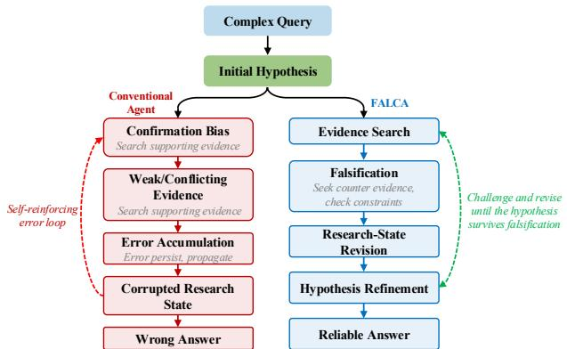  
Figure 1: Motivation for FALCA. Conventional agents may fall into a self-reinforcing error loop, where confirmation bias leads to error accumulation and corrupts the research state. FALCA breaks this loop through iterative falsification, research-state revision, and hypothesis refinement.

Existing agents are typically optimized through trajectory imitation or final-answer rewards to search deeper along promising directions, but are rarely trained to challenge hypotheses, seek counterevidence, resolve conflicts, or revise the research state. This is problematic because long-horizon deep search resembles a constrained research process rather than a linear retrieve-and-answer pipeline. The agent must propose candidates, test them against heterogeneous evidence, eliminate those that violate task constraints, and revise intermediate conclusions when conflicts emerge. Reliable progress therefore requires not only collecting supporting evidence but also identifying evidence that would invalidate current hypotheses, echoing the role of falsification in scientific inquiry (Popper 1963). We thus formulate longhorizon deep search as a propose–falsify process, in which the agent periodically alternates among hypothesis candidate generation, active falsification, and research-state revision. Under this view, falsification is not post-hoc verification but a context-management mechanism for checking whether the current research direction and candidate hypotheses remain valid before the agent searches deeper.

In this work, we propose FALCA, a falsification-based agentic framework for long-horizon deep search. FALCA adopts a collaborative Searcher–Falsifier architecture. The Searcher decomposes the problem, gathers evidence from external sources, maintains the research context, and proposes candidate answers. At periodic checkpoints, these candidates are passed to multiple Falsifier agents, each operating in an independent context to adversarially stress-test the candidate by seeking counterevidence, checking unmet constraints, identifying hidden conflicts, and suggesting revised search directions. Each Falsifier returns a concise falsification report summarizing the candidate’s reliability, relevant evidence, unresolved or violated constraints, and recommended next steps. These reports are accumulated as a compact historical research state and fed back to the Searcher, which refreshes its working context and continues the propose–falsify loop until the information need is resolved.

To strengthen this propose–falsify research loop, we adopt a two-stage paradigm consisting of SFT warmup followed by falsification-aware agentic RL. The model is first trained on falsification-aware trajectories to acquire basic capabilities for search, verification, counterevidence seeking, and context revision. We then perform parallel rollouts for each problem to construct diverse trajectories that include successful, unsuccessful, and behaviorally distinct falsification paths. Through hierarchical reward modeling and credit assignment, trajectory-level task feedback is further decomposed across research stages, state transitions, and individual actions. Compared with agentic RL methods that rely primarily on final outcome rewards, FALCA can reinforce search, falsification, and conflict-resolution behaviors that genuinely improve the research state, while avoiding indiscriminate reinforcement of redundant steps in successful trajectories or uniform penalization of locally valuable actions in failed trajectories. Finally, we optimize the policy using a PPO-style clipped objective with shaped token-level advantages and KL regularization to the SFT reference policy.

Our contributions are threefold:

• We formulate long-horizon deep search as a falsificationcentered propose–falsify process and instantiate it with a collaborative Searcher–Falsifier architecture, which periodically challenges candidate hypotheses and revises the research state to mitigate confirmation bias and error accumulation.

• We develop a falsification-aware agentic RL framework that combines SFT warmup, parallel rollouts, and hierarchical credit assignment over trajectories, research stages, and actions, enabling the policy to learn search, falsification, and state-revision behaviors that improve the evolving research state.

• We conduct extensive experiments on five search benchmarks, showing that FALCA improves answer correctness and long-horizon search behavior, with ablations validating the contributions of falsification, research-state revision, and hierarchical credit assignment.

## 2 Related Work

Long-Horizon Search Agents. Retrieval-augmented generation grounds LLMs in external knowledge, while WebGPT, ReAct, and IRCoT extend this paradigm by interleaving reasoning with retrieval, browsing, and tool interaction (Lewis et al. 2020; Nakano et al. 2021; Yao et al. 2023; Trivedi et al. 2023). More recent work trains LLMs to determine when and how to search through multi-turn interaction, using outcome-based reinforcement learning in controlled retrieval environments or end-to-end optimization over the open web (Song et al. 2025; Jin et al. 2025; Chen et al. 2025b; Zheng et al. 2025). Complementary approaches study active context management for long-horizon information seeking (Yao et al. 2026). These methods improve search depth and adaptability, but primarily optimize information acquisition or final-answer quality; the evolving research state is seldom modeled as a collection of falsifiable hypotheses whose supporting evidence, contradictions, and unmet constraints must be explicitly maintained and revised.

Reflection, Verification, and Falsification. Related work improves model reliability through iterative self-feedback, episodic reflection, tool-grounded critique, or learned reflection signals (Madaan et al. 2023; Shinn et al. 2023; Gou et al. 2024; Asai et al. 2024). Web-agent methods incorporate reasoning behaviors such as reflection, lookahead, branching, and rollback (Hu et al. 2025). However, these mechanisms typically refine a generated output, recover from observed failures, or assess retrieved evidence, rather than treating falsification as a persistent search operation. In contrast, our method explicitly assigns a Falsifier to seek disconfirming evidence, test unresolved constraints, expose contradictions, and trigger research-state revision before final synthesis, thereby addressing confirmation bias throughout the trajectory rather than only verifying an already formed answer.

Agentic Reinforcement Learning and Credit Assignment. Search-oriented agents are commonly initialized through supervised imitation and optimized with trajectory-level rewards. Outcome-based RL can elicit multi-turn retrieval, planning, and self-correction (Song et al. 2025; Jin et al. 2025; Chen et al. 2025b; Zheng et al. 2025), but delayed rewards provide limited supervision for distinguishing critical verification and revision from redundant exploration. Recent methods address this issue through hierarchical grouprelative advantages, trajectory decomposition, and agentspecific process reward models (Feng et al. 2025; Luo et al.

2025; Xi et al. 2025). Unlike generic action-quality or goalprogress supervision, FALCA assigns credit to research-state transitions, reinforcing actions that invalidate unsupported hypotheses, reconcile conflicting evidence, recover missing constraints, or improve research-state reliability.

## 3 Methodology

## 3.1 Problem Formulation

We formulate long-horizon deep search as a sequential decision process. Given a query q and answer $y ^ { * }$ , the agent interacts with an external environment to generate:

$$
\tau = ( s _ { 0 } , a _ { 1 } , o _ { 1 } , \cdot \cdot \cdot , a _ { T } , o _ { T } ) ,\tag{1}
$$

where $s _ { t } , \ a _ { t } , \ o _ { t }$ denote the research state, action, and observation. The goal is to learn a policy $\pi _ { \boldsymbol { \theta } } ( a _ { t } | \boldsymbol { s } _ { t } )$ for search, verification, and answer synthesis under limited budgets.

We further represent long trajectories at multiple granularities. A turn denotes one interaction step, while consecutive turns are grouped into segments:

$$
\tau = ( g _ { 0 } , g _ { 1 } , \cdot \cdot \cdot , g _ { K } ) .\tag{2}
$$

Segments serve as basic units for research state evolution, reward modeling, and credit assignment. For multi-hop tasks, we model latent sub-goals: $q  e _ { 1 }  e _ { 2 } = y ^ { * }$ , where intermediate entity discovery provides process-level supervision.

## 3.2 Tool Design

To support long-horizon deep search, we equip the Searcher and Falsifier with a shared evidence environment. Both agents access the same retrieval and browsing tools to acquire consistent evidence, while maintaining diferent objectives and action spaces. The Searcher explores and maintains the research state, while the Falsifier seeks contradictions and returns structured feedback. Specifically, FALCA contains five tools:

• Search: Retrieves relevant documents from external sources using batched queries for evidence discovery.

• Visit: Summarizes retrieved webpages into goalconditioned evidence.

• Update Context: Compresses long interaction histories into structured research states containing verified facts, unresolved constraints, and future plans.

• Finish: Terminates the Searcher trajectory by producing the final answer with supporting evidence.

• Refute: Enables the Falsifier to return structured adversarial reports, including rejected constraints, evidence, and recommended follow-up searches.

## 3.3 Falsification-Guided Research Trajectory Construction

Generative deep-search agents may prematurely accept plausible but weakly supported candidates and repeatedly propagate them into subsequent contexts, leading to confirmation bias and error accumulation. To mitigate this issue, we construct falsification-guided research trajectories in which candidate hypotheses proposed by the Searcher are actively challenged by the Falsifier before being incorporated into later research states.

At the k-th research stage, the Searcher generates a candidate set from the current research state $S _ { k } \colon \mathcal { H } _ { k } \ =$ $\{ h _ { k } ^ { 1 } , \cdot \cdot \cdot , h _ { k } ^ { M _ { k } } \}$ . For each candidate $h _ { k } ^ { m }$ , an independent Falsifier follows a contradiction-first strategy to search for counterevidence and returns a structured report through the refute tool: $F _ { k } ^ { m } ~ = ~ ( v _ { k } ^ { m } , C _ { \mathrm { r e f } } ^ { m } , C _ { \mathrm { u n r } } ^ { m } , E _ { k } ^ { \bar { m } } , Q _ { \mathrm { n e x t } } ^ { m } )$ , where $v _ { k } ^ { m } \in \{ \mathrm { r e j e c t } $ , survive, uncertain} denotes the falsification verdict, $C _ { \mathrm { r e f } } ^ { m }$ and $C _ { \mathrm { u n r } } ^ { m }$ are the refuted and unresolved constraints, $E _ { k } ^ { m }$ denotes the retrieved evidence, and $Q _ { \mathrm { n e x t } } ^ { m }$ contains recommended follow-up queries. The falsification reports are then written back to the research state: $S _ { k + 1 } = \mathcal { U } \left( S _ { k } , \mathcal { H } _ { k } , \{ F _ { k } ^ { m } \} _ { m = 1 } ^ { M _ { k } } \right)$

Rejected candidates are removed, unresolved constraints are converted into new search targets, and supporting or contradicting evidence is preserved through update\_context. Each context update defines a segment boundary, resulting in a trajectory composed of iterative exploration, falsification, and revision stages until the Searcher invokes finish.

Before agentic RL, we generate trajectories under the above protocol and apply rejection sampling to retain trajectories with correct answers, valid tool interactions, and suficient evidence support. The retained trajectories are used for SFT warmup with the masked language-modeling objective:

$$
\mathcal { L } _ { \mathrm { S F T } } = - \sum _ { i } \sum _ { j } m _ { i , j } \log \pi _ { \theta } ( x _ { i , j } | x _ { i , < j } ) ,\tag{3}
$$

where $m _ { i , j }$ masks environmental observations such as search results and webpage contents. This stage initializes the policy with basic capabilities in tool use, context updating, Searcher-Falsifier coordination, and candidate revision, providing a stable starting point for falsification-aware agentic RL.

## 3.4 Falsification-Aware Agentic Reinforcement Learning

Parallel Falsification-Aware Rollout At each RL iteration, given a query q, we sample n research trajectories in parallel from the current policy πθ: $\mathcal { G } ( q ) = \{ \tau _ { i } \} _ { i = 1 } ^ { n }$ . Each trajectory executes the complete Searcher–Falsifier interaction loop online, with context compression enabled throughout the rollout. Parallel sampling explores diverse candidate hypotheses, evidence paths, and falsification outcomes, providing varied samples for subsequent policy optimization.

To improve the stability and eficiency of long-horizon online rollouts, we employ two asynchronous mechanisms. First, asynchronous trajectory execution allows diferent trajectories and their tool interactions to progress independently under trajectory-level time limits, preventing slow webpage visits or lengthy falsification rounds from blocking the entire rollout batch. Second, asynchronous process evaluation computes turn-level process scores once a trajectory is completed while the remaining trajectories continue generation. This design provides denser process supervision without substantially extending the critical rollout path.

Finally, each completed trajectory is divided into multiple segments at the boundaries defined by update\_context.

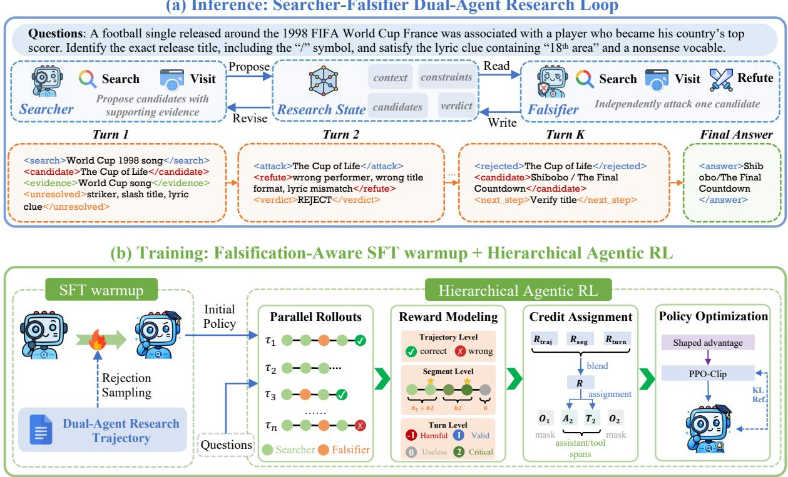  
Figure 2: Overview of FALCA. The upper panel illustrates the Searcher-Falsifier dual-agent research loop for falsificationaware inference. The lower panel presents the training pipeline, consisting of SFT warmup, parallel rollouts, hierarchical reward modeling, credit assignment, and policy optimization.

These parallel trajectories and their segment-level structures serve as the training units for the hierarchical reward modeling and fine-grained credit assignment introduced below.

Hierarchical Reward Modeling and Credit Assignment Sparse outcome rewards provide limited process supervision for long-horizon deep search (Qi et al. 2025). A research trajectory may contain numerous search, verification, and state-update steps, while binary final-answer feedback cannot distinguish critical actions from redundant exploration within successful trajectories, nor identify locally valuable search behaviors in failed trajectories. We therefore model rewards at progressively finer granularities, from trajectory outcomes and segment-level research progress to local turn-level action quality, and assign these signals to policy-generated tokens.

The trajectory-level reward measures final task success. Given the predicted answer yˆ and the ground-truth answer $y ^ { * }$ , we define $R _ { \mathrm { t r a j } } = 1 [ \hat { y } \equiv \hat { y } ^ { \ast } ]$ , where answer correctness is jointly determined by exact matching and an LLM judge. This reward provides the global task objective but does not distinguish the contributions of individual research steps.

We partition a complete trajectory into K research segments using update\_context. For a multi-hop task, let $h _ { j }$ denote the segment in which the j-th subgoal is first completed, with $h _ { 0 } = 0$ . The reward weight wj associated with the j-th hop is uniformly distributed over the research stage between the previous and current hops:

$$
R _ { \mathrm { s e g } } ^ { k } = \sum _ { j = 1 } ^ { J } \frac { w _ { j } } { h _ { j } - h _ { j - 1 } } 1 [ h _ { j - 1 } < k \leq h _ { j } ] .\tag{4}
$$

This design provides denser credit to the consecutive research stages that contribute to subgoal completion, while avoiding the propagation of later-hop rewards to unrelated earlier behaviors. Segments after the final hop receive no segment-level reward. To further assess local action quality, we use an LLM judge to score each turn: $s _ { t } \in \{ - 1 , \bar  0 , 1 , 2 \} \}$ corresponding to harmful, neutral, useful, and critical actions, respectively. The score is normalized as

$$
R _ { \mathrm { t u r n } } ^ { t } = \frac { \mathrm { c l i p } ( s _ { t } , - 1 , 2 ) + 1 } { 3 } .\tag{5}
$$

The evaluation considers not only retrieval relevance, but also whether an action acquires reliable evidence, identifies unmet constraints, falsifies an unsupported hypothesis, resolves evidence conflicts, or induces a meaningful researchstate revision. Finally, we assign the three reward signals to their corresponding policy tokens. For a token xi belonging to segment k(i) and turn t(i), we define its shaped advantage as

$$
A _ { i } ^ { \mathrm { s h a p e } } = \lambda _ { \mathrm { t r a j } } \frac { R _ { \mathrm { t r a j } } } { \sqrt { K } } + \lambda _ { \mathrm { s e g } } R _ { \mathrm { s e g } } ^ { k ( i ) } + \lambda _ { \mathrm { t u r n } } R _ { \mathrm { t u r n } } ^ { t ( i ) } ,\tag{6}
$$

where $\lambda _ { \mathrm { t r a j } } + \lambda _ { \mathrm { s e g } } + \lambda _ { \mathrm { t u r n } } = 1$

The trajectory-level reward is broadcast across the entire trajectory and normalized by $\sqrt { K }$ to prevent trajectories with more segments from receiving disproportionately large global credit. The segment-level reward is assigned to policy tokens within the corresponding research stage, while the turn-level reward is applied only to the associated turn span. Environmental observations, including search results and webpage contents, are fully masked. The resulting tokenlevel shaped advantages are used for policy optimization in the following section.

Policy Optimization We optimize the policy using the token-level shaped advantages, without applying group-wise relative normalization. This choice is motivated by the sparse and nearly binary outcomes of long-horizon deep search. For dificult queries, trajectories sampled from the same prompt may receive identical final rewards, causing group-relative advantages to vanish. In contrast, the shaped advantages preserve learning signals from segment-level progress and turnlevel action quality, even when all trajectories within a rollout group have the same outcome.

For token $x _ { i , t }$ in the i-th trajectory, we define the importance ratio as

$$
r _ { i , t } ( \theta ) = \frac { \pi _ { \theta } ( x _ { i , t } | x _ { i , < t } ) } { \pi _ { \theta _ { \mathrm { o l d } } } ( x _ { i , t } | x _ { i , < t } ) } .\tag{7}
$$

We then optimize the policy using a PPO-style clipped objective (Schulman et al. 2017):

$$
\bar { r } _ { i , t } ( \theta ) = \mathrm { c l i p } ( r _ { i , t } ( \theta ) , 1 - \epsilon _ { \mathrm { l o w } } , 1 + \epsilon _ { \mathrm { h i g h } } ) .\tag{8}
$$

$$
\begin{array} { r } { \mathcal { L } _ { \mathrm { p o l i c y } } ( \theta ) = - \mathbb { E } _ { i , t } \left[ \operatorname* { m i n } \left( r _ { i , t } ( \theta ) A _ { i , t } ^ { \mathrm { s h a p e } } , \bar { r } _ { i , t } ( \theta ) A _ { i , t } ^ { \mathrm { s h a p e } } \right) \right] . } \end{array}\tag{9}
$$

Following the asymmetric clipping strategy used in DAPO (Yu et al. 2026), we adopt a slightly larger upper clipping bound, allowing the policy to more suficiently increase the probabilities of high-value search, falsification, and research-state revision actions. To constrain policy drift from the supervised initialization, we further introduce token-level KL regularization with respect to a fixed SFT reference policy $\pi _ { \mathrm { r e f } }$

$$
\mathcal { L } ( \theta ) = \mathcal { L } _ { \mathrm { p o l i c y } } ( \theta ) + \beta \mathbb { E } _ { i , t } [ D _ { \mathrm { K L } } ( \pi _ { \theta } ( \cdot | x _ { i , < t } ) | | \pi _ { \mathrm { r e f } } ( \cdot | x _ { i , < t } ) ) ] .\tag{10}
$$

This optimization preserves the exploration benefits of parallel rollouts while avoiding the loss of learning signals caused by degenerate rollout groups. The clipped objective and reference-policy regularization further stabilize policy updates during long-horizon agentic reinforcement learning.

## 4 Experiments

## 4.1 Experimental Setup

Datasets and Baselines We evaluate FALCA on five search-augmented reasoning benchmarks: BrowseComp and DeepSearchQA for long-horizon retrieval and evidence synthesis (Wei et al. 2025; Gupta et al. 2026); GAIA and xbench-2510 for agentic planning, tool use, and multi-step reasoning (Mialon et al. 2024; Chen et al. 2025a); and

WideSearch-en for broad-coverage retrieval and synthesis (Wong et al. 2025). We report Item-F1 for WideSearchen, F1 for DeepSearchQA, and accuracy for the remaining benchmarks, with all scores reported in percentage points.

We compare with both closed-source and open-source baselines, including GPT-5 (Singh et al. 2025), Opus-4.6 (Anthropic 2026), Gemini-3.1-Pro (Google DeepMind 2026), Qwen3.5-397B (Qwen Team 2026), and recent search-oriented agents such as DeepMiner (Tang et al. 2025), WebDancer (Wu et al. 2026), WebSailor (Li et al. 2025), Tongyi-DeepResearch (Team et al. 2025b), Miro-Thinker (Team et al. 2025a), WebExplorer (Liu et al. 2025), LiteResearcher (Li et al. 2026), and AgentCPM-Explore (Chen et al. 2026). We also report Qwen3.5-4B and Qwen3.5-9B as backbone baselines.

Implementation Details We initialize the Searcher from an SFT-trained Qwen3.5-4B and optimize it with reinforcement learning, while the Falsifier uses the same backbone in an independent context. Turn-level process evaluation, finalanswer judging, and webpage and context summarization are handled by Qwen3.5-35B-A3B. The search tool retrieves top-ranked titles, URLs, and snippets from a local HNSW index built with BGE-m3 embeddings (Chen et al. 2024; Malkov and Yashunin 2018). Training and rollouts use eight NVIDIA H100 80GB GPUs.

## 4.2 Main Results

As shown in Table 1, introducing the Falsifier-based harness yields clear overall gains while keeping the Qwen3.5-4B backbone unchanged. Compared with the default contextmanagement harness, its average score increases from 51.8 to 55.5. This result suggests that, beyond collecting supporting evidence, periodically challenging candidates, checking unmet constraints, and injecting falsification reports into the research state can improve search reliability. This observation is consistent with our motivation: active falsification helps mitigate confirmation bias around early hypotheses and reduce the accumulation of incorrect candidates and unresolved contradictions over long-horizon interactions.

Under the same Falsifier-based harness, FALCA-4B improves the average score from 55.5 to 64.7, outperforming the falsification-untrained Qwen3.5-4B on all benchmarks. This indicates that merely introducing a Falsifier is insuficient to fully realize the benefits of falsification. SFT warmup teaches the Searcher the basic propose–falsify protocol, while agentic RL optimizes how it incorporates falsification reports, revises the research state, and redirects subsequent retrieval. Notably, FALCA-4B also surpasses Qwen3.5-9B under the same harness (64.7 vs. 57.9) and remains competitive with several 30B–32B search agents. These results suggest that falsification-aware training can be more parameter-eficient than simply scaling up the backbone.

FALCA-4B achieves its largest improvements on BrowseComp, xbench-2510, and DeepSearchQA, which require multi-step evidence aggregation, constraint verification, candidate elimination, and research-state revision. This pattern suggests that falsification is beneficial for constraintintensive deep-search tasks. On WideSearch-en, which emphasizes broad-coverage information collection, the improvement is smaller, although FALCA-4B still achieves a strong absolute score of 65.8. Overall, FALCA-4B provides the largest benefits on falsification-intensive tasks while preserving strong broad-coverage retrieval performance.

<table><tr><td>Model</td><td>BrowseComp</td><td>GAIA</td><td>DeepSearchQA</td><td>xbench-2510</td><td>WideSearch-en</td></tr><tr><td colspan="6">Default Context-Management Harness</td></tr><tr><td>GPT-5</td><td>54.9</td><td>76.4</td><td>79.0</td><td>75.0</td><td>59.7</td></tr><tr><td>Opus-4.6</td><td>83.7</td><td>75.0</td><td>91.3</td><td></td><td>77.5</td></tr><tr><td>Gemini-3.1-Pro</td><td>85.9</td><td>80.6</td><td>93.3</td><td>53.0</td><td>66.4</td></tr><tr><td>Qwen3.5-397B</td><td>78.6</td><td>83.5</td><td>82.1</td><td>61.0</td><td>74.0</td></tr><tr><td>DeepMiner-32B</td><td>33.5</td><td>58.7</td><td></td><td>62.0</td><td></td></tr><tr><td>WebDancer-32B</td><td>3.8</td><td>51.5</td><td></td><td>39.0</td><td></td></tr><tr><td>WebSailor-32B</td><td>10.5</td><td>53.2</td><td>一</td><td></td><td></td></tr><tr><td>Tongyi-DeepResearch-30B</td><td>43.4</td><td>70.9</td><td></td><td>55.0</td><td></td></tr><tr><td>Qwen3.5-9B</td><td>34.2</td><td>65.0</td><td>65.5</td><td>51.0</td><td>17.5</td></tr><tr><td>MiroThinker-8B</td><td>31.1</td><td>66.4</td><td>36.7</td><td>34.0</td><td></td></tr><tr><td>WebExplorer-8B</td><td>15.7</td><td>32.0</td><td>17.8</td><td>53.7</td><td></td></tr><tr><td>LiteResearcher-4B</td><td>27.5</td><td>71.3</td><td>17.2</td><td>12.0</td><td>1.73</td></tr><tr><td>AgentCPM-Explore-4B</td><td>24.1</td><td>63.9</td><td>32.8</td><td>34.0</td><td></td></tr><tr><td>Qwen3.5-4B</td><td>32.7</td><td>65.0</td><td>62.6</td><td>45.0</td><td>53.9</td></tr><tr><td colspan="6">Falsifier-Based Harness</td></tr><tr><td>Qwen3.5-9B</td><td>41.4</td><td>68.0</td><td>65.0</td><td>48.0</td><td>67.2</td></tr><tr><td>Qwen3.5-4B</td><td>39.0</td><td>62.1</td><td>63.3</td><td>49.0</td><td>64.3</td></tr><tr><td>FALCA-4B</td><td>56.0</td><td>72.8</td><td>70.8</td><td>58.0</td><td>65.8</td></tr></table>

Notes. Best open-source results are bolded. A dash denotes an unavailable or pending result.

## 4.3 Ablation Study

To assess the key inference and training components in FALCA, we construct three ablated variants. w/o Falsifier removes the Falsifier and its report injection, evaluating the role of active falsification and hypothesis revision. w/o Agentic RL retains only the SFT warmup, while w/o Process-level Reward removes the segment- and turn-level rewards and relies solely on trajectory-level feedback. All variants use the same backbone, training data, inference budget, and evaluation protocol. As shown in Figure 3, FALCA achieves the highest score of 64.7. Removing the Falsifier causes the largest drop to 52.8, highlighting the importance of seeking counterevidence, identifying constraint violations, and revising incorrect hypotheses. Without agentic RL, the score decreases to 60.5, indicating that SFT establishes the falsification protocol, while RL improves how the agent uses falsification feedback during multi-turn search. Removing process-level rewards reduces the score to 60.1, suggesting that terminal outcomes provide insuficient credit for intermediate evidence acquisition, candidate elimination, and research-state revision. Overall, the Falsifier provides the core inference mechanism, while agentic RL and process-level rewards enable it to be learned and executed more efectively.

## 4.4 Behavioral Analysis

Falsification-Driven Revision We examine whether Falsifier reports induce actionable research-state revisions rather than merely provide additional verification. As shown in the real xbench-2510 trajectory in Figure 4, the injected report causes the Searcher to discard an incorrect hypothesis, revise its research state, and redirect retrieval toward the correct candidate. This case provides qualitative evidence that falsification functions as an actionable state transition in FALCA.

Table 1: Main experimental results on five search benchmarks.  
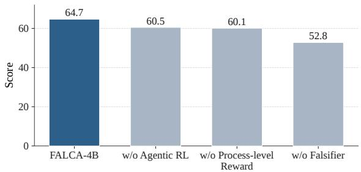  
Figure 3: Ablation study of the key inference and training components in FALCA.

Long-Horizon Test-Time Scaling To study depth-based test-time scaling on BrowseComp, we fix the model and tool configuration and measure the cumulative number of correct trajectories and mean search calls at each round threshold T. As shown in Figure 5, 50% of correct trajectories finish within 20 rounds and 89% within 120 rounds. Extending the threshold to 200 rounds increases coverage only to 93%, while mean search calls rise from 4.3 to 22.9. These results demonstrate positive reasoning-depth scaling, but with diminishing returns beyond approximately 120–150 rounds.

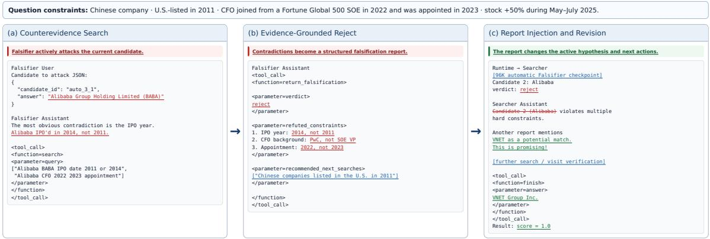  
Figure 4: A real falsification-driven revision trajectory from xbench-2510. The Falsifier refutes Alibaba by identifying violations in its listing year, CFO background, and appointment date. After the report is injected, the Searcher adopts VNET a its new hypothesis, verifies the remaining constraints, and returns the correct answer.

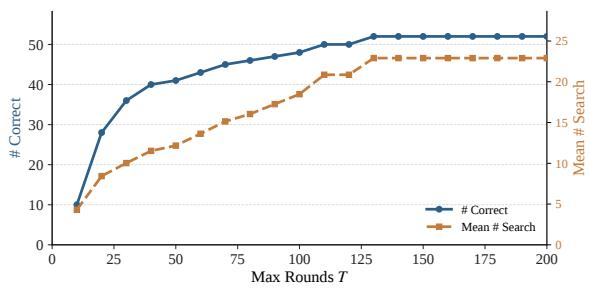  
Figure 5: Long-horizon test-time scaling on BrowseComp.

## 4.5 Training Dynamics and Analysis

Long-horizon deep search exhibits sparse terminal rewards. Complex queries require multiple rounds of retrieval, constraint verification, and evidence synthesis, while trajectories may terminate due to timeouts, interaction limits, or length truncation. Consequently, trajectories sampled for the same query often receive identical rewards; in our training, approximately 66% of rollout groups have zero within-group reward variance, weakening GRPO-style group-relative advantages.

In contrast, our shaped advantages combine trajectory-, segment-, and turn-level rewards to capture process-level differences within individual trajectories. As shown in Figure 6, the training reward of GRPO-style optimization reaches an early plateau, whereas shaped advantages exhibit a more sustained upward trend. This suggests that fine-grained process signals can continue to provide useful supervision even when trajectories share the same terminal outcome. As reported in Table 2, shaped advantages improve the average score from 61.2 to 64.7 and induce more turns, tokens, and search calls. These results suggest that shaped advantages preserve informative learning signals under degenerate rollout groups, supporting more persistent long-horizon exploration.

## 5 Conclusion

We introduced FALCA, a falsification-aware reinforcement learning framework that formulates long-horizon deep search as an iterative propose–falsify process. FALCA combines independent Falsifiers for research-state revision with SFT warmup, parallel agentic rollouts and hierarchical credit assignment over trajectories, research segments, and individual actions. Experiments on five benchmarks demonstrate consistent improvements over backbone and harness baselines with strong parameter eficiency. Ablation studies identify the Falsifier as the primary source of performance gains and validate the contributions of agentic RL and processlevel rewards. Training and behavioral analyses show that shaped advantages preserve learning signals under degenerate rollout groups, while falsification reports can redirect the Searcher away from plausible but incorrect hypotheses. Overall, our results suggest that reliable long-horizon deep search depends not only on searching deeper, but also on continually questioning and repairing the research state.

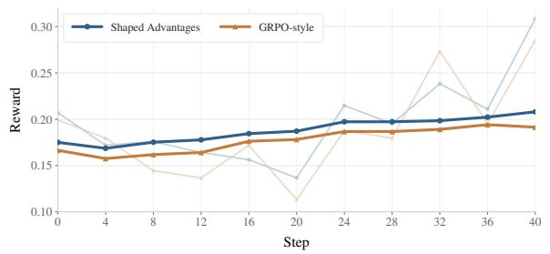  
Figure 6: Training reward dynamics of shaped and GRPOstyle advantages under degenerate rollout groups.

<table><tr><td>Setting</td><td>Avg.</td><td>Turns</td><td>Tokens</td><td>Search</td><td>Visit</td></tr><tr><td>Shaped Advantages</td><td>64.7</td><td>79.8</td><td>8.7M</td><td>63.6</td><td>14.9</td></tr><tr><td>GRPO-style</td><td>61.2</td><td>62.8</td><td>6.7M</td><td>47.7</td><td>14.0</td></tr></table>

Table 2: Comparison of task performance and search behavior between shaped and GRPO-style advantages.

## References

Anthropic. 2026. Claude Opus 4.6 System Card. https: //www.anthropic.com/news/claude-opus-4-6.

Asai, A.; Wu, Z.; Wang, Y.; Sil, A.; and Hajishirzi, H. 2024. Self-RAG: Learning to Retrieve, Generate, and Critique through Self-Reflection. In The Twelfth International Conference on Learning Representations.

Chen, H.; Cong, X.; Fan, S.; Fu, Y.; Gong, Z.; Lu, Y.; Li, Y.; Niu, B.; Pan, C.; Song, Z.; et al. 2026. AgentCPM-Explore: Realizing Long-Horizon Deep Exploration for Edge-Scale Agents. arXiv preprint arXiv:2602.06485.

Chen, J.; Xiao, S.; Zhang, P.; Luo, K.; Lian, D.; and Liu, Z. 2024. Bge m3-embedding: Multilingual, multi-functionality, multi-granularity text embeddings through self-knowledge distillation. arXiv preprint arXiv:2402.03216, 4(5).

Chen, K.; Ren, Y.; Liu, Y.; Hu, X.; Tian, H.; Xie, T.; Liu, F.; Zhang, H.; Liu, H.; Gong, Y.; et al. 2025a. xbench: Tracking agents productivity scaling with profession-aligned real-world evaluations. arXiv preprint arXiv:2506.13651.

Chen, M.; Sun, L.; Li, T.; Sun, H.; Zhou, Y.; Zhu, C.; Wang, H.; Pan, J. Z.; Zhang, W.; Chen, H.; Yang, F.; Zhou, Z.; and Chen, W. 2025b. ReSearch: Learning to Reason with Search for LLMs via Reinforcement Learning. In Advances in Neural Information Processing Systems, volume 38.

Feng, L.; Xue, Z.; Liu, T.; and An, B. 2025. Group-in-Group Policy Optimization for LLM Agent Training. In Advances in Neural Information Processing Systems, volume 38.

Google DeepMind. 2026. Gemini 3.1 Pro Model Card. https: //deepmind.google/models/model-cards/gemini-3-1-pro/.

Gou, Z.; Shao, Z.; Gong, Y.; Shen, Y.; Yang, Y.; Duan, N.; and Chen, W. 2024. CRITIC: Large Language Models Can Self-Correct with Tool-Interactive Critiquing. In The Twelfth International Conference on Learning Representations.

Gupta, N.; Chatterjee, R.; Haas, L.; Tao, C.; Wang, A.; Liu, C.; Oiwa, H.; Gribovskaya, E.; Ackermann, J.; Blitzer, J.; et al. 2026. DeepSearchQA: Bridging the Comprehensiveness Gap for Deep Research Agents. arXiv preprint arXiv:2601.20975.

He, G.; Yang, Z.; Liu, J.; Xu, B.; Hou, L.; and Li, J. 2025. Webseer: Training deeper search agents through reinforcement learning with self-reflection. arXiv preprint arXiv:2510.18798.

Hu, M.; Fang, T.; Zhang, J.; Ma, J.-Y.; Zhang, Z.; Zhou, J.; Zhang, H.; Mi, H.; Yu, D.; and King, I. 2025. Web-CoT: Enhancing Web Agent Reasoning by Reconstructing Chain-of-Thought in Reflection, Branching, and Rollback. In Findings of the Association for Computational Linguistics: EMNLP 2025, 5155–5173. Suzhou, China: Association for Computational Linguistics.

Jin, B.; Zeng, H.; Yue, Z.; Yoon, J.; Arik, S. O.; Wang, D.; Zamani, H.; and Han, J. 2025. Search-R1: Training LLMs to Reason and Leverage Search Engines with Reinforcement Learning. In The Second Conference on Language Modeling.

Lewis, P.; Perez, E.; Piktus, A.; Petroni, F.; Karpukhin, V.;Goyal, N.; Küttler, H.; Lewis, M.; Yih, W.-t.; Rocktäschel, T.;

Riedel, S.; and Kiela, D. 2020. Retrieval-Augmented Generation for Knowledge-Intensive NLP Tasks. In Advances in Neural Information Processing Systems, volume 33, 9459– 9474.

Li, K.; Zhang, Z.; Yin, H.; Zhang, L.; Ou, L.; Wu, J.; Yin, W.; Li, B.; Tao, Z.; Wang, X.; et al. 2025. Websailor: Navigating super-human reasoning for web agent. arXiv preprint arXiv:2507.02592.

Li, W.; Qu, B.; Pan, B.; Zhang, J.; Liu, Z.; Zhang, P.; Chen, W.; and Zhang, B. 2026. Literesearcher: A scalable agentic rl training framework for deep research agent. arXiv preprint arXiv:2604.17931.

Liu, J.; Li, Y.; Zhang, C.; Li, J.; Chen, A.; Ji, K.; Cheng, W.; Wu, Z.; Du, C.; Xu, Q.; et al. 2025. Webexplorer: Explore and evolve for training long-horizon web agents. arXiv preprint arXiv:2509.06501.

Luo, X.; Zhang, Y.; He, Z.; Wang, Z.; Zhao, S.; Li, D.; Qiu, L. K.; and Yang, Y. 2025. Agent Lightning: Train ANY AI Agents with Reinforcement Learning. arXiv preprint arXiv:2508.03680.

Madaan, A.; Tandon, N.; Gupta, P.; Hallinan, S.; Gao, L.; Wiegrefe, S.; Alon, U.; Dziri, N.; Prabhumoye, S.; Yang, Y.; Gupta, S.; Majumder, B. P.; Hermann, K.; Welleck, S.; Yazdanbakhsh, A.; and Clark, P. 2023. Self-Refine: Iterative Refinement with Self-Feedback. In Advances in Neural Information Processing Systems, volume 36, 46534–46594. Curran Associates, Inc.

Malkov, Y. A.; and Yashunin, D. A. 2018. Eficient and robust approximate nearest neighbor search using hierarchical navigable small world graphs. IEEE transactions on pattern analysis and machine intelligence, 42(4): 824–836.

Mialon, G.; Fourrier, C.; Wolf, T.; LeCun, Y.; and Scialom, T. 2024. Gaia: a benchmark for general ai assistants. In International Conference on Learning Representations, volume 2024, 9025–9049.

Nakano, R.; Hilton, J.; Balaji, S.; Wu, J.; Ouyang, L.; Kim, C.; Hesse, C.; Jain, S.; Kosaraju, V.; Saunders, W.; Jiang, X.; Cobbe, K.; Eloundou, T.; Krueger, G.; Button, K.; Knight, M.; Chess, B.; and Schulman, J. 2021. WebGPT: Browserassisted Question-Answering with Human Feedback. arXiv preprint arXiv:2112.09332.

Popper, K. R. 1963. Conjectures and Refutations: The Growth of Scientific Knowledge. London: Routledge & Kegan Paul.

Press, O.; Zhang, M.; Min, S.; Schmidt, L.; Smith, N. A.; and Lewis, M. 2023. Measuring and narrowing the compositionality gap in language models. In Findings ofthe Association for Computational Linguistics: EMNLP 2023, 5687–5711.

Qi, Z.; Liu, X.; Iong, I. L.; Lai, H.; Sun, X.; Sun, J.; Yang, X.; Yang, Y.; Yao, S.; Xu, W.; et al. 2025. Webrl: Training llm web agents via self-evolving online curriculum reinforcement learning. In International Conference on Learning Representations, volume 2025, 79791–79821.

Qwen Team. 2026. Qwen3.5: Towards Native Multimodal Agents. https://qwen.ai/blog?id=qwen3.5.

Schulman, J.; Wolski, F.; Dhariwal, P.; Radford, A.; and Klimov, O. 2017. Proximal Policy Optimization Algorithms. arXiv preprint arXiv:1707.06347.

Shinn, N.; Cassano, F.; Berman, E.; Gopinath, A.; Narasimhan, K.; and Yao, S. 2023. Reflexion: Language Agents with Verbal Reinforcement Learning. In Advances in Neural Information Processing Systems, volume 36.

Singh, A.; Fry, A.; Perelman, A.; Tart, A.; Ganesh, A.; El-Kishky, A.; McLaughlin, A.; Low, A.; Ostrow, A.; Ananthram, A.; et al. 2025. Openai gpt-5 system card. arXiv preprint arXiv:2601.03267.

Song, H.; Jiang, J.; Min, Y.; Chen, J.; Chen, Z.; Zhao, W. X.; Fang, L.; and Wen, J.-R. 2025. R1-Searcher: Incentivizing the Search Capability in LLMs via Reinforcement Learning. arXiv preprint arXiv:2503.05592.

Tang, Q.; Xiang, H.; Yu, L.; Yu, B.; Lu, Y.; Han, X.; Sun, L.; Zhang, W.; Wang, P.; Liu, S.; et al. 2025. Beyond turn limits: Training deep search agents with dynamic context window. arXiv preprint arXiv:2510.08276.

Team, M.; Bai, S.; Bing, L.; Chen, C.; Chen, G.; Chen, Y.; Chen, Z.; Chen, Z.; Dai, J.; Dong, X.; et al. 2025a. Mirothinker: Pushing the performance boundaries of open-source research agents via model, context, and interactive scaling. arXiv preprint arXiv:2511.11793.

Team, T. D.; Li, B.; Zhang, B.; Zhang, D.; Huang, F.; Li, G.; Chen, G.; Yin, H.; Wu, J.; Zhou, J.; et al. 2025b. Tongyi deepresearch technical report. arXiv preprint arXiv:2510.24701.

Trivedi, H.; Balasubramanian, N.; Khot, T.; and Sabharwal, A. 2023. Interleaving Retrieval with Chain-of-Thought Reasoning for Knowledge-Intensive Multi-Step Questions. In Proceedings of the 61st Annual Meeting of the Association for Computational Linguistics (Volume 1: Long Papers), 10014–10037. Toronto, Canada: Association for Computational Linguistics.

Wei, J.; Sun, Z.; Papay, S.; McKinney, S.; Han, J.; Fulford, I.; Chung, H. W.; Passos, A. T.; Fedus, W.; and Glaese, A. 2025. Browsecomp: A simple yet challenging benchmark for browsing agents. arXiv preprint arXiv:2504.12516.

Wong, R.; Wang, J.; Zhao, J.; Chen, L.; Gao, Y.; Zhang, L.; Zhou, X.; Wang, Z.; Xiang, K.; Zhang, G.; et al. 2025. Widesearch: Benchmarking agentic broad infoseeking. arXiv preprint arXiv:2508.07999.

Wu, J.; Li, B.; Fang, R.; Yin, W.; Zhang, L.; Wang, Z.; Tao, Z.; Zhang, D.-C.; Xi, Z.; Tang, R.; et al. 2026. Webdancer: Towards autonomous information seeking agency. Advances in Neural Information Processing Systems, 38: 120957–120985.

Xi, Z.; Liao, C.; Li, G.; Yang, Y.; Chen, W.; Zhang, Z.; Wang, B.; Jin, S.; Zhou, Y.; Guan, J.; Wu, W.; Ji, T.; Gui, T.; Zhang, Q.; and Huang, X. 2025. AgentPRM: Process Reward Models for LLM Agents via Step-Wise Promise and Progress. arXiv preprint arXiv:2511.08325.

Xia, S.; Wang, Y.; Huang, Z.; and Liu, P. 2026. Diagnosing and Mitigating Context Rot in Long-horizon Search. arXiv preprint arXiv:2606.29718.

Xia, Z.; Luo, K.; Qian, H.; and Liu, Z. 2025. Open data synthesis for deep research. arXiv preprint arXiv:2509.00375.

Yao, S.; Zhao, J.; Yu, D.; Du, N.; Shafran, I.; Narasimhan, K. R.; and Cao, Y. 2023. ReAct: Synergizing Reasoning and Acting in Language Models. In The Eleventh International Conference on Learning Representations.

Yao, Y.; Huang, S.; Dai, E.; Tan, Z.; Duan, Z.; Jia, S.; Jiang, Y.; and Yang, T. 2026. ARC: Active and Reflection-driven Context Management for Long-Horizon Information Seeking Agents. 18644–18659.

Yu, Q.; Zhang, Z.; Zhu, R.; Yuan, Y.; Zuo, X.; Yue, Y.; Dai, W.; Fan, T.; Liu, G.; Liu, L.; et al. 2026. Dapo: An opensource llm reinforcement learning system at scale. Advances in Neural Information Processing Systems, 38: 113222– 113244.

Zheng, Y.; Fu, D.; Hu, X.; Cai, X.; Ye, L.; Lu, P.; and Liu, P. 2025. DeepResearcher: Scaling Deep Research via Reinforcement Learning in Real-World Environments. In Proceedings of the 2025 Conference on Empirical Methods in Natural Language Processing, 414–431. Suzhou, China: Association for Computational Linguistics.

## A Benchmark Details

## A.1 Overall Coverage

We evaluate FALCA on five complementary benchmarks that cover diverse forms of search-augmented reasoning. BrowseComp and DeepSearchQA emphasize long-horizon information seeking, requiring persistent retrieval, multisource evidence aggregation, and answer synthesis. GAIA evaluates general agentic capabilities, including planning, tool use, multimodal understanding, and multi-step reasoning, while xbench-2510 focuses more specifically on end-to-end deep search in the Chinese web environment. WideSearch-en complements these depth-oriented benchmarks by evaluating broad information seeking, where an agent must collect and organize a large number of atomic facts from a wide search space. Together, these benchmarks span constraint-intensive deep search, general toolaugmented reasoning, and broad-coverage information collection, enabling a comprehensive evaluation ofsearch depth, constraint verification, research-state maintenance, and information coverage.

## A.2 BrowseComp

BrowseComp consists of 1,266 open-domain questions designed to evaluate an agent’s ability to persistently browse the web for hard-to-find and entangled information. Although its reference answers are typically short and easily verifiable, they are dificult to obtain through direct lexical matching with the original question. Solving these tasks often requires repeated query reformulation, integration of evidence distributed across webpages, and elimination of plausible candidates that satisfy only part of the given constraints. BrowseComp therefore provides a focused evaluation of persistent retrieval, candidate verification, and constraint-intensive reasoning.

## A.3 GAIA

GAIA is a general-assistant benchmark comprising 466 realworld questions with unambiguous answers. Its tasks require combinations of logical reasoning, web browsing, multimodal information processing, file handling, computation, and external tool use. Unlike benchmarks devoted exclusively to web retrieval, GAIA evaluates whether an agent can identify the operations required by a task, organize them into a coherent multi-step plan, and maintain task-relevant information across heterogeneous interactions.

## A.4 DeepSearchQA

DeepSearchQA contains 900 handcrafted prompts across 17 domains and evaluates whether agents can execute complex, multi-step search plans to produce exhaustive answer sets. Each task is structured as a causal search chain in which later discoveries depend on the successful completion of earlier steps. In addition to retrieving fragmented information from multiple sources, agents must perform entity resolution and deduplication, maintain context over long trajectories, and determine when the open-ended search space has been suficiently covered. We report F1, which balances the precision of the predicted answer set against its coverage of the reference answers.

## A.5 xbench-2510

xbench-DeepSearch evaluates end-to-end search capabilities, including planning, retrieval, reasoning, and information summarization. We use xbench-DeepSearch-2510, a refreshed 100-question version designed around the Chinese web environment. Its questions are expert-curated and typically require agents to integrate multiple constraints, distinguish among partially matching candidates, and synthesize evidence into a uniquely verifiable answer.

## A.6 WideSearch-en

WideSearch evaluates broad information seeking rather than deep investigation of a single hidden answer. The full benchmark contains 200 manually curated tasks from more than 15 domains, equally divided between English and Chinese; we evaluate on its 100-question English subset, WideSearch-en. Each task requires the agent to collect a large set of independently verifiable atomic facts and organize them into a structured output. Its primary challenge is therefore to maximize information coverage while avoiding irrelevant, duplicated, or incorrect entries. We report Item-F1, which jointly measures item-level precision and recall over the collected information.

## B Baselines

We compare FALCA with representative search agents spanning model scales from 4B to 32B parameters. These baselines cover diverse approaches to long-horizon information seeking, including challenging data synthesis, context management, interaction scaling, and agentic reinforcement learning. This comparison evaluates both absolute search performance and parameter eficiency. For external agents, we use results reported in their original papers or oficial technical reports only when the benchmark version and evaluation metric are compatible with ours; otherwise, the corresponding result is marked as unavailable.

## B.1 Large-Scale Agents

We include four 30B–32B search agents. DeepMiner-32B combines reverse-constructed, high-dificulty search tasks with a dynamic context-window mechanism to support sustained long-horizon interactions. WebDancer-32B develops an end-to-end information-seeking agent through browsingdata construction, trajectory sampling, supervised finetuning, and reinforcement learning. WebSailor-32B targets complex information-seeking tasks through high-uncertainty data construction, rejection-sampling fine-tuning, and agentic reinforcement learning. Tongyi-DeepResearch-30B integrates agentic mid-training and post-training with scalable automatic data synthesis for long-horizon deep research.

## B.2 Compact Agents

We further compare with four compact search agents. MiroThinker-8B studies interaction scaling, training the model to benefit from deeper and more frequent agent– environment interactions. WebExplorer-8B constructs challenging search tasks through model-based exploration and iterative long-to-short query evolution, followed by supervised fine-tuning and reinforcement learning. LiteResearcher-4B introduces a lightweight virtual search environment to enable scalable and stable agentic RL for deep-research agents. AgentCPM-Explore-4B targets long-horizon exploration at the edge-model scale through model fusion, reward denoising, and contextual information refinement. The two 4B agents provide the most direct parameter-matched comparison with FALCA-4B.

## C Implementation Settings

## D Prompts

The complete prompts used in our experiments are provided in Figures 7–13. We use role-specific prompts to separate hypothesis construction from adversarial verification. The Searcher is instructed to maintain multiple candidate hypotheses, distinguish hard constraints from soft clues, gather URL-grounded evidence, and periodically externalize its research state through update\_context. In contrast, the Falsifier follows a contradiction-first protocol: it independently attacks one candidate, checks whether the candidate violates the task constraints or requested answer type, and returns a structured verdict of reject, survive, or uncertain.

We additionally use auxiliary prompts for evidence processing, context management, and evaluation. The visit summarization prompt extracts goal-conditioned evidence from webpages while producing a compact summary for later context folding. When the context limit is reached, the context limit prompt requires the Searcher either to serialize the current research state or to terminate with a verified answer. Finally, the answer grading prompt extracts the predicted answer and evaluates its correctness against the reference answer under a standardized format.

## E Tool Specifications

The complete function schemas are shown in Figures 14–18. The five tools support three stages of the propose–falsify research process. First, search and visit provide evidence acquisition. The former executes multiple complementary queries in one call, while the latter retrieves goal-conditioned evidence from one or more webpages.

Second, update\_context serves as the central research-state transition interface. It serializes the current interaction history into an evidence-grounded context, an explicit constraint list, and a set of candidate hypotheses. When candidate hypotheses are provided, the runtime invokes independent Falsifiers and appends their reports to the refreshed research state, thereby connecting context compression with active falsification.

Finally, finish and refute define the terminal actions of the Searcher and Falsifier, respectively. The Searcher uses finish to return a concise answer together with supporting evidence and a confidence estimate. The Falsifier uses refute to return a candidate-level verdict, constraint status, relevant sources, and recommended follow-up searches. Together, these tools provide a structured interface for evidence acquisition, research-state revision, and answer synthesis.

## F Case Studies

Figures 19 and 20 illustrate how falsification changes the research trajectory rather than merely verifying the final answer. Each case follows three stages: the Falsifier first searches for counterevidence against the current candidate, then returns a structured verdict with violated constraints and recommended next searches, and finally injects the report into the Searcher context to trigger hypothesis revision.

Figure 19 shows a sportsperson-identification task with multiple biographical, temporal, and geographic constraints. The initial candidate, Joseph G Abraham, superficially matches the award and gold-medal clues, but violates two decisive conditions: he was born after Indian independence, and his gold-medal event was held in Guangzhou rather than a capital city. The Falsifier converts these contradictions into a structured rejection report and recommends searches centered on pre-independence-born Indian gold medalists. After receiving the report, the Searcher discards both Joseph G Abraham and a nearby distractor, redirects the search, and identifies Tulsidas Balaram as the verified answer.

Figure 20 presents an author-identification task in which the initial candidate, Mark Eveleigh, is strongly associated with the relevant article topic but fails the biographical constraints. In particular, his surname is not hyphenated and available biographies do not support a prior legal career. The Falsifier therefore rejects the candidate and proposes more discriminative searches combining the publication, hyphenated surname, and former-lawyer attributes. The resulting context revision leads the Searcher to Ishay Govender-Ypma, after which the Searcher returns the required first name, Ishay.

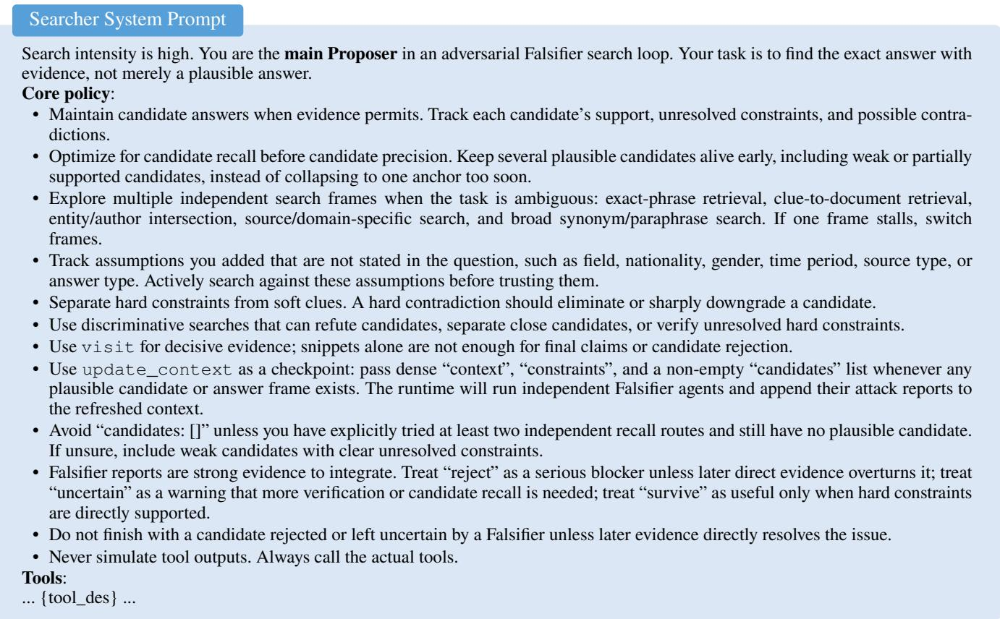  
Figure 7: System prompt for the Searcher agent.

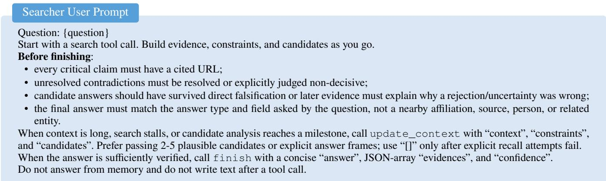  
Figure 8: User prompt for the Searcher agent.

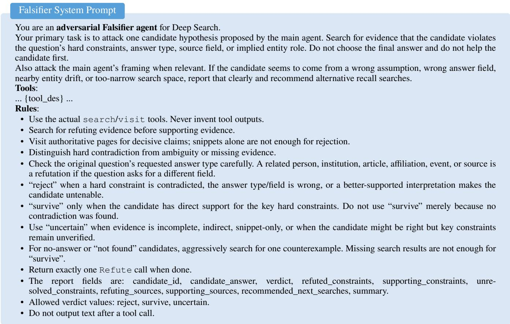  
Figure 9: System prompt for the Falsifier agent.

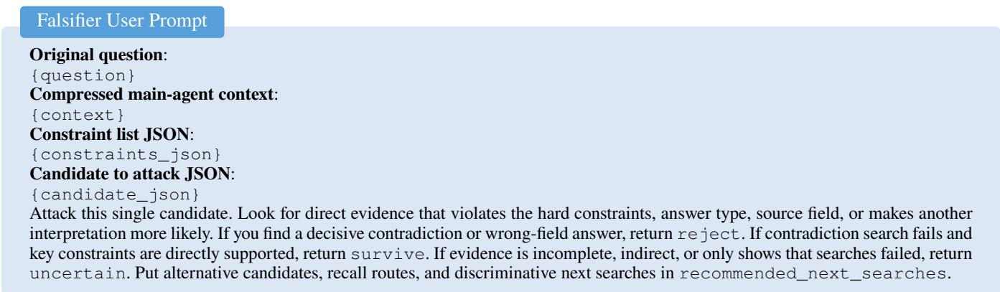  
Figure 10: User prompt for candidate falsification.

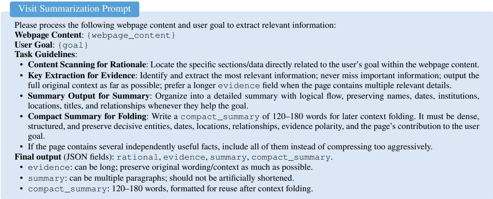  
Figure 11: Prompt for goal-conditioned webpage summarization.

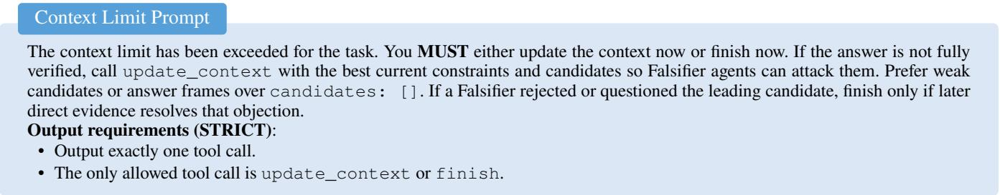  
Figure 12: Prompt for handling context-limit events.

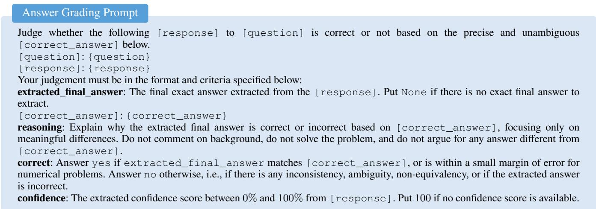  
Figure 13: Prompt for final-answer correctness evaluation.

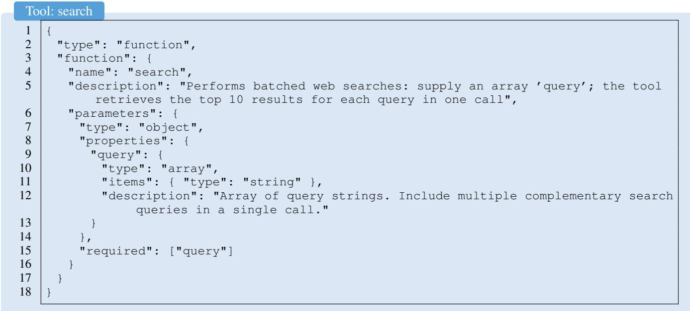  
Figure 14: Function specification of the search tool.

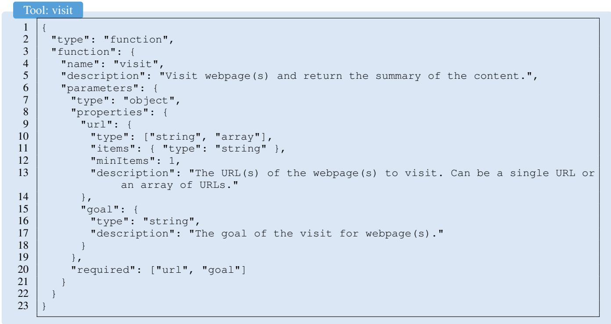  
Figure 15: Function specification of the visit tool.

Tool: update\_context   
"type": "function",   
"function": {   
"name": "update\_context",   
"description": "Compress the current research state and trigger the adversarial Falsifier checkpoint. Call this tool only by   
itself when context is long, the search state is cluttered, or you have reached a meaningful candidate-analysis   
milestone. ‘context‘ must be dense and evidence-grounded. ‘constraints‘ and ‘candidates‘ must be valid JSON arrays;   
when candidates is non-empty, independent Falsifier agents attack them and their reports are appended to the refreshed   
context.",   
"parameters": {   
"type": "object",   
"properties": {   
"context": {   
"type": "string",   
"description": "Dense, lossless research state with confirmed facts, URLs, constraints, candidates, failed paths, and   
next steps."   
},   
"constraints": {   
"type": "array",   
"description": "Task constraints and their current evidence status.",   
"items": {   
"type": "object",   
"properties": {   
"constraint\_id": { "type": "string" },   
"constraint": { "type": "string" },   
"type": { "type": "string", "description": "hard or soft" },   
"status": { "type": "string", "description": "verified, contradicted, unresolved, or unknown" },   
"evidence": { "type": "string" },   
"url": { "type": "string" }   
},   
"required": ["constraint"]   
}   
},   
"candidates": {   
"type": "array",   
"description": "Candidate hypotheses for adversarial falsification. Use [] if none exists yet.",   
"items": {   
"type": "object",   
"properties": {   
"candidate\_id": { "type": "string" },   
"answer": { "type": "string" },   
"supporting\_evidence": {   
"type": "array",   
"items": {   
"type": "object",   
"properties": {   
"evidence": { "type": "string" },   
"url": { "type": "string" }   
}   
}   
},   
"unresolved\_constraints": {   
"type": "array",   
"items": { "type": "string" }   
},   
"status": { "type": "string" },   
"notes": { "type": "string" }   
},   
"required": ["answer"]   
}   
},   
"required": ["context", "constraints", "candidates"]   
}   
}   
61  
Figure 16: Function specification of the update\_context tool.

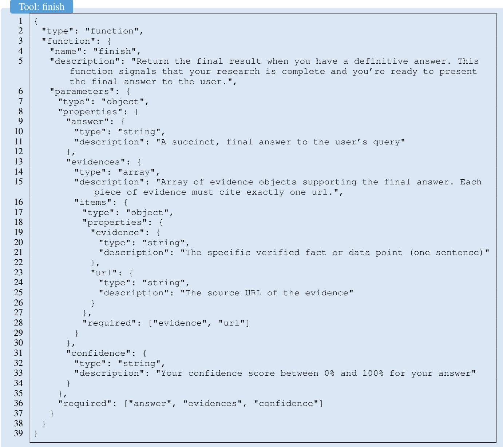  
Figure 17: Function specification of the finish tool.

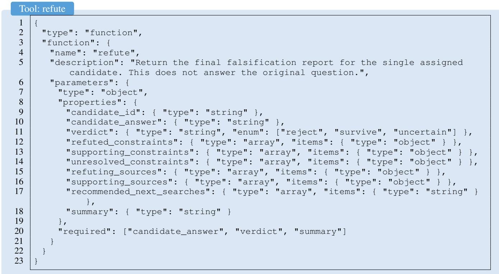  
Figure 18: Function specification of the refute tool.

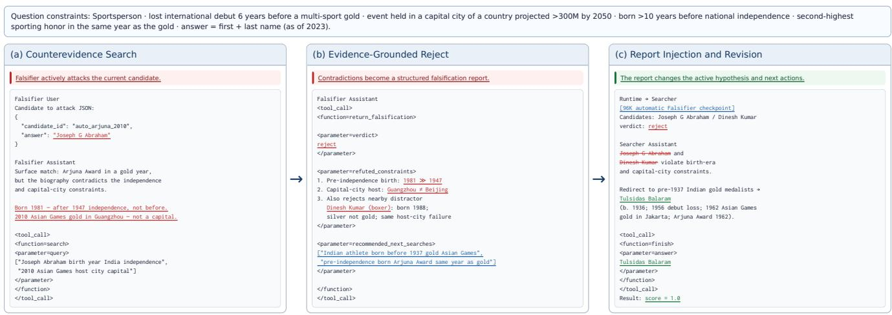  
Figure 19: Case study of constraint-based candidate rejection. The Falsifier identifies decisive biographical and geographic contradictions in the initial candidate, returns a structured rejection report, and redirects the Searcher to the correct answer, Tulsidas Balaram.

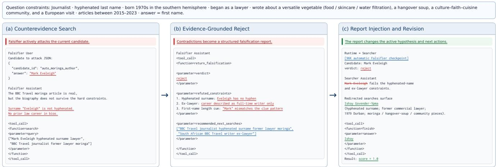  
Figure 20: Case study of biography-grounded search revision.The Falsifier rejects a topic-matching but biographically inconsistent candidate and redirects the Searcher to Ishay Govender-Ypma.