# GBClaw: An agentic AI framework for atomistic grain boundary research and mechanistic discovery

Yazhuo Liua,†, Kunqing Dinga,†, Xiaoguo Gongb, Zifeng Wanga, Yichen Yanga, Yifeng Chea, Wen Chend,e, Josh Kacherc, Olivier Pierrona, Shigenobu Ogatab, Ting Zhua,c,\*

aWoodruff School of Mechanical Engineering, Georgia Institute of Technology, Atlanta, GA, 30332, USA

bDepartment of Mechanical Science and Bioengineering, Graduate School of Engineering Science, The University of Osaka, Osaka, 560-8531, Japan

cSchool of Materials Science and Engineering, Georgia Institute of Technology, Atlanta, GA, 30332, USA

dDepartment of Aerospace and Mechanical Engineering, University of Southern California, Los Angeles, CA, USA

Mork Family Department of Chemical Engineering and Materials Science, University of Southern California, Los Angeles, CA, USA

## Abstract

Agentic artificial intelligence (AI) systems hold immense potential for automating complex workflows in materials discovery and design, but extending them to domain-intensive mechanistic investigations remains challenging. Here, we present GBClaw, an agentic AI framework for investigating the structure and deformation of general grain boundaries (GBs). Although general GBs constitute the vast majority of real-world interfaces in polycrystalline materials, they remain understudied because their structural complexity and interfacial mismatch complicate experimental and modeling research. GBClaw integrates large language models (LLMs) into a modular architecture comprising an orchestrator, specialized agents, domain-specific tools, simulation interfaces, and hierarchical memory. Through dynamic replanning and iterative workflow refinement, the framework effectively connects systematic simulations with targeted mechanistic analysis. Applied to 14 general asymmetric tilt GBs in nickel, GBClaw characterized interfacial defect structures and identified diverse deformation modes across these incommensurate boundaries. Comparing boundary sliding with and without secondary GB misfit dislocations revealed substantial differences in shear strength, underscoring the critical role of defect hierarchies in sliding resistance. Furthermore, researcher-guided follow-up calculations traced an anomalously high shear resistance to metastable boundary structures. This work demonstrates that combining agentic AI with domain expertise bridges high-throughput computational screening with deep physical understanding of complex material interfaces.

† These authors contributed equally to this work.

\* Corresponding author: ting.zhu@me.gatech.edu

## Introduction

Agentic artificial intelligence (AI) systems offer new ways to automate workflows and support discovery1,2. These systems integrate large language models (LLMs) with a harness comprising prompts, tools, middleware, and other components that enable iterative reasoning and task execution. Multiple agents can coordinate specialized capabilities to carry out complex workflows involving many interdependent steps. Although applications in materials research increasingly encompass information retrieval, computation, and data analysis3,4, extending these capabilities to open-ended mechanistic investigations remains challenging. Such investigations require domain expertise to define research objectives, assess physical validity, resolve ambiguities, and select informative follow-up calculations5,6. Integrating researchers into the agentic workflow provides an effective means for addressing these requirements5,7.

Grain boundary (GB) research presents a demanding application for this approach. GBs separate adjacent grains in polycrystalline materials and fundamentally dictate bulk mechanical behavior, including yield strength, tensile ductility, creep resistance, and fracture toughness8–10. Although general GBs constitute the vast majority of real-world interfaces, they remain understudied because their structural complexity and interfacial mismatch complicate atomistic modeling. The macroscopic geometry of a planar GB possesses five degrees of freedom, and each geometry can admit multiple metastable atomic configurations11–13. Characterizing this structural diversity and its mechanical consequences14,15 requires both consistent computational procedures across many interfacial configurations and adaptive investigations guided by intermediate results. A master agent (i.e., an orchestrator) can coordinate these activities by translating research objectives into tasks for specialized agents that use validated tools, generate custom code, or interface with scientific software6,16. Domain experts contribute by evaluating the results and identifying physical questions that require further investigation.

Here, we introduce GBClaw, an agentic framework built on the open-source LangChain platform17 for automated GB simulations with researcher-guided mechanistic analysis. We demonstrate its capabilities on general asymmetric tilt GBs that lack an exact coincidence site lattice18 (i.e., non-CSL). GBClaw characterizes the atomic structures, shear strengths, and deformation pathways of these incommensurate GBs12,19, while employing automated procedures to identify interfacial misfit defects. The framework flags anomalous mechanical responses and dynamically refines workflows in response to researcher queries, conducting targeted simulations that uncover underlying physical mechanisms. These applications demonstrate how a human-inthe-loop agentic framework bridges systematic computational screening with a deep physical understanding of complex material interfaces.

## GBClaw: Architecture and workflow

## Architecture

GB investigations combine sequential dependence with opportunities for parallel execution. Downstream tasks often depend on earlier results, whereas independent cases within a stage can be processed concurrently. Coordinating these activities requires task planning, information exchange, and persistent tracking of the investigation state. Leveraging the strong reasoning and analytical capabilities of LLMs, GBClaw supports these functions through a modular architecture consisting of an orchestrator, specialized agents, domain-specific tools, computational interfaces, and a file-based hierarchical memory system (Fig. 1). Researchers interact directly with the orchestrator, supported by the planning agent, to define research objectives, review intermediate findings, and refine subsequent investigations. The orchestrator delegates tasks, integrates the results, and produces a research report. Each specialized agent is routed to an LLM through an application programming interface (API) and operates with a bounded context, tailored prompt instructions, and designated tools. Separating coordination from execution limits the context required by each agent and supports concurrent processing of independent cases.

GBClaw includes five specialized agents with complementary roles (Fig. 1). The planning agent uses the scientific knowledge encoded in LLMs7 to translate research objectives into specific questions, simulation parameters, and executable plans. The structure agent determines grain orientations, symmetry-consistent pairs of terminating planes, and structural periodicities needed for bicrystal construction. It supports both exact CSL geometries20 and near-CSL constructions that accommodate departures from exact coincidence21. The LAMMPS agent constructs bicrystals and performs structural relaxation, GB energy calculation, shear simulations, and minimumenergy-path (MEP) searches using the nudged elastic band (NEB) method22,23. The analysis agent links shear stress responses to atomic displacements, structural changes, and GB transition pathways. It also identifies stress-drop events and generates visualizations to support mechanistic interpretation. The coding agent generates, executes and refines custom scripts for computational and data-processing tasks not covered by predefined tools6,24. The agents access LAMMPS25, OVITO26, and ASE27 through a unified Python integration layer. This modular design supports the addition of agents with further scientific capabilities.

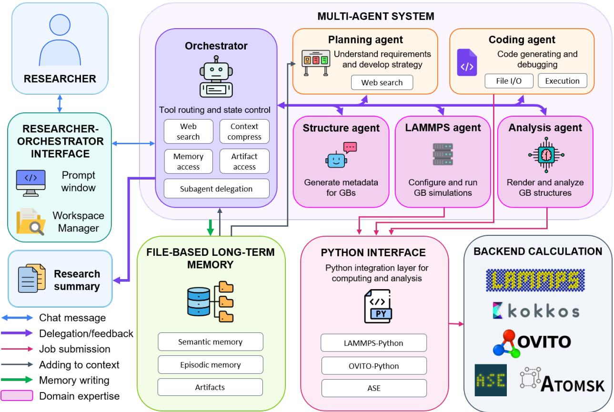  
Fig. 1 | Agentic architecture of GBClaw for researcher-guided grain boundary research. The orchestrator serves as the central coordination hub, interfacing the researcher with five specialized agents, domain-specific scientific software tools, and a file-based hierarchical memory system. The modular architecture enables automated task decomposition and delegation, parallel simulation execution, structured information exchange, and interactive, human-in-the-loop workflow refinement.

GBClaw maintains continuity across tasks through structured information exchange. Each delegated task receives the context for execution, including established findings and references to previous simulations and computational artifacts. Artifacts include generated files, datasets, simulation outputs, code, and analysis results. When additional information is needed, specialized agents retrieve relevant records from project memory before invoking computational tools. On completion, each agent reports its status, findings, and artifact references to the orchestrator, which updates the project state and uses these results to guide subsequent tasks and researcher review.

This approach provides focused task context while preserving access to the broader investigation. Because scientific interpretation depends on the model, computational conditions, and analysis procedure as well as final output, GBClaw retains these through hierarchical memory and context management as discussed next.

GBClaw employs hierarchical memory. Inspired by the CoALA framework of working, episodic, semantic and procedural memory28, GBClaw organizes information into five agentfacing levels (Supplementary Table S1). (i) Domain knowledge encodes workflows and task rules within system instructions and tools. (ii) The project summary tracks top-level objectives, key findings and conclusions for ongoing coordination. (iii) The conversation state records recent agent exchanges, decisions and open tasks. (iv) Persistent research records store durable findings, run summaries, and output references. (v) The artifact level contains underlying configurations, trajectories, logs, code and analysis outputs. Beyond these agent-facing levels, GBClaw maintains a separate archive containing complete interaction and tool execution histories for researcher review. Excluding this archive from routine agent retrieval reduces the risk of treating unverified conversational content as validated findings, while retaining records of how the investigation developed.

GBClaw manages active context through summary updates and conversation compaction. Long context can impair an LLM’s retrieval and use of relevant information29, so the system maintains concise project summaries and periodically condenses conversation histories. Before proposed research records are stored, provenance checks link their claims to supporting sources and simulation results. These checks support traceability but do not independently establish physical correctness. Project summaries incorporate new findings and simulation records, while conversation compression retains key decisions, pending tasks, and artifact references without deleting the underlying computational data. When more detail is needed, agents use shared identifiers to retrieve indexed records and exact run files. These persistent links also allow downstream simulation and analysis tools to access the original datasets directly (Supplementary Fig. S1). Such management connects scientific interpretation to its supporting models and outputs, thereby enabling researchers to review evidence and guide further investigation.

## Structural screening and targeted simulations

General asymmetric, non-CSL tilt GBs are common in polycrystalline materials, yet they remain insufficiently understood. These boundaries provide an ideal platform for investigating how complex interfacial structures govern inelastic deformation. Experimental studies have demonstrated that GBs frequently feature low-index terminating planes on one or both sides19,30– 36, motivating our focus on GBs bounded by simple crystallographic terminations. In these non-CSL tilt GBs, the opposing surface lattices exhibit an irrational ratio of repeat distances along the sliding direction, rendering them inherently incommensurate19,34. This interfacial mismatch can be accommodated either by elastic strain or through a hierarchy of GB misfit dislocations in extended boundaries11,33,37. Under shear loading, these interfaces can undergo pure sliding (tangential translation only) or shear-coupled migration (tangential translation paired with normal boundary motion)14,38. Resolving these deformation mechanisms requires both high-throughput structural screening and detailed analysis of local atomic rearrangements during deformation.

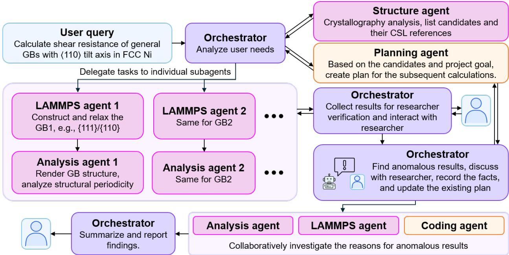  
Fig. 2 | Agentic GBClaw workflow for systematic screening and mechanistic analysis of GB shear strength. The workflow combines automated exploration with human-in-the-loop domain guidance across six key stages: crystallographic screening, simulation planning, parallel bicrystal construction and structural analysis, researcher review, dynamic replanning, and targeted investigation of anomalous shear responses in general asymmetric ⟨110⟩ tilt GBs.

GBClaw investigated flat, atomically sharp tilt GBs in face-centered cubic (FCC) Ni bicrystals through systematic structural screening combined with researcher-guided shear simulations and analysis (Fig. 2). ⟨110⟩ tilt GBs were selected because they are frequently observed in polycrystals, including in HRTEM images35,36, thereby providing structural benchmarks for evaluating atomistic models. The detailed workflow is presented in Supplementary Fig. S2. Representative researcher-GBClaw interactions are shown in Supplementary Fig. S3 and the accompanying demonstration page (https://zhugroup.gatech.edu/gbclaw-demo). During screening, the structure agent used an LLM to identify near-Σ GBs containing low-index terminating planes and having misorientations close to those of reference Σ GBs39,40. Candidate boundaries were required to satisfy three criteria: (i) at least one terminating plane belongs to the {100}, {110}, or {111} family; (ii) the deviation of misorientation angle from the corresponding reference Σ GB does not exceed 5°; and (iii) the absolute values of all Miller indices of both terminating planes are less than 4. The selected boundaries were asymmetric and incommensurate. Their bicrystallographic parameters were then used to construct the corresponding bicrystal models, which the LAMMPS agent relaxed to characterize their interfacial defect structures.

Relaxation of extended boundaries produced a hierarchy of GB misfit dislocations21. Closely spaced, non-glissile primary GB misfit dislocations (PGMDs) accommodate local mismatch, whereas more widely spaced glissile secondary GB misfit dislocations (SGMDs) accommodate the residual mismatch. The shortest complete repeat of the PGMD arrangement defines the primary periodicity λ, while the characteristic spacing between SGMDs defines the secondary periodicity Λ within a zeroth-order approximation21. General procedures are developed to identify SGMDs and analyze their characters. Although SGMD formation is usually energetically favorable in extended boundaries, models that exclude these defects accommodate the residual mismatch through elastic strain. The following sections present the screening results, compare the shear responses with and without SGMDs, and describe the researcher-guided investigation of an anomalous shear response.

## Results

## GB sliding and shear strength

To investigate the shear behavior of asymmetric non-CSL GBs, the structure agent applied the screen criteria described above to general asymmetric ⟨110⟩ tilt GBs near reference Σ GBs. This screening yielded 12 distinct pairs of terminating planes, each corresponding to an asymmetric non-CSL GB (Table 1). Some plane pairs were associated with multiple reference Σ GBs. For example, the {111}/{110} pair lies near both the Σ9 and Σ27 GBs. A given plane pairs can also support multiple crystallographically distinct misorientations. For example, the {111}/{331} pair includes variants at approximately 22° and 49°, whereas the {111}/{221} pair includes variants at approximately $1 6 ^ { \circ }$ and $5 5 ^ { \circ }$ . In addition, the initial screening near Σ33a identified only the $2 2 ^ { \circ }$ and $1 6 ^ { \circ }$ configurations. To enable direct comparisons between the variants, researcher guidance added the corresponding $4 9 ^ { \circ }$ and $5 5 ^ { \circ }$ configurations, increasing the final set to 14 distinct GB configurations.

Table 1 | Reference Σ GBs with ⟨110⟩ tilt axis and low-index near-Σ GBs for $\Sigma < 5 0 .$ . STGB: symmetric tilt GB; ATGB: asymmetric tilt GB. $\theta _ { \Sigma }$ and θ denote the misorientation angles of Σ and near-Σ GBs, respectively; Δθ denotes their difference.
<table><tr><td rowspan=1 colspan=5>Exact Σ GBs</td><td rowspan=1 colspan=4>Near-Σ GBs</td></tr><tr><td rowspan=1 colspan=1>∑</td><td rowspan=1 colspan=1> $\theta _ { \Sigma } ( ^ { \circ } )$ </td><td rowspan=1 colspan=1>GB plane 1</td><td rowspan=1 colspan=1>GB plane 2</td><td rowspan=1 colspan=1>Character</td><td rowspan=1 colspan=1>Approx. plane 2</td><td rowspan=1 colspan=1> $\Delta \theta ( ^ { \circ } )$ </td><td rowspan=1 colspan=1> $\theta ( ^ { \circ } )$ </td><td rowspan=1 colspan=1>GB plane pair</td></tr><tr><td rowspan=4 colspan=1>3</td><td rowspan=1 colspan=1>70.53</td><td rowspan=1 colspan=1>(1 -1 1)</td><td rowspan=1 colspan=1>(1 -1 -1)</td><td rowspan=1 colspan=1>STGB</td><td rowspan=1 colspan=1></td><td rowspan=1 colspan=1></td><td rowspan=1 colspan=1></td><td rowspan=1 colspan=1></td></tr><tr><td rowspan=1 colspan=1>70.53</td><td rowspan=1 colspan=1>(0 0 -1)</td><td rowspan=1 colspan=1>(-2 2 -1)</td><td rowspan=1 colspan=1>ATGB</td><td rowspan=1 colspan=1></td><td rowspan=1 colspan=1></td><td rowspan=1 colspan=1></td><td rowspan=1 colspan=1></td></tr><tr><td rowspan=1 colspan=1>70.53</td><td rowspan=1 colspan=1>(-1 1 0)</td><td rowspan=1 colspan=1>(-1 1 4)</td><td rowspan=1 colspan=1>ATGB</td><td rowspan=1 colspan=1></td><td rowspan=1 colspan=1></td><td rowspan=1 colspan=1></td><td rowspan=1 colspan=1></td></tr><tr><td rowspan=1 colspan=1>70.53</td><td rowspan=1 colspan=1>(1 -1 -1)</td><td rowspan=1 colspan=1>(-1 1 -5)</td><td rowspan=1 colspan=1>ATGB</td><td rowspan=1 colspan=1></td><td rowspan=1 colspan=1></td><td rowspan=1 colspan=1></td><td rowspan=1 colspan=1></td></tr><tr><td rowspan=5 colspan=1>9</td><td rowspan=1 colspan=1>38.94</td><td rowspan=1 colspan=1>(-1 1 -1)</td><td rowspan=1 colspan=1>(-1 1 -5)</td><td rowspan=1 colspan=1>ATGB</td><td rowspan=1 colspan=1></td><td rowspan=1 colspan=1></td><td rowspan=1 colspan=1></td><td rowspan=1 colspan=1></td></tr><tr><td rowspan=1 colspan=1>38.94</td><td rowspan=1 colspan=1>(1 -1 0)</td><td rowspan=1 colspan=1>(7 -7 8)</td><td rowspan=1 colspan=1>ATGB</td><td rowspan=1 colspan=1>(1 -1 1)</td><td rowspan=1 colspan=1>3.68</td><td rowspan=1 colspan=1>35.26</td><td rowspan=2 colspan=1>{111}/{110}</td></tr><tr><td rowspan=1 colspan=1>38.94</td><td rowspan=1 colspan=1>(-1 1 -1)</td><td rowspan=1 colspan=1>(-11 11 1)</td><td rowspan=1 colspan=1>ATGB</td><td rowspan=1 colspan=1>(1 -1 0)</td><td rowspan=1 colspan=1>3.68</td><td rowspan=1 colspan=1>35.26</td></tr><tr><td rowspan=2 colspan=1>38.94</td><td rowspan=2 colspan=1>(0 0 -1)</td><td rowspan=2 colspan=1>(4 -4 -7)</td><td rowspan=2 colspan=1>ATGB</td><td rowspan=1 colspan=1>(1-1-2)</td><td rowspan=1 colspan=1>3.68</td><td rowspan=1 colspan=1>35.26</td><td rowspan=1 colspan=1>{100}/{112}</td></tr><tr><td rowspan=1 colspan=1>(2 −2 -3)</td><td rowspan=1 colspan=1>4.37</td><td rowspan=1 colspan=1>43.31</td><td rowspan=1 colspan=1>{100}/{223}</td></tr><tr><td rowspan=4 colspan=1>11</td><td rowspan=1 colspan=1>50.48</td><td rowspan=1 colspan=1>(0 0 -1)</td><td rowspan=1 colspan=1>(-6 6-7)</td><td rowspan=1 colspan=1>ATGB</td><td rowspan=1 colspan=1>(-11-1)</td><td rowspan=1 colspan=1>4.26</td><td rowspan=1 colspan=1>54.74</td><td rowspan=2 colspan=1>{111}/{100}</td></tr><tr><td rowspan=1 colspan=1>50.48</td><td rowspan=1 colspan=1>(-1 1 -1)</td><td rowspan=1 colspan=1>(-1 1 -19)</td><td rowspan=1 colspan=1>ATGB</td><td rowspan=1 colspan=1>(0 0 -1)</td><td rowspan=1 colspan=1>4.26</td><td rowspan=1 colspan=1>54.74</td></tr><tr><td rowspan=2 colspan=1>50.48</td><td rowspan=2 colspan=1>(1 -1 0)</td><td rowspan=2 colspan=1>(7 -7 12)</td><td rowspan=2 colspan=1>ATGB</td><td rowspan=1 colspan=1>(1 -1 2)</td><td rowspan=1 colspan=1>4.26</td><td rowspan=1 colspan=1>54.74</td><td rowspan=1 colspan=1>{110}/{112}</td></tr><tr><td rowspan=1 colspan=1>(2 -2 3)</td><td rowspan=1 colspan=1>3.79</td><td rowspan=1 colspan=1>46.69</td><td rowspan=1 colspan=1>{110}/{223}</td></tr><tr><td rowspan=2 colspan=1>17</td><td rowspan=1 colspan=1>86.63</td><td rowspan=1 colspan=1>(0 0 -1)</td><td rowspan=1 colspan=1>(12 -12 -1)</td><td rowspan=1 colspan=1>ATGB</td><td rowspan=1 colspan=1>(1 -1 0)</td><td rowspan=1 colspan=1>3.37</td><td rowspan=1 colspan=1>90.00</td><td rowspan=2 colspan=1>{100}/{110}</td></tr><tr><td rowspan=1 colspan=1>86.63</td><td rowspan=1 colspan=1>(1 -1 0)</td><td rowspan=1 colspan=1>(1 -1 24)</td><td rowspan=1 colspan=1>ATGB</td><td rowspan=1 colspan=1>(0 0 1)</td><td rowspan=1 colspan=1>3.37</td><td rowspan=1 colspan=1>90.00</td></tr><tr><td rowspan=2 colspan=1>19</td><td rowspan=1 colspan=1>26.53</td><td rowspan=1 colspan=1>(-1 1 0)</td><td rowspan=1 colspan=1>(-17 17 12)</td><td rowspan=1 colspan=1>ATGB</td><td rowspan=1 colspan=1>(-3 3 2)</td><td rowspan=1 colspan=1>1.29</td><td rowspan=1 colspan=1>25.24</td><td rowspan=1 colspan=1>{110}/{332}</td></tr><tr><td rowspan=1 colspan=1>26.53</td><td rowspan=1 colspan=1>(0 0 -1)</td><td rowspan=1 colspan=1>(-6 6-17)</td><td rowspan=1 colspan=1>ATGB</td><td rowspan=1 colspan=1>(-1 1-3)</td><td rowspan=1 colspan=1>1.29</td><td rowspan=1 colspan=1>25.24</td><td rowspan=1 colspan=1>{100}/{113}</td></tr><tr><td rowspan=2 colspan=1>27</td><td rowspan=1 colspan=1>31.59</td><td rowspan=1 colspan=1>(1 -1 -1)</td><td rowspan=1 colspan=1>(11 -11 -1)</td><td rowspan=1 colspan=1>ATGB</td><td rowspan=1 colspan=1>(1 -1 0)</td><td rowspan=1 colspan=1>3.68</td><td rowspan=1 colspan=1>35.26</td><td rowspan=1 colspan=1>{111}/{110}</td></tr><tr><td rowspan=1 colspan=1>31.59</td><td rowspan=1 colspan=1>(0 0 1)</td><td rowspan=1 colspan=1>(10 -10 23)</td><td rowspan=1 colspan=1>ATGB</td><td rowspan=1 colspan=1>(1 −1 2)</td><td rowspan=1 colspan=1>3.68</td><td rowspan=1 colspan=1>35.26</td><td rowspan=1 colspan=1>{100}/{112}</td></tr><tr><td rowspan=2 colspan=1>33a</td><td rowspan=2 colspan=1>20.05</td><td rowspan=2 colspan=1>(1 -1 -1)</td><td rowspan=2 colspan=1>(13 -13 -5)</td><td rowspan=2 colspan=1>ATGB</td><td rowspan=1 colspan=1>(3-3-1)</td><td rowspan=1 colspan=1>1.95</td><td rowspan=1 colspan=1>22.00</td><td rowspan=1 colspan=1>{111}/{331}</td></tr><tr><td rowspan=1 colspan=1>(2 −2−1)</td><td rowspan=1 colspan=1>4.26</td><td rowspan=1 colspan=1>15.79</td><td rowspan=1 colspan=1>{111}/{221}</td></tr><tr><td rowspan=2 colspan=1>33c</td><td rowspan=1 colspan=1>58.99</td><td rowspan=1 colspan=1>(-1 1 -1)</td><td rowspan=1 colspan=1>(1 -1 -19)</td><td rowspan=1 colspan=1>ATGB</td><td rowspan=1 colspan=1>(0 0 -1)</td><td rowspan=1 colspan=1>4.26</td><td rowspan=1 colspan=1>54.74</td><td rowspan=2 colspan=1>{111}/{100}</td></tr><tr><td rowspan=1 colspan=1>58.99</td><td rowspan=1 colspan=1>(0 0 -1)</td><td rowspan=1 colspan=1>(-20 20 -17)</td><td rowspan=1 colspan=1>ATGB</td><td rowspan=1 colspan=1>(-1 1 -1)</td><td rowspan=1 colspan=1>4.26</td><td rowspan=1 colspan=1>54.74</td></tr><tr><td rowspan=1 colspan=1>43</td><td rowspan=1 colspan=1>80.63</td><td rowspan=1 colspan=1>(0 0 -1)</td><td rowspan=1 colspan=1>(30 -30 -7)</td><td rowspan=1 colspan=1>ATGB</td><td rowspan=1 colspan=1>(3-3-1)</td><td rowspan=1 colspan=1>3.89</td><td rowspan=1 colspan=1>76.74</td><td rowspan=1 colspan=1>{100}/{331}</td></tr></table>

Following selection of the asymmetric non-CSL GBs, the LAMMPS agent constructed and relaxed the corresponding Ni bicrystals, which were subsequently analyzed by the analysis agent to evaluate their interfacial atomic configurations. Interatomic interactions were modeled using the angular-dependent potential developed by Howells and Mishin41, which reproduced the experimentally observed interfacial motif of the {111}/{331}(22°) $\mathrm { G B } ^ { 3 5 }$ . This boundary exemplifies the hierarchical formation of PGMDs and SGMDs. Energy relaxation of an extended boundary without PBCs along the horizontal direction produced closely spaced PGMDs with a Burgers vector of ${ \bf b } _ { \mathrm { p } } = 1 / 2 \langle 1 1 0 \rangle \{ 1 1 1 \}$ } alongside more widely spaced SGMDs. As shown in Fig. 3a, b, small and large red regions with high atomic volumetric strains near the {331} terminating plane identify the cores of PGMDs and SGMDs, respectively. The primary periodicity, defined by the repeating arrangement of PGMDs, is $\lambda = \ 5 / 2 \langle 1 1 2 \rangle \{ 1 1 1 \}$ }, referenced to the grain terminated by the {111} plane. The secondary periodicity � is the spacing between adjacent SGMDs. The magnitude of $| \lambda | = 2 . 1 6$ nm is substantially smaller than that of $| \pmb { \Lambda } | = 1 5 . 7 3$ nm (Fig. 3b).

To distinguish macroscopically uniform GB shearing from sliding mediated by SGMD glide, the LAMMPS agent constructed a compact periodic bicrystal model based on the primary periodicity λ. An interfacial region between neighboring SGMDs in the extended GB (Fig. 3c) was isolated to build a supercell with PBCs within the GB plane (Fig. 3d). After energy minimization, the supercell retained its local PGMD arrangement, while accommodating residual interfacial mismatch through elastic strain (Fig. 3c, d). These compact models enabled the evaluation of athermal shear strengths and deformation modes in the absence of SGMDs under imposed periodic constraints.

Using these compact models, the orchestrator coordinated multiple LAMMPS agents to parallelize shear simulations across all 14 GB configurations in opposing shearing directions (Fig. 3e). Horizontal shear displacement was applied incrementally, followed by energy minimization after each increment. The shear strength $\tau _ { 0 } .$ , defined as the peak shear stress in the subsequent steady response, varied widely among these boundaries, ranging from tens of MPa to 9.3 GPa. Exceptionally low $\tau _ { 0 }$ values of 23 MPa and 14 MPa for the {111}/{110} and {111}/{100} GBs suggest potential for low-friction sliding. In contrast, the high $\tau _ { 0 }$ value of 3.5 GPa for the {100}/{110} GB challenges its previously proposed suitability as a low-friction interface42. Pronounced stress drops accompanied diverse inelastic deformation modes, including pure sliding, shear-coupled migration, dislocation emission, and structural transformations that altered the initial boundary structure. Reversing the initial loading direction frequently changed the shear strength and, in some cases, the deformation mode. For instance, the {111}/{331}(49°) GB exhibited shear-coupled migration in one direction and pure sliding in the reverse. These results demonstrate a pronounced direction-dependent asymmetry in shear responses, shifting the active deformation mechanism even within identical initial boundary configurations.

a  
{111}/{331} (22°)  
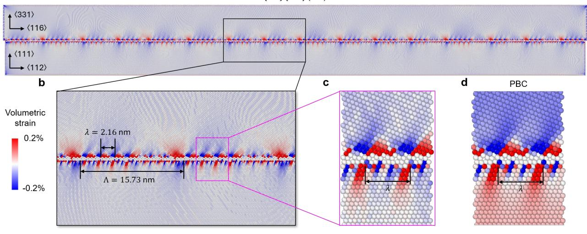

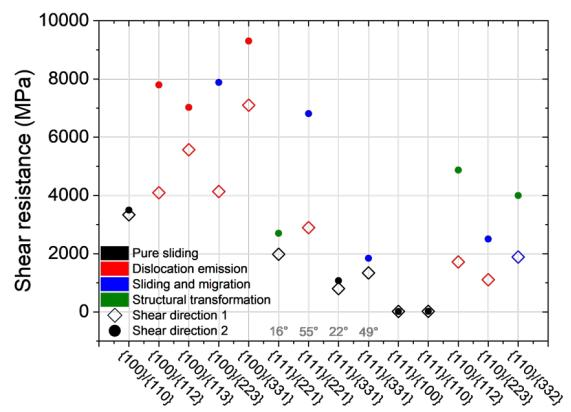

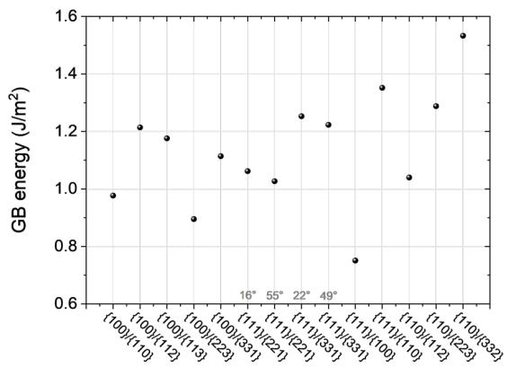  
Fig. 3 | Atomic structures, structural periodicities, and shear responses of selected asymmetric incommensurate GBs. a, Extended GB in a Ni bicrystal after energy minimization, joining {331} and {111} terminating planes at a 22° misorientation angle, denoted as $\{ 1 1 1 \} / \{ 3 3 1 \} ( 2 2 ^ { \circ } )$ . b, Magnified view of the interface. Small and large red regions near the {331} terminating plane identify the cores of PGMDs and SGMDs, respectively. The primary period $( \lambda =$ 2.16 nm) is the spacing between the repeating arrangement of PGMDs, and the secondary period $( \Lambda = 1 5 . 7 3 \mathrm { n m } )$ is the spacing between adjacent SGMDs. c, Magnified view of the boundary showing adjacent PGMDs separated by one �. d, Periodic supercell constructed from the structure in c and relaxed under PBCs to eliminate normal stress components for uniform sliding simulation. Atoms in a-d are colored according to atomic volumetric strain. $\mathbf { e } ,$ Athermal shear strengths of the selected asymmetric incommensurate GBs loaded in opposite directions parallel to the GB plane and perpendicular to the ⟨110⟩ tilt axis. Directions 1 and 2 denote the lower and higher shear resistance, respectively. Symbol colors represent the observed deformation modes. $\mathbf { f } ,$ Relaxed GB

energies per unit area for the compact boundary models in d.

To examine the relationship between GB energy and shear resistance, the LAMMPS agent calculated the energies of all relaxed boundaries (Fig. 3f and Supplementary Note 1). Although higher-energy boundaries generally exhibited a trend toward lower shear resistance, this relationship was non-monotonic. For example, the {111}/{100} GB had both the lowest relaxed GB energy and the lowest shear strength of 14 MPa. Furthermore, for most boundaries lacking structural symmetry about the interface normal, loading in opposite directions yielded different shear strengths and deformation modes despite identical GB energies. These findings demonstrate that static GB energy alone is insufficient to predict or characterize direction-dependent shear responses, underscoring the need to directly analyze atomic rearrangements and deformation pathways under shear loading.

## Pure sliding

Four GB configurations exhibited pure sliding under both shear directions: the {111}/{100}, {111}/{331}(22°), {100}/{110} and {111}/{110} GBs. To investigate their deformation pathways, the analysis agent correlated stress histories and stress-drop events with corresponding atomic rearrangements (Fig. 4). Each boundary contained at least one close-packed {111} or densely packed {100} terminating plane, whereas differences in the opposing terminating planes produced distinct interfacial registries. Specifically, the {110} termination exhibited atomic-scale corrugation, whereas the {331} termination comprised single-atomic-layer steps separated by short {111} facets. These geometric differences produced distinct local structural motifs within each interfacial repeat unit. Table 2 lists the primary periodicities λ of all four boundaries.

Comparing atomic configurations across selected sliding intervals, particularly immediately before and after stress drops, revealed the associated interfacial displacement fields (Fig. 4). Within a single repeat unit, atomic displacements were either distributed across multiple atomic columns or localized to individual atomic columns oriented along the ⟨110⟩ tilt axis. Atoms within adjacent columns translated in different directions, indicating that macroscopically uniform tangential grain translation was accommodated by locally nonuniform atomic shuffling. The spatial distribution of these rearrangements varied markedly among the four pure-sliding interfaces. While both the {111}/{100} and {111}/{110} GBs exhibited low shear strengths (Fig. 4a, b), their displacement patterns differed: displacements were distributed more uniformly in the {111}/{100} GB than in the {111}/{110} GB. Conversely, the {111}/{331}(22°) and {100}/{110} GBs exhibited substantially higher shear strengths, yet also differed in their local displacement modes. In the {111}/{331}(22°) GB, displacements were distributed across all atomic columns without a single column dominating the response. In contrast, each stress-drop event in the {100}/{110} GB involved pronounced shuffling localized within an individual column.

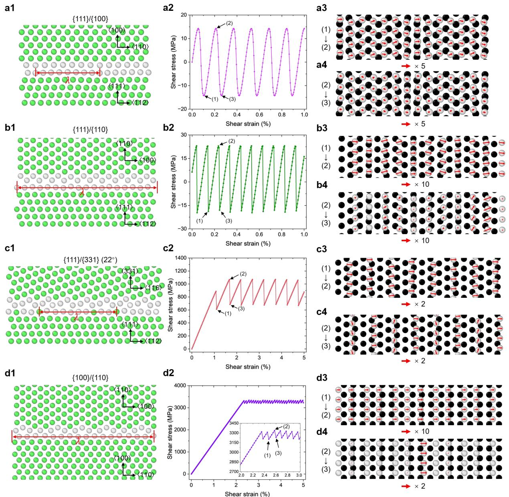  
Fig. 4 | Supercell atomic structures, shear stress-strain responses, and displacement fields of GBs exhibiting pure sliding. a1–a4, {111}/{100} GB; b1–b4, {111}/{110} GB; c1–c4, {111}/{331}(22°) GB; d1–d4, {100}/{110} GB. For each boundary, panel 1 shows the relaxed atomic structure in a compact supercell with PBCs applied in the boundary plane, with

crystallographic directions indicated in the two adjoining grains. Red arrows indicate the primary interfacial repeat length λ. Panel 2 shows the shear stress-strain curve, where states (1)-(3) define a representative sliding interval. Panels 3 and 4 present GB plan views of the boundary at states (2) and (3), respectively. Red arrows denote atomic displacement vectors from state (1) to (2) in panel 3 and from state (2) to (3) in panel 4. Vector amplification factors are specified alongside each configuration.

Table 2 | Structural and deformation characteristics of four pure-sliding GBs. Listed quantities include the SGMD Burgers vector ${ \bf b } _ { s }$ , the primary periodicity vector � and its magnitude |�|, the average secondary periodicity $| \bar { \Lambda } |$ , and the GB shear strength without $( \tau _ { 0 } )$ and with $( \tau _ { s } )$ SGMDs. Both ${ \bf b } _ { s }$ and � are given in units of the lattice constant $a _ { 0 } .$ , with the slip plane expressed in terms of the terminated plane of the reference grain. Where two shear strengths are listed, the upper and lower entries correspond to shear directions 1 and 2, respectively.
<table><tr><td>GB configuration</td><td> ${ \bf b } _ { s }$ </td><td>λ</td><td>|λ| (nm)</td><td> $| \overline { { \Lambda } } | ^ { * }$  (nm)</td><td> $\tau _ { 0 }$   $\mathrm { ( M P a ) }$ </td><td> $\tau _ { s } ~ \mathrm { ~ ( M P a ) }$ </td></tr><tr><td>{111}/{100}</td><td>1/14(112}{111} 1/8(110){100}</td><td>2(112){111} 7/2(110){100}</td><td>1.73</td><td>5.97</td><td>14</td><td> $3 . 5 \times 1 0 ^ { - 4 }$ </td></tr><tr><td>{111}/{110}</td><td>1/22(112}{111} 1/9(100&gt;{110}</td><td>9/2(112){111} 11(100){110}</td><td>3.87</td><td>19.0</td><td>23</td><td> $1 . 4 \times 1 0 ^ { - 2 }$ </td></tr><tr><td>{111}/{331} (22°)</td><td>1/8(112){111} 1/20(116){331}</td><td>5/2(112){111} (116){331}</td><td>2.16</td><td>16.25</td><td>800 1,074</td><td>_** 530</td></tr><tr><td>{100}/{110}</td><td>1/24(110&gt;{100} 1/17(100&gt;{110}</td><td>17/2(110){100} 12(100){110}</td><td>4.23</td><td>11.96</td><td>3,498</td><td>3,870</td></tr></table>

$^ { * } \left| \bar { \Lambda } \right|$ represents the average spacing between neighboring SGMDs. Individual spacings are integer multiples of |�| , typically $n | \lambda |$ and $( n + 1 ) | \lambda |$ , where � is an integer43. The reported value is the average of these spacings weighted by their relative frequencies.  
\*\*The GB underwent successive structural transformations during shear loading, precluding determination of a well-defined shear strength.

Iterative workflow refinement enabled GBClaw to connect structural simulation data directly with mechanistic analysis. Combining atomic displacement fields with structural recurrence analysis linked stress drops to discrete grain translations, thereby identifying the displacementshift-complete (DSC) slip vector44. For the {111}/{331}(22°) GB, each stress drop produced a translation of 1/8⟨112⟩{111}, relative to the {111} terminated grain. Four successive drops yielded a cumulative slip of 1/2⟨112⟩{111}, translating each atom on the {331} terminating plane to a crystallographically equivalent site along the sliding direction. The grain translation associated with a single stress drop represents the shortest displacement that preserves the interfacial structure, thus defining the SGMD Burgers vector bs (Fig. 4c). Table 2 lists bs determined for all four GBs, whose variations reflect their distinct bicrystallography. To validate these assignments, interactive exchanges between the researcher and the orchestrator prompted the development of an automated procedure to identify SGMDs from projected atomic-column arrangements in HRTEM images (Supplementary Note 2, Figs. S4, S5 and Table S2). Subsequent exchanges further enabled an independent crystallographic analysis using near-CSL dichromatic patterns to validate the extracted Burgers vectors bs (Supplementary Note 3 and Fig. S6). Agreement among these approaches corroborated the SGMD identification and Burgers vector assignments, establishing a general geometrical procedure for analyzing SGMDs in experimental HRTEM images and atomistic simulations. These iterative exchanges illustrate how researcher guidance enabled GBClaw to refine its workflows and validate mechanistic interpretations through complementary methods.

To examine how SGMDs affect GB sliding, the structure and LAMMPS agents evaluated the shear strengths of bicrystal models containing arrays of these defects. Each supercell incorporated multiple SGMDs whose Burgers vectors summed to a lattice repeat along the boundary, preserving crystallographically equivalent interfacial registry across periodic images. Under PBCs, these models represent extended GBs containing regular SGMD arrays. For the {111}/{331}(22°) GB, sliding proceeded through the intermittent glide of individual dislocations or localized sub-arrays (Supplementary Note 4 and Fig. S7). The presence of SGMDs substantially reduced the shear strength from $\tau _ { 0 } = 1 , 0 7 4 \mathrm { M P a }$ in the SGMD-free compact model to $\tau _ { s } = 5 3 0 \mathrm { M P a }$ in the model with SGMDs. Table 2 compares $\tau _ { 0 }$ and $\tau _ { s }$ for all four GBs alongside the corresponding magnitudes of the secondary periodicity vector Λ. These results demonstrate a significant disparity in predicted shear strengths between GB models with and without SGMDs, underscoring the necessity of incorporating defect hierarchies into atomistic models. A systematic analysis of how spatially non-uniform distributions of SGMDs influence sliding in general GBs will be reported separately.

Dynamic replanning enabled GBClaw to leverage researcher guidance to investigate an anomalous shear response and resolve its structural origin. During the initial shear simulation of the {111}/{110} GB, an unusually high initial stress was followed by a sharp drop and steady-state sliding at a substantially lower stress. In response to a researcher’s inquiry, the orchestrator dynamically expanded the simulation plan to execute a loading-unloading cycle and NEB calculations (Fig. 5a and Supplementary Note 5). After unloading to zero applied shear strain, the bicrystal retained a nonzero shear stress, whereas the initial configuration was stress free (inset in Fig. 5a). The analysis agent then compared the two zero-strain configurations and mapped the atomic displacements between them (Fig. 5b). This comparison showed that unloading did not restore the initial interfacial structure. The two relaxed configurations instead occupied distinct local minima under identical zero-strain constraints.

a  
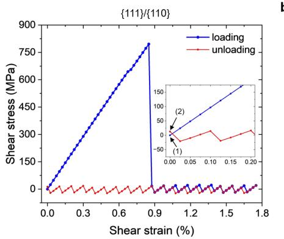  
b

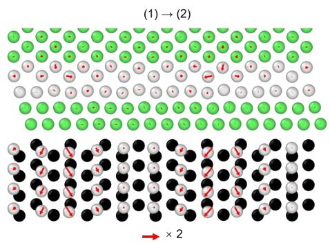

C  
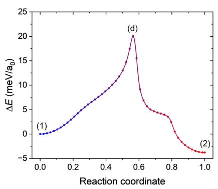  
d

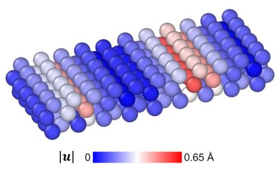  
Fig. 5 | Loading-induced local reconstruction and associated energy barrier in the {111}/{110} GB. a. Shear stress-strain response during loading (blue) and unloading (red). The inset shows the residual shear stress of the initial relaxed configuration (1) and the final unloaded configuration (2), both evaluated at zero applied shear strain. b. Edge-on (upper) and plan (lower) views of configuration (2). Red arrows indicate atomic displacement vectors from configuration (1) to (2), scaled by a factor of two. c. Minimum energy path from an NEB calculation connecting configurations (1) and (2) at zero applied shear strain. d. Atomic configuration at the saddle point in c. Atoms are colored by their displacement magnitude relative to configuration (1).

To characterize the energy landscape connecting these states, GBClaw performed an NEB calculation using the relaxed initial and reconstructed GB configurations as endpoints at zero imposed shear strain. The resulting minimum energy path exhibited an energy barrier of approximately $2 0 \mathrm { m e V } / a _ { 0 }$ , where $a _ { 0 } = 3 . 5 2 \mathrm { ~ \AA ~ }$ is the lattice constant, and terminated at a state with lower energy than the initial configuration (Fig. 5c). This result indicated the metastability of the initial GB structure. Together with the localized atomic displacements at the saddle-point state relative to the initial state (Fig. 5d), these results revealed a loading-induced local reconstruction of the {110} terminating plane against the opposing {111} plane. These findings attributed the initially high sliding resistance to a metastable local structure formed during bicrystal construction and relaxation. Reloading the reconstructed zero-strain configuration did not reproduce the anomaly and instead yielded the normal stress-strain response shown in Fig. 4b2. This investigation demonstrates how human-in-the-loop replanning empowers GBClaw to unravel unexpected simulation phenomena and pinpoint their atomistic reconstruction mechanisms.

## Shear asymmetry between GB sliding and migration

The analysis agent compared the $2 2 ^ { \circ }$ and $4 9 ^ { \circ }$ misorientation variants of the {111}/{331} GB, providing mechanistic insights into shear asymmetry and deformation-mode selection. The two variants arise from two {111} planes whose inclination angles differ by $7 1 ^ { \circ }$ about the ⟨110⟩ tilt axis. Both variants share a primary periodicity λ with a magnitude of 2.16 nm and an SGMD Burgers vector ${ \bf b } _ { \mathrm { s } } = 1 / 8 \langle 1 1 2 \rangle \{ 1 1 1 \}$ (Table 2, Table S4 and Supplementary Fig. S8). When sheared along direction 1 (the mode of lower shear strength), the $4 9 ^ { \circ }$ variant exhibited a pure-sliding response similar to that of the $2 2 ^ { \circ }$ variant. Its repeated stress drops produced a comparable sawtooth profile, albeit at different stress levels (Figs. $4 \mathrm { c } 2$ and 6a). Atomic configurations and displacement vectors likewise confirmed tangential grain translation without GB migration (Figs. 4c and 6c1-c3). When shear was applied along direction 2, however, the $4 9 ^ { \circ } \operatorname { G B }$ underwent shearcoupled migration, whereas the $2 2 ^ { \circ }$ GB maintained pure sliding. Specifically, stress-drop events in the $4 9 ^ { \circ }$ GB coincided with downward boundary motion through the transformation of atomic columns into the opposing grain orientation and coordinated shuffling across two atomic layers (Fig. 6b, d1-d3).

Dichromatic mapping based on near-CSL constructions revealed different lattice registries for the two variants (Supplementary Figs. S6c and S8a), suggesting that differences in subsurface stacking sequences and second-nearest-neighbor coordination likely underlie the distinct shear pathways. Supplementary Note 3 examines the shear asymmetry, while Supplementary Notes 6 and 7 detail the corresponding shear-coupled migration pathways and crystallographic mapping, respectively. This comparison further illustrates how GBClaw bridges crystallographic characterization with the local atomic mechanisms governing shear responses.

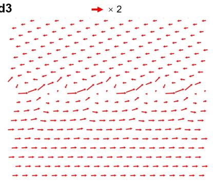

a  
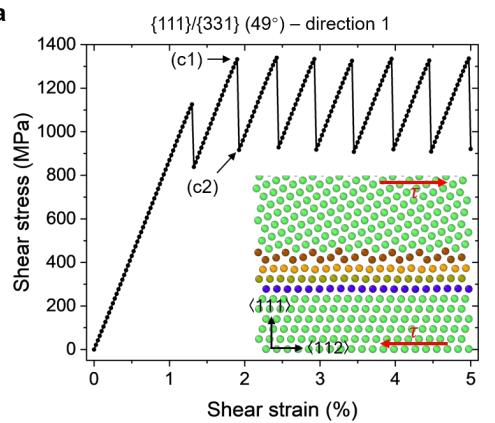

b  
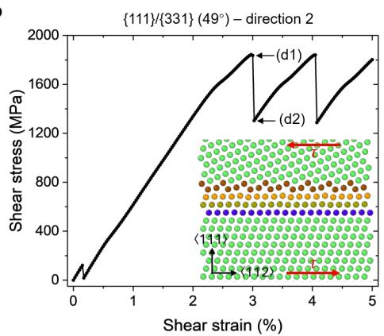

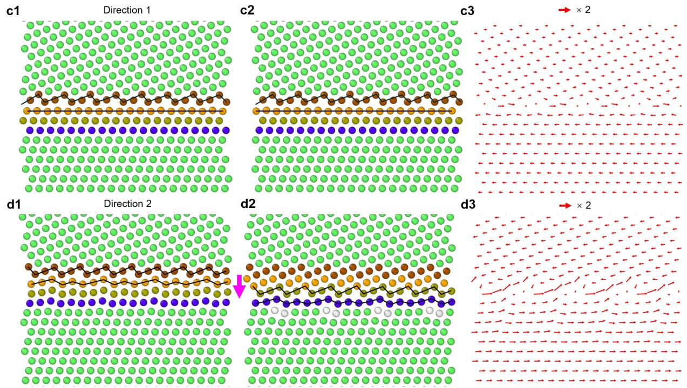  
Fig. 6 | Shear asymmetry in the {111}/{331}(49°) GB. a, b, Shear stress as a function of applied shear strain along directions 1 and 2, respectively. Insets show the initial boundary structures and shear directions. $\mathbf { c l - c } 3 ,$ Pure GB sliding when sheared along direction $1 . \mathbf { d 1 - d 3 } ,$ Shear-coupled GB migration when sheared along direction 2. c1, d1 and c2, d2 show configurations before and after, respectively, the stress drops indicated in a and b. c3, d3, Corresponding atomic displacement vectors, amplified twofold for clarity. Selected atomic rows are colored to highlight structural changes. Black lines mark terminating planes. The magenta arrow indicates downward boundary

migration during shear along direction 2. All configurations are viewed along the ⟨110⟩ tilt axis.

## Discussion

GBClaw combines automated workflows, LLMs, and domain expertise to bridge systematic GB characterization with targeted mechanistic investigation. By coordinating structural screening, shear simulations, and atomistic analyses, the framework identified misfit-dislocation hierarchies, distinguished diverse deformation modes, and quantified substantial variations in athermal shear strengths across asymmetric incommensurate GBs. Researcher-guided iterative workflows enabled complementary analyses of SGMD structures and Burgers vectors, establishing general procedures to identify and analyze SGMDs in both experimental images and atomistic simulations. Atomistic calculations revealed a significant disparity in predicted shear strengths between GB models with and without SGMDs. These results underscore the necessity of incorporating defect hierarchies when applying high-fidelity, computationally intensive first-principles or machinelearned potentials to design the composition and structure of high-performance general GBs. Furthermore, dynamic replanning directed follow-up calculations that resolved the structural origins of the anomalous shear response of the {111}/{110} GB and shear asymmetry of the {111}/{331}(49°) GB. These examples demonstrate how automation scales systematic exploration while domain expertise guides workflow development, validation, and physical interpretation.

Several methodological constraints of the underlying atomistic simulations warrant consideration. The current implementation employed compact supercells with PBCs within the GB plane to evaluate shear strengths with and without SGMDs. These spatial constraints restrict the spatial distribution and long-range interactions of line defects, potentially suppressing deformation pathways active in extended boundaries. The calculated strengths therefore represent athermal instability thresholds for the modeled boundary configurations, rather than universal upper bounds. Likewise, while NEB calculations delineate minimum energy paths between selected states, they do not explicitly account for finite-temperature dynamics. Addressing these limitations will require large-scale molecular dynamics simulations to capture interactions among multiple defects, alongside enhanced sampling or kinetic rate-theory methods to evaluate thermally activated processes.

GBClaw’s modular architecture and hierarchical memory provide an extensible foundation for addressing these challenges. Specialized agents currently under development focus on the adaptive refinement of machine-learned potentials tailored to complex GB configurations and on experimental validation through atomic-resolution characterization. Integrating these agents through standardized data interfaces will enable GBClaw to coordinate high-throughput structural screening, potential refinement, atomistic simulation, and experimental validation within a single closed-loop system.

To balance flexibility and reliability, GBClaw combines standardized scientific tools with custom code dynamically generated by its coding agent. Predefined tools establish reproducible workflows for routine operations45, whereas custom code provides the adaptability needed for specialized analyses and error recovery16. However, token consumption aside, repeated code generation risks introducing algorithmic inconsistencies across runs46. Converting validated scripts into persistent, structured tools after their physical assumptions, inputs, and numerical behavior have been checked mitigates this variability. As highlighted by the domain-knowledge pitfalls reported for MatClaw6, successful execution does not guarantee physical correctness. Multi-layer verification, physical sanity checks, and human expert oversight remain indispensable.

In summary, GBClaw demonstrates that agentic AI can effectively connect high-throughput simulations to deep mechanistic discovery, while maintaining full provenance across models, execution records, and analytical outputs. By elucidating the governing role of misfit-dislocation hierarchies, this work advances a unified, defect-based framework for investigating complex interfaces. Within general asymmetric tilt GBs, PGMDs are typically sessile in the boundary plane, acting as structural obstacles to motion of other defects. In contrast, SGMDs serve as mobile carriers of interfacial sliding, forming either to accommodate interfacial lattice mismatch or through the transformation of dislocations absorbed from the grain interior or triple junctions. Beyond homophase boundaries, GBClaw provides a generalizable framework for investigating heterophase interfaces, van der Waals heterostructures, and interfacial friction in incommensurate solid-state contacts.

## Methods

## Implementation of GBClaw

GBClaw was implemented in Python using the open-source LangChain and LangGraph frameworks17 for agent coordination and DeepAgents for task-specific code execution. The system used both GPT-5.6 Sol and GPT-5.6 Luna, with task-dependent model routing selecting the model according to the complexity and reasoning requirements of each task. Specialized agents accessed LAMMPS25, OVITO26, and ASE27 through Python-based tool interfaces. Computational results were linked to persistent research records and supporting artifacts. Supplementary Table S3 lists the tools available to each agent, and Supplementary Fig. S3 illustrates a representative researcherguided investigation. Further implementation details and software dependencies are documented in the source code repository identified in the Code Availability statement.

## GB selection and model construction

General asymmetric ⟨110⟩ tilt GBs were selected near the exact CSL reference boundaries with $\Sigma < 5 0$ listed in Table 1. Crystallographically equivalent plane pairs were grouped according to cubic symmetry, and one representative orientation was retained from each group. The {111}/{331}(49°) and {111}/{221}(55°) variants were added to the 12 selected plane-family pairs, yielding 14 GB configurations. Ni bicrystals were constructed with the tilt axis along the out-ofplane direction. Interatomic interactions were described using the angular-dependent Ni-Cr potential of Howells and Mishin41. The lattice parameter of Ni a0 was 3.52 Å. Compact periodic supercells were selected with an integer multiple of the primary periodicity along the horizontal direction, as illustrated in Fig. 3. These supercells retained the local interfacial motif while excluding SGMDs. Residual mismatch was accommodated by elastic strain, with both the atomic coordinates and cell lengths allowed to relax. Supplementary Table S4 reports the crystallographic orientations, lattice repeat counts, relaxed supercell dimensions and residual lattice mismatch.

Each compact supercell contained one GB between upper and lower free surfaces. PBCs were applied within the GB plane, and vacuum regions with an initial thickness of 20 Å were introduced above and below the free surfaces. Before relaxation, overlapping atoms separated by less than 0.3a0 across the GB were removed. Structural relaxation was performed in LAMMPS25 through four cycles, each alternating between atomic relaxation at fixed supercell dimensions and celllength relaxation toward zero normal stress. Conjugate gradient energy minimization used a force tolerance of $1 0 ^ { - 6 } \mathrm { e V } \mathrm { \AA } ^ { - 1 }$ , with maximum limits of 1,000 iterations and 10,000 force evaluations for each minimization. The energy-based convergence criterion was disabled.

## Shear simulations

Shear displacement was applied incrementally along the horizontal direction. Boundary layers with a thickness of 3 Å were defined at the upper and lower surfaces of the bicrystal, and their atomic membership was retained throughout loading. At each load increment, the upper layer was displaced horizontally while the lower layer remained fixed in that direction. During energy minimization, the in-plane coordinates of both boundary layers were constrained, while their coordinates normal to the GB plane were allowed to relax. The cell dimensions remained fixed throughout loading. The shear strain was defined as $\gamma = \Delta u / H _ { 0 }$ , where $\Delta u$ is the relative horizontal displacement between the centers of the boundary layers, and $H _ { 0 }$ is their initial separation normal to the GB plane.

The default forward displacement used a strain increment of $\Delta \gamma = 2 . 5 { \times } 1 0 ^ { - 4 }$ over 200 increments. Each increment was followed by conjugate gradient energy minimization with a force tolerance of $1 0 ^ { - 6 } ~ \mathrm { e V } \mathring { \mathrm { A } } ^ { - 1 }$ . The energy-based convergence criterion was disabled, and each minimization was limited to 3,000 iterations and 10,000 force evaluations. Shear stress was calculated as the negative of the LAMMPS pressure-tensor component $P _ { x y }$ and rescaled by the ratio of the initial supercell volume to the initial atomic bounding-box volume, thereby excluding the vacuum contribution. The shear strength in Fig. 3e was defined by the peak stress within the subsequent steady response after excluding the initial loading transient. Directions 1 and 2 denote the directions with lower and higher shear resistance, respectively. For the {111}/{100} and {111}/{110} GBs shown in Fig. 4a, b, the strain increment was reduced fivefold to $5 \times 1 0 ^ { - 5 }$ to resolve the sliding response more finely. Simulations with periodic arrays of SGMDs are described in Supplementary Note 4 and Supplementary Fig. S7.

## Loading-unloading cycle and NEB calculations

The {111}/{110} GB was loaded beyond the initial stress drop and unloaded to zero applied shear strain using the same displacement-control procedure. The loading range and number of increments are provided in Supplementary Note 5. The relaxed initial and unloaded configurations were used as endpoints for a strain-controlled NEB calculation22,23 at zero applied shear strain. Atoms were matched by their identifiers, and 144 replicas, including both endpoints, were initialized through linear interpolation using periodic minimum-image displacements. The minimum energy path was obtained using the FIRE algorithm with a spring coefficient of $1 . 0 \mathrm { e V } \&$ and a minimization timestep of 0.01 ps. The conventional NEB and climbing-image stages were each limited to 10,000 iterations and used a force tolerance of $1 0 ^ { - 6 } ~ \mathrm { e V } \mathring { \mathrm { A } } ^ { - 1 }$ . The energy-based convergence criterion was disabled. Energies were reported relative to the relaxed initial endpoint. Supplementary Table S4 provides supercell dimensions.

## Code availability

The GBClaw source code is provided under the MIT License on GitHub

(https://github.com/ZhuGroup-GT/GBClaw). The recorded demo project can be visited at https://zhugroup.gatech.edu/gbclaw-demo.

## Data availability

All relevant data are included within the manuscript, Supplementary Information, and GitHub repository. The detailed simulation artifacts are available from the corresponding author upon request.

## Author contributions

YL and TZ conceived research. YL, KD, XG, SO and TZ conducted research. YL wrote the initial manuscript. WC and TZ revised the manuscript. All the authors contributed to the discussion of the results.

## Competing interests

The authors declare no competing interests.

## Acknowledgements

YL, KD, YY, JK, OP and TZ acknowledge support by the U.S. Department of Energy (DOE), Office of Science, Basic Energy Sciences (BES) Materials Science and Engineering (MSE) Division under Award #DE-SC0018960. WC acknowledges support by the National Science Foundation (Award numbers 2516550 and 2331132). XG and SO acknowledge support by Japan Society for the Promotion of Science (JSPS) KAKENHI Grant No. JP23K20037. SO acknowledges support by Japan Science and Technology Agency (JST) ARiSE Grant Numbers JPMJAR2601 and JPMJAR2603 and Ministry of Education, Culture, Sport, Science and Technology of Japan (MEXT) Program Grant Number JPMXP1122684766.

## References

1. Cheng, M. et al. Artificial intelligence-driven approaches for materials design and discovery. Nat. Mater. 25, 174–190 (2026).

2. Ghareeb, A. E. et al. A multi-agent system for automating scientific discovery. Nature 655, 497–505 (2026).

3. Wei, J. et al. From AI for Science to Agentic Science: A Survey on Autonomous Scientific Discovery. Preprint at https://doi.org/10.48550/arXiv.2508.14111 (2025).

4. Wang, H. et al. Scientific discovery in the age of artificial intelligence. Nature 620, 47–60 (2023).

5. Ifargan, T., Hafner, L., Kern, M., Alcalay, O. & Kishony, R. Autonomous LLM-Driven Research - from Data to Human-Verifiable Research Papers. NEJM AI 2, AIoa2400555 (2025).

6. Zhang, C. & Yakobson, B. I. MatClaw: An Autonomous Code-First LLM Agent for End-to-End Materials Exploration. Preprint at https://doi.org/10.48550/arXiv.2604.02688 (2026).

7. Gottweis, J. et al. Accelerating scientific discovery with Co-Scientist. Nature 655, 487–496 (2026).

8. Coble, R. L. A Model for Boundary Diffusion Controlled Creep in Polycrystalline Materials. J. Appl. Phys. 34, 1679–1682 (1963).

9. Watanabe, T. & Tsurekawa, S. The control of brittleness and development of desirable mechanical properties in polycrystalline systems by grain boundary engineering. Acta Materialia 47, 4171–4185 (1999).

10. Lu, K., Lu, L. & Suresh, S. Strengthening Materials by Engineering Coherent Internal Boundaries at the Nanoscale. Science 324, 349–352 (2009).

11. Sutton, A. P. & Balluffi, R. W. Interfaces in Crystalline Materials. (Clarendon Press, 1995).

12. Seki, T. et al. Incommensurate grain-boundary atomic structure. Nat Commun 14, 7806 (2023).

13. Woguem, Y. F., Godard, P., Durinck, J. & Brochard, S. Atomic scale simulations of {112} symmetric incoherent twin boundaries in gold. Materialia 27, 101678 (2023).

14. Cahn, J. W., Mishin, Y. & Suzuki, A. Coupling grain boundary motion to shear deformation. Acta Materialia 54, 4953–4975 (2006).

15. Wan, L. & Li, J. Shear responses of [\bar1\,1\,0]-tilt 1 1 5/1 1 1 asymmetric tilt grain boundaries in fcc metals by atomistic simulations. Modelling Simul. Mater. Sci. Eng. 21, 055013 (2013).

16. Wang, X. et al. Executable Code Actions Elicit Better LLM Agents. in Proceedings of the 41st International Conference on Machine Learning vol. 235 50208–50232 (PMLR, 2024).

17. Chase, H. LangChain. https://github.com/langchain-ai/langchain (2022).

18. Grimmer, H., Bollmann, W. & Warrington, D. H. Coincidence-site lattices and complete pattern-shift in cubic crystals. Acta Cryst A 30, 197–207 (1974).

19. Gautam, A., Ophus, C., Lançon, F., Radmilovic, V. & Dahmen, U. Atomic structure characterization of an incommensurate grain boundary. Acta Materialia 61, 5078–5086 (2013).

20. Hadian, R., Grabowski, B. & Neugebauer, J. GB code: A grain boundary generation code. Journal of Open Source Software 3, 900 (2018).

21. Ding, K. et al. Misfit-dislocation hierarchy governs sliding of asymmetric non-CSL grain

boundaries. Preprint at https://doi.org/10.48550/arXiv.2609.14673 (2026).

22. Jonsson, H., Mills, G. & Jacobsen, K. W. Nudged elastic band method for finding minimum energy paths of transitions. in Classical and Quantum Dynamics in Condensed Phase Simulations 385–404 (World Scientific, 1998). doi:10.1142/9789812839664\_0016.

23. Zhu, T., Li, J. & Yip, S. Atomistic Reaction Pathway Sampling: The Nudged Elastic Band Method and Nanomechanics Applications. in Nano and Cell Mechanics 311–338 (John Wiley & Sons, Ltd, 2013). doi:10.1002/9781118482568.ch12.

24. Jin, Q. et al. AgentMD: Empowering language agents for risk prediction with large-scale clinical tool learning. Nat Commun 16, 9377 (2025).

25. Thompson, A. P. et al. LAMMPS - a flexible simulation tool for particle-based materials modeling at the atomic, meso, and continuum scales. Computer Physics Communications 271, 108171 (2022).

26. Stukowski, A. Visualization and analysis of atomistic simulation data with OVITO–the Open Visualization Tool. Modelling Simul. Mater. Sci. Eng. 18, 015012 (2010).

27. Hjorth Larsen, A. et al. The atomic simulation environment-a Python library for working with atoms. J. Phys.: Condens. Matter 29, 273002 (2017).

28. Sumers, T. R., Yao, S., Narasimhan, K. & Griffiths, T. L. Cognitive Architectures for Language Agents. Preprint at https://doi.org/10.48550/arXiv.2309.02427 (2024).

29. Liu, N. F. et al. Lost in the Middle: How Language Models Use Long Contexts. Transactions of the Association for Computational Linguistics 12, 157–173 (2024).

30. Saylor, D. M., El Dasher, B. S., Rollett, A. D. & Rohrer, G. S. Distribution of grain boundaries in aluminum as a function of five macroscopic parameters. Acta Materialia 52, 3649–3655 (2004).

31. Randle, V., Rohrer, G. S., Miller, H. M., Coleman, M. & Owen, G. T. Five-parameter grain boundary distribution of commercially grain boundary engineered nickel and copper. Acta Materialia 56, 2363–2373 (2008).

32. Beladi, H. & Rohrer, G. S. The Distribution of Grain Boundary Planes in Interstitial Free Steel. Metall Mater Trans A 44, 115–124 (2013).

33. Hardouin Duparc, O. et al. Atomic structures of symmetrical and asymmetrical facets in a near Σ=9{221} tilt grain boundary in copper. Acta Materialia 55, 1791–1800 (2007).

34. Bowers, M. L., Ophus, C., Gautam, A., Lançon, F. & Dahmen, U. Step Coalescence by Collective Motion at an Incommensurate Grain Boundary. Phys. Rev. Lett. 116, 106102 (2016).

35. Wang, L. et al. Tracking the sliding of grain boundaries at the atomic scale. Science 375, 1261– 1265 (2022).

36. Tian, Y. et al. Grain rotation mechanisms in nanocrystalline materials: Multiscale observations in Pt thin films. Science 386, 49–54 (2024).

37. Medlin, D. L., Cohen, D. & Pond, R. C. Accommodation of coherency strain by interfacial disconnections at a 90° ⟨110⟩ grain boundary in gold. Phil Mag Lett 83, 223–232 (2003).

38. Han, J., Thomas, S. L. & Srolovitz, D. J. Grain-boundary kinetics: A unified approach. Progress in Materials Science 98, 386–476 (2018).

39. Brandon, D. G. The structure of high-angle grain boundaries. Acta Metallurgica 14, 1479–

1484 (1966).

40. Brokman, A. & Balluffi, R. W. Coincidence lattice model for the structure and energy of grain boundaries. Acta Metallurgica 29, 1703–1719 (1981).

41. Howells, C. A. & Mishin, Y. Angular-dependent interatomic potential for the binary Ni-Cr system. Modelling Simul. Mater. Sci. Eng. 26, 085008 (2018).

42. Lançon, F. et al. Superglide at an Internal Incommensurate Boundary. Nano Lett. 10, 695–700 (2010).

43. Friedel, J. & de Gennes, P.-G. Friction between incommensurate crystals. Philosophical Magazine 87, 39–49 (2007).

44. Cai, W. & Nix, W. D. Imperfections in Crystalline Solids. (Cambridge University Press, Cambridge, 2016). doi:10.1017/CBO9781316389508.

45. Huber, S. P. et al. Common workflows for computing material properties using different quantum engines. npj Comput Mater 7, 136 (2021).

46. Ouyang, S., Zhang, J. M., Harman, M. & Wang, M. An Empirical Study of the Non-Determinism of ChatGPT in Code Generation. ACM T Softw Eng Meth 34, Article 42 (2025).

# GBClaw: An agentic AI framework for atomistic grain boundary research and mechanistic discovery

Yazhuo Liua,†, Kunqing Dinga,†, Xiaoguo Gongb, Zifeng Wanga, Yichen Yanga, Yifeng Chea, Wen Chend,e, Josh Kacherc, Olivier Pierrona, Shigenobu Ogatab, Ting Zhua,c,\*

aWoodruff School of Mechanical Engineering, Georgia Institute of Technology, Atlanta, GA, 30332, USA

bDepartment of Mechanical Science and Bioengineering, Graduate School of Engineering Science, The University of Osaka, Osaka, 560-8531, Japan

cSchool of Materials Science and Engineering, Georgia Institute of Technology, Atlanta, GA, 30332, USA

dDepartment of Aerospace and Mechanical Engineering, University of Southern California, Los Angeles, CA, USA

eMork Family Department of Chemical Engineering and Materials Science, University of Southern California, Los Angeles, CA, USA

† These authors contributed equally to this work.

\* Corresponding author: ting.zhu@me.gatech.edu

## Supplementary figures

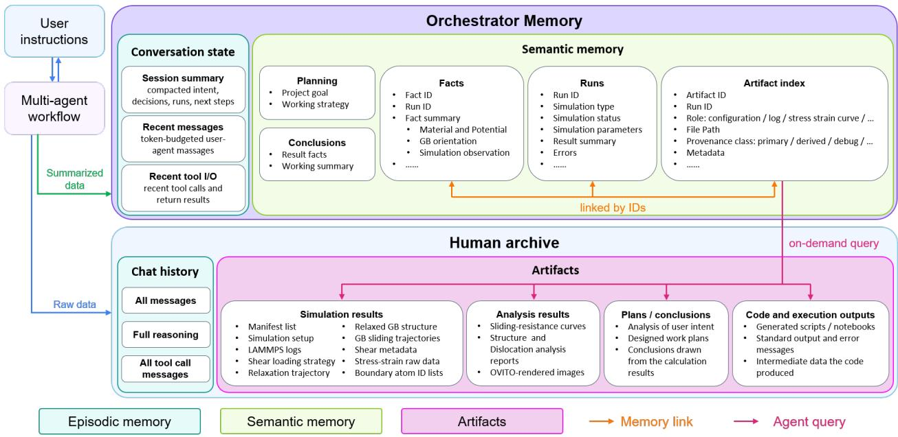  
Fig. S1 | Memory organization and identifier-based information flow in GBClaw. Conversation state retains the session summary, recent messages, and recent tool inputs and outputs. Semantic memory stores project plans, conclusions, facts, run records and an artifact index. Shared run IDs connect fact records with simulation conditions and outputs, while artifact IDs link indexed entries to the corresponding files for retrieval on demand. Complete interaction and tool execution histories are archived for human review. Green and blue arrows represent summarized and raw information, respectively. Orange arrows denote memory links, and magenta arrows indicate artifact queries.

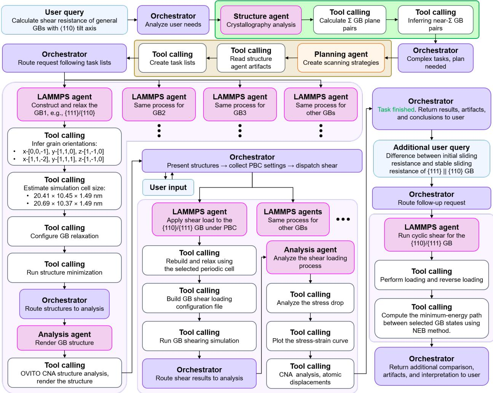  
Fig. S2 | Detailed GBClaw workflow for investigating GB shear strength. Automated tasks and researcher guidance connect crystallographic screening, simulation planning, parallel bicrystal construction and relaxation, selection of periodic boundary conditions, shear simulations, and structural and mechanical analysis of general asymmetric ⟨110⟩ tilt GBs. The {110}/{111} GB illustrates an adaptive investigation, in which an unexpected shear response prompted researcherdirected follow-up analyses using cyclic shear simulations and NEB calculations.

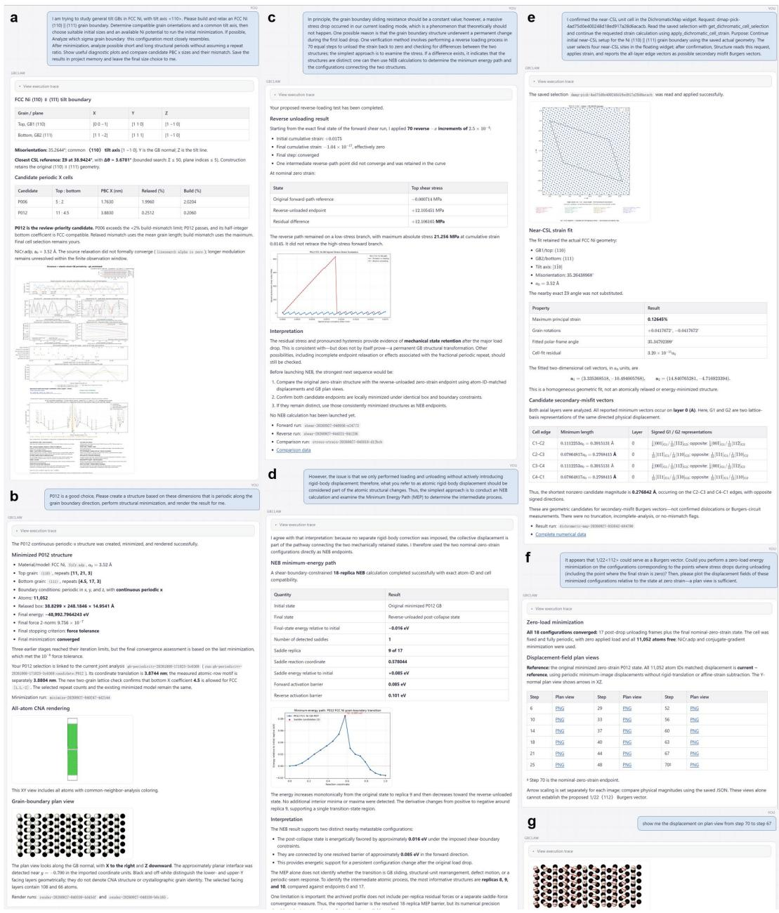  
Fig. S3 | Representative researcher-GBClaw interaction underlying the workflow in Fig. 2. a, Selection of bicrystal orientations and periodic-cell candidates. b, Construction, relaxation and visualization of the selected bicrystal. c, Unloading to zero applied strain and comparison with the initial state. d, NEB calculation between the initial and unloaded configurations. e, Near-CSL dichromatic analysis of candidate SGMD Burgers vectors. f, Relaxation of selected configurations and comparison of their displacement fields. g, Atomic displacements during a selected unloading interval. Detailed tool calls, reasoning summaries and computational outputs are available in the accompanying online demonstration (https://zhugroup.gatech.edu/gbclaw-demo). The displayed NEB setup is illustrative. Final NEB settings are given in Methods and Supplementary Note 5.

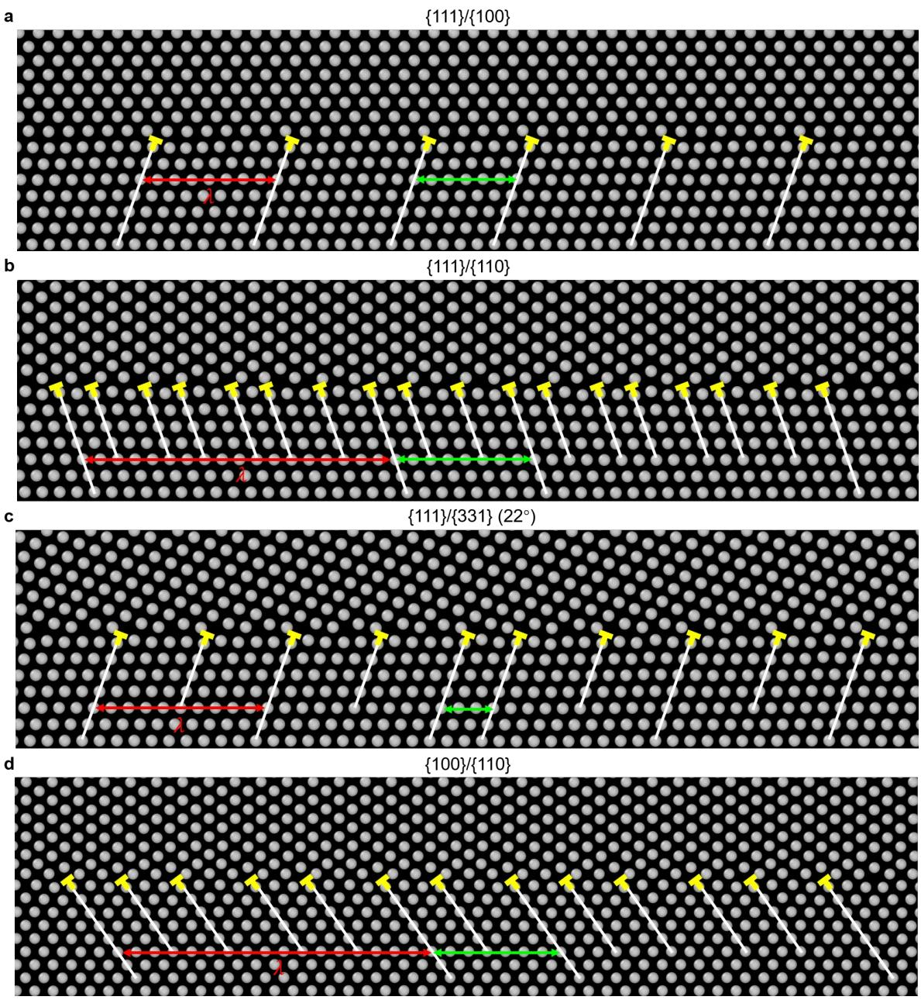  
Fig. S4 | Identification of SGMDs from projected atomic-column arrangements in simulated structures. a, {111}/{100} GB. b, {111}/{110} GB. c, {111}/{331}(22°) GB. d, {100}/{110} GB. All configurations are viewed along the common ⟨110⟩ tilt axis. White lines trace edge-on atomic planes, and yellow markers identify their interfacial terminations. Red double-headed arrows indicate the primary structural periodicity λ. Green double-headed arrows span the altered row correspondence within SGMD cores. Comparing core and reference row counts gives the Burgers vector magnitudes listed in Table S2, consistent with Table 2 and the near-CSL analysis in Fig. S6.

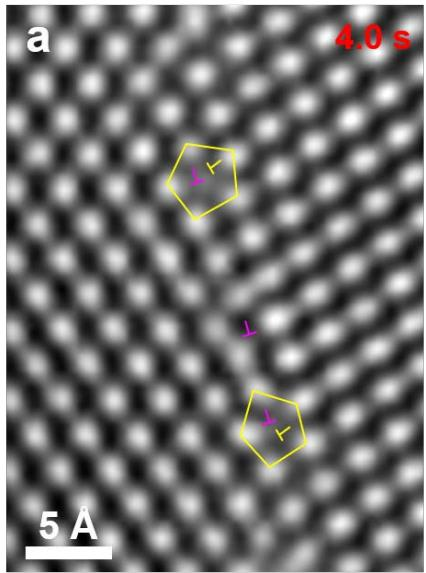

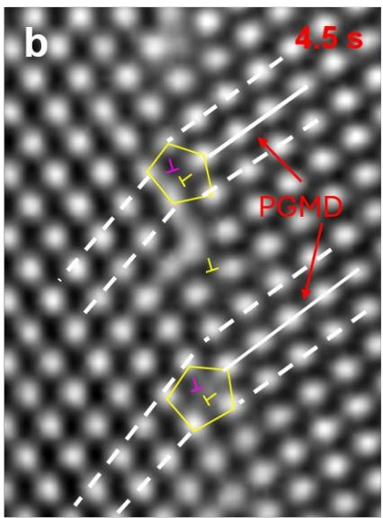

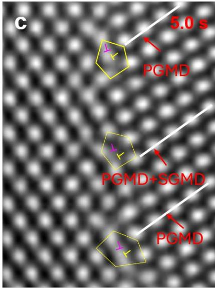  
Fig. S5 | Identification of SGMDs from projected atomic-column arrangements in in situ HRTEM images of a {111}/{331}(22°) GB undergoing sliding, adapted from Wang et al35. a, b, Each image shows two PGMDs. In b, solid white lines trace extra {111} half-planes, whose interfacial terminations identify the PGMD cores. c, An SGMD identified by an additional {111} half-plane. The associated atomic-column arrangement is consistent with the simulated structure shown in Fig. S4c.

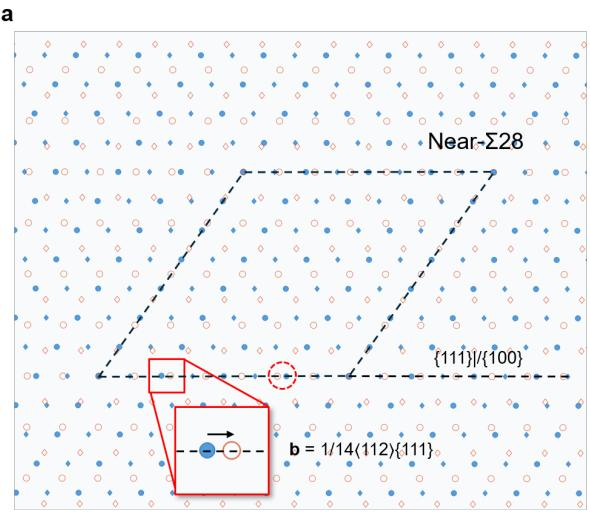

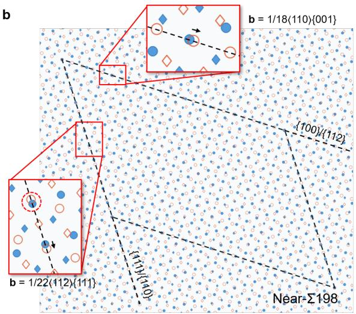

C  
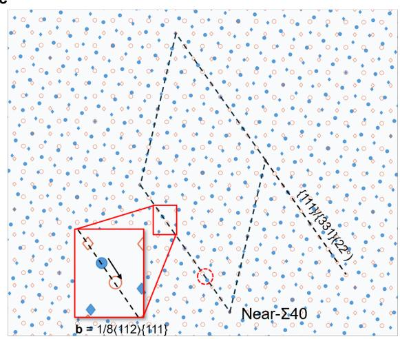

d  
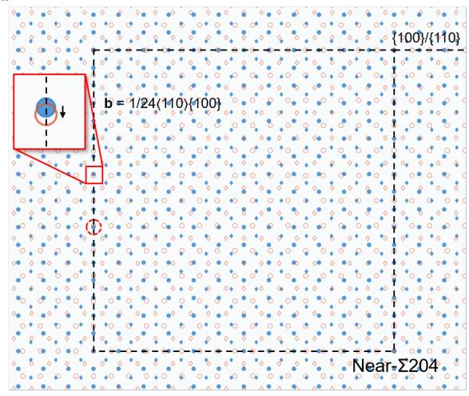  
Fig. S6 | Determination of SGMD character from near-CSL dichromatic patterns of the four pure-sliding GBs. a, {111}/{100} GB; b, {111}/{110} GB; c, {111}/{331}(22°) GB; d, {100}/{110} GB. Blue and orange symbols distinguish the two grain lattices, while circles and diamonds distinguish alternating atomic layers along the ⟨110⟩ tilt axis. Black dashed lines indicate the near-CSL cells and GBs. Black arrows indicate the shortest DSC translations connecting lattice sites in the two grains within the same atomic layer. These translations define the SGMD Burgers vectors and agree with those obtained from the projected atomic-column analysis in Fig. S4 and Table S2. Red dashed circles mark symmetry-related site pairs that produce DSC translations equal in magnitude but opposite in sign to those indicated in red solid boxes.

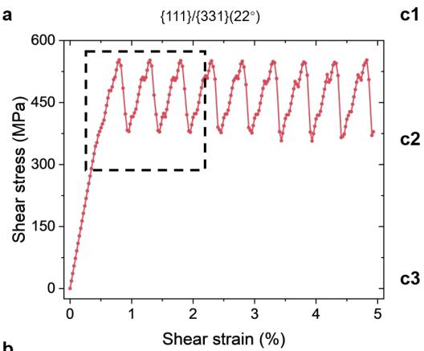

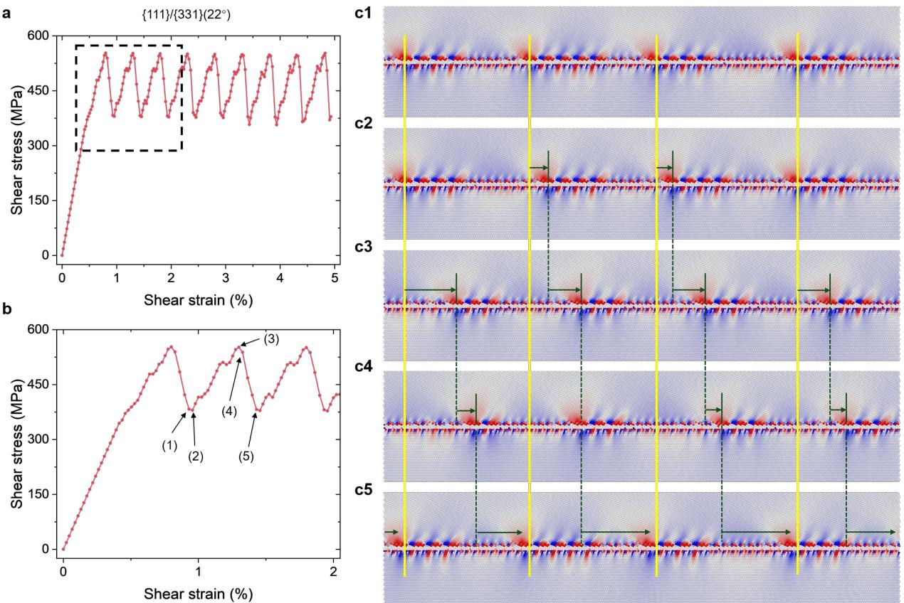  
Fig. S7 | Boundary sliding through nonuniform glide of SGMDs in the {111}/{331}(22°) GB. a, Shear stress as a function of applied shear strain. b, Magnified view of the stress response, with states (1) to (5) marking a representative sliding cycle. c1 to c5, Atomic configurations corresponding to the marked states. Large red regions identify SGMD cores. Yellow lines mark equivalent SGMD positions at the beginning and end of the cycle. Green lines track dislocation positions, and arrows indicate movement between consecutive configurations.

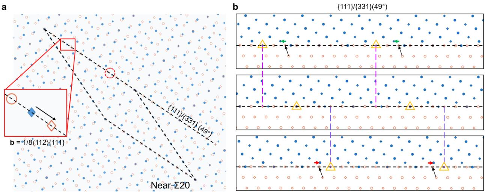

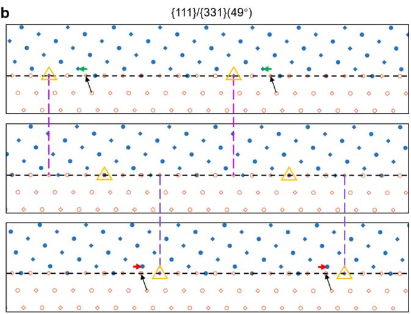  
Fig. S8 | SGMD Burgers vector derived from the near-CSL pattern of the {111}/{331}(49°) GB. a, Near-CSL dichromatic pattern. Blue and orange symbols distinguish between the two grain lattices, while circles and diamonds distinguish atomic layers along the ⟨110⟩ tilt axis. Dashed outlines indicate the near-CSL cell. The black arrow in the inset marks the shortest DSC vector connecting sites of the two lattices, yielding ${ \bf b } _ { \mathrm { s } } = 1 / 8 \langle 1 1 2 \rangle \{ 1 1 1 \}$ , identical to that of the $2 2 ^ { \circ }$ boundary in Fig. S6c. The dashed circle marks a symmetry-related pair of sites with opposite relative offsets in the reference pattern. b, Local interfacial configurations, with the blue and orange grains positioned above and below the GB, respectively. Taking the middle configuration as the reference, the orange atoms are held fixed, while the blue atoms are translated left by $\mathbf { - b } _ { \mathrm { s } }$ to obtain the upper configuration and right by $+ \mathbf { b } _ { \mathrm { s } }$ to obtain the lower configuration. Green and red arrows denote these opposite tangential translations, each equal in magnitude to the Burgers vector of the SGMD (bs). Black arrows indicate the resistance from second-nearest-neighbor atoms beneath the terminating plane. Yellow triangles highlight coincidence lattice sites, and vertical dashed guides provide positional references across the three registries.

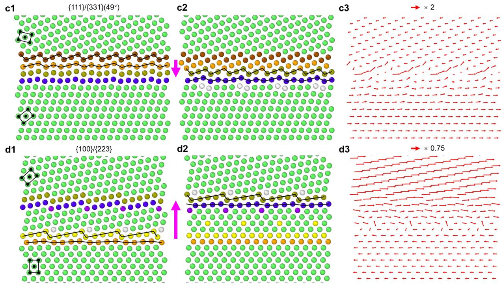

a  
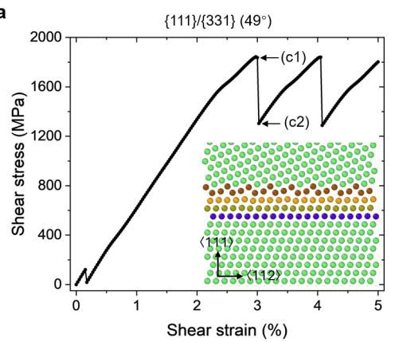

b  
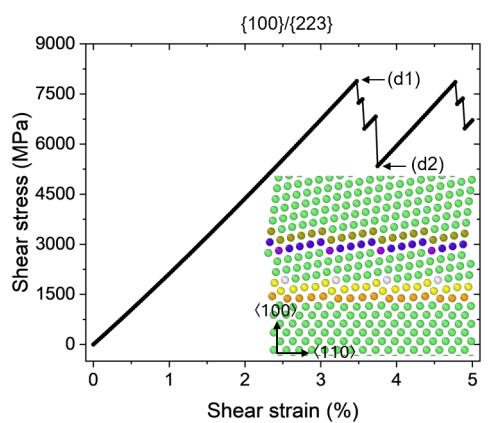

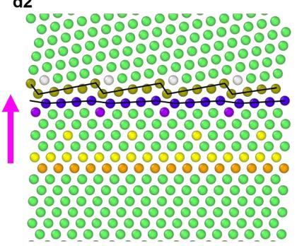

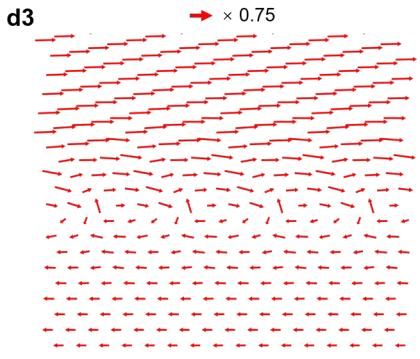  
Fig. S9 | Spatially periodic atomic shuffling during shear-coupled GB migration. Shear stress as a function of applied shear strain for a, {111}/{331}(49°) GB loaded in direction 2 and b, {100}/{223} GB. Insets show the corresponding initial GB structures. Atomic configurations of the {111}/{331}(49°) GB, c1, before and, c2, after the selected migration interval. d1-d2, Corresponding atomic configurations of the {100}/{223} GB. Selected atomic sites are shown in distinct colors to facilitate structural tracking. Black lines trace the terminating atomic planes, outlined crystallographic cells indicate the orientations of the two grains, and magenta arrows mark the directions of GB migration. c3, d3, Differential atomic displacement vectors from c1 to c2 and from d1 to d2, respectively. The red vectors are amplified by factors of 2 and 0.75, respectively. All atomic configurations are viewed along the ⟨110⟩ tilt axis.

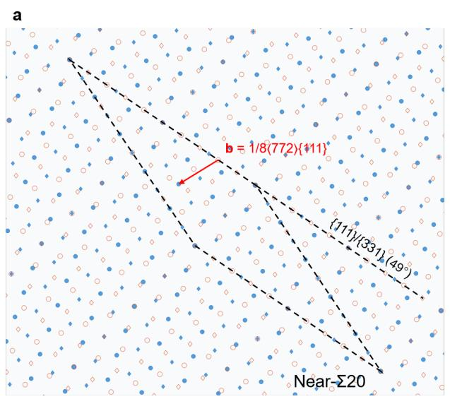

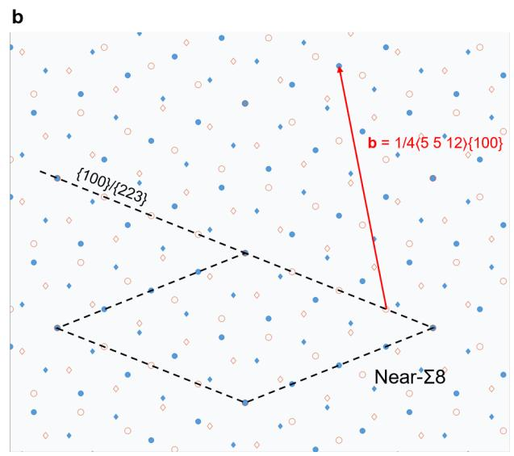  
Fig. S10 | Analysis of near-CSL dichromatic patterns associated with shear-coupled migration. a, {111}/{331}(49°) GB. b, {100}/{223} GB. Colors distinguish the grain lattices, and symbol shapes distinguish layers along the ⟨110⟩ tilt axis. Dashed lines indicate the near-CSL cells and GB traces. Red arrows mark DSC vectors selected by comparison with the signed tangentialto-normal displacement ratios measured during migration (Fig. S9). Crystallographic directions are referenced to the grains indicated in each panel.

Table S1 | Hierarchical memory layers and access policies in GBClaw.
<table><tr><td>Level</td><td>Layer</td><td>Category</td><td>Purpose</td><td>Storage</td><td>Agent access</td><td>Update</td></tr><tr><td>0</td><td>Domain knowledge</td><td>Procedural memory</td><td>Encode domain-specific workflows, tool contracts, and task execution rules</td><td>Built into tools and instructions</td><td>Implicitly accessed through tool invocation</td><td>Manual update only</td></tr><tr><td>1</td><td>Project summary</td><td>Working memory</td><td>Give the orchestrator bounded project intent and conclusions for planning the next step</td><td>Working context and database file</td><td>Always in orchestrator context</td><td>Incrementally updated</td></tr><tr><td>2</td><td>Conversation state</td><td>Episodic memory</td><td>Keep track of recent communication, decisions, and unresolved tasks</td><td>Working context and database file</td><td>Always in orchestrator context</td><td>Periodically compressed and refreshed</td></tr><tr><td>3</td><td>Facts/Runs/Conclusions</td><td>Semantic memory</td><td>Store durable facts, conclusions, run summaries, and pointers to artifacts</td><td>Database file</td><td>On-demand retrieval</td><td>Updated with provenance</td></tr><tr><td>4</td><td>Artifacts</td><td>External grounding</td><td>Store raw outputs, figures, trajectories, logs, code, and other files for traceable evidence</td><td>File system in artifact directory</td><td>On-demand retrieval</td><td>Persistent unless manually deleted by user</td></tr><tr><td>5</td><td>Full Chat/work history</td><td>Human reference</td><td>Preserve the full append-only record for audit and human review</td><td>Database file</td><td>Excluded from agent retrieval</td><td>Append-only</td></tr></table>

Table S2 | Determination of Burgers vectors ${ \bf b } _ { s }$ of SGMDs in Fig. S4.
<table><tr><td>GB pairs</td><td> $N _ { \mathrm { u } }$ </td><td> $N _ { \mathrm { l } }$ </td><td> $n _ { \mathrm { u } }$ </td><td> $n _ { \mathrm { l } }$ </td><td>δ</td><td>∆N</td><td> $\mathbf { d } _ { \mathrm { I } } / { a _ { 0 } } ^ { * }$ </td><td> ${ \bf b } _ { s } / { a _ { 0 } } ^ { * }$ </td></tr><tr><td>{111}/{100}</td><td>7</td><td>8</td><td>5</td><td>6</td><td>2 35</td><td>2-7</td><td> ${ \frac { 1 } { 4 } } \langle 1 1 2 \rangle \{ 1 1 1 \}$ </td><td> ${ \frac { 1 } { 1 4 } } \langle 1 1 2 \rangle \{ 1 1 1 \}$ </td></tr><tr><td>{111}/{110}</td><td>11</td><td>18</td><td>5</td><td>8</td><td> $- { \frac { 2 } { 5 5 } } \quad - { \frac { 2 } { 1 1 } }$ </td><td></td><td> ${ \frac { 1 } { 4 } } \langle 1 1 2 \rangle \{ 1 1 1 \}$ </td><td> ${ \frac { 1 } { 2 2 } } \langle 1 1 2 \rangle \{ 1 1 1 \}$ </td></tr><tr><td>{111}/{331}(22°)</td><td>8</td><td>10</td><td>2</td><td>3</td><td>1-4</td><td>1 2</td><td> ${ \frac { 1 } { 4 } } \langle 1 1 2 \rangle \{ 1 1 1 \}$ </td><td> $\frac { 1 } { 8 } \langle 1 1 2 \rangle \{ 1 1 1 \}$ </td></tr><tr><td>{100}/{110}</td><td>12</td><td>17</td><td>5</td><td>7</td><td>1 60</td><td>1 12</td><td> $\frac { 1 } { 2 } \langle 1 1 0 \rangle \{ 1 0 0 \}$ </td><td> ${ \frac { 1 } { 2 4 } } \langle 1 1 0 \rangle \{ 1 0 0 \}$ </td></tr></table>

\* $a _ { 0 }$ denotes the lattice constant. Vector coefficients are reported without signs, and the terminating plane specifies the reference grain. Here � is the difference between the lower-toupper interval ratios in the core and reference spans, and $\Delta N$ is the accumulated mismatch defined in Note 2. Positive and negative Δ� indicate an excess and a deficit of lower-grain row intervals relative to the reference ratio, respectively.

Table S3 | Tools available to the orchestrator and specialized agents in GBClaw.
<table><tr><td colspan="1" rowspan="1">Agents</td><td colspan="1" rowspan="1">Tool name(s)</td><td colspan="1" rowspan="1">Usage</td></tr><tr><td colspan="1" rowspan="8">Orchestrator</td><td colspan="1" rowspan="1">list available potentials</td><td colspan="1" rowspan="1">Identify interatomic interaction models available forsimulations.</td></tr><tr><td colspan="1" rowspan="1">list_coding_environments</td><td colspan="1" rowspan="1">Determine which execution environments are availablefor custom code.</td></tr><tr><td colspan="1" rowspan="1">search_web</td><td colspan="1" rowspan="1">Collect online scientific information relevant to theinvestigation.</td></tr><tr><td colspan="1" rowspan="1">delegate_*(subagents)</td><td colspan="1" rowspan="1">Route research tasks to the appropriate specialist agents.</td></tr><tr><td colspan="1" rowspan="1">get_project_planget_project_plan_draft</td><td colspan="1" rowspan="1">Recover the current research workflow and its pendingdraft.</td></tr><tr><td colspan="1" rowspan="1">approve_project_plan draftreject_project_plan_draft</td><td colspan="1" rowspan="1">Accept or reject a proposed workflow beforeimplementation.</td></tr><tr><td colspan="1" rowspan="1">update_project_plan_step</td><td colspan="1" rowspan="1">Record the status of individual workflow steps.</td></tr><tr><td colspan="1" rowspan="1">report_artifact_usage</td><td colspan="1" rowspan="1">Report the space occupied by stored computationalartifacts.</td></tr><tr><td colspan="1" rowspan="2">Planning</td><td colspan="1" rowspan="1">create_project_plan_draft</td><td colspan="1" rowspan="1">Translate research objectives into an ordered,reviewable task plan.</td></tr><tr><td colspan="1" rowspan="1">get_project_planrevise_project plan_draft</td><td colspan="1" rowspan="1">Recover the current plan and revise proposed researchsteps.</td></tr><tr><td colspan="1" rowspan="6">Structure</td><td colspan="1" rowspan="1">analyze_tilt_geometry</td><td colspan="1" rowspan="1">Establish the common tilt axis and relative grainrotation.</td></tr><tr><td colspan="1" rowspan="1">compare_miller_planes</td><td colspan="1" rowspan="1">Assess the relative orientations of specifiedcrystallographic planes.</td></tr><tr><td colspan="1" rowspan="1">match_csl_tilt_references</td><td colspan="1" rowspan="1">Associate a boundary geometry with nearby exact CSLmisorientations.</td></tr><tr><td colspan="1" rowspan="1">score_ csl_tilt plane_pairs</td><td colspan="1" rowspan="1">Assess candidate CSL terminating-plane pairs forselection.</td></tr><tr><td colspan="1" rowspan="1">suggest_low_index_near_csl_planes</td><td colspan="1" rowspan="1">Find low-index terminations close to a reference CSLgeometry.</td></tr><tr><td colspan="1" rowspan="1">list_csl_sigmas</td><td colspan="1" rowspan="1">List available CSL misorientations and their rotationbranches.</td></tr><tr><td colspan="1" rowspan="7"></td><td colspan="1" rowspan="1">list_csl_gb_planeslist_csl_gb_planes_batch</td><td colspan="1" rowspan="1">Obtain terminating-plane pairs for individual or multipleCSL references.</td></tr><tr><td colspan="1" rowspan="1">get_tilt_gb_orientation</td><td colspan="1" rowspan="1">Define grain coordinate systems and compatible latticerepeat lengths.</td></tr><tr><td colspan="1" rowspan="1">get_ dichromatic_ map_optionsrender_dichromatic_map</td><td colspan="1" rowspan="1">Set visualization options and display superposed grainlattices.</td></tr><tr><td colspan="1" rowspan="1">prepare_dichromatic_cell_selectionget_dichromatic_cell_selection</td><td colspan="1" rowspan="1">Prepare and recover a user-selected dichromatic unitcell.</td></tr><tr><td colspan="1" rowspan="1">apply_dichromatic_cell_strain</td><td colspan="1" rowspan="1">Determine the strain required to match a selected near-CSL cell.</td></tr><tr><td colspan="1" rowspan="1">analyze_dichromatic_cell_edges</td><td colspan="1" rowspan="1">Determine displacement vectors associated withselected cell edges.</td></tr><tr><td colspan="1" rowspan="1">query_csl_orientation</td><td colspan="1" rowspan="1">Recover previously stored CSL crystallographic data.</td></tr><tr><td colspan="1" rowspan="9">LAMMPS</td><td colspan="1" rowspan="1">list_available_potentials</td><td colspan="1" rowspan="1">Identify interatomic interaction models available forsimulations.</td></tr><tr><td colspan="1" rowspan="1">convert_cfg_to_lammps</td><td colspan="1" rowspan="1">Prepare LAMMPS input structures from CFG atomicconfigurations.</td></tr><tr><td colspan="1" rowspan="1">infer tilt orientation</td><td colspan="1" rowspan="1">Establish grain orientations from specified boundary-plane pairs.</td></tr><tr><td colspan="1" rowspan="1">estimate_gb_box_size</td><td colspan="1" rowspan="1">Estimate simulation-cell dimensions for bicrystalconstruction.</td></tr><tr><td colspan="1" rowspan="1">write_gb_minimize_configrun_gb_minimize</td><td colspan="1" rowspan="1">Set construction parameters and obtain relaxed bicrystalconfigurations.</td></tr><tr><td colspan="1" rowspan="1">write_structure_minimize_configrun_structure_minimize</td><td colspan="1" rowspan="1">Set relaxation parameters and minimize an existingatomic configuration.</td></tr><tr><td colspan="1" rowspan="1">write_gb_energy_configrun_gb_energy</td><td colspan="1" rowspan="1">Set calculation parameters and evaluate interfacialexcess energy.</td></tr><tr><td colspan="1" rowspan="1">write_gb_shear_configrun_gb_shear</td><td colspan="1" rowspan="1">Define loading conditions and calculate the boundaryshear response.</td></tr><tr><td colspan="1" rowspan="1">write_gb_neb_configrun_gb_neb</td><td colspan="1" rowspan="1">Define transition endpoints and determine minimumenergy paths.</td></tr><tr><td colspan="1" rowspan="6">Analysis</td><td colspan="1" rowspan="1">analyze_gb_periodicity</td><td colspan="1" rowspan="1">Measure structural repeat lengths along the grainboundary.</td></tr><tr><td colspan="1" rowspan="1">stress_strain_analysis</td><td colspan="1" rowspan="1">Locate stress drops and associated deformation eventsin shear histories.</td></tr><tr><td colspan="1" rowspan="1">plot_stress_strain_comparison</td><td colspan="1" rowspan="1">Display shear responses together for direct comparison.</td></tr><tr><td colspan="1" rowspan="1">analyze_neb_mepplot_neb_mep</td><td colspan="1" rowspan="1">Extract transition barriers and visualize the calculatedenergy path.</td></tr><tr><td colspan="1" rowspan="1">render atomic structure</td><td colspan="1" rowspan="1">Produce atomic-structure images through OVITO.</td></tr><tr><td colspan="1" rowspan="1">render gb plan_view</td><td colspan="1" rowspan="1">Display the interface along its normal for structuralinspection.</td></tr><tr><td colspan="1" rowspan="4">Coding</td><td colspan="1" rowspan="1">1s; glob; grep</td><td colspan="1" rowspan="1">Find relevant files and locate information within theircontents.</td></tr><tr><td colspan="1" rowspan="1">read file; write file; edit file; delete</td><td colspan="1" rowspan="1">Inspect, create, modify or remove files within the codingsandbox.</td></tr><tr><td colspan="1" rowspan="1">execute</td><td colspan="1" rowspan="1">Run custom commands within the coding sandbox.</td></tr><tr><td colspan="1" rowspan="1">publish_coding_result</td><td colspan="1" rowspan="1">Validate coding outputs and make them available to theworkflow.</td></tr><tr><td colspan="1" rowspan="2">All agents</td><td colspan="1" rowspan="1">query_project memorysearch_project memory</td><td colspan="1" rowspan="1">Find project records relevant to the current task.</td></tr><tr><td colspan="1" rowspan="1">read_agent_conclusionget_task_stateread_tool_output</td><td colspan="1" rowspan="1">Recover agent findings, task progress and complete toolresults.</td></tr><tr><td colspan="1" rowspan="1">All exceptCoding</td><td colspan="1" rowspan="1">list_run_artifactsread_run_artifact</td><td colspan="1" rowspan="1">Find output files associated with a run and inspect theircontents.</td></tr></table>

Table S4 | Grain orientations and dimensions of compact periodic supercells for 14 selected general asymmetric GBs. The x-direction follows the applied shear direction, the y-direction is normal to the GB, and the z-direction follows the common ⟨110⟩ tilt axis. Primary lattice repeats � , cell sizes and residual lattice mismatches are listed. Crystallographic repeat vectors are expressed in units of ${ \pmb a } _ { \mathbf { 0 } }$ and referenced to the corresponding grain orientations.
<table><tr><td rowspan=1 colspan=1>GB plane pairs</td><td rowspan=1 colspan=1>Orientation of grain 1(x, y, z)</td><td rowspan=1 colspan=1>Orientation of grain 2(x, y, z)</td><td rowspan=1 colspan=1>λ(Grain 1, grain 2)</td><td rowspan=1 colspan=1>Supercell size*(nm³)</td><td rowspan=1 colspan=1>Latticemismatch</td></tr><tr><td rowspan=1 colspan=1>{100}/{110}</td><td rowspan=1 colspan=1>[00ī], [ī10], [110]</td><td rowspan=1 colspan=1>[1ī0], [00ī], [110]</td><td rowspan=1 colspan=1>12[00ī],    $\frac { 1 7 } { 2 } [ 1 \bar { 1 } 0 ]$ </td><td rowspan=1 colspan=1>8.45×23.95×1.00</td><td rowspan=1 colspan=1>0.17%</td></tr><tr><td rowspan=1 colspan=1>{100}/{112}</td><td rowspan=1 colspan=1>[īī1], [112], [ī10]</td><td rowspan=1 colspan=1>[1ī0], [001], [ī10]</td><td rowspan=1 colspan=1> $\frac { 9 } { 2 } [ \bar { 1 } \bar { 1 } 1 ] ,$      $\frac { 1 1 } { 2 } [ \hat { 1 } \hat { 1 } 0 ]$ </td><td rowspan=1 colspan=1>2.74×24.60×1.00</td><td rowspan=1 colspan=1>0.21%</td></tr><tr><td rowspan=1 colspan=1>{100}/{113}</td><td rowspan=1 colspan=1>[233], [311], [0ī1]</td><td rowspan=1 colspan=1>[01ī], [100], [0ī1]</td><td rowspan=1 colspan=1> ${ \frac { 3 } { 2 } } [ 2 { \bar { 3 } } { \bar { 3 } } ] ,$    5[011]</td><td rowspan=1 colspan=1>2.48×24.97×1.00</td><td rowspan=1 colspan=1>0.50%</td></tr><tr><td rowspan=1 colspan=1>{100}/{223}</td><td rowspan=1 colspan=1>[433], [322], [011]</td><td rowspan=1 colspan=1>[011], [100], [0ī1]</td><td rowspan=1 colspan=1> ${ \frac { 1 } { 2 } } [ 4 { \bar { 3 } } { \bar { 3 } } ] ,$     2[011]</td><td rowspan=1 colspan=1>1.01×24.67×1.00</td><td rowspan=1 colspan=1>2.99%</td></tr><tr><td rowspan=1 colspan=1>{100}/{331}</td><td rowspan=1 colspan=1>[6īī], [133], [0ī1]</td><td rowspan=1 colspan=1>[01ī], [100], [0ī1]</td><td rowspan=1 colspan=1> ${ \frac { 3 } { 2 } } [ 6 { \bar { 1 } } { \bar { 1 } } ] ,$      ${ \frac { 1 3 } { 2 } } [ 0 \bar { 1 } \bar { 1 } ]$ </td><td rowspan=1 colspan=1>3.24×25.13×1.00</td><td rowspan=1 colspan=1>0.59%</td></tr><tr><td rowspan=1 colspan=1>{111}/{221}(16°)</td><td rowspan=1 colspan=1>[114], [221], [ī10]</td><td rowspan=1 colspan=1>[īī2], [111], [ī10]</td><td rowspan=1 colspan=1>2[114],    $\frac { 7 } { 2 } [ \hat { 1 } \hat { 1 } 2 ]$ </td><td rowspan=1 colspan=1>3.00×25.05×1.00</td><td rowspan=1 colspan=1>1.03%</td></tr><tr><td rowspan=1 colspan=1>{111}/{221}(55°)</td><td rowspan=1 colspan=1>[114], [22ī], [ī10]</td><td rowspan=1 colspan=1>[112], [111], [ī10]</td><td rowspan=1 colspan=1>2[114],    $\frac { 7 } { 2 } [ \hat { 1 } \hat { 1 } 2 ]$ </td><td rowspan=1 colspan=1>3.00×25.05×1.00</td><td rowspan=1 colspan=1>1.03%</td></tr><tr><td rowspan=1 colspan=1>{111}/{331}(22°)</td><td rowspan=1 colspan=1>[116], [331], [ī10]</td><td rowspan=1 colspan=1>[112], [111], [110]</td><td rowspan=1 colspan=1>[116],    $\frac { 5 } { 2 } [ \bar { 1 } \bar { 1 } 2 ]$ </td><td rowspan=1 colspan=1>2.16×25.24×1.00</td><td rowspan=1 colspan=1>0.66%</td></tr><tr><td rowspan=1 colspan=1>{111}/{331}(49°)</td><td rowspan=1 colspan=1>[116], [33ī], [ī10]</td><td rowspan=1 colspan=1>[1ī2], [111], [ī10]</td><td rowspan=1 colspan=1>[116],    $\frac { 5 } { 2 } [ \bar { 1 } \bar { 1 } 2 ]$ </td><td rowspan=1 colspan=1>2.16×25.24×1.00</td><td rowspan=1 colspan=1>0.66%</td></tr><tr><td rowspan=1 colspan=1>{111}/{100}</td><td rowspan=1 colspan=1>[011], [ī00], [011]</td><td rowspan=1 colspan=1>[21ī], [īī1], [011]</td><td rowspan=1 colspan=1> ${ \frac { 7 } { 2 } } [ 0 1 { \bar { 1 } } ] ,$    2[21ī]</td><td rowspan=1 colspan=1>1.73×23.88×1.00</td><td rowspan=1 colspan=1>1.03%</td></tr><tr><td rowspan=1 colspan=1>{111}/{110}</td><td rowspan=1 colspan=1>[001], [110], [110]</td><td rowspan=1 colspan=1>[112], [111], [110]</td><td rowspan=1 colspan=1>11[001],    $\frac { 9 } { 2 } [ \hat { 1 } 1 \hat { 2 } ]$ </td><td rowspan=1 colspan=1>3.87×24.43×1.00</td><td rowspan=1 colspan=1>0.21%</td></tr><tr><td rowspan=1 colspan=1>{110}/{112}</td><td rowspan=1 colspan=1>[11ī], [112], [1ī0]</td><td rowspan=1 colspan=1>[001], [110], [1ī0]</td><td rowspan=1 colspan=1> ${ \frac { 7 } { 2 } } [ 1 1 \bar { 1 } ] ,$    6[001]</td><td rowspan=1 colspan=1>2.13×24.88×1.00</td><td rowspan=1 colspan=1>1.03%</td></tr><tr><td rowspan=1 colspan=1>{110}/{223}</td><td rowspan=1 colspan=1>[334], [223], [1ī0]</td><td rowspan=1 colspan=1>[00ī], [110], [1ī0]</td><td rowspan=1 colspan=1>[334],   6[001]</td><td rowspan=1 colspan=1>2.07×24.80×1.00</td><td rowspan=1 colspan=1>2.82%</td></tr><tr><td rowspan=1 colspan=1>{110}/{332}</td><td rowspan=1 colspan=1>[113], [332], [1ī0]</td><td rowspan=1 colspan=1>[001], [110], [1ī0]</td><td rowspan=1 colspan=1>3[113],   10[001]</td><td rowspan=1 colspan=1>3.51×26.15×1.00</td><td rowspan=1 colspan=1>0.50%</td></tr></table>

\* The dimension in the y-direction includes a vacuum layer of \~4 nm.

## Note 1. Calculation of GB energy

GB energies were calculated using periodic supercells containing a bicrystal with one internal GB and two free surfaces. For each constituent grain, a periodic bulk reference and a slab reference containing two free surfaces were constructed with the same orientation and relaxed in-plane dimensions as the bicrystal. Atomic coordinates and the cell length normal to the GB were relaxed while the in-plane dimensions remained fixed. The reference bulk energy per atom therefore retained the elastic contribution associated with the strain imposed by in-plane periodicity. The GB excess energy was calculated as

$$
\gamma _ { \mathrm { G B } } = \frac { E _ { \mathrm { b i } } - N _ { \mathrm { t } } e _ { \mathrm { t } } ^ { \mathrm { b u l k } } - N _ { \mathrm { b } } e _ { \mathrm { b } } ^ { \mathrm { b u l k } } } { A } - \gamma _ { \mathrm { t } } ^ { s } - \gamma _ { \mathrm { b } } ^ { s }\tag{S1}
$$

Here $E _ { \mathrm { b i } }$ is the relaxed bicrystal energy, $N _ { \mathrm { t } }$ and $N _ { \mathrm { b } }$ are the numbers of atoms in the top and bottom grains, and $e _ { \mathrm { t } } ^ { \mathrm { b u l k } }$ and $e _ { \mathrm { b } } ^ { \mathrm { b u l k } }$ are the corresponding strained bulk energies per atom. � is the interfacial area, equal to the area of each free surface. The surface energy of each grain � was calculated as

$$
\gamma _ { i } ^ { s } = \frac { E _ { i } ^ { s \mathrm { l a b } } - N _ { i } ^ { s \mathrm { l a b } } e _ { i } ^ { \mathrm { b u l k } } } { 2 A }\tag{S2}
$$

Here $E _ { i } ^ { s \mathrm { l a b } }$ and $N _ { i } ^ { \mathrm { s l a b } }$ are the total energy and number of atoms in the two-surface slab, and $e _ { i } ^ { \mathrm { { b u l k } } }$ is the strained bulk energy per atom. Equation (S1) isolates the GB excess energy by subtracting both the strain-matched bulk energies and the contributions from both external free surfaces from the total bicrystal energy.

## Note 2. Identification of SGMDs from atomistic simulations and HRTEM images

SGMDs can be identified from projected atomic-column arrangements in simulated GB structures. This analysis provides a basis for interpreting experimental high-resolution transmission electron microscopy (HRTEM) images and evaluating their consistency with simulated defect structures. Atomistic simulations provide three-dimensional atomic coordinates, whereas HRTEM images acquired along a zone axis resolve projected atomic columns in the twodimensional image plane. Because a single projection does not resolve atomic positions along the beam direction, the atomic volumetric strain used to highlight dislocation cores in Fig. 3 cannot be evaluated directly from these images. We therefore describe a procedure for identifying SGMDs and determining their Burgers vectors through analysis of projected atomic-column arrangements.

For the four asymmetric, incommensurate GBs, {111}/{100}, {111}/{110}, {111}/{331}(22°), and {100}/{110}, we relaxed extended bicrystal models along the horizontal direction, with free surfaces at both ends. These boundary conditions allowed SGMDs to form during relaxation, producing the structures shown in Fig. S4. We then traced close-packed {111} planes inclined to the GB plane, as indicated by the white solid lines. The orientations of the terminating planes determine the inclination angles of these {111} planes and the spacing between their intersections with the interface. When these spacings differ between the adjoining grains, more {111} planes intersect a given boundary length on the side with the smaller spacing. The resulting extra {111} half-planes terminate at the interface. Yellow “⊥” symbols mark these terminations, identifying the PGMD cores21. The shortest complete repeat of the PGMD arrangement defines the local GB structural period λ, indicated by the red double-headed arrows. Crystallographic equivalence between successive repeats was verified from the full atomic registry of the simulated structure.

Localized interruptions in the periodic PGMD arrangement identify the projected SGMD cores, whose spans are indicated by the green double-headed arrows in Fig. S4. To determine the Burgers vector of an SGMD, we quantified the residual mismatch within its core span relative to the periodic PGMD arrangement in a neighboring reference span of length λ. Let $N _ { \mathrm { l } }$ and $N _ { \mathrm { u } }$ denote the numbers of projected intervals in the lower and upper grains within this reference span, respectively. Each interval lies between successive intersections of the inclined close-packed planes, here {111}, with the GB. The reference ratio is defined as $\widetilde { N } = N _ { \mathrm { l } } / N _ { \mathrm { u } }$ . For an SGMD core span containing $n _ { \mathrm { u } }$ intervals in the upper grain and $n _ { \mathrm { l } }$ intervals in the lower grain, the accumulated mismatch is $\Delta N _ { \mathrm { l } } = n _ { \mathrm { l } } - n _ { \mathrm { u } } \widetilde { N }$ . Positive and negative values of $\Delta N _ { \mathrm { l } }$ indicate an excess and a deficit, respectively, of lower-grain intervals relative to the reference ratio. The

Burgers vector is then calculated as $\mathbf { b } = \mathbf { d } _ { \mathrm { I } } \left| \Delta N _ { \mathrm { l } } \right|$ , where ${ \bf d } _ { \bf l }$ denotes the row translation vector of the lower grain along the horizontal direction. Its magnitude equals the spacing between successive intersections of the inclined {111} planes with the GB. For the SGMDs examined here, the Burgers vectors lie within the GB plane and perpendicular to the tilt axis, so their full magnitudes are resolved in this projection. Atomic registry along the tilt axis was checked separately using the near-CSL patterns in Fig. S6. Table S2 summarizes the reference and core interval counts, signed mismatches, and corresponding Burgers vectors for all four GBs.

Fig. S5 illustrates the identification of SGMDs from projected atomic-column arrangements in in situ HRTEM images of a {111}/{331}(22°) GB undergoing sliding. Each image in Fig. S5a, b shows two PGMDs. Solid white lines trace extra {111} half-planes, whose interfacial terminations identify the PGMD cores. In Fig. S5c, an additional {111} half-plane identifies an SGMD. The associated atomic-column arrangement is consistent with the simulated structure shown in Fig. S4c. This agreement supports the application of the procedure described in this Note to identify SGMDs and determine their Burgers vectors from projected atomic-column arrangements in HRTEM images.

## Note 3. SGMD character and shear asymmetry from near-CSL analysis

Near-CSL dichromatic patterns (Fig. S6) provided an independent crystallographic check of the Burgers vectors determined in Note 2. To construct these patterns, the two grain lattices were superimposed in their prescribed orientations using the structural period determined from atomistic simulation. Then, biaxial elastic strains and a relative lattice rotation were solved to produce a common periodic cell with an exact CSL. In Fig. S6, colors distinguish the two grain lattices, while circles and diamonds distinguish atomic layers along the ⟨110⟩ projection direction. Within each GB plane, the shortest nonzero vector connecting lattice sites of the two grains was identified as the minimum DSC translation within the same atomic layer. This translation connects crystallographically equivalent interfacial states and corresponds to the Burgers vector ${ \bf b } _ { \mathrm { s } }$ of the SGMD in the corresponding GB.

In each panel of Fig. S6, the black arrow inside the solid box denotes the shortest DSC vector and thus the Burgers vector for the corresponding GB. Expressed in units of the lattice constant $a _ { 0 }$ , this vector is 1/14⟨112⟩ for {111}/{100}, 1/22⟨112⟩ for {111}/{110}, 1/8⟨112⟩ for {111}/{331}(22°), and 1/24⟨110⟩ for {100}/{110}. The ⟨112⟩ and ⟨110⟩ directions are defined relative to the grains terminated by {111} and {100} planes, respectively. These Burgers-vector assignments agree with the projected atomic-column analysis in Note 2. In addition, each dashed circle identifies lattice-site pairs defining the shortest DSC vectors opposite to that shown in the corresponding solid box. These antiparallel DSC vectors have equal magnitudes and represent GB sliding in opposite senses.

The $2 2 ^ { \circ }$ and $4 9 ^ { \circ }$ variants of the {111}/{331} GB (Figs. S6c and S8a) illustrate the respective DSC vectors and demonstrate how atomic configurations govern direction-dependent GB shearing responses. Both variants share the shortest DSC vector and thus Burgers vector ${ \bf b } _ { \mathrm { s } } = 1 / 8 \langle 1 1 2 \rangle \{ 1 1 1 \}$ and a primary period $\lambda = 2 . 1 6 ~ \mathrm { { n m } }$ . For the {111}/{331}(49°) GB (Fig. S8b), red and green arrows denote $+ \mathbf { b } _ { \mathrm { s } }$ and $\mathbf { - b } _ { \mathrm { s } } ,$ respectively. Black arrows indicate resistance from second-nearest-neighbor atoms within each structural period beneath the terminating plane. Because this intraplanar resistance opposes sliding along ${ \bf b } _ { \mathrm { s } }$ more strongly than along $\mathbf { - b } _ { \mathrm { s } } , - \mathbf { b } _ { \mathrm { s } }$ represents the favored sliding mode; conversely, sliding along ${ \bf b } _ { \mathrm { s } }$ is unfavored, which promotes shear-coupled migration for the $4 9 ^ { \circ }$ variant. In contrast, for the 22° variant, sliding is favored along both +bs and $\mathbf { - b } _ { \mathrm { s } } ,$ due to similar resistance encountered in both directions.

## Note 4. Nonuniform glide of SGMDs during pure sliding

Shear simulations of GBs containing multiple SGMDs were performed while imposing PBCs within the boundary plane. Each supercell contained an array of SGMDs whose Burgers vectors summed to a lattice repeat along the boundary, resulting in the formation of an extra half-plane. This construction maintained crystallographically equivalent interfacial registry across periodic images. The secondary periodicity vector � connects neighboring equivalent SGMDs, and its average magnitude |��| is listed in Table 2. The horizontal supercell length therefore spans multiple secondary periods.

For the {111}/{331}(22°) GB, sliding proceeded through intermittent glide of individual SGMDs or subsets of the array, punctuated by collective events. Fig. S7 correlates the shear stress response with successive dislocation positions during a representative sliding cycle. Compared with the uniform-sliding response of the compact supercell in Fig. 4c2, this response exhibits finer fluctuations associated with the advance of one or several SGMDs by integer multiples of the primary structural period λ. Between states (1) and (2), the two central SGMDs advance while the outer two remain near their previous positions (Fig. S7c1, c2). Continued loading from state (2) to (3) raises the shear stress and produces accumulated dislocation motion along the boundary (Fig. S7c3). This longer interval includes successive local advances during reloading. The smaller stress decrease from state (3) to (4) accompanies further advance of three of the four tracked dislocations, while the second dislocation from the left remains near its previous position (Fig. S7c3, c4). The pronounced drop from state (4) to (5) corresponds to collective glide of all four dislocations (Fig. S7c4, c5), releasing accumulated elastic shear stress during relaxation at fixed imposed strain.

## Note 5. Cyclic loading-unloading and NEB calculations of the {111}/{110} GB

The {111}/{110} GB was loaded through 70 increments of $\Delta \gamma = 2 . 5 \times 1 0 ^ { - 4 }$ to a shear strain of 1.75%, and then unloaded through 70 increments of the same magnitude to zero applied strain (Fig. 5a). Although the initial configuration was stress free, the unloaded configuration retained a nonzero shear stress. This configuration was subsequently reloaded through 200 increments of $\Delta \gamma = 0 . 5 \times 1 0 ^ { - 4 }$ to a shear strain of 1% (Fig. 4b2). The pronounced initial stress drop occurred only during the first loading sequence and did not recur upon reloading. The residual shear stress and endpoint displacements in Fig. 5a, b show that unloading did not restore the initial interfacial structure. The NEB endpoints compare the relaxed initial and reconstructed states at the same zero applied strain (Fig. 5c). The NEB settings and convergence criterion are specified in Methods. The final force residual reached $2 \times 1 0 ^ { - 8 } \mathrm { e V } \mathring { \mathrm { A } } ^ { - 1 }$ , below the convergence tolerance specified there. The energy profile and saddle-point displacement field are shown in Fig. 5c, d.

## Note 6. Shear-coupled migration

GBClaw evaluated the mechanisms governing the shear-coupled migration mode identified in Fig. 3e using compact supercell models of the {111}/{331}(49°) and {100}/{223} GBs as representative cases. Both exhibited pronounced stress drops associated with discrete migration events (Fig. S9a, b). Comparing atomic configurations immediately before and after selected stress drops linked these events to locally nonuniform atomic shuffling. Both boundaries joined an atomically flat, low-index termination in one grain to a stepped termination in the opposing grain.

For the {111}/{331}(49°) GB, downward migration transformed atomic columns from the flat termination of the lower grain to the stepped configuration of the upper grain (Fig. S9c1, c2). The corresponding displacement field revealed spatially repeated, coordinated shuffling characterized by a localized linear pattern among neighboring atomic columns (Fig. S9c3). Conversely, upward migration of the {100}/{223} GB transformed atomic columns from the stepped termination of the upper grain into the flatter configuration of the lower grain (Fig. S9d1, d2). Its displacement field likewise exhibited spatially periodic but locally nonuniform shuffling (Fig. S9d3), featuring a localized rotational pattern distinct from that of the {111}/{331} GB. In these compact supercells, shear-coupled migration occurred collectively along the boundary rather than through the propagation of isolated GB disconnections. Supplementary Note 7 and Fig. S10 present the corresponding crystallographic mappings derived from dichromatic patterns. These results further demonstrate the utility of near-CSL constructions and dichromatic patterns for determining DSC vectors associated with distinct deformation modes in asymmetric incommensurate GBs.

## Note 7. Determination of DSC vectors in shear-coupled migration

Using the near-CSL construction described in Note 3, we analyzed the dichromatic patterns to identify the crystallographic mapping associated with shear-coupled migration. Atomic trajectories yielded the signed tangential grain translation $u _ { t }$ and normal GB displacement $u _ { n }$ during migration of the {111}/{331}(49°) and {100}/{223} GBs. Comparing the signed ratios of ${ { u } _ { t } } / { { u } _ { n } }$ with the corresponding component ratios of candidate DSC vectors identified the closest DSC vectors of 1/8⟨772⟩ and 1/4⟨5 5 12⟩ for each case, referenced to the grains terminated by {111} and {100} planes, respectively.

Circles and diamonds in Fig. S10 distinguish atomic layers at different depths along the common ⟨110⟩ tilt axis. Candidate connections join sites in different grains within corresponding depth layers and may include a displacement normal to the interface. Their components were resolved parallel and perpendicular to the dashed GB trace in the projection plane.

PBCs constrain the elastic state of the simulated bicrystals, while the near-CSL construction also introduces strain to enforce periodic matching. These elastic states can differ, resulting in small differences between the geometrically predicted and simulated displacement ratios. Candidate mapping was therefore selected based on approximate agreement with the signed displacement ratio, correspondence between atomic depth layers, and consistency with the observed structural transformation.