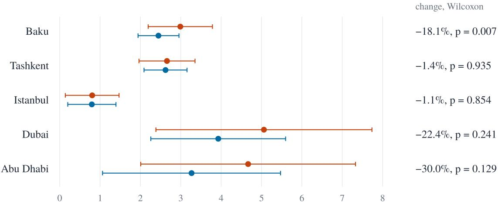
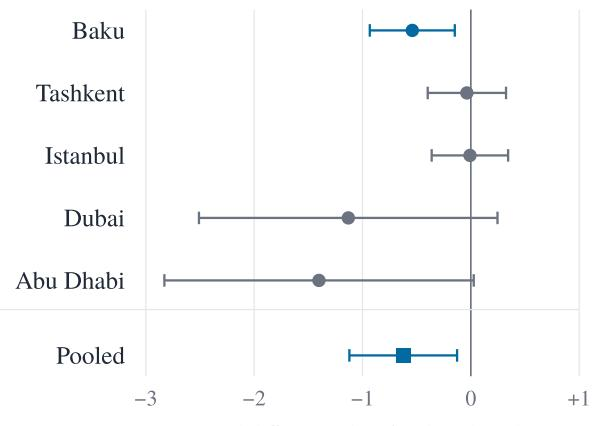
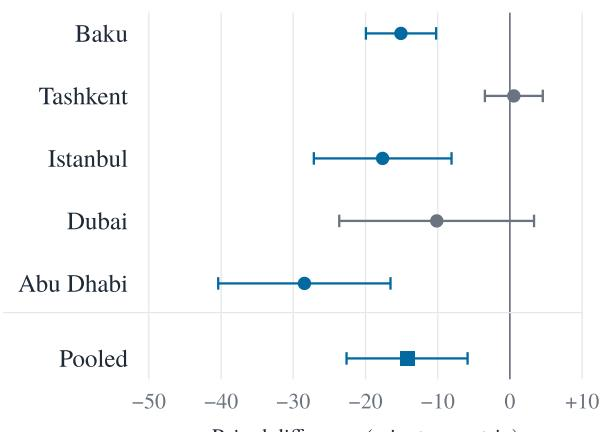

# AN ECO-FRIENDLY TOURISM TRIP PLANNER DRIVEN BY Z-NUMBER UNCERTAINTY: EVIDENCE FROM BAKU, DUBAI, ABU DHABI, TASHKENT, AND ISTANBUL

Aziz Nuriyev BA Programs Azerbaijan State Oil and Industry University Baku, Azerbaijan aziz.nuriyev@asoiu.edu.az

Saja Al-Dabet Department of Artificial Intelligence Aqaba University of Technology Aqaba, Jordan

Kanan Qasimzade BA Programs Azerbaijan State Oil and Industry University Baku, Azerbaijan

Fatima Alblooshi College of Computing and Artificial Intelligence United Arab Emirates University Al Ain, United Arab Emirates

Sherzod Turaev∗ College of Computing and Artificial Intelligence United Arab Emirates University Al Ain, United Arab Emirates sherzod@uaeu.ac.ae

Mary John Academic Support Department Abu Dhabi Polytechnic Abu Dhabi, United Arab Emirates

Alihuseyn Orujzada BA Programs Azerbaijan State Oil and Industry University Baku, Azerbaijan

Aisha Al Ali College of Computing and Artificial Intelligence United Arab Emirates University Al Ain, United Arab Emirates

October 22, 2026

## ABSTRACT

Deployed tourism trip planners ingest travel times and ratings as exact numbers, although routing services return travel times that vary with the hour of departure and a platform rating may rest on a handful of reviews or on tens of thousands. We present an eco-friendly trip planner that represents both quantities as Z-numbers, which pair a fuzzy restriction on a value with a fuzzy reliability on the evidence behind it, and that constructs them directly from routing-service observations at six departure hours and from platform review counts rather than from linguistic elicitation. A hybrid loss combines score, carbon, travel-time, and reliability terms, and an adaptive large neighborhood search returns single-day itineraries with per-leg reliability annotations through a conversational front end. We compare the planner with a crisp-mean baseline under an identical optimizer in Baku, Dubai, Abu Dhabi, Tashkent, and Istanbul, with fifteen points of interest and thirty seeds per city, and we evaluate the selected itineraries on their trip carbon and their total travel time. Pooled over 150 seed-paired runs, the planner lowers trip carbon from 3.24 to 2.61 kg (19.3%, Wilcoxon $p = 0 . 0 1 7 ;$ ; city-clustered bootstrap interval 6.4% to 26.7%) and travel time from 123 to 109 minutes per trip $( 1 1 . 5 \dot { \% } , p = 2 . 8 \times 1 0 ^ { - 1 0 }$ ; interval 5.0% to 18.2%). The travel-time reductions survive a Holm correction in Baku, Istanbul, and Abu Dhabi, the carbon reduction is significant in Baku and large but uncertain in the dispersed catalogs of Dubai and Abu Dhabi, and neither metric changes in Tashkent. Review counts were measured for Baku and estimated for the other four cities, and the

comparison involves a single baseline, so the results establish feasibility and direction rather than a general advantage. Code, routing caches, frozen routing tables, and per-seed results are openly released.

Keywords Z-numbers · tourism trip planning · data-driven uncertainty · sustainable tourism · orienteering problem · decision support

## 1 Introduction

Digital technology has reshaped how travelers discover, evaluate, and sequence the attractions of a destination, and the itinerary that a tourist actually follows is now, to a considerable degree, the output of an information system rather than of a guidebook. The day-trip design problem, in which a tourist arriving in an unfamiliar city must select a sequence of points of interest (POIs) and the transport options that connect them so as to balance experiential, monetary, temporal, and environmental criteria, has accordingly become one of the canonical applications of multi-criteria optimization (Gavalas et al., 2014; Vansteenwegen et al., 2011). Commercial planners such as TripAdvisor itineraries, Google Maps multi-stop routing, Sygic Travel, and Wanderlog, together with academic prototypes such as P-Tour (Maruyama et al., 2004), CT-Planner5 (Kurata et al., 2015), and PersTour (Lim et al., 2018), address this task with considerable sophistication. What they do not address is the uncertainty in the data on which every such planner relies.

That uncertainty has two sources. Routing services supply travel times that depend on the departure hour, the transport mode, and the recent traffic pattern, so that a single origin-destination-mode triple yields estimates that differ by a factor of two or more across the tourist-active day on congested corridors. Ratings carry uncertainty of a different kind: a POI with a mean of four and a half stars from five reviews carries less information than one with the same mean from five thousand, yet existing planners treat the two identically. A planner that ingests this evidence as crisp numbers discards the dimension of reliability that the evidence itself supplies. The Z-number formalism of Zadeh (2011) represents an uncertain quantity as an ordered pair of fuzzy numbers, a restriction on the value and a reliability on the assertion, and so separates by construction the magnitude of an estimate from the sufficiency of the evidence on which it rests. Z-number arithmetic and ranking have been developed in depth (Aliev et al., 2016b,a), but Z-numbers have rarely served as the substrate of a working trip planner whose parameters come from operational data rather than from linguistic judgments.

In the current research, we build such a planner and test it. Its travel-time Z-numbers are constructed from Google Routes observations (Google, 2026) at six departure hours, its rating Z-numbers from the platform rating and review count of each POI, and its itineraries are optimized under a hybrid loss and returned through a conversational interface with per-leg reliability annotations. The study pursues three objectives, which we state as research questions.

RQ1 Can travel-time and rating Z-numbers be constructed from routing-service observations and review counts, without linguistic elicitation, and embedded in a working planner?

RQ2 Under an identical optimizer, identical loss weights, and identical data, does the Z-number representation change the carbon footprint and the travel time of the selected itineraries relative to a crisp-mean representation of the same data?

RQ3 How does any such effect vary across cities of contrasting geography, and which selection behavior accompanies it?

We answer these questions on five cities of contrasting urban form, Baku, Dubai, Abu Dhabi, Tashkent, and Istanbul, and we compare the planner, denoted ZN-Full, with a crisp-mean baseline (B1) at thirty seeds per city. Because the two methods compute their loss terms by different formulas, we do not compare them on the loss; we evaluate the itineraries they select on physical outcomes measured identically for both, namely the trip carbon footprint, the total travel time, the transport modes used, and the across-seed stability of the selected POIs.

The contributions of the paper are three. First, we specify data-driven construction operators that map routing observations and review counts to trapezoidal Z-numbers, a hybrid loss that combines them with crisp carbon and cost terms, and a two-step treatment of soft constraints, and we document a working implementation in sufficient detail for reproduction. Second, we report a seed-paired comparison on five cities with per-city tests under a Holm correction and pooled tests supplemented by a city-clustered bootstrap, as a check that the pooled conclusions do not depend on treating seeds from the same city as independent, and we document a full re-run of the experiment from the released bundle. Third, we characterize where the effect appears and where it does not, and we state plainly which parts of the evidence are measured and which are estimated. A companion study extends the comparison to five uncertainty representations on 349 POIs across the eight cities of the United Arab Emirates (Turaev et al., 2026); the present paper is the cross-national counterpart with a single baseline.

The paper is organized as follows. Section 2 reviews the related work. Section 3 presents the Z-number framework, and Section 4 the implemented system. Section 5 specifies the case-study design, Section 6 reports the results, Section 7 discusses them together with the limitations, and Section 8 concludes.

## 2 Related Work

Academic trip planners. P-Tour (Maruyama et al., 2004) allows a tourist to express preferences over time and POI categories and returns a sequenced itinerary that respects time windows. CT-Planner5 (Kurata et al., 2015) supports interactive tour planning that benefits both tourists and destinations, the team-orienteering variant is addressed by the greedy randomized adaptive search of Souffriau et al. (2008), and PersTour (Lim et al., 2018) personalizes POI recommendation from visit histories. Mobile and multimodal tour planners are surveyed and exemplified by Gavalas et al. (2014) and Gavalas et al. (2015), and the orienteering problem on which all of these systems rest is surveyed by Vansteenwegen et al. (2011). Two features of this body of work motivate the present study. Travel times are treated as crisp scalars, drawn from a static matrix or from a single routing call per leg, so the variation that routing services expose across the day is not represented; and ratings are reduced to a single mean per POI, so a POI with abundant evidence and one with sparse evidence are scored identically when their means coincide.

Commercial planners. TripAdvisor itineraries, Google Maps multi-stop routing, Sygic Travel, Visit-A-City, and Wanderlog operate at very large scale. Their user-facing output is crisp: a travel time is shown as a single number, and a rating as a single mean, with uncertainty acknowledged, if at all, through narrative hedges of the kind “traffic may be heavy”. Their optimization layers are undocumented, so we treat them as a reference for the user experience rather than as methodological baselines.

Uncertainty in tourist routing. Stochastic orienteering (Campbell et al., 2011; Evers et al., 2014) models travel and service times as random variables and optimizes an expected or chance-constrained objective, which requires a distributional assumption that a handful of routing observations does not support. Fuzzy formulations avoid that assumption: Ruiz-Meza et al. (2021) develop a multi-objective fuzzy trip-design model with sustainable itineraries, Expósito et al. (2019) propose a fuzzy GRASP for trip design with clustered POIs, and Derya et al. (2024) combine an intuitionistic fuzzy POI score with exponentially distributed travel times. None of these representations, however, holds the spread of a value apart from the amount of evidence behind it. The Z-number formalism does (Zadeh, 2011), and its continuous arithmetic (Aliev et al., 2016b), ranking (Aliev et al., 2016a), and conversion to classical fuzzy numbers (Kang et al., 2012) supply the operations a planner needs. To our knowledge, the Z-number literature on routing has relied on linguistically specified parameters, and the present work, together with its companion benchmark (Turaev et al., 2026), builds the parameters from operational data instead.

## 3 The Z-Number Framework

A Z-number is an ordered pair $\tilde { Z } = ( \tilde { A } , \tilde { B } )$ of fuzzy numbers, in which $\tilde { A }$ is a restriction on the uncertain value and ${ \tilde { B } } \subseteq [ 0 , 1 ]$ is the reliability with which the restriction is asserted (Zadeh, 2011). We work throughout with trapezoidal components $[ a _ { 1 } , a _ { 2 } , a _ { 3 } , a _ { 4 } ] , a _ { 1 } \leq a _ { 2 } \leq a _ { 3 } \leq a _ { 4 } ;$ a triangular component is the case $a _ { 2 } = a _ { 3 }$ , and a crisp number the case $a _ { 1 } = a _ { 2 } = a _ { 3 } = a _ { 4 }$ . Rating restrictions are triangular, reliabilities trapezoidal, and the monetary and carbon quantities crisp.

## 3.1 The travel-time construction operator

For an ordered origin-destination-mode triple, let O be the set of travel times returned by the routing service at the six departure hours 08:00, 10:30, 12:30, 14:30, 17:30, and 22:00, pooled over the primary and alternative routes returned at each hour. The operator Φ assigns the restriction

$$
\tilde { A } _ { T } ( \mathcal { O } ) = \big [ \tau _ { ( 1 ) } , Q _ { 0 . 2 5 } ( \mathcal { O } ) , Q _ { 0 . 7 5 } ( \mathcal { O } ) , \tau _ { ( | \mathcal { O } | ) } \big ] ,\tag{1}
$$

in which $\tau _ { ( 1 ) }$ and $\tau _ { ( \left. \mathcal { O } \right. ) }$ are the smallest and largest observations and $Q _ { 0 . 2 5 } , Q _ { 0 . 7 5 }$ the empirical quartiles, and the reliability

$$
\tilde { B } _ { T } ( N ) = \tilde { B } _ { \mathrm { f l o o r } } + \frac { N - 1 } { N _ { \mathrm { m a x } } - 1 } \left( \tilde { B } _ { \mathrm { h i g h } } - \tilde { B } _ { \mathrm { f l o o r } } \right) ,\tag{2}
$$

in which N is the number of departure hours at which the triple was observed, $N _ { \mathrm { { m a x } } } ~ = ~ 6 , ~ \tilde { B } _ { \mathrm { { f l o o r } } } ~ =$ [0.65, 0.70, 0.70, 0.80], and $\tilde { B } _ { \mathrm { h i g h } } = [ 0 . 8 5 , 0 . 9 5 , 0 . 9 5 , 1 . 0 0 ]$ . The bounding trapezoids are design parameters of the implementation, fixed before the experiments reported here

The restriction anchors its support at the observed extremes and its core at the inter-quartile range, so it inherits the empirical spread without a distributional assumption. The reliability reflects how consistently the triple is available across the day: a triple observed at all six hours receives $\tilde { B } _ { \mathrm { h i g h } }$ , one observed at a single hour receives $\tilde { B } _ { \mathrm { H o o r } }$ , and intermediate cases interpolate linearly. Two properties follow directly from the definitions. When observations are added, the support $[ \tau _ { ( 1 ) } , \tau _ { ( | \mathcal { O } | ) } ]$ can only widen and N can only grow, so the support of the restriction and the reliability are both monotone under set inclusion; the inter-quartile core, by contrast, may move in either direction, so the restriction as a whole is not monotone.

## 3.2 The rating construction operator

For a POI with platform rating $\bar { s } \in [ 0 , 5 ]$ and review count $n \geq 0 .$ , the operator $\Phi _ { R }$ assigns the triangular restriction

$$
\tilde { A } _ { R } ( \bar { s } , n ) = \big [ \operatorname* { m a x } ( 0 , \bar { s } - \delta ( n ) ) , ~ \bar { s } , ~ \bar { s } , ~ \operatorname* { m i n } ( 5 , \bar { s } + \delta ( n ) ) ~ \big ] , \qquad \delta ( n ) = \frac { \delta _ { 0 } } { \sqrt { \operatorname* { m a x } ( 1 , n ) } } ,\tag{3}
$$

whose spread decays with the square root of the review count in the manner of a standard error, and the reliability

$$
\tilde { B } _ { R } ( n ) = \tilde { B } _ { \mathrm { H o o r } } ^ { R } + \left( 1 - e ^ { - n / n _ { 0 } } \right) \big ( \tilde { B } _ { \mathrm { h i g h } } ^ { R } - \tilde { B } _ { \mathrm { H o o r } } ^ { R } \big ) ,\tag{4}
$$

with $\delta _ { 0 } = 1 . 0 , n _ { 0 } = 1 0 0 , \tilde { B } _ { \mathrm { f o o r } } ^ { R } = [ 0 . 5 0 , 0 . 5 5 , 0 . 5 5 , 0 . 6 5 ]$ , and $\tilde { B } _ { \mathrm { h i g h } } ^ { R } = [ 0 . 8 5 , 0 . 9 5 , 0 . 9 5 , 1 . 0 0 ]$ . A POI with abundant evidence and one with sparse evidence are therefore no longer scored identically when their means coincide.

## 3.3 The hybrid loss functional

The planner minimizes

$$
\mathcal { L } ( \pi ) = w _ { s } L _ { s } + w _ { c } L _ { c } + w _ { t } L _ { t } + w _ { r } L _ { r } + \lambda _ { T } V _ { T } + \lambda _ { O } V _ { O } + \lambda _ { B } V _ { B } ,\tag{5}
$$

in which π is a candidate plan, that is, an ordered sequence of POIs together with the transport option chosen for each leg. The score term $L _ { s }$ is a Hellinger-based distance from the trip’s aggregated rating Z-number to a reference Z-number at the rating ceiling with maximal reliability. The carbon term $L _ { c }$ is crisp: the trip’s carbon footprint divided by that of the same POI sequence visited entirely by car, so that $L _ { c } \in [ 0 , 1 ]$ . The travel-time term $L _ { t }$ is a Hellingerbased distance from the trip’s aggregated total-time Z-number to the zero Z-number, normalized to the unit interval. The reliability term $L _ { r }$ penalizes low reliability of the traversed legs. The terms $V _ { T } , V _ { O }$ , and $V _ { B }$ penalize violations of the total-time, opening-hours, and budget soft constraints. In all experiments $w _ { s } = 0 . 7 0 , w _ { c } = 0 . 2 0 , w _ { t } = 0 . 1 0 .$ $w _ { r } = 0 . 1 0$ , and $\lambda _ { T } = \lambda _ { O } = \lambda _ { B } = 1$ . The carbon and budget terms use ordinary arithmetic, since emission factors and prices are calibrated values rather than observed random quantities. The crisp baseline of Section 5 replaces $L _ { s }$ by one minus the ratio of the visited rating sum to an ideal sum and L by the fraction of the time window spent traveling, and it has no reliability term; the loss values of the two methods are therefore not comparable, and we compare the itineraries instead.

## 3.4 The two-step violation pattern

The total-time and opening-hours constraints compare Z-number aggregates with crisp thresholds. We separate the decision that a constraint is violated from the magnitude of the violation. The decision is taken by a ranking comparison (Aliev et al., 2016a) on the restriction alone, so that two plans whose restrictions agree are treated identically at this step whatever their reliabilities. Only when the decision is “violated” is a magnitude computed, as the Hellinger-based distance between the aggregate and the nearest feasible Z-number, with the reliability reintroduced. The penalty is therefore graded by the extent of the breach rather than imposed as an all-or-nothing indicator. We note that the experiments reported here do not isolate the effect of this pattern, since both methods use it.

## 3.5 The min-B˜ reliability rule

Exact reliability aggregation under Z-number addition (Aliev et al., 2016b) requires a family of optimization problems per aggregation, and in our implementation it costs between fifty and one hundred times as much as the rest of an optimization step. During search the planner therefore aggregates reliabilities by the min-B˜ rule, which assigns to the reliability of a sum the componentwise minimum of the operands’ reliabilities,

$$
\begin{array} { r } { \tilde { B } _ { 1 + 2 } = [ \operatorname* { m i n } ( b _ { 1 } ^ { 1 } , b _ { 1 } ^ { 2 } ) , \operatorname* { m i n } ( b _ { 2 } ^ { 1 } , b _ { 2 } ^ { 2 } ) , \operatorname* { m i n } ( b _ { 3 } ^ { 1 } , b _ { 3 } ^ { 2 } ) , \operatorname* { m i n } ( b _ { 4 } ^ { 1 } , b _ { 4 } ^ { 2 } ) ] . } \end{array}\tag{6}
$$

The rule is a heuristic summary of the least reliable component of a plan, and it should not be read as a bound. In particular, it is not in general a lower bound on the reliability that the exact arithmetic assigns to the sum and can overstate it, since the evidence for a sum of uncertain quantities is in general weaker than the evidence for its weakest summand. The rule preserves the ordering of plans that differ in their least reliable leg, which is what the search requires of it, but the trip-level reliability it reports describes the weakest leg rather than certifying the plan. The experiments reported here do not compare the rule with the exact aggregation, and all reported reliabilities are min-B˜ summaries.

## 4 The Trip Planner System

The system is organized as a four-layer pipeline: data ingestion, Z-number construction, optimization, and user interface. The layers communicate through caches, so that ingestion runs on a slow, cost-aware schedule while the optimizer serves requests from cached data.

Data ingestion. For the POI pairs of a city, the ingestion layer first queries the free OSRM table service for road distances and then queries the Google Routes API (Google, 2026) at the six departure hours of Section 3.1, in local time, for the modes DRIVE, TRANSIT, and WALK, retaining the duration of the primary and alternative routes returned at each hour. Rating, review count, and opening hours come from place details. Requests are rate-limited and retried with exponential backoff.

Z-number construction. The construction layer applies $\Phi _ { T }$ and $\Phi _ { R }$ to the cached observations and stores the resulting Z-numbers in a snapshot-versioned SQLite cache, so that a refresh never leaves the cache partially updated.

Optimization. Three interchangeable metaheuristics are available: local search with random restarts over swap, two-opt, option-swap, insert, and remove moves; adaptive large neighborhood search (ALNS) in the manner of Ropke and Pisinger (2006), which is the default and the only optimizer used in the experiments; and a priority-encoded differential evolution (Storn and Price, 1997) for offline use.

User interface. The planner is exposed as a FastMCP server to a conversational assistant, which collects interests, the time window, the budget, the hotel base, and the allowed transport modes in a two-step dialogue and renders the itinerary on an embedded interactive map. Reliability is shown per leg in three levels derived from the reliability centroid $C \colon h i g h$ for $C \geq 0 . 8 5$ , moderate for $0 . 6 5 \leq C < 0 . 8 5$ , and low for $C < 0 . 6 5$ . The carbon weight $w _ { c }$ is exposed as a request parameter, so that a user can move between an experience-oriented and a sustainability-oriented setting.

Implementation and artifacts. The system is written in Python with FastMCP, SQLite, NumPy, SciPy, and the znum library. The released bundle (Nuriyev et al., 2026) contains the source code under a CC BY 4.0 license, the five POI catalogs, the cached routing observations, the ingestion scripts, the seed-controlled driver, the frozen routing tables and run scripts of the re-run described in Section 5.4, and the per-seed itineraries, with per-leg modes and durations, from which every number in this paper is computed.

## 5 The Case-Study Design

## 5.1 Cities, catalogs, and scenario

The five cities were chosen to cover contrasting urban forms: the compact center of Baku (Azerbaijan); the dispersed, transit-served layout of Dubai; the multi-node layout of Abu Dhabi, with its Corniche, Saadiyat Island, and Yas Island clusters (both United Arab Emirates); the compact center of Tashkent (Uzbekistan); and the dense historic peninsula of Istanbul (Turkey). Each catalog holds fifteen POIs within the municipal boundary, drawn from the city’s tourism listings and covering cultural, leisure, commercial, and architectural attractions, with coordinates, rating, review count, opening hours, average dwell time, and entrance price. Review counts were measured from Google place details for Baku; for the other four cities they were estimated from platform-consistent figures because the offline metadata available to the study did not include them, a limitation to which we return in Section 7.4. Table 1 lists the hotel bases, budgets, and taxi-fare parameters.

The scenario is identical across cities: a single day starting at 10:00 local time with an eight-hour window, at most seven $\mathrm { P O I s } ,$ and the modes DRIVE, TRANSIT, and WALK. The loss weights and penalty coefficients of Section 3.3 are held fixed, so the cities differ only in geography, catalog, currency, and fares.

Table 1: Per-city configuration. The hotel base is the origin and destination of every itinerary; the budget is the monetary soft constraint in local currency; the three taxi parameters define the linear taxi-cost model.
<table><tr><td>City</td><td>Hotel base</td><td>Currency</td><td>Budget</td><td>UTC</td><td>Taxi base</td><td>Per km</td><td>Per min</td></tr><tr><td>Baku</td><td>Badamdar Hotel</td><td>AZN</td><td>150</td><td>+4</td><td>1.0</td><td>2.0</td><td>0.1</td></tr><tr><td>Dubai</td><td>Address Downtown</td><td>AED</td><td>500</td><td>+4</td><td>12.0</td><td>1.96</td><td>0.5</td></tr><tr><td>Abu Dhabi</td><td>Emirates Palace</td><td>AED</td><td>500</td><td>+4</td><td>12.0</td><td>1.82</td><td>0.5</td></tr><tr><td>Tashkent</td><td>Hotel Uzbekistan</td><td>UZS</td><td>750,000</td><td>+5</td><td>5,000</td><td>3,500</td><td>500</td></tr><tr><td>Istanbul</td><td>Four Seasons Sultanahmet</td><td>TRY</td><td>5,000</td><td>+3</td><td>27.5</td><td>15.0</td><td>5.0</td></tr></table>

## 5.2 Baseline

The baseline B1 defuzzifies every travel-time and rating Z-number to its centroid and solves the resulting crisp problem with the same optimizer, weights, and penalties, so that the comparison isolates the Z-number representation as a whole. Because its loss terms are computed by different formulas (Section 3.3), the two methods are compared only on the itineraries they return. We ran no other baselines; ablations that remove the reliability component alone, or that construct the Z-numbers linguistically, are left to future work, and a comparison against other uncertainty representations is reported in the companion benchmark (Turaev et al., 2026).

## 5.3 Protocol and statistics

Each method is run on each city at thirty seeds, with ALNS at three hundred iterations and three restarts per seed. In the re-run, a ZN-Full job took five to six and a half minutes on a two-core cloud machine and about two and a half minutes on one core of an Apple silicon computer, and a B1 job about twenty to thirty seconds. This yields 300 plans and 150 seed-paired comparisons. For each plan we record the trip carbon footprint in kilograms of $\mathrm { C O _ { 2 } }$ and the total travel time in minutes, both summed over the legs of the itinerary with the same emission and duration data for both methods, together with the transport mode of every leg. Per-city differences are tested with the two-sided Wilcoxon signed-rank test, and the ten per-city tests (five cities, two metrics) are corrected by the Holm procedure (Holm, 1979); we also report Cohen’s d for the paired differences. Pooled tests over the 150 pairs treat seeds from the same city as independent, which overstates the effective sample size, so we supplement them with a city-clustered bootstrap that resamples the five cities with replacement (10,000 draws) and recomputes the pooled relative change. With only five clusters the bootstrap is coarse, and we read it as a check on the direction of the pooled effect rather than as a precise interval.

## 5.4 Routing data and re-run

Table 2 reports the size of the released routing caches. All results in this paper come from a complete re-run of the 300 jobs from the released bundle, carried out in October 2026 with three changes that make the bundle reproducible without new data collection. First, the cache expires entries after thirty days, and all entries were collected on 25 June 2026, so we fixed the cache clock at the date of the original runs. Second, the released code queries the public OSRM server afresh on every run to pre-filter POI pairs and to estimate walking legs, so we downloaded the OSRM tables once per city and used these frozen tables in every job; they are released with the bundle. Third, the driver was extended to save the full itinerary, including the mode, duration, distance, and emissions of every leg. No new routing data were collected. Requests for pair-hours absent from the cache were sent without a valid key and rejected, so those options are unavailable to both methods: about one fifth of the drive and transit pair-hours requested in Tashkent and Abu Dhabi (576 of 2,808 and 528 of 2,880) and 4 of 2,557 in Istanbul. The exact reproduction of the original runs in Tashkent and Abu Dhabi indicates that the same options were unavailable then.

The re-run reproduces the originally reported per-seed itineraries exactly in Tashkent, Dubai, and Abu Dhabi (180 of 180 runs), and in 11 of the 120 runs in Baku and Istanbul, where the OSRM tables have changed since the original runs. The original runs gave a similar pooled carbon reduction (18.1%, $p = 0 . 0 4 1 \mathrm { \Omega }$ and the same results in the three exactly reproduced cities, but in Baku the reduction was 14.5% and in Istanbul the planner’s carbon was 17.9% higher than the baseline’s, so the Istanbul carbon result is sensitive to the walking-route tables. The original runs did not record travel times in minutes, which is why the re-run is the basis of this paper.

Table 2: Released routing caches: number of cached Routes API observations and file size per city.
<table><tr><td>City</td><td>Observations</td><td>Cache size</td></tr><tr><td>Baku</td><td>7,145</td><td>17 MB</td></tr><tr><td>Dubai</td><td>6,206</td><td>24MB</td></tr><tr><td>Abu Dhabi</td><td>5,708</td><td>22 MB</td></tr><tr><td>Tashkent</td><td>2,325</td><td>4MB</td></tr><tr><td>Istanbul</td><td>5,026</td><td>12 MB</td></tr><tr><td>Total</td><td>26,410</td><td>79 MB</td></tr></table>

## 6 Results

## 6.1 Per-city carbon and travel time

Tables 3 and 4 report the two outcomes per city, and Figure 1 shows the carbon footprints.

Table 3: Trip carbon footprint (kg of $C ( 2 ) .$ , mean ± standard deviation over thirty seeds. Change is the relative change of the ZN-Full mean against the B1 mean; p is the two-sided seed-paired Wilcoxon test; $p _ { \mathrm { H o l m } }$ is adjusted over the ten per-city tests of Tables 3 and 4; d is Cohen’s d for the paired differences. ∗∗ significant after the Holm correction.
<table><tr><td>City</td><td>ZN-Full</td><td>B1</td><td>Change</td><td>p</td><td> $p _ { \mathrm { H o l m } }$ </td><td>d</td></tr><tr><td>Baku</td><td> $2 . 4 5 \pm 0 . 5 1$ </td><td> $2 . 9 9 \pm 0 . 8 0$ </td><td> $- 1 8 . 1 \% ^ { \ast \ast }$ </td><td>0.007</td><td>0.0498</td><td>-0.51</td></tr><tr><td>Tashkent</td><td> $2 . 6 2 \pm 0 . 5 3$ </td><td> $2 . 6 6 \pm 0 . 6 9$ </td><td>-1.4%</td><td>0.935</td><td>1.000</td><td>-0.04</td></tr><tr><td>Istanbul</td><td> $0 . 8 0 \pm 0 . 6 0$ </td><td> $0 . 8 1 \pm 0 . 6 7$ </td><td>-1.1%</td><td>0.854</td><td>1.000</td><td>-0.01</td></tr><tr><td>Dubai</td><td> $3 . 9 3 \pm 1 . 6 7$ </td><td> $5 . 0 6 \pm 2 . 6 8$ </td><td>-22.4%</td><td>0.241</td><td>0.964</td><td>-0.31</td></tr><tr><td>Abu Dhabi</td><td> $3 . 2 7 \pm 2 . 2 1$ </td><td> $4 . 6 7 \pm 2 . 6 6$ </td><td> $- 3 0 . 0 \%$ </td><td>0.129</td><td>0.647</td><td>-0.37</td></tr></table>

Travel time responds more consistently than carbon. ZN-Full shortens the time spent traveling by 23.5% in Abu Dhabi (28 minutes per trip), 15.2% in Istanbul (18 minutes), and 10.7% in Baku (15 minutes), and all three reductions survive the Holm correction, with large effect sizes in Baku and Abu Dhabi. Dubai shows a smaller reduction of 6.6% that is not significant, and Tashkent is unchanged. On carbon, Baku shows a reduction of 18.1%, about 0.5 kg per trip, which survives the correction at the margin $( p _ { \mathrm { H o l m } } = 0 . 0 4 9 8 )$ . Dubai and Abu Dhabi show the largest mean reductions, 22.4% and 30.0%, or 1.1 and 1.4 kg per trip, but the variance across seeds is high and neither is significant. Carbon is unchanged in Tashkent and in Istanbul, where both methods produce footprints below one kilogram.

Table 4: Total travel time per trip (minutes), mean ± standard deviation over thirty seeds; columns as in Table 3.
<table><tr><td>City</td><td>ZN-Full</td><td>B1</td><td>Change</td><td>p</td><td>pHolm</td><td>d</td></tr><tr><td>Baku</td><td> $1 2 5 . 5 \pm 1 0 . 6$ </td><td> $1 4 0 . 6 \pm 1 0 . 7$ </td><td> $- 1 0 . 7 \% ^ { \ast \ast }$ </td><td> $1 . 8 \times 1 0 ^ { - 5 }$ </td><td> $1 . 8 \times 1 0 ^ { - 4 }$ </td><td>-1.16</td></tr><tr><td>Tashkent</td><td> $8 4 . 5 \pm 5 . 8$ </td><td> $8 4 . 0 \pm 7 . 5$ </td><td>+0.6%</td><td>0.773</td><td>1.000</td><td>+0.05</td></tr><tr><td>Istanbul</td><td> $9 8 . 3 \pm 1 6 . 9$ </td><td> $1 1 5 . 9 \pm 2 5 . 1$ </td><td> $- 1 5 . 2 \% ^ { \ast \ast }$ </td><td>0.001</td><td>0.010</td><td>-0.69</td></tr><tr><td>Dubai</td><td> $1 4 3 . 6 \pm 2 8 . 8$ </td><td> $1 5 3 . 7 \pm 2 5 . 2$ </td><td>-6.6%</td><td>0.080</td><td>0.482</td><td>-0.28</td></tr><tr><td>Abu Dhabi</td><td> $9 2 . 4 \pm 2 8 . 8$ </td><td> $1 2 0 . 9 \pm 2 0 . 5$ </td><td> $- 2 3 . 5 \% ^ { \ast \ast }$ </td><td> $2 . 4 \times 1 0 ^ { - 5 }$ </td><td> $2 . 1 \times 1 0 ^ { - 4 }$ </td><td>-0.89</td></tr></table>

In Abu Dhabi, the planner’s converged plans cluster around Qasr Al Watan, Etihad Towers, Presidential Palace Park, and Corniche Beach, each selected on twenty-eight to thirty of the thirty seeds, while the baseline more often includes the Louvre Abu Dhabi (on 5 of 30 seeds against 1 for the planner), Al Bateen Beach (7 against 3), and Qasr Al Hosn (14 against 8).

## 6.2 Pooled analysis

Table 5 and Figure 2 summarize the pooled comparison. Pooled over the 150 pairs, ZN-Full lowers mean trip carbon from 3.24 to 2.61 kg, a reduction of 19.3% $( p \ : = \ : 0 . 0 1 7 )$ , and mean travel time from 123.0 to 108.9 minutes, a reduction of 11.5% $\bar { ( p = 2 . 8 \times 1 0 ^ { - 1 0 } ) }$ . Both reductions keep their sign under the city-clustered bootstrap, whose intervals exclude zero. The mean favors ZN-Full in four of the five cities on travel time and is lower in all five on carbon, although the Tashkent and Istanbul carbon differences are negligible and the Istanbul sign depends on the routing tables (Section 5.4). Plans of the two methods are of nearly equal length (6.06 against 6.24 POIs), so the reductions do not come mainly from shorter itineraries; carbon per visited POI is lower for ZN-Full in four of the five cities, the exception being Istanbul, where both are near 0.12 kg. The planner’s itineraries spend a larger share of their travel time on foot (26.6% against 20.6%) and a smaller share on transit (26.4% against 34.3%), while the share by car is similar.

Trip carbon footprint (kg of carbon dioxide), mean and one standard deviation over 30 seeds crisp-mean baseline (B1) Z number planner (ZN Full)  
  
Figure 1: Trip carbon footprint per city for the crisp-mean baseline (B1) and the Z-number planner (ZN-Full): mean and one standard deviation over thirty seeds, with the relative change and the two-sided seed-paired Wilcoxon p-value.

Table 5: Pooled analysis over five cities and thirty seeds $( n = 1 5 0$ pairs). p is the two-sided Wilcoxon test over the pooled pairs; the cluster interval resamples the five cities (10,000 draws) and is given for the relative change of the mean. Mode shares are shares of total travel minutes.
<table><tr><td>Metric</td><td>ZN-Full</td><td>B1</td><td>Change</td><td>p</td><td>Cluster 95%</td></tr><tr><td>Trip carbon  $\left( \mathrm { { k g } \thinspace C O _ { 2 } } \right)$ </td><td> $2 . 6 1 \pm 1 . 6 6$ </td><td> $3 . 2 4 \pm 2 . 3 3$ </td><td>-19.3%</td><td> $0 . 0 1 7$ </td><td> $[ - 2 6 . 7 \% , - 6 . 4 \% ]$ </td></tr><tr><td>Travel time (min per trip)</td><td> $1 0 8 . 9 \pm 3 0 . 0 $ </td><td> $1 2 3 . 0 \pm 3 0 . 5$ </td><td>-11.5%</td><td> $2 . 8 \times 1 0 ^ { - 1 0 }$ </td><td> $\left[ - 1 8 . 2 \% , - 5 . 0 \% \right]$ </td></tr><tr><td>POIs per plan</td><td>6.06</td><td>6.24</td><td></td><td></td><td></td></tr><tr><td>Carbon per visited POI (kg)</td><td>0.43</td><td>0.52</td><td></td><td></td><td></td></tr><tr><td>Travel minutes by car</td><td>47.0%</td><td>45.0%</td><td></td><td></td><td></td></tr><tr><td>Travel minutes on foot</td><td>26.6%</td><td>20.6%</td><td></td><td></td><td></td></tr><tr><td>Travel minutes by transit</td><td>26.4%</td><td>34.3%</td><td></td><td></td><td></td></tr><tr><td>Strict core (POIs on 30/30)</td><td>1.20</td><td>1.20</td><td></td><td></td><td></td></tr><tr><td>Loose core (POIs on ≥27/30)</td><td>2.60</td><td>2.80</td><td></td><td></td><td></td></tr></table>

## 6.3 Selection stability and constraints

The strict across-seed core, the POIs selected on all thirty seeds, averages 1.20 per city for both methods, and under the looser threshold of at least 27 of 30 seeds the baseline’s core is slightly larger (2.80 against 2.60). The two methods are therefore similarly stable, and we draw no conclusion from selection stability. Soft-constraint violations are rare for both, occurring on 7 of the 150 ZN-Full runs and 9 of the 150 B1 runs.

## 7 Discussion

## 7.1 Where the effect appears

The effect varies across cities in a way that is consistent with the geographic dispersion of their catalogs, although five cities cannot establish such a relationship and we did not measure dispersion quantitatively. In the dispersed catalogs of Dubai and Abu Dhabi, the planner’s mean carbon is 1.1 to 1.4 kg lower per trip and, in Abu Dhabi, its travel time is almost half an hour shorter; dispersion creates opportunities for avoiding distant POIs and for mode substitution, and it is here that the representation changes the outcome most. In the compact center of Baku and the walkable historic center of Istanbul, the planner shortens travel by a quarter of an hour or more, and in Baku this also lowers carbon, whereas in Istanbul the footprints of both methods are already below one kilogram. In Tashkent the two methods select different POI sets on every seed but reach nearly the same carbon and travel time; we have no explanation for this from the present data, and the missing drive and transit options cannot account for it, since Abu Dhabi lacks a similar share and shows the largest effect.

(a) Trip carbon, ZN-Full minus B1  
  
Paired di erence (kg of carbon dioxide)

(b) Travel time ZN Full minus B1  
  
Paired di erence (minutes per trip)  
Figure 2: Paired differences, ZN-Full minus B1, for (a) trip carbon and (b) travel time per trip. Circles are per-city mean differences over thirty seeds with 95% t-intervals; squares are the pooled mean difference with a 95% city-clustered bootstrap interval. Intervals that exclude zero on the favorable side are drawn in blue

## 7.2 The mechanism

The comparison isolates the representation as a whole, so it cannot apportion the effect among the restriction spread, the reliability component, and the two-step violation pattern. Two observations constrain the interpretation. First, the travel-time term of ZN-Full penalizes the whole spread of a leg’s travel-time observations, not only its centroid, so legs whose duration varies strongly across the day are penalized more than in the baseline, which favors itineraries with predictable and short legs; the larger share of walking time in the planner’s itineraries is consistent with this. Second, in Abu Dhabi the baseline more often admits distant POIs whose crisp scores are competitive, while the planner retains a compact set near the hotel base. The rating operator may contribute through the spread $\delta ( n )$ , which for a fixed mean is about three times wider at five thousand reviews than at forty-five thousand, but because review counts outside Baku are estimated, the rating channel in four of the five cities rests on approximate inputs, and an ablation would be needed to separate the two channels.

The companion benchmark across the eight cities of the United Arab Emirates, which compares five representations on 349 POIs under the same planner, reaches a compatible but more cautious conclusion on carbon (Turaev et al., 2026): representations with an explicit evidence channel admit no poorly evidenced $\mathrm { P O I s } ,$ and the Z-number planner’s lower trip carbon there arises largely from scheduling fewer POIs, with a per-POI carbon that is not robustly lowe than that of the crisp planner. In the present study the plans are of similar length and the per-POI carbon is lower, so the two studies differ in how the carbon reduction arises, which is itself a reason not to generalize from either.

## 7.3 The carbon weight

The default weights give the score term three and a half times the weight of the carbon term, and the planner nonethe less does not raise mean carbon in any of the five cities. We did not sweep the carbon weight, so the trade-off between score and carbon along that weight is not characterized here. The implementation exposes $w _ { c }$ as a request parameter, which makes such a sweep, and a study of the settings that users actually choose, straightforward follow-ups.

## 7.4 Limitations

Seven limitations scope the findings. First, review counts are measured only for $\mathbf { B a k u } ;$ for the other sixty POIs they are estimates, so the rating Z-numbers outside Baku rest on approximate evidence. Second, the comparison involves a single crisp-mean baseline and no ablation, so it shows that the Z-number representation as a whole changes the selected plans but not which of its components is responsible. Third, each catalog holds fifteen POIs, and larger catalogs, which the system supports, may behave differently. Fourth, only one scenario is reported, a ten o’clock start with an eight-hour window and at most seven POIs. Fifth, the pooled inference rests on five cities; the city-clustered bootstrap confirms the sign of the pooled effects but is coarse with so few clusters. Sixth, the routing data are a single snapshot, the cache lacks a fifth of the drive and transit options requested in Tashkent and Abu Dhabi, and the walking legs rest on OSRM tables frozen in October 2026, which differ from those of the original runs in Baku and Istanbul. Seventh, the evaluation is computational: we did not study whether tourists understand, trust, or follow the reliability annotations, which is the question on which the practical value of an evidence-aware planner ultimately depends. The min-B˜ reliability summaries, finally, are heuristic rather than guaranteed (Section 3.5).

## 8 Conclusion

We have presented a tourism trip planner that represents travel times and ratings as Z-numbers constructed from routing-service observations and review counts, optimizes itineraries under a hybrid loss with a carbon term, and returns them with per-leg reliability annotations through a conversational interface, at a cost of a few minutes of computation per request at the reported search budget (RQ1). Against a crisp-mean baseline under an identical optimizer in five cities, the planner lowers pooled trip carbon by 19.3% and pooled travel time by 11.5%, with both effects keeping their sign under a city-clustered bootstrap (RQ2). Travel time falls significantly in Baku, Istanbul, and Abu Dhabi; carbon falls significantly in Baku and by the largest amounts, though with high variance, in the dispersed catalogs of Dubai and Abu Dhabi; and neither changes in Tashkent (RQ3). With a single baseline, estimated review counts in four cities, and fifteen POIs per city, the study establishes that a data-driven Z-number planner is feasible and that its effect on carbon and travel time is favorable in direction and varies across cities, rather than that it outperforms crisp planning in general. The re-run from the released bundle reproduces the original itineraries exactly in three of the five cities, and the remaining differences, which change the sign of a negligible carbon difference in Istanbul, show how sensitive such comparisons are to the routing data. Ablations of its components, larger catalogs with measured review counts, a sweep of the carbon weight, and a study of how tourists respond to reliability information are the natural next steps.

## Funding

This work was supported by the United Arab Emirates University through the UAEU-ASOIU Collaborative SDG Research Program Grant (grant number G00005329), administered via the Emirates Center for Mobility Research. The funder had no role in the study design, the collection or interpretation of the data, the writing of the report, or the decision to submit it for publication.

## Competing interests

The authors declare no competing interests.

## Data and code availability

The source code, the five POI catalogs, the cached Routes API observations, the ingestion scripts, the seed-controlled driver, the frozen OSRM tables and scripts of the re-run, and the per-seed itineraries underlying every table and figure are openly available on Zenodo at https://doi.org/10.5281/zenodo.23522063 under a CC BY 4.0 license (Nuriyev et al., 2026).

## Author contributions

Aziz Nuriyev: Conceptualization, Methodology, Formal analysis, Investigation, Validation, Writing (original draft). Sherzod Turaev: Conceptualization, Methodology, Formal analysis, Investigation, Supervision, Funding acquisition, Writing (original draft), Writing (review and editing), Project administration. Saja Al-Dabet: Investigation, Validation, Writing (review and editing). Mary John: Investigation, Validation, Writing (review and editing). Kanan Qasimzade: Software, Data curation, Investigation. Alihuseyn Orujzada: Software, Data curation, Investigation. Fatima Alblooshi: Investigation, Validation. Aisha Al Ali: Investigation, Validation.

## References

R. A. Aliev, O. H. Huseynov, and R. Serdaroglu. Ranking of Z-numbers and its application in decision making. International Journal of Information Technology and Decision Making, 15(6):1503–1519, 2016a. https://doi.org/10.1142/S0219622016500310.

R. A. Aliev, O. H. Huseynov, and L. M. Zeinalova. The arithmetic of continuous Z-numbers. Information Sciences, 373:441–460, 2016b. https://doi.org/10.1016/j.ins.2016.08.078.

A. M. Campbell, M. Gendreau, and B. W. Thomas. The orienteering problem with stochastic travel and service times. Annals ofOperations Research, 186(1):61–81, 2011. https://doi.org/10.1007/s10479-011-0895-2.

T. Derya, K. D. Atalay, E. Dinler, and B. Keçeci. Selective clustered tourist trip design problem with time windows under intuitionistic fuzzy score and exponential travel times. Expert Systems with Applications, 255:124792, 2024. https://doi.org/10.1016/j.eswa.2024.124792.

L. Evers, K. Glorie, S. van der Ster, A. I. Barros, and H. Monsuur. A two-stage approach to the orienteering problem with stochastic weights. Computers and Operations Research, 43:248–260, 2014. https://doi.org/10.1016/j.cor.2013.09.011.

A. Expósito, S. Mancini, J. Brito, and J. A. Moreno. A fuzzy GRASP for the tourist trip design with clustered POIs. Expert Systems with Applications, 127:210–227, 2019. https://doi.org/10.1016/j.eswa.2019.03.004.

D. Gavalas, C. Konstantopoulos, K. Mastakas, and G. Pantziou. A survey on algorithmic approaches for solving tourist trip design problems. Journal ofHeuristics, 20(3):291–328, 2014. https://doi.org/10.1007/s10732-014-9242-5.

D. Gavalas, V. Kasapakis, C. Konstantopoulos, G. Pantziou, N. Vathis, and C. Zaroliagis. The eCOM-PASS multimodal tourist tour planner. Expert Systems with Applications, 42(21):7303–7316, 2015. https://doi.org/10.1016/j.eswa.2015.05.046.

Google. Routes API documentation. Google Maps Platform Developer Documentation, 2026. Accessed 2026. [Online]. Available: https://developers.google.com/maps/documentation/routes.

S. Holm. A simple sequentially rejective multiple test procedure. Scandinavian Journal of Statistics, 6(2):65–70, 1979.

B. Kang, D. Wei, Y. Li, and Y. Deng. A method of converting Z-number to classical fuzzy number. Journal of Information and Computational Science, 9(3):703–709, 2012.

Y. Kurata, Y. Shinagawa, and T. Hara. CT-Planner5: A computer-aided tour planning service which profits both tourists and destinations. In Workshop on Tourism Recommender Systems (TouRS’15) at RecSys’15, Vienna, Austria, September 2015.

K. H. Lim, J. Chan, C. Leckie, and S. Karunasekera. Personalized trip recommendation for tourists based on user interests, points of interest visit durations and visit recency. Knowledge and Information Systems, 54(2):375–406, 2018. https://doi.org/10.1007/s10115-017-1056-y.

A. Maruyama, N. Shibata, Y. Murata, K. Yasumoto, and M. Ito. P-TOUR: A personal navigation system for tourism. In Proc. 11th World Congress on Intelligent Transport Systems, pages 18–21, 2004.

Aziz Nuriyev, Sherzod Turaev, Saja Al-Dabet, and Mary John. Cross-city Z-number trip planner: Reproduction bundle with routing caches, frozen routing tables, re-run itineraries, and analysis scripts. Dataset, 2026. https://doi.org/10.5281/zenodo.23522063.

S. Ropke and D. Pisinger. An adaptive large neighborhood search heuristic for the pickup and delivery problem with time windows. Transportation Science, 40(4):455–472, 2006. https://doi.org/10.1287/trsc.1050.0135.

J. Ruiz-Meza, J. Brito, and J. R. Montoya-Torres. Multi-objective fuzzy tourist trip design problem with heterogeneous preferences and sustainable itineraries. Sustainability, 13(17):9771, 2021. https://doi.org/10.3390/su13179771.

W. Souffriau, P. Vansteenwegen, G. Vanden Berghe, and D. Van Oudheusden. A greedy randomised adaptive search procedure for the team orienteering problem. In EU/MEeting 2008 Workshop on Metaheuristics for Logistics and Vehicle Routing, 2008.

R. Storn and K. Price. Differential evolution: A simple and efficient heuristic for global optimization over continuous spaces. Journal ofGlobal Optimization, 11(4):341–359, 1997. https://doi.org/10.1023/A:1008202821328.

Sherzod Turaev, Mary John, Aziz Nuriyev, and Saja Al-Dabet. Evidence-aware uncertainty representation for ecofriendly tourism trip planning: A national benchmark of Z-numbers against alternative formalisms across the United Arab Emirates. Complex & Intelligent Systems, 2026. Accepted, in press.

P. Vansteenwegen, W. Souffriau, and D. Van Oudheusden. The orienteering problem: A survey. European Journal of Operational Research, 209(1):1–10, 2011. https://doi.org/10.1016/j.ejor.2010.03.045.

L. A. Zadeh. A note on Z-numbers. Information Sciences, 181(14):2923–2932, 2011. https://doi.org/10.1016/j.ins.2011.02.022.