# GRAIL: From Saliency to Semantics in Time-Series Explanation

Enver Menadjiev1∗, Yiqiu Shen2, Jaesik Choi1, Julia Stoyanovich2∗

1KAIST 2NYU

enver@kaist.ac.kr, ys1001@nyu.edu, jaesik.choi@kaist.ac.kr, stoyanovich@nyu.edu

## Abstract

Explaining a time-series model requires both locating the ev- idence and extracting meaningful knowledge from it. Yet a single timestep is not a semantic unit: the meaningful pat- terns live across many samples, not in any one of them. Per- timestep saliency is therefore noisy, high-dimensional, and unstable. Existing methods address this by introducing fixed- size windows and treating them as independent players in a cooperative game. Evaluating a coalition of such players re- quires defining a “baseline” region, which prior work tackles with fixed counterfactuals (e.g., a flat line, noise, or a spectral surrogate). This choice frequently dominates the resulting explanation, obscuring the model’s true decisions.

To address these issues, we propose GRAIL, a region-based time-series explanation framework that uses domain-specific intervals, such as the P-wave and the QRS complex of an electrocardiogram (ECG) beat, as players. We describe each region with human-readable features and generate counter- factual baselines with an on-manifold conditional generator. Such a choice of players also admits non-temporal features: static covariates enter as singleton players attributed with the temporal regions on one scale, so a patient’s tabular evidence (e.g., age, sex) is weighed directly against the signal. We attribute the predictions to the features via Owen values with common-random-number variance reduction. Experimental results on both synthetic and real data show that the proposed framework produces faithful and robust explanations, evalu- ated under matched on- and of-manifold operators, ofering meaningful knowledge to domain experts.

## 1 Introduction

Deep learning models are increasingly deployed on high- stakes time series, from clinical data to industrial sensors and financial data. Wherever they are used, deploying them hinges on a question that’s hard to answer for time series: which part of the signal drove a decision, in terms a domain expert can act on.

Example 1. Consider a cardiologist inspecting a single heartbeat (Figure 1a). Rather than reasoning sample by sam-ple, the cardiologist reads a sequence of named regions: the P-wave (atrial activation), the QRS complex (the sharp ventricular spike), and the T-wave (ventricular recovery), and attaches clinical meaning to each. Left-ventricular hypertro- phy (LVH), for instance, is read chiefly from the QRS voltage. A saliency map that reports “sample 137 was important” may

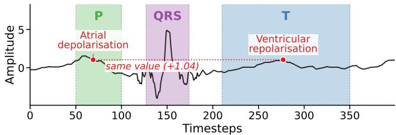

(a) a cardiologist-delineated ECG beat  
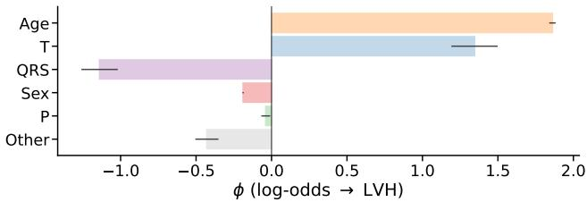  
(b) an explanation of the LVH-positive prediction by GRAIL

Figure 1: From saliency to semantics on one LUDB beat. (a) A real ECG beat split into P, QRS, T, and the isoelectric background. Two samples of equal amplitude (+1.04) fall in diferent regions, so a per-timestep view cannot separate them. (b) GRAIL scores each region and static covariate (age, sex) on a single log-odds scale for this beat, which the model correctly classifies as LVH-absent. The prediction relies primarily on the QRS region, even though the patient’s age and T region would suggest otherwise.

localize evidence, but it does not directly express the regional pattern or its clinical meaning.

Predictive patterns typically span multiple samples, ren- dering per-timestep saliency maps high-dimensional, unsta- ble, and dificult for domain experts to interpret (Ismail et al. 2020). This motivates our first design choice: explain in the domain expert’s units. We take the unit of explanation to be the region, a contiguous, named interval corresponding to a recognizable event: the P/QRS/T waves of an ECG beat, or an injected pulse, a seasonal stretch, or a trend in a synthetic signal. Regions are few, human-readable, and carry a prior, since cardiology tells us which region should distinguish an LVH from a normal beat.

Additionally, models are routinely given non-temporal in- formation alongside the temporal signal. Returning to Exam- ple 1, a cardiologist reads an ECG diferently depending on the patient’s sex and age, since the voltage criteria for left- ventricular hypertrophy are sex-specific and normal intervals shift with age. This motivates our second design choice: to place the signal and covariates on a common scale. A faith- ful explanation must weigh such covariates against the wave- form, so a model’s reliance on demographics in addition to morphology can be read directly from the model. Figure 1b provides a clinically meaningful explanation of the correct diagnosis: the model calls this 68-year-old LVH-positive de- spite a normal QRS, consistent with the lower QRS-voltage threshold that LVH criteria apply at older ages.

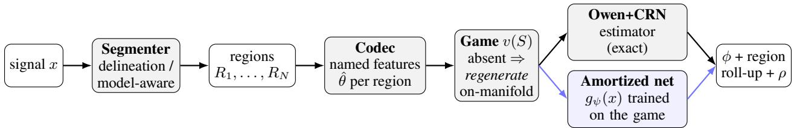  
Figure 2: The GRAIL pipeline. A signal is segmented into named regions; a codec encodes each as human-readable features and can regenerate it. In the game, a present feature keeps its observed value while an absent one triggers on-manifold regeneration, so every coalition is a plausible real signal. Owen values (features nested in regions) are estimated exactly with a common random-number sweep, yielding a complete, region-rolled-up attribution plus the residual ρ. An amortized network (blue), trained on the same game, reproduces the attribution in one forward pass for fast, robust deployment.

Our approach. We propose GRAIL (Generative Region Attribution with Interpretable Labels), a framework that explains time-series predictions in domain-aligned units. GRAIL produces feature-based, additive explanations via a cooperative game: each region and each covariate is a player, and its value is its contribution to the prediction across all coalitions, so the contributions sum to the model’s output. Scoring a coalition requires saying what the signal looks like when a region is absent, but there is no canonical “of” state for a stretch of a time series such as an ECG: prior work fills it with a fixed counterfactual, a flat line, noise, or a spectrally matched surrogate, an arbitrary choice that fre- quently dominates the resulting explanation (Sundararajan and Najmi 2020). The choice of the absent state is thus not an implementation detail; it is the explanation. In this work, we stop choosing from a fixed menu and instead build the counterfactual: an interpretable codec encodes each region as named features, and a conditional generator regenerates an absent region on the data manifold, so every coalition remains a plausible real signal.

GRAIL attributes the model’s log-odds to regions and co- variates with Owen values (Owen 1972) (a two-level Shapley value (Shapley 1953), features nested in regions) estimated by a common-random-number sweep, and always reports the residual $\rho ,$ so the accounting is exactly complete. Figure 2 shows the pipeline of GRAIL, which also amortizes into a fast single-pass surrogate for deployment.

## Contributions.

1. A region-and-covariate cooperative game. We cast time-series attribution as a cooperative game whose play- ers are semantic temporal regions and non-temporal co-variates, credited on one common scale, so reliance on metadata is read of alongside the waveform. To our knowledge, no prior time-series explainer accommodates both (Section 3.1).

2. An exact, on-manifold attribution. GRAIL plays the game by generating each absent region on the data manifold rather than from a fixed filler, and attributes with exactly-complete Owen values (CRN-estimated). This is the faithful but slow reference; a model-aware segmenter recovers regions absent a prior (Section 3.2).

3. A fast surrogate for deployment. GRAIL-fast amortizes the game into one forward pass, ${ \sim } 1 0 ^ { 3 } \times$ cheaper and still exactly complete, though its on-manifold faithfulness holds only on real data (Section 3.3).

4. A comprehensive benchmark. An at-scale comparison over four families of benchmarks, including real ECG, scoring every method under matched on- and of-manifold operators with paired significance tests against concept- and group-level Shapley baselines, with kernel, generator, reference, and segmenter ablations (Section 4).

## 2 Related Work

Attribution and time-series explainers. Attribution via Shapley values (Shapley 1953; Lundberg and Lee 2017) de-pends on how an “absent” feature is modeled (Sundararajan and Najmi 2020; Janzing, Minorics, and Blöbaum 2020; Covert, Lundberg, and Lee 2021). Most time-series explainers give per-timestep saliency (Theissler et al. 2022); those at a coarser grain group timesteps into windows or segments (WindowSHAP (Nayebi et al. 2023), TimeSHAP (Bento et al. 2021), TS-MULE (Schlegel et al. 2021), LIMESeg- ment (Sivill and Flach 2022), D namask (Crabbé and Van Der Schaar 2021)), but all fill the absent state with a fixed, of-manifold filler. Instead, we make the removal operator a conditional generator that stays on-manifold and lift the flat Shapley game to a two-level Owen value (Owen 1972) over features nested within regions.

Closest comparators and evaluation. Nearest to us are methods that highlight time series players: C-SHAP (Jutte et al. 2025) uses signal concepts, while GroupSegment-SHAP (Kim and Park 2026). We also benchmark these ap- proaches. They redefine the player but keep an of-manifold mean-replacement operator, whereas we hold the player structure fixed and change the operator, and neither ad- mits non-temporal covariates. CausalConceptTS (Lopez Alcaraz and Strodthof 2025) shares our generative premise but imputes over full recordings, and ManifoldShap (Taufiq, Blöbaum, and Minorics 2023) restricts the interventional background to an on-manifold region rather than generating it. Our per-region generation keeps an exact Owen sweep af- fordable. Because perturbation faithfulness is confounded by the removal operator (Hooker et al. 2019; Jethani et al. 2021), we score every method under both a matched on-manifold and a neutral of-manifold operator, and amortize the exact game for deployment (Jethani et al. 2022). Appendix A ex-pands each baseline and the hierarchical-credit connection.

## 3 The GRAIL framework

GRAIL represents time-series attribution as a cooperative game and solves it on the data manifold. We define the game and its players, semantic regions together with non-temporal covariates in Section 3.1; play it exactly, generating each ab- sent region’s counterfactual on-manifold and attributing with exactly-complete Owen values in Section 3.2; and amortize the exact game into a fast single-pass surrogate for deploy- ment in Section 3.3.

## 3.1 Defining the Cooperative Game

We write a signal as $x \in \mathbb { R } ^ { C \times T }$ over C channels $( C =$ 1 for a univariate series) and denote the model’s logit for the target class by f. A segmenter partitions x into named regions $R _ { 1 } , \dots , R _ { M }$ , each keyed by (channel, span), and a codec (an interpretable encoder paired with a conditional generator) encodes each region as human-readable features $\hat { \theta } _ { r }$ . The players N are the region features, grouped into Owen coalition blocks B. Static covariates are treated as singleton players appended after the regions, so that signal and tabular evidence are evaluated on a single scale. This ensures no contribution leakage into $v ( \emptyset )$

For a coalition ${ \bar { S } } \subseteq N$ we pin each present feature to its observed value and draw each absent feature from a reference,

$$
\theta _ { i } ( S , \omega ) = \left\{ \begin{array} { l l } { \hat { \theta } _ { i } , } & { i \in S \quad \mathrm { ( p r e s e n t : o b s e r v e d ) } , } \\ { F _ { p _ { 0 , i } } ^ { - 1 } ( u _ { i } ) , } & { i \notin S \quad \mathrm { ( a b s e n t : g e n e r a t e d ) } , } \end{array} \right.\tag{1}
$$

with $u _ { i } \sim \mathrm { U n i f } [ 0 , 1 ]$ and $F _ { p _ { 0 , i } } ^ { - 1 }$ the quantile function of fea- ture $i \ ' _ { \mathbf { S } }$ reference marginal (App. B). Each region is then regenerated from its features by a conditional generator, conditioned only on its own channel since boundary con- tinuity is a within-channel property. Folding the reference draws u and generator noise ε into a fixed base randomness $\boldsymbol { \omega } = \left( \varepsilon , u \right)$ makes the assembled signal a deterministic func- tion $x ^ { \prime } ( S , \omega )$ , and the coalition value is the expected logit

$$
v ( S ) = \mathbb { E } _ { \omega } { \big [ } f ( x ^ { \prime } ( S , \omega ) ) { \big ] } .\tag{2}
$$

With v(∅) defined, the Shapley/Owen axioms hold automati-cally, and attributions aggregate by additivity from features to regions and, for multivariate signals, from regions to chan- nels (Section 4.3). The codec is pluggable through three domain-blind interfaces; Table 1 lists the ones we use.

Intervention and reference semantics. The interven- tional default draws absent features from the marginal p0, isolating what the model uses, while the conditional draw takes them from $p ( \theta _ { \bar { S } } \mid \theta _ { S } )$ , crediting shared information. This is referred to as the interventional-versus-observational dis- tinction (Janzing, Minorics, and Blöbaum 2020). A marginal reference is assumption-free, whereas a class-conditional ref- erence draws the absent value from a labeled cohort: the normal cohort (default), so each $\phi _ { i }$ reads as its deviation from normal; the sample’s own class; or a foil, giving the contrastive “why this class rather than another.” Conditional draws use a Gaussian copula that stays deterministic in u (so CRN coupling survives) and collapses exactly to the marginal when the conditioning set is empty, so any diference is at- tributable to conditioning alone; App. F compares the four references.

## 3.2 Playing the Game On-manifold

Playing the game means evaluating coalition values, each of which requires regenerating the absent regions on the data manifold. The codec’s generator makes “feature absent → regenerate region” well-defined.

Our default generator is a Gaussian process (GP) poste-rior: a distribution over plausible region shapes given the retained features and the region’s boundary. A present fea- ture conditions the GP on its value, an absent feature is set to the reference, and the region is sampled from that posterior. This keeps every coalition on the data manifold. For exam- ple, a spectrally and autocorrelation-matched GP sample of an ECG resembles the original form rather than a flat or noisy filler. The generator is swappable. Replacing it changes only the region sampler, not the game, estimator, or residual. A learned conditional VAE (Kingma and Welling 2014; Sohn, Lee, and Yan 2015) keeps the analytic encoder but replaces the GP sampler, improving of-manifold behavior at a small on-manifold cost, and swapping only the GP kernel (RBF, Matérn, or spectral) alters the counterfactual’s texture for robustness (App. D). The exact GP game is our on-manifold reference: its closed-form posterior is what keeps an exact Owen sweep afordable, since a learned generator pays a per-coalition sampling cost it cannot amortize.

Owen values and exact completeness. We attribute fea- ture importance with Owen values, the average marginal con- tribution of a region-feature under permutations that preserve the block (region) structure. Since features are nested in re-gions, their Owen values roll up consistently. For instance, values of the QRS region’s R-amplitude and width should sum to the QRS’s Shapley value (Owen consistency), so the “regions → features” explanation is coherent. A telescop- ing common-random-number (CRN) sweep estimates every player from $| N | { + } 1$ model calls along one nested chain:

Table 1: Codec zoo: each is an interpretable encoder paired with a conditional generator. All are general except clinical (ECG); shape is the default.
<table><tr><td>Codec</td><td>Generator</td><td>Named features</td></tr><tr><td>shape</td><td>GP / cVAE</td><td>level, trend, scale, peak</td></tr><tr><td>stat</td><td>GP</td><td>level, scale, slope</td></tr><tr><td>spectral-mix</td><td>GP</td><td>per-band energy/width</td></tr><tr><td>clinical</td><td>Matérn GP</td><td>R-amp, QRS-width, ST/QT</td></tr></table>

$$
\phi _ { i } ~ + = ~ f ( x ^ { \prime } ( S \cup \{ i \} , \omega ) ) - f ( x ^ { \prime } ( S , \omega ) ) .\tag{3}
$$

Reusing the same ω across adjacent coalitions, each term measures the efect of toggling feature i rather than the gap between two noise draws. Antithetic pairing and a cached unit-variance Cholesky factor $( O ( n ^ { 3 } ) { \overset { \cdot } { \to } } O ( n ^ { 2 } ) )$ reduce cost further. The estimator is eficient at any budget: $\begin{array} { r } { \sum _ { i } \phi _ { i } = v ( N ) - v ( \emptyset ) } \end{array}$ holds to machine precision because it follows from the telescoping sweep, not from averaging permutations.

The reconstruction residual $\rho = f ( x ) - v ( N )$ is the part of the decision that the feature representation cannot repro- duce, since even the all-present coalition regenerates x only approximately. We are required to always report $\rho$ because neglecting it breaks eficiency. Additionally, a large $\rho$ in- dicates an of-manifold generator. Therefore, to make the accounting exactly complete, we add a lossless morphology- residual player per region that restores the region’s exact residual when present $( v ( N ) = f ( x ) , \rho \to 0 )$ and regener-ates normally when absent, so the opaque residual becomes one attributable named channel. Finally, to recover within- region resolution, we distribute each $\phi _ { r }$ across its timesteps by a normalized occlusion profile $( \sum _ { \mathrm { \Delta } t \in r }$ salie $\operatorname { x y } _ { t } = \phi _ { r } ) ;$ in Example 1, this concentrates saliency at the R-peak within QRS.

Region discovery with GRAIL-auto When no region prior is available, the segmenter must find regions itself. The proposed segmenter model adopts three sources of in- formation: a prior, when available; Pruned Exact Linear Time (PELT) change points (Killick, Fearnhead, and Eckley 2012); and a model-aware segmenter. The signal-only default is PELT change, which reacts only to the signal. Our model- aware segmenter instead learns a selector (trained REAL-X-style (Jethani et al. 2021) with the generator as imputer) that reads regions from a thresholded mask. A raw selector might place boundaries within meaningful regions, where the codec regenerates from ambiguous fluctuations. We move each boundary at inference to the nearest clean-cut point, minimizing a cleanliness cost $c ( t )$ (the distance to a PELT boundary or to an edge of the generator’s informativeness profile), without retraining.

## 3.3 Amortizing for Deployment with GRAIL-fast

The exact GP game of Section 3.2 is faithful but expensive: each coalition value invokes the generator and the model, and an exact Owen sweep evaluates many coalitions per in- stance. Because the game is a value function rather than a solver, its region-Owen attribution can be amortized. We train a single-forward-pass network $g _ { \psi }$ against the game with the FastSHAP objective (Jethani et al. 2022) and enforce the additive-eficiency constraint $\textstyle \sum _ { i } \phi _ { i } = f ( x ) - v ( \emptyset )$ by pro- jection, so completeness holds exactly at inference rather than only in expectation. The resulting GRAIL-fast runs ${ \sim } 1 0 ^ { 3 } \times$ faster than the exact sweep while staying exactly complete.

The speedup comes at a cost in faithfulness. Because the surrogate is trained against a cross-sample removal operator, it is faithful to that operator: faithful of-manifold and, on real structured data, competitive with the exact game on- manifold. Its on-manifold faithfulness holds only where the signal carries suficient structure for the surrogate to learn; on low-signal synthetic data it degrades, a limitation we report explicitly (App. J). We therefore recommend GRAIL-fast for deployment on real data, and retain the exact GP game as our on-manifold reference throughout.

## 4 Experimental Evaluation

We evaluate GRAIL on six datasets across three domains: two synthetic families with ground-truth region masks (Synth and Mixed, which add static covariates); two clinical ECG families with cardiologist P/QRS/T annotations (ECG, from MIT-BIH (Moody and Mark 2001) and QT (La-guna et al. 1997); and multivariate LUDB (Kalyakulina et al. 2021), carrying patient age and sex; and two industrial-sensor families without region annotation (FordA, Wafer). All tar-gets are InceptionTime (Ismail Fawaz et al. 2020) classifiers.

We invoke GRAIL in three configurations: (i) provided regions; (ii) discovered regions with GRAIL-auto; and (iii) amortized deployment with GRAIL-fast, against six time series-specific windowing and perturbation baselines (WindowSHAP (Nayebi et al. 2023), TimeSHAP (Bento et al. 2021), TS-MULE (Schlegel et al. 2021), LIMESeg- ment (Sivill and Flach 2022), Dynamask (Crabbé and Van Der Schaar 2021)), the closest concept- and group-level Shapley players (C-SHAP (Jutte et al. 2025), GS-SHAP (Kim and Park 2026)), and non-time series gradient and sampling attributions (Integrated Gradients (Sundararajan, Taly, and Yan 2017), gradient×input (Simonyan, Vedaldi, and Zisserman 2014), KernelSHAP (Villani, Lockhart, and Magazzeni 2022)).

Since perturbation faithfulness depends on how evidence is removed, we score each method under two matched op- erators: a neutral of-manifold operator and an on-manifold regeneration operator. We additionally report localization, robustness, cost, and completeness; every claim is gated on a paired Wilcoxon test with family-wide Benjamini–Hochberg $q < 0 . 0 5$ . Setup details are in Appendix E.

In summary, the exact game is the most faithful method on-manifold on every family and exactly complete (Section 4.1); reporting both operators exposes the teaching-tothe-test trap, where the exact game still wins on real data under the comparators’ own operator (Section 4.2); signal and static covariates are attributed on one common scale, so a model’s reliance on metadata is read directly of the explanation (Section 4.3). The method is robust to its design choices and discovers regions unaided (Section 4.4), while direct diagnostics show the generator’s uncertainty is miscalibrated even where its attributions are most faithful (Section 4.5); and the amortized surrogate recovers all of this at lower cost on real data (Section 4.6).

Table 2: Method × metric across 6 families. $\mathrm { f a i t h } _ { \mathrm { o n } }$ ↑, faith ↑. Bold = best in column, underline = runner-up. Sample sizes: Synth $\scriptstyle n = 3 0 .$ , Mixed $\scriptstyle n = 3 0 .$ , ECG n=100, LuDB $n { = } 2 0 .$ , FordA $n { = } 2 4$ , Wafer $n { = } 2 4 .$ . Every method within a family is scored on the same instances from a single run. ${ \dot { \mathsf { I } } } = { \mathrm { G R A I I } }$ L beats every baseline for every dataset with statistical significance BH $q < 0 . 0 5$ Paired two-sided Wilcoxon signed-rank test on per-instance diferences. FordA and Wafer carry no region annotation.
<table><tr><td></td><td colspan="2">synth</td><td colspan="2">mixed</td><td colspan="2">ecg</td><td colspan="2">ludb</td><td colspan="2">forda</td><td colspan="2">wafer</td></tr><tr><td>Method</td><td> $\mathrm { f a i t h } _ { \mathrm { o n } }$ </td><td> $\mathrm { f a i t h } _ { \mathrm { o f f } }$ </td><td> $\mathrm { f a i t h } _ { \mathrm { o n } }$ </td><td>faithoff</td><td> $\mathrm { f a i t h } _ { \mathrm { o n } }$ </td><td> $\mathrm { f a i t h } _ { \mathrm { o f f } }$ </td><td> $\mathrm { f a i t h } _ { \mathrm { o n } }$ </td><td> $\mathrm { f a i t h } _ { \mathrm { o f f } }$ </td><td> $\mathrm { f a i t h } _ { \mathrm { o n } }$ </td><td> $\mathrm { f a i t h } _ { \mathrm { o f f } }$ </td><td> $\mathrm { f a i t h } _ { \mathrm { o n } }$ </td><td> $\mathrm { f a i t h } _ { \mathrm { o f f } }$ </td></tr><tr><td>GRAIL</td><td>0.872†</td><td>-0.184</td><td>0.921†</td><td>0.219</td><td>0.828†</td><td>0.374</td><td>0.657†</td><td>0.535</td><td>0.864†</td><td>0.048</td><td>0.542†</td><td>-0.079</td></tr><tr><td>GRAIL-AUTO</td><td>0.774</td><td>-0.086</td><td>0.850</td><td>-0.051</td><td>0.496</td><td>0.191</td><td>0.485</td><td>0.204</td><td>0.600</td><td>-0.046</td><td>0.774</td><td>0.102</td></tr><tr><td>windowshap (stat.)</td><td>-0.298</td><td>0.548</td><td>0.070</td><td>0.275</td><td>0.625</td><td>0.506</td><td>0.284</td><td>0.525</td><td>0.089</td><td>0.386</td><td>0.020</td><td>0.157</td></tr><tr><td>windowshap (dyn.)</td><td>-0.268</td><td>0.553</td><td>0.103</td><td>0.313</td><td>0.646</td><td>0.517</td><td>0.463</td><td>0.574</td><td>-0.019</td><td>0.406</td><td>0.047</td><td>0.335</td></tr><tr><td>timeshap</td><td>-0.303</td><td>0.550</td><td>0.566</td><td>0.316</td><td>0.591</td><td>0.440</td><td>0.437</td><td>0.561</td><td>0.025</td><td>0.386</td><td>0.039</td><td>-0.022</td></tr><tr><td>ts-mule (unif.)</td><td>-0.286</td><td>0.550</td><td>0.595</td><td>0.330</td><td>0.604</td><td>0.418</td><td>0.407</td><td>0.518</td><td>0.053</td><td>0.410</td><td>0.092</td><td>0.045</td></tr><tr><td>ts-mule (sax)</td><td>-0.295</td><td>0.541</td><td>0.595</td><td>0.295</td><td>0.637</td><td>0.439</td><td>0.396</td><td>0.519</td><td>0.078</td><td>0.356</td><td>0.094</td><td>-0.046</td></tr><tr><td>limesegment</td><td>-0.290</td><td>0.541</td><td>0.576</td><td>0.363</td><td>0.507</td><td>0.304</td><td>0.274</td><td>0.282</td><td>0.093</td><td>0.355</td><td>0.049</td><td>0.110</td></tr><tr><td>dynamask</td><td>-0.114</td><td>0.083</td><td>0.091</td><td>0.009</td><td>0.616</td><td>0.366</td><td>0.208</td><td>0.128</td><td>-0.051</td><td>0.231</td><td>0.069</td><td>0.037</td></tr><tr><td>c-shap</td><td>-0.397</td><td>0.484</td><td>0.401</td><td>0.217</td><td>0.659</td><td>0.402</td><td>0.437</td><td>0.295</td><td>-0.023</td><td>0.231</td><td>-0.000</td><td>0.048</td></tr><tr><td>gs-shap</td><td>-0.361</td><td>0.525</td><td>0.646</td><td>0.267</td><td>0.453</td><td>0.335</td><td>0.168</td><td>0.286</td><td>0.060</td><td>0.133</td><td>0.042</td><td>-0.095</td></tr><tr><td>integrated grad.</td><td>-0.288</td><td>0.568</td><td>0.526</td><td>0.358</td><td>0.518</td><td>0.426</td><td>0.317</td><td>0.406</td><td>0.077</td><td>0.311</td><td>0.007</td><td>0.081</td></tr><tr><td>gradient×input</td><td>-0.293</td><td>0.530</td><td>0.598</td><td>0.309</td><td>0.427</td><td>0.266</td><td>0.134</td><td>0.148</td><td>0.047</td><td>0.265</td><td>0.113</td><td>-0.266</td></tr><tr><td>kernelshap</td><td>-0.227</td><td>0.491</td><td>0.149</td><td>0.385</td><td>0.662</td><td>0.478</td><td>0.462</td><td>0.611</td><td>0.043</td><td>0.405</td><td>0.090</td><td>0.152</td></tr></table>

## 4.1 Explanation Faithfulness and Completeness

On-manifold, where every method is scored under the same generative removal it is asked to explain, the exact game is the most faithful method on every family (Table 2); here faithfulness is the rank correlation between a player’s attributed importance and the model’s response when that player is removed by on-manifold regeneration (Bhatt, Weller, and Moura 2020). Provided regions (GRAIL) leads on Synth (0.872), Mixed (0.921), ECG (0.828), LuDB (0.657), FordA (0.864), and discovered regions (GRAIL-auto) leads on Wafer (0.774). For each dataset, GRAIL outperforms all twelve baselines. The margin is significant against all twelve baselines jointly (Benjamini–Hochberg $q \ < \ 0 . 0 5$ over the 144 tests). This exact game is the reference standard against which the amortized surrogate is measured in Section 4.6.

Since in the exact game $\rho { = } 0 ,$ each attribution is an Owen value estimated by a common-random-number (CRN) sweep over a permutation budget $P .$ . Therefore, the estimate must be tight within the provided budget. Figure 3 depicts $P$ on a fixed Synth game. In this game, the per-player standard error falls at the Monte-Carlo-optimal rate. At the operating budget of $\bar { P } { = } 1 2 8$ , the region ranking already matches the largest-P run at Spearman correlation 0.98, with a noise floor of about 14% of mean |ϕ|. $\mathrm { S o } \stackrel {  } { \mathrm { e x a c t } ^ { \prime } }$ names the estimand, the true two-level Shapley value rather than a windowing or gradient surrogate, and the residual is estimation variance that shrinks at the optimal rate with budget, not a modeling approximation.

Completeness is exact by construction. GRAIL adds a residual player that closes the gap $\rho$ between the summed attributions and the model output, so $v ( N ) { = } f ( x )$ and the mean absolute residual $\overline { { | \rho | } }$ is 0.000 on every family, for both the exact game and the amortized surrogate. This matches the additive KernelSHAP-family baselines. The surrogate inherits exact completeness from the eficiency projection rather than re-deriving it (Section 3.3).

Table 3: Multivariate LUDB (LVH task, $n { = } 2 0 .$ $P { = } 4 8 / Q { = } 2 ; { \pm } \colon$ : between-seed SEM). Three leads beat one on every quality metric in both regimes, at ${ \approx } 3 9 \times$ runtime. Completeness stays exact. † localization is not comparable across columns.
<table><tr><td colspan="2"></td><td>3 leads (I/II/V1)</td><td>1 lead (II)</td></tr><tr><td rowspan="4">provded</td><td> $\mathrm { f a i t h } _ { \mathrm { o n } } \uparrow$ </td><td> $\mathbf { 0 . 7 3 5 \bot . 0 0 3 }$ </td><td> $0 . 6 5 9 \pm . 0 0 2$ </td></tr><tr><td>faithoff ↑</td><td> ${ \bf 0 . 5 9 1 } \pm . 0 2 8$ </td><td> $0 . 3 7 0 \pm . 0 0 6$ </td></tr><tr><td> $\scriptstyle \mathrm { l o c - A U P R C ^ { \dagger } }$ </td><td> $0 . 7 4 5 \pm . 0 2 4$ </td><td> $0 . 5 1 4 \pm . 0 3 1$ </td></tr><tr><td> $\overline { { | \rho | } }$  runtime (s)</td><td>0.000 94.4</td><td>0.000 2.4</td></tr><tr><td rowspan="5">dicco.</td><td> $\mathrm { f a i t h } _ { \mathrm { o n } } \uparrow$ </td><td> $\mathbf { 0 . 5 1 1 } \pm . 0 5 4$ </td><td> $0 . 4 5 4 \pm . 0 4 6$ </td></tr><tr><td> $\mathrm { f a i t h _ { o f f } \uparrow }$ </td><td> $\mathbf { 0 . 1 7 5 \bot } . 0 3 9$ </td><td> $0 . 1 5 4 \pm . 0 5 5$ </td></tr><tr><td> $\scriptstyle \mathrm { l o c - A U P R C ^ { \dagger } }$ </td><td> $0 . 5 3 5 \pm . 0 1 6$ </td><td> $0 . 2 3 4 \pm . 0 0 4$ </td></tr><tr><td> $\overline { { | \rho | } }$ </td><td>0.000</td><td>0.000</td></tr><tr><td> $\mathrm { r u n t i m e } \left( \mathrm { s } \right)$ </td><td>260.8</td><td>6.9</td></tr></table>

## 4.2 Comparison against Other Methods

The perturbation and windowing baselines build players solely from time. Two recent methods build them difer- ently and are the closest comparators to our region-and- covariate construction: C-SHAP, whose players are decom- position concepts (trend, bias, scale, variance, and low/high frequency) with no position, and GS-SHAP, whose players are feature-group × time-interval cells found by HSIC group- ing and MMD segmentation. Neither releases code, so both are our reimplementations (Appendix K). Both remove a player by of-manifold mean or splice replacement, and both are exactly complete, so they are honest comparators rather than approximations we could beat on accounting alone.

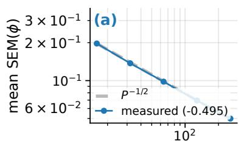  
Permutations P

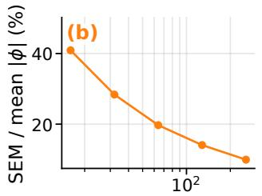  
Permutations P

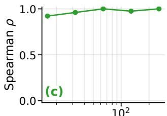  
Permutations P  
Figure 3: Owen estimator convergence in the permutation budget P, on a fixed game (synth; regions, codec and reference held fixed, only the estimator re-run). (a) the standard error falls as $P ^ { - 1 / 2 }$ (fitted slope −0.495; the grey band is the Monte-Carlo ideal, which the measured curve sits on top of). (b) the same noise relative to mean |ϕ|. (c) region-ranking agreement with the largest-P run. The budget is measured, not assumed.

On Synth the two operators point in opposite directions, and significantly so. The exact game beats both compara- tors on-manifold, and loses to both of-manifold. A method whose players are removed by mean or splice replacement is scored most favorably by a metric that removes evidence the same way; that is the teaching-to-the-test failure the two- operator protocol exists to expose, and it is why we report both columns for every method rather than choosing one.

On ECG, the disagreement disappears, and the exact game wins on-manifold, while preserving an approximate perfor- mance of-manifold. With real structure to model, GRAIL leads on-manifold by ≈ 0.17 over C-SHAP, and 0.375 over GS-SHAP. Meanwhile, the of-manifold method underper- forms C-SHAP by 0.028 and outperforms GS-SHAP by 0.039. This can be interpreted as statistically insignificant. Therefore, on-manifold advantage is not an artifact of scoring the method under its own metric. The exact game performs well under baselines’ preferred operator too.

## 4.3 Temporal Signal and Covariates on One Scale

The cooperative game admits static covariates as singleton players (Section 3.1), so signal regions and metadata share a single scale, and a model’s reliance on it is read of rather than inferred. On the LVH task, with sex and age as players at matched instances, region support, and budget (n=40), age receives mean $\vert \phi \vert = 1 . 6 6 3$ , above the top ECG region (1.542; QRS 1.430), while sex, a near-distractor, receives 0.238; together the statics carry 24.8% of the total |ϕ|, and age is the highest-ranked player on 62.5% of instances. Admitting the statics costs no on-manifold faithfulness (0.598 to 0.597, p=0.89) and leaves completeness exact, but it drops the expected-region hit rate from 0.575 to 0.325 (p=0.002): QRS loses top rank to age exactly where the model leans on age. Appendix I gives the per-player table, a synthetic distractor control, and the full ablation.

The same construction extends to multichannel signals, in which the game places every lead on a single scale (Section 3.1). We run the LVH task on LUDB twice under an otherwise identical configuration, once on leads I/II/V1 and once on lead II alone, at the same reduced Owen budget $( P { = } 4 8 , \ Q { = } 2 )$ , the same n=20 instances and seeds, and both region regimes (Table 3). Three leads beat one on every quality metric in both regimes (on-manifold faithfulness 0.659 to 0.735 with provided regions, 0.454 to 0.511 with discovered ones) at about 39× the runtime (2.4 to 94.4 s). The player count roughly triples, from 64 to 104 efective players, and each coalition assembly regenerates three times as many regions, so a roughly quadratic blow-up is the ex- pected shape of the cost rather than a surprise; the unaided arm pays worse than the exact one (6.9 to 260.8 s), because PELT re-segments every lead independently and produces more regions to price.

The channel roll-up is exact by additivity, $\textstyle \sum _ { c } \sum _ { i \in c } \phi _ { i }$ plus the statics returns Σϕ without renormalization, and it recovers the clinically expected lead unprompted: averaged over instances the share of |ϕ| is V1 0.398, I 0.366, II 0.235, so V1 dominates and lead II is least informative, exactly what the Sokolow–Lyon criterion says, since it reads S in V1 and does not use lead II. This also fla s that our other LUDB results, computed on lead II, use the least informative lead for this task. One localization number needs care: the multi- lead score is measured against the union of the expected region across leads with saliency summed over channels, so part of the 0.514 to 0.745 gain is pooling rather than better placement; the comparable statement is within-setting, where provided regions localize far better than discovered ones (0.745 vs 0.535).

## 4.4 Region Discovery and Ablations

When regions must be found unaided, what matters is faithful attribution, not boundary recovery. Boundary-snapping (Section 3.2, Table 4) delivers this with no retraining: the learn-able model-aware selector matches or beats the signal-only PELT default on synth, mixed, and ludb, localizing better at far fewer players. The headline is ludb: the un-snapped selec- tor collapses to 0.34, worst of any arm, and snapping recovers 0.73, past the incumbent, so placement, not count, was the problem. The strongest result is comparative: a ground-truth prior (the annotated P/QRS/T mask) further improves faithfulness and localization and dominates every unaided arm, so we recommend the annotated segmenter when a prior exists and the snapped, model-aware one when it does not.

Further, in the appendix, we ablate the kernel choices and their impact on the method’s decisions. The kernel sets the counterfactual’s texture: RBF is the most on-manifold faith- ful arm on ECG (0.872), while the rougher Matérn kernels are the most robust (max-sensitivity 0.72/0.74 against RBF’s 0.91); we default to RBF and report both directions (Ap-pendix D). The reference $p _ { 0 }$ barely moves faithfulness (the five arms lie within one between-seed SEM on all datasets), so choosing one is a decision about what an explanation means, not a lever on quality (Appendix F).

Conditional semantics is not a weak efect but an exactly zero one: it reproduces the marginal arm to machine preci- sion (max $| \Delta | ^ { \bullet } \approx 1 0 ^ { - 1 5 } )$ ) on every region-level metric, even on real ECG where the codec features correlate three times as strongly as on synthetic. The reason is structural: Owen block values only focus on whole-block coalitions, where no ab- sent feature has a retained sibling to condition on. Thus, fea- ture correlation cannot change which regions matter. Within- region redistribution remains invariant. Faithfulness does not change for all six datasets, and only trades localization pre- cision against recall (Appendix G).

## 4.5 Generator Fit and Calibration

The counterfactual generator is a swappable module: a GP posterior by default, or a cVAE or a DDPM in its place, and all three leave the accounting exactly complete. Expressive- ness is not free, though. The more learned the generator, the more its regenerations resemble the counterfactuals a splice- based operator would produce, blurring the on-manifold/of- manifold distinction the two-operator protocol relies on, so a more powerful generator can raise measured faithfulness while weakening the very contrast that makes on-manifold faithfulness meaningful.

Because of this, we judge the generator by direct diagnostics rather than by the downstream faithfulness it produces. A probability-integral-transform check, whether held-out ob- servations fall in their predicted quantiles at the right rate, gives Kolmogorov-Smirnov distances of 0.23 to 0.40 from uniform: the generator’s predictive uncertainty is miscali- brated exactly on the families where its attributions are most faithful. Passing downstream faithfulness is therefore weaker evidence of a good generative model than it appears, which is why we report the fit directly (Appendix H).

## 4.6 Eficiency of Amortized Deployment

The exact game’s main cost is runtime, and it is not intrinsic to the game. Amortizing the same value function into a learned explainer (Section 3.3) replaces the per-instance Owen sweep with a single forward pass, a $1 0 ^ { 3 }$ × reduction from the exact game’s 17.9 s per ECG beat, and the surrogate inherits exact completeness from the eficiency projection rather than rederiving it $( \overline { { | \rho | } } = 0 . 0 0 0 )$ . It stays faithful where it matters: on real data its on-manifold faithfulness tracks the exact game (ECG 0.556 vs. 0.872) and pays a cost only on low-signal synthetic families, where there is little on-manifold structure for a single-pass predictor to amortize (Appendix J, Tables 13 and 14).

Table 4: Region discovery, unaided. Downstream on- manifold faith per family (reduced-budget GRAIL re-run over each arm’s regions); bold = best. masknet is a modelaware selector snapped onto clean cut points at inference (no retraining); pelt-l2 is the signal-only default.
<table><tr><td>Segmenter</td><td>synth</td><td>mixed</td><td>ecg</td><td>ludb</td></tr><tr><td>pelt-12 (signal-only)</td><td>0.711</td><td>0.864</td><td>0.555</td><td>0.683</td></tr><tr><td>masknet (learnable+snap)</td><td>0.721</td><td>0.908</td><td>0.518</td><td>0.729</td></tr></table>

We measure the amortized arm against a representative four-baseline subset, one per paradigm (window-Shapley, LIME, realistic-LIME, and gradient-mask), at the deploy- ment budget $n _ { \mathrm { a m o } } .$ . The trade is deliberate, and it is the same one the fast comparators make with their own approximations (Section 4.2): a single-pass explainer at deployment cost that keeps the exact game’s completeness and its faithfulness on the data with structure to explain.

## 5 Conclusion

Meaningful time-series explanation begins with the choice of the right unit, the region, and the non-temporal covari- ates a model uses alongside it. Having fixed the players, an explanation is governed by the definition of a "baseline" re- gion, defined by a counterfactual. Instead of choosing a fixed filler, the proposed method generates an absent region on the data manifold. Then it attributes the logit via Owen val- ues estimated with common random numbers, and always reports the residual. Since all players share a single scale, the model’s overreliance on static data rather than time series can be assessed. Experiments show that the exact game is the most faithful on-manifold on every family and exactly complete. On real ECG data, GRAIL almost reaches the same of-manifold performance as other baselines. Finally, we attempt to ease the deployment process by introducing an amortized surrogate that reduces runtime on real data; a faithfulness-aware segmenter that enables region discovery without ground truth; and a game that supports multi-lead signals by recovering the clinically expected leads.

Limitations. The most important question we want to ad- dress is whether these explanations are useful to domain experts. Therefore, our next step is conducting a user study. Since the amortized surrogate is trained on a single model, the model-randomization sanity check requires retraining the surrogate. Although the method achieves high performance on non-stationary data, we need to explore additional signals that a GP cannot represent. The exact generator saturates the logit, which the residual $\rho$ detects, and the swappable cVAE and DDPM generators mitigate this efect. Automated region discovery is improved but still unsolved. Further lessons that generalize beyond GRAIL, an expert-rule agreement analy- sis, and the scope of our reimplementations, difusion arm, and multivariate claims are developed in Appendix K.

## References

Adebayo, J.; Gilmer, J.; Muelly, M.; Goodfellow, I.; Hardt, M.; and Kim, B. 2018. Sanity checks for saliency maps. In Advances in Neural Information Processing Systems (NeurIPS), 9525–9536.

Bento, J.; Saleiro, P.; Cruz, A. F.; Figueiredo, M. A. T.; and Bizarro, P. 2021. TimeSHAP: Explaining recurrent models

through sequence perturbations. In Proc. ACM SIGKDD Int. Conf. Knowledge Discovery and Data Mining (KDD), 2565–2573.

Bhatt, U.; Weller, A.; and Moura, J. M. F. 2020. Evaluat- ing and aggregating feature-based model explanations. In Proceedings of the 29th International Joint Conference on Artificial Intelligence (IJCAI), 3016–3022.

Chen, J.; Song, L.; Wainwright, M. J.; and Jordan, M. I. 2018. Learning to Explain: An Information-Theoretic Perspective on Model Interpretation. In International Conference on Machine Learning (ICML).

Covert, I.; Lundberg, S. M.; and Lee, S.-I. 2021. Explaining by removing: A unified framework for model explanation. Journal ofMachine Learning Research, 22(209): 1–90.

Crabbé, J.; and Van Der Schaar, M. 2021. Explaining Time Series Predictions with D namic Masks. In Meila M.; and Zhang, T., eds., Proceedings of the 38th International Conference on Machine Learning, volume 139 of Proceedings ofMachine Learning Research, 2166–2177. PMLR.

DeYoung, J.; Jain, S.; Rajani, N. F.; Lehman, E.; Xiong, C.; Socher, R.; and Wallace, B. C. 2020. ERASER: A benchmark to evaluate rationalized NLP models. In Proceedings of the 58th Annual Meeting of the Association for Computational Linguistics (ACL), 4443–4458.

Fong, R. C.; and Vedaldi, A. 2017. Interpretable explanations of black boxes by meaningful perturbation. In Proc. IEEE Int. Conf. Computer Vision (ICCV), 3429–3437.

Goldberger, A. L.; Amaral, L. A. N.; Glass, L.; Hausdorf, J. M.; Ivanov, P. C.; Mark, R. G.; Mietus, J. E.; Moody, G. B.; Peng, C.-K.; and Stanley, H. E. 2000. PhysioBank, PhysioToolkit, and PhysioNet: components of a new re- search resource for complex physiologic signals. Circulation, 101(23): e215–e220.

Gretton, A.; Borgwardt, K. M.; Rasch, M. J.; Schölkopf, B.; and Smola, A. 2012. A Kernel Two-Sample Test. Journal of Machine Learning Research, 13(25): 723–773.

Gretton, A.; Bousquet, O.; Smola, A.; and Schölkopf, B. 2005. Measuring Statistical Dependence with Hilbert- Schmidt Norms. In Algorithmic Learning Theory (ALT), 63–77.

Ho, J.; Jain, A.; and Abbeel, P. 2020. Denoising Difusion Probabilistic Models. In Advances in Neural Information Processing Systems (NeurIPS).

Hooker, S.; Erhan, D.; Kindermans, P.-J.; and Kim, B. 2019. A benchmark for interpretability methods in deep neural networks. In Advances in Neural Information Processing Systems (NeurIPS), 9737–9748.

Ismail, A. A.; Gunady, M.; Corrada Bravo, H.; and Feizi, S. 2020. Benchmarking deep learning interpretability in time series predictions. In Advances in Neural Information Processing Systems (NeurIPS), 6441–6452.

Ismail Fawaz, H.; Lucas, B.; Forestier, G.; Pelletier, C.; Schmidt, D. F.; Weber, J.; Webb, G. I.; Idoumghar, L.; Muller, P.-A.; and Petitjean, F. 2020. InceptionTime: Finding AlexNet for time series classification. Data Mining and Knowledge Discovery, 34(6): 1936–1962.

Janzing, D.; Minorics, L.; and Blöbaum, P. 2020. Feature relevance quantification in explainable AI: A causal prob- lem. In Proc. Int. Conf. Artificial Intelligence and Statistics (AISTATS), 2907–2916.

Jethani, N.; Sudarshan, M.; Aphinyanaphongs, Y.; and Ran- ganath, R. 2021. Have we learned to explain? How inter- pretability methods can learn to encode predictions in their interpretations. In International Conference on Artificial Intelligence and Statistics (AISTATS), 1459–1467.

Jethani, N.; Sudarshan, M.; Covert, I.; Lee, S.-I.; and Ran- ganath, R. 2022. FastSHAP: Real-Time Shapley Value Esti- mation. In International Conference on Learning Representations (ICLR).

Jutte, A.; Ahmed, F.; Linssen, J.; and van Keulen, M. 2025. C-SHAP for time series: An approach to high-level temporal explanations. ArXiv, abs/2504.11159.

Kalyakulina, A. I.; Yusipov, I. I.; Moskalenko, V. A.; Nikol- skiy, A. V.; Kosonogov, K. A.; Osipov, G. V.; Zolotykh, N. Y.; and Ivanchenko, M. V. 2021. Lobachevsky University Electrocardiography Database. PhysioNet.

Killick, R.; Fearnhead, P.; and Eckley, I. A. 2012. Optimal detection of changepoints with a linear computational cost. Journal of the American Statistical Association, 107(500): 1590–1598.

Kim, J.; and Park, S. 2026. GroupSegment-SHAP: Shapley Value Explanations with Group-Segment Players for Multi- variate Time Series. ArXiv, abs/2601.06114.

Kingma, D. P.; and Welling, M. 2014. Auto-Encoding Varia- tional Bayes. In International Conference on Learning Representations (ICLR).

Kumar, I. E.; Venkatasubramanian, S.; Scheidegger, C.; and Friedler, S. 2020. Problems with Shapley-value-based expla- nations as feature importance measures. In Proc. Int. Conf. Machine Learning (ICML), 5491–5500.

Laguna, P.; Mark, R. G.; Goldberger, A.; and Moody, G. B. 1997. A database for evaluation of algorithms for measure- ment of QT and other waveform intervals in the ECG. In Computers in Cardiology, 673–676.

Lopez Alcaraz, J. M.; and Strodthof, N. 2025. Explain- ing Time Series Classification Predictions via Causal Attri- butions. In IEEE International Conference on Tools with Artificial Intelligence (ICTAI). ArXiv:2405.15871; code at https://github.com/AI4HealthUOL/CausalConceptTS.

Lundberg, S. M.; and Lee, S.-I. 2017. A unified approach to interpreting model predictions. In Advances in Neural Information Processing Systems (NeurIPS), 4765–4774.

Moody, G. B.; and Mark, R. G. 2001. The impact of the MIT- BIH arrhythmia database. IEEE Engineering in Medicine and Biology Magazine, 20(3): 45–50.

Nayebi, A.; Tipirneni, S.; Reddy, C. K.; Foreman, B.; and Subbian, V. 2023. WindowSHAP: An eficient framework for explaining time-series classifiers based on Shapley values. Journal ofBiomedical Informatics, 144: 104438.

Owen, G. 1972. Multilinear extensions of games. Management Science, 18(5-part-2): 64–79.

Petsiuk, V.; Das, A.; and Saenko, K. 2018. RISE: Random- ized input sampling for explanation of black-box models. In British Machine Vision Conference (BMVC).

Rasmussen, C. E.; and Williams, C. K. I. 2006a. Gaussian Processes for Machine Learning. MIT Press.

Rasmussen, C. E.; and Williams, C. K. I. 2006b. Gaussian Processes for Machine Learning. MIT Press.

Raykar, V. C.; Jati, A.; Mukherjee, S.; Aggarwal, N.; Sarpat-war, K.; Ganapavarapu, G.; and Vaculin, R. 2023. TsSHAP: Robust model agnostic feature-based explainability for time series forecasting. arXiv:2303.12316.

Schle el, U.; Vo, D. L.; Keim, D. A.; and Seebacher, D. 2021. TS-MULE: Local Interpretable Model-Agnostic Ex- planations for Time Series Forecast Models. In Machine Learning and Principles and Practice of Knowledge Discovery in Databases, 5–14. Cham: Springer International Publishing. ISBN 978-3-030-93736-2.

Shapley, L. S. 1953. A value for n-person games. Contributions to the Theory ofGames, 2(28): 307–317.

Simonyan, K.; Vedaldi, A.; and Zisserman, A. 2014. Deep inside convolutional networks: Visualising image classifica- tion models and saliency maps. In Workshop at International Conference on Learning Representations (ICLR).

Sivill, T.; and Flach, P. 2022. LIMESegment: Meaning- ful, Realistic Time Series Explanations. In Camps-Valls, G.; Ruiz, F. J. R.; and Valera, I., eds., Proceedings of The 25th International Conference on Artificial Intelligence and Statistics, volume 151 of Proceedings ofMachine Learning Research, 3418–3433. PMLR.

Sohn, K.; Lee, H.; and Yan, X. 2015. Learning Structured Output Representation using Deep Conditional Generative Models. In Advances in Neural Information Processing Systems (NeurIPS).

Štrumbelj, E.; and Kononenko, I. 2014. Explaining prediction models and individual predictions with feature contribu- tions. Knowledge and Information Systems, 41(3): 647–665.

Sundararajan, M.; and Najmi, A. 2020. The many Shapley values for model explanation. In Proc. Int. Conf. Machine Learning (ICML), 9269–9278.

Sundararajan, M.; Taly, A.; and Yan, Q. 2017. Axiomatic attribution for deep networks. In Proc. Int. Conf. Machine Learning (ICML), 3319–3328.

Taufiq, M. F.; Blöbaum, P.; and Minorics, L. 2023. Manifold Restricted Interventional Shapley Values. In Proceedings of the 26th International Conference on Artificial Intelligence and Statistics, volume 206 of Proceedings of Machine Learning Research, 5079–5106. PMLR.

Theissler, A.; Spinnato, F.; Schlegel, U.; and Guidotti, R. 2022. Explainable AI for time series classification: A review, taxonomy and research directions. IEEEAccess, 10: 100700– 100724.

Villani, M.; Lockhart, J.; and Magazzeni, D. 2022. Feature Importance for Time Series Data: Improving KernelSHAP. arXiv:2210.02176.

Wilson, A. G.; and Adams, R. P. 2013. Gaussian process ker- nels for pattern discovery and extrapolation. In International Conference on Machine Learning (ICML), 1067–1075.

## A Related Work

Shapley attribution and the removal operator. Shapley values, originally proposed by Shapley (1953), form the foundation of the modern attribution framework SHAP (Lundberg and Lee 2017). The framework satisfies four basic axioms: eficiency, symmetry, dummy, and additivity. The main modeling decisions of Shapley attributions are the “absence” and sampling of features (Štrumbelj and Kononenko 2014). Building on top of the framework, Sundararajan and Najmi (2020) and Kumar et al. (2020) introduce attribution ambi-guities; Janzing, Minorics, and Blöbaum (2020) represent the observational-vs-interventional choice as causal; Covert, Lundberg, and Lee (2021) parameterize removal-based ex-planations with a masking operator. To adapt the removal mechanism for time series, we implement feature removal with a conditional generator to stay on-manifold. Further, we extend the value function from a traditional Shapley game to a two-level Owen value (Owen 1972) over nested features with corresponding time-series regions.

Time-series explainers. Time-series-specific explanation methods treat time steps as players to produce attribu- tions (Theissler et al. 2022). However, as Example 1 sug- gests, timestep saliency might not be suficiently expressive. To test this, we compare GRAIL against five representa- tive methods that operate at, or can be aggregated to, the region level: WindowSHAP (Nayebi et al. 2023) explains fixed-sized windows, TimeSHAP (Bento et al. 2021) perturbs sequence events with pruning, TS-MULE (Schlegel et al. 2021) runs LIME over segmented series, LIMESegment (Sivill and Flach 2022) builds realistic time-series perturbations, and Dynamask (Crabbé and Van Der Schaar 2021) learns a soft temporal perturbation mask. We lever-age a region-based approach to learn generators that sample regions on the manifold.

Concept- and group-level players. Alternatively, other methods approach the saliency problem by defining play- ers diferently. C-SHAP (Jutte et al. 2025) decomposes a series into high-level concepts and computes exact Shapley values over them, trading localization for interpretability: its players are global properties and carry no position. For the multivariate methods, GroupSegment-SHAP (Kim and Park 2026) builds players as (feature group × time interval) cells, grouping variables by Hilbert–Schmidt independence (Gretton et al. 2005) and segmenting time by maximum mean discrepancy (Gretton et al. 2012). While these methods adopt a similar two-level construction, they redefine the player and keep an of-manifold removal operator (mean replacement). Oppositely, we hold the player structure fixed and change the operator. Our harness scores both axes at once, so Table 2 can separate them.

Hierarchical credit assignment. Nesting players is ex- actly what Owen values (Owen 1972) formalizes: a coalition structure partitions players into blocks, credit is allocated be- tween blocks and then within them, and the result reduces to Shapley when the partition is trivial. We adopt that structure directly—features nested in regions, and regions nested in channels for multivariate signals—rather than building a be- spoke coarse-to-fine procedure, which buys the consistency and eficiency guarantees for free.

Generative imputation for counterfactual concepts. We build on the notion that counterfactuals are generated rather than spliced. Thus, our generator operates only on a single region conditioned on its retained features and boundary, al- lowing us to keep exact Owen value computation afordable. We include a region-scale conditional DDPM (Ho, Jain, and Abbeel 2020) as a third generator family (Section B) to test whether the choice of generator, rather than the decision to generate at all, is what matters.

Generators and backbones. Our default generator is a Gaussian process (Rasmussen and Williams 2006a) with a spectral-mixture kernel (Wilson and Adams 2013) and a beattemplate mean for ECG; a learned conditional VAE (Kingma and Welling 2014; Sohn, Lee, and Yan 2015) and a conditional DDPM (Ho, Jain, and Abbeel 2020) are the alter-natives we explored behind the same game. Segmentation change points are identified via PELT (Killick, Fearnhead, and Eckley 2012). As a predictive baseline, we leverage InceptionTime (Ismail Fawaz et al. 2020).

Amortized and learned explanation. Solving an exact game for every instance is computationally expensive, which motivated training learnable networks to predict explana- tions. FastSHAP (Jethani et al. 2022) amortizes Shap- ley values with an eficiency-constrained regression loss, L2X (Chen et al. 2018) and REAL-X (Jethani et al. 2021) learn instance-wise feature selectors. We leverage the Fast- SHAP objective while modifying the model to account for time-series specifics. This allows the deployment of the ex- pensive exact method.

On- vs of-manifold evaluation. Perturbation-based faith- fulness is defined by corresponding methods’ feature re- moval mechanisms (Petsiuk, Das, and Saenko 2018; Fong and Vedaldi 2017). Scoring an explainer only with an of-manifold operator rewards methods that measure impor- tance in that same space, i.e., the “teaching-to-the-test” trap (Hooker et al. 2019; Jethani et al. 2021). We report faithfulness under both a neutral of-manifold operator and a matched on-manifold one, applied identically to every method.

## B Implementation details

In the following section, we define the default implementa- tion details for the experiments presented.

Codec feature encoders. Aiming to produce encodings for the generators, we propose codecs. A codec is a pair of an encoder ϕ and a conditional generator. The encoder is a closed-form read of the region without fitting and learned parameters. Thus, we can maintain the same feature mean- ing across all regions and signals. stat encodes level (region mean), slope (least-squares linear coeficient in t), and scale (standard deviation of the residual after removing level and slope). shape is a strict superset that adds a named extremum: peak\_amp, the signed height of the dominant extremum above the fitted line, and peak\_loc, its position as a fraction of the region span in [0, 1] normalized in a way that regions of diferent lengths pool into one reference distribution. shape’s scale is calibrated on the residual after the fitted peak, so the generator’s variance matches what the named features leave behind. basis encodes low-order DCT coeficients; sm encodes spectral-mixture hyperparameters; nonstationary encodes a per-region lengthscale profile. Under GRAIL\_stabilized, the slope is a Theil– Sen estimate instead of least squares. The generator’s mean is the encoder read backwards (level + slope · (t − t¯), plus peak\_amp $\cdot \ g ( t )$ for shape, with g a Gaussian bump of width max(1.5, 0.08L) at peak\_loc · (L−1)); the residual is a boundary-conditioned GP draw. All experiments here use shape with an RBF residual kernel.

Gaussian Process. The residual kernel has an amplitude, fixed by the encoded scale, and a lengthscale $\ell = f \cdot L$ for region length L. The default $f = 0 . { \overset { \cdot } { 2 } } 5$ is a heuristic. Un- der GRAIL\_empirical\_bayes, it is instead selected by maximizing the mean per-sample marginal log-density over the grid $f \in \{ 0 . 0 3 , 0 . 0 6 , 0 . 1 0 , 0 . 1 5 , 0 . 2 5 , 0 . 3 5 , 0 . 5 0 \}$ , eval- uated on the reference corpus and cached per (codec, L). Selection never sees the explained signal, so the value function stays independent of the instance. A $\sigma _ { n } ^ { 2 } = 1 0 ^ { - 2 } \operatorname { v a r } ( x _ { r } )$ is added before the Cholesky. Given this value is not provided, the criterion ranks candidates by conditioning on fit (§3.2). Jitter is $1 0 ^ { - 6 }$ , and the boundary flank width is 8 samples on each side.

Reference corpus. $p _ { 0 }$ is fitted once per run, before the at- tributions are provided. Then, with the segmenter preserved independently of a data split, regions are encoded. Resulting feature pools are based on the empirical marginals. A fea- ture value is sampled by inverse-CDF from the corresponding pool. To preserve the on-manifold assumption, we restrict the pool conditionally by class\_conditional, label (normal cohort, target class, or foil-class, §F). Conditional additionally fits a Gaussian copula and draws the absent co- ordinate from the Gaussian conditional given the retained features, evaluated at the same uniform $u ,$ such that CRN coupling survives. When neither retained features nor a sin- gle correlation block is kept, the algorithm falls back to the marginal, so conditional reduces to marginal exactly.

Estimator budget. The budget hyperparameters used in the experiments are as follows: restricted permutations $P { = } 1 2 8 ,$ base-randomness draws $Q { = } 3 ,$ exact enumeration whenever a block has $\leq 1 0$ players, batch size 2048, antithetic pairing on. To enhance the processing speed, we employ batched forward passes on coalitions. Figure 3 mea- sures the resulting error: the mean per-player standard error (SME) falls as $\breve { P } ^ { - 0 . 4 9 5 }$ against the Monte-Carlo ideal of $P ^ { - 1 / 2 }$ , i.e., CRN reduces the constant without changing the rate, and $P { = } 1 2 8$ is located at the curve’s flat span relative to its own cost. On the other hand, the DDPM generator runs at $P { = } 1 6 , Q { = } 1 \left( \ S 3 . 2 \right)$ and the multivariate arm at $P { = } 4 8 , Q { = } 2$

Neural generators. The cVAE is a 64-point grid autoencoder, $d _ { z } { = } 8 ,$ hidden width 128, trained 200 epochs at $\mathrm { l r } { = } 1 0 ^ { - 3 }$ with $\beta _ { \mathrm { K L } } { = } 0 . 0 5$ and a cycle-consistency term of weight 0.2, on region crops from at most 400 training sig-nals. The DDPM shares the grid and the conditioning vec- tor θ, both boundary flanks, two presence flags, normalized length, optionally a class index, with 200 training steps and a 20-step strided DDIM reverse chain at sampling time. Both expose the identical sample(θ, left, right, $L , \varepsilon )$ signature as the GP, and both are deterministic in ε. The reverse chain consumes slices of the same ε as the CRN sweep, so toggling a feature measures the toggle, not a fresh noise draw. Regions are resampled to the grid and back by linear interpolation. GRAIL-fast is a FastSHAP-style head trained on 200 sig-nals $\times ~ 2 4$ coalitions. We ablate the operator that generates its targets in §J.4.

## C A worked clinical example

In Fig. 5, ϕ is one (region, feature) player and Σϕ a region roll-up. Both are at diferent levels of the game and are never compared directly. Fig. 4 shows the roll-up over 40 abnormal beats of the PVC task under the default arm (shape codec, RBF, deviation-from-normal reference). The QRS complex, which is the clinical ground truth, carries the largest mean roll-up $( \Sigma \phi { = } \small { + } 5 . 0 7 { \pm } 0 . 3 0 )$ , leads on 31/40 beats, and is positive on all 40 beats. The aggregated isoelectric segment is second $( + 3 . 4 2 { \pm } 0 . 1 4 ) $ , but only because it is the sum of six separate background spans ranging from $+ 0 . 2 1 \ \mathrm { t o } \ + 0 . 8 9 .$ The largest is still almost 6 times below QRS, which is why Fig. 4 splits that bar into the spans composing it. Based on the received attributions, we can algorithmically construct the explanation narrative as follows: “the strongest driver toward class 1 is the QRS complex’s elevated baseline/ST level (extremely, 4.9σ; ϕ=+4.16±0.09 log-odds); QRS contributes the most in total $( \Sigma \phi { = } + 5 . 7 0 ) ;$ 0% of the decision is unexplained $( \rho { = } \mathrm { + } 0 . 0 0 0 0 ) ,$ ; within-signal saliency peaks $a t \ t { = } 1 1 0$ , inside the $\underbrace { O R S } _ { \mathrm { \normalfont ~  ~ } } ^ { \prime \prime }$ The PVC task is primarily deter- mined by abnormalities in QRS morphology that highlight the importance of the most attributed region, thus proving the faithfulness of the algorithm. Completeness here is measured to be max $| \rho | < 1 0 ^ { - 4 }$ across all 40 beats.

## D Kernel functions

The generator module can be selected depending on the nature of the data. The kernel defines the counterfactual’s underlying function and thus determines what a coalition looks like without pinned features. Our default RBF is in- finitely smooth, yet it is expected to perform poorly for non-smooth signals; it showed the best performance in a non-stationary setting. Behind the identical game, we there- fore compare three cheap variance-separable kernels: RBF, Matérn-3/2, Matérn-5/2 (Rasmussen and Williams 2006b), whose rougher sample paths track real signals while keep- ing the cached-Cholesky speed-up (§3.1)—and a filterbank spectral-mixture codec that fixes a component’s frequency to a log-spaced band grid, so its identity is stable under input jitter (at the cost of the non-separable solve). Every arm is exactly complete $( \overline { { | \rho | } } = 0 )$

On ECG (Table 5), all four exact-game kernels are more on-manifold faithful than every baseline (0.72–0.84 vs. $\leq$ 0.66) and exactly complete. However, the trade-of for faithfulness is runtime speed, which may be one to three orders of magnitude slower. Localization is saliency-dependent: at this sweep’s setting, the baselines edge ahead (timeshap loc-AUPRC 0.554 vs. our best 0.519), but under the shipped occw=6 default GRAIL takes the ECG localization lead (Table 2, §G). Among kernels, Matérn-5/2 is the most faithful, and the rougher Matérn kernels are the most robust, reach- ing a lower max-sensitivity than the smooth RBF (0.72/0.74 vs. 0.91). Fig. 5 traces one PVC beat under the Matérn-5/2 arm: segmentation into named cardiac regions, and the QRS complex correctly surfaced as the top region—an exactly- complete, clinically-right explanation. App. D extends the ablation to non-stationary FordA and the mass-accounting mechanism. We default to RBF since on-manifold faithful- ness is the primary objective in this work. The filterbank codec can be used primarily for jitter-stable component identity.

pvc: region roll-up, 40 abnormal beats (orange = ground truth QRS)  
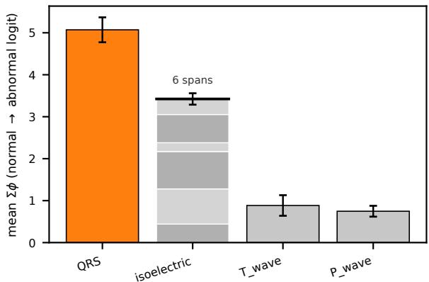  
Figure 4: GRAIL region roll-ups over 40 abnormal PVC beats (shape codec, RBF, deviation-from-normal reference; ρ=0 on every beat). Bars are the mean summed Owen value per region, ±SEM; orange marks the clinical ground truth (QRS), which leads on 31/40 beats. The isoelectric bar is the aggregation of background regions. Therefore, it is split into its six constituent spans.

Non-stationary data (FordA). On a non-stationary family (FordA engine-sensor, UCR; no region ground truth, so localization is undefined), the tradeof is more evident. While the expressive kernels help achieve input robustness, i.e., max-sensitivity falls from RBF’s 0.39 to 0.21 for the filterbank codec, with completeness still exact. However, the expressiveness entails lower on-manifold faithfulness. Par- ticularly, RBF is the most faithful (0.864), while Matérn-5/2 drops to 0.790. The results here are the exact opposite of ECG, since FordA’s discriminative signal is not preserved by the residual.

Importance of kernel selection. Since RBF is over- smoothing, the residual becomes large, preventing recovery of the target signal. On FordA, only 18% of the attributed mass sits on named, interpretable features under RBF, ver- sus roughly half under Matérn-5/2, while the fixed-basis and spectral codecs push most of the mass onto named players. Matching the generator’s roughness to the signal keeps the explanation interpretable, which is why Matérn improves ro- bustness in such settings. Therefore, we recommend Matérn- 5/2 as the default for non-stationary settings. Meanwhile, RBF can be selected when the last of on-manifold faithful- ness matters most. Finally, the filterbank codec can be used when stability under jitter is the priority.

Table 5: Kernel ablation vs. baselines on real ECG. Exact- game kernels (n=120, ablation sweep) against the eight baselines $( n { = } 2 0 0$ , frozen full run): real numbers, reported side by side but not sample-paired (diferent n). On-manifold faithfulness ↑, localization loc-AUPRC ↑, max-sensitivity ↓, runtime s ↓; every exact-game arm has $ \overline { { | \rho | } } = 0$ by construction. Bold = best in column. The exact game leads to faithfulness and completeness; the rougher Matérn kernels are the most robust (lowest max-sensitivity).
<table><tr><td>Method</td><td>faithon</td><td>loc</td><td>m-sens</td><td>S</td></tr><tr><td>GRAIL (rbf)</td><td>0.831</td><td>0.480</td><td>0.908</td><td>12.2</td></tr><tr><td>GRAIL (matérn-3/2)</td><td>0.828</td><td>0.519</td><td>0.719</td><td>12.1</td></tr><tr><td>GRAIL (matérn-5/2)</td><td>0.841</td><td>0.514</td><td>0.744</td><td>12.2</td></tr><tr><td>GRAIL (filterbank)</td><td>0.723</td><td>0.445</td><td>0.767</td><td>40.0</td></tr><tr><td>windowshap (stat.)</td><td>0.634</td><td>0.542</td><td></td><td>1.4</td></tr><tr><td>windowshap (dyn.)</td><td>0.658</td><td>0.508</td><td></td><td>2.7</td></tr><tr><td>timeshap</td><td>0.624</td><td>0.554</td><td></td><td>2.7</td></tr><tr><td>ts-mule (unif.)</td><td>0.620</td><td>0.460</td><td></td><td>0.02</td></tr><tr><td>ts-mule (sax)</td><td>0.649</td><td>0.497</td><td></td><td>0.02</td></tr><tr><td>limesegment</td><td>0.591</td><td>0.468</td><td></td><td>0.50</td></tr><tr><td>tsshap-surrogate</td><td>0.469</td><td>0.447</td><td></td><td>0.03</td></tr><tr><td>dynamask</td><td>0.633</td><td>0.511</td><td></td><td>1.5</td></tr></table>

## E Experimental Setup

Datasets. We use six datasets across three domains; region ground truth is used only to score localization and is never seen at explanation time except by the provided-regions arm. We define data sizes in the following manner: number of samples × number of channels × sequence size.

Synth is a synthetic family of T=100-step univariate series: i.i.d. background with localized injected features whose combinations define the target classes, and the injection masks are the ground-truth region attributions. Data size: 1500×1×100.

Mixed extends Synth with static features acting as short- cut, informative, or distractor variables, giving a controlled setting with known signal and known covariate ground truth. Data size: 1500×1×100.

ECG uses the MIT-BIH Arrhythmia (Moody and Mark 2001) and QT (Laguna et al. 1997) databases from PhysioNet (Goldberger et al. 2000); each R-aligned beat carries cardiologist P/QRS/T regions across five binary tasks. Data size: 4000×1×288.

LUDB is the Lobachevsky University Database (Kalyakulina et al. 2021): real ECG with cardiologist P/QRS/T boundaries and per-subject age and sex, on the left-ventricular-hypertrophy (LVH) task; it is multivariate (leads $ { \mathrm { I } } ,  { \mathrm { I I } } ,  { \mathrm { V } } 1 )$ . Data size: $1 7 9 9 \times 3 \times 4 0 0$

(a) segmentation into named regions  
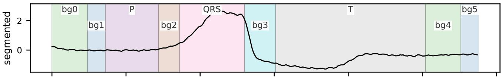  
(b) most-important region

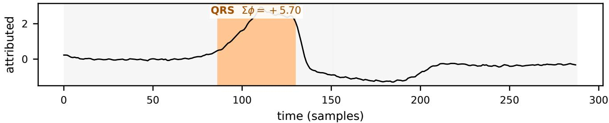  
Figure 5: From signal to attributed regions (GRAIL, RBF, a PVC beat). (a) the beat’s segmentation into named P/QRS/T waves plus the chunked isoelectric background (bg0–bg5); (b) the same beat with the top region by Owen value shaded. The QRS complex, which is the clinical ground truth for a PVC, is the most important region $( \Sigma \phi { = } + 5 . 7 0$ , a region roll-up), and the accounting is exactly complete $( \rho { = } \mathrm { + } 0 . 0 0 0 0 )$ . The beat is the median one among those with QRS leads in the Fig. 4 cohort, where the typical case rather than the most favorable one holds, and both figures come from a single run of a single config.

FordA is a UCR engine-sensor series, non-stationary and without region annotation (localization undefined). Data size: 4921×1×100.

Wafer is a UCR semiconductor-sensor series, also without region annotation. Data size: $7 1 6 4 \times 1 \times 1 0 0$

Target models. All explanations target InceptionTime (Ismail Fawaz et al. 2020) classifiers trained per dataset. We train the model with Adam at a peak learning rate of $1 0 ^ { - 3 }$ and a batch size of 64. For the synth, ecg, forda, and wafer families, utilize the fastai one-cycle schedule $( \mathtt { f i t \_ o n e \_ c y c l e , l r _ { \mathrm { m a x } } } = 1 0 ^ { - 3 } )$ with a validation batch size of 128 and a TSStandardize batch transform. The static-fusion families (mixed, ludb, and the 3-lead ludb build) use a plain torch loop at a constant $1 0 ^ { - 3 }$ with no schedule. Every family minimizes cross-entropy. Epoch numbers are 50 on synth and mixed, 30 on ecg, 40 on forda and wafer, and 60 on both ludb builds.

Methods and configurations. GRAIL uses the shape codec on general families and the clinical codec on ECG, a class-conditional (normal-cohort) reference, and the lossless morphology-residual player. It appears in three configura- tions: with a provided region prior (GRAIL); discovering its own regions via the model-aware segmenter with boundary snapping (GRAIL-auto, §3.2); and as the amortized singleforward-pass deployment (GRAIL-fast, §3.3). The perturbation and windowing baselines are WindowSHAP (stationary, dynamic) (Nayebi et al. 2023), TimeSHAP (Bento et al. 2021), TS-MULE (uniform, SAX) (Schlegel et al. 2021), LIMESegment (Sivill and Flach 2022), TsSHAP (Raykar et al. 2023), and Dynamask (Crabbé and Van Der Schaar 2021). C-SHAP (Jutte et al. 2025) and GS-SHAP (Kim and Park 2026) do not release code. We have reimplemented them and made the code available in the supplementary materials. Gradient baselines are integrated gradients (Sundararajan, Taly, and Yan 2017), gradient×input, and KernelSHAP (Lundberg and Lee 2017). The full head-to-head uses all configurations. The amortized-arm tables use a rep- resentative four-baseline subset (one per paradigm) at the reduced sample size $n _ { \mathrm { a m o } } .$ The baselines share the same re- gion support and harness; GRAIL-auto discovers its own.

Metrics. Faithfulness is scored under two matched removal operators, a neutral of-manifold splice and an on-manifold regeneration, via comprehensiveness/suficiency (DeYoung et al. 2020), faithfulness correlation (Bhatt, Weller, and Moura 2020), and deletion/insertion $\mathrm { { A U C } ; }$ the on- and of- manifold variants are reported side by side (the $_ { - } \mathrm { o n } / \mathrm { \_ o f f }$ columns). Localization compares the per-timestep saliency to the annotated region mask (Ismail et al. 2020) by AUPRC and a pointing game. Robustness covers shift/jitter stability, maxsensitivity, and the model-randomization sanity check (Adebayo et al. 2018). Cost is the efective-player count and wallclock runtime; completeness is ${ \overline { { | \rho | } } } ;$ ; and self-segmentation is boundary $F _ { 1 }$ against the mask.

Statistical protocol. Within a family, every method is scored on the same instances from a single run, so all com- parisons are genuinely paired. Every “wins/loses” claim is gated on a paired two-sided Wilcoxon signed-rank test on per- instance diferences, corrected family-wide with Benjamini– Hochberg at $q < 0 . 0 5$ , and reported with the efect size. The sample sizes are provided in the description of Table 2.

Table 6: Reference ablation, faithfulness\_corr\_on (± between-seed SEM; n=80 synth, 80 ecg, 16 ludb). “Pro-vided” uses ground-truth region support, “discovered” un- aided segmentation.
<table><tr><td></td><td colspan="2">synth</td><td colspan="2">ecg</td><td colspan="2">ludb</td></tr><tr><td>reference po</td><td>prov.</td><td>disc.</td><td>prov.</td><td>disc.</td><td>prov.</td><td>disc.</td></tr><tr><td>marginal</td><td>0.636</td><td>0.540</td><td>0.684</td><td>0.466</td><td>0.613</td><td>0.473</td></tr><tr><td>normal cohort</td><td>0.620</td><td>0.582</td><td>0.694</td><td>0.462</td><td>0.628</td><td>0.461</td></tr><tr><td>target class</td><td>0.626</td><td>0.560</td><td>0.696</td><td>0.478</td><td>0.607</td><td>0.476</td></tr><tr><td>foil class</td><td>0.638</td><td>0.581</td><td>0.669</td><td>0.466</td><td>0.617</td><td>0.468</td></tr><tr><td>conditional</td><td>0.636</td><td>0.533</td><td>0.684</td><td>0.466</td><td>0.613</td><td>0.473</td></tr><tr><td>spread</td><td>0.018</td><td>0.049</td><td>0.027</td><td>0.016</td><td>0.021</td><td>0.015</td></tr></table>

Implementation. Codec feature encoders, GP kernels and hyperparameters (including the residual lengthscale, fitted by marginal likelihood over the reference corpus rather than the explained signal, and the observation-noise nugget $\sigma _ { n } ^ { 2 } ~ = ~ 1 0 ^ { \div 2 } \mathrm { v a r } )$ , reference-corpus construction and the Gaussian-copula conditional reference, the estimator budget (P, Q), and the cVAE and DDPM generator architectures and training are specified in Appendix B.

## F “Absent” features

The reference $p _ { 0 }$ is one of the two switches (conditional, interventional) that change what an explanation means. Table 6 sweeps all five on synth at $n { = } 8 0$ (20 instances × 2 seeds × 2 runs) and repeats the sweep on both real families (n=80 ecg, n=16 ludb), each in both region regimes.

Importance of reference. With ground-truth regions, the five synth arms lie within roughly one between-seed SEM (0.620–0.638); the spread widens only under unaided segmentation (0.533–0.582), where the normal-cohort default leads. Real data agrees and is tighter still: on ecg the arms span 0.669–0.696 (provided) and 0.462–0.478 (discovered), on ludb 0.607–0.628 and 0.461–0.476. The choice of $p _ { 0 }$ is therefore a choice about what the explanation means— deviation from normal, from the predicted class, from the foil—and not a lever on measured faithfulness. That is a cleaner statement than “our default is best”, and it is the one the data supports.

Conditional semantics is zero. The conditional arm re- produces the marginal arm on every region-level metric, on all three families, to machine precision (max $| \Delta | \approx 1 0 ^ { - 1 5 } )$ Our first explanation was that the codec features are nearly independent, so a Gaussian conditional is the marginal; that explanation is wrong, and real data refutes it. Copula corre- lation among the codec features is a property of the reference corpus that can be measured without running the ablation at all, and on real ECG it is about three times synth’s: max $| \rho _ { i j } |$ of 0.41–0.49 (mean 0.12–0.18) across the five ecg tasks and 0.41 (mean 0.14) on ludb, against synth’s 0.155 (mean 0.070). We predicted the conditional arm would separate there. It does not, by a margin of $1 0 ^ { - 1 5 }$

The real reason is a structural property of Owen values rather than of the data. Instrumenting the draw confirms that the conditional branch fires on 60% of absent draws and the feature-level Owen values do move, by up to 3.3% of Σ|ϕ|. What does not move is the region roll-up. Owen block values telescope to the Shapley value of the game played over whole blocks, and in a whole-block coalition every region is either entirely retained or entirely absent, so an absent feature never has a retained sibling in its own region to condition on. The conditional reference falls back to the marginal on precisely the coalitions the region roll-up is built from, so $\textstyle \sum _ { i \in r } \phi _ { i }$ is identical by construction, at any feature correlation. Every metric in this paper consumes that roll-up, or a saliency profile derived from it, and is therefore blind to the switch by design rather than by accident.

Table 7: Within-region redistribution on synth (n=80). All six profile arms leave faithfulness bit-identical (0.620 provided / 0.582 discovered), as the roll-up invariant requires; only rank-alignment perturbs it, downward. “occ-w” is oc-clusion at window width $w ; { ^ { 6 6 } } + \mathrm { f } ^ { \mathrm { v } }$ adds the 0.25 uniform floor.
<table><tr><td rowspan="2">profile</td><td colspan="2">provided regions</td><td colspan="2">discovered regions</td></tr><tr><td>AUPRC</td><td>pointing</td><td>AUPRC</td><td>pointing</td></tr><tr><td>flat (broadcast)</td><td>0.634</td><td>0.525</td><td>0.515</td><td>0.312</td></tr><tr><td>occ-1</td><td>0.538</td><td>0.600</td><td>0.481</td><td>0.588</td></tr><tr><td>occ-6</td><td>0.595</td><td>0.562</td><td>0.543</td><td>0.600</td></tr><tr><td>occ-6 +f (default)</td><td>0.606</td><td>0.550</td><td>0.542</td><td>0.600</td></tr><tr><td>gradient</td><td>0.563</td><td>0.550</td><td>0.499</td><td>0.600</td></tr><tr><td>gradient×input</td><td>0.523</td><td>0.600</td><td>0.467</td><td>0.600</td></tr><tr><td>rank-align 0.5</td><td>0.606</td><td>0.550</td><td>0.542</td><td>0.600</td></tr></table>

This is worth stating plainly because it binds a whole class of proposed improvements. Conditional semantics is a within-region refinement. It changes how a region’s credit is divided among its named features. It cannot change which regions are important. The class-conditional cohorts, by con- trast, redraw the pool a fully-absent region is filled from, so they do change the block-level game, which is why those three arms separate while this one cannot.

## G Where a region’s credit goes

Within-region redistribution (§B) preserves the region rollup by construction, so it can only move localization—never faithfulness. Table 7 confirms this holds exactly in practice and shows what the choice does buy.

The invariant is exact: six arms spanning two perturbation families (structural occlusion and finite-diference gradients) and three uniform-floor settings return the same faithfulness to three decimals. Only rank-align, which by design reorders regions, changes it—and it changes it for the worse $( 0 . 6 2 0 \to 0 . 5 6 1 , 0 . 5 8 2 \to 0 . 5 3 4 )$ while leaving localization untouched, so we leave it of by default.

What the profile does control is a genuine trade, and its directionflips with the region regime. With ground-truth re-gions, the flat broadcast is best on area metrics (AUPRC 0.634) and worst at pointing (0.525): when the annotated span is the ground truth, spreading credit uniformly maximizes overlap and any sharpening can only lose it. With discovered regions the smoothed occlusion profile wins both (0.543 AUPRC, 0.600 pointing), because imprecise bound-aries leave real slack for the profile to recover. The honest summary is that within-region redistribution earns its keep exactly when the segmentation does not already hand you the answer.

On real data, the trade is a precision/recall axis, not a single winner. Because the arms cannot move faithfulness, the sweep can be run the cheap way—one Owen pass per instance, all six profiles scored of the same attribution— which is what makes it afordable on real ECG. Table 8 repeats it on ecg and ludb, and the synthetic story survives only in part.

The clean regime flip we saw on synth is really aprecisionversus-recall split that the synthetic data was too small to separate. Across all four real cells, the occlusion profiles win the precision family—AUP and pointing—and the flat broadcast wins the recall family—AUR and, where the region support is handed over, AUPRC and IoU. This is what the two profiles are for: uniform credit maximizes overlap with a span, a peaked profile maximizes agreement with a point.

What the region regime controls is how much of the recall advantage flat retains. With ground-truth support on ecg it is large (AUPRC 0.688 vs 0.594); with discovered regions it collapses to nothing (0.379 vs 0.375); and on ludb’s discovered regions it reverses (0.193 vs 0.249), matching synth. The mechanism is the same one the synthetic sweep suggested: when the annotated span is the region, coverage comes free, and there is nothing for a profile to recover, and when bound- aries are approximate there is slack the profile can claim. The real data just shows this is a matter of degree rather than a switch.

The default $( \mathsf { o c c } - 6 + \pounds )$ is defensible on this evidence without being the winner of every column. It is never worst in any cell; it is best or tied-best at pointing in the two discovered cells—the regime that matters at deployment, where nobody hands you the regions—and it is runner-up on AUPRC in all four. The pure-gradient profiles are the clear losers on real data (worst or near-worst in seven of eight columns), which is worth stating: a finite-diference sensitivity inside a region is a poor guide to where that region’s coalitional credit belongs. We report the ludb cells as directional only— at n=16 the between-seed SEMs on AUPRC reach ±0.10.

## H Swapping the generator, and asking whether it fits

Section 3.2 argues the generator is a component rather than a commitment, and that its adequacy can be checked directly instead of inferred from task metrics. Both claims are cheap to test, and neither is flattering in the way we expected.

Swappability holds, and there is a gradient behind it. All three generators leave the game exactly complete, so the interface claim is met: the counterfactual moves and the ac- counting does not. What is more informative is the ordering. As the generator becomes more learned and less analytic, on- manifold faithfulness falls $( 0 . 6 6 2  0 . 6 1 0  0 . 4 3 0 )$ while of-manifold faithfulness rises monotonically (−0.092 →

$0 . 3 3 5  0 . 4 3 9 )$ . The learned generators drift towards pro- ducing counterfactuals a splice-based operator recognizes, which is precisely the property the analytic GP was chosen to avoid. Part of the DDPM’s on-manifold deficit is its 8× smaller permutation budget and we do not read its 0.430 as a converged number; the of-manifold ordering, which is budget-insensitive in direction, is the part we rely on.

The generator fits real ECG better than synthetic noise. Per-sample log-density is highest on ecg with annotated re- gions (−12.4) and lowest on synth $( - 1 7 . 8 \ \mathrm { t o } \ - 2 1 . 5 ) .$ , and the regeneration distances agree (0.36 vs. 2.24). This inverts the intuition that synthetic data is the easy case: synth’s in- formative regions sit on i.i.d. background, which a smooth boundary-conditioned GP is a poor model of, whereas a QRS complex is exactly the kind of correlated excursion it represents well. It also supplies a mechanism for a result we previously only observed: the exact game’s large synth ad- vantage on-manifold is measured against a generator that fits synth worst.

Segmentation quality is visible in the generator, not just downstream. On ecg, moving from annotated to discovered regions costs 54 nats per sample $( - 1 2 . 4  - 6 7 . 0 ) -$ a far larger swing than anything in the synth column, and larger than the corresponding faithfulness gap would sug- gest. Change-point boundaries place region edges where the GP’s boundary conditioning is badly wrong. This makes the log-density useful as a segmentation diagnostic that needs no ground-truth mask, which is exactly the setting where boundary $F _ { 1 }$ is unavailable.

The uncertainty is not honest, and we should say so. PIT KS distances of 0.23–0.40 are large: if the generator’s posterior were calibrated, the whitened residual $L ^ { - 1 } ( x _ { r } - \mu _ { r } )$ would be standard normal and this number would be near zero. It is not. The generator’s mean is evidently good enough to drive the most faithful attributions in this paper while its error bars are miscalibrated—which is the whole point of reporting a diagnostic that task performance cannot see. Two consequences follow. Any use of GRAIL that reads the gener- ator’s variance (confidence intervals on a counterfactual, say) is not currently supported by this evidence. And the down- stream faithfulness metrics are demonstrably insensitive to error-bar calibration, so passing them is weaker evidence of a good generative model than it appears.

## I Static covariates on one scale

Section B admits static covariates as singleton Owen players alongside the temporal regions, and Table 2 reports what they receive. This appendix gives the full accounting, because the claim is otherwise only structural.

The main tables hold the statics fixed. In every run reported in the main text the observed covariates are bound into the model, so each method explains the signal with the patient’s context held constant—which is what keeps the comparison against the eight signal-only baselines like-for- like. The game reported here is the other one: sex and age are players, priced in the same log-odds units as QRS. It is run on the same instances, the same region support, the same codec and reference, and the same estimator budget, so the two are paired instance-by-instance.

Table 8: Within-region redistribution on real data. Localization only: the profile cannot change faithfulness (the roll-up invariant), which the synth sweep confirms to three decimals. n=80 per ecg cell (8 instances $\times ~ 5$ tasks × 2 seeds), n=16 per ludb cell; ± is the between-seed SEM. AUPRC/AUR reward covering the annotated span, AUP/pointing reward hitting its peak—the two families disagree, and that disagreement is the result.
<table><tr><td></td><td colspan="4">ecg</td><td colspan="4">ludb</td></tr><tr><td></td><td colspan="2">provided</td><td colspan="2">discovered</td><td colspan="2">provided</td><td colspan="2">discovered</td></tr><tr><td>profile</td><td>AUPRC</td><td>point</td><td>AUPRC</td><td>point</td><td>AUPRC</td><td>point</td><td>AUPRC</td><td>point</td></tr><tr><td>flat (broadcast)</td><td>0.688</td><td>0.637</td><td>0.379</td><td>0.588</td><td>0.630</td><td>0.500</td><td>0.193</td><td>0.625</td></tr><tr><td>occ-1</td><td>0.406</td><td>0.625</td><td>0.280</td><td>0.562</td><td>0.316</td><td>0.625</td><td>0.197</td><td>0.562</td></tr><tr><td>occ-6</td><td>0.504</td><td>0.650</td><td>0.363</td><td>0.675</td><td>0.436</td><td>0.625</td><td>0.254</td><td>0.750</td></tr><tr><td>occ-6 +f (default)</td><td>0.594</td><td>0.637</td><td>0.375</td><td>0.700</td><td>0.499</td><td>0.625</td><td>0.249</td><td>0.750</td></tr><tr><td>gradient</td><td>0.512</td><td>0.613</td><td>0.269</td><td>0.487</td><td>0.424</td><td>0.625</td><td>0.177</td><td>0.688</td></tr><tr><td>gradient×input</td><td>0.422</td><td>0.625</td><td>0.267</td><td>0.450</td><td>0.326</td><td>0.625</td><td>0.170</td><td>0.625</td></tr></table>

Table 9: Three generators behind one game (synth, $n { = } 4 0 ,$ ± between-seed SEM). The DDPM runs at its reduced budget $( P { = } 1 6 , Q { = } 1$ vs. 128/3), so its faithfulness is not budget-matched and is a lower bound.
<table><tr><td>generator</td><td> $\mathrm { f a i t h } _ { \mathrm { o n } } \uparrow$ </td><td> $\mathrm { f a i t h _ { o f f } \uparrow }$ </td><td>loc-AUPRC</td></tr><tr><td>GP, analytic (provided)</td><td> ${ \bf 0 . 6 6 2 \pm . 0 2 5 }$ </td><td> $- 0 . 0 9 2$ </td><td>0.585</td></tr><tr><td>GP, analytic (discovered)</td><td> $0 . 5 1 0 \pm . 0 1 0$ </td><td>0.017</td><td>0.574</td></tr><tr><td>cVAE</td><td> $0 . 6 1 0 \pm . 0 6 4$ </td><td>0.335</td><td>0.500</td></tr><tr><td>DDPM*</td><td> $0 . 4 3 0 \pm . 0 2 7$ </td><td>0.439</td><td>0.533</td></tr></table>

Table 10: Generator diagnostics (n=20 per cell): marginal log-density per sample (↑), PIT KS distance of the whitened residual from N(0, 1) (↓, 0 = honest uncertainty), and the two regeneration distances (↓). Defined only for the GP arms; the cVAE and DDPM have no tractable density and are reported as absent, not as zero.
<table><tr><td></td><td>regions</td><td>log-dens.</td><td>PIT-KS</td><td>stat-d</td><td>spec-d</td></tr><tr><td rowspan="2">synth</td><td>provided</td><td>-17.8</td><td>0.387</td><td>2.24</td><td>0.73</td></tr><tr><td>discovered</td><td>-21.5</td><td>0.397</td><td>2.61</td><td>0.84</td></tr><tr><td rowspan="2">ecg</td><td>provided</td><td>-12.4</td><td>0.233</td><td>0.36</td><td>0.36</td></tr><tr><td>discovered</td><td>-67.0</td><td>0.269</td><td>0.66</td><td>0.47</td></tr></table>

Age dominates, sex does not, and completeness is untouched. Table 11 gives the accounting. Age’s mean |ϕ| of 1.663 exceeds the top temporal region’s 1.542 and the QRS’s 1.430; the two covariates together take 24.8% of the total |ϕ|, against a mean of 0.132 for an unnamed background span. Sex at 0.238 is where §E said it would be. The extra players do not perturb the accounting: $\overline { { | \rho | } } = 4 . 8 \times 1 0 ^ { - 8 }$ , i.e. $v ( N ) = f ( x )$ to machine precision with the static channel active. An independent, non-Shapley check agrees: flipping age alone to its cohort-median reference and holding every- thing else observed moves the target log-odds by +1.149 on average, the same sign and roughly the magnitude of its mean ϕ (+1.265).

The distractor control. On real data we have no ground truth for what a covariate should receive, so the synthetic mixed family carries the falsifiable version: its three covariates are injected with declared roles. The signed means recover the declared ordering—shortcut 0.501 ± .006, infor-mative $0 . 3 9 0 \pm . 0 4 8 .$ , distractor 0.063 ± .064—with only the distractor consistent with zero. Note the contrast in share: statics take 24.8% of |ϕ| on ludb but only 4.9% on mixed, where the injected temporal features are the whole signal. The static channel is not biased towards attributing to statics; it reports what the model uses.

Table 11: Static covariates as Owen players (ludb $n { = } 4 0 .$ mixed n=30; ± is the SEM over instances). Bold rows are static covariates. The remaining ones are temporal regions in the same game and the same units. On ludb, age out-scores every ECG region and is the highest-ranked player on 62.5% of instances, while sex sits an order of magnitude below it. mixed is the control: its covariates have declared roles, and the signed means recover them (shortcut and informative are 80σ and 8σ from zero, the distractor 1σ).
<table><tr><td>Player</td><td></td><td>mean φ</td><td>mean |φ|</td><td>top-1 rate</td></tr><tr><td rowspan="6">ldl</td><td>age (static)</td><td> $1 . 2 6 5 \pm . 2 2 7$ </td><td>1.663</td><td>0.62</td></tr><tr><td>seX (static)</td><td> $0 . 0 6 7 \pm . 0 3 7$ </td><td>0.238</td><td>0.00</td></tr><tr><td>QRS</td><td> $\underline { { 0 . 8 9 1 } } \pm . 4 3 2$ </td><td>1.430</td><td>0.33</td></tr><tr><td>T-wave</td><td> $0 . 1 4 1 \pm . 0 8 9$ </td><td>0.452</td><td>0.05</td></tr><tr><td>P-wave</td><td> $0 . 0 7 7 \pm . 0 5 2$ </td><td>0.174</td><td>0.00</td></tr><tr><td>background spans (mean of 14)</td><td></td><td>0.132</td><td>一</td></tr><tr><td rowspan="4">xed</td><td>class code (shortcut)</td><td> ${ \bf 0 . 5 0 1 } \pm . 0 0 6$ </td><td>0.501</td><td>0.00</td></tr><tr><td>mean (informative)</td><td> $0 . 3 9 0 \pm . 0 4 8$ </td><td>0.425</td><td>0.00</td></tr><tr><td>jitter (distractor)</td><td> $0 . 0 6 3 \pm . 0 6 4$ </td><td>0.253</td><td>0.00</td></tr><tr><td>injected + background regions</td><td></td><td>2.078</td><td>一</td></tr></table>

What it costs, and one caveat. Table 12 pairs the two games. Faithfulness and localization are statistically un- moved on both families—the covariates are additional play- ers, not a diferent value function over the signal. The one significant movement is the expected-region hit rate under the joint ranking, and it is the finding rather than a regression: on 25% of instances age out-ranks the annotated QRS. This is the quantitative form of the localization deficit LUDB shows throughout the paper (§K). Caveat: the held-fixed arm here is a re-run, not the frozen row. It reproduces the frozen ludb faithfulness closely (faith 0.598 vs. 0.601) but its loc-AUPRC is 0.473 rather than the frozen CSV’s 0.353, because that CSV predates the shipped occ-w=6 saliency default (§G); 0.473 is the comparable number, and the $\dot { \Delta }$ column is paired within this run either way.

Table 12: With statics as players vs. held fixed, paired per instance (ludb $n { = } 4 0 .$ , mixed $n { = } 3 0 ; { ^ { \ast } }$ = paired Wilcoxon $p <$ 0.05). Admitting the covariates is close to free in faithfulness and localization; what it changes is the ranking. On ludb the expected-region hit rate is unmoved among signal players but falls to 0.325 once age competes with QRS.
<table><tr><td></td><td>held fixed</td><td>as players</td><td> $\Delta$ </td></tr><tr><td>faithon ↑</td><td>0.598</td><td>0.597</td><td>-0.001</td></tr><tr><td>loc-AUPRC ↑</td><td>0.473</td><td>0.473</td><td>0.000</td></tr><tr><td>lpdb expected-region hit (signal only)</td><td>0.575</td><td>0.625</td><td>+0.050</td></tr><tr><td>expected-region hit (all players)</td><td>0.575</td><td>0.325</td><td>-0.250*</td></tr><tr><td>Σ|φ| on signal regions</td><td>5.901</td><td>5.983</td><td>+0.082</td></tr><tr><td>faithon ↑</td><td>0.786</td><td>0.788</td><td>+0.002</td></tr><tr><td>loc-AUPRC ↑</td><td>0.680</td><td>0.683</td><td>+0.003</td></tr><tr><td>ed expected-region hit (signal only)</td><td>0.833</td><td>0.800</td><td>-0.033</td></tr><tr><td>expected-region hit (all players)</td><td>0.833</td><td>0.800</td><td>-0.033</td></tr><tr><td>Σφ| on signal regions</td><td>23.759</td><td>23.879</td><td>+0.120</td></tr></table>

## J Amortized deployment for fast attribution

The exact GP game is faithful and exactly complete but slow. Because it is a value function, the same attribution can be recovered by a learned network trained against it. This sec- tion emphasizes amortized deployment and the trade-of with faithfulness.

## J.1 Amortizing the game for deployment

The exact estimator’s cost is |N|+1 generator-and-model evaluations per permutation. We amortize it into a network that reproduces the same region attribution in one forward pass. We report two heads, because the diference between them is the finding of this appendix.

GRAIL-fast: a FastSHAP density. The first head is a convolutional map $g _ { \psi } : \mathbb { R } ^ { \mathsf { T } } \to \mathbb { R } ^ { \mathsf { T } }$ emitting a pertimestep attribution density (pooled per region at explain time, so it is segmentation-agnostic), trained with the Fast-SHAP objective (Jethani et al. 2022): sampled coalitions with the additive-eficiency constraint enforced by projection given the measured $v ( \emptyset )$ and v(N). A convolutional density is translation-equivariant and cannot express positiondependent attribution, so we add a positional input chan- nel, without which the network converges to its target mean and learns nothing. Its training coalitions are realized with a cross-sample removal operator, and it is correspond- ingly strong of-manifold and only real-data-competitive on-manifold—a deficit we first read as a training-operator mis- match and then measured (§J.4).

GRAIL-fast: region tokens against the on-manifold game. The deployed head replaces both the target and the architecture. It regresses the Owen values themselves, computed by the exact on-manifold game of §3.1, rather than coalition values under a splice operator. A dilated con- volutional trunk over five input channels—signal, position, region-boundary indicator, own-region width, and a normal- ized occlusion-sensitivity profile that carries model evidence into the input—is pooled per region into a token (mean/std/- max, both endpoints, and eight geometry features), and the tokens are mixed by a small transformer encoder, so a region’s attribution is a function of the other regions present rather than of its own span alone. Three heads read out shape $( \psi _ { r } )$ log-magnitude $( \log \sum _ { r } | \phi _ { r } | )$ and $v ( \emptyset )$ separately, which de- couples ranking from scale; the training loss is a masked Pearson term on ψ against the teacher ϕ (plus a small MSE, scale, $v ( \emptyset )$ , and within-region profile-KL term), so the objective is the ranking the faithfulness metric measures. Teachers are 400–1000 signals per run at $\rho _ { \mathrm { h o l d o u t } } { = } 0 . 7 5 { - } 0 . 9 9$

Owen value per player, statics included  
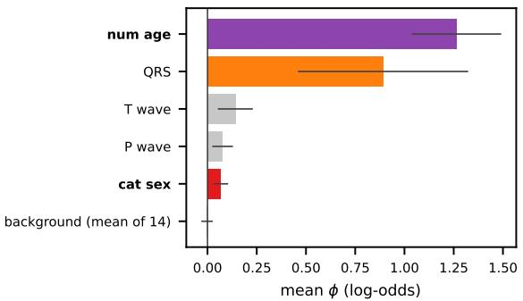

num age wins on 62% of instances  
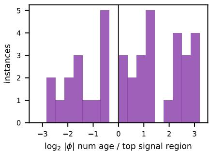  
Figure 6: Age against the signal, LUDB LVH $( n { = } 4 0 )$ . Top: mean Owen value per player with the static variables in the game (bold = static, orange = the expected QRS region, unnamed background spans pooled); age carries more mass than any ECG region, sex carries little. Bottom: per instance, $\log _ { 2 }$ of age’s |ϕ| over the largest |ϕ| among all temporal regions. Mass to the right of 0 is an instance where the covariate outweighs the whole signal—62% of them. The ratio is plotted rather than the raw pair because a single instance reaches $| \phi | { = } 1 4$ on its top region and would otherwise compress the rest into a corner.

Both heads keep the eficiency projection, so $\textstyle \sum _ { r } \phi _ { r } =$ $f ( x ) - v ( \emptyset )$ holds exactly at inference and completeness is preserved by construction (measured $| \rho | < 1 0 ^ { - \hat { 1 } 4 }$ for both, all four families). Because both are smooth functions of the input, their attribution is stable under input time-shift, where the exact estimator’s fixed region-grid is most sensitive.

Table 13: GRAIL-fast runtime Method exactly complete and carry baseline-level efective-player counts; GRAIL- fast gives back ${ \sim } 5 \times ~ \mathrm { o f }$ GRAIL-fast’s speed-up for the model-evidence channel. Runtimes are medians: each run’s first explained instance carries a one-of ∼1.6 s warm-up that inflates a mean over 20–100 instances (mean-based speedups are 33–257×).
<table><tr><td></td><td colspan="3">runtime (s) ↓</td><td colspan="2">eff. players</td></tr><tr><td>Family</td><td>GRAIL</td><td>Amort.</td><td>Amort.</td><td>GRAIL</td><td>Amort.</td></tr><tr><td>synth</td><td>4.53</td><td>0.014</td><td>0.006</td><td>27.1</td><td>6.1</td></tr><tr><td>mixed</td><td>2.72</td><td>0.009</td><td>0.003</td><td>28.9</td><td>5.6</td></tr><tr><td>ecg</td><td>12.55</td><td>0.035</td><td>0.006</td><td>45.7</td><td>9.0</td></tr><tr><td>ludb</td><td>8.61</td><td>0.012</td><td>0.003</td><td>52.9</td><td>13.9</td></tr></table>

## J.2 Runtime and robustness

The exact game’s main practical cost is runtime, and both heads pay it down (Table 13). GRAIL-fast runs in 9–35 ms against 2.7–12.5 s—a 290–710× speed-up—at a baselinelevel efective-player count (6–14 vs. GRAIL’s 27–53), while remaining exactly complete. GRAIL-fast is a further $3 { - } 5 \times$ faster $( 0 . { \overset { - } { 7 } } - 3 . 2 \ { \overset { - } { \times } } \ 1 0 ^ { 3 }$ overall), and the gap is the price of the model-evidence channel: GRAIL-fast runs an occlusion sweep over the signal before its forward pass, so it spends classifier calls that GRAIL-fast does not. Section J.3 high- lights this diference.

Robustness was measured on the GRAIL-fast head: both it and GRAIL are jitter-stable $( \ge ~ 0 . 8 7 )$ , and max- sensitivity improves under amortization on the real families (ecg 0.76→0.37, ludb 0.22→0.05) but worsens on synthetic $( 0 . 6 8 \to 1 . 0 0 , 0 . 8 5 \to 1 . 0 7 )$ . We do not carry that result over to GRAIL-fast: its occlusion channel is a function of the classifier, not of the signal alone, so its perturbation response need not match GRAIL-fast’s.

## J.3 On-manifold faithfulness tradeof

On-manifold faithfulness is where the exact game is un- beatable and where a surrogate performs worse (Table 14). GRAIL remains the best across all four families. But the dif- ference depends almost entirely on the head. GRAIL-fast beats the best baseline on all four datasets, including synth.

What remains is a real but much narrower gap to the ex- act game. On ecg it is 0.052 (0.776 vs. 0.828)—significant at $q { \stackrel { - } { = } } 8 \times 1 0 ^ { - 6 }$ but small enough that the ordering, not the level, is what a 250× cheaper explainer gives up. On ludb the gap (0.124) is not significant $\scriptstyle ( q = 0 . 1 2 , n = 2 0 )$ : at this sam- ple size, the deployed head is statistically indistinguishable from the game it was distilled from. Synth and mixed keep a clear, significant gap (0.316 and 0.228, $q < 1 0 ^ { - 5 } )$ , so the exact GP game remains the on-manifold reference and the recommendation is unchan ed in kind—onl in de ree.

Localization moves the same way and further. GRAIL- fast improves loc-AUPRC over GRAIL-fast on all four families and beats the exact game on both real ones: ecg

Table 14: The tradeof (faithfulness\_corr\_on, mean $\pm \mathrm { S E M } , n _ { \mathrm { a m o } } ) .$ . The exact game still leads, but the de- ployed head now beats the best baseline across all datasets. gap to GRAIL not significant (BH-adjusted Wilcoxon $q { = } 0 . 1 2 ) ;$ every other GRAIL-fast−GRAIL gap has $q \ <$ $\mathrm { \bar { 1 } 0 ^ { - 4 } } ,$ . Baselines are the four-method $n _ { \mathrm { a m o } }$ subset (§E); GRAIL-fast also clears the full eight-method leader on all four families.
<table><tr><td>Family</td><td>GRAIL (exact)</td><td>GRAIL-FAST</td><td>best baseline</td></tr><tr><td>synth</td><td> $0 . 8 7 2 \pm . 0 2 4$ </td><td> $0 . 5 5 6 \pm . 0 7 1$ </td><td>-0.114</td></tr><tr><td>mixed</td><td> $0 . 9 2 1 \pm . 0 1 1$ </td><td> $0 . 6 9 4 \pm . 0 4 7$ </td><td>0.595</td></tr><tr><td>ecg</td><td> $0 . 8 2 8 \pm . 0 1 6$ </td><td> $0 . 7 7 6 \pm . 0 2 1$ </td><td>0.646</td></tr><tr><td>ludb</td><td> $0 . 6 5 7 \pm . 0 7 3$ </td><td> $0 . 5 3 3 ^ { \dagger } \pm . 0 7 6$ </td><td>0.463</td></tr></table>

Table 15: Distillation target ablation $( n { = } 8 0$ per cell, 20 instances × 2 splits × 2 seeds; ± is the between-seed SEM). Training GRAIL-fast against the on-manifold value function instead of cross-sample splices does not recover on-manifold faithfulness. Paired GRAIL on the same instances is shown for scale.
<table><tr><td></td><td>distillation target</td><td> $\mathrm { f a i t h } _ { \mathrm { o n } } \uparrow$ </td><td>loc-AUPRC ↑</td></tr><tr><td>synth</td><td>cross-sample (default) on-manifold GRAIL (exact, paired)</td><td> $- 0 . 1 8 3 \pm . 0 7 1$  −0.195 ±.031 0.620</td><td> $0 . 4 1 5 \pm . 0 1 4$   $0 . 4 5 2 \pm . 0 2 6$   $0 . 6 0 6$ </td></tr><tr><td>mixed</td><td>cross-sample (default) on-manifold GRAIL (exact, paired)</td><td> $0 . 0 0 3 \pm . 0 8 4$   $0 . 0 1 4 \pm . 1 1 3$  0.784</td><td> $0 . 4 1 9 \pm . 0 0 1$   $0 . 4 2 1 \pm . 0 0 4$  0.624</td></tr></table>

0.648 vs. 0.587 $( q { = } 1 . 6 \times 1 0 ^ { - 3 } )$ and ludb 0.633 vs. 0.502 $( q { = } 0 . 0 9 )$ , the ecg figure also clearing the best baseline in the full eight-method run (0.607). It is not a uniform win: on mixed it still trails GRAIL (0.518 vs. 0.648), and its pointing score is worse on mixed (0.10 vs. 0.60) and ecg (0.55 vs. 0.64). It distributes mass over the annotated region better than the exact game, but places its single peak worse.

## J.4 Is the surrogate’s negative a training-operator mismatch?

There is an obvious suspect for the synthetic negatives, and it is worth naming before defending anything: GRAIL-fast regresses coalition values built by cross-sample splicing— absent spans filled from another signal—and is then scored under the on-manifold operator. Fitting one removal operator and grading against another is a semantic mismatch, and it would explain the sign.

We tested it directly rather than arguing about it. We added a second distillation target that evaluates coalitions through the on-manifold GP game itself—the exact value function $v ( S )$ of §3.1, the same one GRAIL is computed against— and left the FastSHAP machinery downstream untouched, so the training operator is the only thing that moves. Both heads were trained on identical corpora (200 signals, 24 coalitions each) and evaluated on identical instances and seeds (Table 15).

The mismatch is not the explanation. Matching the train- ing operator to the evaluation operator moves faithfulness by −0.012 on synth and +0.011 on mixed. Both are far in-side a single between-seed SEM, and on synth in the wrong direction. The negative survives its most obvious confound. What the on-manifold target does buy is localization on synth (0.415 → 0.452), i.e. a better-placed explanation that is no more faithful: the head learns where the informative region is without learning how the model responds when that region is regenerated on-manifold.

We therefore retract the operator-mismatch reading and state that the residual explanation is the narrower claim sup- ported by the data. A FastSHAP-style head is a single amortized map from signal to attribution; the on-manifold value function it is asked to imitate is a function of the region gen- erator as well as the classifier, and on low-signal synthetic data the classifier’s response to a regenerated region is close to noise. There is little stable structure for a single forward pass to capture, regardless of which operator produced the targets. On real data—where regenerating a QRS actually changes the decision in a repeatable way—the same archi- tecture and the same training budget succeed (ecg 0.556, ludb 0.381). This is a sharper statement than the one it replaces, and it was cheap to obtain: one extra target operator, four benchmark runs.

## K Extended Discussion

GRAIL is the method to reach for when the question is which regions the model’s decision is most sensitive to, on-distribution and with a complete accounting: it is the most faithful on-manifold method on every family and ex- actly complete. GRAIL-fast is the method to deploy: on real, structured data it recovers this at a small fraction of the cost, at a faithfulness price that is modest on real data and disqualifying on low-signal synthetic data.

Three lessons that generalize. First, the costs of an exact on-manifold game are the solver’s, not the game’s: amor- tizing against the same value function pays down runtime without chan in what is bein ex lained (Section 4.6). Sec-ond, faithfulness is operator-relative; reporting both on- and of-manifold operators for every method is the only way to avoid teaching-to-the-test, and it is precisely what exposes the surrogate’s on-manifold limit (Section 4.2). Third, localization against a fixed anatomical prior is only as meaningful as that prior is to the model: the LUDB LVH case shows a faithful explanation can correctly point away from the anno- tated region when the model relies on static or un-annotated evidence, measurably so, since admitting age as a player takes top rank from the annotated QRS on a quarter of instances while leaving faithfulness unchanged (Section 4.3).

Limits that are structural. Three of our limits are struc- tural, and each was reached by testing a claim we had already made in print. The generator’s mean is good enough to drive the most faithful attributions here while its error bars are not calibrated, so faithfulness metrics cannot certify a gen- erative model (Section 4.5). Matching an amortized head’s training operator to its evaluation operator does not rescue it on low-signal data, so the surrogate’s deficit is not a seman- tic mismatch. And a conditional reference, however strongly its features co-vary, cannot alter a region-level attribution at all, because Owen block values only ever see whole-block coalitions (Section 4.4). Testing claims we had already com-mitted to in print is the habit we would most like to see carried forward.