# Agentic Music Post-Production

Jaywon Koo<sup>1</sup>\*, Junghyun Koo<sup>2</sup>, Marco A. Martínez-Ramírez<sup>2</sup>, Wei-Hsiang Liao<sup>3</sup>, Seungheon Doh<sup>3</sup>, Qiyu Wu<sup>3</sup>, Vicente Ordonez<sup>1</sup>, Yuki Mitsufuji<sup>2,3</sup>,

<sup>1</sup>Rice University, <sup>2</sup>Sony Corporate Technology Center America, Inc., <sup>3</sup>Sony Group Corporation Correspondence: jk125@rice.edu

## Abstract

We introduce MixAgent, an agentic pipeline for music post-production that follows the workflow of audio engineers to build interpretable and editable mixing plans guided by a reference song. A grouping agent first routes related input tracks, such as drum recordings, into subgroups. A planning agent then uses retrieved examples to choose and order audio effects, such as volume control and reverb, for tracks, subgroups, and the full mix. To refine the mix, a detector identifies what needs correction, and a critic proposes numerical parameter adjustments from tracks to the full mix. In our experiments, prompting recent multimodal models to listen and revise often worsens the mix, making reliable correction a central challenge. We therefore build MixCritic, a dataset of 45,657 repair critiques derived from parameters fitted to professional mixes, and train the critic with supervised fine-tuning followed by preference optimization on rendered audio outcomes. On MedleyDB, learned refinement reduces error by 19% relative to the initial mix, with preference optimization reducing it by 8.4% over supervised training alone. Retrieved examples further improve effects selection, and a human listening test shows that MixAgent gets higher quality ratings than mixes produced by Qwen3- Omni, Gemini 3.8 Flash and GPT-4o-audio.

## 1 Introduction

Language-model agents use tools to write code (Yang et al., 2024) and edit images (Ye et al., 2026). In creative software, a key challenge is turning a high-level goal into precise settings. Noticing that “the vocal is too quiet” does not specify which control to move or by how much. Music mixing combines separately recorded instruments and vocals (input tracks) into a song by applying audio effects that control volume, frequency balance, and acoustic space. Related tracks can also be processed together as subgroups, such as all drum recordings, before processing the full mix. Settings interact, as louder drums can hide the vocal. Because the desired sound can be difficult to describe in words, we study reference-guided mixing, where a reference song provides an example.

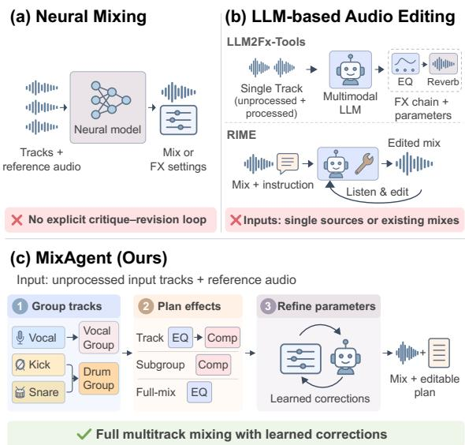  
Figure 1: Comparison of music post-production workflows. (a) Neural mixing systems predict final mixes or audio effects settings without explicit critique–revision loops. (b) Prior LLM-based approaches focus on audio effects chain prediction and iterative mix refinement. (c) MixAgent introduces an agentic framework that integrates hierarchical planning, execution, and iterative refinement into a unified music post-production pipeline.

Existing systems address parts of this problem (Figure 1). Neural and generative models produce competitive audio without exposing audio effects settings (Koo et al., 2023; Moliner et al., 2026), while Diff-MST predicts editable parameters for fixed sequences of audio effects (Vanka et al., 2024). Prior LLM-based systems address narrower tasks. LLM2Fx-Tools predicts audio effects chains for individual tracks (Doh et al., 2026), and RIME edits an existing mix to follow instructions (Schaffer and Singh, 2026). Building a mix from tracks requires choosing and ordering effects at the track, subgroup, and full-mix levels, setting their parameters, and identifying corrections without editing instructions. Simply prompting an audio-language model to listen and revise does not consistently improve the mix.

MixAgent builds an editable mixing plan and refines its parameters. A grouping agent organizes related tracks into subgroups. Guided by retrieved examples, a frozen planner chooses and orders audio effects at all three levels, then initializes their parameters. A learned detector selects what needs correction, and a critic proposes how tofix it. Refinement makes one pass at each level, from tracks to subgroups to the full mix, so later stages hear earlier corrections. Because no known corpus pairs mixing critiques with parameter repairs, we build MixCritic, containing 45,657 critiques. We train the critic with supervised fine-tuning (SFT), then direct preference optimization (DPO), favoring corrections toward the audio produced by the fitted parameters. Every effect, parameter, and correction remains explicit and editable.

The design also raises a broader question. What makes feedback useful for agents acting through numerical tools? Our analyses show that retrieved examples improve audio effects selection, while learned refinement improves their parameters. This refinement benefits from more specific feedback, with numerical corrections giving lower reconstruction error than perceptual or tool-specific advice. With numerical feedback, DPO reduces this error by a further 8.4% over SFT. Beyond feedback, selecting correction targets and refining tracks before subgroups and the full mix further reduces error.

Training and objective evaluation use nonoverlapping excerpts of the same song as inputs and references, allowing comparison against its professional mix. On held-out MedleyDB songs, MixAgent achieves lowest reconstruction error and higher predicted quality than all tested multimodal LLM baselines. An 11-participant listening test with references from other songs within the same genre also gives MixAgent higher quality ratings. Our contributions are:

• To our knowledge, MixAgent is the first LLM mixing agent to combine editable audio effects planning across tracks, subgroups, and the full mix with learned detection and correction of parameter errors.<sup>1</sup>

• We construct MixCritic, providing repair critiques in three feedback forms and preference pairs ranked by the resulting audio.

• We show complementary reconstruction gains from retrieval and learned numerical refinement, with further improvements from selecting correction targets and refining tracks before subgroups and the full mix.

## 2 Preliminaries

Music Post-production. The input consists of individual audio recordings, called input tracks, such as a lead vocal, a bass guitar, or a single drum microphone. Mixing proceeds at three levels: individual tracks, subgroups of related tracks summed and processed together (e.g., all drum tracks), and thefull mix formed by summing all subgroup outputs. Subgroup and full-mix processing correspond to subgroup buses and the master bus, respectively. The output after all processing is thefinal mix. Mixing engineers shape the audio at each level with audio effects, signal-processing tools controlled by numerical parameters. Typical audio effects include gain (volume), panning (left–right position), equalization (EQ, the balance of low and high frequencies), compression (reducing loudness fluctuations), and reverb (a sense of acoustic space). An ordered list of audio effects, such as EQ followed by compression, is an audio effects chain.

Task. We study reference-guided mixing. The input is a set of unprocessed input tracks X with instrument labels, a library of available audio effects $\tau$ (Appendix A.2), and a style reference r, which is a finished mix with the desired mixing style from a different song. LLM2Fx-Tools (Doh et al., 2026) predicts audio effects chains for individual tracks. We extend this task to multitrack mixing, producing a mixing plan G and parameters θ. The plan assigns the tracks $x _ { i } \in X$ to subgroups, where $S _ { b }$ is the set of tracks in subgroup b (possibly a single track), and assigns an audio effect chain to each track, each subgroup, and the full mix, written $f _ { i } ,$ $f _ { b } ,$ and $f _ { m }$ with parameters $\theta _ { i } , \theta _ { b }$ , and $\theta _ { m }$ . Executing the plan, which we call rendering, produces the output mix $\widehat { y }$ in three stages:

$$
\begin{array} { r l } & { y _ { i } = f _ { i } ( x _ { i } ; \theta _ { i } ) \quad \quad \quad \quad \quad \quad \quad \quad \quad \quad \quad \quad \quad \quad \quad \quad } \\ & { y _ { b } = f _ { b } \big ( \sum _ { i \in S _ { b } } y _ { i } ; \theta _ { b } \big ) \quad \mathrm { ( s u b g r o u p ) } } \\ & { \quad \widehat { y } = f _ { m } \big ( \sum _ { b } y _ { b } ; \theta _ { m } \big ) \quad \quad \quad \mathrm { ( f u l l ~ m i x ) } } \end{array}\tag{1}
$$

We denote the audio after each stage by $R _ { 1 } ( \theta ) =$ $\begin{array} { r } { \sum _ { i \in S _ { b } } y _ { i } , R _ { 2 } ( \theta ) = \sum _ { b } y _ { b } , } \end{array}$ , and $R _ { 3 } ( \theta ) = \hat { y }$

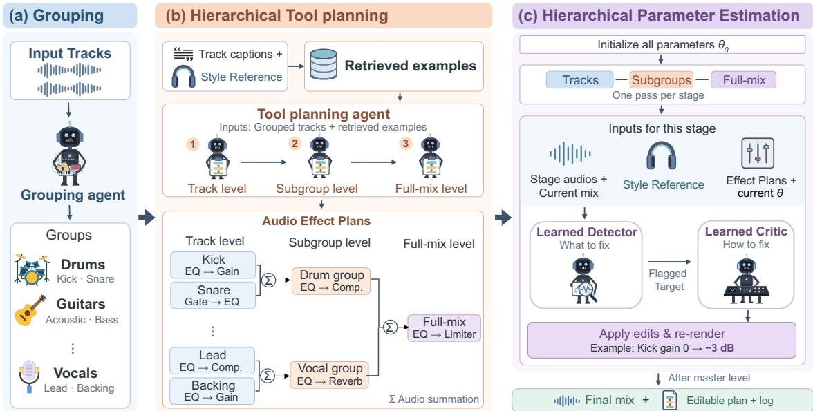  
Figure 2: Overview of MixAgent. (a) The grouping agent assigns tracks to subgroups. (b) Using retrieved examples, the planner selects audio effects chains sequentially at the track, subgroup, and full-mix levels. (c) After parameter initialization, the detector flags elements for improvement, and the critic provides perceptual, tool-specific, or numerical feedback. Refinement proceeds from tracks to subgroups to the full mix.

The agent must infer audio effects chains and settings to match the reference’s mixing style rather than copy audio, since instrumentation, arrangement, or genre may differ. It must also account for interactions across tracks, subgroups, and the full mix. Our datasets lack ground-truth mixes with references from other songs. We therefore use two non-overlapping excerpts of the same song for training and main evaluation (§4.1). The listening test uses references from other songs within the same genre (§4.3). MixAgent keeps every audio effect and setting explicit, so users can inspect the plan, change values, and render the mix again. Audio is produced only by applying these audio effects to the input tracks, avoiding hallucinated musical content and artifacts from direct neural audio generation.

## 3 MixAgent

MixAgent runs automatically and splits mixing into three decisions (Figure 2). It decides which audio effects to use (§3.1), what tofix in the current mix, and how tofix it (§3.2). We describe how the components that make the last two decisions are trained (§3.3).

## 3.1 Planning Audio effects Chains with Retrieved Examples

A grouping agent first listens to the input tracks, reads their instrument labels, and assigns each track to a subgroup (e.g., kick, snare, and cymbals form a drum subgroup). A frozen audiolanguage tool-planning agent then selects audio effects chains. Without examples, the planner tends to select short chains (§ 5.2). To guide its choices, we use GRAFX (Lee et al., 2024), a differentiable audio-processing library, to estimate example plans. GRAFX fits audio effect parameters to approximate each database song’s professional mix, then removes effects that barely change the rendered audio (Lee et al., 2025b). Each database entry stores these pseudo-ground-truth (pseudo-GT) plans and a caption of the rendered mix. For a new song, text retrieval matches automatically generated inputtrack captions to database captions to find similar instrumentation. Audio retrieval matches the reference to rendered database mixes for similar mixing styles. We provide three text-retrieved and one audio-retrieved plan, excluding all excerpts of the input song. These examples show effect choices and order, but not parameter values. The planner selects track, subgroup, and full-mix chains in order, with each level guided by earlier choices. The chains remain fixed. Appendix B.1 and F provide details and prompts.

## 3.2 Hierarchical Estimation

The planner first sets the initial parameters of selected effect chains based on the reference audio. MixAgent then revises them bottom-up, following common engineering practice (Fox, 2024), first the tracks, then the subgroups, and finally the full mix (Figure 2). We call each track, subgroup, or the full mix an element e, and two trained components carry out each revision.

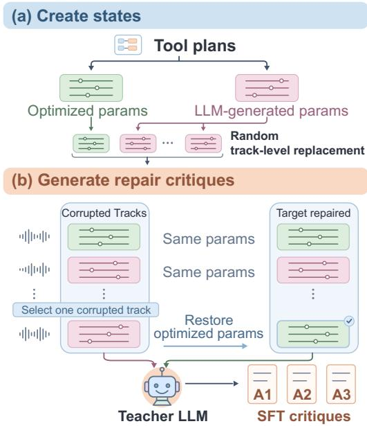  
Figure 3: Data generation for MixCritic. (a) From a fixed tool plan, we obtain parameters through gradientbased optimization against the professional mix with GRAFX (green) and LLM generation (pink). Replacing the optimized parameters of randomly selected tracks with LLM outputs creates corrupted mixing states. (b) The teacher LLM compares the selected track’s corrupted and optimized parameters to generate A1–A3 critiques. The critic agent is trained to repair one corrupted track’s parameters at a time.

Detector (what to fix). At the track and subgroup stages, the trained detector hears the processed tracks within a subgroup or the subgroup outputs, together with the reference r, and reads the current plan and parameters. For each $e ,$ it predicts the probability $p _ { e }$ that an element needs correction and identifies audio effects that may need changes. The critic inspects elements with $p _ { e } > \tau$ , starting with the highest probability. The full mix is always inspected. Appendix B.3 describes its architecture and training.

Critic (how to fix it). For each selected $e ,$ the audio-language critic $\pi _ { \phi }$ hears the audio of e with its current audio effects, the current mix, and the reference. Its input $o _ { e }$ also includes the detector’s output and the audio effects chain and parameters of e. The critic proposes a correction $a _ { e } ,$ and Exec applies it to the parameters of e:

$$
a _ { e } \sim \pi _ { \phi } ( \cdot \mid o _ { e } ) , ~ \theta  \mathrm { E x e c } ( a _ { e } , \theta ) ,\tag{2}
$$

Form Critic output (abridged)   
A1 The vocal sounds heavily squashed and lifeless. . . It   
needs to breathe naturally with smooth dynamics, a   
cleaner noise floor, and a touch of high-frequency   
air.   
A2 {"tools": [{"tool": "noisegate", "comment": Raise   
the threshold significantly so it only engages on   
actual noise, and reduce the wet mix to make the   
processing transparent and eliminate pumping   
artifacts. } ]}   
A3 {"tool": "noisegate", "parameters":   
{"log\_threshold": 1.28, "log\_ratio":   
1.04, "log\_knee": 2.45, "z\_alpha\_pre":   
4.35}, "drywet": 0.599} . . .  
Table 1: Critic output examples. A1 provides high-level semantic feedback, A2 names tools and revision directions, and A3 provides explicit numerical parameter values.

where Exec changes only the parameters of e. We compare three forms of feedback that describe the same repair (Table 1). For perceptual advice (A1) and tool-specific advice (A2), it asks the planner to turn the advice into numbers. For numerical corrections (A3), it applies the proposed values directly. MixAgent uses A3.

Each refinement pass calls the critic once per selected $e ,$ using audio from the pass’s start. Then, applies corrections, re-renders the stage again, so the next stage hears the updated audio. We use one pass per stage, record every parameter change, and study additional passes (Appendix B.2 and D.6).

## 3.3 Learning from Repairs with MixCritic

We build MixCritic, a dataset of corrupted mixing states, target repairs, and critiques (Figure 3).

Corrupted states. For each of the 165 MedleyDB training examples, we fit the parameters of the agent’s selected audio effects chains to the professional mix using GRAFX. This gives pseudo-GT parameters $\theta ^ { * }$ and rendered audio $y _ { k } ^ { * }$ at each stage k. Qwen3-30B Thinking also predicts parameters for the same chains. We create a corrupted state $\tilde { \theta }$ by replacing the fitted parameters of randomly selected tracks with these predictions, then render the audio. The input tracks, audio effects chains, and pseudo-GT targets remain fixed.

Repair score. We score a correction a by how much it reduces the difference between the rendered audio and the pseudo-GT audio.

$$
\begin{array} { r l } & { s ( a ) = \mathrm { M R S } \big ( \mathcal { R } _ { k } ( \tilde { \theta } ) , y _ { k } ^ { * } \big ) } \\ & { \qquad - \mathrm { M R S } \big ( \mathcal { R } _ { k } ( \mathrm { E x e c } ( a , \tilde { \theta } ) ) , y _ { k } ^ { * } \big ) , } \end{array}\tag{3}
$$

<table><tr><td rowspan="2"></td><td colspan="4">MedleyDB</td><td colspan="5">AlbumDB</td></tr><tr><td>Reconst.</td><td colspan="2">Quality</td><td colspan="2">Similarity</td><td>Reconst.</td><td colspan="2">Quality</td><td colspan="2">Similarity</td></tr><tr><td>Method</td><td>MSS↓</td><td></td><td>TuneJury ↑ AAPQ ↑</td><td>FxEnc++↑ AF↓</td><td></td><td>MSS↓</td><td></td><td></td><td>TuneJury↑ AAPQ↑ FxEnc++↑ AF↓</td><td></td></tr><tr><td>Random 7.04</td><td></td><td>-2.18</td><td>5.96</td><td>0.51</td><td>8.7e4</td><td>7.90</td><td>-2.26</td><td>5.84</td><td>0.46</td><td>401.6</td></tr><tr><td<tr><td></td><td></td><td></td><td></td><td></td><td>Qwen3-Omni</td><td></td><td></td><td></td><td></td></tr><tr><td></td><td>Single-pass</td><td>3.73</td><td>-0.55</td><td>6.38</td><td>0.65</td><td>0.36</td><td>4.34</td><td>0.44</td><td>6.44</td><td>0.78</td></tr><tr><td>0.14</td><td>Self-Refine Self-Critic</td><td>4.57 4.79</td><td>-1.22 -0.77</td><td>5.78 5.85</td><td>0.63 0.63</td><td>2.86 8.97</td><td>4.50 4.55</td><td>0.17</td><td>6.09</td><td>0.76</td></tr><tr><td>0.21</td><td></td><td></td><td></td><td></td><td></td><td></td><td></td><td>0.23</td><td>6.06</td><td>0.77</td></tr><tr><td colspan="2">0.10</td><td></td><td></td><td></td><td>Gemini 3.8 Flash 0.68</td><td>0.20</td><td></td><td></td><td></td><td></td></tr><tr><td></td><td>Single-pass Self-Refine</td><td>3.77 3.69</td><td>-0.43 -0.43</td><td>6.52 6.30</td><td>0.75</td><td>0.16</td><td>4.62 4.89</td><td>0.70 0.54</td><td>6.70 6.21</td><td>0.79</td></tr><tr><td>0.08</td><td>Self-Critic</td><td>3.73</td><td>-0.50</td><td>5.67</td><td>0.71</td><td>0.18</td><td>4.90</td><td>0.41</td><td>5.62</td><td>0.78 0.77</td></tr><tr><td>0.07 0.09</td><td></td><td></td><td></td><td></td><td>GPT-4o-audio</td><td></td><td></td><td></td><td></td><td></td></tr><tr><td colspan="2"></td><td></td><td></td><td></td><td>0.66</td><td></td><td></td><td></td><td></td><td></td></tr><tr><td></td><td>Single-pass</td><td>3.67</td><td>-0.47</td><td>6.47</td><td>0.64</td><td>0.29</td><td>3.84 3.77</td><td>0.26</td><td>6.31</td><td>0.81</td></tr><tr><td>0.06</td><td>Self-Refine</td><td>3.95 4.53</td><td>-0.79 -1.55</td><td>6.20 5.55</td><td>0.63</td><td>0.30 0.28</td><td>4.91</td><td>0.36 -0.40</td><td>6.04 6.25</td><td>0.80 0.77</td></tr><tr><td>0.08 0.10</td><td>Self-Critic</td><td></td><td></td><td></td><td></td><td></td><td></td><td></td><td></td><td></td></tr><tr><td></td><td>MixAgent</td><td>2.83</td><td>0.21</td><td>7.03</td><td>0.73</td><td>0.20</td><td>3.81</td><td>0.70</td><td>7.41</td><td>0.79</td></tr></table>

Table 2: Results on MedleyDB and AlbumDB. Bold and underline mark the best and second-best reported scores across all methods for each metric and dataset. denotes off-the-shelf LLM baselines without task-specific training; marks MixAgent with a trained detector and critic. Single-pass uses no audio-feedback revision.

where MRS measures audio distance (Steinmetz and Reiss, 2020). Positive scores mean improvement toward the stage-k pseudo-GT audio $y _ { k } ^ { * }$

Supervised critiques. For each corrupted state, we select one corrupted track and define a target correction $a ^ { * }$ that restores its pseudo-GT parameters. The other tracks keep their current settings. A larger teacher LLM (Qwen3.6-35B) receives the corrupted state and the target track’s LLM-generated and fitted parameters, and writes critiques in forms A1–A3, each with a step-by-step rationale. We keep a critique if its target repair satisfies $s ( a ^ { * } ) > \delta _ { 0 }$ , leaving 45,657 examples. The detector is trained on the same states, plus states with random parameters, to predict which tracks, subgroups, and audio effects were corrupted (classweighted binary cross-entropy). Pseudo-GT parameters are used only to build MixCritic and never at inference.

Supervised fine-tuning (SFT). The critic uses a Qwen3.5-4B language model (Qwen Team, 2026) and a frozen RLAT encoder trained to represent audio effects (Lee et al., 2026). A trainable audio adapter connects them. Following LLM2Fx-Tools (Doh et al., 2026), we first train the adapter alone and then train it jointly with low-rank adaptation (LoRA) weights. The loss is $\mathcal { L } _ { \mathrm { S F T } } = \mathcal { L } _ { \mathrm { C E } }$ + $0 . 3 \mathcal { L } _ { \mathrm { N T L } }$ which adds to token cross-entropy a number-token loss that penalizes numerically distant predictions (Zausinger et al., 2025).

Preference training on audio outcomes (DPO). SFT learns one target correction, but other corrections may also improve the mix. For each e selected by the detector in a training state, the SFT critic samples eight candidate critiques. We apply each candidate to the same starting parameters, render the result, and normalize its repair score as $\hat { s } ( a ) = s ( a ) / s ( a ^ { * } )$ . The highest-scoring candidate is paired with each of the two lowest-scoring candidates when their normalized score gap is at least δ. About 30% of pairs come from detector false alarms, where e was not corrupted and no target repair exists. For these, we normalize by the initial audio error MRS $( \mathcal { R } _ { k } ( \tilde { \theta } ) , y _ { k } ^ { * } )$ instead. Starting from the SFT critic, direct preference optimization (DPO) (Rafailov et al., 2023) favors higher-scoring corrections using the frozen SFT critic as reference. Only the audio adapter and LoRA weights are updated (learning rate of $5 \times 1 0 ^ { - 6 } , \beta = 0 . 1$ , and 24 pairs per batch). Appendix B.4 gives the critic architecture and training settings, and Appendix C gives MixCritic statistics.

## 4 Experiments

## 4.1 Setup

Data. We build the task from MedleyDB (Bittner et al., 2014), using its unprocessed recordings as unprocessed input tracks and its professional mixes as targets. Our datasets lack ground-truth mixes made to match references from other songs. We therefore sample two non-overlapping 15-second windows from each song section: one provides the unprocessed input tracks and the ground-truth mix (GT), for supervision and evaluation, and the other provides the style reference. This preserves a similar mixing style without providing the target audio as the reference. At evaluation, GT is used only for scoring. This gives 185 clips from 123 songs (Appendix A.1). We hold out 20 clips for evaluation, with artists disjoint from training. For cross-corpus transfer, we build AlbumDB clips (McKenzie et al., 2026) identically.

Baselines. We evaluate Qwen3-Omni (Xu et al., 2025), Gemini 3.8 Flash (Google, 2026), and GPT-4o-audio (OpenAI, 2024) under three settings (Table 2). Single-pass generates a mixing plan and its parameters without revision. Self-Refine listens to its current mix and revises it directly. Self-Critic first writes a critique of the mix, then revises it using that critique. Both adapt Madaan et al. (2023) and iterate three rounds. All settings use the same unprocessed input tracks, style reference, and list of available audio effects as MixAgent. A random baseline samples audio effects and parameters.

Metrics. We evaluate reconstruction, audio quality, and mixing-style similarity. Multi-Scale Spectral (MSS) (Engel et al., 2020) compares the frequency content of the output and GT over time at several resolutions, using the sum and difference of the left and right channels. Multi-Resolution STFT (MRS) (Yamamoto et al., 2020), used in training and analyses, makes this comparison for each channel. TuneJury (Kim et al., 2026) predicts listener preference, and Audiobox (Tjandra et al., 2025) predicts production quality (AAPQ). Neither uses GT or the style reference. For similarity to GT, FxEnc++ (Yeh et al., 2025) compares learned audio effects representations, while Audio Feature loss (AF) (Vanka et al., 2024) compares hand-crafted features of volume, loudness fluctuations, frequency balance, and left–right spread. We omit RLAT similarity because we train on its representations.

## 4.2 Main Results

On MedleyDB, MixAgent achieves the lowest MSS (2.83 vs. 3.67 for single-pass GPT-4o-audio) and the highest TuneJury and Audiobox PQ scores (Table 2). Gemini 3.8 Flash with Self-Refine scores best on FxEnc++ and AF. Results on AlbumDB are mixed. MixAgent has the highest Audiobox PQ and ties single-pass Gemini on TuneJury, while its MSS is second best (3.81 vs. 3.77 for GPT-4oaudio with Self-Refine). Single-pass GPT-4o-audio scores best on FxEnc++ and AF.

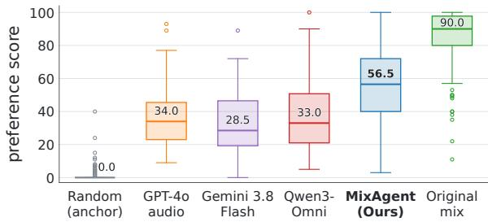  
Figure 4: Human evaluation of mixing quality.

Prompted revision does not consistently improve on single-pass mixing. Self-Critic yields higher MSS than Self-Refine for every model on both datasets. In MixAgent, learned refinement lowers MSS from 3.70 to 2.83 with fixed audio effects chains (§5). Appendix D.1 compares MixAgent with dedicated mixing models (Diff-MST, MST, and StemFX). MixAgent has the lowest MedleyDB MSS, although MST and StemFX use tracks extracted from the professional mix.

## 4.3 Human Listening Test

Human Listening Test. We conducted a multistimulus listening test to evaluate perceptual music production quality in a practical reference-based mixing scenario. Input tracks were paired with a reference mix from a different song within the same genre. Eleven participants completed 10 trials each, evaluating the production quality of mixes by MixAgent, three LLM baselines, a randomly processed anchor, and the original human mix on a 0–100 scale. Figure 4 shows that three LLM baselines exhibit largely overlapping score distributions, with no statistically significant differences among them. In contrast, MixAgent achieves significantly higher scores than all three baselines (p < 0.001, Holm-corrected paired t-tests), while a substantial perceptual gap remains relative to the original human mixes.

## 5 What Makes Feedback Useful?

We examine what makes learned refinement effective. Protocols are in Appendix E.

<table><tr><td></td><td colspan="3">Final output</td><td colspan="3">Applied revisions</td></tr><tr><td>Configuration</td><td>MRS↓</td><td>TuneJury ↑</td><td>FxEnc++↑</td><td>Improved (%) ↑</td><td>Mean ∆MRS ↑</td><td>Count</td></tr><tr><td>No refinement (planner only)</td><td>2.17</td><td>-0.72</td><td>0.71</td><td></td><td></td><td></td></tr><tr><td colspan="7">Oracle feedback and parameter fitting (GT access)</td></tr><tr><td>Oracle A1</td><td>1.87</td><td>-0.41</td><td>0.78</td><td>53.6</td><td>+0.0331</td><td>250</td></tr><tr><td>Oracle A2</td><td>1.78</td><td>-0.44</td><td>0.80</td><td>60.9</td><td>+0.0374</td><td>243</td></tr><tr><td>Oracle A3</td><td>0.90</td><td>0.51</td><td>0.93</td><td></td><td></td><td></td></tr><tr><td colspan="7">A1: Perceptual advice (converted to settings by the planner)</td></tr><tr><td>Qwen3-Omni</td><td>2.26</td><td>-0.83</td><td>0.68</td><td>41.9</td><td>-0.0212</td><td>117</td></tr><tr><td>SFT</td><td>2.08</td><td>-0.47</td><td>0.71</td><td>50.6</td><td>+0.0050</td><td>245</td></tr><tr><td>SFT+DPO</td><td>2.09</td><td>-0.56</td><td>0.69</td><td>56.3</td><td>+0.0026</td><td>245</td></tr><tr><td colspan="7">A2: Tool-specific advice (converted to settings by the planner)</td></tr><tr><td>Qwen3-Omni</td><td>2.44</td><td>-0.77</td><td>0.66</td><td>48.7</td><td>-0.0079</td><td>113</td></tr><tr><td>SFT</td><td>2.24</td><td>-0.37</td><td>0.74</td><td>54.0</td><td>+0.0045</td><td>252</td></tr><tr><td>SFT+DPO</td><td>1.98</td><td>-0.57</td><td>0.71</td><td>60.0</td><td>+0.0220</td><td>215</td></tr><tr><td colspan="7">A3: Numerical corrections (applied directly)</td></tr><tr><td>Qwen3-Omni</td><td>2.18</td><td>-0.75</td><td>0.69</td><td>52.2</td><td>-0.0076</td><td>113</td></tr><tr><td>SFT</td><td>1.91</td><td>-0.30</td><td>0.70</td><td>64.7</td><td>+0.0221</td><td>238</td></tr><tr><td>SFT+DPO (MixAgent)</td><td>1.75</td><td>0.21</td><td>0.73</td><td>66.8</td><td>+0.0398</td><td>241</td></tr></table>

Table 3: Critic training and feedback form on MedleyDB. Improved is the percentage of revisions that lower full-mix MRS, Mean ∆MRS is the average reduction per revision, and Count is the number of corrections applied across all clips. denotes prompted Qwen3-Omni critic without fine-tuning and marks trained detector and critic (trained critics use Qwen3.5-4B). Gray oracle entries use GT.

## 5.1 Critic Training and Feedback Form

Table 3 compares critic training and feedback forms with fixed audio effect chains and detector. Untrained critics make harmful corrections. Because our critic has a trained audio adapter, we use prompted Qwen3-Omni as the untrained critic. Its corrections increase error on average across all three forms, with only 42–52% improving the mix. Final MRS is 2.18 to 2.44, versus 2.17 for the planner alone and 1.75 for trained A3 refinement. The base model’s judgments are unreliable for correction. Appendix D.5 provides stage-wise errors.

Preference training improves numerical feedback (A3) under the same detector, planner, and execution. MRS falls from 1.91 to 1.75 (8.4%), mean improvement per correction nearly doubles (+0.022 to +0.040), and success rises from 64.7% to 66.8%. It also improves A2 (2.24 to 1.98), but not A1 (2.08 to 2.09), suggesting preference training benefits most from specific feedback.

After SFT+DPO, error falls with more specific feedback, from 2.09 MRS for perceptual advice to 1.98 for tool-specific advice and 1.75 for numerical corrections. Without GT access, trained A3 also outperforms oracle A1/A2 advice (1.87/1.78) on MRS and TuneJury, suggesting that converting verbal advice into settings remains difficult. GTfitting the same plans reaches 0.90 MRS, leaving substantial room for better parameter estimation.

## 5.2 Choosing Audio effects with Retrieved Examples

To isolate audio effects selection, Table 4 fits each plan’s parameters to GT on 100 MedleyDB clips and measure what the chosen audio effects can achieve. Retrieved examples improve the plans. The fitted MRS drops from 2.13 without examples to 1.08 with three text-retrieved and one audioretrieved example, while random examples reach only 1.71. Text retrieval provides most of the gain. Retrieval also leads the planner to select more tools per track (3.8 vs. 1.6), which accounts for part of this gain. Appendix D.2 reports audio effects chain F1, while Appendix D.3 shows MixAgent plans with more engineer-like track grouping and effect ordering than GRAFX.

## 5.3 Component Ablations

Retrieval and learned refinement are complementary. We run the hierarchical planner with and without retrieved examples, each with and without learned refinement (Table 5). Retrieval lowers MRS by 0.64, both without refinement (2.81 to 2.17) and with it (2.39 to 1.75), and refinement lowers MRS by 0.42 in either case. MSS likewise improves by 0.82 from retrieval and 0.87 from refinement. Retrieval improves the choice of audio effects, and refinement improves their parameters, with additive gains. We compare MixAgent’s bottom-up order with a top-down order (full mix, then subgroups, then tracks) and with a variant where corrections are computed from the initial audio and applied at once. Bottom-up refinement gives the lowest MRS (1.75, vs. 1.82 and 1.88) and MSS (Table 5), suggesting that later corrections benefit from hearing earlier ones. With the critic fixed, detector selection yields lower MRS (1.75) than inspecting all tracks and subgroups (1.87) or an equally sized random subset (1.81), and the lowest MSS. Selecting appropriate targets matters more than inspecting additional elements. Appendix D.4 reports detector accuracy.

<table><tr><td>Examples</td><td>MRS↓</td><td>FxEnc++↑</td><td>Tools/track</td></tr><tr><td>No examples</td><td>2.13</td><td>0.70</td><td>1.55</td></tr><tr><td>Random (3)</td><td>1.71</td><td>0.75</td><td>1.74</td></tr><tr><td>Text (3)</td><td>1.10</td><td>0.94</td><td>3.75</td></tr><tr><td>Text (3) + audio (1)</td><td>1.08</td><td>0.94</td><td>3.77</td></tr><tr><td>GRAFX</td><td>0.89</td><td>0.98</td><td>4.38</td></tr></table>

Table 4: Audio effects chain planning on 100 randomly selected MedleyDB clips. Parentheses denote number of retrieved in-context examples.

## 5.4 An Inspectable Output

Each step of MixAgent acts on named audio effects and parameters, so its output records how the mix was made. On the evaluation set, the critic applies 241 corrections (about 12 per clip), each a change to a named parameter, and two thirds of them reduce the error of the full mix. Users can trace, revert, or adjust edits unavailable in audioonly outputs.

## 6 Related Work

Agents with tools and learned feedback. LLM agents call tools (Yao et al., 2023; Schick et al., 2023) and refine their outputs with self-generated feedback (Madaan et al., 2023; Shinn et al., 2023), but self-correction without an external signal often fails (Huang et al., 2024), which motivates trained correctors (Welleck et al., 2023). In music production, LLM2Fx predicts audio effects parameters from text (Doh et al., 2025), LLM2Fx-Tools recovers the audio effect chain of a single track through tool calls (Doh et al., 2026), and MixAssist gives mixing advice in conversation (Clemens and

<table><tr><td>Configuration</td><td>MRS↓</td><td>MSS↓</td><td>TuneJury↑</td><td>FxEnc++↑</td></tr><tr><td>MixAgent (full)</td><td>1.75</td><td>2.83</td><td>0.21</td><td>0.73</td></tr><tr><td colspan="5">Retrieval and learned refinement</td></tr><tr><td>w/o learned refinement</td><td>2.17 +0.42</td><td>3.70+0.87</td><td>-0.72-0.93</td><td>0.71-0.02</td></tr><tr><td>w/o retrieval</td><td>2.39 +0.64</td><td>3.65 +0.82</td><td>0.28+0.07</td><td>0.70-0.03</td></tr><tr><td>w/o both</td><td>2.81 +1.06</td><td>4.52+1.69</td><td>-0.82-1.03</td><td>0.65-0.08</td></tr><tr><td colspan="5">Refinement order</td></tr><tr><td>top-down (full mix first)</td><td>1.82 +0.07</td><td>3.07+0.24</td><td>0.07-0.14</td><td>0.69-0.04</td></tr><tr><td>all corrections at once</td><td>1.88+0.13</td><td>3.05 +0.22</td><td>-0.07-0.28</td><td>0.70-0.03</td></tr><tr><td colspan="5">Correction targets</td></tr><tr><td>inspect every element</td><td>1.87 +0.12</td><td>3.01 +0.18</td><td>0.13-0.08</td><td>0.72 -0.01</td></tr><tr><td>random (same number)</td><td>1.81 +0.06</td><td>2.96+0.13</td><td>0.07-0.14</td><td>0.71-0.02</td></tr></table>

Table 5: Component ablations on MedleyDB.

Marasovic´, 2025). RIME listens between tool calls and edit finished mixes from synthetic instruction– edit pairs (Schaffer and Singh, 2026). MixAgent instead builds mixes from unprocessed input tracks, and its detector and critic are trained on whether each correction improves the rendered audio.

Automatic mixing. Explicit-processing methods estimate differentiable audio-effect parameters (Steinmetz et al., 2021, 2022; Vanka et al., 2024; Steinmetz et al., 2024; Koo et al., 2025) or variable-length chains (Cheng et al., 2026), but most use fixed consoles without selecting effects or grouping tracks. GRAFX fits graphs to known targets (Lee et al., 2024, 2025b), supplying our retrieval plans, training data, and oracles. Neural approaches include end-to-end mixing (Martínez-Ramírez et al., 2022), style transfer (Koo et al., 2023), and diffusion or flow-based generation (Levy et al., 2023; Melechovsky et al., 2026; Moliner et al., 2026; Yeh et al., 2026). Diff2Mix instead decodes generated embeddings into fixed-console parameters (Zong et al., 2026). Direct audio generation can introduce artifacts and obscure audio effect settings (Melechovsky et al., 2026; Moliner et al., 2026). MixAgent combines open-ended chains, subgroups, and editable parameters with detection and correction learned from rendered audio.

## 7 Conclusion

We presented MixAgent, an audio-language agent that mixes music by building an explicit plan of audio effects over tracks, subgroups, and the full mix, then refines it bottom-up with a learned detector and critic. Our results suggest a broader lesson for agents that act through numerical tools. Targeted, executable feedback trained on outcomes improves mixing. Because each decision logs a named audio effect and value, users can inspect the result, trace corrections, and edit the plan.

## Limitations

First, multiple mixes can be valid for the same input tracks, so reconstruction error against one professional mix does not fully capture mixing quality (Moliner et al., 2026). In our experiments, Tune-Jury is useful mainly for detecting severe degradation and is not yet sufficient as a standalone objective metric for assessing mixing quality. Tune-Jury (Kim et al., 2026) operates on mono audio (48 kHz for CLAP (Wu et al., 2023) and 24 kHz for MERT (Li et al., 2024)), while Audiobox Aesthetics uses 16 kHz mono audio. These representations limit direct assessment of stereo imaging and, for Audiobox, high-frequency detail. Developing reliable perceptual metrics for multitrack mixing remains a separate research challenge beyond the scope of this work. Second, the evaluation sets are small (20 MedleyDB clips from 17 songs, 14 AlbumDB clips, and 10 clips for the listening study), limiting generalizability and the precision of perceptual comparisons. Results on AlbumDB are mixed. MST accepts only four sources, so we ran it on the separated professional mix rather than on identical input tracks, limiting direct comparability. Third, supervision and oracles come from GRAFXfitted parameters, which approximate, but do not recover, the engineer’s settings. The large gap to GTfitted parameters (1.75 vs. 0.90 MRS) shows that parameter setting remains far from solved. Fourth, our audio effects library covers only a small subset of the processing tools available to professional audio engineers, creating a tool gap that limits the range of achievable mixes. The plan is also fixed after planning, so the critic cannot add or remove audio effects. Finally, although explicit plans expose editable audio effects and parameters, we have not evaluated how users interpret or modify them in practice. Producing a mix also requires many calls to large audio-language models, limiting computational efficiency.

## Ethical Considerations

We use the MedleyDB and AlbumDB research datasets in accordance with their terms of use. Automatic mixing tools may change the work of audio engineers. We designed MixAgent to expose and accept edits to any decision so that it supports, rather than replaces, human judgment. MixAgent can also be used as an educational tool for audio engineers.

## References

Rachel M. Bittner, Justin Salamon, Mike Tierney, Matthias Mauch, Chris Cannam, and Juan P. Bello. 2014. MedleyDB: A multitrack dataset for annotation-intensive MIR research. In Proceedings ofthe 15th International Societyfor Music Information Retrieval Conference (ISMIR).

Yuan-Chiao Cheng, Jui-Te Wu, Brian Chen, Yen-Tung Yeh, Yu-Hua Chen, and Yi-Hsuan Yang. 2026. StemFX: Learning mixing style representations via autoregressive FX chain prediction on source-separated stems. In Proceedings ofthe 27th International Societyfor Music Information Retrieval Conference (ISMIR).

Michael Clemens and Ana Marasovic. 2025.´ MixAssist: An audio-language dataset for co-creative AI assistance in music mixing. In Conference on Language Modeling (COLM).

Alexandre Défossez. 2021. Hybrid spectrogram and waveform source separation. In Proceedings of the ISMIR 2021 Workshop on Music Source Separation.

Seungheon Doh, Junghyun Koo, Marco A. Martínez-Ramírez, Woosung Choi, Wei-Hsiang Liao, Qiyu Wu, Juhan Nam, and Yuki Mitsufuji. 2026. LLM2Fx-Tools: Tool calling for music post-production. In International Conference on Learning Representations (ICLR).

Seungheon Doh, Junghyun Koo, Marco A. Martínez-Ramírez, Wei-Hsiang Liao, Juhan Nam, and Yuki Mitsufuji. 2025. Can large language models predict audio effects parameters from natural language? In IEEE Workshop on Applications ofSignal Processing to Audio and Acoustics (WASPAA).

Jesse Engel, Lamtharn Hantrakul, Chenjie Gu, and Adam Roberts. 2020. DDSP: Differentiable digital signal processing. In International Conference on Learning Representations (ICLR).

Arthur Fox. 2024. What is top-down mixing? (versus bottom-up mixing). Fox Music Production. Updated July 26, 2024.

Google. 2026. Gemini 3.8 Flash. Google DeepMind model documentation.

Jie Huang, Xinyun Chen, Swaroop Mishra, Huaixiu Steven Zheng, Adams Wei Yu, Xinying Song, and Denny Zhou. 2024. Large language models cannot self-correct reasoning yet. In International Conference on Learning Representations.

Yonghyun Kim, Junwon Lee, Haiwen Xia, Yinghao Ma, Junghyun Koo, Koichi Saito, Yuki Mitsufuji, and Chris Donahue. 2026. TuneJury: An open metric for improving music generation preference alignment. arXiv preprint arXiv:2606.17006.

Zhifeng Kong, Sang-gil Lee, Jaehyeon Kim, Boxin Wang, Zihan Liu, Sungwon Kim, Yang Chen, Arushi

Goel, Rajarshi Roy, Wenliang Dai, Zhuolin Yang, Yangyi Chen, Dongfu Jiang, Sreyan Ghosh, Tuomas Rintamaki, Andrew Tao, Jonathan Raiman, Mohammad Shoeybi, Bryan Catanzaro, and Wei Ping. 2026. Unified audio intelligence without regressing on text intelligence. arXiv preprint arXiv:2607.05196.

Junghyun Koo, Marco A. Martínez-Ramírez, Wei-Hsiang Liao, Giorgio Fabbro, Michele Mancusi, and Yuki Mitsufuji. 2025. ITO-Master: Inference-time optimization for audio effects modeling of music mastering processors. In Proceedings ofthe 26th International Societyfor Music Information Retrieval Conference (ISMIR).

Junghyun Koo, Marco A. Martínez-Ramírez, Wei-Hsiang Liao, Stefan Uhlich, Kyogu Lee, and Yuki Mitsufuji. 2023. Music mixing style transfer: A contrastive learning approach to disentangle audio effects. In IEEE International Conference on Acoustics, Speech and Signal Processing (ICASSP).

Jinhyuk Lee, Feiyang Chen, Sahil Dua, Daniel Cer, Madhuri Shanbhogue, Iftekhar Naim, Gustavo Hernández Ábrego, Zhe Li, Kaifeng Chen, Henrique Schechter Vera, Xiaoqi Ren, Shanfeng Zhang, Daniel Salz, Michael Boratko, Jay Han, Blair Chen, Shuo Huang, Vikram Rao, Paul Suganthan, and 28 others. 2025a. Gemini Embedding: Generalizable embeddings from Gemini. arXiv preprint arXiv:2503.07891.

Sungho Lee, Marco Martínez-Ramírez, Junghyun Koo, Wei-Hsiang Liao, Kyogu Lee, and Yuki Mitsufuji. 2026. Exploring the design space of representation learning for audio transformations. In Proceedings of the 27th International Societyfor Music Information Retrieval Conference (ISMIR).

Sungho Lee, Marco A. Martínez-Ramírez, Wei-Hsiang Liao, Stefan Uhlich, Giorgio Fabbro, Kyogu Lee, and Yuki Mitsufuji. 2024. GRAFX: An open-source library for audio processing graphs in PyTorch. In Proceedings of the 27th International Conference on Digital Audio Effects (DAFx).

Sungho Lee, Marco A. Martínez-Ramírez, Wei-Hsiang Liao, Stefan Uhlich, Giorgio Fabbro, Kyogu Lee, and Yuki Mitsufuji. 2025b. Reverse engineering of music mixing graphs with differentiable processors and iterative pruning. Journal of the Audio Engineering Society, 73(6):344–365.

Mark Levy, Bruno Di Giorgi, Floris Weers, Angelos Katharopoulos, and Tom Nickson. 2023. Controllable music production with diffusion models and guidance gradients. In NeurIPS Workshop on Diffusion Models.

Yizhi Li, Ruibin Yuan, Ge Zhang, Yinghao Ma, Xingran Chen, Hanzhi Yin, Chenghao Xiao, Chenghua Lin, Anton Ragni, Emmanouil Benetos, et al. 2024. Mert: Acoustic music understanding model with large-scale self-supervised training. In International Conference on Learning Representations, volume 2024, pages 12181–12204.

Aman Madaan, Niket Tandon, Prakhar Gupta, Skyler Hallinan, Luyu Gao, Sarah Wiegreffe, Uri Alon, Nouha Dziri, Shrimai Prabhumoye, Yiming Yang, Shashank Gupta, Bodhisattwa Prasad Majumder, Katherine Hermann, Sean Welleck, Amir Yazdanbakhsh, and Peter Clark. 2023. Self-refine: Iterative refinement with self-feedback. In Advances in Neural Information Processing Systems (NeurIPS).

Marco A. Martínez-Ramírez, Wei-Hsiang Liao, Giorgio Fabbro, Stefan Uhlich, Chihiro Nagashima, and Yuki Mitsufuji. 2022. Automatic music mixing with deep learning and out-of-domain data. In Proceedings of the 23rd International Societyfor Music Information Retrieval Conference (ISMIR).

Thomas McKenzie, Eloi Moliner, and Alec Wright. 2026. AlbumDB: A multitrack dataset of a ten-song album with stereo and immersive 7.1.4 masters. In 2026 AES European Convention (160th Convention), pages 1–8. Audio Engineering Society.

Jan Melechovsky, Ambuj Mehrish, Abhinaba Roy, and Dorien Herremans. 2026. SonicMaster: Towards controllable all-in-one music restoration and mastering. In International Conference on Machine Learning (ICML).

Eloi Moliner, Marco A. Martínez-Ramírez, Junghyun Koo, Wei-Hsiang Liao, Kin Wai Cheuk, Joan Serrà, Vesa Välimäki, and Yuki Mitsufuji. 2026. Automatic music mixing using a generative model of effect embeddings. In IEEE International Conference on Acoustics, Speech and Signal Processing (ICASSP).

OpenAI. 2024. GPT-4o system card. arXiv preprint arXiv:2410.21276.

Qwen Team. 2026. Qwen3.5. Qwen release blog and model card (Qwen3.5-4B).

Rafael Rafailov, Archit Sharma, Eric Mitchell, Stefano Ermon, Christopher D. Manning, and Chelsea Finn. 2023. Direct preference optimization: Your language model is secretly a reward model. In Advances in Neural Information Processing Systems, volume 36.

Noah Schaffer and Nikhil Singh. 2026. RIME: Enabling large-scale agentic music post-production. arXiv preprint arXiv:2607.19605.

Timo Schick, Jane Dwivedi-Yu, Roberto Dessì, Roberta Raileanu, Maria Lomeli, Eric Hambro, Luke Zettlemoyer, Nicola Cancedda, and Thomas Scialom. 2023. Toolformer: Language models can teach themselves to use tools. In Advances in Neural Information Processing Systems (NeurIPS).

Noah Shinn, Federico Cassano, Ashwin Gopinath, Karthik Narasimhan, and Shunyu Yao. 2023. Reflexion: Language agents with verbal reinforcement learning. In Advances in Neural Information Processing Systems (NeurIPS).

Christian J. Steinmetz, Nicholas J. Bryan, and Joshua D. Reiss. 2022. Style transfer of audio effects with differentiable signal processing. Journal ofthe Audio Engineering Society.

Christian J. Steinmetz, Jordi Pons, Santiago Pascual, and Joan Serrà. 2021. Automatic multitrack mixing with a differentiable mixing console of neural audio effects. In IEEE International Conference on Acoustics, Speech and Signal Processing (ICASSP).

Christian J. Steinmetz and Joshua D. Reiss. 2020. auraloss: Audio focused loss functions in PyTorch. In Digital Music Research Network One-day Workshop (DMRN+15).

Christian J. Steinmetz, Shubhr Singh, Marco Comunità, Ilias Ibnyahya, Shanxin Yuan, Emmanouil Benetos, and Joshua D. Reiss. 2024. ST-ITO: Controlling audio effects for style transfer with inference-time optimization. In Proceedings ofthe 25th International Societyfor Music Information Retrieval Conference (ISMIR).

Andros Tjandra, Yi-Chiao Wu, Baishan Guo, John Hoffman, Brian Ellis, Apoorv Vyas, Bowen Shi, Sanyuan Chen, Matt Le, Nick Zacharov, Carleigh Wood, Ann Lee, and Wei-Ning Hsu. 2025. Meta Audiobox Aesthetics: Unified automatic quality assessment for speech, music, and sound. arXiv preprint arXiv:2502.05139.

Soumya Sai Vanka, Christian J. Steinmetz, Jean-Baptiste Rolland, Joshua D. Reiss, and György Fazekas. 2024. Diff-MST: Differentiable mixing style transfer. In Proceedings of the 25th International Societyfor Music Information Retrieval Conference (ISMIR), pages 563–570.

Sean Welleck, Ximing Lu, Peter West, Faeze Brahman, Tianxiao Shen, Daniel Khashabi, and Yejin Choi. 2023. Generating sequences by learning to selfcorrect. In International Conference on Learning Representations.

Minz Won, Yun-Ning Hung, and Duc Le. 2024. A foundation model for music informatics. In ICASSP 2024 - 2024 IEEE International Conference on Acoustics, Speech and Signal Processing.

Yusong Wu, Ke Chen, Tianyu Zhang, Yuchen Hui, Taylor Berg-Kirkpatrick, and Shlomo Dubnov. 2023. Large-scale contrastive language-audio pretraining with feature fusion and keyword-to-caption augmentation. In ICASSP 2023-2023 IEEE International Conference on Acoustics, Speech and Signal Processing (ICASSP), pages 1–5. IEEE.

Jin Xu, Zhifang Guo, Hangrui Hu, Yunfei Chu, Xiong Wang, Jinzheng He, Yuxuan Wang, Xian Shi, Ting He, Xinfa Zhu, Yuanjun Lv, Yongqi Wang, Dake Guo, He Wang, Linhan Ma, Pei Zhang, Xinyu Zhang, Hongkun Hao, Zishan Guo, and 19 others. 2025. Qwen3-Omni technical report. arXiv preprint arXiv:2509.17765.

Ryuichi Yamamoto, Eunwoo Song, and Jae-Min Kim. 2020. Parallel wavegan: A fast waveform generation model based on generative adversarial networks with multi-resolution spectrogram. In ICASSP 2020-2020 IEEE International Conference on Acoustics, Speech and Signal Processing (ICASSP), pages 6199–6203. IEEE.

John Yang, Carlos E. Jimenez, Alexander Wettig, Kilian Lieret, Shunyu Yao, Karthik Narasimhan, and Ofir Press. 2024. SWE-agent: Agent-computer interfaces enable automated software engineering. In Advances in Neural Information Processing Systems.

Shunyu Yao, Jeffrey Zhao, Dian Yu, Nan Du, Izhak Shafran, Karthik Narasimhan, and Yuan Cao. 2023. ReAct: Synergizing reasoning and acting in language models. In International Conference on Learning Representations (ICLR).

Ruijie Ye, Jiayi Zhang, Zhuoxin Liu, Zihao Zhu, Siyuan Yang, Li Li, Tianfu Fu, Franck Dernoncourt, Yue Zhao, Jiacheng Zhu, Ryan Rossi, Wenhao Chai, and Zhengzhong Tu. 2026. Agent banana: Highfidelity image editing with agentic thinking and tooling. arXiv preprint arXiv:2602.09084.

Yen-Tung Yeh, Chung-Jui Chan, Yun-Ning (Amy) Hung, and Yi-Hsuan Yang. 2026. Rethinking automatic music mixing as sequential stem blending. In Proceedings ofthe 27th International Societyfor Music Information Retrieval Conference (ISMIR).

Yen-Tung Yeh, Junghyun Koo, Marco A. Martínez-Ramírez, Wei-Hsiang Liao, Yi-Hsuan Yang, and Yuki Mitsufuji. 2025. Fx-Encoder++: Extracting instrument-wise audio effects representations from mixtures. In Proceedings of the 26th International Societyfor Music Information Retrieval Conference (ISMIR).

Jonas Zausinger, Lars Pennig, Anamarija Kozina, Sean Sdahl, Julian Sikora, Adrian Dendorfer, Timofey Kuznetsov, Mohamad Hagog, Nina Wiedemann, Kacper Chlodny, Vincent Limbach, Anna Ketteler, Thorben Prein, Vishwa Mohan Singh, Michael Danziger, and Jannis Born. 2025. Regress, don’t guess: A regression-like loss on number tokens for language models. In Proceedings of the 42nd International Conference on Machine Learning, volume 267 of Proceedings ofMachine Learning Research, pages 73995–74017.

Yisu Zong, Jinjie Shi, and Joshua Reiss. 2026. Diff2Mix: Controllable music mixing via diffusion models and differentiable audio effects. In Proceedings of the 27th International Society for Music Information Retrieval Conference (ISMIR).

## A Experimental Setup

## A.1 Data

We run a music-structure analysis on each MedleyDB song and, in every section longer than 35 s, sample one pair of non-overlapping 15-s windows at least 5 s apart (§4.1). This gives 214 candidate clips from 137 songs, of which 185 clips from 123 songs remain after filtering (44.1 kHz, 24-bit, −12 LUFS). We split by artist into 165 training clips (106 songs) and 20 evaluation clips (17 songs). The 14 AlbumDB evaluation clips are built in the same way.

## A.2 Audio effects Library

Table 6 lists the audio effects available to the planner (T in §2), their parameters, and the levels at which they can be used. All audio effects are differentiable processors from GRAFX (Lee et al., 2024) and related libraries, so the same plan can be rendered by the agent and fitted to GT for the oracle analyses. Every audio effect also has a dry/wet mix control. The planner and critic write raw (preactivation) values. After every edit, values are clipped to a safe range, and the ranges in Table 6 are those safe ranges in physical units. The planner fixes the chains before parameters are set, so refinement cannot add, remove, or reorder audio effects.

## A.3 Baselines

Single-pass baselines render their first plan. Self-Refine and Self-Critic run up to three rounds of listening and revision, and we score the final output. The random baseline pools valid outputs across seeds.

## A.4 Metrics

All outputs are normalized to −12 LUFS before scoring, and we report means over clips. TuneJury ranks the professional mix above randomly processed versions 70.5% of the time, but above the dry sum only 48% of the time and above random track gains only 41%. It thus detects severe processing errors but not subtler differences, so we use it only as a check for severe problems.

## B MixAgent Implementation

## B.1 Retrieval and Audio effects Chain Planning

We use frozen Qwen3-Omni (Xu et al., 2025) for grouping and planning agents. Database entries store GRAFX-pruned audio effects chains (Lee et al., 2024, 2025b), the mix rendered from them, and its caption. Text queries concatenate captions of the unprocessed input tracks, generated by Audex (Kong et al., 2026) conditioned on instrument labels, and are matched to database captions with Gemini Embedding (Lee et al., 2025a). Audio queries embed the style reference with RLAT (Lee et al., 2026) and are matched to the rendered mixes. Both use cosine similarity, and all excerpts of the input song are excluded. Algorithm 1 gives the full planning procedure.

<table><tr><td>Audio effect</td><td>Parameters (safe range)</td><td>Levels</td></tr><tr><td>Gain / panning</td><td>left and right gain (−7.8 to +2.2 dB each), with panning from unequal channel gains</td><td>S, B, M</td></tr><tr><td>Parametric EQ</td><td>10 bands (low shelf, 8 peaking, high shelf) with frequency (0.1–10.4 kHz), gain (−6.1 to</td><td>S, B, M</td></tr><tr><td></td><td>+4.3 dB), and Q (0.45–3.3) Compressor threshold (—30 to —12 dB), ratio (1.3–3.3:1), makeup (±3 dB), attack, release, expander threshold and ratio</td><td>S, B, M</td></tr><tr><td>Multiband compressor</td><td>3 bands (crossovers 41–279 Hz and 2.8–11.2 kHz), per-band threshold (−57 to −3 dB), ratio (1.3–17.7:1),</td><td>M</td></tr><tr><td>Noise gate</td><td>attack, release threshold (≈ −41 to −28 dB), ratio, knee, smoothing</td><td>S, B, M</td></tr><tr><td>Distortion Stereo</td><td>drive (0.2–0.7 dB) side gain (−4.3 to +3.0 dB)</td><td>S, B, M S, B, M</td></tr><tr><td>imager Delay</td><td>single tap with feedback, time</td><td>S, B, M</td></tr><tr><td>Reverb</td><td>(110–342 ms), gain (−44 to —19 dB), feedback, tone filter filtered-noise reverb, 12 bands ×</td><td>S, B, M</td></tr><tr><td>Limiter</td><td>mid/side, per-band decay and level threshold (—44 to -0.2 dB), attack (0.5–5.4 ms), release (21–180 ms)</td><td>M</td></tr></table>

Table 6: Audio effects library. S, B, and M denote track, subgroup, and full mix. Ranges are the safe ranges enforced after every edit, converted to physical units. The multiband compressor and limiter start bypassed.

## B.2 Hierarchical Refinement

Algorithm 2 gives the refinement procedure. Mix-Agent uses one pass per stage (N = 1), and Appendix D.6 studies more passes.

## B.3 Detector

The detector is a 34.9M-parameter classifier with a four-layer bidirectional Transformer encoder and two output heads. It takes fixed embeddings of each element’s processed audio and of the reference r, together with the element’s audio effects chain and current parameters. For each audio input, we average MusicFM layer 7 features (Won et al., 2024) over time and concatenate them with RLAT features (Lee et al., 2026). One head predicts the element’s error probability $p _ { e } .$ , and the other identifies audio effects that may need changes. The embeddings remain fixed during detector training. The detector is trained on the 40,264 states in Table 8. A positive label requires a replaced parameter that changes the MRS of that track by at least 1.0. Appendix D.4 reports its accuracy.

Algorithm 1 Retrieval-Augmented Audio effects Chain Planning   
Require: unprocessed input tracks X with instrument labels, reference r, database M of mixed songs,   
retrieval counts $n _ { \mathrm { t e x t } }$ and $n _ { \mathrm { a u d i o } }$   
Ensure: subgroup assignments and audio effects chains for all tracks, subgroups, and the full mix,   
without parameters   
1: $\{ S _ { b } \} \gets \mathbf { G } \mathbf { R } \mathbf { O } \mathbf { U } \mathbf { P } ( X )$ {use track audio and instrument labels}   
2: $\mathcal { M } ^ { \prime }  \mathcal { M }$ without excerpts of the input song   
3: $u _ { \mathrm { t e x t } }$ ← embed(captions of X and its labels)   
4: $\mathcal { N } _ { \mathrm { t e x t } }  \mathrm { t o p } { - } \mathcal { n } _ { \mathrm { t e x t } }$ entries of $\mathcal { M } ^ { \prime }$ by caption similarity to $u _ { \mathrm { t e x t } }$   
5: $u _ { \mathrm { a u d i o } }  \mathrm { e m b e d } ( r )$   
6: $\mathcal { N } _ { \mathrm { a u d i o } }  \mathrm { t o p } { - } n _ { \mathrm { a u d i o } }$ entries of M<sup>′</sup> by mix similarity to $u _ { \mathrm { a u d i o } }$   
7: ICL ← audio effects chains of $\mathcal { N } _ { \mathrm { t e x t } } \cup \mathcal { N } _ { \mathrm { a u d i o } }$ {parameter values omitted}   
8: $\{ f _ { i } \} \gets \mathrm { P L A N N E R } ( X , \{ S _ { b } \} , \mathrm { I C L } )$ {track stage}   
9: $\{ f _ { b } \} \gets \mathrm { P L A N N E R } \big ( \{ S _ { b } \} , \{ f _ { i } \} , \mathrm { I C L } \big )$ {subgroup stage using the track plans}   
10: $f _ { m } \gets \mathrm { P L A N N E R } ( \{ f _ { i } \} , \{ f _ { b } \}$ , ICL) {full-mix stage using the track and subgroup plans}   
11: return $\{ S _ { b } \} , \{ f _ { i } \} , \{ f _ { b } \} , f _ { m }$

Algorithm 2 Hierarchical Refinement   
Require: plan G, tracks X, reference r, feedback form (A1, A2, or A3), detector threshold $\tau ,$ maximum   
passes N (N = 1 for MixAgent)   
Ensure: parameters θ of all elements   
1: θ ← PLANNER(r, text of G)   
2: for stage $k = 1 , 2 , 3$ (tracks, subgroups, full mix) do   
3: for pass t = 1 to N do   
4: render $\mathcal { R } _ { k } ( \theta )$ and store the processed element audio and current mix {audio fixed throughout   
this pass}   
5: if k = 3 then   
6: $\mathcal { Q }  \{ m \}$ {the full mix is always inspected}   
7: $d _ { m } \gets \emptyset$ {no detector output for the full mix}   
8: else   
9: H ← fixed audio embeddings of stored processed element audio and reference r, with audio   
effects chains and θ   
10: $\{ ( p _ { e } , d _ { e } ) \} _ { e } \gets$ DETECTOR(H) {error probabilities and audio effects flags}   
11: $\mathcal { Q }  \{ e \mid p _ { e } > \tau \}$ , highest $p _ { e }$ first   
12: if ${ \mathcal { Q } } = \emptyset$ then   
13: break {end passes for this stage}   
14: end if   
15: end if   
16: for each $e \in \mathcal { Q }$ do   
17: $o _ { e } \gets$ stored processed audio of e, stored mix, reference r, and text containing $d _ { e } ,$ e’s audio   
effects chain in G, and current parameters $\theta _ { e }$   
18: $a _ { e } \sim \pi _ { \phi } ( { \cdot } \mid o _ { e } )$ {the critic proposes a correction}   
19: θ ← Exec(a<sub>e</sub>, θ) {update only e, A3 directly, A1/A2 through the planner}   
20: end for   
21: end for   
22: render $\mathcal { R } _ { k } ( \theta )$ {the next stage receives the corrected audio}   
23: end for   
24: return θ

## B.4 Critic Architecture and Training

The critic connects a frozen RLAT audio effects encoder (Lee et al., 2026) to Qwen3.5-4B (Qwen Team, 2026) through a trained audio adapter. We use RLAT’s audio effects embedding z . The three audio inputs are the selected track, subgroup, or full mix with its current audio effects, the current mix, and the reference. Each is labeled by role and encoded separately. The adapter uses 32 queries to produce 32 tokens per audio input. The text input contains the detector’s output and the selected element’s audio effects chain and current parameters.

SFT first trains the adapter alone (stage 1) and then trains it jointly with LoRA weights (stage 2). DPO (Rafailov et al., 2023) then trains on the preference pairs of §3.3,

$$
\begin{array} { r l } & { \mathcal { L } _ { \mathrm { D P O } } ( \phi ) = - \mathbb { E } _ { \mathcal { D } _ { \mathrm { p r e f } } } \log \sigma \big ( \beta [ h ( a ^ { + } ) - h ( a ^ { - } ) ] \big ) , } \\ & { \qquad h ( a ) = \log \pi _ { \phi } ( a \mid o ) - \log \pi _ { \mathrm { S F T } } ( a \mid o ) , } \end{array}\tag{4}
$$

where $\pi _ { \mathrm { S F T } }$ is the frozen SFT critic, $\sigma$ is the sigmoid function, and $\beta = 0 . 1$ . The policy starts from the SFT checkpoint, and reference log-probabilities are precomputed. We use AdamW with weight decay 0.01. The learning rate follows 15 linear warmup steps and then cosine decay to $1 0 ^ { - 8 }$ . We use bf16 mixed precision and no gradient clipping. Table 7 lists all training and inference hyperparameters.

## C The MixCritic Dataset

Section 3.3 and Figure 3 describe how MixCritic is built, and Table 8 summarizes it. All examples come from the 165 MedleyDB training clips, which share no artist with the evaluation clips. To build preference pairs, we sample candidate critiques from the SFT critic with temperature 1.0 and top-p 0.95, and apply each valid candidate independently to the same corrupted parameters. Responses that cannot be read in the required feedback format receive a score of 0. The 2,200 validation examples are randomly selected from states built on validation clips, which are training clips held out from training. We select model weights on this validation set, and the evaluation clips are used only for testing.

<table><tr><td>Setting</td><td>Value</td></tr><tr><td>Critic backbone</td><td>Qwen3.5-4B + frozen RLAT</td></tr><tr><td>Audio adapter</td><td>32 queries, 32 tokens per audio input</td></tr><tr><td>Trainable parameters (adapter + LoRA)</td><td>89M + 99M</td></tr><tr><td>SFT learning rate (stage 1 / 2)</td><td> $1 0 ^ { - 4 } / 5 \cdot 1 0 ^ { - 5 }$  32 / 16</td></tr><tr><td>SFT effective batch size (stage 1/ 2)</td><td></td></tr><tr><td>SFT stage 1 length</td><td>≈14 epochs 5.8–7.4 epochs</td></tr><tr><td>SFT stage 2 length (selected checkpoint)</td><td></td></tr><tr><td>LoRA rank / α / dropout NTL weight</td><td>128 / 256 / 0.05 0.3</td></tr><tr><td>DPO β / learning rate</td><td>0.1 / 5 · 10−⁶</td></tr><tr><td>DPO batch size</td><td>24 pairs</td></tr><tr><td>Margins δ0 / δ</td><td>0.02 / 0.1</td></tr><tr><td>DPO candidates per inspected</td><td>8</td></tr><tr><td>element DPO sampling (temperature,</td><td>1.0,0.95</td></tr><tr><td>top-p)</td><td></td></tr><tr><td>Detector threshold τ Critic decoding (max tokens)</td><td>0.15 greedy, 3,072 (A3), 768</td></tr><tr><td></td><td>(A1/A2)</td></tr><tr><td>Planner decoding</td><td>0.6, 0.95</td></tr><tr><td>(temperature, top-p) GPUs per run</td><td>4×A100 80 GB or 2-3×H100</td></tr></table>

Table 7: Training and inference hyperparameters.

<table><tr><td>Statistic</td><td>Value</td></tr><tr><td>Source clips / songs</td><td>165 / 106</td></tr><tr><td>Supervised critique examples (train, A1–A3)</td><td>45,657</td></tr><tr><td>Validation examples</td><td>2,200</td></tr><tr><td>Feedback forms</td><td>A1, A2, A3</td></tr><tr><td>Preference pairs (DPO)</td><td>47,857</td></tr><tr><td>Detector training states</td><td>40,264</td></tr><tr><td>Corrupted tracks per state (range)</td><td>1-36</td></tr></table>

Table 8: MixCritic statistics. Example counts are totals across the three feedback forms.

## D Additional Results

## D.1 Comparison with Dedicated Mixing Models

Dedicated mixing models are trained for referenceguided mixing but differ from our setting in their inputs or output space, so we report them separately (Table 9). Diff-MST (Vanka et al., 2024) takes the unprocessed input tracks and predicts the parameters of a fixed differentiable console, with gain, EQ, compression, and panning on each track and EQ and compression on the full mix. It cannot choose audio effects or group tracks. Diff-MST is trained on MedleyDB and Cambridge-MT, so its training songs may overlap our MedleyDB evaluation clips, and the comparison is not strictly fair. MST (Koo et al., 2023) is an end-to-end network that outputs processed audio and exposes no audio effects parameters. It is trained on four instrument classes (vocals, drums, bass, and other), and for mixture inputs its authors first apply source separation. Following this setup, we separate the professional mix into the four sources with Demucs (mdx\_extra; Défossez, 2021), and MST restyles each of them to match the reference. StemFX (Cheng et al., 2026) predicts variable-length audio effects chains on source-separated tracks and is applied in the same way. MST and StemFX therefore start from the professionally mixed version of the target, which gives them privileged access to GT.

On MedleyDB, MixAgent has the lowest MSS of all four systems. MST scores better on Audiobox PQ, FxEnc++, and AF, and StemFX on TuneJury. Both models largely inherit their global audio effects style from the professional mix they start from. On AlbumDB, MixAgent improves on Diff-MST in reconstruction (3.81 vs. 4.72 MSS), whereas MST and StemFX, which start from the professional mix, score higher on most metrics.

## D.2 Audio effects Chain Planning

Table 10 extends Table 4 with audio effects chain F1, which measures agreement with the pseudo-GT plan of the professional mix. The 100 clips are drawn from MedleyDB to test retrieval at a larger scale. This study involves no training, and all excerpts of each query song are excluded from retrieval, so there is no leakage. The configuration used by MixAgent (Text (3) + audio (1)) raises F1 at every level, e.g., from 0.33 to 0.57 for tracks.

## D.3 Example Plans: MixAgent and GRAFX

MixAgent builds its plan the way an engineer would. Its grouping agent listens to the tracks and reads their labels before assigning subgroups, and its planner chooses the audio effects and their order for each track, subgroup, and the full mix. GRAFX, which builds the pseudo-GT plans used for retrieval and audio effects chain F1 (§3.1), instead starts from a fixed console that applies every audio effect in the same order everywhere. It fits all parameters to the professional mix and prunes processors that barely affect the result (Lee et al., 2024, 2025b). Figures 5–8 compare the final plans of MixAgent with GRAFX plans for two MedleyDB and two AlbumDB clips.

Grouping. MixAgent forms subgroups that follow the instrumentation. In Figure 7, it creates drum, bass, guitar, and vocal subgroups, whereas GRAFX uses no subgroups and sends all eight tracks to the full mix. In Figure 8, it places the violins, cello, and viola in one subgroup together with the bass, whereas GRAFX groups only the two violins and splits the rest of the string section. In Figures 5 and 6, both plans use the same subgroups.

Audio effects order. MixAgent chooses the order for each element. It places the noise gate before the compressor on the drums (Figure 5) and on the vocals (Figures 7 and 8), as engineers usually do, and it compresses before equalizing on the AlbumDB bass and drum subgroups (Figure 6). Every GRAFX chain keeps the console order of EQ, distortion, compressor, noise gate, stereo imager, gain/panning, delay, and reverb, so its gate always follows the compressor.

Audio effects choice. MixAgent uses two to five audio effects per track, adds no delay or reverb to bass tracks, and often applies reverb once on a subgroup rather than on each track, as on the drum and piano subgroups in Figure 5. Its full-mix chain varies across clips and includes a multiband compressor in Figure 5. GRAFX keeps one to seven audio effects per track and adds delay or reverb to most tracks, including the bass tracks in Figures 5 and 6. Its full-mix chain always contains EQ, distortion, a stereo imager, and gain/panning, and three of the four add a limiter.

Because audio effects chain F1 (Table 10) measures agreement with GRAFX plans, it counts such choices as errors when they differ from GRAFX. We therefore also report audio scores after fitting each plan’s parameters.

<table><tr><td></td><td colspan="5">MedleyDB</td><td colspan="5">AlbumDB</td></tr><tr><td></td><td>Reconst.</td><td colspan="2">Quality</td><td colspan="2">Similarity</td><td>Reconst.</td><td colspan="2">Quality</td><td colspan="2">Similarity</td></tr><tr><td>Method</td><td></td><td></td><td>MSS ↓ TuneJury ↑ Audiobox PQ ↑ FxEnc++ ↑ AF↓</td><td></td><td></td><td>MSS↓</td><td></td><td>TuneJury ↑ Audiobox PQ ↑ FxEnc++ ↑ AF↓</td><td></td><td></td></tr><tr><td>Diff-MST</td><td>4.31</td><td>-0.70</td><td>6.49</td><td>0.72</td><td>0.19</td><td>4.72</td><td>1.02</td><td>7.15</td><td>0.73</td><td>0.11</td></tr><tr><td>MST*</td><td>3.08</td><td>-0.18</td><td>7.04</td><td>0.79</td><td>0.08</td><td>3.60</td><td>1.50</td><td>7.70</td><td>0.83</td><td>0.04</td></tr><tr><td>StemFX*</td><td>3.31</td><td>0.28</td><td></td><td>0.65</td><td>1.08</td><td>3.55</td><td>1.35</td><td></td><td>0.79</td><td>0.21</td></tr><tr><td>MixAgent</td><td>2.83</td><td>0.21</td><td>7.03</td><td>0.73</td><td>0.20</td><td>3.81</td><td>0.70</td><td>7.41</td><td>0.79</td><td>0.11</td></tr></table>

Table 9: Comparison with dedicated mixing models. Lower is better for MSS and AF; higher is better for TuneJury, Audiobox PQ, and FxEnc++. Audiobox PQ is reference-free and computed at −12 LUFS. <sup>∗</sup>Gray rows start from the professional mix separated into four sources and thus have privileged access to GT.

<table><tr><td></td><td colspan="3">Audio effects chain F1 ↑</td><td colspan="4">GT-assisted parameter fitting</td><td>Plan size</td></tr><tr><td>Retrieved examples</td><td>Track</td><td>Subgroup</td><td>Full mix</td><td>MRS↓</td><td>FxEnc++↑</td><td>TuneJury ↑</td><td>PQ↑</td><td>Tools/track</td></tr><tr><td>No examples</td><td>0.33</td><td>0.38</td><td>0.49</td><td>2.13</td><td>0.70</td><td>-0.12</td><td>7.03</td><td>1.55</td></tr><tr><td>Random (3)</td><td>0.37</td><td>0.42</td><td>0.69</td><td>1.71</td><td>0.75</td><td>0.09</td><td>7.05</td><td>1.74</td></tr><tr><td>Text (1) + audio (1)</td><td>0.54</td><td>0.56</td><td>0.61</td><td>1.12</td><td>0.94</td><td>0.25</td><td>7.28</td><td>3.65</td></tr><tr><td>Text (3)</td><td>0.56</td><td>0.59</td><td>0.79</td><td>1.10</td><td>0.94</td><td>0.28</td><td>7.29</td><td>3.75</td></tr><tr><td>Text (3) + audio (1)</td><td>0.57</td><td>0.59</td><td>0.83</td><td>1.08</td><td>0.94</td><td>0.29</td><td>7.26</td><td>3.77</td></tr><tr><td>GRAFX (pseudo-GT plan)</td><td>1.00</td><td>1.00</td><td>1.00</td><td>0.89</td><td>0.98</td><td>0.28</td><td>7.30</td><td>4.38</td></tr></table>

Table 10: Audio effects chain planning on 100 MedleyDB clips. Audio effects chain F1 measures agreement with the pseudo-GT plan of the professional mix. Audio scores are computed after fitting each plan’s parameters to GT, so they measure what the chosen audio effects can achieve rather than agent performance. PQ is the reference-free Audiobox-Aesthetics production-quality score; TuneJury and PQ are computed at −12 LUFS. GRAFX uses the pseudo-GT plan itself (F1 = 1 by construction) and serves as an upper bound. MixAgent uses Text (3) + audio (1).

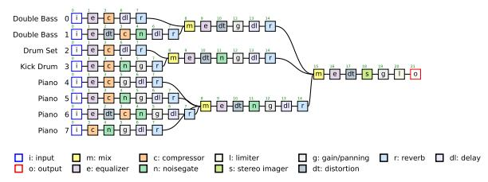  
(a) GRAFX (fitted to GT, pruned)

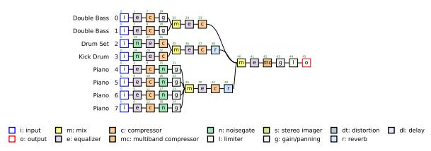  
(b) MixAgent  
Figure 5: Mixing consoles for MedleyDB clip sample\_129. Each input is labeled with its instrument and index, and input k is the same track in both panels. Both consoles use the same three subgroups: double bass, drums, and piano. GRAFX is shown after pruning near-inactive processors. MixAgent shows every tool in its final plan.

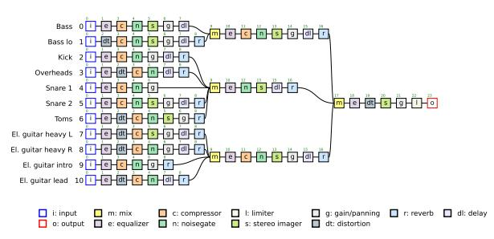  
(a) GRAFX (fitted to GT, pruned)

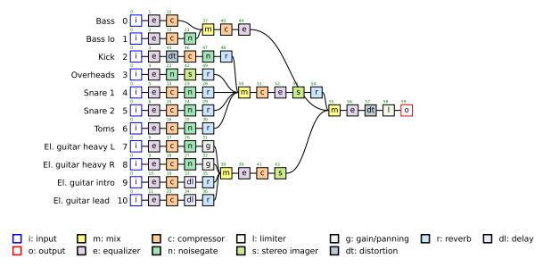  
(b) MixAgent  
Figure 6: Mixing consoles for AlbumDB clip sample\_010. Both consoles use the same three subgroups: bass, drums (kick, overheads, snares, toms), and electric guitars. Layout as in Figure 5.

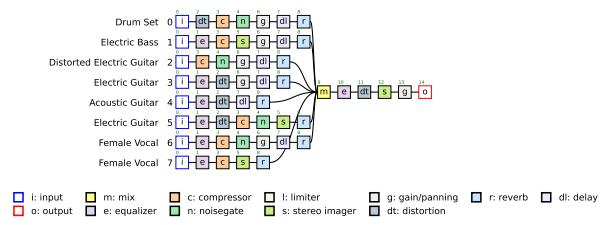  
(a) GRAFX (fitted to GT, pruned)

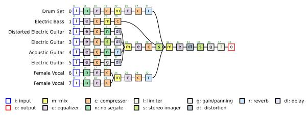  
(b) MixAgent

Figure 7: Mixing consoles for MedleyDB clip sample\_110. The GRAFX console has no subgroups: all eight tracks feed the full mix directly. MixAgent groups the four guitars and the two vocals into subgroups and gives drums and bass their own subgroups. Layout as in Figure 5.  
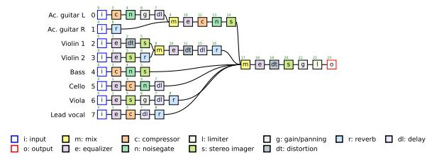  
(a) GRAFX (fitted to GT, pruned)

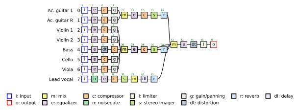  
(b) MixAgent  
Figure 8: Mixing consoles for AlbumDB clip sample\_013. The GRAFX console groups the two acoustic guitars and the two violins, and sends bass, cello, viola, and lead vocal to the full mix directly. MixAgent places the two violins, cello, viola, and bass in one subgroup, the two acoustic guitars on another, and the lead vocal in its own subgroup. Layout as in Figure 5.

## D.4 Detector Accuracy

On a validation set of 3,130 corrupted states from 13 training clips held out from training, the detector reaches 0.81 F1 for tracks and 0.77 for audio effects at threshold 0.5 (Table 11). This threshold is used only for validation, and MixAgent uses τ = 0.15 at inference.

<table><tr><td>Target</td><td>N</td><td>Prec.</td><td>Recall</td><td>F1</td><td>AUROC</td></tr><tr><td>Track</td><td>9,779</td><td>0.797</td><td>0.822</td><td>0.809</td><td>0.893</td></tr><tr><td>Audio effect</td><td>33,329</td><td>0.700</td><td>0.849</td><td>0.767</td><td>0.874</td></tr></table>

Table 11: Detector validation at threshold 0.50. N counts decisions.

## D.5 Error at Each Stage

Table 12 measures MRS after each stage against the GT-fitted audio of that stage. With numerical feedback, DPO has lower error than SFT at every stage.

## D.6 Number of Refinement Passes

Additional passes do not consistently help (Figure 9). With A3, MixAgent improves from 1.75 to 1.69 MRS with three passes and returns to 1.73 with five, while A1 and A2 are best with one pass.

<table><tr><td>Critic</td><td>Track</td><td>Subgroup</td><td>Full mix</td><td>Final</td></tr><tr><td>Untrained A1</td><td>1.50</td><td>1.82</td><td>2.12</td><td>2.26</td></tr><tr><td>SFT A1</td><td>1.46</td><td>1.73</td><td>1.99</td><td>2.08</td></tr><tr><td>DPO A1</td><td>1.47</td><td>1.81</td><td>1.96</td><td>2.09</td></tr><tr><td>Untrained A2</td><td>1.71</td><td>2.13</td><td>2.34</td><td>2.44</td></tr><tr><td>SFT A2</td><td>1.53</td><td>1.97</td><td>2.19</td><td>2.24</td></tr><tr><td>DPO A2</td><td>1.60</td><td>1.88</td><td>1.89</td><td>1.98</td></tr><tr><td>Untrained A3</td><td>1.46</td><td>1.81</td><td>2.09</td><td>2.18</td></tr><tr><td>SFT A3</td><td>1.42</td><td>1.88</td><td>1.84</td><td>1.91</td></tr><tr><td>DPO A3</td><td>1.33</td><td>1.80</td><td>1.68</td><td>1.75</td></tr></table>

Table 12: MRS after each processing stage (lower is better). Track, subgroup, and full mix targets are the corresponding GT-fitted outputs. The final target is the real mix. Untrained rows use prompted Qwen3-Omni as the critic.

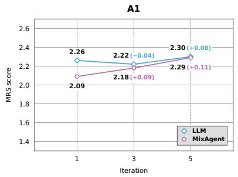

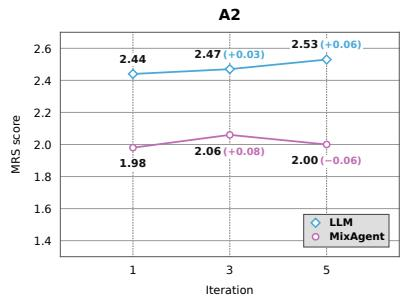

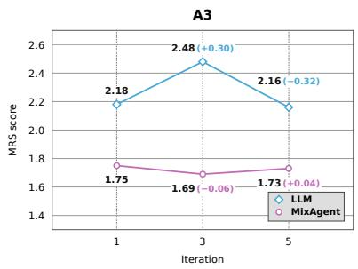  
Figure 9: MRS (lower is better) with a maximum of one, three, or five refinement passes per stage for A1, A2, and A3, from left to right. Parentheses show the score change from the preceding plotted pass budget.

## E Ablation Protocols

## E.1 Critic Training and Feedback Form

All rows use the same learned detector. The untrained rows prompt Qwen3-Omni as the critic. The trained critic is a different model (Table 7), and DPO starts from its SFT checkpoint. Within each feedback form, SFT and SFT+DPO share the detector, planner, plan, initial state, prompts, and decoding. Later states can diverge as corrections are applied. For each applied correction, $\Delta \mathrm { M R S } = \mathrm { M R S } _ { \mathrm { b e f o r e } } - \mathrm { M R S } _ { \mathrm { a f t e r } }$ on the full mix, and a correction counts as an improvement if $\Delta \mathrm { M R S } > 0 .$ . Oracle A1 and A2 replace the critic’s output with the GT critique in the same feedback form, which the planner converts into parameter values as in the other A1 and A2 rows. Oracle A3 fits the parameters of the same plan directly to GT with GRAFX.

## E.2 Target Selection

All conditions share the plan, starting state, DPO A3 critic, and the detector’s audio effects-level diagnoses, and they visit selected elements in order of detector score. Only the set of selected tracks and subgroups changes. The full mix is always inspected. Inspect-all averages 13.1 turns and 56.6 minutes per clip, and random selection 12.1 turns.

## E.3 Refinement Order

Top-down visits the full mix, then subgroups, then tracks, rendering between levels (11.9 turns and 54.2 minutes per clip). The variant without hierarchy computes all corrections from the initial audio and applies them at once (11.8 turns).

## F Prompts

Figures 10–17 show the prompts of the languagemodel calls in MixAgent and the prompt used

to build MixCritic. Text in braces, such as {stem\_count}, is filled in at run time, and $^ { 6 6 } [ . . . ] ^ { , , }$ marks lines cut for space.

```jsonl
Grouping agent
You are an expert mixing engineer setting up a session. You have direct audio access to {stem_count} full dry stem audio
files (attached in fixed order) plus their filenames. You CAN hear every file -- listen carefully before you respond.
Dry stem filename order:
{stem_file_list}
Your task is ONLY to group these {stem_count} dry stems into a small number of mixing buses (submix groups), exactly as an
engineer routes related tracks to shared buses before balancing them. Do NOT choose any tools or parameters yet and do
NOT try to mix -- only decide the grouping.
Grouping guidance:
- Infer each stem's role from its filename and audio content: drums (kick, snare, toms, hats, overheads, room), bass / low
end foundation, lead vocal, backing/harmony vocals, [...]
- Put stems that should be balanced and processed together into the same group. For example, all drum mics belong in one "
drums" bus; a lead vocal with its doubles and harmonies belongs in one "vocals" bus; the DI and amp of a single guitar
belong together.
- Choose the number of groups yourself based on what the song actually contains. Typical mixes use about 3 to 6 groups. Use
at most {max_groups} groups.
- Every stem must be placed in exactly one group. [...]
- Prefer a few meaningful buses over many tiny ones. A solo instrument with no relatives can be its own group.
Output format. Return a single JSON object with exactly one key "groups": [...]
{"groups": [{"name": "drums", "stem_indices": [1, 2, 3]},
{"name": "vocals", "stem_indices": [4, 5]},
{"name": "bass", "stem_indices": [6]}]}
```

Figure 10: Prompt of the grouping agent, which hears all unprocessed input tracks together with their file names. The reproduced prompts retain their original terminology: stems are input tracks, buses process subgroups, and the master bus processes the full mix.  
```jsonl
Tool-planning agent: stem and bus steps
You are an expert mixing engineer planning ONE submix bus ("{group_name}") of a song. You have direct audio access to the {
stem_count} dry stem audio files of this bus, attached in fixed order. You CAN hear every file -- listen carefully
before you respond.
Bus stem filename order:
{stem_file_list}
Your task: choose WHICH mixing tools to apply -- you are NOT choosing any parameter values in this pass. A separate optimizer
will set all parameters later; you only decide the processing structure, exactly like an engineer patching processors
into a console before touching any knob.
Decide two things:
1. For each stem in this bus: an ordered per-stem tool chain (possibly empty, if the stem needs no individual processing
before the bus).
2. One ordered tool chain for the bus itself (the shared "{group_name}" group chain applied to the summed bus; possibly empty)
Allowed tools (both per-stem and bus chains): eq, distortion, compressor, noisegate, stereo_imager, gain_panning, delay,
reverb.
Guidance:
- Choose tools by role and by what you hear: gates for bleed, compressors for uneven dynamics, eq for tone/separation,
gain_panning for level/placement, reverb/delay for space, stereo_imager for width, distortion for grit.
- Don't default to minimal. A single tool per stem is usually too little [...]
- The in-context examples show the kind of fuller, multi-tool treatment expert mixes use. Treat them as an illustration of
how thorough to be when a stem calls for it, not a tool count to copy.
- Put shared, glue-style processing (bus compression, shared ambience, overall bus tone) in the group chain -- but still give
each individual stem its own full treatment [...]
[...]
{icl_examples}
Output format. Return a single JSON object with exactly these two keys: [...]
{"stems": [{"stem_index": 1, "chain": ["noisegate", "eq", "compressor", "gain_panning"]},
{"stem_index": 2, "chain": ["eq", "compressor"]}],
"group_chain": ["compressor", "eq", "gain_panning"]}
```  
Figure 11: Prompt of the tool-planning agent for the track and subgroup steps (one call per subgroup). The retrieved examples replace {icl\_examples} (Figure 13).

```jsonl
Tool-planning agent: master step
You are an expert mixing engineer finalizing the master bus of a song. You choose WHICH tools to apply on the master bus --
no parameter values; a separate optimizer will set all parameters later.
Session structure (groups, their member stems, and the tool chains already chosen):
{session_summary}
Your task: one ordered tool chain for the master bus (applied to the sum of all group buses and passthrough stems).
Allowed master-bus tools: eq, distortion, compressor, noisegate, stereo_imager, gain_panning, delay, reverb,
multiband_compressor, limiter.
Guidance:
- Typical masters use a handful of tools: tonal eq, glue compression (single-band or multiband), optional width/saturation, a
level trim, and a final limiter last when a peak ceiling is needed.
- Choose based on what the session structure implies (how much dynamics/tone work already happened at stem/group level) and
general mastering practice. Empty is allowed but rare.
{icl_examples}
Output format. Return a single JSON object with exactly one key:
{"master_chain": ["eq", "compressor", "gain_panning", "limiter"]}
```

Figure 12: Prompt of the tool-planning agent for the full mix step. This call is text only, and {session\_summary} lists the subgroups, their tracks, and the chains already chosen.  
Retrieved examples (replaces {icl\_examples})   
In-context examples from previously mixed songs, structured by an expert hierarchical mixing console (a gradient-descent   
optimizer). Guidance only -- adapt to THIS song; do not copy blindly. Parameters are intentionally omitted: study WHICH   
tools were kept per stem, per bus, and on the master, and how selective the choices are. [...]   
Example [text] (text 0.901) -- 16 stems, 4 buses, 0 routed straight to master:   
Bus 'piano' bus chain: eq -> compressor -> noisegate   
1 piano eq -> compressor -> gain\_panning -> delay -> reverb   
sounds like: An isolated dry piano stem with no other instruments or ambience. [...]   
2 piano eq -> compressor -> noisegate -> delay -> reverb   
sounds like: [...]   
Bus 'double bass' bus chain: eq -> compressor -> stereo\_imager   
5 double bass eq -> compressor -> gain\_panning   
sounds like: [...]   
[...]   
Master chain: eq -> distortion -> gain\_panning   
[...]  
Figure 13: Format of the retrieved examples, shown for one example retrieved for MedleyDB clip sample\_129. MixAgent inserts three examples retrieved by text and one retrieved by audio.

```tcl
Planner: parameter initialization (stem step)
You are a professional mixing engineer. You are mixing ONE instrument group of song {song_id}: the "{group_name}" group. The
tools on each stem are already chosen and FIXED -- your job is to set their PARAMETERS so this group sounds right and
sits the way the same group sits inside the Reference mix.
## AUDIO ORDER
{audio_order}
Listening notes:
- Each dry stem clip is loudness-normalized on its own, so the stem clips do NOT tell you the current relative levels. Set
relative levels yourself with the gain_panning sites (where present) and compressor make_up.
- Match the Reference closely: how loud, bright, wide, dry/wet and dynamic is this group inside the Reference? That is your
target.
- The dry stems are MONO and all sit dead-center. The mix can ONLY become stereo through UNEQUAL [left, right] values on
gain_panning sites [...]
## THE GROUP'S STEMS
{group_table}
## PARAMETER SITES (set values ONLY for these numbered sites)
{site_table}
## TOOL PARAMETER CONTRACT
{tool_contract}
## YOUR TASK
Listen to every stem, then choose parameters for the sites above so that, summed together, the group is balanced internally (
lead elements clear, doubles/mics supporting, no masking), panned into a sensible stereo picture where gain_panning
exists, tonally clean (cut mud, tame harshness -- cuts before boosts), and dynamically controlled but alive. [...]
Restraint wins: near-neutral parameters on most sites plus a few decisive moves beat processing everything.
## OUTPUT
Return ONLY one json fenced block:
{"sites": {"<site_id>": {"<param>": <value>, ...}, ...}, "notes": "<one sentence of intent>"}
[...]
```

Figure 14: Prompt for parameter initialization by the planner (track step). The subgroup and full mix steps use analogous prompts. {tool\_contract} gives each tool’s parameter names, units, and valid ranges.  
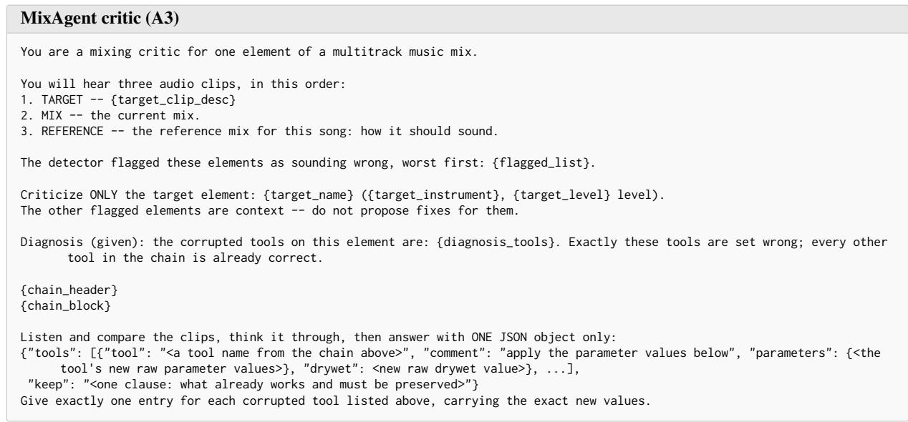  
Figure 15: Prompt of the MixAgent critic at inference, which uses the A3 answer format. Each audio clip is preceded by a text label. {diagnosis\_tools} are the audio effects flagged by the detector, and {chain\_block} lists the element’s audio effects with their current values. The critic reasons before answering, and only the final JSON is used.

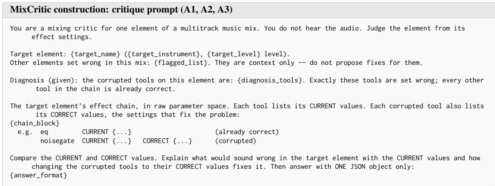

Figure 16: Prompt used to build MixCritic, shared by A1, A2, and A3. The teacher LLM receives text only. The answer format of each feedback form replaces {answer\_format} (Figure 17). {diagnosis\_tools} are the corrupted audio effects, and {chain\_block} lists the element’s audio effects with their current values and, for each corrupted audio effect, its pseudo-GT values θ<sup>∗</sup>.  
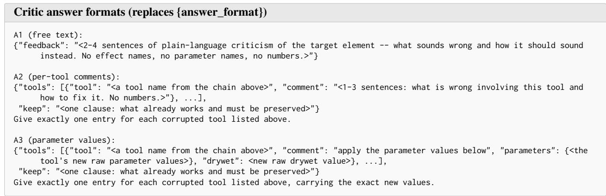  
Figure 17: Answer formats of A1, A2, and A3, which replace {answer\_format} in Figure 16.