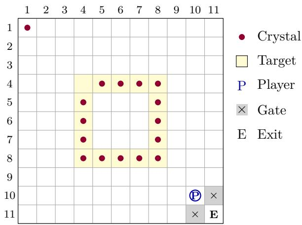

# An Exact 93-Move Solution to a Nonlocal Crystal-Exchange Puzzle

Zilai Wang wzlfly87@gmail.com

October 21, 2026

## Abstract

We determine the minimum number of directional commands needed to solve a level of Order of the Sinking Star, modeled as a crystal-exchange puzzle on an 11 ×11 board. A command swaps the player with the nearest crystal in the selected row or column, regardless of distance; only an empty ray permits an ordinary unit walk. Two gates admit the player to the exit exactly while all sixteen crystals occupy their target cells. We give an explicit 93-command solution and exclude every shorter solution by an exact, cost-bounded breadth-first search. The search represents a position by its seventeen occupied cells and one active cell. Its admissible heuristic partitions command costs between a compressed core abstraction and residual motion, strengthened by a necessary activation detour and a corner visit condition. The completed computation retained 605,349,215 occupied sets and 1,863,925,136 states. We prove the reductions and pruning conditions, describe the exact storage scheme, and provide source code, execution logs, and a reproduction driver. The result is a computer-assisted proof for the specified instance, with an explicit implementation trust boundary.

## 1 Introduction

We study a crystal-exchange level from the puzzle game Order of the Sinking Star. Nonlocal exchanges make familiar geometric intuitions unreliable in shortest-path puzzles. A single command can move the player across an entire row, while placing every crystal on a target need not finish the puzzle: the player must still reach an exit. The position of the player at the moment the gates open is therefore part of the optimization problem.

The level was supplied as a diagram together with its movement rules. Section 2 gives a self-contained mathematical specification, so the result does not depend on access to a particular game implementation. Our main result is an exact minimum of 93 directional commands. We give a witness and a computational exclusion of all routes of length at most 92.

The computational method uses established principles of admissible search. Pattern databases store exact distances in abstractions of a state space [1]. Additive pattern databases and action-cost partitioning permit several lower bounds to be summed when their allocated costs do not exceed the cost of a real action [2, 3]. Here the partition is fixed and binary: a command contributes to exactly one of two cost components. We specialize these principles to nonlocal exchange by retaining occupied points, rather than crystal identities, and deriving a residual-motion bound from the need to activate an of-target occupied point.

Our contribution is the exact solution of this instance and a documented search formulation that makes the result reproducible. We do not claim a new general-purpose search algorithm, a complexity classification of the puzzle family, or a proof checked by a formal proof assistant.

  
Figure 1: The initial instance, redrawn from its mathematical specification. The target at (4, 4) is empty; the displaced crystal is at (1, 1). Both gates are initially closed.

## 2 The instance and its exact state space

Rows and columns are numbered from 1 to 11, with rows increasing downward. Let

$$
V = \{ 1 , \ldots , 1 1 \} ^ { 2 } , \qquad K = \{ 4 , \ldots , 8 \} ^ { 2 } ,
$$

and let the sixteen target cells form the perimeter

$$
T = \{ ( r , c ) \in K : r \in \{ 4 , 8 \} \mathrm { ~ o r ~ } c \in \{ 4 , 8 \} \} .
$$

The exit is $E = ( 1 1 , 1 1 )$ , the gates are $G = \{ ( 1 0 , 1 1 ) , ( 1 1 , 1 0 ) \}$ , and the initial positions are

$$
\begin{array} { r } { p _ { 0 } = ( 1 0 , 1 0 ) , \qquad C _ { 0 } = ( T \setminus \{ ( 4 , 4 ) \} ) \cup \{ ( 1 , 1 ) \} . } \end{array}\tag{1}
$$

Crystals are indistinguishable. A state consists of a player cell $p$ and a sixteen-element set $C ,$ with $p \notin C$

Commands. The four directions are denoted $U , D , L , R .$ . The gates are open if and only if $C = T$ their status is not latched. In a selected direction, scan the ray from $p ,$ stopping at the board boundary or a closed gate. If the ray contains a crystal, let $q$ be the nearest one and replace the state by

$$
( q , \ ( C \setminus \{ q \} ) \cup \{ p \} ) .
$$

If the ray contains no crystal, move the player one cell in that direction, provided that cell is in V and is not a closed gate. Each command costs one, including a long-distance exchange. Invalid commands can be omitted from a shortest route; if interpreted as idle commands, deleting them does not change any subsequent state. The objective is the player’s first entry into $E .$

Lemma 2.1 (Goal characterization). On first entry into $E _ { i }$ , the crystal set is $T ,$

Proof. Initially E has no crystal. The only operation that could place a crystal there is an exchange from a player already at $E .$ . Thus a first entry cannot be an exchange; it is a walk from one of the two gates. Entering that gate requires $C = T$ . From either gate, its row and column contain no target cells. While the player remains on a gate or walks between it and $E ,$ , no exchange can alter $T .$ Hence $C = T$ on entry. □

<table><tr><td>k</td><td>1</td><td>2</td><td>3</td><td>4</td><td>5</td><td>6</td><td>7</td><td>8</td><td>9</td><td>10</td><td>11</td></tr><tr><td>π(k)</td><td>0</td><td>0</td><td>0</td><td>1</td><td>2</td><td>3</td><td>4</td><td>5</td><td>6</td><td>6</td><td>6</td></tr><tr><td>η(k)</td><td>-2</td><td>-1</td><td>0</td><td>0</td><td>0</td><td>0</td><td>0</td><td>0</td><td>0</td><td>1</td><td>2</td></tr></table>

Table 1: Every adjacent pair changes exactly one of π and η by one. The identity $k = \pi ( k ) + \eta ( k ) + 3$ alone would not establish this property; the adjacent values do.

Definition 2.2 (Occupied-set representation). Write $U = C \cup \{ p \}$ and $s = ( U , p )$ . Then $| U | = 1 7 $ $p \in U$ , and $C = U \setminus \{ p \}$

An exchange changes only the active cell p. A walk from p to q replaces U by $( U \setminus \{ p \} ) \cup \{ q \}$ This is an exact representation, not an abstraction. By Lemma 2.1, the required terminal state is

$$
s _ { * } = ( T \cup \{ E \} , E ) .\tag{2}
$$

Theorem 2.3 (Main result; computer-assisted). For the instance and rules specified above, the minimum number of commands from $( C _ { 0 } \cup \{ p _ { 0 } \} , p _ { 0 } )$ to first entry into E is exactly 93.

The upper bound is explicit in Section 7. The lower bound combines the mathematical reductions below with the exhaustive computation reported there.

## 3 Partitioning command costs

For a one-dimensional coordinate $k \in \{ 1 , \ldots , 1 1 \}$ , define

$$
\pi ( k ) = \operatorname* { m i n } \{ 6 , \operatorname* { m a x } \{ 0 , k - 3 \} \} , \qquad \eta ( k ) = \left\{ \begin{array} { l l } { k - 3 , } & { k < 3 , } \\ { 0 , } & { 3 \le k \le 9 , } \\ { k - 9 , } & { k > 9 . } \end{array} \right.\tag{3}
$$

Apply both maps coordinatewise to cells. The map π compresses the board to $Q = \{ 0 , \ldots , 6 \} ^ { 2 } \nonumber$ η records the signed residual displacement outside the interval [3, 9]. In one dimension, $k =$ $\pi ( k ) + \eta ( k ) + 3$

Lemma 3.1 (Disjoint cost partition). A unit walk changes exactly one coordinate of either $\pi ( p )$ or $\eta ( p )$ , by one. Charge every exchange and every π-changing walk to cost α, and every η-changing walk to cost $\beta$ . For every route of length L, $L = \alpha + \beta$

Proof. In one dimension the edges $3  4 , \ldots , 8  9$ change only $\pi ;$ the remaining four edges change only η. A grid walk changes only one original coordinate. The asserted partition therefore assigns each walk to exactly one class, and exchanges are assigned to α by definition. □

Stationary labels under exchange. Temporarily label the seventeen occupied points. A label stays at its cell during an exchange; only which label is active changes. During a walk, the active label moves with the player. These are bookkeeping labels of occupied points, not persistent identities of crystals. Consequently, only walks move labels, and only β-walks change their residual coordinates. At completion, sixteen labels have residual coordinate (0, 0), and one has residual coordinate (2, 2). This observation permits a displacement lower bound on $\beta ,$ even though the player itself can change residual coordinates in a single exchange.

## 4 A compressed-core lower bound

Let $Q ^ { \circ } = \{ 1 , \ldots , 5 \} ^ { 2 }$ be the interior of $Q$ . The abstraction of $s = ( U , p )$ is

$$
A ( s ) = ( M , a , e ) , \qquad M = \pi ( U \cap K ) , \quad a = \pi ( p ) , \quad e = \pi ( E ) = ( 6 , 6 ) .
$$

The endpoint corner e is stored explicitly because the pattern table uses all square symmetries. The integer $n _ { \mathrm { o u t } } = 1 7 - \vert M \vert$ counts occupied points outside K, including the player when appropriate. Their individual positions are forgotten. Valid states satisfy $| M | \leq 1 7 , a \in M$ when $a \in Q ^ { \circ }$ , and $n _ { \mathrm { o u t } } \geq 1$ when $a \in \partial Q$

## 4.1 Abstract transitions

The following directed transitions have unit cost. Gates are ignored. Rays exclude their starting cell.

1. Exchanges from the interior. If $a \in Q ^ { \circ }$ , an exchange may reach the first point of M on a chosen ray. If there is none, it may reach the boundary cell on that ray, provided $n _ { \mathrm { o u t } } \geq 1$

2. Exchanges from the boundary. If $a \in \partial Q$ , an exchange may reach the first point of M on a ray. It may also reach any other boundary cell on that ray before a point of $M ,$ provided $n _ { \mathrm { o u t } } \ge 2$ Exchanges preserve M.

3. Walks. The active cell may move to an adjacent $b \in Q$ if the ray from a in that direction contains no point of M. Remove a from M if $a \in Q ^ { \circ }$ , and add b if $b \in Q ^ { \circ }$ . Only valid resulting states are retained.

These rules permit configurations of exterior points that need not be simultaneously realizable on the original board. That extra freedom is intentional. Exchanges whose endpoints have the same projection need no abstract transition.

Lemma 4.1 (Simulation). Every real α-command maps to one abstract edge or no change. Every real β-command maps to no change.

Proof. A real exchange cannot pass a nearer interior crystal. If it reaches an exterior point, the corresponding boundary destination is allowed by the occupied-point count: an exterior-to-exterior exchange uses two distinct exterior points. Projection preserves row or column alignment and order along the noncollapsed part of a ray. Thus every exchange with distinct projected endpoints is included.

A real walk is allowed only when its entire unblocked ray has no crystal. The only cells hidden behind closed gates are gate cells and exit-side boundary cells; none belongs to K. Hence there is no interior occupied point ahead of a legal walk. A π-changing walk satisfies the abstract walk rule, with precisely the stated update of M. An η-changing walk stays outside $K ,$ does not change $\pi ( p )$ and leaves M fixed. □

Let $T ^ { \prime } = \pi ( T )$ , and define the base pattern distance

$$
d ( A ) = \mathrm { d i s t } _ { A } ( A , ( T ^ { \prime } , e , e ) ) ,
$$

where $\mathcal { A }$ is the directed abstract graph. Reverse breadth-first search from the abstract goal computes d. Lemma 4.1 gives $d ( A ( s ) ) \leq \alpha$ for every completion of s.

## 4.2 A necessary northwest visit

Let $N = \{ 1 , 2 , 3 \} ^ { 2 }$ , whose projection is the northwest corner $o = ( 0 , 0 )$ . If $U \cap N \neq \emptyset$ , at least one currently occupied point in N must eventually move: neither a target nor the exit lies there. Before its first walk, that point must be active. Thus the projected player must visit $^ { O , }$ with a visit at the current time permitted.

For an abstract state $A = ( M , a , e )$ , let $o ( e )$ be the corner opposite e, and define

$$
d _ { N } ( A ) = \operatorname* { m i n } _ { \substack { { B = ( M ^ { \prime } , o ( e ) , e ) } } } \bigl [ \mathrm { d i s t } _ { \cal { A } } ( A , B ) + d ( B ) \bigr ] .\tag{4}
$$

This value is computed by reverse Dijkstra search, seeding each such B with its base distance $d ( B )$ Set

$$
H _ { \alpha } ( s ) = { \binom { d _ { N } ( A ( s ) ) , } { d ( A ( s ) ) , } } \quad U \cap N \neq \emptyset ,\tag{5}
$$

Proposition 4.2. For every completion of $s ,$ $H _ { \alpha } ( s ) \leq \alpha$

Proof. Without the northwest condition this is the simulation lemma. With that condition, split the projected route at an occurrence of o. The abstract prefix and sufix have total length at most the real α-cost and are candidates in (4). □

## 4.3 Symmetry and pattern-table representation

The group $D _ { 4 }$ acts on the abstract board. We transform $M , a , e$ together; $o ( e )$ transforms with e. Canonicalizing the mask alone without retaining goal orientation would not justify the distance lookup. After choosing a representative mask, the implementation minimizes the pair $( a , e )$ over the mask’s stabilizer.

There are 4,211,744 orbits of all $2 ^ { 2 5 }$ masks under $D _ { 4 }$ . Each mask representative has $4 9 \cdot 4 = 1 9 6$ addressable player/corner slots, so each byte-valued distance array contains 825,501,824 slots. The arrays include unused and noncanonical addresses. Each generated array has 584,039,298 entries diferent from the sentinel 255. These are storage counts, not counts of all real positions. For the bound-93 computation, sentinel 255 is suficient to reject a state: all abstract paths of cost at most 92 are represented by the reverse searches. Values at or beyond the sentinel need not be distinguished. The initial core lower bound used in the search is 65.

## 5 Residual motion and activation detours

Fix labels $1 , \ldots , 1 7$ on the occupied points of the current state. Write $r _ { i } = \eta ( u _ { i } )$ , and let $i _ { p }$ be the active label. For each possible exit-assigned label e, put

$$
z _ { i } ^ { ( e ) } = \left\{ { ( 0 , 2 ) , ~ i = e , } \atop { ( 0 , 0 ) , ~ i \not = e , } \right. \qquad D _ { e } = \sum _ { i = 1 } ^ { 1 7 } \left\| { r _ { i } - z _ { i } ^ { ( e ) } } \right\| _ { 1 } .
$$

Every completion induces one such assignment. Since each β-walk moves exactly one residual coordinate by one,

$$
D _ { 0 } = \operatorname* { m i n } _ { e } D _ { e } = \sum _ { i } \| r _ { i } \| _ { 1 } + \operatorname* { m i n } _ { e } ( \| r _ { e } - ( 2 , 2 ) \| _ { 1 } - \| r _ { e } \| _ { 1 } )\tag{6}
$$

is a lower bound on its residual-motion cost.

## 5.1 One necessary activation

Consider an inactive label v with $r _ { v } \neq ( 0 , 0 )$ and $u _ { v } \neq E$ . It is currently on neither a target nor the exit and must eventually move. Before its first walk, some distinct active label $j$ must exchange with it. Until that first activation, $u _ { v }$ remains fixed. Just before the activating exchange, $u _ { j }$ and $u _ { v }$ share a row or column. In particular, one residual coordinate of $j$ equals the corresponding coordinate of $r _ { v }$

For a possible terminal residual coordinate z, define the excess length forced by this necessary alignment:

$$
\delta _ { j } ( z ; v ) = \operatorname* { m i n } _ { \ell \in \{ 1 , 2 \} } \left( | r _ { j , \ell } - r _ { v , \ell } | + | r _ { v , \ell } - z _ { \ell } | - | r _ { j , \ell } - z _ { \ell } | \right) .\tag{7}
$$

It is nonnegative by the triangle inequality. Alignment in residual coordinates is only a necessary condition for real alignment; weakening the condition can only decrease this bound. Allowing every possible exit assignment and approaching label gives

$$
D _ { v } = \operatorname* { m i n } _ { { e \in \{ 1 , \ldots , 1 7 \} } \atop { j \neq v } } \left[ D _ { e } + \delta _ { j } ( z _ { j } ^ { ( e ) } ; v ) \right] .\tag{8}
$$

In particular, the approaching label is allowed to be the exit-assigned label. Excluding that possibility would not be justified. Define

$$
\mathcal { V } ( s ) = \{ v : v \neq i _ { p } , \ r _ { v } \neq ( 0 , 0 ) , \ u _ { v } \neq E \}
$$

and

$$
H _ { \beta } ( s ) = \operatorname* { m a x } \bigl ( \{ D _ { 0 } \} \cup \{ D _ { v } : v \in \mathcal { V } ( s ) \} \bigr ) .\tag{9}
$$

Proposition 5.1 (Residual lower bound). For every completion of s, $H _ { \beta } ( s ) \le \beta$

Proof. Fix the actual exit assignment e. For any $v \in \mathcal { V } ( s )$ , let $j \neq v$ be the label that first activates it. The residual path of $j ,$ from $r _ { j }$ to $z _ { j } ^ { ( e ) }$ , passes through a point with at least one coordinate equal to that of $r _ { v }$ . Its length is therefore at least its direct Manhattan distance plus $\delta _ { j } ( z _ { j } ^ { ( e ) } ; v )$ Every other label requires at least its direct distance. Summing these disjoint label motions gives the expression inside (8) for this particular $e , j$ , and hence $\beta \geq D _ { v }$ . The same reasoning without a detour gives $\beta \geq D _ { 0 }$ . Taking the maximum proves the claim. □

The maximum in (9) is essential: one motion may help activate several points, so their detour bounds cannot in general be added. The implementation computes the strongest two obligations and the cell identifying the strongest one. This permits the active label’s obligation to be omitted for any choice of p in the same $U$

Lemma 5.2 (Safe reuse along walks). For a legal walk $s  s ^ { \prime } ,$ , the residual bound is unchanged if the walk has α-cost. If the walk has β-cost, then $| H _ { \beta } ( s ^ { \prime } ) - H _ { \beta } ( s ) | \le 1$

Proof. The active label remains the same and all inactive labels remain fixed. Thus the candidate set V and the activation coordinates are unchanged. For fixed $e , j ,$ v and choice of alignment coordinate, the expression $D _ { e } + \delta _ { j } ( z _ { j } ^ { ( e ) } ; v )$ is a sum of path lengths. If the active label is $j ,$ its contribution is a path through a fixed coordinate; otherwise its contribution is a direct distance. Changing its residual start coordinate by one changes either length by at most one. If its residual coordinate does not change, neither does the expression. Minima and maxima preserve these properties. The same argument applies to $D _ { 0 }$ □

Corollary 5.3 (Admissible combined heuristic). The function $h ( s ) = H _ { \alpha } ( s ) + H _ { \beta } ( s )$ is a lower bound on the length of every completion of s.

Proof. Apply Propositions 4.2 and 5.1 to the same completion and use $L = \alpha + \beta .$

The search uses an initial value $h ( s _ { 0 } ) = 6 5 + 1 0 = 7 5$ . A separate analytic argument proves that every complete route from the initial state has $\beta \geq 1 2$ (Appendix A); that stronger initial-state statement was not used as a statewise residual heuristic in the reported search.

## 6 Exact bounded search

Fix a strict bound $B = 9 3$ . Breadth-first search processes states in nondecreasing prefix length g, enumerating all four legal commands. A successor at depth $g + 1$ is discarded when

$$
( g + 1 ) + h ( s ^ { \prime } ) \geq B .\tag{10}
$$

Previously visited states need not be inserted again. The mathematical algorithm is shown below;   
implementation-specific caches do not change its accepted state set.

Bounded breadth-first exclusion   
frontier := {initial state}; seen := {initial state}; g := 0   
while frontier is not empty:   
next := empty   
for state in frontier:   
for direction in {U, D, L, R}:   
if the command is illegal: continue   
child := exact successor(state, direction)   
child := symmetry\_representative(child)   
if g + 1 + h(child) >= B: continue   
if child is in seen: continue   
insert child into seen and next   
if child is the goal: return a shorter solution   
frontier := next; g := g + 1   
return "no solution of length less than B"

Theorem 6.1 (Soundness of exclusion). If the bounded search exhausts its queue without finding the goal, there is no solution of length less than B.

Proof. Suppose a solution of length $L < B$ exists. At any state on that route, its prefix length plus h is at most L, by Corollary 5.3; thus (10) cannot delete the prefix. A duplicate state has already been reached at an equal or smaller depth, and the same completion is available from that earlier arrival. Following these earlier arrivals, if necessary, gives a retained route to the goal. This contradicts exhaustion without a goal. □

## 6.1 Symmetry of the real instance

Only reflection $\tau ( r , c ) = ( c , r )$ is used to merge real positions. It preserves the initial state, targets, pair of gates, exit, and all transition costs. Store the smaller of the row-major bitsets U and $\tau ( U )$ reflecting p at the same time. If the two bitsets are equal, the implementation keeps both active positions separately. This may retain redundant symmetric states but does not merge inequivalent states. Paths between representatives lift to real paths because reflection is a transition-system automorphism and fixes the endpoints. The $D _ { 4 }$ reduction of pattern tables is distinct from this two-element symmetry of the real problem.

## 6.2 Lossless storage

Each occupied set stores a 25-bit mask on K. Let $k = 1 7 - | U \cap K |$ , enumerate the other 96 cells in row-major order, and let $0 \leq x _ { 1 } < \cdot \cdot \cdot < x _ { k } < 9 6$ be its exterior indices. Their combinatorial rank is

$$
R = \sum _ { j = 1 } ^ { k } { \binom { x _ { j } } { j } } .\tag{11}
$$

For fixed k, this is an injective encoding with $0 \leq R < { \binom { 9 6 } { k } }$ . Together with the core mask, it determines U uniquely. A 64-bit word stores the core mask and low rank bits; all additional bits are stored in a separate map and participate in key equality. At most 87 bits sufice. No key bits are dropped.

For a given U, a 17-bit mask records which active positions have been visited. Seven further bits store the first depth at which this occupied set was encountered; that depth is used for witness reconstruction. The bound B = 93 fits within this field. The main arrays require eleven payload bytes per occupied set: eight for the low key and three for this metadata. The hash index, exceptional key bits, frontiers, pattern tables, and allocation overhead are additional. Hash collisions are resolved by full-key comparison, not probabilistic fingerprinting. Frontier entries use five bytes to identify an occupied set and one of its seventeen active positions.

## 6.3 Optimizations and restart invariants

For a walk, Lemma 5.2 permits an inexpensive preliminary test using

$$
H _ { \alpha } ( s ^ { \prime } ) + \operatorname* { m a x } \{ 0 , H _ { \beta } ( s ) - b \} , \quad b = { \left\{ \begin{array} { l l } { 0 , } & { \alpha - { \mathrm { w a l k } } , } \\ { 1 , } & { \beta - { \mathrm { w a l k } } . } \end{array} \right. }
$$

This value is at most the full successor heuristic. If it already exceeds the available budget, no hash lookup is needed. Otherwise the full bound is used. A bounded cache stores occupied sets and their residual obligations; a hit requires an exact, immutable set identifier. It cannot change state equality or the result of a heuristic evaluation.

Checkpoint files retain the full visited collection, the current frontier, the generated next frontier, the current layer, the processed position within that layer, and all exceptional key bits. Rebuilding the hash index changes only how these exact keys are found. When a capacity stop occurs partway through a state’s four successors, resumption repeats that state; visited bits suppress already generated children. No unprocessed successor is skipped. Only normal queue exhaustion constitutes an exclusion result.

## 7 Construction and completed computation

Table 2 gives a 93-command route. A separate Python model replays the exact ray rule and conditional gate rule. It agrees with all 93 rows of the released step-by-step coordinate record. The gates first open after command 90, when $p = ( 8 , 1 1 )$ . The final three downward walks reach E.

<table><tr><td>Commands</td><td>Direction sequence Player after the block</td></tr><tr><td>1-10</td><td>URULULLURR (6,8)</td></tr><tr><td>11-20 RDLLLULLRD</td><td>(7,6)</td></tr><tr><td>21-30</td><td>LURLURRUDL (7,8)</td></tr><tr><td>31-40</td><td>LLLULURURR (4,7)</td></tr><tr><td>41-50 URUULDRDDD</td><td>(5,2)</td></tr><tr><td>51-60</td><td>RRDLDRDRRR (8,7)</td></tr><tr><td>61-70</td><td>URUULDDDDR (5,8)</td></tr><tr><td>71-80 URULLDLDRD</td><td>(7,7)</td></tr><tr><td>81-90</td><td>DLLURRRDDR (8,11)</td></tr><tr><td>91-93 DDD</td><td>(11,11)</td></tr></table>

Table 2: A shortest route. Directions are up, down, left, and right. Each letter costs one command, even when it causes a nonlocal exchange.
<table><tr><td>Quantity</td><td>Recorded value</td></tr><tr><td>Strict exclusion bound B</td><td>93</td></tr><tr><td>Initial heuristic  $H _ { \alpha } + H _ { \beta }$  Retained occupied sets</td><td> $6 5 + 1 0 = 7 5$ </td></tr><tr><td>Retained states (U, p)</td><td>605,349,215 1,863,925,136</td></tr><tr><td>Largest frontier (depth 27)</td><td>179,737,970</td></tr><tr><td>Last nonempty retained layer</td><td></td></tr><tr><td>Final configured occupied-set capacity</td><td>74</td></tr><tr><td></td><td>650,000,000</td></tr><tr><td>Verified witness length</td><td>93</td></tr></table>

Table 3: Deterministic counts from the completed strict-bound-93 run. State counts include the initial state and use the representation and symmetry convention of Section 6.

The route uses 37 exchanges, 44 π-changing walks, and 12 η-changing walks. Thus $( \alpha , \beta ) =$ (81, 12). It attains the analytic residual-motion lower bound of 12 and the three-walk terminal bound in Appendix A. Neither fact alone proves the total optimum: routes with a diferent allocation between α and $\beta$ must still be excluded.

The search completed with the following output:

EXHAUSTED\_NO\_ROUTE\_BELOW 93

OCCUPIED\_SETS 605349215 REACHED 1863925136

This is the program’s normal exhaustion outcome, returned with exit code 1. Its final frontier, at depth 74, contained one state and generated no retained successor. The final layer being less than 92 is expected: the heuristic can exclude a prefix long before it reaches the candidate length limit. Every prefix that could complete within 92 commands remains covered by Theorem 6.1.

The recorded run was continued across complete checkpoints. An initial storage implementation reached depth 30; an equivalent smaller representation continued the same search. A later stop at a configured capacity of 600,000,000 occupied sets occurred within depth 40. After increasing the capacity to 650,000,000, the exact saved state was restored and the queue was exhausted. Counts at the checkpoint boundaries match.

The consolidated layer record satisfies

$$
\sum _ { g = 0 } ^ { 7 4 } F _ { g } = 1 , 8 6 3 , 9 2 5 , 1 3 6 .
$$

Here $F _ { g }$ is the initial frontier size of layer $g .$ The complete per-layer counts and all three log segments are included with the ancillary material.

Proof of Theorem 2.3. The route in Table 2, verified by exact replay, gives $L _ { \mathrm { m i n } } \leq 9 3$ . The completed exhaustive computation and Theorem 6.1 give $L _ { \mathrm { m i n } } \ge 9 3$ . Therefore $L _ { \mathrm { m i n } } = 9 3$ □

## 8 Reproducibility and scope of the evidence

The ancillary directory contains the C++17 search and pattern-table generators, the independent Python transition model, the witness, the raw logs, and a reproduction driver. The main entry point is crystal\_verify\_optimum.py. From that directory, run

python3 crystal\_verify\_optimum.py –check-route-only

python3 crystal\_verify\_optimum.py –work-dir /path/to/work

The first command checks only the upper bound. The second compiles the programs, regenerates the symmetry and distance tables, and starts the full exclusion from the initial state. It accepts the lower-bound result only when both the process return code and the complete exhaustion message agree with the strict bound. A capacity stop, interruption, or a shorter solution does not produce a verification success. Python 3.9 or later, a C++17 compiler supporting unsigned \_\_int128, and a POSIX system with memory mapping are required.

Validation and provenance. The released record includes source and table SHA-256 values, a complete route replay, and checkpoint-continuity checks. Development checks covered 100,000 occupancy-codec round trips, including high-bit cases, and fresh-versus-resumed complete smallerbound searches. The selected storage engines agreed on a strict-bound-89 regression with 15,162,550 occupied sets and 40,547,600 states. These regression checks support implementation consistency; the bound-93 exhaustion is the computation that establishes the final lower bound.

Resources. The recorded computation ran on a macOS machine with 16 GiB of physical memory and incurred substantial memory pressure. The eleven-byte main payload at the final set count is 6,658,841,365 bytes, excluding the hash index and other arrays. The two distance arrays alone total 1,651,003,648 bytes. These are calculable data sizes, not measured peak resident memory. Because development, restarts, and paging were interleaved, we do not report the elapsed development session as a controlled solver-runtime benchmark.

Trust boundary. The lower bound is a computer-assisted exhaustion argument. Its mathematical part proves that the transitions, equivalences, and pruning rules preserve every shorter solution. Its computational part relies on the supplied implementations, compiler, runtime, and recorded execution. The file named crystal\_optimality\_certificate.json is a manifest of the result and its provenance; it is not a succinct proof object that an independent formal kernel can check. Hashes establish artifact identity, not algorithmic correctness. The upper-bound replay uses a separate implementation, but we do not claim an independently implemented full lower-bound verification.

Scope. The theorem concerns the specified board and conditional-gate, nearest-crystal rules. It does not establish optimality for variants with adjacent-only exchange or permanently latched gates. Nor does the instance-specific computation establish comparative performance against other optimal-search methods. An independent reproduction or a small proof-checking kernel would strengthen the evidence.

Statement on AI use. OpenAI Codex was used to write and revise the search programs and to assist with the computational investigation and preparation of this manuscript. The author has reviewed and understood all content of this manuscript, including the mathematical arguments and the search implementation. The reported results are fully reproducible from the mathematical specification, proofs, source code, data, and reproduction instructions provided with this paper.

## A Two elementary bounds

Proposition A.1 (Residual cost from the initial state). Every solution of the specified instance has $\beta \geq 1 2$

Proof. Let A be the initially active label and B the label at (1, 1). Their residual positions are (1, 1) and $( - 2 , - 2 )$ ; the other fifteen labels have residual position (0, 0). Let $J \neq B$ first activate B. One coordinate of J’s residual path must reach −2.

If the exit-assigned label is not A, the sum of all direct residual distances is 10. Whether J starts at (1, 1) or (0, 0), and whether it ends at (0, 0) or (2, 2), visiting a coordinate −2 adds at least four to its direct distance. Thus $\beta \geq 1 4$

Suppose instead that A is exit-assigned. If $J = A$ , the residual path of A, from (1, 1) through a coordinate −2 to (2, 2), has length at least eight. Label B requires at least four, so $\beta \geq 1 2$ . If $J \neq A$ it is one of the fifteen initially central labels. It starts and ends at (0, 0) but visits a coordinate −2, costing at least four. Label B also costs at least four. Finally, before the first exchange of the entire route, all labels other than A are stationary. To exchange with one of them, A must reach a residual coordinate $0 \ \mathrm { o r \mathrm { - } 2 }$ . Its path from (1, 1), through such a coordinate, to (2, 2) costs at least four. These costs concern three distinct labels and can be summed, giving 12. □

Proposition A.2 (Terminal walking cost). After the last restoration of $C = T$ , at least three further commands are required to reach E.

Proof. A restoration must be an exchange, since a walk does not change the crystal set. Immediately before it, the player is at a missing target $t \in T$ and the exchanged crystal is at the sole of-target location q. The exchange leaves the player at q, sharing a row or column with t. Hence at least one coordinate of $q$ belongs to $\{ 4 , \ldots , 8 \}$ , and $\| q - E \| _ { 1 } \geq 3$ . Any subsequent exchange would put a crystal at the player’s current of-target location and remove one from a target, breaking $C = T$ Completion would then require a later restoration, a contradiction. All remaining commands are walks, requiring at least $\| q - E \| _ { 1 }$ □

## B Ancillary files

<table><tr><td>File</td><td>Role</td></tr><tr><td>crystal_verify_optimum.py</td><td>Full reproduction driver</td></tr><tr><td>crystal_rules.py</td><td>Independent exact transition model</td></tr><tr><td>crystal_lean_cached_bfs.cpp</td><td>Final bounded-search implementation</td></tr><tr><td>crystal_encoded_bfs.cpp</td><td>Earlier checkpoint-compatible implementation</td></tr><tr><td>crystal_symmetry.cpp</td><td>Mask representatives and stabilizers</td></tr><tr><td>crystal_oriented_pdb.cpp</td><td>Goal-oriented core distances</td></tr><tr><td>crystal_landmark_pdb.cpp</td><td>Northwest-visit distances</td></tr><tr><td>crystal_outer_access.hpp</td><td>Residual activation lower bound</td></tr><tr><td>crystal_occupancy_codec.hpp</td><td>Lossless occupied-set encoding</td></tr><tr><td>crystal_mapped.hpp</td><td>Memory-mapped table storage</td></tr><tr><td>crystal_best_verified.json</td><td>93-command witness</td></tr><tr><td>crystal_best_verified_steps.csv</td><td>All intermediate witness positions</td></tr><tr><td>crystal_certificate_bound93_layers.txt</td><td>Consolidated layer counts</td></tr><tr><td>crystal_bound93_segment1.log, etc.</td><td>Three original execution segments</td></tr><tr><td>crystal_optimality_certificate.json</td><td>Result, rule specification, and hashes</td></tr></table>

Large regenerated pattern tables and binary checkpoints are omitted from the submission archive. Their generators and table hashes are included. The standalone manuscript embeds its diagrams and bibliography and does not read the ancillary files during typesetting.

## References

[1] J. C. Culberson and J. Schaefer. Pattern databases. Computational Intelligence, 14(3):318–334, 1998. doi:10.1111/0824-7935.00065.

[2] A. Felner, R. E. Korf, and S. Hanan. Additive pattern database heuristics. Journal of Artificial Intelligence Research, 22:279–318, 2004. doi:10.1613/jair.1480.

[3] M. Katz and C. Domshlak. Optimal additive composition of abstraction-based admissible heuristics. In Proceedings of the Eighteenth International Conference on Automated Planning and Scheduling, pp. 174–181, 2008. AAAI proceedings.