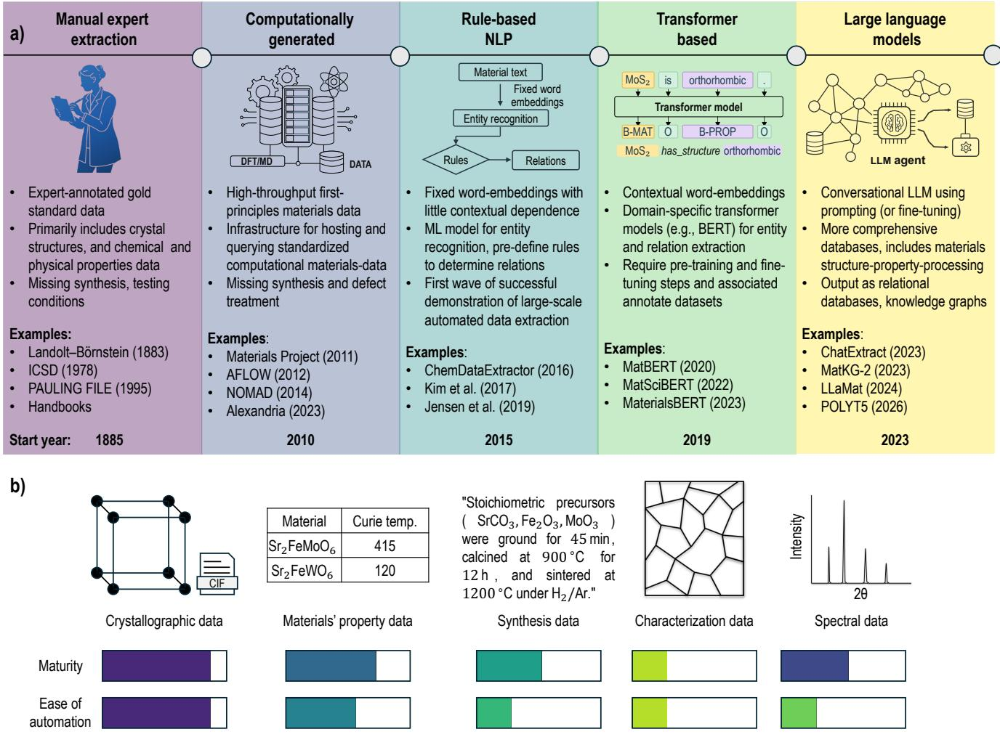
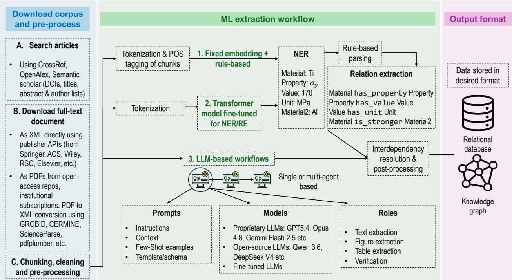
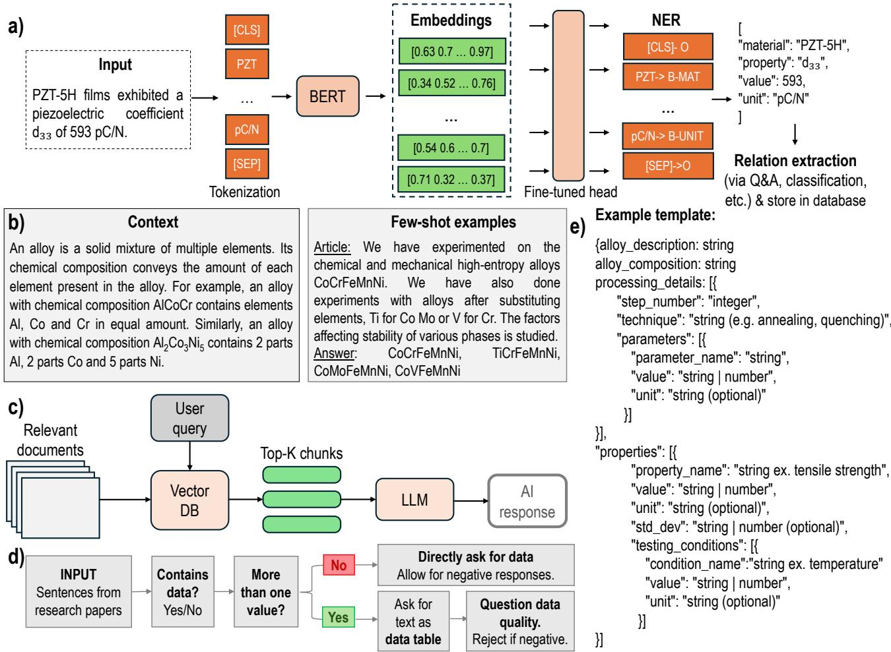
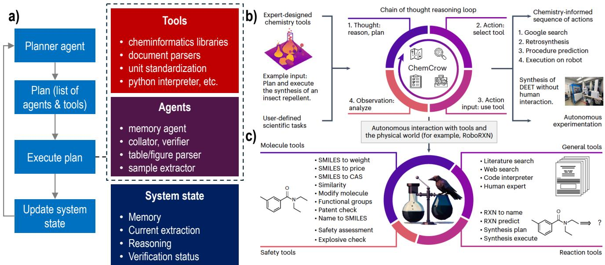
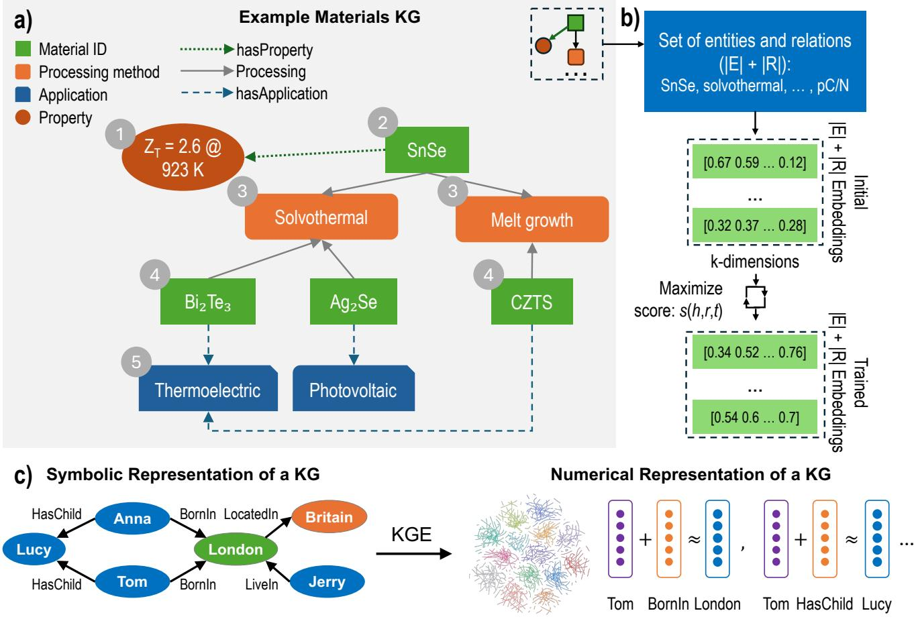

# Automated Materials Data and Knowledge Extraction using Machine Learning and Large Language Models

Aravindan Kamatchi Sundaram1, B. Pabitramohan Prusty1, and Rohit Batra1,2,3,\*

1Department of Metallurgical and Materials Engineering, Indian Institute of Technology Madras, Chennai 600036, India

2Center for Atomistic Modelling and Materials Design, IIT Madras, Chennai 600036, India 3Wadhwani School of Data Science & Artificial Intelligence, IIT Madras, Chennai 600036, India \*Corresponding author: rbatra@smail.iitm.ac.in

October 22, 2026

## Abstract

Over the past decade, substantial eforts have been devoted to developing machine learning (ML) methods for extracting materials data and, where possible, materials knowledge directly from the scientific literature. This review traces the evolution of these methods from heuristic, rule-based pipelines through natural lan guage processing (NLP) models and transformer-based encoders to, lastly, large language models (LLMs) and agentic systems capable of extracting materials information across multiple modalities, including text, tables, and figures. Beside construction of large, queryable materials databases and knowledge graphs that suppor downstream materials discovery, we discuss how these advances have enabled new capabilities, such as, generic question answering across materials science, AI co-scientists and chatbots for research assistance, and closed-loop optimization and discovery when integrated with autonomous laboratories. We critically assess the datasets gen erated using these approaches, their extraction accuracy and computational costs, and the respective strengths and limitations of diferent methodologies, and even provide practical guidelines for developing more reliable and scalable materials data extraction pipelines. Finally, we identify key open challenges, including the extraction of full materials structure-property-processing-performance tetrahedron at the sample level, the scarcity of reliable benchmark datasets for systematic evaluation, and the resolution of non-standard materials terminology across diferent document modalities.

Keywords: Materials data extraction, named entity recognition, relation extraction, large language model, multi agent framework, knowledge graphs

## 1 Introduction

Materials science can be viewed as a continual efort to understand and exploit the relationships captured by the structure-processing-properties-performance tetrahedron. Experiments, whether computational or physical, probe these relationships across an enormous space of compositions, structures, processing conditions, and applications, with their findings subsequently reported in peer-reviewed journal articles, patents, theses, books and even sup plementary information. However, the resulting materials knowledge is predominantly stored in unstructured or semi-structured forms—text, tables, figures, captions, and supporting files—distributed across an enormous and rapidly expanding literature corpus, estimated to contain of the order of 107 publications [1, 2]. Only a small fraction of this knowledge is available in structured form through handbooks, curated databases, and archival resources. Thus, while on one hand, the materials literature contains a vast body of evidence, relationships and trends (either established or hidden) that can reveal how materials behave, how their properties depend on structure and processing, and what design principles govern their success in a certain application. On the other hand, this knowledg remains dificult to access systematically at scale.

The distinction between materials data and materials knowledge becomes important in this context. Materials data comprise of individual observations, e.g., a composition synthesized by a particular route, a measured property under specified conditions, or a characterization result reported in a figure or table. Materials knowledge is a more general and compact representation of such observations in the form of relationships, trends, empirical rules, and physical models that enable prediction. Examples include the Hall–Petch relation [3], Hume–Rothery rules [4], and Vegard’s law [5], which allow researchers to generalize beyond individual observations and anticipate the behaviour of previously untested materials. A materials researcher develops such knowledge as part of their formal training and by absorbing the literature, comparing observations, and gradually forming an internal model of composition– processing–structure–property relationships [6]. This process of converting numerous observations into a compact, predictive understanding may be viewed as a form of knowledge compression. It is, however, inherently limited by the amount of literature an individual can access and integrate, and by the dificulty of identifying connections distributed across diferent studies and subfields.

Machine learning (ML) ofers a complementary route to this compression by learning patterns directly from large collections of materials data rather than relying on explicitly formulated physical relations or individual researcher experience. Property-prediction models can learn composition–structure–property relationships, while coupling these models with high-throughput calculations, active learning, and optimization methods allow explo ration of materials spaces in a more systematic and eficient manner than possible through eforts of a single human researcher. However, a major bottleneck in this approach is the availability of reliable, machine-readable data. Although the information required to train such ML models is often already present in the literature, but not in a form that can be readily accessed and processed. For example, synthesizing a new polymer or ceramic may require determining suitable precursors, their concentrations, reaction conditions, and, in some cases, a sequence of intermediate reactions by examining synthesis reports across many related materials. Consequently, the central bottleneck is not the absence of materials information, but the gap between the form in which the information exists in published literature and the form in which information is required as structured, machine-actionable data. Manual curation can, and have been, used to produce high-quality databases, but its limited to specific class of materials and use-cases and cannot scale with the volume and diversity of the literature [7, 8, 9].

This gap motivates the development of materials data (and, if possible, directly materials knowledge) extraction methods, particularly those based on natural language processing (NLP) and, more recently, transformer-based large language (LLM) models. The objective is to transform the heterogeneous content of scientific publications— text, tables, figures, and supplementary information—into structured records that can act as a knowledge base for answering materials-related queries or support downstream materials discovery ML pipelines.

This work tracks the evolution of materials data extraction as a progression from manual curation, to computational generation, to automated mining of the experimental literature (see Figure 1). Early databases such as Landolt-Börnstein [10], ICSD [11], the Pauling File [12] and PoLyInfo [13], established highly reliable, expert-curated and gold standard repositories of materials structures and properties. However, their construction is inherently slow and dificult to scale. High-throughput computational approaches provided an alternative by generating data rather than extracting it. Platforms such as the Materials Project [14], AFLOW [15], OQMD [16], NOMAD [17], and Alexandria [18] enabled the systematic calculation of properties for millions of known and hypothetical structures, supporting materials screening beyond the experimentally characterised materials space. However, computational databases cannot readily capture several experimentally relevant aspects of materials, including synthesis and pro cessing conditions, disorder, dopants, and device-level behaviour.

With the increasing maturity of AI/ML in other domains, rule-based NLP approaches such as ChemDataExtractor [19] began to emerge around 2015 for materials data extraction. These methods typically followed a two-stage pipeline of entity recognition and relation extraction. During the first stage of entity recognition, an ML model identifies and classifies relevant terms present in text or tables into predefined categories such as materials, synthesis methods, characterization methods, or properties. Relation extraction then links these entities using predefined linguistic patterns and domain-specific rules to produce structured property and synthesis records [19, 20, 21]. These approaches provided the first demonstrations of large-scale automated extraction of materials data, but their dependence on hand-crafted rules limited their generalizability across diferent materials domain. Transformer based encoders, such as MatBERT, marked the next era, where contextual representations of text enabled more robust entity and relation extraction, although these approaches required dedicated eforts for model development as well as task-specific labeled data [9, 22]. The emergence of large language models (LLMs) around 2023 further shifted the paradigm towards general-purpose extraction. Prompting enabled structured extraction with little or no task-specific training, while fine-tuning enabled more reliable domain-specialized models from relatively small annotated datasets [23, 24, 25]. Beyond improving the scale and flexibility of extraction, LLMs also expanded the target representation from flat material-property records to more comprehensive materials synthesis, processing, structure, and properties records, and to even knowledge graphs [26]. More recently, agentic frameworks have fur ther enhanced the extraction quality by enabling dynamic coordination of specialized models and tools applicable on multiple modalities (figures, tables and text). Knowledge graphs, on the other hand, provide a more eficient relational representation of materials data with explicit provenance, and the ability to achieve higher-level reason ing and hypothesis generation, bringing these models closer to the ultimate goal of materials knowledge extraction rather than mere data extraction.

This review traces this progression in materials data extraction, highlighting the opportunities, limitations, and evolving solutions associated with each era. We thoroughly discuss the databases developed using these approaches, the accuracy and cost of extraction, and the diverse data modalities considered. Finally, we discuss key open challenges and potential opportunities to improve the quality and eficiency of materials data and knowledge extraction from the literature corpus.

  
Figure 1: a) The evolution of materials data extraction eforts. b) Diferent forms of materials data, and the level of maturity and ease of automation of each type.

## 2 The forms of materials data and the dificulty of extracting them

Before we discuss the diferent approaches adopted for data extraction, it is important to understand what are the diferent forms of materials data that are usually targeted and the associated challenges. Mainly materials information is reported in five broad categories: crystallographic structure files, physical property measurements, synthesis and processing procedures, characterization data in the form of images (e.g., micrographs and device performance curves), and spectral or difraction data. These forms difer substantially in both their amenability to automated extraction and the maturity of existing extraction pipelines, and these two aspects are not necessarily correlated, as noted in Figure 1b. Crystallographic data is the clearest case of both high maturity and high automatability. Its high automatability stems from being structured at the point of generation, with standardized CIF files [27] containing well-defined fields for unit-cell parameters, space group, and atomic coordinates. Thus, extraction simply amounts to parsing a structured file rather than interpreting information from free text. Further, its high maturity is reflected in dedicated repositories such as ICSD [28, 11], CSD [29], and COD [30], which have accumulated and curated on the order of $1 0 ^ { 5 } – 1 0 ^ { 6 }$ entries.

Property data is arguably the most sought-after category of materials data and has consequently attracted extensive development of ML-based extraction pipelines. Several large-scale eforts have produced text-mined databases (e.g., for thermoelectrics [31], magnetic materials [32, 33], and general materials [34]), placing this category at moderate-to-high maturity. Despite these eforts, property data still remains only moderately amenable to automated extraction because of four recurring challenges. First, the literature reported terminology is highly variable and lacks standardized forms. The same compound may be reported by its full name, abbreviation, or chemical formula $( \mathrm { e . g . }$ , “lithium cobalt oxide”, “LCO”, and $^ { 6 4 } \mathrm { L i C o O _ { 2 } } ^ { 3 3 }$ , or in case of doping as ‘5% Mg-doped $\mathrm { L i C o O _ { 2 } } ^ { \prime }$ or $\mathrm { \mathrm { \Omega ^ { 4 } L i C o _ { 0 . 9 5 } M g _ { 0 . 0 5 } O _ { 2 } { ' } } } )$ . Property names may also be incomplete or require contextual interpretation—for example, ‘strength” could refer to yield, ultimate, or compressive strength. Extraction therefore requires contextual disam biguation beyond than simply accurately extracting and matching to a fixed vocabulary [35]. Second, extracting a complete record often requires resolving dependencies across diferent parts of a document, since information such as composition, processing conditions, and property values may be distributed across the abstract, methods, tables, and figure captions [36]. Reconstructing a complete composition–structure–processing–property record thus requires linking information spread across these heterogeneous locations. Third, tables, despite their structured appearance, are dificult to parse reliably. Headers may be merged, transposed, or abbreviated, while essentia qualifying information (e.g., symbol definitions) may appear only in captions or surrounding text rather than in the table itself [37]. Lastly, even correctly extracted values can be semantically ambiguous as the full information may not be explicitly stated in the document but is rather implicit. A reported composition may represent the nominal target used during synthesis rather than the composition measured experimentally, while a property measured un der specific testing conditions may be incorrectly tagged as an intrinsic property of the material. The combination of these challenges makes property-data extraction only moderately amenable to automation despite substantial progress in the field.

Synthesis and processing data remains low in both maturity and ease of automation. While dedicated synthesis databases exist (solid-state synthesis recipes [38], MOF synthesis records [39]), the absence of a structured standard for reporting this information, analogous to that of the CIF format, limits their maturity. In addition to the four challenges described for property extraction, the synthesis extraction entail additional challenges due to its inherent relational and sequential nature—precursors and their quantities, operations, and conditions involved must be correctly linked to one another to arrive at a correct synthesis record. These details are also often partly implicit, with conditions inherited from cited procedures or sometimes simply described as “standard.” This additional relational and sequential complexity makes synthesis data substantially harder to extract. Characterization images, such as micrographs and device performance curves, require visual and contextual reasoning, making them the least developed in both maturity and ease of automation. Few dedicated databases exist [40], while there is an additional need of multimodal reasoning to identify relevant figures, interpret their axes, legends, and scale, and link the visual information to the surrounding scientific text. Such capabilities are only beginning to be explored with vision-language models [41, 42]. Difraction and other spectral data occupy a more unusual position. Difraction data, in particular, has a long history of institutionalized curation—the ICDD Powder Difraction File has served as a reference for phase identification since 1941 and now contains more than one million curated patterns [43], while Rietveld refinement has been widely used to extract structural information from difraction patterns [44]. However, this maturity has relied largely on manual expert curation, and eforts to extract difraction data directly from literature figures remain relatively nascent [45, 46, 47, 48, 49]. Other spectral data, including Raman, FTIR, XPS, and NMR, are less mature, with existing resources typically limited to specific techniques or material classes, such as the RRUFF database of mineral Raman and infrared spectra [50]. Overall, we consider this category moderately mature but still dificult to automate, particularly because data must be recovered from published figures, which requires the same multimodal reasoning challenges encountered in characterization-image extraction. Overall, this discussion forms the backdrop in which several eforts for materials data extraction are discussed next. Importantly, not all materials data types have achieved same level of success and each presents a unique set of challenges.

  
Figure 2: Overview of a general materials data extraction pipeline, from document identification, download, and preprocessing through entity recognition and relation extraction, dependency resolution, and post-processing, to the final storage of extracted data in a queryable, structured format.

Before surveying individual methods, it is helpful to see how the pieces fit together. Almost every materials data extraction efort, whether built on hand-written rules or the latest language models, follows the same high-level skeleton, sketched in Figure 2. One starts with acquiring and cleaning the source documents, running one or more extraction workflows over the cleaned content, and then reconciling and storing the results as a structured database or knowledge graph. Next section walks through that skeleton at a high level, introducing the vocabulary and th main design choices, while the later sections examine each stage in depth.

## 3.1 Procuring and pre-processing the content

The pipeline begins not with an ML model but with the collection and cleaning of the literature corpus. Relevant articles are first identified by querying scholarly metadata services such as Web of Science, CrossRef, OpenAlex, arXiv, and Semantic Scholar with appropriate keywords or titles, yielding document identifiers (such as digital object identifiers (DOIs) for retrieval. Next, the actual document content (text, tables or figures) is obtained, ideally in a structured markup format such as XML accessed directly through publisher APIs (e.g., Elsevier, Springer Nature, Wiley, ACS, RSC), since XML preserves a document’s logical structure (sections, tables, formulae) in a way that is dificult to recover from PDFs. When only PDFs are available, as is common for literature published before roughly the year 2000, they must be converted to structured text using layout-aware parsing tools such as GROBID [51], CERMINE [52], Science Parse [53], or pdfplumber [54]. A final pre-processing stage then strips the irrelevant markup, correctly re-encodes artifacts such as subscripts, superscripts, and units in chemical formulae and equations (e.g., “TiO2” is retained as a single meaningful word), and chunks the document into passages sized appropriately for the downstream pipeline. Optionally, this stage may further filter the corpus down to the most relevant passages such as the abstract or the experimental methods [24, 55] , or convert tables into structured representations suitable for extraction [37, 56]. This corpus procurement and pre-processing step is easy to underestimate, but errors introduced here, such as a truncated article or a garbled formula, propagate into every downstream record. For a more thorough treatment of corpus construction and cleaning, publisher access, text-and-data-mining licensing, and parsing tools, we refer the reader to dedicated reviews on this topic [57, 8].

## 3.2 Extraction workflows

Once cleaned, the content is passed to an extraction workflow. As shown in Figure 2, three successive methodological generations of AI/ML frameworks have been developed for materials data extraction: rule-based (or pre-transformer) models, transformer-based models, and, most recently, LLMs. Below we briefly summarize each generation of model pipeline along with its advantages and limitations, while a more detailed review is provided in Section 4.

Rule-based (or pre-transformer) models. The oldest workflow treats extraction as classical NLP problem. Text is first tokenised, split into words and punctuation, and each token is tagged with its part of speech (noun, verb, adjective, and so on) in a step called part-of-speech (POS) tagging, typically using a probabilistic model such as linear-chain conditional random field (CRF). Named entity recognition (NER) follows next, wherein pre-defined materials-related categories (material, property, characterization, synthesis, etc.) are assigned to each token using another probabilistic model. Importantly, the features used for NER model training are hand-crafted and fixed, and can themselves include the POS tag. Hand-written grammatical rules then match patterns over these tagged tokens to identify entity relations, for example a rule matching the structure “⟨material⟩ has a ⟨property⟩ of ⟨value⟩ ⟨unit⟩” will emit a corresponding data record capturing the material-property-value relation. Chemistry aware toolkits have been developed with their own specialized tokenisers, dictionaries, and rules required for this. ChemDataExtractor [19] is among the most prominent example of this generation and has been successfully used to auto-generate several materials property databases directly from the literature. The strength of this workflow is its precision (extracted records are mostly correct) and provenance (every extraction is traceable to an explicit rule). However, its weakness lies in the brittleness of the manually constructed rules and the fixed, contextindependent nature of the underlying token representation. Another issue is the ability to fuse information from various modalities such as figures, tables and text.

Fine-tuned transformer models. The second workflow replaces fixed token features and hand-written rules with a learned language model, such as an encoder of the BERT family (bidirectional encoder representations from transformers) [58]. Such a model reads a tokenised sentence and produces a context-dependent vector for each token, meaning the representation of a word reflects the sentence it appears in rather than a fixed dictionary entry. Separate lightweight task-specific “heads” are then trained on top of this encoder, one for NER and the other for relation extraction (RE), i.e., linking identified entities into tuples such as ⟨material, has\_property, property⟩. Because the general BERT model is trained on english text (e.g., Wikipedia, BooksCorpus), it underperforms on scientific text containing chemical names and symbols. Thus, the BERT encoder is typically first adapted to the materials domain by pre-training on millions of materials paragraphs [9, 59], before proceeding to another round of training for downstream NER and RE tasks. This is followed by applying the model to whole literature or selected materials corpus to construct databases of material entities and their relation [22, 60, 61]. The main advantage of this workflow is that it overcomes the brittleness of the rule-based models; fixed word features are replaced by context-dependent token embeddings, and fixed grammar rules are replaced by RE models learned from training examples. However, the limitations is the restricted size of the context window (around 512 tokens), the requirement of well-labeled training data, separate rounds of model training for each task, pre-determined entity or relation types, and the inability to handle multi-modal data beyond text.

LLM-based workflows. The most recent workflow uses LLMs, or very large generative models which given an instruction, produce structured output directly, often with little or no task-specific training. As highlighted in Figure 2, configuring an LLM-based workflow involves three knobs. The first is the prompt, the natural-language instruction given to the model, which typically combines task instructions, relevant context, a few worked examples (or few-shot prompting, which shows the model the desired input-output behaviour), and an output template such as a target JSON schema defining the target materials structure-property-processing relations that need to be extracted. The second is the choice of the model, which can be a proprietary LLM (e.g., Claude [62], ChatGPT [63, 64]) accessed via an API, an open-source model (e.g., LLaMA [65], Pixtral [66], Qwen [67]) running locally, or a model that has been fine-tuned on domain examples to specialize its behaviour on materials literature. The last knob is the workflow architecture, which in a more advanced setup involves multiple cooperating models (or agents), each assigned a specific role, for instance, one agent extracts from text, another from figures, and a third verifies the extracted outputs. Various flavors of LLM-based extraction have been developed for materials, including prompt-based mining of synthesis parameters [24], conversational property extraction with follow-up verification [23], fine-tuned models for joint NER and RE [25], and multi-agent systems with coordinated specialized roles for domain-specific materials extraction [68]. The strength of this workflow is its generality and shallow learning curve, one capable model can handle many tasks (from NER, RE to more advanced hypothesis generation and question and answering) with no bespoke training. Its weaknesses are the risk of model hallucination, sensitivity to prompt wording, and most importantly the cost of running large models over an entire corpus, which to a certain extent can be mitigated using role-based multi-agent setup discussed later.

## 3.3 The target data schema

As highlighted in Figure 2, the next important aspect of the pipeline is the target data schema, which primarily consists of a small ontology defining the entity types to be recognized (material, property, value, unit, condition, synthesis, etc.) and the relation types (has\_property, has\_value, has\_unit, etc. as shown in Figure 2) to be identified between the tagged entities. In other words, it is the target structured schema into which the unstructured materials literature is re-expressed. This schema is generally designed by a domain expert prior to the execution of the extraction workflow according to the anticipated downstream needs. Importantly, diferent extraction workflows ofer diferent degrees of schema flexibility. For a fine-tuned BERT model, the schema is fixed at training time and baked into the training labels, yielding consistent, well-typed output but making the mode rigid: adding a new entity or relation type generally requires re-annotating training data and re-training the model. In contrast, for a LLM, the schema is supplied at inference time in the prompt, which makes the workflow far more flexible, since changing the target is as simple as updating the prompt. A further consideration in schema design is its granularity: rather than specifying an exact property name as a field (e.g., hardness), the field can instead be a generic placeholder (e.g., material property), shifting the burden of interpreting the specific property onto the model itself, a task better suited for an LLM-type model with broad background knowledge. A generic schema thus enables construction of large general-purpose materials databases, but its reliance on the LLM for property identification reduces its accuracy relative to a domain-specific target schema.

## 3.4 Reconciliation and post-processing

Even after the extracted data has been re-structured into the target schema, it does not yet constitute a usable database. Achieving that requires the final critical step of interdependency resolution and normalization. The interdependency resolution refers to reconnecting facts that were extracted in isolation but belong together, such as linking an abbreviation defined in the introduction text to its use in a table, associating a property value obtained with the specific sample processing and testing condition, or resolving a dopant label mentioned only in a table caption. This is the step that reconstructs a complete composition-processing-property record from fragments/chunks scattered across the document. The second is normalization, i.e., canonicalizing materials identifiers so that $^ { 6 6 } \mathrm { L i C o O _ { 2 } } ^ { , }$ , “lithium cobalt oxide”, and $\mathrm { ^ { 6 6 } L C O ^ { 9 } }$ collapse to one entity, and standardizing units and reference conditions so that extracted numbers are comparable across diferent articles. Normalization also makes it possible to identify and remove duplicate records from the same article. A link to the source article is then added to each deduplicated record for provenance, and the final result is stored either as a relational database of tuples or as a knowledge graph, whose nodes are entities and whose edges are the extracted relations [69]. Overall, this stage is what converts a pile of individually correct extractions into a coherent, queryable resource. Unfortunately, interdependency resolution remains among the less developed parts of the pipeline, and is a common source of dificulty in using extracted materials databases. With this high-level extraction anatomy in place, the following sections review the progress made in each part of pipeline in detail.

## 3.5 Extraction accuracy

Another important aspect of an extraction pipeline is its performance. Standard information-retrieval metrics such as precision (the fraction of extracted data points that are correct), and recall (the fraction of relevant data points in the source that are successfully extracted) are commonly used, often summarized by their harmonic mean, the $F _ { 1 }$ score. Both precision and recall matters since a low recall limits the size of the resulting database, whereas low precision introduces incorrect values that can degrade usability of the extracted data. Arguably, low precision is more problematic because erroneous entries remain invisible without independent verification. Measuring precision and recall in practice is itself challenging because materials science lacks the broad, standardized benchmark datasets available in mainstream NLP. The diversity of materials subfields, terminology, and reporting conventions makes it dificult to construct general-purpose benchmark datasets. Consequently, most studies evaluate extraction pipelines against smaller, manually curated ground-truth datasets annotated by domain experts, since no automated proxy pipelines have reached the level to replace an expert judgment in determining whether an extracted value is genuinely correct [70]. This reliance on bespoke, expert-annotated evaluation sets makes it dificult to compare performance across multiple studies and is itself an open problem. Nonetheless, some of the state-of-the-art LLM-based pipelines typically achieve precision and recall in the high-80s to mid-90s range on materials extraction tasks [23, 37]. While these results enable useful databases to be constructed at scale, they remain insuficient to eliminate the need for human verification. Thus, further progress requires not only development of accurate materials data extraction pipelines but also more comprehensive standardized materials benchmark datasets and evaluation strategies.

## 4 ML-based extraction approaches

In this section, we examine each of the ML-based extraction workflow in detail, identifying the types and scale of databases developed to date (see Supporting Information), the advantages and limitations of each method, and the overall progress of the field.

## 4.1 Pre-transformer approaches: Static word embeddings and rule-based parsing (2015–2021)

The pre-transformer extraction era is dominated by rule-based NLP models, which combine fixed word features for NER with hand-written grammars for RE. As mentioned earlier, ChemDataExtractor is the dominant example of this type and has been used to build materials databases across several domains. These include, the largest battery database (at the time) comprising of 292,313 records (with 214,617 unique material-property relations) spanning five properties (capacity, voltage, conductivity, Coulombic eficiency, energy) [71], a thermoelectric database built with an upgraded version of ChemDataExtractor incorporating a rule-based sentence-simplification step [31], mined from 60,843 articles across the Elsevier, RSC, and Springer publishing groups to yield 22,805 records covering 10,641 unique chemical names at 82.25% precision, with each record consisting of a compound with one of the five transport properties (ZT, κ, S, σ, power factor) and its measurement temperature. Beyond composition-property relational databases, ChemDataExtractor has also been used to mine synthesis details for perovskite solar devices from over 3,000 journal articles, producing records with 30 attributes (such as deposition method, rate, and duration, alongside composition data) to build the Perovskite Database [72]. Once such a database becomes available, the downstream task of ML property prediction can also be pursued. For instance, ChemDataExtractor has been integrated with ML and generative models to predict the magnetocaloric efect of Heusler alloy candidates [73]. Other rule-based pipelines have also been built for diferent classes of materials data. For instance, DigiMOF adapted ChemDataExtractor to the synthesis side of MOF discovery, scraping 43,281 journal articles identified through the Cambridge Structural Database MOF subset to extract 15,501 unique MOFs and over 52,680 associated properties spanning synthesis method, solvent, organic linker, metal precursor and topology [39]. Similarly, ZeoSyn combined table parsing, NLP-based text extraction, and regex-based text-table linkage, wherein relations were recovered from the underlying table-row structure and pattern matching rather than using a learned relation classifier, followed by a manual verification step to compile 23,961 zeolite synthesis routes (gel composition, conditions, precursors, organic structure-directing agent, and product information, including failed/negative outcomes) [74].

As mentioned earlier, the reliance on hand-written grammar rules is one of the major limitation of these methods. To give a specific example, the precision accuracy of ChemDataExtractor fell from 90% to just 66%, when the handwritten phrase-parsing rules tuned on organic-materials literature, was directly applied to extract magnetic phasetransition temperatures from inorganic chemistry and physics articles [32]. Thus, some eforts have been made to learn these rules directly from the literature corpus. For instance, a modified Snowball algorithm was used to auto generate grammatical rules to extract quaternary relation tuples ⟨property specifier, chemical entity, value, unit⟩ from around 500 example sentences which were manually verified to contain such entity information. Once learned, these auto-generated grammatical rules were applied alongside conventional ChemDataExtractor rules to over 68,000 articles, raising precision to 82% from a baseline of 73%, and yielding an overall database of 39,822 records [32]. Overall, these methods enabled literature-scale information extraction, but remained constrained by patterns anticipated in advance by the curator. Importantly, not all properties are amenable to such rules, making it dificult to capture them using predefined rules as they lack any consistent syntactic patterns of reporting. Others require new rules whenever the schema is extended, for example, adding cyclability to a battery database. Consequently, although these methods can achieve high precision for the patterns they are designed to capture, they typically sufer from low recall, as no fixed set of rules can anticipate every way in which a fact may be phrased.

Another limitation of these works was the fixed hand-crafted features used for word representation. To overcome this, the field shifted toward learning word embeddings directly from the literature corpus. The idea is to represent each word (or token) as a dense vector, learned purely from the distributional statistics of a large unlabelled corpus, so that words (or tokens) used in similar contexts land near one another in vector space. Common algorithms for learning such static embeddings include Word2vec [75] and GloVe [76], among others [77]. These models are trained in a self-supervised manner: Word2vec learns to predict a word from its surrounding context words (or the context from the word), while GloVe fits the vectors to global word co-occurrence counts, so no manual labels are required. While general-purpose word-embedding tools trained on much larger newswire corpora exist, embeddings learned on a materials-specific corpus remain more useful for downstream tasks, since general-purpose models may not only miss materials-specific co-occurrences but also mis-tokenise chemical formulae and other technical words or symbols.

Once learned, these word embeddings can be fed through a sequence of BiLSTM layers and a CRF output layer to perform the NER task, though such training requires a corpus of expert-annotated sentences. In an exemplary work, 800 abstracts were hand-annotated across seven entity types (inorganic material, symmetry/phase label, sample descriptor, property, application, synthesis method, and characterization method), motivated by the materials science processing-structure-property-performance tetrahedron [34]. The resulting BiLSTM-CRF model, followed by a separately trained entity-normalisation classifier that merges synonymous mentions $\mathrm { ( ^ { 6 6 } T i O _ { 2 } } ^ { \dag }$ , “titania”, “titanium dioxide”) into a canonical formula, achieved an overall $F _ { 1 }$ score of 0.87, and was then applied to 3.27 million abstracts, extracting over 80 million entities to build the publicly available Matscholar database. Similar approaches have been used to extract inorganic synthesis parameters [20, 38].

Beyond serving as input features, embeddings learned from unlabelled text can be queried directly to reveal material–property associations never stated explicitly in the literature. The defining demonstration is Tshitoyan et al.’s mat2vec study [78], which trained Word2Vec-style embeddings on roughly 3.3 million materials-science abstracts using no labels and no explicit chemistry rules. The learned vectors alone recovered structure resembling the periodic table, recovered chemical analogies by vector arithmetic (“ferromagnetic − NiFe + IrMn ≈ antiferromagnetic”), and ranked several compositions as promising thermoelectrics years before those materials were independently reported as such [78]. A similar approach has been applied within specific subdomain of polymers, wherein an unsupervised embedding model trained on half a million polymer papers demonstrated material–property associations without any labeled data [79]. Performance of aforementioned pre-transformer models is mainly limited by static embeddings, which assign a single vector per word irrespective of context, and by the high cost of expert annotated datasets required for every new entity schema [80]. For a more comprehensive account of the pre-transformer era, we refer readers to other reviews [7, 8], and also mention in the passing that graph-based methods have also been used to extract materials data from tables [56, 81].

## 4.2 The transformer era: Contextual embeddings, foundation models, prompting and fine-tuning

The transformer architecture [82] uses self-attention mechanism to learn contextual embedding of every token, meaning a token’s vector is determined by the sentence in which it appears. Thus, context-dependent terms such as “conductivity" (electrical or thermal) or “cell" (an electrochemical cell or a unit cell) can acquire diferent representations, in contrast to the fixed embeddings discussed in the previous section. Transformers can also be eficiently pre-trained on very large corpora using self-supervised learning, allowing the model to acquire syntactic patterns, domain-specific terminology, and broader semantic relationships from unlabelled text [82]. Crucially, unlike the BiLSTM systems discussed earlier, where the embedding layer is fixed during downstream NER training, transformer-based models can transfer the entire pre-trained network to a downstream task and further adapt its parameters through fine-tuning. Broadly three families of transformers architectures are available, encoder-only, encoder–decoder, and decoder-only, which difer primarily in whether they are designed to represent, transform, or generate text, respectively [83, 84].

Before discussing the use of transformer models for data extraction, it is useful to clarify some of the terminology used in this field. Models pretrained at large-scale on broad and diverse corpora are commonly referred to as foundation models, i.e., general-purpose models that are not designed for a single task but instead provide a reusable starting point that can be adapted to a wide range of applications [85]. Examples include BERT [58] and GPT-3 [86]. Foundation models can be adapted to specific tasks in two broad ways, fine-tuning and prompting. In the former case, the model is further trained on task-specific labelled data, optionally following continued pretraining on domain-specific text. Parameter-eficient approaches (e.g., LoRA), reduce the fine-tuning cost by updating only a small subset of parameters while keeping most of the pretrained weights frozen [87, 88]. In prompting, by contrast, the weights are left untouched and the task is specified through the input prompt itself, an ability that emerges only at large scale [86]. Prompt-based task performance was particularly enabled by the emergence of large decoderonly models, commonly referred to as large language models (LLMs). In this article, we reserve the term LLM specifically for models with more than roughly a billion parameters (e.g., GPT and Claude families [63, 62]), while using “foundation model” as the broader term encompassing models of the BERT family as well.

## 4.3 Scientific BERT models

As highlighted in Figure 3a, a typical workflow for materials-data extraction using transformer models such as BERT comprises of four stages: (1) pretraining on a large corpus, (2) fine-tuning for downstream tasks such as NER or RE, (3) evaluation on manually annotated test datasets, and (4) large-scale extraction using the validated models. On the pretraining front, the general-purpose BERT model was pretrained on web and book text and consequently underperforms on specialised scientific writing, whose vocabulary (e.g., chemical formulae, units, alloy and dopant notation, and mineral and compound names) and sentence structures difer substantially from everyday language [89, 9]. Thus, a family of domain-adapted encoders pretrained on scientific corpora using the same self supervised masked-language-modelling objective as BERT were developed. For example, SciBERT was pretrained on 1.14 million biomedical and computer-science papers [89]; MatBERT on roughly 50 million paragraphs drawn from about 2 million materials-science articles [9]; and MatSciBERT on approximately 154,000 papers (285 million words) spanning inorganic glasses and ceramics, metallic glasses, alloys, and cement and concrete [59]. Importantly, these domain-specific models consistently outperformed general-purpose BERT on materials-specific benchmarks. In an ablation study, domain-specific pretraining resulted in a 1-12% improvement in NER performance over generalpurpose BERT, with larger gains in data-scarce regime, precisely where annotated materials datasets are often limited [9]. Another important aspect that has been investigated is the role of BERT model size where authors trained 770M-parameter ScholarBERT model on 221 billion tokens. Surprisingly, both the model size and the domain-specific pretraining were found to ofer little advantage over substantially smaller domain-specific models [90].

## 4.3.1 Fine-tuning BERT models

Once pretrained, the model is fine-tuned by adding a lightweight, task-specific “head" to the encoder for downstream tasks such as NER or RE. NER is generally simpler of these tasks, as it requires identifying entity boundaries and types, whereas RE must additionally determine whether two entities are related and, if so, the type and direction of that relation. Several unique approaches employing diferent BERT-based architectures have therefore been developed for RE. The simplest treats RE as a classification problem, where candidate entity pairs are marked with special tokens in the input sentence, and the model predicts either a specific relation type or “no relation" [59, 89]. A second approach performs NER and RE jointly using a single model, allowing information from the two tasks to interact during prediction. For example, DyGIE++ [91] constructs and scores candidate entity spans and the relations between them jointly, and has been applied to oxygen-reduction-reaction catalyst extraction using BERTderived encoders [92]. Pointer networks [61] instead sequentially decode entity boundaries and classify the relation between them within a single encoder-decoder model, ofering an alternative joint architecture. A third approach reformulates RE as an extractive question answering, in which questions such as “What is the Curie temperature of ⟨material⟩?” are used to identify the corresponding answer span within the input sentence. This strategy was adopted in the MagBERT [93] for Curie-temperature extraction and BatteryBERT [94] for identifying material names corresponding to anode, cathode, or electrolyte.

A fourth approach avoids training an explicit RE model itself. Instead, entities identified by BERT or other NER models are linked using co-occurrence statistics, proximity, syntactic dependencies, or other domain-specific heuristics. For example, MatKG [2] connects any two entities that co-occur within the same paper, with the edge weight given by the number of papers in which the pair co-occurs. Importantly, co-occurrence indicates only that two entities were discussed together; it does not establish a specific scientific relationship between them. Some other examples of rule-based RE include: MaterialsBERT [22] and the polymer solar-cell pipeline [95] used proximity and role-assignment rules, SuperCon2 [60] used ordering cues and token-distance constraints, and a stress– strain extraction pipeline [96] used syntactic dependency distances. Such approaches avoid the need to construct separate relation-labeled datasets for model training, but inherit the same brittleness and limited generalizabilit of predefined rules discussed earlier.

Despite a variety of architectures adopted for RE, it remains substantially more dificult than NER. For example, the DyGIE++ catalyst-extraction model achieved an $F _ { 1 }$ score of 0.82 for entities but only 0.66 for relations [92]. Similarly, in SuperCon2 linking superconducting critical temperature T to its measurement method reached only 0.64 F score, well below the model’s overall entity-recognition micro-average of 0.77 [60]. The dificulty mainly arises because of co-occurrence of multiple relations involving materials, properties, values, or experimental conditions within the same sentence or across neighbouring sentences.

It is worth noting briefly the cost involved in building these BERT models. Pretraining is expensive mostly from a computational point of view as it requires processing very large corpora over many optimization steps. For example, SciBERT required approximately one week of training on an 8-core TPU v3 system [89]. However, this cost is largely incurred only once and can be amortized across multiple downstream tasks. Fine-tuning is relatively inexpensive computationally but introduces the additional burden of expert annotation, particularly for RE, where annotators must label both entities and their relationships. Thus, extending a BERT pipeline to new extraction tasks often shifts the dominant cost from computation to data annotation.

## 4.3.2 Databases extracted using BERT models

BERT-based extraction pipelines have enabled the construction of large-scale materials databases spanning entities, properties, synthesis, and domain-specific knowledge. MatKG [2] extended the earlier Matscholar work from entity extraction to knowledge-graph construction by applying MatBERT to approximately 5 million papers, identifying 85 million entity mentions and consolidating them into ∼70,000 unique entities. Rather than performing explicit RE, MatKG connected entities that co-occurred within a paper, producing 5.4 million weighted edges, with edge weights corresponding to the number of papers containing each entity pair. Other large-scale resources include databases of computational methods and parameters, magnetic materials, and battery materials [97, 93, 94].

Other class of resources extracts explicit, typed relations between entities, particularly in polymer and battery applications. For example, MaterialsBERT, obtained by further pretraining on materials-science literature and fine-tuned for materials NER, was combined with heuristic relation-assignment rules to extract ∼300,000 materialproperty records from 130,000 abstracts, covering thermal, mechanical, electrical, and gas-transport properties [22]. A related polymer solar-cell pipeline used NER together with proximity and role-assignment rules to construct 2,585 unique donor-acceptor records, with associated power-conversion eficiency, fill factor, and voltage properties, from 3,307 papers [95]. Another interesting aspect of this study is the degradation in the accuracy of extraction qualit with increasing number of tuples in a relation—the $F _ { 1 }$ score falls from 0.69 for two-entity tuples to 0.58 for three and 0.43 for the full quaternary ⟨donor, acceptor, property, value⟩ tuple. This highlights the challenge of extracting N-ary relations in materials databases, which are often required to link composition, processing, structure, and properties within a single record but cannot be reliably captured through pairwise extraction alone. This challenge was later formalized as a benchmark by PolyIE, the first full-text (rather than abstract-only) NER and relation extraction resource for polymer literature [98]. BatteryBERT instead used extractive question answering to assign materials to the roles of anode, cathode, or electrolyte, yielding 308,964 device-component records involving 14,052 unique materials [94]. The corresponding database also contains 231,345 records of properties (capacity, voltage, conductivity, Coulombic eficiency, and energy), although these relations were identified using a rule-based grammar parser rather than a trained model [94, 71].

BERT-based approaches have also resulted in extraction of synthesis and specialized materials-property records. A gold-nanoparticle pipeline identified 5,154 synthesis-relevant papers from a corpus of nearly 5 million publica tions and used MatBERT-based NER coupled with dependency-based linking to organize information (synthesis procedures, morphology, and size) from 7,608 experimental and 12,519 characterization paragraphs [99]. A stressstrain database used SciBERT-based NER combined with grammar parsing and syntactic dependency information to construct 720,308 records linking materials, mechanical properties, and measured values [96]. For an oxygenreduction-reaction catalyst database, joint entity-relation modeling was used to simultaneously identify catalyst related entities and their relations [92]. However, all the above databases lack comprehensive records that link composition, structure, processing, and properties within a single entry. Instead, they primarily capture individual relations, such as material–property, material–process, or device–component relations, but not the complete materials information.

## 5 Large language models based extraction approaches

Despite their success, BERT-based approaches impose several practical limitations for materials data extraction that general-purpose LLMs can substantially alleviate. First, pretraining and task-specific fine-tuning for NER, RE, and other tasks require dedicated datasets and expert annotation, in addition to substantial computational resources. For example, domain-specific encoders such as SciBERT and MatBERT required pretraining on 1.14 million scientific articles [89] and 50 million paragraphs from ∼2 million materials-science articles [9], respectively, followed by task-specific fine-tuning. Although pretraining or fine-tuning an LLM can itself be computationally demanding, prompting a pretrained general-purpose LLM largely eliminates this burden for the end user, allowing the same frozen model to be applied across diferent materials domains without collecting task-specific annotations [100, 23]. Second, BERT-based models are typically limited to a 512-token context window, preventing them from jointly processing information that is distributed across diferent parts of a paper. For example, a material composition reported in the experimental section may need to be linked to a property reported in a table or to processing conditions described elsewhere in the article (say, Supporting Information). Modern LLMs ofer context windows extending to hundreds of thousands or even millions of tokens [57], enabling substantially larger portions of a paper to be processed jointly, thereby preserving long-range contextual relationships that would otherwise be lost in sentence- or passage-level extraction. Third, multimodal LLMs overcome the text-only limitation of BERTbased models by enabling information extraction directly from figures, in addition to text and tables. This provides access to data often reported only graphically, such as difraction patterns, microscopy images, isotherms, phase diagrams, and property plots. For instance, GPT-4V has been demonstrated to extract information from sorption isotherms, powder X-ray difraction patterns, and thermogravimetric analysis curves in MOF literature [41], while more recent systems have demonstrated automated composition-property extraction from scientific charts [68, 101]. Lastly, in contrast to BERT-based models that require a separate fine-tuned model for each task, a single general purpose LLM can be used to perform a variety of tasks, including NER, RE, identifying relevant paragraphs, summarizing a synthesis procedure, and answering a free-form question, simply by changing the prompt. This flexibility substantially lowers the barrier to develop new extraction workflows for diferent materials sub-domains, and shifts the central efort from model training towards prompt and workflow design, motivating our next discussion on LLM prompting strategies.

## 5.1 Prompt engineering

  
Figure 3: Transformer- and LLM-based approaches for materials data extraction: (a) Typical workflow for BERTbased extraction, (b) examples of prompt-engineering using contextual information and few-shot examples to extract alloy compositions from scientific text, (c) typical RAG workflow, (d) an example of a multi-step prompting workflow [23], and e) a sample template used for data extraction.

The performance of an LLM-based extraction pipeline depends not only on the underlying model type but also on the prompt, i.e., the natural-language instructions, context, examples, and output constraints provided at the inference time [102]. Because the model weights remain unchanged, the same LLM can be redirected to tasks such as NER, property extraction, classification, table parsing, and summarization simply by modifying the prompt [103]. However, prompt quality strongly afects extraction reliability. For example, an underspecified query (What is the fracture toughness of $\mathtt { A l } _ { 2 } \mathtt { 0 } _ { 3 } ? )$ may produce a plausible but unsupported output, whereas explicitly instructing (From the text below, extract the fracture toughness of $\mathtt { A l } _ { 2 } \mathtt { 0 } _ { 3 }$ and its testing conditions. Return JSON with keys ‘material’, ‘testing condition’, ‘value’, and ‘unit’; return ‘null’ if no value is reported.) can substantially improve the output quality. This motivates the need of prompt engineering, namely the systematic design, evaluation, and refinement of prompts to improve accuracy, consistency, and reproducibility, for materials data extraction [102, 104, 105].

## 5.1.1 Prompting strategies

Efective prompt engineering for materials extraction requires domain knowledge because the user must anticipate the ambiguities that a generic prompt would miss—whether “strength” refers to yield or ultimate tensile strength, whether a composition is reported in atomic or weight percent, how to handle diferent ways of reporting compound names, non-standard abbreviations, and symbols specific to a subfield. Embedding such domain-specific technical context, together with a small set of curated annotations and worked examples, directly into the prompt has been shown to reduce hallucination and to outperform generic, domain-agnostic prompting strategies across chemistry and materials tasks [106]. In practice, prompt development is an iterative process in which candidate prompts are evaluated against expert-annotated examples and refined according to observed errors [24, 107].

Next, we discuss several prompting strategies that are particularly relevant to materials data extraction. Incontext learning (ICL) refers to the ability of an LLM to adapt to a task, such as property extraction, classification, or table parsing, using information provided in the prompt, without updating its parameters [86, 100]. This in cludes zero-shot prompting, in which the model receives only a task description, for example, identify sentences reporting a band gap and extract the material, value, and unit. The ChatExtract pipeline is an example of zero-shot formulation [23]. In contrast, in few-shot prompting, the prompt additionally contains a small number of expert-curated examples illustrating the desired input-output mapping (see Figure 3b). Few-shot ICL has been used to extract polymer property data from full-text articles, with both the selection and number of in-prompt examples found to afect extraction accuracy and computational cost [108]. Similarly, the PropertyExtractor tool dynamically combines zero- and few-shot prompting based on the model’s performance for a given property [100].

Prompting can be further augmented with strategies that provide additional context or guide multi-step processing. Chain-of-thought (CoT) prompting forces the model to go through intermediate reasoning steps and can be useful when extraction requires resolving information across tables, compositions, or processing conditions [109, 107]. Lastly, and among the more popular approaches, retrieval-augmented generation (RAG) couples an LLM with an external retriever that fetches relevant passages, tables, or records from a corpus, typically indexed in a vector database, and inserts them into the prompt before generation, as shown in Figure 3c [110]. This helps to address two practical limitations of prompt-only approaches, one an LLM’s fixed context window cannot hold an entire literature corpus, and, second, its parametric knowledge may be outdated or simply absent for a niche material. In the context of extraction, RAG has been used to dynamically select the most relevant few-shot examples for each target paragraph rather than using a large fixed set for an entire corpus [107], and in knowledge-assistant settings, it has been used to ground LLM responses according to information retrieved from experimental records and scientific literature, thereby increasing the depth and quality of response [57]. Beyond these core mechanisms, prompt engi neering encompasses a broad range of design techniques, including assigning task-specific roles, providing domain context, and constraining outputs to predefined templates or schemas [102, 104, 105].

## 5.1.2 Databases extracted using prompt engineering

Prompt-engineered pipelines are among the most successful approaches that have produced large-scale databases with suficient accuracy and consistency to support genuine materials discovery. A multicomponent-alloy dataset containing more than 100,000 composition-processing-property records was extracted using an LLM-based prompting workflow [107]. The workflow combined system instructions, contextual definitions, expert-annotated few-shot examples, and formatting constraints within a chain-of-thought prompting framework, and achieved $F _ { 1 }$ scores of ∼0.9 against an expert-curated reference dataset. The resulting database was further integrated with elemental sustainability indicators to screen alloy chemistries, representing one of the early applications of literature-scale extraction to sustainable alloy design. Similarly, ChatExtract wrapped a conversational model in a fixed sequence of prompts with verification steps (see Figure 3d) and achieved an $F _ { 1 }$ score of 0.9 on a manually curated benchmark [23]. Applied to 4,029 papers, the pipeline extracted 10,269 raw yield-strength values for high-entropy alloys, together with a companion database of critical cooling rates for metallic glasses.

Other examples of materials databases constructed using LLM prompting include GPTArticleExtractor, which curated 7,123 thermoelectric compounds with Seebeck coeficients, power factors, and ZT values from the literature [111]. At substantially larger scale, a pipeline combining a MaterialsBERT-based NER filter with similarity-based few-shot GPT-3.5 prompting was applied to 2.4 million full-text articles to jointly extract material, property, value, and condition fields. Relations were either inferred directly by GPT-3.5 from the prompt context or established using MaterialsBERT-based rule-driven entity linking, yielding more than one million records spanning 24 properties and 106,000 unique polymers [108]. In heterogeneous catalysis, CatMiner employed sequential prompting to first extract property values, then identify the associated catalysts, and finally retrieve their operating conditions. Applied to the literature on oxidative coupling of methane, the workflow produced 3,628 structured records from 1,029 papers [112].

Synthesis conditions, among the least structured yet most valuable classes of materials information, have also been targeted using prompt engineering. For example, a whole-document, context-accumulating workflow using a Mamba-Transformer hybrid LLM (Jamba 1.5 Large) and five sequential prompts extracted phase, crystallographic, and synthesis/processing information for 12,427 high-entropy alloys from 4,625 papers [113]. In another alloy-focused study, LitXBench used a synthesis-centric prompt schema to identify each material by its synthesis process and represent the associated processing steps as a linked sequence, with composition, microstructure, and measurements attached to the resulting material. Importantly, this representation avoids conflating materials with identical compositions but diferent processing histories. Further, the extracted information is returned as executable Python objects, enabling programmatic validation and iterative correction. The benefit of this design was evident as the composition-centric pipeline (LeMat-Synth) achieved an $F _ { 1 }$ score of only 0.58, compared with 0.82–0.88 for the LitXBench schema. The framework was further used to construct LitXAlloy, a benchmark containing 1,426 measurements from 19 alloy papers, enabling evaluation of the trade-of between extraction accuracy and LLM cost [114].

Beyond dataset construction, several studies have used LLM-extracted data for downstream model development and materials discovery. NEMAD, for example, first assembled a 67,573-entry magnetic-materials database from 40,000 candidate articles, capturing composition, magnetic phase-transition temperatures, structural information, and magnetic properties. This data were used to train classifiers distinguishing ferromagnetic, antiferromagnetic, and non-magnetic materials with 90% accuracy, and regressors predicting Curie and N’eel temperatures with $R ^ { 2 }$ values of 0.87 and 0.83, respectively. These models were subsequently used to identify candidate high-temperature magnetic materials from the Materials Project [115]. In electrocatalysis, a single-prompt workflow was used to construct a structure database of catalyst, applied potential, electrolyte, catalyst structure, and product involved in $\mathrm { C O } _ { 2 } .$ reduction experiment. Applied to 2,302 papers, the extracted data were analyzed using decision-tree and random-forest models, which recovered known catalyst trends and indicated that copper catalysts require more negative potentials to produce multicarbon products [116]. Similarly, a GPT-4o-mini workflow extracted structured experimental records from 433 MOF studies on $\mathrm { C O _ { 2 } }$ capture, linking metal, ligand, solvent, synthesis method, pore properties, adsorption conditions, and $\mathrm { C O _ { 2 } }$ uptake. Statistical analysis of the resulting database identified combinations of metals, ligands, and MOF families associated with high $\mathrm { C O _ { 2 } }$ uptake [117]. In the perovskite domain, ChemDataExtractor2 followed by Llama 3.2 prompting was used to extract composition, crystal structure, and synthesis evidence for 206 unique halide and chalcogenide perovskites from over 1,000 papers. Combined with DFT-derived decomposition energies and band gaps, these data were used to train a positive-unlabelled learning classifier and screen 20,000 enumerated candidates for synthesizability [118].

Other works have focused on benchmarking performance of diferent extraction strategies or RAG-based approaches to improve extraction quality, mainly revealing that raw model size alone is not the most direct predictor of materials extraction performance. A model-agnostic benchmark comparing commercial GPT-3, GPT-3.5/4, and free BART and DeBERTaV3 models found that GPT-4 outperformed GPT-3.5 only with more detailed prompting, while a fine-tuned GPT-3 model achieved still better performance at substantially lower cost. The free BART and DeBERTaV3 classifiers ranked lowest overall but still performed reasonably well, and were recommended as practical, low-cost alternatives. The workflow reached up to 90% precision at 96% recall for bulk-modulus extraction and was subsequently used to construct a metallic-glass critical cooling-rate database more than twice the size of previous human-curated databases [119]. Similarly, a study of GPT-4 for extracting composition and properties from polymer-nanocomposite tables showed that the input modality can be as important as the model choice. While image-based input achieved 0.91 composition accuracy and 0.86 property-name $F _ { 1 }$ score, structured text with captions achieved higher raw composition accuracy (0.95) when missing predictions were excluded. However, strict matching of property value, unit, and condition yielded only 0.42 $F _ { 1 }$ score [120]. A comparison of GPT-4o, DeepSeek-V3, and Gemini Flash 2.0 across 265 single-atom catalysis papers further found that no single mode consistently showed better score across diferent data fields. Thereby, routing each field to its best-performing model increased overall accuracy to 92.5%, highlighting the importance of task-specific model selection [121].

RAG-based approaches provide another route to improving extraction performance. For layered sodium-ion battery cathodes, an advanced retrieval strategy based on recursive query clarification improved $F _ { 1 }$ from 0.922 to 0.937 and accuracy from 85.6% to 88.6% relative to a naive-RAG baseline, extracting 945 data points from 312 publications [122]. MOF-ChemUnity [123] similarly combined RAG with knowledge-graph-grounded extraction to identify more than 70,000 material properties and 2,500 application mentions across over 15,000 MOF structures from approximately 10,000 publications. Its extraction achieved 94% accuracy for entity matching, 89% precision for properties, and 97.5% for synthesis procedures.

Several recent studies have gone beyond conventional data extraction to extracting higher-level materials knowledge. For example, one study traced the evolution of scientific consensus on mechanisms of high-temperature superconductivity across 179,538 publications spanning 1950–2025. Zero-shot BERTopic clustering identified candidate mechanisms from the literature, which were subsequently refined by domain experts into nine categories. A few-shot GPT-5-mini model then scored the degree of support for each mechanism in individual papers, while citation-graph analysis tracked how these ideas evolved and propagated over time, producing a knowledge base of 5,446 papers with non-zero mechanism scores and 9,740 mechanism assignments [124]. Another study used a three-tier hierarchical prompting workflow to extract structured shock-physics experimental records spanning 37 experimentally relevant fields (such as hardness, spall strength, sample thickness, and gas gun diameter). Rather than relying solely on direct extraction from text and tables (tier 1), the workflow additionally used physical relations $( \mathrm { e . g . } , G = \rho _ { 0 } c _ { s } ^ { 2 } )$ to populate fields not directly stated in the article (tier 2) and extracted information hidden in plots (tier 3), generating entries beyond what any single extraction pass could recover [125]. LLM-based extraction has also been analyzed for systematic biases. SuperMat identified a first-entity default bias, whereby models tended to associate a property with the first-mentioned entity when multiple compounds and values co-occurred in a sentence. Fine-tuning with shufled entity ordering was used to mitigate this bias [70].

Other studies have transformed extracted materials knowledge into conversational and interactive systems. ChemPrompt extracted approximately 26,000 synthesis parameters for nearly 800 MOFs, achieving precision, recall, and $F _ { 1 }$ scores of 90-99%. These data were used to train a classifier for predicting crystallization outcomes and were subsequently repackaged into a MOF-specific chatbot for querying individual synthesis procedures [24]. ChatMOF further integrated a GPT-4 conversational agent with MOF databases, text-mined synthesis data, a machine learning property predictor, and a genetic-algorithm-based structure generator. The system supported naturallanguage queries, property prediction, and inverse design of MOF structures, achieving accuracies of 96.9%, 95.7%, and 87.5% for search, property prediction, and structure generation, respectively [126].

## 5.1.3 Thumb-rules for better prompt engineering

We provide a few practical rules of thumb and pedagogical examples for incorporating domain knowledge into prompts and improving extraction reliability. However, an important caveat to note is that using a larger or more capable model, as measured by standard benchmarks [127], often yields larger performance gains than modifying the prompt or pipeline design. The first thumb-rule is that prompts should assign the LLM an explicit role and a well-defined task rather than a broad, open-ended instruction. For example, You are assisting a materials scientist in extracting coating thickness values from experimental papers on physical vapor depositio (PVD) coatings; extract only the values explicitly reported in the text is preferable to a generic instruction such as extract relevant information. Second, prompts should provide explicit definitions when domain-specific terms have meanings that difer from common usage or vary across subfields. Although LLMs generally have broad materials science knowledge, they may not reliably capture such specialized semantics. For example, in coatings literature “adhesion” refers specifically to the bond strength between a coating and its substrate (commonly measured via pull-of or scratch testing), which is a narrower and more specific meaning rather than its broader everyday meaning. Terms with potentially ambiguous or subdomain-specific meanings should therefore be explicitly defined in the prompt to reduce semantic errors.

Third, the expected output should be defined using a rigorous data schema (see Figure 3e rather than left to the model’s discretion. Beyond specifying the name of each field, its expected data type, unit, permissible range, and the value to return when no information is reported (e.g., null or not reported) should be defined explicitly. For example, a field for alloy composition should explicitly state that the values are expected as atomic fraction (at.%) rather than weight fraction or as unspecified “composition”, since papers routinely report using both conventions and an LLM given only the field name “composition” has no principled way to infer which one is intended. Understandably, defining such a schema is itself an iterative process that may require multiple refinements to eliminate ambiguities. Furthermore, each extracted data point should have one clearly defined destination field. For example, separate heat\_treatment and post\_processing fields could create uncertainty about where to place hot rolling performed after heat treatment, because of the ambiguity involved in understanding exactly what processes are covered under “post-processing”. Replacing the latter with a more specific field such as mechanical\_post\_processing makes the intended scope of each field explicit and thus reduces inconsistent extraction.

Finally, rather than going for a full complex extraction as a single task, it should be decomposed into smaller, single-purpose subtasks, with separate verification steps where necessary. LLMs are generally more reliable on narrow, well-defined tasks than on prompts requiring multiple reasoning steps simultaneously. For example, it is preferable to first identify all distinct alloy compositions mentioned in a passage and then, in a separate step, extract properties (say, mechanical) associated with each composition, rather than performing both tasks in a single pass [128, 129]. Few-shot examples should follow the same principle and cover diverse cases, including straightforward extractions, negative examples where the target quantity is absent and the model should learn to abstain, and dificult or borderline cases, such as values reported only in figure captions or compositions specified as nominal targets rather than measured values. The prompt should also explicitly state how such ambiguities are meant to be handled rather than leaving this to be inferred from the examples alone.

Another aspect that must be considered during prompt design is the associated cost–performance trade-ofs Verification-heavy pipelines that ask the model several follow-up questions for each candidate data point, as in

ChatExtract [23], increase both the number of API calls and the resulting monetary cost and latency required to extract a single value [23]. Similarly, chain-of-thought prompting can increase token usage, while RAG requires additional infrastructure, including an embedding model, vector database, and the retrieval pipeline. The number of few-shot examples also presents a trade-of between extraction performance and API cost [108]. And, lastly, there is the hidden cost of domain-expert time incurred during iterative prompt refinement, although it can substantially improve the extraction quality.

## 5.2 Fine-tuning of generative LLMs

Prompting has two structural limitations for materials data extraction. First, many tasks are highly domain intensive and thus require specialised knowledge, such as dopant notation, phase labels, unit conventions, and composition syntax, that if often poorly represented in general-purpose foundation models, limiting their performance even with carefully designed prompts. Second, encoding such domain knowledge through prompting can become increasingly costly and impractical. While performance of generic LLMs can be improved using manyshot prompting with hundreds or thousands of examples, this approach is constrained by context-window limits, increases per-call token costs, and can sufer from reduced performance as relevant information gets buried in long contexts [130, 131]. Fine-tuning, instead, transfers this domain-specific knowledge into the model parameters, improving the model’s ability to handle specialized terminology and tasks while consistently adhering to fixed output schemas. These improvements can even be seen in zero-shot settings, allowing shorter deployment prompts and lower inference costs per extracted record, which becomes important when processing millions of paragraphs.

Two variants of fine-tuning are used in practice. First is the domain-adaptive (continued) pretraining that retains the self-supervised next-token objective but applies it to a large unlabeled in-domain corpus, shifting the model’s tokenization and terminology toward materials text. Supervised fine-tuning, in contrast, trains the model on labeled prompt-completion pairs—for example, a passage and prompt paired with the desired JSON record— teaching both the extraction task and the target schema [25]. As discussed earlier in the context of transformer (BERT) models, full fine-tuning of billion-parameter models can be computationally expensive, thereby motivating parameter-eficient fine-tuning methods such as LoRA [88]. QLoRA further reduces memory requirements by storing the base model in 4-bit precision, enabling adaptation of very large models on a single GPU [132]. In materials data extraction, however, the primary bottleneck in full fine-tuning is often the availability of expert annotated datasets rather than the compute.

In an exemplary applications of fine-tuned LLMs, GPT-3 and Llama-2 models were fine-tuned on only a few hundred (∼500) annotated prompt-completion pairs to perform joint NER and RE across three materials-chemistry schemas, linking dopants to host materials, cataloguing metal-organic frameworks, and extracting composition, phase, morphology, and application information [25]. The study released both the annotations and extracted JSON records as reusable datasets (with the best dopant $F _ { 1 }$ score of ∼0.82). Comparable fine-tuned pipelines have been used to construct structured solar-cell datasets for downstream property prediction [133] and for substitution mining in resource-criticality assessment [134]. Fine-tuning has also been used to adapt GPT-3 for low-data materials-property prediction, including high-entropy-alloy phase classification and molecular solubility [135]. More recently, an LLM-driven workflow was used to construct a superconductivity database containing 78,203 records for 19,058 unique compositions, which was then used to LoRA-fine-tune open-source models for superconductivity classification, $T _ { c }$ prediction, and conditional generation of candidate compositions and space groups [136]. As an example of domain-adapted materials foundation models, LLaMat was pretrained on ∼30B tokens of materials text and crystallographic data followed by instruction tuning, which reportedly outperformed substantially larger general-purpose commercial models on structured materials extraction tasks [137]. We however note that large commercial LLMs combined with prompt engineering often provide a simpler and more accessible approach to data extraction than fine-tuned models. Fine-tuning is more advantageous for highly specialized tasks, such as crystal structure generation [138, 49], where task-specific capabilities may be dificult to achieve through prompting alone.

## 5.3 Agentic systems

Before discussing agentic systems, it is important to recognize that materials-data extraction is often a multi-step process requiring information to be located, interpreted, and linked across diferent sections and modalities of a paper. For example, material composition may be reported in the Results section, synthesis conditions in the Experimental section or Supporting Information, and properties in tables or figures [24, 139]. Sample names and abbreviations may also be defined in one part of the article and used throughout the remainder of the text. Thus, establishing a complete composition-processing-structure-property record requires repeated retrieval of relevant information, resolution of cross-references and abbreviations, and association of information reported at diferent locations. Passing an entire article to a model in a single pass conflates these sub-decisions, whereas naively dividing the article into fixed-size passages to accommodate context-window limits destroys precisely these crosssection dependencies. Prompting or fine-tuning alone cannot address this need for dynamic, multi-step information retrieval.

A second limitation is that diferent extraction subtasks may require diferent capabilities. Text, figures, and tables have distinct representations and may be better handled by specialized language, vision, or table-based models rather than an expensive general-purpose LLM. Conversely, a large general-purpose LLM may provide high accuracy for complex reasoning tasks but be unnecessarily expensive for simpler operations such as unit conversion or abbreviation resolution. Thus, an efective extraction pipeline may involve dynamically selecting diferent models or tools depending on diferent subtasks, rather than relying on a single model throughout. Recent studies corroborate this, showing that decomposing materials-data extraction into specialized subtasks can improve both accuracy and eficiency [42, 68].

This motivates the need of agentic approach, in which extraction is treated not as a single model inference or a predefined sequence of steps, but as a dynamically coordinated, multi-step process. An LLM-based agent can be viewed as a goal-directed system in which an LLM determines which tools or APIs to invoke, interprets their outputs, and decides the next action based on the information obtained. An agentic system extends this concept by coordinating one or more agents, tools, models, and external memory through a control algorithm to accomplish tasks that cannot be reliably completed by a single LLM call or a fixed sequence of operations [140]. This shift from single-shot extraction to adaptive, coordinated, and multi-step processing via agentic systems represents the current frontier of materials knowledge extraction.

  
Figure 4: Agentic approaches for materials data extraction: (a) a sample agentic extraction workflow within the Plan-and-Solve framework supported by specialized tools, auxiliary agents, and memory; (b) and (c) a representative chemistry-focused autonomous agent architecture illustrating iterative reasoning, tool selection, observation, and autonomous execution using literature, molecule, reaction, and safety tools. Reproduced from Ref. [141], licensed under the Creative Commons Attribution 4.0 International License.

## 5.3.1 Architecture and design choices of agentic systems

Agentic systems can be characterized by largely five design choices: the control algorithm that determines how LLM actions are sequenced, the degree of autonomy granted to them, the division of labour and specialized role among agents, the tools available to them, and the management of memory and state for coordination. Together, these choices determine how efectively and eficiently unstructured documents can be transformed into structured, validated, and useful materials records.

The first, and perhaps the most critical, design choice is the control algorithm that determines how an agent reasons and sequences its actions, and here the materials field has borrowed a well-defined toolbox from the general agent literature. ReAct-style interleaving of reasoning and tool calls is widely used in materials and chemistry applications, including nanoMINER and LLaMP [142, 42, 143, 144]. In ReAct, the agent proceeds one step at a time. At each step it first reasons about the query based on what it already knows, then issues a tool call action, such as a database query, a literature search, or a code execution. It then reads the returned observation/result and decides on its next step, repeating until the final answer is produced. Because each decision is conditioned on the result of the previous tool call, the agent can ground its reasoning in retrieved evidence, recover from failed tool calls, and adapt its plan as new information becomes available. Other control algorithms include Plan-and Solve [145], ReWOO [146], Reflexion [147], Self-Refine [148], Tree-of-Thoughts [149, 150], and router architectures such as MRKL [151]. These reasoning strategies are implemented within an agent harness, which provides the execution infrastructure for message passing, tool invocation, state management, error handling, and contextwindow constraints. Examples include general frameworks such as AutoGen and LangChain/LangGraph, as well as custom harnesses developed for individual applications [152, 153, 154].

Cutting across the choice of control algorithm is a distinct and, we argue, under-discussed design variable, degree of autonomy, i.e., how much of the action sequence is decided by the developer in advance versus by the agent at run time. At one extreme, the workflow is a fixed directed graph in which agents execute predefined steps, as in the LangGraph implementation of Ghosh et al. [155] and role-based architectures such as ComProScanner [68]. Intermediate architectures introduce conditional branches, allowing the agent to choose among a bounded set of actions according to the information obtained during execution. ChemGraph, for example, distinguishes fixed directed edges from conditional edges and allows further tool calls to be selected at run time [156]. At the other extreme, agents can formulate and revise open-ended plans based on intermediate results, as demonstrated in systems such as Coscientist, AgentCAT, and CICERO [157, 158, 159], and the six-role co-scientist architecture [160]. For materials data extraction, higher autonomy is particularly useful when the required information, its location, or the sequence of operations cannot be specified reliably in advance—for instance, when it is unknown a priori which modality contains a particular data field, or when the target schema contains deeply nested or interdependent fields, as is often the case with materials synthesis.

The third design choice concerns how the extraction task is decomposed into well-scoped sub-tasks, each assigned to an agent with its own prompt, schema, and, often, its own backbone model. Specialization may be functional, with separate agents responsible for composition, properties, synthesis, formatting, or verification, or it may be modalityspecific, with diferent models handling text, tables, figures, and captions. ComProScanner, for example, assigns separate agents to composition, property, synthesis, formatting, and screening [68], while other systems employ simpler task-based decompositions [42, 161, 155]. Since the LLM model can be selected according to the complexity and requirements of each subtask, such specialization can improve both extraction accuracy and computational eficiency of the agentic workflow. Importantly, verification can itself be assigned as a specialized role to a dedicated agent. ComProScanner uses a screening agent to check extracted records [68], while an “LLM-Judge” was employed to identify records that violate schema or physical constraints [155]. Such extract-verify architectures provide an additional opportunity to detect and correct errors before records are incorporated into the final database.

The fourth design aspect is the external tools made available to agents to perform operations more reliably than error-prone token generation. These include cheminformatics and reaction libraries, simulation packages, database and property-prediction APIs, unit-conversion utilities, schema validators, and chemical-name normalization ser vices, among others. ChemCrow (see Figure 4c), for example, provides an LLM reasoner with access to 18 expert designed chemistry tools [141]. CACTUS provides property-prediction and similarity-search functions [144], while ChemGraph exposes simulation capabilities through Python functions that wrap established libraries such as RDKit and the Atomic Simulation Environment, allowing quantities to be computed rather than recalled [156]. ChatMOF, LLaMP and AGAPI similarly connect LLMs to materials databases and prediction models [126, 143, 162]. Such tools are particularly valuable for deterministic operations such as unit conversion, composition checks, and schema validation. SciKGExtract, for example, combines schema-guided LLM extraction with deterministic cleaning, unit conversion, and chemical-name normalisation using resources such as PubChem [163].

The final design choice is the explicit management of the agentic system’s state and memory. Because information often needs to be accumulated across sections, documents, or multiple extraction steps, intermediate results such as partial records, resolved abbreviations, sample identities, and provenance need to be stored outside context window of a specific LLM agent, often in form of a structured JSON objects, relational records, or knowledge graphs. This temporary information can be selectively retrieved when needed [143, 164]. This allows agents to revisit previously extracted information without repeatedly supplying the entire document. AgentCAT, for example, represents catalytic data as an explicit graph linking catalysts, reactions, conditions, and performance [158], while CICERO maintains experimental provenance throughout its workflow [159]. External memory therefore serves not only as persistent storage but also as a coordination layer through which specialized agents can share intermediate results and progressively construct a complete materials record eficiently. An example agentic workflow based on Plan-and-Solve framework and various associated tools, agents and memory state is shown in Figure 4a.

## 5.3.2 Databases produced by agentic pipelines

Beyond prompt engineering, some of the most comprehensive databases at scale have been produced using the agentic systems. We organize the discussion by placing them into three broad classes, i) multi-entity linked property databases built from text alone, ii) databases that additionally required fusing evidence across text, tables and figures, and, iii) databases that an agentic system not only mines from existing literature but also generates through its own actions. The first, and perhaps the most common, is the construction of comprehensive databases combining several aspects of materials (such as structure, property, composition, and even synthesis and processing history) into a single structured record, moving beyond the extraction of isolated material-property pairs as prevalent in the pre-LLM era approaches. For example, a thermoelectric database was constructed using a LangGraph-orchestrated four-agent workflow with dynamic token allocation, a dedicated table agent, and an optional LLM-Judge to process roughly $1 0 ^ { 4 }$ full-text articles [155]. The resulting database contains 18,869 unit-normalized, temperature-resolved records covering Seebeck coeficient, electrical conductivity and resistivity, thermal conductivity, power factor, and $Z T ,$ , together with structural attributes such as crystal class, space group, and doping strategy, making it larger than previously discussed databases based on both the rule-based and the earlier presented LLM pipeline. Another example is ComProScanner, which uses multi-agent extraction to link mechanical properties and phase information to processing histories in the piezoelectric and functional-ceramics literature, thereby connecting synthesis recipes with measured properties [68]. Similarly, ALLMAT processed 1,531 high-entropy-alloy papers through a three-stage pipeline of labelling, extraction, and post-processing. Rather than processing paragraphs independently, it jointly considered synthesis, phase, and strength paragraphs with the title and abstract, allowing structural descriptors such as “fine grains” to be linked to the corresponding processing route and composition. The resulting database contains 5,393 records linking composition, yield strength, ultimate strength, strain, grain size, phase, and processing history, with $F _ { 1 }$ scores ranging from 0.89 for grain size to 0.98 for yield strength [165].

Other examples include AgentCAT, which constructs structured catalytic reaction data linking catalysts, reactions, operating conditions, and performance through a LangGraph-orchestrated pipeline of planning, schema evolution, extraction, and review agents. The review agent enables closed-loop re-extraction by providing error hints, while the resulting reaction network is stored as a persistent, schema-evolving knowledge graph with traceability to the source PDFs [158]. SciKGExtract, similarly, combines LLM-based extraction with deterministic processing to construct atomic-layer-deposition knowledge bases for ZnO and IGZO, using separate extraction, reflection, feedback, and orchestration agents to implement self-correction and a dedicated lookup tool to normalize compound names against PubChem [163]. Instead of multiple agents, some works employ a single prompted LLM with various tools. For example, the MOF synthesis database used a single prompted LLM augmented with deter ministic utilities for text chunking, embedding-based retrieval, and tabulation [24]. The MOF-SPK adopts a similar tool-augmented, single-model approach but at a larger scale, combining 133,737 CSD structures and computed pore properties with application, stability, and characterization information mined from more than 35,000 papers, and yielding over 100,000 MOF records [166]. Likewise, an LLM-based text-mining workflow for lithium-metal batteries used specialized LLM roles for cell-name extraction, categorization, and value extraction across 29 entity types, and subsequently linked these records with independently extracted cyclability data using the MatGD graph-mining tool, producing 8,074 data points with 0.99 $F _ { 1 }$ score for text-graph matching [167]. A two-dimensional-materials database took a diferent route across about 50,000 papers, converting the entire literature corpus to plain text and extracting synthesis and performance data with a single fine-tuned model rather than a multi-agent pipeline [168]. Collectively, these studies highlight the advanced capability of agentic system to construct multi-entity linked materials records.

A second class of databases contain information extracted across multiple modalities, particularly text, tables, figures (including molecular or reaction graphics). nanoMINER combines fine-tuned NER agents, a GPT-4o text extractor, and a YOLO detector with GPT-4o-based image interpretation to construct experiment-level records linking nanozyme kinetics $( K _ { m }$ and $V _ { m a x } )$ with reaction conditions and particle structure [42]. Notably, the vision component provided information that could not be recovered from text alone, particularly substrate concentrations reported only in plots. OpenChemIE similarly links drawn molecular structures to textual labels and reconstructs R-groups from reaction schemes, achieving an $F _ { 1 }$ score of 0.69 on substrate-scope diagrams [169]. ChemEAGLE further introduced an agentic planner that dynamically selects specialized agents for template parsing, R-group substitution, condition interpretation, and text alignment, improving end-to-end $F _ { 1 }$ score from 0.39 to 0.76 [161]. Similarly, multimodal extraction has been applied to additive-manufacturing and high-entropy-alloy literature, where process parameters and melt-pool geometry, or mechanical measurements, are reconstructed from graphica and textual evidence [170]. Multimodal capabilities really help the agentic pipelines to overcome the issue of entity resolution at the document level by combining information distributed across the document.

The last and the more advanced class of datasets is those generated by agents through their own actions rather than mined directly from the published literature. CICERO provides a representative example, wherein near autonomous separations campaigns were used to produce provenance-complete, machine-readable records of hypotheses, executed experiments, and experimental outcomes for critical-material recovery from produced water and magnet leachates [159]. Importantly, it doesn’t construct a static database of existing literature, but the database progressively expands as the agent formulates hypotheses, selects and executes experiments, observes their outcomes, and records the resulting evidence. The resulting provenance enables the accumulated experimental knowledge to be reused in subsequent research. ChemGraph provides a related example in computational chemistry, where structured-output modes convert the intermediate results of agentic computational workflows into machinereadable records [156].

## 5.3.3 From extraction to autonomous discovery: Co-scientists and closed-loop agents.

Thus far, we have discussed agentic systems primarily from the perspective of data extraction. However, their role can extend well beyond just structuring existing data to extracting materials trends/knowledge, reasoning over it, proposing new hypothesis or experiments, executing them through robotic APIs, and incorporating the resulting measurements into the database to guide subsequent experimental cycles, thereby closing the discovery loop. In this paradigm, the agent evolves from a data extractor to an informed-data generator and, ultimately, an autonomous materials-discovery system. More specifically, in these systems, literature and documentation retrieval, materials informatics tools, code execution, simulation, and laboratory APIs are all orchestrated within a reasoning loop to allow autonomous materials discovery. A representative example is ChemCrow [141], which uses a GPT-4 agent wrapped in an iterative thought-action-observation (ReAct) loop (Figure 4b) to select at each step from a curated library of expert-designed chemistry tools (Figure 4c), including cheminformatics utilities, reaction predictors, literature and web search, and a code interpreter, and then communicates with hardware by issuing API calls to IBM’s cloud-connected RoboRXN synthesis platform. It autonomously synthesized the insect repellent DEET and three thiourea organocatalysts, with a built-in safety mechanism to prevent potentially problematic executions. A-Lab [171] provides another example of this paradigm, using Mitsubishi and UR5e robotic arms to dispense and mix powders, load and unload furnaces, and transfer samples to an XRD difractometer for automated ML-based phase analysis, executing recipes proposed by a synthesis-similarity-based model supported by a precursor-completion model and an XGBoost temperature regressor. Iterating this loop, A-Lab realized 36 of 57 targeted novel inorganic compounds.

Other examples of agent-driven autonomous systems include Coscientist [157], a GPT-4-driven system that integrates internet search, retrieval of instrument/API manuals, code execution, and robotic-experimentation APIs. It generates and executes control code for an Opentrons OT-2 liquid-handling robot and was demonstrated to autonomously optimize palladium-catalyzed Suzuki and Sonogashira cross-coupling reactions. ORGANA [172] sim ilarly plans and executes physical experiments while directly controlling laboratory robots using visual feedback, successfully demonstrating solubility screening, pH measurement, recrystallization, and a 19-step parallel electrochemical characterization of quinone derivatives for flow-battery electrolytes. MatPilot [173] drives a physica ceramic solid-state sintering platform, covering raw-material dispensing, ball milling, sintering and molding, with Digital Holographic Microscopy and dielectric measurements providing characterization feedback to its optimiza tion models. CICERO [159] agentic workflow drives automated synthesis and characterization instrumentation to execute selective-precipitation recipes, recovering magnesium from oil-and-gas produced water, and neodymium, praseodymium and samarium from rare-earth magnet leachate, thereby reducing optimization times from months to days using low-cost commodity precipitants.

Then there are partly autonomous labs where all tasks except the final experimental validation is done by the agentic system. For instance, the AI co-scientist [160] organizes specialized Generation, Reflection, Ranking, Evolution, Proximity, and Meta-review agents (built on Gemini) into a generate-debate-evolve tournament, in which agents iteratively debate and critique candidate drugs to converge on stronger ones. Applied to acute myeloid leukemia, the system proposed drug-repurposing candidates that were subsequently validated in vitro by human laboratories. Similarly, the Virtual Lab [174], mimics an academic setting, with a principal-investigator agent coordinating with domain-expert agents (an immunologist, an ML specialist, a computational biologist) to address a computational nanobody-design problem. The resulting 92 candidates were subsequently synthesized and experimentally validated by human researchers

Another class of agentic systems close the discovery loop in silico by evaluating candidate designs against a simulator or a surrogate model rather than a physical experiment. LLMatDesign [175] used a propose-modifyevaluate-reflect strategy to iteratively edit crystal compositions and query surrogate property-prediction models, with its best-performing model (GPT-4o) reaching a target band gap in an average of 10.8 modifications versus 27.4 for random sampling. dZiner [176] performed several inverse-design tasks, such as improving $\mathrm { C O _ { 2 } }$ adsorption in MOFs, lowering the critical micelle concentration of surfactants, and designing small-molecule binders for a drug target, guided by natural-language design rules together with docking simulations or property-prediction surrogate models. Similar agentic systems have been built in the field of heterogeneous catalysts (ChemReasoner [177]), refractory alloys (AtomAgents [178]), and even general ML research automation (AI Scientist [179]).

## 5.3.4 Thumb-rules for better agentic system

Just as in the case of prompting, next we outline some guidelines for setting-up a eficient and accurate agentic system. Its important to understand that an LLM-agent needs a role (a system prompt stating its objective and constraints), a set of tools it may call, and some memory, so that it can plan and act over several steps rather than stopping after a single completion. Further, an agent is not a special type of model—it is a regular LLM that can act as a planner, an extractor, or a verifier, purely based on how it is prompted and which tools it is given access to. A multi-agent system is, therefore, simply a collection of such LLM agents, each assigned a specific role, which are all orchestrated either as a fixed sequence of hand-ofs (reproducible) or as a dynamically routed conversation (adaptable) [164]. This orchestration forms the control loop (e.g., ReAct) and determines the degree of autonomy, as stated earlier. Depending on the anticipated complexity and the variability involved in each task, the degree of autonomy should be decided.

For literature extraction, a small set of recurring roles for LLM agents that are often found to be suficient are: a planner/orchestrator that decomposes the task and routes work to other agents; a retriever that locates relevant passages, tables, or figures, typically using RAG [143]; extractors specialized for diferent modalities, including text, tables, and vision-language models for figures [42, 169]; a normalizer that canonicalizes formulae, identifiers, and units; and a verifier or critic that checks extracted records against the source and flags or corrects unsupported values [68]. An efective strategy is to separate information extraction from schema formatting, i.e., the task of extraction is further split between two agents where the first identifies all potentially relevant information, and the second agent then maps the output from first agent in desired predefined schema. This helps to improve recall statistics as the first agent is not constrained by the final database structure.

Tools should be used for deterministic operations for which LLMs are either unnecessary or less reliable. Some popular tools include composition parsers that expand variable stoichiometries into explicit compositions (e.g., $\mathrm { N a _ { 1 - x } L i _ { x } T i O _ { 3 } }$ at x = 0.1 and 0.3), unit converter, name-to-structure resolvers using lookup functions for PubChem, Materials Project or crystal-structure databases, Python interpreters for arithmetic, JSON-schema validators, and vector stores or search indices for retrieval. ChemCrow [141], for example, augmented GPT-4 with eighteen chem istry tools and demonstrated that tool grounding can both improve model capabilities and reduce hallucinations. Its best to think of memory in two forms, a temporary working memory that is mainly used to store intermediate results and pass them between agents, and a more persistent, curated and condensed knowledge base that multiple agents consult and update. MatSciKB [180] is a good example demonstration of this. In terms of software infrastructure, frameworks such as CrewAI [181], LangGraph [182], and AutoGen [152] are popular libraries for integrating these components (agents, tasks, tools, memory and hand-ofs) into complete workflows.

Some other practical guidelines for building an agentic system are as follows. First, the choice of LLM should match the complexity of the task. The planner/orchestrator and verifier should use the strongest available reasoning models, since poor task decomposition or inadequate verification can propagate errors through the entire pipeline. In contrast, high-volume, narrow-scope tasks such as chunk-level extraction or formatting can often be handled by smaller or open-weight models at lower cost. Second, deterministic operations, such as enumeration, arithmetic, canonicalization, and schema validation, should be implemented as tools rather than delegated to LLMs. Third, each agent should have a suficiently narrow scope that its output can be validated independently. Fourth, it is preferable to start with a small system of two or three agents and introduce additional roles only when they provide a measurable improvement in precision or recall, since each additional hand-of adds latency, cost, and a potential failure mode. Accordingly, a well-defined evaluation metric and a benchmark dataset are therefore essential for determining whether a change in any part of the pipeline genuinely improves its performance. Finally, failures in multi-agent systems are dificult to trace because of the relatively longer extraction pipeline. Thus, it important to log every prompt, tool call and intermediate record to allow traceability.

## 5.4 Knowledge graphs: structuring extracted knowledge for reasoning

The extraction methods discussed so far mostly produce records in the form of flat tuples such as ⟨material, property, value, condition⟩, which are well suited for downstream property prediction models for materials discovery. A knowledge graph (KG), instead, provides a diferent representation, in which entities become nodes and relationships become directed edges, each with a specific type (e.g., material, has\_property). The literature thus becomes a navigable network of ⟨subject, relation, object⟩ triples rather than as rows in a table. Formally, a KG can be represented as $G = ( \mathcal { E } , \mathcal { R } , \mathcal { T } )$ ), where E denotes entities (nodes), R relation types (edges), and $\mathcal { T } = \{ ( h , r , t ) \mid h , t \in \mathcal { E } , \ r \in \mathcal { R } \}$ the observed triples, with head entity h relating to tail entity t via relation r [185].

Building a KG is not the same as building a tabular database. Given a set of extracted triples ${ \mathcal { T } } \subseteq { \mathcal { E } } \times { \mathcal { R } } \times { \mathcal { E } }$ involving entity types such as Material, Property, Application, Processing, and DOI, and relation types such as hasProperty, hasApplication, hasProcessing, and hasDOI, the knowledge graph is assembled node-by-node and edge-by-edge as each triple is ingested. For an incoming triple $( h , r , t )$ , the pipeline first checks whether nodes corresponding to h and t already exist under their declared types. If not, they are instantiated. An edge of type r is then created between the corresponding nodes. For example, hasProperty links a Material to a Property, hasApplication links a Material to an Application, and hasProcessing links it to a Processing entity describing its synthesis or treatment route, while hasDOI can link the source DOI node to all other nodes (e.g.,

  
Figure 5: Knowledge graph and graph-embedding approaches. (a) a materials knowledge graph representing entities, material instances, synthesis routes, properties, and applications with an example of multi-hop connectivity; (b) graph representation learning, where entities and relations are encoded using trainable embeddings and score functions in a chosen embedding space; (c) Knowledge Graph (left) to a low-dimensional continuous vector embed dings (right), where relational triples are embedded as vector additions (TransE) [183, 184].

Material, Property, etc.). This procedure is repeated over the full triple set, yielding a graph G = (E, R, T) formed by the union of the inserted nodes and edges. Duplicate triples can be collapsed while retaining per-node provenance via the hasDOI edge. The resulting graph supports queries such as retrieving all properties or applications reachable from a given material, or tracing a given property or application claim back to its source record via the attached DOI node.

Another important aspect of a KG is its ontology, i.e., the entity and relation types, and the rules governing how they can be connected. Ontology construction of a KG, similar to relational database schema design, is mostly an expert-driven process since it must encode the relevant domain knowledge. For example, to make property values useful for downstream analysis, the ontology should allow testing conditions and measurement methods to be explicitly associated with property values. To reduce reliance on predefined schemas and expert-driven design, recent works have explored automating ontology construction with LLMs. Zero-shot approaches have been used to first prompt an LLM to propose a schema and then construct the graph directly from raw document text (e.g., “propose the entity and relationship types needed to represent this passage, then extract triples using them” [186]). This has been demonstrated to construct chemical elements and functional groups ontology and to build first ontology for single-atom catalysts, before extracting data and constructing the KG in that domain. Buehler [187] pushes this further by growing the graph iteratively, merging each document’s proposed nodes into what already exists, with no schema imposed from outside. Interestingly, the resulting networks exhibited scale free structure across multiple domains, with hub structures emerging from the extracted data rather than being explicitly designed. Although such automation can reduce the cost of ontology development, it also introduces other challenges, including LLM-induced biases in the resulting ontologies, divergence from established community standards such as EMMO [188, 189], and a continued need for expert validation. Ontology construction therefore remains a largely human-in-the-loop process rather than a fully automated one.

## 5.4.1 Advantages of knowledge graphs

The principal advantage of this representation is its ability to capture and query complex relationships without requiring a rigid, predefined relational schema. Let us understand this using the example in Figure 5a. Consider the query “which materials studied for thermoelectrics share a synthesis route with a known high $Z _ { T }$ compound?” This query can be answered using the following steps: i) resolve Property nodes with high $Z _ { T }$ values, ii) reversetraverse the hasProperty edge to find the associated Material nodes (SnSe), iii) from each identified Material node traverse the processing edge to find its ProcessingMethod node (“melt growth" and “solvothermal"), iv) reverse traverse the processing edge to find all other Material nodes synthesized via that same processing route, and v) retain only those Material nodes $\mathrm { ( B i _ { 2 } T e _ { 3 } }$ , CZTS) connected to an Application node valued “Thermoelectric" via the hasApplication edge. Such multi-hop traversals are much easier in KGs as compared to relational databases, where the same operation would require multiple table joins. Graph query languages such as Cypher or SPARQL [190, 191] allow such multi-hop traversals to be expressed in a human-readable form.

A second advantage is that KGs provide an explicit relational structure for grounding LLMs. Conventional RAG retrieves semantically similar passages from a vector database, but the retrieved passages do not necessarily preserve the relationships among the underlying entities. KG-based RAG, termed GraphRAG, instead identifies entities relevant to the user’s query, retrieves their surrounding subgraphs to a specified number of hops, and converts these subgraphs into context by either serializing them as triples or rendering them as concise naturallanguage descriptions. This allows the LLM to receive both the supporting facts and the relationships connecting them [192, 193], something not possible in the traditional RAG approach. Because nodes and edges can retain links to their source documents, this representation can also provide explicit provenance. The KG therefore serves not only as a structured knowledge store, but also helps to mitigate out-of-distribution hallucinations while ofering some degree of interpretation to the generated LLM’s response [194].

A third advantage is that traversal in a graph can be used to derive quantities that may never be explicitly present in the source record. PropNet, for example, represents materials-property relationships as a graph in which edges encode physical relations that compute one property from others [195]. Given a subset of measured properties, the graph thus can be used to derive additional quantities by traversing through applicable edges—for instance, elastic modulus and density nodes can yield sound velocity, which in turn provides a Debye-temperature estimate. This provides a natural mechanism for augmenting sparse literature-derived records and, in cases where multiple derivation paths exist, for identifying inconsistencies between alternative models or for uncertainty quantification.

The fourth advantage extends beyond the facts explicitly encoded in the graph. A KG traversal can only retrieve relationships present in T , whereas a literature-derived KG is inherently incomplete since most of the true materialproperty and material-application pairs have never been written down explicitly. The concept of knowledge graph embeddings (KGE), discussed next, addresses this limitation by learning vector representations of graph’s entities and relations such that already observed triples receive high plausibility scores. These learned representations can then be used to score and rank candidate hypothetical triples, thereby identifying top-ranked triples as potentially meaningful relationships [196, 197].

Despite these advantages, current KG-based methods face the same entity-normalization challenge as relational databases. The same real-world material, property, or other entity may be described inconsistently across papers using synonyms, abbreviations, or minor lexical variants. So naively treating each mention as a distinct node fragments the graph and can obscure cross-paper relationships and trends. Normalization, the process of mapping such variants to a single canonical entity, is therefore essential but nontrivial. For example, ${ } ^ { 6 4 } \mathrm { L i C o O _ { 2 } \mathrm { \Omega ^ { \prime \prime } } } ,$ , “lithium cobalt oxide", and ${ } ^ { 6 } \mathrm { E C O } ^ { \prime \prime }$ should map to a single canonical Material node rather than three separate nodes. Some pipelines address this explicitly. MatKG, for example, clusters candidate entity mentions using Levenshtein distance and then uses an LLM to assign a canonical label to each cluster [2]. The related MKG pipeline combines chemical formula extraction, formula/name disambiguation, and an expert-curated dictionary derived from clustering to normalize entities before graph construction [198]. However, even with efective normalization pairwise triples can fail to preserve the complete composition–processing–property context. For example, if a canonical Material node is connected to two diferent synthesis routes reported in the same study, subsequent hasProperty or hasApplication edges do not necessarily indicate which processing route produced which outcome as all entities in this case will have same DOI. This is one structural limitation of graphs built on pairwise triples. Recent work addresses this by moving beyond pairwise triples to hypergraphs, in which a single hyperedge can jointly represent a material, its processing route, and the resulting property or application as one co-occurring fact [199].

## 5.4.2 Knowledge graph embeddings

In a typical KGE model, each entity and relation is represented by a trainable embedding vector of dimension k, together with a predefined scoring function $s ( h , r , t )$ that measures the plausibility of a triple (see Figure 5b). Training uses observed triples as positive examples and corrupted triples, generated by randomly replacing the head or tail with another entity, as negative examples. The loss function increases the scores of positive triples and decreases those of negative triples, thereby learning the entity and relation embeddings in this process. During inference, a query with one missing entity, such as (MaterialID, hasApplication, ?) or (?, hasApplication, thermoelectrics), is scored against candidate entities and ranked accordingly, enabling the prediction of new applications for a known material or candidate materials for a target application. However, one issue with the learned KGE is that they are transductive, meaning they cannot provide embeddings of a new entity that was not present during the training. Nonetheless, this can be resolved by deriving entity representations using local graph structure [200] or entity names and textual descriptions [201].

The choice of scoring function and negative-sampling strategy can substantially afect the relational patterns learned by KGE models [184, 202, 203, 204, 205, 206, 207, 208]. The scoring function determines how relations are represented geometrically and, consequently, which relational patterns can be captured. For example, TransE models a relation as a translation, $\mathbf { h } + \mathbf { r } \approx \mathbf { t }$ (Fig. 5c), but this has dificulty representing patterns such as one-to-many (a material with many applications) or mutual relations [184, 209]. Thus, more expressive models, including TransH, TransR, RotatE, and ComplEx, introduce alternative transformations to accommodate diferent relation patterns [210, 211, 202, 205], as discussed in detail here [212]. The geometry of the embedding space is also important. Euclidean spaces may be ineficient for representing hierarchical relationships, whereas hyperbolic spaces can represent branching hierarchies more compactly at low dimensionality [213, 214]. Other approaches represent entities as distributions rather than points, allowing uncertainty or varying reliability to be incorporated into the learned representations [215].

## 5.4.3 Applications enabled by knowledge graphs

The applications of materials KGs can be viewed as a progression from organizing and retrieving existing materials knowledge to inferring hidden trends and assisting materials discovery. At the most basic level, KGs provide a structured representation in which complex relationships can be queried and traversed. For example, NanoMine linked materials, samples, processing and characterization steps from over 1,700 curated polymer-nanocomposite experiments, enabling composition, processing history, and properties to be queried together with full provenance [216]. At a larger scale, MatKG automatically constructed a materials-science KG containing more than 70,000 entities and 5.4 million triples, linking materials to properties, applications, and synthesis methods, and was released openly in both CSV and RDF formats [2].

A second application is grounding the LLM response according to the structured materials knowledge present in the graph. Rather than relying solely on the model’s parametric knowledge, a KG can be queried to retrieve the relevant entities and relationships, which are then supplied to the LLM as context. For example, Bai et al. [69] constructed a reticular-materials KG from more than $1 0 ^ { 5 }$ articles on MOFs, COFs, and HOFs, containing approximately 2.53 million nodes and 4.01 million edges. Given a user query, an LLM first translates the question into a Cypher query, retrieves the relevant subgraph from a Neo4j database, and then generates an answer based on the retrieved information, achieving 91.67% QA accuracy while providing the supporting triples from graph as provenance. KGQA4MAT similarly uses an LLM to translate natural-language questions into Cypher queries over a curated MOF KG, enabling multi-hop question answering without requiring users to formulate graph queries themselves [217].

A third application is predicting plausible but previously unreported links between existing entities in the graph. For example, MatKG-2 first constructed an ontology-based KG from LLM-extracted triples and applied TransE DistMult, and ComplEx KGEs to predict missing links, with TransE achieving a mean reciprocal rank of 0.77 [26]. FMKG similarly combined attribute-based similarity with TransE to predict previously unreported materialapplication relationships from a graph containing more than 160,000 nodes and 730,000 edges. Importantly, these predictions were evaluated by checking their accuracy against literature from a later date; the authors found that 48.5% of the predictions made from 2014-era data were subsequently reported within nine years [198]. Other approaches have similarly used KGs to identify new cathode materials $\left( \mathrm { e . g . , L i _ { 2 } T i M n _ { 3 } O _ { 8 } } \right)$ for battery application [218].

The most advanced application extends this idea to generating hypotheses involving new relationships or concepts beyond those explicitly encoded in the graph. In SciAgents, for example, paths (triples) sampled from an ontological graph of biologically inspired materials were used as scafolds to invoke LLM to generate research hypotheses. A selected path, such as “spider $\mathrm { s i l k ^ { \prime \prime } }  \mathrm { ^ { \ast } } \beta \mathrm { - s h e e t ^ { \prime \prime } }  \mathrm { ^ { \ast } t o u g h n e s s ^ { \prime \prime } }$ , provides the conceptual structure for a hypothesis that is subsequently expanded, critiqued, and refined by multiple LLM-driven roles (an ontologist, domain scientists, and a critic) [164, 187]. A related approach further extends this concept into a feedback loop [219]. Rather than reasoning over a static graph, it couples an LLM with a continually evolving graph representation. At each step, the model generates new concepts and relationships, incorporates them into the global graph, and uses the updated structure to formulate subsequent prompts, resulting in the co-evolution of the KG and the inference process. Iterated over many steps, this produces a graph with an emergent scale-free topology characterized by hub formation.

## 6 Challenges and Opportunities

Despite several successful applications of ML models to materials data and knowledge extraction, significant challenges remain. A fundamental dificulty in materials data extraction is the ambiguity in materials terminology, arising from the lack of uniform naming conventions across the field. The same material may be reported using a chemical formula, full name, abbreviation, or trade name, while property, processing, and characterization terms can likewise vary across subfields. Thus, even correctly extracted records may fail to link across papers as diferent terms are used to refer to the same entity, limiting cross-paper trend analysis. While various ad-hoc post-processing methods using hard-coded rules, regular expressions, or even LLMs, have been used, there is still need for a more general and robust solution. Linking the identified database entity to canonical identifiers, such as PubChem CIDs or materials-specific ontology IDs, ofers a promising direction, but more standardized reporting standards will have to developed and adopted to overcome this.

Closely related to this is the need for standardized materials ontology that allow diferent extraction pipelines to populate compatible or uniform database schemas. An important limitation of current databases is that they often capture only fragments of the materials structure-processing-property-performance tetrahedron. A material record to be considered complete should actually have all four information present together, however, in most of the extracted databases only two or three of these aspects are present, with others being missed. This limits the value of the database for downstream materials discovery. Thus, more comprehensive extraction pipelines that tracks every samples synthesis, processing, and resulting structure, property and performance details as a single record are needed.

Another issue that persists is that of extraction from multimodal data. While recent agentic systems such as MaTableGPT [37], ComProScanner [68], MERMaid [220], and MatMMExtract [221] have demonstrated the ability to extract information from tables, figures, and other multimodal content, such extraction remains substantially more challenging as well as costly than text extraction. One promising direction is to combine conventional tools such as plot digitization with specialized models for tables and figures. However, the formatting heterogeneity in tables and the compounded nature of figures, where a single caption may cover multiple sub-panels, make reliable extraction of plotted data an open and actively developing problem. Rather than relying on a generalpurpose vision-language model to perform the entire process, a more eficient and reliable strategy is to decompose extraction into a series of distinct stages, involving figure or table identification, followed by numerical extraction, semantic interpretation, and, finally, verification. In long term, systemic changes in journal and publisher policies that encourage authors to provide the underlying numerical data for plots and tables as structured supplementary files can help to address this challenge.

Another major limitation is the absence of large, standardized, expert-annotated benchmarks spanning multiple materials classes and data types. Most studies still use small, domain- and task-specific ground-truth datasets, making it dificult to compare performance of diferent extraction approaches. Thus, a community-wide benchmark constructed from several hundred to thousand papers and encompassing diverse composition, structure, processing, and property records across text, tables, and figures would provide a valuable resource for standardized evaluation. The accessibility and format of the underlying literature is an additional bottleneck. Although many publishers provide programmatic access to their literature databases through APIs, a substantial fraction of the literature is still inaccessible for automated mining or available only in more dificult to process formats such as PDFs, especially older publications before the 2000s. Thus, broader text- and data-mining licenses from publishers, together with greater availability of machine-readable full text in formats such as HTML or XML, is needed.

Another subtle but an important issue is that of publication bias. Scientific literature overwhelmingly reports successful, “positive" outcomes, while failed synthesis attempts, negative or null results, and materials with poor performance are rarely published, even though such information is very much needed to learn and predict unsuccessful routes. While some of this information may be present in supplementary files, making them a potentially valuable target for extraction eforts, but addressing this issue will again require more systemic changes. Dedicated venues/journals for negative results or data-sharing policies that encourage the deposition of failed experiments and raw experimental records are some potential solutions.

Finally, the ultimate value of these extracted databases lies in the novelty of the knowledge and discoveries they enable. Most studies end once the database has been built, but the larger goal should be to use the extracted data to generate new materials knowledge, actionable insights or identify novel materials that can subsequently be synthesized and experimentally validated. While a few dedicated works [74, 222, 95, 73] have indeed achieved this, more such examples are needed to establish the real value of such materials databases. Using LLM agents grounded in materials KGs for hypothesis generation and validation remains an attractive direction forward. Further, the impact of such databases can also be amplified by coupling such databases with autonomous laboratories, where ML-generated recommendations are directly followed by robotic synthesis and characterization, creating a closed self-driving loop spanning from literature corpus to materials discovery and experimental validation [171].

## Author Contributions

A.K.S and R.B. conceived the project. All the authors contributed to the data collection and preparation of the manuscript. All authors read and approved the manuscript. R.B. supervised and directed the overall project.

## Acknowledgments

R.B. acknowledges ANRF (File No. SRG/2023/001055), DRDO-DIA and WSAI (SB25261127MMWDWI009014, SB25261508MMWDWI009014) for funding.

## Conflicts of Interest

The authors declare no competing interests.

## Data Availability Statement

Not applicable.

## References

[1] Charles H Ward, James A Warren, and Robert J Hanisch. Making materials science and engineering data more valuable research products. Integrating Materials and Manufacturing Innovation, 3(1):292–308, 2014.

[2] Vineeth Venugopal and Elsa Olivetti. MatKG: An autonomously generated knowledge graph in material science. Scientific Data, 11(1):217, 2024. doi: 10.1038/s41597-024-03039-z.

[3] E. O. Hall. The deformation and ageing of mild steel: Iii. discussion of results. Proceedings of the Physical Society. Section B, 64:747–753, 1951. doi: 10.1088/0370-1301/64/9/303.

[4] W. Hume-Rothery. Atomic theory for students of metallurgy. Journal of the Less Common Metals, 3(3):264, 1961. doi: 10.1016/0022-5088(61)90071-6.

[5] L. Vegard. Die konstitution der mischkristalle und die raumfüllung der atome. Zeitschrift für Physik, 5:17–26, 1921. doi: 10.1007/BF01349680.

[6] Paul Raccuglia, Katherine C. Elbert, Philip D. F. Adler, Casey Falk, Malia B. Wenny, Aurelio Mollo, Matthias Zeller, Sorelle A. Friedler, Joshua Schrier, and Alexander J. Norquist. Machine-learning-assisted materials discovery using failed experiments. Nature, 533:73–76, 2016.

[7] Elsa A Olivetti, Jacqueline M Cole, Edward Kim, Olga Kononova, Gerbrand Ceder, Thomas Yong-Jin Han, and Anna M Hiszpanski. Data-driven materials research enabled by natural language processing and infor mation extraction. Applied Physics Reviews, 7(4), 2020.

[8] Olga Kononova, Tanjin He, Haoyan Huo, Amalie Trewartha, Elsa A. Olivetti, and Gerbrand Ceder. Opportunities and challenges of text mining in materials research. iScience, 24(3):102155, 2021. doi: 10.1016/j.isci.2021.102155.

[9] Amalie Trewartha, Nicholas Walker, Haoyan Huo, Sanghoon Lee, Kevin Cruse, John Dagdelen, Alexander Dunn, Kristin A. Persson, Gerbrand Ceder, and Anubhav Jain. Quantifying the advantage of domainspecific pre-training on named entity recognition tasks in materials science. Patterns, 3(4):100488, 2022. doi: 10.1016/j.patter.2022.100488.

[10] Springermaterials : the landolt-börnstein database., 1900. URL http://materials.springer.com.

[11] Alec Belsky, Mariette Hellenbrandt, Vicky Lynn Karen, and Peter Luksch. New developments in the Inorganic Crystal Structure Database (ICSD): accessibility in support of materials research and design. Acta Crystallographica Section B, 58(3):364–369, 2002. doi: 10.1107/S0108768102006948.

[12] Evgeny Blokhin and Pierre Villars. The PAULING FILE project and Materials Platform for Data Science: From big data toward materials genome. Handbook of Materials Modeling, pages 1–26, 2018. doi: 10.1007 978-3-319-42913-7\_62-1.

[13] Shingo Otsuka, Isao Kuwajima, Junko Hosoya, Yibin Xu, and Masayoshi Yamazaki. PoLyInfo: Polymer database for polymeric materials design. 2011 International Conference on Emerging Intelligent Data and Web Technologies, pages 22–29, 2011. doi: 10.1109/EIDWT.2011.13.

[14] Anubhav Jain, Shyue Ping Ong, Geofroy Hautier, Wei Chen, William Davidson Richards, Stephen Dacek, Shreyas Cholia, Dan Gunter, David Skinner, Gerbrand Ceder, and Kristin A. Persson. Commentary: The Materials Project: A materials genome approach to accelerating materials innovation. APL Materials, 1(1): 011002, 2013. doi: 10.1063/1.4812323.

[15] Stefano Curtarolo, Wahyu Setyawan, Gus L. W. Hart, Michal Jahnatek, Roman V. Chepulskii, Richard H. Taylor, Shidong Wang, Junkai Xue, Kesong Yang, Ohad Levy, Michael J. Mehl, Harold T. Stokes, Denis O. Demchenko, and Dane Morgan. AFLOW: An automatic framework for high-throughput materials discovery. Computational Materials Science, 58:218–226, 2012. doi: 10.1016/j.commatsci.2012.02.005.

[16] James E. Saal, Scott Kirklin, Muratahan Aykol, Bryce Meredig, and Chris Wolverton. Materials design and discovery with high-throughput density functional theory: The open quantum materials database (oqmd). JOM, 65:1501–1509, 2013. doi: 10.1007/s11837-013-0755-4.

[17] Claudia Draxl and Matthias Schefler. NOMAD: The FAIR concept for big data-driven materials science. MRS Bulletin, 43(9):676–682, 2018. doi: 10.1557/mrs.2018.208.

[18] Théo Cavignac, Jonathan Schmidt, Pierre-Paul De Breuck, Antoine Loew, Tiago F. T. Cerqueira, Hai-Chen Wang, Anton Bochkarev, Yury Lysogorskiy, Aldo H. Romero, Ralf Drautz, Silvana Botti, and Miguel A. L. Marques. Ai-driven expansion and application of the alexandria database. Journal of Physics: Materials, 9 (2):025014, 2026. doi: 10.1088/2515-7639/ae6620.

[19] Matthew C. Swain and Jacqueline M. Cole. ChemDataExtractor: A toolkit for automated extraction of chemical information from the scientific literature. Journal of Chemical Information and Modeling, 56(10): 1894–1904, 2016. doi: 10.1021/acs.jcim.6b00207.

[20] Edward Kim, Kevin Huang, Adam Saunders, Andrew McCallum, Gerbrand Ceder, and Elsa Olivetti. Materials synthesis insights from scientific literature via text extraction and machine learning. Chemistry of Materials, 29(21):9436–9444, 2017. doi: 10.1021/acs.chemmater.7b03500.

[21] Zach Jensen, Edward Kim, Soonhyoung Kwon, Terry Z. H. Gani, Yuriy Román-Leshkov, Manuel Moliner, Avelino Corma, and Elsa Olivetti. A machine learning approach to zeolite synthesis enabled by automatic literature data extraction. ACS Central Science, 5(5):892–899, 2019. doi: 10.1021/acscentsci.9b00193.

[22] Pranav Shetty, Arunkumar Chitteth Rajan, Christopher Kuenneth, Sonakshi Gupta, Lakshmi Prerana Panchumarti, Lauren Holm, Chao Zhang, and Rampi Ramprasad. A general-purpose material property data extraction pipeline from large polymer corpora using natural language processing. npj Computational Materials, 9(1):52, 2023. doi: 10.1038/s41524-023-01003-w.

[23] Maciej P Polak and Dane Morgan. Extracting accurate materials data from research papers with conversational language models and prompt engineering. Nature Communications, 15(1):1569, 2024.

[24] Zhiling Zheng, Oufan Zhang, Christian Borgs, Jennifer T. Chayes, and Omar M. Yaghi. ChatGPT chemistry assistant for text mining and the prediction of MOF synthesis. Journal of the American Chemical Society, 145(32):18048–18062, 2023. doi: 10.1021/jacs.3c05819.

[25] John Dagdelen, Alexander Dunn, Sanghoon Lee, Nicholas Walker, Andrew S. Rosen, Gerbrand Ceder, Kristin A. Persson, and Anubhav Jain. Structured information extraction from scientific text with large language models. Nature Communications, 15(1):1418, 2024. doi: 10.1038/s41467-024-45563-x.

[26] Vineeth Venugopal and Elsa Olivetti. MatKG-2: Unveiling precise material science ontology through autonomous committees of LLMs. In AI for Accelerated Materials Design - NeurIPS 2023 Workshop, 2023. URL https://openreview.net/forum?id=cR1iE6MQ1y.

[27] Sydney R. Hall, Frank H. Allen, and I. David Brown. The crystallographic information file (CIF): a new standard archive file for crystallography. Acta Crystallographica Section A, 47(6):655–685, 1991. doi: 10. 1107/S010876739101067X.

[28] D. Zagorac, H. Müller, S. Ruehl, J. Zagorac, and S. Rehme. Recent developments in the Inorganic Crystal Structure Database: theoretical crystal structure data and related features. Journal of Applied Crystallography, 52(5):918–925, Oct 2019. doi: 10.1107/S160057671900997X. URL https://doi.org/10.1107/ S160057671900997X.

[29] Colin R. Groom, Ian J. Bruno, Matthew P. Lightfoot, and Suzanna C. Ward. The Cambridge Structural Database. Acta Crystallographica Section B, 72(2):171–179, 2016. doi: 10.1107/S2052520616003954.

[30] Saulius Gražulis, Daniel Chateigner, Robert T. Downs, A. F. T. Yokochi, Miguel Quirós, Luca Lutterotti, Elena Manakova, Justas Butkus, Peter Moeck, and Armel Le Bail. Crystallography Open Database – an open-access collection of crystal structures. Journal of Applied Crystallography, 42(4):726–729, 2009. doi: 10.1107/S0021889809016690.

[31] Odysseas Sierepeklis and Jacqueline M. Cole. A thermoelectric materials database auto-generated from the scientific literature using ChemDataExtractor. Scientific Data, 9(1):648, 2022. doi: 10.1038/s41597-022-01752-1.

[32] Callum J. Court and Jacqueline M. Cole. Auto-generated materials database of Curie and Néel temperatures via semi-supervised relationship extraction. Scientific Data, 5:180111, 2018. doi: 10.1038/sdata.2018.111.

[33] Charles R Kelly and Jacqueline M Cole. A dataset of curie and néel temperatures auto-generated with chemdataextractor and the snowball algorithm. Scientific Data, 12(1):2000, 2025.

[34] Leigh Weston, Vahe Tshitoyan, John Dagdelen, Olga Kononova, Amalie Trewartha, Kristin A. Persson, Gerbrand Ceder, and Anubhav Jain. Named entity recognition and normalization applied to large-scale information extraction from the materials science literature. Journal of Chemical Information and Modeling, 59(9): 3692–3702, 2019. doi: 10.1021/acs.jcim.9b00470.

[35] Yutong Duan, Ying Zhang, Runjia Yu, Dongyuan Li, Satoshi Kosugi, Manabu Okumura, and Kotaro Funakoshi. Information extraction for materials science using large language models: A survey of recent advances and new frontiers. Materials Today Communications, 54:115551, 2026. ISSN 2352-4928. doi: https://doi.org/10.1016/j.mtcomm.2026.115551.

[36] Kausik Hira, Mohd Zaki, Dhruvil Sheth, Mausam, and NM Anoop Krishnan. Reconstructing the materials tetrahedron: challenges in materials information extraction. Digital Discovery, 3(5):1021–1037, 2024. doi: 10.1039/D4DD00032C.

[37] Gyeong Hoon Yi, Jiwoo Choi, Hyeongyun Song, Olivia Miano, Jaewoong Choi, Kihoon Bang, Byungju Lee, Seok Su Sohn, David Buttler, Anna Hiszpanski, et al. Matablegpt: Gpt-based table data extractor from materials science literature. Advanced Science, 12(16):2408221, 2025.

[38] Olga Kononova, Haoyan Huo, Tanjin He, Ziqin Rong, Tiago Botari, Wenhao Sun, Vahe Tshitoyan, and Gerbrand Ceder. Text-mined dataset of inorganic materials synthesis recipes. Scientific Data, 6(1):203, 2019. doi: 10.1038/s41597-019-0224-1.

[39] Lawson T. Glasby, Kristian Gubsch, Rosalee Bence, Rama Oktavian, Kesler Isoko, Seyed Mohamad Moosavi, Joan L. Cordiner, Jason C. Cole, and Peyman Z. Moghadam. DigiMOF: A database of metal–organic frame work synthesis information generated via text mining. Chemistry of Materials, 35(11):4510–4524, 2023. doi: 10.1021/acs.chemmater.3c00788.

[40] Afina Lupulescu, Tyler Flowers, Linda Vermillion, and Scott Henry. Asm micrograph database™. Metallography, Microstructure, and Analysis, 4(4):322–327, 2015.

[41] Zhiling Zheng, Zhiguo He, Omar Khattab, Nakul Rampal, Matei A. Zaharia, Christian Borgs, Jennifer T. Chayes, and Omar M. Yaghi. Image and data mining in reticular chemistry powered by gpt-4v. Digital Discovery, 3(3):491–501, 2024. doi: 10.1039/D3DD00239J.

[42] Roman Odobesku, Ksenia Romanova, Sofia Mirzaeva, Oleg Zagorulko, Roman Sim, Rail Khakimullin, Julia Razlivina, Andrei Dmitrenko, and Vladimir Vinogradov. Agent-based multimodal information extraction for nanomaterials. npj Computational Materials, 11(1):194, 2025. doi: 10.1038/s41524-025-01674-7.

[43] Stacy Gates-Rector and Thomas Blanton. The powder difraction file: a quality materials characterization database. Powder Difraction, 34(4):352–360, 2019. doi: 10.1017/s0885715619000812.

[44] H. M. Rietveld. A profile refinement method for nuclear and magnetic structures. Journal of Applied Crystallography, 2(2):65–71, 1969. doi: 10.1107/S0021889869006558.

[45] Afnan Mostafa, William Ratclif, Simon JL Billinge, and Niaz Abdolrahim. Eraf4xrd: A multimodal agentic framework for constructing validated experimental x-ray difraction databases from scientific literature. arXiv preprint arXiv:2609.18583, 2026.

[46] Olympia Dartsi, Lauren N Walters, Amalie E Trewartha, Steven B Torrisi, Amanda Volk, Liam Joyce, Gerbrand Ceder, and Anubhav Jain. Automating chemical reasoning in high-throughput phase identification with a probabilistic, llm-guided framework. Advanced Science, page e76450, 2026.

[47] Rongzhi Dong, Yong Zhao, Yuqi Song, Nihang Fu, Sadman Sadeed Omee, Sourin Dey, Qinyang Li, Lai Wei, and Jianjun Hu. Deepxrd, a deep learning model for predicting xrd spectrum from material composition. ACS applied materials & interfaces, 14(35):40102–40115, 2022. doi: 10.1021/acsami.2c05812.

[48] Frederik Lizak Johansen, Ulrik Friis-Jensen, Erik Bjørnager Dam, Kirsten Marie Ørnsbjerg Jensen, Rocío Mercado, and Raghavendra Selvan. decifer: Crystal structure prediction from powder difraction data using autoregressive language models. arXiv preprint arXiv:2502.02189, 2025.

[49] Kamal Choudhary. Difractgpt: Atomic structure determination from x-ray difraction patterns using a generative pretrained transformer. The Journal of Physical Chemistry Letters, 16(8):2110, 2025.

[50] Barbara Lafuente, R.T. Downs, H. Yang, and Nathan Stone. The power of databases: The rruf project. Highlights in Mineralogical Crystallography, pages 1–30, 11 2015. doi: 10.1515/9783110417104-003.

[51] Grobid. https://github.com/grobidOrg/grobid, 2008–2026.

[52] Dominika Tkaczyk, Paweł Szostek, Mateusz Fedoryszak, Piotr Jan Dendek, and Łukasz Bolikowski. Cermine: automatic extraction of structured metadata from scientific literature. International Journal on Document Analysis and Recognition (IJDAR), 18(4):317–335, 2015.

[53] Allen Institute for Artificial Intelligence. Science Parse: Parse scientific papers in PDF form into structured text. https://github.com/allenai/science-parse, 2016. Accessed: 16 October 2026.

[54] Jeremy Singer-Vine and The pdfplumber contributors. pdfplumber, June 2026. URL https://github.com jsvine/pdfplumber. Accessed: 16 October 2026.

[55] Haoyan Huo, Ziqin Rong, Olga Kononova, Wenhao Sun, Tiago Botari, Tanjin He, Vahe Tshitoyan, and Gerbrand Ceder. Semi-supervised machine-learning classification of materials synthesis procedures. npj Computational Materials, 5:62, 2019. doi: 10.1038/s41524-019-0204-1.

[56] Tanishq Gupta, Mohd Zaki, Devanshi Khatsuriya, Kausik Hira, N. M. Anoop Krishnan, and Mausam. DiS CoMaT: Distantly supervised composition extraction from tables in materials science articles. Proceedings of the 61st Annual Meeting of the Association for Computational Linguistics (ACL), pages 13465–13483, 2023. doi: 10.18653/v1/2023.acl-long.753.

[57] Mara Schilling-Wilhelmi, Martiño Ríos-García, Sherjeel Shabih, María Victoria Gil, Santiago Miret, Christoph T. Koch, José A. Márquez, and Kevin Maik Jablonka. From text to insight: large language models for chemical data extraction. Chemical Society Reviews, 54(3):1125–1150, 2025. doi: 10.1039/D4CS00913D.

[58] Jacob Devlin, Ming-Wei Chang, Kenton Lee, and Kristina Toutanova. BERT: Pre-training of deep bidirectional transformers for language understanding. In Proceedings of the 2019 Conference of the North American Chapter of the Association for Computational Linguistics: Human Language Technologies (NAACL-HLT), pages 4171–4186, 2019. doi: 10.18653/v1/N19-1423.

[59] Tanishq Gupta, Mohd Zaki, N. M. Anoop Krishnan, and Mausam. MatSciBERT: A materials domain language model for text mining and information extraction. npj Computational Materials, 8(1):102, 2022. doi: 10.1038 s41524-022-00784-w.

[60] Luca Foppiano, Pedro Baptista Castro, Pedro Ortiz Suarez, Kensei Terashima, Yoshihiko Takano, and Masashi Ishii. Automatic extraction of materials and properties from superconductors scientific literature. Science and Technology of Advanced Materials: Methods, 3(1):2153633, 2023. doi: 10.1080/27660400.2022.2153633.

[61] Ankan Mullick, Akash Ghosh, G Sai Chaitanya, Samir Ghui, Tapas Nayak, Seung-Cheol Lee, Satadeep Bhattacharjee, and Pawan Goyal. Matscire: Leveraging pointer networks to automate entity and relation extraction for material science knowledge-base construction. Computational Materials Science, 233:112659, 2024.

[62] Anthropic. The Claude 3 model family: Opus, Sonnet, Haiku. Model card, 2024. URL https://www. anthropic.com/claude-3-model-card.

[63] Josh Achiam, Steven Adler, Sandhini Agarwal, Lama Ahmad, Ilge Akkaya, Florencia Leoni Aleman, Diogo Almeida, Janko Altenschmidt, Sam Altman, Shyamal Anadkat, et al. Gpt-4 technical report. arXiv preprint arXiv:2303.08774, 2023.

[64] OpenAI. Introducing ChatGPT. Blog post, 2022. URL https://openai.com/blog/chatgpt.

[65] Hugo Touvron, Louis Martin, Kevin Stone, Peter Albert, Amjad Almahairi, Yasmine Babaei, Nikolay Bashlykov, Soumya Batra, Prajjwal Bhargava, Shruti Bhosale, et al. Llama 2: Open foundation and fine-tuned chat models. arXiv preprint arXiv:2307.09288, 2023.

[66] Pravesh Agrawal, Szymon Antoniak, Emma Bou Hanna, Baptiste Bout, Devendra Chaplot, Jessica Chudnovsky, Diogo Costa, Baudouin De Monicault, Saurabh Garg, Theophile Gervet, et al. Pixtral 12b. arXiv preprint arXiv:2410.07073, 2024.

[67] An Yang, Anfeng Li, Baosong Yang, Beichen Zhang, Binyuan Hui, Bo Zheng, Bowen Yu, Chang Gao, Chengen Huang, Chenxu Lv, et al. Qwen3 technical report. arXiv preprint arXiv:2505.09388, 2025.

[68] Aritra Roy, Enrico Grisan, John Buckeridge, and Chiara Gattinoni. Comproscanner: a multi-agent based framework for composition-property structured data extraction from scientific literature. Digital Discovery, 5(4):1794–1808, 2026.

[69] Xuefeng Bai, Song He, Yi Li, Yabo Xie, Xin Zhang, Wenli Du, and Jian-Rong Li. Construction of a knowledge graph for framework material enabled by large language models and its application. npj Computational Materials, 11:51, 2025. doi: 10.1038/s41524-025-01540-6.

[70] Luca Foppiano, Guillaume Lambard, Toshiyuki Amagasa, and Masashi Ishii. Mining experimental data from materials science literature with large language models: an evaluation study. Science and Technology of Advanced Materials: Methods, 4(1):2356506, 2024. doi: 10.1080/27660400.2024.2356506.

[71] Shu Huang and Jacqueline M. Cole. A database of battery materials auto-generated using ChemDataExtrac tor. Scientific Data, 7(1):260, 2020. doi: 10.1038/s41597-020-00602-2.

[72] Agnes Valencia, Fei Liu, Xiangyang Zhang, Xiangkun Bo, Weilu Li, and Walid A Daoud. Auto-generating a database on the fabrication details of perovskite solar devices. Scientific data, 12(1):270, 2025.

[73] Callum J Court, Apoorv Jain, and Jacqueline M Cole. Inverse design of materials that exhibit the magnetocaloric efect by text-mining of the scientific literature and generative deep learning. Chemistry of Materials, 33(18):7217–7231, 2021.

[74] Elton Pan, Soonhyoung Kwon, Zach Jensen, Mingrou Xie, Rafael Gómez-Bombarelli, Manuel Moliner, Yuriy Román-Leshkov, and Elsa Olivetti. Zeosyn: A comprehensive zeolite synthesis dataset enabling machine learning rationalization of hydrothermal parameters. ACS Central Science, 10(3):729, 2024.

[75] Tomas Mikolov, Ilya Sutskever, Kai Chen, Greg S. Corrado, and Jef Dean. Distributed representations of words and phrases and their compositionality. In Advances in Neural Information Processing Systems (NeurIPS), volume 26, pages 3111–3119, 2013.

[76] Jefrey Pennington, Richard Socher, and Christopher D. Manning. GloVe: Global vectors for word representation. In Proceedings of the 2014 Conference on Empirical Methods in Natural Language Processing (EMNLP), pages 1532–1543, 2014. doi: 10.3115/v1/D14-1162.

[77] Piotr Bojanowski, Edouard Grave, Armand Joulin, and Tomas Mikolov. Enriching word vectors with subword information. Transactions of the association for computational linguistics, 5:135–146, 2017.

[78] Vahe Tshitoyan, John Dagdelen, Leigh Weston, Alexander Dunn, Ziqin Rong, Olga Kononova, Kristin A. Persson, Gerbrand Ceder, and Anubhav Jain. Unsupervised word embeddings capture latent knowledge from materials science literature. Nature, 571(7763):95–98, 2019. doi: 10.1038/s41586-019-1335-8.

[79] Pranav Shetty and Rampi Ramprasad. Automated knowledge extraction from polymer literature using natural language processing. Iscience, 24(1), 2021.

[80] Annemarie Friedrich, Heike Adel, Federico Tomazic, Johannes Hingerl, Renou Benteau, Anika Marusczyk, and Lukas Lange. The SOFC-Exp corpus and neural approaches to information extraction in the materials science domain. In Proceedings of the 58th Annual Meeting of the Association for Computational Linguistics (ACL), pages 1255–1268. Association for Computational Linguistics, 2020. doi: 10.18653/v1/2020.acl-main.116.

[81] Kausik Hira, Mohd Zaki, NM Krishnan, et al. Matskraft: A framework for large-scale materials knowledge extraction from scientific tables. arXiv preprint arXiv:2509.10448, 2025.

[82] Ashish Vaswani, Noam Shazeer, Niki Parmar, Jakob Uszkoreit, Llion Jones, Aidan N. Gomez, Łukasz Kaiser, and Illia Polosukhin. Attention is all you need. In Advances in Neural Information Processing Systems (NeurIPS), volume 30, pages 5998–6008, 2017.

[83] Bonan Min, Hayley Ross, Elior Sulem, Amir Pouran Ben Veyseh, Thien Huu Nguyen, Oscar Sainz, Eneko Agirre, Ilana Heintz, and Dan Roth. Recent advances in natural language processing via large pre-trained language models: A survey. ACM Computing Surveys, 56(2):1–40, 2023. doi: 10.1145/3605943.

[84] Wayne Xin Zhao, Kun Zhou, Junyi Li, Tianyi Tang, Xiaolei Wang, Yupeng Hou, Yingqian Min, et al. A survey of large language models. arXiv preprint arXiv:2303.18223, 2023. doi: 10.48550/arXiv.2303.18223.

[85] Rishi Bommasani, Drew A Hudson, Ehsan Adeli, Russ Altman, Simran Arora, Sydney von Arx, Michael S Bernstein, Jeannette Bohg, Antoine Bosselut, Emma Brunskill, et al. On the opportunities and risks of foundation models. arXiv preprint arXiv:2108.07258, 2021.

[86] Tom Brown, Benjamin Mann, Nick Ryder, Melanie Subbiah, Jared D Kaplan, Prafulla Dhariwal, Arvind Neelakantan, Pranav Shyam, Girish Sastry, Amanda Askell, et al. Language models are few-shot learners. Advances in neural information processing systems, 33:1877–1901, 2020.

[87] Jeremy Howard and Sebastian Ruder. Universal language model fine-tuning for text classification. In Proceedings of the 56th Annual Meeting of the Association for Computational Linguistics (ACL), pages 328–339. Association for Computational Linguistics, 2018. doi: 10.18653/v1/P18-1031.

[88] Edward J. Hu, Yelong Shen, Phillip Wallis, Zeyuan Allen-Zhu, Yuanzhi Li, Shean Wang, Lu Wang, and Weizhu Chen. LoRA: Low-rank adaptation of large language models. In International Conference on Learning Representations (ICLR), 2022. arXiv:2106.09685.

[89] Iz Beltagy, Kyle Lo, and Arman Cohan. Scibert: A pretrained language model for scientific text. In Proceedings of the 2019 conference on empirical methods in natural language processing and the 9th international joint conference on natural language processing (EMNLP-IJCNLP), pages 3615–3620, 2019.

[90] Zhi Hong, Aswathy Ajith, James Pauloski, Eamon Duede, Kyle Chard, and Ian Foster. The diminishing returns of masked language models to science. In Findings of the Association for Computational Linguistics: ACL 2023, pages 1270–1283, 2023.

[91] David Wadden, Ulme Wennberg, Yi Luan, and Hannaneh Hajishirzi. Entity, relation, and event extraction with contextualized span representations. In Proceedings of the 2019 conference on empirical methods in natural language processing and the 9th international joint conference on natural language processing (EMNLP-IJCNLP), pages 5784–5789, 2019.

[92] Hein Htet, Amgad Ahmed Ali Ibrahim, Yutaka Sasaki, and Ryoji Asahi. Extracting orr catalyst information for fuel cell from scientific literature. arXiv preprint arXiv:2507.07499, 2025. doi: 10.48550/arXiv.2507.07499.

[93] Aigerim Zhumabayeva, Nikhil Ranjan, Martin Takac, Stefano Sanvito, and Huseyin Ucar. Magbert: magnetics knowledge aware language model coupled with a question answering pipeline for curie temperature extraction task. The Journal of Physical Chemistry C, 128(31):13217–13229, 2024.

[94] Shu Huang and Jacqueline M Cole. Batterybert: A pretrained language model for battery database enhancement. Journal of chemical information and modeling, 62(24):6365, 2022.

[95] Pranav Shetty, Aishat Adeboye, Sonakshi Gupta, Chao Zhang, and Rampi Ramprasad. Accelerating materials discovery for polymer solar cells: Data-driven insights enabled by natural language processing. Chemistry of Materials, 36(16):7676–7689, 2024.

[96] Pankaj Kumar, Saurabh Kabra, and Jacqueline M Cole. A database of stress-strain properties auto-generated from the scientific literature using chemdataextractor. Scientific Data, 11(1):1273, 2024.

[97] Souradip Guha, Ankan Mullick, Jatin Agrawal, Swetarekha Ram, Samir Ghui, Seung-Cheol Lee, Satadeep Bhattacharjee, and Pawan Goyal. Matscie: An automated tool for the generation of databases of methods and parameters used in the computational materials science literature. Computational Materials Science, 192: 110325, 2021.

[98] Jerry Junyang Cheung, Yuchen Zhuang, Yinghao Li, Pranav Shetty, Wantian Zhao, Sanjeev Grampurohit, Rampi Ramprasad, and Chao Zhang. Polyie: A dataset of information extraction from polymer material scientific literature. In Proceedings of the 2024 Conference of the North American Chapter of the Association for Computational Linguistics: Human Language Technologies (Volume 1: Long Papers), pages 2370–2385, 2024. doi: 10.18653/v1/2024.naacl-long.131.

[99] Kevin Cruse, Amalie Trewartha, Sanghoon Lee, Zheren Wang, Haoyan Huo, Tanjin He, Olga Kononova, Anubhav Jain, and Gerbrand Ceder. Text-mined dataset of gold nanoparticle synthesis procedures, morphologies, and size entities. Scientific data, 9(1):234, 2022.

[100] Chinedu E. Ekuma. Dynamic in-context learning with conversational models for data extraction and materials property prediction. APL Machine Learning, 3:016119, 2025. doi: 10.1063/5.0254406.

[101] Aritra Roy, Enrico Grisan, Chiara Gattinoni, and John Buckeridge. Beyond text and tables: Vision-language model integration in comproscanner for extracting materials data from scientific figures with high accuracy. arXiv preprint arXiv:2606.00065, 2026.

[102] Jules White, Quchen Fu, Sam Hays, Michael Sandborn, Carlos Olea, Henry Gilbert, Ashraf Elnashar, Jesse Spencer-Smith, and Douglas C. Schmidt. A prompt pattern catalog to enhance prompt engineering with chatgpt, 2023. URL https://arxiv.org/abs/2302.11382.

[103] Ge Lei, Ronan Docherty, and Samuel J. Cooper. Materials science in the era of large language models: a perspective. Digital Discovery, 3:1257–1272, 2024. doi: 10.1039/D4DD00074A.

[104] Sander Schulhof, Michael Ilie, Nishant Balepur, Konstantine Kahadze, Amanda Liu, Chenglei Si, Yinheng Li, Aayush Gupta, HyoJung Han, Sevien Schulhof, Pranav Sandeep Dulepet, Saurav Vidyadhara, Dayeon Ki, Sweta Agrawal, Chau Pham, Gerson Kroiz, Feileen Li, Hudson Tao, Ashay Srivastava, Hevander Da Costa, Saloni Gupta, Megan L. Rogers, Inna Goncearenco, Giuseppe Sarli, Igor Galynker, Denis Peskof, Marine Carpuat, Jules White, Shyamal Anadkat, Alexander Hoyle, and Philip Resnik. The prompt report: A systematic survey of prompt engineering techniques. arXiv preprint arXiv:2406.06608, 2024.

[105] Banghao Chen, Zhaofeng Zhang, Nicolas Langrené, and Shengxin Zhu. Unleashing the potential of prompt engineering for large language models. Patterns, 6(6):101260, 2025. doi: 10.1016/j.patter.2025.101260.

[106] Hongxuan Liu, Haoyu Yin, Zhiyao Luo, and Xiaonan Wang. Integrating chemistry knowledge in large language models via prompt engineering. Synthetic and Systems Biotechnology, 10(1):23–38, 2025. doi: 10.1016/j. synbio.2024.07.004.

[107] Aravindan Kamatchi Sundaram, Mohit Chakraborty, Sai Mani Kumar Devathi, B Pabitramohan Prusty, and Rohit Batra. Automated extraction of multicomponent alloy data using large language models for sustainable design. Advanced Science, page e75916, 2026. doi: 10.1002/advs.75916.

[108] Sonakshi Gupta, Akhlak Mahmood, Pranav Shetty, Aishat Adeboye, and Rampi Ramprasad. Data extraction from polymer literature using large language models. Communications Materials, 5:269, 2024. doi: 10.1038 s43246-024-00708-9.

[109] Jason Wei, Xuezhi Wang, Dale Schuurmans, Maarten Bosma, Brian Ichter, Fei Xia, Ed Chi, Quoc V. Le, and Denny Zhou. Chain-of-thought prompting elicits reasoning in large language models. arXiv preprint arXiv:2201.11903, 2022. Advances in Neural Information Processing Systems 35 (NeurIPS 2022).

[110] Patrick Lewis, Ethan Perez, Aleksandra Piktus, Fabio Petroni, Vladimir Karpukhin, Naman Goyal, Heinrich Küttler, Mike Lewis, Wen-tau Yih, Tim Rocktäschel, Sebastian Riedel, and Douwe Kiela. Retrieval-augmented generation for knowledge-intensive NLP tasks. Advances in Neural Information Processing Systems (NeurIPS), 33:9459–9474, 2020.

[111] Suman Itani, Yibo Zhang, and Jiadong Zang. Large language model-driven database for thermoelectric materials. arXiv preprint arXiv:2501.00564, 2025.

[112] Benjamin W. Walls and Suljo Linic. Use of large language models for extracting and analyzing data from heterogeneous catalysis literature. ACS Catalysis, 15(17):14751–14763, 2025.

[113] Vladimir Chizhevskiy, Gordana Marković, Salah-eddine Benrazzouq, Uroš Cvelbar, Alexandre Nominé, and Janez Zavašnik. High entropy alloys database generated with large language model. Scientific data, 13(1): 612, 2026.

[114] Curtis Chong and Jorge Colindres. Litxbench: A benchmark for extracting experiments from scientific literature. arXiv preprint arXiv:2604.07649, 2026. doi: 10.48550/arXiv.2604.07649.

[115] Suman Itani, Yibo Zhang, and Jiadong Zang. The northeast materials database for magnetic materials. Nature Communications, 16:9415, 2025.

[116] Brianna R. Farris and Kevin C. Leonard. Accelerating catalysis understanding via large language model data extraction and shallow machine learning techniques. JACS Au, 5(11):5578–5589, 2025.

[117] Hossein Mashhadimoslem, Mohammad Ali Abdol, Kourosh Zanganeh, Ahmed Shafeen, Encheng Liu, Sohrab Zendehboudi, Ali Elkamel, and Aiping Yu. Toward smart co capture by the synthesis of metal organic frameworks using large language models. Digital Discovery, 5(1):384–396, 2026.

[118] Rushik Desai, Junyeong Ahn, Alejandro Strachan, and Arun Mannodi-Kanakkithodi. Bridging the synthesizability gap in perovskites by combining computations, literature data, and pu learning. arXiv preprint arXiv:2510.06166, 2025.

[119] Maciej P. Polak, Shrey Modi, Anna Latosinska, Jinming Zhang, Ching-Wen Wang, Shaonan Wang, Ayan Deep Hazra, and Dane Morgan. Flexible, model-agnostic method for materials data extraction from text using general purpose language models. Digital Discovery, 3(6):1221–1235, 2024. ISSN 2635-098X. doi: 10.1039 d4dd00016a. URL http://dx.doi.org/10.1039/D4DD00016A.

[120] Defne Circi, Ghazal Khalighinejad, Anlan Chen, Bhuwan Dhingra, and L. Catherine Brinson. How well do large language models understand tables in materials science? Integrating Materials and Manufacturing Innovation, 13(3):669–687, 2024.

[121] Jing-Hang Wu, Ran Shi, Xiao Zhou, Liang Zhang, Kong Chen, Han-Qing Yu, and Yuen Wu. Empowering chemistry experts with large language models for literature interpretation in single-atom catalysis toward advanced oxidation. Angewandte Chemie, 138(2):e202520525, 2026.

[122] Youwan Na, Jefrey J Kim, Chanhyoung Park, Jaewon Hwang, Changgi Kim, Hokyung Lee, and Jehoon Lee. Advanced scientific information mining using llm-driven approaches in layered cathode materials for sodium-ion batteries. Materials Advances, 6(8):2543–2548, 2025.

[123] Thomas Michael Pruyn, Amro Aswad, Sartaaj Takrim Khan, Ju Huang, Robert Black, and Seyed Mohamad Moosavi. Mof-chemunity: Literature-informed large language models for metal–organic framework research. Journal of the American Chemical Society, 147(47):43474–43486, 2025.

[124] Mouyang Cheng, Wenhao He, Zhuotao Jin, Bowen Yu, Ju Li, Boris Kozinsky, Yao Wang, Pavel Volkov, Liangzi Deng, Ching-Wu Chu, Xiao-Gang Wen, and Mingda Li. Can llms extract scientific consensus? a case study in high-temperature superconductivity. arXiv preprint arXiv:2606.07570, 2026. doi: 10.48550/arXiv.2606.07570.

[125] Koushik Rameshbabu, Jing Luo, Ali Shargh, Khalid A. El-Awady, and Jaafar A. El-Awady. From papers to property tables: A priority-based llm workflow for materials data extraction. arXiv preprint arXiv:2604.07584, 2026. doi: 10.48550/arXiv.2604.07584.

[126] Yeonghun Kang and Jihan Kim. ChatMOF: an artificial intelligence system for predicting and generating metal–organic frameworks using large language models. Nature Communications, 15(1):4705, 2024. doi: 10.1038/s41467-024-48998-4.

[127] Dan Hendrycks, Collin Burns, Steven Basart, Andy Zou, Mantas Mazeika, Dawn Song, and Jacob Steinhardt. Measuring massive multitask language understanding. arXiv preprint arXiv:2009.03300, 2021. Published as a conference paper at ICLR 2021.

[128] Tushar Khot, Harsh Trivedi, Matthew Finlayson, Yao Fu, Kyle Richardson, Peter Clark, and Ashish Sabharwal. Decomposed prompting: A modular approach for solving complex tasks, 2023. URL https: //arxiv.org/abs/2210.02406.

[129] Xin Li, Zhixuan Huang, Shu Quan, Cheng Peng, and Xiaoming Ma. Slm-matrix: a multi-agent trajectory reasoning and verification framework for enhancing language models in materials data extraction. npj Computational Materials, 11(1):241, 2025.

[130] Rishabh Agarwal, Avi Singh, Lei M. Zhang, Bernd Bohnet, Luis Rosias, Stephanie C. Y. Chan, Biao Zhang, Ankesh Anand, Zaheer Abbas, Azade Nova, John D. Co-Reyes, Eric Chu, Feryal Behbahani, Aleksandra Faust, and Hugo Larochelle. Many-shot in-context learning. In Advances in Neural Information Processing Systems (NeurIPS), 2024. URL https://openreview.net/forum?id=AB6XpMzvqH.

[131] Nelson F. Liu, Kevin Lin, John Hewitt, Ashwin Paranjape, Michele Bevilacqua, Fabio Petroni, and Percy Liang. Lost in the middle: How language models use long contexts. Transactions of the Association for Computational Linguistics, 12:157–173, 2024. doi: 10.1162/tacl\_a\_00638.

[132] Tim Dettmers, Artidoro Pagnoni, Ari Holtzman, and Luke Zettlemoyer. QLoRA: Eficient finetuning of quantized LLMs. Advances in Neural Information Processing Systems (NeurIPS), 36, 2023. arXiv:2305.14314.

[133] Tong Xie, Yuwei Wan, Yufei Zhou, Wei Huang, Yixuan Liu, Qingyuan Linghu, Shaozhou Wang, Chunyu Kit, Clara Grazian, Wenjie Zhang, and Bram Hoex. Creation of a structured solar cell material dataset and performance prediction using large language models. Patterns, 5(5):100955, 2024. doi: 10.1016/j.patter.2024. 100955.

[134] Yifei Duan, Yixi Tian, Soumya Ghosh, Vineeth Venugopal, Jie Chen, and Elsa A Olivetti. Llm-empowered literature mining for material substitution studies in sustainable concrete. Resources, Conservation and Recycling, 221:108379, 2025.

[135] Kevin Maik Jablonka, Philippe Schwaller, Andres Ortega-Guerrero, and Berend Smit. Leveraging large language models for predictive chemistry. Nature Machine Intelligence, 6(2):161–169, 2024. doi: 10.1038 s42256-023-00788-1.

[136] Suman Itani, Yibo Zhang, Ranjit Itani, and Jiadong Zang. Large language models for superconductor dis covery. arXiv preprint arXiv:2512.10847, 2025. doi: 10.48550/arXiv.2512.10847.

[137] Dhruv Ahlawat, Vaibhav Mishra, Somaditya Singh, Mohd Zaki, Vaibhav Bihani, Hargun Singh Grover, Biswajit Mishra, Santiago Miret, Mausam, and N. M. Anoop Krishnan. A family of large language models for ma terials research with insights into model adaptability in continued pretraining. Nature Machine Intelligence, 8:435–448, 2026. doi: 10.1038/s42256-026-01199-8.

[138] Kamal Choudhary. Atomgpt: Atomistic generative pretrained transformer for forward and inverse materials design. The Journal of Physical Chemistry Letters, 15(27):6909–6917, 2024.

[139] Xue Jiang, Weiren Wang, Shaohan Tian, Hao Wang, Turab Lookman, and Yanjing Su. Applications of natural language processing and large language models in materials discovery. npj Computational Materials, 11(1): 79, 2025. doi: 10.1038/s41524-025-01554-0.

[140] Mohamad Abou Ali, Fadi Dornaika, and Jinan Charafeddine. Agentic ai: a comprehensive survey of architectures, applications, and future directions. Artificial Intelligence Review, 59(1):11, 2025.

[141] Andres M. Bran, Sam Cox, Oliver Schilter, Carlo Baldassari, Andrew D. White, and Philippe Schwaller. Augmenting large language models with chemistry tools. Nature Machine Intelligence, 6(5):525–535, 2024. doi: 10.1038/s42256-024-00832-8.

[142] Shunyu Yao, Jefrey Zhao, Dian Yu, Nan Du, Izhak Shafran, Karthik Narasimhan, and Yuan Cao. ReAct: Synergizing reasoning and acting in language models. In International Conference on Learning Representations (ICLR), 2023.

[143] Yuan Chiang, Elvis Hsieh, Chia-Hong Chou, and Janosh Riebesell. Llamp: Large language model made powerful for high-fidelity materials knowledge retrieval and distillation. arXiv preprint arXiv:2401.17244, 2024.

[144] Andrew D McNaughton, Gautham Krishna Sankar Ramalaxmi, Agustin Kruel, Carter R Knutson, Rohith A Varikoti, and Neeraj Kumar. Cactus: Chemistry agent connecting tool usage to science. ACS omega, 9(46): 46563–46573, 2024.

[145] Lei Wang, Wanyu Xu, Yihuai Lan, Zhiqiang Hu, Yunshi Lan, Roy Ka-Wei Lee, and Ee-Peng Lim. Plan-andsolve prompting: improving zero-shot chain-of-thought reasoning by large language models. In Proceedings of the 61st Annual Meeting of the Association for Computational Linguistics (ACL), pages 2609–2634, 2023.

[146] Binfeng Xu, Zhiyuan Peng, Bowen Lei, Subhabrata Mukherjee, Yuchen Liu, and Dongkuan Xu. Re WOO: decoupling reasoning from observations for eficient augmented language models. arXiv preprint arXiv:2305.18323, 2023.

[147] Noah Shinn, Federico Cassano, Ashwin Gopinath, Karthik Narasimhan, and Shunyu Yao. Reflexion: language agents with verbal reinforcement learning. In Advances in Neural Information Processing Systems (NeurIPS), 2023.

[148] Aman Madaan, Niket Tandon, Prakhar Gupta, Skyler Hallinan, Luyu Gao, Sarah Wiegrefe, Uri Alon, Nouha Dziri, Shrimai Prabhumoye, Yiming Yang, et al. Self-refine: Iterative refinement with self-feedback. Advances in neural information processing systems, 36:46534–46594, 2023.

[149] Shunyu Yao, Dian Yu, Jefrey Zhao, Izhak Shafran, Thomas L. Grifiths, Yuan Cao, and Karthik Narasimhan. Tree of thoughts: deliberate problem solving with large language models. In Advances in Neural Information Processing Systems (NeurIPS), 2023.

[150] Andy Zhou, Kai Yan, Michal Shlapentokh-Rothman, Haohan Wang, and Yu-Xiong Wang. Language agent tree search unifies reasoning, acting, and planning in language models. In Ruslan Salakhutdinov, Zico Kolter, Katherine Heller, Adrian Weller, Nuria Oliver, Jonathan Scarlett, and Felix Berkenkamp, editors, Proceedings of the 41st International Conference on Machine Learning, volume 235 of Proceedings of Machine Learning Research, pages 62138–62160. PMLR, 21–27 Jul 2024. URL https://proceedings.mlr.press/v235/ zhou24r.html.

[151] Ehud Karpas, Omri Abend, Yonatan Belinkov, Barak Lenz, Opher Lieber, Nir Ratner, Yoav Shoham, Hofit Bata, Yoav Levine, Kevin Leyton-Brown, et al. Mrkl systems: A modular, neuro-symbolic architecture that combines large language models, external knowledge sources and discrete reasoning. arXiv preprint arXiv:2205.00445, 2022.

[152] Qingyun Wu, Gagan Bansal, Jieyu Zhang, Yiran Wu, Beibin Li, Erkang Zhu, Li Jiang, Xiaoyun Zhang, Shaokun Zhang, Jiale Liu, et al. Autogen: Enabling next-gen llm applications via multi-agent conversation. arXiv preprint arXiv:2308.08155, 2023.

[153] Theodore R Sumers, Shunyu Yao, Karthik Narasimhan, and Thomas L Grifiths. Cognitive architectures for language agents. arXiv preprint arXiv:2309.02427, 2023.

[154] Xiao Liu, Hao Yu, Hanyu Zhang, Yifan Xu, Xuanyu Lei, Hanyu Lai, Yu Gu, Hangwei Ding, Kaiwen Men, Kejuan Yang, et al. Agentbench: Evaluating llms as agents. arXiv preprint arXiv:2308.03688, 2023.

[155] Subham Ghosh and Abhishek Tewari. Llm-based ai agents for automated extraction of material properties and structural features. Computational Materials Science, 265:114521, 2026.

[156] Thang D. Pham, Aditya Tanikanti, and Murat Keçeli. ChemGraph as an agentic framework for computational chemistry workflows. Communications Chemistry, 9:33, 2026. doi: 10.1038/s42004-025-01776-9.

[157] Daniil A. Boiko, Robert MacKnight, Ben Kline, and Gabe Gomes. Autonomous chemical research with large language models. Nature, 624(7992):570–578, 2023. doi: 10.1038/s41586-023-06792-0.

[158] Wei Yang, Zihao Liu, Tao Tan, Xiao Hu, Hong Xie, Lulu Li Xin Li, Jianyu Han, Defu Lian, and Mao Ye. Agentcat: An llm agent for extracting and analyzing catalytic reaction data from chemical engineering literature, 2026. URL https://arxiv.org/abs/2602.18479.

[159] Andrew Ritchhart, Sarah I. Allec, Pravalika Butreddy, Krista Kulesa, Qingpu Wang, Dan Thien Nguyen, Maxim Ziatdinov, and Elias Nakouzi. Agentic workflow enables the recovery of critical materials from complex feedstocks via selective precipitation. Materials Horizons, 13(14):7008, 2026. doi: 10.1039/d6mh00475j.

[160] Juraj Gottweis, Wei-Hung Weng, Alexander Daryin, Tao Tu, Petar Sirkovic, Artiom Myaskovsky, Grzegorz Glowaty, Felix Weissenberger, Alessio Orlandi, Dan Popovici, et al. Accelerating scientific discovery with Co-Scientist. Nature, 655:487–496, 2026. doi: 10.1038/s41586-026-10644-y.

[161] Yufan Chen, Ching Ting Leung, Bowen Yu, Jianwei Sun, Yong Huang, Linyan Li, Hao Chen, and Hanyu Gao. A multi-agent system enables versatile information extraction from the chemical literature. arXiv preprint arXiv:2507.20230, 2025. doi: 10.48550/arXiv.2507.20230.

[162] Jaehyung Lee, Justin Ely, Kent Zhang, Akshaya Ajith, Charles Rhys Campbell, and Kamal Choudhary. Agapi-agents: an open-access agentic ai platform for accelerated materials design on atomgpt. org. The Journal of Physical Chemistry Letters, 17(26):7221–7231, 2026.

[163] Sameer Sadruddin, Eleni Poupaki, Jennifer D’Souza, Sören Auer, Alex Watkins, Bora Karasulu, Adriaan JM Mackus, and Erwin Kessels. Designing an agentic ai workflow for structured information extraction from scientific text: A case study on atomic layer deposition of zno and igzo. Journal of Vacuum Science & Technology A, 44(3):032413, 2026.

[164] Alireza Ghafarollahi and Markus J. Buehler. SciAgents: Automating scientific discovery through bioinspired multi-agent intelligent graph reasoning. Advanced Materials, 37(22):2413523, 2025. doi: 10.1002/adma. 202413523.

[165] Haolun Yuan, Jun Zeng, Jie Zuo, Xin Wang, and Dingguo Xu. A general llm-powered text mining framework: Applied to extract high entropy alloys. Computational Materials Science, 264:114476, 2026.

[166] Jiyu Cui, Fang Wu, Haokai Zhao, Minggao Feng, Xenophon Evangelopoulos, Andrew I. Cooper, and Yejin Choi. L2m3of: A large language multimodal model for metal-organic frameworks, 2025. URL https:// arxiv.org/abs/2510.20976.

[167] Jaewoong Lee, Junhee Woo, Younghun Kim, Sejin Kim, Cinthya Paulina, Hyunmin Park, Hee-Tak Kim, Steve Park, and Jihan Kim. Llmb: Ai agent for lithium metal battery research using large language model. ACS Central Science, 12(4):484, 2026.

[168] Lijun Shang, Yadong Yu, Wenqiang Kang, Jian Zhou, Dongyue Gao, Pan Xiang, Zhe Liu, Mengyan Dai, Zhonglu Guo, and Zhimei Sun. Llms-powered accurate extraction, querying and intelligent management of literature-derived 2d materials data. arXiv preprint arXiv:2511.20691, 2025. doi: 10.48550/arXiv.2511.20691.

[169] Vincent Fan, Yujie Qian, Alex Wang, Amber Wang, Connor W Coley, and Regina Barzilay. Openchemie: an information extraction toolkit for chemistry literature. Journal of Chemical Information and Modeling, 64 (14):5521–5534, 2024.

[170] Achuth Chandrasekhar, Omid Barati Farimani, Radheesh Sharma Meda, and Amir Barati Farimani. Material database agent: A multimodal agentic framework for scientific literature mining, 2026. URL https://arxiv. org/abs/2605.04278.

[171] Nathan J. Szymanski, Bernardus Rendy, Yuxing Fei, Rishi E. Kumar, Tanjin He, David Milsted, Matthew J. McDermott, Max Gallant, Ekin Dogus Cubuk, Amil Merchant, Haegyeom Kim, Anubhav Jain, Christopher J. Bartel, Kristin Persson, Yan Zeng, and Gerbrand Ceder. An autonomous laboratory for the accelerated synthesis of novel materials. Nature, 624(7990):86–91, 2023. doi: 10.1038/s41586-023-06734-w.

[172] Kourosh Darvish, Marta Skreta, Yuchi Zhao, Naruki Yoshikawa, Sagnik Som, Miroslav Bogdanovic, Yang Cao, Han Hao, Haoping Xu, Alán Aspuru-Guzik, Animesh Garg, and Florian Shkurti. ORGANA: A robotic assistant for automated chemistry experimentation and characterization. arXiv preprint arXiv:2401.06949, 2024. doi: 10.48550/arXiv.2401.06949.

[173] Ziqi Ni, Yahao Li, Kaijia Hu, Kunyuan Han, Ming Xu, Xingyu Chen, Fengqi Liu, Yicong Ye, and Shuxin Bai. MatPilot: an LLM-enabled AI materials scientist under the framework of human-machine collaboration. arXiv preprint arXiv:2411.08063, 2024. doi: 10.48550/arXiv.2411.08063.

[174] Kyle Swanson, Wesley Wu, Nash L. Bulaong, John E. Pak, and James Zou. The virtual lab: AI agents design new SARS-CoV-2 nanobodies with experimental validation. bioRxiv, 2024. doi: 10.1101/2024.11.11.623004.

[175] Shuyi Jia, Chao Zhang, and Victor Fung. LLMatDesign: Autonomous materials discovery with large language models. arXiv preprint arXiv:2406.13163, 2024. doi: 10.48550/arXiv.2406.13163.

[176] Mehrad Ansari, Jefrey Watchorn, Carla E Brown, and Joseph S Brown. dziner: Rational inverse design of materials with ai agents. arXiv preprint arXiv:2410.03963, 2024.

[177] Henry W. Sprueill, Carl Edwards, Khushbu Agarwal, Mariefel V. Olarte, Udishnu Sanyal, Conrad Johnston, Hongbin Liu, Heng Ji, and Sutanay Choudhury. Chemreasoner: heuristic search over a large language model’s knowledge space using quantum-chemical feedback. In Proceedings of the 41st International Conference on Machine Learning, ICML’24. JMLR.org, 2024.

[178] Alireza Ghafarollahi and Markus J. Buehler. AtomAgents: Alloy design and discovery through physics-aware multi-modal multi-agent artificial intelligence. arXiv preprint arXiv:2407.10022, 2024. doi: 10.48550/arXiv. 2407.10022.

[179] Chris Lu, Cong Lu, Robert Tjarko Lange, Jakob Foerster, Jef Clune, and David Ha. The AI scientist: Towards fully automated open-ended scientific discovery. arXiv preprint arXiv:2408.06292, 2024. doi: 10. 48550/arXiv.2408.06292.

[180] Huan Zhang, Yu Song, Ziyu Hou, Santiago Miret, and Bang Liu. HoneyComb: A flexible LLM-based agent system for materials science. In Yaser Al-Onaizan, Mohit Bansal, and Yun-Nung Chen, editors, Findings of the Association for Computational Linguistics: EMNLP 2024, pages 3369–3382, Miami, Florida, USA, November 2024. Association for Computational Linguistics. doi: 10.18653/v1/2024.findings-emnlp.192. URL https://aclanthology.org/2024.findings-emnlp.192/.

[181] CrewAI. CrewAI: Framework for orchestrating role-playing, autonomous AI agents. https://www.crewai. com/, 2024. Open-source multi-agent orchestration framework; accessed 2025.

[182] LangChain AI. LangGraph: Building language agents as graphs. https://github.com/langchain-ai/ langgraph, 2024. Accessed 2026.

[183] Guanglin Niu. Knowledge graph embeddings: A comprehensive survey on capturing relation properties. arXiv preprint arXiv:2410.14733, 2024.

[184] Antoine Bordes, Nicolas Usunier, Alberto Garcia-Durán, Jason Weston, and Oksana Yakhnenko. Translating embeddings for modeling multi-relational data. In Advances in Neural Information Processing Systems (NeurIPS), volume 26, pages 2787–2795, 2013.

[185] Aidan Hogan, Eva Blomqvist, Michael Cochez, Claudia d’Amato, Gerard de Melo, Claudio Gutierrez, Sabrina Kirrane, José Emilio Labra Gayo, Roberto Navigli, Sebastian Neumaier, Axel-Cyrille Ngonga Ngomo, Axel Polleres, Sabbir M. Rashid, Anisa Rula, Lukas Schmelzeisen, Juan Sequeda, Stefen Staab, and Antoine Zimmermann. Knowledge graphs. ACM Computing Surveys, 54(4):1–37, 2021. doi: 10.1145/3447772.

[186] Alexandru Oarga, Matthew Hart, Andres M Bran, Magdalena Lederbauer, and Philippe Schwaller. Scientific knowledge graph and ontology generation using open large language models. Digital Discovery, 5(3):1269– 1279, 2026.

[187] Markus J. Buehler. Accelerating scientific discovery with generative knowledge extraction, graph-based representation, and multimodal intelligent graph reasoning. Machine Learning: Science and Technology, 5(3): 035083, 2024. doi: 10.1088/2632-2153/ad7228.

[188] Emanuele Ghedini, Jesper Friis, Francesca Lønstad Bleken, Manuel Prinz, and Gerhard Goldbeck. EMMO: Elementary multiperspective material ontology. https://github.com/emmo-repo/EMMO, 2023. Version 1.0.1. Accessed: 14 October 2026.

[189] Pierluigi Del Nostro, Gerhard Goldbeck, and Daniele Toti. Chameo: An ontology for the harmonisation of materials characterisation methodologies. Applied Ontology, 17(3):401–421, 2022.

[190] Nadime Francis, Alastair Green, Paolo Guagliardo, Leonid Libkin, Tobias Lindaaker, Victor Marsault, Stefan Plantikow, Mats Rydberg, Petra Selmer, and Andrés Taylor. Cypher: An evolving query language for property graphs. In Proceedings of the 2018 International Conference on Management of Data (SIGMOD), pages 1433– 1445, 2018. doi: 10.1145/3183713.3190657.

[191] Steve Harris and Andy Seaborne. Sparql 1.1 query language. W3C Recommendation, 2013. URL https: //www.w3.org/TR/sparql11-query/.

[192] Darren Edge, Ha Trinh, Newman Cheng, Joshua Bradley, Alex Chao, Apurva Mody, Steven Truitt, and Jonathan Larson. From local to global: A graph rag approach to query-focused summarization. arXiv preprint arXiv:2404.16130, 2024.

[193] Boci Peng, Yun Zhu, Yongchao Liu, Xiaohe Bo, Haizhou Shi, Chuntao Hong, Yan Zhang, and Siliang Tang. Graph retrieval-augmented generation: A survey. arXiv preprint arXiv:2408.08921, 2024.

[194] Markus J Buehler. Generative retrieval-augmented ontologic graph and multiagent strategies for interpretive large language model-based materials design. ACS Engineering Au, 4(2):241–277, 2024.

[195] David Mrdjenovich, Matthew K. Horton, Joseph H. Montoya, Christian M. Legaspi, Shyam Dwaraknath, Vahe Tshitoyan, Anubhav Jain, and Kristin A. Persson. propnet: A knowledge graph for materials science. Matter, 2(2):464–480, 2020. doi: 10.1016/j.matt.2019.11.013.

[196] Quan Wang, Zhendong Mao, Bin Wang, and Li Guo. Knowledge graph embedding: A survey of approaches and applications. IEEE transactions on knowledge and data engineering, 29(12):2724–2743, 2017.

[197] Shaoxiong Ji, Shirui Pan, Erik Cambria, Pekka Marttinen, and Philip S. Yu. A survey on knowledge graphs: Representation, acquisition, and applications. IEEE Transactions on Neural Networks and Learning Systems, 33(2):494–514, 2022. doi: 10.1109/TNNLS.2021.3070843.

[198] Yanpeng Ye, Jie Ren, Shaozhou Wang, Yuwei Wan, Haofen Wang, Imran Razzak, Bram Hoex, Tong Xie, and Wenjie Zhang. Construction and application of materials knowledge graph in multidisciplinary materials science via large language model. arXiv preprint arXiv:2404.03080, 2024.

[199] Isabella A. Stewart and Markus J. Buehler. Higher-order knowledge representations for agentic scientific reasoning. arXiv preprint arXiv:2601.04878, 2026.

[200] Mikhail Galkin, Etienne Denis, Jiapeng Wu, and William L. Hamilton. Nodepiece: Compositional and parameter-eficient representations of large knowledge graphs, 2022. URL https://arxiv.org/abs/2106. 12144.

[201] Caglar Demir, N’Dah Jean Kouagou, Arnab Sharma, and Axel-Cyrille Ngonga Ngomo. Inference over unseen entities, relations and literals on knowledge graphs, 2024. URL https://arxiv.org/abs/2410.06742.

[202] Théo Trouillon, Johannes Welbl, Sebastian Riedel, Éric Gaussier, and Guillaume Bouchard. Complex embeddings for simple link prediction. In Proceedings of the 33rd International Conference on Machine Learning (ICML), pages 2071–2080, 2016.

[203] Tim Dettmers, Pasquale Minervini, Pontus Stenetorp, and Sebastian Riedel. Convolutional 2d knowledge graph embeddings. In Proceedings of the AAAI Conference on Artificial Intelligence, pages 1811–1818, 2018.

[204] Timothée Lacroix, Nicolas Usunier, and Guillaume Obozinski. Canonical tensor decomposition for knowledge base completion. In Proceedings of the 35th International Conference on Machine Learning (ICML), pages 2863–2872, 2018.

[205] Zhiqing Sun, Zhi-Hong Deng, Jian-Yun Nie, and Jian Tang. Rotate: Knowledge graph embedding by relational rotation in complex space. In International Conference on Learning Representations (ICLR), 2019. URL https://openreview.net/forum?id=HkgEQnRqYQ.

[206] Sameh K. Mohamed, Vít Nováček, Pierre-Yves Vandenbussche, and Emir Muñoz. Loss functions in knowledge graph embedding models. In Proceedings of the Workshop on Deep Learning for Knowledge Graphs (DL4KG@ESWC), volume 2377 of CEUR Workshop Proceedings, pages 1–10, 2019. URL https: //ceur-ws.org/Vol-2377/paper\_1.pdf.

[207] Daniel Rufinelli, Samuel Broscheit, and Rainer Gemulla. You CAN teach an old dog new tricks! on training knowledge graph embeddings. In International Conference on Learning Representations (ICLR), 2020.

[208] Mehdi Ali, Max Berrendorf, Charles Tapley Hoyt, Laurent Vermue, Mikhail Galkin, Sahand Sharifzadeh, Asja Fischer, Volker Tresp, and Jens Lehmann. Bringing light into the dark: A large-scale evaluation of knowledge graph embedding models under a unified framework. IEEE Transactions on Pattern Analysis and Machine Intelligence, 44(12):8825–8845, 2022. doi: 10.1109/TPAMI.2021.3124805.

[209] Andrea Rossi, Denilson Barbosa, Donatella Firmani, Antonio Matinata, and Paolo Merialdo. Knowledge graph embedding for link prediction: A comparative analysis. ACM Transactions on Knowledge Discovery from Data (TKDD), 15(2):1–49, 2021.

[210] Zhen Wang, Jianwen Zhang, Jianlin Feng, and Zheng Chen. Knowledge graph embedding by translating on hyperplanes. In Proceedings of the AAAI Conference on Artificial Intelligence, pages 1112–1119, 2014.

[211] Yankai Lin, Zhiyuan Liu, Maosong Sun, Yang Liu, and Xuan Zhu. Learning entity and relation embeddings for knowledge graph completion. In Proceedings of the AAAI Conference on Artificial Intelligence, pages 2181–2187, 2015.

[212] Jiahang Cao, Jinyuan Fang, Zaiqiao Meng, and Shangsong Liang. Knowledge graph embedding: A survey from the perspective of representation spaces. ACM Computing Surveys, 56(6):1–42, 2024. doi: 10.1145/3643806.

[213] Maximilian Nickel and Douwe Kiela. Poincaré embeddings for learning hierarchical representations. In Advances in Neural Information Processing Systems (NeurIPS), volume 30, 2017.

[214] Ines Chami, Adva Wolf, Da-Cheng Juan, Frederic Sala, Sujith Ravi, and Christopher Ré. Low-dimensional hyperbolic knowledge graph embeddings. In Proceedings of the 58th Annual Meeting of the Association for Computational Linguistics (ACL), pages 6901–6914, 2020. doi: 10.18653/v1/2020.acl-main.617.

[215] Shizhu He, Kang Liu, Guoliang Ji, and Jun Zhao. Learning to represent knowledge graphs with gaussian embedding. In Proceedings of the 24th ACM International Conference on Information and Knowledge Management (CIKM), pages 623–632, 2015. doi: 10.1145/2806416.2806502.

[216] Jamie P. McCusker, Neha Keshan, Sabbir M. Rashid, Michael Deagen, L. Cate Brinson, and Deborah L. McGuinness. NanoMine: A knowledge graph for nanocomposite materials science. The Semantic Web – ISWC 2020, 12507:144–159, 2020. doi: 10.1007/978-3-030-62466-8\_10.

[217] Yuan An, Jane Greenberg, Alex Kalinowski, Xintong Zhao, Xiaohua Hu, Fernando J. Uribe-Romo, Kyle Langlois, Jacob Furst, and Diego A. Gomez-Gualdron. Knowledge graph question answering for materials science (kgqa4mat): Developing natural language interface for metal–organic frameworks knowledge graph (mof-kg). arXiv preprint arXiv:2309.11361, 2023.

[218] Zhiwei Nie, Shisheng Zheng, Yuanji Liu, Zhefeng Chen, Shunning Li, Kai Lei, and Feng Pan. Automating materials exploration with a semantic knowledge graph for li-ion battery cathodes. Advanced Functional Materials, 32(26):2201437, 2022.

[219] Markus J Buehler. Agentic deep graph reasoning yields self-organizing knowledge networks. Journal of Materials Research, 40(15):2204–2242, 2025.

[220] Shi Xuan Leong, Sergio Pablo-García, Brandon Wong, and Alán Aspuru-Guzik. Mermaid: Universal multi modal mining of chemical reactions from pdfs using vision-language models. Matter, 8(12):102331, 2025.

[221] Subham Ghosh, Shubham Tiwari, Mohammad Ibrahim, and Abhishek Tewari. Matmmextract: An open source pipeline for panel-level extraction of grounded image-text pairs from materials science literature, 2026. URL https://arxiv.org/abs/2606.29667.

[222] Elton Pan, Soonhyoung Kwon, Sulin Liu, Mingrou Xie, Alexander J Hofman, Yifei Duan, Thorben Prein, Killian Sherif, Yuriy Roman-Leshkov, Manuel Moliner, et al. Difsyn: a generative difusion approach to materials synthesis planning. Nature Computational Science, 6(4):404–416, 2026.