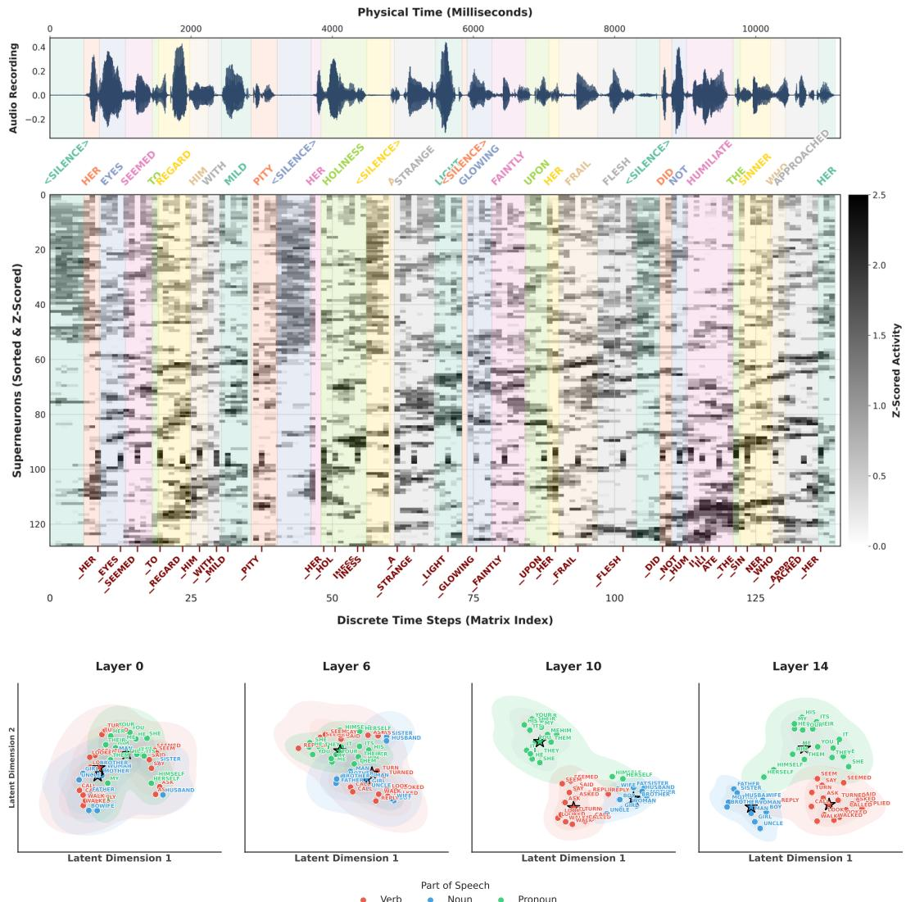
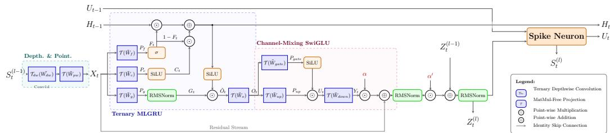
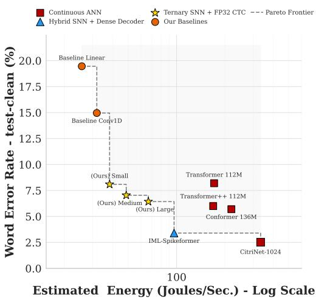
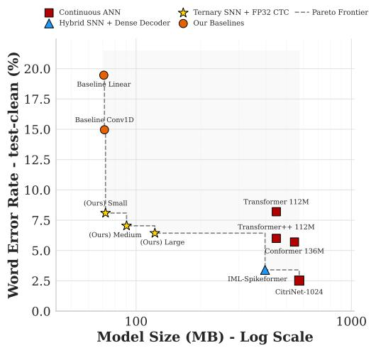
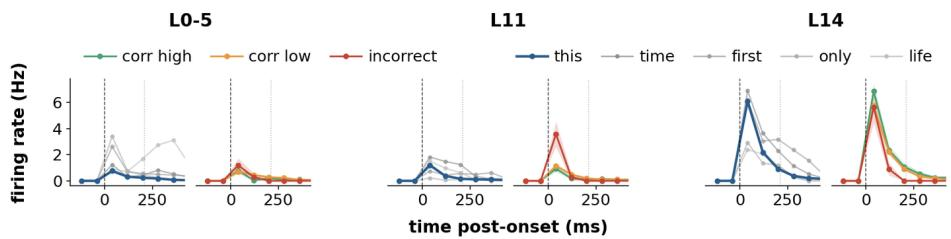
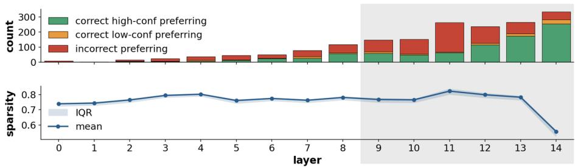
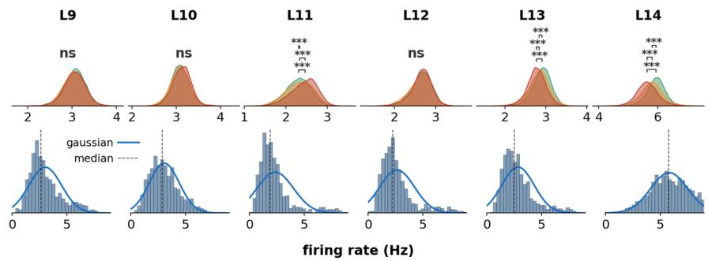
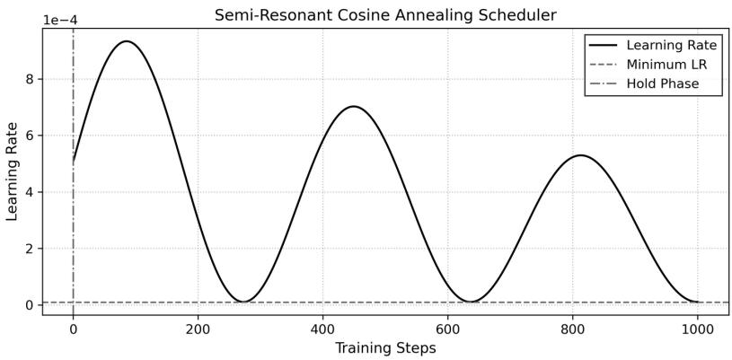
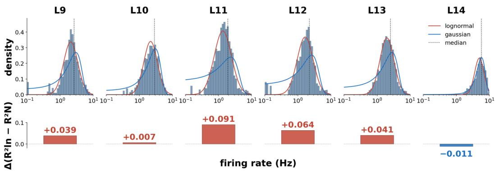
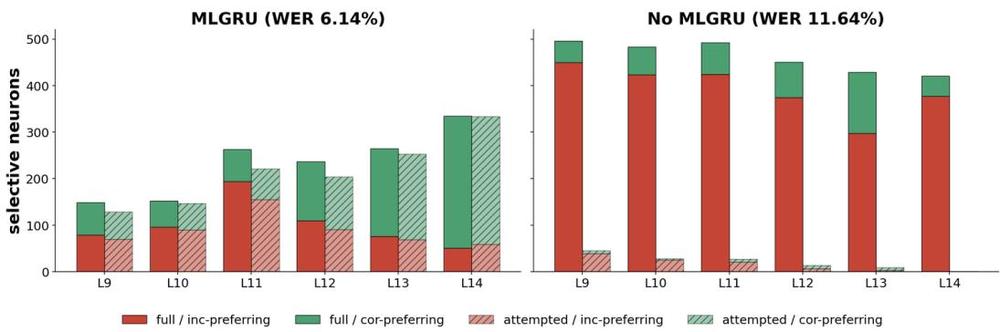

# BIO-INSPIRED AUDITORY PROCESSING: COUPLINGPARALLEL RESONATE-AND-FIRE DYNAMICS WITHTERNARY RECURRENT NETWORKS FOR SPEECHRECOGNITION

Pavlos Poulos1,2 Katelyn Sadorf2,3 Themos Stafylakis1,2 Costas A. Anastassiou2,3,4

1Department of Informatics, Athens University of Economics and Business, Greece 2Archimedes AI, Athena Research Center, Greece 3California Institute of Technology, USA 4Cedars-Sinai Medical Center, USA

pav.poulos, tstafylakis @aueb.gr, ksadorf, costas @caltech.edu costas.anastassiou@csmc.edu

## ABSTRACT

Spiking Neural Networks (SNNs) promise energy-efficient inference through sparse, event-driven computation, yet remain constrained on continuous, contextdependent tasks such as automatic speech recognition (ASR). A key bottleneck is the Leaky Integrate-and-Fire (LIF) neuron, whose membrane decay erases information across pauses and phonetic boundaries while it must both extract features and retain long-range context. Inspired by cortical separation of nonlinear filtering and somatic integration, we introduce the Spiking Ternary GRU (stGRU): a ternary-weight gated recurrent unit performs temporal filtering, while downstream Resonate-and-Fire (RF) neurons generate the binary spike stream driving the next block’s event pathway. This makes binary event transmission a native training constraint rather than a separate deployment-time activation quantization step; together with ternary weights, learned projections avoid dense floating-point ma trix MACs. Trained end-to-end on LibriSpeech-960, Small, Medium, and Large stGRUs reach 8.09%, 7.04%, and 6.44 0.17% WER on test-clean without an external language model. To our knowledge, these are the first matrix-MAC-free spiking networks without a learned ANN sequence decoder to achieve single-digit WER on LibriSpeech. The architecture also achieves 10.88% test CER on Aishell-1 (9.28% on dev) when trained from scratch. Internally, trained networks develop a depth-graded hierarchy: shallow layers act as fast acoustic filters, while deep layers form slower semantic integrators whose latent representations segregate into part-of-speech manifolds and word-level spike events. Deep-layer firing rates follow lognormal distributions with a sparsity gradient, mirroring hierarchical processing observed in human cortex in vivo. Our biologically grounded architecture combines competitive ASR with favorable modeled compute and memory cost while exposing interpretable internal dynamics.

## 1 INTRODUCTION

Spiking Neural Networks (SNNs) promise highly energy-efficient inference by leveraging sparse, event-driven computations Roy et al. (2019). Yet they remain fundamentally constrained on continuous, context-dependent tasks such as automatic speech recognition (ASR) Bittar & Garner (2022); Song et al. (2025); Wu et al. (2020). The primary bottleneck lies in the standard Leaky Integrateand-Fire (LIF) neuron Gerstner & Kistler (2002); Maass (1997), whose intrinsic membrane decay erases critical context across pauses and phonetic boundaries Bellec et al. (2018); Zenke & Ganguli (2018). Consequently, while continuous ANNs achieve state-of-the-art ASR performance Gulati et al. (2020); Vaswani et al. (2017), their reliance on dense multiply-accumulate (MAC) operations incurs prohibitive memory and energy costs Horowitz (2014)-leaving a critical gap for energy-constrained applications.

  
Figure 1: Acoustic alignment, internal population activity, and semantic manifold emergence in stGRU. (Top) Input acoustic waveform (LibriSpeech test utterance) aligned with ground-truth word boundaries (color-shaded spans) and internal spiking representations across physical time (top axis) and discrete network timesteps (bottom axis). The central heatmap displays the Z-scored activity of 128 superneurons (co-active neural clusters sorted via Rastermap Stringer et al. (2025)), with darker pixels indicating higher population firing. Red labels beneath the raster mark subword BPE token emissions predicted by the CTC readout layer (leading underscores denote new word onsets; consecutive identical tokens are collapsed into a single emission; CTC blanks omitted for clarity). (Bottom) 2D UMAP projections of latent representations across network depth (layers 0, 6, 10, and 14). Internal states progressively disentangle into distinct semantic and syntactic clusters, color-coded by part of speech: verbs (red), nouns (blue), and pronouns (green).

Prior spiking ASR systems largely resorted to hybrid architectures pairing a spiking encoder with a dense, floating-point ANN sequence decoder, forfeiting the energy benefits of a truly edge-ready system Bittar & Garner (2022); Song et al. (2025); Wu et al. (2020). Deep event-driven architectures are further hindered by an (L2) training bottleneck arising from sequential recurrent dependencies Neftci et al. (2019); Werbos (1990) and discontinuous spike resets Lee et al. (2016); Neftci et al. (2019). Together, these limitations motivate separating rich temporal filtering from discrete event communication while keeping learned projections matrix-MAC-free.

(a) Proposed Architecture  
  
(b) Energy Efficiency Frontier

  
(c) Memory Efficiency Frontier  
Figure 2: Architecture and efficiency comparisons. (a) stGRU block architecture. (b) LibriSpeech test-clean WER versus estimated arithmetic energy over the 19,440 s evaluation set. (c) WER versus theoretical parameter storage in decimal MB. The Large stGRU WER is a six-seed mean; energy estimates correspond to the reported profiling run.

A complementary limitation appears in MatMul-free recurrent models: ternary weights remove dense learned matrix products, but the MLGRU backbone retains continuous activations, so deployment on low-precision neuromorphic hardware requires a separate activation-quantization stage Zhu et al. (2024). This motivates our central question: can the activation constraint itself be learned while retaining gated long-range temporal filtering?

We answer this by treating spiking as a trainable activation interface for the event-driven pathway. In stGRU, a ternary MLGRU performs nonlinear temporal filtering, while a downstream RF neuron emits the binary spike stream that drives the next block’s event pathway. In the ternary backbone, weights discretize what the network stores; RF spikes discretize what its event pathway communicates. Crucially, the spike constraint is present during optimization rather than imposed only at deployment. This separation also mirrors cortical neurons, where gated nonlinear processing precedes somatic integration Gidon et al. (2020); Hausser & Mel (2003); London & H¨ ausser (2005); Mel (1991; 1992);¨ Shai et al. (2014; 2015). This storage–communication duality is central to stGRU. Our primary contributions are as follows:

## Train-Time Dual Discretization & matrix-MAC-free ASR.

stGRU pairs ternary learned weights with an RF-generated binary event stream, moving activation discretization into training rather than leaving it solely to deployment. To our knowledge, it is the first matrix-MAC-free SNN without a learned ANN sequence decoder to achieve single-digit WER on LibriSpeech Panayotov et al. (2015): Small, Medium, and Large stGRUs reach 8.09%, 7.04%, and 6.44 0.17% on test-clean without an external LM. Training from scratch on Aishell-1 Bu et al. (2017) yields 10.88% test CER (9.28% dev), close to the VGG-BiLSTM baseline (10.7% test CER) but below the strongest dense and hybrid systems in Table S5, providing cross-lingual evidence that the architecture transfers from English to Mandarin ASR.

Exceptional Performance-to-Model-Size Trade-off. Operating at 1.95 mJ/s (Small) and 3.42 mJ/s (Large), stGRU operates far below continuous Transformers (8.80 mJ/s) and Conformers (11.28 mJ/s) Gulati et al. (2020); Horowitz (2014). For the Large Conv1D–MLGRU–ReLU baseline, ternarizing the weights changes test-clean WER from 5.83% to 6.49%, an increase of 0.66 percentage points, while the modeled arithmetic-energy rate changes from 33.48 to 4.10 mJ/s (seed 3407). Ternary INT2 weights reduce the Large models to 122.22 MB on LibriSpeech and 167.84 MB on Aishell-1, yielding a favorable modeled energy–storage trade-off.

Emergent ACC-like Error-Monitoring. Layer L11 autonomously develops an ACC-like errormonitoring signature Alexander & Brown (2018); Bryden et al. (2019): incorrect words trigger elevated firing, peak sparsity (0.83), and heavy-tailed lognormal rate statistics $( \Delta R ^ { 2 } = + 0 . 0 9 1$ over Gaussian).

Decision Confidence & Autonomous ACC PFC Handoff. At L14, the coding regime inverts into a prefrontal cortex (PFC)-like commitment state Kiani & Shadlen (2009); Rutishauser et al. (2015): high-confidence correct words elicit peak firing, sparsity drops, and distributions shift to Gaussian. Together, these signatures suggest an autonomous ACC PFC-like functional handoff Alexander & Brown (2018) emerging within a single artificial sequence model.

## 2 RELATED WORK

While dense continuous models (Transformers, Conformers, CitriNet) define state-of-the-art ASR Hou et al. (2024); Majumdar et al. (2021); Radford et al. (2022), their reliance on dense multiplyaccumulate (MAC) operations incurs prohibitive compute and memory costs Horowitz (2014). MatMul-free MLGRU combines ternary weights with continuous activations; its Loihi 2 mapping therefore separately quantizes activations and retains 16-bit precision after 8-bit quantization substantially degrades accuracy Zhu et al. (2024).

Motivated by biological efficiency, Spiking Neural Networks (SNNs) have been adapted for speech via surrogate gradients Bittar & Garner (2022); Wu et al. (2020), TCNs Bai et al. (2018), and Spikedriven Transformers Yao et al. (2023; 2024). However, existing ternary spiking speech models remain heavily restricted: QT-SNN Wang et al. (2025) targets only isolated keyword spotting, whereas DyTr-SNN Wang et al. (2023) is evaluated solely on single-speaker LJSpeech without reporting WER and relies on a dense continuous 6-layer Transformer decoder. More broadly, leading SNN ASR baselines (GSU Hao et al. (2024), Spike-driven Transformer Yao et al. (2024), IML-Spikeformer Song et al. (2025)) depend on continuous 6-layer ANN decoders to maintain competitive accuracy Song et al. (2025). While their encoders use sparse accumulate (AC) operations, continuous decoders reintroduce a floating-point bottleneck and serialized execution, compromising edge viability.

stGRU bridges these two lines of work: it retains ternary MLGRU filtering but trains an RF-generated binary event interface end-to-end, making event discretization part of the model rather than a posttraining hardware conversion. Deferred scaling keeps learned backbone projections matrix-MAC-free, while direct CTC decoding avoids a learned ANN sequence decoder.

## 3 METHODOLOGY

## 3.1 TERNARY PROJECTIONS WITH DEFERRED WEIGHT SCALING

We use ternary BitLinear projections Ma et al. (2024); Zhu et al. (2024). For a full-precision shadow-weight matrix $W \in \mathbb { R } ^ { \times d }$ , let $\begin{array} { r } { \gamma _ { W } = ( m d ) ^ { - 1 } \sum _ { i , j } | W _ { i j } | } \end{array}$ and quantize by

$$
\widetilde { W } = \mathrm { R o u n d C l i p } \left( { \frac { W } { \gamma _ { W } + \epsilon } } , - 1 , 1 \right) , \qquad \widetilde { W } _ { i j } \in \{ - 1 , 0 , + 1 \} .\tag{1}
$$

The shadow weights are trained with a straight-through estimator (STE) Bengio et al. (2013) and QAT warmup (Appendix C.1).

Let $V$ denote the input presented to a projection after its shared input normalization. The three ablation modes differ only in the placement or omission of the weight scale:

$$
\begin{array} { r } { Y _ { \mathrm { n a i v e } } = V ( \gamma _ { W } \widetilde { W } ) ^ { \top } , } \\ { Y _ { \mathrm { p r o p o s e d } } = ( V \widetilde { W } ^ { \top } ) \gamma _ { W } , } \\ { Y _ { \mathrm { n o n e } } = V \widetilde { W } ^ { \top } . \qquad } \end{array}\tag{2}
$$

The naive and proposed modes are algebraically equivalent for fixed $V , \widetilde { W }$ , and $\gamma _ { W }$ . Naive scaling folds $\gamma _ { W }$ into the weights, producing a floating-point weight matrix. Deferred scaling instead accumulates through ternary weights using additions and subtractions, then applies $\gamma _ { W }$ to the output. The None mode omits this scale entirely. Thus the proposed mode avoids dense floating-point matrix MACs in the learned projection, but retains an output scaling operation. We write this operator as

$$
\mathcal { T } ( V , \widetilde { W } , \gamma _ { W } ) _ { i } = \gamma _ { W } \sum _ { j = 1 } ^ { d } \widetilde { W } _ { i j } V _ { j } , \qquad i = 1 , \dots , m .\tag{3}
$$

The same scale placement applies to a temporal depthwise projection. Let $V \in \mathbb { R } ^ { T \times C }$ be the input to that projection and $\widetilde { W } _ { d w } \in \{ - 1 , 0 , + 1 \} ^ { K \times C }$ its ternary kernel. With a weight scale $\gamma _ { d w }$ , we define

$$
\mathcal { T } _ { d w } ( V , \widetilde { W } _ { d w } , \gamma _ { d w } ) _ { t , c } = \gamma _ { d w } \sum _ { k } \widetilde { W } _ { d w , k , c } V _ { t + k , c } .\tag{4}
$$

The temporal sum therefore uses additions and subtractions through ternary weights; $\gamma _ { d w }$ is applied after that sum. This avoids folding a floating-point scale into every kernel weight. In the ablation (Table S8), deferred scaling reduces the modeled energy rate by about 5 relative to naive scaling, with comparable test-clean WER (Small: 8.09% vs. 8.15%; Large: 6.14% vs. 6.44%). Omitting the scale instead worsens test-clean WER to 9.44% and 7.51%, respectively.

## 3.2 PARALLEL SPIKING-TERNARY BLOCK ARCHITECTURE

To bypass the prohibitive $\mathcal { O } ( L ^ { 2 } )$ training bottleneck of recurrent networks and discontinuous resets Werbos (1990), the Spiking-Ternary GRU Block decouples recurrent filtering from spike emission, enabling global parallel unrolling in (L log L) time while avoiding dense learned matrix MACs at inference.

Acoustic features are initially mapped by a pre-encoder into discrete spike trains $S _ { t } ^ { ( 0 ) } \in \{ 0 , 1 \} ^ { C }$ . At block l, temporal features are extracted from the incoming discrete spike sequence $\mathsf { \bar { S } } ^ { ( l ) } \in \mathsf { \bar { \{ 0 , 1 \} } } ^ { T \times C }$ via a depthwise-separable operator pair consisting of a 1D temporal depthwise convolution and a pointwise channel projection:

$$
X _ { d w } = { \mathcal T } _ { d w } ( S ^ { ( l ) } , \widetilde W _ { d w } , \gamma _ { d w } ) , \quad X = { \mathcal T } ( X _ { d w } , \widetilde W _ { p w } , \gamma _ { p w } ) |\tag{5}
$$

where $\widetilde { W } _ { p w } \in \{ - 1 , 0 , + 1 \} ^ { C \times C }$ denotes the ternary pointwise weights and $\gamma _ { p w }$ their scale.

We adapt the MLGRU of Zhu et al. (2024) with deferred-scaling ternary projections, RMS-normalized gating, and a ternary output projection. For brevity, we denote gate-specific ternary projections as ${ \mathcal { T } } _ { k } ( V ) \triangleq { \mathcal { T } } ( V , \widetilde { W } _ { k } , \gamma _ { k } )$ for $k \in \{ c , f , g \}$ . For input representation $X _ { t } \in \mathbb { R } ^ { C }$ , the gates are computed as $\dot { C } _ { t } = \mathrm { S i L U } ( \mathcal { T } _ { c } ( X _ { t } ) ) , F _ { t } = \sigma ( \dot { \mathcal { T } } _ { f } ( \dot { X _ { t } } ) )$ , and $\hat { G } _ { t } = \dot { \mathrm { R M S N o r m } } ( \mathcal { T } _ { g } ( X _ { t } ) )$ , updating state and output via:

$$
H _ { t } = F _ { t } \odot H _ { t - 1 } + C _ { t } \odot ( 1 - F _ { t } )\tag{6}
$$

$$
O _ { t } = \mathcal { T } ( G _ { t } \odot \mathrm { S i L U } ( H _ { t } ) , \widetilde { W } _ { o } , \gamma _ { o } )\tag{7}
$$

Because Equation 6 is strictly element-wise (no dense $W h _ { t - 1 }$ products), intermediate representations are computed globally across sequence length $T$ via an associative parallel scan Gu et al. (2021); Smith et al. (2022).

Channels are mixed via a ternary SwiGLU block stabilized by learnable ReZero vectors α ${ \bf \chi } _ { \prime } \in \mathbb { R } ^ { C }$ Bachlechner et al. (2021) (Appendix C.2):

$$
U _ { t } = \mathrm { S i L U } ( \mathcal { T } ( O _ { t } , \widetilde { W } _ { \mathrm { g a t e } } , \gamma _ { \mathrm { g a t e } } ) ) \odot \mathcal { T } ( O _ { t } , \widetilde { W } _ { \mathrm { u p } } , \gamma _ { \mathrm { u p } } )\tag{8}
$$

$$
Z _ { t } = X _ { t } + \alpha \odot \mathcal { T } ( U _ { t } , \widetilde { W } _ { \mathrm { d o w n } } , \gamma _ { \mathrm { d o w n } } )\tag{9}
$$

To prevent vanishing gradients and stabilize variance across depth, the continuous residual stream $Z ^ { ( l ) } \in \mathbb { R } ^ { C }$ updates via:

$$
Z _ { t } ^ { ( l ) } = \mathbf { R M S N o r m } ( Z _ { t } ^ { ( l - 1 ) } ) + \alpha ^ { ' } \odot \mathbf { R M S N o r m } ( Z _ { t } )\tag{10}
$$

The stabilized residual $Z _ { t } ^ { ( l ) }$ serves as the input current to the Parallel Resonate-and-Fire (PRF) neuron Huang et al. (2024). Unlike standard LIF neurons which enforce sequential BPTT due to hard reset subtractions $( V _ { t h } S _ { t - 1 } )$ , PRF folds resets into a complex decay factor $\textstyle { \tilde { \gamma } } = - { \frac { 1 } { \tau } } + i \theta$ . Under Euler discretization over timestep $\Delta ,$ membrane integration unfolds linearly:

$$
U _ { t } = \exp \left( - \frac { \Delta } { \tau } \right) \left( \cos ( \Delta \theta ) + i \sin ( \Delta \theta ) \right) U _ { t - 1 } + \Delta Z _ { t } ^ { ( l ) }\tag{11}
$$

Because temporal integration is independent of output spikes, membrane potentials $U _ { 1 : T }$ evaluate globally in the frequency domain via Fast Fourier Transform $( \mathcal { F } )$ Cooley & Tukey (1965); Gu et al. (2021) using decay kernel $K _ { 1 : T } = ( \Delta A ^ { 0 } , \dots , \Delta A ^ { T - 1 } )$ with $A = \exp ( \bar { \Delta } \tilde { \gamma } )$

$$
U _ { 1 : T } = \mathcal { F } ^ { - 1 } ( \mathcal { F } ( Z _ { 1 : T } ^ { ( l ) } ) \odot \mathcal { F } ( K _ { 1 : T } ) )\tag{12}
$$

Finally, the continuous potentials are folded back into the binary domain for the (l + 1)-th block by applying a Heaviside step function strictly to the real component:

$$
S _ { t } ^ { ( l + 1 ) } = \mathcal { H } ( \Re \{ U _ { t } \} - V _ { t h } )\tag{13}
$$

Surrogate gradients (Multi-Gaussian Yin et al. (2021)) train this binary event interface end-to-end, so the next block is optimized on the same discrete spike stream used at inference. The MLGRU recurrence admits an associative scan and PRF integration an (L log L) FFT implementation; empirically, training is 3.1 –3.4 faster than the parameter-matched LIF variants (Tables S7, S9).

## 4 EXPERIMENTS

We evaluate the Spiking Ternary GRU (stGRU) on LibriSpeech-960 and Aishell-1 Panayotov et al. (2015); Bu et al. (2017) implemented in SpeechBrain Ravanelli et al. (2022) across 8 AMD Instinct MI250X GCDs on the LUMI supercomputer. Acoustic inputs (80-dimensional log-Mel filterbanks at 50 Hz) undergo 4 temporal subsampling via a ternary 2D CNN frontend (512 and 1024 channels), followed by an MLGRU layer coupled with a Parallel Resonate-and-Fire (PRF) neuron acting as a pre-encoder that emits discrete spikes at a reduced rate of 12.5 Hz. The subsequent stGRU backbone applies 1D depthwise convolutions with kernel sizes up to K = 63 across 1024 channels (Appendix A), trained end-to-end via CTC loss Graves et al. (2006) with Semi-Resonant Cosine Annealing (Appendix C.3). All primary metrics evaluate the standalone acoustic model; an optional OpenSLR 4-gram language model1 is decoded (Table S6) via non-neural CPU hash lookups and is therefore excluded from neural energy profiling.

Performance and Efficiency Benchmarks. We benchmark against continuous ANNs (Transformer, Conformer, CitriNet Vaswani et al. (2017); Hou et al. (2024); Gulati et al. (2020); Majumdar et al. (2021)) and the hybrid SNN IML-Spikeformer Song et al. (2025), calculating theoretical energy via 45 nm CMOS constants (4.6 pJ/FP-MAC, 0.9 pJ/sparse-AC, 17.5 pJ/PRF-update Horowitz (2014); Huang et al. (2024)). As reported in Table 1, Small, Medium, and Large stGRUs achieve standalone WERs of 8.09%, 7.04%, and 6.44 0.17% on LibriSpeech test-clean without an external LM (optional 4-gram LM yields 5.95 0.16%; Table S6), setting the first single-digit WERs for matrix-MAC-free SNNs without a learned ANN sequence decoder. A bounded-latency streaming variant with 320 ms look-ahead attains 9.11% WER at 3.51 mJ/s (Table 1). A separately trained stGRU achieves 10.88% test CER on Aishell-1 and 9.28% on dev (Table S5).

Parameter-matched ablations isolate individual design choices (Table 1, Table S7): quantizing from FP32 to ternary weights cuts memory by 7.4 –10.8 with negligible loss (5.83% 6.49%). At the Large scale, discrete PRF spikes surpass continuous ternary ReLUs in both WER and energy (6.14% at 3.42 mJ/s vs. 6.49% at 4.10 mJ/s; widening to 33.48 mJ/s for FP32 ReLUs; Table S7). Under the same analytical 45 nm arithmetic-cost model, our estimate for IML-Spikeformer allocates 2.73 mJ/s to its FP32 frontend and 1.68 mJ/s to its ANN decoder, whereas the stGRU estimate includes 0.05 mJ/s for active-weight accumulation in its FP32 CTC readout (Table S3). These are operation-based estimates, not measured hardware energy. Upgrading from Linear  RF to the full ternary stack adds < 5 MB and +2.12 mJ/s while reducing test-clean WER by 11.20% percentage points for seed 3407 (17.34% 6.14%).

Table 1: Comprehensive Architectural Comparison on LibriSpeech-960 ASR. All reported WER results evaluate the standalone acoustic model without an external language model. The Large RF WER is mean standard deviation over six seeds; other in-house rows and arithmetic-energy rates correspond to seed 3407.
<table><tr><td rowspan="2">Architecture</td><td rowspan="2">Params (M)</td><td rowspan="2">Weight Type</td><td rowspan="2">Memory (MB)</td><td rowspan="2">Energy rate (mJ/s) (mJ/s)</td><td colspan="2">WER (%)</td></tr><tr><td>test-clean</td><td>test-other</td></tr><tr><td colspan="7">Continuous Artificial Neural Networks (ANNs)</td></tr><tr><td>Moritz et al. Moritz et al. (2019)</td><td>70.0</td><td>FP32</td><td>280.0†</td><td></td><td>5.4</td><td>16.1</td></tr><tr><td>Park et al. Park et al. (2019)</td><td>360.0</td><td>FP32</td><td>1440.0†</td><td></td><td>2.8</td><td>6.8</td></tr><tr><td>Whisper-Small Radford et al. (2022)</td><td>244.0</td><td>FP16</td><td>488.0†</td><td></td><td>3.1</td><td>7.4</td></tr><tr><td>ResNet-BiGRU Reza et al. (2022)</td><td>33.0</td><td>FP32</td><td>132.8†</td><td></td><td>15.6</td><td></td></tr><tr><td>Quantized RNN-T Zhen et al. (2022)</td><td>27.8</td><td>FP8</td><td>27.8†</td><td></td><td>8.70</td><td>22.36</td></tr><tr><td>Quantized RNN-T Zhen et al. (2022)</td><td>27.8</td><td>FP4</td><td>13.9†</td><td></td><td>8.78</td><td>22.54</td></tr><tr><td>Transformer * Hou et al. (2024)</td><td>112.0</td><td>FP32</td><td>448.0†</td><td>8.80††</td><td>8.2</td><td>15.2</td></tr><tr><td>Transformer++ * Hou et al. (2024)</td><td>112.0</td><td>FP32</td><td>448.0†</td><td>8.69††</td><td>6.0</td><td>11.8</td></tr><tr><td>Conformer * Hou et al. (2024)</td><td>136.0</td><td>FP32</td><td>544.0†</td><td>11.28††</td><td>5.7</td><td>10.8</td></tr><tr><td>CitriNet-1024 Majumdar et al. (2021)</td><td>143.1</td><td>FP32</td><td>572.4†</td><td>17.18††</td><td>2.52</td><td>6.22</td></tr><tr><td colspan="7">Hybrid Spiking Neural Networks (SNNs) &amp; Dense ANN Decoder/LM</td></tr><tr><td>Deep FC SNN (LS-360h) Wu et al. (2020)</td><td></td><td>FP32</td><td></td><td></td><td>9.4</td><td></td></tr><tr><td>1 Spiking RNN + 3 LSTM Bittar &amp; Garner (2022)</td><td></td><td>FP32</td><td></td><td></td><td>3.51</td><td></td></tr><tr><td>4 Spiking RNN + 0 LSTM Bittar &amp; Garner (2022)</td><td></td><td>FP32</td><td></td><td></td><td>9.94</td><td></td></tr><tr><td>GSU (+ 6-layer ANN Dec) ** Hao et al. (2024)</td><td>185.0</td><td>FP32</td><td>740.4†</td><td></td><td>12.8</td><td>32.1</td></tr><tr><td>Spike-driven Trans. (+ 6-layer ANN Dec) ** Yao et al. (2024)</td><td>99.0</td><td>FP32</td><td>397.2†</td><td></td><td>10.5</td><td>25.7</td></tr><tr><td>IML-Spikeformer (+ 6-layer ANN Dec) Song et al. (2025)</td><td>99.0</td><td>FP32</td><td>397.2†</td><td>4.96††</td><td>3.4</td><td>7.9</td></tr><tr><td colspan="7">Ours (Structural Baselines, FP32 &amp; W/O Learned ANN Sequence Decoder)</td></tr><tr><td>Large (Linear → RF)</td><td>77.01</td><td>FP32‡</td><td>117.28</td><td>1.30</td><td>17.34</td><td>33.64</td></tr><tr><td>Large (Conv1D → RF)</td><td>77.58</td><td>FP32‡</td><td>119.56</td><td>2.22</td><td>11.64</td><td>26.20</td></tr><tr><td colspan="7">Ours (Parameter-Matched Baselines, Continuous Dense ReLU Activations)</td></tr><tr><td>Small (Conv1D → MLGRU → ReLU)</td><td>132.66</td><td>FP32</td><td>530.63</td><td>22.12</td><td>7.25</td><td>19.14</td></tr><tr><td>Medium (Conv1D → MLGRU → ReLU)</td><td>204.16</td><td>FP32</td><td>816.63</td><td>26.25</td><td>6.41</td><td>17.29</td></tr><tr><td>Large (Conv1D → MLGRU → ReLU)</td><td>329.39</td><td>FP32</td><td>1317.55</td><td>33.48</td><td>5.83</td><td>16.11</td></tr><tr><td>Small (Conv1D → MLGRU → ReLU)</td><td>132.66</td><td>Ternary INT2</td><td>72.01</td><td>2.60</td><td>7.74</td><td>20.26</td></tr><tr><td>Medium (Conv1D → MLGRU → ReLU)</td><td>204.16</td><td>Ternary INT2</td><td>90.16</td><td>3.13</td><td>6.68</td><td>17.71</td></tr><tr><td>Large (Conv1D → MLGRU → ReLU)</td><td>329.39</td><td>Ternary INT2</td><td>121.96</td><td>4.10</td><td>6.49</td><td>17.40</td></tr><tr><td colspan="7">Ours (matrix-MAC-free, Ternary Spiking Networks &amp; W/O Learned ANN Sequence Decoder)</td></tr><tr><td>Ours Large (Streaming) (Conv1D → MLGRU → RF)</td><td>329.45</td><td>Ternary INT2</td><td>122.22</td><td>3.51</td><td>9.11</td><td>22.13</td></tr><tr><td>Ours Small (Conv1D → MLGRU → RF) Ours Medium (Conv1D → MLGRU → RF)</td><td>132.68</td><td>Ternary INT2</td><td>72.09</td><td>1.95</td><td>8.09 7.04</td><td>20.79 18.74</td></tr><tr><td></td><td>204.20</td><td>Ternary INT2</td><td>90.31</td><td>2.49</td><td></td><td></td></tr><tr><td>Ours Large (Conv1D → MLGRU → RF)</td><td>329.45</td><td>Ternary INT2</td><td>122.22</td><td>3.42</td><td>6.44 ± 0.17</td><td>17.49 ± 0.23</td></tr></table>

† Theoretical memory size computed based on parameter count and format precision (FP32 = 4 Bytes, FP16 = 2 Bytes, INT2 = 0.25 Bytes).  
†† Our Reproduced results by publicly available data.  
∗ Trained on 2.5k hours of various datasets as cited in Hou et al. (2024).  
∗∗ Reproduced by Song et al. (2025).  
‡ Structural baselines use an INT2 ternary downsampler and FP32 downstream weights; unmarked FP32 variants also use an FP32 downsampler.

## 5 NEUROMORPHIC INTERPRETATION

Having established favorable modeled efficiency on English and Mandarin ASR, we now examine whether the network’s internal representations exhibit functional analogies to cortical decision signals. Echoing the parallel, distributed processing of human auditory cortex Hamilton et al. (2021); Bhaya-Grossman & Chang (2022), deep layers (L10–L14) autonomously partition into functionally distinct subpopulations whose activity statistics mimic those of neurons in human cortex during perceptual decisions. We substantiate this below.

## 5.1 ERROR-MONITORING SIGNATURE IN L11 MIMICS THE HUMAN MEDIAL FRONTAL CORTEX

At L11, incorrect words result in significantly higher population firing than either high- or lowconfidence correct words (Fig. 3, row 4) analogous to error-related activity associated with anterior cingulate cortex (ACC) Alexander & Brown (2018); Bryden et al. (2019). The error code is carried by a subpopulation of neurons: incorrect-preferring neurons outnumber high-confidence-correct neurons (n = 194 vs. 64; Fig. 3, top). L11 also exhibits the sparsest spiking activity from all layers (Fig. 3, row 3), placing it in the recruitment-based regime characteristic of cortical error monitoring. The response is also temporally appropriate for an error signal: incorrect-preferring neurons exhibit a sharp post-onset transient that decays before the CTC emission window, on the timescale of error detection rather than sustained stimulus encoding. Per-neuron firing rates at L11 follow a lognormal distribution (Fig. S2) as observed in cortical recall populations. It follows that directionality, recruitment, timing, and distribution align with an ACC-like role of L11.

  
Figure 3: Depth-graded coding emerges in trained Spiking-Ternary networks. Row 1: PSTH of word-selective neurons at shallow (L0–5), uncertainty (L11), and commitment (L14) depths. Each panel pair shows responses to a target word (“this,” blue) against acoustically similar competitors (gray), with the right sub-panel split by outcome (green: high-conf correct; orange: low-conf correct; red: incorrect). Row 2: Per-layer counts of outcome-selective neurons (matched-AUC, FDR $q < 0 . 0 0 1 )$ ; correct-preferring neurons are sub-classified by high- vs. low-confidence via median CTC log-probability. Selectivity grows from L0–L5 to L11–L14 (< 50 vs. > 250 neurons), and the bipartite partition reverses across depth: incorrect-preferring neurons peak at L11 $( n = 1 9 4 )$ high-confidence-correct-preferring at L14 (n = 254). Row 3: Population sparsity (per-word silent fraction) across encoder depth, with shaded IQR. Row 4: Population firing rate distributions for L9–L14 split by outcome (brackets: pairwise Mann–Whitney U-test with Bonferroni correction; ns: panels with at least one non-significant comparison). Row 5: Per-neuron firing rate histograms for L9–L14 with Gaussian fit overlaid.

## 5.2 DECISION-CONFIDENCE SIGNATURE IN L14 MIMICS THE PREFRONTAL CORTEX

L14, in turn, exhibits different behavior to L11. In L14 the highest spike rate corresponds to highconfidence correct words while low-confidence correct words are between the high-confidence and incorrect distributions. This graded confidence axis is absent at L11 and mimics the behavior observed in primate lateral intraparietal (LIP) and human medial temporal lobe (MTL) Kiani & Shadlen (2009); Rutishauser et al. (2015). At the level of decision hierarchy, prefrontal cortex (PFC) is the area where confidence signals from upstream regions are converted into committed action. The composition of the selective population inverts in parallel: high-confidence-correct neurons dominate $( n = 2 5 4 \mathrm { v s } .$ 58 incorrect-preferring; Fig. 3, top). PSTH responses broaden in turn, replacing the narrow error-only transient at L11 with large, sustained post-onset peaks across all three outcome conditions—the response shape expected of a layer broadcasting a committed token rather than gating a selective monitoring signal. Moreover, population sparsity decreases significantly from L11 to L14 and the per-neuron firing-rate changes from lognormal to near-Gaussian $( \Delta R ^ { 2 } = - 0 . 0 1 1$ , the only negative value in the recall hierarchy; Fig. S2). The latter indicates broad recruitment rather than selective monitoring with L14 emulating human PFC behavior.

## 5.3 AUTONOMOUS ACC-TO-PFC HANDOFF WITHIN A SINGLE NETWORK

The transition between L11 and L14 proceeds gradually through L12–L13 in a functional handoff. L12 acts as the inflection layer where responses to all categories become similar (Fig. 3, bottom, ns), the population code’s directionality reverses, and the spike rate lognormality gradually decays from L11 (+0.091) through L12 (+0.064) and L13 (+0.041) before vanishing at L14 ( 0.011). Selectivity composition, sparsity, firing-rate directionality, and distribution shape move together along this trajectory, consistent with a continuous functional gradient. This structure mimics the ACC with its error and surprise signals Alexander & Brown (2018) while PFC implements the downstream control that converts those signals into committed decisions. Critically, this handoff is implemented within a single recurrent network rather than across brain regions: a network trained end-to-end on CTC, with no architectural prior favoring functional segregation, partitions its deep layers into error-monitoring and confidence-readout subpopulations whose responses, sparsity, and firing-rate statistics jointly track signatures observed in human cortex in vivo. We note that this partition is not incidental to depth or spiking activity alone: in an ablated variant without MLGRU gating, deep-layer outcome selectivity collapses by 95.5% once empty-emission trials are controlled for, versus 8.1% in the full model (Supp. Fig. S3). This ablation supports a role for MLGRU gating in the observed outcome-selective activity. This mirrors cortical pyramidal neurons, where nonlinear dendritic filtering precedes somatic integration London & Hausser (2005); Mel (1992); Poirazi et al.¨ (2003); Shai et al. (2015) and subthreshold resonance bridges temporal context across pauses Bellec et al. (2018); Giraud & Poeppel (2012): upstream recurrent gating provides the temporal substrate necessary for downstream somatic integrators to develop decision-level outcome selectivity.

Limitations. Our energy estimates use analytical operation counts and 45 nm CMOS constants. QAT also retains full-precision shadow weights and their training overhead: the forward weights become ternary after warmup, while the straight-through estimator updates the continuous weights during backpropagation. Furthermore, while our design eliminates all dense $\mathcal { O } ( C ^ { 2 } )$ floating-point matrix multiplications, the model is not entirely multiplication-free: continuous element-wise multiplications persist in recurrent gating, residual scaling, RMSNorm, and neuron dynamics. These operations are element-wise rather than dense $O ( C ^ { 2 } )$ matrix multiplications, but deploying them on pure addition-only or integer-only edge silicon still requires specialized arithmetic units or approximations. Performance remains weaker on test-other than on test-clean. Finally, mitigating the capacity limits of 2-bit weights required wide channels and temporal kernels of up to $K = 6 3$ despite the low precision of their weights.

## 6 CONCLUSION

We introduced stGRU, an ASR architecture combining deferred-scaling ternary projections, gated recurrent filtering, and resonant spiking integration. At inference, its learned projections avoid dense matrix MACs, while the Large model reaches $6 . 4 4 \pm 0 . 1 7 \%$ LibriSpeech test-clean WER without an external language model and a separately trained Aishell-1 model reaches 10.88% test CER. The modeled arithmetic-energy and parameter-storage results show a favorable efficiency trade-off, subject to the accounting limits above.

Conceptually, stGRU couples complementary low-precision constraints in the event-driven backbone: ternary learned projections constrain synaptic weights, while RF neurons make the inter-block event stream binary during training rather than relying on a separate deployment-time activationquantization step. Spiking thus serves not only as neuronal dynamics but as an end-to-end optimized binary communication bottleneck. Despite this constraint, deep layers still develop error-to-confidence selectivity and structured sparsity, suggesting that efficient event-driven communication can coexist with rich internal organization.

## REFERENCES

William H. Alexander and Joshua W. Brown. Frontal cortex function derives from hierarchical predictive coding. Scientific Reports, 2018.

Thomas C. Bachlechner, Bodhisattwa Prasad Majumder, Huanru Henry Mao, Garrison W. Cottrell, and Julian McAuley. Rezero is all you need: Fast convergence at large depth. Conference on Uncertainty in Artificial Intelligence, 2021.

Shaojie Bai, J. Zico Kolter, and Vladlen Koltun. An empirical evaluation of generic convolutional and recurrent networks for sequence modeling. arXiv: Learning, 2018.

G. Bellec, Darjan Salaj, Anand Subramoney, R. Legenstein, and W. Maass. Long short-term memory and learning-to-learn in networks of spiking neurons. Neural Information Processing Systems, 2018.

Yoshua Bengio, Nicholas Leonard, and Aaron Courville. Estimating or propagating gradients through´ stochastic neurons for conditional computation. arXiv: Learning, 2013.

Ilina Bhaya-Grossman and Edward F. Chang. Speech computations of the human superior temporal gyrus. Annual Review of Psychology, 2022. doi: 10.1146/annurev-psych-022321-035256.

Alexandre Bittar and Philip N. Garner. Surrogate gradient spiking neural networks as encoders for large vocabulary continuous speech recognition. ArXiv, 2022. doi: 10.48550/arxiv.2212.01187.

Daniel W. Bryden, Adam T. Brockett, Elizabeth Blume, Kerry Heatley, Andrew Zhao, and Matthew R. Roesch. Single neurons in anterior cingulate cortex signal the need to change action during performance of a stop-change task that induces response competition. Cerebral Cortex, 2019.

Hui Bu, Jiayu Du, Xingyu Na, Bengu Wu, and Hao Zheng. Aishell-1: An open-source mandarin speech corpus and a speech recognition baseline. Oriental COCOSDA International Conference on Speech Database and Assessments, 2017. doi: 10.1109/icsda.2017.8384449.

J. Cooley and J. Tukey. An algorithm for the machine calculation of complex fourier series. 1965. doi: 10.1090/s0025-5718-1965-0178586-1.

W. Gerstner and W. M. Kistler. Spiking neuron models: Single neurons, populations, plasticity. 2002. doi: 10.1017/cbo9780511815706.

Albert Gidon, Timothy Adam Zolnik, Pawel Fidzinski, Felix Bolduan, Athanasia Papoutsi, Panayiota Poirazi, Martin Holtkamp, Imre Vida, and Matthew Evan Larkum. Dendritic action potentials and computation in human layer 2/3 cortical neurons. Science, 367(6473):83–87, 2020. doi: 10.1126/science.aax6239.

Anne-Lise Giraud and David Poeppel. Cortical oscillations and speech processing: emerging computational principles and operations. Nature Neuroscience, 2012. doi: 10.1038/nn.3063.

A. Graves, Santiago Fernandez, Faustino J. Gomez, and J. Schmidhuber. Connectionist temporal´ classification: labelling unsegmented sequence data with recurrent neural networks. ICML, 2006. doi: 10.1145/1143844.1143891.

Albert Gu, Karan Goel, and Christopher R’e. Efficiently modeling long sequences with structured state spaces. International Conference on Learning Representations, 2021.

Anmol Gulati, James Qin, Chung-Cheng Chiu, Niki Parmar, Yu Zhang, Jiahui Yu, Wei Han, Shibo Wang, Zhengdong Zhang, Yonghui Wu, and Ruoming Pang. Conformer: Convolution-augmented transformer for speech recognition. Interspeech, 2020. doi: 10.21437/interspeech.2020-3015.

Liberty S. Hamilton, Yulia Oganian, Jeffery A. Hall, and Edward F. Chang. Parallel and distributed encoding of speech across human auditory cortex. Cell, 2021. doi: 10.1016/j.cell.2021.07.019.

Xiang Hao, Chenxiang Ma, Qu Yang, Jibin Wu, and Kay Chen Tan. Towards ultra-low-power neuromorphic speech enhancement with spiking-fullsubnet. arXiv (Cornell University), 2024. doi: 10.48550/arxiv.2410.04785.

M. Horowitz. 1.1 computing’s energy problem (and what we can do about it). IEEE International Solid-State Circuits Conference, 2014. doi: 10.1109/isscc.2014.6757323.

Zejiang Hou, Goeric Huybrechts, Anshu Bhatia, Daniel Garcia-Romero, Kyu J. Han, and Katrin Kirchhoff. Revisiting convolution-free transformer for speech recognition. Interspeech, 2024. doi: 10.21437/interspeech.2024-588.

Yulong Huang, Zunchang Liu, Changchun Feng, Xiaopeng Lin, Hongwei Ren, Haotian Fu, Yue Zhou, Hong Xing, and Bojun Cheng. Prf: Parallel resonate and fire neuron for long sequence learning in spiking neural networks. arXiv.org, 2024. doi: 10.48550/arxiv.2410.03530.

Michael Hausser and Bartlett W. Mel. Dendrites: bug or feature? ¨ Current Opinion in Neurobiology, 2003. doi: 10.1016/s0959-4388(03)00075-8.

Roozbeh Kiani and Michael N. Shadlen. Representation of confidence associated with a decision by neurons in the parietal cortex. Science, 2009.

Jun Haeng Lee, Tobi Delbruck, and Michael Pfeiffer. Training deep spiking neural networks using backpropagation. Frontiers in Neuroscience, 2016. doi: 10.3389/fnins.2016.00508.

Michael London and Michael Hausser. Dendritic computation.¨ Annual Review ofNeuroscience, 2005. doi: 10.1146/annurev.neuro.28.061604.135703.

Shuming Ma, Hongyu Wang, Lingxiao Ma, Lei Wang, Wenhui Wang, Shaohan Huang, Lifeng Dong, Ruiping Wang, Jilong Xue, and Furu Wei. The era of 1-bit llms: All large language models are in 1.58 bits. arXiv.org, 2024. doi: 10.48550/arxiv.2402.17764.

Wolfgang Maass. Networks of spiking neurons: the third generation of neural network models. Transactions ofThe Societyfor Computer Simulation International, 1997. doi: 10.5555/281543. 281637.

Somshubra Majumdar, Jagadeesh Balam, Oleksii Hrinchuk, Vitaly Lavrukhin, Vahid Noroozi, and Boris Ginsburg. Citrinet: Closing the gap between non-autoregressive and autoregressive end-toend models for automatic speech recognition. arXiv: Audio and Speech Processing, 2021.

Bartlett W. Mel. The clusteron: Toward a simple abstraction for a complex neuron. In J. Moody, S. Hanson, and R. P. Lippmann (eds.), Advances in Neural Information Processing Systems, volume 4, pp. 35–42. Morgan Kaufmann, 1991.

Bartlett W. Mel. NMDA-based pattern discrimination in a modeled cortical neuron. Neural Computation, 4(4):502–517, 1992. doi: 10.1162/neco.1992.4.4.502.

Niko Moritz, Takaaki Hori, and Jonathan Le Roux. Triggered attention for end-to-end speech recognition. IEEE International Conference on Acoustics, Speech, and Signal Processing, 2019. doi: 10.1109/icassp.2019.8683510.

Emre Ozgur Neftci, Hesham Mostafa, and Friedemann Zenke. Surrogate gradient learning in spiking neural networks: Bringing the power of gradient-based optimization to spiking neural networks. arXiv: Neural and Evolutionary Computing, 2019. doi: 10.1109/msp.2019.2931595.

Vassil Panayotov, Guoguo Chen, Daniel Povey, and S. Khudanpur. Librispeech: An asr corpus based on public domain audio books. IEEE International Conference on Acoustics, Speech, and Signal Processing, 2015. doi: 10.1109/icassp.2015.7178964.

Daniel S. Park, William Chan, Yu Zhang, Chung-Cheng Chiu, Barret Zoph, Ekin Dogus Cubuk, and Quoc V. Le. Specaugment: A simple data augmentation method for automatic speech recognition. conference of the international speech communication association, 2019. doi: 10.21437/interspeech.2019-2680.

Panayiota Poirazi, Terrence Brannon, and Bartlett W. Mel. Pyramidal neuron as two-layer neural network. Neuron, 37(6):989–999, 2003. ISSN 0896-6273. doi: https://doi.org/10. 1016/S0896-6273(03)00149-1. URL https://www.sciencedirect.com/science/ article/pii/S0896627303001491.

Alec Radford, Jong Wook Kim, Tao Xu, Greg Brockman, C. McLeavey, and Ilya Sutskever. Robust speech recognition via large-scale weak supervision. International Conference on Machine Learning, 2022. doi: 10.48550/arxiv.2212.04356.

Mirco Ravanelli, Titouan Parcollet, Peter Plantinga, Aku Rouhe, Samuele Cornell, Loren Lugosch, Cem Subakan, Nauman Dawalatabad, Abdelwahab Heba, Jianyuan Zhong, Ju-chieh Chou, Sung-Lin Yeh, Szu-Wei Fu, Chien-Feng Liao, Elena Rastorgueva, Francois Grondin, William Aris, Hwidong Na, Yan Gao, Renato De Mori, and Yoshua Bengio. Speechbrain: A general-purpose speech toolkit. arXiv: Audio and Speech Processing, 2022.

Selim Reza, Marta Campos Ferreira, J.J.M. Machado, Joao Manuel R. S. Tavares, Selim Reza,˜ Marta Campos Ferreira, J.J.M. Machado, and Joao Manuel R. S. Tavares. A customized residual˜ neural network and bi-directional gated recurrent unit-based automatic speech recognition model. Expert systems with applications, 2022. doi: 10.1016/j.eswa.2022.119293.

Kaushik Roy, Akhilesh Jaiswal, and Priyadarshini Panda. Towards spike-based machine intelligence with neuromorphic computing. Nature, 2019. doi: 10.1038/s41586-019-1677-2.

Ueli Rutishauser, Shengxuan Ye, Matthieu Koroma, Oana Tudusciuc, Ian B. Ross, Jeffrey M. Chung, and Adam N. Mamelak. Representation of retrieval confidence by single neurons in the human medial temporal lobe. Nature Neuroscience, 2015.

Adam S. Shai, Christof Koch, and Costas A. Anastassiou. Spike-timing control by dendritic plateau potentials in the presence of synaptic barrages. Frontiers in Computational Neuroscience, 8:89, 2014. doi: 10.3389/fncom.2014.00089.

Adam S. Shai, Costas A. Anastassiou, Matthew E. Larkum, and Christof Koch. Physiology of layer 5 pyramidal neurons in mouse primary visual cortex: Coincidence detection through bursting. PLOS Computational Biology, 11(3):e1004090, 2015. doi: 10.1371/journal.pcbi.1004090.

Jimmy Smith, Andrew Warrington, and Scott W. Linderman. Simplified state space layers for sequence modeling. arXiv.org, 2022. doi: 10.48550/arxiv.2208.04933.

Zeyang Song, Shimin Zhang, Yuhong Chou, Jibin Wu, and Haizhou Li. Iml-spikeformer: Input-aware multi-level spiking transformer for speech processing. arXiv.org, 2025. doi: 10.48550/arxiv.2507. 07396.

Matei Ioan Stan and Oliver Rhodes. Learning long sequences in spiking neural networks. arXiv.org, 2023. doi: 10.48550/arxiv.2401.00955.

Carsen Stringer, Lin Zhong, Atika Syeda, Fengtong Du, Maria Kesa, and Marius Pachitariu. Rastermap: a discovery method for neural population recordings. Nature Neuroscience, 28 (1):201–212, 2025. doi: 10.1038/s41593-024-01783-4.

Ashish Vaswani, Noam M. Shazeer, Niki Parmar, Jakob Uszkoreit, Llion Jones, Aidan N. Gomez, Lukasz Kaiser, and Illia Polosukhin. Attention is all you need. Neural Information Processing Systems, 2017.

Qingyu Wang, Tielin Zhang, Minglun Han, Yi Wang, Duzhen Zhang, and Bo Xu. Complex dynamic neurons improved spiking transformer network for efficient automatic speech recognition. In Proceedings of the Thirty-Seventh AAAI Conference on Artificial Intelligence and Thirty-Fifth Conference on Innovative Applications ofArtificial Intelligence and Thirteenth Symposium on Educational Advances in Artificial Intelligence, AAAI’23/IAAI’23/EAAI’23. AAAI Press, 2023. ISBN 978-1-57735-880-0. doi: 10.1609/aaai.v37i1.25081. URL https://doi.org/10. 1609/aaai.v37i1.25081.

Shuai Wang, Dehao Zhang, Ammar Belatreche, Yichen Xiao, Hongyu Qing, Wenjie Wei, Malu Zhang, and Yang Yang. Ternary spike-based neuromorphic signal processing system. Neural Networks, 187:107333, 2025. ISSN 0893-6080. doi: https://doi.org/10.1016/j.neunet. 2025.107333. URL https://www.sciencedirect.com/science/article/pii/ S0893608025002126.

P. Werbos. Backpropagation through time: What it does and how to do it. Proceedings of the IEEE, 1990. doi: 10.1109/5.58337.

Jibin Wu, Emre Yilmaz, Malu Zhang, Haizhou Li, and Kay Chen Tan. Deep spiking neural networks for large vocabulary automatic speech recognition. Frontiers in Neuroscience, 2020. doi: 10.3389/ fnins.2020.00199.

Man Yao, Jiakui Hu, Zhaokun Zhou, Liuliang Yuan, Yonghong Tian, Boxing Xu, and Guoqi Li. Spike-driven transformer. arXiv.org, 2023. doi: 10.48550/arxiv.2307.01694.

Man Yao, Jiakui Hu, Tianxiang Hu, Yifan Xu, Zhaokun Zhou, Yonghong Tian, Boxing Xu, and Guoqi Li. Spike-driven transformer v2: Meta spiking neural network architecture inspiring the design of next-generation neuromorphic chips. arXiv.org, 2024. doi: 10.48550/arxiv.2404.03663.

Bojian Yin, Federico Corradi, and Sander M. Bohte. Accurate and efficient time-domain classification with adaptive spiking recurrent neural networks. Nature Machine Intelligence, 2021. doi: 10.1038/ s42256-021-00397-w.

Friedemann Zenke and Surya Ganguli. Superspike: Supervised learning in multilayer spiking neural networks. Neural Computation, 2018. doi: 10.1162/neco a 01086.

Kai Zhen, Martin H. Radfar, H. Nguyen, Grant P. Strimel, Nathan Susanj, and A. Mouchtaris. Sub-8-bit quantization for on-device speech recognition: A regularization-free approach. Spoken Language Technology Workshop, 2022. doi: 10.1109/slt54892.2023.10022821.

Rui-Jie Zhu, Yu Zhang, Ethan Sifferman, Tyler Sheaves, Yiqiao Wang, Dustin Richmond, Peng Zhou, and J. Eshraghian. Scalable matmul-free language modeling. arXiv.org, 2024. doi: 10.48550/arxiv.2406.02528.

## A ARCHITECTURAL CONFIGURATIONS AND STREAMING SETUP

Table S1 details the layer-by-layer configurations for the Small, Medium, and Large variants of our proposed stGRU architecture. The network hierarchically scales its temporal receptive field, mapping sequences from basic phonetic structures up to extended sentence and paragraph-level contexts. Across all scales, the temporal convolutions utilize a fixed channel dimension of 1024, a stride of 1, and a dilation of 1. Capacity is scaled by uniformly increasing the depth within each linguistic stage, culminating in a 15-layer Large variant that introduces an exclusive fifth stage with a receptive field of K = 63.

Table S1: Detailed architectural configurations for the Small, Medium, and Large stGRU variants. The receptive field expands progressively across stages to capture hierarchical linguistic features.
<table><tr><td rowspan="2">Linguistic Stage</td><td rowspan="2">Channels</td><td rowspan="2">Kernel Size</td><td colspan="3">Number of Layers</td></tr><tr><td>Small</td><td>Medium</td><td>Large</td></tr><tr><td>Stage 1 (Phonemes)</td><td>1024</td><td>11</td><td>1</td><td>2</td><td>3</td></tr><tr><td>Stage 2 (Syllables)</td><td>1024</td><td>21</td><td>1</td><td>2</td><td>3</td></tr><tr><td>Stage 3 (Words)</td><td>1024</td><td>39</td><td>1</td><td>2</td><td>3</td></tr><tr><td>Stage 4 (Sentences)</td><td>1024</td><td>51</td><td>1</td><td>2</td><td>3</td></tr><tr><td>Stage 5 (Extended Context)</td><td>1024</td><td>63</td><td>一</td><td>一</td><td>3</td></tr><tr><td colspan="4">Total stGRU Layers</td><td>8</td><td>15</td></tr></table>

## A.1 STREAMING IMPLEMENTATION VIA ASYMMETRIC PADDING

To enable the 320 ms look-ahead streaming variant evaluated in Section 4, we bound future context. Following the 4 spatio-temporal subsampling of the 50 Hz acoustic features, our pre-encoder operates at an internal frame rate of 12.5 Hz, where each discrete temporal step represents exactly 80 ms of audio. Standard temporal convolutions utilize symmetric padding, inherently violating streaming constraints by continually pulling from future acoustic frames. To resolve this, we adopt an asymmetric padding strategy. By eliminating right-sided padding across the majority of the network and deliberately restricting it to accumulate exactly 4 future frames at specific intermediate layers, we bound the network’s total future receptive field to exactly 320 ms (4 80 ms). This bounds algorithmic look-ahead compliance without altering the core matrix-MAC-free MLGRU dynamics.

## B REPRODUCIBILITY, TRAINING INFRASTRUCTURE, AND HYPERPARAMETERS

All model training and empirical evaluations were executed on the LUMI supercomputer cluster using a single LUMI-G node equipped with 4 AMD Instinct MI250X modules, which expose 8 Graphics Compute Dies (GCDs) addressed as independent devices by the runtime. The execution pipeline was containerized using Singularity. Distributed Data Parallel (DDP) training was conducted across the 8 GCDs using torchrun with the c10d backend.

Table S2: Key hyperparameters for PRF neuronal dynamics, optimization, tokenization, and CTC decoding.
<table><tr><td>Component</td><td>Hyperparameter</td><td>Value / Initialization</td></tr><tr><td>PRF Dynamics</td><td>Membrane Time Constant (τ) Resonant Frequency (θ) Integration Step (dt) Spike Threshold  $( V _ { t h r } )$ </td><td>Target 1.0 (with N(0, 0.05) jitter on  $\tau ^ { - 1 } )$  Linear spread  $\in [ 0 , \bar { \pi } / 2 ] + \dot { \mathcal { N } } ( 0 , 0 . 0 2 )$  jitter Target  $1 . \dot { 0 } + \dot { \mathcal { N } } ( \dot { 0 } , 0 . 0 5 )$  jitter Target  $1 . 0 + \mathcal { N } ( 0 , 0 . 0 5 )$  jitter</td></tr><tr><td>Optimization</td><td>SRCA Peak Learning Rate  $( \eta _ { \mathrm { m a x } } )$  SRCA Valley Learning Rate  $( \eta _ { \mathrm { m i n } } )$  QAT Warmup Steps</td><td>10-3 10-5 10,990 steps (10% of total)</td></tr><tr><td>Tokenization</td><td>LibriSpeech-960 Aishell-1</td><td>SentencePiece BPE (10,000 Vocabulary) BERT-base-Chinese tokenizer (21,128-token vocabulary)</td></tr><tr><td>CTC Decoding</td><td>Beam Size Language Model Weight (α) Word Insertion Penalty (β)</td><td>512 0.8 1.2</td></tr></table>

Note: All four PRF parameters $\overline { { ( \tau , \theta , d t , V _ { t h r } ) } }$ are defined as trainable variables jointly optimized during backpropagation.

## C ALGORITHMIC DERIVATIONS AND PSEUDOCODE

## C.1 QUANTIZATION-AWARE TRAINING (QAT) WARMUP STRATEGY

To mitigate the optimization instability and “quantization shock” associated with aggressively discretizing a randomly initialized network, we employ a progressive QAT warmup strategy. Let W be the continuous full-precision weight matrix. We compute the scaled weights normalized by the absolute mean γW:

$$
W _ { \mathrm { s c a l e d } } = \frac { W } { \gamma _ { W } + \epsilon } , \quad W _ { \mathrm { t e r n a r y } } = \operatorname* { m a x } \left( - 1 , \operatorname* { m i n } \left( 1 , \mathrm { r o u n d } ( W _ { \mathrm { s c a l e d } } ) \right) \right)\tag{S1}
$$

During forward passes, we construct an effective weight matrix $W _ { \mathrm { e f f e c t i v e } }$ using a scheduling parameter $\alpha _ { \mathrm { q a t } } \in [ 0 , 1 ] ;$

$$
W _ { \mathrm { e f f e c t i v e } } = ( 1 - \alpha _ { \mathrm { q a t } } ) W _ { \mathrm { s c a l e d } } + \alpha _ { \mathrm { q a t } } W _ { \mathrm { t e r n a r y } } , \quad \alpha _ { \mathrm { q a t } } = \mathrm { m i n } \left( 1 , { \frac { \mathrm { s t e p } } { N _ { \mathrm { w a r m u p } } } } \right)\tag{S2}
$$

At $\alpha _ { \mathrm { q a t } } = 0$ , the network operates in a purely continuous domain. As $\alpha _ { \mathrm { q a t } } \to 1$ , the network is progressively constrained to ternary representations. Backpropagation passes gradients directly through $W _ { \mathrm { e f f e c t i v e } }$ via the Straight-Through Estimator (STE) to update the continuous latent weights $W$

## C.2 DEEP RESIDUAL STABILIZATION VIA CHANNEL-WISE SCALING

To ensure stable signal propagation across deep layers without adding matrix multiplications, we introduce a layer-wise learnable parameter vector $\alpha \in \mathbb { R } ^ { C }$ . Let $\bar { \mathcal { F } } ( X _ { t } )$ represent the discrete transformation of the l-th Spiking-Ternary block. The residual update is modulated via element-wise multiplication:

$$
Z _ { t } = X _ { t } + \alpha \odot { \mathcal { F } } ( X _ { t } )\tag{S3}
$$

The vector α is initialized to zero $( \mathrm { o r 1 0 ^ { - 4 } } )$ , preserving identity gradient flow during early epochs. Because α is a 1D vector applied element-wise, it requires only $C$ sparse floating-point multiplications per timestep, completely bypassing dense matrix operations.

## C.3 SEMI-RESONANT COSINE ANNEALING (SRCA)

Let $\eta _ { \mathrm { m a x } }$ and $\eta _ { \mathrm { m i n } }$ denote the peak and anchored valley learning rates. Defining $S _ { \mathrm { h o l d } }$ as the holding period, $S _ { \mathrm { d e c a y } } \stackrel { \cdot } { = } S _ { \mathrm { t o t a l } } - S _ { \mathrm { h o l d } }$ , and $c = 2 . 7 5$ as the number of cosine cycles, the cycle progress for $t > S _ { \mathrm { h o l d } } \mathrm { i s } \dot { C } _ { t } = c ( t - S _ { \mathrm { h o l d } } ) / S _ { \mathrm { d e c a y } }$ . The learning rate $\eta _ { t }$ is governed by:

$$
\eta _ { t } = \left\{ \begin{array} { l l } { \eta _ { \mathrm { m a x } } } & { \mathrm { i f ~ } t \leq S _ { \mathrm { h o l d } } } \\ { \eta _ { \mathrm { m i n } } + \frac { 1 } { 2 } ( \eta _ { \mathrm { m a x } } - \eta _ { \mathrm { m i n } } ) \cdot \gamma ^ { C _ { t } } \cdot \left( 1 + \cos ( 2 \pi ( C _ { t } + \phi _ { \mathrm { s t a r t } } ) ) \right) } & { \mathrm { i f ~ } t > S _ { \mathrm { h o l d } } } \end{array} \right.\tag{S4}
$$

where $\gamma = 0 . 7 5$ is the exponential decay factor and $\phi _ { \mathrm { s t a r t } } = 0 . 7 5$ initializes the scheduler at the valley phase for a warmup sweep (Figure S1).

  
Figure S1: Semi-Resonant Cosine Annealing (SRCA) learning rate schedule with initial holding period $( S _ { \mathrm { h o l d } } = 1 5 0 )$ , followed by 2.75 cosine cycles with exponential peak decay $( \gamma = 0 . 7 5 )$ and initial phase offset $( \phi _ { \mathrm { s t a r t } } = 0 . 7 5 )$

Algorithm S1 End-to-End Spiking-Ternary Block Forward Pass (with Normalized Residuals)   
Require: $S ^ { ( l - 1 ) } \in \{ 0 , 1 \} ^ { T \times C }$ , Continuous residual $Z ^ { ( l - 1 ) } \in \mathbb { R } ^ { T \times C }$   
Require: Ternary weights $\widetilde { W }$ and structural scales γ for all projections   
Require: $\alpha , \alpha ^ { \prime } \in \mathbb { R } ^ { C }$ , Initial MLGRU hidden state $H _ { 0 } ,$ , PRF decay kernel $K _ { 1 : T }$   
1: // 1. Temporal Feature Extraction & MLGRU Update   
2: for $t = 1$ to T do   
3: $X _ { d w , t } \gets \mathcal { T } _ { d w } ( S ^ { ( l - 1 ) } , \widetilde { W } _ { d w } , \gamma _ { d w } ) _ { t }$ ▷ Depthwise matrix-MAC-free operator   
4: $X _ { t } \gets \mathcal { T } ( X _ { d w , t } , \tilde { W } _ { p w } , \gamma _ { p w } )$ ▷ Pointwise projection   
5: $C _ { t } \gets \mathrm { S i L U } ( \mathcal { T } ( X _ { t } , \widetilde { W } _ { c } , \gamma _ { c } ) )$   
6: $F _ { t } \gets \sigma ( \mathcal { T } ( X _ { t } , \widetilde { W } _ { f } , \gamma _ { f } ) )$   
7: $G _ { t } \gets \mathrm { R M S N o r m } ( \mathcal { T } ( X _ { t } , \widetilde { W } _ { g } , \gamma _ { g } ) )$   
8: $H _ { t } \gets F _ { t } \odot H _ { t - 1 } + \dot { C } _ { t } \odot ( \dot { 1 } - \dot { F } _ { t } )$ ▷ Element-wise parallel scan recurrence   
9: $O _ { t } \gets \mathcal { T } ( G _ { t } \odot \mathrm { S i L U } ( H _ { t } ) , \widetilde { W } _ { o } , \gamma _ { o } )$   
10: end for   
11: // 2. SwiGLU Channel Mixing & Residual Highway   
12: for $t = 1$ to $T$ do   
13: $U _ { t } ^ { \prime } \gets \mathrm { S i L U } ( \mathcal { T } ( O _ { t } , \widetilde { W } _ { \mathrm { g a t e } } , \gamma _ { \mathrm { g a t e } } ) ) \odot \mathcal { T } ( O _ { t } , \widetilde { W } _ { \mathrm { u p } } , \gamma _ { \mathrm { u p } } )$   
14: $Z _ { t } \gets \operatorname { R M S N o r m } ( X _ { t } + \alpha \odot \mathcal { T } ( U _ { t } ^ { \prime } , \widetilde { W } _ { \mathrm { d o w n } } , \gamma _ { \mathrm { d o w n } } ) )$   
15: $Z _ { t } ^ { ( l ) } \gets \mathrm { R M S N o r m } ( Z _ { t } ^ { ( l - 1 ) } ) + \alpha ^ { \prime } \odot Z _ { t }$   
16: end for   
17: // 3. Parallel Resonate-and-Fire (PRF) Somatic Integration   
18: $U _ { 1 : T }  \mathcal { F } ^ { - 1 } \big ( \mathcal { F } ( Z _ { 1 : T } ^ { ( l ) } ) \odot \mathcal { F } ( K _ { 1 : T } ) \big )$ ▷ Frequency-domain global parallel integration   
19: $S _ { 1 : T } ^ { ( l ) }  \mathcal { H } ( \Re \{ U _ { 1 : T } \} - V _ { \mathrm { t h } } )$ ▷ Binary spike emission for next block   
20: return $S _ { 1 : T } ^ { ( l ) } , Z _ { 1 : T } ^ { ( l ) }$

## C.4 DEFERRED SCALING IN TEMPORAL DEPTHWISE PROJECTIONS

For an input $V \in \mathbb { R } ^ { T \times C }$ , ternary kernel $\widetilde { W } _ { d w } \in \{ - 1 , 0 , + 1 \} ^ { K \times C }$ , and scalar $\gamma _ { d w } .$ , the naive and deferred forms are

$$
\begin{array} { r } { X _ { t , c } ^ { \mathrm { n a i v e } } = \displaystyle \sum _ { k } ( \gamma _ { d w } \widetilde { W } _ { d w , k , c } ) V _ { t + k , c } , } \\ { X _ { t , c } ^ { \mathrm { d e f e r r e d } } = \displaystyle \gamma _ { d w } \displaystyle \sum _ { k } \widetilde { W } _ { d w , k , c } V _ { t + k , c } . } \end{array}\tag{S5}
$$

They are algebraically equal. In the deferred form, a kernel coefficient of $+ 1 , - 1$ , or 0 selects addition, subtraction, or omission of the corresponding input value. The accumulated output is then scaled by $\gamma _ { d w } .$ Input normalization, when used, precedes both forms and does not distinguish the two modes. Deferred scaling removes floating-point multiplication by learned kernel weights inside the temporal sum; it does not remove the post-accumulation scaling operation.

## D HARDWARE-CALIBRATED ENERGY AND MEMORY PROFILING

## D.1 DYNAMIC ENERGY FORMULATION AND READOUT DERIVATION

Synaptic projection energy scales proportionally with input firing rate $F R \in [ 0 , 1 ]$ and non-zero weight density $N Z ~ \in ~ [ \bar { 0 } , 1 ]$ . In standard 45 nm CMOS technology, floating-point Multiply-Accumulate (MAC) operations consume $E _ { \mathrm { M A C } } = 4 . 6 \mathrm { p J }$ , while floating-point Accumulate (AC) additions consume $E _ { \mathrm { A C } } = 0 . 9$ pJ Horowitz (2014).

## MLGRU Gate Energy (over T timesteps):

1. Spike-Ternary Depthwise Conv $( \mathcal { T } _ { d w } ) \colon \mathcal { O } ( K \cdot C )$ operation requiring $T \cdot K \cdot C \cdot F R \cdot N Z$ operations at $E _ { \mathrm { A C } } .$

2. Pointwise Conv $( \mathcal { T } ) \colon \mathcal { O } ( C ^ { 2 } )$ operation requiring $T \cdot C ^ { 2 } \cdot N Z$ operations at $E _ { \mathrm { A C } }$

3. Gate Projections ( ): Candidate and gate representations require $3 T \cdot C ^ { 2 } \cdot N Z$ operations at $E _ { \mathrm { A C } }$

4. Output Projection ( ): Gated recurrent activations require $T \cdot C ^ { 2 } \cdot N Z$ operations at $E _ { \mathrm { A C } }$

SwiGLU Channel Mixing Energy: With hidden expansion $E _ { \mathrm { s w i } } = 4 . 0$ , Up and Gate projections require $8 T \cdot C ^ { 2 } \cdot N Z$ operations, and Down projection requires $4 T \cdot C ^ { 2 } \cdot \dot { N } Z$ operations, totaling $1 2 \bar { T } \cdot C ^ { 2 } \cdot N Z \cdot E _ { \mathrm { A C } }$

Neuronal Update Energy: Discrete membrane updates per PRF neuron require 4 multiplications and 3 additions per timestep Huang et al. (2024). Under 45 nm CMOS (3.7 pJ/mult, 0.9 pJ/add), $E _ { \mathrm { P R F } } \approx 1 7 . 5  { \mathrm { p J } }$ . Across C channels and T timesteps, this contributes a deterministic $T \cdot \bar { C } \cdot E _ { \mathrm { P R F } }$ cost.

Connectionist Temporal Classification (CTC) Readout Energy: The CTC linear readout projects the final layer’s hidden representations to the vocabulary dimension $( V = 1 0 { , } 0 0 0$ for LibriSpeech; $V = 2 1 . 1 \dot { 2 } 8$ for Aishell-1). Because this projection operates on unquantized full-precision weights $W _ { \mathrm { c t c } } \in \dot { \mathbb { R } } ^ { V \times C }$ (accounting for the 10.24 M non-ternary parameter remainder, or 40.96 MB at FP32), its computational costing requires explicit disambiguation:

• Input Representation: The input entering the readout is the binary spike train emitted by the final PRF somatic layer $S ^ { ( \mathring { L } ) } \in \{ 0 , 1 \} ^ { \overline { { T } } \times C }$

• Multiplier-Free Accumulation: For any output vocabulary token $v \in [ 1 , V ]$ at timestep t, the logit evaluates as:

$$
y _ { t , v } = \sum _ { c = 1 } ^ { C } W _ { \mathrm { c t c } , v , c } \cdot S _ { t , c } ^ { ( L ) } = \sum _ { c : S _ { t , c } ^ { ( L ) } = 1 } W _ { \mathrm { c t c } , v , c }\tag{S6}
$$

Because $S _ { t , c } ^ { ( L ) } \in \{ 0 , 1 \}$ , scalar weight multiplication by zero is bypassed, and multiplication by one reduces to an identity fetch. Consequently, the ideal sparse implementation of the linear readout fetches active FP32 weights and accumulates them without floating-point multiplication. This statement concerns readout arithmetic; weight-fetch energy is not included in our estimate.

• Arithmetic Verification: LibriSpeech test-clean comprises 5.40 hours (19,440 s). Downsampled at 12.5 Hz, the evaluation sequence spans $N = 1 9 , 4 4 0 \times 1 2 . 5 = 2 4 3 , 0 0 0$ discrete frames. The dense dimension product is $N \cdot \bar { C } \cdot V = 2 4 3 , 0 0 0 \times 1 0 2 4 \times 1 0 , 0 0 0$ ≈ $2 . 4 8 8 \times 1 0 ^ { 1 2 }$ theoretical operations. In continuous FP32 baselines, dense activations trigger continuous MACs at 4.6 pJ:

$$
E _ { \mathrm { b a s e l i n e } } = 2 . 4 8 8 \times 1 0 ^ { 1 2 } \times 4 . 6 { \bf p J } \approx 1 1 . 4 5 { \bf J } ( 0 . 5 9 { \bf m J } / \mathrm { s } )\tag{S7}
$$

which directly matches the 11.51 J reported for our parameter-matched FP32 baselines in Table S4. In contrast, for our spiking network, the active operation count scales by the empirical final-layer firing rate $\bar { F } R \approx 4 2 . 8 5 \%$ and executes at $E _ { \mathrm { A C } } = 0 . 9 \mathrm { p J } $

$$
E _ { \mathrm { s t G R U } } = \left( 2 . 4 8 8 \times 1 0 ^ { 1 2 } \times 0 . 4 2 8 5 \right) \times 0 . 9 \mathrm { p J } \approx 1 . 0 6 6 \times 1 0 ^ { 1 2 } \times 0 . 9 \mathrm { p J } \approx \mathbf { 0 . 9 6 J }\tag{0.05 mJ/s}
$$

(S8)

This confirms the exact derivation of the 0.96 J figure reported in Tables S3 and S4.

## D.2 THEORETICAL ENERGY ESTIMATION METHODOLOGY FOR BASELINES

To benchmark dynamic energy consumption against continuous ANNs and hybrid SNNs, we dynamically calculate Multiply-Accumulate (MAC) and Accumulate (AC) operations per audio sample following canonical analytical profiling conventions Horowitz (2014); Hou et al. (2024); Song et al. (2025). All continuous baselines replace autoregressive generation with an FP32 Connectionist Temporal Classification (CTC) linear readout costing N d V MACs Graves et al. (2006); Hou et al. (2024). The baseline architectures are decomposed as follows:

• Vanilla Transformer Vaswani et al. (2017); Hou et al. (2024): The core encoder operations consist of Multi-Head Attention (MHA) and a single Feed-Forward Network (FFN) per block. The MHA mechanism scales with sequence length N and hidden dimension d, requiring $4 d ^ { 2 } N + 2 d N ^ { 2 } \mathrm { M A C s } ( 3 d ^ { 2 } N $ for Q, K, V projections, $d ^ { 2 } N$ for output projection, and $2 d \bar { N } ^ { 2 }$ for attention context matrix products). The standard FFN (expansion factor 4) requires 8d2N MACs. Front-end acoustic subsampling uses dense strided 2D convolutions.

• Conformer Gulati et al. (2020); Hou et al. (2024): To capture local acoustic context, the Conformer block introduces a depthwise convolution module adding K d N MACs per block for kernel size K. Furthermore, it adopts the Macaron layout, sandwiching attention between two half-step FFN modules, doubling FFN compute to $1 6 d ^ { 2 } N$ MACs per block.

• Transformer++ Hou et al. (2024): Discards 2D convolutional down-sampling in favor of linear frame-stacking $( r \cdot d _ { \mathrm { i n p u t } } \times d )$ and removes internal encoder convolutions, while retaining the Macaron dual-FFN structure $( 1 6 d ^ { 2 } N$ MACs).

• Hybrid Spiking Architectures (IML-Spikeformer) Song et al. (2025): Features are downsampled via a continuous FP32 2D frontend incurring 53.13 J (2.73 mJ/s) of dense MACs. Its spiking encoder uses HD-RepSSA $( N D ^ { 2 }$ ops), ChannelMLP $( 8 \dot { N } D ^ { 2 } )$ , and attention matrix ops $( 2 N ^ { 2 } D )$ scaled across simulation window $T = 6$ and average firing rate R  18% (10.58 J / 0.54 mJ/s). However, total inference remains heavily dominated by its dense 6-layer FP32 autoregressive Transformer decoder (32.72 J / 1.68 mJ/s). Whereas IML repeats dynamics over $T = 6$ simulation timesteps per frame, stGRU operates at $T = 1$ without multi-step latency.

Algorithm S2 Profiled Arithmetic-Energy Estimate   
Require: Model , Dataset , Process constants $E _ { \mathrm { A C } } = 0 . 9 \mathrm { p J } , E _ { \mathrm { P R F } } = 1 7 . 5 \mathrm { p J }$   
Ensure: Total Dynamic Energy $E _ { \mathrm { t o t a l } }$   
1: $E _ { \mathrm { t o t a l } }  0$   
2: for each batch $X \in { \mathcal { D } }$ do   
3: Record forward-pass intermediate activations across all layers ${ \mathcal { L } } \in { \mathcal { M } }$   
4: for each layer $\mathcal { L } \in \mathcal { M }$ do   
5: if is a Synaptic Ternary Layer then   
6: NZ count( .weight = 0)/total( .weight)   
7: FR (input 0, 1 ) ? [count( .input = 1)/total( .input)] : 1.0   
8: ActiveOps TheoreticalOps( ) FR NZ   
9: $E _ { \mathrm { t o t a l } }  \cdot E _ { \mathrm { t o t a l } } + ( \mathrm { A c t i v e O p s } \cdot E _ { \mathrm { A C } } )$   
10: else if is a Neuronal PRF Layer then   
11: Etotal Etotal + (total( .output) EPRF)   
12: end if   
13: end for   
14: end for   
15: return $E _ { \mathrm { t o t a l } }$

Table S3: Estimated arithmetic-energy decomposition on LibriSpeech test-clean (5.40 hours; 19,440 s). For the continuous ANN comparisons, the downstream column is a modeled FP32 CTC readout; for IML-Spikeformer it is a six-layer ANN decoder; for stGRU it is active-weight accumulation in an FP32 CTC readout driven by binary spikes; see Appendix D.1). Estimates omit normalization, activation functions, residual scaling, memory traffic, and decoding/search.
<table><tr><td rowspan="2">Architecture</td><td colspan="4">Estimated Arithmetic Energy (Joules over 19,440 s)</td><td colspan="4">Estimated Arithmetic-Energy Rate (mJ/s)</td><td rowspan="2">Dense Matrix MACs</td></tr><tr><td></td><td>Sub-Sampler</td><td>Encoder Decoder</td><td>Total</td><td>Sub-Sampler</td><td>Encoder</td><td>Decoder</td><td>Total</td></tr><tr><td colspan="9">Continuous Artificial Neural Networks (ANNs)</td></tr><tr><td>Transformer 112M Hou et al. (2024)</td><td>53.13</td><td>117.01</td><td>1.16</td><td>171.31</td><td>2.73</td><td>6.01</td><td>0.06</td><td>8.80</td><td>Yes</td></tr><tr><td>Transformer++ 112M Hou et al. (2024) Conformer 136M Hou et al. (2024)</td><td>0.18</td><td>167.73</td><td>1.16</td><td>169.08</td><td>0.009 2.73</td><td>8.623 8.49</td><td>0.06 0.06</td><td>8.69 11.28</td><td>Yes Yes</td></tr><tr><td></td><td>53.13</td><td>165.19</td><td>1.16</td><td>219.49</td><td></td><td></td><td></td><td></td><td></td></tr><tr><td colspan="10">Hybrid Spiking Neural Networks (SNNs) &amp; Dense ANN Decoder</td></tr><tr><td>IML-Spikeformer Song et al. (2025)</td><td>53.13</td><td>10.58</td><td>32.72</td><td>96.45</td><td>2.73</td><td>0.54</td><td>1.68</td><td>4.96</td><td>Yes (Hybrid)</td></tr><tr><td colspan="10">Ours (Ternary SNNs)</td></tr><tr><td>Ours Small (Conv 1D → MLGRU → RF)</td><td>27.46</td><td>9.86</td><td>0.92</td><td>38.24</td><td>1.41</td><td>0.50</td><td>0.04</td><td>1.95</td><td>No</td></tr><tr><td>Ours Medium (Conv1D → MLGRU → RF)</td><td>27.03</td><td>20.58</td><td>0.94</td><td>48.55</td><td>1.39</td><td>1.05</td><td>0.05</td><td>2.49</td><td>No</td></tr><tr><td>Ours Large (Conv1D → MLGRU → RF)</td><td>26.73</td><td>39.01</td><td>0.96</td><td>66.70</td><td>1.374</td><td>2.006</td><td>0.05</td><td>3.42</td><td>No</td></tr></table>

Table S4: Stage-by-Stage Dynamic Energy Profiling across Model Scales and Architectures for LibriSpeech and Aishell-1.
<table><tr><td rowspan="2">Scale</td><td rowspan="2">Architecture Variant</td><td rowspan="2">Prec.</td><td rowspan="2">Memory (MB)</td><td colspan="4">Estimated Arithmetic Energy (Joules)</td><td colspan="4">Estimated Arithmetic-Energy Rate (m,J/s)</td></tr><tr><td>Sub Enc</td><td>Dec</td><td></td><td>Total Sub</td><td>Enc</td><td>Dec</td><td></td><td>Total</td></tr><tr><td colspan="10">Dataset: LibriSpeech test-clean (5.40 Hours -</td><td></td></tr><tr><td rowspan="5"></td><td>Linear → RF</td><td>FP32</td><td>70.79</td><td>24.62</td><td>0.22</td><td>0.82</td><td>25.66</td><td>1.26</td><td>0.01</td><td>0.04</td><td>1.31</td></tr><tr><td>Conv1D → RF</td><td>FP32</td><td>71.28</td><td>26.25</td><td>4.72</td><td>0.86</td><td>31.83</td><td>1.35</td><td>0.24</td><td>0.04</td><td>1.63</td></tr><tr><td>MLGRU → ReLU</td><td>FP32</td><td>513.32</td><td>338.47</td><td>75.48</td><td>11.51</td><td>425.46</td><td>17.40</td><td>3.88</td><td>0.59</td><td>21.87</td></tr><tr><td>MLGRU → RF</td><td>INT2</td><td>70.98</td><td>24.02</td><td>9.20</td><td>0.87</td><td>34.09</td><td>1.23</td><td>0.47</td><td>0.04</td><td>1.74</td></tr><tr><td>Conv1D → MLGRU → ReLU</td><td>FP32</td><td>530.63</td><td>338.47</td><td>80.34</td><td>11.51</td><td>430.32</td><td>17.40</td><td>4.13</td><td>0.59</td><td>22.12</td></tr><tr><td rowspan="8">Medium</td><td>Conv1D → MLGRU → RF</td><td>INT2</td><td>72.09</td><td>27.46</td><td>9.86</td><td>0.92</td><td>38.24</td><td>1.41</td><td>0.50</td><td>0.04</td><td>1.95</td></tr><tr><td>Linear → RF</td><td>FP32‡</td><td>87.69</td><td>23.22</td><td>0.36</td><td>0.84</td><td>24.42</td><td>1.19</td><td>0.02</td><td>0.04</td><td>1.25</td></tr><tr><td>Conv1D → RF</td><td>FP32‡</td><td>88.69</td><td>26.41</td><td>9.44</td><td>0.88</td><td>36.73</td><td>1.35</td><td>0.48</td><td>0.04</td><td>1.87</td></tr><tr><td>MLGRU → ReLU</td><td>FP32</td><td>782.01</td><td>338.47</td><td>150.97</td><td>11.51</td><td>500.95</td><td>17.40</td><td>7.76</td><td>0.59</td><td>25.75</td></tr><tr><td>MLGRU → RF</td><td>INT2</td><td>88.09</td><td>25.32</td><td>19.36</td><td>0.89</td><td>45.57</td><td>1.30</td><td>0.99</td><td>0.04</td><td>2.33</td></tr><tr><td>Conv1D → MLGRU → ReLU</td><td>FP32 INT2</td><td>816.63 90.31</td><td>338.47 27.03</td><td>160.68</td><td>11.51</td><td>510.66</td><td>17.40</td><td>8.26</td><td>0.59</td><td>26.25</td></tr><tr><td>Conv1D → MLGRU → RF</td><td></td><td></td><td></td><td>20.58</td><td>0.94</td><td>48.55</td><td>1.39</td><td>1.05</td><td>0.05</td><td>2.49</td></tr><tr><td rowspan="6">Conv1D → RF Large</td><td>Linear → RF</td><td>FP32</td><td>117.28</td><td>24.00</td><td>0.57</td><td>0.88</td><td>25.45</td><td>1.23</td><td>0.03</td><td>0.04</td><td>1.30</td></tr><tr><td></td><td>FP32</td><td>119.56</td><td>24.77</td><td>17.70</td><td>0.93</td><td>43.40</td><td>1.27</td><td>0.91</td><td>0.04</td><td>2.22</td></tr><tr><td>MLGRU → ReLU</td><td>FP32</td><td>1252.23</td><td>338.47</td><td>283.07</td><td>11.51</td><td>633.05</td><td>17.40</td><td>14.55</td><td>0.59</td><td>32.54</td></tr><tr><td>MLGRU → RF Conv1D → MLGRU → ReLU</td><td>INT2 FP32</td><td>118.02</td><td>27.95 338.47</td><td>36.86</td><td>0.86</td><td>65.67</td><td>1.43</td><td>1.89</td><td>0.04</td><td>3.36</td></tr><tr><td>Conv1D → MLGRU → RF</td><td>INT2</td><td>1317.55 122.22</td><td>26.73</td><td>301.40 39.01</td><td>11.51</td><td>651.38 66.70</td><td>17.40</td><td>15.49</td><td>0.59</td><td>33.48 3.42</td></tr><tr><td></td><td></td><td></td><td></td><td></td><td>0.96</td><td></td><td>1.374</td><td>2.006</td><td>0.05</td><td></td></tr><tr><td colspan="10">Dataset: Aishell-1 test (10.03 Hours — 36,108 s)</td></tr><tr><td colspan="10"></td><td></td><td>0.08</td><td></td></tr><tr><td rowspan="6">Small</td><td>Linear → RF Conv1D → RF</td><td>FP32‡ FP32</td><td>116.41 116.91</td><td>57.55 60.20</td><td>0.40 8.78</td><td>2.90 2.70</td><td>60.85 71.68</td><td>1.59 1.66</td><td>0.011 0.24</td><td>0.07</td><td>1.68 1.97</td></tr><tr><td>MLGRU → ReLU</td><td>FP32</td><td>558.98</td><td>629.77</td><td>140.45</td><td>45.27</td><td>815.49</td><td>17.44</td><td>3.89</td><td>1.24</td><td>22.57</td></tr><tr><td>MLGRU → RF</td><td>INT2</td><td>116.61</td><td>59.71</td><td>18.33</td><td>2.98</td><td>81.02</td><td>1.65</td><td>0.50</td><td>0.08</td><td>2.23</td></tr><tr><td>Conv1D → MLGRU → ReLU</td><td>FP32</td><td>576.25</td><td>629.77</td><td>149.49</td><td>45.27</td><td>824.53</td><td>17.44</td><td>4.14</td><td>1.25</td><td>22.83</td></tr><tr><td>Conv1D → MLGRU → RF</td><td>INT2</td><td>117.72</td><td>63.58</td><td>19.81</td><td>3.00</td><td>86.39</td><td>1.76</td><td>0.55</td><td>0.08</td><td>2.39</td></tr><tr><td></td><td>FP32</td><td>133.32</td><td>59.64</td><td></td><td>2.55</td><td>62.70</td><td></td><td>0.01</td><td>0.07</td><td></td></tr><tr><td rowspan="6">Medium</td><td>Linear → RF</td><td>FP32</td><td>134.32</td><td>60.01</td><td>0.51 17.56</td><td>2.84</td><td>80.41</td><td>1.65</td><td>0.48</td><td>0.08</td><td>1.73 2.22</td></tr><tr><td>Conv1D → RF MLGRU → ReLU</td><td>FP32</td><td>827.64</td><td>629.77</td><td>280.90</td><td>45.27</td><td>955.94</td><td>1.66 17.44</td><td>7.77</td><td>1.25</td><td></td></tr><tr><td>MLGRU → RF</td><td>INT2</td><td>133.71</td><td>59.83</td><td></td><td></td><td></td><td></td><td>1.00</td><td>0.08</td><td>26.46</td></tr><tr><td></td><td>FP32</td><td>862.26</td><td>629.77</td><td>36.15</td><td>3.00</td><td>98.98</td><td>1.65</td><td>8.28</td><td></td><td>2.73</td></tr><tr><td>Conv1D → MLGRU → ReLU Conv1D → MLGRU → RF</td><td>INT2</td><td>135.94</td><td>62.26</td><td>298.98 39.78</td><td>45.27</td><td>974.02</td><td>17.44</td><td></td><td>1.25</td><td>26.97</td></tr><tr><td></td><td></td><td></td><td></td><td></td><td>3.01</td><td>105.05</td><td>1.72</td><td>1.10</td><td>0.08</td><td>2.90</td></tr><tr><td rowspan="6">Large</td><td>Linear → RF</td><td>FP32</td><td>162.91</td><td>57.76</td><td>0.78</td><td>2.59</td><td>61.13</td><td>1.60</td><td>0.02</td><td>0.07</td><td>1.69</td></tr><tr><td>Conv1D → RF MLGRU → ReLU</td><td>FP32‡ FP32</td><td>165.18 1297.86</td><td>59.19 629.77</td><td>32.93 526.69</td><td>2.99 45.27</td><td>95.11 1201.73</td><td>1.63 17.44</td><td>0.91 14.58</td><td>0.08 1.25</td><td>2.62 33.28</td></tr></table>

‡ Structural baselines use an INT2 ternary downsampler and FP32 downstream weights; unmarked FP32 variants also use an FP32 downsampler.

## E NEUROMORPHIC INTERPRETATION AND ANALYSIS

Per-neuron firing rates were evaluated across the LibriSpeech evaluation set. Neurons firing below 0.1 Hz were excluded as recording-duration artifacts $( \leq 2$ of 1024 neurons per layer; n = 1022– 1024 per layer). For each layer, we fit lognormal and Gaussian distributions to empirical firing rates and evaluated $R ^ { 2 }$ as the squared Pearson correlation between empirical and fitted CDFs. We report $\Delta R ^ { 2 } = R _ { \mathrm { l n } } ^ { 2 } - R _ { \mathcal { N } } ^ { 2 }$ as the per-layer measure of lognormal superiority. Lognormality peaks at L11 (+0.091), persists through L12–L13 (+0.064, +0.041), and slightly favors Gaussian at L14 ( 0.011), capturing the transition from an error-monitoring regime to a broad recruitment readout (Figure S2).

Table S5: Comprehensive Architectural Comparison on Aishell-1 Mandarin ASR. Evaluated on Character Error Rate (CER %). Memory sizes are theoretical footprints based on parameter counts and precision formats.
<table><tr><td>Architecture</td><td>Params (M)</td><td>Weight Type</td><td>Memory (MB)</td><td>Energy rate (mJ/s)</td><td colspan="2">CER (%) dev test</td></tr><tr><td colspan="6"></td></tr><tr><td colspan="6">Continuous Artificial Neural Networks (ANNs)</td></tr><tr><td>VGG-BiLSTM Ravanelli et al. (2022)</td><td>93.30</td><td>FP32</td><td>373.0†</td><td></td><td>9.7</td><td>10.7</td></tr><tr><td>Binary S4D* Stan &amp; Rhodes (2023)</td><td>21.00</td><td>FP32</td><td>84.0†</td><td></td><td>10.3</td><td>11.9</td></tr><tr><td>Transformer* Stan &amp; Rhodes (2023)</td><td>61.90</td><td>FP32</td><td>247.6†</td><td></td><td>5.1</td><td>5.6</td></tr><tr><td colspan="6">Hybrid Spiking Neural Networks (SNNs) &amp; Dense ANN Decoder/LM</td></tr><tr><td>LIF* Song et al. (2025)</td><td>22.96</td><td>FP32</td><td>91.84†</td><td></td><td>13.8</td><td>15.7</td></tr><tr><td>Spiking TCN (+ 6-layer ANN Dec)* Bai et al. (2018)</td><td>23.35</td><td>FP32</td><td>93.40†</td><td></td><td>11.4</td><td>13.7</td></tr><tr><td>GSU (+ 6-layer ANN Dec)* Hao et al. (2024)</td><td>60.74</td><td>FP32</td><td>242.96†</td><td></td><td>10.9</td><td>12.6</td></tr><tr><td>Spike-driven Trans. (+ 6-layer ANN Dec)* Yao et al. (2023)</td><td>30.35</td><td>FP32</td><td>121.40†</td><td></td><td>10.2</td><td>11.9</td></tr><tr><td>IML-Spikeformer (+ 6-layer ANN Dec) Song et al. (2025)</td><td>61.89</td><td>FP32</td><td>247.56†</td><td></td><td>5.2</td><td>5.7</td></tr><tr><td colspan="6">Ours (Structural Baselines, FP32 &amp; W/O Learned ANN Sequence Decoder)</td></tr><tr><td>Large (Linear → RF)</td><td>88.42</td><td>FP32‡</td><td>162.91</td><td>1.69</td><td>19.95</td><td>22.92</td></tr><tr><td>Large (Conv1D → RF)</td><td>88.98</td><td>FP32‡</td><td>165.18</td><td>2.62</td><td>10.81</td><td>12.52</td></tr><tr><td colspan="6">Ours (Parameter-Matched Baselines, Continuous Dense ReLU Activations)</td></tr><tr><td>Small (Conv1D → MLGRU → ReLU)</td><td>144.06</td><td>FP32</td><td>576.25</td><td>22.83</td><td>10.37</td><td>11.84</td></tr><tr><td>Medium  $( \mathrm { C o n v 1 D } \to \mathrm { M L G R U } \to \mathrm { R e L U } )$ </td><td>215.56</td><td>FP32</td><td>862.26</td><td>26.97</td><td>11.00</td><td>12.60</td></tr><tr><td>Large  $( \mathrm { C o n v 1 D } \to \mathrm { M L G R U } \to \mathrm { R e L U } )$ </td><td>340.79</td><td>FP32</td><td>1363.17</td><td>34.23</td><td>10.62</td><td>12.24</td></tr><tr><td>Small  $( \mathrm { C o n v 1 D } \to \mathrm { M L G R U } \to \mathrm { R e L U } )$ </td><td>144.06</td><td>Ternary INT2</td><td>117.64</td><td>3.56</td><td>10.19</td><td>11.68</td></tr><tr><td>Medium (Conv1D → MLGRU → ReLU)</td><td>215.56</td><td>Ternary INT2</td><td>135.79</td><td>4.11</td><td>10.60</td><td>12.35</td></tr><tr><td>Large  $( \mathrm { C o n v 1 D } \to \mathrm { M L G R U } \to \mathrm { R e L U } )$ </td><td>340.79</td><td>Ternary INT2</td><td>167.58</td><td>5.18</td><td>9.98</td><td>11.42</td></tr><tr><td colspan="6">Ours (matrix-MAC-free, Ternary Spiking Networks &amp; W/O Learned ANN Sequence Decoder)</td></tr><tr><td>Ours Small (Conv1D → MLGRU → RF)</td><td>144.08</td><td>Ternary INT2</td><td>117.72</td><td>2.39</td><td>10.49</td><td>12.36</td></tr><tr><td>Ours Medium  $( \mathbf { C o n v 1 D } \to \mathbf { M L G R U } \to \mathbf { R F } )$ </td><td>215.60</td><td>Ternary INT2</td><td>135.94</td><td>2.90</td><td>9.66</td><td>11.44</td></tr><tr><td>Ours Large (Conv1D → MLGRU → RF)</td><td>340.86</td><td>Ternary INT2</td><td>167.84</td><td>3.88</td><td>9.28</td><td>10.88</td></tr></table>

† Theoretical memory computed from parameter count and format precision.  
∗ Reproduced results based on publicly available data. Reported numbers correspond to seed 3407.  
‡ Structural baselines use an INT2 ternary downsampler and FP32 downstream weights; unmarked FP32 variants also use an FP32 downsampler.

Table S6: Large Model WER (%) on LibriSpeech across 6 Random Seeds.
<table><tr><td>Test Set</td><td>4-gram LM</td><td>Seed 1</td><td>Seed 10</td><td>Seed 100</td><td>Seed 1000</td><td>Seed 10000</td><td>Seed 3407</td><td>Mean ± Std</td></tr><tr><td rowspan="2">test-clean</td><td>Without</td><td>6.53</td><td>6.60</td><td>6.33</td><td>6.46</td><td>6.58</td><td>6.14</td><td> ${ \bf 6 . 4 4 \pm 0 . 1 7 }$ </td></tr><tr><td>With</td><td>6.01</td><td>6.12</td><td>5.86</td><td>5.98</td><td>6.09</td><td>5.66</td><td> $5 . 9 5 \pm 0 . 1 6$ </td></tr><tr><td rowspan="2">test-other</td><td>Without</td><td>17.49</td><td>17.74</td><td>17.18</td><td>17.74</td><td>17.55</td><td>17.28</td><td> ${ \bf 1 7 . 4 9 \pm 0 . 2 3 }$ </td></tr><tr><td>With</td><td>16.54</td><td>16.77</td><td>16.28</td><td>16.75</td><td>16.58</td><td>16.30</td><td> $1 6 . 5 3 \pm 0 . 2 1$ </td></tr></table>

  
Figure S2: Depth-dependent change in firing-rate fits (L9–L14). Top: log-axis firing-rate histograms with lognormal (red) and Gaussian (blue) fits. Bottom: $\Delta R ^ { 2 } = \dot { R _ { \mathrm { l n } } ^ { 2 } } - \mathbf { \bar { { R } } _ { \mathcal { N } } ^ { 2 } }$ ; the lognormal fit has its largest advantage at L11 (+0.091), while the Gaussian fit is slightly better at L14 ( 0.011).

Table S7: Component-Wise Ablation: Model Scale, Architecture, and Weight Precision across LibriSpeech and Aishell-1. Isolates individual contributions of low-precision weights, sequence gating, and discrete spiking activations. Reported numbers correspond to seed 3407.
<table><tr><td rowspan="2">Scale</td><td rowspan="2">Architecture Variant</td><td rowspan="2">Precision</td><td rowspan="2">Params (M)</td><td rowspan="2">Memory (MB)</td><td colspan="2">Error Rate (%)</td><td rowspan="2">Energy rate (mJ/s)</td></tr><tr><td>test-clean / Dev</td><td>test-other / Test</td></tr><tr><td colspan="8"></td></tr><tr><td rowspan="9">Small</td><td>Linear → RF</td><td>FP32</td><td>65.39</td><td>70.79</td><td>19.46</td><td>35.40</td><td>1.31</td></tr><tr><td>Conv1D → RF</td><td>FP32</td><td>65.51</td><td>71.28</td><td>14.96</td><td>30.39</td><td>1.63</td></tr><tr><td>MLGRU → ReLU</td><td>FP32</td><td>128.33</td><td>513.32</td><td>14.46</td><td>28.75</td><td>21.87</td></tr><tr><td>MLGRU → RF</td><td>Ternary</td><td>128.35</td><td>70.98</td><td>15.95</td><td>30.87</td><td>1.74</td></tr><tr><td>Conv1D → MLGRU → ReLU</td><td>FP32</td><td>132.66</td><td>530.63</td><td>7.25</td><td>19.14</td><td>22.12</td></tr><tr><td>Conv1D → MLGRU → ReLU</td><td>Ternary</td><td>132.66</td><td>72.01</td><td>7.74</td><td>20.26</td><td>2.60</td></tr><tr><td>Conv1D → MLGRU → LIF</td><td>Ternary</td><td>132.67</td><td>72.07</td><td>8.18</td><td>20.65</td><td>1.87</td></tr><tr><td>Conv1D → MLGRU → RF</td><td>Ternary</td><td>132.68</td><td>72.09</td><td>8.09</td><td>20.79</td><td>1.95</td></tr><tr><td>Linear → RF</td><td>FP32</td><td>69.61</td><td>87.69</td><td>18.38</td><td>34.72</td><td>1.25</td></tr><tr><td rowspan="9">Medium</td><td>Conv1D → RF</td><td>FP32</td><td>69.86</td><td>88.69</td><td>13.20</td><td>28.10</td><td>1.87</td></tr><tr><td>MLGRU → ReLU</td><td>FP32</td><td>195.50</td><td>782.01</td><td>12.87</td><td>26.87</td><td>25.75</td></tr><tr><td>MLGRU → RF</td><td>Ternary</td><td>195.54</td><td>88.09</td><td>14.50</td><td>29.18</td><td>2.33</td></tr><tr><td>Conv1D → MLGRU → ReLU</td><td>FP32</td><td>204.16</td><td>816.63</td><td>6.41</td><td>17.29</td><td>26.25</td></tr><tr><td>Conv1D → MLGRU → ReLU</td><td>Ternary</td><td>204.16</td><td>90.16</td><td>6.68</td><td>17.71</td><td>3.13</td></tr><tr><td>Conv1D → MLGRU → LIF</td><td>Ternary</td><td>204.18</td><td>90.27</td><td>7.30</td><td>18.72</td><td>3.21</td></tr><tr><td>Conv1D → MLGRU → RF</td><td>Ternary</td><td>204.20</td><td>90.31</td><td>7.04</td><td>18.74</td><td>2.49</td></tr><tr><td>Linear → RF</td><td>FP32</td><td>77.01</td><td>117.28</td><td>17.34</td><td>33.64</td><td></td></tr><tr><td>Conv1D → RF</td><td>FP32</td><td>77.58</td><td>119.56</td><td>11.64</td><td>26.20</td><td>1.30 2.22</td></tr><tr><td rowspan="10">Large</td><td>MLGRU → ReLU</td><td>FP32</td><td>313.06</td><td>1252.23</td><td>12.13</td><td>25.24</td><td>32.54</td></tr><tr><td>MLGRU → RF</td><td>Ternary</td><td>313.12</td><td>118.02</td><td>13.53</td><td>28.09</td><td>3.36</td></tr><tr><td>Conv1D → MLGRU → ReLU</td><td>FP32</td><td>329.39</td><td>1317.55</td><td>5.83</td><td>16.11</td><td>33.48</td></tr><tr><td>Conv1D → MLGRU → ReLU</td><td>Ternary</td><td>329.39</td><td>121.96</td><td>6.49</td><td>17.40</td><td></td></tr><tr><td></td><td>Ternary</td><td>329.43</td><td>122.15</td><td>7.05</td><td></td><td>4.10</td></tr><tr><td>Conv1D → MLGRU → LIF</td><td></td><td></td><td></td><td></td><td>18.36</td><td>3.21</td></tr><tr><td>Conv1D → MLGRU → RF</td><td>Ternary</td><td>329.45</td><td>122.22</td><td>6.14</td><td>17.28</td><td>3.42</td></tr><tr><td>Large (320ms Look-Ahead)</td><td>Ternary</td><td>329.45</td><td>122.22</td><td>9.11</td><td>22.13</td><td>3.51</td></tr><tr><td></td><td></td><td>Part II: Aishell-1 Evaluation (CER %)</td><td></td><td></td><td></td><td></td></tr><tr><td colspan="7"></td></tr><tr><td rowspan="9">Small</td><td>Linear → RF</td><td>FP32</td><td>76.79</td><td>116.41</td><td>21.20</td><td>24.51</td><td>1.68</td></tr><tr><td>Conv1D → RF</td><td>FP32</td><td>76.92</td><td>116.91</td><td>12.68</td><td>14.77</td><td>1.97</td></tr><tr><td>MLGRU → ReLU</td><td>FP32</td><td>139.74</td><td>558.98</td><td>18.32</td><td>20.67</td><td>22.57</td></tr><tr><td>MLGRU → RF</td><td>Ternary</td><td>139.76</td><td>116.61</td><td>17.66</td><td>19.87</td><td>2.23</td></tr><tr><td>Conv1D → MLGRU → ReLU</td><td>FP32</td><td>144.06</td><td>576.25</td><td>10.37</td><td>11.84</td><td>22.83</td></tr><tr><td>Conv1D → MLGRU → ReLU</td><td>Ternary</td><td>144.06</td><td>117.64</td><td>10.19</td><td>11.68</td><td>3.56</td></tr><tr><td>Conv1D → MLGRU → LIF</td><td>Ternary</td><td>144.08</td><td>117.69</td><td>9.15</td><td>10.59</td><td>2.18</td></tr><tr><td>Conv1D → MLGRU → RF</td><td>Ternary</td><td>144.08</td><td>117.72</td><td>10.49</td><td>12.36</td><td>2.39</td></tr><tr><td>Linear → RF</td><td>FP32</td><td>81.02</td><td>133.32</td><td>21.20</td><td>24.51</td><td></td></tr><tr><td rowspan="9">Medium</td><td>Conv1D → RF</td><td>FP32</td><td>81.27</td><td>134.32</td><td>11.63</td><td>13.68</td><td>1.73 2.22</td></tr><tr><td>MLGRU → ReLU</td><td>FP32</td><td>206.91</td><td>827.64</td><td>17.52</td><td>19.77</td><td></td></tr><tr><td>MLGRU → RF</td><td>Ternary</td><td>206.95</td><td>133.71</td><td>18.03</td><td>20.51</td><td>26.46 2.73</td></tr><tr><td>Conv1D → MLGRU → ReLU</td><td>FP32</td><td>215.56</td><td>862.26</td><td>11.00</td><td>12.60</td><td>26.97</td></tr><tr><td>Conv1D → MLGRU → ReLU</td><td>Ternary</td><td>215.56</td><td>135.79</td><td>10.60</td><td>12.35</td><td>4.11</td></tr><tr><td>Conv1D → MLGRU → LIF</td><td>Ternary</td><td>215.59</td><td>135.90</td><td>9.19</td><td>10.76</td><td>2.72</td></tr><tr><td>Conv1D → MLGRU → RF</td><td>Ternary</td><td>215.60</td><td>135.94</td><td>9.66</td><td>11.44</td><td>2.90</td></tr><tr><td></td><td></td><td></td><td></td><td></td><td></td><td></td></tr><tr><td>Linear → RF</td><td>FP32</td><td>88.42</td><td>162.91</td><td>19.95</td><td>22.92</td><td>1.69</td></tr><tr><td rowspan="8">Large Conv1D → MLGRU → ReLU Conv1D → MLGRU → ReLU</td><td>Conv1D → RF</td><td>FP32</td><td>88.98</td><td>165.18</td><td>10.81</td><td>12.52</td><td>2.62</td></tr><tr><td>MLGRU → ReLU</td><td>FP32</td><td>324.46</td><td>1297.86</td><td>16.40</td><td>18.58</td><td>33.28</td></tr><tr><td>MLGRU → RF</td><td>Ternary FP32</td><td>324.53</td><td>163.65</td><td>16.69</td><td>18.98</td><td>3.70</td></table>

‡ Structural baselines use an INT2 ternary downsampler and FP32 downstream weights; unmarked FP32 variants also use an FP32 downsampler.

Table S8: Placement of the weight scale in Small and Large stGRUs. All modes share input normalization. Naive folds γ into the weights; Proposed applies it after ternary accumulation; None omits it. Proposed has substantially lower modeled arithmetic-energy rate than Naive, while omitting γ worsens test-clean WER at both scales. Energy rates use the stated 45 nm operation costs and exclude an external language model.
<table><tr><td rowspan="2">Model</td><td rowspan="2">Scaling Mode</td><td colspan="2">WER (%)</td><td colspan="2">Sparsity (%)</td><td rowspan="2">Energy rate (mJ/s)</td></tr><tr><td>test-clean</td><td>test-other</td><td>Activation</td><td>Weight</td></tr><tr><td rowspan="3">Small</td><td>Naive  $( X ( \widetilde { W } \gamma ) ^ { \top } )$ </td><td>8.15</td><td>20.92</td><td>12.93</td><td>41.53</td><td>9.78</td></tr><tr><td>Proposed  $( ( X \widetilde { W } ^ { \top } ) \gamma )$ </td><td>8.09</td><td>20.79</td><td>12.84</td><td>41.76</td><td>1.95</td></tr><tr><td>None  $( X \widetilde { W } ^ { \top } )$ </td><td>9.44</td><td>22.61</td><td>14.44</td><td>39.81</td><td>2.21</td></tr><tr><td rowspan="3">Large</td><td>Naive  $( X ( \widetilde { W } \gamma ) ^ { \top } )$ </td><td>6.44</td><td>17.43</td><td>17.36</td><td>38.57</td><td>17.74</td></tr><tr><td>Proposed  $( ( X \widetilde { W } ^ { \top } ) \gamma )$ </td><td>6.14</td><td>17.28</td><td>17.08</td><td>39.15</td><td>3.42</td></tr><tr><td>None  $( X \widetilde { W } ^ { \top } )$ </td><td>7.51</td><td>19.20</td><td>19.64</td><td>38.16</td><td>3.75</td></tr></table>

Table S9: Empirical Training Throughput for 10 Epochs on LibriSpeech-960: PRF vs. LIF on 8 AMD Instinct MI250X GCDs.
<table><tr><td>Model Size</td><td>Neuron Type</td><td>Training Time (10 epochs)</td></tr><tr><td>Small</td><td>LIF</td><td>8h 53m</td></tr><tr><td>Small</td><td>PRF</td><td>2h 40m (3.3× speedup)</td></tr><tr><td>Medium Medium</td><td>LIF</td><td>14h 35m</td></tr><tr><td></td><td>PRF</td><td>4h 44m (3.1× speedup)</td></tr><tr><td>Large</td><td>LIF</td><td>25h 00m</td></tr><tr><td>Large</td><td>PRF</td><td>7h 21m (3.4× speedup)</td></tr></table>

  
Figure S3: Outcome-selective neuron counts (L9–L14) for full vs. attempted-emission-only trial pools, MLGRU vs. no-MLGRU (Large variants). Selective neuron counts per layer, split by outcome preference (incorrect-preferring, red; correct-preferring, green). Left: Full MLGRU (Conv1D MLGRU RF). Empty-emission rate on incorrect words is 13.82%; restricting to attempted emissions reduces aggregate selective count by only 8.1%. Right: Ablated variant without MLGRU (Conv1D RF). Empty-emission rate is 57.76%; restricting to attempted emissions collapses aggregate selective count by 95.5%, supporting a role for MLGRU gating for the emergent error-monitoring property.