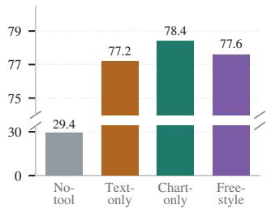
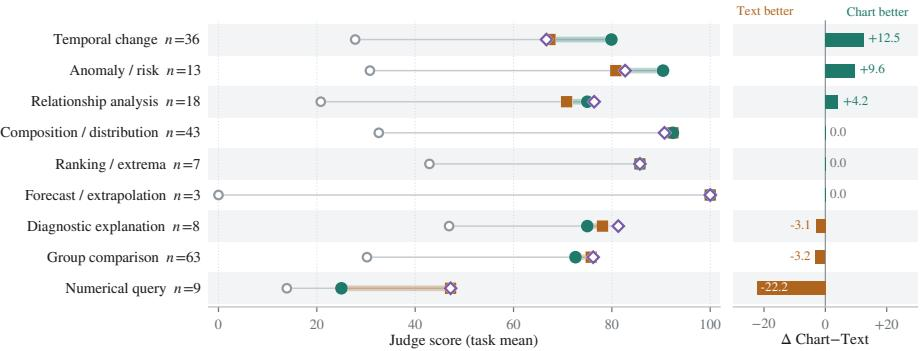
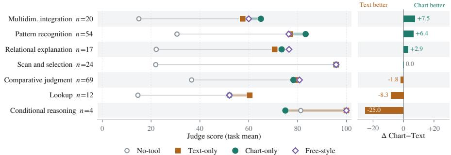
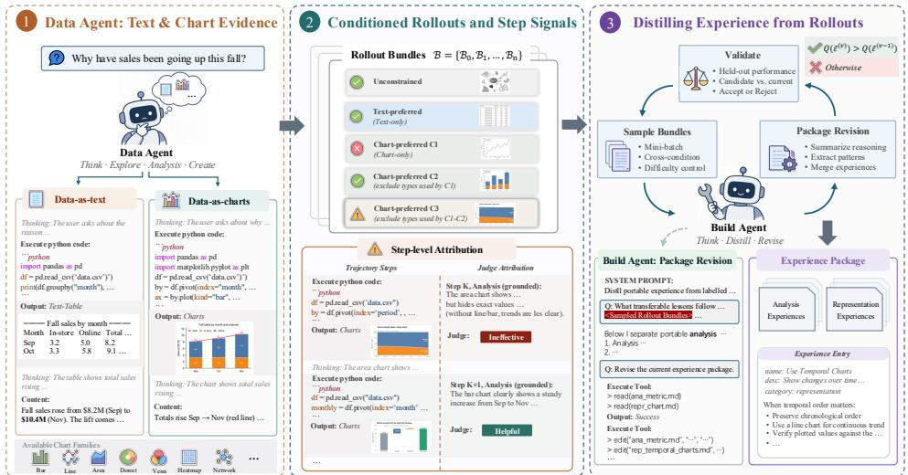
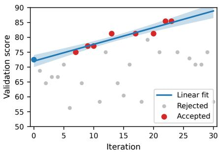
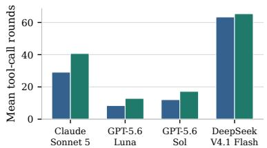
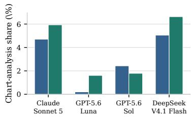

# CHARTS AS EPISTEMIC ACTIONS FOR EXPERIENCE-DRIVEN AGENTIC DATA ANALYSIS

Xinzhe Wang<sup>1</sup> Xudong Weng<sup>1</sup> Zang Li<sup>1</sup> Shaolei Zhang<sup>2</sup>

<sup>1</sup>Tencent <sup>2</sup>Renmin University of China

{xinzhewang,steveweng,gavinzli}@tencent.com zhangshaolei98@ruc.edu.cn

## ABSTRACT

Data agents built on ReAct-style loops now execute complex analytical workflows over structured data, yet their intermediate reasoning still runs almost entirely through text. Human analysts instead move between numbers, tables, and charts, reading visual evidence to expose trends and anomalies that text summaries drop. We ask whether charts can serve as internal epistemic actions inside a data agent’s reasoning loop, and how to teach an agent to use them. We first build PROBEBENCH, a suite of 200 controlled tasks under four matched interface conditions, and find a persistent gap between what agents can read and what they choose to use. Agents score as well from self-generated charts as from numeric output, yet plotting access alone does not translate into consistent use. Task slices show that charts lead on temporal, pattern, and anomaly reasoning, while text leads on precise reading and conditional verification. We then propose CHARTMIND, which distils two families of experience from conditioned trajectory rollouts. One family records how to select and verify analytical operations, and the other records when to invoke text, charts, or both. A trajectory judge scores outcomes and labels intermediate steps, and a validation gate admits only experience that improves held-out performance. On three held-out benchmarks with four LLM backbones, CHARTMIND raises analytical accuracy and visual evidence quality over matched baselines, and backbones that never drew charts begin using them, all without touching model parameters.

## 1 INTRODUCTION

Data agents translate an analytical goal into a sequence of grounded actions and derive insights step by step. Recent progress in ReAct-style reasoning and acting loops (Yao et al., 2023) has enabled these agents to plan, execute, inspect, and revise increasingly complex workflows over structured data. Analytical report generation, long-horizon exploration, and exact-answer analysis all now sit within their reach (Lei et al., 2025; Liu et al., 2026; Jing et al., 2025). Such agents execute text-based analytical actions competently.

Human analysts, in contrast, do not think only in text. They move continually between numerical summaries, tables, and charts, using visual evidence to expose trends, distributions, and anomalies that a scrolling table hides. A well-chosen chart at the right moment can reshape the next step of analysis. Charts thus act as epistemic actions in the analyst’s loop rather than as post-hoc report artefacts. We therefore ask whether an agent should also treat charts as intermediate evidence and learn when to invoke them.

Existing methods address only part of this decision. Chart-generation methods optimise visualisations requested by a user or an agent (Dibia, 2023; Yang et al., 2024; Namgoong et al., 2025; Lu et al., 2026; Wang et al., 2025), while ChartMimic benchmarks chart-to-code generation (Yang et al., 2025). Chart-understanding methods assume that a chart is already available and focus on extracting information from it (Masry et al., 2023; Han et al., 2023; Liu et al., 2023a;b; Zhang et al., 2024; Kaur et al., 2026; Das et al., 2026), while ChartBench benchmarks complex chart reasoning (Xu et al., 2023). Recent work compares different input representations (Zhou et al., 2025; Ho et al., 2026), routes table–query pairs across textual, visual, and fused paths (Xing et al., 2026), or builds visual evidence on demand during report writing (Lin et al., 2026). We study how a data agent selects textual and chart evidence at intermediate analytical states.

To turn this open question into a concrete study, we build PROBEBENCH, a probe suite of 200 tasks synthesised from InsightBench (Sahu et al., 2025) with four matched interface conditions and a common ReAct backbone. Three findings emerge. First, charts alone already sustain end-to-end analysis. Second, plotting access alone does not translate into consistent use. Third, charts and text behave as complementary evidence across task slices, with charts stronger on temporal, pattern, and anomaly reasoning and text stronger on precise reading and conditional verification. These findings motivate a method that turns representation choice into a learned behaviour of the agent.

We propose CHARTMIND, an experience-driven method that teaches a data agent to use charts inside the analytical loop. For each PROBEBENCH, CHARTMIND generates diverse trajectories under different representation conditions and uses $f _ { \mathrm { s c o r e } }$ and $f _ { \mathrm { a t t r } }$ to score outcomes and label intermediate decisions. A builder agent distils the labelled trajectories into two experience families. Analysis experience $\mathcal { E } _ { \mathrm { a n a } }$ records how to select and verify analytical operations, and representation experience $\mathcal { E } _ { \mathrm { r e p r } }$ records when and how to invoke text, charts, or a mixture. Candidate packages are accepted only when a validation gate confirms that held-out performance strictly improves. On downstream tasks the data agent reads a frozen package as external memory, so representation choice becomes part of the analytical policy without changing model parameters.

Our main contributions are as follows.

• Probe study of chart use. We construct PROBEBENCH with four matched interfaces and four backbones. The suite exposes a capability–use gap in current data agents and quantifies where charts and text serve as complementary evidence.

• Experience-driven method for chart use. We propose CHARTMIND. Given conditioned trajectory rollouts, it distils analysis and representation experience under outcome scoring and step-level attribution, and only experience updates that pass a validation gate enter the frozen package. CHARTMIND is the first framework that treats charts as internal epistemic actions of a data agent through learned experience.

• Consistent gains on held-out benchmarks. On DAComp-DA, DDR-Bench, and DSBench with four LLM backbones, CHARTMIND raises analytical accuracy and visual evidence quality over matched baselines. Backbones with weak representation-selection habits begin using charts, and ablations confirm the contributions of rollout diversity, validation gating, and both experience types.

## 2 CHARTS IN THE ANALYTICAL LOOP

This section asks whether charts carry genuine analytical value for data agents and how their utility differs from text. We design PROBEBENCH, a controlled probe suite, and evaluate representative agents under four matched interfaces, then report the suite’s construction, evaluation protocol, and three empirical findings.

## 2.1 PROBE DESIGN

Task construction. To isolate the effect of intermediate representations on agent reasoning, we build PROBEBENCH from InsightBench (Sahu et al., 2025), which provides enterprise tables, openended questions, executable analyses, and target insights. Each valid insight defines a task, yielding 200 tasks in total. A task contains a raw CSV, dataset description, analytical question, reference analysis, and target insight. The agent sees the table, question, description, schema, and first three rows, then selects and executes operations to answer in natural language; the target insight is hidden for evaluation.

Analytical dimensions. For post-hoc slicing without label leakage, we annotate two dimensions. Question type covers numeric lookup, composition, ranking, group comparison, temporal change, relationship, anomaly, diagnosis, and prediction. Cognitive load covers information location, scanand-select, comparison, pattern recognition, relational interpretation, multidimensional integration, and conditional reasoning. An LLM proposes the labels and a human verifies them; they never enter the agent context.

  
Figure 1: Judge scores under four matched PROBEBENCH interfaces. The score axis is split.

Table 1: Representation choice under Free-style across four backbones. Both counts tasks that use text and charts jointly.
<table><tr><td rowspan="2">LLM backbone</td><td rowspan="2">Score</td><td colspan="3">Representation use</td><td colspan="2">Interaction cost</td></tr><tr><td>Text</td><td>Chart</td><td>Both</td><td>Rounds Tokens</td><td></td></tr><tr><td>Claude Sonnet 5</td><td>79.2</td><td>102</td><td>0</td><td>98</td><td>4.0</td><td>18.7k</td></tr><tr><td>GPT-5.6 Luna</td><td>76.2</td><td>198</td><td>0</td><td>2</td><td>3.1</td><td>6.8k</td></tr><tr><td>GPT-5.6 Sol</td><td>77.6</td><td>198</td><td>0</td><td>2</td><td>2.9</td><td>6.4k</td></tr><tr><td>DeepSeek V4.1 Flash</td><td>80.2</td><td>143</td><td>0</td><td>57</td><td>6.2</td><td>30.1k</td></tr></table>

Agent interfaces. To hold everything but the analytical interface constant, all four settings share a vanilla ReAct agent with one general-purpose Bash tool. Each call starts a fresh process, files persist in a shared working directory, and the CSV is exposed read-only. We fix the model, initial context, interaction limit, and tool budget across conditions. No-tool removes execution tools. Text-only exposes stdout and stderr but forbids plotting. Chart-only exposes generated images and stderr while hiding stdout. Free-style returns stdout, stderr, and images and allows both text and charts.

Evaluation. To obtain comparable scores across settings, a shared LLM judge grades each answer against the target insight on a normalised [0, 100] scale. Slice analyses use task-paired differences with clustered bootstrap intervals (Brown, 1995) and randomisation tests. Figure 1 and Table 1 summarise the two views used in the following analysis.

## 2.2 EMPIRICAL FINDINGS

Finding 1. Charts alone already sustain end-to-end analysis. To check whether charts carry enough evidence for analytical questions, we compare the four interfaces under the same backbone. Figure 1 shows that removing execution tools collapses the agent to a low score, while the Text-only and Chart-only interfaces achieve similar performance. Chart-only slightly outperforms Text-only, so the agent can read charts it just drew and produce answers comparable in quality to those obtained from numeric tables. Charts already satisfy the sufficiency condition for intermediate evidence, so the remaining question is whether agents actually use them.

Finding 2. Representation choice is model-dependent, not capability-driven. To probe whether the sufficiency of charts translates into use, we let each backbone freely choose between text and charts under the same Free-style interface. Table 1 shows large behavioural divergence. Claude Sonnet 5 combines text and charts on nearly half of the tasks and DeepSeek V4.1 Flash on more than a quarter, while GPT-5.6 Luna and GPT-5.6 Sol essentially fall back to text. The frequency of chart use does not track score. This shows that identical tool access yields inconsistent representation habits and confirms a capability–use gap. A method that closes this gap should shape when and how charts enter the loop, and cannot stop at exposing plotting tools.

Finding 3. Charts and text play complementary roles across analytical tasks. To locate where each representation helps, we slice results by question type and cognitive load. Figure 2 shows a clear pattern. Charts pull ahead on slices that demand visual pattern recognition, including temporal change, pattern recognition, and anomaly detection. Text pulls ahead on slices that demand precise reading, including numeric lookup, information location, and conditional verification. Free-style does not automatically inherit the stronger of the two on visual-pattern slices, so agents fail to switch to charts even where charts help most. Effective chart use therefore requires state-aware representation selection, and uniform access to both formats alone is not enough.

Summary of PROBEBENCH. PROBEBENCH shows that current data agents understand charts far better than they use them, and that charts and text play complementary roles under different task conditions. This gap and this complementarity together motivate a mechanism that learns state-dependent representation choice as part of the analytical policy, which we develop in Section 3.



  
Figure 2: Slice analysis of the four PROBEBENCH interfaces. Top: slices by question type. Bottom: slices by primary cognitive load. Markers show slice mean scores. The right column reports the Chart-only minus Text-only gap.

## 3 LEARNING TO USE CHARTS THROUGH EXPERIENCE

Section 2 leaves a concrete target. Charts already carry sufficient evidence, yet agents do not invoke them where they help, so representation choice has to become a decision the agent makes from the current analysis state. Reaching that target requires three things. The agent needs a place to hold representation knowledge, a way to acquire that knowledge from its own behaviour, and a way to consult it while analysing. CHARTMIND addresses these three needs in order. Section 3.1 stores experience as editable documents that keep analytical and representational knowledge side by side. Section 3.2 distils those documents from conditioned rollouts under outcome and step-level supervision, with a validation gate on every update. Section 3.3 lets the data agent consult the frozen documents inside its own analysis loop. Figure 3 shows the pipeline. Base model parameters stay unchanged throughout.

## 3.1 STORING EXPERIENCE AS EDITABLE DOCUMENTS

Representation choice depends on the analysis state, so the knowledge that governs it has to stay inspectable and revisable after training ends. We therefore keep experience outside the model as a document store that the agent reads during analysis and a builder revises during distillation. This choice also lets us audit what the agent learned and freeze it before any external evaluation.

Two-layer storage. To make experience readable, editable, and callable on demand, we organise it as a two-layer package. The storage layer is a filesystem tree in which an entry document indexes independent experience documents. Each document carries metadata fields name, description, and $\mathtt { c a t e g o r y }$ together with its content, which supports direct reading, targeted editing, and versioning. The tool layer exposes Read, Create, Edit, and Bash for managing the package. The builder agent uses all four, while the data agent accesses experience only through a read-only retrieval interface, implemented as kb read in downstream experiments. The data agent first fetches document metadata and then reads relevant content on demand, so context load stays low and grows with task complexity.

Analysis and representation experience. To separate what to compute from how to represent it, we index two experience families under different categories. Analysis experience $\mathcal { E } _ { \mathrm { a n a } }$ holds reusable rules for selecting, organising, and verifying analytical operations. Representation experience ${ \mathcal E } _ { \mathrm { r e p r } }$ holds rules for when intermediate evidence should be represented as text, charts, or a mixture, and for how to consume the resulting evidence in later steps. The two families share the same storage and tool interface, and they are always updated and validated as one package. We write the v-th accepted version as $\mathcal { E } ^ { ( v ) } = \left( \mathcal { E } _ { \mathrm { a n a } } ^ { ( v ) } , \mathcal { E } _ { \mathrm { r e p r } } ^ { ( v ) } \right)$

  
Figure 3: Overall pipeline of CHARTMIND. Conditioned rollouts diversify representation preferences over each PROBEBENCH. A trajectory judge produces outcome scores and step-level attributions. A builder agent distils analysis and representation experience under a validation gate.

## 3.2 DISTILLING EXPERIENCE FROM CONDITIONED ROLLOUTS

A single rollout per task reveals only the habit the backbone already has, and Section 2.2 shows that this habit is text-heavy for most backbones. Distillation from such data would reproduce the gap we want to close. We therefore force each task to be solved several times under different representation conditions, so the corpus contains chart-led trajectories even for backbones that would never produce them on their own, and outcome differences become attributable to representation choice.

Conditioned rollout bundle. To realise this, we generate multiple trajectories per task while holding the base agent, tools, and interaction budget fixed. Let $p _ { i } = ( D _ { i } , q _ { i } , z _ { i } , y _ { i } ^ { \star } )$ denote the i-th PROBEBENCH, where the four elements are the data, question, task context, and reference answer. A trajectory generated under representation condition $\bar { \rho } \in \{ \mathrm { U } , \mathrm { T } , \mathrm { C } _ { 1 } , \mathrm { C } _ { 2 } , \mathrm { C } _ { 3 } \}$ is denoted by $\tau _ { i } ^ { \rho }$ , and each task yields a bundle

$$
\boldsymbol { B } _ { i } = \{ \tau _ { i } ^ { \mathrm { U } } , \tau _ { i } ^ { \mathrm { T } } , \tau _ { i } ^ { \mathrm { C 1 } } , \tau _ { i } ^ { \mathrm { C 2 } } , \tau _ { i } ^ { \mathrm { C 3 } } \} ,\tag{1}
$$

where $\tau _ { i } ^ { \mathrm { U } }$ is an unconstrained rollout, $\tau _ { i } ^ { \mathrm { T } }$ is a text-preferred rollout, and $\{ \tau _ { i } ^ { \mathrm { C } _ { k } } \} _ { k = 1 } ^ { 3 }$ are three chartpreferred rollouts. To keep the chart-preferred rollouts from collapsing onto a single visual habit, we enforce type exclusion across them. The second rollout cannot reuse any chart type used by the first, and the third cannot reuse any type used by the first two. This diversifies visual analyses without presuming that any chart type is intrinsically superior.

Outcome and step signals. Bundle-level outcomes alone would tell the builder which trajectory performed best but not which decisions contributed to its performance, so we attach two labels to every trajectory. The outcome scoring function $f _ { \mathrm { s c o r e } } ( \tau _ { i } ^ { \rho } \mid ^ { \cdot } q _ { i } , y _ { i } ^ { \star } ) \in [ 0 , 1 ]$ evaluates the final answer against the reference. The step-level attribution function $f _ { \mathrm { a t t r } } ( \tau _ { i } ^ { \rho } \ | \ q _ { i } , y _ { i } ^ { \star } )$ labels each key step with a tag in {Helpful, Ineffective, Harmful} and separates the contribution of analytical operations from that of representation choices. Together the two functions tell the builder which behaviours to retain and which to avoid.

Insight induction and package revision. To turn labelled trajectories into transferable rules, we split PROBEBENCH into construction and validation sets so that all trajectories from one task remain in the same split. At each iteration, we sample b tasks from the construction set and feed their bundles and labels to the builder. The builder first performs insight induction, comparing trajectories and their attributions to identify transferable analytical and representational patterns. It then performs package revision, reading the current package $\mathcal { E } ^ { ( \overline { { v } } - 1 ) }$ and either merging new patterns into existing documents or creating fresh entries.

Validation-gated update. An unconstrained builder can overwrite a working document with a pattern that held only for a single batch, so every proposal must demonstrate transferable value. Let $Q ( \mathcal { E } )$ denote validation performance with package E, and let $\widetilde { \mathcal { E } } ^ { ( v ) }$ be the proposal at iteration v. The update rule is

$$
\xi ^ { ( v ) } = \left\{ \begin{array} { l l } { \widetilde { \mathcal { E } } ^ { ( v ) } , } & { Q ( \widetilde { \mathcal { E } } ^ { ( v ) } ) > Q ( \mathcal { E } ^ { ( v - 1 ) } ) , } \\ { \mathcal { E } ^ { ( v - 1 ) } , } & { \mathrm { o t h e r w i s e } . } \end{array} \right.\tag{2}
$$

After multiple iterations, the accepted package ${ \mathcal { E } } ^ { \star }$ is frozen for downstream use. The gate keeps validation performance monotonically nondecreasing and filters proposals that fit a single batch.

## 3.3 CONSULTING EXPERIENCE INSIDE THE ANALYSIS LOOP

A frozen package is useful only if the agent consults it when a representation decision arises. We therefore attach the package to the running analysis loop as a read-only resource, so no extra training, retrieval model, or change to the core ReAct execution loop is needed.

Access to the frozen package. The data agent treats ${ \mathcal { E } } ^ { \star }$ as external memory. It first receives document metadata, then reads the entries that match the question and the current analysis state. Reading costs a few tool calls and leaves the backbone untouched, so the same package serves every backbone we evaluate.

Representation choice at each step. Analysis experience $\mathcal { E } _ { \mathrm { a n a } } ^ { \star }$ guides operation selection and verification, and representation experience $\mathcal { E } _ { \mathrm { r e p r } } ^ { \dot { \star } }$ guides whether an intermediate result should be represented as text, charts, or both. Charts therefore enter the loop when the analysis state calls for visual pattern recognition, instead of appearing only as a final artefact.

## 4 EXPERIMENTS

This section evaluates CHARTMIND on three held-out benchmarks that cover analytical report generation, long-horizon exploration, and exact-answer analysis. We describe the benchmarks and evaluation protocol, report main results by capability, and analyse the mechanism through ablations.

## 4.1 BENCHMARKS

To cover the main task forms of agentic data analysis, we adopt three benchmarks with complementary demands and use each benchmark’s official protocol.

Analytical report generation. DAComp-DA (Lei et al., 2025) contains open-ended tasks over potentially multi-table SQLite databases and requires reports with analysis, conclusions, and visuali sations. It is evaluated by Completeness, Accuracy, Insightfulness, Readability, Analytical Depth, Visualisation, and Overall.

Long-horizon exploration. DDR-Bench (Liu et al., 2026) evaluates long-horizon exploration without predefined queries in a 10-K setting over SEC disclosures. It is evaluated by Message-Wise accuracy, Trajectory-Wise accuracy, and Overall.

Exact-answer analysis. DSBench (Jing et al., 2025) derives exact-answer analytical tasks from ModelOff competitions with spreadsheet, text, and image inputs. It is evaluated by Task-level Accuracy, Competition-level Accuracy, and Overall.

## 4.2 EXPERIMENTAL SETUP

Matched agent stack. The baseline agent and CHARTMIND share the model version, decoding configuration, base system instructions, data access, interaction budget, ReAct loop, and analytical tools within each backbone. CHARTMIND additionally receives the experience-access instructions, catalogue metadata, and read-only kb read tool required to consult the frozen package.

Leakage prevention. All experience distillation uses PROBEBENCH only, and the three benchmarks are held out from experience construction, so downstream numbers measure transfer. Reported prior results are compared only when the split and protocol match.

Table 2: Analytical report generation on DAComp-DA. Higher is better on all metrics. CHARTMIND shares every configuration with the matched baseline except access to $\mathcal { E } ^ { \star }$
<table><tr><td>Method</td><td>LLM Backbone</td><td>Comp. Acc.</td><td>Insi.</td><td>Read.</td><td>Depth</td><td>Vis.</td><td>Overall</td></tr><tr><td rowspan="2">OpenHands</td><td>GPT-5</td><td>60.98</td><td>40.30</td><td>49.39</td><td>35.51 69.80</td><td>21.40</td><td>46.99</td></tr><tr><td>DeepSeek-V3.1</td><td>49.88</td><td>33.25 41.66</td><td>36.00</td><td>33.20</td><td>11.00</td><td>33.87</td></tr><tr><td rowspan="2">DA-Agent</td><td>GPT-5</td><td>64.23</td><td>43.81</td><td>56.89</td><td>43.59 76.80</td><td>27.44</td><td>50.84</td></tr><tr><td>DeepSeek-V3.1</td><td>48.74</td><td>32.97</td><td>42.43</td><td>37.25 35.00</td><td>11.45</td><td>34.33</td></tr><tr><td rowspan="4">Baseline</td><td>Claude Sonnet 5</td><td>70.27</td><td>52.55</td><td>68.85</td><td>90.80 89.00</td><td>62.80</td><td>69.84</td></tr><tr><td>GPT-5.6 Luna</td><td>66.21</td><td>46.61 65.45</td><td>83.83</td><td>80.74</td><td>7.66</td><td>54.32</td></tr><tr><td>GPT-5.6 Sol</td><td>71.74</td><td>58.04</td><td>72.42 94.60</td><td>93.00</td><td>61.80</td><td>73.24</td></tr><tr><td>DeepSeek V4.1 Flash</td><td>83.91</td><td>67.80</td><td>81.77 98.00</td><td>94.44</td><td>75.72</td><td>82.23</td></tr><tr><td rowspan="4">CHARTMIND</td><td>Claude Sonnet 5</td><td>73.31</td><td>54.12</td><td>70.20</td><td>91.17</td><td>68.91</td><td>72.37</td></tr><tr><td>GPT-5.6 Luna</td><td>68.10</td><td>51.18 65.24</td><td>82.83</td><td>89.74 85.00</td><td>27.61</td><td>59.78</td></tr><tr><td>GPT-5.6 Sol</td><td>72.38</td><td>60.32</td><td>74.08 95.94</td><td>93.54</td><td>63.03</td><td>75.81</td></tr><tr><td>DeepSeek V4.1 Flash</td><td>84.11</td><td>70.41</td><td>84.36 98.10</td><td>95.03</td><td>78.34</td><td>83.94</td></tr></table>

Table 3: Long-horizon exploration on DDR-Bench (10-K). Msg. and Traj. denote Message-Wise and Trajectory-Wise accuracy.
<table><tr><td>Method</td><td>LLM Backbone</td><td>Msg.</td><td>Traj.</td><td>Overall</td></tr><tr><td rowspan="3">ReAct</td><td>Claude Sonnet 4.5</td><td>77.61</td><td>60.58</td><td>69.10</td></tr><tr><td>GPT-5.1</td><td>37.12</td><td>44.25</td><td>40.69</td></tr><tr><td>GPT-5.2 DeepSeek V3.2</td><td>44.89 60.08</td><td>41.09 38.15</td><td>42.99 49.12</td></tr><tr><td>Baseline</td><td>Claude Sonnet 5 GPT-5.6 Luna GPT-5.6 Sol DeepSeek V4.1 Flash</td><td>61.19 44.52 60.20 64.19</td><td>52.18 45.11 58.89 59.01</td><td>56.69 44.82 59.55 61.60</td></tr><tr><td>CHARTMIND</td><td>Claude Sonnet 5 GPT-5.6 Luna GPT-5.6 Sol DeepSeek V4.1 Flash</td><td>64.01 47.28 63.25 65.13</td><td>60.31 49.62 59.25 60.43</td><td>62.16 48.45 61.25 62.77</td></tr></table>

Table 4: Exact-answer analysis on the DSBench Data Analysis subset. Task and Comp. denote Task-level and Competition-level accuracy.
<table><tr><td>Method</td><td>LLM Backbone</td><td>Task</td><td>Comp.</td><td>Overall</td></tr><tr><td rowspan="2">Code Interpreter</td><td>GPT-3.5</td><td>11.16</td><td>8.23</td><td>9.70</td></tr><tr><td>GPT-40</td><td>23.82</td><td>22.65</td><td>23.24</td></tr><tr><td rowspan="2">AutoGen</td><td>GPT-3.5</td><td>20.82</td><td>13.80</td><td>17.31</td></tr><tr><td>GPT-40</td><td>34.12</td><td>26.72</td><td>30.42</td></tr><tr><td rowspan="4">Baseline</td><td>Claude Sonnet 5</td><td>88.47</td><td>88.42</td><td>88.45</td></tr><tr><td>GPT-5.6 Luna</td><td>75.11</td><td>73.84</td><td>74.47</td></tr><tr><td>GPT-5.6 Sol</td><td>89.90</td><td>89.40</td><td>89.70</td></tr><tr><td>DeepSeek V4.1 Flash</td><td>91.32</td><td>90.64</td><td>90.98</td></tr><tr><td rowspan="4">CHARTMIND</td><td>Claude Sonnet 5</td><td>90.31</td><td>89.93</td><td>90.12</td></tr><tr><td>GPT-5.6 Luna</td><td>76.72</td><td>76.25</td><td>76.49</td></tr><tr><td>GPT-5.6 Sol</td><td>89.94</td><td>89.65</td><td>89.80</td></tr><tr><td>DeepSeek V4.1 Flash</td><td>91.43</td><td>90.93</td><td>91.18</td></tr></table>

Package freezing. We build a single package with GPT-5.6 Sol and freeze the accepted version before external evaluation. The same frozen package is then used by every evaluated backbone, so no downstream evaluation signal reaches the package.

## 4.3 MAIN RESULTS

Analytical report generation. Table 2 shows that CHARTMIND consistently improves report-style analysis across all four matched backbones, raising Overall by 1.71–5.46 points, with a mean gain of 3.07. The largest improvement appears in Visualisation, which increases by 7.48 points on average and by 19.95 points for GPT-5.6 Luna. Accuracy also rises for every backbone, by 2.76 points on average. These coupled gains indicate that the learned experience improves both analytical correctness and evidence presentation, rather than merely producing more polished reports.

Long-horizon exploration. On DDR-Bench, CHARTMIND improves Overall for every matched backbone by 1.17–5.47 points, yielding a mean gain of 2.99 points. Message-Wise and Trajectory-Wise accuracy increase consistently, by 2.39 and 3.60 points on average, respectively. The larger trajectory-level gains, particularly for Claude Sonnet 5 and GPT-5.6 Luna, show that the benefit extends beyond isolated responses and accumulates over the full analytical trajectory. Thus, the learned experience supports both local analytical decisions and coherent long-horizon exploration.

Exact-answer analysis. Table 4 shows consistent gains on DSBench despite the strong baseline performance. CHARTMIND improves Overall for all four backbones by 0.10–2.02 points, with a mean gain of 1.00 point. Task-level and Competition-level accuracy increase by 0.90 and 1.12 points on average, respectively. Gains are larger for Claude Sonnet 5 and GPT-5.6 Luna, while the smaller improvements on GPT-5.6 Sol and DeepSeek V4.1 Flash likely reflect their limited remaining headroom. These results demonstrate that richer analytical experience does not trade off exact-answer correctness.

Table 5: Distillation procedure on DAComp-DA.
<table><tr><td>Variant</td><td>Acc.</td><td>Vis.</td><td>Overall</td></tr><tr><td>baseline</td><td>46.61</td><td>7.66</td><td>54.32</td></tr><tr><td>one-step distillation</td><td>49.31</td><td>18.75</td><td>56.94</td></tr><tr><td>w/o conditioned rollouts</td><td>47.43</td><td>8.43</td><td>57.11</td></tr><tr><td>w/o validation gate</td><td>46.93</td><td>12.43</td><td>56.73</td></tr><tr><td>CHARTMIND</td><td>51.18</td><td>27.61</td><td>59.78</td></tr></table>

Table 6: Experience types on DAComp-DA.
<table><tr><td>Variant</td><td>Acc.</td><td>Vis.</td><td>Overall</td></tr><tr><td>baseline</td><td>46.61</td><td>7.66</td><td>54.32</td></tr><tr><td>analysis only</td><td>50.31</td><td>10.43</td><td>58.74</td></tr><tr><td>representation only</td><td>49.31</td><td>20.75</td><td>57.31</td></tr><tr><td>CHARTMIND</td><td>51.18</td><td>27.61</td><td>59.78</td></tr></table>

## 4.4 ABLATION STUDIES AND MECHANISM ANALYSIS

Ablation protocol. To locate which mechanism inside CHARTMIND drives the gains, we run all ablations on DAComp-DA with the same backbone, ReAct loop, tool interface, interaction budget, and evaluator. We report Acc., Vis., and Overall, which measure analytical correctness, visual evidence quality, and aggregate performance. Each ablation changes only the component under study.

Iterative distillation. One-step distillation improves Overall from 54.32 to 56.94 over the experience-free baseline, confirming the value of trajectory-derived experience. CHARTMIND further reaches 59.78, exceeding one-step distillation by 1.87 points in Acc. and 8.86 points in Vis. Iterative refinement therefore provides additional value beyond a single-pass summary, particularly for constructing visual evidence.

Conditioned rollouts and validation gate. Using only unconstrained rollouts reduces Overall from 59.78 to 57.11, while removing the validation gate lowers it to 56.73. Both variants remain above the baseline but fall short of full CHARTMIND. Their larger drops in Vis. than in Acc. show that diverse representationconditioned evidence and validation-based selection are

  
Figure 4: Validation trajectory during experience distillation. The gate admits only proposals that improve held-out performance.

particularly important for learning representation-aware analytical behaviour.

Two experience families. Both experience families improve the baseline, but in different ways. Analysis experience raises Acc. by 3.70 points and achieves the stronger single-family Overall, whereas representation experience produces a larger 13.09-point gain in Vis. Combining them yields the best Acc., Vis., and Overall, showing that analytical operation selection and evidence representation provide complementary rather than redundant guidance.

Optimisation dynamics. Figure 4 tracks the retained validation score across 30 candidate updates. The gate accepts eight proposals and raises the score monotonically from 72.50 to 85.42, while rejecting 22 others with scores as low as 56.25. Not every local edit transfers, and the gate stabilises optimisation by preventing harmful updates from entering the final package.

Trajectory behaviour on DAComp-DA. To connect the ablations to agent behaviour rather than only judge scores, we aggregate completed trajectories on DAComp-DA for the matched baseline and full CHARTMIND runs. For each backbone we report the mean number of tool-call rounds per task and the share of analysis-phase Bash calls—all but the final two invocations per task—that emit a valid chart image. Figure 5 shows a modest increase in interaction depth under CHARTMIND, reflecting the additional rounds used to consult the experience library and conduct more thorough analytical exploration. On three of the four backbones, CHARTMIND also increases analysis-phase plotting frequency, with GPT-5.6 Luna showing the clearest shift from rarely plotting under the baseline to using charts during analysis. Together with the Vis. gains across all four backbones in Table 2, these results indicate that CHARTMIND generally encourages more frequent in-loop chart use while consistently improving the quality of visual evidence.



  
Figure 5: DAComp-DA trajectory statistics for the matched baseline and CHARTMIND. Left: mean tool-call rounds per completed task. Right: fraction of analysis-phase Bash calls (excluding the final two per task) whose observation includes a valid chart image.

## 5 RELATED WORK

Data agents. LLM-driven data agents follow a plan–execute–observe–revise loop over structured data. Representative systems couple reasoning with executable environments and cover heterogeneous analytical tasks. DS-Agent (Guo et al., 2024) retrieves historical cases inside an executable loop, Data Interpreter (Hong et al., 2025) organises tasks as dynamic directed acyclic graphs, AIDE (Jiang et al., 2025) models solution development as tree search over code, DS-STAR (Nam et al., 2025) adds sufficiency verification, AutoKaggle (Li et al., 2025) adopts multi-agent division of labour, DeepAnalyze (Zhang et al., 2025) trains an end-to-end data science model, and InsightBench (Sahu et al., 2025) extends evaluation to open-ended business insight generation. These systems keep the analytical loop text-centric and treat charts primarily as report artefacts. CHARTMIND instead makes charts first-class intermediate actions in the analytical loop.

Chart generation and understanding. One line of work optimises the production or reading of a single chart. LIDA (Dibia, 2023), MatPlotAgent (Yang et al., 2024), AMACE (Namgoong et al., 2025), MultiVis-Agent (Lu et al., 2026), and ChartOptimiser (Wang et al., 2025) improve chart generation through rendered feedback, multi-agent collaboration, and intent-aware design, while ChartMimic (Yang et al., 2025) benchmarks chart-to-code generation. UniChart (Masry et al., 2023) and ChartLlama (Han et al., 2023) advance chart reading through specialised training, while ChartBench (Xu et al., 2023) benchmarks complex chart reasoning. DePlot (Liu et al., 2023a), MatCha (Liu et al., 2023b), and TinyChart (Zhang et al., 2024) strengthen numerical analysis through derendering and programmatic reasoning. These methods assume that the chart or the plotting request is already fixed. CHARTMIND decides when a chart should exist at all inside an analytical trajectory.

Representation choice for reasoning. Recent work studies how textual, tabular, or visual representations are used in reasoning. ChartAgent (Kaur et al., 2026) and Charts-of-Thought (Das et al., 2026) reason over existing charts, FRES (Zhou et al., 2025) and FormatMatters (Ho et al., 2026) compare different input representations, TableDART (Xing et al., 2026) routes table–query pairs across textual, visual, and fused paths, and EvidFuse (Lin et al., 2026) builds visual evidence on demand during report writing. CHARTMIND learns state-dependent representation choice from labelled analytical trajectories, so text and chart evidence are selected as the analysis unfolds.

## 6 CONCLUSION

We study whether charts can serve as internal epistemic actions inside a data agent’s analytical loop. PROBEBENCH shows that current agents extract sufficient evidence from self-generated charts, yet plotting access alone does not translate into consistent chart use. Charts and text play complementary roles across task slices, with charts stronger on temporal, pattern, and anomaly reasoning and text stronger on precise reading and conditional verification. Motivated by these findings, CHARTMIND distils analysis experience $\mathcal { E } _ { \mathrm { a n a } }$ and representation experience $\dot { \mathcal { E } _ { \mathrm { r e p r } } }$ from conditioned trajectory rollouts using outcome scoring $f _ { \mathrm { s c o r e } }$ and step-level attribution $f _ { \mathrm { a t t r } }$ , and retains only experience updates that pass a validation gate. On three held-out benchmarks with four LLM backbones, CHARTMIND induces in-loop chart use, improves analytical accuracy, and lifts visual evidence quality without touching model parameters. These results position representation choice as part of the analytical policy rather than as a cosmetic output stage.

## REFERENCES

Jason Brown. An introduction to the bootstrap. Journal of Quality Technology, 27(1):90–91, 1995. doi: 10.1080/00224065.1995.11979565. URL https://doi.org/10.1080/00224065. 1995.11979565.

Amit Kumar Das, Mohammad Tarun, and Klaus Mueller. Charts-of-thought: Enhancing LLM visualization literacy through structured data extraction. IEEE Transactions on Visualization and Computer Graphics, 32(1):1427–1437, 2026. doi: 10.1109/TVCG.2025.3634813. URL https://doi.org/10.1109/TVCG.2025.3634813.

Victor Dibia. LIDA: A tool for automatic generation of grammar-agnostic visualizations and infographics using large language models. In Proceedings of the 61st Annual Meeting of the Association for Computational Linguistics (Volume 3: System Demonstrations), pp. 113–126. Association for Computational Linguistics, 2023. doi: 10.18653/v1/2023.acl-demo.11. URL https://aclanthology.org/2023.acl-demo.11/.

Siyuan Guo, Cheng Deng, Ying Wen, Hechang Chen, Yi Chang, and Jun Wang. DS-Agent: Automated data science by empowering large language models with case-based reasoning. In Proceedings of the 41st International Conference on Machine Learning, 2024. URL https: //arxiv.org/abs/2402.17453.

Yucheng Han, Chi Zhang, Xin Chen, Xu Yang, Zhibin Wang, Gang Yu, Bin Fu, and Hanwang Zhang. ChartLlama: A multimodal LLM for chart understanding and generation. arXiv preprint arXiv:2311.16483, 2023. URL https://arxiv.org/abs/2311.16483.

Xanh Ho, Yun-Ang Wu, Sunisth Kumar, Florian Boudin, Atsuhiro Takasu, and Akiko Aizawa. Format matters: The robustness of multimodal LLMs in reviewing evidence from tables and charts. arXiv preprint arXiv:2511.10075, 2026. URL https://arxiv.org/abs/2511.10075. Accepted to AAAI 2026.

Sirui Hong, Yizhang Lin, Bang Liu, Bangbang Liu, Binhao Wu, Ceyao Zhang, Danyang Li, Jiaqi Chen, Jiayi Zhang, Jinlin Wang, Li Zhang, Lingyao Zhang, Min Yang, Mingchen Zhuge, Taicheng Guo, Tuo Zhou, Wei Tao, Robert Tang, Xiangtao Lu, Xiawu Zheng, Xinbing Liang, Yaying Fei, Yuheng Cheng, Yongxin Ni, Zhibin Gou, Zongze Xu, Yuyu Luo, and Chenglin Wu. Data interpreter: An LLM agent for data science. In Findings of the Association for Computational Linguistics: ACL 2025, pp. 19796–19821, Vienna, Austria, July 2025. Association for Computational Linguistics. ISBN 979-8-89176-256-5. doi: 10.18653/v1/2025.findings-acl.1016. URL https://aclanthology.org/2025.findings-acl.1016/.

Zhengyao Jiang, Dominik Schmidt, Dhruv Srikanth, Dixing Xu, Ian Kaplan, Deniss Jacenko, and Yuxiang Wu. AIDE: AI-driven exploration in the space of code. arXiv preprint arXiv:2502.13138, 2025. URL https://arxiv.org/abs/2502.13138.

Liqiang Jing, Zhehui Huang, Xiaoyang Wang, Wenlin Yao, Wenhao Yu, Kaixin Ma, Hongming Zhang, Xinya Du, and Dong Yu. DSBench: How far are data science agents from becoming data science experts? In International Conference on Learning Representations, 2025. URL https://arxiv.org/abs/2409.07703.

Rachneet Kaur, Nishan Srishankar, Zhen Zeng, Sumitra Ganesh, and Manuela Veloso. ChartAgent: A multimodal agent for visually grounded reasoning in complex chart question answering. arXiv preprint arXiv:2510.04514, 2026. URL https://arxiv.org/abs/2510.04514. Accepted to ACL 2026.

Fangyu Lei, Jinxiang Meng, Yiming Huang, Junjie Zhao, Yitong Zhang, Jianwen Luo, Xin Zou, Ruiyi Yang, Wenbo Shi, Yan Gao, Shizhu He, Zuo Wang, Qian Liu, Yang Wang, Ke Wang, Jun Zhao, and Kang Liu. DAComp: Benchmarking data agents across the full data intelligence lifecycle. arXiv preprint arXiv:2512.04324, 2025. URL https://arxiv.org/abs/2512.04324.

Ziming Li, Qianbo Zang, David Ma, Jiawei Guo, Tuney Zheng, Minghao Liu, Xinyao Niu, Yue Wang, Jian Yang, Jiaheng Liu, Wanjun Zhong, Wangchunshu Zhou, Wenhao Huang, and Ge Zhang. AutoKaggle: A multi-agent framework for autonomous data science competitions. In International Conference on Learning Representations, 2025. URL https://openreview.net/forum? id=09LEjbLcZW.

Huanxiang Lin, Qianyue Wang, Jinwu Hu, Bailin Chen, Qing Du, and Mingkui Tan. Evid-Fuse: Writing-time evidence learning for consistent text-chart data reporting. arXiv preprint arXiv:2601.05487, 2026. URL https://arxiv.org/abs/2601.05487.

Fangyu Liu, Julian Eisenschlos, Francesco Piccinno, Syrine Krichene, Chenxi Pang, Kenton Lee, Mandar Joshi, Wenhu Chen, Nigel Collier, and Yasemin Altun. DePlot: One-shot visual language reasoning by plot-to-table translation. In Findings ofthe Associationfor Computational Linguistics: ACL 2023, pp. 10381–10399. Association for Computational Linguistics, 2023a. doi: 10.18653/ v1/2023.findings-acl.660. URL https://aclanthology.org/2023.findings-acl. 660/.

Fangyu Liu, Francesco Piccinno, Syrine Krichene, Chenxi Pang, Kenton Lee, Mandar Joshi, Yasemin Altun, Nigel Collier, and Julian Eisenschlos. MatCha: Enhancing visual language pretraining with math reasoning and chart derendering. In Proceedings of the 61st Annual Meeting of the Associationfor Computational Linguistics (Volume 1: Long Papers), pp. 12756–12770. Association for Computational Linguistics, 2023b. doi: 10.18653/v1/2023.acl-long.714. URL https: //aclanthology.org/2023.acl-long.714/.

Wei Liu, Peijie Yu, Michele Orini, Yali Du, and Yulan He. Hunt instead of wait: Evaluating deep data research on large language models. In Proceedings of the 43rd International Conference on Machine Learning, 2026. URL https://arxiv.org/abs/2602.02039.

Jinwei Lu, Yuanfeng Song, Chen Zhang, and Raymond Chi-Wing Wong. MultiVis-Agent: A multiagent framework with logic rules for reliable and comprehensive cross-modal data visualization. arXiv preprint arXiv:2601.18320, 2026. URL https://arxiv.org/abs/2601.18320. Accepted to SIGMOD 2026.

Ahmed Masry, Parsa Kavehzadeh, Xuan Long Do, Enamul Hoque, and Shafiq Joty. UniChart: A universal vision-language pretrained model for chart comprehension and reasoning. In Proceedings ofthe 2023 Conference on Empirical Methods in Natural Language Processing, pp. 14662–14684. Association for Computational Linguistics, 2023. doi: 10.18653/v1/2023.emnlp-main.906. URL https://aclanthology.org/2023.emnlp-main.906/.

Jaehyun Nam, Jinsung Yoon, Jiefeng Chen, Raj Sinha, Jinwoo Shin, and Tomas Pfister. DS-STAR: Data science agent for solving diverse tasks across heterogeneous formats and open-ended queries. arXiv preprint arXiv:2509.21825, 2025. URL https://arxiv.org/abs/2509.21825.

Hyuk Namgoong, Jeesu Jung, Hyeonseok Kang, Yohan Lee, and Sangkeun Jung. AMACE: Automatic multi-agent chart evolution for iteratively tailored chart generation. In Proceedings of the 2025 Conference on Empirical Methods in Natural Language Processing, pp. 21472–21487. Association for Computational Linguistics, 2025. doi: 10.18653/v1/2025.emnlp-main.1089. URL https: //aclanthology.org/2025.emnlp-main.1089/.

Gaurav Sahu, Abhay Puri, Juan Rodriguez, Amirhossein Abaskohi, Mohammad Chegini, Alexandre Drouin, Perouz Taslakian, Valentina Zantedeschi, Alexandre Lacoste, David Vazquez, Nicolas Chapados, Christopher Pal, Sai Rajeswar Mudumba, and Issam Hadj Laradji. InsightBench: Evaluating business analytics agents through multi-step insight generation. In International Conference on Learning Representations, 2025. URL https://arxiv.org/abs/2407. 06423.

Yao Wang, Jiarong Pan, Danqing Shi, Zhiming Hu, Antti Oulasvirta, and Andreas Bulling. ChartOptimiser: Task-driven optimisation of chart designs. arXiv preprint arXiv:2504.10180, 2025. URL https://arxiv.org/abs/2504.10180.

Xiaobo Xing, Wei Yuan, Tong Chen, Quoc Viet Hung Nguyen, Xiangliang Zhang, and Hongzhi Yin. TableDART: Dynamic adaptive multi-modal routing for table understanding. arXiv preprint arXiv:2509.14671, 2026. URL https://arxiv.org/abs/2509.14671. Accepted to ICLR 2026.

Zhengzhuo Xu, Sinan Du, Yiyan Qi, Chengjin Xu, Chun Yuan, and Jian Guo. ChartBench: A benchmark for complex visual reasoning in charts. arXiv preprint arXiv:2312.15915, 2023. URL https://arxiv.org/abs/2312.15915.

Cheng Yang, Chufan Shi, Yaxin Liu, Bo Shui, Junjie Wang, Mohan Jing, Linran Xu, Xinyu Zhu, Siheng Li, Yuxiang Zhang, Gongye Liu, Xiaomei Nie, Deng Cai, and Yujiu Yang. ChartMimic: Evaluating LMM’s cross-modal reasoning capability via chart-to-code generation. In International Conference on Learning Representations, 2025. URL https://arxiv.org/abs/2406. 09961.

Zhiyu Yang, Zihan Zhou, Shuo Wang, Xin Cong, Xu Han, Yukun Yan, Zhenghao Liu, Zhixing Tan, Pengyuan Liu, Dong Yu, Zhiyuan Liu, Xiaodong Shi, and Maosong Sun. MatPlotAgent: Method and evaluation for LLM-based agentic scientific data visualization. In Findings ofthe Association for Computational Linguistics: ACL 2024, pp. 11789–11804. Association for Computational Linguistics, 2024. doi: 10.18653/v1/2024.findings-acl.701. URL https://aclanthology. org/2024.findings-acl.701/.

Shunyu Yao, Jeffrey Zhao, Dian Yu, Nan Du, Izhak Shafran, Karthik R. Narasimhan, and Yuan Cao. ReAct: Synergizing reasoning and acting in language models. In International Conference on Learning Representations, 2023. URL https://openreview.net/forum?id=WE\_ vluYUL-X.

Liang Zhang, Anwen Hu, Haiyang Xu, Ming Yan, Yichen Xu, Qin Jin, Ji Zhang, and Fei Huang. TinyChart: Efficient chart understanding with program-of-thoughts learning and visual token merging. In Proceedings of the 2024 Conference on Empirical Methods in Natural Language Processing, pp. 1882–1898. Association for Computational Linguistics, 2024. doi: 10.18653/v1/ 2024.emnlp-main.112. URL https://aclanthology.org/2024.emnlp-main.112/.

Shaolei Zhang, Ju Fan, Meihao Fan, Guoliang Li, and Xiaoyong Du. DeepAnalyze: Agentic large language models for autonomous data science. arXiv preprint arXiv:2510.16872, 2025. URL https://arxiv.org/abs/2510.16872.

Wei Zhou, Mohsen Mesgar, Heike Adel, and Annemarie Friedrich. Texts or images? a finegrained analysis on the effectiveness of input representations and models for table question answering. In Findings ofthe Associationfor Computational Linguistics: ACL 2025, pp. 2307– 2318. Association for Computational Linguistics, 2025. doi: 10.18653/v1/2025.findings-acl.117. URL https://aclanthology.org/2025.findings-acl.117/.

## A TOKEN COST

Conditioned rollout cost. Table 7 reports API-recorded prompt and completion tokens for the rollout bundle and its post-rollout judge. With gpt-5.6-sol, 174 training tasks produce 870 trajectories: one unconstrained, one text-preferred, and three chart-preferred rollouts per task.

Table 7: Token cost of conditioned rollout collection on the train split (174 tasks for each of the unconstrained and text-preferred policies; chart-preferred aggregates three runs per task).
<table><tr><td>Rollout policy</td><td>Traj.</td><td colspan="2">Rollout agent</td><td colspan="2">Trajectory judge</td><td>Total</td></tr><tr><td></td><td></td><td>Input</td><td>Output</td><td>Input</td><td>Output</td><td></td></tr><tr><td>Unconstrained</td><td>174</td><td>917,194</td><td>151,749</td><td>738,012</td><td>111,615</td><td>1,918,570</td></tr><tr><td>Text-preferred</td><td>174</td><td>938,777</td><td>167,501</td><td>747,263</td><td>112,236</td><td>1,965,777</td></tr><tr><td>Chart-preferred</td><td>522</td><td>3,489,026</td><td>623,247</td><td>2,920,261</td><td>357,221</td><td>7,389,755</td></tr><tr><td>All train rollouts</td><td>870</td><td>5,344,997</td><td>942,497</td><td>4,405,536</td><td>581,072</td><td>11,274,102</td></tr></table>

Experience distillation cost. Table 8 aggregates the rollout corpus, builder, validation-probe agent, and probe judge over 30 distillation iterations with 12 validation probes per iteration. All counts are read from llm log.

Table 8: Total token cost of experience construction. Distillation uses 30 iterations with 12 validation probes per iteration.
<table><tr><td>Stage</td><td>Input</td><td>Output</td><td>Total</td></tr><tr><td>Train rollout corpus (Table 7)</td><td>9,750,533</td><td>1,523,569</td><td>11,274,102</td></tr><tr><td>Builder (30 iterations)</td><td>9,237,636</td><td>174,256</td><td>9,411,892</td></tr><tr><td>Gate probe agent</td><td>4,235,416</td><td>387,437</td><td>4,622,853</td></tr><tr><td>Gate trajectory judge</td><td>2,160,964</td><td>226,357</td><td>2,387,321</td></tr><tr><td>Full construction pipeline</td><td>25,384,549</td><td>2,311,619</td><td>27,696,168</td></tr></table>

Downstream evaluation cost. Table 9 reports mean prompt, completion, and total tokens per completed downstream task for GPT-5.6 Luna, comparing the matched data agent without and with the frozen experience library. Counts come from each task’s trajectory.json; benchmark judges and offline evaluators are excluded.

Table 9: Mean agent token cost per completed task for GPT-5.6 Luna, without and with the frozen experience library.
<table><tr><td rowspan="2">Benchmark</td><td colspan="3">Baseline (no KB)</td><td colspan="3">CHARTMIND (with KB)</td></tr><tr><td>Input</td><td>Output</td><td>Total</td><td>Input</td><td>Output</td><td>Total</td></tr><tr><td>DAComp-DA</td><td>73,339</td><td>9,312</td><td>82,651</td><td>122,451</td><td>9,733</td><td>132,184</td></tr><tr><td>DDR-Bench</td><td>89,797</td><td>10,923</td><td>100,720</td><td>111,517</td><td>8,483</td><td>120,000</td></tr><tr><td>DSBench</td><td>40,262</td><td>1,614</td><td>41,876</td><td>68,476</td><td>1,658</td><td>70,134</td></tr></table>

## B IMPLEMENTATION DETAILS AND CORE PROMPTS

We reproduce the core prompt text used by the implementation in Markdown format. Every displayed instruction is copied verbatim from the code; angle-bracket fields denote run-time values, and square-bracket notes mark omitted repetitive inputs, catalogues, or output schemas.

## B.1 BASELINE DATA AGENTS

Data agent without an experience library. The baseline uses a ReAct loop with execute bash and three file tools. The benchmark instruction is passed unchanged as the user message. The core system prompt is:

System prompt: data agent without experience   
You are a professional data analyst working on an open-ended   
business question over a SQLite database.   
The database path is available as \$SQLITE\_PATH in Bash. You may:   
- execute\_bash for Python/sqlite3 analysis   
- read\_file / write\_file / edit\_file to maintain the Markdown report   
Rules:   
1. Do not clean the data; focus on analysis and actionable   
recommendations.   
2. Do not train machine learning models.   
3. Explore this task’s SQLite with execute\_bash (schema, samples,   
and queries/aggregates tied to the question).   
4. Write the full report to ‘<instance\_id>.md‘ using write\_file and   
refine with edit\_file.   
5. You may create charts via Bash and reference them with relative   
Markdown image paths.   
6. Finish with a brief natural-language summary without further tool   
calls.   
Maximum <max\_turns> tool turns. All artifacts must be in English.

Data agent with an experience library. CHARTMIND keeps the same model, task input, ReAct loop, budget, and report procedure, and adds only the read-only kb read tool and catalogue. The following excerpt shows the exact additions to the shared system prompt:

```erb
Core system-prompt additions: data agent with experience
- kb_read to load one portable analysis or visualization experience
from the catalog below (after you have explored this task’s data)
3. You must explore this task’s SQLite with execute_bash first
(schema, samples, and queries/aggregates tied to the question).
The experience library does not replace data exploration.
## KB exploration is not data exploration
Reading or browsing the experience library (‘kb_read‘, catalog
below) is <sub>**</sub>not<sub>**</sub> data exploration. It does <sub>**</sub>not<sub>**</sub> substitute
for inspecting and querying this task’s actual dataset(s).
Before you answer, finish, or write the final report, you must
fully explore the data for this question: available
files/tables, schema, samples, row counts, filters/cohorts,
aggregates, and sanity checks--via ‘execute_bash‘ (and file tools
when maintaining reports). Ground every conclusion in what you
computed on this task’s data.
## Experience library (on-demand)
Workflow (required):
1. Data exploration first (see above)--never skip because an
experience entry sounds relevant.
2. Only after you understand this task’s data, optionally call
‘kb_read‘ if a catalog entry fits your <sub>*</sub>next<sub>*</sub> step (method or
visualization)--then apply it with fresh queries on this data.
3. Do not answer from catalog text, memory, or generic templates.
Catalog entries are portable heuristics, not ground truth for this
task. Use ‘filename‘ (preferred) or ‘name‘; optional ‘category‘.
Metadata below is not full text--call ‘kb_read‘ to load an entry.
[Library metadata and repeated catalogue rows omitted.]
```

## B.2 ROLLOUT BUNDLE

Conditioned rollout. Each construction task has one unconstrained, one text-preferred, and three chart-preferred rollouts. Inputs, backbone, and tools are fixed; only the representation instruction changes. For chart run k, the final diversity block lists $\begin{array} { r } { \mathcal { F } _ { i , k } = \bigcup _ { j < k } T ( \tau _ { i } ^ { C _ { j } } ) } \end{array}$ . The complete conditionspecific system instructions are:

System prompts: conditioned rollouts   
### Shared base   
You are a data analyst. Analyze only the provided dataset and answer   
the analysis question. Give the final answer directly, with the   
key finding and concrete supporting evidence. Do not mention   
tools or the analysis process. Never access ground-truth or   
reference-answer files.   
### Unconstrained condition   
You may call execute\_bash for analysis. Each call is independent.   
Stdout, stderr, and generated chart images are returned. Save   
charts as PNG, JPG, JPEG, or WebP in the current directory.   
### Text-preferred condition   
You may call execute\_bash for analysis. Each call is independent.   
Stdout, stderr, and generated chart images are returned. Save   
charts as PNG, JPG, JPEG, or WebP in the current directory. You   
MUST prioritize TEXT as the primary analysis representation:   
tables, printed statistics, and stdout summaries should carry   
most of the reasoning. Charts are optional supporting evidence   
only.   
### Chart-preferred condition   
You may call execute\_bash for analysis. Each call is independent.   
Stdout, stderr, and generated chart images are returned. Save   
charts as PNG, JPG, JPEG, or WebP in the current directory. You   
MUST prioritize CHARTS as the primary analysis representation:   
save clear PNG/JPG/WebP figures and rely on visual patterns   
before stating conclusions.   
### Diversity suffix for chart runs 2 and 3   
CHART DIVERSITY (mandatory): Prior chart trajectories on this task   
already used these chart families: <forbidden\_chart\_types>. You   
MUST NOT use any of those chart types in this run. Choose a   
different visualization family from your tool calls.

The shared user prompt supplies the read-only dataset path, description, schema, first three rows, and analysis question, then ends with the exact instruction “Answer the analysis question directly.”

Judge and step signal. The judge runs only after answer generation, so reference information cannot affect the rollout. It sees the final answer and a compact trajectory summary, scores semantic correctness from 0 to 4, and attributes each step. The normalised outcome is $f _ { \mathrm { s c o r e } } = s / 4$

User prompt: trajectory judge   
You are now acting as a strict evaluator (not as the analyst).   
Rollout policy tag (prompt intent, not ground truth): <modality\_id>   
Question:   
<question>   
Dataset description:   
<dataset\_description>   
Reference insight (ground truth):   
<reference\_insight>   
Reference analysis code (ground truth):   
‘‘‘python   
<reference\_analysis\_code>   
111   
Agent final answer:   
<final\_answer>   
Trajectory summary (tool use, charts, bash previews):   
<trajectory\_summary\_json>   
Score core\_result with an integer from 0 to 4:   
- 4 (fully correct): directly answers the question and completely   
captures the reference insight’s central entities, direction, and   
relationship, with no error that changes the conclusion.   
[Definitions for scores 3, 2, and 1 omitted.]   
- 0 (incorrect or absent): does not answer the question, gives a   
wrong or contradictory central conclusion, or provides only an   
action recommendation.   
Judge semantic equivalence rather than wording overlap.   
Return exactly one JSON object with ONLY these top-level keys (no   
markdown fences):   
[JSON field definitions and writing-order details omitted.]   
step\_verdict meanings:   
- Helpful: clearly supports the correct conclusion or necessary   
intermediate results   
- Ineffective: redundant, off-track, or unused exploration,   
including steps that are harmless but contribute little   
- Harmful: wrong entity/direction/aggregation or misleading   
representation   
Do NOT include schema\_version, probtask\_id, rollout\_policy,   
chart\_run\_index, final\_score, or meta.

## B.3 EXPERIENCE BUILD

Builder agent. The builder receives mini-batches of compact judge reports in two turns. The first turn induces lessons without tools; the second retrieves overlapping entries and applies the plan. Its tools are confined to the experience package.

System prompt: builder agent   
You distill a portable experience library for data-analysis agents   
from compact judge summaries.   
Maintain two parallel tracks at all times:   
- <sub>\*\*</sub>analysis<sub>\*\*</sub> -- filters, aggregations, validation, metric   
contracts, comparisons (same logic for text or chart).   
- <sub>\*\*</sub>representation<sub>\*\*</sub> -- modality choice (text vs chart), when to   
plot, chart type, chart-then-verify, labels, and harmful visuals.   
Rules:   
- Corpus blocks are judge summaries (Q/In/Out, Why/Core, per-step   
A/R verdicts), not raw trajectories.   
- Distill cross-task portable lessons; never memorize probtask ids,   
entities, or numeric answers from Out.   
- Study helpful vs ineffective/harmful step attributions and   
score\_reason; compare text vs chart runs on the same task for   
representation signal.   
- Prefer high-quality atomic entries; merge overlapping ideas   
instead of duplicating.   
- Follow each user message: planning turns are text-only; apply   
turns use repository tools.

```markdown
First user prompt: induction and planning
# Task: distill portable experience (planning only)
You maintain a portable experience library for data-analysis agents.
<sub>**</sub>This message is planning only<sub>**</sub> -- do <sub>**</sub>not<sub>**</sub> read or modify
the experience repository (no tool calls). Put your entire answer
in the assistant message.
## Judge summary blocks (below)
Each mini-batch is several rollout blocks separated by ‘---‘. No raw
trajectories and no ground-truth answer line -- infer lessons
only from judge text.
<sub>**</sub>Policies (match corpus tags):<sub>**</sub> ‘base‘ (text + chart), ‘text‘
(text-first), ‘chart‘ (chart-oriented; often multiple runs ‘r0‘,
‘r1‘, ...). When the same probtask appears under different
policies or runs, compare step verdicts and <sub>**</sub>A vs R<sub>**</sub>
attribution across modalities -- that contrast is the main signal
for representation lessons.
Category routing: mistakes about data, filters, metrics,
denominators, or populations -> <sub>**</sub>analysis<sub>**</sub>, even on a chart
run. Modality choice, chart type, labels, axes,
chart-then-verify, decorative or misleading visuals ->
representation .
## How to distill (what to write)
Extract cross-task patterns from ‘Why‘, ‘Core‘, and step verdicts --
not from memorizing answers or outputs.
Distill <sub>**</sub>analysis<sub>**</sub> and <sub>**</sub>representation<sub>**</sub> on separate tracks;
every future file has exactly one ‘category‘.
<sub>**</sub>analysis<sub>**</sub> -- filters, aggregations, validation, metric
contracts, comparisons, eligibility/denominators.
<sub>**</sub>representation<sub>**</sub> -- how to present results: modality choice,
when to plot, chart type, chart-then-verify, harmful visuals the
judge flagged.
<sub>**</sub>Wrong / low-score rollouts:<sub>**</sub> phrase as preventive rules ("when
S, verify Y / avoid Z").
Correct / high-score rollouts: phrase as reusable procedure
("when S, do Y"), not "for this dataset ...".
Do not store: pasted ‘Out‘ text, numeric/chart conclusions
from the case, dataset-specific facts.
## Output format
Reply with two sections:
### Analysis (candidate lessons)
### Representation (candidate lessons)
[Catalogue counts, gate probes, output details, and judge-summary
corpus omitted.]
```

Second user prompt: package revision   
# Task: update the experience repository   
Use your tools to apply the plan from the previous assistant   
message. Changes must pass bundle validation.   
## Experience file format   
One atomic experience per file. Filename <sub>\*\*</sub>must<sub>\*\*</sub> start with the   
same prefix as ‘category‘: ‘references/analysis\_<topic>.md‘ or   
‘references/representation\_<topic>.md‘ (‘<topic>‘ = lowercase   
snake\_case words only -- no hyphens or camelCase). The prefix   
must match frontmatter ‘category‘. Rename with bash when   
creating, splitting, or fixing legacy names.   
YAML frontmatter plus body (or ‘content:‘ in frontmatter).   
Required keys: ‘name‘, ‘description‘, ‘category‘.   
‘category‘ is ‘analysis‘ or ‘representation‘ only; never mix both   
topics in one file.   
Body: non-empty markdown -- portable guidance, not task-specific   
answers. ‘description‘ must state what the rule is and when it   
applies in one line.   
Tools: prefer ‘edit\_experience‘ for small updates,   
‘write\_experience‘ for new or heavy rewrites; bash only for   
rename/delete under this skill directory.   
## Required workflow   
1. Retrieve first: scan the catalog for entries in the same   
‘category‘ as each planned lesson; ‘read\_experience‘ every file   
that might overlap -- not only the closest match. If   
‘references/‘ is non-empty, finish this read pass before any   
write/edit/bash.   
2. Choose operations (default refine when an existing entry   
already covers the idea; otherwise add, split, or delete):   
- <sub>\*\*</sub>Refine<sub>\*\*</sub> -- same idea exists; improve triggers, scope, or   
wording.   
- <sub>\*\*</sub>Add<sub>\*\*</sub> -- only after retrieval shows a clearly missing   
distinct idea.   
- Split -- one file bundles multiple ideas or categories.   
- <sub>\*\*</sub>Delete<sub>\*\*</sub> -- duplicate, misleading, obsolete, or too   
task-specific.   
- <sub>\*\*</sub>No change<sub>\*\*</sub> -- for a planned lesson only, when the library   
already covers it well enough.   
Apply every planned lesson that is not adequately covered; there   
is no limit on how many files or edits you may make in one   
batch.   
3. Implement the plan, then briefly summarize: files read,   
operations taken, and why.   
[Run-progress guidance, prior plan, and catalogue payload omitted.]

Validation gate. Each candidate package is evaluated on the same held-out probes by an unconstrained analysis agent with read-only experience access. The judge prompt is identical to the trajectory-judge prompt above; the mean normalised score is used in Equation 2. The analysis prompts are:

System prompt: validation-probe agent   
You are a data analyst. Analyze only the provided dataset and answer   
the analysis question. Give the final answer directly, with the   
key finding and concrete supporting evidence. Do not mention   
tools or the analysis process. Never access ground-truth or   
reference-answer files.   
You may call execute\_bash for analysis. Each call is independent.   
Stdout, stderr, and generated chart images are returned. Save   
charts as PNG, JPG, JPEG, or WebP in the current directory.   
## Experience catalog   
- <sub>\*\*</sub><experience\_id><sub>\*\*</sub> (<category>): <name> -- <description>   
<one line per catalogue entry>   
Use the read\_experience tool to load full text for an id before   
applying it.

## User prompt: validation-probe agent

Dataset path:   
\$DATASET\_PATH (read-only CSV, available inside each Bash call)   
Dataset description:   
<dataset\_description>   
Dataset schema:   
<schema>   
First 3 rows:   
<sample>   
Analysis question:   
<question>   
Answer the analysis question directly.

## C LEARNED EXPERIENCE CASES

The following accepted entries illustrate the two experience families consulted by downstream agents. We show two portable analysis rules and two representation rules exactly in their stored Markdown form.

Analysis experience case 1   
name: Define the metric contract before calculation   
description: When a request uses an ambiguous metric term, define   
its entity, unit, population, time basis, and aggregation before   
computing it.   
category: analysis   
Before calculating an ambiguous measure, state the metric contract:   
entity and observational unit; eligible population and exclusions;   
numerator and denominator; time anchor and comparison window;   
grouping levels, aggregation, and weighting. Inspect actual field   
values before mapping semantic terms to labels, and do not replace   
the requested outcome with a convenient proxy. Before finalizing,   
reconcile every computed field and reported conclusion against this   
contract.

## Analysis experience case 2

name: Decompose the drivers of an elevated average   
description: When explaining why a group average is high, separate   
category frequency, category intensity, and contribution to the   
total.   
category: analysis   
For each component category, report its record count, mean or median   
value, and share of the group’s total. Compare the focal group’s   
component mix with peers, then compare like-for-like component values   
across groups. When useful, recompute the focal average after   
excluding or standardizing the suspected high-value components. This   
separates composition effects from within-category intensity and   
prevents confusing the largest category by count with the main   
per-record driver.

Representation experience case 1   
name: Prefer text or tables for compact results   
description: When the result is a simple scalar, ranking, or small   
grouped summary, use concise text or a labeled table unless a chart   
adds material value.   
category: representation   
Match presentation complexity to the analytical structure. A direct   
sentence or compact table is often clearer for a few exact values, a   
short ranking, or a binary comparison. Add a chart only when it   
improves perception of pattern, spread, trend, or scale; plotting is   
not a quality requirement by itself.   
Representation experience case 2   
name: Verify every chart against computed results   
description: After generating a chart, reconcile its data, ordering,   
units, labels, and claims with the supporting table before presenting   
it.   
category: representation   
Perform a chart-then-verify pass: compare plotted values, population,   
filters, derived metric, and category order with the source table;   
check axis units, scales, baselines, legends, and time order; confirm   
titles, reference lines, and annotations; and ensure that the   
narrative states the same population, metric, direction, and   
comparison. If validation changes the data or ordering, recompute   
the source table and regenerate the chart rather than interpreting a   
stale figure.