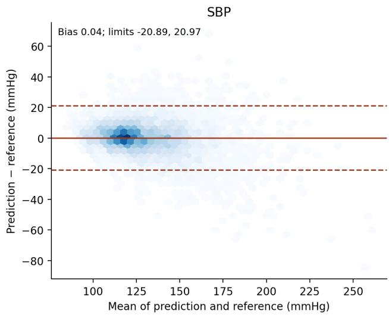
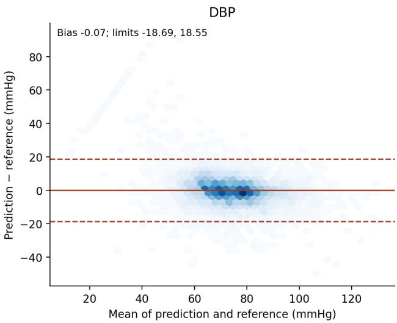
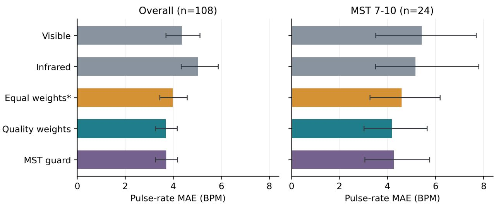
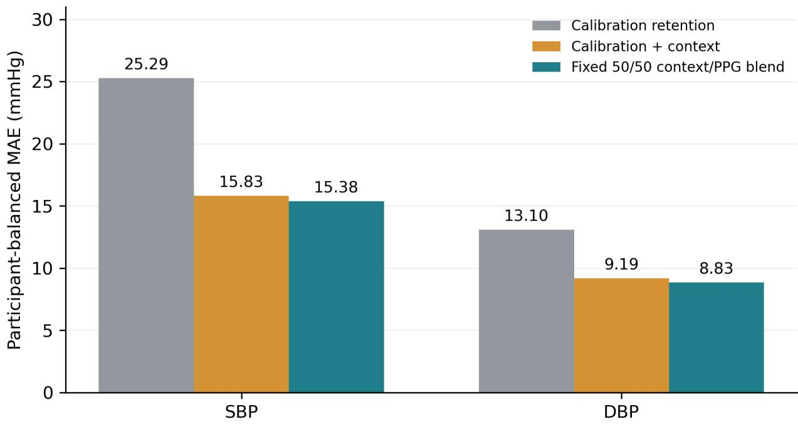

# Context-Augmented, Session-Calibrated Blood Pressure Tracking from Photoplethysmography

Farouk Ganiyu Adewumi and Timothy Oladunni

Department of Computer Science, Morgan State University, Baltimore, MD 21251, USA

fagan1@morgan.edu; timothy.oladunni@morgan.edu

## Abstract

Objective. To distinguish the contributions of acquisition context and photoplethysmography (PPG) to session-calibrated blood pressure (BP) tracking.

Approach. The original comparison used three repeats of five-fold participant-level cross-validation in 653 AuroraBP participants, excluding calibration-labelled prediction targets. Matched analyses separated context and PPG and removed elapsed-time terms. Later exploratory follow-ups retained PPG, accelerometer signals and three initial cuf readings. Separate studies evaluated pulse-rate fusion and an intraoperative VitalDB model.

Main results. The original wearable-state model achieved participant-level mean absolute errors (MAEs) of 7.697/6.139 mmHg for systolic/diastolic BP (SBP/DBP). Added context reduced MAE by 0.436/0.126 mmHg (97.5% intervals 0.305–0.573/0.053–0.200). In the matched factorial without the external PPG prior, PPG improved on calibration, time and protocol-provided posture/activity by 0.214/0.135 mmHg; removing time left the DBP interval including zero. Standard PPG descriptors contributed, but additional nonlinear/attractor benefit was not established. In a separate follow-up series, a sensor-history ensemble achieved 7.299/5.445 mmHg versus its static-rich reference’s 7.363/5.470, small gains of 0.064/0.025 mmHg. Larger DBP errors did not improve uniformly. Quality-weighted fusion reduced pulse-rate MAE from 3.985 to 3.690 beats per minute. VitalDB MAEs remained 15.375/8.833 mmHg despite small PPG gains.

Significance. The contribution is a calibrated evaluation framework with explicit controls, reproducible feature-cache-to-results analyses and retained negative findings. The sensor-history gain is exploratory after repeated dataset reuse. Independently estimated wearable states, complete raw-signal reproduction of the supplied richer features, external transfer and clinical adequacy remain unestablished.

Keywords: photoplethysmography; cufless blood pressure; session calibration; participantlevel cross-validation; wearable sensing; data leakage; signal quality.

## 1 Introduction

## 1.1 Motivation

Accurate blood pressure (BP) measurement is essential for identifying and managing hypertension. More frequent monitoring could characterize changes outside intermittent measurements, but repeated cuf inflation creates practical burdens. Optical sensing motivates research into less intrusive tracking; its potential clinical value depends on accuracy during changing activity and posture and on stability after calibration. Current guidance identifies important gaps in cufless-device validation and clinical interpretation (Cohen et al., 2026; Elgendi et al., 2024). A clinically relevant first question is whether PPG contributes information about subsequent BP changes beyond the initial cuf anchor and acquisition context. This retrospective study examines that question within controlled recording protocols; it does not evaluate treatment decisions or clinical outcomes.

Participant overlap, calibration burden and protocol shortcuts can obscure this question. Record-level splits can inflate accuracy when correlated measurements from one participant enter both training and testing (Gonz´alez et al., 2023). Three initial cuf readings also represent a diferent calibration burden from one reading or repeated access to later reference values. Pigmentation-related optical diferences motivate intervention testing, but small subgroups and nonsignificant contrasts cannot establish equitable performance (Kostrna et al., 2026; Singh et al., 2024; Osorio-Sanchez et al., 2025). We audit anchoring, context, and pigmentation-related interventions using recorded Fitzpatrick labels. Candidate interventions and context arms were frozen before repeated participant-level validation, after earlier development on AuroraBP. Because a fixed holdout was inspected across successive ablations, it is retained as historical development evidence. The primary repeated analysis confines feature ranking and fitting to outer training participants but remains internal validation. Secondary negative results are reported without interpreting them as proof of equity, equivalence, or general failure of pigmentation-aware modeling.

## 1.2 Study Questions and Contributions

The primary retrospective question is whether wearable-state context improves calibrated SBP/DBP tracking beyond the shared model core. Matched extensions isolate PPG/context and remove time. Secondary analyses examine calibration dose, nonlinear augmentation and pigmentation interventions; historical results quantify dependence on recent-cuf anchoring. Independent pulse-fusion and separately fitted VitalDB studies answer distinct questions. A later PPG/accelerometer series tests median prediction, direct BP targets and sensor history under the same three-reading burden. Negative findings are retained. Hashes, environments, folds and numerical checks support computational reproduction, while repeated dataset reuse precludes prospective confirmation.

## 2 Related Work

## 2.1 PPG-Based Cufless Blood Pressure Estimation

Cufless BP estimation from PPG includes pulse-transit-time methods, waveform features, and end-to-end networks (Elgendi et al., 2019; Mukkamala et al., 2015). Calibration-free methods avoid subject-specific references, whereas calibrated approaches use one or more cuf readings to model subsequent change (Samimi and Dajani, 2023; Wang et al., 2023; Oladunni and Adewumi, 2026b). Evaluation guidance emphasizes participant separation, calibration burden, and careful use of AAMI/ISO 81060-2 and BHS criteria (Elgendi et al., 2024).

## 2.2 Nonlinear and Information-Theoretic Feature Representations

The feature bank combines waveform moments with delay-coordinate reconstruction, recurrence analysis, sample entropy, permutation entropy, and spectral measures (Takens, 1981; Eckmann et al., 1987; Marwan et al., 2007; Richman and Moorman, 2000; Bandt and Pompe, 2002). These established descriptors have been applied to physiological and arterial pulse signals (Allen, 2007; H¨orandtner et al., 2022). Recent author-developed formulations motivated the feature grouping and terminology (Oladunni and Adewumi, $2 0 2 6 c , b , a )$ , but are not treated as validated physiological laws. The matched ablation therefore tests the empirical contribution of the combined nonlinear/attractor family rather than using prediction as evidence for the underlying theories.

## 2.3 Skin Pigmentation and PPG-Derived Vitals

Pigmentation can afect optical measurements, motivating separate evaluation of signal quality and downstream error (Singh et al., 2024; Kostrna et al., 2026; Osorio-Sanchez et al., 2025; Al-Halawani et al., 2025). Existing field, polarization, and gain-correction studies support testing optical interventions but do not establish improved BP tracking (Dasa and Davies, 2026; Jakachira et al., 2025; MacIsaac et al., 2025). We therefore distinguish pulse extraction from BP prediction and do not interpret nonsignificant subgroup diferences as parity.

## 2.4 Evaluation Rigor and Data Leakage

AuroraBP established calibration-based benchmarks and documented diferences between laboratory and ambulatory performance (Mieloszyk et al., 2022b). Record- or window-level splits can inflate reported accuracy when one participant contributes to training and testing (Gonz´alez et al., 2023; Sanches et al., 2024), while dataset shortcuts may further obscure the information contributed by PPG (Dias et al., 2025; Mehta et al., 2024). Our audit addresses a related change-prediction artifact: a calibration-row indicator may reveal observations whose target is near zero even when participant folds are disjoint.

## 3 Framework and Audit Controls

## 3.1 Attractor Feature Bank

A sampled PPG window is embedded as $\mathbf { X } _ { n } = [ x _ { n } , x _ { n + \tau } , \ldots , x _ { n + ( d - 1 ) \tau } ]$ , with $d = 4$ and $\tau = 5$ samples (Takens, 1981). The eleven descriptors comprise waveform dispersion, skewness, kurtosis, sample and permutation entropy, recurrence rate, determinism, recurrence entropy, CSI, spectral entropy and a band-power quality ratio (Eckmann et al., 1987; Marwan et al., 2007; Richman and Moorman, 2000; Bandt and Pompe, 2002). Supplementary Section E gives filtering, sample limits, tolerances and the CSI equation. These are empirical descriptors, not validated physiological laws.

AuroraBP uses measured raw \* waveforms and heuristic-corrected pc \* channels. The auxiliary simulated stress-test ref \* channel is not physiological ground truth and never enters the primary AuroraBP core.

## 3.2 Pigmentation Correction Operator

The correction rescales the median-centered waveform using recorded Fitzpatrick type and blends it with Wiener filtering; it estimates neither melanin nor a Beer–Lambert parameter. Supplementary Section E specifies the complete operator and noise-dependent entropy/recurrence tolerances. Corrected-minus-raw MAE was −0.001 mmHg SBP (95%

CI −0.037–0.034) and −0.031 mmHg DBP (−0.061–0.002). The tested correction-andextraction configuration has no established overall benefit or equivalence.

## 3.3 Calibration Dose and Anchoring

For participant $p ,$ the arithmetic mean $b _ { p } ^ { ( k ) }$ of exactly $k \in \{ 1 , 2 , 3 \}$ initial cuf readings defines

$$
\Delta _ { \mathrm { s e s s i o n } } ^ { ( k ) } ( p , i ) = y _ { p , i } - b _ { p } ^ { ( k ) } .\tag{1}
$$

The historical prior-anchored alternative uses the most recent valid cuf value $y _ { p , i - 1 } ^ { * }$

$$
\Delta _ { \mathrm { p r i o r } } ( p , i ) = y _ { p , i } - y _ { p , i - 1 } ^ { * } .\tag{2}
$$

Primary tracking uses the initial three-reading anchor without later cuf updates. Initialvisit targets occur up to 0.728 h after that anchor; return-visit targets occur 21.051–32.853 h after it. One-session calibration therefore does not imply a horizon shorter than one hour. Historical prior anchoring can use readings only minutes old within a visit, although acrossvisit gaps exceed one day; approximately 84% of its reconstructed fixed-split gain came from anchor replacement. Neither scheme establishes cuf replacement. Calibration retention predicts $\widehat { \Delta } = 0$

## 3.4 Context Operator

Wearable-state context comprises protocol-provided posture/activity and supplied optical quality. These states would require sensing or classification in deployment; they were not independently estimated here. The protocol-enriched comparator additionally uses phase, recording duration and pressure-quality metadata and is interpreted as an internal upper bound. A gradient-boosted tree model predicts BP change from the declared features and anchor. The original no-added-context arm shares a selected core that may contain elapsedtime terms, PPG descriptors and the UCI-derived PPG prior. It is therefore not a no-PPG condition. The matched factorial below supplies true optical-input-free controls.

## 3.5 Calibration-Row Leakage Audit

A calibration indicator could identify trivial rows if a target reading were compared with itself, allowing a model to learn “calibration row ⇒ predict no change.” We used four checks:

A Compare $| \Delta |$ on flagged and unflagged rows.

B Re-score the same fitted models with flagged rows removed from the holdout only.

C Refit with the calibration-flag feature removed, flagged rows still scored.

D (Decisive) Remove the flag and exclude flagged rows from fitting and scoring.

Checks A–C each leave one channel open; Check D restricts both fitting and evaluation. The supplementary calibration-row leakage subsection reports all four.

Finding 1. On this dataset, calibration-flagged rows are not near-zero-delta (mean $| \Delta | =$ 6.774 vs. 9.902 mmHg SBP on development rows – smaller, but not trivially so), and Check D confirms a positive context gain remains under strict exclusion (+0.598 mmHg SBP, 95% CI 0.337–0.871; +0.557 mmHg DBP, 0.315–0.795). The separate historical attribution retains calibration-labelled rows and must not be interpreted as Check D attribution (see the supplementary calibration-row leakage analysis).

## 4 Methodology

## 4.1 Datasets

AuroraBP is the primary dataset (Mieloszyk et al., 2022b,a). It contains 1,221 participant records and 11,597 auscultatory measurements across calibration, static, exercise, and temporal-challenge phases; waveforms were resolvable for 672 participants. The primary common cohort includes 653 participants with three initial calibration readings. Excluding 1,337 later calibration-labelled rows leaves 7,879 scored measurements. Historical ablations used a fixed 501/168 split; because its holdout was inspected during development, it is treated as historical evidence rather than untouched validation. Four secondary sources appear in the development notebooks: BIDMC, MIMIC-II, Welltory-PPG, and UCI (Pimentel et al., 2018, 2017; Goldberger et al., 2000; Saeed et al., 2011 $a , b ;$ Neshitov et al., 2021; Kachuee et al., 2015a,b). The first three form a historical corrected-feature PCA bank whose coordinates are excluded from the primary candidate list. UCI trains the BP-change prior that may enter the primary model. Pigmentation ranks on these sources are synthetic simulation inputs, not measured traits, and support no equity claim.

Two datasets support independent follow-up analyses. The Appel–Theart Participant Study Data provide paired visible and infrared PPG, Monk Skin Tone (MST), and pulse-rate references (Appel and Theart, 2025). After auditing, 108 participants contributed 630 pulse-rate windows, including 24 participants with MST 7–10. Its single cuf BP value per participant permits only cross-sectional BP analysis. VitalDB provides synchronized intraoperative PPG and arterial BP (Lee et al., 2022; Lee and Jung, 2022). A locked evaluation used 5,472 future windows from 228 cases belonging to 227 subjects disjoint from the 55 development subjects. Cases were grouped by subject for inference. VitalDB has no skin-tone field and tests a separately developed intraoperative implementation, not transfer of AuroraBP-fitted parameters. Table 1 consolidates participant eligibility and the relationship between the historical and primary cohorts. Table 2 consolidates the analysis sample, role, and source references for every dataset used in the study.

Table 1: AuroraBP participant flow and analysis populations. Release-to-waveform counts were checked against the original participant and measurement tables; downstream eligibility and cohort overlap were reconciled using the cached feature-bank participant identifiers.
<table><tr><td>Stage</td><td>Participants Eligibility or transition</td><td></td></tr><tr><td>Released dataset</td><td></td><td>1,221 673 participants have 11,597 auscultatory measurements; 548 released participants have no auscultatory records.</td></tr><tr><td>Cached waveform features</td><td>672</td><td>11,427 extracted rows from 672 participants. One of the 673 auscultatory participants has no available waveform; together with the 548 above, this accounts for the 549 outside</td></tr><tr><td>Historical calibration co- hort</td><td></td><td>this bank. 669 At least two valid initial calibration read- ings and future measurements. Three par- ticipants with only one initial reading are excluded. The historical anchor averages</td></tr><tr><td>Historical develop- ment/evaluation</td><td></td><td>available initial calibration replicates. 501 / 168 Fixed split within the preceding 669. Evalu- ation participants were inspected across de- velopment analyses.</td></tr><tr><td>Primary common cohort</td><td></td><td>653 At least three valid initial calibration read- ings; 19 of the 672 have insufficient ini- tial readings (16 have two; three have one). All 653 also belong to the historical cohort;</td></tr><tr><td>Primary measurement endpoint</td><td></td><td>489/164 were in its development/evaluation groups. 653 9,216 eligible future rows before excluding 1,337 later calibration-labelled rows; 7,879 readings remain. Initial anchor readings do not enter this future-row count or the fit- ted/scored endpoint.</td></tr></table>

Table 2: Datasets and analysis roles. AuroraBP access requires provider approval and a Data Use Agreement. Access details are consolidated in Data Availability. UCI-derived inputs are excluded from the clean factorial.
<table><tr><td>Dataset</td><td>Material analyzed</td><td>Role</td><td>Source</td></tr><tr><td>AuroraBP</td><td>653 participants; 7,879 scored measurements</td><td>Primary calibrated BP evaluation</td><td>Microsoft Research / Zenodo (Mieloszyk et al., 2022b, a)</td></tr><tr><td>BIDMC</td><td>53 subjects; 1,272 windows</td><td>Historical PCA representation only</td><td>PhysioNet (Pimentel et al., 2018, 2017)</td></tr><tr><td>MIMIC-II</td><td>1,500 sampled windows</td><td>Historical PCA representation only</td><td>PhysioNet (Saeed et al., 2011a,b)</td></tr><tr><td>Welltory- PPG</td><td>106 windows</td><td>Historical PCA representation only</td><td>Published PPG collection (Neshitov et al., 2021)</td></tr><tr><td>UCI Cuff-Less BP</td><td>425 records; 3,268 windows</td><td>Prior training for original comparison</td><td>UCI repository (Kachuee et al., 2015a,b)</td></tr><tr><td>Appel- Theart</td><td>108 participants; 630 windows</td><td>Independent pulse-rate fusion evaluation</td><td>Mendeley Data (Appel and Theart, 2025)</td></tr><tr><td>VitalDB</td><td>55 development / 227 holdout subjects; 5,472 test windows</td><td>Separate calibrated BP evaluation</td><td>PhysioNet (Lee et al., 2022; Lee and Jung, 2022)</td></tr></table>

Counts describe the material used by this study and need not equal the full source repository. Auxiliarysource pigmentation ranks were synthetic simulation inputs; only AuroraBP supplied Fitzpatrick label and Appel–Theart supplied Monk Skin Tone labels.

## 4.2 Feature Extraction and Selection

Standard AuroraBP descriptors use the central 10-s optical window, third-order 0.5–8 Hz bandpass and timestamp-derived 500 Hz sampling. All 11,427 feature rows matched the timestamp sampling audit within $2 \times 1 0 ^ { - 1 1 }$ Hz. Derived raw ppg quality is a Welch bandpower ratio (0.5–5 Hz divided by 0.1–15 Hz), distinct from the supplied optical quality context annotation. CSI recomputation agreed within $2 . 3 \times 1 0 ^ { - 1 6 }$ . Full extraction specifications are in Supplementary Section E.

Within each outer training set, the original primary procedure ridge-residualizes against baseline BP/log elapsed time, ranks eligible raw-feature changes, relative changes, time terms and the UCI prior using mutual information, and retains up to 24 candidates plus baseline BP. Context arms share that selected core. The UCI prior was retained in 26/30 endpoint/fold cores and uses corrected optical features, so excluding explicit Fitzpatrick terms cannot establish absence of indirect Fitzpatrick dependence. Historical PCA coordinates and ref \* features are excluded. Historical HCA augmentation is distinct from the matched nonlinear/attractor family.

## 4.3 Model and Training

The primary model uses training-fitted median imputation and squared-loss HistGradient-Boosting: learning rate 0.03, 15 leaves, regularization 1.0, 300 iterations and seed 42. Participant weights are inverse row counts, clipped at training-set 2nd/98th percentiles and normalized. Settings were inherited from development. The change gate uses fitted training predictions rather than independent inner validation; activation was 1.0. This remains a development limitation.

## 4.4 Evaluation Protocol

The common cohort contains 653 participants and 7,879 future non-calibration readings. Three repeats of five participant folds, stratified by Fitzpatrick band with seeds 42+26200+r for zero-based repeat r, repeat ranking, imputation, fitting and gate selection using outer training participants only. Initial anchor readings and later calibration-labelled targets are excluded from fitting/scoring. Within each repeat, MAE is averaged within participant and then equally across participants; participant MAEs are subsequently averaged across repeats. Bootstrap inference resamples participants with their readings/repeats together. AuroraBP informed earlier development, so this is retrospective internal validation.

Historical 501/168 analyses are reconstructed development evidence, not untouched validation. Retained UCI-prior defaults were used; re-executing the recovered tuning procedure selected those same settings under the current inputs/runtime, without recovering the original Colab state or tuning CSV. Historical intervals use 4,000 participant resamples. Supplementary Section E documents this distinction and the remaining reconstruction details.

## 4.4.1 Claim hierarchy and multiplicity

For participant $p ,$ repeat r and arm $^ { a , }$ let $\begin{array} { r } { L _ { p r a } = n _ { p } ^ { - 1 } \sum _ { i } | \widehat { y } _ { p i r a } - y _ { p i } | } \end{array}$ . Primary gain is

$$
G = \frac { 1 } { P } \sum _ { p } \left[ \frac { 1 } { R } \sum _ { r } L _ { p r , \mathrm { n o \ c o n t e x t } } - \frac { 1 } { R } \sum _ { r } L _ { p r , \mathrm { w e a r a b l e \ s t a t e } } \right] .\tag{3}
$$

Positive gain is an absolute MAE reduction in mmHg: rounded examples are $8 . 1 3 3 - 7 . 6 9 7 =$ 0.436 SBP and 6.265−6.139 = 0.126 DBP. Intervals use unrounded pairs and 10,000 participant resamples. Individual primary gain intervals are 97.5%, targeting approximate Bonferroni simultaneous 95% coverage for SBP/DBP. Holm adjustment applies separately to the two paired sign-flip tests (99,999 assignments; seed 20260910); paired t tests are sensitivity analyses. Sign exchangeability and participant sampling assumptions apply. Neither bootstrap nor multiplicity correction removes dependence from shared training sets or retrospective development. Arm estimates and historical/reviewer secondary contrasts use marginal 95% intervals. Later follow-up interval levels are specified separately below.

The matched feature-family ablation shares calibration, time, wearable-state context, folds, fixed estimator, weights and training-stage gate, excluding UCI. Standard descriptors are dispersion, skewness, kurtosis, spectral entropy and the band-power ratio; the augmentation adds sample/permutation entropy, recurrence measures and CSI. Pulse-arrival time was entirely missing and omitted. Fixed semantic sets replace feature ranking. This tests the combined nonlinear/attractor addition; its two endpoint sign-flip tests receive a separate Holm adjustment.

## 4.4.2 Matched context-by-PPG and time-removal analyses

Four reviewer-requested arms share endpoint baseline BP and the same cohort/folds: A, calibration/time; B, A plus protocol posture/activity; C, A plus $\mathrm { P P G } ; \mathrm { D }$ , A plus both. No factorial uses UCI, corrected features, PCA, PAT, phase, duration, pressure quality or measurement order. Supplied optical quality belongs to the PPG block alongside changes/relative changes in all eleven raw optical descriptors, making $\mathrm { A } / \mathrm { B }$ genuinely optical-input-free. All arms use the same fixed estimator, training-only imputation/weights and original gate procedure, with no new tuning. Constant/missing columns are removed using training data only.

A matched sensitivity removes elapsed seconds, log elapsed days, session elapsed seconds and log session elapsed days. Additional arms omit either posture or activity. PPG gains are $M _ { A } - M _ { C }$ and $M _ { B } - M _ { D } ;$ context gains are $M _ { A } - M _ { B }$ and $M _ { C } - M _ { D }$ . Interaction is $\left( M _ { C } - M _ { D } \right) - \left( M _ { A } - M _ { B } \right)$ on the MAE scale, not physiological synergy. Paired intervals use 10,000 participant resamples (seed 20261019), are exploratory marginal 95%, and do not extend the primary test family.

## 4.4.3 Signed errors and repeated-measures agreement

Unchanged primary out-of-fold predictions supply prediction-minus-reference bias, individual-error SD and absolute-error tail fractions. Moments are averaged within participant, equally across participants, and separately per repeat; SD is the square root of mean squared error minus squared bias. Repeat predictions are not pooled as independent observations or averaged into an unreported ensemble.

Approximate agreement limits use separately estimated within-/between-participant random-intercept variance components (Bland and Altman, 2007), centered on participantbalanced bias. Supplementary Section E gives the full method-of-moments equations and this adaptation’s distinction from the cited weighted-mean estimator. Statistics and limits are calculated per repeat and averaged; participant bootstrap preserves repeats together.

Homogeneous variation and conditionally independent residuals are approximations: serial dependence, nonnormal tails and BP-dependent errors can limit coverage. These limits are descriptive, not device certification.

## 4.4.4 Additional evaluation protocols

Historical pigmentation models are refitted on 501 development participants and evaluated on the reused 168-participant group; primary subgroup summaries use all 653 participants. Small V–VI groups (6/25) preclude fairness conclusions. The nested endpointspecialization/router analyses are exploratory; the DBP router only requests repeat measurement and never changes the prediction (Supplementary Sections B and E).

The independent pulse analysis uses visible/infrared quality-weighted pulse estimates and an MST-dependent guard selected in four participant inner folds. Twenty repeats of five outer folds average repeated predictions per window before participant MAE: these are repeatedcross-fit ensemble estimates. Equal weighting is a fixed post-hoc comparator on the same 630 windows; paired intervals use 108 participants and 10,000 resamples. Supplementary Section A specifies processing and guard activation.

VitalDB uses median BP/features from three early arterial-reference windows per case, excluding them from fitting/scoring. Context comprises anchor, time, age, sex and hypertension; PPG adds current/relative signal descriptors. Development-only selection in 55 subjects froze a constant 50/50 context/PPG blend before evaluation on 228 cases from 227 disjoint subjects and 5,472 future windows. Bootstrap groups cases by subject. This is a separate intraoperative implementation, not AuroraBP-model transfer. Reference/quality exclusions do not use prediction error; neither error-based removal nor holdout retuning was performed. Supplementary Sections A/E give selection, clipping and alignment details.

## 4.5 Later Exploratory Signal and Sensor-History Follow-ups

A separate series retains the same 653 participants, 7,879 records, PPG/accelerometer modalities and three initial cuf readings. Its static-rich reference adds current, diference and relative PPG/beat/accelerometer descriptors, initial SBP/DBP means/SDs and elapsed time. Missing descriptors are training-imputed without dropping records. Explicit ECG/PAT, protocol annotations, pressure quality, Fitzpatrick predictors, corrected optical variables and UCI are excluded. These features/estimators difer from the original primary model.

Three repeats of five participant folds use seeds 42 + 1000r, diferent from the primary seeds but matched within this series. Three-fold participant inner predictions select the static-rich blend of absolute-/squared-loss boosting, extra trees and retention. Subsequent fixed blends use 0.25/0.25/0.50 weights for the three estimators. Follow-ups test enriched median/calibration candidates, direct BP targets and 72 recording-level history features from 18 PPG/accelerometer descriptors. History uses only earlier sensor records, resets after gaps over one hour and never supplies later cuf values; its initial sensor anchor is recovered from the permitted calibration summary where available.

Each specification was frozen before its own outer predictions, after inspection of earlier experiments. Gains use paired participant MAEs and 5,000 bootstrap resamples. Staticrich-reference comparisons retain individual 97.5% endpoint intervals; matched fixed-weight contrasts use 95%. Neither corrects for successive adaptive experiments. Supplementary Sections D/E contain full specifications and reproduction boundaries.

## 5 Experiments and Results

## 5.1 Primary Repeated Participant-Level Validation

Table 3 reports the original comparison on 653 participants and 7,879 strict-endpoint measurements. Wearable-state MAEs were 7.697/6.139 mmHg SBP/DBP, with paired gains 0.436/0.126 and 97.5% intervals [0.305, 0.573]/[0.053, 0.200]. Holm-adjusted sign-flip p values were 0.00002/0.00013; paired t sensitivity tests also passed. Optical quality alone lowered SBP error by 0.022 mmHg but increased DBP error by 0.008, ofering no meaningful incremental benefit. The primary band means in Supplementary Table S8, weighted by counts 516/112/25, reproduce the overall estimates before rounding. Posture/activity remain protocol annotations; the protocol-enriched arm is an internal upper bound.

## 5.2 Matched Context-by-PPG Factorial and Time Sensitivity

Table 4 separates the information supplied by calibration/time, protocol-derived posture/activity context, and PPG without using the UCI prior. With elapsed-time terms, PPG reduced MAE by 0.315 mmHg SBP (95% CI 0.175–0.456) and 0.209 mmHg DBP (0.103–0.316) without context, and by 0.214 mmHg SBP (0.111–0.319) and 0.135 mmHg DBP (0.046–0.225) with context. Context gains were 0.503/0.209 mmHg without PPG and 0.402/0.135 mmHg with PPG. These contrasts are conditional on the declared block definitions and fixed estimator, not measures of physiological causation. Supplementary Table S10 reports all conditional and interaction contrasts.

Without elapsed-time terms, calibration-only MAE was 10.021 mmHg for SBP and 6.807 mmHg for DBP. The context-plus-PPG arm achieved 7.771 and 6.183 mmHg, respectively. PPG gains with context were 0.305 mmHg SBP (95% CI 0.187–0.429) and

Table 3: Original repeated participant-level validation (653 participants; three-reading anchor). Arm intervals are marginal 95%; the two gain intervals are 97.5% to target approximate 95% simultaneous coverage by a Bonferroni rationale. Holm adjustment applies separately to paired test p values. The shared core can contain PPG descriptors and the UCI-derived prior; “no added context” is not a no-PPG control.
<table><tr><td>Arm</td><td>SBP MAE [95% CI]</td><td>DBP MAE [95% CI]</td></tr><tr><td>Calibration retention</td><td>9.790</td><td>6.767</td></tr><tr><td>No added context</td><td>8.133 [7.824, 8.455]</td><td>6.265 [6.019, 6.526]</td></tr><tr><td>Optical quality only</td><td>8.110 [7.802, 8.431]</td><td>6.273 [6.025, 6.535]</td></tr><tr><td>Wearable-state context</td><td>7.697 [7.407, 8.008]</td><td>6.139 [5.899, 6.391]</td></tr><tr><td>Protocol-enriched upper bound</td><td>7.523 [7.243, 7.815]</td><td>5.743 [5.527, 5.977]</td></tr><tr><td>Primary gain [97.5% CI]</td><td>0.436 [0.305, 0.573]</td><td>0.126 [0.053, 0.200]</td></tr><tr><td>Holm-adjusted paired p</td><td>0.00002</td><td>0.00013</td></tr></table>

0.087 mmHg DBP (−0.009–0.181); the DBP interval includes zero. Context gains with PPG remained 1.198/0.299 mmHg. Thus clock-derived covariates account for substantial predictive information, and the small DBP PPG increment is sensitive to their inclusion. Persistence of annotation gains without time does not establish real-world transportability.

The leave-one-annotation-out analysis (Supplementary Table S11) further shows that, without clock terms, adding the activity label to a PPG-plus-posture model reduces MAE by 0.823 mmHg SBP (0.685–0.958) and 0.245 mmHg DBP (0.161–0.329). Adding posture to PPG-plus-activity gives 0.093 mmHg SBP (0.060–0.125) and −0.004 mmHg DBP (−0.012– 0.004). The time-free context result therefore depends particularly on the protocol-provided activity annotation. No independently estimated state classifier has been evaluated.

## 5.3 Primary Signed Errors and Agreement

Table 5 reports signed bias and individual-reading dispersion from the unchanged original predictions. The wearable-state arm has mean bias 0.038 mmHg SBP (95% CI −0.501– 0.561) and −0.091 mmHg DBP (−0.482–0.309), but participant-balanced error SDs remain 10.957 and 9.641 mmHg. Absolute errors exceed 15 mmHg for 13.35% and 7.03% of readings under equal participant weighting. Approximate repeated-measures limits of agreement, averaged over the three separately assessed repeats, are [−21.084, 21.159] mmHg SBP and [−18.756, 18.574] mmHg DBP. Near-zero mean bias therefore coexists with substantial individual errors. The error cloud is heterogeneous across BP levels, so the approximate limits should not be assumed to provide uniform 95% coverage throughout the BP range. Figure 1 displays the first repeat; Supplementary Table S13 reports uncertainty for dispersion and

Table 4: Reviewer-requested matched factorial, with and without time terms. All arms use the same 653 participants, folds, fixed estimator, weights and training-stage gate; no arm uses the UCI prior. $\mathrm { A } / \mathrm { B }$ contain no optical inputs. Context is protocol-provided posture/activity; supplied optical quality is assigned to the PPG block. Intervals are exploratory marginal 95% participant-bootstrap intervals.
<table><tr><td>Arm</td><td>SBP MAE [95% CI]</td><td>DBP MAE [95% CI]</td><td></td></tr><tr><td>With elapsed-time terms</td><td></td><td></td><td></td></tr><tr><td>A: Calibration</td><td>8.426 [8.098, 8.768]</td><td></td><td>6.472 [6.215, 6.751]</td></tr><tr><td>B: Calibration + context</td><td>7.923 [7.610, 8.243]</td><td></td><td>6.263 [6.015, 6.532]</td></tr><tr><td> $\mathrm { C \colon C a l i b r a t i o n + P P G }$ </td><td>8.111 [7.806, 8.432]</td><td></td><td>6.263 [6.015, 6.525]</td></tr><tr><td> $\mathrm { D \colon C a l i b r a t i o n + c o n t e x t + P P G }$ </td><td>7.709 [7.414, 8.015]</td><td></td><td>6.128 [5.888, 6.383]</td></tr><tr><td>Without elapsed-time terms</td><td></td><td></td><td></td></tr><tr><td>A: Calibration</td><td>10.021 [9.673, 10.383]</td><td></td><td>6.807 [6.530, 7.101]</td></tr><tr><td> ${ \mathrm { B } } \colon { \mathrm { C a l i b r a t i o n } } + { \mathrm { c o n t e x t } }$ </td><td>8.076 [7.749, 8.411]</td><td></td><td>6.269 [6.016, 6.544]</td></tr><tr><td> $\mathrm { C \colon C a l i b r a t i o n + P P G }$ </td><td>8.969 [8.644, 9.298]</td><td></td><td>6.481 [6.223, 6.749]</td></tr><tr><td> $\mathrm { D \colon C a l i b r a t i o n + c o n t e x t + P P G }$ </td><td>7.771 [7.478, 8.077]</td><td></td><td>6.183 [5.945, 6.436]</td></tr></table>

Table 5: Signed errors in the original primary comparison. Bias is prediction minus reference; positive denotes overestimation. SD is participant-balanced individual-error dispersion. Statistics are calculated separately per repeat and then averaged; MAEs are reported in Table 3.
<table><tr><td>Endpoint</td><td>Arm</td><td>Bias (mmHg)</td><td>Error SD (mmHg)</td><td> $| e | > 1 5$  mmHg (%)</td></tr><tr><td>SBP</td><td>No added context</td><td>-0.009</td><td>11.605</td><td>14.75</td></tr><tr><td>SBP</td><td>Wearable-state context</td><td>0.038</td><td>10.957</td><td>13.35</td></tr><tr><td>DBP</td><td>No added context</td><td>-0.086</td><td>9.846</td><td>7.19</td></tr><tr><td>DBP</td><td>Wearable-state context</td><td>-0.091</td><td>9.641</td><td>7.03</td></tr></table>

agreement limits.

## 5.4 Matched Feature-Family Ablation

Table 6 reports the secondary matched ablation. Adding the standard PPG descriptors to calibration, time, and wearable-state context reduced participant MAE by 0.187 mmHg SBP (95% CI 0.088–0.286) and 0.180 mmHg DBP (0.096–0.266). Adding the nonlinear/attractor family to that standard arm produced only 0.025 mmHg SBP (−0.018 to 0.069) and 0.009 mmHg DBP (−0.033 to 0.050) further reductions. The Holm-adjusted paired sign-flip p values for those latter contrasts were 0.532 and 0.662. Thus the matched analysis supports an incremental contribution from the declared standard PPG descriptors but does not establish an attractor-family advantage.

  
Figure 1: Agreement for the original wearable-state model in the first cross-validation repeat. Hexagonal bins show individual reading density, with prediction minus reference on the vertical axis. Solid lines mark participant-balanced bias; dashed lines mark approximate repeated-measures limits using within- and between-participant error variances. Limits describe individual-reading agreement under variance-model assumptions, not clinical interchangeability.

Table 6: Secondary Matched AuroraBP Feature-Family Ablation (653 Participants)
<table><tr><td>Arm</td><td>SBP MAE [95% CI]</td><td>DBP MAE [95% CI]</td></tr><tr><td>Calibration, time, wearable-state context</td><td>7.920 [7.607, 8.256]</td><td>6.318 [6.067, 6.589]</td></tr><tr><td>+ Standard PPG descriptors</td><td>7.733 [7.441, 8.048]</td><td>6.137 [5.898, 6.388]</td></tr><tr><td>+ Nonlinear/attractor family</td><td>7.709 [7.418, 8.017]</td><td>6.128 [5.887, 6.384]</td></tr><tr><td>Attractor-family gain [95% CI] Holm-adjusted paired p</td><td>0.025 [-0.018, 0.069] 0.532</td><td>0.009 [-0.033, 0.050]</td></tr></table>

## 5.5 Calibration Dose

Table 7 reports protocol-enriched models fitted on identical participants and future measurements for each calibration dose. Ranking and fitting are repeated within the same participant folds. These dose gains belong to the protocol-enriched arm, not the lead wearable-state arm. Three readings are one-session repeated calibration, not one-reading calibration.

## 5.6 Decomposition of Historical Prior-Anchor Improvement

Table 8 reports the reconstructed fixed-feature ladder. The net SBP reduction is 2.069 mmHg (26.0%), of which approximately 84% is attributable to replacing the initial anchor with the most recent prior cuf reading. The reference can be minutes old within a visit or more than

Table 7: Refitted Protocol-Enriched Models by Calibration Dose (653 Participants)
<table><tr><td>Target</td><td>Readings</td><td>Retention</td><td>Model MAE [95% CI]</td><td></td><td>Gain vs. retention</td></tr><tr><td>SBP</td><td>1</td><td>10.547</td><td></td><td>8.257 [7.933, 8.602]</td><td>2.290 [2.051, 2.525]</td></tr><tr><td>SBP</td><td>2</td><td>10.037</td><td>7.750 [7.458, 8.055]</td><td></td><td>2.286 [2.066, 2.509]</td></tr><tr><td>SBP</td><td>3</td><td>9.790</td><td>7.523 [7.243, 7.815]</td><td>2.267</td><td>[2.044, 2.489]</td></tr><tr><td>DBP</td><td>1</td><td>7.213</td><td></td><td>6.280 [6.026, 6.548]</td><td>0.934 [0.739, 1.129]</td></tr><tr><td>DBP</td><td>2</td><td>6.900</td><td>5.873</td><td>3 [5.648, 6.112]</td><td>1.027 [0.833, 1.215]</td></tr><tr><td>DBP</td><td>3</td><td>6.767</td><td></td><td>5.743 [5.527, 5.977]</td><td>1.024 [0.832, 1.211]</td></tr></table>

Table 8: Reconstructed historical isolation ladder (SBP; common development-selected feature set; 168 evaluation participants). The fixed evaluation group was inspected during development; intervals are marginal and do not represent untouched independent validation.
<table><tr><td>Step</td><td>MAE</td><td>Gain [95% CI]</td><td>Share</td></tr><tr><td>Session anchor (legacy)</td><td>7.970</td><td></td><td></td></tr><tr><td>→ Prior anchor</td><td>6.223</td><td>1.747 [1.298, 2.200]</td><td>84.4%</td></tr><tr><td>→ Absolute-error loss</td><td>6.110</td><td>0.113 [-0.013, 0.249]</td><td>5.5%</td></tr><tr><td>→ +Context</td><td>5.773</td><td>0.337 [0.209, 0.467]</td><td>16.3%</td></tr><tr><td>→ +HCA features</td><td>5.901</td><td>-0.128 [-0.242, -0.019]</td><td>-6.2%</td></tr><tr><td>Total (session → full)</td><td></td><td>2.069 [1.617, 2.516]</td><td>100%</td></tr></table>

Gain is preceding minus subsequent MAE; negative values indicate worsening. Shares divide each step by the net total gain.

one day old across visits. This comparison quantifies dependence on the reference scheme, not cuf replacement. The historical HCA addition worsens SBP MAE by 0.128 mmHg (95% CI 0.019–0.242); this finding is distinct from the matched primary feature-family test.

## 5.7 Secondary Pigmentation-Intervention Audit

Table 9 compares reconstructed configurations on the prior-anchored absolute-errorplus-context base. The reference has no added Fitzpatrick terms, although indirect dependence through the corrected-feature UCI prior is possible. Continuous Fitzpatrick terms/interactions, band reweighting and group gates are tested as additions. All configurations share the same participants, targets, base features and estimator. Reweighting and group gating are not isolated from one another. Fitzpatrick terms alone give negligible point changes. The full configuration worsens SBP/DBP MAE by 0.300/0.227 mmHg (95% CIs 0.182–0.419/0.114–0.355). Its between-band ranges also increase; six V–VI holdout participants cannot establish fairness or parity. Supplementary Sections B/E identify estimator-specific subgroup results and retain detailed diagnostics.

Table 9: Reconstructed historical Fitzpatrick-input comparison (168 evaluation participants). The fixed evaluation group was reused during development; this is exploratory internal evidence.
<table><tr><td>Configuration SBP MAE DBP MAE</td></tr><tr><td>Reference 5.773 4.483</td></tr><tr><td>Fitzpatrick inputs only 5.770 4.479</td></tr><tr><td>+ Band reweighting and group gating 6.073 4.710 Full Fitzpatrick-input configuration 6.073 4.710</td></tr><tr><td></td></tr><tr><td>Reference minus full MAE [95% CI]; negative favors reference: SBP</td></tr><tr><td>-0.300 [-0.419, -0.182]</td></tr></table>

Table 10: Reconstructed corrected-versus-raw channel ablation in repeated participant CV. This separate historical configuration is not the primary model hierarchy. Intervals are marginal 95%.
<table><tr><td>Target</td><td>Scope</td><td>n</td><td>Raw</td><td>Corrected</td><td>∆ MAE [95% CI]</td></tr><tr><td>SBP</td><td>Overall</td><td>653</td><td>7.524</td><td>7.523</td><td>-0.001 [-0.037, 0.034]</td></tr><tr><td>SBP</td><td>I-II</td><td>516</td><td>7.487</td><td>7.484</td><td>-0.003 [ [-0.040, 0.035]</td></tr><tr><td>SBP</td><td>III-IV</td><td>112</td><td>7.683</td><td>7.645</td><td>-0.038 [-0.143, 0.062]</td></tr><tr><td>SBP</td><td>V-VI</td><td>25</td><td>7.571</td><td>7.777</td><td>0.206 [0.023, 0.386]</td></tr><tr><td>DBP</td><td>Overall</td><td>653</td><td>5.745</td><td>5.714</td><td>-0.031 [-0.061, 0.002]</td></tr><tr><td>DBP</td><td>I-II</td><td>516</td><td>5.683</td><td>5.642</td><td>-0.041 [-0.077, -0.004]</td></tr><tr><td>DBP</td><td>III-IV</td><td>112</td><td>6.065</td><td>6.072</td><td>0.006 [-0.072, 0.096]</td></tr><tr><td>DBP</td><td>V-VI</td><td>25</td><td>5.576</td><td>5.598</td><td>0.022 [-0.082, 0.125]</td></tr></table>

∆ = corrected minus raw; negative favors correction.

## 5.7.1 Repeated-CV pigmentation-correction intervention

Table 10 reconstructs the separate historical strict-cohort channel ablation. The corrected channel alone has no established overall benefit; equivalence was not tested. The exploratory V–VI SBP contrast shows 0.206 mmHg worsening (95% CI 0.023–0.386), whereas the I–II DBP contrast shows a small decrease. These marginal subgroup intervals have no multiplicity adjustment. The full corrected-channel-plus-Fitzpatrick configuration changes SBP MAE by +0.003 mmHg (95% CI −0.038 to 0.043) relative to raw. Its DBP decrease is 0.0382 mmHg, with a marginal interval of 0.00004–0.07642 before rounding. The latter narrowly excludes zero but is an exploratory, unadjusted contrast across several configurations; it does not establish a general pigmentation-correction benefit or equitable performance.

Participant-median signal diagnostics found Fitzpatrick-associated quality and dispersion diferences, without identifying measured-melanin efects. Device gain, contact pressure, anatomy and protocol may confound these associations; coeficients and intervals are retained

Table 11: Independent Multi-Wavelength PPG Mechanism Test
<table><tr><td>Arm</td><td>Overall MAE (BPM) MST 7-10 MAE</td></tr><tr><td>Visible only</td><td>4.366 5.434</td></tr><tr><td>Infrared only 5.037</td><td>5.165</td></tr><tr><td>Equal-weight fusion (post hoc) 3.985</td><td>4.587</td></tr><tr><td>Quality-weighted fusion 3.690</td><td>4.184</td></tr><tr><td>Guarded MST-aware fusion 3.703</td><td>4.265</td></tr></table>

in Supplementary Section E.

The historical context comparison contains only six V–VI participants; its band-specific point changes cannot establish fairness (Supplementary Section E).

## 5.8 Independent Quality-Fusion and Guarded-Correction Test

Table 11 and Figure 2 report the independent pulse-rate analysis. Quality weighting reduced MAE from 3.985 to 3.690 BPM versus the post-hoc equal-weight comparator: paired diference −0.294 BPM (95% CI −0.567–−0.069). It also improved on either single wavelength. The MST 7–10 contrast versus equal weighting was −0.402 BPM (−0.929–0.010), without established subgroup benefit. The MST guard activated in 5% of outer folds; its correctedminus-tone-blind diference was 0.013 BPM (−0.010–0.053). These marginal comparisons establish neither additional correction benefit nor BP utility. Supplementary Section E retains all pairwise estimates.

## 5.9 VitalDB Context-Plus-PPG Frozen Holdout

Figure 3 and Table 12 distinguish retention from the stricter calibration-plus-context control. Most improvement came from context. The fixed 50/50 blend reduced SBP/DBP MAE from 15.827/9.189 to 15.375/8.833 mmHg; blend-minus-context diferences were −0.451 (95% CI $- 0 . 7 8 1 \mathrm { - - } 0 . 1 2 1 )$ and −0.357 (−0.512–−0.194). It improved on context for $6 7 . 0 \% / 7 0 . 5 \%$ of subjects. For reference changes of at least 10 mmHg, gains were 0.707/0.501 mmHg (intervals in Supplementary Section E). Absolute errors remain high; this retrospective intraoperative result establishes neither clinical adequacy nor prospective wearable performance.

## 5.10 State-of-the-Art Comparison

Table 13 supplies a main-text comparison of relevant calibrated intraoperative studies; Supplementary Table S9 retains the broader comparison. Published values are not head-to-head reruns, and diferent populations, selection rules, calibration schemes and averaging procedures prevent a direct numerical ranking.

  
Figure 2: Participant-balanced pulse-rate MAE with marginal 95% bootstrap intervals. The equal-weight comparison was added post hoc; quality weighting improves overall error relative to equal weighting, while guarded MST correction does not establish additional benefit.

Table 12: VitalDB frozen holdout (227 subjects). Fixed blend is the arithmetic mean of context and PPG-augmented predictions; negative blend-minus-context diferences favor the blend. All entries are participant-balanced MAEs in mmHg.
<table><tr><td>Target</td><td>Retention</td><td>Context</td><td>Fixed blend</td><td></td><td>Blend-context [95% CI]</td></tr><tr><td>SBP</td><td>25.291</td><td>15.827</td><td>15.375</td><td></td><td>-0.451 [−0.781, -0.121]</td></tr><tr><td>DBP</td><td>13.098</td><td>9.189</td><td>8.833</td><td></td><td>-0.357 [-0.512, -0.194]</td></tr></table>

The present VitalDB errors are larger than these published calibrated estimates. The Joung cohort is not identical to the public VitalDB release, and its ABP-20m result is a selected subset; its reported mean error ± SD must not be confused with the MAEs shown here. Dias et al.’s numerical row is explicitly taken from the author-posted preprint, rather than assumed to reproduce the final publication (Dias et al., 2025); its pairing and BPchange restrictions difer from an initial-window anchor. Kim and Baek’s target-subject parameter fitting entails substantially more reference data than a three-window anchor. These diferences qualify interpretation but do not establish that the present model performs well. No comparator has been rerun on our 227-subject holdout, so relative superiority or inferiority under an identical protocol remains untested.

  
Figure 3: VitalDB locked-holdout participant-balanced MAE. Calibration-plus-context explains most of the gain over retention; the frozen fixed context/PPG blend adds small CIsupported incremental improvements for both endpoints.

## 5.10.1 VitalDB error structure and practical interpretation

The unchanged frozen-blend predictions have participant-balanced bias of −2.359 mmHg SBP and −2.057 mmHg DBP, with individual-error SDs of 19.760 and 11.312 mmHg. Mean absolute reference departures from the initial anchor are 25.291 and 13.098 mmHg. Exploratory stratification of these saved predictions is reported in Supplementary Table S12. For SBP reference values below 110, from 110 to below 140, and at least 140 mmHg, participant-balanced MAEs within each stratum are 15.559, 9.436 and 34.104 mmHg, respectively. Corresponding DBP MAEs below 60, from 60 to below 80, and at least 80 mmHg are 7.694, 6.174 and 22.845 mmHg. The same subject can contribute to multiple strata, so these stratum means should not be averaged to reconstruct overall MAE. Errors are also high for departures of at least 20 mmHg from the initial anchor (20.407 mmHg SBP and 17.220 mmHg DBP).

These descriptive patterns identify limitations at high pressures and large changes from calibration. A small development cohort, the chosen feature representation and estimator capacity, signal/reference alignment, and perioperative physiological variation are possible contributors; this analysis does not identify their causal efects. No high-error observations were removed and no holdout-based retuning was performed for this revision. The practical evidence is restricted to a small incremental PPG contribution after a strong calibration-pluscontext control. It does not justify BP-based clinical decisions, clinical interchangeability, or a claim that the absolute errors are satisfactory.

Table 13: Calibrated intraoperative PPG studies. Errors are MAE in mmHg. Sourcespecific calibration and evaluation conditions are essential to interpretation; SNU denotes Seoul National University Hospital.
<table><tr><td>Study</td><td>Data and calibration/evaluation protocol</td><td>SBP</td><td>DBP</td></tr><tr><td>Joung et al. (Joung et al., 2023)</td><td>SNU surgical cohort, partly represented in VitalDB; paired calibration/inference network; participant-independent devel- opment/test split. Whole 797-subject test</td><td>7.991</td><td>4.789</td></tr><tr><td>Joung et al. ABP- 20m subset</td><td>set. 629 subjects assessed after 20 minutes fol- lowing arterial-line insertion; subset of the preceding cohort.</td><td></td><td>5.525 3.282</td></tr><tr><td>Dias et al. (Dias et al., 2024)</td><td></td><td>VitalDB; 1,068 eligible patients; nor- malized PPG/calibration-window pairs 3 min−2 h apart, |∆SBP| ≤ 60 mmHg; unfil- tered PPG result from author-posted Ta-</td><td>9.20 5.68</td></tr><tr><td>Kim and (Kim 2026)</td><td>ble 3. Baek</td><td>VitalDB target; cross-dataset pretrain- and Baek, ing followed by target-subject fine-tuning. Personalization uses 50-1,800 five-second segments; main comparison uses 1,800, with 720 validation and 720 test segments</td><td>3.53 1.96</td></tr><tr><td>This study</td><td>per subject. VitalDB; 55 development / 227 disjoint held-out subjects; three early arterial- reference windows; fixed blend evaluated on 5,472 future windows, with equal sub- ject weighting.</td><td></td><td>15.375 8.833</td></tr></table>

## 5.11 Exploratory Sensor-History Extension

Table 14 retains all three follow-ups to the static-rich reference. The enriched median/calibration ensemble reduced MAE by only 0.017/0.008 mmHg SBP/DBP, with both 97.5% intervals including zero. Direct absolute-BP prediction increased MAE. Adding recording-level sensor history gave the lowest observed MAEs in this series: 7.299/5.445 mmHg, gains of 0.064 (97.5% interval 0.021–0.108) and 0.025 (0.007–0.045) relative to the static-rich reference.

The matched fixed-weight static-versus-history comparison also favored history, by

Table 14: Later exploratory AuroraBP models: participant-balanced MAE (mmHg), with the same cohort, initial three-reading burden and participant folds within this series. The static-rich reference is separate from the original primary model in Table 3. Its features and blending difer from that primary model. Specifications were frozen per experiment after earlier dataset-guided development.
<table><tr><td>Model</td><td>SBP MAE</td><td>DBP MAE</td></tr><tr><td>Static-rich reference</td><td>7.363</td><td>5.470</td></tr><tr><td>Median/calibration ensemble</td><td>7.346</td><td>5.462</td></tr><tr><td>Direct-BP fixed ensemble</td><td>7.662</td><td>5.567</td></tr><tr><td>Causal sensor-history ensemble</td><td>7.299</td><td>5.445</td></tr></table>

0.058 mmHg SBP (descriptive 95% interval 0.022–0.096) and 0.018 mmHg DBP (0.004– 0.033). This contrast isolates history under fixed weights; comparison with the inner-selected static-rich reference also changes the blending policy. The result does not isolate a nonlinear/attractor feature efect and is not a matched improvement over the original primary configuration.

The history model’s signed bias was −0.122/0.050 mmHg and marginal error SD was 10.379/8.032 mmHg. SBP absolute errors above 20 mmHg decreased from 6.45% to 6.25% under participant balancing, whereas DBP errors above that threshold increased from 2.50% to 2.59%. Thus the small MAE reduction does not imply uniformly better individual accuracy. Supplementary Tables S14–S17 report the paired contrasts, dispersion, subgroups and remaining error structure.

## 6 Discussion

The primary comparison supports adding wearable-state context to its calibrated core, which already contains optical/time candidates. The matched factorial supplies complementary no-PPG controls and shows small conditional optical contributions. Removing clock terms reduces one protocol shortcut, but context still uses supplied posture/activity. No independently estimated wearable-state model has been evaluated, so annotation gains cannot establish deployment generalization.

The studies answer distinct questions. Quality weighting improved pulse-rate extraction relative to equal weighting. VitalDB showed a small incremental contribution from a separately fitted PPG implementation, combined with context through a fixed 50/50 blend. It tested neither quality-dependent blending nor transfer of AuroraBP parameters. The later sensor-history series improved MAE modestly within its own matched folds, while direct BP targets worsened error and DBP tails did not improve uniformly. These results identify conditional predictive information, not an attractor-specific mechanism or a universally generalizing architecture.

Near-zero aggregate bias coexists with broad individual errors. The historical measurement-level SBP standards comparison yielded BHS Grade C and error SD 9.718 mmHg, exceeding the cited 8 mmHg numerical cutof; VitalDB MAE remained 15.375/8.833 mmHg. Neither relative gains nor exclusion of dificult predictions can establish clinical adequacy. Pigmentation interventions likewise support no fairness conclusion. The contribution is a transparent calibrated evaluation with retained negative findings, rather than demonstrated cuf replacement or clinical outcome benefit.

## 7 Limitations

Validation. AuroraBP is a controlled single-site protocol. Although initial visits are shorter than one hour, return targets occur 21.051–32.853 h after initial calibration. Participantseparated folds prevent direct participant overlap but cannot remove optimism from earlier dataset-guided choices. Appel–Theart evaluates pulse rate; VitalDB is a separate retrospective intraoperative model. Neither establishes prospective wearable BP performance or transfer of one model.

Calibration and context. Primary tracking requires three initial cuf readings. The one-reading protocol-enriched arm has higher MAE (8.257/6.280 mmHg); a matching wearable-state dose analysis is unavailable. Protocol annotations and enriched metadata may encode acquisition structure. The history ensemble retains time and protocol-dependent sampling; a matched time-free version and new-protocol validation are unavailable. History checks establish recording-level order, not within-window latency or real-time operation.

Pigmentation. Only 25 primary and six historical V–VI participants are represented. Auxiliary pigmentation ranks are synthetic. Null/adverse results for one correction establish neither equivalence nor impossibility of better interventions. Pulse fusion does not validate BP equity, and VitalDB has no pigmentation labels.

Inference and reproduction. Holm adjustment covers the two retrospective primary endpoints; exploratory intervals do not account for adaptive experiments, overlapping training sets or method selection. Repeated readings are handled at participant level, but agreement assumptions can fail. The DBP router’s 2.9% recall precludes a safety claim. BHS/AAMI/ISO summaries are numerical context, not certification. Re-extracting all 11,427 standard AuroraBP rows reproduced the preserved extractor’s cache (relative tolerance $1 0 ^ { - 6 }$ , absolute 10−10); this checks consistency, not independent algorithm validity, and excludes rich/beat extraction. The newer-runtime bridge verifies one original fold, not every fit. Complete third-party raw-to-results replication remains outstanding. Supplementary Sections A, D and E detail these boundaries.

## 8 Conclusion

Matched calibrated controls and participant-separated evaluation showed small PPG/context contributions, with the DBP PPG increment sensitive to time removal. Nonlinear augmentation had no established additional benefit. Sensor history gave small exploratory gains relative to its own reference, without uniformly improving DBP tails. Independent analyses supported pulse-rate fusion and a small PPG contribution in a separate VitalDB model. The traceable workflow and retained negative findings do not establish clinical adequacy, model transfer, equitable performance or cuf replacement.

## Code and Reproduction Availability

The original companion archive is public:

https://github.com/farouze/pc-avct-reproducibility

Its versioned release contains the original primary analysis, feature-family ablation, helpers, dependencies, hashes, manifests and aggregate outputs. Reviewer extensions, historical reconstructions and the static-rich/three-follow-up chain are supplied in the accompanying revision package; they have not been uploaded to that repository. Restricted feature banks, participant predictions and contrasts remain local under dataset access conditions.

Feature-cache-to-results reproduction requires the specified hashed inputs and recorded environment. Comparator predictions, source equivalence, history ordering and aggregate inference were checked. The standard AVCT bank also has a separate waveform re-extraction check, but rich/beat extraction was not independently regenerated and complete third-party replication remains outstanding. Full follow-up fits used equivalent Python sources/local workers; notebook definitions were checked, and recorded summaries are distinguished from executed notebook outputs. Supplementary Section D.4 gives execution order and scope. No software DOI is claimed; dataset DOIs identify data.

## Data Availability

AuroraBP is available from its provider upon application through the Zenodo record cited in (Mieloszyk et al., 2022a) (DOI: 10.5281/zenodo.19099166) and acceptance of the Data

Use Agreement. The authors are not permitted to redistribute AuroraBP participant-level data. BIDMC is available through PhysioNet. MIMIC-II is a historical development source; its cited clinical-database version is no longer distributed by PhysioNet. UCI Cuf-Less BP is available through the UCI Machine Learning Repository, the multi-wavelength data through Mendeley Data (Appel and Theart, 2025), and VitalDB through PhysioNet (Lee and Jung, 2022). Access conditions and citations appear in Section 4.1. No directly identifying participant data are included in the manuscript or figures.

## Ethics Statement

This study is a secondary computational analysis of previously collected, deidentified human data. The authors recruited no participants, performed no intervention, had no participant contact, received no direct identifiers, and made no attempt to reidentify participants. Morgan State University’s published IRB process states that submission is not required for research using deidentified data or publicly available datasets (Morgan State University, 2023). Accordingly, this analysis did not require review by the Morgan State University Institutional Review Board, and no approval number was issued. The analysis followed the ethical principles of the Declaration of Helsinki and applicable local requirements. Ethics approvals and written informed-consent procedures for the original data collections are reported by the respective dataset providers and source publications (Mieloszyk et al., 2022b,a; Pimentel et al., 2017; Appel and Theart, 2025; Lee et al., 2022; Lee and Jung, 2022). No additional consent or consent for publication was required because the authors used only deidentified secondary data and report no identifiable participant information. This study was not a clinical trial.

## Author Contributions

Farouk Ganiyu Adewumi: conceptualization, methodology, software, validation, formal analysis, data curation, visualization, and writing of the original draft. Timothy Oladunni: conceptualization, methodology, supervision, and review and editing of the manuscript.

## Competing Interests

The authors declare no competing financial or non-financial interests.

## Funding

This work was supported in part by Morgan State University’s Ofice of Research and Graduate Programs.

## Acknowledgment

We thank the participants, investigators, and data stewards who made the secondary datasets used in this study available.

## References

Al-Halawani, R., Qassem, M. and Kyriacou, P. A. (2025), ‘Analysis of the efect of skin pigmentation and oxygen saturation on monte carlo-simulated reflectance photoplethysmography signals’, Sensors 25(2), 372. https://doi.org/10.3390/s25020372

Allen, J. (2007), ‘Photoplethysmography and its application in clinical physiological measurement’, Physiological Measurement 28(3), R1–R39. https://doi.org/10.1088/0967-3334/28/3/R01

Appel, A. and Theart, R. (2025), ‘Photoplethysmography device data: Hardware and participant study insights’, Mendeley Data. https://doi.org/10.17632/bcb9329f6d.1

Bandt, C. and Pompe, B. (2002), ‘Permutation entropy: A natural complexity measure for time series’, Physical Review Letters 88(17), 174102. https://doi.org/10.1103/PhysRevLett.88.174102

Bland, J. M. and Altman, D. G. (2007), ‘Agreement between methods of measurement with multiple observations per individual’, Journal of Biopharmaceutical Statistics 17(4), 571–582. https://doi.org/10.1080/10543400701329422

Cohen, J. B., Byfield, R. L., Hardy, S. T., Juraschek, S. P., Houston Miller, N., Mukkamala, R., Picone, D. S., Thiele, R. H., Yang, E. and Brady, T. M. (2026), ‘Cufless devices for the measurement of blood pressure: A scientific statement from the american heart association’, Hypertension 83, 876–886. https://doi.org/10.1161/HYP.0000000000000254

Dasa, D. and Davies, P. (2026), ‘Skin tone and diagnostic equity in contactless blood pressure screening: A prospective observational field evaluation of remote photoplethysmography in nigeria’, BMJ Open 16(6), e119311. https://doi.org/10.1136/bmjopen-2026-119311

Dias, F. M., Cardenas, D. A. C., Toledo, M. A. F., Oliveira, F. A. C., Ribeiro, E., Krieger, J. E. and Gutierrez, M. A. (2024), ‘Exploring the limitations of blood pressure estimation using the photoplethysmography signal’, arXiv:2404.16049. Author-posted preprint, version 1; numerical benchmark extracted from Table 3. https://arxiv.org/abs/2404.16049

Dias, F. M., Cardenas, D. A. C., Toledo, M. A. F., Oliveira, F. A. C., Ribeiro, E., Krieger, J. E. and Gutierrez, M. A. (2025), ‘Exploring the limitations of blood pressure estimation using the photoplethysmography signal’, Physiological Measurement 46(4), 045007. https://doi.org/10.1088/1361-6579/adcb86

Eckmann, J.-P., Kamphorst, S. O. and Ruelle, D. (1987), ‘Recurrence plots of dynamical systems’, Europhysics Letters 4(9), 973–977. https://doi.org/10.1209/0295-5075/4/9/004

Elgendi, M., Fletcher, R., Liang, Y., Howard, N., Lovell, N. H., Abbott, D., Lim, K. and Ward, R. (2019), ‘The use of photoplethysmography for assessing hypertension’, npj Digital Medicine 2, 60. https://doi.org/10.1038/s41746-019-0136-7

Elgendi, M., Haugg, F., Fletcher, R. R., Allen, J., Shin, H., Alian, A. and Menon, C. (2024), ‘Recommendations for evaluating photoplethysmography-based algorithms for blood pressure assessment’, Communications Medicine 4, 140. https://doi.org/10.1038/s43856-024-00555-2

Goldberger, A. L., Amaral, L. A. N., Glass, L., Hausdorf, J. M., Ivanov, P. C., Mark, R. G., Mietus, J. E., Moody, G. B., Peng, C.-K. and Stanley, H. E. (2000), ‘PhysioBank, PhysioToolkit, and PhysioNet: Components of a new research resource for complex physiologic signals’, Circulation 101(23), e215–e220. https://doi.org/10.1161/01.CIR.101.23.e215

Gonz´alez, S., Hsieh, W.-T. and Chen, T. P.-C. (2023), ‘A benchmark for machine-learning based non-invasive blood pressure estimation using photoplethysmogram’, Scientific Data 10, 149. https://doi.org/10.1038/s41597-023-02020-6

H¨orandtner, C., Bachler, M., Sehnert, W., Mikisek, I., Mengden, T., Wassertheurer, S. and Mayer, C. C. (2022), ‘Attractor reconstruction for quantifying the arterial pulse wave morphology during device-guided slow breathing’, Cardiovascular Engineering and Technology 13(6), 939–949. https://doi.org/10.1007/s13239-022-00628-0

Jakachira, R., Yan, W., Thomas, S. C., Macias-Sanchez, Y., Werner, L., Burrow, J. A., Dunsiger, S. and Toussaint, Jr., K. C. (2025), ‘Evaluation of a polarization-sensitive, dual-wavelength wearable photoplethysmography sensor across a range of skin tones’, Biophotonics Discovery 3(1), 012509. https://doi.org/10.1117/1.BIOS.3.1.012509

Joung, J., Jung, C.-W., Lee, H.-C., Chae, M.-J., Kim, H.-S., Park, J., Shin, W.-Y., Kim, C., Lee, M. and Choi, C. (2023), ‘Continuous cufless blood pressure monitoring using photoplethysmography-based PPG2BP-net for high intrasubject blood pressure variations’, Scientific Reports 13, 8605. https://doi.org/10.1038/s41598-023-35492-y

Kachuee, M., Kiani, M. M., Mohammadzade, H. and Shabany, M. (2015a), ‘Cuf-Less Blood Pressure Estimation’, UCI Machine Learning Repository. https://doi.org/10.24432/C5B602

Kachuee, M., Kiani, M. M., Mohammadzade, H. and Shabany, M. (2015b), Cuf-less high-accuracy calibration-free blood pressure estimation using pulse transit time, in ‘2015 IEEE International Symposium on Circuits and Systems (ISCAS)’, pp. 1006–1009. https://doi.org/10.1109/ISCAS.2015.7168806

Kim, Y. C. and Baek, H. J. (2026), ‘Evaluating cross-dataset transfer learning for photoplethysmography-based blood pressure estimation’, Scientific Reports 16, 10725. https://doi.org/10.1038/s41598-026-43409-8

Kostrna, J., Oparina, E., Ramella-Roman, J. C., Palacios, C., Rodriguez, A. J., Pei, J. and Ajmal, A. (2026), ‘PPG-based heart rate accuracy in diverse populations: Investigating inequities across body composition and skin tones’, arXiv preprint arXiv:2601.22377 . https://doi.org/10.48550/arXiv.2601.22377

Lee, H.-C. and Jung, C.-W. (2022), ‘VitalDB, a high-fidelity multi-parameter vital signs database in surgical patients’, PhysioNet. Version 1.0.0. https://doi.org/10.13026/czw8-9p62

Lee, H.-C., Park, Y., Yoon, S. B., Yang, S. M., Park, D. and Jung, C.-W. (2022), ‘VitalDB, a high-fidelity multi-parameter vital signs database in surgical patients’, Scientific Data 9, 279. https://doi.org/10.1038/s41597-022-01411-5

MacIsaac, C., Nguyen, M., Uy, A., Kong, T. and Hedayatipour, A. (2025), ‘A programmable gain calibration method to mitigate skin tone bias in PPG sensors’, Biosensors 15(7), 423. https://doi.org/10.3390/bios15070423

Marwan, N., Romano, M. C., Thiel, M. and Kurths, J. (2007), ‘Recurrence plots for the analysis of complex systems’, Physics Reports 438(5–6), 237–329. https://doi.org/10.1016/j.physrep.2006.11.001

Mehta, S., Kwatra, N., Jain, M. and McDuf, D. (2024), ‘Examining the challenges of blood pressure estimation via photoplethysmogram’, Scientific Reports 14, 18318. https://doi.org/10.1038/s41598-024-68862-1

Mieloszyk, R., Twede, H., Lester, J., Wander, J., Basu, S., Cohn, G., Smith, G., Morris, D., Gupta, S., Tan, D., Villar, N., Wolf, M., Malladi, S., Mickelson, M., Ryan, L., Kim, L., Kepple, J., Kirchner, S., Wampler, E., Terada, R., Robinson, J., Paulsen, R. and Saponas, T. S. (2022a), ‘Aurora-BP Study Dataset’, Zenodo. Available upon application under the provider’s Data Use Agreement. https://doi.org/10.5281/zenodo.19099166

Mieloszyk, R., Twede, H., Lester, J., Wander, J., Basu, S., Cohn, G., Smith, G., Morris, D., Gupta, S., Tan, D., Villar, N., Wolf, M., Malladi, S., Mickelson, M., Ryan, L., Kim, L., Kepple, J., Kirchner, S., Wampler, E., Terada, R., Robinson, J., Paulsen, R. and Saponas, T. S. (2022b), ‘A comparison of wearable tonometry, photoplethysmography, and electrocardiography for cufless measurement of blood pressure in an ambulatory setting’, IEEE Journal ofBiomedical and Health Informatics 26(7), 2864–2875. https://doi.org/10.1109/JBHI.2022.3153259

Morgan State University (2023), ‘IRB Process Synopsis’, Ofice of Research Administration. Accessed: 2026-09-10. https://www.morgan.edu/Documents/ADMINISTRATION/OFFICES/ora/IRB%20Forms/ 2023-03-21\_IRB\_Process\_Synopsis.pdf

Mukkamala, R., Hahn, J.-O., Inan, O. T., Mestha, L. K., Kim, C.-S., T¨oreyin, H. and Kyal, S. (2015), ‘Toward ubiquitous blood pressure monitoring via pulse transit time: Theory and practice’, IEEE Transactions on Biomedical Engineering 62(8), 1879–1901. https://doi.org/10.1109/TBME.2015.2441951

Neshitov, A., Tyapochkin, K., Smorodnikova, E. and Pravdin, P. (2021), ‘Wavelet analysis and selfsimilarity of photoplethysmography signals for HRV estimation and quality assessment’, Sensors 21(20), 6798. https://doi.org/10.3390/s21206798

Oladunni, T. and Adewumi, F. G. (2026a), ‘Attractor domain theory: A mathematical framework for cardiovascular attractor analysis with wearable photoplethysmography (PPG) validation’, arXiv preprint arXiv:2606.22039 . https://doi.org/10.48550/arXiv.2606.22039

Oladunni, T. and Adewumi, F. G. (2026b), ‘Attractor-vascular coupling theory: Formal grounding and empirical validation for AAMI-standard cufless blood pressure estimation from smartphone photoplethysmography’, arXiv preprint arXiv:2605.10871 . https://doi.org/10.48550/arXiv.2605.10871

Oladunni, T. and Adewumi, F. G. (2026c), ‘Cardiac stability theory: An axiomatically grounded framework for continuous cardiac health monitoring via smartphone photoplethysmography’, arXiv preprint arXiv:2604.23876 . https://doi.org/10.48550/arXiv.2604.23876

Osorio-Sanchez, L., May, J. M. and Kyriacou, P. A. (2025), ‘Evaluation of skin pigmentation efect on photoplethysmography signals using a vascular finger phantom with tunable optical and mechanical properties’, Journal of Biomedical Optics 30(11), 117002. https://doi.org/10.1117/1.JBO.30.11.117002

Pimentel, M. A. F., Johnson, A. E. W., Charlton, P. H., Birrenkott, D., Watkinson, P. J., Tarassenko, L. and Clifton, D. A. (2017), ‘Toward a robust estimation of respiratory rate from pulse oximeters’, IEEE Transactions on Biomedical Engineering 64(8), 1914–1923. https://doi.org/10.1109/TBME.2016.2613124

Pimentel, M. A. F., Johnson, A. E. W., Charlton, P. H. and Clifton, D. A. (2018), ‘BIDMC PPG and Respiration Dataset’, PhysioNet. Version 1.0.0. https://doi.org/10.13026/C2208R

Richman, J. S. and Moorman, J. R. (2000), ‘Physiological time-series analysis using approximate entropy and sample entropy’, American Journal of Physiology–Heart and Circulatory Physiology 278(6), H2039–H2049. https://doi.org/10.1152/ajpheart.2000.278.6.H2039

Saeed, M., Villarroel, M., Reisner, A. T., Cliford, G., Lehman, L.-W., Moody, G., Heldt, T., Kyaw, T. H., Moody, B. and Mark, R. G. (2011a), ‘Multiparameter intelligent monitoring in intensive care ii (MIMIC-II): A public-access intensive care unit database’, Critical Care Medicine 39(5), 952–960. https://doi.org/10.1097/CCM.0b013e31820a92c6

Saeed, M., Villarroel, M., Reisner, A. T., Cliford, G., Lehman, L.-W., Moody, G., Heldt, T., Kyaw, T., Moody, B. and Mark, R. (2011b), ‘MIMIC-II Clinical Database’, PhysioNet. Version 2.6.0. https://doi.org/10.13026/fxn0-mk84

Samimi, H. and Dajani, H. R. (2023), ‘A PPG-based calibration-free cufless blood pressure estimation method using cardiovascular dynamics’, Sensors 23(8), 4145. https://doi.org/10.3390/s23084145

Sanches, I., Gomes, V. V., Caetano, C., Cabrera, L. S. B., Cene, V. H., Beltrame, T., Lee, W., Baek, S. and Penatti, O. A. B. (2024), ‘MIMIC-BP: A curated dataset for blood pressure estimation’, Scientific Data 11, 1233. https://doi.org/10.1038/s41597-024-04041-1

Singh, S., Bennett, M. R., Chen, C., Shin, S., Ghanbari, H. and Nelson, B. W. (2024), ‘Impact of skin pigmentation on pulse oximetry blood oxygenation and wearable pulse rate accuracy: Systematic review and meta-analysis’, Journal of Medical Internet Research 26, e62769. https://doi.org/10.2196/62769

Takens, F. (1981), Detecting strange attractors in turbulence, in ‘Dynamical Systems and Turbulence, Warwick 1980’, Vol. 898 of Lecture Notes in Mathematics, Springer, pp. 366–381. https://doi.org/10.1007/BFb0091924

Wang, C.-F., Wang, T.-Y., Kuo, P.-H., Wang, H.-L., Li, S.-Z., Lin, C.-M., Chan, S.-C., Liu, T.-Y., Lo, Y.-C., Lin, S.-H. and Chen, Y.-Y. (2023), ‘Upper-arm photoplethysmographic sensor with one-time calibration for long-term blood pressure monitoring’, Biosensors 13(3), 321. https://doi.org/10.3390/bios13030321