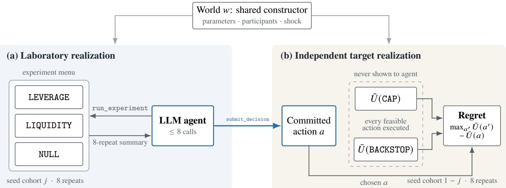
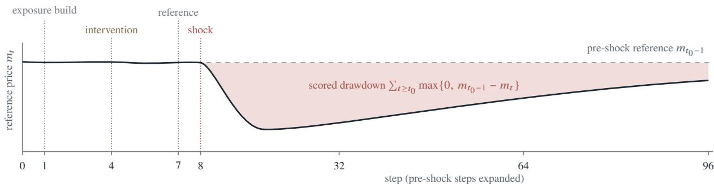
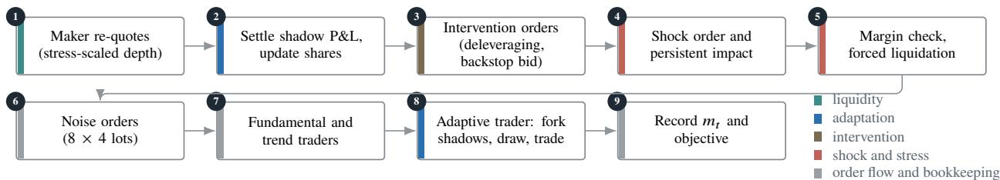
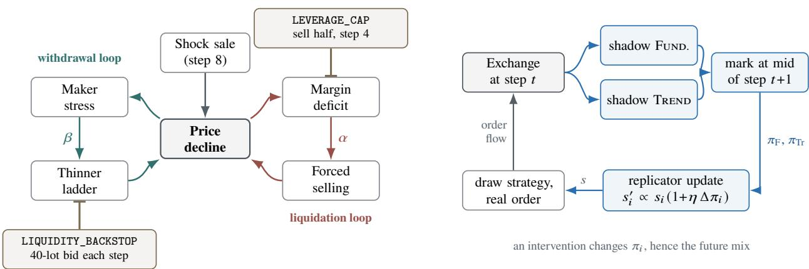
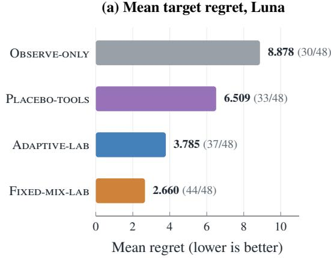
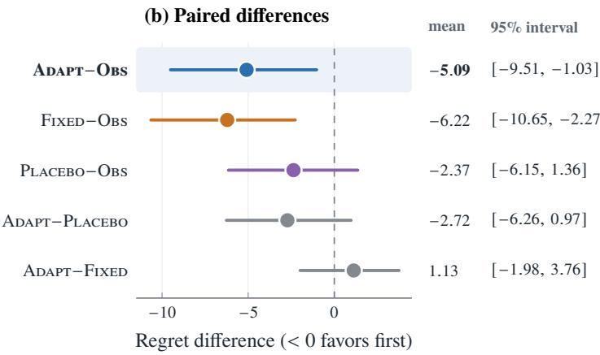
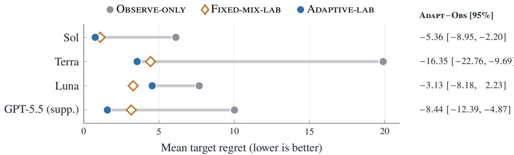

# CrashGym: Measuring the Decision Value of Experimentation for LLM Agents in Counterfactual Market Crashes

Haocheng Lu1,∗,† Haoxuan Cheng2,\* Mingyang Chen3 Minjun Zhu4

1Columbia University 2Cornell University

3Hithink RoyalFlush Information Network Co., Ltd. 4New York University

Equal contribution. †Corresponding author: haocheng409@gmail.com

## Abstract

Language-model agents are increasingly asked to run experiments, yet benchmarks rarely measure whether those experiments improve the decisions they are meant to inform. We introduce CrashGym, a deterministic, replayable limit-orderbook simulator in which an agent must choose between a deleveraging intervention and a liquidity backstop for a market about to sufer a shock-triggered crash. Before committing, the agent may query intervention experiments in a laboratory realization of the market. Its choice is then scored on an independently seeded target realization in which the simulator executes every feasible intervention, so regret relative to the best intervention is computed by directly simulating every alternative on the same target repeats, with no human or model-based judging. The simulator implements each amplification channel—persistent price impact, liquidity withdrawal, margin-driven liquidation, and an evolving strategy mix—as an explicit mechanism that can be switched on in stages. In a prospectively specified study on 24 newly sampled worlds, laboratory access reduces the mean regret of the one deployment with a complete record (Luna) from 8.878 to 3.785, a paired reduction of 5.092 utility units (nominal 95% world-bootstrap interval: 1.028–9.507), or 57.4% of the OBSERVE-ONLY mean. Prospective comparisons for two further deployments are incomplete; in a separate exploratory study, mean regret is lower with laboratory access for all four deployments evaluated. A laboratory whose strategy mix evolves endoge nously yields no established advantage over one with a fixed mix. CrashGym thus measures the value of experimentation as avoided decision loss and lets simulator detail be judged by the decisions it supports.

## 1 Introduction

A market is about to fall sharply. A policy agent must recommend one of two interventions: force leveraged holders to cut their positions, or post a standing bid that supplies liquidity. Both are defensible a priori. Deleveraging can preempt the cycle of margin calls and forced selling, whereas a liquidity backstop can absorb that selling before it moves prices [1, 11, 25]. Which intervention is better depends on which amplification channel dominates in the market at hand. We ask whether an agent that can first experiment on a laboratory copy of the market chooses better, and by how much.

Language-model agents are increasingly evaluated as experimenters: they design studies, run code, and report findings [15, 16, 22]. Most evaluations, however, score the research process or its products—task completion, explanation quality, or recovery of a latent structure. Completing an experiment and benefiting from it are diferent outcomes. Measuring the benefit requires two ingredients that are rarely available together: the same decision-maker observed with and without experimental access, and the counterfactual outcome of every action it could have taken. The second ingredient is unobservable in historical data.

Approach. CrashGym supplies both ingredients inside a deterministic agent-based market (Figure 1). An agent receives a public observation, may query intervention experiments in a laboratory realization, and then commits to one intervention. The simulator executes every feasible intervention on an independent target realization that the agent never observes. Regret—the utility gap between the best intervention and the chosen one—is therefore exact for the realized target repeats. Comparing regret across information conditions yields the gross decision value of experimentation, a realized counterpart of the classical value of sample information [14, 21, 23]. Because the simulator’s amplification channels are explicit mechanisms that can be enabled in stages, the same outcome also tests whether added simulator detail improves the decision it is meant to support.

Contributions.

• A counterfactual market laboratory. We describe an exchange core with exact integer accounting, event-sourced replay, and counter-based randomness, together with a crash construction whose amplification channels can be enabled in cumulative stages (Section 3).

  
Figure 1: Task overview. A world constructor � is instantiated with two disjoint seed cohorts. (a) In the laboratory cohort the agent may run intervention experiments and receives public eight-repeat summaries. (b) Its committed action is scored on the other cohort, where the simulator executes both feasible interventions; regret is the utility gap to the better one. Target outcomes are never visible to the agent. Under OBSERVE-ONLY, the agent decides from the initial observation alone.

• A decision-grounded evaluation task. A laboratory in which the agent acquires interventional evidence is separated from an independently seeded target on which every feasible intervention is executed and scored. This yields exact counterfactual regret for every decision (Section 4).

• Controlled evidence. With identical targets, we compare no access, two laboratory designs, and a tool placebo, sampling new worlds prospectively and using a stratified whole-world bootstrap (Section 5). Laboratory access lowers Luna’s mean regret by 5.092 units on 24 newly sampled worlds, meeting the prespecified criterion. An evolving strategy mix in the laboratory yields no established additional benefit (Section 6).

The measured value is avoided loss in simulator utility units. Net value would additionally require the costs of experimentation and inference, which we do not measure.

## 2 Related work

LLM agents as experimenters. Tool-using language models interleave reasoning with external actions [24, 33], and a growing set of environments evaluates them as scientists. ScienceWorld and DiscoveryWorld assess task completion and discovery in simulated worlds [16, 29]; MLAgentBench evaluates machine-learning experimentation [15]; and end-toend systems generate complete research papers [22]. CausaLab distinguishes predictive success from recovery of causal structure, and CausalGame evaluates causal reasoning and experimental protocols in games [5, 32]; see also Kıcıman et al. [17]. We measure a diferent quantity: how much an agent’s experiments improve a subsequent, independently scored decision. An agent may use informative intervention results well without reconstructing the latent mechanism.

LLM agents in finance. Domain-adapted models and agents have been applied to financial analysis and trading [30, 31, 34], and InvestorBench evaluates financial decision-making across tasks [20]. These evaluations typically rely on historical data, in which the outcomes of untaken actions are unavailable. Our simulator supplies those counterfactuals for a policy intervention, at the cost of using synthetic rather than historical markets.

Market simulation. Agent-based models have long been used to study market dynamics [9, 12, 19]. ABIDES supports high-fidelity, message-level market research [2]; JAX-LOB targets accelerated, parallel limit-order-book simulation [10]; and realism metrics assess how closely simulated order books reproduce stylized facts [28]. Our crash construction draws on the leverage-cycle and fire-sale literature, in which margin constraints, forced selling, and liquidity withdrawal reinforce one another [1, 11, 25, 26]. Rather than maximizing realism, we use the simulator as an instrument that supplies exact counterfactual intervention outcomes and lets each amplification channel be switched on or of.

Value of information and decision-aware model evaluation. Statistical decision theory values an experiment by the improvement in the expected utility of the decision it informs [4, 14, 21, 23]. Our gross value $V _ { b }$ (Section 7) is a realized, empirical counterpart for an LLM agent. A related literature argues that models should be judged by the decisions they induce rather than by predictive accuracy alone [6, 8, 18], and the value-equivalence principle motivates retaining only those model distinctions that matter for planning [13]. Our comparison of laboratory designs examines this motivation empirically; it does not test Bellman-operator equivalence. The setting also relates to sim-to-real transfer, in which the deployment environment difers from the training simulator [27].

## 3 The CrashGym simulator

The simulator is a discrete-time, single-asset market with a central limit-order book. We describe its components in turn: the exchange core, the participants, the episode schedule, the amplification mechanisms, the evolving strategy mix, the mechanism stages, and the determinism and replay layer. Parameter values refer to the crash construction used in all experiments; Appendix A lists them in full.

## 3.1 Exchange core

Order book and matching. Prices are integers in ticks. Each side of the book maps a price level to a first-in-first-out queue, giving strict price–time priority. The only order primitive is a limit order, together with cancellation by the owning account. A marketable order is emulated as a limit order priced 100 ticks through the best opposite quote; any unfilled remainder is cancelled immediately, so it behaves as an immediate-or-cancel order with a price band. Incoming orders walk the opposite side best-first, and each fill executes at the resting order’s price for the smaller of the two quantities; a partially filled resting order keeps its queue position. The reference price $m _ { t }$ is the sum of best bid and best ask, i.e. the midpoint in half-tick units, so it remains an exact integer. If one side of the book is empty, the reference falls back to the last two-sided quote, and aggressive orders are priced from the last published bid or ask. Book invariants—no empty levels, no zero quantities, strictly increasing priorities, and no crossed book—are checked after every mutation.

Accounts, risk admission, and fees. Each participant owns an account with integer cash and inventory, with positions tracked as first-in-first-out lots. Before an order is accepted, the exchange checks a position limit $( 1 0 ^ { 6 }$ lots) and a leverage limit: the worst-case position notional along the order’s potential fill path may not exceed 20× the account’s initial cash. Rejected orders are logged and have no efect. A fee of one cash unit per lot is charged to both counterparties of every fill; resting orders that never fill pay nothing. Every fill must conserve total inventory and total cash plus fees, global invariants are re-checked after each operation, and a full canonical audit closes every run.

## 3.2 Participants

Table 1 summarizes the six participant classes and the two exogenous accounts. Each step, a market maker posts a 40-level ladder on each side, at ofsets of $2 + k$ ticks $( k = 0 , \ldots , 3 9 )$ around a center that tracks the previous reference price. Its depth per level is a world-specific $\bar { Q } \in \{ 2 4 , . . . , 5 6 \}$ lots in the initial ladder (step 0), 400 lots during steps 1–7, and $\bar { Q }$ again from the shock onward. Every world therefore experiences a scheduled liquidity clif at the shock, in addition to the stress-driven withdrawal described below. Ladders are reconciled rather than rebuilt: unchanged levels keep their queue priority, and superseded orders are cancelled. Noise traders submit eight marketable orders of four lots per step, each a buy or sell with probability $1 / 2$ . A fundamental trader trades four lots per tick of deviation between the fundamental value � and the midpoint. A trendfollower trades $4 e _ { t }$ lots, where $e _ { t } = \mathrm { t r u n c } \big ( ( 3 e _ { t - 1 } + r _ { t - 1 } ) / 4 \big )$ is a moving average of past returns $r _ { t } = m _ { t } - m _ { t - 1 }$ (half-ticks) and trunc rounds toward zero. The fundamental value is held constant at $\nu = 1 0 , 0 0 0$ ticks: no news arrives, so post-shock dynamics are responses to the shock, the scheduled post-shock depth, and the intervention. The leveraged trader builds a long position at step 1 and afterwards trades only through forced liquidation or the deleveraging intervention. The adaptive participant chooses each step between two candidate strategies (Section 3.5).

## 3.3 Episode schedule

An episode lasts $T = 9 6$ steps (Figure 2a). At step 0 the maker posts its initial ladder around �. At step 1 the leveraged trader builds its position; at step 4 the chosen intervention takes efect; at step 7 the pre-shock reference $m _ { t _ { 0 } - 1 }$ is recorded; and at step $t _ { 0 } = 8$ the shock account sells 160–240 lots at market. Within each step, operations execute in a fixed order (Figure 2b): the maker re-quotes; last step’s shadow trades are settled and strategy shares updated; intervention orders are placed; the shock and its persistent impact are applied; forced liquidations execute; noise, fundamental, and trend orders arrive; the adaptive participant trades; and the end-of-step reference price and objective are recorded.

<table><tr><td>Participant</td><td>Rule per step</td><td>Active from</td></tr><tr><td>Market maker</td><td>40-level ladder per side at ±(2 + k) ticks;  $\bar { Q }$  lots/level at step 0, 400 during steps 1–7,  from the shock on, thinned under stress (Eq. 1)</td><td>all configurations</td></tr><tr><td>Noise traders</td><td>8 marketable orders of 4 lots, side drawn with probability  $1 / 2$ </td><td>all configurations</td></tr><tr><td>Leveraged trader</td><td>buys 160–240 lots at step 1; forced sales when below maintenance margin (Eq. 2)</td><td>margin rule: leverage stage</td></tr><tr><td>Fundamental trader</td><td>4 lots per tick of ν – mid, marketable</td><td>leverage stage</td></tr><tr><td>Trend follower</td><td> $4 e _ { t }$  lots,  $e _ { t } = \mathrm { t r u n c } ( ( 3 e _ { t - 1 } + r _ { t - 1 } ) / 4 )$  , marketable</td><td>leverage stage</td></tr><tr><td>Adaptive participant</td><td>after the shock, draws the FuNDAMENTAL or TREND candidate from shares  $( s _ { \mathrm { F } } , s _ { \mathrm { T r } } ) ;$  shares fixed or evolving (Eq. 3)</td><td>leverage stage</td></tr><tr><td>Shock account (exogenous)</td><td>marketable sale of 160–240 lots at step 8</td><td>all configurations</td></tr><tr><td>Intervention account</td><td>executes the chosen intervention (Section 4.2)</td><td>all configurations</td></tr></table>

Table 1: Participants in the crash construction. Ranges are sampled per world (Appendix A). “Active from” refers to the mechanism stages of Figure 3a; the leverage stage is the first stage used in our laboratories.

(a) Episode timeline and scored drawdown (conceptual path)  

(b) Order of operations within each step  
  
Figure 2: Episode anatomy. (a) Fixed schedule of a 96-step episode. The utility’s drawdown term is the shaded area between the pre-shock reference and the post-shock reference path (the path drawn is illustrative, not a sampled trajectory). (b) Deterministic order of operations within a step. Shadow-trade settlement (2) and forking (8) run only when the strategy mix evolves; margin checks (5) fundamental and trend traders (7), and the adaptive participant (8) are active from the leverage stage onward (Figure 3a).

## 3.4 Amplification mechanisms

The shock is a burst of order flow, not a change in fundamentals. Three mechanisms convert it into a crash whose depth and duration depend on the world (Figure 3b).

Persistent impact. The maker’s quote center shifts by $4 0 x / D _ { 0 }$ ticks, where � is the executed shock volume and ${ \cal D } _ { 0 } = 1 0 \bar { Q }$ is the depth of the ten best bids in the initial (step-0) ladder; integer remainders are carried forward. The shock therefore moves the price permanently rather than only transiently.

Liquidity withdrawal. After the shock, the maker measures stress $\sigma _ { t } = \operatorname* { m a x } \{ 0 , m _ { t _ { 0 } - 1 } - m _ { t - 1 } \} + | r _ { t - 1 } |$ in half-ticks and thins its ladder to

$$
Q _ { t } = \bar { Q } \cdot \operatorname* { m a x } \big \{ 0 . 2 5 , ~ 1 - \beta \sigma _ { t } / \kappa \big \} ,\tag{1}
$$

where $\beta \in [ 0 , 1 ]$ is the world’s withdrawal strength and $\kappa \in \{ 2 4 , \ldots , 5 6 \}$ its stress scale. Withdrawal reduces depth but never widens the spread or empties the book.

Margin-driven liquidation. At the start of step �, the leveraged trader’s equity is $E _ { t } = c _ { t } + q _ { t } p _ { t }$ , where $c _ { t }$ and $q _ { t }$ are its cash and inventory at the close of step � − 1 and $p _ { t } = m _ { t - 1 } / 2$ is the previous closing midpoint in ticks; its maintenance

requirement is $M _ { t } = \mu \left| q _ { t } \right| p _ { t }$ with $\mu \in [ 3 \% , 7 \% ]$ . From step $t _ { 0 } + 1$ onward, whenever $E _ { t } < M _ { t }$ it must sell

$$
\ell _ { t } = \lceil \alpha \left| q _ { t } \right| \rceil\tag{2}
$$

lots at market, where $\alpha \in [ 0 , 1 ]$ is the world’s liquidation strength. Because forced sales lower the price and therefore equity, the rule can repeat over consecutive steps and form a liquidation spiral.

The strengths � and $\beta$ are both held at zero until the shock order has filled, and they define the four world strata used in sampling: neither mechanism, liquidation only, withdrawal only, or both (Section 4.1).

## 3.5 Reflexive strategy ecology

The adaptive participant holds shares $\bigl ( s _ { \mathrm { F } } , s _ { \mathrm { T r } } \bigr )$ over two candidate strategies, initialized at $\bigl ( { \textstyle { \frac { 1 } { 2 } } } , { \textstyle { \frac { 1 } { 2 } } } \bigr )$ . Both candidates are inactive until the shock order has filled. The FUNDAMENTAL candidate buys min $\{ 8 0 , 4 ( \nu - \mathrm { a s k } ^ { - } \bar { \mathrm { f e e } } ) \}$ lots when the ask is below value net of fees, sells symmetrically when the bid is above it, and otherwise does nothing. The TREND candidate is a fixed, signal-independent order pair that sells 160 lots and then buys back 80, a net sale of 80 lots. Each step after the shock, the participant draws one candidate with probabilities $\left( s _ { \mathrm { F } } , s _ { \mathrm { T r } } \right)$ and submits it at market.

When the strategy mix evolves, the simulator first executes shadow trades: at the point just before the adaptive partici pant’s real order, each candidate is executed on its own copy of the exchange. At the start of the next step, after the maker re-quotes, each shadow position is marked to the refreshed midpoint, giving one-step counterfactual profits $\pi _ { \mathrm { F } } , \pi _ { \mathrm { T r } }$ (net of fees, in half-tick cash units). Shares are then updated by a multiplicative replicator rule,

$$
s _ { i } ^ { \prime } \propto s _ { i } \big ( 1 + \eta \big ( \pi _ { i } - \operatorname* { m i n } _ { k } \pi _ { k } \big ) \big ) , \qquad \eta = 1 0 ^ { - 3 } ,\tag{3}
$$

with exact integer normalization in parts per million. An intervention therefore afects not only the current order book but also the strategy mix that generates future order flow. When the mix is fixed, the adaptive participant still trades, but shadow trades and Eq. (3) are disabled and the shares stay at $\bigl ( { \frac { 1 } { 2 } } , { \frac { 1 } { 2 } } \bigr )$ .

## 3.6 Switchable mechanism stages

Mechanisms are enabled cumulatively in five stages (Figure 3a): a mechanical stage with only maker, noise, leveraged exposure, shock, and interventions; +impact, which adds persistent impact; +withdrawal, which adds liquidity withdrawal; +leverage, which adds margin-driven liquidation, the fundamental and trend traders, and the adaptive participant with a fixed mix; and +evolution, which adds shadow trades and replicator updates. Our experiments use two laboratories whose dynamics difer in exactly one mechanism. The fixed-mix laboratory runs the +leverage stage. The adaptive laboratory runs the full +evolution stage, which is also the configuration of every target. The first three stages are implemented but not used in the experiments reported here.

## 3.7 Determinism, replay, and seed hygiene

Counter-based randomness. Random numbers are not drawn from a stateful generator. Each draw is the top 53 bits of an HMAC-SHA256 of its address—namespace, step, entity, and draw index—under a key derived from the seed. Draws are therefore independent of call order and of the market state. Every step consumes exactly ten draws (one reserved for fundamental innovations, which are disabled in this construction; eight for noise traders; and one for the adaptive participant), and each draw is recorded and recomputed during verification. All arms that share a seed, such as the two interventions in the same repeat, thus face identical random inputs: their contrasts are evaluated under common random numbers.

Event sourcing and replay. The exchange appends every order acceptance, rejection, fill, rest, cancellation, and cancel rejection to an event log with contiguous identifiers and non-decreasing steps, and maintains a running SHA-256 over its canonical serialization. A replayer rebuilds the full state from events alone and re-validates risk admission, price–time priority, resting prices, fill quantities, counterparties, and fees.

Seed hygiene. Seeds are derived by hashing a domain tag, master entropy, the world constructor’s hash, the cohort, and the repeat index. Only a commitment to each seed is stored; seeds that collide with any previously used commitment are re-derived. In the prospective study this yields 384 unique seeds (24 worlds × 2 cohorts × 8 repeats), and each seed is simulated for ten run roles (initial observation, control, three paired experiments, and two interventions) in both laboratory configurations: 7,680 logical runs, or 4,608 after deduplicating identical executions.

(a) Mechanisms enabled in each stage
<table><tr><td></td><td>Mechanical</td><td>+impact</td><td>+withdrawal</td><td>+leverage</td><td>+evolution</td></tr><tr><td>Persistent impact of the shock</td><td></td><td></td><td></td><td></td><td></td></tr><tr><td>Liquidity withdrawal (Eq. 1)</td><td></td><td></td><td></td><td></td><td></td></tr><tr><td>Margin-driven liquidation (Eq. 2)</td><td></td><td></td><td></td><td></td><td></td></tr><tr><td>Fundamental and trend traders</td><td></td><td></td><td></td><td></td><td></td></tr><tr><td>Adaptive participant (fixed mix)</td><td></td><td></td><td></td><td></td><td></td></tr><tr><td>Shadow trades + replicator (Eq. 3)</td><td></td><td></td><td></td><td></td><td></td></tr><tr><td>All stages: maker, noise flow, leveraged exposure, shock, and both interventions</td><td></td><td>implemented; not used in these experiments</td><td></td><td>fixed-mix laboratory</td><td>adaptive lab. and target</td></tr></table>

(b) Amplification loops and intervention entry points  
(c) Evolving strategy mix (adaptive only)  
  
Figure 3: Switchable mechanisms. (a) Mechanisms are enabled cumulatively; filled circles mark the active ones. The two laboratories difer only in the outlined last row. (b) The shock’s price decline feeds a liquidation loop (red; strength �) and a withdrawal loop (teal; strength �). The deleveraging intervention shrinks the leveraged inventory before the shock and so caps the margin deficit; the backstop’s resting bid ofsets the thinning of the ladder. (c) With an evolving mix, each step forks both candidate strategies onto exchange copies, marks them one step later, and re-weights the mix $\left( \Delta \pi _ { i } = \pi _ { i } - \operatorname* { m i n } _ { k } \pi _ { k } \right)$

## 4 The decision task

## 4.1 World population

A world is a parameterization of the crash construction. Each world draws a liquidation strength � and a withdrawal strength � uniformly from [0.05, 1] and then sets the inactive one to zero according to its stratum: neither mechanism, liquidation only, withdrawal only, or both. It also draws the shock size (160–240 lots), the leveraged exposure (160–240 lots), the leveraged trader’s cash (84k–124k, raised if necessary to satisfy the 20× leverage limit), the maintenance margin �, the maker depth �¯ , and the stress scale � (Appendix A). Candidate worlds are rejected only for schema violations or duplicate constructors, never on the basis of outcomes.

## 4.2 Interventions

The agent chooses one of two interventions, both taking efect at step 4, four steps before the shock.

• LEVERAGE\_CAP (deleveraging): a one-time deleveraging sale in which the leveraged trader sells ⌈|�|/2⌉ lots at market, halving its position; the intervention account also buys two lots at market. Despite its identifier, it imposes no lasting leverage limit.

• LIQUIDITY\_BACKSTOP: the intervention account buys one lot at market and then, at every step from step 4 onward, posts a single resting 40-lot bid at the best bid, cancelling the previous step’s unfilled bid.

An intervention is feasible in a world if, in all eight target repeats, every scheduled marketable order (exposure build, intervention trades, shock, and forced liquidations) executes in full, every backstop bid rests, and no order is rejected by risk admission. Regret is defined only for feasible chosen actions.

## 4.3 Utility and regret

For one native repeat, the utility of intervention � is

$$
U ( a ) = - \sum _ { t = t _ { 0 } } ^ { T } \mathrm { m a x } \{ 0 , m _ { t _ { 0 } - 1 } - m _ { t } ( a ) \} { } ~ - ~ \frac { C _ { \mathrm { I } } ( a ) + C _ { \mathrm { L } } ( a ) } { \lambda } ,\tag{4}
$$

with $t _ { 0 } = 8 , T = 9 6$ , and $m _ { t }$ the reference price in half-ticks. The first term is the area by which the reference price falls below its pre-shock level (Figure 2a). The second term charges implementation costs inside the market: $C _ { \mathrm { I } }$ is the fees paid by the intervention account (including backstop fills), $C _ { \mathrm { { L } } }$ the fees paid by the leveraged trader on the deleveraging sale, and $\lambda = 1 0 0 :$ a fixed cost scale. These are market costs of the intervention, not costs of querying the agent. Let $\mathcal { A } _ { w , 1 - j }$ be the feasible interventions in target cohort 1 − � and $\bar { U } _ { w , 1 - j } ( a )$ the mean of (4) over its eight repeats. The regret of a decision made with laboratory cohort � is

$$
\mathcal { R } _ { w , j } ( a ) = \operatorname* { m a x } _ { a ^ { \prime } \in \mathcal { A } _ { w , 1 - j } } \bar { U } _ { w , 1 - j } ( a ^ { \prime } ) - \bar { U } _ { w , 1 - j } ( a ) .\tag{5}
$$

With two feasible interventions, regret is zero for an optimal choice and equals the target utility gap otherwise. Lower mean regret therefore means avoiding costly mistakes, not merely making more correct choices. Because every feasible intervention is executed on the same target repeats, Eq. (5) is exact counterfactual ground truth for those eight realized repeats; it is a finite-sample estimate of the world’s expected regret. Its units are those of the simulator objective; a monetary interpretation would require external calibration.

## 4.4 Experiments and observations

Experiment menu. Each experiment is a paired comparison on the eight laboratory repeats, using the same seed for both arms. LEVERAGE compares the deleveraging arm with an otherwise identical arm whose deleveraging trade is removed; LIQUIDITY does the same for the backstop bids; and NULL compares the control arm with itself. Each experiment therefore isolates the efect of the intervention’s market action, but the two experiments use diferent controls, so their efects are not directly on a common baseline.

Summary packets. An experiment returns an aggregate over the eight repeats of the treated arm’s public statistics— return, spread, volume, depth, reference drawdown, order flow, price impact, strategy and adaptation statistics, quote availability statistics, and counts of forced liquidations and maker order cancellations—together with the paired utility diference (mean, 5th/50th/95th percentiles, and a per-step efect size). Packets never contain target-cohort outcomes.

Initial observation. Every condition begins with a public message of the same form: an eight-repeat summary of a shock-free control run on the laboratory seeds, simulated in the condition’s laboratory configuration; the public objective; the names of the two candidate amplification mechanisms and a graph of their possible causal paths to utility; the transfer context (laboratory configuration, adaptive target, disjoint randomness); and the experiment budget and menu. Across conditions, only the stated laboratory configuration and the budget and menu (none under OBSERVE-ONLY) difer. Because the initial run contains no shock, an agent without experiments must infer the crash dynamics from this structural description alone.

## 5 Experimental protocol

## 5.1 Information conditions

The agent interacts through two strict JSON tools, run\_experiment and submit\_decision. All conditions are scored on adaptive targets:

• OBSERVE-ONLY: the initial observation only; run\_experiment is not ofered.

• ADAPTIVE-LAB: up to eight experiment calls in the adaptive laboratory.

• FIXED-MIX-LAB: up to eight experiment calls in the fixed-mix laboratory.

• PLACEBO-TOOLS: identical tooling, but every call returns one fixed packet—the LEVERAGE packet of a single previously examined world—with all paired-diference fields set to zero (prospective study only).

Each experiment’s packet is prepared once; repeating a call returns the same packet and consumes budget, so eight calls do not imply eight independent experiments. The ADAPTIVE-LAB–FIXED-MIX-LAB contrast isolates the evolving strategy mix (Figure 3a) together with the stated laboratory configuration, rather than comparing a generic “unrealistic” market with a “realistic” one. Because the placebo packet contains real crash statistics from another world, PLACEBO-TOOLS separates world-specific evidence from tool interaction combined with generic crash information.

## 5.2 Agents and interaction

The primary agent is ChatGPT 5.6.4, evaluated in its three served variants Sol, Terra, and Luna (API model identifiers gpt-5.6-sol, gpt-5.6-terra, and gpt-5.6-luna). Each variant is analyzed as a separate deployment. GPT-5.5 is a supplementary deployment evaluated in the exploratory study only (Appendix B). Requests use temperature zero, one completion, a 4,096-token completion limit, and no parallel tool calls. An episode allows at most 32 turns with one tool call each. Once the experiment budget is spent, or during the last two of the 32 turns, only submit\_decision is ofered and the request forces a tool call. The first legal submission is final. Malformed or illegal calls receive a deterministic error message and consume a turn; a third error is terminal. The agent’s history contains only the public message, its own messages and tool calls, and tool results: target outcomes, feasibility, optimal actions, and correctness are never revealed, and completed nonoptimal decisions are never retried.

## 5.3 Studies and statistical analysis

Prospective confirmation. After the primary protocol, population, and analysis were fixed in an internal specification (not a public registry), we sampled 24 new worlds, excluding all previously examined constructors and seed commitments, with six worlds in each stratum. Within each world and cohort, the order of conditions was rotated. The design crosses 24 worlds, two transfer directions, four conditions, and three deployments, for 576 planned decisions.

Exploratory study. An earlier study used 24 previously examined worlds, two directions, and three conditions (OBSERVE-ONLY, ADAPTIVE-LAB, FIXED-MIX-LAB) for four deployments, again 576 decisions, with the same tool interface. Its intervals were specified after observing outcomes and are descriptive.

Primary contrast. For each deployment the primary contrast is the paired mean $\Delta = \mathrm { m e a n } _ { w , j } \big [ \mathcal { R } _ { w , j } ^ { \mathrm { A D A P T } } - \mathcal { R } _ { w , j } ^ { \mathrm { O B S } } \big ]$ over the 48 world–direction units. Uncertainty is estimated with 10,000 bootstrap resamples of whole worlds within strata [3, 7], preserving both directions and all conditions of each resampled world. The prespecified criterion is met when $\Delta < 0$ , the nominal 95% interval lies entirely below zero, and all 48 pairs are available. Deployments are analyzed separately; we make no pooled or multiplicity-adjusted claim.

## 6 Results

## 6.1 Prospective confirmation on new worlds

Of the 576 planned prospective decisions, 362 were scored, 123 ended without an action (empty outputs), and 91 Sol decisions were blocked by an infrastructure failure. Luna completed all 192 of its decisions. Its mean regret falls from 8.878 under OBSERVE-ONLY to 3.785 under ADAPTIVE-LAB: Δ = −5.092, with nominal 95% interval [−9.507, −1.028] (Table 2, Figure 4). This is a 57.4% reduction in mean regret and meets the prespecified primary criterion.

Sol and Terra produced 88 and 82 scored decisions of 192, leaving only 20 and 16 of 48 complete primary pairs, respectively. Their planned primary comparisons therefore remain unresolved; we do not substitute complete-case estimates for them.

## 6.2 What the controls establish

Placebo. For Luna, the secondary ADAPT−PLACEBO diference is −2 724 with interval [−6 263 0 972], and PLACEBO−OB is −2.369 with interval [−6.145, 1.360]. The prespecified secondary FIXED−OBS contrast is −6.218 with interval [−10.645, −2.269], so the fixed-mix laboratory also improves on observation alone. Its post hoc contrast with the placebo, $\mathrm { F _ { I X E D } } - \mathrm { P _ { L A C E B O } } = - 3 . 8 4 9$ , has interval [−8.395, 1.158] under the same bootstrap draws. These controls leave uncertain how much of the benefit comes from world-specific experimental evidence rather than from tool interaction and generic crash information. The primary result concerns the complete laboratory-access condition relative to OBSERVE-ONLY.

<table><tr><td>Condition</td><td>Mean regret ↓</td><td>Optimal actions</td><td>Scored / planned</td><td>Difference from OBSERVE-ONLY</td></tr><tr><td>OBSERVE-ONLY</td><td>8.878</td><td>30/48</td><td>48/48</td><td></td></tr><tr><td>PLACEBO-TOOLS</td><td>6.509</td><td>33/48</td><td>48/48</td><td>-2.369</td></tr><tr><td>ADAPTIVE-LAB (primary)</td><td>3.785</td><td>37/48</td><td>48/48</td><td>-5.092</td></tr><tr><td>FIXED-MIX-LAB</td><td>2.660</td><td>44/48</td><td>48/48</td><td>-6.218</td></tr></table>

Table 2: Prospective results for Luna on 24 newly sampled worlds (48 world–direction units). Optimal-action counts include any feasible utility maximizer. The last column is the paired mean diference from OBSERVE-ONLY; only ADAPTIVE-LAB versus OBSERVE ONLY is the prespecified primary contrast, and the others are secondary (intervals in Figure 4b).

  
Figure 4: Laboratory access lowers Luna’s regret relative to observation alone (prospective study, 24 worlds). (a) Mean target regret per condition; parentheses give optimal-action counts. (b) Paired mean diferences with nominal 95% stratified world-bootstrap intervals (OBS = OBSERVE-ONLY, ADAPT = ADAPTIVE-LAB, FIXED = FIXED-MIX-LAB, PLACEBO = PLACEBO-TOOLS). The shaded row is the prespecified primary contrast. Among the secondary contrasts, the fixed-mix laboratory also improves on OBSERVE-ONLY, whereas the contrasts against the placebo and between the two laboratories are inconclusive.

Laboratory design. An evolving strategy mix in the laboratory shows no clear advantage. Luna’s prospective ADAPT−FIXED diference is 1.126 with interval [−1.983, 3.756], and all four exploratory ADAPT−FIXED intervals also include zero (Table 3). The interval admits both a benefit and a cost of the evolving mix; it does not establish that the two laboratories are equivalent.

Binary outcomes. Regret weights each mistaken choice by its target utility gap. Luna’s optimal-action count also rises from 30 to 37 of 48, but the prespecified binary companion tests do not meet their directional criterion (Appendix B). The primary evidence therefore concerns avoided loss rather than accuracy.

Randomization check. Percentile intervals from 24 resampled clusters can be anti-conservative, so we add a post hoc exact sign-flip test. It enumerates all $2 ^ { 2 4 }$ sign assignments of the 24 world-level mean diferences. For ADAPT−OBS, 13 worlds favor ADAPTIVE-LAB, 7 favor OBSERVE-ONLY, and 4 tie; the test gives $p = 0 . 0 3 7$ in the prespecified direction and $p = 0 . 0 7 5$ two-sided. For FIXED−OBS the corresponding values are $p = 0 . 0 0 9$ and $p = 0 . 0 1 8$ . The direction of the primary efect is therefore robust to the inference method, but its two-sided strength is borderline at 24 worlds.

How the agent used the laboratory. Luna made 4.71 experiment calls on average with ADAPTIVE-LAB (range 4–7), 4.52 with FIXED-MIX-LAB (2–6), and 4.25 with PLACEBO-TOOLS (3–7), out of eight. Because the menu has three experiments and repeated calls return the same packet, the budget always suficed to observe the complete menu, and no Luna episode exhausted it. The improvement thus does not come from more calls: the placebo episodes were similar in length but returned no world-specific evidence. Table 6 reports calls and outcomes for every deployment and condition

## 6.3 Exploratory evidence across deployments

In the exploratory study, all 576 decisions across Sol, Terra, Luna, and the supplementary GPT-5.5 deployment were scored, and each mean uses 48 world–direction units (Table 3, Figure 5). Laboratory access lowers mean regret for all four

<table><tr><td>Deployment</td><td>OBSERVE-ONLY</td><td>ADAPTIVE-LAB</td><td>FIXED-MIX-LAB</td><td>ADAPT-OBS [95% int.]</td><td>ADAPT–FIXED [95% int.]</td></tr><tr><td>Sol</td><td>6.121 (37)</td><td>0.764 (42)</td><td>1.091 (46)</td><td>-5.357 [-8.951,-2.195]</td><td>–0.327 [-1.925, 0.786]</td></tr><tr><td>Terra</td><td>19.902 (18)</td><td>3.550 (40)</td><td>4.441 (41)</td><td>-16.352 [-22.760, -9.686]</td><td>-0.891 [-5.934, 4.422]</td></tr><tr><td>Luna</td><td>7.676 (36)</td><td>4.551 (39)</td><td>3.287 (43)</td><td>-3.125 [-8.181, 2.226]</td><td>1.264 [-3.186, 5.660]</td></tr><tr><td>GPT-5.5 (supp.)</td><td>10.017 (31)</td><td>1.575 (45)</td><td>3.160 (44)</td><td>-8.441 [-12.393,-4.872]</td><td>-1.585 [–4.236, 0.386]</td></tr></table>

Table 3: Exploratory mean target regret on 24 previously examined worlds (48 units per cell); parentheses give optimal-action counts out of 48. Intervals are descriptive and were specified after observing outcomes. Terra combines two recorded configurations (Appendix B). GPT-5.5 is supplementary; no pooled efect is estimated.

  
Figure 5: Exploratory study: laboratory access lowers mean regret for every deployment. Grey bars span OBSERVE-ONLY to ADAPTIVE-LAB; diamonds mark FIXED-MIX-LAB. Right: post hoc, descriptive world-bootstrap intervals for ADAPT−OBS. Worlds were previously examined, so these results motivated, rather than confirm, the prospective study.

deployments. Post hoc world-bootstrap intervals for ADAPT−OBS exclude zero for Sol, Terra, and GPT-5.5; Luna’s interval includes zero. These results motivated the independent prospective evaluation above.

## 6.4 How much decision information does each laboratory retain?

A simulator can preserve the best action without reproducing every aspect of its utility. To separate these properties, we use selectors that observe the complete laboratory utility of both interventions, choose the higher one, and commit before independent evaluation on the adaptive target. Table 4 shows that both laboratories preserve the target-optimal choice in nearly all 48 exploratory units. The selectors receive both full laboratory utilities, whereas the LLM agents receive public experiment summaries; this diagnostic therefore measures the decision information a laboratory retains, not a comparison under equal information.

## 7 Discussion

The value of an experiment is the decision it changes. The task links an agent’s research process to a consequence: avoided intervention loss. Writing $\bar { R } _ { b }$ for mean regret under an experimental budget of � calls, the gross value of experimentation is

$$
V _ { b } = \bar { R } _ { 0 } - \bar { R } _ { b } ,\tag{6}
$$

the loss avoided relative to observation alone. For Luna on new worlds, $V _ { 8 } = 5 . 0 9 2$ with the adaptive laboratory. This quantity makes experimental usefulness comparable across agents, budgets, and laboratories on a common scale, and a resource-eficiency analysis could weigh it against measured acquisition and inference costs.

Which simulator details matter? For an agent, the relevant question is whether an evolving strategy mix improves the final choice between deleveraging and a liquidity backstop. In our data it does not demonstrably do so: the prospective ADAPT−FIXED interval admits either sign, and complete-utility selectors from both laboratories recover nearly all target optimal actions. This suggests a concrete evaluation practice: before treating added dynamics as necessary for a task, test whether they change the intervention ranking or reduce target regret [13, 18]. Because the simulator’s mechanisms are switchable by stage, the same test can be applied to each stage. Runtime savings and transfer to real markets remain separate empirical questions.

<table><tr><td>Laboratory utility selector</td><td>Optimal target actions</td><td>Mean target regret</td></tr><tr><td>Fixed-mix laboratory → adaptive target</td><td>47/48</td><td>0.3802</td></tr><tr><td>Adaptive laboratory → adaptive target</td><td>46/48</td><td>0.5895</td></tr></table>

Table 4: Exploratory action-ranking diagnostic. Each selector observes the complete laboratory utilities of both interventions and commits before independent target evaluation. Nonzero target regret reflects the remaining transfer errors.

Limitations. The evidence covers one synthetic crash construction and two interventions, each with a single fixed implementation (one deleveraging sale; one backstop size). The fundamental value is constant, maker depth falls on a fixed schedule at the shock, the evolving strategy mix has two candidates (one of them signal-independent), and the shadow-trade horizon is one step. New constructors and independent target seeds support transfer within this construction, not to other constructions or to historical markets. With 24 worlds, the primary efect is clear in direction but modest in two-sided strength (exact sign-flip $p = 0 . 0 7 5 )$ . Incomplete Sol and Terra records limit prospective cross-deployment conclusions, and the placebo comparison leaves the contribution of world-specific evidence relative to tool interaction and generic crash information uncertain. The positive primary result therefore concerns the full laboratory-access condition for Luna within this construction. Finally, regret is measured in simulator utility units and is not calibrated to monetary outcomes.

Next measurements. The most discriminating next comparison is a strong fixed acquisition schedule with the same observations and decision rule. It would test whether an agent selects experiments well, beyond benefiting from access to informative packets.

## 8 Conclusion

CrashGym measures the decision value of experimentation in a deterministic, replayable market laboratory. Independent target realizations connect acquired evidence to consequential intervention choices and make regret exact for the realized target repeats, and staged amplification mechanisms make simulator detail testable by its contribution to a downstream choice. Prospective results support a laboratory-access benefit for Luna, and a separate exploratory study shows the same descriptive direction across four deployments. The resulting question for financial agents is concrete: which experiments, observations, and simulator details are worth acquiring for the decision at hand?

## References

[1] M. K. Brunnermeier and L. H. Pedersen. Market liquidity and funding liquidity. Review of Financial Studies, 22(6):2201–2238, 2009.

[2] D. Byrd, M. Hybinette, and T. H. Balch. ABIDES: Towards high-fidelity market simulation for AI research. arXiv:1904.12066, 2019.

[3] A. C. Cameron, J. B. Gelbach, and D. L. Miller. Bootstrap-based improvements for inference with clustered errors. Review of Economics and Statistics, 90(3):414–427, 2008.

[4] K. Chaloner and I. Verdinelli. Bayesian experimental design: A review. Statistical Science, 10(3):273–304, 1995.

[5] Z. Chen et al. CausalGame: Benchmarking causal thinking of LLM agents in games. arXiv:2607.04293, 2026.

[6] P. L. Donti, B. Amos, and J. Z. Kolter. Task-based end-to-end model learning in stochastic optimization. In Advances in Neural Information Processing Systems, 2017.

[7] B. Efron. Bootstrap methods: Another look at the jackknife. Annals ofStatistics, 7(1):1–26, 1979.

[8] A. N. Elmachtoub and P. Grigas. Smart “predict, then optimize”. Management Science, 68(1):9–26, 2022.

[9] J. D. Farmer and D. Foley. The economy needs agent-based modelling. Nature, 460:685–686, 2009.

[10] S. Frey et al. JAX-LOB: A GPU-accelerated limit order book simulator to unlock large scale reinforcement learning for trading. arXiv:2308.13289, 2023.

[11] J. Geanakoplos. The leverage cycle. NBER Macroeconomics Annual 2009, 24:1–66, 2010.

[12] D. K. Gode and S. Sunder. Allocative eficiency of markets with zero-intelligence traders: Market as a partial substitute for individual rationality. Journal ofPolitical Economy, 101(1):119–137, 1993.

[13] C. Grimm, A. Barreto, S. Singh, and D. Silver. The value equivalence principle for model-based reinforcement learning. In Advances in Neural Information Processing Systems, 2020.

[14] R. A. Howard. Information value theory. IEEE Transactions on Systems Science and Cybernetics, 2(1):22–26, 1966.

[15] Q. Huang, J. Vora, P. Liang, and J. Leskovec. MLAgentBench: Evaluating language agents on machine learning experimentation. In International Conference on Machine Learning, 2024.

[16] P. Jansen et al. DiscoveryWorld: A virtual environment for developing and evaluating automated scientific discovery agents. arXiv:2406.06769, 2024.

[17] E. Kıcıman, R. Ness, A. Sharma, and C. Tan. Causal reasoning and large language models: Opening a new frontier for causality. arXiv:2305.00050, 2023.

[18] N. Lambert, B. Amos, O. Yadan, and R. Calandra. Objective mismatch in model-based reinforcement learning. In Learning for Dynamics and Control, 2020.

[19] B. LeBaron. Agent-based computational finance. In Handbook ofComputational Economics, volume 2, pages 1187–1233. Elsevier, 2006.

[20] H. Li et al. InvestorBench: A benchmark for financial decision-making tasks with LLM-based agent. In Proceedings of ACL, pages 2509–2525, 2025.

[21] D. V. Lindley. On a measure of the information provided by an experiment. Annals ofMathematical Statistics, 27(4):986–1005 1956.

[22] C. Lu, C. Lu, R. T. Lange, J. Foerster, J. Clune, and D. Ha. The AI Scientist: Towards fully automated open-ended scientific discovery. arXiv:2408.06292, 2024.

[23] H. Raifa and R. Schlaifer. Applied Statistical Decision Theory. Division of Research, Graduate School of Business Administration, Harvard University, 1961.

[24] T. Schick et al. Toolformer: Language models can teach themselves to use tools. In Advances in Neural Information Processing Systems, 2023.

[25] A. Shleifer and R. Vishny. Fire sales in finance and macroeconomics. Journal of Economic Perspectives, 25(1):29–48, 2011.

[26] S. Thurner, J. D. Farmer, and J. Geanakoplos. Leverage causes fat tails and clustered volatility. Quantitative Finance, 12(5):695– 707, 2012.

[27] J. Tobin et al. Domain randomization for transferring deep neural networks from simulation to the real world. In IEEE/RSJ International Conference on Intelligent Robots and Systems, 2017.

[28] S. Vyetrenko, D. Byrd, N. Petosa, M. Mahfouz, D. Dervovic, M. Veloso, and T. Balch. Get real: Realism metrics for robust limit order book market simulations. In ACM International Conference on AI in Finance, 2020.

[29] R. Wang, P. Jansen, M.-A. Côté, and P. Ammanabrolu. ScienceWorld: Is your agent smarter than a 5th grader? In Proceedings of EMNLP, 2022.

[30] S. Wu et al. BloombergGPT: A large language model for finance. arXiv:2303.17564, 2023.

[31] Y. Xiao et al. TradingAgents: Multi-agents LLM financial trading framework. arXiv:2412.20138, 2024.

[32] J. Yang et al. CausaLab: A scalable environment for interactive causal discovery toward AI scientists. arXiv:2605.26029, 2026.

[33] S. Yao et al. ReAct: Synergizing reasoning and acting in language models. In International Conference on Learning Representations, 2023.

[34] Y. Yu et al. FinMem: A performance-enhanced LLM trading agent with layered memory and character design. arXiv:2311.13743 2023.

## A Simulator parameters

## B Protocol and evidence details

Models. Sol, Terra, and Luna are the three served variants of ChatGPT 5.6.4 (gpt-5.6-sol, gpt-5.6-terra, gpt-5.6-luna); Sol was reached through a separate API gateway. Every request records the exact requested model identifier, and the analysis rejects any lane with mixed identifiers. GPT-5.5 is supplementary in the exploratory study and absent from the prospective confirmation. The exploratory Terra results combine 143 decisions under one recorded configuration and one OBSERVE-ONLY decision under another; equivalence of the underlying checkpoints was not independently verified.

Interaction limits. Besides the turn and correction limits in Section 5, an episode terminates without an action if a response cannot be parsed, a single turn exceeds 10,000 output tokens, or the episode exceeds 320,000 output tokens. Provider-side reasoning content is not returned to the agent in later turns.

Sampling and uncertainty. The prospective population contains six worlds in each of four strata. The two seed cohorts have eight repeats each, giving 384 unique seed commitments. The analysis uses 10,000 stratum-preserving whole-world bootstrap draws with PCG64 seed 20260908 and linear 2.5/97.5 percentiles. Intervals are nominal and deployment-specific, with no joint or multiplicity-adjusted success claim. The exploratory intervals come from a post hoc analysis and are descriptive.

<table><tr><td>Parameter</td><td>Value</td></tr><tr><td>Fixed across worlds</td><td></td></tr><tr><td>Horizon; shock step; intervention step; exposure step</td><td>T = 96; t0 = 8; step 4; step 1</td></tr><tr><td>Tick size; fee; cost scale λ</td><td>1 tick; 1 per lot per counterparty; 100</td></tr><tr><td>Fundamental value v</td><td>10,000 ticks, constant</td></tr><tr><td>Risk limits</td><td>position  $1 0 ^ { 6 }$  lots; notional ≤ 20× initial cash</td></tr><tr><td>Marketable-order band</td><td>100 ticks through the best opposite quote</td></tr><tr><td>Maker ladder</td><td>40 levels per side; half-spread 2 ticks; Q lots/level at step 0 and from the shock on, 400 lots/level in steps 1–7; stress floor 25%</td></tr><tr><td>Noise flow</td><td>8 orders/step of 4 lots</td></tr><tr><td>Fundamental and trend traders</td><td>4 lots per tick of mispricing; 4 lots per half-tick of</td></tr><tr><td>Persistent impact</td><td> $e _ { t } = \mathrm { t r u n c } ( ( 3 e _ { t - 1 } + r _ { t - 1 } ) / 4 )$   $4 0 x / D _ { 0 }$  ticks,  ${ \cal D } _ { 0 } = 1 0 \bar { Q }$  (top-10 step-0 bid depth)</td></tr><tr><td>Adaptive participant</td><td>initial shares  $\begin{array} { r } { ( \frac { 1 } { 2 } , \frac { 1 } { 2 } ) ; } \end{array}$  FuNDAMENTAL capped at 80 lots; TREND pair</td></tr><tr><td>Interventions</td><td> $( - 1 6 0 , + 8 0 ) ; \bar { \eta = 1 } 0 ^ { - 3 }$  deleveraging sells  $\lceil \lvert q \rvert / 2 \rceil$  (+2-lot account purchase); backstop: 1-1ot purchase,</td></tr><tr><td>Sampled per world</td><td>40-lot bid at best bid each step</td></tr><tr><td>Strata</td><td>neither / liquidation only / withdrawal only / both; 6 worlds each</td></tr><tr><td>Liquidation strength α; withdrawal strength</td><td>uniform on [0.05, 1]; inactive one set to 0</td></tr><tr><td>Shock size; leveraged exposure</td><td>{160, 180, 220, 240} 1ots sold; {160, . . . , 240} 1ots bought (step 20)</td></tr><tr><td>Leveraged cash</td><td>{84k, . . . , 124k} (step 10k), raised to cover the 20× limit</td></tr><tr><td>Maintenance margin µ</td><td> $\{ 3 \% , . . . , 7 \% \} ( \mathrm { s t e p ~ } 1 \% )$ </td></tr><tr><td>Maker depth Q; stress scale κ</td><td> $\{ 2 4 , \ldots , 5 6 \}$  lots (step  $8 ) ; \{ 2 4 , \ldots , 5 6 \}$  half-ticks (step 8)</td></tr><tr><td>Backstop level size†</td><td> $\{ 2 4 , \ldots , 5 6 \}$  lots (step 8); not used by this construction</td></tr></table>

Table 5: Parameters of the crash construction used in both studies. †Sampled and included in the constructor hash (hence in duplicate screening), but the backstop size is fixed at 40 lots in this construction.

Missing outcomes. The prospective study ended with no pending decisions: Luna 192 scored; Sol 88 scored, 13 empty, and 91 infrastructure-blocked; Terra 82 scored and 110 empty. The infrastructure stop followed a permanent request error. Missing actions receive no numerical regret. The 110 Terra failures are provider responses that could not be parsed as a message; the 13 Sol failures are episodes ending after three consecutive responses without exactly one tool call. Table 6 shows that Terra’s failures concentrate in the three tool conditions (94 of 110), so missingness depends on condition and complete pairs are not a random subsample. The full-denominator primary comparisons for Sol and Terra are therefore not replaced by complete-case estimates. For transparency only, the complete-pair mean ADAPT−OBS diferences are −8 221 for Sol (20 pairs) and −6.583 for Terra (16 pairs); these are not estimates of the planned contrasts. Separate post hoc recovery attempts are outside the reported confirmation results

Replay. An independent replay reproduces all 362 available prospective action scores and preserves the 214 missing outcomes. A separate replay verifies the complete exploratory decision transcripts and all 576 scores.

Code and data availability. Source code, configurations, transcripts, and replay receipts are retained by the authors; a public artifact package has not yet been released.

Binary companion tests. The prespecified direction-specific tests of Luna’s optimal-action outcomes yield $p = 0 . 5 8 1 1$ and $p = 0 . 3 8 7 7$ . Neither meets the directional criterion, despite the supported primary regret reduction.

Metric interpretation. Utility combines the reference-drawdown objective with implementation costs, and the score compares the chosen intervention with the best feasible one on the same target repeats. Experiment packets use interventionspecific controls, so their paired diferences need not directly rank full target utilities. Successful use of these packets is evidence of decision performance, not proof that an agent recovered the market’s latent causal structure.

<table><tr><td>Deployment</td><td>Condition</td><td>Scored</td><td>Empty</td><td>Blocked</td><td>Mean calls (range)</td></tr><tr><td>Luna</td><td>OBSERVE-ONLY</td><td>48</td><td>0</td><td>0</td><td></td></tr><tr><td></td><td>ADAPTIVE-LAB</td><td>48</td><td>0</td><td>0</td><td>4.71 (4–7)</td></tr><tr><td></td><td>FIXED-MIX-LAB</td><td>48</td><td>0</td><td>0</td><td>4.52 (2–6)</td></tr><tr><td></td><td>PLACEBO-TOOLS</td><td>48</td><td>0</td><td>0</td><td>4.25 (3–7)</td></tr><tr><td>Sol</td><td>OBSERVE-ONLY</td><td>25</td><td>1</td><td>22</td><td></td></tr><tr><td></td><td>ADAPTIVE-LAB</td><td>22</td><td>4</td><td>22</td><td>4.45 (3–6)</td></tr><tr><td></td><td>FIXED-MIX-LAB</td><td>22</td><td>3</td><td>23</td><td>4.36 (3–6)</td></tr><tr><td></td><td>PLACEBO-TOOLS</td><td>19</td><td>5</td><td>24</td><td>4.42 (3–8)</td></tr><tr><td>Terra</td><td>OBSERVE-ONLY</td><td>32</td><td>16</td><td>0</td><td></td></tr><tr><td></td><td>ADAPTIVE-LAB</td><td>17</td><td>31</td><td>0</td><td>4.35 (3–6)</td></tr><tr><td></td><td>FIXED-MIX-LAB</td><td>18</td><td>30</td><td>0</td><td>4.56 (4–6)</td></tr><tr><td></td><td>PLACEBO-TOOLS</td><td>15</td><td>33</td><td>0</td><td>4.13 (3–6)</td></tr></table>

Table 6: Prospective census and laboratory use by deployment and condition (48 planned decisions per row). Experiment calls are counted over scored episodes, with a budget of eight.